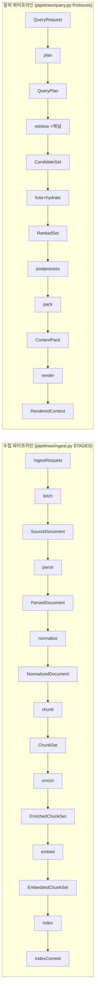

# DEVELOPER.md — 개발자 입문 강좌 (RAG Platform M1 lite)

이 문서는 저장소를 처음 여는 개발자가 **한 시간 안에 전체 흐름을 머리에 넣고, 첫 코드를 고칠 수 있게** 만드는 짧은 강좌다. 설계 문서 151건을 다 읽을 필요는 없다. 여기서 흐름을 잡고, 필요한 순간에만 링크를 따라 들어가면 된다. 사용법만 필요하면 [MANUAL.md](MANUAL.md)를, 다른 머신에서 검증을 이어받으려면 [HANDOFF.md](HANDOFF.md)를 본다.

> 정직한 현재 상태(2026-09-24): `lite` 프로파일의 수집 → 검색 → 렌더 전 구간이 **CLI(`rag ingest`/`rag query`) 경로에서 실제로 동작**한다(pytest 886 통과). 임베더는 결정적 가짜(`FakeEmbedder`)라 검색 품질은 아직 의미가 없고, REST API·MCP는 인증·오류·페이지네이션은 실제지만 파이프라인 배선은 스텁이다. Docker·실제 모델·GPU가 필요한 층은 미검증이다.

## 0. 10분 만에 돌려 보기

```bash
uv sync --all-extras --group dev
uv run pytest -q                       # 886 passed, 27 xfailed 기대
uv run rag ingest samples/hwpx --collection demo
uv run rag query "에이전틱 AI 개인정보 위험" --collection demo
```

무슨 일이 일어났나: `samples/hwpx/`의 HWPX 4건이 `.rag/` 아래에 수집됐다(`collections.json` = 컬렉션 이름 → 테넌트·컬렉션 ID, `artifacts/` = 스테이지별 산출물 JSON, `qdrant/` = Qdrant 로컬 모드 인덱스). 질의는 두 채널(dense·sparse_bm25)로 검색해 RRF로 융합하고 후처리·패킹을 거쳐 Context Pack을 만든 뒤 렌더러로 출력했다. 이 한 줄이 이 저장소 전체의 요약이다.

## 1. 큰 그림 — 두 개의 파이프라인, 열세 개의 계약

플랫폼은 두 파이프라인으로 이루어진다. 스테이지 사이를 오가는 데이터는 전부 **JSON Schema로 정의된 계약**이고, 계약이 정본이다(코드가 아니다).



- 계약 정본: `schemas/*.schema.json`(35개). Pydantic 모델 `src/rag_platform/contracts/`는 **생성물**이다(`just contracts-gen`). 손으로 고치지 않는다.
- 스테이지 순서 정본: 수집은 `pipelines/ingest.py`의 `STAGES = (fetch, parse, normalize, chunk, recount, enrich, embed, index)` + `publish`. 질의는 `pipelines/query.py`의 Protocol 7종(`Planner`, `ChannelRetriever`, `Fuser`, `Hydrator`, `Postprocessor`, `Packer`, `RendererFn`).
- 결정적 ID: `chunk_id`·`stage_key`·`record_id`는 BLAKE3 기반 `H()`로 입력에서 결정된다(`sdk/hashing.py`, ADR-0004). 같은 문서를 두 번 수집하면 같은 ID가 나오고, 스테이지 캐시가 맞는다.

## 2. 코드 지도 — 계층은 위에서 아래로만 의존한다

`import-linter`가 강제하는 계층(바이블 §12)이다. 아래 계층은 위 계층을 모른다.

| 계층 | 패키지 | 한 줄 역할 |
|------|--------|-----------|
| L0 | `contracts/` | 스키마에서 생성한 Pydantic v2 모델. 순수 데이터 |
| L1 | `sdk/`, `korean/` | `Stage` 프로토콜, `StageContext`, `StagePolicy`, 역할 포트(`Embedder`·`IndexBackend`·`TokenCounter`·`KoreanAnalyzer`·`ChunkTextStore`), 해시. 플러그인이 임포트할 수 있는 유일한 프레임워크 |
| L2 | `adapters/`, `pipelines/`, `retrieval/`, `render/`, `plugins/` | 실제 일을 하는 코드. `adapters/<확장지점>/`에 플러그인 구현, `retrieval/`에 플래너·채널·융합·후처리·패킹, `render/`에 렌더러 |
| L3 | `orchestration/`, `storage/`, `security/`, `profiles/`, `ledger/`, `settings/`, `eval/` | 셸: 실행기(`LocalRunner`), 아티팩트 저장소, `SecurityContext`, 프로파일 로더 |
| L4 | `api/`, `mcp/`, `cli/` | 표면. 서로 임포트하지 않는다(그래서 `rag serve`는 서브프로세스로 띄운다) |
| 별도 | `testing/` | 적합성 키트와 인메모리 대역(`FakeEmbedder`, `InMemoryIndexBackend`, `InMemoryKV`, `InMemoryLedger`). 테스트 전용 |

세 가지 금지: `adapters`는 `storage`·`security`를 모른다(포트는 `sdk`로 받는다). `pipelines` 이하 계층은 `temporalio`·`fastapi`·`ledger`·`orchestration`을 임포트하지 않는다. `fitz`/`pymupdf`/`hwp5`는 저장소 어디서도 임포트하지 않는다(AGPL). 어기면 `uv run lint-imports`가 실패한다.

## 3. 30분 코스 — 문서 한 건이 청크가 되어 검색되기까지

읽는 순서대로 따라가면 코드의 80%를 지나간다. 각 단계에서 파일 하나만 연다.

1. **입구** — `cli/main.py`의 `ingest_paths()`. `.rag/collections.json`에서 컬렉션을 만들고, `FileArtifactStore`(`.rag/artifacts`)와 `QdrantIndexBackend.local(".rag/qdrant")`를 준비한 뒤, 경로마다 `IngestRequest`를 만들어 스테이지를 순서대로 부른다. 스테이지 사이의 산출물은 `application/vnd.rag.<contract>+json` 미디어 타입으로 아티팩트 저장소에 저장된다.
2. **fetch** — `adapters/fetch/fsspec_httpx.py`. `file://`(허용 루트 제한)·`http(s)://`(크기 상한·조건부 요청)로 바이트를 가져와 `SourceDocument`를 만든다. 보안 원칙: 요청이 준 URI를 그대로 믿지 않는다.
3. **parse** — `adapters/parse/format_detector.py` → `router.py`. 바이트로 포맷을 판별하고 프로파일의 라우팅 표(`profiles/builtin/lite.yaml`의 `ingest.parse.router`)에 따라 파서를 고른다. HWPX는 `hwpx_python_hwpx.py`+`owpml_adapter.py`, PDF 디지털은 `pdf_fast_pdftext.py`, HTML은 `html_trafilatura_docling.py`, TXT/MD/CSV는 `text_charset_markdown_it.py`. 모두 `ParsedDocument`(블록 트리: heading·paragraph·table·figure…)를 낸다.
4. **normalize** — `adapters/normalize/stage.py` + `korean/`. 유니코드 정규화·공백·표 셀 정리. 한국어 처리는 순수 로직이라 `korean/`에 있다.
5. **chunk** — `adapters/chunk/structure_aware.py`. 제목 계층을 따라 부모(2048 토큰)·자식(512 토큰) 청크를 만들고 64 토큰 미만은 병합한다. 표는 `table_rows.py`가 행 그룹으로 자른다. `recount.py`는 임베더가 바뀌어 토큰 수 키가 빠졌을 때 재청킹 없이 수만 다시 센다.
6. **enrich** — `adapters/enrich/`. `deterministic_prefix.py`가 문서 제목·상위 제목 경로로 `embed_text`/`index_text`를 조립하고(ADR-0029), `korean_keywords.py`가 형태소 키워드를, `derived_meta.py`가 파생 메타를 붙인다. LLM은 쓰지 않는다.
7. **embed** — `adapters/embed/stage.py`. `sdk.ports.Embedder` 포트로 dense 벡터를 받고(`lite-dev`에서는 `inprocess_fake.py`의 결정적 가짜), `sparse_bm25.py`가 플랫폼 측에서 BM25 희소 벡터를 계산한다. Qdrant 단독으로 하이브리드가 되는 이유가 이 희소 벡터다.
8. **index** — `adapters/index/stage.py` → `saga.py` → `qdrant/backend.py`. `EmbeddedChunkSet`을 `IndexRecord`로 바꾸고, 새 레코드를 넣은 뒤 이전 세대를 지우는 `insert_then_delete` 사가로 커밋한다. 결과가 `IndexCommit`이다. `point_id`는 `uuid5`로 결정적이다.
9. **plan** — `retrieval/planner.py` + `filters.py`. `QueryRequest`에서 채널·top_k·필터를 정한다. **`tenant_id`·`acl` 사전 필터가 없으면 예외**다(`adapters/index/qdrant/filters.py`). 사후 필터는 금지다.
10. **retrieve → fuse → hydrate** — `retrieval/channels.py`가 `adapters/retrieve/qdrant_dense.py`·`qdrant_sparse_bm25.py`를 병렬로 부르고, `fusion.py`가 RRF(k=60, 가중 1:1, 변형 질의 0.5)로 합친다. `hydrate.py`는 Qdrant payload에서 본문을 채운다(핫패스에 PostgreSQL 없음, ADR-0034).
11. **postprocess** — `retrieval/postprocess/`. 순서는 고정이다: `relevance_gate → dedup → mmr → parent_expand → dedup`.
12. **pack** — `retrieval/pack/packer.py`. `acl_recheck → budget_cut → reorder(litm_alternating) → citation_align`. 결과 `ContextPack`의 각 항목에는 `cite_id`(`d1..dK`)가 붙는다.
13. **render** — `render/markdown.py`·`anthropic_search_result.py`. 렌더러는 요청의 `renderer` 또는 `target_model.provider`에서 정한다(`pipelines/query.py: resolve_renderer`, 기본 markdown).
14. **출구** — `cli/main.py`의 `run_query_lite()`가 9~13을 `pipelines/query.py`의 Protocol에 끼워 실행한다. `tests/e2e/test_full_e2e.py`가 이 전 구간을 한 테스트로 확인하니, 코드를 읽기 전에 그 테스트를 먼저 읽어도 좋다.

## 4. 계약을 고치는 법 (가장 자주 하는 실수의 반대)

1. 바꿀 것이 **오탈자·설명**이면 `schemas/<name>.schema.json`과 대응 문서 `docs/03-contracts/NN-*.md`를 고친다.
2. **필드·열거값 추가**는 ADR을 먼저 쓰고(`docs/06-adr/README.md` 절차), 바이블 §5.7/§6을 갱신한 뒤 스키마를 고친다. 필수화·제거·의미 변경은 major다.
3. 생성기를 다시 돌린다: `just contracts-gen`(= `uv run python tools/contracts_gen.py`). 생성 결과는 바이트 단위로 재현돼야 한다.
4. `node tools/validate-contracts.mjs --root .`가 0 오류인지, `uv run pytest -q tests/contracts`가 통과하는지 본다. 계약 문서의 `## 예시`가 픽스처로 추출돼 왕복 테스트된다(현재 27건 xfail은 문서 예시 오류다).

Pydantic 파일을 직접 고치고 싶은 유혹이 들면 그 순간이 잘못된 순간이다. 생성기가 덮어쓴다.

## 5. 스테이지(플러그인)를 하나 추가하는 법

모든 스테이지는 `sdk/stage.py`의 `Stage[In, Out]` 프로토콜 다섯 멤버를 구현한다(ADR-0032).

```python
class MyChunker:
    plugin_id = "chunker.my_chunker"          # <확장지점>.<이름>
    config_schema = MyChunkerConfig            # Pydantic 설정 모델
    requires_lineage: tuple[str, ...] = ()     # 이전 스테이지 산출물이 더 필요하면 계약 이름
    def capabilities(self) -> Capabilities: ...  # 지원 포맷·언어 등(계약 Capabilities)
    def fingerprint(self) -> str: ...            # 설정·버전으로 결정되는 해시 → stage_key에 섞인다
    async def run(self, inp: NormalizedDocument, ctx) -> ChunkSet: ...
```

규칙 세 가지. (1) 스테이지 안에서 계약을 검증하지 않는다 — 셸(`LocalRunner`)이 한다. (2) 시각·난수·ID는 `ctx`로 주입받는다 — 같은 입력이면 같은 출력이어야 한다. (3) 실패는 예외 타입이 아니라 `StageError(code="chunk.<reason>")`로 던진다. 코드 철자는 바이블 §5.7.

등록은 `plugins/registry.py`의 `PluginRegistry.register(meta, factory)` 또는 패키지 entry point(그룹명은 `entry_point_group("<확장지점>")`)로 한다. 확장 지점은 14종이다: `fetcher, parser, normalizer, chunker, enricher, embedder, index_backend, query_transformer, retriever, fuser, reranker, postprocessor, packer, evaluator`. 외부 플러그인은 `rag_platform.sdk`·`rag_platform.contracts`만 임포트한다. 적합성 테스트는 `testing/conformance/`의 기반 클래스를 상속하면 확장 지점별 필수 동작(멱등성·결정적 키·보안 불변식)을 공짜로 검사받는다. 자세한 절차는 [플러그인 개발 가이드](docs/10-development/06-plugin-development-guide.md).

## 6. 새 작업을 시작하는 절차 (WP 우선)

구현 단위는 작업 패키지(WP) 문서다. 코드보다 문서를 먼저 쓴다.

1. `docs/13-implementation/wp/WP-6xx-<slug>.md`를 만든다(기존 21건 중 [WP-401](docs/13-implementation/wp/WP-401-planner-and-filters.md)이 좋은 본보기: 목표 → 파일 → 시그니처 → 계약 발췌 → 불변식·금지 → 단계 → 테스트 → 완료 기준 → 검증 계층).
2. 코드와 테스트를 같은 커밋에 넣는다. 모든 소스 파일은 첫 줄부터 **한국어 설명 헤더**(역할 → 설계 근거 → 구성 → 불변식·주의 → 검증 계층, 6~15줄)로 시작한다(`tools/phase6/CODE-HEADER-RULE.md`).
3. 설계 문서와 어긋나는 것을 발견하면 코드에서 바이블을 앞질러 바꾸지 말고 임시 근사로 처리한 뒤 기록만 남긴다. 기록은 [구현 설계 갭 원장](docs/12-appendix/10-implementation-design-gaps.md)에 모인다(현재 180건).
4. Docker·모델·GPU가 필요한 테스트는 `needs_docker`/`needs_model`/`needs_gpu`/`needs_network` 마커와 `# DEFERRED:` 주석을 달고 `node tools/verify/gen-deferred-ledger.mjs`로 원장을 재생성한다. 기본 실행에서 제외된다.

## 7. 게이트 — 커밋 전에 전부 초록이어야 한다

```bash
just check                      # lint + typecheck + test 를 한 번에
```

개별로는 다음과 같다.

| 명령 | 잡는 것 |
|------|--------|
| `uv run ruff check .` / `uv run ruff format --check .` | 린트·포맷·모듈 docstring(D100) |
| `uv run mypy src` | strict 타입(+`pydantic.mypy`) |
| `uv run lint-imports` | §2의 계층 위반·금지 임포트(6 계약) |
| `uv run pytest -q` | 886 테스트(마커 4종 제외), 계약 왕복·적합성·e2e 포함 |
| `node tools/verify/check-headers.mjs` | 한국어 헤더 규칙 |
| `node tools/validate-contracts.mjs --root .` | 스키마·계약 문서 기계 검증 |
| `node tools/audit-docs.mjs` | 문서 링크·frontmatter·기각 명칭 감사 |

테스트 규약 8가지는 [테스트 전략](docs/10-development/04-testing-strategy.md) §1. 특히 "셸이 계약을 강제한다", "결정성 우선", "실패는 코드 철자로 단정한다"를 지킨다.

## 8. 지금 손대면 가장 값진 곳

- **표면 배선**: `api/ingest.py`·`api/query.py`는 스텁 스테이지·스텁 팩을 돌려주고, `mcp/server.py`의 `main()`은 `ToolDeps` 조립이 없어 `NotImplementedError`다. `cli/main.py`의 `ingest_paths`/`run_query_lite`/`build_query_deps`가 이미 실제 배선을 갖고 있으니, 이것을 `api`·`mcp`가 공유하는 서비스 계층(L3)으로 옮기는 일이 M1의 마지막 조각이다.
- **실제 임베더**: `adapters/embed/tei_dense.py`·`vllm_pooling_bge_m3.py`는 모의 HTTP로만 검증됐다. Docker·모델이 있는 머신에서 [HANDOFF.md](HANDOFF.md) 절차로 층 2·2b를 검증하면 검색 품질이 처음으로 의미를 갖는다.
- **설계 갭 트리아지**: 원장 180건 중 83건이 바이블 개정 후보다. ADR 절차로 일괄 처리한다.
- **골든셋(6C)**: `samples/hwpx/`의 공공누리 문서 3건으로 질의·`answer_spans`를 만들고 사람이 검수하면 `eval` 패키지를 채울 수 있다.

## 9. 더 읽을 것 (필요할 때만)

- 왜 이렇게 설계했나: [설계 브리프](docs/00-vision/00-design-brief.md)(요구사항 R1~R6, 결정 D-01~D-20) → [설계 바이블](docs/02-architecture/00-design-bible.md)(절 번호로만 읽는다: §4 스테이지, §5.7 열거, §8 검색, §9 Context Pack, §10 ACL, §12 모듈 맵) → [ADR 인덱스](docs/06-adr/README.md).
- 스테이지별 상세: `docs/04-pipelines/01~19`. API: `docs/05-api/02·03·05`. 프로파일: 바이블 §7.
- 진행 상황과 재개 절차: [진행 보고서](docs/12-appendix/00-progress-report.md) §3.2·§7.3. 프로젝트 규칙: [CLAUDE.md](CLAUDE.md)(에이전트용이지만 사람에게도 같은 규칙이다).
