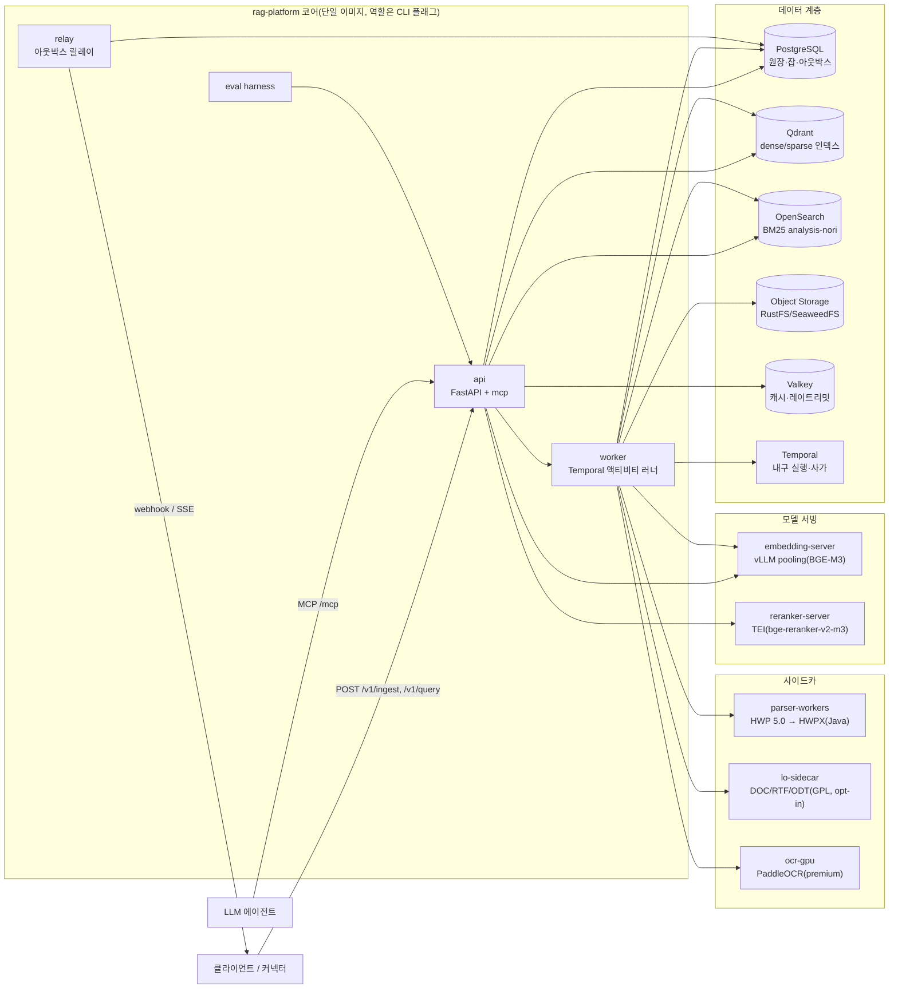

# RAG Platform

**RAG Platform**은 수집된 문서(HWPX·HWP·PDF·DOC/DOCX·TXT·HTML 등)의 **위치(URI)와 메타데이터를 API로 받아**, 오픈소스 최선의 기술로 **파싱 → 정규화 → 의미 기반 청킹 → 보강(enrichment) → 임베딩 → 하이브리드 인덱싱**을 수행하고, **리트리벌 API**로 LLM이 즉시 참고해 최고의 답을 낼 수 있는 **Top-K 컨텍스트 팩(Context Pack)** 을 돌려주는 오픈소스 플랫폼이다.

**`설계 완료`** · **`6A·6B·6D 완료`** · **`Apache-2.0`**

> 설계는 완료됐고, **M1 lite 코어가 구현·검증된 상태**다(2026-09-24, 6단계 6A·6B·6D·6E·6F 완료). 수집(fetch → parse → normalize → chunk → enrich → embed → index) → 검색(plan → retrieve → fuse → hydrate → postprocess → pack → render) → API·MCP·CLI까지 `lite` 프로파일 전 구간이 결정적 가짜 임베더와 Qdrant 로컬 모드로 동작한다(pytest 886 통과). Docker·실제 모델·GPU가 필요한 층은 Windows VDI에서 실행하지 못해 미검증이다(`HANDOFF.md`). 아래 "현재 상태와 로드맵"을 먼저 읽는다.

## 1. 왜 이 플랫폼인가

이 플랫폼은 한 문장으로 요약되지만 그 안에는 6개의 원 요구사항이 있다(설계 브리프 §2, 사용자 원문 → 해석). 아래 표는 각 요구를 어떤 설계 결정으로 풀었는지 요약한다. 상세 해석과 근거는 [설계 브리프](docs/00-vision/00-design-brief.md) §2를 본다.

| # | 요구 | 설계 답 |
|---|------|---------|
| R1 | 수집된 문서의 URI와 메타 정보를 API로 전달받아서 | Pull 모델 비동기 수집(`IngestRequest`). 플랫폼은 크롤러가 아니다. HWPX/HWP를 1급으로 지원 |
| R2 | 파싱·의미 청킹·임베딩에 검증된 오픈소스를 최대한 사용 | Not-Invented-Here 금지. Docling·python-hwpx·BGE-M3 등을 **어댑터**로 감싼다. 우리가 소유하는 것은 표준 계약과 오케스트레이션 |
| R3 | 리트리벌 API로 Top-K를 최대한 잘 뽑는다 | **하이브리드(dense+sparse+lexical) → RRF 융합 → 크로스인코더 리랭킹 → 후처리**. 평가 하네스를 1급 시민으로 둔다 |
| R4 | 각 파이프라인을 우아하고 모든 기술을 수용하도록 설계 | 기본 프로파일은 검증된 조합만 기본으로 켜고, **14개 플러그인 확장 지점**으로 고급 기법(GraphRAG, RAPTOR, ColBERT 등)을 수용 |
| R5 | 각 단계의 입출력을 표준화 | 모든 스테이지 경계마다 **버전드 JSON Schema(2020-12) + Pydantic v2** 계약. 산출물은 콘텐츠 주소화되어 재처리·캐싱·감사 가능 |
| R6 | Top-K가 LLM에 최고 효과를 내야 한다 | 단순 청크 배열이 아니라 **Context Pack**: 토큰 예산 정렬, 인용 ID, 부모 확장, LLM 네이티브 렌더러. **MCP 서버**로 에이전트가 직접 호출 |

시스템 경계(설계 브리프 §6)는 다음과 같다.

- **포함**: 수집 API, 파서군, 정규화, 청킹, 보강, 임베딩, 인덱싱, 리트리벌 API, 컨텍스트 패킹, MCP 서버, 관리 API, 평가 하네스, 관측성, 배포 매니페스트, 플러그인 SDK, 클라이언트 SDK(Python/TypeScript).
- **제외(단, 훅은 제공)**: 웹 크롤러/커넥터(원천 수집), 최종 답변 생성 UI(챗봇), 모델 파인튜닝 파이프라인, 사용자 인증 서버(OIDC 연동만), 문서 편집. 선택적 `answer` 엔드포인트는 레퍼런스 구현으로만 제공된다.

## 2. 핵심 특징

- **HWPX/HWP 1급 지원** — HWPX는 `python-hwpx` + 자체 OWPML 어댑터, HWP 5.0은 Apache-2.0 Java 사이드카(hwplib + hwp2hwpx + hwpxlib)로 HWPX 변환 후 동일 경로 재사용. 다단 폴백(unhwp → hwp-hwpx-parser → LibreOffice)까지 설계됨.
- **표준 계약 13종 + JSON Schema 35개** — 스테이지 경계(`IngestRequest`→…→`IndexCommit`, `QueryRequest`→…→`ContextPack`)마다 버전드 계약을 정의(설계 브리프 D-05). 운영 계약을 포함한 전체 JSON Schema는 35개(`schemas/`).
- **3-way 하이브리드 검색 + RRF + 리랭킹** — dense + sparse(learned) + lexical(BM25, 한국어 형태소) 채널을 병렬 검색 후 플랫폼 측 `fuser`가 RRF(k=60)로 융합하고, 크로스인코더로 재정렬한다.
- **Context Pack과 인용** — 후처리 고정 순서(`relevance_gate → dedup → mmr → parent_expand → …`)와 패킹 서브스텝(`acl_recheck → budget_cut → reorder → citation_align`)으로 토큰 예산 안에서 정렬·인용 가능한 팩을 만든다. `cite_id`는 관련도순으로 불변이다.
- **MCP 서버** — `mcp>=2,<3`, Streamable HTTP로 `search`, `get_document`, `list_collections` 도구를 제공하고, 세션 없는 스펙에 맞춰 `cursor`/`next_cursor`로 페이지네이션한다.
- **멀티테넌시·ACL 사전 필터** — `tenant_id`·`collection_id`·`acl`이 모든 인덱스 레코드에 존재하고, 모든 채널·모든 백엔드에서 사전 필터(pre-filter)로 강제된다(강제 지점 17개).
- **평가 하네스 내장** — TREC qrels/run + `answer_spans` JSONL 골든셋, ranx/ir_measures 오프라인 메트릭, RAGAS/DeepEval LLM-judge. 하네스는 프로덕션과 **동일한 인프로세스 스테이지**를 실행한다.
- **플러그인 14개 확장 지점** — Python entry points 레지스트리: `fetcher`, `parser`, `normalizer`, `chunker`, `enricher`, `embedder`, `index_backend`, `query_transformer`, `retriever`, `fuser`, `reranker`, `postprocessor`, `packer`, `evaluator`.

## 3. 아키텍처 한 장

`standard` 프로파일 기준 컨테이너 구성을 요약한다(`lite`는 점선 없이 같은 이미지에서 동작). 전체는 [설계 바이블](docs/02-architecture/00-design-bible.md) §2.2 C4 Container를 본다.



| 컨테이너 | 책임(소유) | `lite` 포함 |
|----------|-----------|-------------|
| `api` | 인증(OIDC/API 키) → `SecurityContext` 주입, Cedar 인가, 레이트리밋, **질의 파이프라인 인프로세스 실행**, MCP 마운트 | 예 |
| `worker` | `Stage[In, Out]` 제네릭 액티비티 래퍼(ArtifactRef 로드 → 실행 → 콘텐츠 주소화 저장 → 계보 기록) | 예(`LocalRunner`는 api와 동일 프로세스) |
| `relay` | 아웃박스 릴레이(웹훅·SSE 전달, 테넌트 스코프) | 예(Procrastinate) |
| `parser-workers` | HWP 5.0 → HWPX 변환, 암호화 HWPX, 배포용 텍스트 추출 | 아니오 |
| `embedding-server` / `reranker-server` | BGE-M3 3-in-1 서빙(vLLM pooling), 크로스인코더 리랭킹(TEI) | 아니오(`lite`는 인프로세스 ONNX/CPU) |
| PostgreSQL | 원장(잡·아웃박스·레지스트리), RLS `FORCE`, Temporal 영속화 | 예 |
| Qdrant | dense·sparse 검색, payload 사전 필터, alias | 예 |
| OpenSearch | BM25(Nori `mixed`/`discard`), custom routing, DLS 이중 방어 | 아니오(`standard` 이상) |

`lite`는 GPU·사이드카 없이 단일 노드(app, PostgreSQL, Qdrant, Valkey, 오브젝트 스토리지)로 동작하고, `standard`부터 OpenSearch·Temporal·GPU 모델 서빙이 추가된다(설계 바이블 §7.1).

이 아키텍처를 관통하는 7개 핵심 아이디어(설계 바이블 §2.1)는 다음과 같다.

1. **단일 좌표계** — 모든 검색 단위는 `IndexRecord` 하나로 표현되고 `block_refs`로 원문에 역추적된다.
2. **3-텍스트 규칙** — 청크는 `text`(표시용) / `embed_text`(임베딩용) / `index_text`(BM25용)를 분리 보관한다.
3. **점수 원장** — `CandidateSet → RankedSet → ContextPack`으로 점수 분해가 소실되지 않는다.
4. **예산·순서·인용이 있는 팩** — 고정된 후처리 순서, `cite_id` 불변, `litm_alternating` 정렬 공식.
5. **하나의 커널·두 개의 셸** — `Stage[In, Out]` 계약은 `LocalRunner`(비내구)와 Temporal 어디서나 동일하게 실행된다.
6. **원장 중심 + 세대 사가** — PostgreSQL 원장이 유일한 진실이고, 인덱스는 재구성 가능한 투영이다.
7. **격리 등급 1급** — 어댑터 격리(in_process/helper_process/sidecar)와 테넌트 격리를 프로파일로 선언·검증한다.

## 4. 검색 경로 (초안 목표)

`standard` GPU 프로파일의 질의 경로는 아래 14단계를 거친다(전체 정의는 [설계 바이블](docs/02-architecture/00-design-bible.md) §8.1).

1. 인증·인가 — JWT/API 키 → `SecurityContext` 주입(fail-closed)
2. 정규화·키워드 — 한국어 형태소 분석기로 `normalized_query`·`lexical_terms` 생성
3. 라우터 — 규칙 기반 `no_retrieval`/`single`/`multi` 결정
4. self-query — 정규식(날짜·문서유형·부서) 기반 필터 추출
5. 질의 임베딩 — BGE-M3 단일 패스(dense+sparse), Valkey 24h 캐시
6. 채널 구성 — 컬렉션별 `IndexBackendCapabilities` 대조 후 채널×컬렉션 런 구성
7. 병렬 검색 — dense·sparse·lexical 채널을 사전 필터(보안+전략+사용자)로 동시 조회
8. 융합 — 플랫폼 `fuser`가 RRF(k=60, 채널 가중 1:1:1)로 결합
9. hydrate — 상위 후보 payload를 1회 배치 조회
10. 리랭크 — 크로스인코더(top-100→20), 타임아웃 시 fused 순서로 폴백
11. 2단 리랭크(옵션) — late interaction MaxSim(premium 실험 슬롯)
12. 후처리 — `relevance_gate → dedup → mmr → parent_expand → dedup → sentence_window(옵션) → compress(옵션)`
13. 패킹 — `acl_recheck → budget_cut → reorder(litm_alternating) → citation_align`
14. 렌더·감사 — 렌더러 사전 검증, `RenderedContext`, 감사 이벤트 기록

검색 품질 목표(초안 목표, 설계 브리프 §7): 내부 한국어 골든셋 **nDCG@10 ≥ 0.80**, **Recall@20 ≥ 0.92**(베이스라인 dense-only 대비 +15%p 이상). 실측 전이므로 골든셋 게이트를 통과해야 확정값이 된다.

지연 예산 분배(`standard` GPU, **p95 800ms, 초안 목표**, 설계 바이블 §8.3):

| 스테이지 | 예산(ms) | 누적(ms) |
|----------|---------:|---------:|
| 인증·인가·레이트리밋 | 10 | 10 |
| plan(정규화·라우터·필터) | 20 | 30 |
| 질의 임베딩 | 40 | 70 |
| retrieve(병렬 최대) | 120 | 190 |
| fuse + hydrate | 20 | 210 |
| rerank | 250 | 460 |
| postprocess | 60 | 520 |
| pack | 40 | 560 |
| render + 직렬화 | 15 | 575 |
| 네트워크·GC 여유 | 225 | 800 |

`lite`(CPU)는 총 1,500ms, `premium quality`는 2,500ms가 목표다. 모든 수치는 골든셋 게이트를 통과하기 전까지 "초안 목표"이며 실측값이 아니다.

## 5. 프로파일 4종

프로파일은 컬렉션에 고정되는 버전드 프리셋이다(`base → lite → standard → premium`, `korean-gov extends standard`). 전체 컴포넌트 표는 [설계 바이블](docs/02-architecture/00-design-bible.md) §7.1을 본다.

| 프로파일 | 임베딩 | 인덱스 | 리랭커 | 오케스트레이션 |
|----------|--------|--------|--------|----------------|
| `lite` | bge-m3 dense ONNX int8(인프로세스) + `sparse_bm25`(형태소+TF 포화) | Qdrant 단독(`dense` + `sparse_bm25`) | gte-multilingual-reranker-base @ TEI CPU(30→10) 또는 생략 | `LocalRunner`(개발) / Temporal 단일 바이너리(운영) |
| `standard`(기본) | bge-m3 dense+sparse @ vLLM 0.29 pooling | Qdrant 1.19 + OpenSearch 3.8(Nori `mixed`/`discard`) | bge-reranker-v2-m3 @ TEI GPU(100→20) | Temporal frontend/history/matching, KEDA `temporal` |
| `premium` | `ko-quality`(KURE-v1+PIXIE-Splade-v1.5) 또는 `quality-max`(Qwen3-Embedding-4B) | + Qdrant multivector(turbo4) | Qwen3-Reranker-4B @ vLLM/SGLang(50→20) + 선택 KURE-v2 MaxSim | + `ingest-gpu-ocr`, `ingest-llm`, MIG 또는 전용 GPU |
| `korean-gov` | standard(가중치·LICENSE 자체 미러링 필수) | + 대형 테넌트 `shard_key`/`index_per_tenant`, 감사 로그 별도 인덱스 | standard + dragonkue ko A/B | standard + 테넌트 등급별 네임스페이스, 야간 재색인·평가 스케줄 |

## 6. 기술 선정 요약

[기술 지형 종합: 선정 매트릭스](docs/07-tech-landscape/00-summary-and-selection-matrix.md)에서 D-10 확장 지점을 세분한 12개 주요 역할의 `standard` 1차 선택과 라이선스를 요약한다(모두 A 등급 — 자유 사용).

| 역할 | 1차 선택 | 라이선스 |
|------|----------|----------|
| 파서(HWPX/HWP) | `python-hwpx` + 자체 OWPML 어댑터 / Java 사이드카(hwplib + hwp2hwpx + hwpxlib) | Apache-2.0 |
| OCR | RapidOCR PP-OCRv5 korean mobile(ONNX Runtime), GPU는 PaddleOCR PP-OCRv5 server | Apache-2.0 |
| 임베딩 | BAAI/bge-m3(dense 1024d + sparse 단일 패스), 서빙 vLLM pooling + TEI | MIT / Apache-2.0 |
| 리랭커 | BAAI/bge-reranker-v2-m3 @ TEI | Apache-2.0 |
| 벡터 인덱스 | Qdrant 1.19.x(named vectors, payload 파티셔닝) | Apache-2.0 |
| 렉시컬 인덱스 | OpenSearch 3.8(Lucene 10.5) + `analysis-nori` | Apache-2.0 |
| 오케스트레이션 | Temporal Server 1.32 + `temporalio` 1.33 | MIT |
| KV/캐시 | Valkey 9.x(Redis 프로토콜 호환) | BSD-3 |
| 오브젝트 스토리지 | RustFS(1차, SeaweedFS와 실측 후 ADR로 확정) | Apache-2.0 |
| 평가 | RAGAS 0.4.3 collections + DeepEval 4.2.3 병기 | Apache-2.0 |
| 관측 | OpenTelemetry Python SDK(GenAI semconv + OpenInference + 자체 `rag.*`) | Apache-2.0 |
| MCP | `mcp` 2.x `MCPServer`(Streamable HTTP) | MIT |

각 역할에는 대안·폴백 후보도 함께 조사되어 있다(예: 벡터 인덱스는 Milvus·OpenSearch k-NN·pgvector·LanceDB, 리랭커는 Qwen3-Reranker·FlashRank 등). 라이선스 등급(A/B/C/D/X)과 판정 규칙은 설계 브리프 D-02와 [ADR-0001](docs/06-adr/0001-license-grade-table-and-d02-interpretation.md)을 따른다.

## 7. 문서 지도

전체 문서 지도와 디렉터리 현황은 [docs/README.md](docs/README.md)에 있다. 처음 읽는 순서:

1. [설계 브리프](docs/00-vision/00-design-brief.md) — 모든 문서의 앵커
2. [설계 바이블](docs/02-architecture/00-design-bible.md) — 결정 레지스터, 계약 인벤토리, 프로파일·검색 경로 정본
3. [기술 지형 종합: 선정 매트릭스](docs/07-tech-landscape/00-summary-and-selection-matrix.md) — 역할별 오픈소스 선정 근거
4. [비전과 목표](docs/00-vision/01-vision-and-goals.md) → [설계 원칙](docs/00-vision/02-design-principles.md) → [범위와 비범위](docs/00-vision/04-scope-and-non-goals.md) → [용어집](docs/00-vision/03-glossary.md)
5. [기능 요구사항](docs/01-requirements/01-functional-requirements.md) → [비기능 요구사항](docs/01-requirements/02-non-functional-requirements.md) → [페르소나와 유즈케이스](docs/01-requirements/03-personas-and-use-cases.md) → [사용자 스토리](docs/01-requirements/04-user-stories-and-acceptance-criteria.md)
6. 계약([00-contract-overview.md](docs/03-contracts/00-contract-overview.md)) → 파이프라인([01-pipeline-framework.md](docs/04-pipelines/01-pipeline-framework.md)) → API([openapi.yaml](docs/05-api/openapi.yaml)) → [ADR 인덱스](docs/06-adr/README.md) → 평가·운영·개발·로드맵(08~11)

## 8. 현재 상태와 로드맵

**설계 완료(3단계), 6단계 6A(레퍼런스 골격)·6B(적합성 키트)·6D(어댑터 스파이크)·6E(작업 패키지)·6F(M1 lite 레퍼런스 구현) 완료(2026-09-24).** 저장소에는 uv 워크스페이스·툴체인(ruff/mypy/import-linter)·스키마에서 생성한 계약 모델(`contracts/`)·코어 프레임워크(`sdk`/`storage`/`plugins`/`profiles`/`orchestration/local`)·적합성 키트와 인메모리 테스트 대역(`testing/`)에 더해, `lite` 프로파일의 **수집 파이프라인**(fsspec·httpx fetch, HWPX·TXT/MD/CSV·HTML·PDF 파서, 한국어 정규화, 구조 인식 청킹, 결정적 보강, `FakeEmbedder` + 플랫폼 BM25 sparse, Qdrant 로컬 모드 인덱스 커밋 사가), **검색 경로**(규칙 플래너·tenant/acl 사전 필터, dense·sparse_bm25 채널·RRF 융합·hydrate, 후처리·패킹·markdown/anthropic 렌더러), **FastAPI 수집·잡·질의 API**, **MCP 서버**, `rag` CLI가 구현돼 있다. 작업 패키지 21건은 [docs/13-implementation/](docs/13-implementation/README.md)에 있다.

층별 검증 상태([진행 보고서](docs/12-appendix/00-progress-report.md) §3.2):

| 층 | 범위 | 상태 |
|----|------|------|
| 1 — 순수 Python | 단위·계약 왕복·Qdrant 로컬 모드·`FakeEmbedder`·`TestClient` e2e | **검증 완료**: pytest 886 통과 · 27 xfail(계약 예시 오류), mypy strict 224 파일 0 오류, import-linter 6 계약 유지 |
| 2 — Docker/Linux | `compose.lite.yaml`, PostgreSQL 원장, Valkey, Qdrant 서버 모드 | 작성만, **미검증**(`needs_docker`, [보류 원장](docs/12-appendix/09-deferred-verification-ledger.md) · [HANDOFF.md](HANDOFF.md)) |
| 2b — 모델 가중치 | BGE-M3(TEI·vLLM pooling), bge-reranker, Docling | 어댑터 골격만, **미검증**(`needs_model`, VDI에서 다운로드 금지) |
| 3 — GPU | vLLM 서빙, OCR GPU 사이드카 | 미착수 |

빠르게 만져 보기(층 1, 이 저장소만으로 동작):

```bash
uv sync --all-extras --group dev
uv run pytest -q
uv run rag ingest samples/hwpx/kogl1-pipc-agentic-ai-20260923.hwpx --collection demo
uv run rag query "에이전틱 AI 개인정보 위험" --collection demo
```

3단계 완료 실측값은 다음과 같다.

- 설계 문서 **151개**(부속 15건 포함), **99,572행** + `openapi.yaml` 8,461행
- JSON Schema **35개**(`schemas/`)
- ADR **38건**(accepted, MADR 형식) — [ADR 인덱스](docs/06-adr/README.md)
- OpenAPI 경로 36 · 연산 **51개**

디렉터리별 현황(3단계 완료 실측, [진행 보고서](docs/12-appendix/00-progress-report.md) §3.0):

| 디렉터리 | 문서 | 비고 |
|----------|-----:|------|
| `00-vision/` | 5 | 브리프 v1.2.2(4단계 갱신 반영) |
| `01-requirements/` | 4 | FR 217, NFR 184, 유즈케이스 20, 사용자 스토리 91 |
| `02-architecture/` | 10 | 바이블 v1.3.0(4단계 개정 AM-01~AM-44 반영) + 시스템 개요~회복력 |
| `03-contracts/` + `schemas/` | 17 + 35 | 검증기 0 오류 |
| `04-pipelines/` | 19 | 프레임워크~고급 모듈, 갱신·삭제 |
| `05-api/` | 7 + `openapi.yaml` | 경로 36 · 연산 51 |
| `06-adr/` | 38 + README | accepted(MADR) |
| `07-tech-landscape/` | 15 | 14개 영역 리서치 + 선정 매트릭스 |
| `08-evaluation/` | 6 | 전략·하네스·골든셋·LLM-judge |
| `09-operations/` | 8 | 배포·설정·관측성·보안·런북 |
| `10-development/` | 8 | 저장소 구조·CI/CD·기여·릴리스 |
| `11-roadmap/` | 3 | 마일스톤·백로그·리스크 |
| `12-appendix/` | 10 + sources | 진행 보고서·완전성 검토·단계 계획 |

3단계 종료 후 [4·5단계 실행 계획](docs/12-appendix/02-phase4-5-plan.md)에 따라 **4단계(바이블 개정 트리아지·전파, 교차 일관성 확보)와 5단계(마감 — 이 README 포함)가 완료**됐다. [구현 킷과 M1 lite 레퍼런스 계획](docs/12-appendix/05-phase6-implementation-kit-plan.md)이 정의하는 6단계 하위 순서(6A~6G) 중 **6A·6B·6D·6E·6F가 완료**됐다(6E·6F는 "작업 패키지 우선 구현" 배치 F1~F5로 합쳐 실행, [진행 보고서 §7.2h](docs/12-appendix/00-progress-report.md)). 남은 것은 6C 표본 코퍼스 확대·미니 골든셋(사람 검수 필수), 6G 공개 준비(CONTRIBUTING·SECURITY, 내부 기록 분리), 그리고 Docker·모델이 있는 머신에서의 층 2·2b 검증과 구현 중 발견한 [설계 갭 180건](docs/12-appendix/10-implementation-design-gaps.md)의 바이블 패치다. M1 이후(M2~)는 이 코어 위에 HWP5 사이드카·OpenSearch·리랭커·Temporal을 켜는 순서다.

마일스톤(전체는 [마일스톤](docs/11-roadmap/01-milestones.md)):

- **M1 기반**(`0.1.0`) — 계약 패키지, SDK, `LocalRunner`, `lite` 종단 간(e2e) 파이프라인
- **M2 한국어 1급**(`0.2.0`) — HWP 5.0 사이드카, Nori 기반 OpenSearch, 3-way 하이브리드+리랭커, 렌더러 9종, MCP, 골든셋 v1
- **M3 운영**(`0.5.0`, 첫 공개 릴리스/MVP) — Temporal, 멀티테넌시·ACL(E1~E17), 관측성, Helm, 웹훅
- **M4 품질**(`0.8.0`) — 평가 하네스 완성, 골든셋 v2 공개, 게이트 기반 ADR 개정, `premium`
- **M5 확장**(`0.9.0`, RC) — GraphRAG/RAPTOR 플러그인, late interaction, 멀티모달, SDK, 플러그인 카탈로그, `korean-gov`

## 9. 기여·라이선스

이 프로젝트는 **Apache License 2.0**([LICENSE](LICENSE), 고지는 [NOTICE](NOTICE))로 배포된다. 의존성·모델 라이선스는 A(자유)/B(LGPL 조건부)/C(네트워크 분리)/D(모델 제한)/X(금지) 5등급으로 판정하며(설계 브리프 D-02), 이 등급표는 CI 라이선스 게이트의 근거가 될 예정이다.

`CONTRIBUTING.md`는 6G 공개 준비 산출물([기여 가이드](docs/10-development/07-contributing.md) 설계 문서 기준)로 예정되어 있고, 보안 취약점 보고 채널(`SECURITY.md`)도 아직 마련되지 않았다. 현재 단계에서 가장 유용한 기여는 (1) Docker·모델이 있는 머신에서 [HANDOFF.md](HANDOFF.md) 절차로 층 2·2b 보류 항목을 검증하는 것, (2) `src/rag_platform/`의 M1 lite 코드와 [구현 설계 갭 원장](docs/12-appendix/10-implementation-design-gaps.md)의 180건을 리뷰하는 것, (3) 계약 왕복 xfail 27건의 원인인 계약 문서 예시 오류를 고치는 것이다.

---

## English Summary

RAG Platform is an open-source (Apache-2.0) platform that ingests documents by URI and metadata (HWPX, HWP, PDF, DOC/DOCX, TXT, HTML), runs them through parsing, normalization, semantic chunking, enrichment, embedding, and hybrid indexing using best-of-breed open-source components wrapped as adapters, and serves a retrieval API that returns a Top-K **Context Pack** designed for an LLM to consume directly, including via a bundled **MCP server**.

Key design ideas: (1) every stage boundary is a versioned JSON Schema + Pydantic v2 **contract** (13 stage-boundary contracts, 35 schemas total); (2) the default retrieval path is a **3-way hybrid** search (dense + learned-sparse + lexical BM25 with Korean morphological analysis), fused with **Reciprocal Rank Fusion** and refined by a cross-encoder **reranker**; (3) the output is a **Context Pack**, not a flat chunk array — token-budget-aware ordering, stable citation IDs, parent expansion, LLM-native renderers; (4) **HWPX/HWP support is first-class**; (5) **multi-tenancy and ACL are pre-filters** enforced at every channel and backend (17 enforcement points); (6) a **built-in evaluation harness** runs the same stages as production against golden sets; (7) **14 plugin extension points** (fetcher through evaluator) let advanced techniques be added without forking the core.

**Status: design complete; M1 "lite" core implemented and verified at tier 1 (2026-09-24).** The repository holds 151 design documents (99,572 lines), 35 JSON Schemas, 39 accepted ADRs, an OpenAPI surface of 36 paths / 51 operations, and now `src/rag_platform/` (224 files, 40.8k lines) with 21 work packages under `docs/13-implementation/wp/`. The `lite` profile runs end to end: fetch (fsspec/httpx) → parse (HWPX, TXT/MD/CSV, HTML, fast-path PDF) → Korean normalization → structure-aware chunking → deterministic enrichment → embedding (deterministic `FakeEmbedder` + platform-side BM25 sparse vectors) → Qdrant local-mode index commit; then rule-based planning with mandatory tenant/ACL pre-filters → dense + sparse channels → RRF fusion → hydrate → postprocess → Context Pack → markdown / Anthropic `search_result` renderers, exposed through a FastAPI ingest/jobs/query API, an MCP server with cursor pagination, and a `rag` CLI. Gate: pytest 886 passed / 27 xfail (contract-example errors), mypy strict clean, import-linter 6 contracts kept. Everything that needs Docker, real model weights, or a GPU (compose stack, PostgreSQL ledger, Valkey, Qdrant server mode, BGE-M3 via TEI/vLLM, reranker) was written against in-memory doubles on a Windows VDI and is **not yet verified** — see [HANDOFF.md](HANDOFF.md) and the [deferred verification ledger](docs/12-appendix/09-deferred-verification-ledger.md). Remaining phase-6 work: sample corpus + mini golden set with human review (6C), release prep (6G), and a design-bible patch for the 180 design gaps recorded in the [implementation design-gap ledger](docs/12-appendix/10-implementation-design-gaps.md).

Start with the [design brief](docs/00-vision/00-design-brief.md) (the anchor), then the [design bible](docs/02-architecture/00-design-bible.md) (contracts, profiles, retrieval path), then the [technology landscape and selection matrix](docs/07-tech-landscape/00-summary-and-selection-matrix.md). Full reading order: [docs/README.md](docs/README.md).
