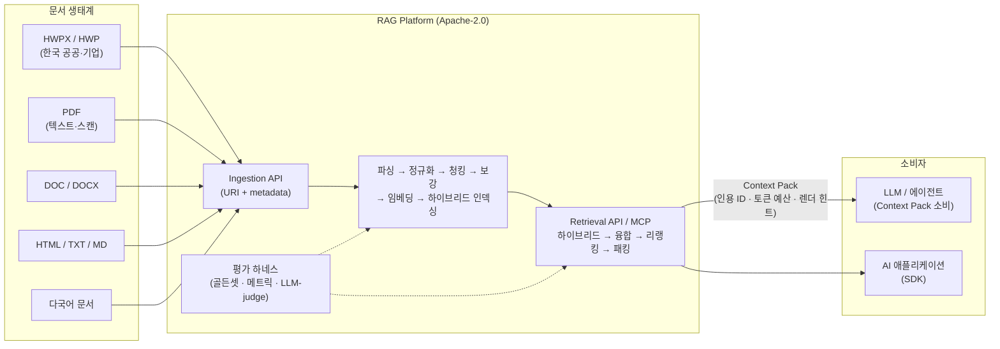
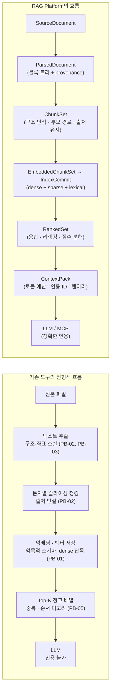
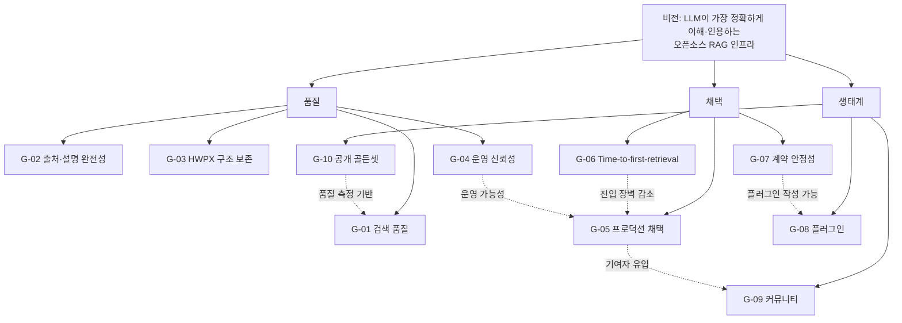
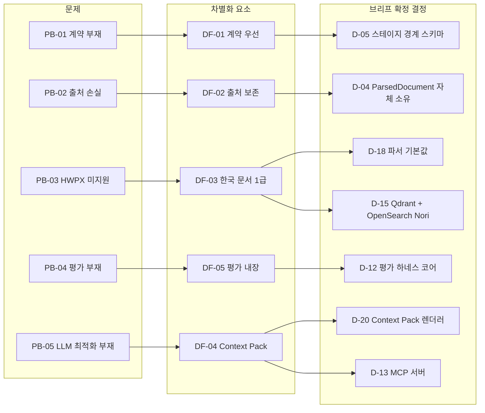

# 비전과 목표

> 이 문서는 플랫폼이 **왜** 존재하는지, **3년 안에 무엇을** 달성할지, **무엇을 하지 않을지**를 선언한다.
> 어떻게 만드는지는 [설계 원칙](./02-design-principles.md)과 [설계 바이블](../02-architecture/00-design-bible.md)이 다룬다.
> [설계 브리프](./00-design-brief.md) §9-10에 따라 "최고" 수준의 포부 표현은 이 문서에서만 허용된다. 다른 문서는 이 문서가 정의한 문제 ID(`PB-xx`), 목표 ID(`G-xx`), KPI ID(`KPI-xx`), 차별화 요소 ID(`DF-xx`), 전략적 선택 ID(`SC-xx`)를 인용한다. `P-xx`는 [설계 원칙](./02-design-principles.md)의 원칙 식별자이므로 이 문서는 문제 ID에 쓰지 않는다.

## 목적

- 플랫폼의 존재 이유(비전)와 해결하려는 문제를 한 곳에 고정하여, 이후 모든 설계·구현·우선순위 판단의 기준점으로 삼는다.
- 3년 내 측정 가능한 목표와 KPI를 정의하여 "잘 되고 있는가"를 수치로 답할 수 있게 한다.
- 차별화 요소와 전략적 선택(하지 않을 것)을 명시하여 범위 확장 요구를 판단할 근거를 제공한다.

## 범위

**포함**: 비전 선언문, 문제 정의, 3년 목표, KPI, 차별화 요소, 대상 사용자 요약, 가치 제안 캔버스, 전략적 선택, 로드맵 연결.

**제외**: 아키텍처 결정(브리프 §4와 ADR), 상세 요구사항([기능 요구사항](../01-requirements/01-functional-requirements.md), [비기능 요구사항](../01-requirements/02-non-functional-requirements.md)), 상세 페르소나([페르소나와 유즈케이스](../01-requirements/03-personas-and-use-cases.md)), 로드맵의 단계 구분·일정·마일스톤 ID([마일스톤](../11-roadmap/01-milestones.md)), 범위 판정의 세부 절차([범위와 비목표](./04-scope-and-non-goals.md)).

## 1. 비전 선언문

### 1.1 비전

> **세상의 모든 문서를 — 특히 HWPX·HWP를 포함한 한국 문서 생태계와 다국어 문서를 — LLM이 가장 정확하게 이해하고 인용할 수 있는 형태로 바꾸어 전달하는, 이 세상 최고의 오픈소스 RAG 인프라.**

RAG Platform은 문서를 "검색되는 텍스트 조각"으로 취급하지 않는다. 문서는 **구조와 출처를 가진 지식**이며, 이 플랫폼의 임무는 그 구조와 출처를 **단 한 번도 잃지 않고** LLM의 컨텍스트 창까지 운반하는 것이다.

### 1.2 비전을 지탱하는 세 기둥

| 기둥 | 선언 | 브리프 근거 |
|------|------|------------|
| 문서는 잃어버리지 않는다 | 파싱부터 컨텍스트 팩까지 페이지·좌표·문자 오프셋·요소 경로(provenance)를 보존한다. LLM의 모든 문장은 원문 위치로 되돌아갈 수 있어야 한다. | D-04, 원칙 8 |
| 경계는 계약이다 | 파이프라인의 모든 스테이지 경계는 버전드 JSON Schema로 게시된다. 어떤 오픈소스 컴포넌트도 계약만 지키면 교체·조합할 수 있다. | D-05, 원칙 1·2 |
| 출력은 LLM을 위한 것이다 | 최종 산출물은 사람이 읽는 검색 결과가 아니라 LLM이 소비하는 Context Pack이다. 토큰 예산·순서·중복·인용 가능성을 최적화한다. | D-20, 원칙 10 |

### 1.3 비전의 그림

### 1.4 왜 지금인가

1. **LLM의 병목이 모델에서 컨텍스트로 이동했다.** 모델 성능이 수렴할수록 "무엇을 컨텍스트에 넣는가"가 답변 품질을 결정한다. 컨텍스트 창이 커져도 순서·중복·관련성 문제(lost-in-the-middle)는 사라지지 않는다.
2. **오픈소스 부품은 충분히 성숙했다.** 레이아웃 인식 파서(Docling, Unstructured), 다국어 임베딩(BGE-M3, multilingual-e5, Qwen3-Embedding), 크로스인코더 리랭커, 하이브리드 벡터 DB(Qdrant), 한국어 형태소 분석기(Nori, Kiwi), 내구성 워크플로우(Temporal)가 모두 오픈 라이선스로 존재한다. 부족한 것은 부품이 아니라 **부품을 잇는 표준 계약과 오케스트레이션**이다.
3. **한국 문서 생태계는 비어 있는 시장이다.** 한국 공공기관과 기업 문서의 상당 비율이 HWP/HWPX이지만, 글로벌 RAG 도구군은 이 포맷을 기본 지원하지 않는다(as of 2026-09, 확인 필요). PDF로 변환하는 우회는 표·목록·각주 구조를 잃는다.
4. **에이전트 시대의 표준 인터페이스가 등장했다.** MCP(Model Context Protocol)로 에이전트가 검색 인프라를 직접 도구로 호출한다. 리트리벌 결과가 LLM 네이티브 포맷이어야 하는 이유가 명확해졌다.

## 2. 문제 정의: 기존 RAG 도구의 한계

기존 도구는 크게 세 부류다. **프레임워크형**(코드 수준 추상을 제공하는 라이브러리), **올인원 앱형**(UI와 파이프라인이 결합된 애플리케이션), **벡터 DB 중심형**(저장소가 파이프라인 일부를 내장). 부류마다 장점이 있으나, 아래 다섯 문제는 공통적으로 관찰된다. 개별 제품에 대한 판단은 [기술 조사 요약](../07-tech-landscape/00-summary-and-selection-matrix.md)에서 근거와 함께 다룬다.

문제 ID는 `PB-xx`(Problem)로 표기한다. 이 문서에서 "원칙 N"은 브리프 §3의 N번째 원칙을 뜻하며, [설계 원칙](./02-design-principles.md)의 `P-0N`과 같은 것을 가리킨다.

### 2.1 다섯 가지 핵심 문제

| ID | 문제 | 증상 | 근본 원인 | 결과 | 우리의 대응 |
|----|------|------|-----------|------|-------------|
| PB-01 | **계약 부재(No contracts)** | 파서·청커·임베더가 각자의 객체 모델(`Document`, `Node`, `Element`)을 주고받는다. 스키마가 버전 관리되지 않고 코드에 암묵적으로 묻혀 있다. | 라이브러리가 "코드 재사용"을 목표로 설계되어 "데이터 계약"이 1급이 아니다. | 파서 하나를 바꾸면 하류가 전부 깨진다. 산출물을 재처리·감사·비교할 수 없다. 팀 간 협업 시 경계 협상이 매번 반복된다. | D-05의 계약 타입 13개(수집 8 + 질의 5) 각각에 버전드 JSON Schema 2020-12 + Pydantic v2 모델. 콘텐츠 주소화 산출물(원칙 4). [계약 개요](../03-contracts/00-contract-overview.md) |
| PB-02 | **출처 손실(Provenance loss)** | 파싱 결과가 평문 문자열이 되고, 청킹은 문자열 슬라이싱으로 수행된다. 청크가 원문 몇 페이지 어느 표에서 왔는지 알 수 없다. | 표준 문서 모델이 없거나, 있어도 출처 필드가 선택적이며 청킹 단계에서 버려진다. | LLM 답변에 정확한 인용을 붙일 수 없다. 규제 산업(공공·금융·의료·법무)에서 채택 불가. 오답 원인 분석이 불가능하다. | `ParsedDocument`에 page/bbox/char offset/element path 필수 보존(D-04). 청크·Context Pack까지 출처 전달. [ParsedDocument 계약](../03-contracts/03-parsed-document.md) |
| PB-03 | **HWPX 미지원(No HWPX)** | HWPX/HWP를 파싱하지 못하거나, PDF·텍스트로 변환한 뒤 처리한다. 한국어 렉시컬 검색이 공백 토크나이징에 의존한다. | 글로벌 도구는 한국 시장 포맷을 우선하지 않는다. OWPML(KS X 6101) 파서와 한국어 형태소 분석이 파이프라인에 통합되지 않았다. | 표·목록·각주·머리말 구조가 소실된다. 한국어 복합명사·조사 처리가 안 되어 BM25 품질이 낮다. 한국 공공·기업 문서 기반 RAG의 품질 상한이 낮게 고정된다. | HWPX 네이티브 파서(python-hwpx + 자체 OWPML 어댑터), HWP 5.0 폴백(D-18, O-07). OpenSearch Nori 렉시컬(D-15). 한국어 골든셋(D-12). [HWPX/HWP 파서](../04-pipelines/04-parser-hwpx-and-hwp.md) |
| PB-04 | **평가 부재(No evaluation)** | 청크 크기·오버랩·Top-K·융합 가중치가 튜토리얼 값으로 고정된다. 변경의 효과를 측정하는 골든셋이 없다. | 평가 하네스가 별도 프로젝트로 분리되어 있거나, 있어도 파이프라인 프로파일과 연결되지 않는다. | "왜 이 설정인가"에 답할 수 없다. 모델·파서 업그레이드 시 회귀를 감지하지 못한다. 튜닝이 감(感)에 의존한다. | 평가 하네스 코어 포함: qrels 골든셋, nDCG/Recall/MRR, LLM-judge, 프로파일 A/B(D-12). 모든 기본값은 골든셋으로 정당화(원칙 7). [평가 전략](../08-evaluation/01-evaluation-strategy.md) |
| PB-05 | **LLM 소비 최적화 부재(Not LLM-native)** | Top-K가 점수순 청크 배열로 반환된다. 중복 청크, 잘린 표, 순서 미고려, 토큰 예산 초과, 인용 ID 부재. | 검색 결과가 "사람이 보는 검색 페이지" 관점으로 설계되었다. LLM이 어떻게 컨텍스트를 읽는지(위치 편향, 중복 민감도)가 반영되지 않았다. | 관련 문서가 검색되었는데도 LLM이 답을 놓친다(lost-in-the-middle). 인용이 불가능하다. 프롬프트마다 후처리 코드를 다시 쓴다. | Context Pack: 토큰 예산 패킹, 위치 최적화, 중복 제거, 부모 확장, 인용 ID, 신뢰도, 렌더러(Anthropic `document`+`citations`, OpenAI 호환, XML/Markdown)(D-07, D-20). MCP 서버(D-13). [Context Pack 계약](../03-contracts/11-context-pack.md) |

### 2.2 부수 문제

위 다섯 문제의 결과로 나타나는 운영 관점의 문제도 함께 해결 대상이다.

| ID | 문제 | 우리의 대응 |
|----|------|-------------|
| PB-06 | **운영 신뢰성 부재**: 장시간 OCR·대량 배치가 프로세스 재시작 시 사라진다. 멀티테넌시·ACL이 애플리케이션 코드에 산재한다. 어떤 후보가 왜 뽑혔는지 추적할 수 없다. | Temporal 내구성 워크플로우(D-17), 모든 인덱스 레코드에 `tenant_id`/`collection_id`/`acl` 강제(D-09), OpenTelemetry GenAI semconv 트레이스와 점수 분해(D-11) |
| PB-07 | **"모든 기술"을 쓰려면 포크해야 한다**: GraphRAG·RAPTOR·ColBERT·컨텍스트 압축 같은 고급 기법을 넣으려면 프레임워크 내부를 수정해야 한다. | 14개 확장 지점의 플러그인 시스템(D-10). 고급 기법은 프로파일/플러그인으로 수용(R4, O-03·O-04) |

### 2.3 손실이 발생하는 지점

기존 흐름의 각 노드에는 그 지점에서 드러나는 문제 ID를 적었다. PB-04(평가 부재)는 특정 단계가 아니라 흐름 전체에 걸친 문제이므로 그림에 표시하지 않았다.

## 3. 목표: 3년 내 측정 가능한 목표

목표는 **품질(Quality)**, **채택(Adoption)**, **생태계(Ecosystem)** 세 축으로 나눈다. 연차는 첫 공개 릴리스 시점을 기준으로 Y1·Y2·Y3로 표기하며, 절대 일정과 마일스톤 ID는 [마일스톤](../11-roadmap/01-milestones.md)에서 확정한다.

목표 표에는 수치를 적지 않는다. **모든 수치의 단일 원천은 §4 KPI 표**이며, 목표는 "측정 KPI" 열로 KPI ID만 참조한다. 각 KPI의 베이스라인은 평가 하네스 초판이 처음 동작하는 시점(이하 **베이스라인 측정 시점**; 마일스톤 ID는 [마일스톤](../11-roadmap/01-milestones.md)이 부여)에 측정한 뒤 확정한다.

### 3.1 품질 목표

| ID | 목표 | 3년 후 도달 상태 | 측정 KPI | 브리프 근거 |
|----|------|------------------|----------|------------|
| G-01 | 한국어 문서 검색 품질에서 오픈소스 최고 수준을 달성한다 | 내부 한국어 골든셋에서 dense-only 베이스라인을 큰 폭으로 앞서고, 공개 한국어 검색 벤치마크에서 오픈소스 파이프라인 상위에 든다 | KPI-01, KPI-02, KPI-03 | §7 검색 품질, D-07, D-12 |
| G-02 | 모든 컨텍스트는 원문 위치로, 모든 후보는 선택 이유로 되돌아갈 수 있다 | Context Pack의 모든 청크가 출처(provenance)를 갖고, 인용은 원문 span으로 검증되며, 모든 후보가 점수 분해와 트레이스를 갖는다 | KPI-03, KPI-04, KPI-05, KPI-06 | D-04, D-11, D-20, 원칙 8 |
| G-03 | HWPX 문서를 원문 구조 그대로 검색 단위로 만든다 | HWPX·텍스트 PDF·DOCX·HTML·TXT의 표·제목 계층·목록·각주가 골든 구조 코퍼스 기준으로 보존된다. HWP 5.0과 스캔 PDF는 O-07·O-08 결정 후 같은 기준을 적용한다 | KPI-07, KPI-08 | D-18, 원칙 6 |
| G-04 | 프로덕션 운영에 필요한 성능과 신뢰성을 충족한다 | 브리프 §7의 지연·처리량·재현성 목표를 참조 벤치마크 환경에서 충족하고, 장애 주입 시나리오를 통과한다 | KPI-09, KPI-10, KPI-11, KPI-12, KPI-13 | §7, D-06(v1.2), D-17, ADR-0037, 원칙 3·4 |

### 3.2 채택 목표

| ID | 목표 | 3년 후 도달 상태 | 측정 KPI | 브리프 근거 |
|----|------|------------------|----------|------------|
| G-05 | 프로덕션에서 실제로 쓰이는 플랫폼이 된다 | 공개 채택 사례가 축적되고 릴리스가 계획대로 예측 가능하게 나온다 | KPI-22, KPI-23 | §6 포함 범위 |
| G-06 | 처음 접한 개발자가 빠르게 성공한다 | 경량 프로파일에서 문서만 보고 첫 문서 수집·검색까지 수 분 안에 도달한다 | KPI-14, KPI-19 | D-15 경량 프로파일, D-17 비내구 `LocalRunner` |
| G-07 | 계약이 안정적이어서 위에 쌓을 수 있다 | 계약 v1 GA 이후 breaking change 없이 유지되고, SDK가 전 엔드포인트를 커버하며, 외부 프로젝트가 Context Pack 스키마를 채택한다 | KPI-15, KPI-16, KPI-25 | D-05, [스키마 버저닝](../03-contracts/14-schema-versioning-and-compatibility.md) |

### 3.3 생태계 목표

| ID | 목표 | 3년 후 도달 상태 | 측정 KPI | 브리프 근거 |
|----|------|------------------|----------|------------|
| G-08 | 모든 확장 지점에 선택지가 있다 | 14개 확장 지점 각각에 코어 외 대체 구현이 존재하고, 플러그인 작성이 개발 가이드만으로 가능하다 | KPI-18, KPI-21 | D-10 |
| G-09 | 한 조직에 의존하지 않는 커뮤니티가 된다 | 외부 기여자와 여러 조직의 메인테이너가 프로젝트를 유지하고, 이슈에 빠르게 응답한다 | KPI-17, KPI-20 | SC-03(업스트림 기여), 브리프 §1 "오픈소스(Apache-2.0) 플랫폼" |
| G-10 | 한국어 RAG 평가의 공통 기준을 제공한다 | 공개 한국어 골든셋과 비교표가 운영되고 외부 파이프라인이 제출된다 | KPI-24 | D-12, [골든셋 구축](../08-evaluation/03-golden-dataset-construction.md) |

### 3.4 목표 간 관계

## 4. 성공 지표(KPI)

KPI는 네 영역으로 나누고, 각 KPI는 하나 이상의 목표(G-xx)에 연결된다. 모든 수치는 **초안 목표**이며, 브리프 §7에서 온 수치는 그렇게 표기한다. "베이스라인 측정"으로 적은 항목은 베이스라인 측정 시점(§3)에 값을 기록한다. 측정 정의의 상세는 [리트리벌 메트릭과 하네스](../08-evaluation/02-retrieval-metrics-and-harness.md), [LLM-judge와 생성 품질](../08-evaluation/04-llm-judge-and-generation-quality.md), 성능 측정의 참조 환경은 [비기능 요구사항](../01-requirements/02-non-functional-requirements.md)에서 확정한다.

### 4.1 검색 품질

| ID | 지표 | 정의 / 측정 방법 | 베이스라인 | Y1 | Y2 | Y3 | 목표 |
|----|------|------------------|-----------|----|----|----|------|
| KPI-01 | nDCG@10 | 내부 한국어 골든셋, 기본 프로파일(3-way 하이브리드 + RRF + 크로스인코더) | 베이스라인 측정(dense-only) | ≥ 0.80(브리프 §7), 베이스라인 대비 +15%p | ≥ 0.83 | ≥ 0.86. 공개 한국어 검색 벤치마크(대상은 미해결 이슈 9)에서 오픈소스 파이프라인 상위 | G-01 |
| KPI-02 | Recall@20 | 동일 골든셋. 융합(RRF) 직후·리랭킹 전 상위 20개 후보 기준. 이 중간 집합의 계약상 명명은 [CandidateSet과 RankedSet](../03-contracts/10-candidate-set-and-ranked-set.md)에서 확정한다 | 베이스라인 측정 | ≥ 0.92(브리프 §7) | ≥ 0.94 | ≥ 0.95 | G-01 |
| KPI-03 | 컨텍스트 정밀도(Context Precision) | Context Pack에 포함된 청크 중 질의와 관련 있는 청크 비율(qrels 또는 LLM-judge) | 베이스라인 측정 | ≥ 0.75 | ≥ 0.82 | ≥ 0.88 | G-01, G-02 |
| KPI-04 | 출처 완전성(provenance completeness) | Context Pack 내 청크 중 page/bbox 또는 char offset과 element path를 모두 가진 비율 | 없음(신규 측정) | 100% | 100% | 100% | G-02 |
| KPI-05 | 인용 정확도(citation faithfulness) | Context Pack의 인용 span과 고정 judge 프롬프트로 측정한, 문장별 인용이 실제 span으로 지지되는 비율(LLM-judge + 샘플 수동 검증). 답변 생성에는 레퍼런스 `answer` 구현을 **측정용 고정 하네스**로 사용하며 그 버전은 평가 프로파일에 고정된다 | 베이스라인 측정 | ≥ 0.90 | ≥ 0.93 | ≥ 0.95 | G-02 |
| KPI-06 | 설명 가능성 커버리지 | RankedSet 내 모든 후보가 dense/sparse/lexical/rerank 점수 분해와 OTel 트레이스 ID를 가지는 비율 | 없음 | 100% | 100% | 100% | G-02 |

### 4.2 수집·운영 신뢰성

| ID | 지표 | 정의 / 측정 방법 | 베이스라인 | Y1 | Y2 | Y3 | 목표 |
|----|------|------------------|-----------|----|----|----|------|
| KPI-07 | 파싱 성공률(포맷별) | 지원 포맷 잡 중 `ParsedDocument` 생성 성공 비율. 손상 파일·비지원 포맷은 분모 제외 | 베이스라인 측정 | 텍스트 PDF·DOCX·HTML·TXT ≥ 99.5%, HWPX ≥ 99%, 스캔 PDF ≥ 97% | 유지. HWP 5.0 ≥ 95%(O-07 결정 후) | 전 포맷 ≥ 99% | G-03 |
| KPI-08 | 구조 보존율 | 골든 구조 코퍼스 대비 표·제목 계층·목록·각주 블록의 위치·유형 일치율 | 베이스라인 측정 | HWPX ≥ 0.95, 텍스트 PDF ≥ 0.90 | HWPX ≥ 0.97, HWP 5.0 ≥ 0.90(O-07 결정 후) | 스캔 PDF(OCR) ≥ 0.85(O-08 결정 후) | G-03 |
| KPI-09 | 재현성 | 동일 `IngestRequest` + 동일 프로파일 → 동일 `IndexCommit` 해시 비율(CI 회귀 테스트, LLM 보강 비활성 프로파일; `record_id` 세대 합성 D-06 v1.2, `stage_key` 잡 스코프 ADR-0037) | 없음 | 100% | 100% | 100% | G-04 |
| KPI-10 | 수집 처리량 | 텍스트 PDF 100페이지 / 스캔 PDF 100페이지(GPU OCR) 단일 워커 처리 시간 | 없음(초안 목표는 브리프 §7) | < 30s / < 5min | 유지 | < 20s / < 3min | G-04 |
| KPI-11 | 잡 성공률 / 멱등성 위반 | 재시도 포함 최종 성공 비율(인프라 장애 제외) / 멱등성 위반(중복 인덱싱) 건수 | 베이스라인 측정 | ≥ 99.9% / 0 | 유지 | 유지 | G-04 |
| KPI-12 | 리트리벌 p95 지연 | Top-10, 100만 청크, 하이브리드 + 리랭크. GPU 리랭커 / CPU 리랭커 | 없음(초안 목표는 브리프 §7) | < 800ms / < 1.5s | 유지 | < 600ms / < 1.2s | G-04 |
| KPI-13 | 복원력 시나리오 통과율 | CI 레퍼런스 스택에서 장애 주입 시나리오(인덱스 백엔드 단일 중단 시 저하 표시 응답, 워커 강제 종료 후 잡 재개, 롤링 업데이트 중 무오류) 통과 비율. 시나리오 목록은 [비기능 요구사항](../01-requirements/02-non-functional-requirements.md)의 신뢰성·가용성 요구(NFR-REL, NFR-AVL)와 [장애 모드와 복원력](../02-architecture/09-failure-modes-and-resilience.md)에서 확정 | 없음 | 정의된 시나리오 100% | 100% | 100% | G-04 |

브리프 §7의 서비스 가용성(리트리벌 API 99.9%)은 운영자가 자기 배포에서 측정하는 목표이며 오픈소스 프로젝트가 통제할 수 없으므로 KPI에 넣지 않는다. 해당 목표는 [비기능 요구사항](../01-requirements/02-non-functional-requirements.md)의 NFR-AVL-01이 배포 요구로 소유하고, 프로젝트는 KPI-13으로 그 전제가 되는 복원력을 검증한다.

### 4.3 개발자 경험

| ID | 지표 | 정의 / 측정 방법 | 베이스라인 | Y1 | Y2 | Y3 | 목표 |
|----|------|------------------|-----------|----|----|----|------|
| KPI-14 | Time-to-first-retrieval | 경량 프로파일(Qdrant 단독, 단일 노드)에서 설치 시작부터 첫 문서 수집·검색 성공까지, 문서만 보고 수행. 신규 사용자 5인 이상 관찰 중앙값 | 베이스라인 측정 | ≤ 15분 | ≤ 10분 | ≤ 5분 | G-06 |
| KPI-15 | 계약 커버리지 | D-05의 계약 타입 13개(수집 8 + 질의 5) 각각에 JSON Schema + JSON 예시 + Pydantic 모델 + 불변식 문서 게시. 잡·이벤트·상태 스키마와 오류 모델은 스테이지 경계가 아니므로 분모에 넣지 않고 [계약 개요](../03-contracts/00-contract-overview.md)에서 별도 추적 | 0/13 | 13/13 | 유지 | 유지 | G-07 |
| KPI-16 | SDK 커버리지 | Python·TypeScript SDK가 OpenAPI 전 엔드포인트를 커버하는 비율. 자동 생성 + 계약 테스트 | 없음 | Python 100%, TS 100% | 유지 | 유지 | G-07 |
| KPI-17 | 이슈 첫 응답 시간 | GitHub 이슈 최초 메인테이너 응답 중앙값 | 없음 | ≤ 72h | ≤ 48h | ≤ 24h | G-09 |
| KPI-18 | 플러그인 작성 시간 | 플러그인 개발 가이드만으로 `reranker` 플러그인 하나를 작성·등록·테스트하는 시간(관찰 중앙값) | 없음 | ≤ 2h | ≤ 1h | ≤ 1h | G-08 |
| KPI-19 | 문서 만족도 | 문서 사이트 피드백 위젯 5점 척도 평균 | 없음 | ≥ 4.0 | ≥ 4.2 | ≥ 4.3 | G-06 |

### 4.4 커뮤니티·생태계

| ID | 지표 | 정의 / 측정 방법 | 베이스라인 | Y1 | Y2 | Y3 | 목표 |
|----|------|------------------|-----------|----|----|----|------|
| KPI-20 | 외부 기여자 수 / 메인테이너 조직 수 | 연간 커밋 1회 이상인 코어 메인테이너 소속 외 기여자 수 / 코어 메인테이너의 소속 조직 수 | 0 / 1 | 15 / 1 | 50 / ≥ 2 | 120 / ≥ 3 | G-09 |
| KPI-21 | 등록 플러그인 수 / 지점별 대체 구현 | 플러그인 레지스트리(entry points 기반) 등록 수(코어 외) / 14개 확장 지점 각각의 코어 외 대체 구현 최소 개수 | 0 / 0 | 20 / 지점별 ≥ 1 | 60 / 지점별 ≥ 2 | 150 / 지점별 ≥ 2 | G-08 |
| KPI-22 | 프로덕션 채택 조직 | ADOPTERS 자발 등록 또는 공개 사례 | 0 | 10 | 50 | 200 | G-05 |
| KPI-23 | 릴리스 주기 준수 | [릴리스 프로세스](../10-development/08-release-process.md)에서 확정한 릴리스 주기 계획 대비 실제 릴리스 준수율 | 없음 | ≥ 90% | ≥ 95% | ≥ 95% | G-05 |
| KPI-24 | 공개 벤치마크 외부 제출 | 공개 골든셋 비교표에 외부 파이프라인·프로파일 제출 건수 | 0 | - | ≥ 5 | ≥ 15 | G-10 |
| KPI-25 | Context Pack 스키마 외부 채택 | 플랫폼 외부 프로젝트가 Context Pack JSON Schema 또는 렌더러 출력 포맷을 입력·출력으로 채택한 공개 사례 수 | 0 | - | ≥ 1 | ≥ 3 | G-07 |
| KPI-26 | GitHub Stars(관찰 지표) | 목표가 아닌 관심도 참고 지표. 의사결정에 직접 사용하지 않는다 | 0 | 참고 | 참고 | 참고 | - |

## 5. 차별화 요소 5가지

| ID | 차별화 요소 | 기존 도구의 일반적 상태 | RAG Platform | 해결하는 문제 | 브리프 근거 |
|----|------------|------------------------|--------------|--------------|------------|
| DF-01 | **계약 우선 파이프라인(Contracts-first pipeline)** | 코드 추상(클래스·인터페이스)만 제공. 스키마는 암묵적이고 버전이 없다. | D-05의 13개 계약 타입마다 버전드 JSON Schema 2020-12 + Pydantic v2. 스테이지는 `Stage[In, Out]` 순수 변환. 산출물은 BLAKE3 콘텐츠 주소화로 저장되어 재처리·캐싱·감사가 가능하다. 어떤 오픈소스든 계약만 지키면 어댑터로 들어온다. | PB-01, PB-07 | D-05, D-06, 원칙 1·3·4 |
| DF-02 | **완전한 출처 보존(Provenance-complete)** | 파싱 후 평문화, 청킹은 문자열 슬라이싱. 출처는 파일명·페이지 정도. | `ParsedDocument → ChunkSet → ContextPack`까지 page/bbox/char offset/element path가 끊기지 않는다. LLM 인용은 원문 좌표로 되돌아간다. | PB-02 | D-04, 원칙 8 |
| DF-03 | **한국 문서 1급 지원, 다국어 기본(Korean-first, multilingual-ready)** | HWP/HWPX 미지원 또는 PDF 변환 우회. 한국어 렉시컬은 공백 토크나이징. 한국어 벤치마크 부재. | HWPX 네이티브 파서(OWPML), HWP 5.0 폴백, OpenSearch Nori 형태소 렉시컬, 한국어 골든셋. 임베딩·리랭커는 다국어 모델(BGE-M3 계열) 기본. | PB-03 | D-15, D-16, D-18, 원칙 6 |
| DF-04 | **LLM 네이티브 Context Pack(LLM-native output)** | 점수순 청크 배열. 중복·순서·토큰 예산·인용 ID 미고려. | 토큰 예산 패킹, 위치 최적화(lost-in-the-middle 대응), 중복 제거, 부모 확장(small-to-big), 표·그림 텍스트화, 신뢰도, 인용 ID. 공급자 중립 JSON + 렌더러(Anthropic `document`+`citations`, OpenAI 호환, XML/Markdown). MCP 서버로 에이전트 직접 호출. | PB-05 | D-07, D-13, D-20, 원칙 10 |
| DF-05 | **평가 내장, 설명 가능(Evaluation-built-in, explainable)** | 평가는 별도 도구. 기본값은 튜토리얼 값. 후보 선택 이유 불투명. | 골든셋(qrels)·nDCG/Recall/MRR·LLM-judge·프로파일 A/B가 코어. 모든 기본값은 골든셋으로 정당화. 후보마다 dense/sparse/lexical/rerank 점수 분해와 OTel 트레이스. | PB-04, PB-06 | D-11, D-12, 원칙 7·8 |

### 5.1 문제 → 차별화 → 결정의 연결

### 5.2 차별화의 지속 가능성

차별화 요소는 기능 목록이 아니라 **구조적 선택**이어야 모방이 어렵다.

- DF-01·DF-02는 데이터 모델 수준의 선택이다. 이미 문자열 기반으로 설계된 도구가 사후에 출처를 붙이는 것은 전면 재설계에 해당한다.
- DF-03은 한국어 골든셋과 HWPX 구조 코퍼스라는 **데이터 자산**과 결합된다. 자산은 커뮤니티와 함께 축적되어 시간이 갈수록 격차가 벌어진다.
- DF-04는 LLM 공급자의 네이티브 포맷 변화를 렌더러 계층에서 흡수한다. 공급자가 바뀌어도 Context Pack 표준 JSON은 유지된다.
- DF-05는 모든 기본값 변경에 골든셋 근거를 요구하는 **프로세스**다. 기능이 아니라 문화이므로 복제가 느리다.

## 6. 대상 사용자 요약

상세 페르소나와 유즈케이스는 [페르소나와 유즈케이스](../01-requirements/03-personas-and-use-cases.md)에서 정의한다. 이 절은 비전 관점의 요약이다.

| 사용자 | 대표 역할 | 핵심 과업 | 주로 접하는 표면 | 비전과의 관계 |
|--------|-----------|-----------|------------------|---------------|
| AI 애플리케이션 개발자 | 백엔드·풀스택 개발자, 에이전트 개발자 | 질의를 보내고 LLM 프롬프트에 바로 넣을 컨텍스트를 받는다 | [리트리벌 API](../05-api/03-retrieval-api.md), [클라이언트 SDK](../05-api/06-client-sdks.md), Context Pack 렌더러 | DF-04의 1차 수혜자. G-06 측정 대상 |
| 문서 파이프라인 담당자 | 데이터 엔지니어, 콘텐츠 운영자 | 문서 URI와 메타데이터를 등록하고 수집 상태·재색인을 관리한다 | [수집 API](../05-api/02-ingestion-api.md), [웹훅·이벤트](../05-api/07-webhooks-and-events.md), 프로파일 | DF-01·DF-03의 1차 수혜자. KPI-07~11 측정 대상 |
| 검색 품질 엔지니어 | ML 엔지니어, 검색 엔지니어 | 골든셋으로 프로파일을 비교하고 임베더·리랭커·청커를 교체한다 | [평가 하네스](../08-evaluation/02-retrieval-metrics-and-harness.md), 프로파일 A/B, 점수 분해 | DF-05의 1차 수혜자. G-01 달성 주체 |
| 플랫폼 운영자 | SRE, 플랫폼 엔지니어 | 배포·확장·관측·백업·테넌트 관리 | [배포 가이드](../09-operations/01-deployment-guide.md), [관리 API](../05-api/04-management-api.md), [관측성](../09-operations/03-observability.md) | PB-06 해결의 수혜자. KPI-11~13 측정 대상 |
| 플러그인 개발자 | 오픈소스 기여자, 벤더 엔지니어 | 새 파서·임베더·리랭커·인덱스 백엔드를 계약에 맞춰 제공한다 | [플러그인 개발 가이드](../10-development/06-plugin-development-guide.md), 14개 확장 지점 | G-08 달성 주체. KPI-18 측정 대상 |
| 보안·컴플라이언스 담당자 | 정보보호 담당, 감사 | 테넌트 격리·ACL·감사 로그·PII 처리를 검증한다 | [멀티테넌시·보안 아키텍처](../02-architecture/07-multi-tenancy-and-security-architecture.md), [보안과 컴플라이언스](../09-operations/05-security-and-compliance.md) | DF-02(인용 감사 가능성)의 수혜자 |
| LLM 에이전트(기계 사용자) | Claude 등 LLM 기반 에이전트 | 도구 호출로 검색하고 Context Pack을 직접 소비한다 | [MCP 서버](../05-api/05-mcp-server.md): `search`, `get_document`, `list_collections` | 비전의 궁극적 소비자. DF-04 설계의 기준점 |

**1차 시장**: 한국어 문서(HWPX·HWP·PDF)를 대량 보유한 공공기관·기업·연구기관과, 이들에게 LLM 서비스를 제공하는 개발 조직. **2차 시장**: 다국어 문서를 다루는 글로벌 팀 중 출처 보존·평가·LLM 네이티브 출력이 필요한 조직.

## 7. 가치 제안 캔버스

가치 제안 캔버스(Value Proposition Canvas)는 고객 프로필(과업·고통·이득)과 가치 맵(제품·고통 완화·이득 창출)의 대응을 표로 정리한 것이다.

### 7.1 AI 애플리케이션 개발자

| 고객 프로필 | 내용 | 가치 맵 | 내용 |
|------------|------|---------|------|
| 과업(Jobs) | 사용자 질의에 정확하고 인용 가능한 답을 LLM으로 생성한다. 여러 LLM 공급자를 지원한다. | 제품·서비스 | 리트리벌 API, Python/TypeScript SDK, Context Pack 렌더러, MCP 서버 |
| 고통(Pains) | 검색은 됐는데 LLM이 답을 놓친다. 인용을 붙이려면 후처리 코드를 직접 쓴다. 공급자별 포맷이 다르다. 토큰 예산 초과로 잘린다. | 고통 완화 | Context Pack이 순서·중복·토큰 예산·인용 ID를 처리한다. 렌더러가 Anthropic `document`+`citations`, OpenAI 호환, XML/Markdown으로 직렬화한다. |
| 이득(Gains) | 프롬프트에 그대로 넣을 수 있는 컨텍스트. 답변마다 원문 위치 링크. 공급자 교체 시 코드 변경 없음. | 이득 창출 | 공급자 중립 표준 JSON. 신뢰도 점수와 프롬프트 템플릿 힌트. 에이전트는 MCP로 직접 호출. |

### 7.2 문서 파이프라인 담당자

| 고객 프로필 | 내용 | 가치 맵 | 내용 |
|------------|------|---------|------|
| 과업(Jobs) | 수천~수백만 건의 HWPX·PDF·DOCX·HTML 문서를 검색 가능하게 만들고 최신 상태로 유지한다. | 제품·서비스 | 수집 API(URI + 메타데이터), 비동기 잡·상태·웹훅, 프로파일, 재색인·삭제 |
| 고통(Pains) | HWPX는 파싱이 안 되거나 표가 깨진다. 스캔 PDF OCR이 중간에 죽는다. 같은 문서가 중복 인덱싱된다. 어느 문서가 실패했는지 추적이 어렵다. | 고통 완화 | HWPX 네이티브 파서. Temporal 내구성 워크플로우(재시도·하트비트). 콘텐츠 주소화 멱등성. 표준 잡 상태·이벤트 스키마. |
| 이득(Gains) | 문서 URI만 넘기면 끝. 포맷별 구조 보존. 재처리·감사 가능한 산출물. | 이득 창출 | 재현성(동일 입력 → 동일 IndexCommit). 원자적 교체·롤백 단위. 포맷별 파싱 성공률·구조 보존율 대시보드. |

### 7.3 검색 품질 엔지니어

| 고객 프로필 | 내용 | 가치 맵 | 내용 |
|------------|------|---------|------|
| 과업(Jobs) | 도메인 골든셋으로 검색 품질을 측정하고 개선한다. 새 임베딩·리랭커 모델을 안전하게 도입한다. | 제품·서비스 | 평가 하네스(qrels, nDCG/Recall/MRR, LLM-judge), 프로파일 A/B, 점수 분해, OTel 트레이스 |
| 고통(Pains) | 설정 변경 효과를 측정할 수 없다. 모델 업그레이드가 회귀를 일으켰는지 모른다. 왜 이 청크가 뽑혔는지 설명할 수 없다. 한국어 벤치마크가 없다. | 고통 완화 | 모든 프로파일 변경은 골든셋 회귀 테스트를 거친다. 후보마다 dense/sparse/lexical/rerank 점수 분해. 공개 한국어 골든셋. |
| 이득(Gains) | 데이터 기반 튜닝. 모델·파서 교체가 어댑터 교체로 끝난다. | 이득 창출 | 14개 확장 지점 플러그인. 프로파일은 버전드 프리셋이므로 실험 재현이 가능하다. |

### 7.4 플랫폼 운영자

| 고객 프로필 | 내용 | 가치 맵 | 내용 |
|------------|------|---------|------|
| 과업(Jobs) | 여러 팀(테넌트)에 검색 인프라를 안정적으로 제공하고 비용·성능을 관리한다. | 제품·서비스 | 배포 매니페스트(형식은 [배포 아키텍처](../02-architecture/08-deployment-architecture.md)에서 확정), 관리 API, Prometheus/Grafana 대시보드, 런북, 백업·복구 |
| 고통(Pains) | 테넌트 격리가 애플리케이션 코드에 의존한다. 장시간 잡이 재시작 시 사라진다. GPU 자원 계획이 어렵다. 벤더 종속이 두렵다. | 고통 완화 | `tenant_id`/`collection_id`/`acl` 필터 강제. Temporal 내구성. 워커 수평 확장. 인덱스 백엔드·임베딩 서빙 교체 가능. |
| 이득(Gains) | 표준 스택(PostgreSQL, S3 호환(RustFS·SeaweedFS), Valkey(Redis 호환), Qdrant, OpenSearch)으로 운영. 관측 가능한 파이프라인. | 이득 창출 | OpenTelemetry GenAI semconv. 경량 프로파일부터 대규모까지 같은 워크플로우 정의. Apache-2.0으로 상용 제약 없음. |

### 7.5 핵심 가치 제안 문장

> **문서 URI를 넘기면, LLM이 그대로 인용할 수 있는 컨텍스트가 나온다.** HWPX를 포함한 모든 포맷에서 구조와 출처를 잃지 않고, 어떤 오픈소스 부품으로도 조립할 수 있으며, 모든 기본값이 측정으로 정당화되는 오픈소스 RAG 플랫폼.

## 8. 전략적 선택: 무엇을 하지 않기로 했는가

전략은 선택이며, 선택은 포기를 포함한다. 아래는 브리프 §6(시스템 경계)과 §4(확정 결정)에서 도출한 "하지 않을 것"이다. 이 목록은 범위 확장 요청을 판단할 때 근거로 인용하는 전략 수준의 선언이며, 범위 판정의 절차와 세부 판정(`S-xx`, 경계 사례 `B-xx`)은 [범위와 비목표](./04-scope-and-non-goals.md)가 소유한다. 두 문서의 대응은 §8.1에 있다.

| ID | 하지 않기로 한 것 | 대신 하는 것 | 이유 | 브리프 근거 |
|----|-------------------|--------------|------|------------|
| SC-01 | **웹 크롤러·원천 커넥터를 만들지 않는다** | Pull 모델: `IngestRequest`(URI + metadata)를 받는다. `fetcher` 확장 지점으로 URI 스킴(`s3://`, `gs://`, `az://`, `file://`, `http(s)://`, `smb://`)을 플러그인화한다. | 원천 시스템 연동은 조직마다 다르고 무한히 늘어난다. 잘 만든 커넥터 생태계(Airbyte 등)가 이미 존재한다. | R1, D-08, §6 |
| SC-02 | **최종 답변 UI·챗봇을 만들지 않는다** | 선택적 `answer` 엔드포인트는 인용 포함 레퍼런스 구현(Claude 기반)으로만 제공한다. | 우리의 소비자는 LLM과 앱 개발자다. UI는 앱마다 다르다. | §6 |
| SC-03 | **오픈소스를 포크하지 않는다** | 어댑터로 감싼다. 벤더 모델(DoclingDocument 등)은 표준 모델로 변환한다. 개선은 업스트림에 기여한다. | 포크는 유지비를 무한히 늘리고 생태계 참여를 끊는다. | 원칙 2, R2 |
| SC-04 | **자체 벡터 DB·워크플로우 엔진·임베딩 모델을 만들지 않는다** | Qdrant/OpenSearch(D-15), Temporal(D-17), BGE-M3 계열(D-16)을 기본으로 채택하고 인터페이스 뒤에 둔다. | 우리가 소유하는 것은 계약과 오케스트레이션이다. 인프라 부품은 검증된 오픈소스가 더 낫다. | D-14~D-17 |
| SC-05 | **"모든 기술"을 기본으로 켜지 않는다** | 기본 프로파일은 골든셋으로 검증된 조합. GraphRAG·RAPTOR·ColBERT·LLM 리랭커·컨텍스트 압축은 프로파일/플러그인으로 선택한다. | 모든 기법을 켠 시스템은 느리고 비싸고 설명이 안 된다. 우아함은 확장 지점의 명확성이다. | R4, O-03, O-04, O-05 |
| SC-06 | **모델 파인튜닝 파이프라인·인증 서버·문서 편집을 만들지 않는다** | 파인튜닝은 외부 파이프라인의 산출 모델을 설정으로 교체. 인증은 OIDC 연동만. 편집은 범위 외. | 각각 독립된 대형 문제 영역이다. 훅과 연동점만 제공한다. | §6 |
| SC-07 | **코어 검색 경로를 상용 API에 종속시키지 않는다** | 파싱·청킹·임베딩·인덱싱·하이브리드 검색·리랭킹의 코어 경로는 상용 API 없이 오픈 웨이트·오픈소스만으로 구성 가능한 프로파일을 항상 제공한다. D-19의 문맥 보강(문서·섹션 요약 부착)은 청킹 기본에 포함되며, 이 프로파일에서는 오픈 웨이트 LLM으로 생성한다. **미정(O-05):** LLM 기반 보강의 기본 켬/끔과 비용 정책. LLM-judge와 `answer`는 D-12·§6에 따른다. | 오픈소스 플랫폼의 재현성과 비용 예측성. 폐쇄망 등 배포 환경 요구는 [범위와 비목표](./04-scope-and-non-goals.md) §8과 [비기능 요구사항](../01-requirements/02-non-functional-requirements.md)이 다룬다. | D-16, D-18, D-19, O-05 |
| SC-08 | **다중 언어 코어를 만들지 않는다** | 코어는 Python 3.12+ 단일 언어. 다국어는 클라이언트 SDK(Python/TypeScript)와 REST/MCP 계약으로 제공한다. | RAG 생태계가 Python 중심이다. 코어 이중화는 계약 드리프트를 낳는다. | D-01 |
| SC-09 | **gRPC를 REST보다 먼저 제공하지 않는다** | REST(OpenAPI) 우선. **미정(O-10):** gRPC 제공 여부. | 채택성과 도구 생태계. 성능 요구가 검증되면 ADR로 추가한다. | O-10 |
| SC-10 | **사람이 읽는 검색 결과 페이지를 최적화하지 않는다** | 출력 최적화 대상은 LLM이다. 스니펫·하이라이트 같은 사람용 기능은 Context Pack의 부산물(provenance 좌표)로만 제공한다. | 원칙 10. 두 소비자를 동시에 최적화하면 둘 다 어중간해진다. | 원칙 10, R6 |
| SC-11 | **AGPL 라이브러리를 코어에 링크하지 않는다** | Apache/MIT/BSD 우선. AGPL은 네트워크 분리 서비스(별도 컨테이너)로만. GPL 링크 금지. | Apache-2.0 플랫폼의 상용 채택성. | D-02 |

### 8.1 SC-xx와 범위 문서의 대응

[범위와 비목표](./04-scope-and-non-goals.md)는 자체 결정 ID `S-xx`, 경계 사례 `B-xx`, 미해결 이슈 `I-xx`를 쓴다. 아래는 이 문서의 SC-xx가 그 문서의 어느 판정으로 구체화되는지의 대응이다. 대응이 없는 SC는 브리프 결정에서 직접 도출된 것이다. 범위 문서 쪽에 SC 참조 열을 추가하는 것은 미해결 이슈 8로 제안한다.

| SC | 04-scope 대응 | 비고 |
|----|---------------|------|
| SC-01 | S-03(단일 URI fetch 포함, 링크 추적·열거·변경 감지 비범위), S-08(URI 스킴 등급), §4.1, B-02~B-04·B-09 | 레퍼런스 커넥터 제공 여부는 I-01 |
| SC-02 | S-04(`answer` 레퍼런스 구현), §4.2, §4.6 | 디버그·평가용 playground 재검토는 I-02 |
| SC-03 | §1.1 소유(own)·채택(adopt) 구분 | 04-scope에 결정 ID 없음. 규범은 [설계 원칙](./02-design-principles.md) P-02 |
| SC-04 | S-12(모델 서빙 엔진 개발·범용 워크플로우 편집기 비범위), §4.7, §4.9, §1.1 채택 대상 | |
| SC-05 | S-01(코어/옵션 경계 = "기본 프로파일에 필요한가", 옵션/플러그인 경계 = "코어 팀이 유지하는가") | |
| SC-06 | S-05(인증은 OIDC 연동만, 인가는 코어), §4.3, §4.4, §4.5 | 파인튜닝 훅(하드 네거티브 export)은 I-03 |
| SC-07 | S-10(폐쇄망 2급, GPU 필수 아님), §8.2(LLM 기반 보강은 외부 API 또는 끔) | O-05 확정 시 두 문서를 함께 갱신 |
| SC-08 | 대응 없음 | D-01에서 직접 도출 |
| SC-09 | §3.6 gRPC 행 **미정(O-10)** | |
| SC-10 | B-25(하이라이트용 좌표는 데이터만 제공, 뷰어 UI는 비범위), §4.2 재검토 조건 | |
| SC-11 | S-07(AGPL 계열 파서 의존성은 사이드카 격리), §6.4 | 개별 라이브러리 라이선스 확인은 I-09 |

## 9. 로드맵 연결

비전과 목표가 실현되는 순서는 단계(phase)로 나누어 [마일스톤](../11-roadmap/01-milestones.md)에서 확정하고, 작업 단위는 [에픽과 백로그](../11-roadmap/02-epics-and-backlog.md), 목표 달성을 위협하는 요인은 [리스크와 완화](../11-roadmap/03-risks-and-mitigations.md)에서 다룬다. 이 문서는 단계의 수·이름·일정·마일스톤 ID와 개방 결정(O-xx)의 닫힘 시점을 정하지 않는다. 이 문서가 로드맵에 제공하는 입력은 두 가지다: (1) 각 단계의 완료 판정에 쓸 목표(G-xx)와 KPI(KPI-xx), (2) 범위 판단의 근거가 되는 전략적 선택(SC-xx). 마일스톤 문서가 각 KPI의 최초 측정 시점과 달성 목표 시점을 배정하도록 미해결 이슈 10에서 제안한다.

## 결정 사항 요약

이 문서는 새 아키텍처 결정을 만들지 않는다. 아래는 이 문서가 **비전 수준에서 고정**한 사항이며, 모두 브리프의 결정과 원칙에서 도출되었다. 다른 문서의 구조 변경을 요구하는 사항은 결정이 아니라 미해결 이슈의 제안으로만 남긴다.

- **결정:** 비전 선언문(§1.1)과 세 기둥(문서는 잃어버리지 않는다 / 경계는 계약이다 / 출력은 LLM을 위한 것이다)을 플랫폼의 최상위 판단 기준으로 채택한다. 근거: 브리프 §1·§3, D-04·D-05·D-20.
- **결정:** 해결 대상 핵심 문제를 PB-01~PB-05(계약 부재, 출처 손실, HWPX 미지원, 평가 부재, LLM 소비 최적화 부재)로, 부수 문제를 PB-06~PB-07로 고정한다. 문제 ID 접두어는 `PB-`이며, `P-xx`([설계 원칙](./02-design-principles.md)의 원칙 식별자)와 구분한다.
- **결정:** 3년 목표를 품질(G-01~G-04)·채택(G-05~G-07)·생태계(G-08~G-10) 10개로 정의한다. 목표 표(§3)에는 수치를 두지 않고, 모든 수치의 단일 원천은 §4 KPI 표다. 수치는 초안 목표이며 베이스라인은 베이스라인 측정 시점(평가 하네스 초판 동작 시점) 이후 확정한다.
- **결정:** KPI-01~KPI-26을 네 영역(검색 품질, 수집·운영 신뢰성, 개발자 경험, 커뮤니티·생태계)으로 정의한다. 브리프 §7의 수치(nDCG@10 ≥ 0.80, Recall@20 ≥ 0.92, p95 < 800ms/1.5s, 텍스트 PDF 100p < 30s, 스캔 PDF 100p < 5min)를 Y1 목표로 그대로 채택한다. 서비스 가용성은 프로젝트가 통제할 수 없는 배포 목표이므로 KPI에서 제외하고 [비기능 요구사항](../01-requirements/02-non-functional-requirements.md) NFR-AVL-01에 위임한다. KPI-26(GitHub Stars)은 관찰 지표이며 의사결정에 직접 사용하지 않는다.
- **결정:** 차별화 요소를 DF-01~DF-05로 고정한다.
- **결정:** 전략적 선택 SC-01~SC-11을 정의하고 §8.1 대응표로 [범위와 비목표](./04-scope-and-non-goals.md)의 S-xx 판정과 연결한다. 범위 판정 절차는 [범위와 비목표](./04-scope-and-non-goals.md)가 소유하며 SC는 그 판정이 인용하는 전략 근거다. SC는 브리프 D-xx·§6에서 도출되었으므로 SC를 바꾸는 변경은 근거 결정에 대한 ADR을 동반한다.
- **결정:** 이 문서는 로드맵의 단계 구분·일정·마일스톤 ID·개방 결정 닫힘 시점을 정하지 않는다. 이들은 [마일스톤](../11-roadmap/01-milestones.md)이 소유한다.

## 미해결 이슈

| # | 이슈 | 제안 | 확정 문서 |
|---|------|------|-----------|
| 1 | KPI 베이스라인 수치가 없다. dense-only 베이스라인과 각 KPI의 초기값을 측정해야 목표 수치의 현실성을 검증할 수 있다. | 평가 하네스 초판이 동작하는 시점에 KPI-01~05, 07~08, 14를 측정하고 이 문서의 베이스라인 열을 채워 0.2.0으로 갱신한다. | [벤치마크 계획과 베이스라인](../08-evaluation/05-benchmark-plan-and-baselines.md) |
| 2 | 공개 한국어 골든셋(G-10)의 문서 코퍼스 저작권. 공공 HWPX 문서의 재배포 가능 라이선스(공공누리 유형 등) 확인이 필요하다. | 공공누리 1유형 등 재배포 허용 문서만 코퍼스에 포함. 확인 필요(as of 2026-09). | [골든셋 구축](../08-evaluation/03-golden-dataset-construction.md) |
| 3 | "프로덕션 채택 조직"(KPI-22) 집계 방식. 자발 등록만으로는 과소 집계되고, 텔레메트리는 오픈소스 신뢰를 해칠 수 있다. | 텔레메트리는 기본 끔(opt-in)으로 하고 ADOPTERS 파일 자발 등록을 1차 집계로 한다. 텔레메트리 도입 여부는 ADR로 결정. | [기여 가이드](../10-development/07-contributing.md) |
| 4 | 인용 정확도(KPI-05)와 컨텍스트 정밀도(KPI-03)의 측정 정의가 LLM-judge에 의존한다. judge 모델·프롬프트·샘플링 규모와, 측정용 고정 하네스로 쓰는 레퍼런스 `answer` 구현의 버전 고정 방식이 확정되지 않았다. | judge 정의, 사람 검증 샘플 비율(예: 5%), `answer` 하네스 버전 고정 규칙을 평가 문서에서 확정. 이 문서는 정의를 참조만 한다. | [LLM-judge와 생성 품질](../08-evaluation/04-llm-judge-and-generation-quality.md) |
| 5 | 구조 보존율(KPI-08)을 측정할 골든 구조 코퍼스와 구조 diff 하네스가 존재하지 않는다. | HWPX·PDF 각 50~100건 규모의 수동 라벨 구조 코퍼스를 첫 공개 릴리스 전에 구축. 하네스는 평가 문서에서 정의. | [골든셋 구축](../08-evaluation/03-golden-dataset-construction.md) |
| 6 | HWP 5.0(바이너리) 관련 목표(KPI-07·KPI-08의 HWP 5.0 항목)는 O-07 결정에 따라 범위가 달라진다. | O-07 확정 후 이 문서의 HWP 5.0 수치를 갱신한다. 그 전까지는 "O-07 결정 후"로 표기 유지. | [HWPX/HWP 파서](../04-pipelines/04-parser-hwpx-and-hwp.md), ADR |
| 7 | 커뮤니티 거버넌스 모델(메인테이너 선출, 재단 기부 여부)이 G-09와 직결되나 미정이다. | 거버넌스 문서를 기여 가이드의 일부로 작성하고 시점은 마일스톤에서 배정. 재단 기부는 다조직 메인테이너(KPI-20) 달성 후 검토. | [기여 가이드](../10-development/07-contributing.md), [마일스톤](../11-roadmap/01-milestones.md) |
| 8 | 이 문서의 ID 체계(`PB-xx`, `G-xx`, `KPI-xx`, `DF-xx`, `SC-xx`)가 다른 문서에서 추적되지 않는다. 또한 [용어집](./03-glossary.md)의 미해결 이슈 표가 `G-xx`를 이슈 번호로 쓰고 있어 목표 ID와 충돌한다. | (a) 용어집에 ID 체계를 등재하고 용어집 이슈 번호의 접두어 변경(예: `GL-xx`)을 제안. (b) [기능 요구사항](../01-requirements/01-functional-requirements.md)·[비기능 요구사항](../01-requirements/02-non-functional-requirements.md)에 관련 G-xx/PB-xx 추적 열 추가를 제안. (c) [범위와 비목표](./04-scope-and-non-goals.md)의 S-xx 결정 표에 대응 SC-xx 열 추가를 제안. 모두 해당 문서 소유자의 결정 사항이다. | [용어집](./03-glossary.md), [기능 요구사항](../01-requirements/01-functional-requirements.md), [범위와 비목표](./04-scope-and-non-goals.md) |
| 9 | "공개 한국어 검색 벤치마크 상위"(KPI-01 Y3)의 대상 벤치마크가 특정되지 않았다. MIRACL-ko 등 후보의 적합성과 라이선스 확인이 필요하다. | 기술 조사에서 후보 벤치마크를 비교하고 1~2개를 지정한다. 확인 필요(as of 2026-09). | [기술 조사 요약](../07-tech-landscape/00-summary-and-selection-matrix.md) |
| 10 | 각 KPI의 최초 측정 시점과 Y1~Y3 목표의 마일스톤 배정이 없다. 연차(Y1~Y3)와 마일스톤 체계의 대응도 정의되어야 한다. | 마일스톤 문서가 단계별로 "이 단계에서 처음 측정하는 KPI"와 "이 단계에서 달성해야 하는 KPI 목표"를 표기하고, 첫 공개 릴리스 마일스톤을 Y1의 기준점으로 명시하는 것을 제안한다. | [마일스톤](../11-roadmap/01-milestones.md) |
| 11 | 복원력 시나리오 통과율(KPI-13)의 시나리오 목록과 CI 레퍼런스 스택 구성이 정의되지 않았다. | 신뢰성·가용성 NFR(NFR-REL, NFR-AVL)에서 CI로 재현 가능한 항목을 골라 시나리오 목록을 만들고, 장애 모드 문서가 주입 방법을 정의하는 것을 제안한다. | [비기능 요구사항](../01-requirements/02-non-functional-requirements.md), [장애 모드와 복원력](../02-architecture/09-failure-modes-and-resilience.md) |

## 참조

### 내부 문서

- [설계 브리프](./00-design-brief.md) — 모든 결정(D-xx)·개방 결정(O-xx)·원칙·용어의 앵커
- [설계 원칙](./02-design-principles.md) — 비전을 구현 규칙으로 번역. 원칙 식별자 `P-xx`의 소유자
- [용어집](./03-glossary.md) — 용어 정의
- [범위와 비목표](./04-scope-and-non-goals.md) — 범위 판정 절차와 `S-xx`·`B-xx` 판정. §8.1 대응표 참조
- [기능 요구사항](../01-requirements/01-functional-requirements.md), [비기능 요구사항](../01-requirements/02-non-functional-requirements.md) — G-xx·KPI-xx가 요구사항으로 구체화되는 곳. 성능 참조 환경과 가용성(NFR-AVL-01)의 소유자
- [페르소나와 유즈케이스](../01-requirements/03-personas-and-use-cases.md) — §6 대상 사용자의 상세
- [설계 바이블](../02-architecture/00-design-bible.md) — 아키텍처 최상위 문서
- [배포 아키텍처](../02-architecture/08-deployment-architecture.md), [장애 모드와 복원력](../02-architecture/09-failure-modes-and-resilience.md) — 배포 매니페스트 형식과 장애 주입 시나리오의 소유자
- [계약 개요](../03-contracts/00-contract-overview.md), [ParsedDocument](../03-contracts/03-parsed-document.md), [CandidateSet과 RankedSet](../03-contracts/10-candidate-set-and-ranked-set.md), [Context Pack](../03-contracts/11-context-pack.md), [스키마 버저닝과 호환성](../03-contracts/14-schema-versioning-and-compatibility.md)
- [HWPX/HWP 파서](../04-pipelines/04-parser-hwpx-and-hwp.md), [후처리와 컨텍스트 패킹](../04-pipelines/17-post-processing-and-context-packing.md)
- [MCP 서버](../05-api/05-mcp-server.md), [리트리벌 API](../05-api/03-retrieval-api.md)
- [평가 전략](../08-evaluation/01-evaluation-strategy.md), [리트리벌 메트릭과 하네스](../08-evaluation/02-retrieval-metrics-and-harness.md), [골든셋 구축](../08-evaluation/03-golden-dataset-construction.md), [LLM-judge와 생성 품질](../08-evaluation/04-llm-judge-and-generation-quality.md), [벤치마크 계획과 베이스라인](../08-evaluation/05-benchmark-plan-and-baselines.md)
- [기술 조사 요약](../07-tech-landscape/00-summary-and-selection-matrix.md)
- [릴리스 프로세스](../10-development/08-release-process.md) — 릴리스 주기(KPI-23)의 소유자
- [마일스톤](../11-roadmap/01-milestones.md), [에픽과 백로그](../11-roadmap/02-epics-and-backlog.md), [리스크와 완화](../11-roadmap/03-risks-and-mitigations.md)

### 외부 참조

- Liu, N. F. et al. (2023). "Lost in the Middle: How Language Models Use Long Contexts." — Context Pack 위치 최적화의 근거
- Anthropic (2024). "Introducing Contextual Retrieval." — 문맥 보강(contextual retrieval) 청킹의 근거(D-19)
- Model Context Protocol 사양 — MCP 서버(D-13)의 근거
- JSON Schema 2020-12 — 계약 게시 포맷(D-05)
- KS X 6101 OWPML(Open Word-Processor Markup Language) — HWPX 포맷 표준(D-18). 세부 버전은 확인 필요(as of 2026-09)
- OpenTelemetry Semantic Conventions for Generative AI — 관측성(D-11)
