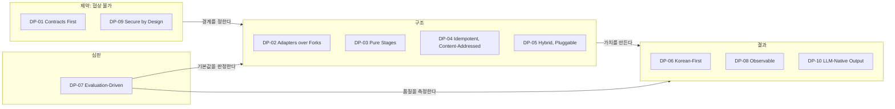
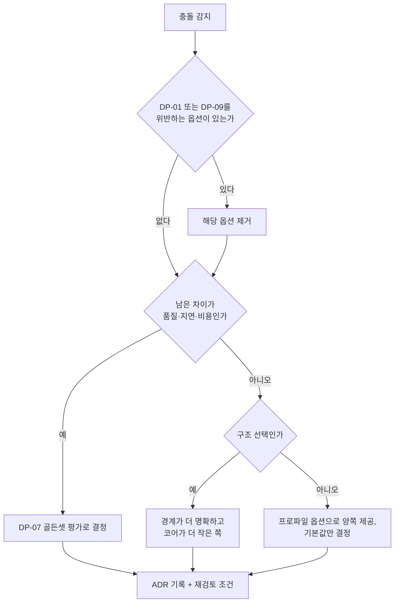
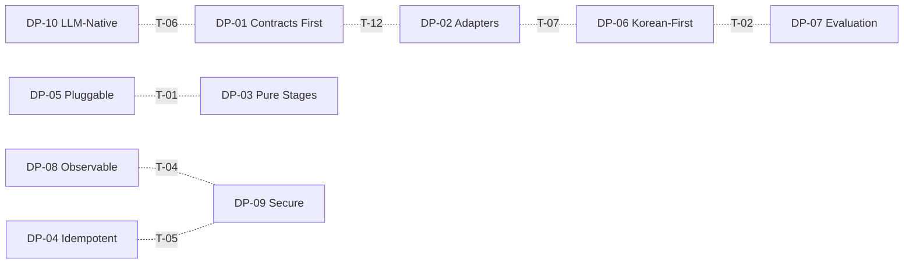

# 설계 원칙

> 이 문서는 [설계 브리프](./00-design-brief.md) §3의 10개 원칙을 규범(normative) 수준으로 확장한다. 브리프와 충돌하면 브리프가 우선한다.
>
> **식별자 규약.** 원칙 식별자는 `DP-01`~`DP-10`(Design Principle)이며 브리프 §3의 번호 순서와 같다. 즉 브리프와 형제 문서가 쓰는 "원칙 N"은 `DP-0N`과 같은 것을 가리키며, 그 인용은 그대로 유효하다. 접두 `P-xx`는 [비전과 목표](./01-vision-and-goals.md)가 **문제(problem)** 식별자로 이미 사용하므로 이 문서는 원칙에 `P-xx`를 쓰지 않는다. 규칙은 `DP-xx.Rn`, 규칙의 하위 항목은 `DP-xx.Rn(a)`처럼 괄호 소문자로, 허용 예외는 `DP-xx.En`, 원칙 간 긴장 관계는 `T-xx`, 리뷰 체크리스트 항목은 `DRC-xx`로 식별한다.

## 목적

설계 원칙(design principle)은 결정을 내리는 사람이 바뀌어도 같은 방향의 결정이 나오도록 하는 장치다. 브리프 §3은 원칙을 한 줄씩 선언했지만, 리뷰에서 "이 PR은 원칙 3을 위반한다"라고 말하려면 무엇이 위반이고 무엇이 예외인지 미리 합의되어 있어야 한다. 이 문서는 각 원칙에 대해 다음을 정한다.

- 원칙이 실제로 **강제하는 규칙**: 리뷰에서 위반이라고 판정할 수 있는 구체 기준
- **위반 사례(anti-pattern)** 와 **허용 예외**: 예외는 열거된 것만 인정한다
- **검증 방법**: 리뷰 체크리스트 항목과 자동 검사 가능 여부
- 원칙의 근거가 되는 **확정 결정(D-xx)** 과 원칙이 영향을 주는 **개방 결정(O-xx)**
- 원칙끼리 부딪힐 때의 **충돌 해소 규칙**

대상 독자는 설계 문서 작성자, 코드 리뷰어, 플러그인 개발자, 그리고 문서를 생성·검토하는 에이전트다.

## 범위

**포함**: 브리프 §3의 10개 원칙 각각의 규범적 해석, 원칙 간 긴장 관계와 해소 절차, 설계 리뷰 체크리스트.

**제외**: 개별 계약의 필드 정의(→ [계약 개요](../03-contracts/00-contract-overview.md)), 코딩 컨벤션 세부(→ [코딩 표준](../10-development/03-coding-standards.md)), 컴포넌트 구조(→ [컴포넌트 아키텍처](../02-architecture/02-component-architecture.md)). 이 문서는 새 **시스템 아키텍처** 결정을 만들지 않는다(식별자·분류·해소 절차 같은 문서·거버넌스 규약은 예외이며 "결정 사항 요약"에 그렇게 표기한다). 원칙을 적용하는 과정에서 필요해진 아키텍처 결정은 본문에 "제안"으로 표기하고 `## 미해결 이슈`에 남긴다.

## 원칙 체계 개요

10개 원칙은 역할에 따라 네 층으로 나뉜다. 이 분류는 §"원칙 충돌 해소 규칙"의 우선순위 근거가 된다. 브리프 §3 "원칙 N"과 이 문서의 `DP-0N`은 1:1이다(원칙 1 = DP-01, …, 원칙 10 = DP-10). [비기능 요구사항](../01-requirements/02-non-functional-requirements.md)의 원칙→NFR 매핑표와 [범위와 비범위](./04-scope-and-non-goals.md)의 "원칙 N" 인용은 이 대응으로 읽는다.

| 층 | 역할 | 원칙 | 충돌 시 성격 |
|---|---|---|---|
| 제약(constraint) | 협상 불가. 위반하는 옵션은 검토 대상에서 제거된다 | DP-01 Contracts First, DP-09 Multi-Tenant & Secure by Design | 절대 우선 |
| 심판(arbiter) | 품질 관련 충돌의 판정 수단 | DP-07 Evaluation-Driven | 데이터가 결정 |
| 구조(structure) | 코드와 컴포넌트가 놓이는 자리를 정한다 | DP-02 Adapters over Forks, DP-03 Pure Stages, DP-04 Idempotent & Content-Addressed, DP-05 Hybrid by Default, Pluggable Everywhere | 경계가 더 명확한 쪽 |
| 결과(outcome) | 사용자와 LLM이 체감하는 가치 | DP-06 Korean-First, DP-08 Observable & Explainable, DP-10 LLM-Native Output | 기본값·프로파일로 조정 |

### 각 원칙 절의 형식

각 원칙 절은 같은 순서를 따른다: **정의** → **왜 중요한가** → **강제 규칙**(표) → **위반 사례** → **허용 예외** → **검증 방법** → **관련 결정**.

규칙 표의 "자동 검사" 열은 세 값 중 하나다.

- `가능`: CI가 기계적으로 판정한다(스키마 검증, 임포트 규칙, 재현성 테스트 등)
- `부분`: 도구가 후보를 잡고 사람이 최종 판정한다
- `리뷰`: 사람의 판정만 가능하다

자동 검사 도구 이름(import-linter, pip-licenses 등)은 예시다. 도구 확정은 [코딩 표준](../10-development/03-coding-standards.md)과 [CI/CD](../10-development/05-ci-cd.md)에서 한다.

---

## DP-01 Contracts First

**정의.** 스테이지 간 경계의 계약(contract), 즉 JSON Schema 2020-12와 Pydantic v2 모델이 구현 코드보다 먼저 정의·리뷰·게시된다. 계약이 바뀌면 `schema_version`이 바뀐다. 계약이 없는 데이터는 스테이지 경계를 건널 수 없다.

**왜 중요한가.** 원 요구사항 R5("각 단계의 인풋과 아웃풋을 표준화")의 직접 표현이다. 계약이 먼저 있어야 (1) 여러 팀·에이전트가 스테이지를 병렬로 구현할 수 있고, (2) 플러그인(D-10)이 코어 내부를 몰라도 동작하며, (3) 오브젝트 스토리지에 저장된 산출물을 몇 달 뒤에도 해석할 수 있고(DP-04), (4) 벤더 모델 교체(DP-02)가 계약 뒤에서 조용히 일어난다. 계약이 코드에서 역으로 추출되면 구현 세부가 계약에 스며들어 이 네 가지가 모두 무너진다.

**강제 규칙**

| ID | 규칙 | 자동 검사 |
|---|---|---|
| DP-01.R1 | D-05의 모든 경계 타입(`IngestRequest`, `SourceDocument`, `ParsedDocument`, `NormalizedDocument`, `ChunkSet`, `EnrichedChunkSet`, `EmbeddedChunkSet`, `IndexCommit`, `QueryRequest`, `QueryPlan`, `CandidateSet`, `RankedSet`, `ContextPack`)은 `schemas/`에 JSON Schema 파일이 있고 `03-contracts/` 계약 문서와 1:1로 대응한다. | 가능 (스키마 파일 존재·문서 대응 검사) |
| DP-01.R2 | 모든 계약 인스턴스는 `schema_version`을 갖는다. 호환성을 깨는 변경은 새 major 버전과 마이그레이션 경로를 동반한다. 호환성 판정 기준은 [스키마 버전 관리](../03-contracts/14-schema-versioning-and-compatibility.md)를 따른다. | 가능 (스키마 diff 도구로 breaking change 탐지) |
| DP-01.R3 | Pydantic 모델과 JSON Schema 파일은 CI에서 동기화가 검증된다. 둘이 다르면 빌드가 실패한다. | 가능 |
| DP-01.R4 | 계약을 바꾸는 PR은 계약 문서, 스키마 파일, 유효/무효 예시 픽스처(fixture), 불변식(invariants)을 함께 바꾼다. 코드만 바꾸는 PR로 계약을 바꾸는 것은 금지다. | 부분 (변경 파일 세트 검사) |
| DP-01.R5 | 스테이지와 플러그인은 계약 타입만 주고받는다. `dict[str, Any]`, 벤더 타입(DoclingDocument 등), 비직렬화 객체는 경계를 건널 수 없다. | 가능 (mypy strict + 인터페이스 시그니처 검사) |
| DP-01.R6 | 필드의 필수/선택 정책과 `additionalProperties` 정책은 [계약 개요](../03-contracts/00-contract-overview.md)가 정한 규칙을 따른다(제안 기본값: 필수(required) 우선, `additionalProperties: false`, 확장은 계약 개요가 지정한 확장 슬롯 경유 — 미해결 이슈 2). 선택(optional) 필드는 "값이 없을 수 있는 이유"를 계약 문서에 적어야 한다. | 부분 (스키마 린트(lint)) |

**위반 사례(anti-pattern)**

- 파서가 `dict`를 반환하고 청커가 그 키를 "알고 있다"고 가정한다. 키 이름이 바뀌면 런타임에만 발견된다.
- 필드의 의미를 바꾸면서(예: `score`를 0~1 정규화에서 원점수로) `schema_version`을 유지한다. 저장된 산출물이 조용히 오해석된다.
- "유연성"을 이유로 모든 필드를 optional로 만든다. 소비자는 어떤 필드가 있는지 매번 방어 코드를 써야 하고, 계약은 문서 역할을 잃는다.
- 스테이지 내부에서 다음 스테이지의 모델을 임포트해 직접 생성·조작한다. 두 스테이지가 한 덩어리로 결합된다.
- 스키마를 코드에서 자동 추출한 뒤 문서 없이 게시한다. 불변식·예시·의미가 빠진 스키마는 계약이 아니다.

**허용 예외**

- DP-01.E1: 어댑터 내부의 중간 표현(예: OWPML DOM, Docling 내부 객체)은 계약이 필요 없다. 경계는 어댑터의 입·출력이다.
- DP-01.E2: 실험 단계 계약은 `status: draft`로 게시할 수 있다. 단 프로덕션 프로파일에서 참조할 수 없고, `active`로 승격될 때 DP-01.R4를 충족해야 한다.
- DP-01.E3: 플러그인 고유 설정(예: OCR 엔진 옵션)은 프로파일의 플러그인 설정 구간에 두며, 스테이지 경계 계약에 넣지 않는다. 설정 스키마는 플러그인이 자체 게시한다.

**검증 방법**

- 리뷰: "이 변경이 스테이지 경계를 건너는 데이터의 모양·의미를 바꾸는가? 바꾼다면 계약 문서·스키마·픽스처·버전이 함께 바뀌었는가?"
- 자동: 픽스처 스키마 검증, 스키마 diff에 의한 breaking change 감지, Pydantic-스키마 동기화 검사, mypy strict.

**관련 결정:** D-01(v1.1), D-04(v1.1), D-05, D-06(v1.2), D-10, D-20. 영향받는 개방 결정: O-10(gRPC 제공 시 계약의 protobuf 표현이 추가로 필요).

---

## DP-02 Adapters over Forks

**정의.** 오픈소스 라이브러리는 어댑터(adapter) 뒤에서 사용한다. 포크하지 않는다. 벤더 모델(DoclingDocument, Unstructured Elements 등)은 어댑터 안에서 우리의 표준 모델(`ParsedDocument` 등)로 변환되며, 벤더 타입은 어댑터 밖으로 나오지 않는다.

**왜 중요한가.** R2("라이브러리와 오픈소스를 최대한 사용")는 우리가 소유해야 할 것이 파서나 임베더가 아니라 **계약과 오케스트레이션**임을 뜻한다. 포크는 업스트림의 개선을 끊고 유지보수 부담을 우리에게 옮긴다. 어댑터는 (1) 업스트림 업그레이드를 어댑터 한 곳의 변경으로 흡수하고, (2) 라이선스 경계(D-02)를 패키지 경계로 만들며, (3) 같은 확장 지점의 구현을 평가(DP-07)로 비교·교체할 수 있게 한다.

**강제 규칙**

| ID | 규칙 | 자동 검사 |
|---|---|---|
| DP-02.R1 | 외부 라이브러리는 그 라이브러리를 감싸는 어댑터 패키지에서만 임포트된다. 코어 패키지와 다른 어댑터에서 직접 임포트하는 것은 금지다. | 가능 (import-linter 계층 규칙) |
| DP-02.R2 | 어댑터의 책임은 D-10 확장 지점 인터페이스 구현과 "벤더 타입 ↔ 계약 타입" 변환으로 한정한다. 청킹·랭킹 등 파이프라인 로직을 어댑터에 넣지 않는다. | 리뷰 |
| DP-02.R3 | 변환 시 D-04의 출처(provenance: `element_path`·`char_start`/`char_end`는 필수, `page`/`bbox`는 HWP/HWPX·DOCX·HTML·MD 등 흐름 포맷에서 nullable, v1.1)와 구조(계층 섹션·표·그림·각주)를 손실 없이 보존한다. 벤더가 제공하지 않아 손실이 불가피하면 어댑터 문서와 출력에 명시한다. | 부분 (provenance 필수 필드 스키마 검증) |
| DP-02.R4 | 업스트림 결함은 업스트림 이슈/PR로 먼저 보고하고, 어댑터 수준 워크어라운드는 이슈 URL을 주석에 남긴다. 벤더링(vendoring)·패치 적용은 ADR 승인이 필요하다. | 부분 (주석 규약 린트) |
| DP-02.R5 | 어댑터의 플러그인 매니페스트(manifest: 플러그인이 자기 이름·버전·구현 확장 지점·의존 라이브러리·라이선스·설정 스키마 위치를 선언하는 메타데이터. 형식은 [플러그인 아키텍처](../02-architecture/05-plugin-architecture.md)에서 확정, 미해결 이슈 14)에 의존 라이브러리의 라이선스를 기록하고 D-02 정책(Apache/MIT/BSD 우선, AGPL은 네트워크 분리, GPL 링크 금지)을 CI가 검사한다. | 가능 (pip-licenses 류 검사) |
| DP-02.R6 | 벤더 고유 옵션은 어댑터 설정 스키마로만 노출한다. 벤더 예외(exception) 타입은 어댑터 경계에서 [오류 모델](../03-contracts/13-error-model.md)의 오류로 변환한다. | 가능 (예외 타입 경계 검사) |

**위반 사례(anti-pattern)**

- DoclingDocument를 그대로 청커에 넘기고, 청커가 Docling API로 순회한다. 이제 청커는 Docling 전용이며 HWPX 문서는 청킹할 수 없다.
- 업스트림 라이브러리를 런타임에 몽키패치한다. 업스트림 마이너 업그레이드에서 조용히 깨진다.
- "작은 수정만" 하려고 포크한 뒤 6개월 뒤 업스트림과 200커밋 차이가 난다.
- `qdrant_client` 예외가 리트리벌 API 응답까지 그대로 올라온다.
- 어댑터 안에 "PDF일 때만 표 청킹" 같은 파이프라인 분기가 들어간다.

**허용 예외**

- DP-02.E1: 업스트림이 존재하지 않는 영역은 자체 구현한다. D-18의 "자체 OWPML 어댑터"가 대표 사례다. 단 자체 구현도 확장 지점 인터페이스와 `ParsedDocument` 계약을 그대로 따르며, 재사용 가능한 부분은 업스트림 기여(또는 독립 패키지 분리)를 목표로 한다.
- DP-02.E2: AGPL 컴포넌트는 D-02에 따라 별도 컨테이너·네트워크 경계 뒤의 서비스로 두고, 어댑터는 그 네트워크 API를 호출한다.
- DP-02.E3: 업스트림이 사실상 방치(예: 장기간 릴리스·응답 없음)되고 대체 라이브러리가 없으면 ADR로 포크(하드 포크 포함)를 승인할 수 있다. ADR에는 유지보수 계획과 되돌리기 조건을 적는다.

**검증 방법**

- 리뷰: "이 PR이 벤더 타입이나 벤더 예외를 어댑터 밖으로 노출하는가? 어댑터에 파이프라인 로직이 들어갔는가? 새 의존성의 라이선스는 D-02를 만족하는가?"
- 자동: import-linter 계층 계약, 라이선스 검사, provenance 필수 필드 검증, 어댑터 컨포먼스 테스트(conformance test: 확장 지점 인터페이스 준수를 검증하는 공통 테스트 스위트, DP-05.R1).

**관련 결정:** D-02(v1.1), D-04(v1.1), D-10, D-16, D-18. 영향받는 개방 결정: O-07(HWP 5.0의 LibreOffice 의존), O-08(OCR 엔진), O-03(GraphRAG·RAPTOR를 외부 플러그인으로 둘지).

---

## DP-03 Pure Stages, Durable Orchestration

**정의.** 스테이지(stage)는 `Stage[In, Out]` 형태의 입력→출력 변환이다. 스테이지는 자신의 입력 계약 인스턴스와 명시된 설정만 읽고, 자신의 출력 계약 인스턴스만 낸다. 상태 저장, 재시도, 타임아웃, 하트비트, 보상 트랜잭션(saga)은 오케스트레이터(Temporal 또는 인프로세스 러너, D-17)가 책임진다.

여기서 "순수(pure)"는 수학적 순수성이 아니라 다음 네 조건이다: (a) 같은 입력·설정이면 같은 출력(DP-04), (b) 입력을 변경하지 않음, (c) 숨은 상태(전역 변수, 파일시스템 임시 상태, 현재 시각)에 의존하지 않음, (d) 외부 호출(임베딩 서버, 인덱스 백엔드)은 스테이지에 주입된 선언적 포트(port)로만 한다.

**왜 중요한가.** 브리프 R4는 우아함을 "단일 책임 스테이지, 순수 함수형 계약, 관측 가능성, 멱등성"으로 해석했고, 브리프 §11은 이를 "경계의 명확성"으로 요약한다. 스테이지가 순수하면 (1) 오케스트레이터 없이 단위 테스트할 수 있고, (2) 실패한 스테이지만 재실행할 수 있으며, (3) 스캔 PDF OCR처럼 수 분 걸리는 작업의 재시도·타임아웃을 워크플로우 정의 한 곳에서 다룰 수 있고, (4) Temporal과 인프로세스 러너가 같은 스테이지 코드를 실행할 수 있다(D-17). 스테이지가 스스로 재시도하고 상태를 기록하기 시작하면 실패 경로가 두 겹이 되어 아무도 전체를 이해할 수 없게 된다.

**강제 규칙**

| ID | 규칙 | 자동 검사 |
|---|---|---|
| DP-03.R1 | 스테이지는 하나의 경계 전이만 담당한다(예: `ParsedDocument → NormalizedDocument`). 두 경계를 건너는 스테이지는 두 스테이지로 나눈다. 유일한 예외는 DP-03.E5의 선언된 복합 스테이지다. | 가능 (스테이지 시그니처 검사, E5 선언 목록 제외) |
| DP-03.R2 | 스테이지 코드에서 재시도 루프, `sleep`, 타임아웃 타이머, 잡 상태 기록을 작성하지 않는다. 재시도 정책·타임아웃·하트비트는 워크플로우 정의에 선언한다. | 부분 (ruff banned-api로 `time.sleep`, 잡 저장소 클라이언트 임포트 금지) |
| DP-03.R3 | 스테이지는 전역 상태·환경 변수·현재 시각·난수를 직접 읽지 않는다. 필요한 값은 설정 또는 컨텍스트로 주입된다. | 부분 (`os.environ`, `datetime.now`, `random` 직접 사용 린트) |
| DP-03.R4 | 스테이지는 실패를 삼키지 않는다. 실패는 [오류 모델](../03-contracts/13-error-model.md)의 재시도 가능/불가능 분류로 보고한다. 부분 성공(예: 일부 페이지 OCR 실패)은 출력에 명시적으로 표기한다. | 리뷰 |
| DP-03.R5 | 산출물 영속화와 인덱스 커밋은 지정된 스테이지(`IndexCommit` 생산) 또는 오케스트레이터의 활동(activity)에서만 일어난다. 그 외 스테이지는 저장소에 쓰지 않는다. | 부분 (스토리지 클라이언트 임포트 계층 규칙) |
| DP-03.R6 | 워크플로우 정의는 하나이며 Temporal 워커와 비내구 `LocalRunner`가 같은 정의를 실행한다(D-17 v1.1, 바이블 §11.1). 두 실행 모드에 서로 다른 파이프라인 코드를 두지 않는다. | 가능 (두 모드로 같은 통합 테스트 실행) |

**위반 사례(anti-pattern)**

- PDF 파서가 OCR 서버 호출을 자체 `for i in range(3)` 루프로 재시도한다. Temporal의 재시도와 겹쳐 최악의 경우 9회 호출된다.
- 의미 분할 청커가 주입된 임베딩 포트 대신 임베딩 서버를 직접 호출하고 결과 벡터를 임시 파일에 캐시한다. 청킹 스테이지 테스트에 GPU와 네트워크가 필요해지고 숨은 상태가 생긴다(의미 분할 자체는 D-19가 허용하는 옵션이다. DP-03.E5).
- 파서가 잡 테이블에 `progress = 40%`를 직접 UPDATE한다. 인프로세스 러너에는 잡 테이블이 없어 실패한다.
- "god stage": 파싱·정규화·청킹을 한 함수에서 처리하고 중간 산출물을 남기지 않는다. 청킹 전략만 바꾸려 해도 파싱을 다시 한다.
- 파이프라인 분기 조건(`if source.mime == "application/pdf"`)이 스테이지 내부에 하드코딩된다. 라우팅은 [파싱 라우터](../04-pipelines/03-parsing-router-and-format-detection.md)의 책임이다.

**허용 예외**

- DP-03.E1: 어댑터 내부의 라이브러리 수준 재시도(예: HTTP 클라이언트의 연결 재시도)는 허용한다. 단 그 총 시간은 워크플로우에 선언된 활동 타임아웃보다 짧아야 하며 어댑터 문서에 기록한다. 횟수·총 시간의 구체 상한은 [비기능 요구사항](../01-requirements/02-non-functional-requirements.md)의 신뢰성 절(재시도 정책)이 정본이다.
- DP-03.E2: 대용량 문서를 페이지·섹션 단위로 순차 산출하는 스트리밍 스테이지는 허용한다. 각 조각은 여전히 계약 타입이며 순수성 조건 (a)~(d)를 만족해야 한다.
- DP-03.E3: 콘텐츠 주소화 캐시(DP-04) 조회는 의미를 바꾸지 않으므로 순수성 위반이 아니다. 단 캐시는 주입된 포트로 접근한다.
- DP-03.E4: 리트리벌 경로에서 지연 목표(브리프 §7) 달성을 위한 병렬 팬아웃(fan-out: dense·sparse·lexical 동시 실행)은 오케스트레이션 계층(러너)이 수행한다. 개별 리트리버는 여전히 단일 변환이다.
- DP-03.E5: D-19가 프로파일 옵션으로 허용한 late chunking(임베딩 후 청킹)과 의미 분할(semantic splitting, 청킹 중 임베딩 호출)처럼 두 경계를 **본질적으로** 결합하는 기법은 **복합 스테이지(composite stage)** 로 허용한다. 조건: (a) 건너는 두 경계의 계약 산출물(예: `ChunkSet`과 `EmbeddedChunkSet`)을 모두 낸다, (b) 프로파일에 복합 스테이지임을 선언한다, (c) 임베딩 등 외부 호출은 주입된 포트로만 한다(순수성 조건 (d)), (d) 편의상의 결합("파싱과 청킹을 한 함수에서")은 해당하지 않는다. 시그니처 검사(DP-03.R1)는 선언된 복합 스테이지만 예외로 처리한다. 선언 형식은 미해결 이슈 13.

**검증 방법**

- 리뷰: "이 스테이지를 오케스트레이터·DB·네트워크 없이 픽스처만으로 테스트할 수 있는가? 실패 시 누가 재시도하는가? 이 코드가 두 경계를 건너는가?"
- 자동: 스테이지 단위 테스트가 외부 의존 없이 실행되는지(테스트 마커 검사), banned-api 린트, 계층 임포트 규칙, 두 실행 모드 통합 테스트.

**관련 결정:** 브리프 R4(우아함 = 단일 책임 스테이지·순수 함수형 계약·관측 가능성·멱등성), D-05, D-08, D-10, D-17, D-19(복합 스테이지 예외의 근거). 영향받는 개방 결정: O-06(이벤트 버스 추가 여부: 스테이지가 아니라 오케스트레이터의 관심사임을 이 원칙이 고정한다).

---

## DP-04 Idempotent & Content-Addressed

**정의.** 같은 입력은 같은 출력을 낸다(멱등성, idempotency). 모든 산출물(artifact)은 BLAKE3 해시(D-06)로 주소화(content-addressed)되어 오브젝트 스토리지(D-14)에 저장되며, 같은 해시의 산출물은 다시 계산하지 않고 재사용한다. 여기서 "입력"은 입력 계약 인스턴스뿐 아니라 프로파일 버전, 플러그인 버전, 모델 식별자를 포함한다. 멱등성 키 = 캐시 키 = 산출물 경로는 `stage_key = H("stage", stage_name, scope_key, input_hash, fingerprint)`(바이블 §4.1 1.3.0 표기)로 계산된다.

**왜 중요한가.** 브리프 R5는 "산출물은 오브젝트 스토리지에 콘텐츠 주소화로 저장, 재처리·캐싱·감사 가능"을 요구한다. 수집은 at-least-once(브리프 §7)이므로 같은 요청이 두 번 도착하는 것이 정상이다. 멱등하지 않으면 중복 인덱싱과 비용 낭비가 생긴다. 콘텐츠 주소화는 (1) 청킹 전략만 바꿀 때 파싱을 건너뛰게 하고, (2) "동일 `IngestRequest` + 동일 프로파일 → 동일 `IndexCommit` 해시"라는 브리프 §7 재현성 목표를 검증 가능하게 하며, (3) A/B 프로파일 비교(DP-07)에서 두 실행이 같은 원본에서 출발했음을 증명한다.

**강제 규칙**

| ID | 규칙 | 자동 검사 |
|---|---|---|
| DP-04.R1 | 산출물 주소는 정규화된(canonical) 직렬화의 BLAKE3 해시다. 직렬화 규칙(키 정렬, 숫자 표기, 인코딩)은 [계약 개요](../03-contracts/00-contract-overview.md)에서 한 곳에 정의하고 모든 스테이지가 같은 함수를 쓴다. | 가능 (해시 함수 단일 구현 검사) |
| DP-04.R2 | 캐시 키 구성의 **단일 정본**이다. 최소 구성 요소: (a) 입력 해시, (b) 스테이지 식별자, (c) 플러그인 이름·버전, (d) 프로파일 버전, (e) 해당 시 모델 식별자(이름·버전·차원·정규화 여부), (f) LLM 보강 시 프롬프트 템플릿 해시와 생성 파라미터, (g) 테넌트 격리 정책이 요구하는 네임스페이스(DP-09.R4, 확정 전 제안). 다른 절(DP-09.R4, T-03, DRC-13)은 이 목록을 인용만 한다. 구성 요소가 하나라도 빠진 캐시는 잘못된 히트를 낳으므로 금지다. | 가능 (캐시 키 빌더 단위 테스트) |
| DP-04.R3 | 산출물 해시에는 콘텐츠만 들어간다. 생성 시각, 잡 ID, 새로 발급된 ULID 같은 실행 메타데이터는 해시 대상에서 제외한다. | 가능 (재현성 테스트) |
| DP-04.R4 | 인덱스 쓰기는 `IndexCommit` 단위로 원자적 교체·롤백된다. 같은 커밋 해시의 재실행은 no-op이다. 부분 커밋 상태가 리트리벌에 노출되지 않는다. | 가능 (중복 커밋 통합 테스트) |
| DP-04.R5 | 동일 `IngestRequest`의 재전송은 새 처리를 시작하지 않고 기존 잡·결과로 수렴한다. 동일성 판정 기준은 [수집 API](../05-api/02-ingestion-api.md)에서 정의한다. | 가능 (중복 요청 통합 테스트) |
| DP-04.R6 | 비결정적 요소(LLM 보강, 일부 OCR 엔진, 근사 최근접 탐색)는 셋 중 하나로 격리한다: (a) 결정 파라미터 고정(temperature 0, 시드), (b) 최초 결과를 산출물로 저장하고 이후 재사용, (c) 출력에 비결정성 표기. 인덱싱 경로에서는 (b)가 필수다. | 리뷰 |
| DP-04.R7 | 레코드 식별자와 **결정적 키**를 구분한다. D-06의 ULID는 레코드·이벤트의 식별자로 쓰되, 재처리 후에도 같아야 하는 참조(청크 인용 ID, 평가 qrels의 청크 참조, 캐시 키, 재현성 비교)는 ULID가 아니라 콘텐츠에서 파생한 결정적 키를 쓴다. 결정적 키의 이름·구성(제안: 문서 콘텐츠 해시 + 블록 경로 파생 `chunk_key`)은 [ChunkSet 계약](../03-contracts/05-chunk-set.md)과 [계약 개요](../03-contracts/00-contract-overview.md)에서 확정한다(미해결 이슈 11). | 가능 (재처리 후 키 동일성 테스트) |

**위반 사례(anti-pattern)**

- 청크의 인용 ID를 재처리마다 새로 발급되는 식별자(ULID·UUID)만으로 만든다. 사용자 피드백·평가 qrels가 다음 재인덱싱에서 모두 무효가 된다(DP-04.R7: ULID는 레코드 식별자, 인용은 결정적 키).
- 임베딩 캐시 키에 모델 이름만 넣고 버전·차원·정규화 여부를 빠뜨린다. 모델 교체 후 옛 벡터가 새 인덱스에 섞인다.
- `ParsedDocument`에 `parsed_at` 타임스탬프를 넣고 그대로 해시한다. 같은 문서를 두 번 파싱하면 해시가 달라져 캐시가 무의미하다.
- 재시도된 임베딩 활동이 인덱스에 같은 청크를 두 번 upsert하고, 두 레코드가 다른 ID를 가진다.
- LLM 요약 보강을 매 재인덱싱마다 새로 호출해 비용이 반복 발생하고 결과가 매번 달라진다.

**허용 예외**

- DP-04.E1: LLM 기반 보강(O-05)은 완전한 결정성을 보장할 수 없다. 저장된 산출물 재사용(DP-04.R6(b))으로 "실용적 멱등성"을 달성하면 충족으로 본다. 재생성은 명시적 무효화(invalidate) 요청으로만 한다.
- DP-04.E2: 리트리벌 경로의 의도적 시간 의존 컴포넌트(온라인 피드백 기반 부스팅, [온라인 피드백 루프](../08-evaluation/06-online-feedback-loop.md))는 허용한다. 단 인덱싱 경로에는 금지하며, 점수 분해(DP-08)에 별도 항목으로 드러나야 한다.
- DP-04.E3: 근사 최근접 탐색(ANN)의 미세한 비결정성은 인덱스 백엔드의 속성으로 인정한다. 평가(DP-07)는 이를 감안해 반복 측정한다.

**검증 방법**

- 리뷰: "이 스테이지를 두 번 실행하면 같은 해시가 나오는가? 캐시 키에 이 변경이 반영되는가? 실행 메타데이터가 해시에 섞이지 않는가?"
- 자동: 골든 픽스처를 두 번 실행해 산출물 해시 동일성 검사(CI 필수), 캐시 키 구성 테스트, 중복 요청·중복 커밋 통합 테스트.

**관련 결정:** 브리프 R5(산출물 콘텐츠 주소화·재처리·캐싱·감사), D-06, D-08, D-14, D-17, 브리프 §7 재현성 목표. 영향받는 개방 결정: O-05(LLM 보강의 기본 켬/끔과 비용 정책).

---

## DP-05 Hybrid by Default, Pluggable Everywhere

**정의.** 기본 프로파일은 dense + sparse(learned) + lexical(BM25, 한국어 형태소) 3-way 하이브리드 → 융합 → 크로스인코더 리랭킹 → 후처리다(D-07). 동시에 D-10의 14개 확장 지점(`fetcher`, `parser`, `normalizer`, `chunker`, `enricher`, `embedder`, `index_backend`, `query_transformer`, `retriever`, `fuser`, `reranker`, `postprocessor`, `packer`, `evaluator`)은 모두 플러그인으로 교체 가능하다. 기본 구현도 플러그인이며 특권이 없다.

**왜 중요한가.** R3의 검색 품질은 어느 단일 기법으로도 모든 도메인에서 최고가 되지 않는다. 한국어 고유명사·코드·표 숫자는 렉시컬이, 의역 질의는 dense가, 전문 용어는 learned sparse가 잡는다. R4의 "모든 기술"은 **모두 기본 켬**이 아니라 **모두 수용 가능한 확장 지점**이라는 해석(브리프 §2)이 이 원칙의 핵심이다. 그래야 GraphRAG·RAPTOR·ColBERT 같은 기법이 코어를 비대하게 하지 않고 들어올 수 있고, 평가(DP-07)로 정직하게 비교될 수 있다.

**강제 규칙**

| ID | 규칙 | 자동 검사 |
|---|---|---|
| DP-05.R1 | 14개 확장 지점 각각은 (1) 인터페이스(Protocol 또는 ABC), (2) 진입점(entry point) 등록 이름, (3) 설정 스키마, (4) 컨포먼스 테스트 스위트를 갖는다. 넷 중 하나라도 없는 확장 지점은 공개하지 않는다. | 가능 (플러그인 매니페스트(DP-02.R5) 검사) |
| DP-05.R2 | 코어는 특정 플러그인 이름을 하드코딩하지 않는다. 어떤 구현을 쓸지는 프로파일(profile)만이 결정한다. `if backend == "qdrant"` 류 분기는 코어에 존재할 수 없다. | 가능 (코어→플러그인 구현 임포트 금지 계층 규칙) |
| DP-05.R3 | 확장 지점 인터페이스는 백엔드 개념을 누출하지 않는다(예: Qdrant의 payload, OpenSearch의 analyzer 용어가 인터페이스 시그니처에 등장 금지). | 리뷰 |
| DP-05.R4 | 플러그인 교체는 프로파일 변경만으로 가능해야 한다. 코드 변경이 필요하면 확장 지점 설계 결함으로 간주하고 수정한다. | 가능 (프로파일 교체 통합 테스트) |
| DP-05.R5 | 기본 프로파일에 들어가는 기법은 DP-07의 평가 게이트를 통과해야 한다. 그 외 기법은 별도 프로파일 또는 외부 플러그인으로 제공한다. | 부분 (평가 리포트 첨부 검사) |
| DP-05.R6 | 하이브리드 리트리벌은 부분 실패 시 남은 리트리버로 결과를 낼 수 있어야 하며(graceful degradation), 어떤 리트리버가 빠졌는지 출력과 이벤트에 표기한다(DP-08). | 가능 (리트리버 장애 주입 테스트) |

**위반 사례(anti-pattern)**

- 코어 리트리벌 서비스가 `QdrantClient`를 직접 생성한다. Milvus로 바꾸려면 코어를 수정해야 한다.
- 새 융합 알고리즘을 "논문이 좋다"는 이유로 기본 프로파일에 넣고 골든셋 결과를 첨부하지 않는다.
- `Retriever` 인터페이스에 `collection_name: str, payload_filter: dict` 같은 특정 백엔드 어휘를 넣는다.
- 모든 플러그인 조합(파서 5종 × 청커 4종 × 임베더 6종)을 코어 테스트로 다 돌리려다 CI가 3시간이 된다. 조합 검증은 프로파일 단위, 개별 검증은 컨포먼스 스위트로 분리해야 한다.
- 렉시컬 리트리버가 타임아웃되면 전체 질의가 실패한다.

**허용 예외**

- DP-05.E1: 경량 프로파일(D-15, Qdrant 단독 + sparse BM25)은 3-way 하이브리드의 부분집합을 기본으로 한다. 단 명시적 opt-in이며, 문서에 기본 프로파일 대비 품질 차이(평가 결과)를 적는다.
- DP-05.E2: 인덱스 백엔드가 제공하는 서버측 최적화(예: 백엔드 내부 하이브리드 융합)는 어댑터 내부에서 사용할 수 있다. 단 출력 계약(`CandidateSet`/`RankedSet`)과 점수 분해(DP-08)는 동일하게 채워야 한다.
- DP-05.E3: 개발·테스트용 인메모리 구현(예: 인메모리 인덱스 백엔드)은 컨포먼스 스위트를 통과해야 하지만 성능 목표(브리프 §7)에서는 면제된다.

**검증 방법**

- 리뷰: "이 변경이 코어에 특정 구현의 이름·개념을 들여오는가? 확장 지점 4요소가 갖춰졌는가? 기본 프로파일 변경이면 평가 결과가 있는가?"
- 자동: 플러그인 매니페스트 검사, 계층 임포트 규칙, 등록된 모든 플러그인에 컨포먼스 스위트 실행, 리트리버 장애 주입 테스트.

**관련 결정:** D-07, D-10, D-15, D-16. 영향받는 개방 결정: O-01(융합 기본값), O-02(sparse 표현), O-03(GraphRAG·RAPTOR 위치), O-04(late interaction 위치).

---

## DP-06 Korean-First, Multilingual-Ready

**정의.** 한국 문서 포맷(HWPX/HWP), 한국어 토크나이징(Nori/Kiwi), 한국어 벤치마크를 1급(first-class)으로 다룬다. 동시에 기본 임베딩·리랭커는 다국어 모델(BGE-M3, bge-reranker-v2-m3, D-16)을 채택하고, 언어 의존 처리는 BCP 47 언어 코드(D-06)를 기준으로 데이터 기반으로 선택된다.

**왜 중요한가.** 1차 시장은 한국 공공·기업 문서이고, 글로벌 오픈소스 도구는 HWPX를 지원하지 않으며, 형태소 분석 없는 BM25는 한국어에서 품질이 크게 떨어진다. 이 세 가지는 나중에 덧붙일 수 없는 구조적 요건이다. 그러나 실제 컬렉션에는 영문 계약서·일본어 매뉴얼이 섞여 있으므로, 한국어 특화를 코드 분기로 박아 넣으면 다국어 확장에서 분기 폭발이 일어난다. 해법은 "기본 테스트·분석기·포맷은 한국어, 기본 모델은 다국어, 언어 선택은 데이터로"다.

**강제 규칙**

| ID | 규칙 | 자동 검사 |
|---|---|---|
| DP-06.R1 | 한국어는 CI의 기본 테스트 언어다. 파서·청커·리트리벌의 픽스처와 골든셋은 한국어 문서를 필수로 포함한다. 영어 전용 테스트만 있는 컴포넌트는 미완성으로 간주한다. | 가능 (픽스처 언어 분포 검사) |
| DP-06.R2 | HWPX/HWP 파서는 PDF·DOCX와 같은 수준의 구조(계층 섹션·표·그림·각주·머리말)와 provenance 보존 요건(D-04)을 충족한다. "PDF로 변환 후 파싱"은 폴백이며 기본 경로가 될 수 없다. | 가능 (HWPX 컨포먼스 테스트) |
| DP-06.R3 | 언어 의존 컴포넌트(형태소 분석기, 문장 분리기, 스톱워드, 토크나이저)는 문서·청크의 `language`(BCP 47) 값으로 선택된다. 문서·블록의 `language`는 정규화 단계에서, 청크의 `language`는 보강 단계에서 판별·기록된다(브리프 §10 Enrichment, FR-NRM-04·FR-ENR-05). 코드에 언어를 하드코딩하지 않는다. | 부분 (언어 감지 테스트, 하드코딩 린트) |
| DP-06.R4 | 토큰 수는 대상 모델의 토크나이저(또는 프로파일에 명시된 근사 토크나이저)로 계산한다. 공백 분리·문자 수 기반 추정은 금지다. 근거: 같은 문자 수의 한국어는 영어보다 cl100k 기준 1.8~2.4배 토큰을 쓰고 모델 토크나이저별 편차도 크다([청킹 전략과 라이브러리](../07-tech-landscape/04-chunking-strategies-and-libraries.md) §17 측정치 인용, BGE-M3 토크나이저 값은 확인 필요(as of 2026-09)). | 가능 (토큰 카운터 단일 구현 검사) |
| DP-06.R5 | 렉시컬 인덱스는 한국어 형태소 분석기(D-15 Nori 기본)를 사용한다. 표준 분석기(standard analyzer)를 한국어 필드에 쓰는 것은 금지다. | 가능 (인덱스 매핑 검사) |
| DP-06.R6 | TXT/HTML 입력에서 EUC-KR/CP949 등 레거시 인코딩을 감지·변환한다(D-18 charset-normalizer). 인코딩 오류는 실패가 아니라 경고와 함께 계약에 기록된다. | 가능 (인코딩 픽스처 테스트) |

**위반 사례(anti-pattern)**

- `len(text.split())`로 청크 토큰을 추정한다. 한국어 청크가 예산을 크게 넘겨 LLM 컨텍스트를 넘친다.
- 문장 분리 정규식이 `[.!?]\s`만 본다. "~다." 뒤 공백 없는 한국어 문서에서 문장이 안 나뉜다.
- 골든셋이 MS MARCO 영문뿐이다. 한국어 회귀를 아무도 잡지 못한다.
- HWPX를 LibreOffice로 PDF 변환 후 PDF 파서에 넘긴다. 표 구조와 각주 provenance가 사라진다.
- 렉시컬 인덱스 매핑이 `"analyzer": "standard"`다. "국민연금공단"이 하나의 토큰이 되어 "연금" 질의에 매칭되지 않는다.

**허용 예외**

- DP-06.E1: 영어(또는 단일 외국어) 전용 컬렉션은 해당 언어 특화 프로파일(예: 영어 전용 분석기, 영어 특화 임베딩)을 선택할 수 있다. 컬렉션 단위 프로파일 고정(브리프 §10 Collection 정의)이 이를 지원한다.
- DP-06.E2: 한국어 리소스가 없는 컴포넌트(일부 OCR 엔진, 일부 문장 분리기)는 폴백 규칙(어느 다국어 구현으로 대체하는지)을 플러그인 문서에 적으면 등록할 수 있다. 단 기본 프로파일에는 한국어 지원 구현만 들어간다.
- DP-06.E3: 한국어 특화 모델(KURE 등)이 골든셋에서 다국어 기본 모델보다 우월하면 프로파일 옵션으로 제공한다. 기본 모델 교체는 다국어 회귀 검증(DP-07)을 통과해야 한다.

**검증 방법**

- 리뷰: "이 코드가 언어를 가정하는가(공백, 마침표, 문자 집합)? 한국어 픽스처가 있는가? HWPX에서도 같은 구조가 보존되는가?"
- 자동: 픽스처 언어 분포 검사, HWPX 컨포먼스 테스트, 토큰 카운터 단일 구현 검사, 인덱스 매핑 검사, 인코딩 테스트.

**관련 결정:** 브리프 R1(HWPX/HWP 1급 지원), D-03, D-06, D-15, D-16, D-18. 영향받는 개방 결정: O-07(HWP 5.0 범위), O-08(OCR 엔진의 한국어 정확도), O-09(청크 크기·한국어 토크나이저).

---

## DP-07 Evaluation-Driven

**정의.** 모든 기본값(모델, 청크 크기, 융합 방식, 리랭커, 후처리 파라미터)은 골든셋(golden set) 기반 오프라인 평가로 정당화된다. 평가 하네스(evaluation harness)는 부속 도구가 아니라 코어 컴포넌트다(D-12). 기본값을 바꾸는 변경은 평가 결과를 근거로 제시해야 한다.

**왜 중요한가.** R3은 "TOP-K를 최대한 잘"을 요구하며, 이것은 취향이 아니라 측정의 문제다. RAG 분야는 기법이 빠르게 등장하고 논문 벤치마크는 도메인·언어가 다르다. 골든셋 없이 기본값을 바꾸면 개선인지 회귀인지 아무도 모른다. 개방 결정 가운데 O-01(융합 기본값)은 브리프 §5가 "한국어 골든셋 기준"을 명시했고, O-02·O-04·O-05·O-08·O-09는 검색 품질(또는 품질·비용 균형)에 영향을 주므로 이 원칙(DP-07.R6)에 따라 평가 결과를 근거로 확정한다.

**강제 규칙**

| ID | 규칙 | 자동 검사 |
|---|---|---|
| DP-07.R1 | 기본 프로파일(모델·청킹·융합·리랭킹·후처리)을 바꾸는 PR은 기준선 대비 메트릭 변화 리포트를 첨부한다. 리포트에는 골든셋 버전, 프로파일 버전, 모델 식별자가 포함된다. | 부분 (리포트 첨부 여부 검사) |
| DP-07.R2 | 골든셋 포맷(질의·qrels·메타데이터)은 버전드 계약이다(D-12). 골든셋 변경은 계약 변경과 같은 절차(DP-01.R4)를 따른다. | 가능 |
| DP-07.R3 | 최소 메트릭 집합은 nDCG@10, Recall@20, MRR, 컨텍스트 정밀도(브리프 R3·§7)다. 단일 메트릭만으로 결정하지 않는다. 지연(p95)과 비용은 항상 함께 보고한다. | 가능 (리포트 스키마 검증) |
| DP-07.R4 | CI는 소형 골든셋으로 회귀 게이트를 실행한다. 임계값 이상 하락 시 빌드가 실패한다. 임계값은 [평가 전략](../08-evaluation/01-evaluation-strategy.md)에서 정한다. | 가능 |
| DP-07.R5 | 평가는 프로파일 간 A/B 비교를 1급으로 지원하며, 모든 평가 결과는 재현 가능하도록 입력 해시(DP-04)와 함께 저장된다. | 가능 |
| DP-07.R6 | 개방 결정(O-xx)을 확정하는 ADR은 평가 결과를 근거 절에 인용한다. 평가 없이 확정된 ADR은 ADR 템플릿([ADR 인덱스](../06-adr/README.md))이 정한 상태값 중 재검토 조건을 갖는 상태로 표기하고 재검토 조건을 적는다(상태값 정의는 미해결 이슈 12). | 리뷰 |

**위반 사례(anti-pattern)**

- "최신 임베딩 모델이 MTEB에서 1위"라는 이유로 기본 모델을 바꾸고 한국어 골든셋을 돌리지 않는다.
- 청크 크기를 512에서 1024로 바꾸면서 "느낌상 문맥이 더 좋다"고 적는다.
- nDCG@10만 보고 리랭커를 바꿔 p95 지연이 3배가 된 것을 배포 후 발견한다.
- 골든셋 질의를 임베딩 파인튜닝이나 프롬프트 튜닝에 사용해 평가가 오염된다.
- 평가 스크립트가 개인 노트북에만 있고 결과가 슬랙 스크린샷으로만 남는다.

**허용 예외**

- DP-07.E1: 골든셋이 아직 없는 부트스트랩 단계에서는 공개 벤치마크(예: 한국어 포함 다국어 리트리벌 벤치마크)와 문헌을 근거로 초기 기본값을 정할 수 있다. 문서에 "초안 목표" 또는 "확인 필요"로 표기하고, 골든셋 구축 후 재검증 이슈를 등록한다.
- DP-07.E2: 보안·라이선스·업스트림 폐기(deprecation) 사유의 변경은 평가 결과와 무관하게 허용한다. 단 변경 후 회귀 게이트는 통과해야 한다.
- DP-07.E3: 실험 프로파일(비프로덕션)은 평가 게이트를 면제한다. 실험 결과가 기본 프로파일로 승격될 때 DP-07.R1을 적용한다.

**검증 방법**

- 리뷰: "이 변경이 검색 품질·지연·비용에 영향을 주는가? 준다면 어느 골든셋에서 얼마나 달라졌는가? 회귀 게이트를 통과했는가?"
- 자동: CI 회귀 게이트, 리포트 스키마 검증, 골든셋 스키마 검증, 평가 결과 아티팩트 저장.

**관련 결정:** D-12, D-16, D-19, 브리프 §7 검색 품질 목표. 영향받는 개방 결정: O-01(브리프가 한국어 골든셋 기준 명시), O-02, O-04, O-05, O-08, O-09(이 원칙에 따라 평가 결과를 근거로 확정).

---

## DP-08 Observable & Explainable

**정의.** 모든 스테이지 실행은 OpenTelemetry(GenAI semantic conventions 준수, D-11) 트레이스·메트릭·로그로 관측(observable) 가능하다. 모든 리트리벌 결과는 각 후보의 점수 분해(dense/sparse/lexical/fusion/rerank)와 선택·탈락 사유를 설명(explainable) 가능하다. 폴백·열화(degradation)·스킵은 항상 드러난다.

**왜 중요한가.** RAG의 품질 문제는 대부분 "왜 이 청크가 뽑혔고 저 청크는 빠졌는가"에서 시작된다. 최종 점수 하나만 남으면 dense가 놓친 것인지 리랭커가 뒤집은 것인지 알 수 없어 개선 루프(DP-07)가 끊어진다. 운영 측면에서는 OCR 지연·임베딩 서버 포화·인덱스 백엔드 타임아웃이 서로 다른 처방을 요구하므로 스테이지 단위 관측이 필수다. 조용한 폴백은 품질 저하를 장애가 아닌 것처럼 보이게 하는 최악의 실패 모드다.

**강제 규칙**

| ID | 규칙 | 자동 검사 |
|---|---|---|
| DP-08.R1 | 모든 스테이지 실행은 하나의 span이다. span 이름·속성 규약은 [관측성](../09-operations/03-observability.md)에서 정하고, 스테이지 프레임워크가 자동으로 부착한다(개별 스테이지가 직접 span을 만들지 않는다). | 가능 (프레임워크 데코레이터) |
| DP-08.R2 | `RankedSet`의 각 결과는 점수 분해를 포함한다: 각 리트리버별 원점수·순위, 융합 점수, 리랭크 점수, 후처리 조정(MMR·부스팅)이 별도 항목으로 기록된다. | 가능 (계약 스키마 필수 필드) |
| DP-08.R3 | `ContextPack`의 각 항목은 출처(document, page/bbox/offset, 섹션 경로)와 선택 사유 요약을 갖는다(R6). 인용 ID는 재처리 후에도 같은 결정적 키(DP-04.R7)여야 한다. | 가능 (계약 스키마) |
| DP-08.R4 | 폴백·열화·스킵(리트리버 탈락, OCR 실패 페이지, 인코딩 추정 실패)은 출력 계약과 이벤트(`domain.entity.action` 명명) 양쪽에 명시한다. 조용한 폴백은 금지다. | 부분 (장애 주입 테스트 + 리뷰) |
| DP-08.R5 | 메트릭 이름은 `rag_<stage>_<name>_<unit>` 규약(브리프 §9)을 따른다. `tenant_id`·`document_id` 같은 고카디널리티 값은 메트릭 라벨에 넣지 않고 트레이스 속성으로만 남긴다. | 가능 (메트릭 이름 린트, 라벨 허용 목록) |
| DP-08.R6 | 로그는 구조화(JSON)되고 `trace_id`와 상관된다. 문서 원문·질의 원문은 기본적으로 로그·span에 기록하지 않는다(DP-09). | 가능 (로그 스키마 검사, 금지 필드 검사) |

**위반 사례(anti-pattern)**

- 리트리벌 응답에 `score: 0.83`만 있다. dense·lexical 중 누가 기여했는지 모른다.
- 렉시컬 리트리버가 타임아웃되어 dense만으로 응답했는데 응답 어디에도 표기가 없다. 품질 저하가 3주간 지나간다.
- span에 청크 원문 전체를 속성으로 넣는다. 트레이스 저장 비용이 폭증하고 PII가 관측 백엔드로 유출된다.
- `rag_requests_total{tenant_id="..."}`로 테넌트 수만큼 시계열이 생긴다.
- 파서가 `print(f"page {i} done")`으로 진행 상황을 남긴다.

**허용 예외**

- DP-08.E1: 비용이 큰 설명(예: LLM 리랭커의 판단 근거 텍스트)은 요청 시 옵션(`explain` 계열)으로만 생성한다. 기본 점수 분해는 항상 포함한다.
- DP-08.E2: 고트래픽 환경에서 트레이스 샘플링은 허용한다. 단 오류·열화 이벤트는 샘플링과 무관하게 항상 기록한다.
- DP-08.E3: 디버그 모드에서는 테넌트 정책이 허용하는 범위 내에서 원문 일부를 span에 기록할 수 있다. 기본값은 끔이며 프로덕션 프로파일에서는 켤 수 없다.

**검증 방법**

- 리뷰: "이 결과를 보고 '왜 이 청크인가'를 답할 수 있는가? 실패·폴백이 출력에 드러나는가? 새 메트릭 이름과 라벨이 규약을 따르는가?"
- 자동: 계약 스키마의 점수 분해 필수 필드, 메트릭 이름 린트, 라벨 허용 목록, 로그 금지 필드 검사, 장애 주입 시 열화 표기 테스트.

**관련 결정:** 브리프 R6(출처·인용 ID·신뢰도 점수), D-07, D-11, D-20, 브리프 §7 보안 목표(감사 로그).

---

## DP-09 Multi-Tenant & Secure by Design

**정의.** `tenant_id`, `collection_id`, `acl`은 모든 계약과 모든 인덱스 레코드에 존재하며(D-09), 리트리벌 시 필터가 강제된다. 인증은 OIDC 연동(브리프 §6)이고 인가·격리·감사는 플랫폼의 책임이다. PII 처리는 `normalizer`/`enricher` 확장 지점에 플러그인으로 삽입되는 훅이며 별도 확장 지점이 아니다(D-10의 14개 확장 지점은 닫힌 목록이다). 보안은 나중에 덧붙이는 층이 아니라 계약의 일부다. 이 원칙이 강제하는 지점은 바이블 §10.3의 강제 지점 17개(E1~E17)이며, 그중 E16(아웃바운드 egress)·E17(콘텐츠 키 스코프)이 이 원칙의 격리·PII 요건을 구체화한다.

**왜 중요한가.** 공공·기업 문서 플랫폼에서 테넌트 간 유출은 회복 불가능한 사고다. 멀티테넌시를 나중에 추가하면 "필터를 빠뜨린 코드 경로"가 반드시 생긴다. 필드를 계약의 필수 항목으로 두고 리트리버 인터페이스가 필터를 필수 인자로 받게 하면, 타입 시스템과 스키마 검증이 유출 경로를 컴파일 시점에 막는다.

**강제 규칙**

| ID | 규칙 | 자동 검사 |
|---|---|---|
| DP-09.R1 | D-09의 세 필드는 인덱스 레코드와 관련 계약에서 필수(required)다. 값이 없는 레코드는 인덱스에 쓸 수 없다. | 가능 (스키마 + 인덱스 쓰기 검증) |
| DP-09.R2 | `retriever`·`index_backend` 인터페이스는 테넌트·컬렉션·ACL 필터를 선택 인자가 아닌 필수 인자로 받는다. "필터 없는 검색" 메서드는 존재하지 않는다. | 가능 (인터페이스 시그니처 검사) |
| DP-09.R3 | ACL 필터는 인덱스 백엔드 질의 수준의 사전 필터(pre-filter)로 적용한다. 애플리케이션의 사후 필터만으로 대체하는 것은 금지다(Top-K 왜곡과 유출 위험). 사후 필터는 이중 방어로만 추가한다. | 가능 (크로스 테넌트 누출 통합 테스트) |
| DP-09.R4 | 문서 파생 산출물은 테넌트 격리 정책을 따른다. **제안(ADR 확정 전 기본값):** 산출물 스토리지 경로와 캐시 키(DP-04.R2(g))에 테넌트 네임스페이스를 포함하고 테넌트 간 산출물 공유를 하지 않는다. 확정은 [스토리지 아키텍처](../02-architecture/04-storage-architecture.md)와 ADR에서 하며, [범위와 비범위](./04-scope-and-non-goals.md)의 콘텐츠 해시 재사용 항목과 정합을 맞춘다(T-05, 미해결 이슈 7). | 가능 (정책 확정 후 키 빌더 테스트) |
| DP-09.R5 | 로그·트레이스·메트릭에 문서 원문·질의 원문·개인정보를 기본 기록하지 않는다. PII 감지·마스킹은 `normalizer`/`enricher` 확장 지점의 플러그인으로 파이프라인에 삽입 가능하다. | 가능 (금지 필드 검사) + 리뷰 |
| DP-09.R6 | 시크릿은 코드·프로파일·계약에 존재하지 않는다. 전송 TLS, 저장 암호화, 관리 API 및 데이터 접근 감사 로그는 필수다(브리프 §7). | 부분 (시크릿 스캐너) |

**위반 사례(anti-pattern)**

- 관리 API가 `tenant_id`를 쿼리 파라미터로 받고 토큰의 테넌트와 대조하지 않는다.
- "관리자용" 전역 검색 엔드포인트가 필터 없이 전 컬렉션을 질의한다.
- Top-50을 필터 없이 가져온 뒤 애플리케이션에서 ACL로 걸러 Top-10을 만든다. 권한 있는 문서가 50위 밖이면 결과가 비고, 타이밍으로 타 테넌트 문서 존재가 추정된다.
- 같은 PDF를 두 테넌트가 올렸을 때 해시가 같다는 이유로 파싱 산출물을 참조 계수·삭제 격리 없이 공유하고, 한 테넌트의 삭제 요청이 다른 테넌트의 산출물을 지운다.
- 디버깅을 위해 질의 원문을 INFO 로그에 남긴다.

**허용 예외**

- DP-09.E1: 단일 테넌트 배포는 고정 `tenant_id` 값을 사용한다. 필드를 제거하거나 선택으로 바꾸지 않는다.
- DP-09.E2: 개발 모드에서 인증(OIDC)을 비활성화할 수 있다. 단 필터 강제(DP-09.R2·R3)는 여전히 적용되며, 프로덕션 프로파일에서는 비활성화가 불가능하다.
- DP-09.E3: (DP-09.R4 제안 기준) 테넌트 간 공유가 허용되는 산출물은 데이터가 아닌 것(모델 가중치, 토크나이저, 사전)에 한한다. 문서 파생 산출물의 교차 테넌트 공유는 ADR로만 허용할 수 있다.

**검증 방법**

- 리뷰: "이 코드 경로에서 필터가 빠질 수 있는가? 새 저장 위치·캐시가 테넌트 격리 정책(DP-09.R4)을 따르는가? 원문이 로그·트레이스로 나가는가?"
- 자동: 계약 필수 필드, 인터페이스 시그니처 검사, 크로스 테넌트 누출 테스트(두 테넌트에 같은 문서를 넣고 서로의 질의에서 나오지 않음을 확인), 시크릿 스캐너, 로그 금지 필드 검사.

**관련 결정:** D-09, D-10(PII 훅의 확장 지점 귀속), D-14, D-15, 브리프 §6(인증 서버는 비목표, OIDC 연동만), 브리프 §7 보안 목표.

---

## DP-10 LLM-Native Output

**정의.** 최종 출력 `ContextPack`은 사람이 아니라 LLM이 소비한다. 따라서 토큰 예산 준수, 순서(lost-in-the-middle 대응), 중복 제거, 부모 확장(small-to-big), 표·그림의 텍스트화, 안정적 인용 ID, 신뢰도 점수, 프롬프트 템플릿 힌트를 최적화한다. 표준 형식은 LLM 공급자 중립 JSON이고, 공급자별 포맷(Anthropic Messages `document`+`citations`, OpenAI 호환 메시지, XML/Markdown 템플릿)은 렌더러가 만든다(D-20). MCP 서버(D-13)로 에이전트가 직접 호출할 수 있다.

**왜 중요한가.** R6이 요구하는 것은 "Top-K 배열"이 아니라 "LLM이 참고하면 최고의 효과"다. 같은 10개 청크라도 (1) 예산을 넘치면 잘리고, (2) 중요한 청크가 중간에 있으면 무시되며(lost-in-the-middle), (3) 같은 문단이 3번 나오면 다른 근거가 빠지고, (4) 표가 셀 단위로 흩어지면 숫자 질의에 답할 수 없고, (5) 인용 ID가 없으면 답변의 출처를 검증할 수 없다. 이 다섯 가지는 리트리벌 품질 지표(nDCG)에 잡히지 않으므로 별도 원칙으로 강제한다.

**강제 규칙**

| ID | 규칙 | 자동 검사 |
|---|---|---|
| DP-10.R1 | `ContextPack`은 토큰 예산을 입력으로 받고, 예산 내로 패킹된 결과와 토큰 통계(총합·항목별·잔여)를 출력한다. 토큰 수는 대상 모델 토크나이저 또는 명시된 근사 기준이다(DP-06.R4). 예산 초과 출력은 계약 위반이다. | 가능 (예산 준수 테스트) |
| DP-10.R2 | 항목 순서는 명시된 정렬 전략을 따르며 전략 이름이 출력에 기록된다. 기본 전략은 lost-in-the-middle 대응(고중요도 항목을 양 끝에 배치)이다. 단순 점수 내림차순은 옵션이다. | 가능 (정렬 전략 필드 + 테스트) |
| DP-10.R3 | 각 항목은 안정적 인용 ID(DP-04.R7 결정적 키), 출처 메타데이터(문서 제목·페이지·섹션 경로), 신뢰도 점수를 갖는다. 렌더러는 이를 공급자 인용 구조로 손실 없이 매핑한다. | 가능 (렌더러 스냅샷 테스트) |
| DP-10.R4 | 표·그림·수식은 텍스트화된 표현(Markdown 표, 캡션·설명 텍스트)으로 포함하며 원본 블록 참조를 유지한다. 표 청크는 헤더 행을 잃지 않는다(D-19 표 전용 청킹). | 부분 (표 픽스처 테스트) |
| DP-10.R5 | 패킹 전에 중복·근사 중복 제거와 부모 확장을 수행하고, 확장 후 예산을 재검증한다. 확장으로 예산을 넘으면 확장을 되돌리되 결과에 표기한다. | 가능 |
| DP-10.R6 | 공급자 특화 로직은 렌더러(D-20)에만 존재한다. 렌더러의 확장 지점 귀속은 [플러그인 아키텍처](../02-architecture/05-plugin-architecture.md)에서 확정한다(제안: `packer`, 미해결 이슈 14). 표준 `ContextPack` JSON에는 공급자 개념(특정 API의 필드명·블록 타입)이 들어가지 않는다. | 리뷰 + 스키마 린트 |

**위반 사례(anti-pattern)**

- 리트리벌 API가 `[{"text": ..., "score": ...}]`만 반환한다. 호출자가 예산·순서·인용을 각자 다시 구현한다.
- Top-10을 점수순으로 나열해 가장 중요한 근거가 5~6번째에 놓인다.
- 부모 확장 후 예산이 130%가 되어 LLM API가 요청을 거부한다.
- 표를 행 단위 청크로 쪼개 "2024년 매출" 질의에 헤더 없는 숫자 행만 반환한다.
- Anthropic `document` 블록 필드명이 표준 `ContextPack` 스키마에 그대로 들어가 OpenAI 렌더러가 억지 변환을 한다.
- 시스템 프롬프트 템플릿을 코어에 하드코딩해 호출자가 바꿀 수 없다.

**허용 예외**

- DP-10.E1: 평가·디버깅용으로 `RankedSet`을 그대로 반환하는 원시(raw) 응답 모드는 허용한다. 이는 `ContextPack`이 아니라 별도 응답이며, LLM 소비를 전제로 하지 않는다.
- DP-10.E2: 호출자가 토큰 예산을 지정하지 않으면 프로파일의 기본 예산을 적용하고 응답에 적용값을 표기한다.
- DP-10.E3: 사람 가독성은 비목표(브리프 §6: 최종 UI 제외)이므로 Markdown 렌더러의 시각 품질은 요구하지 않는다. 단 구조(제목·표)는 유지한다.

**검증 방법**

- 리뷰: "이 출력을 그대로 LLM 컨텍스트에 넣으면 최선인가? 예산·순서·중복·표·인용 다섯 가지가 처리되는가? 공급자 개념이 표준 스키마에 들어왔는가?"
- 자동: 예산 준수 테스트, 정렬 전략 테스트, 렌더러 스냅샷 테스트, 표 픽스처 테스트, LLM-judge 기반 생성 품질 평가([LLM Judge](../08-evaluation/04-llm-judge-and-generation-quality.md)).

**관련 결정:** D-13, D-19, D-20, 브리프 R6. 영향받는 개방 결정: O-09(토큰 기준 청크 크기가 패킹 예산 산정의 단위가 된다).

---

## 원칙 충돌 해소 규칙

원칙은 서로 당긴다. "모든 기술을 수용"하면서 "우아"하기는 어렵고, "한국어 1급"과 "다국어 기본"은 자원을 다툰다. 충돌을 없앨 수는 없으므로, 충돌이 났을 때 **누가 이기는지**와 **어떻게 결정하는지**를 미리 정한다.

### 일반 규칙

1. **제약 우선.** DP-01(계약)과 DP-09(보안·격리)를 위반하는 옵션은 다른 어떤 원칙으로도 정당화되지 않는다. 검토 대상에서 먼저 제거한다.
2. **품질 쟁점은 평가로.** 남은 옵션 사이의 차이가 검색 품질·지연·비용이면 DP-07의 골든셋 평가가 결정한다. 직관·문헌·유행은 가설이지 근거가 아니다.
3. **구조 쟁점은 경계로.** 평가로 갈리지 않는 구조 선택(DP-02~DP-05 사이)은 "스테이지 경계가 더 명확하고, 코어가 더 작아지는 쪽"을 택한다. 코어는 좁게, 가장자리(플러그인·프로파일)는 넓게.
4. **결과 원칙은 프로파일로 조정.** DP-06·DP-08·DP-10 사이의 충돌은 대개 기본값의 문제다. 코어 분기 대신 프로파일 옵션으로 양쪽을 제공하고 기본값만 평가로 정한다.
5. **결과는 ADR로.** 해소 결과는 [ADR](../06-adr/README.md)에 기록하고, 재검토 조건(어떤 데이터가 나오면 뒤집는지)을 적는다.

### 구체적 긴장 관계

| ID | 긴장 | 해소 규칙 | 우선 원칙 |
|---|---|---|---|
| T-01 | 모든 기술 수용(R4, DP-05) vs 우아함(DP-03, 브리프 §11) | 코어 = 확장 지점 + 검증된 기본 프로파일. 기법은 플러그인으로 수용한다. 코어 진입 조건: (1) 기존 계약 변경 불필요, (2) 골든셋 개선 입증, (3) 유지보수 담당 명시. 셋 중 하나라도 빠지면 플러그인·별도 프로파일에 머문다. | DP-03 |
| T-02 | Korean-First vs Multilingual-Ready(DP-06 내부) | 기본 모델은 다국어, 기본 테스트·분석기·포맷은 한국어. 언어 분기는 `language` 데이터 값으로만 하고 코드 분기는 금지. 한국어 특화 모델은 프로파일 옵션이며, 기본 교체는 다국어 회귀 검증을 통과해야 한다. | 평가(DP-07) |
| T-03 | 멱등성·콘텐츠 주소화(DP-04) vs LLM 보강의 비결정성(D-19 문맥 보강, O-05) | 최초 결과를 산출물로 저장·재사용(DP-04.E1). 캐시 키는 DP-04.R2(모델 식별자·프롬프트 템플릿 해시·생성 파라미터 포함)를 따른다. 재생성은 명시적 무효화로만. | DP-04 |
| T-04 | 관측·설명(DP-08) vs 보안·PII(DP-09) | 보안 우선. 트레이스·로그에는 ID·해시·점수·길이만 기본 기록. 원문은 opt-in + 테넌트 정책 + 프로덕션 금지(DP-08.E3). 설명(explain) 응답은 인가된 요청에만. | DP-09 |
| T-05 | 콘텐츠 주소화 캐시(DP-04) vs 테넌트 격리(DP-09) | 격리가 우선한다. **제안(ADR 확정 전 기본값):** 캐시 키·스토리지 경로에 테넌트 네임스페이스 포함(DP-09.R4), 문서 파생 산출물의 교차 테넌트 공유 금지, 비데이터 산출물(모델·사전)만 전역 공유(DP-09.E3), 중복 계산 비용은 격리의 대가로 수용. 확정은 [스토리지 아키텍처](../02-architecture/04-storage-architecture.md)와 ADR에서(미해결 이슈 7). | DP-09 |
| T-06 | LLM-Native 공급자 포맷(DP-10) vs 계약 중립성(DP-01) | D-20 그대로: 중립 JSON이 계약, 렌더러가 공급자 포맷. 공급자 개념은 표준 스키마에 들어오지 않는다(DP-10.R6). 새 공급자 지원은 렌더러 추가로 끝나야 한다. | DP-01 |
| T-07 | 어댑터 우선(DP-02) vs 업스트림 없는 한국 포맷(DP-06) | 업스트림이 없으면 자체 구현(DP-02.E1, D-18 자체 OWPML 어댑터). 단 확장 지점 인터페이스와 `ParsedDocument` 계약을 그대로 따르고, 재사용 가능 부분은 독립 패키지·업스트림 기여를 목표로 한다. | DP-06 (DP-02.E1 경유) |
| T-08 | 순수 스테이지(DP-03) vs 성능 목표(브리프 §7: 배칭·병렬·캐시) | 배칭과 병렬 팬아웃은 러너가 한다(DP-03.E4). 스테이지 시그니처는 배치 입력을 허용할 수 있으나 요소 간 독립성을 유지한다. 캐시는 주입된 포트로(DP-03.E3). 스테이지 안의 스레드 풀·큐는 금지. | DP-03 |
| T-09 | 평가 주도(DP-07) vs 실험 속도 | 실험 프로파일은 게이트 면제(DP-07.E3). 기본 프로파일만 게이트를 통과한다. 실험은 빠르게, 승격은 엄격하게. | DP-07 |
| T-10 | 하이브리드 기본(DP-05) vs 경량 배포(D-15 경량 프로파일) | 경량 프로파일은 명시적 opt-in이며 품질 차이를 평가로 문서화한다(DP-05.E1). 기본값은 바뀌지 않는다. | DP-05 |
| T-11 | 설명 가능성(DP-08) vs 지연 목표(브리프 §7) | 기본 점수 분해는 계산 부산물이므로 비용이 없어 항상 포함. 추가 비용이 드는 설명은 옵션(DP-08.E1). 지연 목표 미달이면 설명 옵션이 먼저 꺼진다. | DP-08 기본, 브리프 §7 옵션 |
| T-12 | 계약 필수 필드(DP-01.R6) vs 파서별 정보 격차(DP-02.R3) | 계약 개요의 필수/선택 정책 안에서 필드는 필수로 두고, 벤더가 제공하지 못하는 값은 "없음"을 명시적 값으로 표현하며 손실을 출력에 표기한다. 필드를 optional로 바꾸는 것으로 해결하지 않는다. | DP-01 |
| T-13 | 단일 경계 전이(DP-03.R1) vs D-19 옵션인 late chunking·의미 분할(두 경계 결합) | 선언된 복합 스테이지로 허용(DP-03.E5): 두 경계의 계약 산출물을 모두 내고, 프로파일에 복합임을 선언하고, 외부 호출은 포트로만. 기본 프로파일 진입은 DP-07 평가 게이트를 거친다. | DP-03 (E5 경유) |

다이어그램은 원칙 간 긴장만 표시한다. 브리프 결정·목표와의 긴장(T-03, T-08~T-11, T-13)은 표에서만 다룬다.

### 충돌 해소 예시

**예시 1: "GraphRAG를 기본 프로파일에 넣자"(O-03).** 1단계: DP-01·DP-09 위반 없음(계약 추가는 가능). 2단계: 품질 쟁점이므로 한국어 골든셋에서 기본 프로파일 대비 nDCG@10·Recall@20·p95 지연·인덱싱 비용을 측정한다. 3단계: 개선이 입증되어도 T-01 진입 조건(계약 변경 불필요, 유지보수 담당)을 본다. GraphRAG는 그래프 인덱스라는 새 산출물이 필요해 계약 변경이 불가피하므로, 이 절차대로면 우선 별도 프로파일·플러그인에 두고 계약 확장을 ADR로 다루게 된다(절차 예시이며 O-03의 실제 결정은 평가 결과와 ADR로 한다).

**예시 2: "디버깅을 위해 span에 질의 원문을 넣자".** 1단계: DP-09.R5 위반이므로 기본 켬 옵션은 제거된다. 남는 옵션은 DP-08.E3(디버그 모드, 테넌트 정책, 프로덕션 금지)뿐이다. 평가 단계로 가지 않는다.

**예시 3: "한국어 특화 임베딩이 골든셋에서 다국어 모델보다 2%p 높다".** T-02: 프로파일 옵션으로 즉시 제공한다. 기본 모델 교체는 다국어(영·일) 골든셋 회귀와 지연·라이선스를 함께 보고 ADR로 결정한다. 2%p가 유의한지는 [평가 전략](../08-evaluation/01-evaluation-strategy.md)의 반복 측정 규칙을 따른다.

---

## 설계 리뷰 체크리스트

설계 문서·PR·플러그인 리뷰에서 사용한다. "자동" 열은 CI에서 판정 가능한 항목이다. 통과 기준을 만족하지 못하는 항목이 하나라도 있으면 해당 원칙의 허용 예외(`DP-xx.En`)에 해당함을 명시해야 승인할 수 있다. DRC는 리뷰 시점에 사람이 판정할 가치가 있는 항목만 담은 **규칙 집합의 부분집합**이다. 여기에 없는 `가능` 규칙(DP-03.R6, DP-04.R4·R5, DP-06.R6, DP-07.R2, DP-08.R6, DP-09.R6 등)은 CI 게이트로만 검사한다. DRC-37 이후는 개정에서 추가된 항목으로 원칙 순서와 무관하게 뒤에 붙인다.

| ID | 원칙 | 질문 | 통과 기준 | 자동 |
|---|---|---|---|---|
| DRC-01 | DP-01 | 스테이지 경계를 건너는 데이터의 모양이나 의미가 바뀌는가? | 바뀌면 계약 문서·스키마·픽스처·`schema_version`이 같은 PR에서 함께 바뀜 | 부분 |
| DRC-02 | DP-01 | 경계를 건너는 타입이 모두 계약 타입인가? | `dict`, 벤더 타입, 비직렬화 객체가 경계에 없음 | 가능 |
| DRC-03 | DP-01 | 새 optional 필드에 "없을 수 있는 이유"가 문서화되고 확장이 계약 개요의 규칙을 따르는가? | 계약 문서에 사유 기재, [계약 개요](../03-contracts/00-contract-overview.md)의 필수/선택·확장 규칙 준수 | 부분 |
| DRC-04 | DP-02 | 외부 라이브러리 임포트가 해당 어댑터 패키지 안에만 있는가? | 계층 임포트 규칙 통과 | 가능 |
| DRC-05 | DP-02 | 벤더 타입·벤더 예외가 어댑터 밖으로 나오는가? | 나오지 않음. 예외는 오류 모델로 변환 | 가능 |
| DRC-06 | DP-02 | 새 의존성의 라이선스가 D-02를 만족하는가? | Apache/MIT/BSD, 또는 AGPL 네트워크 분리 문서화 | 가능 |
| DRC-07 | DP-02 | provenance(page/bbox/offset/path)가 변환에서 보존되는가? | 필수 필드 채워짐, 불가피한 손실은 출력에 표기 | 부분 |
| DRC-08 | DP-03 | 이 스테이지를 오케스트레이터·DB·네트워크 없이 픽스처만으로 테스트할 수 있는가? | 단위 테스트가 외부 의존 없이 통과 | 가능 |
| DRC-09 | DP-03 | 스테이지 안에 재시도·sleep·타임아웃·잡 상태 기록이 있는가? | 없음. 워크플로우 정의에 선언됨 | 부분 |
| DRC-10 | DP-03 | 스테이지가 정확히 하나의 경계 전이만 담당하는가? | 입력 타입 1개, 출력 타입 1개. 복합 스테이지면 DP-03.E5 조건(두 산출물, 프로파일 선언, 포트 경유) 충족 | 가능 |
| DRC-11 | DP-03 | 실패와 부분 성공이 오류 모델·출력에 명시되는가? | 삼켜지는 예외 없음, 부분 성공 표기 | 리뷰 |
| DRC-12 | DP-04 | 같은 입력을 두 번 처리하면 같은 산출물 해시가 나오는가? | 재현성 테스트 통과 | 가능 |
| DRC-13 | DP-04 | 캐시 키가 DP-04.R2의 최소 구성 요소 (a)~(g)를 모두 포함하는가? | 키 빌더 테스트 통과(DP-04.R2 목록 기준) | 가능 |
| DRC-14 | DP-04 | 실행 메타데이터(시각·잡 ID·신규 ULID)가 해시 대상에서 제외되는가? | 재현성 테스트 통과 | 가능 |
| DRC-15 | DP-04 | 비결정적 요소가 저장·재사용으로 격리되는가? | 인덱싱 경로에서 DP-04.R6(b) 적용 | 리뷰 |
| DRC-16 | DP-05 | 코어에 특정 플러그인 이름·백엔드 개념이 들어오는가? | 없음. 선택은 프로파일에서만 | 가능 |
| DRC-17 | DP-05 | 새 확장 지점에 인터페이스·entry point·설정 스키마·컨포먼스 테스트가 모두 있는가? | 4요소 존재 | 가능 |
| DRC-18 | DP-05 | 리트리버 하나가 실패해도 결과가 나오고 열화가 표기되는가? | 장애 주입 테스트 통과 | 가능 |
| DRC-19 | DP-06 | 한국어 픽스처·골든셋이 포함되는가? | 픽스처 언어 분포에 한국어 포함 | 가능 |
| DRC-20 | DP-06 | 코드가 언어를 가정하는가(공백 토큰, 영문 문장 규칙, 표준 분석기)? | 언어 의존 처리가 `language` 값으로 선택됨 | 부분 |
| DRC-21 | DP-06 | 토큰 수가 모델 토크나이저 기준인가? | 단일 토큰 카운터 사용 | 가능 |
| DRC-22 | DP-06 | HWPX에서 PDF·DOCX와 동일 수준의 구조·provenance가 나오는가? | HWPX 컨포먼스 테스트 통과 | 가능 |
| DRC-23 | DP-07 | 기본 프로파일 변경에 골든셋 메트릭 변화 리포트가 첨부되었는가? | 골든셋·프로파일·모델 버전 명시된 리포트 | 부분 |
| DRC-24 | DP-07 | 회귀 게이트를 통과했는가? | nDCG@10·Recall@20·MRR·컨텍스트 정밀도 임계값 이상, p95·비용 보고 | 가능 |
| DRC-25 | DP-07 | O-xx를 확정하는 ADR이 평가 결과를 인용하는가? | 인용 있음, 없으면 재검토 조건을 갖는 상태로 표기(DP-07.R6) | 리뷰 |
| DRC-26 | DP-08 | 결과만 보고 "왜 이 청크인가"를 답할 수 있는가? | 리트리버별·융합·리랭크 점수 분해 존재 | 가능 |
| DRC-27 | DP-08 | 폴백·열화·스킵이 출력과 이벤트에 드러나는가? | 조용한 폴백 없음 | 부분 |
| DRC-28 | DP-08 | 메트릭 이름·라벨이 규약을 따르는가? | `rag_<stage>_<name>_<unit>`, 고카디널리티 라벨 없음 | 가능 |
| DRC-29 | DP-09 | 이 코드 경로에서 테넌트·컬렉션·ACL 필터가 빠질 수 있는가? | 필터가 필수 인자, 사전 필터 적용 | 가능 |
| DRC-30 | DP-09 | 새 저장 위치·캐시 키가 테넌트 격리 정책(DP-09.R4)을 따르는가? | 정책 확정 후 키 빌더 테스트 통과, 확정 전에는 제안 기본값(네임스페이스 포함) 적용 | 가능 |
| DRC-31 | DP-09 | 원문·PII가 로그·트레이스로 나가는가? | 기본 미기록, 디버그는 DP-08.E3 조건 | 가능 |
| DRC-32 | DP-09 | 크로스 테넌트 누출 테스트가 통과하는가? | 두 테넌트 동일 문서 상호 미노출 | 가능 |
| DRC-33 | DP-10 | 출력이 토큰 예산 안에 있고 토큰 통계가 포함되는가? | 예산 준수 테스트 통과 | 가능 |
| DRC-34 | DP-10 | 정렬 전략·중복 제거·부모 확장·표 텍스트화·인용 ID가 처리되는가? | 다섯 항목 모두 출력에 반영 | 부분 |
| DRC-35 | DP-10 | 공급자 개념이 표준 `ContextPack` 스키마에 들어왔는가? | 없음. 렌더러에만 존재 | 부분 |
| DRC-36 | 충돌 | 원칙 간 충돌이 있었다면 해소 절차를 따르고 ADR에 기록했는가? | 제약 → 평가 → 경계 → 프로파일 순서 적용, ADR 링크 | 리뷰 |
| DRC-37 | DP-04 | 인용·평가·캐시에 쓰이는 식별자가 재처리 후에도 같은가? | ULID가 아닌 결정적 키 참조(DP-04.R7), 재처리 키 동일성 테스트 통과 | 가능 |
| DRC-38 | DP-03 | 두 경계를 건너는 스테이지가 프로파일에 복합 스테이지로 선언되고 두 산출물을 모두 내는가? | DP-03.E5 조건 (a)~(c) 충족 | 부분 |

---

## 결정 사항 요약

이 문서는 새 시스템 아키텍처 결정을 만들지 않는다. 아래 "결정"은 모두 문서·거버넌스 규약이며, 아키텍처에 영향을 주는 항목은 "제안"으로 표기하고 확정할 문서를 가리킨다. 관련 ADR은 아직 없으며 [ADR 인덱스](../06-adr/README.md)에 등록 예정이다.

- **결정(문서 규약):** 원칙 식별자 `DP-01`~`DP-10`을 브리프 §3 번호 순서로 고정한다(브리프 "원칙 N" = `DP-0N`). 규칙 `DP-xx.Rn`(하위 항목 `DP-xx.Rn(a)`), 예외 `DP-xx.En`, 긴장 `T-xx`, 체크리스트 `DRC-xx`를 다른 문서가 인용할 수 있는 식별자로 사용한다. 접두 `P-xx`는 [비전과 목표](./01-vision-and-goals.md)의 문제 식별자에 양보한다. ADR 등록 예정.
- **결정(문서 규약):** 원칙을 제약(DP-01, DP-09) / 심판(DP-07) / 구조(DP-02~DP-05) / 결과(DP-06, DP-08, DP-10) 네 층으로 분류하고, 충돌 시 "제약 → 평가 → 경계 → 프로파일 → ADR" 순서로 해소한다. ADR 등록 예정.
- **결정(문서 규약):** 허용 예외는 이 문서에 열거된 것(`DP-xx.En`)만 인정한다. 새 예외는 이 문서의 개정(버전 상승)으로 추가한다.
- **결정(문서 규약):** 규칙별 자동 검사 가능 여부(`가능`/`부분`/`리뷰`)를 명시했다. `가능` 항목은 [CI/CD](../10-development/05-ci-cd.md)의 필수 게이트 후보다. DRC는 규칙 집합의 부분집합이다.
- **브리프 재확인:** "모든 기술"은 확장 지점으로의 수용 가능성이며 기본 켬이 아니다(DP-05, T-01). 기본 프로파일 진입은 평가 게이트를 통과해야 한다(DP-07). PII 훅은 `normalizer`/`enricher` 확장 지점의 플러그인이며 D-10 목록을 늘리지 않는다(DP-09).
- **제안(ADR 확정 전 기본값):** 콘텐츠 주소화 캐시·산출물 경로에 테넌트 네임스페이스를 포함하고 문서 파생 산출물의 교차 테넌트 공유를 하지 않는다(DP-09.R4, T-05). 확정은 [스토리지 아키텍처](../02-architecture/04-storage-architecture.md)와 ADR에서(미해결 이슈 7).
- **제안(계약에서 확정):** D-06 ULID는 레코드 식별자로 두고, 인용·qrels·캐시·재현성에는 콘텐츠 파생 결정적 키(`chunk_key` 등)를 쓴다(DP-04.R7, 미해결 이슈 11). 캐시 키 최소 구성 요소는 DP-04.R2가 단일 정본이다.
- **제안(파이프라인 프레임워크에서 확정):** D-19의 late chunking·의미 분할은 선언된 복합 스테이지로 수용한다(DP-03.E5, T-13, 미해결 이슈 13).

## 미해결 이슈

1. **Pydantic 모델과 JSON Schema의 생성 방향(DP-01.R3).** 모델에서 스키마를 생성할지, 스키마에서 모델을 생성할지, 또는 둘을 독립 작성하고 동기화만 검사할지는 [계약 개요](../03-contracts/00-contract-overview.md)에서 확정해야 한다. 제안: Pydantic v2 모델을 단일 소스로 하고 `model_json_schema()`로 export한 결과를 `schemas/`에 커밋, CI에서 diff 검사.
2. **필수/선택·`additionalProperties`·확장 슬롯 정책(DP-01.R6).** 계약 필드의 기본 필수 여부, `additionalProperties` 기본값, 플러그인 고유 정보를 계약에 실을 때 쓰는 확장 객체의 이름과 네임스페이스 규칙(예: 플러그인 이름 접두)은 [계약 개요](../03-contracts/00-contract-overview.md)에서 확정해야 한다. 제안 기본값: 필수 우선, `additionalProperties: false`, 확장 슬롯 경유.
3. **정규화 직렬화(canonical serialization) 규칙(DP-04.R1).** BLAKE3 입력이 되는 직렬화의 키 정렬·부동소수 표기·유니코드 정규화(NFC) 규칙을 계약 개요에서 한 곳에 정의해야 한다.
4. **`IngestRequest` 동일성 판정 기준(DP-04.R5).** 명시적 멱등 키 헤더/필드를 둘지, 요청 본문 해시로 판정할지는 [수집 API](../05-api/02-ingestion-api.md)와 [IngestRequest 계약](../03-contracts/01-ingest-request.md)에서 확정해야 한다.
5. **점수 분해의 계약 표현(DP-08.R2).** `RankedSet`에서 리트리버별 점수·순위, 융합 점수, 리랭크 점수, 후처리 조정을 어떤 구조로 담을지는 [CandidateSet·RankedSet 계약](../03-contracts/10-candidate-set-and-ranked-set.md)에서 정의해야 한다.
6. **`ContextPack` 정렬 전략의 열거값과 기본값(DP-10.R2).** lost-in-the-middle 대응 배치의 구체 알고리즘과 열거값 이름은 [ContextPack 계약](../03-contracts/11-context-pack.md)과 [후처리·컨텍스트 패킹](../04-pipelines/17-post-processing-and-context-packing.md)에서 확정해야 한다.
7. **테넌트 네임스페이스 캐시의 확정과 비용 영향(DP-09.R4, T-05).** 캐시 키·산출물 경로의 테넌트 네임스페이스는 이 문서의 제안이며 브리프 결정이 아니다. [스토리지 아키텍처](../02-architecture/04-storage-architecture.md)와 ADR에서 확정하고, [범위와 비범위](./04-scope-and-non-goals.md) §3.1 "중복 감지(동일 콘텐츠 해시 재수집 시 파싱 이하 스테이지 재사용)"가 테넌트 한정 없이 기술된 것과 정합을 맞춘다(테넌트 내 재사용으로 좁히거나, 공유 허용 범위를 ADR로 정한다). 대형 공용 문서(법령·표준)가 다수 테넌트에 중복 수집될 때의 비용을 추정하고, 필요하면 "공개 컬렉션" 개념을 ADR로 검토한다.
8. **회귀 게이트 임계값과 반복 측정 규칙(DP-07.R4, T-02).** 유의한 차이의 기준(반복 횟수, 신뢰 구간)은 [평가 전략](../08-evaluation/01-evaluation-strategy.md)에서 정해야 한다.
9. **자동 검사 도구 확정.** import-linter, ruff banned-api, pip-licenses 류 도구는 예시다. 도구 선택과 규칙 파일 위치는 [코딩 표준](../10-development/03-coding-standards.md)과 [CI/CD](../10-development/05-ci-cd.md)에서 확정한다.
10. **DP-03.R5 활동(activity) 경계.** 산출물 영속화를 오케스트레이터 활동으로 둘지 별도 sink 스테이지로 둘지는 [파이프라인 프레임워크](../04-pipelines/01-pipeline-framework.md)와 [오케스트레이션](../02-architecture/06-orchestration-and-workflows.md)에서 확정해야 한다.
11. **결정적 키와 ULID의 분리(DP-04.R7).** D-06 ULID(시간 정렬, 재발급마다 변함)와 재처리 불변 참조가 필요한 곳(인용 ID, qrels, 캐시 키, 브리프 §7 재현성 비교)을 양립시키는 결정적 키의 이름·파생 규칙(제안: 문서 콘텐츠 해시 + 블록 경로 → `chunk_key`)을 [ChunkSet 계약](../03-contracts/05-chunk-set.md)·[ContextPack 계약](../03-contracts/11-context-pack.md)·[계약 개요](../03-contracts/00-contract-overview.md)에서 확정해야 한다.
12. **ADR 상태값 정의(DP-07.R6).** 브리프는 ADR을 MADR 형식으로만 정했다. 평가 없이 확정된 결정을 표기할 "재검토 조건을 갖는 상태"의 값 이름은 [ADR 인덱스](../06-adr/README.md)의 템플릿에서 정해야 한다.
13. **복합 스테이지의 선언 형식과 검사(DP-03.E5).** 프로파일에서 복합 스테이지를 선언하는 필드, 두 산출물의 영속화 순서, 시그니처 검사의 예외 처리 방식은 [파이프라인 프레임워크](../04-pipelines/01-pipeline-framework.md)와 [청킹 전략](../04-pipelines/10-chunking-strategies.md)에서 확정해야 한다.
14. **플러그인 매니페스트 형식과 렌더러 귀속(DP-02.R5, DP-05.R1, DP-10.R6).** 매니페스트의 파일 형식·필드·진입점 등록과의 관계, 그리고 렌더러의 확장 지점 귀속(제안: `packer`)은 [플러그인 아키텍처](../02-architecture/05-plugin-architecture.md)에서 확정해야 한다.

## 참조

- [설계 브리프](./00-design-brief.md) — §2 원 요구사항, §3 설계 원칙, §4 확정 결정, §5 개방 결정, §9 문서 규약
- [비전과 목표](./01-vision-and-goals.md) — 문제 식별자 `P-xx`(이 문서의 `DP-xx`와 구별)
- [용어집](./03-glossary.md)
- [범위와 비범위](./04-scope-and-non-goals.md) — "원칙 N" 인용, §3.1 콘텐츠 해시 재사용(미해결 이슈 7)
- [기능 요구사항](../01-requirements/01-functional-requirements.md) — FR-NRM-04, FR-ENR-05, FR-ENR-08
- [비기능 요구사항](../01-requirements/02-non-functional-requirements.md) — 원칙→NFR 매핑표, 재시도 정책(DP-03.E1)
- [청킹 전략과 라이브러리](../07-tech-landscape/04-chunking-strategies-and-libraries.md) — §17 토큰 카운팅 측정치(DP-06.R4)
- [설계 바이블](../02-architecture/00-design-bible.md)
- [컴포넌트 아키텍처](../02-architecture/02-component-architecture.md)
- [스토리지 아키텍처](../02-architecture/04-storage-architecture.md)
- [플러그인 아키텍처](../02-architecture/05-plugin-architecture.md)
- [오케스트레이션과 워크플로우](../02-architecture/06-orchestration-and-workflows.md)
- [멀티테넌시·보안 아키텍처](../02-architecture/07-multi-tenancy-and-security-architecture.md)
- [계약 개요](../03-contracts/00-contract-overview.md)
- [ChunkSet 계약](../03-contracts/05-chunk-set.md)
- [ContextPack 계약](../03-contracts/11-context-pack.md)
- [오류 모델](../03-contracts/13-error-model.md)
- [스키마 버전 관리와 호환성](../03-contracts/14-schema-versioning-and-compatibility.md)
- [파이프라인 프레임워크](../04-pipelines/01-pipeline-framework.md)
- [청킹 전략](../04-pipelines/10-chunking-strategies.md)
- [하이브리드 검색과 융합](../04-pipelines/15-hybrid-search-and-fusion.md)
- [후처리와 컨텍스트 패킹](../04-pipelines/17-post-processing-and-context-packing.md)
- [평가 전략](../08-evaluation/01-evaluation-strategy.md)
- [관측성](../09-operations/03-observability.md)
- [코딩 표준](../10-development/03-coding-standards.md)
- [테스트 전략](../10-development/04-testing-strategy.md)
- [CI/CD](../10-development/05-ci-cd.md)
- [플러그인 개발 가이드](../10-development/06-plugin-development-guide.md)
- [ADR 인덱스](../06-adr/README.md)
