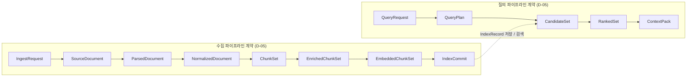
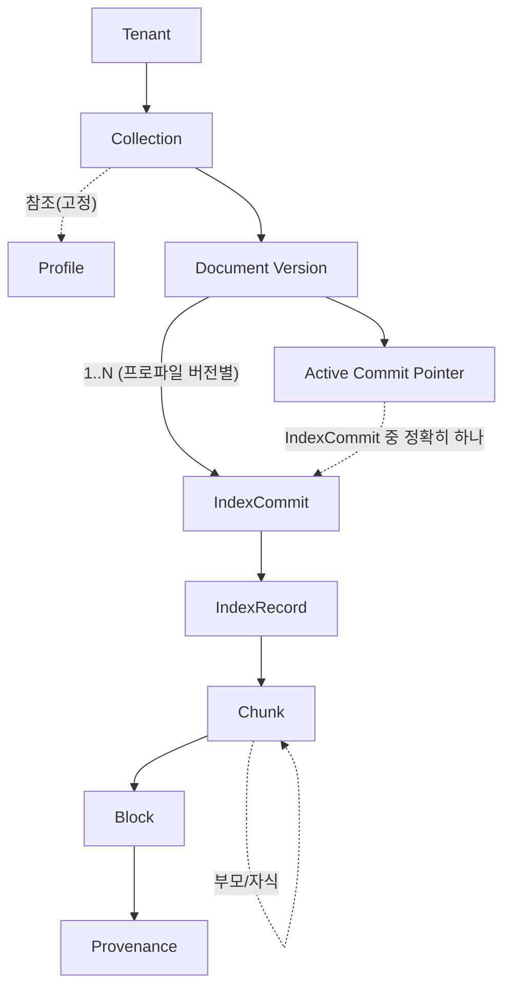
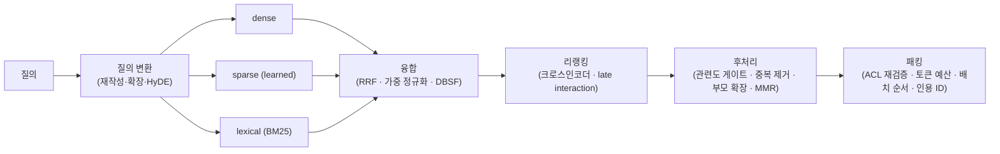

# 용어집 (Glossary)

## 목적

이 문서는 RAG Platform의 모든 산출물(요구사항, 아키텍처, 계약, 파이프라인, API, 평가, 운영 문서)과 코드·스키마에서 사용하는 용어의 **단일 기준**이다. 같은 개념을 문서마다 다르게 부르거나, 다른 개념을 같은 이름으로 부르는 일을 막는다. 정의는 일반적인 사전 정의가 아니라 **이 플랫폼 맥락에서의 정확한 의미**로 쓴다. 설계 브리프 §10의 핵심 용어를 포함하고 확장한다.

## 범위

- 포함: 도메인 용어, 파이프라인 용어, 검색 용어, 임베딩 용어, 평가 용어, 운영 용어, 한국어 처리 용어, 문서 포맷 용어, 약어.
- 제외: 계약의 필드 단위 정의(각 계약 문서가 소유), 오픈소스 라이브러리의 상세 API(07-tech-landscape가 소유), 아키텍처 결정 자체(브리프·ADR이 소유).
- 우선순위: 브리프 §0의 순서(설계 브리프 > 설계 바이블 > ADR > 개별 설계 문서)를 따른다. 이 문서의 용어가 브리프 §10 또는 설계 바이블([A-00])과 충돌하면 그쪽이 우선한다. 계약 문서가 필드명을 확정하면 이 문서는 그 필드명을 따라 갱신된다.

## 표기 규약

| 항목 | 규약 |
|------|------|
| 표 형식 | `용어(한국어) / English / 정의 / 관련 계약·문서 / 비고`. 한국어 표기가 대표 표기이며 본문에서는 처음 등장 시 `한국어(English)` 병기 후 둘 중 하나를 쓴다. |
| 대표 표기 | 같은 개념의 여러 한국어 표기 중 이 문서의 "용어(한국어)" 열이 대표 표기다. 다른 표기는 비고의 "동의어"에 적고, 다른 문서에서는 대표 표기를 쓴다. |
| 식별자 | 계약 타입은 `PascalCase`(예: `ParsedDocument`), 필드·확장 지점·열거값은 `snake_case`로 백틱 안에 쓴다. 이 문서에 나온 필드명 중 브리프에 없는 것은 "필드명은 계약 문서에서 확정"으로 표시한다. |
| 동의어 / 혼동 주의 | 비고 열에 `동의어:`(같은 뜻, 대표 표기 아님), `혼동 주의:`(다른 뜻인데 헷갈리는 용어), `비권장:`(쓰지 말 것)으로 표기한다. |
| 브리프 출처 | 브리프 §10에 이미 정의된 용어는 비고에 `브리프 §10`을 표기한다. 브리프 결정은 `D-xx`, 개방 결정은 `O-xx`로 인용한다. |
| 문서 링크 | 관련 문서는 산출물 맵(브리프 §8)의 경로만 참조한다. 표 안에서는 짧은 키를 쓰고 키의 실제 경로와 문서 제목은 "## 참조"의 링크 정의(`[키]: 경로 "제목"`)에 있다. 렌더 시 링크 텍스트는 키로 표시되고 제목은 title 속성으로 보인다(표 셀 폭을 위한 의도적 축약, 브리프 §9.6의 변형). 키 규칙: `REQ-nn` = 01-requirements, `A-nn` = 02-architecture, `C-nn` = 03-contracts, `P-nn` = 04-pipelines, `API-nn` = 05-api, `E-nn` = 08-evaluation, `OPS-nn` = 09-operations, `DEV-nn` = 10-development, `TL-nn` = 07-tech-landscape, `APP-nn` = 12-appendix, `ADR` = 06-adr 인덱스, `BRIEF` = 설계 브리프. `nn`은 해당 디렉터리 안의 문서 번호다. |
| 불확실성 | 오픈소스의 라이선스·버전처럼 단정할 수 없는 사실은 "확인 필요(as of 2026-09)"로 표시한다. |

## 용어 지도

용어의 위치를 먼저 그림으로 잡는다. 첫 그림은 두 파이프라인의 계약 경계(D-05)이고, 둘째 그림은 데이터 단위의 포함 관계다.

읽는 법: 테넌트가 컬렉션을 가지고, 컬렉션은 하나의 프로파일에 고정된다. 문서 버전과 프로파일 버전의 조합마다 인덱스 커밋이 하나 만들어지므로(브리프 §7 재현성), 한 문서 버전은 재인덱싱을 거치며 시간축에서 여러 커밋을 가질 수 있고 그중 정확히 하나가 활성 커밋 포인터에 의해 검색에 쓰인다. 커밋은 인덱스 레코드들로 구성된다. 각 레코드는 청크 하나에 대응하고, 청크는 하나 이상의 블록에서 만들어지며, 블록은 출처 정보를 가진다.

## 1. 도메인 용어

문서가 플랫폼을 통과하며 취하는 표현들과, 리트리벌이 돌려주는 산출물의 용어다.

| 용어(한국어) | English | 정의 | 관련 계약/문서 | 비고 |
|---|---|---|---|---|
| 설계 바이블 | Design Bible | 브리프 다음 우선순위의 단일 진실 원천 문서(`02-architecture/00-design-bible.md`). 스테이지 계약·열거 정본·명명 규약·프로파일·API 표면을 확정하고, 개별 설계 문서와 충돌하면 이 문서가 개정 대상이 된다(§0 우선순위). | [A-00] | 바이블 §16(용어 반영 사항)이 이 문서의 정본 입력이다. |
| RAG | Retrieval-Augmented Generation | LLM이 답을 생성하기 전에 외부 지식 저장소에서 관련 컨텍스트를 검색해 프롬프트에 넣는 패턴. 이 플랫폼은 그중 검색 측(수집·인덱싱·리트리벌·컨텍스트 패킹)을 제공하고 생성은 호출자에게 맡긴다. | [BRIEF] | 동의어: 검색 증강 생성. 선택적 `answer` 엔드포인트는 레퍼런스 구현이다(브리프 §6). |
| LLM | Large Language Model | 컨텍스트 팩의 최종 소비자. 이 플랫폼의 출력은 사람이 아니라 LLM이 읽는다는 전제로 설계된다(원칙 10). | [BRIEF], [C-11] | |
| 컨텍스트 윈도우 | Context Window | LLM이 한 번에 받을 수 있는 최대 토큰 수. 토큰 예산은 항상 컨텍스트 윈도우보다 작게 잡는다. | [C-11], [PL-17] | 혼동 주의: 토큰 예산은 팩이 차지할 몫이고, 컨텍스트 윈도우는 모델의 상한이다. |
| 수집 요청 | Ingest Request | 클라이언트가 수집 API로 보내는 요청 계약(`IngestRequest`). 원본의 URI, 수집 메타데이터, 대상 `tenant_id`·`collection_id`, 처리 정책(프로파일, 우선순위, 멱등성 키)을 담는다. 수집 파이프라인의 첫 입력. | [C-01], [API-02] | 플랫폼은 크롤러가 아니다(R1). 파일 본문이 아니라 위치를 받는다. |
| 원본 문서 | Source Document | URI로 식별되는 원본 파일과 수집 메타데이터, 페처가 확보한 바이트의 콘텐츠 해시·크기·감지된 MIME 타입을 묶은 계약(`SourceDocument`). | [C-02], [PL-02] | 브리프 §10. 동의어: 원문, 원천 문서. 혼동 주의: 접두어 없는 "문서"는 어느 단계의 표현인지 불명확하므로 쓰지 않는다. |
| 파싱 문서 | Parsed Document | 포맷 독립 표준 문서 모델 계약(`ParsedDocument`). 계층 블록 트리와 각 블록의 출처 정보를 필수 보존한다. 벤더 모델(DoclingDocument, Unstructured Elements 등)을 채택하지 않고 플랫폼이 자체 소유하는 표준 문서 모델의 기준점(D-04). | [C-03], [PL-03] | 브리프 §10. DoclingDocument·Unstructured Elements는 어댑터로 이 모델로 변환된다. 정규화 문서·청크 세트 등 D-05의 다른 경계 계약도 모두 플랫폼 소유다. |
| 정규화 문서 | Normalized Document | 파싱 문서에 정리(cleaning), 유니코드 정규화, 읽기 순서 보정·확정, 머리말·꼬리말 제거 등을 적용한 계약(`NormalizedDocument`). 표는 셀 구조를 보존하고 셀 텍스트만 정리한다(표의 텍스트 직렬화는 청킹 단계의 표 청크가 담당, D-19). 청킹의 직접 입력. | [C-04], [PL-09] | 혼동 주의: 벡터 정규화(L2), 점수 정규화(min-max)와 다르다(§9). 정규화 텍스트 기준 오프셋을 가질 경우 원문 문자 오프셋과의 매핑은 `offset_map`이 담당한다(GL-05 해소, C-04 소유). |
| 블록 | Block | 문서 구성의 최소 구조 단위. 종류: `heading`, `paragraph`, `list_item`, `table`, `figure`, `caption`, `footnote`, `code`, `formula`, `page_break` 등. 각 블록은 부모 블록과 출처 정보를 가진다. | [C-03] | 브리프 §10. 열거값 전체 목록은 C-03에서 확정. 동의어(외부 모델): Element(Unstructured), DocItem(Docling). |
| 블록 트리 | Block Tree | 블록의 부모-자식 계층 구조. `heading` 계층이 골격이 되고 그 아래 단락·표·그림이 매달린다. 헤딩 경로 계산의 기반. | [C-03] | 동의어: 문서 트리. |
| 출처 정보 | Provenance | 블록·청크가 원본의 어디에서 왔는지를 나타내는 정보. 페이지 번호, 바운딩 박스, 문자 오프셋, 요소 경로 중 포맷이 허용하는 것을 모두 보존한다(D-04). | [C-03], [C-05] | 인용과 하이라이트의 근거. 동의어: 원출처, 소스 위치. |
| 단일 좌표계 | One Coordinate System | `block_refs → Provenance`로 인용·평가·확장이 모두 같은 좌표(요소 경로, 문자 오프셋, 페이지, bbox)를 참조하는 원칙. 좌표계가 갈리면 인용·평가·하이라이트가 서로 다른 위치를 가리키게 된다. | [C-03], [C-05] | 바이블 K1. |
| 바운딩 박스 | Bounding Box (bbox) | 페이지 좌표계에서 블록이 차지하는 직사각형 영역. 좌표 원점·단위·좌표계 방향은 계약 문서에서 확정한다. | [C-03] | PDF, 스캔 문서, 레이아웃 분석 결과에서 주로 채워진다. |
| 문자 오프셋 | Char Offset | 파서가 원본에서 추출한 텍스트 스트림(포맷별 원문 텍스트) 기준 블록·청크의 시작·끝 위치. 파싱 문서의 필수 출처 정보(D-04)이며 텍스트 기반 포맷(TXT, HTML, HWPX)의 주 출처 정보. 정규화 문서가 정규화 텍스트 기준의 별도 오프셋을 가지면 원문 오프셋으로의 매핑을 보존해야 "원본의 어디에서 왔는지"가 유지된다. | [C-03], [C-04] | **결정(바이블 §16, GL-05 해소):** 기준 텍스트 = 원문 `Block.text` 코드포인트 단위. 정규화 텍스트 오프셋은 `offset_map`으로 원문 오프셋에 사상한다. |
| 블록 참조 | `BlockRef` | 청크·레코드·결과가 공통으로 쓰는 좌표 구조체: `block_id, element_path, char_start/end`(display), `original_char_start/end`(원문), `page`, `bbox`. 정규화 뷰와 원문 뷰의 오프셋을 함께 병기해 단일 좌표계(K1)를 실현한다. | [C-03], [C-05] | GL-05 해소(위 문자 오프셋 행 참조). |
| 요소 경로 | Element Path | 원본 구조 안에서 블록의 위치 경로(예: HWPX section/paragraph 인덱스, HTML DOM 경로, DOCX body 인덱스). 재파싱 시 같은 블록을 다시 찾는 키. | [C-03] | 동의어: 구조 경로. |
| 페이지 | Page | 렌더 기준 물리 단위. PDF·HWP는 페이지가 확정적이지만 HTML·TXT에는 없다. 페이지 없는 포맷은 `page_break` 블록을 갖지 않는다. | [C-03] | 혼동 주의: 인쇄된 페이지 번호와 페이지 인덱스(0 또는 1 기준)는 다를 수 있다. |
| 청크 | Chunk | 검색의 기본 단위. 하나 이상의 블록(또는 블록 조각), 헤딩 경로(브리프 §10의 "부모 경로"), 토큰 수, 출처 정보를 가진다. 임베딩·인덱싱·리트리벌은 청크 단위로 이루어진다. | [C-05], [PL-10] | 브리프 §10. 혼동 주의: 블록(구조 단위), 인덱스 레코드(저장 단위)와 다르다. 비권장: 조각, 세그먼트. |
| 3-텍스트 규칙 | Three-Text Rule | 청크가 서로 다른 목적의 텍스트 세 가지, 즉 표시용 `text`, 임베딩 입력 `embed_text`, 색인·BM25 입력 `index_text`를 구분해 갖는 원칙. 세 텍스트 사이의 위치 대응은 `strip_offsets`가 보존한다. | [C-05], [C-07] | 바이블 K2. |
| 텍스트 출처 / OCR 최저 신뢰도 | Text Source (`text_source`) / `ocr_confidence_min` | 청크(또는 부모 항목) 텍스트가 어느 출처(파서 원문, OCR, LLM 보강)에서 왔는지 나타내는 `text_source`와 그 안에서 가장 낮은 OCR 신뢰도 `ocr_confidence_min`. 렌더러는 OCR 유래 텍스트를 `[ocr]`로 표기할 수 있다. | [C-05], [PL-11] | 부모 텍스트 번들(§13.2)에도 동일 필드가 있다. |
| 청크 세트 | Chunk Set | 한 문서 버전에서 생성된 청크 전체와 청킹 프로파일 정보를 담는 계약(`ChunkSet`). 부모-자식 관계를 포함한다. | [C-05] | |
| 부모 청크 / 자식 청크 | Parent Chunk / Child Chunk | small-to-big 전략의 두 계층. 자식은 작아서 정밀 매칭에 유리하고, 부모는 커서 LLM에 충분한 문맥을 준다. 인덱스에는 자식이 들어가고 컨텍스트 팩에는 부모(또는 병합된 형제)가 실릴 수 있다. | [C-05], [PL-17] | 동의어: 소형/대형 청크, 자식/부모 노드. |
| 헤딩 경로 | Heading Path | 청크가 속한 `heading` 계층을 루트부터 나열한 경로(예: "3. 계약 > 3.2 파싱 문서"). 문맥 보강과 인용 표시에 쓰인다. | [C-05] | 동의어: 부모 경로(브리프 §10), 섹션 경로, breadcrumb. 혼동 주의: 부모 청크(parent chunk)의 경로가 아니다. |
| 표 청크 | Table Chunk | 표 블록 전용 청킹 결과. 표의 셀 구조는 파싱·정규화 단계가 보존하고, 청킹 단계가 구조 보존 표현(Markdown 또는 HTML)과 행 단위 직렬화 텍스트를 함께 만든다(D-19). | [C-05], [PL-10] | 큰 표의 분할 방식(헤더 행 반복 부착 등)은 P-10에서 확정. |
| 그림 / 캡션 | Figure / Caption | 이미지·도표 블록과 그 설명 텍스트. 기본 프로파일 제안은 그림 자체를 임베딩하지 않고 캡션·대체 텍스트·(선택) 비전 모델 설명을 텍스트화해 청크에 넣는 것이다(P-11에서 확정). | [C-03], [PL-11] | 이미지 자체 검색(ColPali 등)은 O-04 결과에 따른 프로파일 옵션. |
| 각주 | Footnote | 본문과 분리된 참조 블록. 정규화 단계에서 본문 근처로 옮길지 별도 청크로 둘지는 프로파일이 정한다. | [C-03], [PL-09] | HWPX, DOCX, PDF마다 표현이 다르다. |
| 보강 | Enrichment | 청크에 부착되는 파생 정보. 문맥 요약(contextual prefix), 키워드, 가상 질문, 엔티티, 언어 코드 등. 원문을 바꾸지 않고 덧붙인다. | [C-06], [PL-11] | 브리프 §10. LLM 기반 보강의 기본 켬/끔은 O-05. |
| 보강 청크 세트 | Enriched Chunk Set | 보강이 부착된 청크 세트 계약(`EnrichedChunkSet`). 임베딩의 직접 입력. | [C-06] | |
| 임베딩 청크 세트 | Embedded Chunk Set | 각 청크에 벡터(dense, sparse, 선택적 multi-vector)와 임베딩 지문이 부착된 계약(`EmbeddedChunkSet`). | [C-07], [PL-12] | |
| 인덱스 레코드 | Index Record | 인덱스 백엔드에 실제 저장되는 최종 레코드. 벡터들과 페이로드(텍스트, 메타데이터, `tenant_id`, `collection_id`, `acl`, 출처 정보)를 포함한다. | [C-07], [PL-13] | 브리프 §10. 한 청크가 여러 백엔드(Qdrant, OpenSearch)에 각각 레코드로 저장될 수 있다. |
| 페이로드 | Payload | 인덱스 레코드에서 벡터를 제외한 구조화 필드. 필터·정렬·반환의 대상. | [C-07] | Qdrant 용어. OpenSearch에서는 문서 필드(field)에 대응한다. |
| 레코드 키 | Record ID (`record_id`) | 테넌트·컬렉션·문서·세대(`index_generation`)를 합성한 물리 인덱스 키. `record_id = H("record", tenant_id, collection_id, document_id, str(index_generation), chunk_id)`이며 Qdrant `point_id = uuid5(NAMESPACE_RAG_CHUNK, record_id)`, OpenSearch `_id = record_id`다. | [C-07], [PL-13] | ADR-0004(v1.2). 이전 안 `point_id = uuid5(chunk_id)`는 스코프가 없어 동일 바이트 문서를 다른 테넌트·컬렉션이 수집하면 레코드가 서로 덮어썼다(리뷰 blocker로 정정). `chunk_id`는 콘텐츠 주소 payload 필드로 유지한다. |
| 인덱스 커밋 | Index Commit | 한 문서 버전을 특정 프로파일 버전으로 인덱싱한 결과 단위 계약(`IndexCommit`). 이전 커밋 레코드의 원자적 교체와 롤백의 단위이며, 동일 입력·동일 프로파일이면 동일 해시를 가진다(브리프 §7 재현성). 한 문서 버전은 프로파일 버전별로 여러 커밋을 가질 수 있고(재인덱싱), 그중 하나가 활성 커밋이다(§2). | [C-08], [PL-13], [PL-19] | 브리프 §10. 혼동 주의: 잡은 실행 단위, 커밋은 결과 단위. |
| 세대 / 현재 플래그 | Generation (`index_generation`) / `is_current` | 문서 단위 blue/green 재인덱싱의 세대 번호(원장 행 잠금으로 워크플로우가 1회 발급)와 그중 검색에 쓰이는 세대를 가리키는 플래그. 세대 플립은 `is_current`를 원자적으로 바꾸는 행위다(ADR-0026). | [C-08], [PL-13], [PL-19] | **미정(O-12):** blue/green 채움 중 원장 기준 세대 판정. |
| 문서 버전 | Document Version | 같은 URI(또는 같은 외부 ID)의 원본이 내용 변경으로 다시 수집될 때 구분되는 버전. **결정(바이블 §16, GL-12 해소, ADR-0005):** `doc_version = content_hash`(콘텐츠만); ACL·메타데이터 변경은 새 버전을 만들지 않는다. | [C-02], [C-08], [PL-19] | 동의어: 리비전. 메타데이터·ACL만 바뀐 재수집은 기존 커밋의 페이로드 갱신으로 처리한다. |
| 콘텐츠 해시 | Content Hash | 바이트 또는 정규화된 산출물의 BLAKE3 해시(hex). 멱등성·캐시·재현성 판별의 기준(D-06). | [C-00] | 동의어: 다이제스트. |
| 질의 요청 | Query Request | 리트리벌 API의 입력 계약(`QueryRequest`). 질의 텍스트, `tenant_id`, `collection_id`, 필터, 최종 K, 토큰 예산 등을 담는다. 요청 단위로 프로파일 파라미터를 덮어쓸 수 있는 범위는 컬렉션-프로파일 고정 원칙(브리프 §10)과 함께 C-09가 정한다. | [C-09], [API-03] | **필드명 확정(GL-08 해소):** `pack.k_max`(최종 K), `channels[].top_k`(후보 K), `rerank.top_n_in`/`rerank.top_n_out`(리랭크 K). |
| 질의 계획 | Query Plan | 질의 이해 결과 계약(`QueryPlan`). 재작성된 질의들, 추출된 필터, 선택된 검색 전략, 리트리버별 예산을 담는다. | [C-09], [PL-14] | 브리프 §10. |
| 후보 | Candidate | 개별 리트리버(dense, sparse, lexical 등)가 반환한 청크와 그 리트리버 기준 점수·순위. | [C-10], [PL-15] | 브리프 §10. |
| 후보 세트 | Candidate Set | 모든 리트리버의 후보를 리트리버 이름별로 모은 계약(`CandidateSet`). 융합의 입력. | [C-10] | |
| 랭크 결과 | Ranked Result | 융합·리랭킹을 거친 청크와 점수 분해(dense, sparse, lexical, fused, rerank). | [C-10], [PL-16] | 브리프 §10. |
| 랭크 세트 | Ranked Set | 랭크 결과의 정렬 목록 계약(`RankedSet`). 후처리·패킹의 입력. | [C-10] | |
| 점수 분해 (점수 원장) | Score Breakdown (Score Ledger) | 최종 점수를 구성한 각 요소 점수를 개별 필드로 노출한 것. "왜 이 청크가 뽑혔는가"를 설명하는 근거(원칙 8). 점수 원장은 이 분해가 만족해야 하는 불변식 `Σ contribution = fused_score`를 가리키는 이름이다. | [C-10] | 바이블 K3. 동의어: 점수 설명, score explanation. |
| 컨텍스트 팩 | Context Pack | LLM에 전달할 최종 패키지 계약(`ContextPack`). 토큰 예산 안에 정렬된 청크, 인용 ID, 출처 정보, 신뢰도, 토큰 통계, 렌더 힌트를 담는 공급자 중립 JSON(D-20). | [C-11], [PL-17] | 브리프 §10. 단순 청크 배열이 아니다(R6). 비권장: 문맥 묶음, 컨텍스트 번들. |
| 인용 ID | Citation ID (`cite_id`) | 컨텍스트 팩 안의 각 청크(또는 청크 조각)에 부여되는 짧은 식별자. LLM이 답변에서 근거를 가리킬 때 쓰며, 출처 정보로 역참조된다. `cite_id`는 `pack.budget_cut` 이후 최종 항목에만 `d1..dK`로 연속 재부여되는 불변 규칙을 따르고(렌더 위치와는 분리), `segments`와 `CitationMap`이 인용 구간과 원문 위치의 역참조를 담당한다. | [C-11] | 렌더러가 Anthropic `citations` 등 공급자 포맷으로 변환한다. |
| 렌더러 | Renderer | 컨텍스트 팩을 특정 LLM 입력 포맷으로 직렬화하는 컴포넌트. 기본: Anthropic Messages `document` + `citations` 블록, OpenAI 호환 메시지, XML/Markdown 템플릿(D-20). | [C-11], [PL-17] | 혼동 주의: 문서 렌더링(PDF 페이지를 이미지로)과 다르다. |
| 렌더 힌트 | Render Hint | 컨텍스트 팩에 포함되어 렌더러의 동작을 안내하는 메타(권장 배치 순서, 시스템 프롬프트 템플릿 키, 표 표현 방식 등). | [C-11] | |
| 토큰 예산 | Token Budget | 컨텍스트 팩이 차지할 수 있는 최대 토큰 수. 질의 요청에서 지정하며 패커가 이를 지켜 청크를 선택·절단한다. | [C-09], [C-11], [PL-17] | 토큰 계산에 쓴 토크나이저를 팩에 기록할지와 그 필드는 C-11에서 확정. |
| 신뢰도 점수 | Confidence Score | 컨텍스트 팩 수준 또는 청크 수준에서 "이 결과가 질의에 답할 수 있는가"를 나타내는 정규화 점수. 리랭커 점수·융합 점수·임계값에서 도출한다. | [C-11] | 혼동 주의: 유사도 점수 그 자체가 아니다. |
| 저하 기록 / 품질 삼중항 | `degraded[]` / Quality Triad | 컨텍스트 팩과 결과 항목이 갖는 `quality`·`warnings`·`degraded`(또는 `page_status`)의 세 필드 조합. 무엇을 신뢰할 수 없는지(저하 원인)와 왜 저하됐는지(경고)를 함께 노출한다(원칙 8). | [C-11], [C-10] | 예: Valkey 불가 시 `degraded{acl_recheck, unavailable}`. |
| 프롬프트 템플릿 힌트 | Prompt Template Hint | 컨텍스트 팩과 함께 제공되는 권장 시스템 프롬프트·인용 지시문의 식별자 또는 본문. 호출자가 그대로 쓰거나 무시할 수 있다. | [C-11] | 렌더 힌트의 한 종류. |

## 2. 파이프라인 용어

스테이지, 프로파일, 아티팩트, 커밋처럼 파이프라인의 실행 모델과 확장 지점(D-10)을 가리키는 용어다.

| 용어(한국어) | English | 정의 | 관련 계약/문서 | 비고 |
|---|---|---|---|---|
| 파이프라인 | Pipeline | 스테이지의 순차 또는 DAG 조합. 수집 파이프라인과 질의 파이프라인 두 종류가 있다. | [PL-01], [A-03] | |
| 스테이지 | Stage | 단일 책임의 순수 변환 `Stage[In, Out]`. 입력 계약을 받아 출력 계약을 낸다. 상태·재시도·타임아웃은 갖지 않는다(원칙 3). | [PL-01], [C-00] | 동의어: 단계. |
| 순수 스테이지 | Pure Stage | 같은 입력이면 같은 출력을 내고 외부 부수효과가 없는 스테이지. 멱등성·캐싱·재현성의 전제. | [PL-01] | LLM 호출 스테이지는 결정적 설정(예: temperature 0, 모델 버전 고정)으로 준-순수를 목표로 한다는 것이 기본 제안이며 P-01·P-11에서 확정. |
| 스테이지 계약 | Stage Contract | 스테이지 경계의 입력·출력 스키마. JSON Schema 2020-12와 Pydantic v2 모델로 게시되고 `schema_version`을 가진다(D-05). | [C-00], [C-14] | 동의어: 경계 계약. |
| 스키마 버전 | Schema Version | 계약의 버전 문자열(`schema_version`). 계약이 바뀌면 반드시 올라간다(원칙 1). 모든 계약 인스턴스가 이 필드를 가진다. | [C-14] | 호환성 규칙은 C-14가 소유. |
| 스키마 diff 보고서 / 호환 등급 | `SchemaDiffReport` / `CompatLevel` / `SchemaChangeKind` | 계약 스키마 두 버전을 비교해 변경 종류(`changes[].kind`, 예: `property_added_optional`, `type_changed`)를 나열하고 선언·계산 수준의 호환 등급(`patch, minor, major`)을 판정하는 산출물과 그 열거들. CI 릴리스 게이트와 `GET /v1/schemas`가 사용한다. | [C-14] | 1.3.0 계약 인벤토리 35종째로 등재(AM-01). |
| 프로파일 | Profile | 파이프라인 구성 프리셋. 파서·청커·임베더·인덱스·검색 전략·리랭커의 조합과 파라미터를 버전드로 고정한다. 컬렉션은 하나의 프로파일에 고정된다. | [A-05], [OPS-02] | 브리프 §10. 혼동 주의: 컬렉션은 데이터 단위, 프로파일은 구성 단위. |
| 경량 프로파일 | Lightweight Profile | 외부 의존을 최소화한 프로파일. 인덱스는 Qdrant 단독으로 dense + lexical 2-way 하이브리드, 실행은 `LocalRunner`(D-15, D-17, ADR-0003). **결정(바이블 §16, GL-13·GL-14 해소, ADR-0012·ADR-0021):** lexical 레그는 플랫폼이 형태소 분석기로 토큰화한 뒤 BM25 TF 포화값을 계산해 `sparse_bm25`(`modifier: idf`)로 Qdrant에 저장한다(한국어 형태소 분석 공백 해소). 임베딩 서빙 방식(CPU 로컬 등)은 A-08에서 확정. | [A-08], [OPS-01] | 동의어: 로컬 프로파일, 개발 프로파일. |
| 스테이지 키 / 스코프 키 | `stage_key` / `scope_key` | 멱등성 키 = 캐시 키 = 산출물 경로로 쓰이는 합성 키. `stage_key = H("stage", stage_name, scope_key, input_hash, fingerprint)`, `scope_key = tenant_id/collection_id/document_id`. `input_hash`는 `detect`·`parse`에서 원본 `content_hash`, 그 외 스테이지는 상류 산출물의 `blake3`다. | [A-04], [PL-01] | ADR-0037. 봉투 없는 콘텐츠 전용 캐시(원본 바이트, 임베딩, LLM 보강)만 `scope_key` 없이 테넌트 내 공유한다. |
| 아티팩트 | Artifact | 스테이지가 만든 산출물의 영속 표현. 오브젝트 스토리지에 콘텐츠 해시로 주소화되어 저장되며 재처리·캐시·감사에 쓰인다(원칙 4). | [A-04], [PL-01] | 동의어: 산출물. |
| 지문 | Producer / `fingerprint` | 스테이지·플러그인·설정·모델·이미지의 재현성 지문. 같은 지문이면 같은 출력을 낸다는 전제로 캐시·재현성 판정에 쓰인다(예: `embed`의 지문은 `config_hash`에 `embedding_space_id`를 담는다). | [A-04], [C-14] | 모델 식별 키 `embedder_fingerprint`(§6.2)와는 별개 키다. |
| 산출물 참조 / 파생물 쓰기 포트 | `ArtifactRef` / `DerivedArtifacts` | `ArtifactRef`는 스테이지 경계를 넘는 유일한 페이로드다(오케스트레이터 페이로드 크기 한계 때문에 계약 인스턴스 자체를 넘기지 않는다). `DerivedArtifacts`는 `StageContext.artifacts`로 제공되는 파생물 쓰기 포트로, 스테이지는 여전히 I/O를 직접 쓰지 않고 이 포트로만 파생물을 저장한다. 스테이지가 선언한 `requires_lineage`(예: `chunk`는 `ParsedDocument`, LLM `enrich`는 `ChunkSet`)는 셸이 입력의 `lineage_refs`에서 함께 로드해 `ctx.lineage[...]`로 제공한다. | [A-04], [C-00] | AM-26·AM-27. |
| 콘텐츠 주소화 저장 | Content-Addressed Storage (CAS) | 아티팩트의 내용 해시를 키로 저장하는 방식. 같은 내용은 한 번만 저장되고 참조로 재사용된다. | [A-04] | |
| 커밋 | Commit | 인덱싱 결과를 원자적으로 반영하는 행위와 그 결과 단위. 인덱스 커밋(§1) 참조. | [C-08], [PL-13] | 혼동 주의: git 커밋과 무관하다. |
| 활성 커밋 | Active Commit | 한 문서 버전의 커밋들 중 현재 검색에 쓰이는 커밋. 활성 커밋 포인터(또는 별칭)가 가리키며, 원자적 교체·롤백은 이 포인터를 바꾸는 행위다. 문서 버전당 정확히 하나다. | [C-08], [PL-13], [PL-19] | 포인터의 표현(백엔드 별칭 vs 메타 DB 필드)은 C-08·P-13에서 확정. |
| 잡 | Job | 하나의 수집 요청에 대한 비동기 실행 단위. `job_id`로 식별하고 상태 URL로 조회한다(D-08). | [C-12], [API-02] | |
| 잡 상태 | Job State | 잡의 생애 주기 상태. **결정(바이블 §16, GL-06 해소):** `queued, running, succeeded, partial, failed, cancelling, cancelled`로 확정. 상태 전이는 C-12의 stateDiagram으로 게시된다. | [C-12] | |
| 컬렉션 삭제 잡 | `JobKind.delete_collection` / `collection.delete.v1` | 컬렉션을 논리 삭제(`collections.deleted_at`)하고, 문서 ID를 순회하며 자식 `delete.document.v1` 잡을 팬아웃한 뒤 물리 컬렉션·별칭을 정리하는 1.3.0 가산 잡 종류. | [C-12], [API-04] | AM-37. |
| 이벤트 | Event | 상태 변화의 알림 레코드. 이름은 `domain.entity.action`(예: `ingest.document.parsed`). 웹훅·이벤트 스트림으로 전달된다. | [C-12], [API-07] | 이벤트 버스 추가 여부는 O-06. |
| 이벤트 봉투 / 아웃박스 릴레이 | `CloudEventEnvelope` / Outbox Relay | 도메인 이벤트를 CloudEvents 형식으로 감싸는 봉투와, PostgreSQL 아웃박스 테이블에 쓴 이벤트를 실제 웹훅·SSE로 전달하는 릴레이 컴포넌트. 이벤트 발행과 잡 상태 커밋을 같은 트랜잭션에 두어 유실을 막는다(D-08). | [C-12], [API-07] | |
| 웹훅 | Webhook | 이벤트를 클라이언트가 지정한 HTTPS 엔드포인트로 푸시하는 방식. 서명·재시도 정책을 갖는다. | [API-07] | |
| 오케스트레이터 | Orchestrator | 스테이지 실행 순서, 재시도, 타임아웃, 하트비트, 사가를 책임지는 컴포넌트. 기본 Temporal(D-17). | [A-06] | 스테이지는 오케스트레이터의 존재를 모른다. |
| 디스패처 | Dispatcher | 문서 단위 잡 직렬화와 테넌트 동시성 상한을 원장(`jobs`) 기준으로 강제하는 api 구성요소. 같은 문서에 대한 동시 잡이 서로 레이스하지 않도록 순서를 매긴다(§11.2). | [A-06], [A-08] | |
| 워크플로우 / 액티비티 | Workflow / Activity | Temporal 용어. 워크플로우는 결정적(deterministic) 조정 로직, 액티비티는 실제 작업. 스테이지는 액티비티로 감싸져 실행된다. | [A-06] | `LocalRunner`도 같은 워크플로우 정의를 실행한다. |
| 인프로세스 러너 | LocalRunner (In-process Runner) | Temporal 없이 같은 프로세스 안에서 워크플로우 정의를 실행하는 개발·경량 모드 실행기. **결정(D-17 개정):** 정식 명칭 `LocalRunner`이며 비내구(durable하지 않음)임을 이름에 명시한다. | [A-06], [DEV-02] | ADR-0003. |
| 하트비트 | Heartbeat | 장시간 액티비티(OCR, 대량 임베딩)가 살아 있음을 오케스트레이터에 주기적으로 알리는 신호. 끊기면 타임아웃으로 재시도된다. | [A-06] | |
| 어댑터 | Adapter | 외부 오픈소스(Docling, Unstructured, python-hwpx 등)의 API·모델을 우리 계약으로 변환하는 얇은 계층. 포크하지 않는다(원칙 2). | [A-05], [PL-03] | |
| 격리 사다리 | Isolation Ladder | 라이선스·안정성이 낮은 어댑터를 격리하는 3단계: `in_process`(코어와 같은 프로세스), `helper_process`(별도 프로세스, 같은 호스트), `sidecar`(별도 컨테이너·네트워크 분리). 등급이 높을수록 안전하지만 지연·운영 비용이 늘어난다. | [A-05], [A-08] | `IsolationMode` 열거(§7.4). AGPL 라이브러리(PyMuPDF, pyhwp)는 sidecar 격리 대상이다. |
| 사이드카 변환 계약 | `POST /v1/convert` / `SidecarStage` | 사이드카(격리된 변환 프로세스)가 공통으로 노출하는 REST 계약. 입력·출력은 `ArtifactRef`와 RFC 9457 오류 모델을 그대로 재사용해 사이드카가 코어와 같은 관용구를 따르게 한다. | [A-05], [C-13] | |
| 플러그인 | Plugin | 확장 지점을 구현해 레지스트리에 등록되는 패키지. 코어와 같은 계약을 따르며 설정으로 선택된다(D-10). | [A-05], [DEV-06] | |
| 확장 지점 | Extension Point | 플러그인이 끼워지는 인터페이스. `fetcher`, `parser`, `normalizer`, `chunker`, `enricher`, `embedder`, `index_backend`, `query_transformer`, `retriever`, `fuser`, `reranker`, `postprocessor`, `packer`, `evaluator`의 14개(D-10). | [A-05] | |
| 플러그인 레지스트리 | Plugin Registry | Python entry points로 발견된 플러그인을 이름·버전·확장 지점별로 관리하는 카탈로그. | [A-05] | |
| URI | Uniform Resource Identifier | 원본의 위치를 가리키는 표준 식별자(RFC 3986). 수집 요청은 파일 본문이 아니라 URI를 받는다(R1). 지원 스킴은 등록된 페처 플러그인이 정한다. | [C-01], [PL-02] | 브리프 R1의 스킴: `s3://`, `gs://`, `az://`, `file://`, `http(s)://`, `smb://`(플러그인). |
| 페처 | Fetcher | URI 스킴별로 원본 바이트를 가져오는 확장 지점(`s3://`, `gs://`, `az://`, `file://`, `http(s)://`, `smb://`). 원본 문서를 만든다. | [PL-02] | |
| 포맷 감지 | Format Detection | MIME 타입, 확장자, 매직 바이트, 컨테이너 내부 검사로 원본 포맷을 판정하는 단계. 파싱 라우터의 입력. | [PL-03] | HWPX(ZIP)와 DOCX(ZIP)의 구분은 컨테이너 내부 파일 목록으로 한다. |
| 파싱 라우터 | Parsing Router | 감지된 포맷과 프로파일에 따라 파서 플러그인과 폴백 순서를 결정하는 컴포넌트. | [PL-03] | |
| 파서 | Parser | 원본 바이트를 파싱 문서로 변환하는 확장 지점. 포맷별 구현(HWPX, HWP, PDF, DOCX, HTML, TXT). | [PL-03], [PL-04], [PL-05], [PL-06], [PL-07], [PL-08] | |
| 정규화기 | Normalizer | 파싱 문서를 정규화 문서로 변환하는 확장 지점. | [PL-09] | |
| 청커 | Chunker | 정규화 문서를 청크 세트로 변환하는 확장 지점. 기본은 구조 인식 계층 청킹(D-19). | [PL-10] | |
| 인리처 | Enricher | 청크에 보강을 부착하는 확장 지점. 여러 인리처가 체인으로 실행될 수 있다. | [PL-11] | 동의어: 보강기. |
| 임베더 | Embedder | 청크 텍스트를 벡터로 변환하는 확장 지점. 모델과 서빙 백엔드(vLLM pooling, TEI, 인프로세스; Infinity는 기각—ADR-0009)를 감싼다. | [PL-12] | |
| 인덱스 백엔드 | Index Backend | 벡터·렉시컬 인덱스 엔진을 감싸는 확장 지점. 기본 Qdrant + OpenSearch, 교체 가능(D-15). | [PL-13], [A-04] | |
| 질의 변환기 | Query Transformer | 질의를 재작성·확장·분해하고 필터를 추출하는 확장 지점. 질의 계획을 만든다. | [PL-14] | |
| 리트리버 | Retriever | 질의 계획을 받아 한 종류의 검색(dense, sparse, lexical 등)을 수행하고 후보를 반환하는 확장 지점. | [PL-15] | |
| 퓨저 | Fuser | 여러 리트리버의 후보 세트를 하나의 순위로 융합하는 확장 지점(RRF, 가중 정규화, DBSF). | [PL-15] | |
| 리랭커 | Reranker | 융합된 상위 후보를 질의-문서 쌍 단위로 다시 채점하는 확장 지점. 기본 크로스인코더(D-16). | [PL-16] | |
| 후처리기 | Postprocessor | 랭크 세트에 중복 제거, 부모 확장, MMR, 임계값 필터를 적용하는 확장 지점. | [PL-17] | |
| 패커 | Packer | 후처리된 결과를 토큰 예산 안에서 정렬·절단해 컨텍스트 팩을 만드는 확장 지점. | [PL-17] | |
| 평가기 | Evaluator | 골든셋과 파이프라인 결과로 메트릭을 계산하는 확장 지점. | [E-02] | |
| 재처리 | Reprocessing | 원본을 다시 받아오지 않고 저장된 아티팩트부터 특정 스테이지 이후를 다시 실행하는 것. | [PL-19] | 혼동 주의: 재인덱싱은 재처리의 한 종류. |
| 재인덱싱 | Reindexing | 프로파일 변경(임베딩 모델 교체 등)으로 컬렉션 전체 또는 일부의 인덱스 레코드를 다시 만드는 것. 문서 버전마다 새 커밋을 만들고 활성 커밋을 원자적으로 교체한다. | [PL-19], [OPS-08] | **미정(O-11):** 물리 해시(`embedding_profile_hash`·`analyzer_id`)는 그대로이고 `profile_hash`만 바뀐 경우의 green 물리 이름·재색인 모드는 미정. 잠정적으로 자동 재색인은 하지 않는다(수동 대안: 변경 묶기 또는 새 컬렉션 이관). |
| 폴백 | Fallback | 기본 파서·OCR·모델이 실패하거나 품질 기준에 미달할 때 다음 후보로 넘어가는 규칙. | [PL-03], [A-09] | 폴백 발생은 이벤트와 아티팩트 메타에 기록한다. |
| 처리 정책 | Processing Policy | 수집 요청에 실리는 처리 지시(프로파일 선택, 우선순위, OCR 강제 여부, PII 처리 등). 컬렉션 기본값을 요청 단위로 덮어쓴다. | [C-01] | 필드명은 C-01에서 확정. |

## 3. 검색 용어

질의 파이프라인의 각 단계와 그 안의 기법을 가리키는 용어다. 단계 순서는 다음과 같다.

| 용어(한국어) | English | 정의 | 관련 계약/문서 | 비고 |
|---|---|---|---|---|
| 리트리벌 | Retrieval | 질의에 대해 인덱스에서 관련 청크를 찾아 순위를 매기는 전 과정. 이 플랫폼의 제품 표면 명칭("리트리벌 API")으로 쓴다. | [API-03], [PL-15] | 동의어: 검색. 일반 서술에서는 "검색", API·컴포넌트 이름에서는 "리트리벌"을 쓴다. |
| 항목 종류 | `item_kind` | 검색 결과 항목이 무엇을 표현하는지 나타내는 단일 열거(`chunk` 등 11값). 전략 필터 `filters.strategy`가 `level_in`과 함께 이 값으로 검색 대상을 제한한다(예: `tree_collapsed`는 summary 계층만). | [C-09], [C-10] | `ItemKind`(§5.7). |
| 밀집 검색 | Dense Retrieval | 질의와 청크를 같은 임베딩 공간의 밀집 벡터로 만들어 유사도(cosine, dot)로 찾는 검색. 의미적 유사성에 강하고 고유명사·코드·숫자에 약하다. | [PL-15], [PL-12] | 동의어: 벡터 검색, 시맨틱 검색. |
| 희소 검색 | Sparse Retrieval (learned) | 학습된 모델이 어휘별 가중치를 부여한 고차원 희소 벡터로 하는 검색. BGE-M3 sparse, SPLADE 등. 어휘 매칭과 어휘 확장을 동시에 한다. | [PL-15], [C-07] | 혼동 주의: BM25도 수학적으로는 희소 벡터지만, 이 플랫폼에서 "sparse"는 학습 희소 표현만 가리키고 BM25는 "lexical"로 부른다. D-15 경량 프로파일의 "sparse BM25"는 Qdrant sparse vector라는 저장 형식을 가리키며 리트리버 분류상 lexical이다(GL-13 해소). 기본값은 O-02. |
| 어휘 검색 | Lexical Retrieval | 형태소 분석 기반 역색인과 BM25 등 통계 가중치로 정확한 어휘 일치를 찾는 검색. 고유명사, 코드, 법조문 번호에 강하다. | [PL-15] | 동의어: 키워드 검색, 전문 검색(full-text search). 기본 OpenSearch + Nori(D-15). |
| BM25 | Best Match 25 | 용어 빈도(TF), 역문서 빈도(IDF), 문서 길이 정규화를 결합한 확률적 랭킹 함수. 어휘 검색의 기본 점수. | [PL-15] | 파라미터 k1, b는 인덱스 설정. |
| 하이브리드 검색 | Hybrid Search | dense, sparse, lexical처럼 성질이 다른 리트리버를 병렬 실행하고 결과를 융합하는 검색. 이 플랫폼의 기본(D-07). | [PL-15] | 동의어: 다중 리트리버 검색. |
| 3-way 하이브리드 | 3-way Hybrid | dense, learned sparse, lexical 세 리트리버를 모두 쓰는 하이브리드. 기본 프로파일. | [PL-15] | 경량 프로파일은 Qdrant 단독으로 dense + lexical(플랫폼이 계산한 `sparse_bm25`) 2-way(§2 경량 프로파일; GL-13·GL-14 해소). |
| 융합 | Fusion | 여러 후보 세트를 하나의 순위 목록으로 합치는 단계. 순위 기반(RRF)과 점수 기반(가중 정규화, DBSF)으로 나뉜다. | [PL-15] | 혼동 주의: 리랭킹은 융합 뒤에 모델로 재채점하는 별도 단계. 기본값은 O-01. |
| hydrate | `hydrate` | 융합 뒤 상위 후보의 payload(본문·좌표·ACL)를 1회 배치 조회하는 `fuse` 내부 서브스텝. 검색 핫패스가 PostgreSQL을 읽지 않고 인덱스 백엔드 payload만으로 동작하게 한다. | [PL-15], [C-10] | ADR-0034. |
| RRF | Reciprocal Rank Fusion | 각 리트리버에서의 순위 r에 대해 1/(k + r)을 합산하는 순위 기반 융합. 점수 스케일이 달라도 안정적이며 k는 보통 60. 기본 융합(D-07). | [PL-15] | 점수 크기 정보를 버리므로 확신도가 매우 높은 매칭이 희석될 수 있다. |
| 가중 정규화 융합 | Weighted Normalized Fusion | 리트리버별 점수를 min-max 또는 z-score로 정규화한 뒤 가중합하는 점수 기반 융합. | [PL-15] | 동의어: convex combination, 가중 선형 융합. 가중치는 골든셋으로 조정한다. |
| DBSF | Distribution-Based Score Fusion | 각 리트리버 점수 분포의 평균과 표준편차(보통 평균 ± 3σ)를 기준으로 정규화한 뒤 합산하는 융합. min-max보다 이상치에 강하다. | [PL-15] | Qdrant Query API가 내장 지원. O-01 후보. |
| MMR | Maximal Marginal Relevance | 질의 관련성과 이미 선택된 결과와의 비유사성을 λ로 가중해 순차 선택하는 다양화 기법. 비슷한 청크가 상위를 독식하는 것을 막는다. | [PL-17] | λ=1이면 관련성만, λ=0이면 다양성만 본다. |
| 리랭킹 | Reranking | 1차 검색 상위 N개를 더 비싼 모델(크로스인코더, late interaction, LLM)로 재채점해 순위를 다시 매기는 단계. | [PL-16] | 동의어: 2단계 랭킹, re-scoring. |
| 크로스인코더 | Cross-Encoder | 질의와 문서를 한 시퀀스로 함께 인코딩해 관련성 점수를 내는 모델. 정확하지만 후보마다 추론이 필요해 비싸다. 기본 bge-reranker-v2-m3(D-16). | [PL-16] | 혼동 주의: 바이인코더는 질의·문서를 독립 인코딩한다. |
| 바이인코더 | Bi-Encoder | 질의와 문서를 각각 독립 인코딩해 벡터 유사도로 비교하는 모델. 임베딩 모델이 이에 해당하며 사전 인덱싱이 가능하다. | [PL-12] | 동의어: 듀얼 인코더. |
| LLM 리랭커 | LLM Reranker | LLM에게 후보 목록을 주고 관련성 채점 또는 순서 재배열(listwise)을 시키는 리랭커. 가장 비싸고 느리다. | [PL-16] | 프로파일 옵션. 비용 정책은 O-05와 연동. |
| 후기 상호작용 | Late Interaction | 질의·문서를 토큰 단위 다중 벡터로 인코딩한 뒤 MaxSim(각 질의 토큰의 최대 유사도 합)으로 점수를 내는 방식. ColBERT 계열. 바이인코더와 크로스인코더의 중간 비용·정확도. | [PL-16], [PL-13] | 리랭커 단계에 두는지 인덱스 단계에 두는지는 O-04. 이름 붙은 벡터 슬롯 이름은 `colbert`가 아니라 `late_interaction`으로 통일한다(GL-07 해소). |
| ColBERT | Contextualized Late Interaction over BERT | 후기 상호작용의 대표 모델. BGE-M3의 colbert 벡터도 같은 방식이다. | [PL-16] | |
| ColPali | ColPali | 문서 페이지 이미지를 비전-언어 모델로 패치 단위 다중 벡터로 인코딩하는 후기 상호작용 모델. OCR 없이 레이아웃·그림까지 검색한다. | [PL-18] | 프로파일 옵션. GPU 요구. |
| Small-to-Big | Small-to-Big Retrieval | 작은 자식 청크로 검색해 정밀도를 높이고, 결과로는 부모 청크(또는 인접 청크 병합)를 돌려 LLM 문맥을 확보하는 기법(D-19). | [PL-17], [PL-10] | 동의어: auto-merging retrieval. 유사 기법: sentence window. 후처리 구현은 다음 행의 부모 확장. |
| 부모 확장 | Parent Expansion | Small-to-Big의 후처리 구현. 자식 청크가 매칭되면 부모 청크로 치환하고, 같은 부모의 자식들을 병합한다. | [PL-17] | |
| `ChunkTextStore` | `ChunkTextStore` | 부모 청크 텍스트·좌표를 조회하는 인터페이스(`get_many(chunk_set_blake3, parent_chunk_ids, security) -> {parent_chunk_id: ParentEntry}`). PostgreSQL에 의존하지 않고 아티팩트 저장소의 부모 번들(`derived/parent_texts/{chunk_set_blake3}.json`)을 읽으며, 위 행의 부모 확장이 이 인터페이스로 텍스트를 채운다. | [PL-17], [A-04] | 부모 텍스트 캐시는 Valkey `ptxt:{tenant_id}:{chunk_set_blake3}` 24h. |
| HyDE | Hypothetical Document Embeddings | LLM이 질의에 대한 가상의 답 문서를 생성하고 그 임베딩으로 검색하는 질의 변환. 질의-문서 표현 불일치를 줄인다. | [PL-14] | 프로파일 옵션. 지연·비용 증가. |
| 질의 재작성 | Query Rewriting | 오타, 구어체, 대화 맥락을 반영해 질의를 검색에 적합한 형태로 다시 쓰는 변환. | [PL-14] | |
| 질의 확장 | Query Expansion | 동의어·관련어·번역어를 질의에 추가해 재현율을 높이는 변환. 어휘 검색에서 특히 효과적. | [PL-14] | 한국어 동의어 사전과 결합. |
| 다중 질의 | Multi-Query | 하나의 질의를 여러 표현으로 변형해 각각 검색하고 결과를 융합하는 기법. | [PL-14], [PL-15] | |
| 질의 분해 | Query Decomposition | 복합 질의를 하위 질의로 나누어 각각 검색하는 변환. 에이전틱 RAG의 기본 요소. | [PL-14], [PL-18] | |
| Step-back 프롬프팅 | Step-back Prompting | 구체적 질의에서 더 일반적인 상위 개념 질의를 도출해 함께 검색하는 변환. | [PL-14] | 프로파일 옵션. |
| 필터 추출 | Filter Extraction | 자연어 질의에서 날짜, 문서 종류, 부서 같은 구조화 조건을 뽑아 페이로드 필터로 바꾸는 변환. | [PL-14], [C-09] | 동의어: self-query. |
| 필터 | Filter | 페이로드 필드 조건으로 후보 집합을 제한하는 것. `tenant_id`, `collection_id`, `acl`은 항상 강제 필터로 붙는다(D-09). | [C-09], [PL-15] | 동의어: 메타데이터 필터, 페이로드 필터. |
| 전략 필터 | `filters.strategy` | 플래너가 검색 전략(`hybrid`, `tree_collapsed`, `graph_*`, `visual_pages` 등)에 따라 결정하는 `level_in`·`item_kinds` 필터. 보안 불변식과 분리되어 있으며 사용자가 완화할 수 없다. | [C-09], [PL-14] | 보안 필터(ACL)와 나란히 적용되지만 근거가 다르다(§10.2). |
| 사전 필터 (사후 필터 비채택) | Pre-filtering (Post-filtering rejected) | 벡터 검색 전에 필터를 적용(정확, 인덱스 지원 필요)하는 방식. **결정(바이블 §16, GL-15 해소):** 모든 채널·백엔드가 사전 필터만 허용하고 사후 필터는 채택하지 않는다(재현율 손실 위험 회피). | [PL-15], [A-04] | ACL 필터는 강제(D-09). 사후 필터(Post-filtering)는 기각된 대안으로만 남긴다. |
| 최종 K | Top-K (final) | 컨텍스트 팩에 실을 결과 개수 상한. 질의 요청의 파라미터. **필드명 확정(GL-08 해소):** `pack.k_max`. | [C-09], [PL-17] | 혼동 주의: 후보 K, 리랭크 K와 구분한다(§9). |
| 후보 K | Candidate K | 각 리트리버가 가져오는 후보 개수. 최종 K보다 크게 잡는다(오버페치). **필드명 확정(GL-08 해소):** `channels[].top_k`. | [C-09], [PL-15] | 동의어: over-fetch size. |
| 리랭크 K | Rerank K | 융합 결과 중 리랭커에 넣는 상위 개수. 리랭커 비용과 Recall@k 목표로 정한다. **필드명 확정(GL-08 해소):** `rerank.top_n_in`(입력)/`rerank.top_n_out`(출력). | [C-09], [PL-16] | |
| 오버페치 | Over-fetch | 융합·리랭킹·필터에서 생기는 손실을 보상하기 위해 최종 K보다 훨씬 많은 후보를 각 리트리버에서 가져오는 것. | [PL-15] | 동의어: candidate multiplier. |
| 점수 임계값 | Score Threshold | 이 값 미만의 후보를 제외하는 절대 기준. 리랭커 점수에 적용하면 "관련 결과 없음"을 판정할 수 있다. | [PL-17], [C-11] | |
| 관련도 게이트 | Relevance Gate (`relevance_gate`, `tau`) | 후처리 고정 순서의 첫 단계. 임계값 `tau` 미만인 후보를 이후 단계(중복 제거·MMR·부모 확장)에 넘기기 전에 제외한다(D-07). | [PL-17] | 점수 임계값(위 행)의 후처리 파이프라인 내 구체 구현이다. |
| 중복 제거 | Deduplication | 동일·유사 청크(같은 콘텐츠 해시, 높은 텍스트 유사도, 같은 부모의 인접 자식)를 컨텍스트 팩에서 제거하는 후처리. | [PL-17] | 동의어: dedup. |
| 토큰 예산 패킹 | Token Budget Packing | 토큰 예산 안에서 청크를 선택·정렬·절단해 컨텍스트 팩을 채우는 후처리. lost-in-the-middle을 고려해 배치한다. | [PL-17] | |
| pack 서브스텝 | `PackStep` | `pack`이 내부에서 고정 순서로 실행하는 서브스텝: `acl_recheck`(항목별 ACL 재검증) → `budget_cut`(토큰 예산 절단) → `reorder`(LITM 교대 배치) → `citation_align`(`cite_id` 확정). **결정(D-07 v1.2 개정):** `reorder`·`citation_align`은 원래 후처리(postprocess) 단계에 있었으나, `budget_cut` 절단 뒤 `position`이 무효화되고 `cite_id`가 이중 부여되는 문제 때문에 `pack` 내부로 옮겼다. | [PL-17], [C-11] | ADR-0013. |
| Lost-in-the-middle | Lost-in-the-middle | LLM이 긴 컨텍스트의 중간에 놓인 정보를 잘 활용하지 못하는 현상. 패커는 중요한 청크를 앞과 뒤에 배치한다. | [PL-17] | Liu et al. 2023. |
| LITM 교대 배치 | `litm_alternating` | Lost-in-the-middle을 고려해 최종 K 기준으로 청크를 앞/뒤에 번갈아 배치하는 `pack.reorder`의 구체 공식(§9.2). | [PL-17] | `PackStep`의 `reorder` 단계가 이 공식을 쓴다. |
| 컨텍스트 압축 | Context Compression | 선택된 청크에서 질의와 무관한 문장을 제거하거나 요약해 토큰을 줄이는 후처리. | [PL-17], [PL-18] | 프로파일 옵션. 인용 무결성(원문 보존)에 주의. |
| 문맥 검색 | Contextual Retrieval | 청크 앞에 문서·섹션 수준 요약(contextual prefix)을 부착해 임베딩·인덱싱함으로써, 청크 단독으로는 알 수 없는 문맥을 보존하는 기법(D-19). | [PL-11], [PL-10] | Anthropic 2024. 인덱스에는 부착본, 컨텍스트 팩에는 원문 또는 부착본(프로파일). |
| 결정적 접두어 / 생성 접두어 | `context_prefix.deterministic` / `context_prefix.generated` | 문맥 검색의 두 슬롯. 결정적 접두어는 비LLM 보강(형태소 키워드 등)으로 항상 켜져 있고, 생성 접두어는 LLM 요약으로 만들며 컬렉션 정책으로 켠다(O-05). | [PL-11] | D-19. |
| 구조 인식 청킹 | Structure-aware Chunking | heading, 단락, 표, 목록 경계를 존중해 분할하고 토큰 예산에 맞춰 작은 조각을 병합하는 청킹. 기본(D-19). | [PL-10] | 동의어: 계층 청킹(hierarchical chunking). Docling HybridChunker 계열. |
| 의미 분할 | Semantic Chunking | 인접 문장 임베딩의 유사도가 급락하는 지점을 경계로 분할하는 청킹. 구조가 없는 텍스트에 유효. | [PL-10] | 프로파일 옵션. 임베딩 비용 증가. |
| 고정 크기 청킹 | Fixed-size Chunking | 토큰·문자 수 기준으로 균등 분할하는 청킹. 베이스라인으로만 사용한다. | [PL-10] | 동의어: 슬라이딩 윈도우. |
| 오버랩 | Overlap | 인접 청크가 공유하는 토큰 구간. 경계에서 잘린 문맥을 보완한다. 기본값은 O-09. | [PL-10] | 중복 제거 시 오버랩 구간을 고려한다. |
| 늦은 청킹 | Late Chunking | 문서 전체를 장문 임베딩 모델에 통과시킨 뒤 토큰 임베딩을 청크 경계로 풀링하는 기법. 청크 임베딩이 전체 문맥을 반영한다. | [PL-12], [PL-10] | 프로파일 옵션. 문맥 검색과 목적이 같고 비용 구조가 다르다. |
| 명제 청킹 | Proposition Chunking | LLM으로 텍스트를 자기완결적 단문(명제)으로 분해해 인덱싱하는 기법. | [PL-10] | 프로파일 옵션. 비용이 크다. |
| GraphRAG | GraphRAG | 문서에서 엔티티·관계를 추출해 지식 그래프와 커뮤니티 요약을 만들고, 전역 질의에 그래프 탐색·요약을 활용하는 RAG. | [PL-18], [TL-14] | 코어 옵션 모듈 vs 외부 플러그인은 O-03. LightRAG는 경량 변형. |
| RAPTOR | Recursive Abstractive Processing for Tree-Organized Retrieval | 청크를 군집화·요약하는 과정을 재귀 반복해 요약 트리를 만들고 모든 층을 함께 검색하는 기법. 문서 전반에 걸친 질의에 강하다. | [PL-18], [TL-14] | O-03. |
| 에이전틱 RAG | Agentic RAG | LLM 에이전트가 질의 분해, 도구 선택, 반복 검색, 자기 검증을 수행하는 RAG. 이 플랫폼은 MCP 서버로 에이전트가 검색을 호출하게 한다. | [PL-18], [API-05] | 동의어: iterative RAG. Self-RAG, CRAG는 자기 반성·교정 변형. |
| 충분성 / 정지 신호 | Sufficiency / `stop_signal` | 에이전틱 RAG의 반복 검색 루프가 "이미 충분한 근거를 모았는가"를 판정해 다음 반복 여부를 결정하는 신호. | [PL-18] | O-03. |
| ANN | Approximate Nearest Neighbor | 정확한 최근접 탐색 대신 근사 탐색으로 지연을 낮추는 알고리즘군(HNSW, IVF 등). | [PL-13] | 재현율 손실을 파라미터(ef, nprobe)로 조절한다. |
| HNSW | Hierarchical Navigable Small World | 다층 근접 그래프 기반 ANN 인덱스. Qdrant와 OpenSearch k-NN의 기본 인덱스이며 pgvector도 지원한다(IVFFlat과 선택). | [PL-13] | 파라미터 M, ef_construct, ef_search. |
| 유사도 함수 | Similarity Metric | 두 벡터의 근접도. cosine, dot product, Euclidean(L2). L2 정규화된 벡터에서 cosine과 dot은 동치다. | [PL-12], [PL-13] | 모델 카드가 권장하는 함수를 따른다. |
| 검색 설명 | Retrieval Explanation | 후보가 최종 순위에 오른 이유를 점수 분해, 매칭 어휘, 필터 통과 여부로 서술한 것. 디버그 모드에서 컨텍스트 팩에 첨부한다. | [C-10], [C-11] | 원칙 8. |

## 4. 임베딩 용어

| 용어(한국어) | English | 정의 | 관련 계약/문서 | 비고 |
|---|---|---|---|---|
| 임베딩 | Embedding | 텍스트(또는 이미지)를 고정 차원 실수 벡터로 사상한 것. 의미가 가까우면 벡터도 가깝도록 학습된다. | [PL-12], [C-07] | |
| 임베딩 모델 | Embedding Model | 임베딩을 생성하는 신경망. 기본 BGE-M3, 설정으로 교체 가능(D-16). | [PL-12] | 모델 식별자·리비전·차원은 임베딩 지문으로 인덱스 레코드에 기록한다. |
| 차원 | Dimension | 벡터의 길이. BGE-M3 dense는 1024. 인덱스 컬렉션 생성 시 고정된다. | [PL-12], [PL-13] | 차원 변경은 재인덱싱을 요구한다. |
| 마트료시카 표현 | Matryoshka Representation Learning (MRL) | 앞쪽 차원만 잘라 써도 성능이 완만히 감소하도록 학습된 임베딩. 저장·지연 절감을 위해 절단 차원을 선택할 수 있다. | [PL-12] | 지원 모델에서만 유효(모델 카드 확인). 혼동 주의: MRL이 아닌 모델을 단순 절단하면 성능이 크게 떨어진다. |
| 양자화 | Quantization (vector) | float32 벡터를 int8(scalar), 1비트(binary), 곱 양자화(product) 등으로 압축해 메모리·속도를 개선하는 것. 재점수(rescoring)로 정밀도를 보완한다. | [PL-13] | 혼동 주의: 모델 가중치 양자화(GGUF, AWQ 등)와 다르다. |
| 멀티벡터 | Multi-Vector | 한 청크를 여러 벡터(토큰 단위 또는 이미지 패치 단위)로 표현하는 것. 후기 상호작용에 사용. | [C-07], [PL-13] | Qdrant multivector 설정으로 저장. |
| 이름 붙은 벡터 | Named Vectors | 하나의 레코드에 여러 벡터를 이름으로 구분해 저장하는 Qdrant 기능. 하이브리드 저장의 기반(D-15). **결정(바이블 §16, GL-07 해소):** 이름은 `dense, sparse_learned, sparse_bm25, late_interaction, page_multivector, pooled_page_multivector, page_dense`로 확정(`colbert` 대신 `late_interaction`). | [C-07], [PL-13] | |
| 학습 희소 벡터 | Learned Sparse Vector | 모델이 어휘(토큰 ID)별 가중치를 출력한 희소 벡터. 인덱스는 역색인 형태로 저장한다. | [C-07] | 기본 BGE-M3 sparse(O-02). SPLADE-v3는 검토 후 기각(ADR-0014); OpenSearch neural sparse는 대안 후보. |
| SPLADE | Sparse Lexical and Expansion Model | 마스크드 언어모델의 어휘 로짓으로 희소 표현을 만들고 관련 어휘로 확장하는 학습 희소 모델. | [PL-12] | O-02 후보. |
| 모델 토크나이저 | Tokenizer (model) | 임베딩·LLM 모델이 텍스트를 서브워드 토큰으로 나누는 규칙(SentencePiece, BPE 등). 토큰 수 계산과 최대 길이 판정에 쓴다. | [PL-10], [PL-12] | 혼동 주의: 렉시컬 분석기의 토크나이저(Nori)와 다르다. 청킹 기준 토크나이저는 O-09. |
| 최대 시퀀스 길이 | Max Sequence Length | 모델이 한 번에 인코딩할 수 있는 최대 토큰 수. 초과분은 잘린다(truncation). BGE-M3는 8192. | [PL-12] | 청크 크기 상한의 근거. |
| 재카운트 | `recount` | 임베더 교체처럼 벡터를 다시 만들 필요는 없지만 토큰 수만 다시 계산해야 할 때 쓰는 경량 스테이지. `chunk`의 재카운트 서브스테이지로 실행된다. | [PL-12], [PL-10] | |
| 풀링 | Pooling | 토큰 임베딩들을 하나의 벡터로 합치는 방식(CLS, mean 등). 모델 카드에 명시된 방식을 따른다. | [PL-12] | |
| 벡터 정규화 | L2 Normalization | 벡터를 단위 길이로 만드는 것. cosine 유사도를 dot product로 계산할 수 있게 한다. | [PL-12] | 혼동 주의: 정규화 문서, 점수 정규화와 다르다(§9). |
| 인스트럭션 프리픽스 | Instruction Prefix | 일부 모델(e5, Qwen3-Embedding 등)이 요구하는 질의·문서 접두 문구(예: "query: ", "passage: "). 임베더 어댑터가 자동 부착한다. | [PL-12] | 누락 시 품질이 크게 떨어진다. |
| 비대칭 임베딩 | Asymmetric Embedding | 짧은 질의와 긴 문서를 다르게 인코딩하는 설정(프리픽스, 별도 인코더). 질의용·문서용 경로를 구분한다. | [PL-12] | |
| 임베딩 서빙 | Embedding Serving | 임베딩 모델을 HTTP/gRPC로 제공하는 런타임. **결정(D-16, ADR-0009·ADR-0010):** vLLM pooling + TEI + 인프로세스(Infinity는 BGE-M3 sparse 생산이 불가해 기각). | [PL-12], [OPS-01] | |
| 임베딩 캐시 | Embedding Cache | 동일 텍스트·동일 임베딩 지문의 벡터를 콘텐츠 해시로 재사용하는 캐시. 재처리 비용을 줄인다. | [PL-12], [A-04] | Valkey(Redis 호환, D-14 v1.3 변경 → ADR-0011) 또는 아티팩트 저장소. |
| 임베딩 공간 ID / 임베딩 프로파일 해시 | `embedding_space_id` / `embedding_profile_hash` | 벡터 공간(모델·차원·정규화 등)을 식별하는 ID와, 컬렉션이 쓰는 임베딩 설정 전체를 합성한 해시. 공간이 다르면 같은 인덱스에 벡터를 섞지 않는다. | [C-07], [PL-13] | `embedding_space_ids.sparse_learned` 변경 = blue/green 재색인 트리거(O-02). |
| 임베딩 지문 | Embedding Fingerprint | 모델 ID, 리비전, 차원, 프리픽스, 정규화 여부를 묶은 식별자. 지문이 다른 벡터는 같은 인덱스에 섞이면 안 된다. | [C-07], [PL-13] | 필드명은 C-07에서 확정. |
| BGE-M3 | BGE-M3 | BAAI의 다국어 임베딩 모델. dense(1024d), sparse, colbert 세 표현을 한 모델로 출력한다. 기본 임베딩(D-16). | [PL-12] | M3 = Multi-Functionality, Multi-Linguality, Multi-Granularity. |
| bge-reranker-v2-m3 | bge-reranker-v2-m3 | BAAI의 다국어 크로스인코더 리랭커. 기본 리랭커(D-16). | [PL-16] | |
| 배치 크기 | Batch Size | 임베딩 서빙에 한 번에 보내는 텍스트 수. 처리량과 지연의 트레이드오프. | [PL-12], [OPS-04] | |
| 이미지 임베딩 | Image Embedding | 그림·페이지 이미지를 비전 모델로 벡터화한 것. 기본 프로파일 제안은 사용하지 않고 캡션 텍스트화로 대체하는 것이다(P-11에서 확정). | [PL-11], [PL-18] | ColPali 등은 O-04. |

## 5. 평가 용어

| 용어(한국어) | English | 정의 | 관련 계약/문서 | 비고 |
|---|---|---|---|---|
| 골든셋 | Golden Set | 질의, 정답 관련 문서·청크(qrels), 선택적 정답 텍스트로 구성된 평가 데이터셋. 모든 기본값은 골든셋으로 정당화된다(원칙 7). | [E-03] | 동의어: 벤치마크 셋, 테스트 컬렉션. |
| qrels | Query Relevance Judgments | TREC 형식의 관련도 판정 목록: (query_id, doc_id 또는 chunk_id, relevance grade). 골든셋의 핵심 구성 요소(D-12). | [E-02], [E-03] | 등급형(graded) 판정이 기본. |
| 관련도 판정 | Relevance Judgment | 질의에 대해 문서·청크가 얼마나 관련 있는지의 라벨. 이진(0 또는 1) 또는 등급(0~3). | [E-03] | |
| nDCG@k | Normalized Discounted Cumulative Gain at k | 상위 k 결과의 등급형 관련도를 순위 할인(log2)하여 합산하고 이상적 순위의 값으로 정규화한 지표. 순위 품질의 주 지표(브리프 §7: nDCG@10 ≥ 0.80). | [E-02] | |
| MRR | Mean Reciprocal Rank | 첫 번째 관련 결과 순위의 역수를 질의 평균한 지표. "첫 정답이 얼마나 위에 있나". | [E-02] | |
| Recall@k | Recall at k | 전체 관련 항목 중 상위 k에 포함된 비율. 리랭크 K를 정할 때의 기준(브리프 §7: Recall@20 ≥ 0.92). | [E-02] | 혼동 주의: 컨텍스트 재현율(RAGAS)과 다르다. |
| Precision@k | Precision at k | 상위 k 중 관련 항목의 비율. | [E-02] | |
| MAP | Mean Average Precision | 관련 항목이 나온 각 위치의 정밀도를 평균한 뒤 질의 평균한 지표. | [E-02] | |
| Hit Rate@k | Hit Rate at k | 상위 k에 관련 항목이 하나라도 있는 질의의 비율. | [E-02] | 동의어: Success@k. |
| 컨텍스트 정밀도 | Context Precision | 컨텍스트 팩에 실린 청크 중 실제로 답에 필요한 청크의 비율(순위 가중). LLM-judge로 측정 가능. | [E-02], [E-04] | RAGAS 용어. |
| 컨텍스트 재현율 | Context Recall | 정답에 필요한 정보 중 컨텍스트 팩이 담고 있는 비율. | [E-02], [E-04] | RAGAS 용어. |
| LLM-judge | LLM-as-a-Judge | LLM에게 결과의 관련성·충실도 등을 채점시키는 평가 방식. 사람 판정과의 상관을 먼저 검증한다(D-12). | [E-04] | 편향(위치, 길이, 자기 선호)에 주의. |
| 충실도 | Faithfulness | 생성 답변의 주장이 제공된 컨텍스트에 의해 지지되는 비율. 환각의 반대 지표. | [E-04] | 동의어: groundedness. |
| 답변 관련성 | Answer Relevance | 생성 답변이 질의에 얼마나 직접 답하는지의 지표. | [E-04] | |
| 환각 | Hallucination | 컨텍스트에 근거가 없는 내용을 LLM이 생성하는 현상. 컨텍스트 팩의 인용 ID로 사후 검증한다. | [E-04] | |
| 베이스라인 | Baseline | 비교 기준 구성. 이 플랫폼의 기준은 dense-only 검색(브리프 §7). | [E-05] | |
| A/B 프로파일 비교 | A/B Profile Comparison | 두 프로파일을 같은 골든셋(오프라인) 또는 같은 트래픽 분할(온라인)로 비교하는 것(D-12). | [E-05], [E-06] | |
| 채널 런 ID / 변형 ID / 워크플로우 런 ID | `channel_run_id` / `variant_id` / `workflow_run_id` | 채널 × 컬렉션 × 변형의 온라인 평가 런을 식별하는 ID, 질의 변형을 식별하는 ULID, Temporal 워크플로우 실행 ID(`run_id`는 `EvalRun` 전용이므로 혼동을 피한다). | [E-06], [E-05] | |
| 오프라인 평가 / 온라인 평가 | Offline / Online Evaluation | 골든셋 기반 배치 평가와 실제 트래픽·사용자 피드백 기반 평가. | [E-01], [E-06] | |
| 합성 질의 | Synthetic Query | LLM이 청크로부터 생성한 질의. 골든셋 부트스트랩과 가상 질문 보강에 사용. | [E-03], [PL-11] | 사람 검수 요건은 E-03이 정한다(기본 제안: 검수 없이 최종 골든셋에 넣지 않음). |
| 하드 네거티브 | Hard Negative | 겉보기에 관련 있어 보이지만 정답이 아닌 청크. 리랭커 평가·조정의 난이도를 결정한다. | [E-03] | |
| 평가 하네스 | Evaluation Harness | 골든셋 로딩, 파이프라인 실행, 메트릭 계산, 리포트를 자동화한 코어 컴포넌트(D-12). | [E-02] | |
| 판정자 간 일치도 | Inter-annotator Agreement (IAA) | 여러 판정자(사람 또는 LLM)의 라벨 일치 정도(Cohen's kappa 등). 골든셋 품질 지표. | [E-03] | |
| 온라인 피드백 | Online Feedback | 클릭, 인용 사용, 좋아요/싫어요 등 실제 사용 신호. 골든셋 보강과 회귀 감지에 쓴다. | [E-06] | |
| 회귀 | Regression | 프로파일·모델·코드 변경으로 골든셋 지표가 이전보다 나빠지는 것. | [E-05], [DEV-05] | CI에서 임계값으로 차단할지와 그 기준은 DEV-05·E-05에서 확정. |
| 게이트 | Gate | 품질 기본값(리랭커 모델, 융합 가중치 등)을 바꾸는 조건. 메트릭 임계값·그리드 서치·데이터셋 기준으로 통과 여부를 판정한다. | [E-05], [DEV-05] | 예: O-05 LLM 보강 게이트는 `nDCG@10 +0.03` 이상. |

## 6. 운영 용어

| 용어(한국어) | English | 정의 | 관련 계약/문서 | 비고 |
|---|---|---|---|---|
| 테넌트 | Tenant | 데이터·설정·사용량이 격리되는 최상위 조직 단위. 모든 인덱스 레코드와 API 호출에 `tenant_id`가 존재한다(D-09). | [A-07], [OPS-05] | |
| 테넌트 상태 | `TenantStatus` | 테넌트의 활성 여부 열거(`active, disabled`). `disabled` 테넌트의 모든 요청은 `auth.forbidden`(403)으로 거부된다. 상태·정책·할당량 변경은 이벤트 `tenant.policies.changed`로 캐시를 무효화한다. | [A-07], [API-04] | AM-38. 1.3.0 가산. |
| 격리 등급 정책 | `TieringPolicy` | 테넌트 격리 강도를 고르는 3단 정책: `payload_filter`(같은 물리 인덱스, payload로 구분) → `shard_key`(전용 샤드) → `index_per_tenant`(전용 물리 인덱스). 등급이 높을수록 격리는 강하지만 자원 비용이 커진다. | [C-15], [A-07], [OPS-02] | `TenantIsolationTier` 열거. |
| 컬렉션 | Collection | 테넌트 안의 인덱스 논리 단위. 하나의 프로파일에 고정되며 `collection_id`로 식별한다. | [A-07], [API-04] | 브리프 §10. 혼동 주의: Qdrant collection·OpenSearch index는 물리 단위이며 1:1이 아닐 수 있다. |
| ACL | Access Control List | 문서 단위로 정의되는 접근 허용/거부 주체 목록(`SourceDocument.acl` 하나, `acl_hash`). **결정(§10.1):** 부모·요약·표 조각 등 모든 레벨의 레코드와 `ChunkTextStore` 번들이 문서 ACL을 그대로 상속하므로(이전 안 "부모 ACL = 자식 교집합"은 기각) small-to-big 확장으로 권한이 상승하지 않는다. 리트리벌 시 호출자 주체와의 교집합 필터가 강제된다(D-09). | [A-07], [C-07] | 필터 누락은 보안 결함이다. 블록·청크 단위 ACL은 v1 미지원. |
| 잠금 ACL | Locked ACL | `visibility=restricted`이고 `allow_principals`가 비어 있거나, `deny_principals`에 `tenant:*`가 있어 누구에게도 보이지 않는 문서. 수집은 거부하지 않고 경고 `contract.acl_deny_all`과 함께 접수한다(권한 부여 전 선적재 용도). | [C-02], [C-13] | 바이블 §16(1.3.0 명시). |
| 회수 힌트 | `aclrev` | ACL 갱신·삭제가 인덱스 백엔드 payload에 전파되기 전에 먼저 기록되는 Valkey 힌트(`aclrev:{tenant_id}:{document_id}`, TTL = 2 × 전파 SLO). `pack.acl_recheck`이 payload `acl_hash`와 힌트를 대조해 전파 창 동안의 과다 노출을 막는다(E9). | [A-07], [C-11] | Valkey 불가 시 payload 판정 + `degraded{acl_recheck, unavailable}`. |
| 주체 | Principal | 호출자가 대표하는 사용자·서비스·그룹 식별자. ACL 필터 계산의 입력. 인증은 OIDC 연동만 지원한다(브리프 §6). | [API-01], [A-07] | |
| 보안 컨텍스트 | `SecurityContext` | 서버가 주입하는 읽기 전용 보안 주체. 인증된 주체 목록, 대상 컬렉션, 시점(`as_of`)을 담아 모든 보안 판정의 입력이 된다. | [A-07], [C-09] | `QueryRequest.as_of`는 embargo 우회를 막기 위해 v1.3에서 제거됐다(D-09). |
| 멱등성 | Idempotency | 같은 요청을 여러 번 처리해도 결과가 한 번 처리한 것과 같은 성질. at-least-once 전달과 결합해 "정확히 한 번" 효과를 낸다. | [A-06], [C-01] | 원칙 4. |
| 멱등성 키 | Idempotency Key | 클라이언트가 수집 요청에 부여하는 고유 키. 같은 키의 재요청은 새 잡을 만들지 않고 기존 잡을 돌려준다. | [C-01], [API-02] | 필드명은 C-01에서 확정. |
| 사가 | Saga | 여러 단계에 걸친 작업을 각 단계의 보상 작업으로 되돌릴 수 있게 구성한 분산 트랜잭션 패턴. 인덱스 커밋 실패 시 부분 반영을 되돌린다(D-17). | [A-06], [A-09] | |
| 보상 트랜잭션 | Compensating Transaction | 사가에서 이미 완료된 단계를 논리적으로 취소하는 작업(예: 새 커밋 레코드 삭제, 별칭 복구). | [A-06] | |
| at-least-once | At-least-once Delivery | 메시지·잡이 최소 한 번은 처리됨을 보장하되 중복이 가능한 전달 보장. 멱등성으로 보완한다(브리프 §7). | [A-06], [C-12] | |
| 원자적 교체 | Atomic Swap | 새 인덱스 커밋을 만든 뒤 별칭(alias) 또는 활성 커밋 포인터를 한 번에 바꾸어 이전 버전을 대체하는 것. 검색 중단 없이 재인덱싱한다. | [PL-13], [PL-19] | 동의어: 블루-그린 교체. |
| 롤백 | Rollback | 활성 커밋 포인터를 이전 커밋으로 되돌리는 것. | [PL-19], [OPS-06] | |
| 커밋 원장 / 산출물 재적재 | Commit Ledger / Replay | PostgreSQL `index_commits` 테이블에 남는 인덱싱 결과의 불변 원장과, 장애 시 아티팩트에서 인덱스 레코드를 다시 만드는 절차. 복구 1순위 대상이다. | [C-08], [OPS-07] | |
| 레이트 리밋 | Rate Limit | 테넌트·API 키 단위 요청 수 제한. Valkey(Redis 호환 KV) 기반(D-14 v1.3 변경 → ADR-0011). | [API-01], [OPS-04] | |
| 관측성 | Observability | 트레이스·메트릭·로그로 시스템 내부 상태를 외부에서 추론할 수 있는 성질(원칙 8). | [OPS-03] | |
| 트레이스 / 스팬 | Trace / Span | 한 요청의 전체 경로(트레이스)와 그 안의 단위 작업(스팬). 각 스테이지, 리트리버, 모델 호출이 스팬이 된다. | [OPS-03] | OpenTelemetry(D-11). |
| GenAI 시맨틱 컨벤션 | GenAI Semantic Conventions | OpenTelemetry의 생성형 AI 호출 속성 표준(`gen_ai.*`). 모델 이름, 토큰 수 등을 표준 필드로 기록한다(D-11). | [OPS-03] | |
| 메트릭 | Metric | 수치 시계열. 이름 규약은 `rag_<stage>_<name>_<unit>`(브리프 §9). | [OPS-03] | Prometheus 노출. |
| 감사 로그 | Audit Log | 누가 언제 어떤 테넌트·컬렉션에 무엇을 했는지의 불변 기록(브리프 §7 보안). | [OPS-05] | |
| 아웃바운드 정책 / 웹훅 서명 | `EgressPolicy` / `RAG-Signature` | 웹훅·사이드카 호출 등 플랫폼이 내는 아웃바운드 요청을 허용 목록·차단 CIDR로 제한하는 정책(SSRF 방어, E16)과 웹훅 페이로드에 붙이는 HMAC 서명 헤더. | [C-15], [API-07] | ADR-0038. |
| PII | Personally Identifiable Information | 개인 식별 정보. 정규화·보강 단계에 탐지·마스킹 훅을 제공한다(원칙 9). | [PL-09], [OPS-05] | |
| 데드 레터 | Dead Letter | 재시도 한도를 넘어 실패한 잡·이벤트를 격리 보관하는 큐. 운영자가 검사 후 재투입한다. | [A-09], [OPS-06] | |
| 백프레셔 | Backpressure | 하류(임베딩 서버, 인덱스)가 포화될 때 상류(워커) 투입을 늦추는 흐름 제어. | [A-09], [OPS-04] | |
| 워커 | Worker | 오케스트레이터의 액티비티를 실행하는 프로세스. 수평 확장 단위(브리프 §7). | [A-08], [OPS-04] | 스테이지 종류(CPU 파싱, GPU OCR, 임베딩)별 풀 분리는 A-08에서 확정. |
| 오브젝트 스토리지 | Object Storage | 원본과 아티팩트를 저장하는 S3 호환 저장소. 로컬은 RustFS 또는 SeaweedFS(D-14 v1.3 변경 → MinIO 대체, ADR-0011). | [A-04] | |
| 스냅샷 | Snapshot | 인덱스·메타 DB의 특정 시점 백업. 복구·마이그레이션에 사용. | [OPS-07] | |
| 스키마 호환성 | Schema Compatibility | 계약 버전 간 읽기·쓰기 호환 규칙(후방·전방 호환). | [C-14], [OPS-08] | |
| p95 지연 | p95 Latency | 요청 지연의 95번째 백분위수. 리트리벌 목표 p95 < 800ms(GPU 리랭커), < 1.5s(CPU)(브리프 §7). | [REQ-02], [OPS-04] | |
| 재현성 | Reproducibility | 동일 수집 요청 + 동일 프로파일이면 동일 인덱스 커밋 해시가 나오는 성질(브리프 §7). | [A-04], [C-08] | |
| MCP 서버 | MCP Server | Model Context Protocol로 `search`, `get_document`, `list_collections` 도구를 노출해 LLM 에이전트가 플랫폼을 직접 호출하게 하는 컴포넌트(D-13). | [API-05] | |
| 관리 API | Management API | 테넌트, 컬렉션, 프로파일 등 운영 자원을 관리하는 REST API(브리프 §6). | [API-04] | 정확한 자원 범위(사용자 사전, API 키 포함 여부)는 API-04가 소유. |
| API 전용 뷰 | API-only View | 관리 API 응답 전용 객체(`TenantPolicies`, `CollectionStatsView`, `ApiKey` 등)로, 계약 인벤토리·`schemas/`·`GET /v1/schemas` 게시 대상이 아니다. 단일 출처는 `api/`의 Pydantic 모델이며 계약 타입을 담을 때만 `schemas/`를 `$ref`로 재사용한다. | [API-04], [C-14] | AM-02. |
| 에러 모델 | Error Model | 모든 API·이벤트가 공유하는 표준 오류 표현(코드, 메시지, 재시도 가능 여부, 상관 ID). | [C-13] | |
| ULID | Universally Unique Lexicographically Sortable Identifier | 48비트 타임스탬프 + 80비트 난수의 26자 Crockford Base32 식별자. 모든 ID의 표준(D-06). 시간순 정렬이 가능하다. | [C-00] | 혼동 주의: UUID v4는 정렬 불가, UUID v7은 유사하나 채택하지 않았다. |
| BLAKE3 | BLAKE3 | 고속 암호학적 해시 함수. 콘텐츠 해시의 표준(D-06). 기본 256비트 출력을 hex로 표기한다. | [C-00] | |
| RFC 3339 | RFC 3339 (Date and Time on the Internet) | 모든 시간 필드의 표기 표준. UTC 기준(D-06). 예: `2026-09-18T09:00:00Z`. | [C-00] | JSON Schema `string(date-time)`에 대응(브리프 §9.5). |
| BCP 47 | IETF BCP 47 (Tags for Identifying Languages) | 언어 코드 표준(D-06). 예: `ko`, `ko-KR`, `en`. 보강의 언어 코드와 질의 언어 판정에 쓴다. | [C-00], [C-06] | |
| SLO | Service Level Objective | 서비스 수준 목표. 가용성·지연 등 측정 가능한 목표치(브리프 §7: 리트리벌 API 99.9%, p95 지연). | [REQ-02], [OPS-04] | 혼동 주의: SLI(측정 지표), SLA(계약상 약속)와 구분한다. |
| TLS | Transport Layer Security | 전송 구간 암호화 프로토콜. API와 내부 서비스 간 통신에 적용한다(브리프 §7 보안). | [OPS-05] | 버전·암호 스위트 정책은 OPS-05가 소유. |
| 라이선스 등급 | License Grade (`A, B, C, D, X`) / `territory` / `model_license_ack` | 플러그인·모델의 라이선스 위험을 다섯 등급으로 분류해 Apache-2.0 배포성을 지키는 해석 지침. `territory`는 지역 제한(예: 특정 모델의 국가 제한)을, `model_license_ack`는 D 등급 모델 사용 시 명시적 동의 플래그를 나타낸다. CI가 `license_grade ≤ license_policy.max_grade`를 게이트한다. | [A-07], [ADR] | ADR-0001. 아래 "기본 구성요소"의 라이선스 재검토(PyMuPDF·pyhwp·MinIO·Redis 등)가 이 등급표를 근거로 한다. |

### 기본 구성요소

D-14~D-17이 기본으로 지정한 외부 시스템이다. 이 표는 "이 플랫폼에서의 역할"만 정의하고, 버전·라이선스·상세 API는 [TL-00]이 소유한다.

| 용어(한국어) | English | 정의 | 관련 계약/문서 | 비고 |
|---|---|---|---|---|
| PostgreSQL | PostgreSQL | 메타데이터·잡·플러그인 레지스트리·활성 커밋 포인터 등 관계형 상태의 기본 저장소(D-14). | [A-04], [TL-00] | pgvector는 벡터 인덱스 백엔드 교체 후보이며 기본이 아니다(D-15). |
| Valkey | Valkey | 캐시(임베딩 캐시 등)와 레이트 리밋의 기본 저장소(D-14). Redis 호환 API를 제공하는 BSD 라이선스 포크. | [A-04], [API-01] | **v1.3 변경 → Redis 대체(ADR-0011).** Redis는 8.x 삼중 라이선스 전환으로 대안·기각됐다. 배포판·버전 세부는 GL-04. |
| Qdrant | Qdrant | 기본 벡터 인덱스 백엔드(D-15). 이름 붙은 벡터로 dense·sparse·멀티벡터를 한 레코드에 저장하고 페이로드 필터를 지원한다. 경량 프로파일에서는 유일한 인덱스다. | [PL-13], [A-04], [TL-00] | 플랫폼 컬렉션과 Qdrant collection은 1:1이 아닐 수 있다(§9). |
| OpenSearch | OpenSearch | 기본 렉시컬 인덱스 백엔드(D-15). Nori 분석기로 한국어 형태소 기반 BM25 검색을 담당한다. | [PL-13], [PL-15], [TL-00] | neural sparse는 O-02 후보. Elasticsearch로 교체 가능(D-15). |
| Temporal | Temporal | 기본 오케스트레이터(D-17). 워크플로우·액티비티·재시도·타임아웃·하트비트·시그널을 제공한다. | [A-06], [TL-00] | 이벤트 버스 추가 여부는 O-06. 개발·경량 모드는 인프로세스 러너(§2). |
| RustFS / SeaweedFS | RustFS / SeaweedFS | 로컬·개발 환경의 S3 호환 오브젝트 스토리지 구현(D-14). 운영은 임의의 S3 호환 저장소. 실측 후 하나를 확정한다(ADR-0011). | [A-04], [OPS-01] | **v1.3 변경 → MinIO 대체(ADR-0011).** MinIO는 2026-04 아카이브·AGPL 전환으로 대안·기각됐다. |

## 7. 한국어 처리 용어

한국어 어휘 검색(OpenSearch + Nori)과 정규화 단계에서 쓰는 용어다(원칙 6).

| 용어(한국어) | English | 정의 | 관련 계약/문서 | 비고 |
|---|---|---|---|---|
| 형태소 | Morpheme | 의미를 가지는 최소 언어 단위. 한국어 어휘 검색의 색인 단위(예: "검색했다" → 검색/NNG + 하/XSV + 었/EP + 다/EF). | [PL-09], [PL-15] | |
| 형태소 분석 | Morphological Analysis | 어절을 형태소로 분해하고 품사를 부착하는 처리. Nori(OpenSearch), Kiwi, MeCab-ko 등이 수행한다. | [PL-15] | 형태소 분석기는 렉시컬 analyzer 안에서 tokenizer 역할을 한다(analyzer = tokenizer + 토큰 필터 체인). |
| 어절 | Eojeol | 띄어쓰기로 구분되는 한국어 표기 단위. 하나 이상의 형태소로 이루어진다. 공백 분리 토크나이징은 어절 단위다. | [PL-15] | 영어 word와 1:1이 아니다. |
| 조사 | Josa (Postposition) | 명사 뒤에 붙어 문법 관계를 나타내는 형태소("은/는", "이/가", "을/를", "의"). 색인 시 제거하는 것이 일반적. | [PL-15] | 조사 제거 없이는 "문서를"과 "문서가"가 다른 토큰이 된다. |
| 어미 | Eomi (Verbal Ending) | 용언 어간 뒤에 붙는 형태소. 활용 변화의 원인. 색인 시 제거·원형 복원 대상. | [PL-15] | |
| 품사 | Part of Speech (POS) | 형태소의 문법 범주. 세종 품사 태그 체계(NNG, NNP, VV, JKS 등)가 한국어 분석기의 표준. | [PL-15] | Nori `nori_part_of_speech` 필터로 조사·어미·기호 태그를 제외한다. |
| 원형 복원 | Lemmatization | 활용형을 기본형으로 되돌리는 것("했다" → "하다"). 한국어에서는 형태소 분석의 일부로 수행된다. | [PL-15] | 혼동 주의: 영어의 어간 추출(stemming)과 다르다. |
| Nori | Nori | Elasticsearch/OpenSearch의 공식 한국어 분석 플러그인(`analysis-nori`, 별도 설치). mecab-ko-dic 사전 기반. `nori_tokenizer`, `nori_part_of_speech`, `nori_readingform`, `nori_number`로 구성. 기본 렉시컬 분석기(D-15). | [PL-15] | |
| Kiwi | Kiwi (Korean Intelligent Word Identifier) | C++ 기반 한국어 형태소 분석기(Python 바인딩 kiwipiepy). 신조어·띄어쓰기 오류에 강하고 사용자 사전·오타 교정을 지원한다. 애플리케이션 측 분석 후보(원칙 6). | [PL-09], [PL-15] | 라이선스 확인 필요(as of 2026-09, LGPL 계열로 알려짐). |
| MeCab-ko / mecab-ko-dic | MeCab-ko | MeCab을 한국어에 맞춘 분석기와 사전. Nori의 기반 사전. | [PL-15] | 사전 라이선스 확인 필요(as of 2026-09). |
| 복합명사 분해 | Decompound | 복합명사를 구성 명사로 분해하는 것("한국어처리" → "한국어" + "처리"). Nori `decompound_mode`: `none`(분해 안 함), `discard`(분해 후 원형 폐기), `mixed`(원형과 분해형 모두 색인). | [PL-15] | 재현율을 위해 `mixed`가 흔히 쓰이지만 인덱스가 커진다. 기본값은 P-15에서 확정. |
| 복합명사 | Compound Noun | 둘 이상의 명사가 결합한 명사. 한국어 기술·행정 문서에서 매우 빈번하며 분해 정책이 어휘 검색 품질을 좌우한다. | [PL-15] | |
| 사용자 사전 | User Dictionary | 분석기가 모르는 고유명사·전문용어를 등록하는 사전. 관리 단위(컬렉션·테넌트)는 API-04에서 확정. | [PL-15], [API-04] | 변경 시 재인덱싱 정책(전체·부분·적용 시점)은 P-19에서 확정(GL-10). |
| 분석기 ID / 사전 해시 | `analyzer_id` / `dictionary_hash` | 컬렉션이 쓰는 형태소 분석기 구성을 식별하는 ID와 사용자 사전 내용의 해시. 색인 시 쓴 분석기·사전과 질의 시 쓰는 것이 다르면 토큰화가 어긋나므로, 이 둘로 일관성을 검증한다. | [C-09], [PL-15] | `CollectionSpec` 컬럼(§13.1). |
| 동의어 사전 | Synonym Dictionary | 검색 시 동의어를 확장하는 사전(예: "HWP", "한글 문서"). 질의 확장과 분석기 필터 양쪽에 적용 가능. | [PL-14], [PL-15] | |
| 불용어 | Stopword | 색인·검색에서 제외하는 고빈도 무의미 어휘. 한국어는 품사 필터(조사·어미·기호 제외)가 불용어 목록보다 효과적이다. | [PL-15] | |
| 유니코드 정규화 | Unicode Normalization (NFC/NFD/NFKC) | 같은 글자의 여러 코드포인트 표현을 하나로 통일하는 것. 한글은 NFC(완성형 음절) 통일이 기본 제안이며, 호환 문자 처리를 위한 NFKC 채택 여부는 P-09에서 확정. macOS 파일명과 일부 PDF는 NFD(자모 분리)로 온다. | [PL-09] | 정규화하지 않으면 같은 단어가 다른 토큰이 된다. |
| 자모 | Jamo | 한글의 자음·모음 낱글자(초성·중성·종성). NFD 분해 시 나타난다. 호환 자모(U+3130 블록)와 첫가끝 자모(U+1100 블록)는 다른 코드포인트다. | [PL-09] | |
| 음절 n-gram | Syllable n-gram | 형태소 분석 없이 음절 2~3개 단위로 색인하는 방식. 오타·신조어에 강하지만 노이즈가 많다. 보조 필드로 사용 가능. | [PL-15] | 동의어: 문자 n-gram. |
| 띄어쓰기 오류 | Spacing Error | 한국어 원문에서 흔한 띄어쓰기 누락·오분리. 형태소 분석 정확도를 떨어뜨리므로 정규화 단계의 교정 훅 대상이다(P-09에서 확정). | [PL-09] | Kiwi 등이 교정 기능을 제공한다. |
| 한자 혼용 | Hanja | 한국어 문서(법령, 오래된 공문)의 한자 표기. Nori `nori_readingform`이 한자를 한글 독음으로 변환한다. | [PL-09], [PL-15] | |
| 한국어 검색 벤치마크 | Korean Retrieval Benchmark | 한국어 검색 품질 평가셋(MTEB 한국어 서브셋 등). 임베딩·리랭커 선택의 근거(원칙 6). | [E-05], [TL-13] | 세부 목록은 07-tech-landscape에서 확정(확인 필요, as of 2026-09; GL-09). |
| KURE | Korea University Retrieval Embedding | 한국어 검색에 특화해 파인튠된 임베딩 모델 계열. 교체 후보(D-16). | [PL-12] | 라이선스·버전 확인 필요(as of 2026-09). |
| EUC-KR / CP949 | EUC-KR / CP949 | 레거시 한국어 인코딩. CP949는 EUC-KR의 상위 집합(통합 완성형). 오래된 TXT·HTML은 이 인코딩으로 온다. | [PL-08], [PL-07] | charset-normalizer로 감지 후 UTF-8로 변환한다. |
| 문장 분리 | Sentence Segmentation | 텍스트를 문장 단위로 나누는 처리. 한국어는 종결 어미·문장부호 규칙이 영어와 달라 전용 분리기가 필요하다. 의미 분할과 명제 청킹의 전처리. | [PL-09], [PL-10] | 후보 도구는 07-tech-landscape에서 확정. |

## 8. 문서 포맷 용어

| 용어(한국어) | English | 정의 | 관련 계약/문서 | 비고 |
|---|---|---|---|---|
| HWP | Hangul Word Processor (format) | 한컴오피스 한글 문서 포맷의 총칭. 버전에 따라 HWP 3.x, HWP 5.0(바이너리), HWPX(XML)로 나뉜다. | [PL-04] | 혼동 주의: 확장자 `.hwp`는 보통 5.0 바이너리를 가리킨다. |
| HWP 5.0 | HWP 5.0 (binary) | OLE 복합 파일(CFB) 컨테이너에 레코드 스트림을 담은 바이너리 포맷. 스트림: FileHeader, DocInfo, BodyText/Section0.., BinData, PrvText, PrvImage 등. 레코드는 zlib 압축될 수 있다. | [PL-04] | 지원 범위는 O-07. **결정(D-18 개정, ADR-0007):** 1차 경로는 Apache-2.0 Java 사이드카(HWP5→HWPX 변환) → HWPX 단일 OWPML 어댑터이며, 폴백 순서 `unhwp → hwp-hwpx-parser → LibreOffice(opt-in)`다. pyhwp는 AGPL 선택 플러그인으로 강등된다. |
| HWPX | HWPX | OWPML 기반 XML 문서 포맷. ZIP 컨테이너(`mimetype`, `version.xml`, `Contents/header.xml`, `Contents/section0.xml`.., `BinData/`, `Preview/`, `META-INF/`). 한국 공공기관 표준 배포 포맷. 1급 지원(R1). | [PL-04] | 기본 python-hwpx + 자체 OWPML 어댑터(D-18). |
| OWPML | Open Word-Processor Markup Language | HWPX의 XML 스키마 표준(KS X 6101). 문단, 런, 표, 그림, 각주 등의 요소를 정의한다. | [PL-04] | 요소 경로의 기준. |
| BinData | BinData | HWP/HWPX에서 이미지·OLE 개체 등 이진 첨부를 담는 스트림 또는 디렉터리. 본문은 ID로 참조한다. | [PL-04] | 그림 블록 원본의 추출 위치. |
| 구역 | Section (HWP) | HWP 문서의 최상위 본문 분할 단위(용지 설정이 바뀌는 곳). `BodyText/Section0`, `Contents/section0.xml`. | [PL-04] | 혼동 주의: heading 기반 "섹션"과 다르다. |
| 컨트롤 | Control (HWP) | HWP 문단 안에 삽입되는 표·그림·각주·머리말 등의 개체. 표 셀은 다시 문단을 담는 재귀 구조다. | [PL-04] | |
| 배포용 문서 | Distribution Document (HWP) | 편집 제한을 위해 본문 스트림이 암호화된 HWP 변형. 파싱 시 별도 처리 또는 실패 사유로 분류한다. | [PL-04] | 지원 여부는 O-07. |
| OLE / CFB | Object Linking and Embedding / Compound File Binary | 여러 스트림을 한 파일에 담는 Microsoft 컨테이너 포맷(MS-CFB). HWP 5.0과 DOC의 컨테이너. 매직 바이트 `D0 CF 11 E0`. | [PL-04], [PL-06] | Python olefile로 열 수 있다. |
| pyhwp | pyhwp (hwp5) | HWP 5.0 파서 Python 라이브러리(`hwp5txt`, `hwp5html`). **v1.3 변경 → 기본 파서 지위 강등(D-18 개정, ADR-0007):** HWP 5.0 1차 경로는 Java 사이드카(Apache-2.0) → HWPX 변환이며, pyhwp는 AGPL-3.0 선택(opt-in) 플러그인으로만 격리 배치한다. | [PL-04] | 대안·기각(부분) — 기본 경로에서 제외되고 opt-in 플러그인으로 격리(ADR-0007). 라이선스 확인은 GL-02 참고. |
| python-hwpx | python-hwpx | HWPX 읽기·쓰기 Python 라이브러리. 기본 HWPX 파서(D-18). | [PL-04] | 버전·라이선스 확인 필요(as of 2026-09). |
| H2Orestart | H2Orestart | LibreOffice용 HWP/HWPX 가져오기 확장. LibreOffice headless 변환 폴백 경로에서 사용(D-18). | [PL-04] | **v1.3 변경 → 라이선스 표기 정정:** GPLv3(C 등급). 이전에 MIT로 잘못 알려졌다(사실 정정). GPL 산출물은 별도 저장소로 격리한다. |
| PDF | Portable Document Format | 페이지 기반 고정 레이아웃 포맷. 텍스트 레이어 유무에 따라 텍스트 PDF와 스캔 PDF로 나뉜다. 매직 바이트 `%PDF-`. | [PL-05] | |
| 텍스트 PDF / 스캔 PDF | Text PDF / Scanned PDF | 텍스트 레이어가 있어 추출 가능한 PDF와, 이미지만 있어 OCR이 필요한 PDF. 한 문서 안에서 페이지별로 혼재할 수 있다. | [PL-05] | 판정 기준(페이지당 추출 문자 수 등)은 P-05가 소유. |
| 레이아웃 분석 | Layout Analysis | 페이지 이미지·좌표에서 제목, 본문, 표, 그림, 머리말·꼬리말 영역을 검출하는 처리. Docling의 핵심 기능. | [PL-05] | |
| 읽기 순서 | Reading Order | 다단·표·그림이 섞인 페이지에서 블록을 사람이 읽는 순서로 배열한 것. 파서(레이아웃 분석)가 산출하고 정규화 단계가 보정·확정한다. | [PL-05], [PL-09] | 잘못되면 청크가 의미 없이 섞인다. |
| OCR | Optical Character Recognition | 이미지에서 문자를 인식해 텍스트로 만드는 처리. 스캔 PDF와 이미지 첨부에 적용. 기본 엔진은 O-08. | [PL-05] | 후보: PaddleOCR, Tesseract(kor), RapidOCR, Surya. 라이선스는 07-tech-landscape에서 검토. |
| 표 구조 인식 | Table Structure Recognition | 표 이미지·좌표에서 행·열·병합 셀 구조를 복원하는 처리. Docling TableFormer 등. | [PL-05] | 표 청크 품질의 전제. |
| Docling / DoclingDocument | Docling | IBM의 문서 변환 라이브러리와 그 통합 문서 모델. PDF 레이아웃·표 인식이 강점. 어댑터로 파싱 문서에 변환한다(D-04, D-18). | [PL-05], [PL-03] | HybridChunker는 기본 청킹 계열(D-19). |
| Unstructured Elements | Unstructured | unstructured 라이브러리의 파티셔닝 결과 요소 목록(Title, NarrativeText, Table, ListItem 등). 어댑터로 변환한다. | [PL-03] | |
| PyMuPDF | PyMuPDF (fitz) | MuPDF 기반 고속 PDF 텍스트·이미지 추출 라이브러리. **v1.3 변경 → 텍스트 PDF 고속 경로는 pypdfium2 + pdftext로 대체(D-18 개정, ADR-0006);** PyMuPDF는 AGPL 옵트인 사이드카로만 허용된다. | [PL-05] | 대안·기각(ADR-0006) — AGPL-3.0(상용 듀얼) 인프로세스 링크가 D-02와 충돌해 별도 저장소의 옵트인 사이드카로 격리됐다. 상세는 GL-01 참조. |
| DOCX / OOXML | Office Open XML | ZIP 컨테이너(OPC)에 XML 파트를 담은 Word 포맷(ECMA-376, ISO/IEC 29500). `word/document.xml`이 본문. | [PL-06] | Docling 또는 python-docx(D-18). |
| DOC | Word Binary Format | Word 97-2003의 OLE/CFB 기반 바이너리 포맷(MS-DOC). LibreOffice headless로 DOCX 변환 후 처리(D-18). | [PL-06] | 직접 파싱하지 않는다. |
| LibreOffice headless | LibreOffice headless | GUI 없이 명령행으로 문서 변환(`soffice --headless --convert-to`)을 수행하는 모드. DOC→DOCX, HWP 폴백에 사용. | [PL-06], [PL-04] | 격리 배치 방식(별도 컨테이너 등)은 A-08과 D-02 적용 결과에 따른다. 변환 손실을 아티팩트 메타에 기록하는 것을 제안. |
| HTML 본문 추출 | Boilerplate Removal | 웹 페이지에서 내비게이션·광고·푸터를 제거하고 본문만 남기는 처리. Trafilatura 기본(D-18). | [PL-07] | 동의어: main content extraction. |
| Trafilatura | Trafilatura | 웹 본문·메타데이터 추출 Python 라이브러리. | [PL-07] | 라이선스 확인 필요(as of 2026-09, Apache-2.0으로 전환된 것으로 알려짐). |
| Markdown | Markdown | 경량 마크업. TXT/MD 파서는 heading·목록·표 구문에서 구조를 추론한다. 표 청크와 컨텍스트 팩의 표 표현에도 쓴다. | [PL-08], [C-11] | |
| 인코딩 감지 | Charset Detection | 바이트 열의 문자 인코딩(UTF-8, CP949, EUC-KR 등)을 추정하는 것. charset-normalizer 사용(D-18). | [PL-08] | BOM 유무도 확인한다. |
| MIME 타입 / 매직 바이트 | MIME Type / Magic Bytes | 파일 종류 식별자(예: `application/pdf`)와 파일 선두의 시그니처 바이트(`%PDF-`, `PK 03 04`, `D0 CF 11 E0`). 포맷 감지의 두 근거. | [PL-03] | 확장자만 신뢰하지 않는다. |
| 글리프 매핑 결손 | Missing Glyph-to-Unicode Mapping | PDF에 내장된 폰트가 유니코드 매핑(ToUnicode)을 갖지 않아 텍스트 추출이 깨지는 경우. 한국어 PDF에서 흔하며 OCR 폴백의 사유. | [PL-05] | |
| 컨테이너 포맷 | Container Format | 여러 파트를 한 파일에 담는 포맷(ZIP/OPC, OLE/CFB). 포맷 감지는 컨테이너를 먼저 식별한 뒤 내부 파일 목록으로 실제 포맷을 판정한다. | [PL-03] | HWPX, DOCX, ODT는 모두 ZIP. HWP 5.0, DOC, XLS는 모두 OLE. |

## 9. 혼동하기 쉬운 용어 쌍

문서와 코드 리뷰에서 자주 뒤섞이는 쌍이다. 왼쪽 두 열이 서로 다른 개념임을 확인하고, 문맥 없이 짧은 이름만 쓰지 않는다.

| 용어 A | 용어 B | 구분 |
|---|---|---|
| 정규화 문서(NormalizedDocument) | 벡터 정규화(L2), 점수 정규화(min-max, z-score) | 문서 정리 / 벡터 길이 통일 / 융합 전 점수 스케일링. "정규화"만 쓰지 않고 대상을 붙인다. |
| 희소 검색(learned sparse) | 어휘 검색(BM25) | 학습 희소 표현 vs 형태소 기반 통계 점수. 서로 다른 리트리버이며 융합에서 별도 입력이다. |
| 융합(Fusion) | 리랭킹(Reranking) | 순위·점수의 산술 결합(모델 없음) vs 모델 재채점. 순서는 융합 다음 리랭킹. |
| 블록(Block) | 청크(Chunk), 인덱스 레코드(Index Record) | 구조 단위 / 검색 단위 / 저장 단위. 블록 N개가 청크 1개를 만들고, 청크 1개가 백엔드마다 레코드 1개가 된다. |
| 후보(Candidate) | 랭크 결과(Ranked Result) | 리트리버 개별 출력 vs 융합·리랭킹 후 출력. 점수 분해는 랭크 결과에만 있다. |
| 컬렉션(Collection) | 프로파일(Profile) | 데이터 논리 단위 vs 구성 프리셋. 컬렉션은 프로파일 하나를 참조하고, 프로파일은 여러 컬렉션이 공유할 수 있다. |
| 컬렉션(플랫폼) | collection / index(백엔드) | 논리 단위 vs Qdrant collection·OpenSearch index 물리 단위. 매핑은 인덱스 백엔드가 소유한다. |
| 잡(Job) | 인덱스 커밋(Index Commit) | 실행 단위 vs 결과 단위. 한 잡은 커밋을 0개 또는 1개 만든다. |
| 인덱스 커밋(Index Commit) | 활성 커밋(Active Commit) | (문서 버전, 프로파일 버전) 조합의 결과 단위(문서 버전당 1..N) vs 그중 검색에 쓰이는 정확히 하나. 원자적 교체·롤백은 활성 커밋 포인터를 바꾸는 것이다. |
| 헤딩 경로(Heading Path) | 부모 청크(Parent Chunk) | 청크가 속한 `heading` 계층의 경로 vs small-to-big의 큰 청크. 브리프 §10의 "부모 경로"는 전자를 뜻한다. |
| 토큰(모델 토크나이저) | 토큰(렉시컬 분석기) | 서브워드 vs 형태소. 토큰 예산·청크 크기는 항상 모델 토큰 기준이다. |
| 구역(HWP Section) | 섹션(heading 계층) | 용지 설정 단위 vs 논리 목차 단위. HWP 문서에서는 반드시 "구역"이라고 쓴다. |
| Recall@k | 컨텍스트 재현율(Context Recall) | 검색 순위 지표(qrels 기준) vs 생성 컨텍스트 충분성 지표(정답 기준). |
| 최종 K | 후보 K, 리랭크 K | 반환 개수 / 리트리버별 가져오는 개수 / 리랭커 입력 개수. 셋은 다른 파라미터다. |
| 재처리(Reprocessing) | 재인덱싱(Reindexing) | 아티팩트에서 임의 스테이지 이후 재실행 vs 인덱스 레코드 재생성. 재인덱싱은 재처리의 특수한 경우. |
| 렌더러(Context Pack) | 렌더링(페이지 래스터화) | LLM 입력 포맷 직렬화 vs PDF 페이지를 이미지로 변환. |
| 양자화(벡터) | 양자화(모델 가중치) | 인덱스 메모리 압축 vs 모델 추론 경량화. |
| 청크 오버랩 | 중복 제거 | 의도된 경계 중첩(청킹) vs 결과에서 중복 제거(후처리). 후처리는 오버랩을 중복으로 오판하지 않아야 한다. |
| 문맥 검색(Contextual Retrieval) | 늦은 청킹(Late Chunking) | 텍스트 접두 부착 후 임베딩 vs 전체 문서 임베딩 후 청크 풀링. 목적은 같고 수단이 다르다. |
| Small-to-Big | RAPTOR | 구조 기반 부모 확장 vs 군집 기반 요약 트리. 둘 다 "작은 단위로 찾고 큰 문맥을 준다"는 점에서 혼동된다. |
| 출처 정보(Provenance) | 인용 ID(Citation ID) | 원본 위치 정보 vs 컨텍스트 팩 안의 짧은 참조 키. 인용 ID는 출처 정보로 역참조된다. |
| 신뢰도 점수 | 유사도 점수 | 답할 수 있는가에 대한 정규화 추정 vs 벡터 근접도 원값. 리랭커 점수도 유사도 점수의 일종이다. |
| 이벤트(Event) | 웹훅(Webhook) | 상태 변화 레코드 vs 그 레코드를 전달하는 수단 중 하나. |
| MCP 서버 | 관리 API | LLM 에이전트용 도구 표면 vs 운영자·관리자용 REST 표면. |

## 10. 약어 표

| 약어 | 전체 표기 | 한국어 | 관련 절 |
|---|---|---|---|
| ACL | Access Control List | 접근 제어 목록 | §6 |
| ADR | Architecture Decision Record | 아키텍처 결정 기록(MADR 형식) | [ADR] |
| AGPL / LGPL | GNU Affero / Lesser General Public License | 카피레프트 라이선스(D-02 취급 규칙) | 미해결 이슈 GL-01~GL-03 |
| ANN | Approximate Nearest Neighbor | 근사 최근접 탐색 | §3 |
| API | Application Programming Interface | 응용 프로그램 인터페이스 | [API-01] |
| BCP 47 | IETF Best Current Practice 47 | 언어 태그 표준(D-06) | §6 |
| bbox | Bounding Box | 바운딩 박스 | §1 |
| BM25 | Best Match 25 | 확률적 랭킹 함수 | §3 |
| BOM | Byte Order Mark | 바이트 순서 표식 | §8 |
| BPE | Byte Pair Encoding | 서브워드 토크나이징 알고리즘 | §4 |
| CAS | Content-Addressed Storage | 콘텐츠 주소화 저장 | §2 |
| CFB | Compound File Binary | OLE 복합 파일 | §8 |
| CP949 | Code Page 949 | 통합 완성형 한국어 인코딩 | §7 |
| CRAG | Corrective Retrieval-Augmented Generation | 교정형 RAG | §3 |
| DAG | Directed Acyclic Graph | 유향 비순환 그래프 | §2 |
| DBSF | Distribution-Based Score Fusion | 분포 기반 점수 융합 | §3 |
| DOC / DOCX | Word Binary Format / Office Open XML Document | Word 문서 포맷 | §8 |
| GenAI semconv | Generative AI Semantic Conventions | OpenTelemetry 생성형 AI 규약 | §6 |
| gRPC | gRPC Remote Procedure Calls | 원격 프로시저 호출 프레임워크(제공 여부 O-10) | [API-01] |
| HNSW | Hierarchical Navigable Small World | 그래프 기반 ANN 인덱스 | §3 |
| HTML | HyperText Markup Language | 웹 문서 마크업 언어 | §8 |
| HWP / HWPX | Hangul Word Processor / HWP XML | 한글 문서 포맷 | §8 |
| HyDE | Hypothetical Document Embeddings | 가상 문서 임베딩 | §3 |
| IAA | Inter-annotator Agreement | 판정자 간 일치도 | §5 |
| IDF | Inverse Document Frequency | 역문서 빈도 | §3 |
| IVF | Inverted File Index | 역파일 ANN 인덱스 | §3 |
| JSON | JavaScript Object Notation | 데이터 직렬화 포맷 | [C-00] |
| KS X 6101 | Korean Industrial Standard X 6101 | OWPML 표준 | §8 |
| LLM | Large Language Model | 대규모 언어 모델 | §1 |
| MADR | Markdown Any Decision Records | ADR 작성 형식 | [ADR] |
| MAP | Mean Average Precision | 평균 정밀도의 평균 | §5 |
| MCP | Model Context Protocol | 모델 컨텍스트 프로토콜 | [API-05] |
| MIME | Multipurpose Internet Mail Extensions | 미디어 타입 식별 체계 | §8 |
| MMR | Maximal Marginal Relevance | 최대 한계 관련성 | §3 |
| MRL | Matryoshka Representation Learning | 마트료시카 표현 학습 | §4 |
| MRR | Mean Reciprocal Rank | 평균 역순위 | §5 |
| MTEB | Massive Text Embedding Benchmark | 임베딩 벤치마크 모음(한국어 서브셋 포함) | §7 |
| nDCG | Normalized Discounted Cumulative Gain | 정규화 할인 누적 이득 | §5 |
| NFC / NFD / NFKC | Unicode Normalization Form C / D / KC | 유니코드 정규화 형식 | §7 |
| OCR | Optical Character Recognition | 광학 문자 인식 | §8 |
| ODT | OpenDocument Text | OpenDocument 문서 포맷(ZIP 컨테이너) | §8 |
| OIDC | OpenID Connect | 인증 연동 표준 | §6 |
| OLE | Object Linking and Embedding | 복합 문서 컨테이너 | §8 |
| OOXML | Office Open XML | Office 문서 XML 표준 | §8 |
| OPC | Open Packaging Conventions | OOXML의 ZIP 패키징 규약 | §8 |
| OTel | OpenTelemetry | 관측성 표준 | §6 |
| OWPML | Open Word-Processor Markup Language | 개방형 워드프로세서 마크업 언어 | §8 |
| PDF | Portable Document Format | 고정 레이아웃 문서 포맷 | §8 |
| PII | Personally Identifiable Information | 개인 식별 정보 | §6 |
| POS | Part of Speech | 품사 | §7 |
| qrels | Query Relevance Judgments | 관련도 판정 목록 | §5 |
| RAG | Retrieval-Augmented Generation | 검색 증강 생성 | §1 |
| RAGAS | Retrieval Augmented Generation Assessment | RAG 평가 프레임워크(컨텍스트 정밀도·재현율·충실도의 출처) | §5 |
| RAPTOR | Recursive Abstractive Processing for Tree-Organized Retrieval | 재귀 요약 트리 검색 | §3 |
| REST | Representational State Transfer | HTTP API 스타일(REST 우선, O-10) | [API-01] |
| RFC 3339 | Request for Comments 3339 | 날짜·시간 표기 표준(D-06) | §6 |
| RRF | Reciprocal Rank Fusion | 역순위 융합 | §3 |
| SDK | Software Development Kit | 클라이언트 개발 키트 | [API-06] |
| SLO | Service Level Objective | 서비스 수준 목표 | §6 |
| SPLADE | Sparse Lexical and Expansion Model | 학습 희소 모델 | §4 |
| TEI | Text Embeddings Inference | Hugging Face 임베딩 서빙 | §4 |
| TF | Term Frequency | 용어 빈도 | §3 |
| TLS | Transport Layer Security | 전송 계층 보안 | §6 |
| TREC | Text REtrieval Conference | 정보 검색 평가 학회(qrels 형식의 원출처) | §5 |
| ULID | Universally Unique Lexicographically Sortable Identifier | 시간 정렬 가능 고유 식별자(D-06) | §6 |
| URI | Uniform Resource Identifier | 자원 식별자(RFC 3986) | §2 |

## 결정 사항 요약

이 문서는 아키텍처 결정을 만들지 않는다. 다음은 **용어 사용에 관한 결정**이며 브리프 §9(문서 규약)와 §10을 구체화한 것이다.

- **결정:** 표의 "용어(한국어)" 열이 모든 문서의 대표 표기다. 비고의 동의어는 이해를 돕기 위한 것이며 새 문서에서는 대표 표기를 쓴다(브리프 §9.2).
- **결정:** 이 플랫폼에서 "sparse"는 학습 희소 표현만 가리키고, BM25 계열은 "lexical"로 부른다. 3-way 하이브리드의 세 리트리버 이름은 dense, sparse, lexical로 고정한다(D-07). D-15의 경량 프로파일은 플랫폼이 형태소 분석 후 계산한 `sparse_bm25`를 Qdrant sparse vector로 저장하며, 리트리버 분류상 lexical로 표기한다. 이 표현 차이는 GL-13으로 제안했고 바이블 1.3.0 §16에서 정정되어 GL-13·GL-14 모두 해소됐다.
- **결정:** 청크가 속한 `heading` 계층 경로의 대표 표기는 "헤딩 경로(Heading Path)"다. 브리프 §10의 "부모 경로"는 동의어로 인정하되, 부모 청크(parent chunk)와의 혼동을 피하기 위해 새 문서에서는 "헤딩 경로"를 쓴다.
- **결정:** 인덱스 커밋은 (문서 버전, 프로파일 버전) 조합의 결과 단위로 부르고, 문서 버전당 여러 커밋이 있을 수 있음을 전제로 서술한다. 검색에 쓰이는 커밋은 "활성 커밋"으로 부른다. 이는 브리프 §7 재현성(커밋 해시 = f(입력, 프로파일))과 D-15 재인덱싱에서 도출한 용어 정리이며 새 아키텍처 결정이 아니다.
- **결정:** "정규화"는 항상 대상을 붙여 쓴다: 정규화 문서(NormalizedDocument), 벡터 정규화(L2), 점수 정규화(min-max, z-score), 유니코드 정규화(NFC).
- **결정:** 결과 개수 파라미터는 최종 K, 후보 K, 리랭크 K 세 가지로 구분해 명명한다. 실제 필드명은 [C-09]가 확정한다.
- **결정:** 일반 서술에서는 "검색", 제품 표면(API·컴포넌트·문서 제목)에서는 "리트리벌"을 쓴다. "리트리벌 API"는 고유 명칭으로 취급한다.
- **결정:** 단계별 문서 표현은 접두어를 붙여 구분한다: 원본 문서, 파싱 문서, 정규화 문서. 접두어 없는 "문서"는 개념 설명에서만 쓴다.
- **결정:** HWP의 Section은 "구역"으로, heading 계층은 "섹션"으로 번역해 충돌을 피한다.
- **결정:** 확장 지점 14개의 한국어 표기는 §2 표를 따른다(페처, 파서, 정규화기, 청커, 인리처, 임베더, 인덱스 백엔드, 질의 변환기, 리트리버, 퓨저, 리랭커, 후처리기, 패커, 평가기).
- **결정:** 오픈소스의 라이선스·버전은 이 문서에서 단정하지 않고 "확인 필요(as of 2026-09)"로 표기한다. 확정은 07-tech-landscape와 ADR이 한다.

## 미해결 이슈

용어 정리 과정에서 드러난 사항이다. 이 문서는 결정하지 않고 담당 문서에 제안으로 넘긴다.

| # | 이슈 | 제안 | 담당 문서 |
|---|------|------|-----------|
| GL-01 | PyMuPDF는 AGPL-3.0(상용 듀얼)으로 알려져 있어 D-02(AGPL은 네트워크 분리 서비스로만)와 충돌할 수 있다. | (a) PDF 고속 텍스트 추출을 별도 컨테이너 서비스로 분리하거나 (b) pypdfium2 등 허용 라이선스 대체를 검토하고 ADR로 기록. | [PL-05], [TL-00], [ADR] |
| GL-02 | pyhwp(hwp5)도 AGPL-3.0으로 알려져 있다(확인 필요, as of 2026-09). | HWP 5.0 파서를 네트워크 분리 서비스로 배치하는 방안을 O-07과 함께 결정. | [PL-04], [TL-00], [ADR] |
| GL-03 | Kiwi(kiwipiepy)의 LGPL 계열 라이선스와 정적/동적 링크 정책이 D-02에 명시되어 있지 않다. | D-02에 LGPL 취급 규칙을 추가할지 ADR로 제안. | [TL-00], [ADR] |
| GL-04 | Redis는 최근 라이선스가 변경된 것으로 알려져 있다(확인 필요, as of 2026-09). D-14의 "Redis"가 어떤 배포판·버전을 뜻하는지 불명확. | 허용 버전 범위 또는 호환 대체(예: Valkey) 검토를 07-tech-landscape에 요청. | [TL-00], [A-04] |
| GL-05 | 문자 오프셋의 기준 텍스트, 단위, 바운딩 박스 좌표계가 미정이었다. | **해소(바이블 §16).** 기준 텍스트 = 원문 `Block.text` 코드포인트 단위; 정규화 텍스트 오프셋은 `offset_map`으로 원문 오프셋에 사상; `BlockRef`가 display·원문 오프셋을 병기한다. | [C-03], [C-04] |
| GL-06 | 잡 상태 열거값과 전이 규칙이 미정이었다. | **해소(바이블 §16).** `queued, running, succeeded, partial, failed, cancelling, cancelled`로 확정. | [C-12] |
| GL-07 | 이름 붙은 벡터의 이름과 임베딩 지문 필드명이 미정이었다. | **해소(바이블 §16).** `dense, sparse_learned, sparse_bm25, late_interaction, page_multivector, pooled_page_multivector, page_dense`로 확정(`colbert` 대신 `late_interaction`). | [C-07] |
| GL-08 | 최종 K·후보 K·리랭크 K의 필드명이 미정이었다. | **해소(바이블 §16).** `pack.k_max`(최종 K), `channels[].top_k`(후보 K), `rerank.top_n_in`/`rerank.top_n_out`(리랭크 K). 멱등성 키·처리 정책 필드명은 C-01이 별도로 확정한다. | [C-09], [C-01] |
| GL-09 | 한국어 검색 벤치마크 목록(MTEB 한국어 서브셋 등)과 문장 분리기 후보가 미정. | 07-tech-landscape 결과로 확정하고 E-05에 반영. | [TL-00], [TL-13], [E-05] |
| GL-10 | Nori `decompound_mode` 기본값(`mixed` 여부)과 사용자 사전 변경 시 재인덱싱 정책이 미정. | P-15와 P-19에서 확정. | [PL-15], [PL-19] |
| GL-11 | 용어의 영문 대응 중 일부(예: "보강" = Enrichment, "인리처" = Enricher)는 음차와 번역이 섞여 있다. | 리뷰에서 이의가 있으면 이 문서의 다음 버전에서 일괄 조정. 코드 식별자는 영문이므로 영향 없음. | 본 문서 |
| GL-12 | 내용(콘텐츠 해시)은 같고 메타데이터·ACL만 바뀐 재수집을 새 문서 버전으로 볼지 미정이었다. | **해소(바이블 §16, ADR-0005).** `doc_version = content_hash`(콘텐츠만); ACL·메타 변경은 새 버전을 만들지 않고 기존 커밋 페이로드를 갱신한다. | [PL-19], [C-08], [C-02] |
| GL-13 | D-15의 "경량 프로파일은 Qdrant 단독(sparse BM25 포함)" 표현이 이 문서의 리트리버 분류(sparse = 학습 희소, BM25 = lexical)와 어긋났다. | **해소(바이블 §16).** "lexical(BM25, 플랫폼 계산 `sparse_bm25`로 Qdrant sparse vector에 저장)"으로 표현을 정정. | [BRIEF], [ADR] |
| GL-14 | 경량 프로파일의 Qdrant 측 BM25는 한국어 형태소 분석기가 없어 D-07의 "lexical(BM25, 한국어 형태소)" 전제와 어긋났다. | **해소(바이블 §16, ADR-0012·ADR-0021).** 플랫폼이 형태소 분석(Kiwi/mecab-ko)으로 토큰화한 뒤 BM25 TF 포화값을 계산해 `sparse_bm25`로 저장하도록 정정. | [A-08], [PL-15], [TL-00] |
| GL-15 | ACL 필터를 사전 필터로 강제할지, 사후 필터를 허용할지 미정이었다. | **해소(바이블 §16).** 모든 채널·백엔드에서 사전 필터만 허용; 사후 필터는 채택하지 않는다. | [A-07], [PL-15] |

## 참조

### 내부 문서

- [설계 브리프](./00-design-brief.md) — 결정 D-01~D-20, 개방 결정 O-01~O-12(O-11·O-12는 1.3.0 번호 배정), §9 문서 규약, §10 핵심 용어.
- [설계 바이블](../02-architecture/00-design-bible.md) — 브리프 다음 우선순위의 앵커 문서(브리프 §0, 현재 1.3.0). 이 문서의 용어와 충돌하는 부분은 바이블 §16(용어 반영 사항)을 기준으로 갱신한다.
- [추적 매트릭스][APP-06] — 요구사항(FR/NFR/UC/US) 인용 현황을 기계 생성으로 집계한 부속 문서.
- 아래 링크 정의는 표 안의 짧은 키가 가리키는 실제 경로와 문서 제목이다. 모두 브리프 §8 산출물 맵(v1.2.2)에 있는 경로다. 제목은 산출물 맵의 파일명을 옮긴 것이므로 해당 문서의 실제 `title`과 다를 수 있다.

[BRIEF]: ./00-design-brief.md "설계 브리프"
[A-00]: ../02-architecture/00-design-bible.md "설계 바이블"
[ADR]: ../06-adr/README.md "ADR 인덱스"
[TL-00]: ../07-tech-landscape/00-summary-and-selection-matrix.md "기술 조사 요약과 선정 매트릭스"
[TL-13]: ../07-tech-landscape/13-korean-nlp-tokenization-and-language-resources.md "한국어 NLP·토큰화와 언어 자원"
[TL-14]: ../07-tech-landscape/14-advanced-rag-graph-raptor-agentic-multimodal.md "고급 RAG: 그래프·RAPTOR·에이전틱·멀티모달"
[APP-06]: ../12-appendix/06-traceability-matrix.md "추적 매트릭스"
[REQ-02]: ../01-requirements/02-non-functional-requirements.md "비기능 요구사항"
[A-03]: ../02-architecture/03-data-flow-and-document-lifecycle.md "데이터 흐름과 문서 생애주기"
[A-04]: ../02-architecture/04-storage-architecture.md "저장소 아키텍처"
[A-05]: ../02-architecture/05-plugin-architecture.md "플러그인 아키텍처"
[A-06]: ../02-architecture/06-orchestration-and-workflows.md "오케스트레이션과 워크플로우"
[A-07]: ../02-architecture/07-multi-tenancy-and-security-architecture.md "멀티테넌시와 보안 아키텍처"
[A-08]: ../02-architecture/08-deployment-architecture.md "배포 아키텍처"
[A-09]: ../02-architecture/09-failure-modes-and-resilience.md "장애 모드와 회복탄력성"
[C-00]: ../03-contracts/00-contract-overview.md "계약 개요"
[C-01]: ../03-contracts/01-ingest-request.md "IngestRequest 계약"
[C-02]: ../03-contracts/02-source-document.md "SourceDocument 계약"
[C-03]: ../03-contracts/03-parsed-document.md "ParsedDocument 계약"
[C-04]: ../03-contracts/04-normalized-document.md "NormalizedDocument 계약"
[C-05]: ../03-contracts/05-chunk-set.md "ChunkSet 계약"
[C-06]: ../03-contracts/06-enriched-chunk-set.md "EnrichedChunkSet 계약"
[C-07]: ../03-contracts/07-embedded-chunk-set-and-index-record.md "EmbeddedChunkSet과 IndexRecord 계약"
[C-08]: ../03-contracts/08-index-commit.md "IndexCommit 계약"
[C-09]: ../03-contracts/09-query-request-and-query-plan.md "QueryRequest와 QueryPlan 계약"
[C-10]: ../03-contracts/10-candidate-set-and-ranked-set.md "CandidateSet과 RankedSet 계약"
[C-11]: ../03-contracts/11-context-pack.md "ContextPack 계약"
[C-12]: ../03-contracts/12-jobs-events-and-status.md "잡·이벤트·상태 계약"
[C-13]: ../03-contracts/13-error-model.md "에러 모델"
[C-14]: ../03-contracts/14-schema-versioning-and-compatibility.md "스키마 버전 관리와 호환성"
[C-15]: ../03-contracts/15-collection-profile-and-policy-contracts.md "컬렉션·프로파일·정책 계약"
[C-16]: ../03-contracts/16-eval-feedback-and-sidecar-contracts.md "평가·피드백·사이드카 계약"
[PL-01]: ../04-pipelines/01-pipeline-framework.md "파이프라인 프레임워크"
[PL-02]: ../04-pipelines/02-fetching-and-source-resolution.md "페칭과 원본 해석"
[PL-03]: ../04-pipelines/03-parsing-router-and-format-detection.md "파싱 라우터와 포맷 감지"
[PL-04]: ../04-pipelines/04-parser-hwpx-and-hwp.md "HWPX·HWP 파서"
[PL-05]: ../04-pipelines/05-parser-pdf.md "PDF 파서"
[PL-06]: ../04-pipelines/06-parser-doc-and-docx.md "DOC·DOCX 파서"
[PL-07]: ../04-pipelines/07-parser-html.md "HTML 파서"
[PL-08]: ../04-pipelines/08-parser-txt-md-and-others.md "TXT·MD 및 기타 파서"
[PL-09]: ../04-pipelines/09-normalization-and-cleaning.md "정규화와 정리"
[PL-10]: ../04-pipelines/10-chunking-strategies.md "청킹 전략"
[PL-11]: ../04-pipelines/11-enrichment.md "보강"
[PL-12]: ../04-pipelines/12-embedding.md "임베딩"
[PL-13]: ../04-pipelines/13-indexing.md "인덱싱"
[PL-14]: ../04-pipelines/14-query-understanding.md "질의 이해"
[PL-15]: ../04-pipelines/15-hybrid-search-and-fusion.md "하이브리드 검색과 융합"
[PL-16]: ../04-pipelines/16-reranking.md "리랭킹"
[PL-17]: ../04-pipelines/17-post-processing-and-context-packing.md "후처리와 컨텍스트 패킹"
[PL-18]: ../04-pipelines/18-advanced-retrieval-graph-raptor-agentic.md "고급 리트리벌: 그래프·RAPTOR·에이전틱"
[PL-19]: ../04-pipelines/19-update-delete-and-reindexing.md "갱신·삭제·재인덱싱"
[API-01]: ../05-api/01-api-design-guidelines.md "API 설계 지침"
[API-02]: ../05-api/02-ingestion-api.md "수집 API"
[API-03]: ../05-api/03-retrieval-api.md "리트리벌 API"
[API-04]: ../05-api/04-management-api.md "관리 API"
[API-05]: ../05-api/05-mcp-server.md "MCP 서버"
[API-06]: ../05-api/06-client-sdks.md "클라이언트 SDK"
[API-07]: ../05-api/07-webhooks-and-events.md "웹훅과 이벤트"
[E-01]: ../08-evaluation/01-evaluation-strategy.md "평가 전략"
[E-02]: ../08-evaluation/02-retrieval-metrics-and-harness.md "리트리벌 메트릭과 하네스"
[E-03]: ../08-evaluation/03-golden-dataset-construction.md "골든 데이터셋 구축"
[E-04]: ../08-evaluation/04-llm-judge-and-generation-quality.md "LLM-judge와 생성 품질"
[E-05]: ../08-evaluation/05-benchmark-plan-and-baselines.md "벤치마크 계획과 베이스라인"
[E-06]: ../08-evaluation/06-online-feedback-loop.md "온라인 피드백 루프"
[OPS-01]: ../09-operations/01-deployment-guide.md "배포 가이드"
[OPS-02]: ../09-operations/02-configuration-reference.md "설정 레퍼런스"
[OPS-03]: ../09-operations/03-observability.md "관측성"
[OPS-04]: ../09-operations/04-scaling-and-performance.md "확장과 성능"
[OPS-05]: ../09-operations/05-security-and-compliance.md "보안과 컴플라이언스"
[OPS-06]: ../09-operations/06-runbooks.md "런북"
[OPS-07]: ../09-operations/07-backup-and-disaster-recovery.md "백업과 재해 복구"
[OPS-08]: ../09-operations/08-upgrade-and-migration.md "업그레이드와 마이그레이션"
[DEV-02]: ../10-development/02-development-environment.md "개발 환경"
[DEV-05]: ../10-development/05-ci-cd.md "CI/CD"
[DEV-06]: ../10-development/06-plugin-development-guide.md "플러그인 개발 가이드"

### 외부 참조 (용어의 원출처)

- Cormack, Clarke, Büttcher. "Reciprocal Rank Fusion outperforms Condorcet and individual Rank Learning Methods." SIGIR 2009. (RRF)
- Carbonell, Goldstein. "The Use of MMR, Diversity-Based Reranking for Reordering Documents and Producing Summaries." SIGIR 1998. (MMR)
- Khattab, Zaharia. "ColBERT: Efficient and Effective Passage Search via Contextualized Late Interaction over BERT." SIGIR 2020. (late interaction)
- Faysse et al. "ColPali: Efficient Document Retrieval with Vision Language Models." 2024.
- Gao et al. "Precise Zero-Shot Dense Retrieval without Relevance Labels." 2022. (HyDE)
- Liu et al. "Lost in the Middle: How Language Models Use Long Contexts." 2023.
- Kusupati et al. "Matryoshka Representation Learning." NeurIPS 2022.
- Formal et al. "SPLADE: Sparse Lexical and Expansion Model for First Stage Ranking." SIGIR 2021.
- Chen et al. "BGE M3-Embedding: Multi-Lingual, Multi-Functionality, Multi-Granularity Text Embeddings Through Self-Knowledge Distillation." 2024.
- Sarthi et al. "RAPTOR: Recursive Abstractive Processing for Tree-Organized Retrieval." ICLR 2024.
- Edge et al. "From Local to Global: A Graph RAG Approach to Query-Focused Summarization." 2024. (GraphRAG)
- Chen et al. "Dense X Retrieval: What Retrieval Granularity Should We Use?" 2023. (proposition)
- Günther et al. "Late Chunking: Contextual Chunk Embeddings Using Long-Context Embedding Models." 2024.
- Zheng et al. "Take a Step Back: Evoking Reasoning via Abstraction in Large Language Models." 2023.
- Asai et al. "Self-RAG." 2023; Yan et al. "Corrective Retrieval Augmented Generation." 2024.
- Anthropic. "Introducing Contextual Retrieval." 2024.
- Es et al. "RAGAS: Automated Evaluation of Retrieval Augmented Generation." 2023. (faithfulness, context precision/recall)
- Järvelin, Kekäläinen. "Cumulated gain-based evaluation of IR techniques." TOIS 2002. (nDCG)
- Malkov, Yashunin. "Efficient and robust approximate nearest neighbor search using Hierarchical Navigable Small World graphs." 2016. (HNSW)
- KS X 6101 개방형 워드프로세서 마크업 언어(OWPML); 한글과컴퓨터 "한글 문서 파일 형식 5.0" 공개 명세.
- Microsoft MS-CFB Compound File Binary File Format; MS-DOC Word Binary File Format; ECMA-376 / ISO/IEC 29500 Office Open XML.
- Unicode Standard Annex #15 Unicode Normalization Forms; IETF BCP 47; RFC 3339; JSON Schema 2020-12; ULID Specification; BLAKE3 Specification.
- OpenTelemetry Semantic Conventions for Generative AI; Model Context Protocol Specification.
- OpenSearch 문서: Korean (nori) analysis plugin, neural sparse search; Qdrant 문서: named vectors, sparse vectors, multivectors, hybrid queries(RRF, DBSF), quantization.
