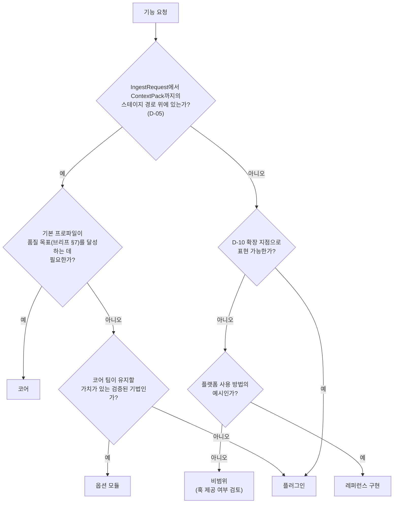
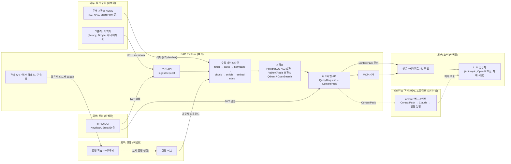
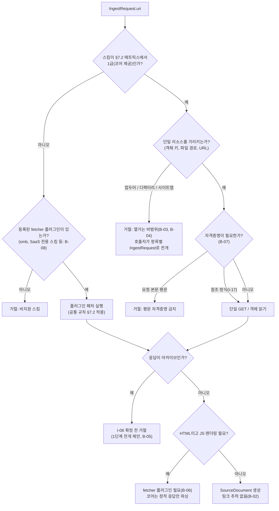
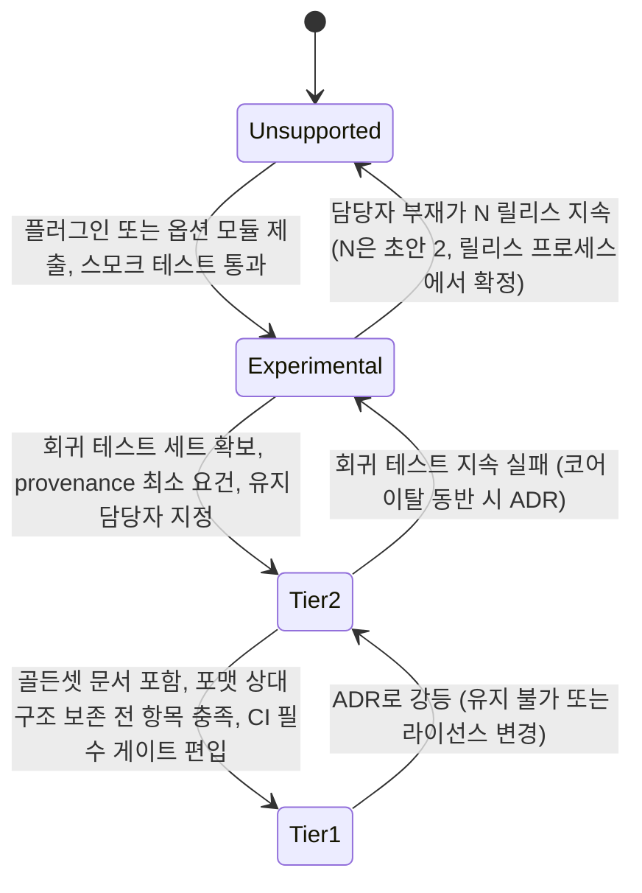

# 범위와 비범위

> 이 문서는 [설계 브리프](./00-design-brief.md)의 §6 "시스템 경계"(이하 브리프 §6)를 확장한다. 브리프의 확정 결정(D-xx)과 충돌하면 브리프가 우선하며, 이 문서의 판정은 브리프를 해석·세분화한 것이다. 브리프에 없는 새 아키텍처 결정(계약 필드, 기술 선택, 리포지토리 구조 등)은 만들지 않고 "## 미해결 이슈"에 제안으로 남긴다. 이 문서가 새로 도입하는 것은 **범위 판정(S-xx)** 이며, 브리프 개정 없이 §10 절차로 뒤집을 수 있다.
>
> **표기 규칙**: 접두어 없는 `§N`은 **본 문서**의 절을, `브리프 §N`은 **설계 브리프**의 절을 가리킨다. 표의 근거 열과 결정 사항 요약에서는 혼동을 피하기 위해 `본 문서 §N`으로 명시한다.

## 목적

RAG Platform이 **무엇을 만들고 무엇을 만들지 않는지**를 기능 영역·포맷·URI 스킴·배포 환경·언어의 다섯 축으로 명시한다. 목적은 세 가지다.

1. **구현 우선순위의 고정**: 코어(core)·옵션 모듈(optional module)·플러그인(plugin)·레퍼런스 구현(reference implementation)의 네 수준으로 모든 기능 영역을 분류하여, 무엇이 기본 배포에 들어가고 무엇이 선택인지 논쟁 없이 결정한다.
2. **비범위의 대체 경로 보장**: 비범위(non-goal)로 선언한 기능마다 "왜 제외하는가", "대신 어떤 훅(hook)·인터페이스를 제공하는가", "언제 재검토하는가"를 적어 사용자가 플랫폼 밖에서 그 기능을 구현할 수 있게 한다.
3. **경계 사례의 선판정**: 수집인가 크롤링인가, 보강인가 답변 생성인가처럼 구현 중 반복될 경계 질문을 미리 판정하여 개별 설계 문서가 서로 다른 답을 내지 않게 한다.

## 범위

이 문서가 다루는 것:

- 기능 영역별 포함 범위와 제공 수준(§3)
- 비범위 목록과 각 항목의 제외 이유·대체 훅·재검토 조건(§4)
- 경계 사례 판정(§5)
- 지원 포맷 매트릭스(§6), 지원 URI 스킴 매트릭스(§7), 배포 환경 범위(§8), 언어 지원 범위(§9)
- 범위 변경 절차(§10)

이 문서가 다루지 않는 것:

- 기능의 상세 동작과 수용 기준 → [기능 요구사항](../01-requirements/01-functional-requirements.md), [사용자 스토리와 수용 기준](../01-requirements/04-user-stories-and-acceptance-criteria.md)
- 기술 선택의 근거와 대안 비교 → [기술 조사 요약 및 선택 매트릭스](../07-tech-landscape/00-summary-and-selection-matrix.md)
- 각 범위 항목의 구현 시점 → [마일스톤](../11-roadmap/01-milestones.md)
- 스테이지 계약의 필드 정의 → [계약 개요](../03-contracts/00-contract-overview.md)
- 패키지·디렉터리 배치 → [리포지토리 구조](../10-development/01-repository-structure.md)

## 1. 범위 판정의 기준

### 1.1 소유(own)와 채택(adopt)

브리프 R2·원칙 2(Adapters over Forks)에 따라 플랫폼은 두 종류의 것으로 구성된다. 범위 논의는 이 구분에서 출발한다.

| 구분 | 대상 | 범위 함의 |
|------|------|-----------|
| **소유** | 스테이지 계약(JSON Schema + Pydantic), 표준 문서 모델 `ParsedDocument`, 오케스트레이션 워크플로우 정의, 플러그인 레지스트리·SDK, 평가 하네스, 수집·리트리벌·관리 API, MCP 서버, Context Pack 및 렌더러 | 플랫폼이 직접 설계·구현·유지한다. 코어의 대부분이 여기에 속한다. |
| **채택** | 파서(Docling, python-hwpx 등), 청커, 임베딩·리랭커 모델과 서빙 엔진 TEI·vLLM pooling(Infinity는 제외, D-16 v1.1), 인덱스 백엔드(Qdrant, OpenSearch), 워크플로우 엔진(Temporal), 저장소(PostgreSQL, S3 호환, Redis — 라이선스 확인 필요, I-13) | 어댑터로 감싸서 계약에 맞춘다. 채택 대상의 내부 개선(파서 정확도 향상, 모델 학습)은 **비범위**다. 어댑터와 기본값 선택만 범위다. |

### 1.2 네 가지 제공 수준

포함 범위의 모든 항목은 아래 네 수준 중 하나로 분류된다. 수준은 "기본 배포에 들어가는가", "누가 유지하는가", "어떤 보장을 하는가"로 정의된다. 패키지 배치와 경로 명명은 이 문서의 결정이 아니며 [리포지토리 구조](../10-development/01-repository-structure.md)에서 확정한다.

| 수준 | 정의 | 기본 프로파일 | 유지 주체 | 보장 |
|------|------|---------------|-----------|------|
| **코어(core)** | 기본 배포에 항상 포함되는 구성요소. 브리프 §6 "포함" 목록과 D-xx 기본값에 해당 | 켜짐(또는 필수 인프라) | 코어 팀 | 계약 호환성(`schema_version`), CI 회귀 테스트, 골든셋 평가 대상, 릴리스 노트 |
| **옵션 모듈(optional module)** | 코어와 별도 패키지로 제공되며 설치·활성화 시 코어와 동일한 계약을 따르는 구성요소. 기본 프로파일에서는 꺼져 있다 | 꺼짐(프로파일에서 선택) | 코어 팀 | 계약 적합성 테스트, 단위·통합 테스트. 골든셋 평가는 선택 |
| **플러그인(plugin)** | D-10의 확장 지점(`fetcher`, `parser`, `chunker`, `embedder`, `index_backend`, `retriever`, `reranker` 등)에 Python entry point로 연결되는 외부 패키지, 또는 코어 팀이 예시 수준으로 유지하는 기여 패키지(예: `contrib`, 명명은 리포지토리 구조 문서에서 확정). 코어 릴리스와 독립적으로 배포된다 | 없음 | 플러그인 작성자(기여 패키지는 코어 팀, 예시 수준) | 플러그인 SDK가 제공하는 계약 적합성 테스트 통과가 등록 조건. 품질·성능은 보장하지 않음 |
| **레퍼런스 구현(reference implementation)** | 플랫폼의 기능이 아니라 **플랫폼을 사용하는 방법의 예시**. 예시 코드 경로(예: `examples/`, 명명은 리포지토리 구조 문서에서 확정)에 위치하며 프로덕션 지원 대상이 아니다 | 해당 없음 | 코어 팀(예시 수준) | 컴파일·실행 가능성만 보장. API 변경 시 갱신 |

브리프 §6이 명시한 레퍼런스 구현은 하나다: 선택적 `answer` 엔드포인트(Claude 기반, 인용 포함). 이 문서는 커넥터 예시를 레퍼런스 구현 후보로 추가 제안한다(§4.1, 미해결 이슈 I-01).

### 1.3 판정 절차

새 기능 요청이 들어왔을 때 수준을 결정하는 절차다. 순서대로 질문하고 첫 번째 "예"에서 멈춘다.

판정 규칙:

- "코어인가 옵션 모듈인가"는 **기본 프로파일에 필요한가**로 가른다. D-07·D-16·D-18·D-19가 "기본"으로 지정한 것은 코어, "프로파일 옵션"으로 지정한 것은 옵션 모듈이다.
- "옵션 모듈인가 플러그인인가"는 **코어 팀이 유지하는가**로 가른다. 개방 결정(O-03 등)이 "코어 옵션 모듈 vs 외부 플러그인"을 묻는 항목, 또는 브리프에 근거가 없어 이 문서가 결정할 수 없는 항목은 확정 전까지 "옵션 모듈 또는 플러그인(O-xx 또는 I-xx)"으로 표기한다. O-xx·I-xx 없이 미확정 상태로 두는 것은 허용하지 않는다.
- 비범위로 판정하더라도 §4의 형식(이유·훅·재검토 조건)을 채워야 한다. 훅이 없는 비범위는 허용하지 않는다(브리프 §6 "단 훅은 제공").

## 2. 시스템 경계 개요

플랫폼의 바깥에는 네 부류의 외부 시스템이 있다. 각각은 비범위이면서 동시에 플랫폼이 훅을 제공해야 하는 대상이다. 레퍼런스 구현(§1.2)은 플랫폼 경계 안이 아니라 예시 영역에 둔다.

경계의 원칙:

- **왼쪽 경계(수집)**: 플랫폼은 "가져오라"는 요청(`IngestRequest`)을 받아 **단일 URI를 읽는다**. URI를 발견·열거·스케줄링하는 일은 바깥이다.
- **오른쪽 경계(소비)**: 플랫폼은 LLM이 소비할 `ContextPack`을 만든다. LLM을 호출하여 최종 답을 만드는 일은 바깥이다(`answer`는 예시).
- **위 경계(신원)**: 플랫폼은 토큰을 **검증하고 클레임을 테넌트·ACL에 매핑**한다. 사용자를 등록·로그인시키는 일은 바깥이다.
- **아래 경계(모델)**: 플랫폼은 모델을 **설정으로 교체하고 평가**한다. 모델을 학습시키는 일은 바깥이다.

## 3. 포함 범위 (기능 영역별)

브리프 §6 "포함" 목록을 기능 영역으로 분해하고 각각의 제공 수준과 근거를 적는다. "포함" 열은 해당 영역에서 **정확히 무엇이 포함되는지**를 적으며, 여기에 적히지 않은 세부 기능은 §5 경계 사례 또는 미해결 이슈로 다룬다. "수준" 열에는 §1.2의 네 값(코어·옵션 모듈·플러그인·레퍼런스 구현) 또는 `미정(O-xx)`·`제안(I-xx)` 중 하나만 쓰고, 한정·조건은 "포함" 열에 적는다.

### 3.1 수집(Ingestion)

| 영역 | 포함 | 수준 | 근거 |
|------|------|------|------|
| 수집 API | `IngestRequest` 접수(단건. 배치 제출의 계약 형태는 I-15), `job_id`와 상태 URL 반환, 잡 상태 조회, 취소, 재시도 | 코어 | R1, D-08 |
| 수집 이벤트 | 잡 상태 전이 이벤트, 웹훅 전달, 이벤트 스트림(`domain.entity.action` 명명) | 코어 | D-08, 브리프 §9.9 |
| 페처(fetcher): 오브젝트 스토리지 | `s3://`(S3 호환: RustFS·SeaweedFS 등, ADR-0011), `gs://`, `az://` 단일 객체 읽기 | 코어 | R1 |
| 페처: 로컬 파일 | `file://` 워커 마운트 볼륨 한정 읽기 | 코어 | R1 |
| 페처: HTTP | `http(s)://` 단일 URI GET(정적 응답). robots.txt 준수 책임은 I-14 | 코어 | R1, 본 문서 B-01 |
| 페처: 파일 공유 | `smb://`. 코어 팀 유지 기여 패키지 제공 여부는 I-11 | 플러그인 | R1 명시 |
| 원본 보관 | 페치한 원본을 콘텐츠 해시(BLAKE3)로 오브젝트 스토리지에 보관(산출물 캐시) | 코어 | D-06, D-14, 원칙 4 |
| 중복 감지 | 동일 콘텐츠 해시 **+ 동일 프로파일 버전**일 때 해당 스테이지 산출물 재사용. 재사용의 테넌트 한정 범위는 [설계 원칙](./02-design-principles.md) DP-09.R4와 [저장소 아키텍처](../02-architecture/04-storage-architecture.md)에서 확정 | 코어 | 원칙 4, 브리프 §7 재현성 |
| 업데이트·삭제·재인덱싱 | 문서 버전 교체(`IndexCommit` 원자 교체·롤백), 삭제, 프로파일 변경에 따른 재인덱싱 | 코어 | 브리프 §10 Index Commit, [업데이트·삭제·재인덱싱](../04-pipelines/19-update-delete-and-reindexing.md) |

### 3.2 파싱(Parsing)과 정규화(Normalization)

| 영역 | 포함 | 수준 | 근거 |
|------|------|------|------|
| 포맷 감지·라우팅 | 매직 바이트·MIME·확장자 기반 포맷 판정, 파서 선택, 비지원·비활성(§6.4) 포맷 거절 | 코어 | D-18, [파싱 라우터](../04-pipelines/03-parsing-router-and-format-detection.md) |
| 표준 문서 모델 | `ParsedDocument`(계층 블록 트리 + provenance) 정의와 벤더 모델 변환 어댑터 | 코어 | D-04 |
| 파서: HWPX | OWPML 구조(섹션·단락·표·그림·각주·메타) 파싱 | 코어 | D-18, 원칙 6 |
| 파서: HWP 5.0 | 바이너리 HWP 파싱, LibreOffice 폴백. 라이선스 격리를 위해 사이드카 컨테이너로 실행(§6.4) | 코어 | D-18, O-07, D-02 |
| 파서: PDF(텍스트) | 레이아웃·표 인식(Docling), 고속 텍스트 추출 | 코어 | D-18 |
| 파서: PDF(스캔) | 스캔 감지, OCR, OCR 결과의 provenance(page/bbox) 보존. 엔진 기본값은 O-08, 교체 가능 | 코어 | D-18, O-08 |
| 파서: DOCX | 구조·표·이미지 캡션 파싱 | 코어 | D-18 |
| 파서: DOC | LibreOffice headless 변환(사이드카, §6.4) → DOCX 경로 | 코어 | D-18 |
| 파서: HTML | 본문 추출(boilerplate 제거) + 구조 보존 | 코어 | D-18 |
| 파서: TXT/MD | 인코딩 감지, Markdown 구조 추론 | 코어 | D-18 |
| 파서: PPTX/XLSX | 슬라이드·시트 구조 파싱. 로드맵 항목(초기 릴리스 이후) | 옵션 모듈 | 본 문서 §6.2 |
| 파서: 이미지 단독 | PNG/JPEG/TIFF OCR | 옵션 모듈 | 본 문서 §6.2 |
| 정규화 | 유니코드 정규화, 공백·하이픈 정리, 머리글·바닥글·페이지 번호 제거, 표 텍스트화, 언어 태깅 준비 | 코어 | D-05 `NormalizedDocument` |
| 사용자 정의 파서 | 새 포맷 파서를 `parser` 확장 지점으로 추가 | 플러그인 | D-10 |

### 3.3 청킹(Chunking)과 보강(Enrichment)

| 영역 | 포함 | 수준 | 근거 |
|------|------|------|------|
| 구조 인식 계층 청킹 | 헤딩 경로 보존, 토큰 예산 병합 | 코어 | D-19 |
| 부모-자식(small-to-big) | 자식 청크 검색 → 부모 확장 | 코어 | D-19, D-07 |
| 표 전용 청킹 | 표 헤더 반복, 행 그룹 분할, 표 요약 | 코어 | D-19 |
| 문맥 보강(contextual retrieval) | 문서·섹션 요약을 청크 앞에 부착. LLM 의존 부분의 기본 켬/끔과 비용 정책은 O-05 | 코어 | D-19, O-05 |
| 의미 분할(semantic splitter) | 임베딩 유사도 기반 경계 탐지 | 옵션 모듈 | D-19 "프로파일 옵션" |
| Late chunking | 문서 전체 임베딩 후 청크 풀링 | 옵션 모듈 | D-19 |
| Proposition 청킹 | LLM으로 명제 단위 추출 | 옵션 모듈 | D-19 |
| 언어 감지 | 문서·블록 단위 BCP 47 언어 태깅 | 코어 | D-06, 브리프 §10 Enrichment |
| 키워드 추출 | 통계·규칙 기반 키워드 | 코어 | 브리프 §10 Enrichment |
| 엔티티 추출(NER) | 엔티티·관계 후보 추출 | 옵션 모듈 | 브리프 §10 Enrichment |
| 가상 질문 생성 | 청크별 예상 질문 생성(LLM) | 옵션 모듈 | O-05 |
| PII 처리 훅 지점 | 청크 파이프라인에 PII 탐지·마스킹 훅 지점과 정책(마스킹·거절·로그) 설정 제공 | 코어 | 원칙 9, 본 문서 B-18 |
| PII 탐지기 | 탐지기 구현(예: Presidio)은 `enricher` 확장 지점 | 플러그인 | 원칙 9, 본 문서 B-31 |

### 3.4 임베딩(Embedding)과 인덱싱(Indexing)

| 영역 | 포함 | 수준 | 근거 |
|------|------|------|------|
| dense + sparse 임베딩 | BGE-M3 dense·sparse, TEI·vLLM pooling 서빙 어댑터(Infinity는 sparse 미지원으로 제외 — D-16 v1.1, ADR-0009) | 코어 | D-16 |
| 임베딩 모델 교체 | multilingual-e5, Qwen3-Embedding, jina, KURE 등 설정으로 교체 | 코어 | D-16 |
| Late interaction(ColBERT/ColPali) | 멀티벡터 인덱싱 또는 리랭킹. 배치 위치는 O-04 | 옵션 모듈 | O-04 |
| 벡터 인덱스 | Qdrant named vectors(dense + sparse), payload 필터 | 코어 | D-15 |
| 렉시컬 인덱스 | OpenSearch + Nori 분석기 BM25 | 코어 | D-15 |
| 경량 프로파일 | Qdrant 단독(sparse BM25 포함) 프로파일 | 코어 | D-15 |
| 인덱스 백엔드 교체 | Milvus, Weaviate, pgvector, Vespa, Elasticsearch, LanceDB를 `index_backend` 확장 지점으로 | 플러그인 | D-15, D-10 |
| 인덱스 커밋 | 문서 버전 단위 원자 교체·롤백, 커밋 해시 재현성 | 코어 | 브리프 §7 재현성 |
| 테넌트·ACL 페이로드 | `tenant_id`, `collection_id`, `acl` 모든 인덱스 레코드 필수 | 코어 | D-09 |

### 3.5 리트리벌(Retrieval)과 컨텍스트 패킹(Context Packing)

| 영역 | 포함 | 수준 | 근거 |
|------|------|------|------|
| 질의 이해(규칙 기반) | 필터 파싱, 언어 감지, 전략 선택, 예산 산정 → `QueryPlan` | 코어 | D-05 |
| 질의 재작성(LLM 기반) | multi-query, HyDE, step-back 등을 `query_transformer` 확장 지점으로 | 옵션 모듈 | D-10, R4 |
| 3-way 하이브리드 검색 | dense + sparse + lexical 병렬 검색 | 코어 | D-07 |
| 융합 | RRF 기본, 가중 정규화 융합 선택. 기본값은 O-01 | 코어 | D-07, O-01 |
| 크로스인코더 리랭킹 | bge-reranker-v2-m3 기본, 모델 교체 | 코어 | D-16 |
| LLM 리랭커 | 리스트와이즈·포인트와이즈 LLM 리랭킹. 코어 팀 유지 여부는 I-18 | 옵션 모듈 또는 플러그인(I-18) | R4 |
| 후처리 | 중복 제거, 부모 확장, MMR 다양성, 토큰 예산 패킹, lost-in-the-middle 대응 정렬 | 코어 | D-07, R6 |
| Context Pack | 공급자 중립 표준 JSON, 인용 ID, 점수 분해, 토큰 통계, 렌더 힌트 | 코어 | D-20, R6 |
| 렌더러 | Anthropic Messages `document`+`citations`, OpenAI 호환 메시지, XML/Markdown 템플릿 | 코어 | D-20 |
| 사용자 정의 렌더러 | 기타 LLM 포맷을 `packer` 확장 지점으로 | 플러그인 | D-10 |
| ACL 필터 강제 | 리트리벌 시 테넌트·컬렉션·ACL 필터를 우회 불가하게 적용 | 코어 | D-09 |
| 고급 리트리벌 | GraphRAG/LightRAG, RAPTOR, agentic retrieval | 옵션 모듈 또는 플러그인(O-03) | O-03, [고급 리트리벌](../04-pipelines/18-advanced-retrieval-graph-raptor-agentic.md) |
| 컨텍스트 압축 | 추출식·생성식 청크 압축. 코어 팀 유지 여부는 I-18 | 옵션 모듈 또는 플러그인(I-18) | R4 |

### 3.6 인터페이스(API·SDK·MCP)

| 영역 | 포함 | 수준 | 근거 |
|------|------|------|------|
| 수집 API(REST) | OpenAPI 명세, 비동기 잡 모델 | 코어 | D-08, [수집 API](../05-api/02-ingestion-api.md) |
| 리트리벌 API(REST) | `search`(ContextPack 반환), 후보 디버그 조회 | 코어 | R3, [리트리벌 API](../05-api/03-retrieval-api.md) |
| 관리 API(REST) | tenant(생성·조회·비활성화·할당량, `/v1/tenants` 계열), collection, profile, job, plugin 레지스트리 조회 | 코어 | 브리프 §6 "관리 API", 바이블 §14(1.3.0), FR-MGT-01, [관리 API](../05-api/04-management-api.md) |
| gRPC | REST와 동일 기능의 gRPC 서비스 | **미정(O-10)** | O-10 |
| MCP 서버 | `search`, `get_document`, `list_collections` 도구 | 코어 | D-13, [MCP 서버](../05-api/05-mcp-server.md) |
| 웹훅·이벤트 | 잡 이벤트 웹훅, 표준 이벤트 스키마 | 코어 | D-08, [웹훅과 이벤트](../05-api/07-webhooks-and-events.md) |
| 클라이언트 SDK | Python, TypeScript | 코어 | 브리프 §6, [클라이언트 SDK](../05-api/06-client-sdks.md) |
| 플러그인 SDK | 확장 지점 인터페이스, 계약 적합성 테스트, 스캐폴딩 | 코어 | D-10, [플러그인 개발 가이드](../10-development/06-plugin-development-guide.md) |
| `answer` 엔드포인트 | ContextPack → Claude 호출 → 인용 포함 답변 | 레퍼런스 구현 | 브리프 §6 |
| 커넥터 예시 | 무상태 이벤트 브리지(S3 이벤트 알림 → IngestRequest, 파일시스템 이벤트 → IngestRequest). 레퍼런스 구현 후보 | 제안(I-01) | 본 문서 §4.1 훅 (5) |

### 3.7 플랫폼 운영(Operations)

| 영역 | 포함 | 수준 | 근거 |
|------|------|------|------|
| 오케스트레이션 | Temporal 워크플로우(재시도·타임아웃·하트비트·사가), 인프로세스 러너(개발·경량) | 코어 | D-17 |
| 관측성 | OpenTelemetry 트레이스·메트릭·로그(GenAI semconv), Prometheus 메트릭, Grafana 대시보드 | 코어 | D-11 |
| 관측성 익스포터 | Langfuse, Arize Phoenix | 옵션 모듈 | D-11 "선택적으로" |
| 평가 하네스 | 골든셋(qrels) 포맷, 오프라인 메트릭(nDCG@k, Recall@k, MRR, 컨텍스트 정밀도), LLM-judge, A/B 프로파일 비교, 한국어 벤치마크 | 코어 | D-12 |
| 온라인 피드백 수집 | 검색 결과 피드백 API, 로그 → 골든셋 후보 export | 코어 | [온라인 피드백 루프](../08-evaluation/06-online-feedback-loop.md) |
| 멀티테넌시 | 테넌트·컬렉션 격리, ACL 필터, 컬렉션별 프로파일 고정(브리프 §10 Collection) | 코어 | D-09 |
| 인증 연동 | OIDC JWT 검증, 클레임 → 테넌트·ACL 매핑 | 코어 | 브리프 §6 "OIDC 연동만" |
| 배포 매니페스트 | Docker Compose(단일 노드), Kubernetes 매니페스트 | 코어 | 브리프 §6, 본 문서 §8 |
| 설정 관리 | 프로파일(버전드), 환경 변수·설정 파일 레퍼런스 | 코어 | 브리프 §10 Profile |
| 백업·복구, 업그레이드·마이그레이션 가이드 | 스키마 마이그레이션, 인덱스 재구축 절차(문서·스크립트) | 코어 | [백업과 재해 복구](../09-operations/07-backup-and-disaster-recovery.md) |

## 4. 비범위 (Non-goals)

브리프 §6이 명시한 다섯 항목(§4.1~§4.5)과, 브리프 §6 "포함" 목록에 없어 비범위로 파생되는 항목(§4.6~§4.10)을 다룬다. 파생 항목은 브리프가 명시적으로 제외한 것이 아니므로 표기에 "파생"을 붙이고, 이견이 있으면 미해결 이슈로 올린다.

### 4.1 웹 크롤러·커넥터(원천 수집) — 브리프 §6 명시

| 항목 | 내용 |
|------|------|
| **제외 이유** | R1은 "주소와 메타 정보를 API로 전달받는" Pull 모델을 요구한다. 크롤링은 URL 발견, 스케줄링, robots.txt·속도 제한, 로그인 세션 유지, 변경 감지, 사이트별 파싱 규칙 등 독립된 도메인이며 Scrapy, Crawlee, Airbyte, Apache NiFi 등 성숙한 오픈소스가 있다. 플랫폼이 이를 품으면 코어의 절반이 수집기가 되고, 검색 품질(R3)이라는 제1 지표에서 멀어진다. |
| **대신 제공하는 훅** | (1) `IngestRequest` API: URI + 메타데이터 + 정책 접수(배치 제출의 계약 형태는 I-15) — [IngestRequest 계약](../03-contracts/01-ingest-request.md), [수집 API](../05-api/02-ingestion-api.md). (2) 잡 이벤트 웹훅·이벤트 스트림으로 커넥터가 완료·실패를 구독 — [웹훅과 이벤트](../05-api/07-webhooks-and-events.md). (3) 클라이언트 SDK(Python/TypeScript)로 커넥터 작성 — [클라이언트 SDK](../05-api/06-client-sdks.md). (4) `fetcher` 확장 지점으로 새 URI 스킴(SaaS 저장소 등) 추가 — [플러그인 아키텍처](../02-architecture/05-plugin-architecture.md). (5) 커넥터 SDK 가이드와 무상태 이벤트 브리지 예시(S3 이벤트 알림 → IngestRequest, 파일시스템 이벤트 → IngestRequest)는 미해결 이슈 I-01로 제안. |
| **재검토 조건** | 다수 사용자가 동일한 얇은 브리지(예: S3 이벤트 알림 → IngestRequest)를 반복 구현하는 것이 확인되면 레퍼런스 구현으로 우선 제공한다. 브리지가 상태(커서·체크포인트·처리 이력)를 가져야 하는 순간 다시 비범위로 돌린다. 중복 제출은 플랫폼의 멱등성(원칙 4)에 위임한다. 크롤러 본체는 재검토하지 않는다. |
| **경계** | 단일 URI fetch는 포함, 링크 따라가기·사이트맵 전개·디렉터리 열거는 비범위(§5 B-01~B-04). |

### 4.2 최종 답변 생성 UI(챗봇) — 브리프 §6 명시

| 항목 | 내용 |
|------|------|
| **제외 이유** | 원칙 10(LLM-Native Output)에 따라 플랫폼 출력의 소비자는 사람이 아니라 LLM이다. 챗봇 UI·대화 상태 관리·프롬프트 편집·사용자 세션은 LLM 애플리케이션 프레임워크(Open WebUI, Dify, LangChain/LlamaIndex 앱, 사내 포털)의 영역이며 조직마다 요구가 다르다. UI를 포함하면 프런트엔드 스택·디자인·접근성이 코어 릴리스를 지배한다. |
| **대신 제공하는 훅** | (1) `ContextPack`과 렌더러(Anthropic `document`+`citations`, OpenAI 호환, XML/Markdown) — [Context Pack 계약](../03-contracts/11-context-pack.md). (2) MCP 서버로 에이전트·IDE·데스크톱 클라이언트가 직접 호출 — [MCP 서버](../05-api/05-mcp-server.md). (3) 클라이언트 SDK. (4) `answer` 레퍼런스 구현으로 "ContextPack을 LLM에 넘기는 올바른 방법"을 예시. |
| **재검토 조건** | 검색 결과·점수 분해·인용을 사람이 눌러 볼 수 있는 **디버그·평가용 탐색 도구(playground)** 는 평가 하네스와 관측성의 연장선으로 볼 여지가 있다. 골든셋 라벨링 생산성이 병목으로 확인되면 레퍼런스 구현으로 재검토한다(미해결 이슈 I-02). 최종 사용자용 챗봇 UI는 재검토하지 않는다. |
| **경계** | 답변 생성 로직(프롬프트 조립·LLM 호출·인용 후처리)은 `answer` 레퍼런스 구현에 한정. 스트리밍 응답, 대화 이력 저장, 사용자 세션은 비범위. 대화 맥락을 질의 이해의 **입력**으로 받을지는 계약 결정이므로 I-16(B-24). |

### 4.3 모델 파인튜닝 파이프라인 — 브리프 §6 명시

| 항목 | 내용 |
|------|------|
| **제외 이유** | 학습은 GPU 클러스터, 데이터셋 버전 관리, 실험 추적, 하이퍼파라미터 탐색이라는 별개의 인프라를 요구한다. 원칙 2에 따라 모델은 채택 대상이며 D-16은 "모델은 전부 설정으로 교체 가능"으로 대응한다. 플랫폼은 어떤 모델이 더 좋은지 **측정**(D-12)할 뿐 **만들지** 않는다. |
| **대신 제공하는 훅** | (1) 골든셋(qrels) 표준 포맷과 export — [골든셋 구축](../08-evaluation/03-golden-dataset-construction.md). (2) 온라인 피드백(클릭·채택·명시 피드백) → 학습 후보 데이터 export — [온라인 피드백 루프](../08-evaluation/06-online-feedback-loop.md). (3) 하드 네거티브(hard negative) 후보 export: 리랭커가 뒤집은 후보 쌍을 평가 하네스가 기록(미해결 이슈 I-03으로 포맷 제안). (4) `embedder`·`reranker` 확장 지점과 프로파일 설정으로 학습된 모델을 즉시 교체·A/B 비교. |
| **재검토 조건** | 한국어 도메인 특화 임베딩이 골든셋에서 기본 모델을 유의하게 앞서는 것이 반복 확인되고, 학습 레시피가 재현 가능한 스크립트 수준으로 단순하면 **별도 리포지토리**의 레퍼런스 구현으로 검토한다. 플랫폼 코어에는 넣지 않는다. |
| **경계** | 모델 양자화·ONNX 변환 등 **서빙 최적화**는 배포 가이드 범위(§8). 모델 가중치 변경은 비범위. |

### 4.4 사용자 인증 서버 — 브리프 §6 명시(OIDC 연동만)

| 항목 | 내용 |
|------|------|
| **제외 이유** | 사용자 등록·비밀번호·MFA·세션·소셜 로그인은 Keycloak, Dex, Authelia, Entra ID, Okta 등 IdP가 해결한 문제다. 자체 구현은 보안 사고의 최대 원인이며 감사·규제 대응 부담을 플랫폼이 떠안게 된다. 원칙 9(Secure by Design)는 격리와 ACL 강제를 요구하지, 신원 발급을 요구하지 않는다. |
| **대신 제공하는 훅** | (1) OIDC/OAuth 2.0 JWT 검증(JWKS 기반), 발급자·대상 검증. (2) 클레임 → `tenant_id`·`acl` 주체(subject/group) 매핑 규칙 설정 — [멀티테넌시·보안 아키텍처](../02-architecture/07-multi-tenancy-and-security-architecture.md). (3) 서비스 간(machine-to-machine) 인증 방식은 보안 아키텍처 문서에서 확정. (4) 개발 모드용 정적 토큰 발급 편의 기능은 미해결 이슈 I-04로 제안. |
| **재검토 조건** | 없음(영구 비범위). |
| **경계** | **인가(authorization)는 포함**한다: 테넌트 격리, 컬렉션 ACL 필터 강제(D-09), 관리 API 역할 검사. 단 "누가 어느 그룹에 속하는가"는 IdP 클레임 또는 `IngestRequest`의 `acl`이 제공하며 플랫폼은 그룹 관리 UI를 갖지 않는다. |

### 4.5 문서 편집 — 브리프 §6 명시

| 항목 | 내용 |
|------|------|
| **제외 이유** | 플랫폼은 원본의 **읽기 전용 소비자**다. 원칙 4(Idempotent & Content-Addressed)는 원본을 불변으로 취급하며, 편집은 콘텐츠 해시를 바꾸어 재현성(브리프 §7)을 깨뜨린다. 편집기·협업·버전 비교는 문서 관리 시스템(DMS)과 오피스 제품의 영역이다. |
| **대신 제공하는 훅** | (1) 재수집(re-ingest) API: 원천에서 수정된 문서를 새 버전으로 접수, `IndexCommit` 원자 교체 — [업데이트·삭제·재인덱싱](../04-pipelines/19-update-delete-and-reindexing.md). (2) 메타데이터 갱신: 관리 API로 문서·컬렉션 메타데이터(태그·ACL·만료)를 재파싱 없이 갱신 — [관리 API](../05-api/04-management-api.md). (3) 파싱 결과의 수동 보정(human-in-the-loop) 필요 시 외부에서 보정한 `ParsedDocument`를 제출하는 경로는 미해결 이슈 I-05로 제안. |
| **재검토 조건** | 없음(영구 비범위). |
| **경계** | 메타데이터·ACL 갱신은 편집이 아니라 관리 작업이므로 포함. 파싱 산출물(표 텍스트화, OCR 결과)의 플랫폼 내부 수정 UI는 비범위. |

### 4.6 최종 답변 생성 서비스 — 파생(브리프 §6 "레퍼런스 구현으로만")

| 항목 | 내용 |
|------|------|
| **제외 이유** | 브리프 §6은 `answer` 엔드포인트를 레퍼런스 구현으로 한정한다. 답변 생성을 코어에 넣으면 LLM 공급자 종속, 비용·지연 책임, 환각(hallucination) 품질 책임이 플랫폼으로 넘어와 D-20(공급자 중립)과 충돌한다. |
| **대신 제공하는 훅** | `ContextPack` 렌더러(D-20), MCP 서버(D-13), `answer` 레퍼런스 구현(Claude 기반, 인용 포함). |
| **재검토 조건** | LLM-judge 평가(D-12)가 답변 생성 품질까지 측정하므로, 평가 하네스 내부의 "평가용 답변 생성기"는 코어의 일부다. 그 외 프로덕션 답변 서비스는 재검토하지 않는다. |
| **경계** | 평가 목적의 LLM 호출(LLM-judge, 골든셋 생성 보조)은 포함. 사용자 요청에 응답하는 답변 생성은 레퍼런스 구현. |

### 4.7 모델 서빙 엔진 자체 개발 — 파생

| 항목 | 내용 |
|------|------|
| **제외 이유** | D-16은 TEI 또는 Infinity를 서빙으로 채택한다. 추론 최적화(배칭·양자화·커널)는 전문 프로젝트의 영역이다. |
| **대신 제공하는 훅** | `embedder`·`reranker` 어댑터(TEI, Infinity, sentence-transformers 인프로세스, OpenAI 호환 임베딩 API), 배포 매니페스트에 서빙 컨테이너 포함(§8). |
| **재검토 조건** | 없음. 새 서빙 엔진은 어댑터 추가로 대응. |
| **경계** | 서빙 컨테이너의 **배포·설정·헬스체크**는 포함. 서빙 엔진의 내부 성능 개선은 비범위. |

### 4.8 원본 문서의 기록 시스템(System of Record) — 파생

| 항목 | 내용 |
|------|------|
| **제외 이유** | D-14는 오브젝트 스토리지에 "원본·산출물"을 보관하지만 이는 재처리·캐싱·감사를 위한 **산출물 저장**이다. 보존 정책, 법적 보류, 권한 상속, 폴더 계층 같은 DMS 기능은 원천 시스템의 책임이다. |
| **대신 제공하는 훅** | 원본 해시·URI·수집 시각을 `SourceDocument`에 기록 — [SourceDocument 계약](../03-contracts/02-source-document.md). 원본 보관 여부·기간은 `IngestRequest` 정책 또는 컬렉션 설정으로 제어(정책 필드는 계약 문서에서 정의). `get_document` MCP 도구와 관리 API로 보관 원본 조회. |
| **재검토 조건** | 없음. |
| **경계** | 원본 사본 보관(캐시)은 포함, 원본의 유일한 저장소가 되는 것은 비범위. 원천이 사라져도 플랫폼이 원본을 복원해 줄 의무는 없다. |

### 4.9 범용 워크플로우·ETL 편집기 — 파생

| 항목 | 내용 |
|------|------|
| **제외 이유** | D-17은 Temporal을 채택하지만 이는 **정해진 스테이지 순서(D-05)** 를 내구성 있게 실행하기 위함이다. 임의 DAG 편집, 노드 드래그 UI, 범용 데이터 변환은 Airflow·Dagster·n8n 등의 영역이며, 스테이지 계약(원칙 1)의 순수성을 깨뜨린다. |
| **대신 제공하는 훅** | 프로파일(Profile)로 각 스테이지의 구현체·파라미터 선택, D-10 확장 지점으로 스테이지 구현 교체, 이벤트·웹훅으로 외부 워크플로우 엔진과 연계. |
| **재검토 조건** | 없음. 스테이지 추가가 필요하면 D-05 개정(ADR)으로 처리. |
| **경계** | 프로파일 기반 파이프라인 구성은 포함. 스테이지 순서 변경·임의 노드 삽입은 비범위. |

### 4.10 정형 데이터 질의(Text-to-SQL 등) — 파생

| 항목 | 내용 |
|------|------|
| **제외 이유** | 브리프 R1의 대상은 문서(HWPX·PDF·DOC·TXT·HTML 등)다. 데이터베이스 테이블·API 응답을 질의하는 것은 다른 검색 패러다임이다. |
| **대신 제공하는 훅** | `retriever` 확장 지점으로 외부 리트리버(SQL, 그래프, 웹 검색) 결과를 `CandidateSet` 형식으로 융합에 참여시킬 수 있다 — [후보 집합·순위 집합 계약](../03-contracts/10-candidate-set-and-ranked-set.md). |
| **재검토 조건** | 없음. |
| **경계** | 문서 안의 표(XLSX 시트, PDF 표)는 파싱·표 청킹으로 **포함**. 외부 DB 질의는 비범위. |

## 5. 경계 사례 판정

구현 중 반복될 경계 질문을 미리 판정한다. 판정 열에는 `포함`(코어), `옵션 모듈`, `플러그인`, `레퍼런스`(레퍼런스 구현), `비범위`, `제안(I-xx)` 여섯 값 중 **하나만** 쓰고, 한정·조건·확장 지점 이름은 "근거·조건" 열에 적는다. 하나의 사례가 두 판정을 필요로 하면 행을 나눈다(B-18/B-31). `제안`은 브리프에 없는 결정이 필요하여 미해결 이슈로 넘긴 것이다.

### 5.1 수집·페치 경계

| ID | 사례 | 판정 | 근거·조건 |
|----|------|------|-----------|
| B-01 | `https://` URL 하나를 주면 다운로드하는 것 | **포함** | 단일 URI fetch는 R1 "주소를 전달받아" 그 자체. 리다이렉트 횟수·최대 크기·타임아웃 상한은 설정. robots.txt 준수 책임(플랫폼 vs 호출자)은 I-14 |
| B-02 | 다운로드한 HTML 안의 링크를 따라가 추가 문서를 수집 | **비범위** | 크롤링(§4.1). 호출자가 링크를 추출해 별도 `IngestRequest`를 보내면 됨 |
| B-03 | 사이트맵(sitemap.xml)·RSS를 주면 항목별로 전개 | **비범위** | URL 열거는 크롤러의 일. 호출자가 항목별 `IngestRequest`로 전개(배치 형태는 I-15) |
| B-04 | `s3://bucket/prefix/` 디렉터리(접두어)를 주면 하위 객체 전체 수집 | **비범위** | 열거(listing)는 커넥터의 일. 대신 레퍼런스 커넥터(I-01)로 예시 제공 |
| B-05 | `s3://.../docs.zip` 아카이브를 주면 안의 파일을 개별 문서로 전개 | **제안(I-06)** | 단일 URI이지만 결과가 N개 `SourceDocument`가 되어 `IngestRequest → SourceDocument` 카디널리티(I-15)에 영향. 1단계 전개만 허용하고 중첩 아카이브는 거절하는 안을 제안. 확정 전에는 거절 |
| B-06 | JavaScript 렌더링이 필요한 SPA 페이지를 헤드리스 브라우저로 렌더링 후 수집 | **플러그인** | 코어 HTTP 페처는 정적 응답만 처리. 헤드리스 브라우저는 무겁고 크롤링 영역에 인접하므로 `fetcher` 확장 지점 |
| B-07 | 인증이 필요한 HTTP(Bearer 헤더, 쿠키)로 단일 URI fetch | **포함** | 단일 fetch이므로 포함. 이 문서가 정하는 요건은 "자격증명을 요청 본문 평문으로 받지 않는다"까지이며, 전달 방식(secret reference 등)은 I-17에서 확정 |
| B-08 | Google Drive·SharePoint·Confluence 문서 URL 수집 | **비범위** | SaaS API 인증·페이지네이션·열거는 커넥터 영역(§4.1). 기본 경로는 호출자가 다운로드 후 `s3://`로 제출. 단일 문서 fetch만 필요하면 `fetcher` 확장 지점으로 플러그인 구현 가능(플랫폼은 확장 지점과 스킴 명명 규약만 제공, §7.2) |
| B-09 | 원천 문서 변경 감지(폴링·ETag 비교)와 자동 재수집 | **비범위** | 변경 감지는 커넥터의 일. 플랫폼은 동일 해시 재수집 시 재사용(멱등)으로 협력 |
| B-10 | 호출자가 이미 추출한 텍스트를 URI 없이 본문으로 직접 전달 | **제안(I-07)** | R1은 "주소"를 전제. 소량 텍스트의 인라인 제출은 편의성이 크지만 콘텐츠 주소화·원본 보관 정책과의 정합성 검토 필요 |
| B-11 | 여러 URI를 한 번의 API 호출로 묶어 배치 제출 | **포함** | 배치 제출 자체는 D-08 비동기 잡 모델의 자연스러운 확장. 계약 형태(요청 1건에 URI 배열 vs 호출 1건에 `IngestRequest` 배열 엔벨로프)는 I-15에서 확정. 배치 크기 상한은 설정 |
| B-12 | 수집 시 문서를 다른 형식으로 변환한 결과물을 호출자에게 반환(변환 서비스로 사용) | **비범위** | 플랫폼은 검색 인덱스를 만드는 것이 목적. 단 `ParsedDocument`·`NormalizedDocument` 산출물 조회는 디버그·감사 목적으로 관리 API에 포함 |

### 5.2 파싱·보강 경계

| ID | 사례 | 판정 | 근거·조건 |
|----|------|------|-----------|
| B-13 | 문서 안의 표를 구조(행·열)로 보존하고 텍스트화 | **포함** | D-04 구조 보존, D-19 표 전용 청킹 |
| B-14 | 문서 안의 그림·다이어그램을 VLM으로 캡셔닝 | **옵션 모듈** | R6 "표/그림 텍스트화"에 해당하나 VLM 의존 비용이 크므로 O-05와 같은 정책으로 프로파일 옵션 |
| B-15 | 문서 안의 표를 CSV·데이터베이스로 export | **비범위** | 검색 인덱스 외 산출물. `ParsedDocument` 산출물 조회로 호출자가 직접 추출 가능 |
| B-16 | 문서 전체 요약을 생성하여 메타데이터로 저장 | **포함** | D-19 문맥 보강의 일부. 기본 켬/끔과 비용 정책은 O-05 |
| B-17 | 문서를 다른 언어로 번역하여 인덱싱 | **플러그인** | 다국어 임베딩(D-16)이 교차 언어 검색을 담당. 번역은 `enricher` 확장 지점 |
| B-18 | PII 처리 훅 지점과 정책(마스킹·거절·로그) 제공 | **포함** | 원칙 9 "PII 처리 훅". 정책은 컬렉션 설정. 탐지기 구현은 B-31 |
| B-19 | 파서가 실패한 문서를 사람이 보정하여 재제출 | **제안(I-05)** | 외부 보정 `ParsedDocument` 제출 경로 필요 |
| B-20 | 비밀번호로 보호된 PDF·HWP 파싱 | **제안(I-08)** | 비밀번호 전달 방식이 계약에 필요(I-17에 종속). 확정 전에는 보호 문서를 거절 |
| B-21 | 문서 메타데이터(제목·저자·작성일)를 파일 속성에서 추출 | **포함** | D-04 "메타" 보존. 호출자 메타데이터와 병합 규칙은 [NormalizedDocument 계약](../03-contracts/04-normalized-document.md)에서 정의 |
| B-31 | PII 탐지기(예: Presidio) 구현 | **플러그인** | B-18 훅 지점에 `enricher` 확장 지점으로 연결. 탐지 품질은 플러그인 작성자 책임(§1.2) |

### 5.3 리트리벌·소비 경계

| ID | 사례 | 판정 | 근거·조건 |
|----|------|------|-----------|
| B-22 | 질의를 LLM으로 재작성(multi-query, HyDE) | **옵션 모듈** | D-10 `query_transformer`. 기본 프로파일은 규칙 기반 질의 이해만 |
| B-23 | 검색 결과로 LLM이 최종 답을 생성 | **레퍼런스** | §4.6 |
| B-24 | 대화 이력을 고려한 질의 재구성(conversational retrieval) | **제안(I-16)** | 대화 상태 저장은 비범위(호출자 책임, §4.2). 질의 이해가 참조할 대화 맥락을 `QueryRequest` 입력으로 받을지는 계약 결정이므로 I-16으로 제안. 브리프 D-05·§10 Query Plan에는 해당 입력이 없다 |
| B-25 | 결과 하이라이트(문서 뷰어에서 위치 표시)용 좌표 제공 | **포함** | 데이터만 제공: provenance(page/bbox/char offset)를 `ContextPack`에 포함. 뷰어 UI는 비범위(§4.2) |
| B-26 | 검색 결과의 "왜 뽑혔는가" 설명 | **포함** | 원칙 8 점수 분해(dense/sparse/lexical/rerank) |
| B-27 | 웹 검색 결과를 내부 문서 검색과 융합 | **플러그인** | `retriever` 확장 지점이 `CandidateSet`을 반환하면 융합 참여 |
| B-28 | 사용자별 개인화 랭킹(클릭 이력 학습) | **비범위** | 학습 파이프라인(§4.3). 피드백 수집·export는 포함 |
| B-29 | 리트리벌 결과 캐싱(동일 질의) | **포함** | D-14 Valkey(Redis 호환) 캐시(ADR-0011; 잔여 라이선스 확인 범위는 I-13). 캐시 키에 테넌트·ACL 포함 필수(D-09) |
| B-30 | 에이전트가 MCP로 검색 → 문서 원문 조회 | **포함** | D-13 `search`, `get_document` |

### 5.4 URI 판정 흐름

B-01~B-08의 판정을 하나의 흐름으로 정리한다. 페처는 이 흐름을 코드로 구현한다([페칭과 원천 해석](../04-pipelines/02-fetching-and-source-resolution.md)).

## 6. 지원 포맷 매트릭스

### 6.1 등급 정의

등급은 포맷 상대적으로 정의한다. 즉 "전부"는 해당 포맷이 표현할 수 있는 구조·위치 정보 전부를 뜻하며, TXT처럼 표·각주·페이지가 없는 포맷은 그 요소를 요구받지 않는다. 포맷별 구조 요소 목록과 provenance 항목은 각 파서 문서가 정의한다.

| 등급 | 구조 보존 | 출처(provenance) 보존 | 테스트·평가 | 제공 수준 | 의미 |
|------|-----------|----------------------|-------------|-----------|------|
| **1급(Tier 1)** | 해당 포맷이 표현하는 구조 요소 **전부**(계층 섹션·단락·표·그림 캡션·목록·각주·메타 중 포맷이 가진 것. 포맷별 요소 목록은 각 파서 문서에서 정의) | 포맷이 제공하는 위치 정보 전부. 최소 char offset + element path, page·bbox는 포맷이 제공할 때 | 파서 회귀 테스트 + 골든셋 문서 포함 + CI 필수 | 코어 | 플랫폼이 품질을 책임지는 포맷. 릴리스 차단 기준 |
| **2급(Tier 2)** | 변환·OCR 경로 의존으로 일부 손실 허용(예: 각주 병합, 목록 평탄화) | 최소 page 또는 element path. bbox는 가능 시 | 파서 회귀 테스트 필수, 골든셋 선택 | 코어 또는 옵션 모듈 | 동작을 보장하되 1급과 같은 구조 충실도는 약속하지 않음. 로드맵에 1급 승격 여부 명시 |
| **실험(Experimental)** | 보장 없음 | 보장 없음 | 스모크 테스트 | 옵션 모듈 또는 플러그인 | 피드백 수집 단계. 기본 프로파일에서 꺼짐. 프로덕션 권장 안 함 |
| **비지원(Unsupported)** | 해당 없음 | 해당 없음 | 거절 동작 테스트 | 없음(`parser` 플러그인 확장 지점만) | 라우터가 표준 에러로 거절([에러 모델](../03-contracts/13-error-model.md)). 잡은 실패로 종료되고 이벤트 발행 |

표기 규칙: 등급 열에는 위 네 값 중 하나만 쓴다. 사이드카 필요 여부(§6.4)는 등급 속성이 아니라 배포 구성이므로 등급·제공 수준 열에 쓰지 않고 §6.2 비고 열에만 표기한다. 로드맵·제안 상태도 비고 열에 적는다.

### 6.2 매트릭스

기본 파서 열은 브리프 D-18을 그대로 따른다. 라이선스 비고는 D-02(AGPL은 네트워크 분리 서비스로만, GPL 링크 금지) 적용 여부를 표시하며, "확인 필요"는 2026-09 기준 재확인이 필요한 항목이다.

| 포맷 | 확장자·MIME(대표) | 등급 | 기본 파서(D-18) | 비고 |
|------|-------------------|------|-----------------|------|
| HWPX | `.hwpx`, `application/hwp+zip` | **1급** | python-hwpx + 자체 OWPML 어댑터 | 한국 공공·기업 문서의 핵심. 표·각주·머리말·개체 보존이 골든셋 필수 항목. [HWPX·HWP 파서](../04-pipelines/04-parser-hwpx-and-hwp.md) |
| HWP 5.0 | `.hwp`, `application/x-hwp` | **1급** | Apache-2.0 Java 사이드카(hwplib+hwp2hwpx+hwpxlib) → HWPX → 동일 OWPML 어댑터(1차, ADR-0007), 폴백 unhwp → hwp-hwpx-parser → LibreOffice(H2Orestart, GPLv3 격리, opt-in) | pyhwp는 AGPL 선택 플러그인(기본 경로 아님, 기각·대체 — ADR-0007). 배포용 문서는 테넌트 옵트인 시 Tika `HwpV5Parser` 텍스트 전용(`quality=degraded`). 암호화 문서는 `credentials_ref` 없으면 `parse.document_encrypted`(D-18 v1.1). 지원 범위는 O-07. 사이드카 부재 배포에서는 비활성(§6.4) |
| HWP 3.0 이하 | `.hwp`(구버전) | 비지원 | 없음 | 포맷 판정으로 구버전 감지 시 거절. LibreOffice 변환 가능 여부는 확인 필요 |
| PDF(텍스트) | `.pdf`, `application/pdf` | **1급** | Docling(레이아웃·표) + pypdfium2 + pdftext(고속 텍스트, D-18 v1.1) | PyMuPDF(AGPL)는 인프로세스 제외, 기각·대체(ADR-0006) — 필요 시 옵트인 사이드카만. [PDF 파서](../04-pipelines/05-parser-pdf.md) |
| PDF(스캔) | 동일 | **1급** | 스캔 감지 후 OCR(PaddleOCR / Tesseract-kor / RapidOCR) | OCR 엔진 기본값은 O-08(한국어 정확도·라이선스·GPU). GPU 없으면 브리프 §7 처리량 목표 미달 가능 |
| PDF(암호화) | 동일 | 비지원 | 없음 | `credentials_ref` 없으면 `parse.document_encrypted`로 거절(D-18 v1.1). I-08 확정 전에는 보호 문서 전반을 거절. 비밀번호 전달 방식은 I-17에 종속 |
| DOCX | `.docx`, `application/vnd.openxmlformats-officedocument.wordprocessingml.document` | **1급** | Docling / python-docx | 변경 추적·주석 처리 정책은 파서 문서에서 정의. [DOC·DOCX 파서](../04-pipelines/06-parser-doc-and-docx.md) |
| DOC | `.doc`, `application/msword` | **2급** | LibreOffice headless → DOCX → DOCX 파서 | 변환 경로. 변환 손실(개체 위치·일부 서식) 허용. LibreOffice 사이드카 필수(§6.4). 1급 승격 계획 없음 |
| HTML | `.html`, `.htm`, `text/html` | **1급** | Trafilatura(본문 추출) + Docling(구조) | 정적 HTML만. JS 렌더링은 B-06. 본문 추출 실패 시 전체 DOM 폴백 규칙은 [HTML 파서](../04-pipelines/07-parser-html.md) |
| TXT | `.txt`, `text/plain` | **1급** | charset-normalizer 인코딩 감지 + 구조 추론 | EUC-KR·CP949 등 한국어 레거시 인코딩 감지 필수. 구조 요소는 단락·추론 헤딩·char offset에 한정(포맷 상대 정의, §6.1). [TXT·MD 파서](../04-pipelines/08-parser-txt-md-and-others.md) |
| Markdown | `.md`, `text/markdown` | **1급** | Markdown 파서 → 헤딩·목록·표·코드 블록 구조 | frontmatter 메타 추출 포함 |
| PPTX | `.pptx` | **2급** | Docling | 로드맵 항목(초기 릴리스 이후, [마일스톤](../11-roadmap/01-milestones.md)). 슬라이드 = 섹션, 노트 포함 |
| XLSX | `.xlsx` | **2급** | Docling 또는 openpyxl | 로드맵 항목. 시트 = 섹션, 표 청킹 적용. 대용량 시트의 행 수 상한은 설정 |
| PPT / XLS(레거시) | `.ppt`, `.xls` | 실험 | LibreOffice 변환 → PPTX/XLSX | PPTX/XLSX 2급 이후. LibreOffice 사이드카 필수 |
| 이미지 단독 | `.png`, `.jpg`, `.jpeg`, `.tiff`, `.webp` | **2급** | OCR(O-08 엔진) | OCR 경로. 텍스트가 없는 이미지는 빈 문서로 처리(VLM 캡셔닝은 B-14 옵션). 다중 페이지 TIFF는 페이지 단위 provenance |
| RTF | `.rtf` | 실험 | LibreOffice 변환 → DOCX | 수요 확인 후 2급 검토. LibreOffice 사이드카 필수 |
| ODT / ODP / ODS | `.odt` 등 | 실험 | LibreOffice 변환 또는 Docling | 수요 확인 후 2급 검토 |
| EPUB | `.epub` | 비지원 | 없음 | `parser` 플러그인 확장 지점 |
| EML / MSG(이메일) | `.eml`, `.msg` | 비지원 | 없음 | 첨부 전개·스레드 구조가 별도 도메인. 플러그인 확장 지점 |
| CSV / TSV | `.csv`, `.tsv` | 실험 | 표 파서 → 표 청킹 | 대용량 데이터 파일은 정형 데이터 질의(§4.10)에 가까움. 소규모 표만 |
| JSON / XML(일반) | `.json`, `.xml` | 실험 | 구조 추론(키 경로 → 섹션) | 스키마 없는 데이터는 품질 보장 어려움 |
| ZIP 등 아카이브 | `.zip`, `.tar.gz` | 비지원 | 없음 | I-06 확정 전 거절. 1단계 전개 제안(B-05) |
| 오디오 | `.mp3`, `.wav` 등 | 비지원 | 없음 | 음성 인식(STT) 파이프라인은 비범위. 호출자가 전사(transcript)를 TXT로 제출 |
| 비디오 | `.mp4` 등 | 비지원 | 없음 | 동일. 자막(SRT/VTT)을 TXT로 제출 가능. 자막 포맷 파서의 실험 지원 여부는 I-12 |

### 6.3 등급 승격 절차

포맷은 아래 상태 기계를 따라 승격·강등된다. 승격은 ADR 없이 릴리스 노트로 충분하지만, **1급 강등**과 **코어 이탈(코어 → 옵션 모듈/플러그인)을 동반하는 강등**은 ADR을 요구한다(사용자에게 보장한 것 또는 기본 배포 구성을 철회하므로, §10 우선 규칙). 이 절의 "강등"은 등급 상태 전이를 뜻하며, 배포 구성에 따른 비활성(§6.4)과는 구별한다.

승격 요건 요약:

| 전이 | 필수 요건 |
|------|-----------|
| 비지원 → 실험 | `parser` 확장 지점 구현, 포맷 감지 규칙 등록, 스모크 테스트(정상·빈 문서·손상 파일의 3종은 초안 기준, [테스트 전략](../10-development/04-testing-strategy.md)에서 확정) |
| 실험 → 2급 | 회귀 테스트 문서 세트(포맷별 최소 기준은 [테스트 전략](../10-development/04-testing-strategy.md)), provenance 최소 요건(page 또는 element path), 유지 담당자, 실패 모드 문서화 |
| 2급 → 1급 | 골든셋에 해당 포맷 문서 포함(한국어 문서 포함), 해당 포맷이 표현하는 구조 요소 전부 보존(파서 문서의 요소 목록 기준, §6.1), 포맷이 제공하는 provenance 전부, 파서 성능 목표 표, CI 릴리스 차단 게이트 |
| 실험 → 비지원(강등) | 담당자 부재 지속 기간은 초안 2 릴리스. 확정은 [릴리스 프로세스](../10-development/08-release-process.md) |

### 6.4 라이선스에 따른 실행 격리

D-02에 따라 코어 프로세스에 링크할 수 없는 의존성은 사이드카(네트워크 분리 컨테이너)로 실행한다. 사이드카 여부는 포맷 등급이 아니라 **배포 구성**의 문제다. 이 문서가 정하는 요구는 다음까지다: 사이드카가 없는 배포에서는 해당 포맷을 **비활성(unavailable)** 으로 보고 라우터가 표준 에러로 거절해야 한다. 비활성은 등급을 바꾸지 않으며(§6.3 강등과 다름), 가용성 확인 방식·거절 에러 코드·헬스체크 등 동작 정의는 [파싱 라우터](../04-pipelines/03-parsing-router-and-format-detection.md)와 [에러 모델](../03-contracts/13-error-model.md)에서 한다.

| 의존성 | 용도 | 라이선스(확인 필요, as of 2026-09) | 실행 방식 |
|--------|------|-------------------------------------|-----------|
| LibreOffice(+H2Orestart) | DOC/HWP/RTF/ODT 변환 | MPL-2.0(LibreOffice), H2Orestart 확인 필요 | 사이드카(변환 서비스) |
| pyhwp/hwp5 | HWP 5.0 파싱(선택 플러그인 — ADR-0007, 기본 경로는 Java 사이드카) | AGPL-3.0(확인 필요) | 사이드카 |
| PyMuPDF | PDF 고속 텍스트(기본 경로 아님 — ADR-0006, D-18 v1.1이 pypdfium2 + pdftext로 대체) | AGPL-3.0(확인 필요) | 인프로세스 제외, 필요 시 옵트인 사이드카만 |
| python-hwpx | HWPX 파싱 | 확인 필요 | 확인 결과에 따라 인프로세스 또는 사이드카 |
| Docling | PDF/DOCX/HTML/PPTX/XLSX | MIT | 인프로세스 |
| Trafilatura | HTML 본문 추출 | Apache-2.0(확인 필요, 과거 GPL에서 변경) | 인프로세스 |
| OCR 엔진(O-08 후보) | 스캔 PDF·이미지 | PaddleOCR/Tesseract/RapidOCR Apache-2.0, Surya는 GPL 계열(확인 필요) | Apache 계열은 인프로세스 또는 GPU 사이드카, GPL 계열은 D-02 해석 필요(I-10) |

## 7. 지원 URI 스킴 매트릭스

브리프 R1의 스킴 목록을 등급화한다.

### 7.1 등급 정의

| 등급 | 정의 | 테스트 | 제공 수준 |
|------|------|--------|-----------|
| **1급** | 코어 페처가 제공하며 기본 배포에서 켜짐. §7.2 공통 규칙(허용 목록·상한)을 강제 | 회귀 테스트 + 보안 테스트(SSRF, 경로 탈출) CI 필수 | 코어 |
| **2급** | 코어 팀이 유지하는 페처를 옵션 모듈 또는 기여 패키지로 제공. 기본 배포에는 포함되지 않음 | 회귀 테스트 필수, CI 선택 | 옵션 모듈 |
| **비지원** | 코어 페처 없음. `fetcher` 확장 지점으로 플러그인 구현은 가능하며(제공 수준 열이 "플러그인"인 경우 권장·허용, "없음"인 경우 권장하지 않음), 등록된 플러그인이 없으면 표준 에러로 거절 | 거절 동작 테스트 | 없음 또는 플러그인 |

현재 2급 스킴은 없다. `smb://`·`sftp://`는 I-11 결과(코어 팀 유지 기여 패키지 제공 여부)에 따라 2급 후보다. 등급 열에는 위 세 값 중 하나만 쓰고, 제안·확정 전 상태는 비고 열에 적는다.

### 7.2 매트릭스

모든 스킴에서 공통으로 적용되는 규칙: (1) 단일 리소스만(열거 없음, §5.4), (2) 최대 크기·타임아웃·리다이렉트 상한은 설정, (3) 자격증명은 요청 본문 평문으로 받지 않는다(전달 방식은 I-17), (4) 페치 결과는 콘텐츠 해시로 보관(D-06, D-14).

| 스킴 | 등급 | 제공 수준 | 대표 백엔드 | 인증 방식(예) | 비고 |
|------|------|-----------|-------------|---------------|------|
| `s3://` | **1급** | 코어 | AWS S3, MinIO, Ceph RGW 등 S3 호환 | IAM 역할, 액세스 키, STS | 엔드포인트 URL 설정으로 호환 스토리지 지정. 객체 버전 ID 지정 지원은 계약 문서에서 정의 |
| `gs://` | **1급** | 코어 | Google Cloud Storage | 서비스 계정, Workload Identity | |
| `az://` | **1급** | 코어 | Azure Blob Storage | 관리 ID, SAS 토큰, 연결 문자열 | 표기는 브리프 R1을 따름. `abfs://` 등 별칭 허용 여부는 페칭 문서에서 정의 |
| `file://` | **1급** | 코어 | 워커에 마운트된 볼륨(NFS, hostPath, PVC) | 없음(OS 권한) | **허용 루트 경로 목록** 밖의 경로와 경로 탈출(path traversal)은 거절. 허용 목록은 운영 설정([설정 레퍼런스](../09-operations/02-configuration-reference.md)) |
| `http://`, `https://` | **1급** | 코어 | 임의 웹 서버 | 없음, Bearer 헤더, 기본 인증(전달 방식은 I-17) | 정적 응답만. 리다이렉트 상한, 최대 본문 크기, 허용·차단 호스트 목록(SSRF 방지)은 설정. `http://`는 운영 환경에서 기본 차단 권장. robots.txt 준수 책임은 I-14 |
| `smb://` | 비지원 | 플러그인 | Windows 파일 공유, Samba | NTLM, Kerberos | 브리프 R1이 "플러그인"으로 명시. 코어 팀 유지 기여 패키지 제공 여부는 I-11(제공 시 2급 후보) |
| `sftp://` | 비지원 | 플러그인 | SFTP 서버 | 키, 비밀번호 | 코어 미제공. 수요 확인 후 기여 패키지 검토(I-11) |
| `ftp://` | 비지원 | 없음 | | | 평문 프로토콜. 플러그인으로도 권장하지 않음 |
| `hdfs://` | 비지원 | 플러그인 | | | `fetcher` 플러그인 확장 지점 |
| `data:` | 비지원 | 없음 | | | I-07(인라인 콘텐츠 제출) 확정 전 거절 |
| SaaS 전용(`gdrive://`, `sharepoint://`, `confluence://` 등) | 비지원 | 플러그인 | | OAuth | 커넥터 영역(§4.1, B-08). 플랫폼은 `fetcher` 확장 지점과 스킴 명명 규약(플러그인 SDK)만 제공 |
| `git+https://` 등 VCS | 비지원 | 없음 | | | 저장소 열거는 크롤링. 개별 raw 파일 URL은 `https://`로 처리 가능 |

## 8. 배포 환경 범위

### 8.1 환경 매트릭스

등급의 뜻: **1급**은 배포 매니페스트를 제공하고 CI 통합 테스트로 검증한다. **2급**은 매니페스트 또는 절차를 제공하되 검증은 로드맵·커뮤니티에 맡긴다. **실험**은 설정으로 가능하나 검증하지 않는다. **비지원**은 지원하지 않으며 문의 시 대체 경로를 안내한다.

| 환경 | 등급 | 오케스트레이션 | 인덱스 구성 | 모델 서빙 | 용도 | 비고 |
|------|------|----------------|-------------|-----------|------|------|
| 단일 노드 Docker Compose(개발) | **1급** | 인프로세스 러너(D-17) | 경량 프로파일: Qdrant 단독 | TEI·vLLM pooling CPU 또는 인프로세스 sentence-transformers(Infinity 제외 — D-16 v1.1) | 로컬 개발, 데모, CI 통합 테스트 | 사이드카(LibreOffice, HWP)는 선택 프로파일로 포함 |
| 단일 노드 Docker Compose(경량 운영) | **1급** | Temporal(단일 인스턴스) 또는 인프로세스 러너 | 경량 또는 전체(Qdrant + OpenSearch) | TEI CPU/GPU | 소규모 팀, 파일럿 | 가용성 목표(브리프 §7 99.9%)는 보장 대상 아님 |
| Kubernetes(자체 관리) | **1급** | Temporal 클러스터 | 전체: Qdrant + OpenSearch(Nori) | TEI GPU(권장) | 프로덕션 | 매니페스트 형식(Helm/Kustomize)은 [배포 아키텍처](../02-architecture/08-deployment-architecture.md)에서 확정 |
| Kubernetes(매니지드: EKS/GKE/AKS) | **2급** | 동일 | 동일. 매니지드 OpenSearch/PostgreSQL/오브젝트 스토리지 대체 가능 | 동일 | 프로덕션 | 매니지드 서비스별 검증은 로드맵. 계약상 `IndexBackend` 뒤에 있으므로 동작은 동일 |
| 폐쇄망(air-gapped) | **2급** | 동일 | 동일 | 사전 다운로드 모델 번들 | 공공·금융 | 모델·이미지 오프라인 번들 절차는 [배포 가이드](../09-operations/01-deployment-guide.md). 원칙 6(Korean-First) 대상 시장 특성상 2급 이상 유지 |
| macOS / Windows 개발 머신 | **1급** | 인프로세스 러너 | 경량 | CPU | 개발 전용 | Docker Desktop 또는 WSL2 경유. arm64 이미지(Qdrant, OpenSearch, TEI) 가용성 확인 필요 |
| Windows 네이티브 워커(컨테이너 없음) | 비지원 | | | | | 파서 의존성(LibreOffice, OCR)의 네이티브 설치를 지원하지 않음 |
| 서버리스(FaaS) | 비지원 | | | | | 장시간 OCR·모델 로딩과 부적합(D-17 근거) |
| 매니지드 벡터 DB 전용(Qdrant Cloud 등) | 실험 | | `IndexBackend` 설정 | | | 인터페이스 동일. 검증은 커뮤니티 |

### 8.2 GPU 유무에 따른 구성요소별 범위

GPU는 필수가 아니다. 다만 브리프 §7 품질 목표의 일부는 GPU를 전제하므로 GPU 없는 배포는 목표를 "CPU 수치"로 읽는다.

| 구성요소 | GPU 없음 | GPU 있음 | 브리프 근거 |
|----------|----------|----------|-------------|
| 임베딩(BGE-M3 via TEI/Infinity) | 지원. 처리량 저하. 양자화(ONNX/int8) 프로파일 권장 | 권장 | D-16 |
| 리트리벌 end-to-end(하이브리드 + 크로스인코더 리랭크, Top-10) | 지원. p95 목표 < 1.5s(CPU) | p95 목표 < 800ms | 브리프 §7. 수치는 리랭커 단독이 아니라 파이프라인 전체 p95(100만 청크 기준) |
| OCR(스캔 PDF·이미지) | 지원. 스캔 PDF 100페이지 < 5min 목표는 GPU 전제이므로 CPU는 목표 미보장 | 스캔 PDF 100페이지 < 5min 목표 | 브리프 §7, O-08 |
| Docling 레이아웃·표 모델 | 지원(CPU 추론) | 가속 | D-18 |
| LLM 기반 보강·질의 재작성·리랭킹 | 외부 LLM API 사용 또는 끔 | 자체 서빙 가능(서빙 엔진은 §4.7 채택 대상) | O-05 |
| VLM 그림 캡셔닝(B-14) | 외부 API 또는 끔 | 자체 서빙 가능 | 옵션 |
| 벡터·렉시컬 인덱스, 오케스트레이션, API | CPU 전용 | 해당 없음 | D-14, D-15, D-17 |

배포 프로파일 명명과 GPU 스케줄링(노드 셀렉터, 리소스 요청)은 [배포 아키텍처](../02-architecture/08-deployment-architecture.md)와 [확장성과 성능](../09-operations/04-scaling-and-performance.md)에서 다룬다.

## 9. 언어 지원 범위

원칙 6(Korean-First, Multilingual-Ready)에 따라 한국어와 영어를 1급으로, 일본어·중국어를 2급으로, 그 외 언어는 다국어 임베딩 모델의 커버리지에 의존하는 것으로 정의한다. 등급은 **렉시컬 분석기·임베딩·평가·파서 인코딩**의 네 요소로 판정한다.

### 9.1 등급 정의

| 등급 | 렉시컬 분석기 | 임베딩 | 평가(골든셋) | 파서·인코딩 | 의미 |
|------|---------------|--------|--------------|-------------|------|
| **1급** | 언어 전용 형태소·토크나이저 분석기 기본 제공 | 기본 모델(BGE-M3)로 검증, 언어 특화 대안 모델 벤치마크 포함 | 코어 골든셋 필수, 품질 목표 적용(한국어는 브리프 §7 수치. 그 외 1급 언어는 [벤치마크 계획](../08-evaluation/05-benchmark-plan-and-baselines.md)에서 초안 목표 설정) | 레거시 인코딩·언어 특화 포맷 감지 | 품질을 책임지는 언어 |
| **2급** | OpenSearch 표준 언어 플러그인 분석기 제공 | 기본 모델 커버리지 확인 | 골든셋 선택(커뮤니티 기여) | 표준 인코딩 | 동작 보장, 품질 목표 미적용 |
| **모델 의존** | ICU 표준 분석기(언어 비특화) | 기본 모델 카드의 지원 언어 목록에 의존 | 없음 | UTF-8 | 동작하지만 렉시컬 품질은 보장하지 않음 |

### 9.2 매트릭스

| 언어(BCP 47) | 등급 | 렉시컬 분석기(OpenSearch) | 임베딩·리랭커 | 평가 | 비고 |
|--------------|------|---------------------------|---------------|------|------|
| 한국어 `ko` | **1급** | Nori(기본, D-15). Kiwi는 원칙 6상 1급 후보이며 라이선스(LGPL 계열, 확인 필요)·OpenSearch 통합 방식 확인 후 옵션 모듈/플러그인 결정(I-19) | BGE-M3 / bge-reranker-v2-m3 기본. KURE, Qwen3-Embedding 등 한국어 벤치마크 대상 | 코어 한국어 골든셋(HWPX 포함) 필수. nDCG@10 ≥ 0.80, Recall@20 ≥ 0.92 목표(브리프 §7 초안) | EUC-KR/CP949 인코딩 감지, HWPX/HWP 1급, 한자 혼용·띄어쓰기 오류 내성은 분석기 설정 |
| 영어 `en` | **1급** | standard + english(어간 추출) | BGE-M3 기본 | 공개 벤치마크 서브셋으로 회귀. 목표 수치 미정(초안, 구체 데이터셋과 목표는 [벤치마크 계획](../08-evaluation/05-benchmark-plan-and-baselines.md)) | 브리프 §7 수치는 한국어 골든셋 한정이므로 영어에 그대로 적용하지 않는다 |
| 일본어 `ja` | **2급** | kuromoji 플러그인 | BGE-M3 커버리지 | 선택 | 커뮤니티 골든셋 기여 시 1급 검토 |
| 중국어 `zh`(간체·번체) | **2급** | smartcn 또는 IK 플러그인(확인 필요) | BGE-M3 커버리지 | 선택 | 번체 변환 정책은 분석기 설정 |
| 기타 다국어 | 모델 의존 | ICU 분석기 | BGE-M3 모델 카드의 지원 언어에 의존(100개 이상 언어 지원 주장, 확인 필요) | 없음 | 언어 감지 결과를 `lang` 태그로 기록해 컬렉션별 분석기 선택 가능 |
| 한영 혼용 문서 | **1급** | 블록 단위 언어 태깅 후 다중 분석기 필드 | 다국어 모델이 자연 처리 | 한국어 골든셋에 혼용 문서 포함 | 한국 기업 문서의 일반 형태 |
| 교차 언어 검색(질의 `en` → 문서 `ko`) | **2급** | 렉시컬은 불일치(sparse·dense가 담당) | BGE-M3 교차 언어 성능 활용 | 골든셋 선택 | 렉시컬 가중치를 낮추는 프로파일 권장 |

언어별 분석기·모델 선택의 근거는 [기술 조사 요약](../07-tech-landscape/00-summary-and-selection-matrix.md)과 [평가 전략](../08-evaluation/01-evaluation-strategy.md)에서 확정한다.

## 10. 범위 변경 절차

| 변경 유형 | 절차 | 기록 |
|-----------|------|------|
| 비범위 → 포함(어떤 수준이든) | ADR 필수. §4의 "재검토 조건" 충족 근거와 훅 유지 여부 명시 | [ADR 인덱스](../06-adr/README.md), 이 문서 개정 |
| 코어 → 옵션 모듈 / 옵션 모듈 → 플러그인(제공 수준 강등) | ADR 필수(기본 프로파일 변경은 사용자 영향) | ADR, 이 문서, 릴리스 노트 |
| 플러그인 → 옵션 모듈 / 옵션 모듈 → 코어(제공 수준 승격) | §1.3 판정 절차 재수행. 골든셋 평가 결과 첨부. ADR 권장 | 이 문서, 릴리스 노트 |
| 포맷 등급 변경 | §6.3 승격 절차. 1급 강등 또는 코어 이탈을 동반하는 강등은 ADR | 이 문서, 릴리스 노트 |
| URI 스킴·배포 환경·언어 등급 변경 | 해당 매트릭스 개정. 1급 강등 또는 코어 이탈을 동반하는 강등은 ADR | 이 문서 |
| 경계 사례 판정 추가·변경 | 이 문서 §5에 B-xx 추가. 기존 판정 변경은 근거 D-xx 인용 | 이 문서 |

**우선 규칙**: 포맷·URI 스킴·배포 환경·언어의 등급 변경이 제공 수준 변경(코어 ↔ 옵션 모듈 ↔ 플러그인)을 동반하면 제공 수준 규칙(2행·3행)을 따른다. 따라서 2급 포맷이라도 코어에서 옵션 모듈로 내려가면 ADR이 필수다. 등급만 바뀌고 제공 수준이 유지되면 등급 규칙(4행·5행)을 따른다.

이 문서의 `version`은 매트릭스 행 추가 시 minor, 판정 변경 시 major를 올린다. ID(S-xx, B-xx, I-xx)는 재번호하지 않고 끝에 추가한다(다른 문서가 인용하므로).

## 결정 사항 요약

아래는 브리프 §6과 D-xx를 해석하여 이 문서가 고정한 판정이다. 브리프를 그대로 옮긴 항목(S-02~S-05)은 브리프 개정 없이 뒤집을 수 없다. 이 문서가 브리프를 넘어 **새로 도입한 판정**은 S-01(네 수준 분류), S-06~S-11·S-13(등급 매트릭스와 그 운용 규칙), S-12(파생 비범위)이며, 브리프 개정 없이 §10 절차(ADR 또는 이 문서 개정)로 뒤집을 수 있다. 계약 필드·기술 선택·리포지토리 구조에 관한 결정은 이 문서에 없다(모두 미해결 이슈로 위임).

| # | 결정 | 근거 |
|---|------|------|
| S-01 | **결정:** 포함 범위의 모든 항목은 코어·옵션 모듈·플러그인·레퍼런스 구현 네 수준 중 하나로 분류하며, 코어/옵션의 경계는 "기본 프로파일에 필요한가", 옵션/플러그인의 경계는 "코어 팀이 유지하는가"로 가른다. 미확정 항목은 반드시 O-xx 또는 I-xx를 붙인다 | 본 문서 §1.2, §1.3 |
| S-02 | **결정:** 비범위 항목은 반드시 제외 이유·대체 훅·재검토 조건을 갖는다. 훅 없는 비범위는 허용하지 않는다 | 브리프 §6 "단 훅은 제공" |
| S-03 | **결정:** 단일 URI fetch는 수집(포함), 링크 추적·사이트맵 전개·접두어 열거·변경 감지는 크롤링·커넥터(비범위) | R1, 본 문서 §5.1 B-01~B-04, B-09 |
| S-04 | **결정:** 답변 생성은 `answer` 레퍼런스 구현으로만 제공하고, 평가 하네스 내부의 LLM 호출(LLM-judge)은 코어에 포함 | 브리프 §6, D-12, 본 문서 §4.6 |
| S-05 | **결정:** 인증(authentication)은 OIDC 연동만, 인가(authorization: 테넌트 격리·ACL 필터 강제)는 코어 포함 | 브리프 §6, D-09, 본 문서 §4.4 |
| S-06 | **결정:** 포맷 등급은 HWPX·HWP 5.0·PDF(텍스트·스캔)·DOCX·HTML·TXT·MD 1급, DOC(변환)·PPTX·XLSX(로드맵)·이미지 단독(OCR) 2급, RTF·ODT·CSV/TSV·JSON/XML·레거시 PPT/XLS 실험, 오디오·비디오·EPUB·EML/MSG·HWP 3.0·아카이브·암호화 PDF 비지원. 등급은 포맷 상대적으로 정의한다(해당 포맷이 표현하는 구조·위치 정보 전부) | D-18, 본 문서 §6.1, §6.2 |
| S-07 | **결정:** 라이선스상 격리가 필요한 파서 의존성(AGPL 계열)은 사이드카로 실행하며, 사이드카 여부는 포맷 등급이 아니라 배포 구성이다. 사이드카 부재 배포에서는 해당 포맷을 비활성(unavailable)으로 보고 라우터가 거절해야 한다(동작 정의는 파싱 라우터 문서) | D-02, 본 문서 §6.4 |
| S-08 | **결정:** URI 스킴은 `s3://`·`gs://`·`az://`·`file://`·`http(s)://` 1급(코어), `smb://`·`sftp://`·`hdfs://`·SaaS 전용 스킴은 비지원이되 `fetcher` 플러그인 확장 지점 제공(`smb://`는 브리프 R1이 플러그인으로 명시), `ftp://`·`data:`·VCS는 비지원(플러그인 권장 안 함 또는 I-07 확정 전) | R1, 본 문서 §7.1, §7.2 |
| S-09 | **결정:** `file://`은 허용 루트 경로 목록 안에서만, `http(s)://`는 허용·차단 호스트 목록과 크기·리다이렉트 상한 안에서만 페치한다. 자격증명은 요청 본문 평문으로 받지 않는다(전달 방식은 I-17) | 원칙 9, 본 문서 §7.2, B-07 |
| S-10 | **결정:** 배포 환경은 단일 노드 Compose(개발·경량 운영)와 자체 관리 Kubernetes를 1급, 매니지드 K8s·폐쇄망을 2급으로 하며 GPU는 필수가 아니다(품질 목표는 GPU/CPU 수치를 구분 적용) | D-17, 브리프 §7, 본 문서 §8 |
| S-11 | **결정:** 언어는 한국어·영어 1급, 일본어·중국어 2급, 기타는 다국어 모델 의존. 한영 혼용 문서는 1급, 교차 언어 검색은 2급. 브리프 §7 품질 수치는 한국어 골든셋에만 적용하고 영어 목표 수치는 벤치마크 계획에서 초안 설정 | 원칙 6, D-16, 본 문서 §9 |
| S-12 | **결정:** 파생 비범위(답변 생성 서비스, 모델 서빙 엔진 개발, 기록 시스템, 범용 워크플로우 편집기, 정형 데이터 질의)는 브리프 §6 포함 목록에 없음을 근거로 비범위로 판정한다. 이견은 ADR로 다룬다 | 브리프 §6, 본 문서 §4.6~§4.10 |
| S-13 | **결정:** 등급 변경 절차에서 1급 강등과 코어 이탈(코어 → 옵션 모듈/플러그인)을 동반하는 강등은 ADR 필수이며, 등급 변경이 제공 수준 변경을 동반하면 제공 수준 규칙이 우선한다. 승격은 §6.3 요건 충족과 릴리스 노트로 충분하다 | 본 문서 §6.3, §10 |

## 미해결 이슈

브리프에 없는 결정이 필요한 항목을 제안 형태로 남긴다. 각 항목의 확정 주체(문서 또는 ADR)를 표기한다. 이 문서는 어떤 계약 필드·메커니즘도 확정하지 않으며, 아래 제안이 확정되면 해당 판정(B-xx, 매트릭스 행)을 갱신한다.

| ID | 이슈 | 제안 | 확정 주체 |
|----|------|------|-----------|
| I-01 | 커넥터 SDK 가이드와 레퍼런스 커넥터를 레퍼런스 구현으로 제공할지 | 제공한다. **무상태 이벤트 브리지**(S3 이벤트 알림 → IngestRequest, 파일시스템 inotify 이벤트 → IngestRequest)에 한정하고, 처리 여부 상태(커서·체크포인트·처리 이력)는 갖지 않으며 중복 제출은 플랫폼 멱등성에 위임한다(§4.1 재검토 조건과 정합). 상태가 필요한 워처·폴러는 제외. 배치 경로는 리포지토리 구조 문서에서 확정 | [클라이언트 SDK](../05-api/06-client-sdks.md), [리포지토리 구조](../10-development/01-repository-structure.md) |
| I-02 | 검색 결과·점수 분해·인용을 사람이 탐색하는 디버그·평가용 playground를 레퍼런스 구현으로 둘지 | 초기 릴리스에는 제외. 골든셋 라벨링 병목이 확인되면 평가 하네스의 부속 도구로 재검토 | [평가 전략](../08-evaluation/01-evaluation-strategy.md), 로드맵 |
| I-03 | 파인튜닝 훅으로 하드 네거티브 후보 export 포맷을 평가 하네스에 정의할지 | 정의한다. qrels 확장(질의, 정답 청크, 리랭커가 강등한 상위 후보)으로 제안 | [골든셋 구축](../08-evaluation/03-golden-dataset-construction.md) |
| I-04 | 개발 모드용 정적 토큰 발급(OIDC 없이 로컬 실행) 허용 여부 | 개발 프로파일에서만 허용하고 운영 프로파일에서는 기동 시 거절 | [멀티테넌시·보안 아키텍처](../02-architecture/07-multi-tenancy-and-security-architecture.md) |
| I-05 | 외부에서 보정한 `ParsedDocument`를 제출하여 파싱 스테이지를 건너뛰는 경로(pre-parsed ingest) | `IngestRequest`에 진입 스테이지 힌트를 두는 안. 콘텐츠 주소화·재현성 영향 검토 필요 | [IngestRequest 계약](../03-contracts/01-ingest-request.md), ADR |
| I-06 | 아카이브(ZIP 등) URI의 1단계 전개 허용 여부 | 허용하되 중첩 아카이브는 거절, 전개 결과는 부모 잡 아래 자식 `SourceDocument`로 기록하는 안. I-15(카디널리티)와 함께 확정 | [IngestRequest 계약](../03-contracts/01-ingest-request.md), [페칭과 원천 해석](../04-pipelines/02-fetching-and-source-resolution.md) |
| I-07 | URI 없이 텍스트를 인라인 제출(또는 `data:` URI) 허용 여부 | 크기 상한 내에서 허용하고 플랫폼이 콘텐츠 해시 기반 내부 URI를 부여하는 안. R1 "주소" 전제와의 정합성은 ADR로 | ADR |
| I-08 | 비밀번호 보호 PDF·HWP의 비밀번호 전달 방식 | 별도 메커니즘을 만들지 않고 I-17에서 확정되는 자격증명 전달 방식에 종속시키는 안. I-17 확정 전에는 보호 문서 거절(§6.2) | [IngestRequest 계약](../03-contracts/01-ingest-request.md), I-17 |
| I-09 | 해소(ADR-0006): PyMuPDF(AGPL 추정)의 사이드카 격리 vs Docling 자체 PDF 백엔드로 대체 | PDF 고속 텍스트 경로는 pypdfium2(Apache-2.0) + pdftext로 대체 확정(D-18 v1.1). PyMuPDF는 인프로세스 제외, 필요 시 옵트인 사이드카만 | [기술 조사 요약](../07-tech-landscape/00-summary-and-selection-matrix.md), ADR-0006 |
| I-10 | GPL 계열 OCR 엔진(Surya 등)을 네트워크 분리 사이드카로 쓰는 것이 D-02 "GPL 라이브러리 링크 금지"에 저촉되는지 해석 | 사이드카는 링크가 아니므로 허용 가능하다는 해석을 제안하되 법무 확인 필요 | ADR(O-08) |
| I-11 | `smb://`·`sftp://` 페처를 코어 팀 유지 기여 패키지(예: `contrib`)로 제공할지, 완전 외부 플러그인으로 둘지 | 한국 기업 환경의 NAS 사용 빈도를 고려해 `smb://`는 기여 패키지 제공 검토(제공 시 §7.1 2급으로 승격). 패키지 명명·배치는 리포지토리 구조 문서 | 로드맵, [리포지토리 구조](../10-development/01-repository-structure.md) |
| I-12 | 자막 포맷(SRT/VTT)을 TXT 파서의 변형으로 실험 지원할지(§6.2 비디오 행) | 수요 확인 후 결정 | [TXT·MD 파서](../04-pipelines/08-parser-txt-md-and-others.md) |
| I-13 | Redis 라이선스 변경(RSAL/SSPL, 이후 AGPL 옵션) 대응 | D-02상 네트워크 분리 서비스로 실행하는 Redis 서버 자체는 위반이 아니다. D-14 기본값은 이미 Valkey(BSD-3, Redis 호환)로 확정되었다(ADR-0011). 잔여 확인 범위는 (a) 배포 매니페스트에 Redis 이미지를 포함해 재배포하는 시나리오, (b) 클라우드 서비스 제공 시나리오, (c) 클라이언트 라이브러리 라이선스로 좁힌다([비기능 요구사항](../01-requirements/02-non-functional-requirements.md) ISS-NFR-02와 정합) | [기술 조사 요약](../07-tech-landscape/00-summary-and-selection-matrix.md) |
| I-14 | 단일 HTTP fetch에서 robots.txt 준수 책임(플랫폼 vs 호출자)(B-01, §7.2 http 행) | 호출자 책임으로 두고 플랫폼은 User-Agent 식별만 제공하는 안 | [페칭과 원천 해석](../04-pipelines/02-fetching-and-source-resolution.md) |
| I-15 | `IngestRequest` 카디널리티: 요청 1건 = URI 1개(D-05 `IngestRequest → SourceDocument` 단수 표기) vs 요청 1건에 URI 배열 vs API 호출 1건에 `IngestRequest` 배열 엔벨로프(B-11, B-03, §3.1, §4.1 훅 (1)) | 계약은 1 요청 = 1 URI를 유지하고 배치는 수집 API 수준의 엔벨로프(`IngestRequest` 배열)로 받는 안. 아카이브 전개(I-06)의 자식 `SourceDocument` 모델과 함께 확정 | [IngestRequest 계약](../03-contracts/01-ingest-request.md), [수집 API](../05-api/02-ingestion-api.md) |
| I-16 | 질의 이해가 참조할 대화 맥락 입력을 `QueryRequest`에 둘지(B-24) | 선택 필드로 두되 플랫폼은 저장하지 않고(무상태) 규칙 기반 질의 이해·LLM 질의 재작성(옵션 모듈)의 입력으로만 쓰는 안 | [QueryRequest 계약](../03-contracts/09-query-request-and-query-plan.md) |
| I-17 | 페치·파싱에 필요한 자격증명(HTTP Bearer·쿠키, 문서 비밀번호)의 전달 방식(B-07, B-20, §7.2 공통 규칙 (3)) | 요청 본문 평문 금지는 이 문서가 확정. 전달 방식은 외부 시크릿 저장소 참조(secret reference) 또는 컬렉션 설정 참조 중에서 보안 아키텍처와 계약 문서가 선택 | [IngestRequest 계약](../03-contracts/01-ingest-request.md), [멀티테넌시·보안 아키텍처](../02-architecture/07-multi-tenancy-and-security-architecture.md) |
| I-18 | LLM 리랭커와 컨텍스트 압축을 코어 팀이 옵션 모듈로 유지할지, 외부 플러그인으로 둘지(§3.5) | O-05(LLM 비용 정책)와 함께 결정. 초안은 옵션 모듈(검증된 기법이며 `reranker`·`postprocessor` 확장 지점으로 표현 가능) | [리랭킹](../04-pipelines/16-reranking.md), [후처리와 컨텍스트 패킹](../04-pipelines/17-post-processing-and-context-packing.md) |
| I-19 | Kiwi 한국어 토크나이저의 제공 수준(§9.2) | 원칙 6은 Nori/Kiwi를 함께 1급 요소로 나열하므로 기본 Nori(D-15) 외 Kiwi를 옵션 모듈로 제공하는 안. 라이선스(LGPL 계열, 확인 필요, as of 2026-09)의 D-02 해석과 OpenSearch 분석기 통합 방식 확인이 선행 조건 | [기술 조사 요약](../07-tech-landscape/00-summary-and-selection-matrix.md) |

## 참조

- [설계 브리프](./00-design-brief.md) — §2 원 요구사항, §3 원칙, §4 확정 결정, §5 개방 결정, §6 시스템 경계, §7 품질 목표, §10 용어
- [비전과 목표](./01-vision-and-goals.md) — SC-xx ↔ S-xx 대응표
- [설계 원칙](./02-design-principles.md) — DP-04(콘텐츠 주소화), DP-09.R4(테넌트 네임스페이스)
- [용어집](./03-glossary.md)
- [기능 요구사항](../01-requirements/01-functional-requirements.md)
- [비기능 요구사항](../01-requirements/02-non-functional-requirements.md)
- [설계 바이블](../02-architecture/00-design-bible.md)
- [저장소 아키텍처](../02-architecture/04-storage-architecture.md)
- [플러그인 아키텍처](../02-architecture/05-plugin-architecture.md)
- [멀티테넌시·보안 아키텍처](../02-architecture/07-multi-tenancy-and-security-architecture.md)
- [배포 아키텍처](../02-architecture/08-deployment-architecture.md)
- [계약 개요](../03-contracts/00-contract-overview.md)
- [IngestRequest 계약](../03-contracts/01-ingest-request.md)
- [SourceDocument 계약](../03-contracts/02-source-document.md)
- [NormalizedDocument 계약](../03-contracts/04-normalized-document.md)
- [QueryRequest 계약](../03-contracts/09-query-request-and-query-plan.md)
- [후보 집합·순위 집합 계약](../03-contracts/10-candidate-set-and-ranked-set.md)
- [Context Pack 계약](../03-contracts/11-context-pack.md)
- [에러 모델](../03-contracts/13-error-model.md)
- [페칭과 원천 해석](../04-pipelines/02-fetching-and-source-resolution.md)
- [파싱 라우터와 포맷 감지](../04-pipelines/03-parsing-router-and-format-detection.md)
- [HWPX·HWP 파서](../04-pipelines/04-parser-hwpx-and-hwp.md)
- [PDF 파서](../04-pipelines/05-parser-pdf.md)
- [DOC·DOCX 파서](../04-pipelines/06-parser-doc-and-docx.md)
- [HTML 파서](../04-pipelines/07-parser-html.md)
- [TXT·MD 파서](../04-pipelines/08-parser-txt-md-and-others.md)
- [리랭킹](../04-pipelines/16-reranking.md)
- [후처리와 컨텍스트 패킹](../04-pipelines/17-post-processing-and-context-packing.md)
- [고급 리트리벌](../04-pipelines/18-advanced-retrieval-graph-raptor-agentic.md)
- [업데이트·삭제·재인덱싱](../04-pipelines/19-update-delete-and-reindexing.md)
- [수집 API](../05-api/02-ingestion-api.md)
- [리트리벌 API](../05-api/03-retrieval-api.md)
- [관리 API](../05-api/04-management-api.md)
- [MCP 서버](../05-api/05-mcp-server.md)
- [클라이언트 SDK](../05-api/06-client-sdks.md)
- [웹훅과 이벤트](../05-api/07-webhooks-and-events.md)
- [ADR 인덱스](../06-adr/README.md)
- [기술 조사 요약 및 선택 매트릭스](../07-tech-landscape/00-summary-and-selection-matrix.md)
- [평가 전략](../08-evaluation/01-evaluation-strategy.md)
- [골든셋 구축](../08-evaluation/03-golden-dataset-construction.md)
- [벤치마크 계획과 베이스라인](../08-evaluation/05-benchmark-plan-and-baselines.md)
- [온라인 피드백 루프](../08-evaluation/06-online-feedback-loop.md)
- [배포 가이드](../09-operations/01-deployment-guide.md)
- [설정 레퍼런스](../09-operations/02-configuration-reference.md)
- [확장성과 성능](../09-operations/04-scaling-and-performance.md)
- [백업과 재해 복구](../09-operations/07-backup-and-disaster-recovery.md)
- [리포지토리 구조](../10-development/01-repository-structure.md)
- [테스트 전략](../10-development/04-testing-strategy.md)
- [플러그인 개발 가이드](../10-development/06-plugin-development-guide.md)
- [릴리스 프로세스](../10-development/08-release-process.md)
- [마일스톤](../11-roadmap/01-milestones.md)
