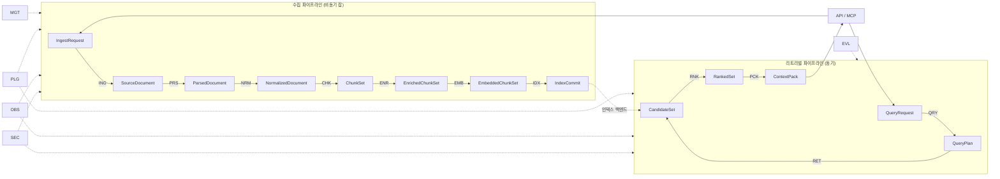

# 기능 요구사항

## 목적

이 문서는 RAG Platform이 **무엇을 해야 하는지**를 검증 가능한 SHALL 문장으로 고정한다. 설계 브리프의 원 요구사항(R1~R6), 설계 원칙(§3), 확정 결정(D-01~D-20)을 기능 단위로 분해하여, 이후 계약(03-contracts)·파이프라인(04-pipelines)·API(05-api)·평가(08-evaluation) 문서가 각자 어떤 요구사항을 구현·검증하는지 추적할 수 있게 한다.

요구사항은 **능력(capability)** 으로 기술한다. 구체 라이브러리·제품명은 쓰지 않으며, 브리프 D-xx가 지정한 기본 구현은 "관련 결정" 열로만 연결한다. 이 원칙은 브리프 원칙 2(Adapters over Forks)에 따라 어떤 어댑터로 교체되어도 요구사항이 유효하도록 하기 위한 것이다.

## 범위

- **포함**: 수집(ING), 파싱(PRS), 정규화(NRM), 청킹(CHK), 보강(ENR), 임베딩(EMB), 인덱싱(IDX), 질의 이해(QRY), 검색(RET), 리랭킹(RNK), 컨텍스트 패킹(PCK), 공개 API(API), MCP 서버(MCP), 관리(MGT), 평가(EVL), 플러그인(PLG), 관측성(OBS), 보안(SEC)의 기능 요구사항.
- **제외**: 성능·가용성·용량 등 비기능 요구사항은 [비기능 요구사항](02-non-functional-requirements.md)에서 다룬다. 웹 크롤러, 답변 생성 UI, 모델 파인튜닝, 인증 서버는 브리프 §6에 따라 범위 밖이다(단, 훅 요구사항은 본 문서에 포함).

## 요구사항 표기 규약

### ID 체계

`FR-<영역>-<번호>` 형식을 사용한다. 번호는 영역 내 두 자리 일련번호이며 삭제된 번호는 재사용하지 않는다.

| 영역 코드 | 영역 | 대응 스테이지 / 컴포넌트 |
|-----------|------|--------------------------|
| ING | 수집(Ingestion) | `IngestRequest → SourceDocument`, fetcher |
| PRS | 파싱(Parsing) | `SourceDocument → ParsedDocument`, parser |
| NRM | 정규화(Normalization) | `ParsedDocument → NormalizedDocument`, normalizer |
| CHK | 청킹(Chunking) | `NormalizedDocument → ChunkSet`, chunker |
| ENR | 보강(Enrichment) | `ChunkSet → EnrichedChunkSet`, enricher |
| EMB | 임베딩(Embedding) | `EnrichedChunkSet → EmbeddedChunkSet`, embedder |
| IDX | 인덱싱(Indexing) | `EmbeddedChunkSet → IndexCommit`, index_backend |
| QRY | 질의 이해(Query Understanding) | `QueryRequest → QueryPlan`, query_transformer |
| RET | 검색(Retrieval) | `QueryPlan → CandidateSet`, retriever, fuser |
| RNK | 리랭킹(Reranking) | `CandidateSet → RankedSet`, reranker |
| PCK | 컨텍스트 패킹(Context Packing) | `RankedSet → ContextPack`, postprocessor, packer |
| API | 공개 API | 수집·리트리벌·관리 REST API, 클라이언트 SDK |
| MCP | MCP 서버 | 에이전트용 도구 노출 |
| MGT | 관리(Management) | 테넌트·컬렉션·프로파일·잡·재인덱싱·배포 모드(오케스트레이션 러너) |
| EVL | 평가(Evaluation) | 골든셋, 메트릭, LLM-judge, A/B |
| PLG | 플러그인(Plugin) | 레지스트리, 확장 지점, SDK |
| OBS | 관측성(Observability) | 트레이스·메트릭·로그·설명 가능성 |
| SEC | 보안(Security) | 테넌시 격리, ACL, PII, 감사 |

### 우선순위(MoSCoW)

| 우선순위 | 의미 |
|----------|------|
| Must | 첫 공개 릴리스(M1)에 반드시 포함. 미충족 시 릴리스 불가 |
| Should | 첫 공개 릴리스에 포함이 강력히 권고됨. 정당한 사유가 있으면 다음 마일스톤으로 이월 가능 |
| Could | 프로파일·플러그인으로 선택 제공. 기본 프로파일에 포함되지 않아도 됨 |
| Won't | 이번 로드맵 범위에서 제외(훅만 제공). 범위 밖임을 기록하는 서술문으로만 쓰며 SHALL/SHALL NOT을 사용하지 않는다. 검증은 REVIEW로 범위 준수를 확인한다 |

### 검증 방법 코드

| 코드 | 방법 |
|------|------|
| T-UNIT | 단위 테스트 |
| T-CONTRACT | 계약 테스트(JSON Schema 검증, 예시 라운드트립, 스키마 호환성 검사) |
| T-INT | 통합 테스트(실제 백엔드 컨테이너 사용) |
| T-E2E | 종단 간 테스트(수집 → 검색 → 컨텍스트 팩) |
| T-GOLD | 골든셋 평가(오프라인 메트릭 비교) |
| T-FIXTURE | 포맷별 픽스처 문서 회귀 테스트(구조 보존 비교) |
| T-LOAD | 부하·장애 주입 테스트 |
| T-SEC | 보안 테스트(격리 침투, ACL 우회 시도, 정적 분석) |
| REVIEW | 설계·코드 리뷰 체크리스트 |
| INSPECT | 산출물·설정·문서 수동 검사 |

### 요구사항 문장 규약

- **SHALL**: 필수 동작. 검증 방법으로 반증 가능해야 한다.
- **SHALL NOT**: 금지 동작.
- 각 요구사항은 하나의 능력 주제를 다룬다. 같은 주제 안에서 밀접하게 결합된 SHALL 묶음(예: 동작과 그 결과의 기록)은 한 행에 허용하되, 검증 방법이 각 SHALL을 모두 커버해야 한다. 우선순위나 검증 방법이 달라지는 주장은 별도 행으로 분리한다.
- 요구사항은 능력으로 기술하며 계약 필드명·인터페이스 메서드명을 확정형으로 쓰지 않는다. 백틱 식별자는 두 종류다. (a) 브리프가 이미 확정한 식별자(`job_id`, `tenant_id`, `collection_id`, `acl`, `schema_version`, D-05 스테이지 모델명, D-10 확장 지점명, D-13 MCP 도구명, D-15 `IndexBackend`)는 확정형이다. (b) 본 문서가 제안하는 식별자(잡 상태·청크 타입 열거값, 역할명, `soft`, `resolve_citation` 등)는 "미해결 이슈"에 등록된 경우에만 백틱으로 표기하며 제안임을 뜻한다. 등록되지 않은 새 필드명·메서드명은 본문에 쓰지 않고 이슈 13(계약 필드 제안)에 먼저 등록한다. 확정은 해당 계약·설계 문서에서 한다.
- "추적" 열은 원 요구사항 R1~R6(브리프 §2)을 가리킨다. 원천이 원 요구사항이 아니라 브리프 §3 설계 원칙인 횡단 관심사(테넌시 격리, 역할, 감사, 헬스, 배포 모드 등)는 `P<n>`(예: `P9` = 원칙 9 Multi-Tenant & Secure by Design)으로 표기한다. 하나의 FR에 R과 P를 함께 쓸 수 있다.
- "관련 결정" 열의 D-xx는 브리프 §4, O-xx는 브리프 §5를 가리킨다. O-xx가 연결된 요구사항은 기본값이 아직 열려 있음을 뜻하며, 요구사항 자체(능력)는 확정이다.

## 스테이지 경계와 요구사항 영역의 관계

각 영역의 요구사항은 "해당 스테이지가 입력으로 무엇을 받아 출력으로 무엇을 내야 하는가"와 "실패 시 어떻게 동작해야 하는가"를 우선 기술한다(브리프 §11).

## 1. 수집 (ING)

플랫폼은 크롤러가 아니다(R1). 외부 시스템이 이미 수집한 문서의 **위치(URI)와 메타데이터**를 `IngestRequest`로 전달하면, 플랫폼은 비동기 잡으로 원본을 가져와 `SourceDocument`를 만든다. 이 영역의 핵심은 URI 스킴 확장성, 멱등성, 잡 상태의 표준화다.

| ID | 제목 | 설명 | 우선순위 | 추적 | 관련 결정 | 검증 |
|----|------|------|----------|------|-----------|------|
| FR-ING-01 | URI 기반 수집 요청 수신 | 시스템은 문서 원본을 직접 업로드받지 않고도, 원본의 URI와 메타데이터를 담은 `IngestRequest`를 받아 수집 잡을 생성할 수 있어야 한다(SHALL). | Must | R1 | D-05, D-08 | T-CONTRACT, T-E2E |
| FR-ING-02 | 다중 URI 스킴 지원 | 시스템은 최소 `s3://`, `gs://`, `az://`, `file://`, `http://`, `https://` 스킴의 URI에서 원본을 가져올 수 있어야 하며(SHALL), `smb://` 등 추가 스킴은 fetcher 플러그인으로 확장 가능해야 한다(SHALL). | Must | R1 | D-10 | T-INT |
| FR-ING-03 | 배치 수집 요청 | 시스템은 하나의 요청에 복수의 문서 항목을 담은 배치 수집을 받아, 항목별로 독립된 상태를 추적할 수 있어야 한다(SHALL). 항목 하나의 실패가 다른 항목의 처리를 막아서는 안 된다(SHALL NOT). | Must | R1 | D-08, D-17 | T-E2E |
| FR-ING-04 | 비동기 잡 응답 | 시스템은 수집 요청 수신 즉시 `job_id`(ULID)와 상태 조회 URL을 반환하고(SHALL), 실제 처리는 백그라운드에서 수행해야 한다(SHALL). | Must | R1 | D-06, D-08 | T-CONTRACT, T-E2E |
| FR-ING-05 | 콘텐츠 해시 기반 멱등성 | 시스템은 가져온 원본의 BLAKE3 콘텐츠 해시를 계산하고(SHALL), 동일 테넌트·컬렉션에서 동일 해시와 동일 프로파일 버전으로 이미 처리된 문서는 재처리하지 않고 기존 결과를 재사용할 수 있어야 한다(SHALL). 요청자는 요청 단위 옵션으로 재처리를 강제할 수 있어야 한다(SHALL). | Must | R1, R5 | D-06 | T-INT, T-E2E |
| FR-ING-06 | 클라이언트 멱등 키 | 시스템은 요청자가 제공한 멱등 키(idempotency key)로 동일 요청의 중복 제출을 감지하고, 기존 `job_id`를 반환해야 한다(SHALL). | Should | R1 | D-08 | T-INT |
| FR-ING-07 | 외부 메타데이터 보존 | 시스템은 요청에 포함된 외부 메타데이터(제목, 저자, 발행일, 원천 시스템 ID, 사용자 정의 키-값, ACL)를 `SourceDocument`에 무손실로 보존하고(SHALL), 이후 모든 스테이지 산출물과 인덱스 레코드까지 전달해야 한다(SHALL). | Must | R1, R5 | D-04, D-09 | T-CONTRACT, T-E2E |
| FR-ING-08 | 원본 보존 및 콘텐츠 주소화 저장 | 시스템은 가져온 원본 바이트를 오브젝트 스토리지에 콘텐츠 해시 주소로 저장하고(SHALL), `SourceDocument`가 그 위치를 참조해야 한다(SHALL). 원본 미보존 정책이 컬렉션에 설정되면 처리 완료 후 원본을 삭제해야 한다(SHALL). 이때 파생 산출물이 참조하는 원본 영역(그림, 폴백된 표 이미지)은 FR-PRS-15·FR-PRS-06에 따라 삭제 전에 이미 별도 산출물로 저장되어 있어야 한다. | Must | R1, R5 | D-14 | T-INT |
| FR-ING-09 | 원본 무결성 검증 | 시스템은 요청자가 기대 해시 또는 크기를 제시한 경우 가져온 원본과 비교하여 불일치 시 해당 항목을 실패 처리해야 한다(SHALL). | Should | R1 | D-06 | T-UNIT |
| FR-ING-10 | 크기·시간 제한 | 시스템은 컬렉션 정책의 최대 파일 크기와 fetch 타임아웃을 초과하는 원본을 표준 오류 코드로 거부하고, 부분 산출물을 남기지 않아야 한다(SHALL). | Must | R1 | D-08, D-17 | T-INT |
| FR-ING-11 | 문서 버전 관리 | 시스템은 동일 외부 문서 식별자(원천 시스템이 부여한 ID)에 대해 새로운 콘텐츠 해시가 도착하면 새 문서 버전으로 처리하고, 이전 버전의 인덱스 레코드를 원자적으로 교체할 수 있어야 한다(SHALL). | Must | R1 | D-05 | T-E2E |
| FR-ING-12 | 삭제 요청 수집 | 시스템은 외부 문서 식별자 또는 플랫폼이 부여한 문서 ID 기준 삭제 요청을 받아 관련 인덱스 레코드·산출물·원본을 정책에 따라 제거하는 잡을 생성해야 한다(SHALL). | Must | R1 | D-08 | T-E2E |
| FR-ING-13 | 수집 정책 오버라이드 | 시스템은 요청 단위로 프로파일 ID, 언어 힌트, OCR 강제 여부, 우선순위 등 처리 정책을 컬렉션 기본값 위에 덧씌울 수 있어야 한다(SHALL). 허용되지 않는 오버라이드는 검증 단계에서 거부해야 한다(SHALL). | Should | R1, R4 | D-08 | T-CONTRACT |
| FR-ING-14 | 잡 상태 조회 및 이벤트 | 시스템은 잡의 상태(`queued`, `fetching`, `parsing`, `normalizing`, `chunking`, `enriching`, `embedding`, `indexing`, `committed`, `failed`, `cancelled`)를 조회 API로 제공하고(SHALL), 상태 전이를 표준 이벤트 스키마로 웹훅·이벤트 스트림에 발행해야 한다(SHALL). 구독 관리와 전달 보장은 FR-API-14·FR-API-15에서 다룬다. 설계 열거는 바이블 §5.7 `JobState`. | Must | R1, R5 | D-08 | T-CONTRACT, T-E2E |
| FR-ING-15 | 잡 취소 | 시스템은 아직 커밋되지 않은 잡의 취소 요청을 받아 진행 중 스테이지를 중단하고 부분 산출물을 정리해야 한다(SHALL). | Should | R1 | D-17 | T-INT |
| FR-ING-16 | 원천 크롤링 비포함 | 웹사이트·파일 시스템을 능동 탐색하는 크롤러·커넥터는 브리프 §6에 따라 코어 범위 밖이다. 외부 커넥터가 사용할 수집 API(FR-ING-01)와 이벤트 훅(FR-ING-14, FR-API-14)만 제공한다. | Won't | R1 | D-08 | REVIEW |

## 2. 파싱 (PRS)

파싱은 포맷별 원본을 **자체 소유 표준 문서 모델 `ParsedDocument`** 로 변환한다(D-04). 오픈소스 파서는 어댑터로 감싸되, 구조(계층·표·그림·목록·각주)와 출처(provenance)는 어떤 어댑터를 쓰더라도 동일한 계약으로 보존되어야 한다. 한국 공공·기업 문서 특성상 HWPX/HWP는 1급 포맷이다. 사용자 원 요구사항(R1)이 명시한 HWPX·PDF·DOC·TXT·HTML과 브리프 §1의 HWP·DOCX·MD는 모두 M1 필수(Must) 지원 포맷이며, 포맷별 지원 깊이(고급 개체, 변환기 의존)만 별도 행(FR-PRS-21, FR-PRS-22)으로 분리해 우선순위를 둔다. O-07은 HWP의 지원 범위를 여는 것이며 지원 여부를 여는 것이 아니다.

| ID | 제목 | 설명 | 우선순위 | 추적 | 관련 결정 | 검증 |
|----|------|------|----------|------|-----------|------|
| FR-PRS-01 | 포맷 감지 및 라우팅 | 시스템은 확장자·MIME 타입·매직 바이트를 종합하여 원본 포맷을 판별하고(SHALL), 판별 결과와 신뢰도를 `SourceDocument`에 기록한 뒤 적합한 파서로 라우팅해야 한다(SHALL). 확장자와 실제 내용이 불일치하면 내용을 우선해야 한다(SHALL). | Must | R1, R2 | D-18 | T-UNIT, T-FIXTURE |
| FR-PRS-02 | HWPX 1급 파싱 | 시스템은 HWPX(OWPML) 문서에서 섹션·단락·표·그림·각주·머리말·꼬리말·글머리 목록을 구조적으로 추출하여 `ParsedDocument`로 변환해야 한다(SHALL). | Must | R1, R2 | D-04, D-18 | T-FIXTURE |
| FR-PRS-03 | HWPX 표 병합 셀 보존 | 시스템은 HWPX 표의 병합 셀(rowspan/colspan)을 구조적으로 보존하고, 중첩 표를 부모-자식 관계로 표현해야 한다(SHALL). 병합 정보를 잃은 평탄화만 제공해서는 안 된다(SHALL NOT). | Must | R1, R2 | D-04 | T-FIXTURE |
| FR-PRS-04 | HWP 5.0 바이너리 파싱 | 시스템은 HWP 5.0 바이너리 문서에서 본문 텍스트·단락 구조·표·이미지를 추출하여 `ParsedDocument`로 변환할 수 있어야 한다(SHALL). 이 행은 기본 지원을 확정하는 것이며, 고급 개체 지원과 변환기 폴백은 FR-PRS-21·FR-PRS-22로 분리한다. | Must | R1, R2 | D-18 | T-FIXTURE |
| FR-PRS-05 | PDF 레이아웃 인식 파싱 | 시스템은 텍스트 PDF에서 읽기 순서(reading order)를 복원하고, 다단 레이아웃·머리말/꼬리말·페이지 번호를 식별하여 본문과 분리해야 한다(SHALL). | Must | R1, R2 | D-18 | T-FIXTURE |
| FR-PRS-06 | PDF 표 구조 추출 | 시스템은 PDF 내 표를 행·열·셀 구조로 추출하고(SHALL), 표 인식 신뢰도를 블록에 기록해야 한다(SHALL). 신뢰도가 프로파일 임계값 미만이면 표를 텍스트 블록으로 폴백하되, 해당 영역을 렌더링한 이미지를 FR-PRS-15와 같은 방식의 별도 산출물로 저장하고 블록에서 참조해야 한다(SHALL). | Must | R1, R2 | D-04, D-14, D-18 | T-FIXTURE |
| FR-PRS-07 | 스캔 PDF 판별 및 OCR | 시스템은 페이지 단위로 텍스트 레이어 존재 여부를 판별하여 스캔·이미지 페이지에만 OCR을 적용해야 한다(SHALL). OCR 엔진은 어댑터로 교체 가능해야 하며(SHALL), 한국어 인식을 지원해야 한다(SHALL). 기본 엔진은 O-08에 따른다. | Must | R1, R2 | D-18, O-08 | T-FIXTURE, T-INT |
| FR-PRS-08 | OCR 신뢰도 기록 | 시스템은 OCR로 생성된 모든 텍스트 블록에 OCR 출처 표시와 문자·단어 수준 평균 신뢰도를 기록해야 한다(SHALL). 하류 스테이지는 이 값을 필터·가중치에 사용할 수 있어야 한다(SHALL). | Should | R2, R6 | D-04 | T-CONTRACT |
| FR-PRS-09 | DOCX 구조 파싱 | 시스템은 DOCX의 제목 스타일 수준, 목록, 표, 이미지, 각주·미주, 코멘트(옵션)를 `ParsedDocument` 블록으로 변환해야 한다(SHALL). | Must | R1, R2 | D-18 | T-FIXTURE |
| FR-PRS-10 | DOC 레거시 파싱 | 시스템은 DOC(바이너리) 문서를 DOCX로 변환한 뒤 FR-PRS-09 경로로 파싱하여 `ParsedDocument`로 변환할 수 있어야 하며(SHALL), 변환 실패를 표준 오류로 보고해야 한다(SHALL). 변환기의 배포 형태와 부재 시 동작은 FR-PRS-22에서 다룬다. | Must | R1, R2 | D-18 | T-INT, T-FIXTURE |
| FR-PRS-11 | HTML 본문 추출 | 시스템은 HTML에서 내비게이션·광고·푸터 등 보일러플레이트를 제거하고 본문을 추출하되(SHALL), 제목 계층·표·목록·링크·코드 블록의 구조를 보존해야 한다(SHALL). | Must | R1, R2 | D-18 | T-FIXTURE |
| FR-PRS-12 | HTML 메타데이터 수확 | 시스템은 HTML의 `title`, `meta`, Open Graph, `lang`, 정규 URL(canonical) 정보를 추출하여 문서 메타데이터에 병합해야 한다(SHALL). | Should | R1 | D-04 | T-FIXTURE |
| FR-PRS-13 | 텍스트·마크다운 파싱 | 시스템은 TXT·MD 파일의 문자 인코딩을 자동 감지하고(SHALL), 마크다운 제목·목록·코드 블록·표를 구조 블록으로 변환해야 한다(SHALL). 구조 표식이 없는 텍스트는 단락 경계를 추론해야 한다(SHALL). | Must | R1, R2 | D-18 | T-FIXTURE |
| FR-PRS-14 | 출처(provenance) 필수 기록 | 시스템은 모든 블록에 출처 정보(페이지 번호, 바운딩 박스, 원본 문자 오프셋, 원본 요소 경로 중 포맷이 제공하는 것)를 기록해야 하며(SHALL), 출처 없는 블록을 생성해서는 안 된다(SHALL NOT). | Must | R2, R5, R6 | D-04 | T-CONTRACT, T-FIXTURE |
| FR-PRS-15 | 그림·이미지 추출 | 시스템은 문서 내 그림을 별도 산출물로 추출하여 콘텐츠 주소로 저장하고(SHALL), 그림 블록에 캡션·대체 텍스트·위치를 연결해야 한다(SHALL). | Must | R1, R2 | D-04, D-14 | T-FIXTURE |
| FR-PRS-16 | 수식·코드 블록 식별 | 시스템은 수식과 코드 블록을 일반 단락과 구분되는 블록 타입으로 식별해야 한다(SHALL). 수식은 LaTeX 또는 MathML 텍스트 표현을 함께 저장할 수 있어야 한다(SHALL). | Could | R2 | D-04 | T-FIXTURE |
| FR-PRS-17 | 파서 폴백 체인 | 시스템은 포맷별로 우선순위가 정해진 파서 체인을 구성하고, 1차 파서가 실패하거나, 파서 출력에 FR-NRM-09와 동일한 지표 정의(텍스트 비율, 깨진 문자 비율, 구조 복원 신뢰도)를 적용해 계산한 품질 점수가 프로파일 임계값 미만이면 다음 파서를 시도해야 한다(SHALL). 사용된 파서와 시도 이력을 `ParsedDocument`에 기록해야 한다(SHALL). | Must | R2, R4 | D-04, D-18 | T-INT |
| FR-PRS-18 | 부분 파싱 결과 허용 | 시스템은 일부 페이지·요소 파싱 실패 시 문서 전체를 실패시키지 않고, 실패 범위를 경고로 기록한 부분 결과를 낼 수 있어야 한다(SHALL). 부분 결과 허용 여부는 컬렉션 정책으로 제어 가능해야 한다(SHALL). | Should | R2 | D-04 | T-FIXTURE |
| FR-PRS-19 | 암호화·손상 문서 처리 | 시스템은 암호로 보호된 문서, 손상된 문서, 0바이트 문서를 각각 구분되는 표준 오류 코드로 보고해야 한다(SHALL). | Must | R1 | D-08 | T-UNIT |
| FR-PRS-20 | 압축 컨테이너 전개 | 시스템은 ZIP 등 컨테이너 파일을 전개하여 내부 문서를 개별 문서 항목으로 파생시킬 수 있어야 하며(SHALL), 파생 관계를 메타데이터에 기록해야 한다(SHALL). 전개 깊이·항목 수 제한을 강제해야 한다(SHALL). | Could | R1 | D-08 | T-INT |
| FR-PRS-21 | HWP 고급 개체 지원 | 시스템은 HWP 5.0 문서의 수식·차트·OLE 개체·양식 개체·글맵시 등 고급 개체를 텍스트 대체물 또는 그림 산출물(FR-PRS-15 방식)로 변환할 수 있어야 한다(SHALL). 지원 개체 범위는 O-07에 따라 확정한다. | Should | R1, R2 | D-18, O-07 | T-FIXTURE |
| FR-PRS-22 | 문서 변환기 격리 및 폴백 | 시스템은 HWP·DOC 처리에 사용하는 문서 변환기를 코어 워커와 분리된 서비스로 배포·교체할 수 있어야 하며(SHALL), HWP 1차 파서 실패 시 변환기를 폴백 경로로 사용할 수 있어야 한다(SHALL). 변환기가 배포되지 않은 환경에서는 변환기 의존 항목을 표준 오류(미지원 포맷)로 거부해야 한다(SHALL). HWP의 변환기 의존 여부는 O-07에 따라 확정한다. | Should | R1, R2 | D-02, D-18, O-07 | T-INT |

## 3. 정규화 (NRM)

정규화는 파서별 편차를 제거하고 `ParsedDocument`를 청킹에 적합한 `NormalizedDocument`로 다듬는다. 텍스트 클리닝, 계층 복원, 언어 판별, 표·그림의 텍스트화가 여기서 일어난다. 정규화는 정보를 **추가·정리**하되 출처 연결을 끊어서는 안 된다.

| ID | 제목 | 설명 | 우선순위 | 추적 | 관련 결정 | 검증 |
|----|------|------|----------|------|-----------|------|
| FR-NRM-01 | 텍스트 정규화 | 시스템은 유니코드 정규화(NFC), 제어 문자 제거, 연속 공백·개행 정리, 하이픈 줄바꿈 복원을 수행해야 한다(SHALL). 정규화 전 원문은 출처 오프셋으로 복원 가능해야 한다(SHALL). | Must | R2 | D-04, D-05 | T-UNIT |
| FR-NRM-02 | 제목 계층 복원 | 시스템은 명시적 제목 스타일이 없는 문서에서 글꼴 크기·번호 체계(예: "제1장", "1.1", "가.")·위치 정보를 이용해 제목 수준을 추론하고 섹션 트리를 구성해야 한다(SHALL). | Must | R2, R6 | D-04 | T-FIXTURE |
| FR-NRM-03 | 보일러플레이트 제거 | 시스템은 반복되는 머리말·꼬리말·페이지 번호·워터마크 텍스트를 페이지 간 비교로 식별하여 본문에서 제외하되, 제외한 내용을 문서 메타데이터에 보존해야 한다(SHALL). | Must | R2 | D-04 | T-FIXTURE |
| FR-NRM-04 | 언어 판별 | 시스템은 문서 및 블록 단위 언어를 BCP 47 코드로 판별하여 기록해야 하며(SHALL), 한국어·영어 혼용 문서에서 블록별 주 언어를 구분해야 한다(SHALL). | Must | R2 | D-06 | T-UNIT |
| FR-NRM-05 | 표 텍스트 직렬화 | 시스템은 모든 표 블록에 대해 구조를 유지한 텍스트 표현(마크다운 표 및 행 단위 키-값 문장)을 생성하여 첨부해야 한다(SHALL). 병합 셀은 해당 범위의 모든 셀에 값을 전파한 표현을 함께 제공해야 한다(SHALL). | Must | R2, R6 | D-04, D-19 | T-FIXTURE |
| FR-NRM-06 | 그림 텍스트화 | 시스템은 그림 블록에 캡션·주변 참조 문장·OCR 텍스트를 결합한 텍스트 대체물을 생성해야 하며(SHALL), 비전-언어 모델 기반 설명 생성은 enricher 플러그인으로 선택 가능해야 한다(SHALL). | Should | R2, R6 | D-10, O-05 | T-FIXTURE |
| FR-NRM-07 | 각주·미주 연결 | 시스템은 각주·미주를 참조 위치의 블록과 양방향으로 연결하고, 청킹 시 함께 포함될 수 있도록 표시해야 한다(SHALL). | Should | R2, R6 | D-04 | T-FIXTURE |
| FR-NRM-08 | 목록 구조 보존 | 시스템은 중첩 목록의 수준·순서·글머리 유형을 보존하고, 목록 항목이 상위 문장의 연속임을 표현할 수 있어야 한다(SHALL). | Must | R2 | D-04 | T-FIXTURE |
| FR-NRM-09 | 문서 품질 점수 | 시스템은 정규화 결과에 대해 텍스트 비율, OCR 비율, 깨진 문자 비율, 구조 복원 신뢰도를 포함한 품질 지표를 계산하여 `NormalizedDocument`에 기록해야 한다(SHALL). 임계값 미달 문서는 정책에 따라 경고 또는 격리(quarantine)해야 한다(SHALL). | Should | R2, R3 | D-04 | T-UNIT |
| FR-NRM-10 | 정규화 규칙 플러그인 | 시스템은 도메인별 정규화 규칙(약어 확장, 법령 조문 번호 표준화 등)을 normalizer 플러그인으로 추가할 수 있어야 한다(SHALL). | Could | R4 | D-10 | T-UNIT |

## 4. 청킹 (CHK)

청킹은 검색 단위를 결정하는 가장 품질 민감한 스테이지다(R2, R6). 기본은 **구조 인식 계층 청킹 + 토큰 예산 병합 + 부모-자식(small-to-big) + 표 전용 청킹**(D-19)이며, 의미 분할·late chunking·proposition은 프로파일 옵션이다. 모든 청크는 어떤 블록의 어느 범위에서 왔는지 추적 가능해야 한다.

| ID | 제목 | 설명 | 우선순위 | 추적 | 관련 결정 | 검증 |
|----|------|------|----------|------|-----------|------|
| FR-CHK-01 | 구조 인식 청킹 | 시스템은 섹션 경계·제목·단락·목록 경계를 우선 존중하여 청크를 분할해야 하며(SHALL), 문장 중간이나 표 중간에서 분할해서는 안 된다(SHALL NOT). 예외적으로 단일 블록이 최대 토큰을 초과할 때만 문장 경계에서 분할한다. | Must | R2, R6 | D-19 | T-UNIT, T-FIXTURE |
| FR-CHK-02 | 토큰 예산 기반 병합 | 시스템은 설정된 토큰 예산(최소·목표·최대) 내에서 인접한 작은 블록을 병합하고, 예산 초과 블록을 분할해야 한다(SHALL). 토큰 수는 프로파일에 지정된 토크나이저로 계산해야 한다(SHALL). 기본값은 O-09에 따른다. | Must | R2 | D-19, O-09 | T-UNIT |
| FR-CHK-03 | 부모-자식 계층 청크 | 시스템은 검색용 소형 자식 청크와 컨텍스트 제공용 대형 부모 청크(섹션·페이지 단위)를 함께 생성하고 부모 참조를 자식에 기록해야 한다(SHALL). | Must | R6 | D-19 | T-UNIT, T-E2E |
| FR-CHK-04 | 제목 경로 부착 | 시스템은 각 청크에 문서 제목부터 해당 섹션까지의 제목 경로(breadcrumb)를 기록하고, 임베딩 입력 텍스트에 포함할 수 있어야 한다(SHALL). | Must | R6 | D-19 | T-UNIT |
| FR-CHK-05 | 표 전용 청킹 | 시스템은 표를 일반 텍스트와 별도 전략으로 청킹해야 한다(SHALL): 헤더 행을 모든 분할 조각에 반복 포함하고, 행 단위 직렬화를 사용하며, 표 캡션과 직전 참조 문장을 문맥으로 부착해야 한다(SHALL). | Must | R2, R6 | D-19 | T-FIXTURE |
| FR-CHK-06 | 청크 출처 범위 | 시스템은 각 청크가 참조하는 블록 ID 목록과 블록 내 문자 범위를 기록하여, 청크에서 원본 페이지·좌표로 역추적할 수 있어야 한다(SHALL). | Must | R5, R6 | D-04, D-05 | T-CONTRACT |
| FR-CHK-07 | 오버랩 제어 | 시스템은 인접 청크 간 오버랩을 토큰 또는 문장 수 기준으로 설정할 수 있어야 하며(SHALL), 오버랩 영역을 청크 메타데이터에 표시하여 컨텍스트 패킹 시 중복 제거가 가능해야 한다(SHALL). | Must | R2, R6 | D-19, O-09 | T-UNIT |
| FR-CHK-08 | 의미 기반 분할 옵션 | 시스템은 문장 임베딩 유사도 변화점 기반 의미 분할을 chunker 플러그인으로 제공하고, 프로파일에서 구조 인식 청킹과 조합할 수 있어야 한다(SHALL). | Should | R2, R4 | D-19 | T-UNIT |
| FR-CHK-09 | 고급 청킹 전략 옵션 | 시스템은 late chunking, proposition 단위 청킹, 문장 창(sentence window) 청킹을 chunker 플러그인 확장 지점으로 수용할 수 있어야 한다(SHALL). | Could | R4 | D-10, D-19 | T-UNIT |
| FR-CHK-10 | 청크 ID와 결정적 콘텐츠 키 | 시스템은 청크 ID를 D-06에 따라 ULID로 부여하고(SHALL), 이와 별도로 문서 콘텐츠 해시·프로파일 버전·청크 위치의 함수로 계산되는 결정적 콘텐츠 키(BLAKE3)를 모든 청크에 기록하여 동일 입력에 대해 동일 키가 나오도록 해야 한다(SHALL). 중복 판정·재처리 재사용(FR-ING-05)·재현성 검증(FR-IDX-07)은 청크 ID가 아닌 이 키를 기준으로 한다. D-06과의 관계와 키 필드명은 미해결 이슈 12를 참조한다. | Must | R5 | D-06 | T-UNIT |
| FR-CHK-11 | 청크 타입 분류 | 시스템은 각 청크에 타입(`text`, `table`, `figure`, `code`, `list`, `title_only`, `mixed`)을 부여하여 검색·패킹 단계에서 타입별 처리가 가능해야 한다(SHALL). 설계 열거는 바이블 §5.7 `ItemKind`. | Must | R6 | D-19 | T-UNIT |
| FR-CHK-12 | 미세 청크 제거 | 시스템은 의미 없는 초소형 청크(설정 토큰 미만이며 인접 병합 불가)를 제거하거나 부모에만 남기고, 제거 사유를 기록해야 한다(SHALL). | Should | R3 | D-19 | T-UNIT |

## 5. 보강 (ENR)

보강은 청크에 파생 정보를 붙여 검색 가능성(recall)과 LLM 이해도를 높인다. 문맥 요약 부착(contextual retrieval)은 기본이며(D-19), LLM 기반 요약·가상 질문·엔티티 추출은 비용 정책(O-05)에 따라 켠다. 보강은 원문을 바꾸지 않고 **별도 필드**로 부착된다.

| ID | 제목 | 설명 | 우선순위 | 추적 | 관련 결정 | 검증 |
|----|------|------|----------|------|-----------|------|
| FR-ENR-01 | 문맥 요약 부착 | 시스템은 각 청크에 문서·섹션 수준 문맥 설명을 생성하여 임베딩 입력과 렉시컬 인덱스 텍스트 앞에 부착할 수 있어야 한다(SHALL). 문맥은 원문 필드와 분리 저장되어야 한다(SHALL). | Must | R2, R6 | D-19, O-05 | T-UNIT, T-GOLD |
| FR-ENR-02 | 키워드·핵심구 추출 | 시스템은 청크별 키워드·핵심구를 추출하여 렉시컬 인덱스 부스팅 필드와 메타데이터 필터에 사용할 수 있어야 한다(SHALL). 한국어 형태소 기반 추출을 지원해야 한다(SHALL). | Should | R3 | D-07 | T-UNIT |
| FR-ENR-03 | 가상 질문 생성 | 시스템은 LLM으로 청크가 답할 수 있는 가상 질문을 생성하여 별도 벡터로 인덱싱할 수 있어야 하며(SHALL), 컬렉션 단위 켬/끔과 비용 상한을 설정할 수 있어야 한다(SHALL). | Could | R3, R6 | O-05 | T-GOLD |
| FR-ENR-04 | 엔티티·관계 추출 | 시스템은 청크에서 명명 엔티티와 관계를 추출하여 메타데이터 및 그래프 인덱스 구축 입력으로 제공할 수 있어야 한다(SHALL). 기본 프로파일에서는 비활성이다. | Could | R4 | O-03 | T-UNIT |
| FR-ENR-05 | 청크 언어·도메인 태깅 | 시스템은 청크 언어(BCP 47)와 프로파일 정의 도메인 분류 태그를 부여해야 한다(SHALL). | Should | R2 | D-06 | T-UNIT |
| FR-ENR-06 | 보강 출처·모델 기록 | 시스템은 모든 보강 필드에 생성 방법(규칙/모델), 모델 식별자·버전, 생성 시각을 기록하여 재현·감사가 가능해야 한다(SHALL). | Must | R5 | D-06 | T-CONTRACT |
| FR-ENR-07 | 보강 실패 격리 | 시스템은 보강 단계 실패(LLM 타임아웃 등) 시 해당 보강 필드만 비운 채 파이프라인을 계속 진행할 수 있어야 하며(SHALL), 실패를 잡 경고로 기록해야 한다(SHALL). 필수 보강으로 지정된 항목은 실패 시 잡을 실패시켜야 한다(SHALL). | Must | R4 | D-17 | T-INT |
| FR-ENR-08 | PII 감지 훅 | 시스템은 청크 텍스트에서 개인정보 패턴을 감지하여 태깅·마스킹·거부 중 정책에 따른 조치를 취하는 enricher 훅을 제공해야 한다(SHALL). | Should | P9 | D-10 | T-UNIT, T-SEC |
| FR-ENR-09 | 보강 캐시 | 시스템은 동일 청크 콘텐츠 해시·보강 설정에 대한 LLM 보강 결과를 캐시하여 재인덱싱 시 재호출을 피해야 한다(SHALL). | Should | R5 | D-14 | T-INT |

## 6. 임베딩 (EMB)

임베딩은 `EnrichedChunkSet`을 dense·sparse·(선택) 다중 벡터 표현으로 변환한다. 모델은 전부 설정으로 교체 가능해야 하며(D-16), 임베딩 결과는 모델 식별자와 함께 저장되어 모델 교체 시 재임베딩 대상이 정확히 식별되어야 한다.

| ID | 제목 | 설명 | 우선순위 | 추적 | 관련 결정 | 검증 |
|----|------|------|----------|------|-----------|------|
| FR-EMB-01 | dense 임베딩 생성 | 시스템은 청크 텍스트(문맥 부착 포함)에 대해 다국어 dense 벡터를 생성하고 차원·정규화 여부를 기록해야 한다(SHALL). | Must | R2, R3 | D-16 | T-UNIT, T-INT |
| FR-EMB-02 | learned sparse 임베딩 생성 | 시스템은 동일 청크에 대해 학습된 sparse 표현(토큰 가중치 맵)을 생성할 수 있어야 한다(SHALL). 표현 방식 기본값은 O-02에 따른다. | Must | R3 | D-07, D-16, O-02 | T-UNIT |
| FR-EMB-03 | 다중 벡터(late interaction) 옵션 | 시스템은 토큰 수준 다중 벡터 표현을 생성·저장하는 옵션을 제공해야 한다(SHALL). 저장 위치(인덱스 vs 리랭커)는 O-04에 따른다. | Could | R3, R4 | D-16, O-04 | T-UNIT |
| FR-EMB-04 | 임베딩 서빙 어댑터 | 시스템은 외부 임베딩 서빙 엔드포인트(HTTP)와 인프로세스 모델 로딩을 모두 embedder 어댑터로 지원해야 한다(SHALL). | Must | R2 | D-10, D-16 | T-INT |
| FR-EMB-05 | 모델 식별자 기록 | 시스템은 모든 벡터에 모델 이름·버전·차원·정규화·입력 접두어(instruction) 설정을 하나로 식별하는 모델 식별자를 기록해야 한다(SHALL). 컬렉션 내 동일 벡터 이름에는 단일 모델만 허용해야 한다(SHALL). | Must | R5 | D-16 | T-CONTRACT |
| FR-EMB-06 | 질의·문서 비대칭 처리 | 시스템은 모델이 요구하는 질의용·문서용 접두어 또는 instruction을 프로파일에서 선언하고 임베딩·검색 시 일관되게 적용해야 한다(SHALL). | Must | R3 | D-16 | T-UNIT |
| FR-EMB-07 | 배치·재시도 | 시스템은 청크를 토큰 길이 기준으로 배치하여 임베딩하고, 부분 배치 실패 시 해당 배치만 재시도해야 한다(SHALL). | Must | R4 | D-17 | T-INT |
| FR-EMB-08 | 입력 길이 초과 처리 | 시스템은 모델 최대 길이를 초과하는 입력을 감지하여 프로파일 정책(절단·분할 후 평균·오류)에 따라 처리하고 결과에 표시해야 한다(SHALL). | Must | R2 | D-16 | T-UNIT |
| FR-EMB-09 | 임베딩 캐시 | 시스템은 (텍스트 해시, 모델 식별자) 키로 임베딩을 캐시하여 동일 텍스트 재임베딩을 피해야 한다(SHALL). | Should | R5 | D-14 | T-INT |
| FR-EMB-10 | 다중 임베딩 필드 | 시스템은 하나의 청크에 원문 벡터, 문맥 부착 벡터, 가상 질문 벡터 등 복수의 명명된 벡터를 생성할 수 있어야 한다(SHALL). | Should | R3, R6 | D-15, D-16 | T-UNIT |

## 7. 인덱싱 (IDX)

인덱싱은 벡터·렉시컬 백엔드에 `IndexRecord`를 기록하고, 문서 버전 단위로 원자적인 `IndexCommit`을 만든다. 백엔드는 `IndexBackend` 인터페이스 뒤에 숨겨 교체 가능해야 하며(D-15), 멀티테넌시 필드는 모든 레코드에 강제된다(D-09).

| ID | 제목 | 설명 | 우선순위 | 추적 | 관련 결정 | 검증 |
|----|------|------|----------|------|-----------|------|
| FR-IDX-01 | 인덱스 백엔드 추상화 | 시스템은 벡터·sparse·렉시컬 인덱스를 레코드 upsert·삭제, 필터 결합 검색, 원자적 커밋·롤백 능력을 포함하는 공통 `IndexBackend` 인터페이스로 추상화하여 백엔드를 설정으로 교체할 수 있어야 한다(SHALL). 메서드 시그니처는 [플러그인 아키텍처](../02-architecture/05-plugin-architecture.md)에서 확정한다(미해결 이슈 13). | Must | R4, R5 | D-10, D-15 | T-INT |
| FR-IDX-02 | 하이브리드 레코드 저장 | 시스템은 하나의 청크에 대해 dense·sparse 벡터와 렉시컬 텍스트·메타데이터 페이로드를 저장하고, 동일 청크 ID로 백엔드 간 상호 참조가 가능해야 한다(SHALL). | Must | R3 | D-07, D-15 | T-INT |
| FR-IDX-03 | 한국어 렉시컬 분석 | 시스템은 렉시컬 인덱스에 한국어 형태소 분석 기반 토크나이징을 적용하고, 사용자 사전·동의어 사전을 컬렉션 단위로 설정할 수 있어야 한다(SHALL). | Must | R3 | D-07, D-15 | T-INT, T-GOLD |
| FR-IDX-04 | 테넌시 필드 강제 | 시스템은 `tenant_id`, `collection_id`, `acl` 필드가 없는 레코드의 인덱싱을 거부해야 한다(SHALL). | Must | P9 | D-09 | T-CONTRACT, T-SEC |
| FR-IDX-05 | 원자적 커밋 | 시스템은 한 문서 버전의 모든 레코드를 스테이징 후 원자적으로 활성화하는 `IndexCommit`을 지원해야 하며(SHALL), 커밋 완료 전에는 검색에 새 버전이 노출되어서는 안 된다(SHALL NOT). | Must | R1, R5 | D-05 | T-INT, T-E2E |
| FR-IDX-06 | 커밋 롤백 | 시스템은 최근 `IndexCommit`을 이전 버전으로 되돌릴 수 있어야 한다(SHALL). 롤백 가능 보존 기간은 컬렉션 정책으로 설정한다. | Should | R1 | D-05 | T-INT |
| FR-IDX-07 | 커밋 해시 재현성 | 시스템은 `IndexCommit`에 포함된 레코드의 결정적 콘텐츠 키(FR-CHK-10)·텍스트 해시·모델 식별자·페이로드로부터 결정적 커밋 해시를 계산하여, 동일 입력·프로파일이 동일 해시를 내도록 해야 한다(SHALL). ULID인 레코드 ID는 해시 입력에서 제외하며, 벡터 포함 여부는 미해결 이슈 7에 따른다. | Should | R5 | D-06 | T-UNIT |
| FR-IDX-08 | 경량 단일 백엔드 프로파일 | 시스템은 단일 벡터 백엔드만으로 dense+sparse 하이브리드가 동작하는 경량 프로파일을 제공해야 한다(SHALL). | Must | R4 | D-15 | T-E2E |
| FR-IDX-09 | 페이로드 필터 인덱스 | 시스템은 메타데이터 필드(날짜, 문서 타입, 사용자 정의 키)에 대한 필터 인덱스를 컬렉션 스키마로 선언하고 백엔드에 반영해야 한다(SHALL). | Must | R3 | D-15 | T-INT |
| FR-IDX-10 | 부모·문서 저장소 | 시스템은 부모 청크와 문서 메타데이터를 인덱스 페이로드 또는 별도 저장소에서 청크 ID로 조회할 수 있게 저장해야 한다(SHALL). | Must | R6 | D-14, D-19 | T-INT |
| FR-IDX-11 | 그래프 인덱스 옵션 | 시스템은 엔티티·관계 기반 그래프 인덱스와 계층 요약 트리 인덱스를 index_backend 플러그인으로 수용할 수 있어야 한다(SHALL). | Could | R4 | O-03 | T-INT |
| FR-IDX-12 | 인덱스 스키마 마이그레이션 | 시스템은 컬렉션 스키마·모델 변경 시 새 인덱스를 병렬 구축하고 별칭 전환으로 무중단 교체할 수 있어야 한다(SHALL). | Should | R4 | D-15 | T-INT |

## 8. 질의 이해 (QRY)

질의 이해는 `QueryRequest`를 실행 가능한 `QueryPlan`으로 바꾼다. 재작성·확장·분해·필터 추출·전략 선택·예산 배정이 여기서 결정되며, 모든 변환은 설명 가능하도록 계획에 기록된다.

| ID | 제목 | 설명 | 우선순위 | 추적 | 관련 결정 | 검증 |
|----|------|------|----------|------|-----------|------|
| FR-QRY-01 | 질의 계획 생성 | 시스템은 모든 검색 요청에 대해 사용할 리트리버, 필터, 질의 변형, Top-K 예산, 리랭킹 여부를 담은 `QueryPlan`을 생성하고 응답에 포함할 수 있어야 한다(SHALL). | Must | R3, R5 | D-05 | T-CONTRACT |
| FR-QRY-02 | 질의 정규화 | 시스템은 질의에 대해 공백·유니코드 정규화와 한국어 조사·어미 처리 힌트 생성을 수행하고 결과를 `QueryPlan`에 기록해야 한다(SHALL). 오탈자 후보 제시는 FR-QRY-11로 분리한다. | Must | R3 | D-07 | T-UNIT |
| FR-QRY-03 | 질의 재작성·확장 | 시스템은 LLM 또는 규칙 기반 질의 재작성(동의어 확장, 다중 변형 생성, 가상 문서 생성)을 query_transformer 플러그인으로 제공하고 프로파일에서 켤 수 있어야 한다(SHALL). | Should | R3 | D-10 | T-GOLD |
| FR-QRY-04 | 복합 질의 분해 | 시스템은 복수 하위 질문을 포함한 질의를 하위 질의로 분해하여 각각 검색한 뒤 결과를 병합할 수 있어야 한다(SHALL). | Could | R3 | D-10 | T-GOLD |
| FR-QRY-05 | 구조화 필터 추출 | 시스템은 요청의 명시적 필터(메타데이터 조건)와 질의문에서 추론한 필터(날짜 범위, 문서 타입)를 결합하고, 추론 필터는 사용자 확인 없이 강제하지 않도록 `soft` 표시해야 한다(SHALL). | Should | R3 | D-15 | T-UNIT |
| FR-QRY-06 | 대화 이력 반영 | 시스템은 선행 대화 턴을 받아 대용어·생략을 해소한 독립 질의(standalone query)를 생성할 수 있어야 한다(SHALL). | Should | R6 | D-10 | T-GOLD |
| FR-QRY-07 | 질의 언어 판별 및 교차 언어 | 시스템은 질의 언어를 판별하고, 컬렉션 문서 언어와 다를 때 다국어 임베딩 또는 번역 질의로 교차 언어 검색을 수행할 수 있어야 한다(SHALL). | Should | R3 | D-16 | T-GOLD |
| FR-QRY-08 | 전략 라우팅 | 시스템은 질의 특성(키워드형·자연어형·식별자 포함 등)에 따라 리트리버 조합과 융합 가중치를 선택하는 라우팅 규칙을 프로파일로 정의할 수 있어야 한다(SHALL). | Should | R3, R4 | D-07 | T-GOLD |
| FR-QRY-09 | 예산 배정 | 시스템은 요청의 지연·토큰 예산을 받아 각 리트리버의 후보 수, 리랭킹 후보 수, 최종 K를 계획에 배정해야 한다(SHALL). | Must | R3, R6 | D-07 | T-UNIT |
| FR-QRY-10 | 질의 임베딩 캐시 | 시스템은 동일 정규화 질의·모델의 임베딩을 단기 캐시하여 반복 질의 지연을 줄여야 한다(SHALL). | Should | R3 | D-14 | T-INT |
| FR-QRY-11 | 오탈자 후보 제시 | 시스템은 질의의 오탈자·띄어쓰기 오류 후보를 렉시컬 인덱스 어휘 또는 컬렉션 사용자 사전(FR-MGT-10) 기반으로 제시하고, 후보 적용 여부를 `QueryPlan`에 기록할 수 있어야 한다(SHALL). | Should | R3 | D-07, D-15 | T-UNIT |

## 9. 검색 (RET)

검색은 `QueryPlan`에 따라 복수 리트리버를 실행하고 결과를 `CandidateSet`으로 융합한다. 기본은 dense + sparse + lexical 3-way 하이브리드다(D-07). 융합은 D-07이 RRF를 잠정 기본으로 두되 최종 기본값은 O-01로 확정한다(미해결 이슈 11). 검색 품질이 제1 지표(R3)이므로, 모든 후보는 어느 리트리버가 어떤 점수로 냈는지 분해되어야 한다.

| ID | 제목 | 설명 | 우선순위 | 추적 | 관련 결정 | 검증 |
|----|------|------|----------|------|-----------|------|
| FR-RET-01 | dense 벡터 검색 | 시스템은 질의 dense 벡터로 근사 최근접 이웃 검색을 수행하고 유사도 점수를 반환해야 한다(SHALL). | Must | R3 | D-07, D-15 | T-INT |
| FR-RET-02 | sparse 벡터 검색 | 시스템은 질의 learned sparse 표현으로 sparse 인덱스를 검색해야 한다(SHALL). | Must | R3 | D-07, O-02 | T-INT |
| FR-RET-03 | 렉시컬 검색 | 시스템은 한국어 형태소 분석 기반 BM25 계열 렉시컬 검색을 수행하고, 필드 부스팅(제목·키워드·문맥 요약)을 지원해야 한다(SHALL). | Must | R3 | D-07, D-15 | T-INT, T-GOLD |
| FR-RET-04 | 병렬 실행 | 시스템은 계획된 리트리버들을 병렬로 실행하고, 개별 리트리버 타임아웃 시 나머지 결과로 계속 진행하며 누락을 응답에 표시해야 한다(SHALL). | Must | R3, R4 | D-07 | T-INT, T-LOAD |
| FR-RET-05 | 결과 융합 | 시스템은 복수 리트리버 결과를 RRF 또는 가중 정규화 융합으로 결합하는 fuser를 제공하고 프로파일로 선택할 수 있어야 한다(SHALL). 기본값은 O-01에 따른다. | Must | R3 | D-07, O-01 | T-GOLD |
| FR-RET-06 | 필수 필터 강제 | 시스템은 모든 리트리버 호출에 `tenant_id`·`collection_id`·ACL 필터를 사전 필터(pre-filter)로 강제해야 하며(SHALL), 후처리 필터만으로 격리를 구현해서는 안 된다(SHALL NOT). | Must | R3, P9 | D-09 | T-SEC, T-INT |
| FR-RET-07 | 메타데이터 필터 결합 | 시스템은 사용자 필터(동등·범위·포함·부정·중첩 논리)를 벡터·렉시컬 백엔드 필터 문법으로 변환하여 적용해야 한다(SHALL). | Must | R3 | D-15 | T-INT |
| FR-RET-08 | 점수 분해 기록 | 시스템은 각 후보에 리트리버별 원점수·순위·정규화 점수·융합 점수를 기록해야 한다(SHALL). | Must | R3 | D-07, D-11 | T-CONTRACT |
| FR-RET-09 | 다중 컬렉션 검색 | 시스템은 동일 테넌트 내 복수 컬렉션을 한 요청으로 검색하고 컬렉션 간 점수를 비교 가능하게 정규화해야 한다(SHALL). | Should | R3 | D-09 | T-INT |
| FR-RET-10 | 그래프·계층 리트리버 옵션 | 시스템은 그래프 순회 기반 리트리버와 계층 요약 트리 리트리버를 retriever 플러그인으로 수용할 수 있어야 한다(SHALL). | Could | R4 | O-03 | T-GOLD |
| FR-RET-11 | 반복(agentic) 검색 옵션 | 시스템은 초기 결과 평가 후 질의를 수정해 재검색하는 반복 검색 루프를 최대 반복 횟수·예산 제한과 함께 옵션으로 제공해야 한다(SHALL). | Could | R3, R4 | D-10 | T-GOLD |
| FR-RET-12 | 빈 결과·저신뢰 신호 | 시스템은 후보가 없거나 최고 점수가 컬렉션·프로파일에 설정된 저신뢰 임계값 미만이면 응답에 저신뢰 신호를 명시해야 한다(SHALL). | Must | R6 | D-07 | T-UNIT |

## 10. 리랭킹 (RNK)

리랭킹은 융합된 후보를 질의-문서 쌍 단위로 정밀 재평가하여 `RankedSet`을 만든다. 기본은 크로스인코더(D-07, D-16)이며, LLM 리랭커·late interaction은 옵션이다.

| ID | 제목 | 설명 | 우선순위 | 추적 | 관련 결정 | 검증 |
|----|------|------|----------|------|-----------|------|
| FR-RNK-01 | 크로스인코더 리랭킹 | 시스템은 상위 N 후보를 다국어 크로스인코더로 재점수화하여 재정렬해야 한다(SHALL). | Must | R3 | D-07, D-16 | T-GOLD |
| FR-RNK-02 | 리랭킹 입력 구성 | 시스템은 리랭커 입력으로 청크 원문에 제목 경로·문맥 요약을 선택적으로 결합할 수 있어야 하며, 결합 방식은 프로파일로 설정한다(SHALL). | Must | R3, R6 | D-19 | T-GOLD |
| FR-RNK-03 | 리랭커 어댑터 | 시스템은 외부 서빙 엔드포인트와 인프로세스 모델을 reranker 어댑터로 지원하고 모델을 설정으로 교체할 수 있어야 한다(SHALL). | Must | R2, R4 | D-10, D-16 | T-INT |
| FR-RNK-04 | LLM 리랭커 옵션 | 시스템은 목록 단위(listwise) LLM 리랭킹을 reranker 플러그인으로 제공하고 비용 상한을 강제해야 한다(SHALL). | Could | R3, R4 | D-10 | T-GOLD |
| FR-RNK-05 | late interaction 리랭킹 옵션 | 시스템은 토큰 수준 다중 벡터 기반 재점수화를 리랭커 단계 옵션으로 제공해야 한다(SHALL). 위치는 O-04에 따른다. | Could | R3 | O-04 | T-GOLD |
| FR-RNK-06 | 리랭킹 생략·폴백 | 시스템은 리랭커 장애·타임아웃 시 융합 점수 순서로 폴백하고 응답에 리랭킹 미적용을 표시해야 한다(SHALL). | Must | R4 | D-17 | T-INT |
| FR-RNK-07 | 점수 보정 | 시스템은 리랭커 점수를 [0,1] 범위로 보정(calibration)하여 컬렉션·모델 간 비교 가능한 신뢰도로 제공해야 한다(SHALL). | Should | R6 | D-07 | T-GOLD |
| FR-RNK-08 | 리랭킹 점수 분해 | 시스템은 `RankedSet`의 각 항목에 융합 점수·리랭커 점수·최종 점수·순위 변동을 기록해야 한다(SHALL). | Must | R3 | D-11 | T-CONTRACT |

## 11. 컨텍스트 패킹 (PCK)

컨텍스트 패킹은 `RankedSet`을 LLM이 소비하는 `ContextPack`으로 바꾼다(R6). 단순 청크 배열이 아니라 토큰 예산 내 정렬, 중복 제거, 부모 확장, 인용 ID, 신뢰도, 렌더링 힌트를 포함하며(브리프 §2 R6), 공급자 중립 JSON과 공급자별 렌더러를 함께 제공한다(D-20).

| ID | 제목 | 설명 | 우선순위 | 추적 | 관련 결정 | 검증 |
|----|------|------|----------|------|-----------|------|
| FR-PCK-01 | 토큰 예산 패킹 | 시스템은 요청된 토큰 예산과 지정 토크나이저 기준으로 청크를 선택하여 예산을 초과하지 않는 `ContextPack`을 만들어야 한다(SHALL). | Must | R6 | D-07, D-20 | T-UNIT |
| FR-PCK-02 | 중복·오버랩 제거 | 시스템은 동일·근사 중복 청크와 오버랩 영역을 제거하거나 병합하고, 제거된 청크 ID와 제거 사유를 팩의 별도 목록으로 보고해야 한다(SHALL). | Must | R6 | D-07 | T-UNIT |
| FR-PCK-03 | 부모 확장(small-to-big) | 시스템은 선택된 자식 청크를 예산 내에서 부모 청크로 확장하거나 인접 청크를 병합할 수 있어야 하며(SHALL), 확장 전후의 항목 수·토큰 수와 항목별 확장 사유를 설명 구조(FR-OBS-04)에 기록해야 한다(SHALL). 확장 정책은 프로파일로 설정한다. | Must | R6 | D-19 | T-E2E, T-CONTRACT |
| FR-PCK-04 | 다양성 제어 | 시스템은 MMR 등 다양성 재정렬로 동일 문서·섹션 편중을 줄이는 postprocessor를 제공해야 한다(SHALL). | Should | R3, R6 | D-07 | T-GOLD |
| FR-PCK-05 | 위치 최적 정렬 | 시스템은 중요도 높은 청크를 프롬프트 시작과 끝에 배치하는 정렬 전략(lost-in-the-middle 대응)과 원문 순서 정렬을 선택 제공해야 한다(SHALL). | Must | R6 | D-20 | T-UNIT |
| FR-PCK-06 | 인용 ID 부여 | 시스템은 팩 내 모든 항목에 짧고 안정적인 인용 ID를 부여하고, 인용 ID에서 청크 ID·문서 ID·페이지·출처 범위로 해소할 수 있어야 한다(SHALL). | Must | R6 | D-04, D-20 | T-CONTRACT |
| FR-PCK-07 | 출처 메타데이터 포함 | 시스템은 각 항목에 문서 제목, 제목 경로, 페이지, URI, 발행일, 문서 버전을 포함하여 LLM이 출처를 서술할 수 있게 해야 한다(SHALL). | Must | R6 | D-04 | T-CONTRACT |
| FR-PCK-08 | 표·그림 텍스트 포함 | 시스템은 표 청크는 구조 보존 텍스트로, 그림 청크는 텍스트 대체물로 렌더링하고 원본 이미지 참조를 별도 필드로 제공해야 한다(SHALL). | Must | R6 | D-19 | T-E2E |
| FR-PCK-09 | 신뢰도 및 저신뢰 경고 | 시스템은 항목별 보정 점수와 팩 전체 신뢰도를 제공하고, 저신뢰 시 LLM에게 "근거 부족" 응답을 유도하는 힌트를 포함해야 한다(SHALL). | Must | R6 | D-07 | T-UNIT |
| FR-PCK-10 | 공급자 중립 JSON | 시스템은 `ContextPack`을 LLM 공급자에 독립적인 표준 JSON으로 반환해야 한다(SHALL). | Must | R5, R6 | D-05, D-20 | T-CONTRACT |
| FR-PCK-11 | 공급자별 렌더러 | 시스템은 동일 `ContextPack`을 Anthropic Messages `document`+`citations` 블록, OpenAI 호환 메시지, 범용 XML/Markdown 템플릿으로 렌더링하는 렌더러를 제공해야 한다(SHALL). | Must | R6 | D-20 | T-UNIT |
| FR-PCK-12 | 프롬프트 템플릿 힌트 | 시스템은 팩에 권장 시스템 프롬프트 조각(인용 형식, 근거 부족 처리 지침)을 힌트로 포함할 수 있어야 한다(SHALL). | Should | R6 | D-20 | INSPECT |
| FR-PCK-13 | 컨텍스트 압축 옵션 | 시스템은 선택된 청크를 질의 관련 문장만으로 압축하는 postprocessor를 옵션으로 제공하고, 압축 전 원문 참조를 유지해야 한다(SHALL). | Could | R6 | D-10 | T-GOLD |
| FR-PCK-14 | 토큰 통계 | 시스템은 팩의 총 토큰 수, 항목별 토큰 수, 사용 토크나이저, 예산 대비 사용률을 포함해야 한다(SHALL). | Must | R6 | D-20 | T-CONTRACT |
| FR-PCK-15 | 렌더링 결정성 | 시스템은 동일 `ContextPack`과 렌더러 설정으로 항상 동일 텍스트를 생성해야 한다(SHALL). | Must | R5 | D-20 | T-UNIT |

## 12. 공개 API (API)

공개 API는 수집·리트리벌·관리 기능을 REST로 노출하고, 잡 상태 전이 이벤트는 웹훅·이벤트 스트림으로 내보낸다(D-08). 모든 요청·응답은 계약 문서의 JSON Schema와 1:1로 대응하며(R5), 오류 모델·페이지네이션·버전 관리는 전 엔드포인트에서 일관되어야 한다. 버전 식별·페이지네이션·인증 수단 같은 구체 메커니즘은 본 문서가 정하지 않고 [API 설계 가이드라인](../05-api/01-api-design-guidelines.md)과 [멀티테넌시·보안 아키텍처](../02-architecture/07-multi-tenancy-and-security-architecture.md)가 확정한다(미해결 이슈 16). gRPC 제공 여부는 O-10에 따른다.

| ID | 제목 | 설명 | 우선순위 | 추적 | 관련 결정 | 검증 |
|----|------|------|----------|------|-----------|------|
| FR-API-01 | 수집 API | 시스템은 수집 요청 제출, 배치 제출, 잡 상태 조회, 잡 목록, 잡 취소, 문서 삭제를 REST 엔드포인트로 제공해야 한다(SHALL). | Must | R1 | D-01, D-08 | T-E2E |
| FR-API-02 | 리트리벌 API | 시스템은 `QueryRequest`를 받아 `ContextPack`을 반환하는 검색 엔드포인트와, 후보·순위만 반환하는 저수준 검색 엔드포인트를 제공해야 한다(SHALL). | Must | R3, R6 | D-05 | T-E2E |
| FR-API-03 | 문서·청크 조회 API | 시스템은 문서 ID·청크 ID·인용 ID로 문서 메타데이터, 청크 원문, 부모 청크, 출처 정보를 조회하는 엔드포인트를 제공해야 한다(SHALL). | Must | R6 | D-04 | T-E2E |
| FR-API-04 | OpenAPI 명세 게시 | 시스템은 모든 엔드포인트의 OpenAPI 3.1 명세를 게시하고, 명세의 스키마가 계약 JSON Schema와 동일 출처에서 생성되어야 한다(SHALL). 관리 API 응답 객체는 API 전용 뷰, `api/` Pydantic 단일 출처 + `schemas/` `$ref` 재사용으로 충족(바이블 §5.1 1.3.0, AM-02). | Must | R5 | D-01, D-05 | T-CONTRACT |
| FR-API-05 | 표준 오류 모델 | 시스템은 모든 오류를 단일 오류 스키마(코드, 메시지, 상세, 추적 ID, 재시도 가능 여부)로 반환해야 한다(SHALL). | Must | R5 | D-05 | T-CONTRACT |
| FR-API-06 | API 버전 관리 | 시스템은 API 버전을 식별하는 수단과 응답 페이로드의 `schema_version`을 제공하고, 같은 API 메이저 버전 안에서는 하위 호환 변경만 허용하는 정책을 문서화·강제해야 한다(SHALL). 버전 식별 메커니즘은 미해결 이슈 16을 참조한다. 버전 조회는 `GET /v1/version`(바이블 §14 1.3.0). | Must | R5 | D-05 | REVIEW, T-CONTRACT |
| FR-API-07 | 페이지네이션·필터 | 시스템은 목록 엔드포인트에 대용량 목록에서도 항목 누락·중복 없이 순회할 수 있는 안정적 페이지네이션과 표준 필터·정렬 파라미터를 제공해야 한다(SHALL). 페이지네이션 방식은 미해결 이슈 16을 참조한다. | Must | R1 | D-01 | T-E2E |
| FR-API-08 | 스트리밍 응답 | 시스템은 검색 결과를 후보 확보·리랭킹·패킹 단계별로 스트리밍(SSE)할 수 있어야 한다(SHALL). | Could | R6 | D-01 | T-E2E |
| FR-API-09 | 레이트 리밋 | 시스템은 테넌트·주체(principal) 단위 레이트 리밋을 적용하고 표준 헤더로 잔여량을 알려야 한다(SHALL). | Should | P9 | D-09, D-14 | T-LOAD |
| FR-API-10 | 클라이언트 SDK | 시스템은 OpenAPI 명세에서 생성·유지되는 Python 및 TypeScript 클라이언트 SDK를 제공해야 한다(SHALL). | Should | R1, R3 | D-01 | T-E2E |
| FR-API-11 | 레퍼런스 답변 엔드포인트 | 시스템은 `ContextPack`으로 인용 포함 답변을 생성하는 레퍼런스 `answer` 엔드포인트를 선택 모듈로 제공할 수 있어야 하며(SHALL), 코어 배포 필수 구성이 아니어야 한다(SHALL NOT). | Could | R6 | D-20 | T-E2E |
| FR-API-12 | 헬스·준비 상태 | 시스템은 liveness·readiness 엔드포인트를 제공하고 readiness에 의존 백엔드 연결 상태를 반영해야 한다(SHALL). | Must | P8 | D-11 | T-INT |
| FR-API-13 | 최종 사용자 챗 UI 비포함 | 최종 답변 생성 UI(챗봇)는 브리프 §6에 따라 코어 범위 밖이다. 클라이언트 SDK(FR-API-10)와 렌더러(FR-PCK-11)로 외부 UI 연동만 지원한다. | Won't | R6 | D-20 | REVIEW |
| FR-API-14 | 웹훅 구독 관리 | 시스템은 테넌트 범위에서 웹훅 엔드포인트를 등록·조회·수정·해지하고, 구독별로 수신할 이벤트 타입·컬렉션을 필터링할 수 있는 API를 제공해야 한다(SHALL). 구독은 테넌트 격리(FR-SEC-03)를 따르며 다른 테넌트의 이벤트를 수신할 수 없어야 한다(SHALL NOT). | Must | R1, P9 | D-08, D-09 | T-E2E, T-SEC |
| FR-API-15 | 이벤트 전달 보장 | 시스템은 발행하는 모든 이벤트에 고유 이벤트 ID(ULID)를 부여하고 재전송 시에도 동일 ID를 유지하여 수신자가 중복을 제거할 수 있게 해야 한다(SHALL). 웹훅 전달은 재시도 정책에 따라 최소 1회(at-least-once) 보장되어야 하며, 재시도 한도를 초과한 이벤트는 구독자가 조회할 수 있는 실패 목록에 남겨야 한다(SHALL). | Must | R1 | D-06, D-08 | T-INT, T-LOAD |
| FR-API-16 | 공통 스칼라 형식 | 시스템은 모든 API 요청·응답과 계약 산출물에서 식별자는 ULID, 콘텐츠 해시는 BLAKE3 hex, 시각 필드는 RFC 3339 UTC, 언어 코드는 BCP 47 형식을 사용해야 하며(SHALL), 계약 테스트가 이 형식을 검증해야 한다(SHALL). FR-ENR-06·FR-EVL-10·FR-SEC-07 등 시각을 기록하는 모든 요구사항은 이 행을 따른다. | Must | R5 | D-06 | T-CONTRACT |

## 13. MCP 서버 (MCP)

MCP 서버는 LLM 에이전트가 플랫폼을 도구로 직접 호출하게 한다(D-13). 도구 응답은 `ContextPack` 렌더러를 재사용하여 REST와 동일한 품질을 보장한다.

| ID | 제목 | 설명 | 우선순위 | 추적 | 관련 결정 | 검증 |
|----|------|------|----------|------|-----------|------|
| FR-MCP-01 | 표준 도구 제공 | 시스템은 MCP 서버로 `search`, `get_document`, `list_collections` 도구를 제공해야 한다(SHALL). | Must | R6 | D-13 | T-E2E |
| FR-MCP-02 | 도구 스키마 동기화 | 시스템은 MCP 도구 입력·출력 스키마를 계약 JSON Schema에서 파생하여 REST API와 불일치가 없어야 한다(SHALL). | Must | R5, R6 | D-05, D-13 | T-CONTRACT |
| FR-MCP-03 | 렌더 형식 선택 | 시스템은 `search` 도구 결과를 표준 JSON 또는 Markdown 렌더링 중 호출자가 선택한 형식으로 반환해야 한다(SHALL). | Must | R6 | D-20 | T-E2E |
| FR-MCP-04 | 테넌트 컨텍스트 전달 | 시스템은 MCP 세션에 테넌트·주체(principal) 컨텍스트를 바인딩하고 모든 도구 호출에 ACL 필터를 적용해야 한다(SHALL). | Must | P9 | D-09, D-13 | T-SEC |
| FR-MCP-05 | 인용 해소 도구 | 시스템은 인용 ID로 출처 상세를 조회하는 `resolve_citation` 도구를 제공해야 한다(SHALL). | Should | R6 | D-13 | T-E2E |
| FR-MCP-06 | 전송 방식 | 시스템은 MCP stdio와 스트리밍 HTTP 전송을 모두 지원해야 한다(SHALL). | Should | R6 | D-13 | T-INT |

## 14. 관리 (MGT)

관리 기능은 테넌트·컬렉션·프로파일·플러그인 설정, 잡·재인덱싱, 그리고 배포 모드(내구성 워크플로우 엔진 vs 인프로세스 러너, D-17)를 다룬다. 프로파일은 버전드 프리셋이며(브리프 §10), 컬렉션은 프로파일을 고정하여 인덱스 일관성을 보장한다. 테넌트 관리의 원천은 R1이 아니라 원칙 9(멀티테넌시 1급)이므로 추적 열에 `P9`를 쓴다.

| ID | 제목 | 설명 | 우선순위 | 추적 | 관련 결정 | 검증 |
|----|------|------|----------|------|-----------|------|
| FR-MGT-01 | 테넌트 관리 | 시스템은 테넌트 생성·조회·비활성화와 테넌트별 할당량(문서 수, 저장 용량, QPS)을 관리하는 API를 제공해야 한다(SHALL). 설계 충족: 바이블 §14 `/v1/tenants` 계열·`tenants.quotas`·`TenantStatus`(1.3.0, AM-39·AM-38). | Must | P9 | D-09 | T-E2E |
| FR-MGT-02 | 컬렉션 관리 | 시스템은 테넌트 내 컬렉션 생성·조회·수정·삭제와 컬렉션별 프로파일·메타데이터 스키마·보존 정책 설정을 제공해야 한다(SHALL). | Must | R1, P9 | D-09 | T-E2E |
| FR-MGT-03 | 프로파일 정의 | 시스템은 파서·정규화·청킹·보강·임베딩·인덱스·검색·리랭킹·패킹 구성을 하나의 버전드 프로파일로 선언하고 스키마 검증할 수 있어야 한다(SHALL). | Must | R4, R5 | D-10 | T-CONTRACT |
| FR-MGT-04 | 프로파일 불변성 | 시스템은 게시된 프로파일 버전을 변경 불가로 취급하고, 수정은 새 버전으로만 허용해야 한다(SHALL). 컬렉션은 특정 프로파일 버전에 고정되어야 한다(SHALL). | Must | R5 | D-10 | T-UNIT |
| FR-MGT-05 | 기본·경량 프로파일 내장 | 시스템은 골든셋으로 검증된 기본 프로파일(3-way 하이브리드 + 크로스인코더 리랭킹)과 경량 프로파일(단일 벡터 백엔드, FR-IDX-08)을 내장 제공해야 한다(SHALL). 그 외 내장 프로파일은 FR-MGT-14와 미해결 이슈 15에 따른다. | Must | R4 | D-07, D-15 | T-GOLD |
| FR-MGT-06 | 재인덱싱 | 시스템은 컬렉션 단위 또는 문서 필터 단위로 저장된 산출물에서 지정 스테이지부터 재실행하는 재인덱싱 잡을 제공해야 한다(SHALL). 원본 재fetch 없이 `ParsedDocument` 이후 스테이지만 재실행할 수 있어야 한다(SHALL). | Must | R4, R5 | D-05, D-17 | T-E2E |
| FR-MGT-07 | 프로파일 마이그레이션 | 시스템은 컬렉션 프로파일 버전 변경 시 새 인덱스를 병렬 구축하고 검증 후 전환하는 마이그레이션 잡을 제공해야 한다(SHALL). | Should | R4 | D-15 | T-E2E |
| FR-MGT-08 | 잡 관리 | 시스템은 잡 목록 필터(상태·컬렉션·기간), 실패 잡 재시도, 데드레터 조회, 우선순위 조정을 제공해야 한다(SHALL). | Must | R1 | D-08, D-17 | T-E2E |
| FR-MGT-09 | 산출물 조회·다운로드 | 시스템은 문서별 각 스테이지 산출물(`ParsedDocument` 등)을 조회·다운로드할 수 있어야 한다(SHALL). | Should | R5 | D-14 | T-E2E |
| FR-MGT-10 | 사전 관리 | 시스템은 컬렉션별 사용자 사전·동의어·불용어를 관리하고 변경 시 영향 범위(재인덱싱 필요 여부)를 알려야 한다(SHALL). | Should | R3 | D-15 | T-INT |
| FR-MGT-11 | 설정 검증 | 시스템은 프로파일·컬렉션 설정 저장 전에 스키마 검증과 플러그인 존재·호환성 검증을 수행해야 한다(SHALL). | Must | R5 | D-10 | T-UNIT |
| FR-MGT-12 | 통계 조회 | 시스템은 컬렉션별 문서 수, 청크 수, 인덱스 크기, 최근 커밋, 실패율을 조회하는 API를 제공해야 한다(SHALL). | Should | R1 | D-11 | T-E2E |
| FR-MGT-13 | 오케스트레이션 러너 교체 | 시스템은 동일한 파이프라인 워크플로우 정의를 내구성 워크플로우 엔진과 외부 오케스트레이터가 없는 인프로세스 러너 양쪽에서 실행할 수 있어야 하며(SHALL), 스테이지 구현과 계약은 러너 선택에 영향받지 않아야 한다(SHALL). 인프로세스 러너와 경량 백엔드 프로파일(FR-IDX-08, FR-MGT-05)의 조합이 경량 배포 프로파일을 구성한다(미해결 이슈 17). | Must | R4, P3 | D-17 | T-E2E, T-INT |
| FR-MGT-14 | 고품질 프로파일 내장 | 시스템은 LLM 보강(FR-ENR-01의 LLM 생성 문맥, FR-ENR-03)과 강화 리랭킹(FR-RNK-04 등)을 켠 고품질 프로파일을 내장 제공할 수 있어야 한다(SHALL). 내장 여부와 기본 비용 정책은 O-05에 따른다. | Could | R4 | D-07, O-05 | T-GOLD |

## 15. 평가 (EVL)

평가 하네스는 코어 컴포넌트다(D-12, 원칙 7). 모든 기본값은 골든셋 평가로 정당화되어야 하며, 프로파일 변경은 회귀 비교 없이 게시될 수 없다. 한국어 벤치마크는 1급으로 다룬다.

| ID | 제목 | 설명 | 우선순위 | 추적 | 관련 결정 | 검증 |
|----|------|------|----------|------|-----------|------|
| FR-EVL-01 | 골든셋 포맷 | 시스템은 질의·관련 청크(또는 문서)·등급을 담는 표준 qrels 포맷을 정의하고 가져오기·내보내기를 지원해야 한다(SHALL). | Must | R3 | D-12 | T-CONTRACT |
| FR-EVL-02 | 오프라인 검색 메트릭 | 시스템은 nDCG@k, Recall@k, Precision@k, MRR, MAP, Hit Rate를 k 값 목록에 대해 계산해야 한다(SHALL). | Must | R3 | D-12 | T-UNIT |
| FR-EVL-03 | 컨텍스트 품질 메트릭 | 시스템은 `ContextPack` 단위로 컨텍스트 정밀도·재현율·토큰 효율(관련 토큰 비율)을 계산해야 한다(SHALL). | Must | R6 | D-12 | T-UNIT |
| FR-EVL-04 | 프로파일 비교 실행 | 시스템은 동일 골든셋에 대해 둘 이상의 프로파일을 실행하고 메트릭 차이·통계적 유의성·질의별 승패를 보고해야 한다(SHALL). | Must | R3, R4 | D-12 | T-E2E |
| FR-EVL-05 | 스테이지별 진단 | 시스템은 리트리버별 단독 성능, 융합 기여도, 리랭킹 전후 변화, 패킹 손실을 분리 보고하여 병목 스테이지를 식별할 수 있어야 한다(SHALL). | Should | R3 | D-11, D-12 | T-E2E |
| FR-EVL-06 | LLM-judge 평가 | 시스템은 LLM 심판으로 답변의 충실성(faithfulness), 관련성, 인용 정확성을 채점하는 평가기를 제공하고 심판 프롬프트·모델을 버전 관리해야 한다(SHALL). | Should | R6 | D-12 | T-E2E |
| FR-EVL-07 | 합성 골든셋 생성 | 시스템은 컬렉션 문서에서 LLM으로 질의-근거 쌍을 생성하고 사람 검수 상태를 추적하는 골든셋 부트스트랩 도구를 제공해야 한다(SHALL). | Should | R3 | D-12 | T-E2E |
| FR-EVL-08 | 회귀 게이트 | 시스템은 프로파일 게시 전 지정 골든셋에서 기준 메트릭 대비 허용 하락 폭을 검사하는 회귀 게이트를 CI에서 실행할 수 있어야 한다(SHALL). | Must | R3 | D-12 | T-GOLD |
| FR-EVL-09 | 온라인 피드백 수집 | 시스템은 검색 응답에 대한 명시적 피드백(유용/무용, 선택 인용)과 암묵적 신호를 질의 ID에 연결하여 저장하는 API를 제공해야 한다(SHALL). | Should | R3 | D-12 | T-E2E |
| FR-EVL-10 | 평가 결과 저장·비교 | 시스템은 평가 실행 결과를 프로파일 버전·골든셋 버전·시각과 함께 저장하고 이력 비교를 제공해야 한다(SHALL). | Must | R3 | D-12, D-14 | T-E2E |
| FR-EVL-11 | 한국어 벤치마크 내장 | 시스템은 한국어 문서·질의로 구성된 공개 또는 자체 벤치마크 세트를 내장 골든셋으로 제공해야 한다(SHALL). | Should | R3 | D-12 | T-GOLD |
| FR-EVL-12 | 평가기 플러그인 | 시스템은 사용자 정의 메트릭·심판을 evaluator 플러그인으로 추가할 수 있어야 한다(SHALL). | Should | R4 | D-10, D-12 | T-UNIT |

## 16. 플러그인 (PLG)

"모든 기술을 사용"(R4)은 모든 것을 기본 켬이 아니라 **모두 플러그인으로 수용 가능**함을 뜻한다. 플러그인 시스템은 D-10의 확장 지점을 레지스트리로 관리하고, 계약 준수를 강제한다.

| ID | 제목 | 설명 | 우선순위 | 추적 | 관련 결정 | 검증 |
|----|------|------|----------|------|-----------|------|
| FR-PLG-01 | 확장 지점 정의 | 시스템은 `fetcher`, `parser`, `normalizer`, `chunker`, `enricher`, `embedder`, `index_backend`, `query_transformer`, `retriever`, `fuser`, `reranker`, `postprocessor`, `packer`, `evaluator`의 14개 확장 지점을 타입이 명시된 인터페이스로 정의해야 한다(SHALL). | Must | R4 | D-10 | REVIEW, T-UNIT |
| FR-PLG-02 | 엔트리포인트 레지스트리 | 시스템은 패키지 엔트리포인트로 플러그인을 발견·등록하고, 이름·버전·확장 지점·지원 스키마 버전을 조회하는 API를 제공해야 한다(SHALL). | Must | R4 | D-10 | T-INT |
| FR-PLG-03 | 계약 적합성 검사 | 시스템은 플러그인 로드 시 입력·출력 계약 스키마 버전 호환성을 검사하고 불일치 시 로드를 거부해야 한다(SHALL). | Must | R4, R5 | D-05, D-10 | T-UNIT |
| FR-PLG-04 | 플러그인 설정 스키마 | 시스템은 각 플러그인이 자체 설정 JSON Schema를 선언하고 프로파일 검증 시 이를 적용하도록 해야 한다(SHALL). | Must | R4, R5 | D-10 | T-CONTRACT |
| FR-PLG-05 | 적합성 테스트 키트 | 시스템은 확장 지점별 표준 픽스처와 불변식 검사를 포함한 적합성 테스트 키트를 플러그인 개발자에게 제공해야 한다(SHALL). | Should | R4 | D-10 | T-UNIT |
| FR-PLG-06 | 능력 선언 | 시스템은 플러그인이 지원 포맷·언어·GPU 필요·외부 서비스 의존 등 능력을 선언하고, 라우팅(파서 선택 등)에 이를 사용해야 한다(SHALL). | Must | R4 | D-10, D-18 | T-UNIT |
| FR-PLG-07 | 격리 실행 옵션 | 시스템은 라이선스·안정성·보안 사유가 있는 플러그인(문서 변환기, 파서 등)을 별도 프로세스·컨테이너에서 실행하고 표준 RPC로 호출할 수 있어야 한다(SHALL). FR-PRS-22와 FR-SEC-09는 이 메커니즘 위에서 구현되며 우선순위를 함께 조정한다(미해결 이슈 14). | Should | R4, P9 | D-02 | T-INT |
| FR-PLG-08 | 플러그인 관측성 | 시스템은 모든 플러그인 호출을 자동으로 트레이스 스팬·메트릭으로 감싸야 하며, 플러그인이 별도 계측을 하지 않아도 기본 관측이 되어야 한다(SHALL). | Must | R4 | D-11 | T-INT |
| FR-PLG-09 | 플러그인 SDK | 시스템은 확장 지점 기반 클래스, 테스트 도구, 프로젝트 템플릿을 포함한 플러그인 SDK를 제공해야 한다(SHALL). | Should | R4 | D-10 | INSPECT |
| FR-PLG-10 | 라이선스 메타데이터 | 시스템은 플러그인 매니페스트에 라이선스 식별자를 필수로 요구하고, 정책에 위배되는 라이선스는 경고 또는 로드 거부해야 한다(SHALL). | Should | R2 | D-02 | T-UNIT |

## 17. 관측성 (OBS)

관측성은 "왜 이 청크가 뽑혔는가"를 설명할 수 있어야 한다는 원칙 8을 구현한다. 트레이스·메트릭·로그는 OpenTelemetry와 GenAI 시맨틱 컨벤션을 따르며(D-11), 점수 분해는 계약의 일부다.

| ID | 제목 | 설명 | 우선순위 | 추적 | 관련 결정 | 검증 |
|----|------|------|----------|------|-----------|------|
| FR-OBS-01 | 분산 트레이스 | 시스템은 수집 잡의 각 스테이지와 검색 요청의 각 단계를 스팬으로 기록하고, 잡 ID·질의 ID·테넌트 ID를 스팬 속성으로 포함해야 한다(SHALL). | Must | R4 | D-11 | T-INT |
| FR-OBS-02 | GenAI 시맨틱 컨벤션 | 시스템은 임베딩·리랭킹·LLM 호출 스팬에 모델 이름, 입력·출력 토큰 수, 지연을 표준 속성명으로 기록해야 한다(SHALL). | Must | R4 | D-11 | T-INT |
| FR-OBS-03 | 표준 메트릭 | 시스템은 스테이지별 처리 건수·지연·오류율, 리트리버별 후보 수·지연, 팩 토큰 사용률을 `rag_<stage>_<name>_<unit>` 명명으로 노출해야 한다(SHALL). | Must | R4 | D-11 | T-INT |
| FR-OBS-04 | 검색 설명(explain) | 시스템은 검색 응답에 옵션으로 각 항목의 리트리버별 점수·순위, 융합 점수, 리랭커 점수, 패킹 결정(선택·확장·제거 사유)을 담은 설명 구조를 포함해야 한다(SHALL). | Must | R3, R6 | D-07, D-11 | T-CONTRACT |
| FR-OBS-05 | 구조화 로그 | 시스템은 JSON 구조화 로그를 출력하고 트레이스 ID·잡 ID·테넌트 ID를 상관 키로 포함해야 한다(SHALL). 원문 텍스트는 기본적으로 로그에 기록해서는 안 된다(SHALL NOT). | Must | R4 | D-11 | INSPECT |
| FR-OBS-06 | 외부 익스포터 | 시스템은 OTLP 익스포터를 기본으로 하고, LLM 관측 플랫폼용 익스포터를 선택 설정으로 지원해야 한다(SHALL). | Should | R4 | D-11 | T-INT |
| FR-OBS-07 | 품질 드리프트 지표 | 시스템은 평균 최고 점수, 저신뢰 응답 비율, 빈 결과 비율을 시간 창별로 집계하여 검색 품질 저하를 감지할 수 있어야 한다(SHALL). | Should | R3 | D-11, D-12 | T-INT |
| FR-OBS-08 | 잡 진행률 | 시스템은 잡 상태에 스테이지별 진행률(처리 페이지·청크 수)과 예상 잔여 시간을 포함해야 한다(SHALL). | Should | R1 | D-08 | T-E2E |
| FR-OBS-09 | 샘플링·마스킹 제어 | 시스템은 트레이스에 질의·청크 텍스트를 포함할지 여부와 샘플링 비율을 테넌트·환경 단위로 설정할 수 있어야 한다(SHALL). | Should | R4 | D-11 | T-UNIT |
| FR-OBS-10 | 비용 계측 | 시스템은 LLM 보강·리랭킹·임베딩 호출의 토큰·호출 수를 테넌트·컬렉션·프로파일 단위로 집계해야 한다(SHALL). | Should | R4 | D-11, O-05 | T-INT |

## 18. 보안 (SEC)

멀티테넌시와 ACL은 모든 계약과 인덱스 필터에 존재해야 한다(D-09, 원칙 9). 이 영역 요구사항의 원천은 대부분 원 요구사항이 아니라 원칙 9이므로 추적 열에 `P9`를 쓴다. 단, R1의 수집 메타데이터에는 ACL이 포함되므로 ACL 전파·갱신과 삭제 완결성은 R1과도 연결된다. 플랫폼은 인증 서버가 아니며 외부 IdP(OIDC) 연동만 한다(브리프 §6). 파서 샌드박싱은 브리프에 결정이 없으므로 본 문서는 능력만 기술하고 범위는 미해결 이슈 14로 넘긴다. 아래 요구사항은 기능적 보안 통제이며, 암호화 강도·컴플라이언스 목표는 비기능 요구사항에서 다룬다.

| ID | 제목 | 설명 | 우선순위 | 추적 | 관련 결정 | 검증 |
|----|------|------|----------|------|-----------|------|
| FR-SEC-01 | 인증 연동 | 시스템은 외부 IdP가 발급한 OIDC 토큰을 인증 수단으로 수용하고, 토큰 클레임에서 테넌트·주체·역할을 추출해야 한다(SHALL). 자체 사용자 저장소를 운영해서는 안 된다(SHALL NOT). 서비스 간 호출용 비대화형 자격 증명(API 키 등)의 도입 여부는 미해결 이슈 16을 참조한다. | Must | P9 | D-09 | T-SEC |
| FR-SEC-02 | 역할 기반 권한 | 시스템은 최소 `tenant_admin`, `collection_admin`, `ingestor`, `reader` 역할을 정의하고 API별 필요 역할을 강제해야 한다(SHALL). | Must | P9 | D-09 | T-SEC |
| FR-SEC-03 | 테넌트 격리 | 시스템은 어떤 API·도구·내부 경로로도 다른 테넌트의 문서·청크·메타데이터·잡을 조회할 수 없도록 격리해야 한다(SHALL). | Must | P9 | D-09 | T-SEC |
| FR-SEC-04 | 문서 수준 ACL | 시스템은 수집 시 전달된 ACL(허용 주체·그룹 목록)을 모든 청크 레코드에 전파하고, 검색 시 요청 주체가 허용된 레코드만 반환해야 한다(SHALL). | Must | R1, R3, P9 | D-09 | T-SEC, T-E2E |
| FR-SEC-05 | ACL 갱신 | 시스템은 문서 재수집 없이 ACL만 갱신하는 API를 제공하고 인덱스 레코드에 즉시 반영해야 한다(SHALL). | Should | R1, P9 | D-09 | T-E2E |
| FR-SEC-06 | 원본 URI 접근 자격 증명 | 시스템은 fetcher가 사용할 스토리지 자격 증명을 테넌트별 시크릿 참조로 관리하고, 요청 본문에 평문 자격 증명을 받지 않아야 한다(SHALL). | Must | R1 | D-14 | T-SEC |
| FR-SEC-07 | 감사 로그 | 시스템은 수집·삭제·ACL 변경·프로파일 게시·검색 요청에 대해 주체·시각·대상·결과를 담은 변경 불가 감사 로그를 기록해야 한다(SHALL). | Must | P9 | D-09, D-11 | T-INT |
| FR-SEC-08 | PII 처리 정책 | 시스템은 컬렉션 단위로 PII 감지 시 조치(태깅·마스킹·거부)를 설정하고, 마스킹된 청크는 원문 복원 권한을 별도 역할로 제한해야 한다(SHALL). | Should | P9 | D-09, D-10 | T-SEC |
| FR-SEC-09 | 파서 격리 실행 | 시스템은 파서·문서 변환기 워커에 자원 제한(메모리·CPU 시간·임시 디스크)을 적용하고(SHALL), 아웃바운드 네트워크를 프로파일이 선언한 서비스 엔드포인트(문서 변환기, OCR 서빙, 임베딩 서빙 등)만 허용하는 허용 목록(egress allow-list) 방식으로 제한하여 악성 문서로 인한 영향을 격리해야 한다(SHALL). 격리 실행 메커니즘은 FR-PLG-07을 사용하며, 샌드박싱 범위와 Must 승격 여부는 미해결 이슈 14에 따라 확정한다. | Should | P9 | D-02, D-17 | T-SEC |
| FR-SEC-10 | 삭제 완결성 | 시스템은 문서 삭제 시 인덱스 레코드·산출물·원본·캐시·보강 캐시에서 해당 문서 파생물을 모두 제거하고 완료 증적을 감사 로그에 남겨야 한다(SHALL). | Must | R1, P9 | D-14 | T-E2E, T-SEC |
| FR-SEC-11 | 웹훅 서명 | 시스템은 FR-API-14로 등록된 구독에 발송하는 모든 웹훅에 구독별 비밀 키 기반 HMAC 서명을 포함하고, 수신자가 검증할 수 있는 키 회전 절차를 제공해야 한다(SHALL). | Should | R1, P9 | D-08 | T-SEC |
| FR-SEC-12 | 프롬프트 주입 표면 축소 | 시스템은 `ContextPack` 렌더링 시 문서 텍스트를 명확한 구분자 안에 데이터로 격리하고, 문서 내 지시문을 지시로 해석하지 않도록 하는 렌더 힌트를 포함해야 한다(SHALL). | Should | R6 | D-20 | INSPECT, T-UNIT |

## 추적 매트릭스 (R1~R6, P3·P8·P9 → FR)

브리프 §2의 원 요구사항이 어떤 기능 요구사항으로 분해되었는지 보인다. 하나의 FR이 복수의 R에 연결될 수 있다. 원천이 원 요구사항이 아니라 브리프 §3 설계 원칙인 횡단 FR(테넌시 격리·역할·감사·헬스·배포 모드)은 R에 억지로 연결하지 않고 `P<n>` 행에 별도로 모은다. 목록은 본 문서의 표에서 기계적으로 추출한 것이므로 표를 수정하면 이 절도 함께 갱신해야 한다.

| 원천 | 요약 | FR 수 | 기능 요구사항 |
|------|------|-------|---------------|
| R1 | URI·메타데이터 API 수집 | 49 | FR-ING-01, FR-ING-02, FR-ING-03, FR-ING-04, FR-ING-05, FR-ING-06, FR-ING-07, FR-ING-08, FR-ING-09, FR-ING-10, FR-ING-11, FR-ING-12, FR-ING-13, FR-ING-14, FR-ING-15, FR-ING-16, FR-PRS-01, FR-PRS-02, FR-PRS-03, FR-PRS-04, FR-PRS-05, FR-PRS-06, FR-PRS-07, FR-PRS-09, FR-PRS-10, FR-PRS-11, FR-PRS-12, FR-PRS-13, FR-PRS-15, FR-PRS-19, FR-PRS-20, FR-PRS-21, FR-PRS-22, FR-IDX-05, FR-IDX-06, FR-API-01, FR-API-07, FR-API-10, FR-API-14, FR-API-15, FR-MGT-02, FR-MGT-08, FR-MGT-12, FR-OBS-08, FR-SEC-04, FR-SEC-05, FR-SEC-06, FR-SEC-10, FR-SEC-11 |
| R2 | 오픈소스 파싱·의미 청킹·임베딩 | 40 | FR-PRS-01, FR-PRS-02, FR-PRS-03, FR-PRS-04, FR-PRS-05, FR-PRS-06, FR-PRS-07, FR-PRS-08, FR-PRS-09, FR-PRS-10, FR-PRS-11, FR-PRS-13, FR-PRS-14, FR-PRS-15, FR-PRS-16, FR-PRS-17, FR-PRS-18, FR-PRS-21, FR-PRS-22, FR-NRM-01, FR-NRM-02, FR-NRM-03, FR-NRM-04, FR-NRM-05, FR-NRM-06, FR-NRM-07, FR-NRM-08, FR-NRM-09, FR-CHK-01, FR-CHK-02, FR-CHK-05, FR-CHK-07, FR-CHK-08, FR-ENR-01, FR-ENR-05, FR-EMB-01, FR-EMB-04, FR-EMB-08, FR-RNK-03, FR-PLG-10 |
| R3 | Top-K 검색 품질 | 53 | FR-NRM-09, FR-CHK-12, FR-ENR-02, FR-ENR-03, FR-EMB-01, FR-EMB-02, FR-EMB-03, FR-EMB-06, FR-EMB-10, FR-IDX-02, FR-IDX-03, FR-IDX-09, FR-QRY-01, FR-QRY-02, FR-QRY-03, FR-QRY-04, FR-QRY-05, FR-QRY-07, FR-QRY-08, FR-QRY-09, FR-QRY-10, FR-QRY-11, FR-RET-01, FR-RET-02, FR-RET-03, FR-RET-04, FR-RET-05, FR-RET-06, FR-RET-07, FR-RET-08, FR-RET-09, FR-RET-11, FR-RNK-01, FR-RNK-02, FR-RNK-04, FR-RNK-05, FR-RNK-08, FR-PCK-04, FR-API-02, FR-API-10, FR-MGT-10, FR-EVL-01, FR-EVL-02, FR-EVL-04, FR-EVL-05, FR-EVL-07, FR-EVL-08, FR-EVL-09, FR-EVL-10, FR-EVL-11, FR-OBS-04, FR-OBS-07, FR-SEC-04 |
| R4 | 우아한 파이프라인·모든 기술 수용 | 44 | FR-ING-13, FR-PRS-17, FR-NRM-10, FR-CHK-08, FR-CHK-09, FR-ENR-04, FR-ENR-07, FR-EMB-03, FR-EMB-07, FR-IDX-01, FR-IDX-08, FR-IDX-11, FR-IDX-12, FR-QRY-08, FR-RET-04, FR-RET-10, FR-RET-11, FR-RNK-03, FR-RNK-04, FR-RNK-06, FR-MGT-03, FR-MGT-05, FR-MGT-06, FR-MGT-07, FR-MGT-13, FR-MGT-14, FR-EVL-04, FR-EVL-12, FR-PLG-01, FR-PLG-02, FR-PLG-03, FR-PLG-04, FR-PLG-05, FR-PLG-06, FR-PLG-07, FR-PLG-08, FR-PLG-09, FR-OBS-01, FR-OBS-02, FR-OBS-03, FR-OBS-05, FR-OBS-06, FR-OBS-09, FR-OBS-10 |
| R5 | 스테이지 입출력 표준화 | 29 | FR-ING-05, FR-ING-07, FR-ING-08, FR-ING-14, FR-PRS-14, FR-CHK-06, FR-CHK-10, FR-ENR-06, FR-ENR-09, FR-EMB-05, FR-EMB-09, FR-IDX-01, FR-IDX-05, FR-IDX-07, FR-QRY-01, FR-PCK-10, FR-PCK-15, FR-API-04, FR-API-05, FR-API-06, FR-API-16, FR-MCP-02, FR-MGT-03, FR-MGT-04, FR-MGT-06, FR-MGT-09, FR-MGT-11, FR-PLG-03, FR-PLG-04 |
| R6 | LLM 최적 Top-K | 50 | FR-PRS-08, FR-PRS-14, FR-NRM-02, FR-NRM-05, FR-NRM-06, FR-NRM-07, FR-CHK-01, FR-CHK-03, FR-CHK-04, FR-CHK-05, FR-CHK-06, FR-CHK-07, FR-CHK-11, FR-ENR-01, FR-ENR-03, FR-EMB-10, FR-IDX-10, FR-QRY-06, FR-QRY-09, FR-RET-12, FR-RNK-02, FR-RNK-07, FR-PCK-01, FR-PCK-02, FR-PCK-03, FR-PCK-04, FR-PCK-05, FR-PCK-06, FR-PCK-07, FR-PCK-08, FR-PCK-09, FR-PCK-10, FR-PCK-11, FR-PCK-12, FR-PCK-13, FR-PCK-14, FR-API-02, FR-API-03, FR-API-08, FR-API-11, FR-API-13, FR-MCP-01, FR-MCP-02, FR-MCP-03, FR-MCP-05, FR-MCP-06, FR-EVL-03, FR-EVL-06, FR-OBS-04, FR-SEC-12 |
| P3 | 원칙 3 Pure Stages, Durable Orchestration | 1 | FR-MGT-13 |
| P8 | 원칙 8 Observable & Explainable | 1 | FR-API-12 |
| P9 | 원칙 9 Multi-Tenant & Secure by Design | 19 | FR-ENR-08, FR-IDX-04, FR-RET-06, FR-API-09, FR-API-14, FR-MCP-04, FR-MGT-01, FR-MGT-02, FR-PLG-07, FR-SEC-01, FR-SEC-02, FR-SEC-03, FR-SEC-04, FR-SEC-05, FR-SEC-07, FR-SEC-08, FR-SEC-09, FR-SEC-10, FR-SEC-11 |

### 영역별 요구사항 수와 우선순위 분포

| 영역 | 총계 | Must | Should | Could | Won't |
|------|------|------|--------|-------|-------|
| ING | 16 | 11 | 4 | 0 | 1 |
| PRS | 22 | 15 | 5 | 2 | 0 |
| NRM | 10 | 6 | 3 | 1 | 0 |
| CHK | 12 | 9 | 2 | 1 | 0 |
| ENR | 9 | 3 | 4 | 2 | 0 |
| EMB | 10 | 7 | 2 | 1 | 0 |
| IDX | 12 | 8 | 3 | 1 | 0 |
| QRY | 11 | 3 | 7 | 1 | 0 |
| RET | 12 | 9 | 1 | 2 | 0 |
| RNK | 8 | 5 | 1 | 2 | 0 |
| PCK | 15 | 12 | 2 | 1 | 0 |
| API | 16 | 11 | 2 | 2 | 1 |
| MCP | 6 | 4 | 2 | 0 | 0 |
| MGT | 14 | 9 | 4 | 1 | 0 |
| EVL | 12 | 6 | 6 | 0 | 0 |
| PLG | 10 | 6 | 4 | 0 | 0 |
| OBS | 10 | 5 | 5 | 0 | 0 |
| SEC | 12 | 7 | 5 | 0 | 0 |
| **합계** | 217 | 136 | 62 | 17 | 2 |

Won't 2건(FR-ING-16, FR-API-13)은 브리프 §6 비목표를 기록하는 서술문이며 SHALL을 포함하지 않으므로 마일스톤 입력에서 제외한다. Must 136건의 규모 검토는 미해결 이슈 10을 참조한다.

### 개방 결정(O-xx)에 의존하는 요구사항

| 개방 결정 | 의존 FR |
|-----------|---------|
| O-01 | FR-RET-05 |
| O-02 | FR-EMB-02, FR-RET-02 |
| O-03 | FR-ENR-04, FR-IDX-11, FR-RET-10 |
| O-04 | FR-EMB-03, FR-RNK-05 |
| O-05 | FR-NRM-06, FR-ENR-01, FR-ENR-03, FR-MGT-14, FR-OBS-10 |
| O-07 | FR-PRS-21, FR-PRS-22 |
| O-08 | FR-PRS-07 |
| O-09 | FR-CHK-02, FR-CHK-07 |

O-06(이벤트 버스)과 O-10(gRPC)은 능력 요구사항에 직접 연결되지 않는다. O-06은 FR-ING-14·FR-API-15의 구현 수단 선택이고, O-10은 FR-API-01~03의 추가 전송 방식이므로 해당 ADR이 확정되면 관련 FR의 "관련 결정" 열에 추가한다. D-03(문서 언어)은 문서 규약이므로 FR에 연결하지 않는다.

## 결정 사항 요약

아래 결정은 모두 본 문서 수준의 문서 규약 결정이며 아키텍처 결정이 아니므로 별도 ADR을 두지 않는다(ADR: 없음). ADR이 필요한 항목은 "미해결 이슈"에 "ADR 필요"로 표기하고 [ADR 인덱스](../06-adr/README.md)에 등록한다.

- **결정:** 기능 요구사항 ID는 `FR-<영역>-<번호>` 체계를 사용하며, 영역은 스테이지 경계(D-05)와 횡단 관심사(API, MCP, MGT, EVL, PLG, OBS, SEC)를 합한 18개로 고정한다. 번호는 재사용하지 않는다. (ADR: 없음, 본 문서 수준 결정)
- **결정:** 우선순위는 MoSCoW를 사용하고, Must는 첫 공개 릴리스(M1) 필수 조건으로 정의한다. Won't 행은 범위 밖임을 기록하는 서술문으로만 쓰고 SHALL/SHALL NOT을 사용하지 않는다. 마일스톤 배정은 [마일스톤](../11-roadmap/01-milestones.md)에서 이 문서의 Must 목록을 입력으로 받는다. (ADR: 없음, 본 문서 수준 결정)
- **결정:** 사용자 원 요구사항(R1)이 명시한 HWPX·PDF·DOC·TXT·HTML과 브리프 §1의 HWP·DOCX·MD의 기본 파싱(FR-PRS-02, 04, 05, 09, 10, 11, 13)은 모두 Must다. O-07은 HWP 지원 범위(고급 개체, 변환기 의존)만 열어 두므로 그 부분은 FR-PRS-21·FR-PRS-22로 분리해 Should로 둔다. (ADR: 없음; 지원 범위는 O-07 ADR에서 확정)
- **결정:** 요구사항은 능력(capability)으로 기술하고 구체 라이브러리명·계약 필드명·인터페이스 메서드명을 확정형으로 쓰지 않는다. 브리프가 확정한 식별자만 백틱으로 표기하고, 본 문서가 필요로 하는 새 식별자는 미해결 이슈 13에 제안으로 모아 계약 문서가 확정한다. 브리프 D-18·D-16 등이 지정한 기본 구현은 "관련 결정" 열로만 연결하여, 어댑터 교체 시 요구사항이 변하지 않게 한다. (ADR: 없음, 본 문서 수준 결정)
- **결정:** 추적 열은 원 요구사항 R1~R6에 더해 브리프 §3 원칙 기반 원천 `P<n>`을 허용한다. 테넌시 격리·역할·감사·헬스·배포 모드처럼 원 요구사항에서 직접 파생되지 않는 횡단 FR은 R1에 억지로 연결하지 않고 P3·P8·P9로 추적한다. (ADR: 없음, 본 문서 수준 결정)
- **결정:** 개방 결정(O-01~O-10)에 연결된 요구사항은 능력 자체는 확정이며 기본값만 미정이다. 해당 요구사항의 검증은 O-xx가 ADR로 확정된 뒤 기본 프로파일 기준으로 수행한다. (ADR: 없음, 본 문서 수준 결정. O-xx 자체의 ADR은 [ADR 인덱스](../06-adr/README.md)에 등록 예정)
- **결정:** 검증 방법은 10개 코드(T-UNIT, T-CONTRACT, T-INT, T-E2E, T-GOLD, T-FIXTURE, T-LOAD, T-SEC, REVIEW, INSPECT)로 표준화하고, [테스트 전략](../10-development/04-testing-strategy.md)이 각 코드의 실행 방법을 정의한다. (ADR: 없음, 본 문서 수준 결정)
- **결정:** 성능·가용성·용량 목표(브리프 §7)는 본 문서에 두지 않고 [비기능 요구사항](02-non-functional-requirements.md)으로 분리한다. (ADR: 없음, 본 문서 수준 결정)

## 미해결 이슈

다음은 본 문서가 요구사항 기술을 위해 사용했으나 브리프에 명시되지 않은 항목이다. 계약·ADR에서 확정되기 전까지는 **제안**으로 취급한다.

1. **잡 상태 열거값(FR-ING-14)**: `queued`, `fetching`, `parsing`, `normalizing`, `chunking`, `enriching`, `embedding`, `indexing`, `committed`, `failed`, `cancelled`을 제안한다. 최종 열거값은 [잡·이벤트·상태 계약](../03-contracts/12-jobs-events-and-status.md)에서 확정해야 한다.
2. **청크 타입 열거값(FR-CHK-11)**: `text`, `table`, `figure`, `code`, `list`, `title_only`, `mixed`를 제안한다. [ChunkSet 계약](../03-contracts/05-chunk-set.md)에서 확정해야 한다.
3. **MCP 추가 도구(FR-MCP-05)**: D-13은 `search`, `get_document`, `list_collections` 세 도구만 확정했다. `resolve_citation` 추가는 ADR로 결정해야 한다. 채택되지 않으면 FR-MCP-05는 Won't로 변경한다.
4. **MCP 전송 방식(FR-MCP-06)**: stdio와 스트리밍 HTTP 동시 지원은 브리프에 없다. [MCP 서버](../05-api/05-mcp-server.md) 설계에서 확정 필요.
5. **SSE 스트리밍(FR-API-08)과 gRPC(O-10)**: REST 우선 원칙 아래 스트리밍 전송의 필요성은 [API 설계 가이드라인](../05-api/01-api-design-guidelines.md)에서 판단한다.
6. **soft 필터 개념(FR-QRY-05)**: 질의문에서 추론한 필터를 강제하지 않는 `soft` 표시는 새 개념이다. [QueryRequest·QueryPlan 계약](../03-contracts/09-query-request-and-query-plan.md)에 필드 추가 제안으로 남긴다.
7. **커밋 해시 계산 규칙(FR-IDX-07)**: 해시 입력은 ULID인 레코드 ID가 아니라 결정적 콘텐츠 키(이슈 12)·텍스트 해시·모델 식별자·페이로드로 한다. 부동소수 벡터를 포함하면 서빙 환경 차이로 재현성이 깨질 수 있으므로 벡터 포함 여부는 [IndexCommit 계약](../03-contracts/08-index-commit.md)에서 확정해야 한다.
8. **컨테이너 전개(FR-PRS-20)**: ZIP 전개는 R1의 확장 해석이다. 범위 포함 여부는 [범위와 비목표](../00-vision/04-scope-and-non-goals.md)에서 확정한다.
9. **역할 집합(FR-SEC-02)**: 네 가지 역할은 최소 제안이며, [멀티테넌시·보안 아키텍처](../02-architecture/07-multi-tenancy-and-security-architecture.md)에서 확정한다.
10. **Must 요구사항 규모**: Must 비율이 높아 M1 범위가 과대할 수 있다. 사용자 스토리 우선순위화 후 일부 Must를 Should로 하향하는 검토가 필요하다. 단, 사용자 원문이 명시한 포맷의 기본 파싱(FR-PRS-04, FR-PRS-10 포함)과 확정 결정의 직접 결과인 FR-API-14·FR-API-15(D-08), FR-MGT-13(D-17), FR-API-16(D-06)은 하향 후보에서 제외한다.
11. **기본값 의존 요구사항의 검증 시점과 D-07/O-01 불일치**: O-01(융합), O-02(sparse), O-08(OCR), O-09(청크 크기)에 연결된 요구사항의 골든셋 검증(T-GOLD)은 해당 ADR 확정 이후에만 의미가 있다. 로드맵에서 ADR 선행을 보장해야 한다. 또한 브리프 D-07은 "RRF(기본)"으로 확정형 표기하고 O-01은 융합 기본값을 개방하여 서로 어긋난다. 본 문서는 "RRF 잠정 기본, 최종은 O-01"로 해석했으며, 브리프 정정(D-07을 "잠정 기본"으로 표기)을 요청한다.
12. **청크 ID와 결정적 콘텐츠 키의 D-06 충돌(FR-CHK-10, FR-IDX-07) — ADR 필요**: D-06은 모든 ID를 ULID(타임스탬프+난수)로 확정했으나, 브리프 §7 재현성 목표(동일 입력 → 동일 `IndexCommit` 해시)와 중복 판정은 콘텐츠의 결정적 함수인 식별 수단을 필요로 한다. 본 문서는 청크 ID는 D-06대로 ULID로 두고, 별도의 결정적 콘텐츠 키(BLAKE3, 문서 콘텐츠 해시·프로파일 버전·청크 위치의 함수)를 병기하는 방향으로 요구사항을 기술했다. 대안은 D-06을 개정해 청크·레코드 ID에 해시 기반 ID를 허용하는 것이다. 어느 쪽이든 ADR로 확정해야 하며, [ChunkSet 계약](../03-contracts/05-chunk-set.md)과 [EmbeddedChunkSet·IndexRecord 계약](../03-contracts/07-embedded-chunk-set-and-index-record.md)이 그 결과를 따른다. 제안 필드명: `chunk_key`.
13. **계약 필드·인터페이스 제안 일괄**: 본 문서가 능력으로만 기술한 다음 식별자는 제안이며, 확정은 지정 문서에서 한다. 확정 후 본 문서는 백틱 표기로 갱신한다.

    | 제안 식별자 | 의미 | 사용 FR | 확정 문서 |
    |-------------|------|---------|-----------|
    | `force` | 재처리 강제 옵션 | FR-ING-05 | [IngestRequest](../03-contracts/01-ingest-request.md) |
    | `source_id` | 외부(원천 시스템) 문서 식별자 | FR-ING-11, FR-ING-12 | [IngestRequest](../03-contracts/01-ingest-request.md), [SourceDocument](../03-contracts/02-source-document.md) |
    | `document_id` | 플랫폼이 부여한 문서 ID(ULID) | FR-ING-12, FR-API-03 | [SourceDocument](../03-contracts/02-source-document.md) |
    | `chunk_key` | 결정적 콘텐츠 키(이슈 12) | FR-CHK-10, FR-IDX-07 | [ChunkSet](../03-contracts/05-chunk-set.md) |
    | `embedding_model_id` | 모델 이름·버전·차원·정규화·instruction을 묶은 식별자 | FR-EMB-05 | [EmbeddedChunkSet·IndexRecord](../03-contracts/07-embedded-chunk-set-and-index-record.md) |
    | `dropped` | 패킹 시 제거된 청크 ID·사유 목록 | FR-PCK-02 | [ContextPack](../03-contracts/11-context-pack.md) |
    | `soft` | 질의에서 추론한 비강제 필터 표시(이슈 6) | FR-QRY-05 | [QueryRequest·QueryPlan](../03-contracts/09-query-request-and-query-plan.md) |
    | `event_id`, 웹훅 구독 리소스 | 이벤트 고유 ID, 구독 등록·필터 모델 | FR-API-14, FR-API-15, FR-SEC-11 | [잡·이벤트·상태 계약](../03-contracts/12-jobs-events-and-status.md), [웹훅과 이벤트](../05-api/07-webhooks-and-events.md) |
    | `IndexBackend` 메서드 집합 | upsert·delete·search(filter 포함)·commit·rollback 시그니처 | FR-IDX-01 | [플러그인 아키텍처](../02-architecture/05-plugin-architecture.md) |

14. **파서 샌드박싱 범위(FR-SEC-09, FR-PLG-07, FR-PRS-22)**: 브리프에는 파서 샌드박싱 결정이 없다. 본 문서는 자원 제한과 egress 허용 목록을 Should 능력으로 기술했다. 프로세스/컨테이너 격리의 범위, 허용 목록의 선언 위치(프로파일 vs 배포 설정), M1 포함(Must 승격) 여부는 [멀티테넌시·보안 아키텍처](../02-architecture/07-multi-tenancy-and-security-architecture.md)에서 확정한다. FR-SEC-09와 FR-PLG-07의 우선순위는 함께 움직여야 한다.
15. **내장 프로파일 집합(FR-MGT-05, FR-MGT-14)**: 브리프는 기본(하이브리드)과 경량(단일 백엔드) 프로파일만 언급한다. 고품질 프로파일(LLM 보강·강화 리랭킹) 내장 여부는 O-05(LLM 보강 기본 켬/끔·비용 정책) ADR과 함께 결정한다. 미채택 시 FR-MGT-14는 Won't로 변경한다.
16. **API 메커니즘 제안(FR-API-06, FR-API-07, FR-SEC-01)**: 다음은 제안이며 본 문서가 확정하지 않는다. (a) API 버전 식별: URL 경로 메이저 버전(`/v1/`) 제안 → [API 설계 가이드라인](../05-api/01-api-design-guidelines.md). (b) 페이지네이션: 커서 기반 제안 → 같은 문서. (c) 서비스 간 호출용 비대화형 자격 증명: API 키 도입은 브리프 §6(인증 서버 제외, OIDC 연동만)의 범위 확대이므로 [멀티테넌시·보안 아키텍처](../02-architecture/07-multi-tenancy-and-security-architecture.md)에서 도입 여부를 결정한다. 미도입 시 OIDC client credentials 흐름으로 대체한다.
17. **경량 배포 프로파일 정의(FR-MGT-13, FR-IDX-08, FR-MGT-05)**: 인프로세스 러너 + 단일 벡터 백엔드 조합에서 내구성 워크플로우 엔진 대비 축소되는 기능(재시도 지속성, 하트비트, 사가 보상 등)과 그 한계의 문서화 위치를 [오케스트레이션과 워크플로우](../02-architecture/06-orchestration-and-workflows.md)와 [배포 아키텍처](../02-architecture/08-deployment-architecture.md)에서 정의한다.

## 참조

- [설계 브리프](../00-vision/00-design-brief.md) — 원 요구사항 R1~R6, 확정 결정 D-01~D-20, 개방 결정 O-01~O-10
- [비기능 요구사항](02-non-functional-requirements.md) — 성능·가용성·보안 강도 목표
- [페르소나와 유즈케이스](03-personas-and-use-cases.md), [사용자 스토리와 인수 기준](04-user-stories-and-acceptance-criteria.md)
- [계약 개요](../03-contracts/00-contract-overview.md) 및 개별 계약: [IngestRequest](../03-contracts/01-ingest-request.md), [SourceDocument](../03-contracts/02-source-document.md), [ParsedDocument](../03-contracts/03-parsed-document.md), [ChunkSet](../03-contracts/05-chunk-set.md), [EmbeddedChunkSet·IndexRecord](../03-contracts/07-embedded-chunk-set-and-index-record.md), [IndexCommit](../03-contracts/08-index-commit.md), [QueryRequest·QueryPlan](../03-contracts/09-query-request-and-query-plan.md), [ContextPack](../03-contracts/11-context-pack.md), [잡·이벤트·상태](../03-contracts/12-jobs-events-and-status.md), [오류 모델](../03-contracts/13-error-model.md)
- [파이프라인 프레임워크](../04-pipelines/01-pipeline-framework.md), [HWPX·HWP 파서](../04-pipelines/04-parser-hwpx-and-hwp.md), [DOC·DOCX 파서](../04-pipelines/06-parser-doc-and-docx.md), [청킹 전략](../04-pipelines/10-chunking-strategies.md), [하이브리드 검색과 융합](../04-pipelines/15-hybrid-search-and-fusion.md), [후처리와 컨텍스트 패킹](../04-pipelines/17-post-processing-and-context-packing.md)
- [API 설계 가이드라인](../05-api/01-api-design-guidelines.md), [수집 API](../05-api/02-ingestion-api.md), [리트리벌 API](../05-api/03-retrieval-api.md), [관리 API](../05-api/04-management-api.md), [MCP 서버](../05-api/05-mcp-server.md), [웹훅과 이벤트](../05-api/07-webhooks-and-events.md)
- [플러그인 아키텍처](../02-architecture/05-plugin-architecture.md), [오케스트레이션과 워크플로우](../02-architecture/06-orchestration-and-workflows.md), [멀티테넌시·보안 아키텍처](../02-architecture/07-multi-tenancy-and-security-architecture.md), [배포 아키텍처](../02-architecture/08-deployment-architecture.md)
- [ADR 인덱스](../06-adr/README.md) — 미해결 이슈 중 "ADR 필요" 항목의 등록 위치
- [평가 전략](../08-evaluation/01-evaluation-strategy.md), [검색 메트릭과 하네스](../08-evaluation/02-retrieval-metrics-and-harness.md)
- [관측성](../09-operations/03-observability.md), [테스트 전략](../10-development/04-testing-strategy.md)
