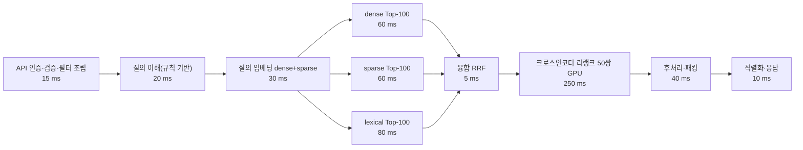
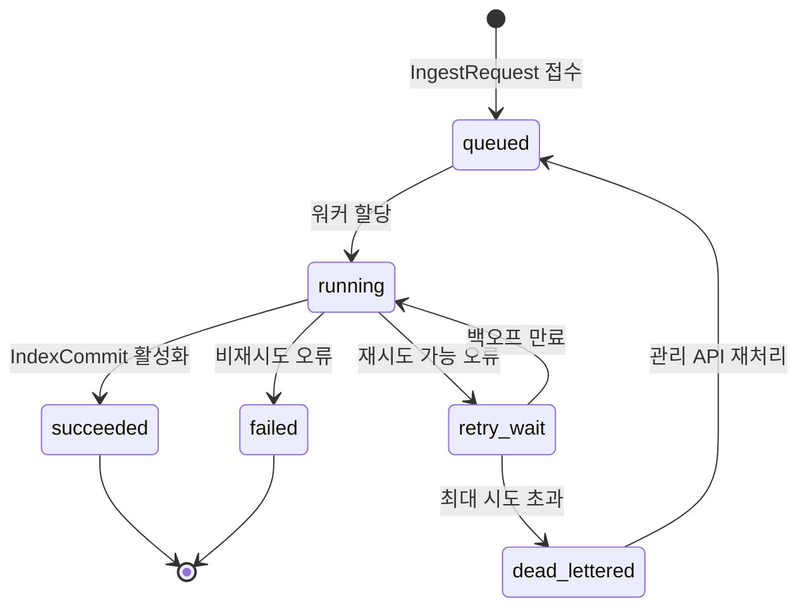
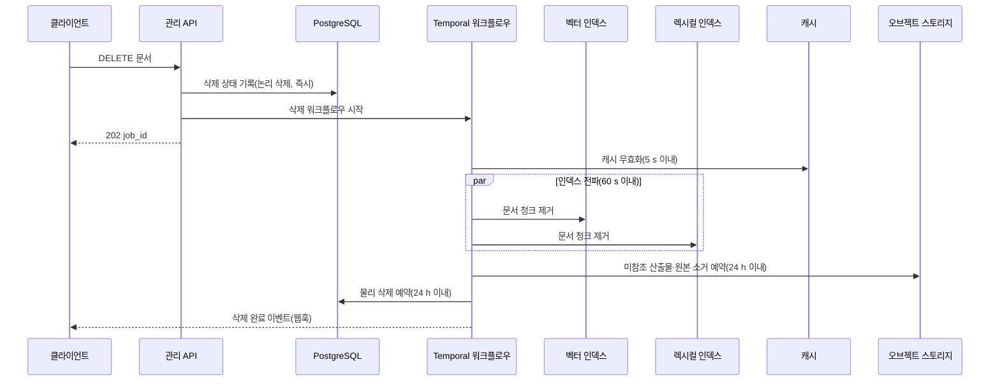

# 비기능 요구사항 (Non-Functional Requirements)

> 이 문서의 모든 수치는 **초안 목표(draft target)** 다. [설계 브리프](../00-vision/00-design-brief.md) §7 품질 목표를 정량화·확장한 것이며, 브리프에 근거가 없는 값은 §1.4 참조 환경과 §3.5 용량 계획 가정에서 유도했다. 최종값은 [벤치마크 계획](../08-evaluation/05-benchmark-plan-and-baselines.md)의 측정 결과와 ADR로 보정한다. 브리프 §7과 충돌하면 브리프가 우선한다.

## 목적

플랫폼이 "무엇을 하는가"(기능 요구사항)가 아니라 "얼마나 잘, 얼마나 안전하게, 얼마나 오래" 동작해야 하는지를 **측정 가능한 문장**으로 고정한다. 각 요구는 설계·구현·테스트·운영 문서가 공통으로 참조하는 계약이며, 릴리스 게이트와 SLO(Service Level Objective)의 원천이 된다.

이 문서는 다음을 제공한다.

- 13개 카테고리, 총 150개의 비기능 요구(NFR) — ID, 요구, 측정 지표, 목표값, 측정 방법, 우선순위
- 부하 프로파일(Load Profile, LP; 청크 10만/100만/1000만)별 성능 시나리오와 지연 예산 분해. 이하 "부하 프로파일" 또는 "LP-x"는 항상 이 개념을 가리키며, 브리프 §10의 프로파일(Profile, 파이프라인 구성 프리셋)과 구분한다
- 브리프 §7 검색 품질 목표의 NFR 정량화(NFR-QLT)
- 용량 계획 가정(청크당 메모리·스토리지 산정식, GPU 수 산정식)
- 신뢰성 규약: at-least-once, 멱등, 재시도·타임아웃 정책
- 라이선스 정책(D-02 상세 규칙: 허용/조건부/금지)
- 접근성·국제화 요구
- 데이터 보존·삭제 전파 데드라인

## 범위

**포함**: 브리프 §6에 정의된 시스템 경계 전체 — 수집 API, 파서군, 정규화, 청킹, 보강, 임베딩, 인덱싱, 리트리벌 API, 컨텍스트 패킹, MCP 서버, 관리 API, 평가 하네스, 관측성, 배포 매니페스트, 플러그인 SDK, 클라이언트 SDK.

**제외**: 브리프 §6의 비목표(웹 크롤러, 챗봇 UI, 파인튜닝, 인증 서버, 문서 편집)에 대한 요구. 검색 **품질** 목표(nDCG@10, Recall@20 등)는 본 문서 §3.6(NFR-QLT)이 목표값을 소유한다. [기능 요구사항](./01-functional-requirements.md) FR-EVL-02는 지표를 **계산하는 능력**만 요구하고 목표값을 두지 않으므로, 목표값의 소유자는 이 문서다(ISS-NFR-12). 골든셋 구성과 측정 절차는 [평가 전략](../08-evaluation/01-evaluation-strategy.md)에 위임한다.

## 1. ID 체계·우선순위·측정 방법

### 1.1 ID 체계

`NFR-<카테고리>-<번호>`. 번호는 카테고리 내 2자리 일련번호이며 삭제된 ID는 재사용하지 않는다(폐기 시 `(deprecated)` 표기 유지). 미해결 이슈 ID는 `ISS-NFR-<번호>`로 NFR 네임스페이스 밖에 두어, `NFR-` 접두 정규식으로 요구를 수집할 때 이슈가 섞이지 않게 한다.

| 카테고리 | 코드 | 의미 | 관련 브리프 원칙·결정 |
|---|---|---|---|
| 성능 | PERF | 지연·처리량·자원 효율 | §7 지연·처리량, D-07, D-16 |
| 검색 품질 | QLT | 골든셋 기반 검색 효과성(순위 품질·재현율·베이스라인 대비 개선) | R3, 원칙 7, §7 검색 품질, D-12 |
| 확장성 | SCAL | 데이터·부하·테넌트 규모 성장 | D-09, D-15, D-17 |
| 신뢰성 | REL | 정확한 동작 지속, 데이터 무결성, 재현성 | 원칙 3·4, §7 재현성, D-08, D-17 |
| 가용성 | AVL | 서비스 접근 가능 시간 | §7 가용성 |
| 보안 | SEC | 기밀성·무결성·격리 | 원칙 9, D-09, §7 보안 |
| 개인정보 | PRV | PII 처리·삭제·보존 | 원칙 9 |
| 관측성 | OBS | 트레이스·메트릭·로그·설명 가능성 | 원칙 8, D-11 |
| 유지보수성 | MNT | 변경 용이성·계약 호환성·테스트 | 원칙 1·2, D-01, D-10 |
| 이식성 | PORT | 환경·백엔드 독립성 | 원칙 5, D-14, D-15 |
| 사용성/DX | USA | 개발자 경험·접근성·국제화 | 원칙 6, D-03 |
| 컴플라이언스/라이선스 | CMP | 라이선스·규제·감사 | D-02 |
| 비용 | CST | 자원·토큰·스토리지 비용 | O-05 |

### 1.2 우선순위

| 우선순위 | 의미 | 릴리스 게이트 |
|---|---|---|
| P0 | 필수(Must). 미충족 시 첫 공개 릴리스 불가 | 릴리스 차단 |
| P1 | 권고(Should). 1.0(GA) 전 충족 | GA 차단, 초기 릴리스는 면제 가능(면제 사유 기록) |
| P2 | 선택(Could). GA 이후 또는 특정 배포 환경에서만 | 차단 없음, 로드맵 추적 |

### 1.3 측정 방법 코드

[기능 요구사항](./01-functional-requirements.md)의 검증 방법 코드(T-xx)와의 대응을 함께 적는다. 두 체계의 통일은 ISS-NFR-15에서 다루며, [테스트 전략](../10-development/04-testing-strategy.md)이 두 코드 모두의 실행 방법을 정의한다.

| 코드 | 방법 | 실행 주체·시점 | 대응 FR 검증 코드 | 관련 문서 |
|---|---|---|---|---|
| M1 | 부하·성능 벤치마크(k6/Locust 스크립트, 참조 환경, 콜드 결과 캐시) | 릴리스 후보마다 + 주 1회 정기 실행 | T-LOAD | [벤치마크 계획](../08-evaluation/05-benchmark-plan-and-baselines.md), [확장·성능](../09-operations/04-scaling-and-performance.md) |
| M2 | 평가 하네스(골든셋 오프라인 메트릭, LLM-judge) | 기본 프로파일 변경마다 | T-GOLD | [리트리벌 메트릭·하네스](../08-evaluation/02-retrieval-metrics-and-harness.md) |
| M3 | CI 자동 검사(단위·통합·계약 라운드트립·정적 분석·라이선스 스캔·SBOM·문서 린트) | 모든 PR·릴리스 | T-UNIT, T-CONTRACT, T-INT, T-E2E, T-FIXTURE | [테스트 전략](../10-development/04-testing-strategy.md), [CI/CD](../10-development/05-ci-cd.md) |
| M4 | 장애 주입(chaos)·복구 리허설(백엔드 중단, 워커 강제 종료, 네트워크 분단) | 분기 1회 이상, 주요 릴리스 전 | T-LOAD(장애 주입) | [장애 모드·복원력](../02-architecture/09-failure-modes-and-resilience.md), [백업·재해복구](../09-operations/07-backup-and-disaster-recovery.md) |
| M5 | 보안 검토(SAST/DAST/SCA, 침투 테스트, 위협 모델 리뷰) | 릴리스마다 SCA, 연 1회 침투 테스트 | T-SEC | [보안·컴플라이언스](../09-operations/05-security-and-compliance.md) |
| M6 | 운영 SLI(프로덕션 메트릭 월간 집계) | 상시 | 대응 없음(운영 측정) | [관측성](../09-operations/03-observability.md) |
| M7 | 설계·문서 리뷰 체크리스트(수동 검증) | 문서 status 전이마다 | REVIEW, INSPECT | [기여 가이드](../10-development/07-contributing.md) |
| M8 | 개발자 사용성 세션(신규 사용자 과업 완료 시간 측정) | 마이너 릴리스마다 | 대응 없음 | [개발 환경](../10-development/02-development-environment.md) |

### 1.4 참조 환경 (초안 가정)

성능·용량 목표는 아래 참조 환경(Reference Environment)을 전제한다. 실제 하드웨어는 배포 가이드에서 확정하며, 벤치마크 리포트는 사용한 환경을 반드시 명시한다. GPU 장수는 §3.5의 산정식에서 유도한 값이며, 임베딩 GPU와 리랭커 GPU는 항상 분리한다(수집 부하가 검색 지연에 간섭하지 않도록, NFR-PERF-19).

| 환경 | 용도 | 구성(가정) | 대응 부하 프로파일 |
|---|---|---|---|
| ENV-S | 개발·소규모, Docker Compose, 경량 프로파일(Qdrant 단독, D-15) | 단일 노드 8 vCPU / 32 GB RAM / GPU 없음, 인프로세스 러너(D-17), 임베딩·리랭커는 CPU 인프로세스(int8) | LP-S |
| ENV-M | 표준 운영, Kubernetes | API 3 replicas(각 2 vCPU/4 GB), 워커 4(각 4 vCPU/16 GB), Qdrant 3 노드(각 8 vCPU/32 GB), OpenSearch 3 노드(각 8 vCPU/32 GB), PostgreSQL HA(2, 스트리밍 복제), 캐시(Redis 호환, ISS-NFR-02) 복제 2 + 자동 페일오버, Temporal 서버 2, GPU(24 GB VRAM, L4/A10 급): TEI 임베딩 전용 1장 + TEI 리랭커 전용 7장(§3.5 산정; 동등 처리량의 상위 GPU로 대체 가능, ISS-NFR-14) | LP-M |
| ENV-L | 대규모, 샤딩 | Qdrant 6+ 노드(샤드 ≥ 6, 사본 2), OpenSearch 6+ 노드(사본 2), 워커 16+, API 6+ replicas, PostgreSQL·캐시·Temporal은 ENV-M과 동일한 HA 구성, GPU(L4 급 환산): 임베딩 5장 + 리랭커 32장(§3.5 산정; 상위 GPU로 대체 가능, ISS-NFR-14) | LP-L |

## 2. 브리프 품질 목표 매핑

| 브리프 §7 항목 | 브리프 목표 | 이 문서의 정량화 | 담당 문서 |
|---|---|---|---|
| 리트리벌 p95 지연 | 100만 청크, 하이브리드+리랭크 Top-10: < 800 ms(GPU), < 1.5 s(CPU) | NFR-PERF-01, 02 (그대로 채택), 03~07 (p50/p99·부분 파이프라인 분해) | 본 문서 §3 |
| 수집 처리량 | 텍스트 PDF 100p < 30 s, 스캔 PDF 100p < 5 min(GPU OCR), 워커 수평 확장 | NFR-PERF-08~12, 20, NFR-SCAL-03; 부하 프로파일별 처리량 목표는 §3.4, 산정식은 §3.5 | 본 문서 §3, §4 |
| 검색 품질 | nDCG@10 ≥ 0.80, Recall@20 ≥ 0.92, dense-only 대비 +15%p | NFR-QLT-01~03 (그대로 채택), NFR-QLT-04 (릴리스 간 회귀 한도로 확장), 릴리스 추적 NFR-OBS-10 | 본 문서 §3.6; 골든셋·측정 절차는 [평가 전략](../08-evaluation/01-evaluation-strategy.md) |
| 가용성 | 리트리벌 API 99.9%, 수집 at-least-once + 멱등 | NFR-AVL-01, NFR-REL-01~03 | 본 문서 §5, §6 |
| 재현성 | 동일 `IngestRequest` + 동일 프로파일 → 동일 `IndexCommit` 해시 | NFR-REL-02, 14 (LLM 보강 활성 시 정의는 ISS-NFR-13) | 본 문서 §5 |
| 보안 | 테넌트 격리, ACL 강제, TLS, 저장 암호화, 감사 로그 | NFR-SEC-01~08 | 본 문서 §7 |

## 3. 성능·검색 품질 (NFR-PERF, NFR-QLT)

### 3.1 벤치마크 기준 파라미터 (초안)

지연 목표는 다음 파라미터를 고정한 상태에서 측정한다. 이 값은 **측정 조건**이며 파이프라인 기본값은 [하이브리드 검색·융합](../04-pipelines/15-hybrid-search-and-fusion.md), [리랭킹](../04-pipelines/16-reranking.md)에서 확정한다.

| 파라미터 | 값 | 비고 |
|---|---|---|
| 최종 Top-K | 10 | Context Pack 포함 청크 수 |
| 리트리버별 후보 수 | 100 (dense/sparse/lexical 각각) | 3-way 하이브리드(D-07) |
| 융합 | RRF(D-07 기본) | **미정(O-01):** 확정 시 측정 조건 갱신 |
| 리랭크 후보 수 | 50 | 크로스인코더 bge-reranker-v2-m3(D-16) |
| 질의 길이 | 한국어 15~40 토큰 | 골든셋 질의 분포 |
| 청크 길이 | 평균 400 토큰, 최대 512 토큰 | **미정(O-09):** 확정 시 측정 조건 갱신 |
| 결과 캐시 | 비활성(콜드) | 질의 임베딩 캐시도 비활성 |
| 필터 | `tenant_id` + `collection_id` + `acl` 필수 필터 포함(D-09) | 필터 없는 측정치는 무효 |
| 부하 | 부하 프로파일별 피크 QPS의 100%, 10분 지속 | 워밍업 2분 제외 |

### 3.2 요구 표

| ID | 요구 | 측정 지표 | 목표값 | 측정 방법 | 우선순위 |
|---|---|---|---|---|---|
| NFR-PERF-01 | 리트리벌 API는 GPU 리랭커 환경에서 브리프 §7 지연 목표를 만족한다 | 하이브리드+리랭크 Top-10 p95 지연, LP-M, ENV-M | < 800 ms | M1, M6 | P0 |
| NFR-PERF-02 | 리트리벌 API는 CPU 전용 환경에서도 실용적 지연을 만족한다 | 하이브리드+리랭크 Top-10 p95 지연, LP-M, ENV-M에서 GPU 제외 | < 1.5 s (CPU 전용 리랭크 구성은 ISS-NFR-11 전제) | M1 | P0 |
| NFR-PERF-03 | 중위 지연은 대화형 사용에 적합해야 한다 | p50 지연, LP-M, GPU | < 350 ms (초안) | M1, M6 | P1 |
| NFR-PERF-04 | 꼬리 지연을 제한한다 | p99 지연, LP-M | < 1.5 s (GPU), < 3.0 s (CPU) (초안) | M1, M6 | P1 |
| NFR-PERF-05 | 리랭커를 끈 하이브리드 검색은 저지연 모드로 동작한다 | 3-way 하이브리드 + RRF Top-50 p95, LP-M | < 250 ms (초안) | M1 | P1 |
| NFR-PERF-06 | dense 단독 검색 경로의 지연 하한을 확보한다 | dense Top-100 p95(질의 임베딩 포함), LP-M | < 120 ms (초안) | M1 | P1 |
| NFR-PERF-07 | 질의 임베딩 지연은 전체 p95 예산의 GPU 5%, CPU 15% 이하이어야 한다 | 질의 1건 dense+sparse 임베딩 p95 | < 40 ms (GPU, 800 ms의 5%), < 200 ms (CPU, 1.5 s의 13%) (초안) | M1 | P1 |
| NFR-PERF-08 | 텍스트 PDF 100페이지를 브리프 §7 시간 내 end-to-end 처리한다 | `IngestRequest` 접수 → `IndexCommit` 완료, 유휴 워커, ENV-M | < 30 s | M1 | P0 |
| NFR-PERF-09 | 스캔 PDF 100페이지를 GPU OCR로 브리프 §7 시간 내 처리한다 | 동일, 스캔 PDF 100p, GPU OCR | < 5 min | M1 | P0 |
| NFR-PERF-10 | HWPX 100페이지는 텍스트 PDF와 동등한 시간 내 처리한다 | 동일, HWPX 100p(표 20개 포함) | < 30 s (초안) | M1 | P0 |
| NFR-PERF-11 | 임베딩 서빙 처리량은 부하 프로파일의 수집 처리량 목표(§3.4)를 병목 없이 뒷받침한다. 필요한 GPU 수는 §3.5 산정식으로 유도한다 | TEI BGE-M3(dense+sparse), 512토큰 청크, GPU 1장(L4/A10 급, fp16) | ≥ 200 청크/s (초안, 확인 필요 as of 2026-09) | M1 | P1 |
| NFR-PERF-12 | 인덱스 커밋의 원자 교체는 검색 지연에 영향 없이 빠르게 끝난다 | 1만 청크 문서의 `IndexCommit` 활성화(스왑) 시간 | < 5 s (초안); 스왑 중 검색 p95 증가 ≤ 10% | M1 | P1 |
| NFR-PERF-13 | API 계층 자체 오버헤드는 최소화한다 | 인증·스키마 검증·필터 조립·직렬화 합계 p95 | < 20 ms (초안) | M1 | P1 |
| NFR-PERF-14 | 후처리·패킹은 저비용이어야 한다 | 후보 50개 → Context Pack(중복 제거, 부모 확장, MMR, 토큰 예산 패킹) p95 | < 50 ms (초안) | M1 | P1 |
| NFR-PERF-15 | MCP 서버 경로는 REST 대비 추가 지연이 미미해야 한다 | 동일 질의의 MCP `search` 도구 지연 − REST 지연 | < 30 ms (초안) | M1 | P2 |
| NFR-PERF-16 | 잡 상태 조회는 폴링에 적합해야 한다 | `GET` 잡 상태 p95 | < 50 ms (초안) | M1, M6 | P1 |
| NFR-PERF-17 | 콜드 스타트 시간은 오토스케일에 적합해야 한다 | API 컨테이너 ready 시간 / 모델 서버 ready 시간(모델 캐시 있음) | < 30 s / < 3 min (초안) | M1 | P2 |
| NFR-PERF-18 | 수집 큐 대기는 정상 부하에서 짧아야 한다 | 잡 enqueue → 첫 활동 시작 p95, 워커 유휴율 ≥ 30% | < 10 s (초안) | M6 | P1 |
| NFR-PERF-19 | 수집 부하가 검색 지연을 크게 저하시키지 않는다 | LP-M 피크 수집 진행 중 검색 p95 증가율 | ≤ 20% (초안) | M1 | P1 |
| NFR-PERF-20 | 리랭커 서빙 처리량은 피크 QPS × 리랭크 후보 수(§3.1)를 뒷받침한다. 필요한 GPU 수는 §3.5 산정식으로 유도한다 | TEI bge-reranker-v2-m3, 질의+청크 ≤ 512 토큰 쌍, GPU 1장(L4/A10 급, fp16) | ≥ 200 쌍/s (초안, 확인 필요 as of 2026-09; 근거는 §3.5) | M1 | P1 |

### 3.3 지연 예산 분해 (LP-M, GPU, 초안)

NFR-PERF-01의 800 ms는 아래 예산으로 분배한다. 합계는 p50 추정치이며 p95 여유(headroom)는 GPU 약 40%(460/800 ms), CPU 약 18%(1,230/1,500 ms)다. CPU 여유 부족과 CPU 리랭크 예산의 실현 가능성은 ISS-NFR-11에서 다룬다.



| 구간 | GPU 예산(p50) | CPU 예산(p50) | 비고 |
|---|---|---|---|
| API 계층 | 15 ms | 15 ms | NFR-PERF-13 |
| 질의 이해 | 20 ms | 20 ms | LLM 재작성은 예산 외(옵션, 별도 SLO) |
| 질의 임베딩 | 30 ms | 150 ms | NFR-PERF-07 (CPU 150 ms는 1.5 s의 10%) |
| 병렬 검색(최대값 + 스케줄링) | 90 ms | 90 ms | 3개 리트리버 병렬 실행 |
| 융합 | 5 ms | 5 ms | |
| 리랭크(50쌍) | 250 ms | 900 ms | CPU 900 ms는 후보 축소·경량 리랭커 구성을 전제한 초안(ISS-NFR-11) |
| 후처리·패킹 | 40 ms | 40 ms | NFR-PERF-14 |
| 직렬화 | 10 ms | 10 ms | |
| 합계(p50 추정) | 약 460 ms | 약 1,230 ms | p95 목표 800 ms / 1.5 s |

### 3.4 성능 시나리오·부하 프로파일 (초안)

수집 처리량 목표는 §3.5 산정식에 따라 임베딩 용량(NFR-PERF-11 × 목표 사용률 80%) 이하로 정한다. 피크 QPS는 초안 가정이며, 리랭커 GPU 수는 그로부터 유도된다.

| 부하 프로파일 | 청크 수 | 문서 수(가정, 평균 160 청크/문서) | 피크 리트리벌 QPS | 수집 처리량 목표 | 리트리벌 p95 목표(GPU / CPU) | 참조 환경 | 인덱스 구성 |
|---|---|---|---|---|---|---|---|
| LP-S | 100,000 | 약 600 | 5 | 1 문서/분(≈ 2.7 청크/s, CPU 임베딩) | 해당 없음(ENV-S GPU 없음) / ≤ 1.8 s (초안; §3.3 CPU p50 1,230 ms + 단일 노드 공존 오버헤드, ISS-NFR-11 전제) | ENV-S | Qdrant 단독(dense+sparse, BM25 sparse 포함), 단일 샤드 |
| LP-M | 1,000,000 | 약 6,250 | 20 | 60 문서/분(≈ 160 청크/s) | 800 ms / 1.5 s (브리프 §7) | ENV-M | Qdrant 3노드 + OpenSearch 3노드, 사본 2 |
| LP-L | 10,000,000 | 약 62,500 | 100 | 300 문서/분(≈ 800 청크/s) | 1.2 s / 해당 없음(GPU 필수) | ENV-L | 샤드 ≥ 6, 사본 2, 테넌트 라우팅 |

시나리오별 추가 조건:

| 시나리오 | 조건 | 합격 기준 |
|---|---|---|
| S1 정상 검색 | 부하 프로파일 피크 QPS 10분 | p95·p99 목표 충족, 오류율 < 0.1% |
| S2 버스트 | 피크 QPS의 3배를 30초간 | 오류율 < 1%, 429 응답은 오류로 세지 않음, 회복 ≤ 60 s |
| S3 혼합 부하 | S1 + 수집 처리량 목표 동시 | 검색 p95 증가 ≤ 20% (NFR-PERF-19) |
| S4 대용량 단일 문서 | 5,000페이지 텍스트 PDF 1건(NFR-SCAL-06 상한) | §5.3의 분할 조건(parse 배치 ≤ 500p → 10개 활동) 적용 시 완료 ≤ 30 min, 다른 잡 지연 p95 증가 ≤ 2배 |
| S5 다중 테넌트 | 100 테넌트 균등 부하 | 테넌트 간 p95 편차 ≤ 30% |
| S6 부분 저하 | 리랭커 중단 상태에서 S1 | 융합 결과로 응답, `degraded` 표시, p95 < 400 ms |

### 3.5 용량 계획 가정 (초안)

청크·문서 단위 산정식이며, 실측 후 [저장소 아키텍처](../02-architecture/04-storage-architecture.md)와 [확장·성능](../09-operations/04-scaling-and-performance.md)에서 갱신한다. 본 문서에서 **사본 수(레플리카)** 는 항상 **총 사본 수**를 뜻한다(Qdrant `replication_factor`와 같은 의미; OpenSearch `number_of_replicas`는 사본 수 − 1).

| 항목 | 가정값 | 근거·비고 |
|---|---|---|
| 평균 청크 길이 | 400 토큰(BGE-M3 토크나이저), 최대 512 | D-19; **미정(O-09):** 확정 시 갱신 |
| 청크 텍스트 크기 | 약 1.2 KB(UTF-8, 한국어 비중 높음) | 한국어 1토큰 ≈ 1~1.5자, 1자 3바이트(확인 필요, 모델 토크나이저 실측 후 갱신) |
| 문서당 청크 수 | 100페이지 ≈ 400 청크, 평균 문서 40페이지 ≈ 160 청크 | 페이지당 약 1,600 토큰 가정 |
| dense 벡터 | 1024d float32 = 4 KB; int8 양자화 1 KB | D-16 BGE-M3 |
| sparse 벡터 | 평균 150 비영(non-zero) 항 × 8 B ≈ 1.2 KB | BGE-M3 learned sparse(확인 필요) |
| HNSW 인덱스 오버헤드 | 벡터 크기의 약 0.5배 | 벡터 DB 용량 가이드 경험식(확인 필요) |
| 페이로드(인덱스 레코드) | 약 2.5 KB(식별자, `tenant_id`, `collection_id`, `acl`, provenance, 청크 텍스트 포함) | 후처리 시 재조회 없이 텍스트 사용을 가정(ISS-NFR-10) |
| 렉시컬 인덱스 | 원문 저장 + 역색인 ≈ 텍스트의 2배 = 2.4 KB | Nori 형태소 분석, 확인 필요 |
| 메타 DB(PostgreSQL) | 청크당 0.5 KB, 문서당 4 KB, 잡·이벤트 문서당 8 KB | 인덱스 포함 |
| 오브젝트 스토리지 | 원본 평균 2 MB/문서, 산출물 ≤ 원본의 3배 | NFR-CST-03 |
| 임베딩 처리량(GPU 1장) | 200 청크/s (512토큰, fp16, L4/A10 급) | NFR-PERF-11. BGE-M3는 XLM-R large 계열(비임베딩 파라미터 약 3억): 청크당 약 2 × 3억 × 512 ≈ 0.3 TFLOP, GPU 실효 60 TFLOPS 가정 시 약 200 청크/s. 확인 필요 |
| 리랭커 처리량(GPU 1장) | 200 쌍/s (질의 40 + 청크 400 토큰, fp16, L4/A10 급) | NFR-PERF-20. bge-reranker-v2-m3도 XLM-R large 계열이므로 임베딩과 동일 수준: 쌍당 약 0.27 TFLOP. §3.3의 "50쌍 250 ms"와 정합(200 쌍/s). 확인 필요 |
| CPU 임베딩 처리량(8 vCPU) | 4 청크/s (int8 ONNX) | ENV-S 전용. 초안, 확인 필요 |
| 목표 사용률 | 처리량 가정의 80% | 버스트·재시도 여유. 초과 시 큐 대기(NFR-PERF-18)로 흡수 |

GPU 수 산정식(모든 부하 프로파일에 동일 적용, 값 갱신 시 §1.4·§3.4를 함께 재계산한다):

```text
수집 청크/s   = 문서/분 × 160 ÷ 60
임베딩 GPU 수 = ceil(수집 청크/s ÷ (200 청크/s × 0.8)) = ceil(수집 청크/s ÷ 160)
리랭크 쌍/s   = 피크 QPS × 리랭크 후보 수(50)
리랭커 GPU 수 = ceil(리랭크 쌍/s ÷ (200 쌍/s × 0.8))  = ceil(리랭크 쌍/s ÷ 160)
```

| 부하 프로파일 | 수집 청크/s | 임베딩 GPU | 리랭크 쌍/s | 리랭커 GPU | 비고 |
|---|---|---|---|---|---|
| LP-S | 2.7 | 0 (CPU 4 청크/s 가정의 약 67%) | 250 | 0 (CPU; ISS-NFR-11) | GPU 없음 |
| LP-M | 160 | 1 (사용률 80%) | 1,000 | 7 | ENV-M |
| LP-L | 800 | 5 | 5,000 | 32 | ENV-L, L4 급 환산 |

100만 청크(LP-M)당 산정 결과:

| 저장소 | float32 기준 | int8 양자화 기준 | 비고 |
|---|---|---|---|
| Qdrant 메모리(dense + HNSW) | 약 6.1 GB | 약 1.5 GB (+ 원본 벡터 디스크 4.1 GB) | 노드 3 분산, 사본 2 → 총 2배 |
| Qdrant 메모리(sparse) | 약 1.2 GB | 동일 | |
| Qdrant 디스크(페이로드, mmap) | 약 2.5 GB | 동일 | |
| OpenSearch 디스크 | 약 2.4 GB | 동일 | 사본 2 → 4.8 GB |
| PostgreSQL | 약 0.6 GB | 동일 | 6,250 문서 기준 |
| 오브젝트 스토리지 | 원본 12.5 GB + 산출물 ≤ 37.5 GB | 동일 | 콘텐츠 주소화 중복 제거 전 |

LP-L(1,000만 청크)은 위 값의 10배이며, 이때 dense float32 61 GB는 단일 노드 메모리를 초과하므로 **int8 양자화 + 샤딩**을 기본 권고한다(NFR-CST-01).

### 3.6 검색 품질 요구 표 (NFR-QLT)

브리프 §7 검색 품질 목표를 P0 NFR로 채택한다. 측정 조건은 다음과 같다.

- **파이프라인**: 기본 프로파일(D-07 3-way 하이브리드 → 융합 → 크로스인코더 리랭크 → 후처리, D-16 기본 모델, D-19 기본 청킹). 개방 결정(O-01, O-02, O-09 등)이 ADR로 확정되면 확정값을 반영한 기본 프로파일로 측정한다.
- **데이터**: 내부 한국어 골든셋([골든셋 구축](../08-evaluation/03-golden-dataset-construction.md)에서 정의; HWPX 포함). 공개 벤치마크 결과는 참고치로 병기하되 게이트에는 쓰지 않는다.
- **측정 파라미터**: §3.1과 동일(Top-K 10, 리랭크 후보 50, 테넌트·ACL 필터 포함). Recall@20은 리랭크 이전 융합 결과의 상위 20을 대상으로 한다.
- **베이스라인(dense-only)**: 동일 골든셋·동일 청킹·동일 임베딩 모델의 dense 단독 Top-K, 리랭크 없음.
- 브리프 §7의 "+15%p"는 지표를 명시하지 않았으므로 본 문서는 **nDCG@10 차이**로 해석한다(ISS-NFR-12).

| ID | 요구 | 측정 지표 | 목표값 | 측정 방법 | 우선순위 |
|---|---|---|---|---|---|
| NFR-QLT-01 | 기본 프로파일은 내부 한국어 골든셋에서 브리프 §7 순위 품질 목표를 만족한다 | nDCG@10 (기본 프로파일, 위 측정 조건) | ≥ 0.80 | M2 | P0 |
| NFR-QLT-02 | 리랭크 입력 단계에서 관련 청크의 대부분이 후보에 포함된다 | Recall@20 (융합 결과 상위 20) | ≥ 0.92 | M2 | P0 |
| NFR-QLT-03 | 하이브리드+리랭크 기본 프로파일은 dense-only 베이스라인을 유의하게 앞선다 | 기본 프로파일 nDCG@10 − dense-only nDCG@10 | ≥ +15%p | M2 | P0 |
| NFR-QLT-04 | 기본 프로파일의 변경은 회귀 게이트(FR-EVL-08)를 통과한 뒤에만 게시된다 | 직전 릴리스 대비 nDCG@10 하락 / Recall@20 하락 | ≤ 1%p / ≤ 1%p (초안) | M2, M3 | P1 |

## 4. 확장성 (NFR-SCAL)

| ID | 요구 | 측정 지표 | 목표값 | 측정 방법 | 우선순위 |
|---|---|---|---|---|---|
| NFR-SCAL-01 | 단일 컬렉션이 LP-L 규모까지 성능 목표를 유지한다 | 1,000만 청크 컬렉션에서 NFR-PERF-01 대응 p95 | < 1.2 s (GPU) | M1 | P1 |
| NFR-SCAL-02 | 배포 단위당 다수 테넌트·컬렉션을 수용한다 | 테넌트 수 / 컬렉션 수 | ≥ 1,000 / ≥ 10,000 (초안; 공유 컬렉션+필터 모드 기준. 전용 컬렉션 모드의 상한은 백엔드별 별도, 초안 100) | M1, M6 | P1 |
| NFR-SCAL-03 | 수집 워커는 수평 확장으로 처리량이 준선형 증가한다 | 워커 2 → 8 확장 시 처리량 배율 / 4 (임베딩 서빙이 병목이 아닌 조건, §3.5) | ≥ 0.8 (선형성) | M1 | P0 |
| NFR-SCAL-04 | API 계층은 무상태로 수평 확장된다 | replica 증가 시 세션 친화성 요구 | 없음(모든 상태는 PostgreSQL·캐시(Redis 호환)·Temporal) | M7, M1 | P0 |
| NFR-SCAL-05 | 인덱스 백엔드 샤딩·사본 수를 `IndexBackend` 계약으로 구성할 수 있다 | 샤드 수·사본 수 설정 노출 / 테넌트 격리 모드(공유 컬렉션+필터, 전용 컬렉션) | 두 모드 모두 지원 | M3, M7 | P1 |
| NFR-SCAL-06 | 단일 문서 한도를 명시하고 초과 시 명확히 거절한다 | 원본 크기 / 페이지 수 / 문서당 청크 수 상한 | 500 MB / 5,000 페이지 / 50,000 청크 (초안, 설정 가능) | M3 | P0 |
| NFR-SCAL-07 | 배치 수집 요청 크기를 제한한다 | `IngestRequest` 1건당 URI 수 상한 | 1,000 (초안, 설정 가능) | M3 | P0 |
| NFR-SCAL-08 | 대기 중 잡 수는 워커 수와 무관하게 수용된다 | 동시 대기(queued) 잡 수 | ≥ 10,000 상태 저하 없음(Temporal 큐) | M1 | P1 |
| NFR-SCAL-09 | 워커 축소(scale-in) 시 진행 중 작업이 유실되지 않는다 | 강제 종료된 활동의 재예약 성공률 | 100% (하트비트·재시도) | M4 | P0 |
| NFR-SCAL-10 | 임베딩·리랭커 서빙은 큐 깊이 기반 오토스케일을 지원한다 | 스케일 신호 메트릭 노출 여부 / 0→1 스케일 시간 | 노출 / < 3 min (NFR-PERF-17) | M1, M7 | P2 |

## 5. 신뢰성 (NFR-REL)

### 5.1 요구 표

| ID | 요구 | 측정 지표 | 목표값 | 측정 방법 | 우선순위 |
|---|---|---|---|---|---|
| NFR-REL-01 | 수집은 at-least-once로 처리된다. 접수된 `IngestRequest`는 워커·브로커·API 장애에도 유실되지 않는다 | 장애 주입 중 접수 후 미처리(누락) 잡 수 | 0 | M4 | P0 |
| NFR-REL-02 | 처리는 멱등하다. 동일 `IngestRequest` + 동일 프로파일 버전은 동일 `IndexCommit` 해시를 만든다(브리프 §7 재현성) | 동일 입력 2회 처리 시 `IndexCommit` 해시 일치율 | 100%. LLM 보강 비활성 프로파일은 전체 산출물 기준; LLM 보강 활성 프로파일은 ISS-NFR-13의 정의가 확정되기 전까지 보강 결과를 제외한 결정적 산출물 기준으로 측정 | M3 | P0 |
| NFR-REL-03 | 중복 접수는 억제된다. 멱등 키가 같은 재요청은 새 잡을 만들지 않고 기존 `job_id`를 반환한다 | 24시간 윈도우 내 중복 요청의 중복 잡 생성 수 | 0 | M3 | P0 |
| NFR-REL-04 | 일시적 오류는 지수 백오프 + 지터로 재시도한다(§5.2 정책) | 정책 준수 여부, 재시도 폭주(thundering herd) 발생 | 정책 100% 준수 | M3, M4 | P0 |
| NFR-REL-05 | 비재시도 오류는 즉시 실패로 종결하고 원인을 [오류 모델](../03-contracts/13-error-model.md)로 보고한다 | 비재시도 오류의 불필요한 재시도 횟수 | 0 | M3 | P0 |
| NFR-REL-06 | 최대 재시도를 초과한 잡은 데드레터(DLQ)로 이동하고 관리 API로 재처리할 수 있다 | DLQ 진입 잡의 재처리 성공률(원인 해소 후) | ≥ 99% | M3, M4 | P1 |
| NFR-REL-07 | `IndexCommit`은 원자적이다. 부분 인덱싱 상태가 검색에 노출되지 않는다 | 커밋 중 검색에서 구버전·신버전 혼합 결과 발생 | 0 | M3, M4 | P0 |
| NFR-REL-08 | 배치 내 한 문서의 실패는 다른 문서 처리에 영향을 주지 않는다 | 배치 1,000건 중 10% 손상 파일 주입 시 정상 문서 성공률 | 100% | M3 | P0 |
| NFR-REL-09 | 장시간 활동(OCR, LLM 보강, 대량 임베딩)은 하트비트로 생존을 알린다 | 하트비트 간격 / 하트비트 타임아웃 | ≤ 30 s / 90 s | M3, M4 | P0 |
| NFR-REL-10 | 스테이지별 타임아웃이 존재하며 초과 시 재시도 정책을 따른다(§5.3) | 타임아웃 미설정 스테이지 수 | 0 | M3 | P0 |
| NFR-REL-11 | 원본·산출물의 내구성은 S3 호환 스토리지에 위임하고, 메타 DB는 PITR(point-in-time recovery)을 지원한다 | 스토리지 내구성 등급 문서화 여부 / PostgreSQL PITR 지원 여부 | 문서화 / 예 (RPO 목표값은 NFR-REL-15에서만 정의) | M4, M7 | P1 |
| NFR-REL-12 | 인덱스는 파생 데이터다. 산출물(`EmbeddedChunkSet` 이하)에서 인덱스를 100% 재구축할 수 있다 | 인덱스 전체 삭제 후 재구축한 `IndexCommit` 해시 일치율 | 100% | M4 | P0 |
| NFR-REL-13 | 검색은 부분 저하(graceful degradation)한다. 리랭커 장애 시 융합 결과를, 렉시컬 장애 시 dense+sparse 결과를 `degraded` 표시와 함께 반환한다 | 단일 백엔드 중단 시 검색 성공률 | ≥ 99% (응답에 저하 사실 명시) | M4 | P1 |
| NFR-REL-14 | 재현성을 위해 모델·프로파일·플러그인 버전을 `IndexCommit`에 기록한다 | 커밋 레코드에 임베딩 모델 식별자·버전·프로파일 버전 존재율 | 100% | M3 | P0 |
| NFR-REL-15 | 백업·복구 목표를 만족한다 | 메타 DB RPO / 전체 시스템 RTO | ≤ 5 min / ≤ 4 h (초안; RPO는 WAL 아카이빙 주기 ≤ 5 min 또는 스트리밍 복제를 전제) | M4 | P1 |
| NFR-REL-16 | 워크플로우 정의는 결정적(deterministic)이다. 비결정 호출(시간, 난수, 외부 I/O)은 활동(activity)에만 존재한다 | Temporal 리플레이 테스트 통과율 | 100% | M3 | P0 |

### 5.2 재시도 정책 (초안)

재시도는 **오케스트레이터(Temporal)** 가 소유한다(브리프 원칙 3). 스테이지 코드 내부의 자체 재시도 루프는 금지하며, 예외적으로 HTTP 클라이언트 수준의 단발 재시도(≤ 2회, 총 10 s 이내)만 허용한다. 오류 클래스는 [오류 모델](../03-contracts/13-error-model.md)에서 확정한다. 아래 클래스명은 제안이다.

| 오류 클래스(제안) | 예 | 재시도 | 초기 백오프 | 최대 백오프 | 배수 | 지터 | 최대 시도 | 초과 시 |
|---|---|---|---|---|---|---|---|---|
| `transient_infra` | 네트워크 타임아웃, 백엔드 5xx, 429 | 예 | 1 s | 5 min | 2.0 | 전체(full) 지터 | 8 | DLQ |
| `resource_exhausted` | GPU OOM, 임베딩 큐 포화, 디스크 부족 | 예(감쇠) | 10 s | 15 min | 2.0 | 전체 지터 | 5 | DLQ + 알림 |
| `source_unavailable` | URI 5xx, 일시 접근 거부 | 예 | 30 s | 30 min | 2.0 | 전체 지터 | 3 | 실패(`failed`) |
| `source_not_found` | URI 404/410, 권한 403 | 아니오 | - | - | - | - | 1 | 실패 |
| `malformed_input` | 손상 파일, 스키마 위반 | 아니오(폴백 파서 1회 후) | - | - | - | - | 1 | 실패 |
| `unsupported_format` | 미지원 MIME, 암호화 문서 | 아니오 | - | - | - | - | 1 | 실패 |
| `policy_violation` | 크기 한도 초과, 테넌트 정책 위반 | 아니오 | - | - | - | - | 1 | 실패 |
| `internal_error` | 미분류 예외 | 예(제한) | 5 s | 1 min | 2.0 | 전체 지터 | 2 | DLQ + 알림 |

추가 규칙:

- 재시도는 활동(activity) 단위이며, 성공한 이전 스테이지의 산출물은 콘텐츠 주소화 캐시에서 재사용한다(재파싱 없음).
- 워크플로우 전체 재시도(예: 워커 크래시 후 리플레이)는 활동 재시도 횟수를 초기화하지 않는다.
- 429 응답은 `Retry-After` 헤더가 있으면 백오프보다 우선한다.
- 동일 원천에 대한 재시도는 테넌트별 동시성 한도(NFR-SEC-13)를 초과할 수 없다.

### 5.3 스테이지 타임아웃과 분할 단위 (초안)

타임아웃은 **배치 활동 1건** 기준이다. 대용량 문서(NFR-SCAL-06 상한 5,000페이지)는 단일 활동으로 처리하지 않고 아래 분할 단위로 나눈 활동들로 실행하며, 각 활동이 독립적으로 타임아웃·재시도된다. 분할 실행 방식(순차·병렬, 부분 산출물 병합)은 [오케스트레이션·워크플로우](../02-architecture/06-orchestration-and-workflows.md)에서 정한다(ISS-NFR-17).

| 스테이지(D-05 경계) | 활동 타임아웃(start-to-close, 배치 1건) | 하트비트 | 분할 단위(초안) | 비고 |
|---|---|---|---|---|
| fetch (`IngestRequest → SourceDocument`) | 5 min | 없음(스트리밍 진행률만) | 분할 없음 | 500 MB 상한 기준 |
| parse (텍스트 계열) | 10 min | 30 s | 페이지 범위 ≤ 500p | HWPX·DOCX·HTML·TXT·텍스트 PDF. NFR-PERF-08 속도(100p < 30 s)에서 500p 배치는 약 2.5 min |
| parse (OCR 포함) | 60 min | 30 s | 페이지 범위 ≤ 100p | 스캔 PDF. NFR-PERF-09(GPU 100p < 5 min) 대비 CPU OCR 여유 포함 |
| normalize | 5 min | 없음 | 분할 없음 | |
| chunk | 5 min | 없음 | 분할 없음 | |
| enrich (LLM 호출 포함) | 30 min | 60 s | 청크 배치 ≤ 1,000 | **미정(O-05):** 비용 정책에 따라 배치 크기·타임아웃 조정 |
| embed | 30 min | 30 s | 청크 배치 ≤ 1,000 | 배치 진행률 하트비트 |
| index commit | 10 min | 30 s | 분할 없음(원자성, NFR-REL-07) | 스왑 포함 |
| 워크플로우 전체(run) | 4 h | - | - | 초과 시 `failed`, 부분 산출물 보존 |

S4(§3.4)의 5,000페이지 텍스트 PDF는 parse 배치 10건으로 실행되며, 워커 4대 병렬 시 약 3라운드(약 8 min)로 완료된다.

### 5.4 잡 재시도 상태 전이

상태 이름은 [잡·이벤트·상태](../03-contracts/12-jobs-events-and-status.md)에서 확정한다. 아래는 신뢰성 요구가 요구하는 최소 전이다.



## 6. 가용성 (NFR-AVL)

| ID | 요구 | 측정 지표 | 목표값 | 측정 방법 | 우선순위 |
|---|---|---|---|---|---|
| NFR-AVL-01 | 리트리벌 API 가용성(브리프 §7) | 월간 성공 응답 비율(5xx·타임아웃 제외, 429는 성공으로 집계) | ≥ 99.9% | M6 | P0 |
| NFR-AVL-02 | 수집 API(요청 접수·상태 조회) 가용성 | 월간 성공 응답 비율 | ≥ 99.9% (처리 지연은 별도, NFR-PERF-18) | M6 | P0 |
| NFR-AVL-03 | 관리 API 가용성 | 월간 성공 응답 비율 | ≥ 99.5% (초안) | M6 | P1 |
| NFR-AVL-04 | 무중단 배포. 롤링 업데이트 중 요청 실패와 잡 유실이 없다 | 배포 중 오류율 / 연결 드레이닝 시간 | < 0.1% / ≤ 30 s | M4, M6 | P0 |
| NFR-AVL-05 | ENV-M 이상에서 핵심 경로에 단일 장애점이 없다 | 인덱스 사본 수 / PostgreSQL HA / Temporal 서버 HA / 캐시 HA(복제 + 자동 페일오버) | ≥ 2 / 예 / 예 / 예 (§1.4 ENV-M 구성과 일치) | M4, M7 | P1 |
| NFR-AVL-06 | 헬스·레디니스 엔드포인트는 의존성 상태를 반영한다 | 의존성(인덱스, DB, 캐시, 모델 서버) 중단 시 레디니스 실패 반영 지연 | ≤ 10 s | M4 | P0 |
| NFR-AVL-07 | 인덱스 재구축·프로파일 마이그레이션 중 검색이 지속된다 | 재인덱싱 중 검색 가용성 | 기존 커밋으로 100% 응답, 완료 시 원자 전환 | M4 | P1 |
| NFR-AVL-08 | 오류 예산 정책을 운영한다 | 번레이트 알림(NFR-OBS-07) 발생 후 배포 동결 여부 결정까지 소요 시간 / 오류 예산 런북 존재 | ≤ 1 영업일 / 예 | M6, M7 | P2 |
| NFR-AVL-09 | 캐시 계층(질의 임베딩·결과 캐시)은 비핵심 의존성이다. 캐시 전체 중단 시 검색은 캐시 미스 경로로 계속 응답한다(레이트리밋의 캐시 중단 시 정책은 ISS-NFR-19) | 캐시 중단 주입 시 검색 성공률 / 지연 증가 | ≥ 99% / p95 ≤ NFR-PERF-01 목표의 1.5배 | M4 | P1 |

## 7. 보안 (NFR-SEC)

| ID | 요구 | 측정 지표 | 목표값 | 측정 방법 | 우선순위 |
|---|---|---|---|---|---|
| NFR-SEC-01 | 테넌트 격리. 모든 인덱스 질의는 서버 측에서 `tenant_id` 필터를 강제하며 클라이언트가 우회할 수 없다(D-09) | 교차 테넌트 결과 노출 건수(격리 테스트 스위트) | 0 | M3, M5 | P0 |
| NFR-SEC-02 | ACL 강제. `acl` 필드와 호출자 주체(principal)의 매칭이 모든 리트리버·MCP 도구에 동일하게 적용된다 | ACL 미보유 청크 노출 건수 | 0 | M3, M5 | P0 |
| NFR-SEC-03 | 인증. OIDC(JWT) 및 서비스 계정 API 키를 지원하고 미인증 요청은 거절한다 | 미인증 요청 401 비율 / 토큰 검증 실패 허용 | 100% / 0 | M3, M5 | P0 |
| NFR-SEC-04 | 인가. [기능 요구사항](./01-functional-requirements.md) FR-SEC-02의 역할(`tenant_admin`, `collection_admin`, `ingestor`, `reader`)에 대해 API별 필요 역할 매트릭스를 정의하고 강제한다. 역할 집합의 확정·추가는 [멀티테넌시·보안 아키텍처](../02-architecture/07-multi-tenancy-and-security-architecture.md)가 소유한다(ISS-NFR-16) | 역할 매트릭스 대비 권한 상승 경로 | 0 | M5 | P0 |
| NFR-SEC-05 | 전송 암호화. 외부 노출 엔드포인트는 TLS 1.2 이상(권장 1.3), 내부 서비스 간 mTLS를 옵션으로 제공한다 | 평문 외부 엔드포인트 수 | 0 | M5 | P0 |
| NFR-SEC-06 | 저장 암호화. 오브젝트 스토리지 SSE, DB·인덱스 볼륨 암호화를 배포 매니페스트 기본값으로 제공한다 | 암호화 미적용 저장소 수(참조 배포) | 0 | M5, M7 | P0 |
| NFR-SEC-07 | 비밀 관리. 비밀은 환경·시크릿 매니저에서만 주입되며 로그·트레이스·오류 응답에 노출되지 않는다 | 비밀 노출 탐지 건수(로그 스캔) | 0 | M3, M5 | P0 |
| NFR-SEC-08 | 감사 로그. 수집·삭제·검색·관리 작업을 주체·시각·대상·결과와 함께 불변 저장한다 | 감사 대상 이벤트 기록률 / 보존 기간 | 100% / ≥ 1년 (초안) | M3, M6 | P0 |
| NFR-SEC-09 | URI 페치의 SSRF·경로 탈출 방지. `http(s)://`는 스킴·호스트 허용 목록, 사설·링크로컬 IP 차단, 리다이렉트 제한을 적용한다. `file://`(R1)은 설정된 루트 디렉터리 허용 목록 내의 정규화된 경로만 허용하고 심볼릭 링크를 해석한 뒤 검사한다 | SSRF·경로 탈출 테스트 케이스 통과율 / 리다이렉트 상한 | 100% / ≤ 3 | M5 | P0 |
| NFR-SEC-10 | 파서 샌드박스. 신뢰되지 않은 파일은 비루트·읽기 전용 루트·egress 차단 워커에서 처리하며 zip bomb·XXE·경로 탈출(HWPX·DOCX는 ZIP+XML)을 방어한다 | 악성 샘플 코퍼스 통과율(크래시·탈출 없음) / 압축 해제 상한 | 100% / 원본의 100배 또는 2 GB 중 작은 값 | M5 | P0 |
| NFR-SEC-11 | 의존성 취약점. 릴리스 시점 Critical·High 취약점이 없고 SBOM을 제공한다 | Critical / High 미해결 건수 | 0 / 0 (예외는 승인·만료일 기록) | M3, M5 | P0 |
| NFR-SEC-12 | 입력 검증. 모든 API 입력은 JSON Schema로 검증되고 요청 본문·필드 길이 상한이 있다 | 스키마 미검증 엔드포인트 수 / 본문 상한 | 0 / 10 MB (초안) | M3 | P0 |
| NFR-SEC-13 | 레이트 리밋·할당량. 테넌트별 QPS, 동시 잡, 일일 수집 바이트 한도를 적용하고 초과 시 429와 `Retry-After`를 반환한다 | 한도 적용 정확도(±5%) | 준수 | M1, M3 | P1 |
| NFR-SEC-14 | 프롬프트 인젝션 표면 최소화. Context Pack은 문서 콘텐츠를 지시가 아닌 데이터로 표기하고 렌더러가 콘텐츠·지시를 구조적으로 분리한다 | 렌더러 출력에서 콘텐츠·지시 혼합 사례 | 0 (렌더러 테스트) | M3, M5 | P1 |
| NFR-SEC-15 | 컨테이너 이미지 서명·스캔. 릴리스 이미지는 서명되고 스캔 결과가 공개된다 | 미서명 릴리스 이미지 수 | 0 | M3 | P1 |
| NFR-SEC-16 | MCP 서버 보안. 인증 토큰 필수, REST와 동일한 테넌트·ACL 필터 강제, 도구 입력 스키마 검증 | REST 대비 MCP 경로의 격리 테스트 결과 차이 | 0 | M3, M5 | P0 |
| NFR-SEC-17 | 위협 모델을 문서화하고 릴리스마다 검토한다 | 위협 모델 문서 갱신 주기 | 마이너 릴리스마다 | M7 | P1 |

## 8. 개인정보 (NFR-PRV)

| ID | 요구 | 측정 지표 | 목표값 | 측정 방법 | 우선순위 |
|---|---|---|---|---|---|
| NFR-PRV-01 | PII 탐지 훅. `enricher` 확장 지점에서 PII 태깅(예: Presidio 어댑터)을 옵션으로 제공한다 | 한국어 주요 PII 유형(주민등록번호, 전화번호, 이메일, 계좌번호) 탐지 재현율(내부 셋) | ≥ 0.95 (초안) | M2 | P1 |
| NFR-PRV-02 | PII 마스킹·가명화. 인덱스 저장 전 마스킹을 컬렉션 정책으로 켤 수 있다 | 마스킹 정책 활성 컬렉션에서 원문 PII 잔존 건수 | 0 (탐지된 항목 기준) | M3 | P1 |
| NFR-PRV-03 | 삭제권. 문서 삭제 요청은 §9의 데드라인(최대) 내에 모든 저장소에 반영된다 | 월간 데드라인 초과 삭제 건수 / 초과 발생 시 알림·감사 기록률 | 0 / 100% | M3, M6 | P0 |
| NFR-PRV-04 | 로그·트레이스에 문서 본문·질의 원문을 기본 기록하지 않는다. 필요 시 해시 또는 옵트인 샘플링 | 기본 설정에서 본문·질의 원문이 포함된 로그·스팬 속성 수 | 0 | M3 | P0 |
| NFR-PRV-05 | 데이터 거주성. 테넌트별 오브젝트 스토리지 버킷·리전 고정을 지원한다 | 테넌트 리전 정책 위반 저장 건수 | 0 | M3 | P2 |
| NFR-PRV-06 | 외부 LLM·API 호출 통제. 보강·judge·질의 재작성에 외부 API를 사용할 때 테넌트 정책 플래그가 필요하며 기본값은 비활성 | 정책 미승인 테넌트의 외부 호출 건수 | 0 | M3 | P0 |
| NFR-PRV-07 | 보존 정책. 컬렉션별 TTL을 설정할 수 있고 만료 문서는 §9 절차로 자동 삭제된다 | TTL 만료 후 삭제 완료까지 시간 | ≤ 24 h + §9 데드라인 | M3, M6 | P1 |
| NFR-PRV-08 | 처리 기록. 테넌트별 데이터 흐름(저장소, 외부 호출, 보존 기간)을 관리 API로 조회할 수 있다 | 처리 기록 조회 가능 항목 커버리지 | 100% | M7 | P2 |

## 9. 데이터 보존·삭제 전파 데드라인

문서 삭제(명시적 삭제, TTL 만료, 컬렉션 삭제, 테넌트 삭제)는 다음 저장소에 전파된다. "삭제 완료"는 **검색·조회에서 관측 불가**(논리 삭제)와 **물리 소거**(물리 삭제)를 구분한다. 데드라인은 **최대값(hard deadline)** 이며 p95 같은 분위수가 아니다 — 삭제권(NFR-PRV-03)은 초과를 허용하지 않는다. 아래 "요구" 열만이 요구사항이고 "구현 방식" 열은 예시·제안이다. 전파 절차와 메커니즘은 [갱신·삭제·재인덱싱](../04-pipelines/19-update-delete-and-reindexing.md)에서 정의한다(ISS-NFR-18).

| 대상 | 관측 가능한 요구 | 논리 삭제 데드라인(최대) | 물리 소거 데드라인(최대) | 검증 방법 | 구현 방식(예시·제안) |
|---|---|---|---|---|---|
| 잡·메타 DB(문서·청크 레코드) | 조회 API가 삭제 상태를 반환하고(응답 코드는 [API 설계 가이드라인](../05-api/01-api-design-guidelines.md)에서 확정) 목록·통계에서 제외된다 | 즉시(삭제 요청 트랜잭션 내) | ≤ 24 h | 조회 API 응답 검사, DB 스캔 | 툼스톤(tombstone) 기록 후 하드 삭제 |
| 벡터 인덱스 레코드(Qdrant 등) | 삭제 문서(`document_id`, FR-ING-12)의 청크가 어떤 질의·필터에서도 검색 결과에 나타나지 않는다 | ≤ 60 s | ≤ 7일(백엔드 컴팩션 주기 이내) | 삭제 문서 청크 대상 검색 결과 0건 | `document_id` + `tenant_id` 필터 삭제 |
| 렉시컬 인덱스(OpenSearch 등) | 동일 | ≤ 60 s | ≤ 7일(세그먼트 머지 이내) | 동일 | 질의 기반 삭제 |
| 질의·결과 캐시 | 삭제 문서 청크가 캐시 히트로 반환되지 않는다 | ≤ 5 s | ≤ 5 min(캐시 TTL 상한) | 캐시 히트 응답 검사 | 컬렉션 버전 키 무효화 |
| 산출물(오브젝트 스토리지, 콘텐츠 주소화) | 삭제 문서에서만 참조되는 산출물이 스토리지에 남지 않는다 | 해당 없음(직접 노출 없음) | ≤ 24 h(마지막 참조 삭제 기준) | 버킷 리스팅 | 참조 카운트 기반 GC |
| 원본 사본(오브젝트 스토리지) | 삭제 문서의 원본 사본이 남지 않는다 | 해당 없음 | ≤ 24 h | 버킷 리스팅 | 오브젝트 삭제 |
| 트레이스·로그 | 본문 미기록 원칙(NFR-PRV-04); 옵트인 기록 시 보존 TTL을 넘긴 본문이 없다 | 해당 없음 | ≤ 30일 | 저장소 TTL 설정 감사 | 저장소 TTL |
| 백업 | 보존 기간 만료 후 백업에 남지 않고, 복구 시 삭제 상태가 다시 적용된다 | 해당 없음 | ≤ 35일(초안) | 복구 리허설에서 삭제 문서 부재 확인 | 복구 후 툼스톤 재적용 |
| 웹훅·이벤트 스트림 | 삭제 완료 이벤트가 발행된다(이벤트명은 [잡·이벤트·상태](../03-contracts/12-jobs-events-and-status.md)에서 확정, 예: `ingest.document.deleted`) | ≤ 5 s(논리 삭제 완료 후) | - | 이벤트 수신 확인 | - |

아래 시퀀스는 위 데드라인을 만족하는 **예시 흐름(제안)** 이며 확정 설계가 아니다.



추가 요구:

| ID | 요구 | 측정 지표 | 목표값 | 측정 방법 | 우선순위 |
|---|---|---|---|---|---|
| NFR-PRV-09 | 삭제는 멱등하다. 이미 삭제된 문서의 재삭제는 오류 없이 완료 상태를 반환한다 | 중복 삭제 요청 오류율 | 0 | M3 | P0 |
| NFR-PRV-10 | 삭제 중 재수집 경쟁을 방지한다. 동일 문서의 삭제와 수집이 겹치면 최종 상태는 마지막 요청의 의도를 따른다 | 경쟁 테스트에서 고아 인덱스 레코드 수 | 0 | M3, M4 | P1 |
| NFR-PRV-11 | 컬렉션·테넌트 단위 삭제는 문서 수에 비례하지 않는 시간 안에 논리 삭제된다 | 100만 청크 컬렉션 논리 삭제 시간 | ≤ 60 s | M1 | P1 |

## 10. 관측성 (NFR-OBS)

| ID | 요구 | 측정 지표 | 목표값 | 측정 방법 | 우선순위 |
|---|---|---|---|---|---|
| NFR-OBS-01 | 모든 스테이지(D-05 경계)는 OpenTelemetry 스팬을 남기고 GenAI semantic conventions를 따른다(D-11) | 스팬 없는 스테이지 수 / semconv 필수 속성 누락 | 0 / 0 | M3 | P0 |
| NFR-OBS-02 | 메트릭 명명은 `rag_<stage>_<name>_<unit>`을 따르고 RED(Rate, Errors, Duration) 지표를 모든 API·스테이지에 제공한다 | 명명 규약 위반 메트릭 수 | 0 (린트) | M3 | P0 |
| NFR-OBS-03 | 설명 가능성. `RankedSet`의 모든 항목은 dense·sparse·lexical·rerank 점수와 융합 기여를 분해해 제공한다 | 점수 분해 누락 항목 비율 | 0% | M3 | P0 |
| NFR-OBS-04 | 구조화 로그(JSON)에 `trace_id`, `tenant_id`, `job_id`가 상관 키로 포함된다 | 상관 키 누락 로그 비율 | < 0.1% | M3 | P0 |
| NFR-OBS-05 | 잡 상태 전이 이벤트는 저지연으로 발행된다 | 상태 전이 → 이벤트 수신 p95 | < 1 s | M1 | P1 |
| NFR-OBS-06 | SLI 대시보드 템플릿(Grafana)을 제공한다 | 측정 방법에 M6가 포함된 본 문서 P0·P1 NFR 중 SLI 패널이 있는 비율 | 100% | M7 | P1 |
| NFR-OBS-07 | SLO 번레이트(burn-rate) 알림 규칙을 기본 제공한다 | NFR-AVL-01·02, NFR-PERF-01 대응 알림 규칙 존재 | 존재 | M7 | P1 |
| NFR-OBS-08 | 메트릭 카디널리티를 제한한다. `tenant_id` 라벨은 상위 N 또는 해시 버킷, 청크·문서 ID는 라벨 금지 | 시계열 수 상한(ENV-M) | ≤ 100만 (초안) | M3, M6 | P1 |
| NFR-OBS-09 | 트레이스 샘플링. 오류·저하 요청은 100%, 정상 요청은 설정 가능 | 기본 정상 샘플링율 | 10% (초안), 오류 100% | M3 | P1 |
| NFR-OBS-10 | 검색 품질 지표(nDCG@10, Recall@20, MRR)를 릴리스별로 기록·추적한다(목표값은 NFR-QLT-01~03) | 기본 프로파일 릴리스마다 골든셋 결과 기록률 | 100% | M2 | P0 |
| NFR-OBS-11 | 재현용 리플레이. 옵트인 시 `QueryRequest`·`QueryPlan`·백엔드 응답 요약을 저장해 동일 질의를 재실행할 수 있다 | 저장된 요청의 리플레이 성공률 | ≥ 99% | M3 | P2 |
| NFR-OBS-12 | 비용·자원 메트릭(GPU 초, 토큰, 저장 바이트)을 테넌트 단위로 집계한다(NFR-CST-05와 연계) | 테넌트 라벨 집계 가능 메트릭 | 정의된 전 항목 | M6 | P1 |

## 11. 유지보수성 (NFR-MNT)

| ID | 요구 | 측정 지표 | 목표값 | 측정 방법 | 우선순위 |
|---|---|---|---|---|---|
| NFR-MNT-01 | 모든 계약은 `schema_version`을 가지며(브리프 원칙 1), 버전 표기와 호환성 규칙은 [스키마 버저닝·호환성](../03-contracts/14-schema-versioning-and-compatibility.md)이 정한다(SemVer 채택은 ISS-NFR-20의 제안) | 버전 없는 게시 스키마 수 | 0 | M3 | P0 |
| NFR-MNT-02 | 후방 호환성은 CI로 검증한다. 14-schema-versioning-and-compatibility가 "호환"으로 정의한 변경 범위 안에서, 이전 호환 버전의 샘플 문서가 현재 모델로 파싱된다 | 이전 호환 버전 샘플 파싱 통과율 | 100% | M3 | P0 |
| NFR-MNT-03 | 테스트 커버리지. 코어 패키지 라인 커버리지와 계약 모델의 JSON 라운드트립 테스트 | 코어 패키지 라인 커버리지 / 라운드트립 테스트가 있는 계약 모델 비율 | ≥ 80% / 100% | M3 | P0 |
| NFR-MNT-04 | 정적 분석. ruff 오류 0, mypy strict 통과(D-01) | 위반 수 | 0 | M3 | P0 |
| NFR-MNT-05 | 플러그인 API 안정성. 확장 지점 인터페이스(D-10)는 명시적 버전을 가지며(규칙은 NFR-MNT-01과 동일 문서 준용) 폐기(deprecation)는 최소 1개 마이너 릴리스 경고 후 제거 | 경고 없는 파괴적 변경 수 | 0 | M3, M7 | P1 |
| NFR-MNT-06 | 어댑터 격리. 벤더 타입(DoclingDocument, Unstructured Element 등)이 코어 계약 모듈로 임포트되지 않는다(원칙 2, D-04) | import-linter 규칙 위반 수 | 0 | M3 | P0 |
| NFR-MNT-07 | 파서 회귀 방지. 포맷별 샘플 코퍼스(HWPX·HWP·PDF·DOCX·DOC·HTML·TXT)에 대한 `ParsedDocument`(D-04) 스냅샷 테스트 | 샘플 수 / 회귀 미검출 | 포맷당 ≥ 20 / 0 | M3 | P0 |
| NFR-MNT-08 | 스키마 파일(`schemas/`)과 계약 문서·Pydantic 모델의 1:1 동기화를 CI가 검증한다 | 불일치 건수 | 0 | M3 | P0 |
| NFR-MNT-09 | 업그레이드. N-1 마이너 버전에서 무중단 업그레이드가 가능하고 DB 마이그레이션은 전진·후진 스크립트를 제공한다 | 업그레이드 리허설 성공 / 후진 가능 | 예 / 예 | M4 | P1 |
| NFR-MNT-10 | 설정 검증. 시작 시 프로파일·설정을 스키마로 검증하고 실패 시 필드 경로를 포함한 오류로 종료한다 | 잘못된 설정의 조기 실패율 | 100% | M3 | P0 |
| NFR-MNT-11 | 프로파일 변경 시 산출물 기반 재인덱싱(재파싱 없이 청킹 이후만 재실행)을 지원한다 | 임베딩 모델 변경 재인덱싱 시 재파싱 발생 | 0 | M3 | P1 |
| NFR-MNT-12 | 코드·문서 규약. 문서는 브리프 §9 규약을, 코드는 [코딩 표준](../10-development/03-coding-standards.md)을 따른다 | 리뷰 체크리스트 통과율 | 100% | M7 | P1 |

## 12. 이식성 (NFR-PORT)

| ID | 요구 | 측정 지표 | 목표값 | 측정 방법 | 우선순위 |
|---|---|---|---|---|---|
| NFR-PORT-01 | 컨테이너 이미지는 `linux/amd64`, `linux/arm64`를 제공한다 | 멀티아키 매니페스트 여부 | 예 | M3 | P1 |
| NFR-PORT-02 | Kubernetes(Helm)와 Docker Compose(경량 프로파일) 두 배포 경로를 제공한다 | 두 경로에서 동일 통합 테스트 통과 | 100% | M3 | P0 |
| NFR-PORT-03 | GPU 없이 기능적으로 완전하게 동작한다(성능 목표는 CPU 열 적용) | CPU 전용 환경 통합 테스트 통과율 | 100% | M3 | P0 |
| NFR-PORT-04 | 에어갭 설치. 모델 가중치·의존성·이미지를 오프라인 번들로 설치할 수 있다 | 외부 네트워크 차단 환경에서 설치·첫 검색 성공 | 성공 | M4 | P1 |
| NFR-PORT-05 | S3 호환 스토리지 어디서나 동작한다(MinIO, Ceph RGW, AWS S3, 호환 게이트웨이) | 호환성 테스트 통과 스토리지 수 | ≥ 3 | M3 | P0 |
| NFR-PORT-06 | `IndexBackend` 교체 가능성. 계약 준수 테스트 스위트를 통과한 백엔드는 설정만으로 교체된다(D-15) | 기본(Qdrant, OpenSearch) 외 준수 스위트 통과 백엔드 수 | ≥ 1 (예: pgvector 또는 Milvus) | M3 | P2 |
| NFR-PORT-07 | 클라우드 비종속 코어. 클라우드 SDK는 `fetcher` 등 플러그인(D-10)에만 존재한다 | 코어 패키지의 클라우드 SDK 임포트 수 | 0 | M3 | P0 |
| NFR-PORT-08 | Python 3.12 이상을 지원하고 최신 안정 버전 호환을 CI 매트릭스로 검증한다(D-01) | CI 매트릭스 버전 수 | ≥ 2 | M3 | P0 |

## 13. 사용성·개발자 경험·접근성·국제화 (NFR-USA)

| ID | 요구 | 측정 지표 | 목표값 | 측정 방법 | 우선순위 |
|---|---|---|---|---|---|
| NFR-USA-01 | 첫 검색까지의 시간(time-to-first-query). 신규 개발자가 Docker Compose 퀵스타트로 수집·검색을 완료한다 | 과업 완료 중위 시간 | ≤ 15 min (모델 다운로드 제외) | M8 | P0 |
| NFR-USA-02 | OpenAPI 3.1 문서 완전성. 모든 엔드포인트에 요청·응답 예시와 오류 코드가 있다 | 예시 누락 엔드포인트 수 | 0 | M3 | P0 |
| NFR-USA-03 | 오류 응답은 [오류 모델](../03-contracts/13-error-model.md)을 따르며 기계 판독 코드와 해결 힌트를 포함한다 | 표준 오류 형식 미준수 응답 수 | 0 | M3 | P0 |
| NFR-USA-04 | 클라이언트 SDK(Python, TypeScript)는 계약에서 생성되고 타입이 완전하다 | 스키마 대비 SDK 타입 누락 | 0 | M3 | P1 |
| NFR-USA-05 | 문서는 한국어 기본(D-03)이며 코어 문서(브리프, 설계 바이블, API 가이드, 퀵스타트)는 영어 번역을 제공한다 | 영어 번역 코어 문서 비율 | 100% (P2 시점) | M7 | P2 |
| NFR-USA-06 | 국제화(i18n). 사용자 대면 메시지는 메시지 코드 + 로캘 리소스로 분리하고 기본 로캘 `ko`, `en`을 제공한다 | 하드코딩된 사용자 대면 메시지 수 | 0 | M3 | P1 |
| NFR-USA-07 | 유니코드 정규화. 텍스트는 NFC 정규화, 언어 태그는 BCP 47(D-06), 한글·한자·전각 문자 혼용 문서를 손실 없이 처리한다 | 정규화 라운드트립 손실 문자 수(테스트 코퍼스) | 0 | M3 | P0 |
| NFR-USA-08 | 접근성. 문서 사이트와 레퍼런스 UI(제공 시)는 WCAG 2.2 AA를 따르고 모든 Mermaid 다이어그램에 텍스트 설명이 동반된다 | 자동 접근성 검사 위반 / 설명 없는 다이어그램 | 0 / 0 | M3, M7 | P2 |
| NFR-USA-09 | CLI는 비대화식 실행, 의미 있는 종료 코드, `--json` 출력을 지원한다 | 대화식 입력 요구 명령 수 | 0 | M3 | P1 |
| NFR-USA-10 | 플러그인 개발. 템플릿과 계약 준수 테스트로 스켈레톤 플러그인을 빠르게 만들 수 있다 | 스켈레톤 플러그인 완성 중위 시간 | ≤ 1 h | M8 | P1 |
| NFR-USA-11 | 설정 참조 문서는 설정 스키마에서 자동 생성되어 코드와 어긋나지 않는다 | 수동 편집 설정 문서 비율 | 0% | M3 | P1 |
| NFR-USA-12 | 시간·숫자 표기. API는 RFC 3339 UTC(D-06)만 사용하고 로캘 의존 포맷을 반환하지 않는다 | 비 RFC 3339 시각 필드 수 | 0 | M3 | P0 |
| NFR-USA-13 | 한국어 검색 사용성. 띄어쓰기 변형, 조사 결합, 한자 병기 질의를 렉시컬 경로가 처리한다 | 한국어 변형 질의 셋 Recall@20 저하율(정규 질의 대비) | ≤ 5%p (초안) | M2 | P1 |

## 14. 컴플라이언스·라이선스 (NFR-CMP)

### 14.1 요구 표

| ID | 요구 | 측정 지표 | 목표값 | 측정 방법 | 우선순위 |
|---|---|---|---|---|---|
| NFR-CMP-01 | 플랫폼 코드는 Apache-2.0으로 배포되고 모든 소스 파일에 SPDX 식별자가 있다(D-02) | SPDX 헤더 누락 파일 수 | 0 | M3 | P0 |
| NFR-CMP-02 | 의존성은 §14.2 라이선스 정책을 따르고 CI 라이선스 게이트가 위반을 차단한다 | 정책 위반 의존성 수 | 0 | M3 | P0 |
| NFR-CMP-03 | AGPL 컴포넌트는 네트워크로 분리된 별도 컨테이너·서비스로만 사용하고 코어 프로세스에 임포트하지 않는다(D-02) | 코어 이미지 내 AGPL 코드 존재 | 0 | M3, M5 | P0 |
| NFR-CMP-04 | 기본 프로파일의 모델 가중치는 상업적 사용을 허용하는 라이선스만 사용한다 | 기본 프로파일 내 비상업 라이선스 모델 수 | 0 | M7 | P0 |
| NFR-CMP-05 | 릴리스마다 SBOM(CycloneDX 또는 SPDX)을 이미지·패키지와 함께 게시한다 | SBOM 없는 릴리스 수 | 0 | M3 | P1 |
| NFR-CMP-06 | NOTICE·서드파티 라이선스 파일을 자동 생성해 최신 상태로 유지한다 | 의존성 대비 NOTICE 누락 수 | 0 | M3 | P1 |
| NFR-CMP-07 | 개인정보 규제(한국 개인정보보호법, GDPR 등) 준수를 지원하는 기능(삭제·보존·처리 기록·거주성)을 제공한다. 규제 준수 자체는 운영자 책임임을 문서에 명시한다 | NFR-PRV-03·05·07·08 충족 | 충족 | M7 | P1 |
| NFR-CMP-08 | 감사 증적 내보내기. 감사 로그(NFR-SEC-08)를 표준 포맷(JSON Lines)으로 기간·테넌트별 내보낼 수 있다 | 내보내기 API 존재·완전성 | 예 | M3 | P1 |
| NFR-CMP-09 | 외부 데이터 전송 투명성. 배포 설정에서 활성화된 외부 API 호출 목록(호스트, 목적, 전송 데이터 종류)을 관리 API로 조회할 수 있다 | 미신고 외부 호출 수(egress 로그 대조) | 0 | M5 | P1 |
| NFR-CMP-10 | 플러그인 레지스트리(D-10) 메타데이터에 라이선스 식별자(SPDX)를 필수로 포함하고 정책 위반 플러그인은 로드 시 경고·차단 옵션을 제공한다 | 라이선스 필드 없는 플러그인 로드 | 경고(기본), 차단(엄격 모드) | M3 | P1 |

### 14.2 라이선스 정책 (D-02 상세 규칙)

적용 대상은 (a) 코어 프로세스에 임포트·링크되는 라이브러리, (b) 별도 프로세스·컨테이너로 실행되는 서비스, (c) 모델 가중치·데이터셋, (d) 개발·CI 전용 도구다. 판단 단위는 **코어 프로세스와의 결합 방식**이다.

| 분류 | 라이선스(SPDX) | 코어 라이브러리(임포트·링크) | 별도 서비스·프로세스 | 모델·데이터 | 조건 |
|---|---|---|---|---|---|
| 허용 | Apache-2.0, MIT, BSD-2-Clause, BSD-3-Clause, 0BSD, ISC, PostgreSQL, Zlib, Unlicense, CC0-1.0, Python-2.0, PSF-2.0 | 허용 | 허용 | 허용 | NOTICE 표기. 허용 목록은 SPDX 정확 식별자 기준이며 실제 의존성에 나타나는 식별자로 게이트를 확정한다 |
| 허용(표기 의무) | CC-BY-4.0(모델·데이터) | 해당 없음 | 해당 없음 | 허용 | 출처 표기 |
| 조건부 | MPL-2.0 | 허용(수정 없이 사용; 수정 시 해당 파일 공개) | 허용 | - | 벤더링 금지 |
| 조건부 | LGPL-2.1, LGPL-3.0 | 동적 링크·서브프로세스만 허용, 정적 링크·벤더링 금지 | 허용 | - | 교체 가능성 유지 |
| 조건부 | AGPL-3.0 | 금지 | 허용(D-02: 네트워크 분리 컨테이너, 예 MinIO) | 조건부(가중치는 별도 검토) | 코어 이미지에 포함 금지, 수정 시 소스 공개 |
| 조건부 | GPL-2.0, GPL-3.0 | 금지(D-02: 링크 금지) | 조건부(독립 CLI 프로세스 호출은 법적 검토 후 허용, 기본 비활성) | 조건부 | 기본 프로파일 제외 |
| 조건부 | SSPL-1.0, Elastic-2.0(ELv2), RSALv2, BUSL-1.1 등 source-available | 금지 | 사용자 선택 외부 서비스 연동(플러그인)만 허용, 배포 번들 포함 금지 | - | 기본 프로파일 제외, 문서에 명시 |
| 조건부 | CC-BY-NC-4.0, CC-BY-NC-SA-4.0(모델) | 해당 없음 | 해당 없음 | 기본 프로파일 금지, 옵트인·비상업 환경만 | 사용자 설정에서 명시적 동의 |
| 조건부 | OpenRAIL-M, Llama Community License, Gemma Terms 등 사용 제한 라이선스(모델) | 해당 없음 | 해당 없음 | 사용 제한 조항 검토 후 옵트인 | 제한 조항 문서화 |
| 금지 | 라이선스 불명·미표기, 독점(proprietary) 무허가, Commons Clause 부가, JSON License | 금지 | 금지 | 금지 | 예외 없음 |
| 금지 | 코어 코드베이스에 GPL·AGPL 코드 복사·벤더링 | 금지 | - | - | 예외 없음 |

운영 규칙:

1. 라이선스 게이트는 허용 목록(allowlist) 방식이다. 목록 밖 라이선스는 기본 차단이며, 승인은 ADR 또는 승인 기록으로 남긴다.
2. 듀얼 라이선스는 가장 허용적인 선택지를 기록한다(예: `MIT OR Apache-2.0`).
3. 개발·CI 전용 도구(예: 부하 테스트 도구)는 배포 산출물에 포함되지 않으면 AGPL도 허용한다.
4. 모델 가중치 라이선스는 코드 라이선스와 별도로 추적하며, 프로파일 문서에 모델별 라이선스를 표기한다.

### 14.3 주요 의존 컴포넌트 분류 (as of 2026-09, 확인 필요 표시 준수)

브리프 D-14~D-18에 언급된 컴포넌트의 예비 분류다. 최종 확정은 [기술 지형 요약·선정 매트릭스](../07-tech-landscape/00-summary-and-selection-matrix.md)에서 한다.

| 컴포넌트 | 역할 | 라이선스(예비) | 분류 | 결합 방식·조치 |
|---|---|---|---|---|
| FastAPI, Pydantic v2, uv, ruff, mypy | 프레임워크·도구 | MIT(uv는 MIT OR Apache-2.0) | 허용 | 코어 |
| Temporal(서버, Python SDK) | 오케스트레이션 | MIT | 허용 | 별도 서비스 + 코어 SDK |
| PostgreSQL | 메타 DB | PostgreSQL License | 허용 | 별도 서비스 |
| Qdrant | 벡터 인덱스 | Apache-2.0 | 허용 | 별도 서비스 |
| OpenSearch | 렉시컬 인덱스(Nori) | Apache-2.0 | 허용 | 별도 서비스 |
| Redis | 캐시·레이트리밋 | 7.2 이하 BSD-3; 7.4 이후 RSALv2/SSPL; 8.x AGPL-3.0 추가(확인 필요) | 조건부 | Valkey 기본(D-14 v1.1), Redis 8은 호환 옵션 — ISS-NFR-02 해소(ADR-0011) |
| MinIO | 로컬 오브젝트 스토리지 | AGPL-3.0 | 조건부 | 별도 컨테이너(D-02 충족) |
| Docling | PDF·DOCX 파서·청커 | MIT | 허용 | 코어 어댑터 |
| Unstructured(오픈소스 라이브러리) | 파서 | Apache-2.0 | 허용 | 코어 어댑터 |
| PyMuPDF(MuPDF) | 고속 PDF 텍스트 | AGPL-3.0(상업 라이선스 별도) | 조건부 | **코어 임포트 금지**. 별도 파서 서비스로 분리하거나 Apache/BSD 계열 대체(예: pypdfium2) 검토 — ISS-NFR-01 |
| pypdf | PDF 유틸 | BSD-3-Clause | 허용 | 코어 어댑터 |
| python-docx | DOCX | MIT | 허용 | 코어 어댑터 |
| LibreOffice(headless) | DOC→DOCX, HWP 폴백 | MPL-2.0(구성요소별 상이) | 조건부 | 별도 컨테이너·서브프로세스 |
| Trafilatura | HTML 본문 추출 | Apache-2.0(1.8 이후; 이전 GPL-3.0, 확인 필요) | 허용(버전 고정) | 코어 어댑터, 최소 버전 핀 |
| charset-normalizer | 인코딩 감지 | MIT | 허용 | 코어 |
| python-hwpx | HWPX 파서 | 확인 필요 | 미분류 | 확인 후 어댑터 또는 자체 OWPML 파서(D-18) |
| pyhwp | HWP 5.0 파서 | AGPL-3.0(확인 필요) | 조건부 | 별도 변환 서비스로만(O-07) |
| PaddleOCR, Tesseract, RapidOCR | OCR | Apache-2.0 | 허용 | 코어 어댑터 또는 OCR 서비스 |
| Surya | OCR·레이아웃 | GPL-3.0(가중치는 별도 조건, 확인 필요) | 조건부 | 링크 금지, 별도 서비스·옵트인만(O-08) |
| Kiwi(kiwipiepy) | 한국어 형태소 분석 | LGPL-3.0(확인 필요) | 조건부 | 동적 링크(pip 바이너리 휠) 허용, 벤더링 금지 |
| Nori(Lucene analysis-nori) | 한국어 분석기 | Apache-2.0 | 허용 | OpenSearch 플러그인 |
| Text Embeddings Inference(TEI) | 임베딩·리랭커 서빙 | Apache-2.0(확인 필요) | 허용 | 별도 서비스 |
| Infinity | 임베딩 서빙 대안 | MIT | 허용 | 별도 서비스 |
| sentence-transformers | 인프로세스 임베딩(경량) | Apache-2.0 | 허용 | 코어 어댑터 |
| Chonkie, LlamaIndex, LangChain(text splitters) | 청커 | MIT | 허용 | 코어 어댑터 |
| Presidio | PII 탐지 | MIT | 허용 | 코어 어댑터(옵션) |
| OpenTelemetry SDK, Prometheus | 관측성 | Apache-2.0 | 허용 | 코어·별도 서비스 |
| Grafana | 대시보드 | AGPL-3.0 | 조건부 | 별도 서비스, 템플릿만 배포 |
| Langfuse | LLM 관측(옵션) | MIT(코어; 일부 EE 디렉터리 별도, 확인 필요) | 조건부 | 옵션 익스포터, 외부 서비스 연동 |
| Arize Phoenix | LLM 관측(옵션) | Elastic-2.0(확인 필요) | 조건부 | 옵션 익스포터만, 번들 금지 |
| Elasticsearch | 렉시컬 대체 백엔드 | AGPL-3.0 / SSPL / ELv2 선택(확인 필요) | 조건부 | 사용자 운영 외부 서비스 연동만 |
| Milvus, Vespa, LanceDB | 벡터 대체 백엔드 | Apache-2.0 | 허용 | `IndexBackend` 플러그인 |
| Weaviate | 벡터 대체 백엔드 | BSD-3-Clause | 허용 | `IndexBackend` 플러그인 |
| pgvector | 벡터 대체 백엔드 | PostgreSQL License | 허용 | `IndexBackend` 플러그인 |
| Ragas | 평가 | Apache-2.0 | 허용 | 평가 하네스 어댑터 |
| k6 | 부하 테스트 | AGPL-3.0 | 허용(개발 도구) | 배포 산출물 미포함 |
| Locust | 부하 테스트 | MIT | 허용 | 개발 도구 |

### 14.4 모델 가중치 라이선스 (as of 2026-09, 확인 필요)

| 모델 | 용도 | 라이선스(예비) | 기본 프로파일 가능 |
|---|---|---|---|
| BAAI/bge-m3 | 기본 임베딩(D-16) | MIT | 예 |
| BAAI/bge-reranker-v2-m3 | 기본 리랭커(D-16) | Apache-2.0 | 예 |
| intfloat/multilingual-e5 계열 | 대체 임베딩 | MIT | 예 |
| Qwen3-Embedding / Qwen3-Reranker | 대체 | Apache-2.0(확인 필요) | 예 |
| jina-embeddings-v3 / v4 | 대체 | CC-BY-NC-4.0(확인 필요) | 아니오(옵트인·비상업) |
| KURE 계열 | 한국어 특화 대체 | 확인 필요 | 확인 후 결정 |
| SPLADE-v3 | sparse 대체(O-02) | 확인 필요(이전 버전 비상업 조건 이력) | 확인 후 결정 |

## 15. 비용 (NFR-CST)

| ID | 요구 | 측정 지표 | 목표값 | 측정 방법 | 우선순위 |
|---|---|---|---|---|---|
| NFR-CST-01 | 벡터 양자화(int8, binary) 옵션으로 dense 인덱스 메모리를 절감하고 품질 저하를 제한한다 | 청크당 dense 메모리 / 양자화 전 대비 nDCG@10 저하 | ≤ 2 KB(int8 + HNSW) / ≤ 1%p (초안) | M1, M2 | P1 |
| NFR-CST-02 | LLM 보강 비용 상한. 컬렉션별 토큰 예산과 일일 한도를 두고 초과 시 보강을 건너뛰며 경고를 기록한다(**미정(O-05):** 기본 켬/끔과 비용 정책) | 한도 초과 후 추가 LLM 호출 수 | 0 | M3 | P0 |
| NFR-CST-03 | 산출물 저장 비용. 콘텐츠 주소화로 동일 산출물 중복 저장이 없고 산출물 총량은 원본의 3배 이하 | 중복 산출물 수 / 산출물 대 원본 비율 | 0 / ≤ 3.0 (초안) | M3, M6 | P1 |
| NFR-CST-04 | GPU 유휴 비용. 임베딩·리랭커 서빙은 scale-to-zero 또는 최소 replica 설정을 지원한다 | 유휴 시 GPU 사용 replica 수 | 설정값(0 허용) | M7 | P2 |
| NFR-CST-05 | 비용 메트릭. 테넌트·컬렉션별 처리 토큰, GPU 초, 저장 바이트, 질의 수를 집계한다 | 집계 항목 커버리지 | 100% | M6 | P1 |
| NFR-CST-06 | 캐시로 반복 비용을 절감한다. 질의 임베딩 캐시·결과 캐시(옵션)를 제공하고 히트 시 GPU 호출을 생략한다 | 동일 질의 반복 시 임베딩 서버 호출 수 | 0 (캐시 활성 시) | M1 | P1 |
| NFR-CST-07 | 재처리 회피. 동일 콘텐츠 해시의 원본은 파싱·정규화를 건너뛰고 산출물을 재사용한다 | 동일 해시 재수집 시 파서 실행 수 | 0 | M3 | P0 |
| NFR-CST-08 | 비용 추정 문서. 부하 프로파일(LP-S/M/L)별 자원 산정표(§3.5 산정식 포함)를 배포 가이드에 제공하고 릴리스마다 갱신한다 | 산정표 갱신 여부 | 마이너 릴리스마다 | M7 | P2 |

## 16. 추적성 매트릭스

### 16.1 브리프 → NFR

브리프 원 요구사항(R1~R6), 원칙, 결정과 NFR의 대응이다. 본문에서 인용된 모든 R-x·D-xx는 이 표에 행이 있어야 하며, 인용을 스크립트로 추출해 이 표와 대조하는 검사를 CI 문서 린트(M3)에 포함한다.

| 브리프 항목 | 관련 NFR |
|---|---|
| R1 URI·메타데이터 API 수집 | NFR-PERF-08~11, 16, 18, NFR-SCAL-03, 06, 07, NFR-REL-01~06, 08, NFR-AVL-02, NFR-SEC-09, 10 |
| R2 오픈소스 파싱·의미 청킹·임베딩 | NFR-PERF-11, NFR-MNT-06, 07, NFR-CMP-02~04, §14.3 |
| R3 Top-K 검색 품질 | NFR-QLT-01~04, NFR-PERF-01~07, 20, NFR-OBS-03, 10, NFR-USA-13 |
| R4 우아한 파이프라인·모든 기술 수용 | NFR-REL-13, 16, NFR-MNT-05, 11, NFR-PORT-06, NFR-USA-10, NFR-CMP-10 |
| R5 스테이지 입출력 표준화 | NFR-MNT-01, 02, 08, NFR-REL-14, NFR-USA-02~04 |
| R6 LLM 최적 Top-K | NFR-PERF-14, 15, NFR-SEC-14, 16, NFR-OBS-03 |
| 원칙 1 Contracts First | NFR-MNT-01, 02, 08 |
| 원칙 2 Adapters over Forks | NFR-MNT-06, NFR-PORT-06, 07 |
| 원칙 3 Pure Stages, Durable Orchestration | NFR-REL-04, 09, 10, 16 |
| 원칙 4 Idempotent & Content-Addressed | NFR-REL-02, 03, 12, NFR-CST-03, 07 |
| 원칙 5 Hybrid by Default, Pluggable Everywhere | NFR-REL-13, NFR-PORT-06, NFR-MNT-05 |
| 원칙 6 Korean-First, Multilingual-Ready | NFR-PERF-10, NFR-USA-06, 07, 13, NFR-PRV-01 |
| 원칙 7 Evaluation-Driven | NFR-QLT-01~04, NFR-OBS-10, NFR-CST-01 |
| 원칙 8 Observable & Explainable | NFR-OBS-01~12 |
| 원칙 9 Multi-Tenant & Secure by Design | NFR-SEC-01~17, NFR-PRV-01~11, NFR-SCAL-02, 05 |
| 원칙 10 LLM-Native Output | NFR-PERF-14, NFR-SEC-14 |
| D-01 언어·도구 | NFR-MNT-04, NFR-PORT-08 |
| D-02 라이선스 | NFR-CMP-01~06, 10 |
| D-03 문서 언어·식별자 | NFR-USA-05, 06, NFR-MNT-12 |
| D-04 ParsedDocument 자체 소유 | NFR-MNT-06, 07 |
| D-05 스테이지 경계 | NFR-OBS-01, NFR-REL-10, §5.3 |
| D-06 ID·해시·시간 | NFR-USA-07, 12 |
| D-07 기본 검색 파이프라인 | NFR-PERF-01~06, 20, NFR-QLT-03, §3.1 |
| D-08 비동기 잡 | NFR-PERF-16, 18, NFR-OBS-05 |
| D-09 멀티테넌시 | NFR-SEC-01, 02, 16, NFR-SCAL-05 |
| D-10 플러그인 시스템 | NFR-MNT-05, NFR-CMP-10, NFR-USA-10, NFR-PORT-07 |
| D-11 관측성 | NFR-OBS-01, 02, 09 |
| D-12 평가 하네스 | NFR-QLT-01~04, NFR-OBS-10, NFR-PRV-01 |
| D-13 MCP 서버 | NFR-PERF-15, NFR-SEC-16 |
| D-14, D-15 저장소·인덱스 | NFR-PORT-05, 06, NFR-REL-11, NFR-AVL-09, §3.5 |
| D-16 임베딩·리랭커 | NFR-PERF-07, 11, 20, NFR-CMP-04, §14.4 |
| D-17 Temporal | NFR-REL-01, 04, 09, 16, NFR-SCAL-08, 09 |
| D-18 파서 | NFR-SEC-10, NFR-MNT-07, §14.3 |
| D-19 청킹 기본 | NFR-MNT-11, §3.5(청크 길이 가정) |
| D-20 Context Pack 렌더러 | NFR-PERF-14, NFR-SEC-14 |
| §7 지연·처리량 | NFR-PERF-01, 02, 08, 09, 10, 11, 20 |
| §7 검색 품질 | NFR-QLT-01~03 |
| §7 가용성 | NFR-AVL-01, NFR-REL-01, 02 |
| §7 재현성 | NFR-REL-02, 14 |
| §7 보안 | NFR-SEC-01~08 |

### 16.2 NFR ↔ FR 교차 추적

[기능 요구사항](./01-functional-requirements.md)은 현재 NFR 참조 열을 갖지 않으므로 교차 추적은 본 문서가 소유한다(FR 측 역방향 열 추가는 ISS-NFR-15). FR ID는 기능 요구사항 문서의 식별자를 그대로 사용한다.

| NFR | 관련 FR |
|---|---|
| NFR-PERF-01~07, 13, 14, 20 | FR-API-02, FR-QRY-01, FR-QRY-10, FR-RET-01~05, FR-RNK-01, FR-PCK-01~05 |
| NFR-PERF-08~11, 19, NFR-SCAL-03 | FR-ING-01, FR-ING-04, FR-PRS-02, FR-PRS-05, FR-PRS-07, FR-EMB-01, FR-EMB-02, FR-EMB-04, FR-EMB-07 |
| NFR-PERF-12, NFR-REL-07, NFR-AVL-07 | FR-IDX-05, FR-IDX-06, FR-MGT-06, FR-MGT-07 |
| NFR-PERF-15, NFR-SEC-16 | FR-MCP-01, FR-MCP-04 |
| NFR-PERF-16, 18, NFR-OBS-05 | FR-ING-14, FR-OBS-08 |
| NFR-PERF-17, NFR-AVL-06 | FR-API-12 |
| NFR-QLT-01~04, NFR-OBS-10 | FR-EVL-01, FR-EVL-02, FR-EVL-04, FR-EVL-08, FR-EVL-10, FR-EVL-11 |
| NFR-SCAL-01, 02, 05, NFR-PORT-06 | FR-IDX-01, FR-IDX-04, FR-IDX-08, FR-MGT-01, FR-MGT-02 |
| NFR-SCAL-06, 07 | FR-ING-03, FR-ING-10 |
| NFR-SCAL-08, 09, NFR-REL-01, 04~06, 09, 10, 16 | FR-ING-03, FR-ING-14, FR-ING-15, FR-ENR-07, FR-EMB-07, FR-MGT-08 |
| NFR-REL-02, 03, 12, 14, NFR-CST-07 | FR-ING-05, FR-ING-06, FR-CHK-10, FR-ENR-06, FR-EMB-05, FR-IDX-07, FR-MGT-04 |
| NFR-REL-13 | FR-RET-04, FR-RET-12, FR-RNK-06 |
| NFR-AVL-09, NFR-CST-06 | FR-QRY-10, FR-EMB-09, FR-ENR-09 |
| NFR-SEC-01, 02 | FR-SEC-03, FR-SEC-04, FR-SEC-05, FR-RET-06, FR-IDX-04 |
| NFR-SEC-03, 04 | FR-SEC-01, FR-SEC-02 |
| NFR-SEC-08, NFR-CMP-08 | FR-SEC-07 |
| NFR-SEC-09 | FR-ING-02, FR-SEC-06 |
| NFR-SEC-10 | FR-PRS-19, FR-PRS-20, FR-SEC-09 |
| NFR-SEC-12, NFR-USA-02, 03 | FR-API-04, FR-API-05 |
| NFR-SEC-13 | FR-API-09 |
| NFR-SEC-14 | FR-SEC-12, FR-PCK-11 |
| NFR-PRV-01, 02 | FR-ENR-08, FR-SEC-08 |
| NFR-PRV-03, 07, 09~11, §9 | FR-ING-12, FR-SEC-10, FR-MGT-02 |
| NFR-PRV-04, NFR-OBS-09 | FR-OBS-09 |
| NFR-PRV-06, NFR-CST-02 | FR-ENR-01, FR-ENR-03, FR-QRY-03 |
| NFR-OBS-01, 02, 04 | FR-OBS-01, FR-OBS-02, FR-OBS-03, FR-OBS-05 |
| NFR-OBS-03 | FR-RET-08, FR-RNK-08, FR-OBS-04 |
| NFR-OBS-12, NFR-CST-05 | FR-OBS-10, FR-MGT-12 |
| NFR-MNT-01, 02, 08 | FR-API-06, FR-MCP-02, FR-PLG-03 |
| NFR-MNT-05, NFR-CMP-10, NFR-USA-10 | FR-PLG-01~06, FR-PLG-09, FR-PLG-10 |
| NFR-MNT-10, NFR-USA-11 | FR-MGT-11 |
| NFR-MNT-11 | FR-MGT-06, FR-MGT-09 |
| NFR-USA-04 | FR-API-10 |
| NFR-USA-13 | FR-QRY-02, FR-RET-03, FR-IDX-03 |

## 결정 사항 요약

아래 결정은 모두 ADR 미작성 상태이며 [ADR 인덱스](../06-adr/README.md)에 등록 예정이다. 브리프에 없는 아키텍처 결정은 포함하지 않는다(그런 항목은 미해결 이슈에 제안으로 두었다).

- **결정:** 비기능 요구 ID는 `NFR-<카테고리>-<번호>`, 13개 카테고리(PERF, QLT, SCAL, REL, AVL, SEC, PRV, OBS, MNT, PORT, USA, CMP, CST), 우선순위 P0/P1/P2, 측정 방법 코드 M1~M8을 사용한다. 미해결 이슈 ID는 `ISS-NFR-<번호>`로 NFR 네임스페이스 밖에 둔다. (ADR: 미작성)
- **결정:** 브리프 §7 검색 품질 목표(nDCG@10 ≥ 0.80, Recall@20 ≥ 0.92, dense-only 대비 nDCG@10 +15%p)는 본 문서 NFR-QLT-01~03이 P0로 소유하고, 골든셋·측정 절차는 08-evaluation이 소유한다. (ADR: 미작성)
- **결정:** 모든 성능 수치는 참조 환경 ENV-S/M/L과 부하 프로파일 LP-S(10만 청크)/LP-M(100만)/LP-L(1,000만)에 결부된 초안 목표이며, 브리프 §7 값(리트리벌 p95 800 ms GPU / 1.5 s CPU, 텍스트 PDF 100p 30 s, 스캔 PDF 100p 5 min, 가용성 99.9%)은 그대로 P0로 채택한다. 부하 프로파일별 수집 처리량과 GPU 장수는 §3.5 산정식(처리량 가정 × 목표 사용률 80%)에서 유도하며, 임베딩 GPU와 리랭커 GPU는 분리한다. (ADR: 미작성)
- **결정:** 벤치마크 측정 조건은 Top-K 10, 리트리버별 후보 100, 리랭크 후보 50, 콜드 캐시, 테넌트·ACL 필터 포함으로 고정한다(측정 조건이며 파이프라인 기본값은 04-pipelines에서 확정). (ADR: 미작성)
- **결정:** 재시도·타임아웃은 오케스트레이터(Temporal)가 소유하고 스테이지 내부 재시도 루프를 금지한다. 오류 클래스별 지수 백오프 + 전체 지터, DLQ 정책을 §5.2 표로 고정하고, 타임아웃은 배치 활동 1건 기준으로 정의한다(§5.3). (ADR: 미작성)
- **결정:** 인덱스는 파생 데이터이며 산출물에서 100% 재구축 가능해야 한다(NFR-REL-12). `IndexCommit`은 원자적 교체 단위다(NFR-REL-07). (ADR: 미작성)
- **결정:** 삭제는 논리 삭제(인덱스 60 s, 캐시 5 s)와 물리 소거(24 h, 백업 35일)를 구분해 **최대값 데드라인**을 부여하고(§9), 데드라인 초과는 0건이어야 한다(NFR-PRV-03). 구현 메커니즘은 결정하지 않는다. (ADR: 미작성)
- **결정:** 라이선스 정책은 허용 목록 기반 CI 게이트로 집행하며, 결합 방식(코어 임포트 / 별도 서비스 / 모델 가중치 / 개발 도구)별로 허용·조건부·금지를 판정한다(§14.2). 기본 프로파일 모델은 상업적 사용 허용 라이선스만 사용한다. (ADR: 미작성)
- **결정:** 로그·트레이스에 문서 본문·질의 원문을 기본 기록하지 않으며, 외부 LLM·API 호출은 테넌트 정책 옵트인이 기본이다(NFR-PRV-04, 06). (ADR: 미작성)
- **결정:** 캐시 계층은 비핵심 의존성으로 취급한다. 캐시 중단은 검색 가용성을 깨지 않아야 한다(NFR-AVL-09). (ADR: 미작성)

## 미해결 이슈

| # | 이슈 | 제안 | 관련 |
|---|---|---|---|
| ISS-NFR-01 | 해소(ADR-0006): PyMuPDF는 AGPL-3.0이라 D-18의 "PDF 고속 텍스트" 경로에서 기각(대안·기각)했다 | PDF 고속 경로는 pypdfium2(Apache-2.0) + pdftext로 확정(ADR-0006) | D-02, D-18, NFR-CMP-03 |
| ISS-NFR-02 | 해소(ADR-0011): Redis 7.4 이후 라이선스 변경(RSALv2/SSPL, 8.x AGPL 추가)으로 D-14의 "Redis"가 조건부 분류였다 | 기본 배포는 Valkey(BSD-3 호환)로 확정, Redis 8은 옵트인 호환 옵션(ADR-0011) | D-14, §1.4, §14.3 |
| ISS-NFR-03 | 해소(ADR-0007): pyhwp(AGPL 추정), Surya(GPL) 등 GPL 계열 파서·OCR의 사용 범위가 미정이었다 | HWP 5.0 1차 경로는 Apache-2.0 Java 사이드카(ADR-0007), pyhwp는 AGPL 선택 플러그인으로 격리. Surya(OCR)는 별도 서비스·옵트인 유지(O-08) | O-07, O-08, NFR-CMP-03 |
| ISS-NFR-04 | 멱등 키의 구성 필드(`tenant_id`, `collection_id`, `source_uri`, 콘텐츠 해시, 프로파일 버전 등)와 중복 억제 윈도우(24 h 제안)의 확정 | [수집 요청 계약](../03-contracts/01-ingest-request.md)에서 멱등 키 산출 규칙을 정의하고 본 문서 NFR-REL-03을 갱신 | NFR-REL-02, 03, FR-ING-05, 06 |
| ISS-NFR-05 | 오류 클래스 명칭(§5.2 제안: `transient_infra`, `resource_exhausted`, `source_unavailable`, `source_not_found`, `malformed_input`, `unsupported_format`, `policy_violation`, `internal_error`)의 확정 | [오류 모델](../03-contracts/13-error-model.md)에서 채택·수정 후 본 문서 갱신 | NFR-REL-04, 05 |
| ISS-NFR-06 | 해소: 바이블 §5.7 `JobState`, 삭제 이벤트 `ingest.document.deleted` | [잡·이벤트·상태](../03-contracts/12-jobs-events-and-status.md)에서 확정 | NFR-REL-06, §9 |
| ISS-NFR-07 | 해소: 바이블 §5.2 봉투 `degraded[]`(NFR-REL-13) | [후보·순위 집합 계약](../03-contracts/10-candidate-set-and-ranked-set.md), [Context Pack 계약](../03-contracts/11-context-pack.md)이 공통 봉투 필드를 재사용 | NFR-REL-13, FR-RET-04 |
| ISS-NFR-08 | 법적 보존(legal hold)이 걸린 문서의 삭제 유예 요구가 §9 데드라인과 충돌할 수 있다 | 컬렉션·문서 단위 legal hold 플래그를 관리 API에 제안. 활성 시 물리 소거만 유예하고 논리 삭제는 유지 | NFR-PRV-03, 07 |
| ISS-NFR-09 | 임베딩 처리량(NFR-PERF-11 ≥ 200 청크/s), 리랭커 처리량(NFR-PERF-20 ≥ 200 쌍/s), CPU 임베딩 처리량, sparse 벡터 크기, HNSW 오버헤드 등 §3.5 가정값의 실측 | 07-tech-landscape 벤치마크 결과로 갱신하고 §3.5 산정식으로 §1.4·§3.4를 재계산, 갱신 시 이 문서 버전 상향 | §3.5 |
| ISS-NFR-10 | 인덱스 레코드 페이로드에 청크 텍스트를 포함할지(후처리 재조회 회피 vs 메모리)에 대한 결정 | [저장소 아키텍처](../02-architecture/04-storage-architecture.md), [임베디드 청크 집합·인덱스 레코드 계약](../03-contracts/07-embedded-chunk-set-and-index-record.md)에서 결정 | §3.5 |
| ISS-NFR-11 | CPU 전용 환경(ENV-S, ENV-M GPU 제외)의 리랭크 예산 실현 가능성. 기본 리랭커(bge-reranker-v2-m3, XLM-R large 계열)로 50쌍을 리랭크하면 질의당 약 13 TFLOP(§3.5 추정, 확인 필요)이 필요해 §3.3의 CPU 900 ms 예산·LP-S 피크 5 QPS와 양립하기 어렵다. 브리프 §7의 CPU 1.5 s 목표는 유지한다 | [리랭킹](../04-pipelines/16-reranking.md)에서 CPU 전용 환경 기본값(후보 수 축소 50 → 20~30, 경량 리랭커, 입력 길이 축소, 리랭크 생략 FR-RNK-06 중 조합)을 결정하고, 그 구성으로 §3.3 CPU 열과 LP-S CPU 목표를 재산정. 브리프 CPU 목표 자체의 조정이 필요하면 ADR | NFR-PERF-02, §3.3, §3.4 |
| ISS-NFR-12 | 검색 품질 목표의 소유. 본 문서 §3.6(NFR-QLT)이 목표값을 소유하고 FR-EVL-02는 계산 능력만 요구한다는 분담을 기능 요구사항 작성자와 합의해야 한다. 또한 브리프 §7 "+15%p"의 지표(본 문서 해석: nDCG@10)와 Recall@20의 측정 지점(융합 결과 상위 20)을 확정해야 한다 | 합의 후 기능 요구사항 §범위와 [평가 전략](../08-evaluation/01-evaluation-strategy.md)에 소유 관계 명시. "+15%p" 지표 해석은 ADR 또는 브리프 개정으로 확정 | §3.6, FR-EVL-02, FR-EVL-08 |
| ISS-NFR-13 | LLM 보강(O-05) 활성 시 재현성(NFR-REL-02)의 정의. O-05가 "기본 켬"으로 확정되면 기본 프로파일에서 P0 재현성 요구가 공허해진다 | (a) `IndexCommit` 해시를 보강 결과를 제외한 결정적 산출물로 계산하거나, (b) 보강 결과를 콘텐츠 주소화 캐시(입력 해시 + 모델 식별자 + 프롬프트 버전 키)에서 재사용해 결정성을 보장. 기능 요구사항 미해결 이슈 7(커밋 해시 계산 규칙)과 함께 [인덱스 커밋 계약](../03-contracts/08-index-commit.md)에서 확정 | NFR-REL-02, O-05, FR-IDX-07 |
| ISS-NFR-14 | 리랭커 GPU 비용. §3.5 산정식으로 LP-M 리랭커 GPU 7장, LP-L 32장(L4 급 환산)이 유도되어 표준 운영 환경의 비용 부담이 크다 | [리랭킹](../04-pipelines/16-reranking.md)과 [확장·성능](../09-operations/04-scaling-and-performance.md)에서 후보 수 축소(50 → 20~30), 경량·양자화 리랭커, 결과 캐시 활성, 상위 GPU 채택의 품질·비용 균형을 골든셋(M2)과 벤치마크(M1)로 평가하고 §3.1 측정 조건·§1.4 환경을 갱신 | NFR-PERF-20, §1.4, §3.5 |
| ISS-NFR-15 | 요구사항 문서 간 추적·코드 체계 정렬. (a) 기능 요구사항에 NFR 참조 열이 없어 역방향 추적이 본 문서 §16.2에만 있다. (b) 검증 코드 체계가 둘(FR: T-xx, NFR: M-x)이다 | (a) 기능 요구사항에 "관련 NFR" 열 추가를 요청하고 §16.2와 상호 검증하는 CI 문서 린트(M3) 도입. (b) [테스트 전략](../10-development/04-testing-strategy.md)이 §1.3 대응표를 기준으로 두 체계를 흡수하거나 공통 코드로 통일 | §1.3, §16.2 |
| ISS-NFR-16 | 역할 집합. FR-SEC-02의 4개 역할(`tenant_admin`, `collection_admin`, `ingestor`, `reader`)은 최소 제안이며, 플랫폼 전역 관리(테넌트 생성·플러그인 정책 등)를 위한 `platform_admin` 역할이 필요하다 | [멀티테넌시·보안 아키텍처](../02-architecture/07-multi-tenancy-and-security-architecture.md)에서 역할 집합 확정 시 `platform_admin` 추가를 제안. 확정 후 NFR-SEC-04 갱신 | NFR-SEC-04, FR-SEC-02 |
| ISS-NFR-17 | 대용량 문서의 활동 분할(§5.3: parse 페이지 범위 ≤ 500p/≤ 100p OCR, enrich·embed 청크 배치 ≤ 1,000)의 실행 방식(순차·병렬), 부분 `ParsedDocument` 병합, 분할 단위 설정 노출 | [오케스트레이션·워크플로우](../02-architecture/06-orchestration-and-workflows.md)에서 정의. 분할 단위 초안값은 벤치마크(M1) 후 갱신 | §3.4 S4, §5.3, NFR-SCAL-06 |
| ISS-NFR-18 | 삭제 전파 메커니즘. §9 "구현 방식" 열의 툼스톤 후 하드 삭제, `document_id`+`tenant_id` 필터 삭제, 질의 기반 삭제, 컬렉션 버전 키 캐시 무효화, 참조 카운트 GC는 제안이다 | [갱신·삭제·재인덱싱](../04-pipelines/19-update-delete-and-reindexing.md)에서 §9 데드라인을 만족하는 메커니즘을 확정하고 ADR 기록 | §9, NFR-PRV-03 |
| ISS-NFR-19 | 캐시 중단 시 레이트리밋(NFR-SEC-13, D-14)의 동작 정책(fail-open: 한도 미적용 + 알림 / fail-closed: 429) | [멀티테넌시·보안 아키텍처](../02-architecture/07-multi-tenancy-and-security-architecture.md)에서 결정. 결정 전까지 NFR-AVL-09는 검색 경로만 다룬다 | NFR-AVL-09, NFR-SEC-13 |
| ISS-NFR-20 | 계약 버전 규칙. `schema_version`에 SemVer를 채택하고 마이너 버전 내에서는 필드 추가만 허용, 삭제·타입 변경은 메이저로 두는 규칙을 제안한다. 브리프 원칙 1은 버전 변경 사실만 정하고 의미론은 정하지 않았다 | [스키마 버저닝·호환성](../03-contracts/14-schema-versioning-and-compatibility.md)에서 FR-API-06(URL 메이저 버전 + `schema_version`)과 함께 확정. 확정 후 NFR-MNT-01, 02, 05 갱신 | NFR-MNT-01, 02, 05, FR-API-06 |
| ISS-NFR-21 | 리전 손실 RPO/RTO 요구사항 신설 여부(`NFR-REL-17`은 신설하지 않음, 완전성 검토 #9 (b)) | 요구사항 소유자 백로그(09-operations/07 제안) | NFR-REL-15 |

## 참조

- [설계 브리프](../00-vision/00-design-brief.md) — §2 원 요구사항 R1~R6, §3 원칙, §4 결정 D-01~D-20, §5 개방 결정, §7 품질 목표, §9 문서 규약
- [설계 바이블](../02-architecture/00-design-bible.md)
- [기능 요구사항](./01-functional-requirements.md) — FR-EVL-02·08, FR-SEC-02, FR-ING-12, FR-API-06, 검증 코드 T-xx
- [페르소나·유즈케이스](./03-personas-and-use-cases.md)
- [저장소 아키텍처](../02-architecture/04-storage-architecture.md)
- [오케스트레이션·워크플로우](../02-architecture/06-orchestration-and-workflows.md)
- [멀티테넌시·보안 아키텍처](../02-architecture/07-multi-tenancy-and-security-architecture.md)
- [장애 모드·복원력](../02-architecture/09-failure-modes-and-resilience.md)
- [수집 요청 계약](../03-contracts/01-ingest-request.md)
- [임베디드 청크 집합·인덱스 레코드 계약](../03-contracts/07-embedded-chunk-set-and-index-record.md)
- [인덱스 커밋 계약](../03-contracts/08-index-commit.md)
- [후보·순위 집합 계약](../03-contracts/10-candidate-set-and-ranked-set.md)
- [Context Pack 계약](../03-contracts/11-context-pack.md)
- [잡·이벤트·상태](../03-contracts/12-jobs-events-and-status.md)
- [오류 모델](../03-contracts/13-error-model.md)
- [스키마 버저닝·호환성](../03-contracts/14-schema-versioning-and-compatibility.md)
- [하이브리드 검색·융합](../04-pipelines/15-hybrid-search-and-fusion.md)
- [리랭킹](../04-pipelines/16-reranking.md)
- [갱신·삭제·재인덱싱](../04-pipelines/19-update-delete-and-reindexing.md)
- [API 설계 가이드라인](../05-api/01-api-design-guidelines.md)
- [MCP 서버](../05-api/05-mcp-server.md)
- [기술 지형 요약·선정 매트릭스](../07-tech-landscape/00-summary-and-selection-matrix.md)
- [평가 전략](../08-evaluation/01-evaluation-strategy.md)
- [리트리벌 메트릭·하네스](../08-evaluation/02-retrieval-metrics-and-harness.md)
- [골든셋 구축](../08-evaluation/03-golden-dataset-construction.md)
- [벤치마크 계획·베이스라인](../08-evaluation/05-benchmark-plan-and-baselines.md)
- [관측성](../09-operations/03-observability.md)
- [확장·성능](../09-operations/04-scaling-and-performance.md)
- [보안·컴플라이언스](../09-operations/05-security-and-compliance.md)
- [백업·재해복구](../09-operations/07-backup-and-disaster-recovery.md)
- [테스트 전략](../10-development/04-testing-strategy.md)
- [CI/CD](../10-development/05-ci-cd.md)
- [ADR 인덱스](../06-adr/README.md)
