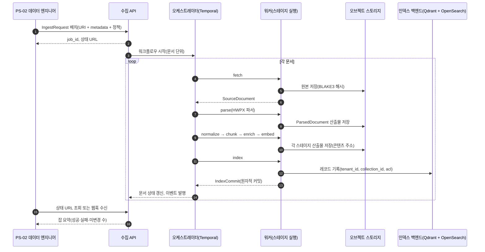
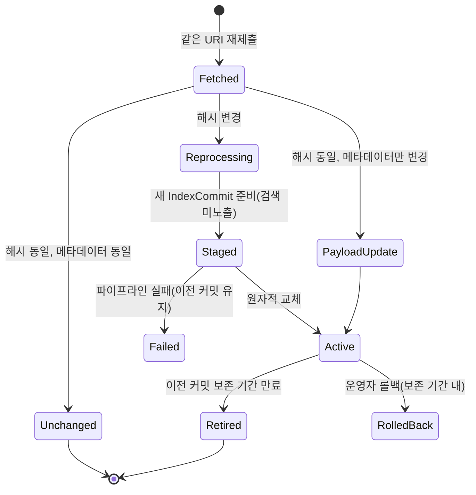
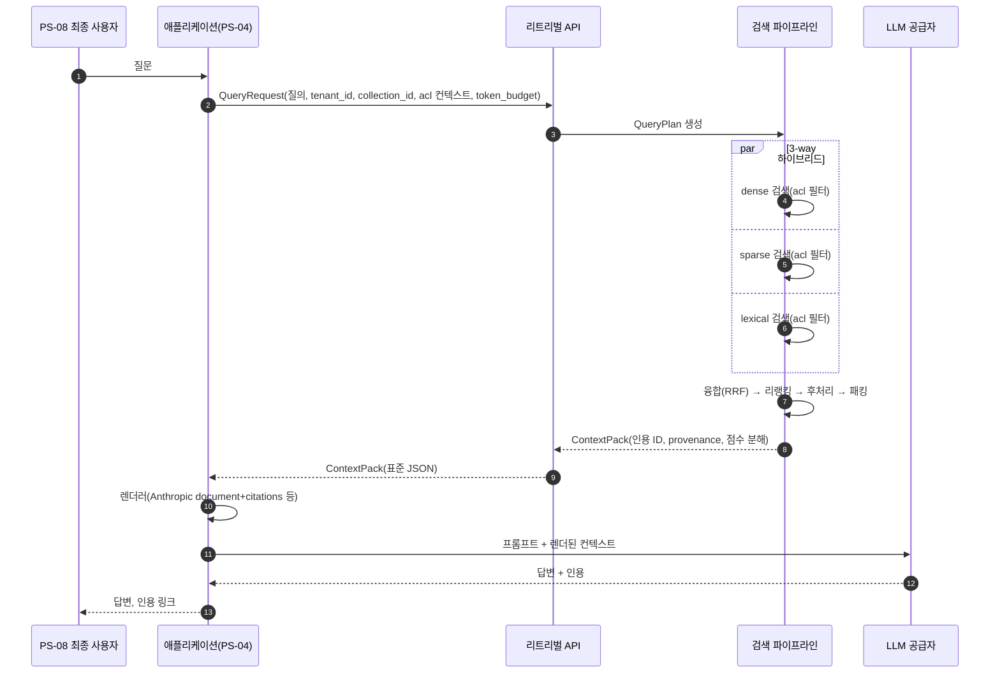
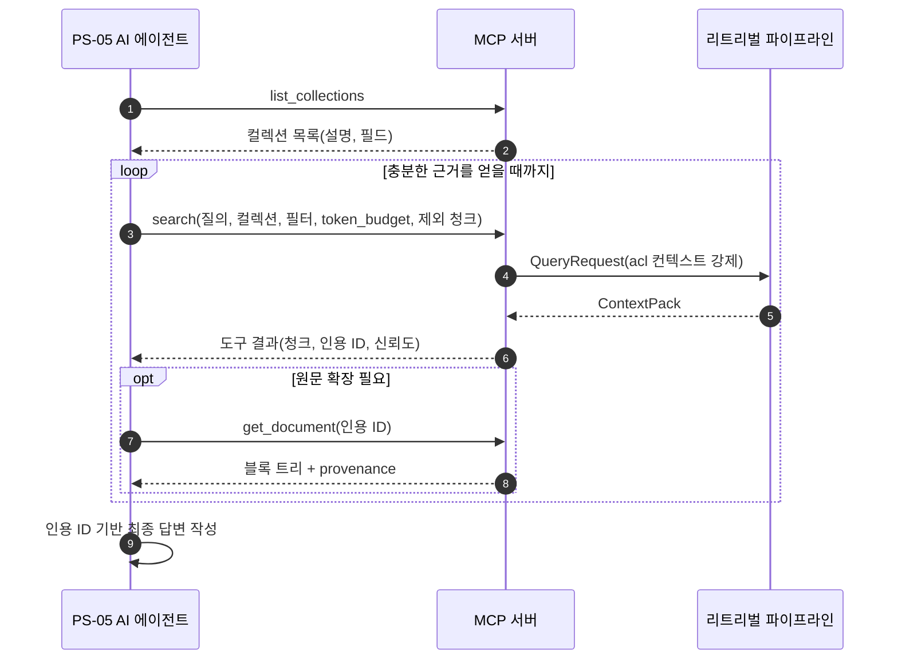
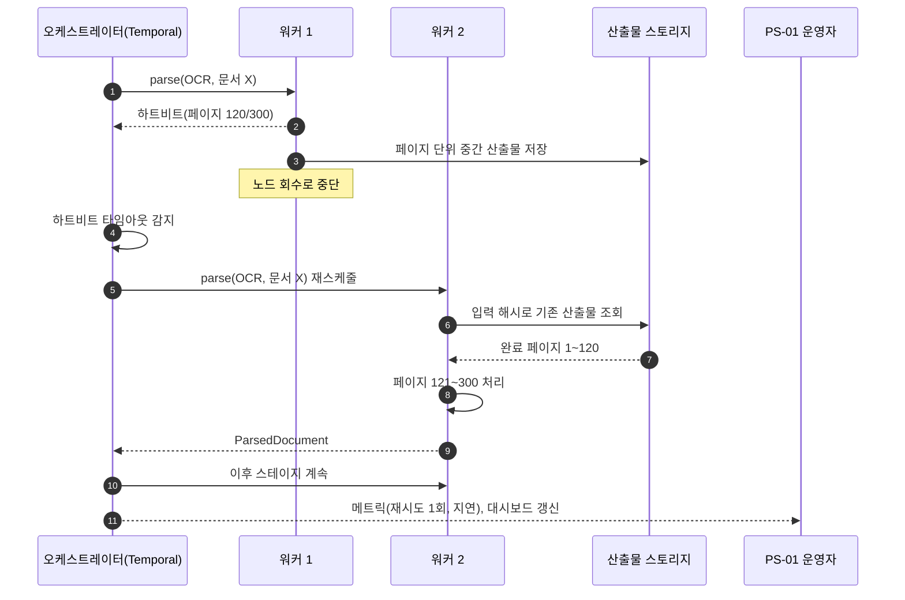

# 페르소나와 유즈케이스

> 이 문서는 플랫폼을 **누가** 쓰는지(페르소나(Persona) `PS-xx`)와 **무엇을 하려고** 쓰는지(유즈케이스(Use Case) `UC-xx`)를 고정한다.
> [비전과 목표](../00-vision/01-vision-and-goals.md) §6의 대상 사용자 요약을 상세화하고, 각 유즈케이스를 [기능 요구사항](./01-functional-requirements.md)의 `FR-<영역>-NN`과 [비기능 요구사항](./02-non-functional-requirements.md)의 `NFR-<영역>-NN`에 연결한다. [사용자 스토리와 인수 기준](./04-user-stories-and-acceptance-criteria.md)이 이 문서의 `UC-xx`를 추적 근거로 인용하는 것은 제안 상태다(미해결 이슈 1).
> 아키텍처 결정은 만들지 않는다. 모든 흐름은 [설계 브리프](../00-vision/00-design-brief.md)의 확정 결정(D-xx)과 원칙에서 도출되며, 미정 항목은 `**미정(O-xx):**`으로 표기한다. 비전 문서의 문제 ID는 `PB-xx`, 목표는 `G-xx`, KPI는 `KPI-xx`로 인용하고, 브리프 §3의 설계 원칙은 "원칙 N"으로 인용한다(`P-xx`는 [설계 원칙](../00-vision/02-design-principles.md)·[용어집](../00-vision/03-glossary.md)이 다른 뜻으로 쓰므로 이 문서에서는 사용하지 않는다).

## 목적

- 플랫폼의 사용자 유형을 8개 페르소나로 고정하고, 각 페르소나의 목표·고충·성공 기준을 명시하여 요구사항의 "누구를 위한 것인가"에 답한다.
- 핵심 시나리오 20개를 표준 유즈케이스 형식으로 기술하여, 기능 요구사항·인수 기준·평가 시나리오·런북이 같은 흐름을 참조하게 한다.
- 각 유즈케이스가 어느 스테이지 경계(D-05), 어느 API 표면, 어느 확장 지점(D-10)을 거치는지 드러내어 설계 문서 간 추적성을 제공한다.

## 범위

**포함**: 페르소나 정의(PS-01~PS-08), 유즈케이스 목록과 다이어그램, 유즈케이스 상세(UC-01~UC-20), 페르소나-유즈케이스 추적 매트릭스, 기능·비기능 요구사항 식별자(FR-xxx-NN, NFR-xxx-NN)와의 연결.

**제외**: 요구사항 문장 자체([기능 요구사항](./01-functional-requirements.md), [비기능 요구사항](./02-non-functional-requirements.md)), 인수 기준의 Given/When/Then([사용자 스토리와 인수 기준](./04-user-stories-and-acceptance-criteria.md)), API 엔드포인트 명세([API 설계 가이드라인](../05-api/01-api-design-guidelines.md) 이하), 계약 필드 정의([계약 개요](../03-contracts/00-contract-overview.md) 이하), UI 설계(플랫폼 범위 외, 브리프 §6).

## 1. 페르소나 개요

페르소나(persona)는 실제 사용자 조사 이전에 설계 판단의 기준으로 삼는 **대표 사용자 원형**이다. 이 문서의 페르소나는 브리프 §2의 원 요구사항(R1~R6)과 [비전과 목표](../00-vision/01-vision-and-goals.md) §6의 대상 사용자에서 도출했다. 사람이 아닌 사용자(AI 에이전트)와 플랫폼을 직접 만지지 않는 사용자(최종 사용자)를 포함한 이유는, 브리프 원칙 10("최종 출력은 사람이 아니라 LLM이 소비한다")과 D-13(MCP 서버)이 그들을 1차 소비자로 규정하기 때문이다.

`PS-xx`가 이 요구사항 세트의 공식 페르소나 식별자다. "비전 §6 명칭" 열은 [비전과 목표](../00-vision/01-vision-and-goals.md) §6과 [사용자 스토리와 인수 기준](./04-user-stories-and-acceptance-criteria.md)이 쓰는 요약 명칭으로, 이 문서의 페르소나 이름과 1:1 대응하는 **동의어**로 취급한다(두 문서에 PS-xx 병기를 제안, 미해결 이슈 12).

| ID | 페르소나 | 비전 §6 명칭(동의어) | 대표 역할 | 플랫폼과의 관계 | 주로 접하는 표면 | 비전 연결 |
|----|----------|----------------------|-----------|-----------------|------------------|-----------|
| PS-01 | 플랫폼 운영자 | 플랫폼 운영자 | SRE, 플랫폼 엔지니어 | 배포·확장·관측·테넌트 관리 | [관리 API](../05-api/04-management-api.md), [배포 가이드](../09-operations/01-deployment-guide.md), [관측성](../09-operations/03-observability.md), [런북](../09-operations/06-runbooks.md) | PB-06, G-04, KPI-11~KPI-13 |
| PS-02 | 데이터 엔지니어 | 문서 파이프라인 담당자 | 수집 파이프라인 연결 담당 | 원천 시스템의 문서 URI·메타데이터를 수집 API에 전달하고 상태를 관리 | [수집 API](../05-api/02-ingestion-api.md), [웹훅·이벤트](../05-api/07-webhooks-and-events.md), [IngestRequest](../03-contracts/01-ingest-request.md) | DF-01, DF-03, G-03, KPI-07~KPI-11 |
| PS-03 | 검색 품질 엔지니어 | 검색 품질 엔지니어 | ML 엔지니어, 검색 엔지니어 | 골든셋으로 프로파일을 측정·비교·개선 | [리트리벌 메트릭과 하네스](../08-evaluation/02-retrieval-metrics-and-harness.md), 프로파일, 점수 분해 | DF-05, G-01, KPI-01~KPI-03, KPI-06 |
| PS-04 | LLM 애플리케이션 개발자 | AI 애플리케이션 개발자 | 백엔드·풀스택 개발자 | 리트리벌 API로 컨텍스트 팩(Context Pack)을 받아 LLM 프롬프트에 주입 | [리트리벌 API](../05-api/03-retrieval-api.md), [클라이언트 SDK](../05-api/06-client-sdks.md), [Context Pack](../03-contracts/11-context-pack.md) | DF-04, G-06, KPI-14 |
| PS-05 | AI 에이전트 | LLM 에이전트(기계 사용자) | MCP 클라이언트(비인간 사용자) | 도구 호출로 검색을 반복하고 Context Pack을 직접 소비 | [MCP 서버](../05-api/05-mcp-server.md) `search`, `get_document`, `list_collections` | DF-04, 원칙 10 |
| PS-06 | 보안·컴플라이언스 담당 | 보안·컴플라이언스 담당자 | 정보보호 담당, 내부 감사 | 테넌트 격리·ACL·감사 로그·PII 처리 검증 | [멀티테넌시·보안 아키텍처](../02-architecture/07-multi-tenancy-and-security-architecture.md), [보안과 컴플라이언스](../09-operations/05-security-and-compliance.md) | DF-02, PB-06, 원칙 9 |
| PS-07 | 플러그인 개발자 | 플러그인 개발자 | 오픈소스 기여자, 벤더 엔지니어 | 14개 확장 지점에 어댑터를 제공 | [플러그인 개발 가이드](../10-development/06-plugin-development-guide.md), [플러그인 아키텍처](../02-architecture/05-plugin-architecture.md) | PB-07, G-08, KPI-18, KPI-21 |
| PS-08 | 최종 사용자(간접) | (없음, 비전 §6은 직접 사용자만 요약) | 공공기관 민원 담당, 기업 실무자 | PS-04가 만든 애플리케이션을 통해 답변과 인용을 받는다. 플랫폼을 직접 호출하지 않는다 | (없음, 애플리케이션 경유) | G-02, KPI-04, KPI-05 |

페르소나와 플랫폼 표면의 대응은 위 표의 "주로 접하는 표면" 열이 소유하고, 페르소나와 유즈케이스의 대응은 §3.2 다이어그램과 §5.1 매트릭스가 소유한다.

## 2. 페르소나 상세

각 페르소나는 **목표**(플랫폼으로 이루려는 것), **고충**(현재 겪는 문제, [비전과 목표](../00-vision/01-vision-and-goals.md) §2의 PB-xx와 연결), **성공 기준**(이 페르소나가 "된다"고 판단하는 관찰 가능한 조건)으로 기술한다. 성공 기준의 수치는 브리프 §7과 비전 문서의 KPI(§4, 0.1.0 기준 번호)를 그대로 인용하며, 이 문서가 새 수치를 만들지 않는다. 가용성(리트리벌 API 99.9%)은 비전 §4.2에 따라 KPI가 아니라 [비기능 요구사항](./02-non-functional-requirements.md) NFR-AVL-01의 배포 목표로 인용한다.

### PS-01 플랫폼 운영자

| 항목 | 내용 |
|------|------|
| 대표 인물 | 공공기관 정보화 부서 또는 기업 플랫폼 팀의 SRE. Kubernetes·PostgreSQL·오브젝트 스토리지 운영 경험이 있으나 ML 인프라(GPU 서빙, 벡터 인덱스)는 처음이다. 폐쇄망 배포 요구를 자주 받는다. |
| 목표 | 여러 팀(테넌트)에 검색 인프라를 안정적으로 제공한다. 표준 스택(PostgreSQL, S3 호환, Valkey(Redis 호환, D-14 v1.1), Qdrant, OpenSearch, Temporal; D-14~D-17)만으로 운영한다. 장애를 대시보드와 런북으로 처리하고, 업그레이드에서 데이터 손실 없이 롤백할 수 있다. |
| 고충 | 장시간 OCR 잡이 워커 재시작 시 사라진다(PB-06). 테넌트 격리가 애플리케이션 코드에 의존한다(PB-06). GPU 자원 계획 근거가 없다. 어느 컴포넌트가 병목인지 보이지 않는다. 벤더 종속이 두렵다. |
| 성공 기준 | 자기 배포에서 리트리벌 API 월간 가용성 99.9%를 달성한다(NFR-AVL-01, 브리프 §7; 비전 §4.2에 따라 KPI 아님). 리트리벌 p95 지연이 브리프 §7 목표 안이다(KPI-12). 잡 최종 성공률 99.9% 이상, 멱등성 위반 0건(KPI-11). 워커 강제 종료 후 잡이 사람 개입 없이 재개되고 정의된 복원력 시나리오를 통과한다(KPI-13, UC-17). 테넌트 온보딩이 관리 API 호출만으로 끝난다(UC-01). 모든 스테이지가 OTel 트레이스·Prometheus 메트릭으로 보인다(D-11). |
| 주요 유즈케이스 | UC-01, UC-02, UC-15, UC-17, UC-20 |

### PS-02 데이터 엔지니어(수집 파이프라인 연결)

| 항목 | 내용 |
|------|------|
| 대표 인물 | 문서관리시스템·그룹웨어·공공데이터 수집기를 운영하는 데이터 엔지니어. 이미 크롤러·커넥터를 가지고 있으며, 플랫폼에는 문서 **위치와 메타데이터만** 넘기고 싶다(R1, SC-01). 수집 대상은 HWPX 수십만 건, 스캔 PDF 수만 건, 웹 페이지와 TXT가 섞여 있다. |
| 목표 | `IngestRequest`(URI + metadata + 정책) 하나로 어떤 포맷이든 수집한다. 대량 배치를 던지고 상태를 잡 단위·문서 단위로 추적한다. 원천이 바뀌면 갱신·삭제가 인덱스까지 전파된다. 같은 문서를 두 번 보내도 중복 인덱싱되지 않는다. |
| 고충 | HWPX는 파싱이 안 되거나 표가 깨진다(PB-03). 스캔 PDF OCR이 중간에 죽는다(PB-06). 어느 문서가 왜 실패했는지 추적이 어렵다. 잘못된 확장자·인코딩(EUC-KR) 파일이 섞여 있다. 재색인 중 검색 결과가 반쪽이 된다. |
| 성공 기준 | 포맷별 파싱 성공률: 텍스트 PDF·DOCX·HTML·TXT 99.5% 이상, HWPX 99% 이상, 스캔 PDF 97% 이상(KPI-07). 구조 보존율 HWPX 0.95 이상(KPI-08). 동일 `IngestRequest` + 동일 프로파일이 동일 `IndexCommit` 해시를 낸다(KPI-09). 실패 문서마다 표준 에러 모델([에러 모델](../03-contracts/13-error-model.md))로 원인이 기록된다. 갱신은 원자적 교체로, 삭제는 모든 인덱스 백엔드에서 전파된다(UC-07, UC-08). |
| 주요 유즈케이스 | UC-02, UC-03, UC-04, UC-05, UC-06, UC-07, UC-08 |

### PS-03 검색 품질 엔지니어

| 항목 | 내용 |
|------|------|
| 대표 인물 | 검색·추천 또는 NLP 배경의 ML 엔지니어. 임베딩 모델과 리랭커를 벤치마크하고, 도메인 골든셋을 만들어 품질을 수치로 관리한다. 한국어 형태소·복합명사 처리의 함정을 안다. |
| 목표 | 골든셋(qrels)으로 프로파일을 비교하고, 임베더·리랭커·청커·융합 전략을 데이터 근거로 교체한다. "왜 이 청크가 뽑혔는지"를 점수 분해로 설명한다. 모델 업그레이드가 회귀를 일으키면 배포 전에 잡아낸다. |
| 고충 | 설정 변경 효과를 측정할 수 없다(PB-04). 후보 선택 이유가 불투명하다(PB-06). 한국어 벤치마크가 없다. 임베딩 모델을 바꾸면 전체를 다시 파싱해야 한다. 실험을 재현할 수 없다. |
| 성공 기준 | 내부 한국어 골든셋 nDCG@10 0.80 이상, Recall@20 0.92 이상, dense-only 베이스라인 대비 +15%p(KPI-01, KPI-02, 브리프 §7). RankedSet의 모든 후보가 dense/sparse/lexical/rerank 점수 분해와 트레이스 ID를 가진다(KPI-06). 프로파일 A/B가 같은 골든셋·같은 코퍼스에서 재현 가능하다(UC-14). 임베더 교체 시 파싱·청킹 산출물이 콘텐츠 주소로 재사용되어 임베딩 단계만 재실행된다(UC-15). |
| 주요 유즈케이스 | UC-12, UC-13, UC-14, UC-15 |

### PS-04 LLM 애플리케이션 개발자

| 항목 | 내용 |
|------|------|
| 대표 인물 | 사내 질의응답 서비스나 고객 상담 보조를 만드는 백엔드 개발자. Anthropic·OpenAI 호환 API를 모두 쓸 수 있어야 하고, 답변마다 원문 인용을 붙여야 한다. RAG 튜토리얼 수준은 경험했지만 프로덕션 품질 검색은 처음이다. |
| 목표 | 질의를 보내면 프롬프트에 그대로 넣을 수 있는 Context Pack을 받는다. 토큰 예산·순서·중복·인용 ID는 플랫폼이 처리한다. 공급자를 바꿔도 코드가 바뀌지 않는다(D-20 렌더러). 사용자 권한에 따라 결과가 자동으로 걸러진다. |
| 고충 | 검색은 됐는데 LLM이 답을 놓친다(PB-05, lost-in-the-middle). 인용을 붙이려면 후처리 코드를 직접 쓴다. 공급자별 포맷이 다르다. 토큰 예산 초과로 컨텍스트가 잘린다. 권한 필터를 애플리케이션에서 직접 구현해야 한다(PB-06). |
| 성공 기준 | 경량 프로파일에서 문서만 보고 첫 검색 성공까지 15분 이내(KPI-14 Y1). Context Pack을 Anthropic `document`+`citations` 블록, OpenAI 호환 메시지, XML/Markdown 중 하나로 한 줄 호출로 렌더링한다(D-20). Context Precision 0.75 이상(KPI-03). 인용 정확도 0.90 이상(KPI-05). ACL 필터가 플랫폼에서 강제되어 애플리케이션 코드에 권한 로직이 없다(UC-11). |
| 주요 유즈케이스 | UC-09, UC-11, UC-19 |

### PS-05 AI 에이전트(MCP 클라이언트로서의 비인간 사용자)

| 항목 | 내용 |
|------|------|
| 대표 인물 | Claude 등 LLM 기반 에이전트. 사람이 준 과업(예: "지난 3년 조례 개정 이력을 정리해라")을 수행하기 위해 도구 호출로 검색을 **반복**한다. 한 번의 검색으로 끝나지 않고 결과를 보고 질의를 재작성하며, 컨텍스트 창이라는 예산 안에서 움직인다. 사람과 달리 UI가 없고 도구 설명(description)과 스키마만 읽는다. |
| 목표 | `list_collections`로 검색 가능한 범위를 알고, `search`로 Context Pack을 받고, 필요하면 `get_document`로 원문 블록을 더 읽는다(D-13). 매 호출의 결과가 토큰 예산 안에 들어오고 인용 ID가 있어 최종 답변에 근거를 붙일 수 있다. 이미 본 청크를 다시 받지 않는다. |
| 고충 | 도구 결과가 사람용 스니펫이면 토큰만 낭비된다. 반복 검색 시 같은 청크가 계속 돌아온다. 결과에 신뢰도가 없어 어떤 근거를 믿을지 판단할 수 없다. 표가 평문으로 깨져 숫자를 읽을 수 없다. 권한 밖 문서가 섞이면 답변이 유출 사고가 된다. |
| 성공 기준 | MCP 도구 세 개의 입력·출력이 JSON Schema로 게시되고 도구 설명만으로 호출 가능하다. `search` 결과가 Context Pack 표준 JSON이며 `token_budget` 내에 패킹된다(D-20). 각 청크에 인용 ID·신뢰도 점수·표/그림 텍스트화가 포함된다(R6). 반복 호출에서 호출자의 ACL 컨텍스트가 매번 강제된다(D-09). |
| 주요 유즈케이스 | UC-10, UC-11, UC-19 |

### PS-06 보안·컴플라이언스 담당

| 항목 | 내용 |
|------|------|
| 대표 인물 | 공공기관·금융사의 정보보호 담당 또는 내부 감사. LLM 서비스 도입 심사에서 "어떤 문서가 누구에게 노출되었는가", "개인정보가 인덱스에 들어갔는가", "삭제 요청이 실제로 지워졌는가"를 증명해야 한다. 플랫폼 코드를 읽지 않고 로그·설정·계약 문서로 판단한다. |
| 목표 | 테넌트 격리와 ACL 필터가 **플랫폼 계층에서 강제**됨을 확인한다(D-09). 검색·조회·삭제가 감사 로그에 남는다. PII 처리 훅이 어느 단계에서 무엇을 하는지 설명할 수 있다(원칙 9). 전송 TLS·저장 암호화가 기본이다(브리프 §7). |
| 고충 | 권한 필터가 애플리케이션마다 다르게 구현된다. 인덱스에 들어간 텍스트가 무엇인지 볼 방법이 없다. 삭제가 벡터 인덱스·렉시컬 인덱스·산출물 스토리지 중 어디까지 전파되었는지 알 수 없다. 인용이 원문과 맞는지 검증할 수단이 없다. |
| 성공 기준 | 모든 Index Record에 `tenant_id`, `collection_id`, `acl`이 존재하고 리트리벌이 필터를 강제함을 계약 문서와 테스트로 확인한다(D-09). 검색·문서 조회·삭제 이벤트가 감사 로그에 표준 스키마로 기록된다. 삭제 요청 후 모든 백엔드와 산출물에서 제거가 완료된 시점을 이벤트로 확인한다(UC-08). Context Pack의 모든 청크가 provenance(page/bbox 또는 char offset + element path)를 가진다(KPI-04 출처 완전성 100%, G-02). |
| 주요 유즈케이스 | UC-01, UC-08, UC-11, UC-18 |

### PS-07 플러그인 개발자

| 항목 | 내용 |
|------|------|
| 대표 인물 | 오픈소스 기여자 또는 벤더 엔지니어. 자사 파서·임베딩 모델·벡터 DB를 플랫폼에 연결하고 싶다. 플랫폼 코어를 수정하지 않고 패키지 하나로 배포하려 한다. |
| 목표 | 14개 확장 지점(D-10: `fetcher`, `parser`, `normalizer`, `chunker`, `enricher`, `embedder`, `index_backend`, `query_transformer`, `retriever`, `fuser`, `reranker`, `postprocessor`, `packer`, `evaluator`) 중 하나에 어댑터를 구현하고 Python entry points로 등록한다. 계약 테스트를 통과하면 프로파일에서 이름으로 선택된다. |
| 고충 | 계약이 코드에 묻혀 있어 어디까지 지켜야 하는지 모른다(PB-01). 고급 기법을 넣으려면 프레임워크를 포크해야 한다(PB-07). 벤더 모델을 표준 모델로 변환하는 규칙이 불명확하다. 테스트 데이터가 없다. 코어 버전이 오르면 플러그인이 깨진다. |
| 성공 기준 | 플러그인 개발 가이드만으로 `reranker` 플러그인을 작성·등록·테스트하는 데 2시간 이내(KPI-18 Y1). 확장 지점별 계약 테스트 스위트(스키마 검증 + 불변식)가 제공된다(FR-PLG-05). `schema_version` 호환 범위를 플러그인 메타데이터로 선언할 수 있다([스키마 버저닝과 호환성](../03-contracts/14-schema-versioning-and-compatibility.md), FR-PLG-02·03). 플러그인 레지스트리 등록 수 20개, 지점별 대체 구현 1개 이상(KPI-21 Y1, G-08). |
| 주요 유즈케이스 | UC-16 |

### PS-08 최종 사용자(간접)

| 항목 | 내용 |
|------|------|
| 대표 인물 | 공공기관 민원 담당자, 기업 실무자, 연구자. PS-04가 만든 애플리케이션에서 질문하고 답변을 받는다. 플랫폼의 존재를 모르며 알 필요도 없다. 답변이 틀리면 근거를 확인하고 싶어 한다. |
| 목표 | 질문에 대한 답변이 정확하고, 각 문장이 어느 문서 몇 페이지 어느 표에서 왔는지 바로 확인할 수 있다. HWPX 공문의 표 안 숫자도 정확히 인용된다. 자신에게 권한 없는 문서는 답변에 등장하지 않는다. |
| 고충 | 답변이 그럴듯하지만 근거를 찾을 수 없다. 인용을 클릭해도 문서 첫 페이지로만 이동한다. 표 안의 값이 뒤섞여 잘못된 숫자가 나온다. 최신 개정판이 아닌 옛 문서가 인용된다. |
| 성공 기준 | 이 페르소나는 플랫폼을 직접 측정하지 않는다. 대신 KPI-05(인용 정확도 0.90 이상), KPI-04(출처 완전성 100%, G-02), KPI-08(구조 보존율)이 이 페르소나의 경험을 대리한다. 애플리케이션이 인용 ID로 원문 위치(페이지·좌표·요소 경로)를 하이라이트할 수 있다(UC-19). 갱신된 문서가 인덱스에 반영된 뒤에는 이전 버전이 결과에 나타나지 않는다(UC-07). |
| 주요 유즈케이스 | UC-09(간접), UC-19 |

## 3. 유즈케이스 개요

### 3.1 유즈케이스 목록

우선순위는 **필수**, **높음**, **보통** 세 단계다. **필수**는 첫 공개 릴리스 범위(마일스톤 ID는 [마일스톤](../11-roadmap/01-milestones.md)이 부여)로, [기능 요구사항](./01-functional-requirements.md)의 MoSCoW와는 필수 = Must, 높음 = Should, 보통 = Could로 대응한다. 유즈케이스 하나가 여러 FR을 묶으므로 대응은 지배적 FR의 우선순위 기준이다. "핵심 경계"는 해당 유즈케이스가 통과하는 D-05 스테이지 경계 또는 API 표면이다.

| ID | 유즈케이스 | 주 액터 | 부 액터 | 영역 | 우선순위 | 핵심 경계·표면 |
|----|------------|---------|---------|------|----------|----------------|
| UC-01 | 테넌트 온보딩 | PS-01 | PS-06 | 관리 | 필수 | 관리 API, `tenant_id` |
| UC-02 | 컬렉션 생성과 프로파일 고정 | PS-02 | PS-01, PS-03 | 관리 | 필수 | 관리 API, Profile, Collection |
| UC-03 | 공공기관 HWPX 대량 수집 | PS-02 | PS-01 | 수집 | 필수 | IngestRequest → IndexCommit 전 구간 |
| UC-04 | 스캔 PDF OCR 수집 | PS-02 | PS-01 | 수집 | 필수 | SourceDocument → ParsedDocument(OCR) |
| UC-05 | 혼합 포맷 배치 수집과 포맷 자동 감지 | PS-02 | - | 수집 | 높음 | 파싱 라우터 |
| UC-06 | 수집 잡 상태 추적과 웹훅 수신 | PS-02 | PS-04 | 수집 | 필수 | 잡·이벤트·상태 계약 |
| UC-07 | 문서 갱신 전파(재색인과 원자적 교체) | PS-02 | PS-08 | 수집 | 필수 | IndexCommit |
| UC-08 | 문서 삭제 전파 | PS-02 | PS-06 | 수집 | 필수 | IndexCommit, 산출물 스토리지 |
| UC-09 | 하이브리드 검색 후 LLM 답변 생성(Context Pack 소비) | PS-04 | PS-08 | 리트리벌 | 필수 | QueryRequest → ContextPack 전 구간 |
| UC-10 | 에이전트가 MCP로 반복 검색 | PS-05 | PS-04 | 리트리벌 | 필수 | MCP 서버 |
| UC-11 | ACL 기반 결과 필터링 | PS-04, PS-05 | PS-06 | 리트리벌·보안 | 필수 | `acl` 필터, CandidateSet |
| UC-12 | 검색 결과 설명(점수 분해와 트레이스 조회) | PS-03 | PS-04 | 품질 | 높음 | RankedSet, OTel |
| UC-13 | 골든셋 구축과 오프라인 평가 실행 | PS-03 | - | 평가 | 필수 | 평가 하네스, qrels |
| UC-14 | 프로파일 A/B 평가 | PS-03 | PS-01 | 평가 | 필수 | Profile, `evaluator` |
| UC-15 | 임베딩 모델 교체와 컬렉션 재색인 | PS-03 | PS-01 | 품질·운영 | 높음 | EmbeddedChunkSet, IndexCommit |
| UC-16 | 플러그인 파서 추가 | PS-07 | PS-01, PS-02 | 확장 | 필수 | `parser` 확장 지점, ParsedDocument |
| UC-17 | 장애 복구(워커 중단 후 재개) | PS-01 | PS-02 | 운영 | 필수 | 오케스트레이터(Temporal) |
| UC-18 | 감사 로그 조회와 PII 처리 검증 | PS-06 | PS-01 | 보안 | 높음 | 감사 로그, PII 훅 |
| UC-19 | 인용으로 원문 위치 확인 | PS-08 | PS-04, PS-05 | 리트리벌 | 높음 | `get_document`, provenance |
| UC-20 | 플랫폼 업그레이드와 계약 버전 호환 | PS-01 | PS-07, PS-04 | 운영 | 보통 | `schema_version` |

### 3.2 유즈케이스 다이어그램

표기 규칙: 실선은 **주 액터**만 표시하고, 점선 "애플리케이션 경유"는 PS-08의 간접 참여를 표시한다. 부 액터 연관선은 그리지 않으며 §3.1 표와 §5.1 매트릭스가 그 정보를 소유한다. 유즈케이스 간 점선은 포함(include)·확장(extend) 관계다.

```mermaid
flowchart TB
    PS01(["PS-01 플랫폼 운영자"])
    PS02(["PS-02 데이터 엔지니어"])
    PS03(["PS-03 검색 품질 엔지니어"])
    PS04(["PS-04 LLM 앱 개발자"])
    PS05(["PS-05 AI 에이전트"])
    PS06(["PS-06 보안·컴플라이언스"])
    PS07(["PS-07 플러그인 개발자"])
    PS08(["PS-08 최종 사용자"])

    subgraph Mgmt["관리·운영"]
        UC01["UC-01 테넌트 온보딩"]
        UC02["UC-02 컬렉션 생성·프로파일 고정"]
        UC17["UC-17 장애 복구"]
        UC20["UC-20 업그레이드·계약 호환"]
    end
    subgraph Ingest["수집"]
        UC03["UC-03 HWPX 대량 수집"]
        UC04["UC-04 스캔 PDF OCR 수집"]
        UC05["UC-05 혼합 포맷 배치"]
        UC06["UC-06 잡 상태·웹훅"]
        UC07["UC-07 갱신 전파"]
        UC08["UC-08 삭제 전파"]
    end
    subgraph Retrieve["리트리벌"]
        UC09["UC-09 검색 후 LLM 답변"]
        UC10["UC-10 MCP 반복 검색"]
        UC11["UC-11 ACL 필터링"]
        UC19["UC-19 인용으로 원문 확인"]
    end
    subgraph Quality["품질·평가"]
        UC12["UC-12 점수 분해·트레이스"]
        UC13["UC-13 골든셋·오프라인 평가"]
        UC14["UC-14 프로파일 A/B"]
        UC15["UC-15 임베더 교체·재색인"]
    end
    subgraph Ext["확장·보안"]
        UC16["UC-16 플러그인 파서 추가"]
        UC18["UC-18 감사 로그·PII 검증"]
    end

    PS01 --> UC01 & UC17 & UC20
    PS02 --> UC02 & UC03 & UC04 & UC05 & UC06 & UC07 & UC08
    PS03 --> UC12 & UC13 & UC14 & UC15
    PS04 --> UC09 & UC11
    PS05 --> UC10 & UC11
    PS06 --> UC18
    PS07 --> UC16
    PS08 -.->|"애플리케이션 경유"| UC07
    PS08 -.->|"애플리케이션 경유"| UC09
    PS08 -.->|"애플리케이션 경유"| UC19

    UC03 -.->|"포함"| UC06
    UC04 -.->|"포함"| UC06
    UC07 -.->|"포함"| UC06
    UC09 -.->|"포함"| UC11
    UC10 -.->|"포함"| UC11
    UC15 -.->|"확장"| UC14
    UC17 -.->|"확장"| UC03
```

### 3.3 유즈케이스 표준 형식

모든 유즈케이스는 아래 형식을 따른다. 액터·전제조건·트리거·대안 흐름·예외 흐름·사후조건·관련 FR은 표로, **주 흐름**은 표 바로 아래 번호 목록으로 쓴다(후속 문서가 "UC-NN 주 흐름 N단계"로 인용할 수 있게). 대안·예외 흐름의 "N단계"는 그 목록의 번호를 가리킨다. "관련 FR"은 [기능 요구사항](./01-functional-requirements.md)의 `FR-<영역>-NN`, [비기능 요구사항](./02-non-functional-requirements.md)의 `NFR-<영역>-NN`, 브리프 원 요구사항(R1~R6)·결정(D-xx), 비전 목표(G-xx, KPI-xx)로 표기한다. FR 목록은 해당 유즈케이스가 **주로** 행사하는 능력이며 전수 목록이 아니다. 역방향(FR → UC) 추적 열은 기능 요구사항 문서에 제안한다(미해결 이슈 1).

| 항목 | 정의 |
|------|------|
| ID·이름 | `UC-NN` + 동사형 이름 |
| 액터 | 주 액터(흐름을 시작하는 페르소나), 부 액터(참여하거나 결과를 받는 페르소나·시스템) |
| 전제조건 | 주 흐름 시작 전에 참이어야 하는 상태 |
| 트리거 | 흐름을 시작시키는 사건 |
| 대안 흐름 | 정상 종료되는 다른 경로. `An` 번호와 분기 단계(주 흐름 번호) 표기 |
| 예외 흐름 | 실패 또는 거부로 끝나는 경로. `En` 번호와 분기 단계 표기. 에러는 [에러 모델](../03-contracts/13-error-model.md)을 따른다 |
| 사후조건 | 성공 종료 후 보장되는 상태(성공 보장) |
| 관련 FR | `FR-xxx-NN` 목록 / `NFR-xxx-NN` 목록 / 원 요구사항(R1~R6)과 근거 결정(D-xx) / 관련 목표(G-xx, KPI-xx) |
| 주 흐름(표 아래 목록) | 번호 매긴 정상 경로. 각 단계는 "누가 무엇을 한다"로 쓰고, 통과하는 계약·확장 지점을 괄호로 표기 |

## 4. 유즈케이스 상세

### UC-01 테넌트 온보딩

| 항목 | 내용 |
|------|------|
| 액터 | 주: PS-01 플랫폼 운영자. 부: PS-06 보안·컴플라이언스, 조직의 OIDC IdP(외부 시스템) |
| 전제조건 | 플랫폼이 배포되어 관리 API가 응답한다. 조직 IdP가 OIDC 클라이언트로 등록되어 있다(인증 서버는 플랫폼 범위 외, 브리프 §6). 운영자가 플랫폼 관리자 권한을 가진다. |
| 트리거 | 새 부서 또는 고객 조직이 검색 인프라 사용을 요청한다. |
| 대안 흐름 | A1(2단계): 폐쇄망 배포에서 IdP가 없으면 서비스 계정 API 키 발급으로 대체한다(FR-SEC-01, NFR-SEC-03). 키 관리 방식은 보안 아키텍처에서 확정(미해결 이슈 10). |
| 예외 흐름 | E1(1단계): 이름 충돌 또는 할당량 초과 → 표준 에러 응답, 테넌트 미생성. E2(4단계): 스토리지·인덱스 백엔드 준비 실패 → 테넌트를 `provisioning_failed` 상태로 남기고 운영자에게 사유 반환. 재시도는 멱등(같은 요청은 같은 결과). |
| 사후조건 | 테넌트가 활성 상태이며, 이후 모든 `IngestRequest`·`QueryRequest`는 `tenant_id`를 요구하고 인덱스 레코드는 이를 보유한다(D-09). 감사 로그에 생성 기록이 있다. |
| 관련 FR | FR-MGT-01, FR-SEC-01, FR-SEC-02, FR-SEC-03, FR-SEC-07, FR-API-09 / NFR-SEC-01, NFR-SEC-03, NFR-SEC-04, NFR-SEC-13, NFR-AVL-03 / R1, 원칙 9, D-09, D-14 / 목표: PB-06 해결, G-04 |

**주 흐름**

1. 운영자가 관리 API `POST /v1/tenants`(바이블 §14 1.3.0, AM-39)로 테넌트를 생성한다. 응답으로 `tenant_id`(ULID, D-06)를 받는다.
2. 운영자가 테넌트에 OIDC 발급자·클라이언트·그룹 클레임 매핑을 등록한다(상세는 [멀티테넌시·보안 아키텍처](../02-architecture/07-multi-tenancy-and-security-architecture.md)).
3. 운영자가 테넌트 할당량(문서 수·스토리지·요청 레이트)을 설정한다(`tenants.quotas`, 바이블 §14 `PATCH /v1/tenants/{tenant_id}`, 1.3.0). 레이트리밋은 Valkey(Redis 호환) 기반(D-14 v1.1).
4. 플랫폼이 테넌트 격리 자원을 준비한다. 격리 단위(테넌트 전용 네임스페이스 vs 공유 인덱스 + `tenant_id` 필터 강제, D-09)는 [멀티테넌시·보안 아키텍처](../02-architecture/07-multi-tenancy-and-security-architecture.md)에서 확정한다(미해결 이슈 13).
5. 운영자가 테넌트 관리자 역할을 조직 담당자에게 부여한다(FR-SEC-02). 서비스 계정이 필요하면 `POST /v1/api-keys`로 API 키를 발급하고 `POST /v1/api-keys/{api_key_id}/rotate`로 회전한다(바이블 §14 1.3.0, AM-39).
6. 플랫폼이 감사 로그에 테넌트 생성 이벤트를 기록하고 웹훅 엔드포인트가 있으면 통지한다.

### UC-02 컬렉션 생성과 프로파일 고정

| 항목 | 내용 |
|------|------|
| 액터 | 주: PS-02 데이터 엔지니어. 부: PS-01, PS-03(프로파일 선택 조언) |
| 전제조건 | 테넌트가 활성 상태다(UC-01). 사용할 프로파일이 레지스트리에 존재한다(기본 하이브리드 프로파일 또는 경량 프로파일, D-07·D-15). |
| 트리거 | 새 문서 집합(예: "조례·규칙 전문")을 독립된 검색 단위로 만들 필요가 생긴다. |
| 대안 흐름 | A1(2단계): 엔지니어가 기존 프로파일을 복제하여 파라미터(청크 토큰 예산 등, **미정(O-09)**)를 바꾼 새 프로파일 버전을 만든 뒤 지정한다. 새 프로파일은 UC-14 평가를 권고한다. |
| 예외 흐름 | E1(2단계): 존재하지 않는 프로파일 버전 → 에러, 컬렉션 미생성. E2(4단계): 인덱스 백엔드 생성 실패 → 컬렉션을 생성 실패 상태로 두고 부분 생성물을 정리(사가 보상, D-17). |
| 사후조건 | 컬렉션이 활성이며 프로파일 버전이 고정되어 있다. 이후 이 컬렉션의 모든 `IndexCommit`은 같은 프로파일 버전으로 생성되어 재현성(KPI-09)이 보장된다. 프로파일 변경은 UC-15의 재색인 절차를 통해서만 가능하다. |
| 관련 FR | FR-MGT-02, FR-MGT-03, FR-MGT-04, FR-MGT-05, FR-MGT-11, FR-IDX-09 / NFR-MNT-10 / R4, R5, D-07, D-15, D-16, 원칙 4 / 목표: KPI-09 |

**주 흐름**

1. 엔지니어가 사용 가능한 프로파일 목록과 각 프로파일의 구성(파서·청커·임베더·인덱스 백엔드·검색 전략, 버전)을 관리 API로 조회한다.
2. 엔지니어가 컬렉션 생성을 요청하며 `tenant_id`, 이름, 프로파일 이름과 버전을 지정한다.
3. 플랫폼이 `collection_id`(ULID)를 발급하고 프로파일 버전을 컬렉션에 **고정**한다(브리프 §10 Collection 정의).
4. 플랫폼이 프로파일에 따라 인덱스 백엔드에 컬렉션 구조(Qdrant named vectors: dense+sparse, OpenSearch Nori 분석기 인덱스)를 생성한다(D-15, D-16).
5. 플랫폼이 컬렉션의 기본 ACL 정책과 메타데이터 스키마(필터 가능한 필드)를 저장한다.

### UC-03 공공기관 HWPX 대량 수집

| 항목 | 내용 |
|------|------|
| 액터 | 주: PS-02 데이터 엔지니어. 부: PS-01(워커 용량), 오브젝트 스토리지(외부 시스템) |
| 전제조건 | 컬렉션이 존재한다(UC-02). 원본 HWPX 파일 수십만 건이 `s3://` 또는 `file://` 경로에 있고 플랫폼 `fetcher`가 접근 권한을 가진다. 문서별 메타데이터(제목, 기관, 공개일, 문서 종류, ACL)가 준비되어 있다. |
| 트리거 | 엔지니어가 초기 적재 또는 정기 배치를 실행한다. |
| 대안 흐름 | A1(5단계): 파일이 HWP 5.0 바이너리이면 pyhwp/hwp5 → LibreOffice 폴백 경로로 파싱한다(D-18, **미정(O-07)** 지원 범위). A2(4단계): 동일 URI·동일 해시가 이미 인덱싱되어 있으면 문서를 `unchanged`로 종료한다(멱등). A3(6단계): 프로파일이 LLM 기반 보강을 켰으면 가상 질문 생성을 추가한다(**미정(O-05)** 기본값·비용 정책). |
| 예외 흐름 | E1(4단계): URI 접근 거부·미존재 → 문서 실패, 표준 에러 코드 기록, 잡은 계속 진행(문서 단위 격리). E2(5단계): 손상 HWPX(OWPML 스키마 위반) → 파서가 부분 파싱 결과와 경고를 남기거나 실패로 종료. 실패 시 `ParsedDocument` 미생성, 파싱 성공률 분모에서 제외 여부는 KPI-07 정의를 따른다. E3(7단계): 임베딩 서빙 일시 장애 → 오케스트레이터가 지수 백오프 재시도(D-17). E4(8단계): 인덱스 커밋 중 백엔드 하나가 실패 → `IndexCommit` 미커밋, 부분 기록 롤백(원자성), 재시도. |
| 사후조건 | 성공한 문서마다 하나의 `IndexCommit`이 존재하고 검색 가능하다. 모든 중간 산출물이 콘텐츠 주소로 저장되어 재처리·감사가 가능하다. 잡 상태가 문서별 성공·실패·미변경 수를 보고한다. |
| 관련 FR | FR-ING-01, FR-ING-03, FR-ING-04, FR-ING-05, FR-ING-07, FR-ING-08, FR-PRS-01, FR-PRS-02, FR-PRS-03, FR-PRS-14, FR-CHK-01, FR-CHK-03, FR-CHK-05, FR-ENR-01, FR-EMB-01, FR-EMB-02, FR-IDX-02, FR-IDX-04, FR-IDX-05 / NFR-PERF-10, NFR-REL-01, NFR-REL-02, NFR-REL-07, NFR-REL-08, NFR-SEC-10 / R1, R2, D-04, D-05, D-08, D-17, D-18, D-19, 원칙 4 / 목표: G-03, KPI-07, KPI-08, KPI-10 |

**주 흐름**

1. 엔지니어가 수집 API에 배치 `IngestRequest` 목록을 제출한다. 각 항목은 URI + metadata + 정책(우선순위, 갱신 모드)이다(R1, [IngestRequest](../03-contracts/01-ingest-request.md)).
2. 플랫폼이 요청을 검증하고 즉시 `job_id`와 상태 URL을 반환한다(D-08).
3. 오케스트레이터(Temporal, D-17)가 문서 단위 워크플로우를 시작한다.
4. `fetcher`가 URI에서 파일을 가져와 BLAKE3 해시를 계산하고 `SourceDocument`를 만든다. 같은 해시의 산출물이 이미 있으면 이후 스테이지를 건너뛴다(원칙 4).
5. 파싱 라우터가 확장자·매직 바이트로 HWPX를 판별하고 `parser`(python-hwpx + OWPML 어댑터, D-18)를 호출하여 `ParsedDocument`를 만든다. 표·목록·각주·머리말 구조와 요소 경로(provenance)를 보존한다(D-04).
6. `normalizer`가 `NormalizedDocument`를, `chunker`(구조 인식 계층 청킹 + 부모-자식 + 표 전용, D-19)가 `ChunkSet`을, `enricher`(문맥 요약 부착)가 `EnrichedChunkSet`을 만든다.
7. `embedder`(BGE-M3 via TEI, D-16)가 `EmbeddedChunkSet`을 만든다.
8. `index_backend`가 Qdrant와 OpenSearch에 레코드를 기록하고 `IndexCommit`을 원자적으로 커밋한다. 모든 레코드는 `tenant_id`, `collection_id`, `acl`을 가진다(D-09).
9. 플랫폼이 문서·잡 상태를 갱신하고 이벤트(예: `ingest.document.indexed`, 이름은 [잡·이벤트·상태](../03-contracts/12-jobs-events-and-status.md)에서 확정)를 발행한다(UC-06 포함).

### UC-04 스캔 PDF OCR 수집

| 항목 | 내용 |
|------|------|
| 액터 | 주: PS-02 데이터 엔지니어. 부: PS-01(GPU 워커 용량) |
| 전제조건 | 컬렉션이 존재한다. 스캔 PDF(텍스트 레이어 없음, 100~500페이지)가 접근 가능한 URI에 있다. OCR 워커가 프로파일에 구성되어 있다(엔진 **미정(O-08)**: PaddleOCR/Tesseract-kor/RapidOCR/Surya). |
| 트리거 | 엔지니어가 스캔 문서 배치를 제출한다. |
| 대안 흐름 | A1(3단계): 텍스트 레이어가 있는 페이지와 없는 페이지가 섞이면 페이지별로 경로를 나누고 하나의 `ParsedDocument`로 병합한다. A2(4단계): GPU 워커가 없는 배포에서는 CPU OCR로 처리하며 처리량 목표가 달라진다(브리프 §7은 GPU 기준 5분/100페이지). |
| 예외 흐름 | E1(4단계): OCR 도중 워커 중단 → UC-17 흐름으로 재개. 페이지 단위 중간 산출물이 저장되어 있으면 완료 페이지는 건너뛴다. E2(5단계): 평균 OCR 신뢰도가 프로파일 임계값 미만 → 문서를 `low_quality` 경고와 함께 인덱싱하거나 실패 처리(프로파일 정책). E3(2단계): 암호화 PDF → 실패, 표준 에러 코드. |
| 사후조건 | UC-03과 동일. 추가로 각 블록에 OCR 신뢰도와 페이지·좌표가 있어, 인용 시 스캔 이미지 위 하이라이트가 가능하다(UC-19). |
| 관련 FR | FR-PRS-05, FR-PRS-06, FR-PRS-07, FR-PRS-08, FR-PRS-14, FR-ING-13(OCR 강제 오버라이드) / NFR-PERF-09, NFR-REL-09, NFR-REL-10, NFR-PORT-03 / R1, R2, D-17, D-18, **미정(O-08)** / 목표: KPI-07(스캔 PDF 97% 이상), KPI-10(GPU OCR 100페이지 5분 미만), G-03(스캔 PDF는 O-08 결정 후 KPI-08 적용) |

**주 흐름**

1. 엔지니어가 `IngestRequest`를 제출한다(UC-03 1~4단계와 동일).
2. 파싱 라우터가 PDF를 판별하고 텍스트 레이어 유무를 검사한다(pypdfium2 + pdftext 고속 텍스트 추출, D-18; PyMuPDF는 AGPL로 기각, ADR-0006).
3. 텍스트 레이어가 없거나 페이지 비율 기준 이하이면 OCR 경로로 라우팅한다.
4. OCR `parser`가 페이지 단위로 이미지를 렌더링하고 OCR을 수행한다. 장시간 실행이므로 오케스트레이터에 페이지 진행률 하트비트를 보낸다(D-17).
5. Docling 레이아웃 분석으로 표·제목·단락 구조를 복원하고, OCR 결과를 page/bbox provenance와 함께 `ParsedDocument`로 만든다(D-04). OCR 신뢰도를 블록 메타데이터로 보존한다.
6. 이후 UC-03 6~9단계와 동일.

### UC-05 혼합 포맷 배치 수집과 포맷 자동 감지

| 항목 | 내용 |
|------|------|
| 액터 | 주: PS-02 데이터 엔지니어 |
| 전제조건 | 컬렉션이 존재한다. 배치에 HWPX, PDF, DOC, DOCX, HTML, TXT(EUC-KR 포함), MD가 섞여 있고 일부는 확장자가 실제 포맷과 다르다. |
| 트리거 | 그룹웨어 첨부파일 전체 덤프처럼 포맷을 사전 분류할 수 없는 배치를 제출한다. |
| 대안 흐름 | A1(2단계): 힌트와 감지 결과가 다르면 감지 결과를 우선하고 경고를 기록한다. A2(3단계): 프로파일이 특정 포맷에 플러그인 파서를 지정했으면 기본 파서 대신 사용한다(UC-16). |
| 예외 흐름 | E1(2단계): 지원하지 않는 포맷 → 문서 실패, `unsupported_format` 계열 에러 코드(코드 이름은 에러 모델에서 확정), 파싱 성공률 분모 제외. E2(3단계): LibreOffice 변환 타임아웃 → 재시도 후 실패. |
| 사후조건 | 모든 문서가 실제 포맷 기준으로 파싱되었고, 잡 요약에 포맷별 성공·실패 집계가 있다. |
| 관련 FR | FR-PRS-01, FR-PRS-09, FR-PRS-10, FR-PRS-11, FR-PRS-13, FR-PRS-17, FR-PRS-19, FR-PRS-22, FR-PLG-06 / NFR-USA-07, NFR-MNT-07 / R1, D-18 / 목표: KPI-07 |

**주 흐름**

1. 엔지니어가 배치를 제출한다. `IngestRequest.metadata`에 MIME 타입 힌트가 있으면 포함한다.
2. 파싱 라우터가 매직 바이트 → 컨테이너 검사(ZIP 기반 HWPX/DOCX 구분) → 확장자 → 힌트 순으로 포맷을 판별한다([파싱 라우터와 포맷 감지](../04-pipelines/03-parsing-router-and-format-detection.md)).
3. 포맷별 기본 `parser`로 라우팅한다(D-18): DOC → LibreOffice headless로 DOCX 변환 후 Docling/python-docx, HTML → Trafilatura 본문 추출 + Docling 구조, TXT/MD → charset-normalizer 인코딩 감지 후 구조 추론.
4. 판별된 포맷과 사용된 파서 이름·버전을 `ParsedDocument` 메타데이터에 기록한다.
5. 이후 UC-03 6~9단계와 동일.

### UC-06 수집 잡 상태 추적과 웹훅 수신

| 항목 | 내용 |
|------|------|
| 액터 | 주: PS-02 데이터 엔지니어. 부: PS-04(인덱싱 완료를 기다리는 애플리케이션) |
| 전제조건 | 잡이 제출되어 `job_id`가 있다(D-08). 선택적으로 테넌트에 웹훅 엔드포인트가 등록되어 있다. |
| 트리거 | 잡 제출 직후, 또는 상태 변화 이벤트 발생. |
| 대안 흐름 | A1(3단계): 웹훅 대신 이벤트 스트림을 구독한다(전송 수단 **미정(O-06)**: Temporal 시그널 vs NATS/Kafka). A2(1단계): 문서 단위로 최근 `IndexCommit` 이력과 산출물 위치를 조회한다. |
| 예외 흐름 | E1(3단계): 웹훅 엔드포인트가 재시도 한도까지 실패 → 이벤트를 데드레터로 보관하고 관리 API에서 재전송 가능. E2(1단계): 다른 테넌트의 `job_id` 조회 → 존재하지 않는 것으로 응답(테넌트 격리, D-09). |
| 사후조건 | 잡의 최종 상태가 조회 가능하고, 발행된 모든 이벤트는 순서·중복 제거 기준(이벤트 ID ULID)을 가진다. |
| 관련 FR | FR-ING-14, FR-API-01, FR-SEC-11(웹훅 서명), FR-OBS-08, FR-MGT-08(데드레터 재전송) / NFR-OBS-05, NFR-PERF-16, NFR-REL-06 / R1, D-06, D-08, **미정(O-06)** / 목표: KPI-11 |

**주 흐름**

1. 엔지니어가 상태 URL로 잡을 조회한다. 응답은 잡 수준 상태와 문서별 상태·진행률·에러 요약을 표준 스키마로 담는다([잡·이벤트·상태](../03-contracts/12-jobs-events-and-status.md)).
2. 상태가 바뀔 때마다 플랫폼이 `domain.entity.action` 형식 이벤트를 발행한다(브리프 §9-9).
3. 등록된 웹훅으로 이벤트를 서명하여 전달하고, 실패 시 재시도한다([웹훅·이벤트](../05-api/07-webhooks-and-events.md)).
4. 엔지니어 또는 애플리케이션이 최종 상태 이벤트를 받고 후속 작업(예: 검색 개방)을 수행한다.

### UC-07 문서 갱신 전파(재색인과 원자적 교체)

| 항목 | 내용 |
|------|------|
| 액터 | 주: PS-02 데이터 엔지니어. 부: PS-08(갱신 후 옛 버전을 보지 않아야 하는 사용자) |
| 전제조건 | 문서가 이미 인덱싱되어 `IndexCommit`이 존재한다. 원천 시스템에서 같은 URI의 내용 또는 메타데이터가 변경되었다. |
| 트리거 | 엔지니어(또는 원천 커넥터)가 같은 URI로 `IngestRequest`를 다시 제출한다. |
| 대안 흐름 | A1(1단계): 해시가 같고 메타데이터(ACL, 제목 등)만 바뀌면 재파싱·재임베딩 없이 인덱스 페이로드만 갱신한다. 상세 절차는 [갱신·삭제·재색인](../04-pipelines/19-update-delete-and-reindexing.md)에서 확정. A2(4단계): 운영자가 새 커밋에 문제를 발견하면 이전 커밋으로 롤백한다(보존 기간 내). |
| 예외 흐름 | E1(2단계): 새 버전 파싱 실패 → 이전 커밋이 그대로 활성 상태로 남고 문서는 `update_failed` 계열 상태로 보고된다. 검색 결과에 공백이 생기지 않는다. E2(4단계): 백엔드 하나에서 교체 실패 → 사가 보상으로 전체 교체를 되돌리고 재시도(D-17). |
| 사후조건 | 어느 시점에도 한 문서 버전만 검색 가능하다(반쪽 결과 없음). 새 커밋 해시는 동일 입력·동일 프로파일에 대해 재현 가능하다(KPI-09). 이전 버전 청크는 Context Pack에 등장하지 않는다. |
| 관련 FR | FR-ING-11, FR-ING-05, FR-IDX-05, FR-IDX-06, FR-IDX-07, FR-SEC-05(ACL만 갱신) / NFR-REL-07, NFR-PERF-12, NFR-CST-07, NFR-AVL-07 / R1, D-05(IndexCommit), D-17, 원칙 3·4 / 목표: KPI-09, KPI-11 |

**주 흐름**

1. 플랫폼이 `fetcher`로 파일을 받아 BLAKE3 해시를 계산한다.
2. 해시가 기존 `SourceDocument`와 다르면 새 문서 버전으로 파이프라인을 실행한다(UC-03 5~7단계). 변경되지 않은 하위 산출물(예: 동일 블록에서 나온 동일 청크)은 콘텐츠 주소로 재사용된다(원칙 4).
3. `index_backend`가 새 `IndexCommit`을 준비(staging)한다. 이 시점까지 검색은 이전 커밋만 본다.
4. 플랫폼이 새 커밋을 원자적으로 활성화하고 이전 커밋의 레코드를 모든 백엔드(Qdrant, OpenSearch)에서 비활성화·삭제한다([IndexCommit](../03-contracts/08-index-commit.md), [갱신·삭제·재색인](../04-pipelines/19-update-delete-and-reindexing.md)).
5. 이전 커밋 메타데이터는 롤백 단위로 보존 기간 동안 유지한다(브리프 §10 Index Commit 정의).
6. 이벤트를 발행한다(UC-06).

### UC-08 문서 삭제 전파

| 항목 | 내용 |
|------|------|
| 액터 | 주: PS-02 데이터 엔지니어. 부: PS-06(삭제 완료 증명이 필요한 담당자) |
| 전제조건 | 문서가 인덱싱되어 있다. 삭제 권한이 있는 호출자다. |
| 트리거 | 원천에서 문서가 삭제되었거나, 개인정보 삭제 요청·보존 기간 만료로 제거가 필요하다. |
| 대안 흐름 | A1(1단계): 컬렉션 단위 일괄 삭제. A2(4단계): 컴플라이언스 삭제(hard delete)를 명시하면 보존 기간 없이 산출물과 백업 대상 표시까지 즉시 처리한다. 백업 매체 내 삭제는 [백업과 재해 복구](../09-operations/07-backup-and-disaster-recovery.md)의 정책을 따른다. |
| 예외 흐름 | E1(3단계): 백엔드 하나가 응답하지 않음 → 삭제 잡을 `partially_deleted` 계열 상태로 유지하고 재시도. 완료 이벤트는 모든 백엔드 확인 후에만 발행한다. E2(1단계): 다른 테넌트 문서 → 존재하지 않는 것으로 응답(D-09). |
| 사후조건 | 해당 문서의 청크가 어떤 `QueryRequest`에도 반환되지 않는다. 산출물이 정책대로 제거 또는 제거 예약되었다. 감사 로그가 삭제 완료 시점을 증명한다. |
| 관련 FR | FR-ING-12, FR-SEC-10, FR-SEC-07, FR-API-01 / NFR-PRV-03, NFR-PRV-09, NFR-PRV-10, NFR-PRV-11, NFR-SEC-08 / R1, D-08, D-14, 원칙 9, 브리프 §7 보안 / 목표: KPI-11 |

**주 흐름**

1. 엔지니어가 수집 API로 문서 삭제를 요청한다(문서 ID 또는 URI 기준).
2. 플랫폼이 비동기 삭제 잡을 시작하고 `job_id`를 반환한다(D-08).
3. 오케스트레이터가 활성 `IndexCommit`의 모든 Index Record를 각 백엔드에서 제거한다.
4. 문서의 산출물(SourceDocument 원본, ParsedDocument, ChunkSet 등)을 삭제 정책에 따라 즉시 삭제 또는 보존 기간 후 삭제로 표시한다.
5. 리트리벌 캐시(Valkey, Redis 호환)에서 해당 문서 관련 항목을 무효화한다.
6. 모든 백엔드에서 제거가 확인되면 삭제 완료 이벤트를 발행하고 감사 로그에 요청자·시각·범위를 기록한다.

### UC-09 하이브리드 검색 후 LLM 답변 생성(Context Pack 소비)

| 항목 | 내용 |
|------|------|
| 액터 | 주: PS-04 LLM 애플리케이션 개발자(의 애플리케이션). 부: PS-08 최종 사용자, LLM 공급자 API(외부) |
| 전제조건 | 컬렉션에 문서가 인덱싱되어 있다. 애플리케이션이 테넌트 자격 증명과 최종 사용자의 ACL 컨텍스트(그룹·역할)를 가진다. |
| 트리거 | 최종 사용자가 애플리케이션에 질문한다. |
| 대안 흐름 | A1(6~7단계): 애플리케이션이 플랫폼의 선택적 `answer` 레퍼런스 엔드포인트(Claude 기반, 인용 포함, 브리프 §6)를 호출하여 6~7단계를 위임한다. A2(2단계): 프로파일이 고급 전략(GraphRAG, RAPTOR, **미정(O-03)**)을 켰으면 `QueryPlan`이 해당 리트리버를 추가한다. A3(1단계): 애플리케이션이 진단(explain) 옵션을 요청하여 UC-12용 설명 정보(FR-OBS-04: 점수 분해·패킹 결정·트레이스 ID)를 함께 받는다. 요청 파라미터의 형태는 [QueryRequest와 QueryPlan](../03-contracts/09-query-request-and-query-plan.md)이 확정한다(미해결 이슈 7). |
| 예외 흐름 | E1(1단계): ACL 컨텍스트 누락 → 요청 거부(원칙 9; 기본 가시성 정책은 미해결 이슈 3). E2(3단계): 렉시컬 백엔드 타임아웃 → 나머지 리트리버 결과로 융합을 계속하고 응답에 `degraded` 표시를 남긴다(상세는 [장애 모드와 복원력](../02-architecture/09-failure-modes-and-resilience.md)). E3(4단계): 리랭커 장애 → 융합 점수만으로 `RankedSet`을 만들고 `degraded` 표시. E4(전체): 레이트리밋 초과 → 표준 에러(429 계열)와 재시도 힌트. |
| 사후조건 | 애플리케이션이 토큰 예산 내의 Context Pack을 받았고, 모든 청크가 호출자의 ACL로 접근 가능한 문서에서만 왔다. 요청 전체가 하나의 OTel 트레이스로 기록되었다(D-11). p95 지연은 브리프 §7 목표(GPU 리랭커 800ms 미만)를 따른다. |
| 관련 FR | FR-API-02, FR-QRY-01, FR-RET-01, FR-RET-02, FR-RET-03, FR-RET-04, FR-RET-05, FR-RET-06, FR-RET-08, FR-RNK-01, FR-RNK-06, FR-RNK-08, FR-PCK-01~FR-PCK-08, FR-PCK-10, FR-PCK-11, FR-API-10(SDK 렌더러), FR-API-11(A1) / NFR-PERF-01, NFR-PERF-02, NFR-REL-13, NFR-AVL-01, NFR-OBS-01, NFR-OBS-03, NFR-SEC-14 / R3, R6, D-07, D-09, D-11, D-16, D-20, 원칙 8·10 / 목표: G-01, G-02, KPI-01~KPI-06, KPI-12 |

**주 흐름**

1. 애플리케이션이 리트리벌 API에 `QueryRequest`를 보낸다: 질의문, `tenant_id`, `collection_id` 목록, ACL 컨텍스트, 메타데이터 필터, `token_budget`, 렌더 형식 힌트([리트리벌 API](../05-api/03-retrieval-api.md), [QueryRequest와 QueryPlan](../03-contracts/09-query-request-and-query-plan.md)).
2. `query_transformer`가 질의를 이해하여 `QueryPlan`을 만든다(재작성 질의, 필터, 전략, 예산).
3. `retriever`들이 병렬로 dense(BGE-M3), sparse(learned), lexical(BM25, Nori) 검색을 수행하여 `CandidateSet`을 만든다. 모든 검색에 `tenant_id`·`collection_id`·`acl` 필터가 강제된다(D-07, D-09, UC-11 포함).
4. `fuser`가 RRF(기본, **미정(O-01)**)로 융합하고 `reranker`(bge-reranker-v2-m3)가 상위 후보를 재정렬하여 `RankedSet`을 만든다. 각 후보는 dense/sparse/lexical/rerank 점수 분해를 가진다(원칙 8).
5. `postprocessor`가 중복 제거, 부모 확장(small-to-big), MMR 다양성을 적용하고 `packer`가 토큰 예산 내 위치 최적화(lost-in-the-middle 대응)로 `ContextPack`을 만든다. 각 청크에 인용 ID, provenance, 신뢰도, 표/그림 텍스트화가 포함된다([Context Pack](../03-contracts/11-context-pack.md)).
6. 애플리케이션이 SDK 렌더러로 Context Pack을 LLM 공급자 형식(Anthropic `document`+`citations` 블록, OpenAI 호환 메시지, XML/Markdown)으로 변환한다(D-20).
7. 애플리케이션이 LLM을 호출하고 답변을 받는다. 답변의 인용은 Context Pack의 인용 ID로 되돌아간다.
8. 애플리케이션이 답변과 인용을 최종 사용자에게 보여준다(UC-19로 이어짐).

### UC-10 에이전트가 MCP로 반복 검색

| 항목 | 내용 |
|------|------|
| 액터 | 주: PS-05 AI 에이전트. 부: PS-04(에이전트를 배치한 개발자), MCP 호스트(외부) |
| 전제조건 | MCP 서버가 배포되어 에이전트의 MCP 호스트에 등록되어 있다(D-13). 에이전트 세션에 테넌트 자격 증명과 ACL 컨텍스트가 바인딩되어 있다. |
| 트리거 | 사람이 에이전트에게 여러 문서를 종합해야 하는 과업을 준다. |
| 대안 흐름 | A1(2단계): 에이전트가 필터(기관, 연도, 문서 종류)를 좁혀 재검색한다. A2(4단계): 에이전트가 하위 질문 여러 개를 병렬 `search`로 던진다. 서버는 각 호출을 독립 트레이스로 기록한다. |
| 예외 흐름 | E1(2단계): 호출 빈도가 레이트리밋을 초과 → 도구 에러와 재시도 대기 시간. E2(5단계): ACL 밖 문서 ID → 존재하지 않는 것으로 응답. E3(3단계): `token_budget`이 최소 청크 하나보다 작음 → 검증 에러. |
| 사후조건 | 에이전트의 모든 호출이 같은 ACL 컨텍스트로 필터링되었고(FR-MCP-04) 호출마다 트레이스가 기록되어 있다(FR-OBS-01). 여러 호출을 세션 단위 상관 ID로 묶는 것은 제안이다(미해결 이슈 14). 에이전트가 받은 총 토큰은 호출별 `token_budget` 합을 넘지 않는다. |
| 관련 FR | FR-MCP-01, FR-MCP-02, FR-MCP-03, FR-MCP-04, FR-MCP-05, FR-MCP-06, FR-API-03, FR-RET-11(반복 검색 옵션) / NFR-SEC-16, NFR-PERF-15 / R6, D-09, D-13, D-20, 원칙 10 / 목표: DF-04, KPI-03 |

**주 흐름**

1. 에이전트가 `list_collections`를 호출하여 접근 가능한 컬렉션과 각 컬렉션의 설명·문서 수·메타데이터 필드를 확인한다.
2. 에이전트가 `search`를 호출한다(질의, 대상 컬렉션, 필터, `token_budget`).
3. MCP 서버가 리트리벌 파이프라인(UC-09 2~5단계)을 실행하고 Context Pack을 도구 결과로 반환한다. 청크마다 인용 ID·신뢰도·출처 요약이 있다.
4. 에이전트가 결과를 읽고 부족한 부분을 판단하여 질의를 재작성해 `search`를 다시 호출한다. 이미 받은 청크는 제외 조건으로 지정한다(미해결 이슈 4).
5. 특정 문서를 더 읽어야 하면 `get_document`로 인용 ID 또는 문서 ID를 넘겨 원문 블록(부모 섹션, 표 전체)을 provenance와 함께 받는다.
6. 에이전트가 수집한 인용 ID로 근거를 붙여 최종 답변을 만든다.

### UC-11 ACL 기반 결과 필터링

| 항목 | 내용 |
|------|------|
| 액터 | 주: PS-04(애플리케이션), PS-05(에이전트). 부: PS-06(정책 검증) |
| 전제조건 | 문서 수집 시 `IngestRequest.metadata`에 ACL(허용 주체·그룹)이 지정되었고, 모든 Index Record가 `tenant_id`, `collection_id`, `acl`을 보유한다(D-09). 호출자의 ACL 컨텍스트가 OIDC 토큰 클레임 또는 서버 간 신뢰 헤더로 전달된다(방식은 [멀티테넌시·보안 아키텍처](../02-architecture/07-multi-tenancy-and-security-architecture.md)에서 확정). |
| 트리거 | 모든 `QueryRequest`와 `get_document` 호출. 이 유즈케이스는 UC-09·UC-10에 **포함**된다. |
| 대안 흐름 | A1(2단계): 서비스 계정(백엔드 배치)이 특정 사용자를 대리(on-behalf-of)하여 호출하면 대리 대상의 ACL을 사용하고 둘 다 감사 로그에 남긴다. |
| 예외 흐름 | E1(1단계): 토큰 테넌트와 요청 `tenant_id` 불일치 → 거부. E2(2단계): ACL 컨텍스트 없음 → 거부(기본 가시성 정책은 미해결 이슈 3). E3(3단계): 백엔드가 필터를 지원하지 않는 플러그인 → 컬렉션 생성 시 계약 테스트에서 거부되어 이 단계에 도달하지 않는다(UC-16 계약 테스트). |
| 사후조건 | 반환된 모든 청크는 호출자가 접근 가능한 문서에서 왔다. 필터 적용 사실이 트레이스와 감사 로그에 남는다. |
| 관련 FR | FR-RET-06(사전 필터 강제), FR-SEC-01, FR-SEC-03, FR-SEC-04, FR-SEC-07, FR-IDX-04, FR-MCP-04 / NFR-SEC-01, NFR-SEC-02, NFR-SEC-08 / D-09, 원칙 9, 브리프 §7 보안 / 목표: PB-06 해결, DF-02 |

**주 흐름**

1. 리트리벌 API가 호출자의 테넌트를 확정하고 요청의 `tenant_id`와 일치함을 검증한다.
2. 호출자의 주체·그룹 목록을 ACL 필터 표현으로 변환한다.
3. `QueryPlan`에 필터가 기록되고, 각 `retriever`는 인덱스 백엔드의 **사전 필터**(Qdrant payload filter, OpenSearch filter 절)로 적용한다. 후보 생성 이후의 사후 필터가 아니므로 Top-K가 필터로 비지 않는다.
4. 융합·리랭킹·패킹은 필터 통과 후보만 다룬다.
5. 감사 시 접근 판단을 재검증할 수 있도록 Context Pack에 판정 근거(적용된 ACL 필터의 해시 또는 주체 목록)를 남기는 것을 제안한다. 필드 유무와 형태는 [Context Pack](../03-contracts/11-context-pack.md) 계약 문서가 확정한다(미해결 이슈 15).
6. 감사 로그에 호출자·컬렉션·반환 문서 ID 목록을 기록한다(FR-SEC-07).

### UC-12 검색 결과 설명(점수 분해와 트레이스 조회)

| 항목 | 내용 |
|------|------|
| 액터 | 주: PS-03 검색 품질 엔지니어. 부: PS-04(오답 사례 제보) |
| 전제조건 | 리트리벌 요청이 OTel 트레이스로 기록되어 있다(D-11). 엔지니어가 해당 테넌트의 진단 권한을 가진다. |
| 트리거 | "관련 문서가 있는데 검색되지 않았다" 또는 "무관한 청크가 상위에 나왔다"는 제보. |
| 대안 흐름 | A1(3단계): 특정 문서 ID를 지정해 "이 문서가 왜 안 나왔나" 진단(explain) 요청을 보내면 플랫폼이 해당 문서 청크의 리트리버별 점수를 강제 계산해 반환한다. |
| 예외 흐름 | E1(1단계): 트레이스 보존 기간 만료 → 질의를 재실행하여 새 트레이스로 진단. |
| 사후조건 | 진단 결과가 기록되었고 프로파일 변경 후보가 UC-14 실험으로 연결된다. |
| 관련 FR | FR-OBS-01, FR-OBS-04(explain), FR-RET-08, FR-RNK-08, FR-EVL-05 / NFR-OBS-01, NFR-OBS-03, NFR-OBS-04 / D-11, 원칙 8 / 목표: G-02, KPI-06, DF-05 |

**주 흐름**

1. 엔지니어가 `trace_id` 또는 질의·시각으로 요청을 찾는다.
2. 관리 API 또는 관측성 도구에서 `QueryPlan`(재작성 질의, 필터, 전략)을 확인한다.
3. `CandidateSet`에서 각 리트리버(dense/sparse/lexical)가 반환한 후보와 점수를 본다.
4. `RankedSet`에서 융합 점수·리랭크 점수·최종 순위와 후처리(중복 제거, 부모 확장)로 제외된 후보를 본다(KPI-06).
5. 누락 문서가 어느 단계에서 탈락했는지 판정한다(예: lexical에서 복합명사 분리 실패, dense에서 낮은 유사도, 후처리 중복 제거).
6. 원인에 따라 프로파일 변경 후보를 정하고 UC-14로 검증한다.

### UC-13 골든셋 구축과 오프라인 평가 실행

| 항목 | 내용 |
|------|------|
| 액터 | 주: PS-03 검색 품질 엔지니어. 부: 도메인 전문가(라벨러, 플랫폼 외부) |
| 전제조건 | 대상 컬렉션이 인덱싱되어 있다. 평가 하네스가 배포되어 있다(D-12). |
| 트리거 | 새 컬렉션의 품질 베이스라인이 필요하거나, 정기 회귀 평가 주기가 되었다. |
| 대안 흐름 | A1(2단계): LLM-judge로 1차 판정 후 사람이 샘플 검증한다(비율은 [LLM-judge와 생성 품질](../08-evaluation/04-llm-judge-and-generation-quality.md)에서 확정). A2(4단계): 공개 한국어 골든셋(G-10, FR-EVL-11)으로 실행하여 공개 비교표에 제출한다(KPI-24). |
| 예외 흐름 | E1(4단계): 골든셋의 문서가 컬렉션에 없음 → 해당 질의를 제외하고 커버리지 경고. |
| 사후조건 | 컬렉션·프로파일 조합에 대한 베이스라인 메트릭이 존재한다. 이후 프로파일 변경은 이 베이스라인과 비교된다(원칙 7). |
| 관련 FR | FR-EVL-01, FR-EVL-02, FR-EVL-03, FR-EVL-06, FR-EVL-07, FR-EVL-10, FR-EVL-11 / NFR-PRV-04(질의 로그 익명화) / R3, D-12, 원칙 7 / 목표: G-01, G-10, KPI-01~KPI-03 |

**주 흐름**

1. 엔지니어가 실제 질의 로그(감사 로그에서 익명화) 또는 문서 기반 질의 생성으로 후보 질의를 뽑는다([골든셋 구축](../08-evaluation/03-golden-dataset-construction.md)).
2. 라벨러가 질의별 관련 청크·문서를 qrels 형식으로 판정한다.
3. 엔지니어가 골든셋을 평가 하네스에 버전과 함께 등록한다.
4. 엔지니어가 컬렉션·프로파일 버전·골든셋 버전을 지정해 오프라인 평가를 실행한다. `evaluator`가 nDCG@10, Recall@20, MRR, Context Precision을 계산한다([리트리벌 메트릭과 하네스](../08-evaluation/02-retrieval-metrics-and-harness.md)).
5. 결과가 프로파일 버전·골든셋 버전·`IndexCommit` 집합 해시와 함께 저장되어 재현 가능하다.
6. 엔지니어가 베이스라인으로 지정한다.

### UC-14 프로파일 A/B 평가

| 항목 | 내용 |
|------|------|
| 액터 | 주: PS-03 검색 품질 엔지니어. 부: PS-01(섀도 컬렉션 자원) |
| 전제조건 | 베이스라인 프로파일 A와 골든셋이 있다(UC-13). 변경 후보 프로파일 B가 새 버전으로 정의되어 있다. |
| 트리거 | UC-12 진단 결과, 새 모델 출시, 개방 결정(O-01, O-02, O-09 등) 확정을 위한 실험. |
| 대안 흐름 | A1(3단계): 온라인 A/B — 트래픽 일부를 B로 보내고 피드백 신호를 수집한다([온라인 피드백 루프](../08-evaluation/06-online-feedback-loop.md)). A2(5단계): B가 일부 질의 유형(예: 표 질의)에서만 우수하면 `QueryPlan`이 질의 유형별로 전략을 고르는 프로파일 C를 설계한다. |
| 예외 흐름 | E1(2단계): 섀도 컬렉션 인덱싱 실패 → 실험 중단, 정식 컬렉션 영향 없음. E2(3단계): 골든셋 질의 수가 유의성 판단에 부족 → 결과를 참고용으로 표시하고 승격 불가. |
| 사후조건 | A·B 비교 결과가 재현 가능한 기록으로 남았다. 승격 시 컬렉션은 정확히 하나의 프로파일 버전에 고정되어 있다. |
| 관련 FR | FR-EVL-04, FR-EVL-08(회귀 게이트), FR-EVL-09(A1), FR-EVL-10, FR-MGT-04 / NFR-CST-05 / R3, R4, D-12, 원칙 7 / 목표: G-01, KPI-01, KPI-02, DF-05 |

**주 흐름**

1. 엔지니어가 B의 변경이 **인덱스 영향**(파서·청커·임베더·인덱스 백엔드)인지 **검색 전용**(융합·리랭커·후처리·패킹)인지 분류한다.
2. 검색 전용이면 같은 컬렉션에 A·B 검색 구성을 적용하여 평가한다. 인덱스 영향이면 B 프로파일로 섀도 컬렉션을 만들고(UC-02, UC-15 절차) 같은 문서 집합을 인덱싱한다.
3. `evaluator`가 같은 골든셋으로 A·B를 실행하고 질의별 메트릭 차이와 유의성(검정 방법은 평가 문서에서 확정)을 계산한다.
4. 엔지니어가 지연·비용(임베딩·리랭커 호출 수)과 함께 결과를 검토한다.
5. B가 채택 기준(예: nDCG@10 개선 및 회귀 질의 비율 한도, 기준은 평가 전략에서 확정)을 넘으면 B를 승격한다.
6. 검색 전용 변경은 컬렉션 프로파일 버전을 갱신하고, 인덱스 영향 변경은 섀도 컬렉션을 정식으로 전환한다(UC-15).
7. 실험 기록(프로파일 두 버전, 골든셋 버전, 결과, 결정)을 보존한다.

### UC-15 임베딩 모델 교체와 컬렉션 재색인

| 항목 | 내용 |
|------|------|
| 액터 | 주: PS-03 검색 품질 엔지니어. 부: PS-01(스토리지·GPU 용량, 전환 실행) |
| 전제조건 | 새 임베더(예: BGE-M3에서 다른 다국어 모델로, D-16)가 `embedder` 플러그인 또는 설정으로 사용 가능하다. 기존 컬렉션의 `ParsedDocument`·`ChunkSet`·`EnrichedChunkSet` 산출물이 콘텐츠 주소로 보존되어 있다(원칙 4). |
| 트리거 | UC-14에서 새 임베더가 채택되었다. |
| 대안 흐름 | A1(3단계): 청커도 바뀐 경우 `chunk` 이후 스테이지를 재실행하고 파싱 산출물만 재사용한다. A2(6단계): 전환 전 일정 비율 트래픽만 섀도로 보내는 점진 전환. |
| 예외 흐름 | E1(3단계): 일부 문서의 산출물이 보존 기간 만료로 없음 → 해당 문서는 원본부터 전체 재처리. 원본도 없으면 실패 보고. E2(6단계): 전환 후 품질·지연 회귀 감지 → 별칭을 이전 컬렉션으로 되돌린다. |
| 사후조건 | 새 임베더로 생성된 `IndexCommit`들이 활성이고, 재색인 비용은 임베딩·인덱싱 단계에 한정되었다. 애플리케이션 코드는 변경되지 않았다. |
| 관련 FR | FR-MGT-06, FR-MGT-07, FR-IDX-12(별칭 전환), FR-EMB-05, FR-EMB-10 / NFR-MNT-11, NFR-AVL-07, NFR-CST-07, NFR-REL-14 / R2, R4, D-15, D-16, 원칙 4 / 목표: KPI-09, DF-01 |

**주 흐름**

1. 엔지니어가 임베더만 바뀐 새 프로파일 버전을 만든다.
2. 운영자가 새 프로파일로 섀도 컬렉션을 만든다(UC-02).
3. 플랫폼이 재색인 잡을 시작한다. 각 문서의 파이프라인은 기존 산출물의 해시를 확인하여 `fetch`·`parse`·`normalize`·`chunk`·`enrich`를 **건너뛰고** `embed`·`index`만 실행한다.
4. 벡터 차원·named vector 구성이 달라지면 `index_backend`가 섀도 컬렉션 구조를 새 프로파일에 맞게 만든다(D-15).
5. 재색인 완료 후 엔지니어가 골든셋 평가로 섀도 컬렉션을 확인한다(UC-13).
6. 운영자가 컬렉션 별칭(alias)을 섀도로 전환하여 애플리케이션 변경 없이 새 인덱스를 노출한다.
7. 이전 컬렉션은 롤백 기간 후 삭제한다.

### UC-16 플러그인 파서 추가

| 항목 | 내용 |
|------|------|
| 액터 | 주: PS-07 플러그인 개발자. 부: PS-01(설치·활성화), PS-02(프로파일에서 사용) |
| 전제조건 | 플러그인 SDK와 개발 가이드가 있다([플러그인 개발 가이드](../10-development/06-plugin-development-guide.md)). `parser` 확장 지점의 계약(`SourceDocument` 입력, `ParsedDocument` 출력, 불변식)이 게시되어 있다([ParsedDocument](../03-contracts/03-parsed-document.md)). |
| 트리거 | 기본 파서군(D-18)이 지원하지 않는 포맷(예: EPUB, 사내 전용 XML)을 수집해야 한다. |
| 대안 흐름 | A1(1단계): 기존 포맷(예: PDF)에 대한 대체 파서를 제공하면 프로파일에서 기본 파서 대신 선택된다. A2(6단계): 운영자가 플러그인을 특정 테넌트·컬렉션에만 허용한다. |
| 예외 흐름 | E1(4단계): 계약 테스트 실패(provenance 누락 등) → 등록 불가. E2(6단계): 플러그인의 `schema_version` 범위가 플랫폼 버전과 불일치 → 활성화 거부, UC-20 참조. E3(2단계): 라이선스가 D-02 정책 위반(GPL 링크) → 코어 레지스트리 등록 거부, 조직 내부 사용은 운영자 책임. |
| 사후조건 | 새 포맷 문서가 표준 `ParsedDocument`로 파이프라인에 들어오고, 하류 스테이지(청킹·임베딩·인덱싱)는 변경 없이 동작한다. 플러그인 이름·버전이 `ParsedDocument` 메타데이터에 기록된다. |
| 관련 FR | FR-PLG-01, FR-PLG-02, FR-PLG-03, FR-PLG-04, FR-PLG-05, FR-PLG-06, FR-PLG-09, FR-PLG-10, FR-PRS-14 / NFR-USA-10, NFR-MNT-05, NFR-CMP-10 / R2, R4, D-02, D-04, D-10, 원칙 1·2 / 목표: G-08, KPI-18, KPI-21 |

**주 흐름**

1. 개발자가 SDK 템플릿으로 패키지를 만들고 `parser` 어댑터 클래스를 구현한다. 벤더 라이브러리의 결과를 `ParsedDocument` 블록 트리로 변환하고 provenance(page/bbox 또는 char offset + element path)를 채운다(D-04, 원칙 2).
2. 개발자가 플러그인 메타데이터를 선언한다: 이름, 버전, 지원 MIME 타입·확장자·매직 바이트, 호환 `schema_version` 범위, 라이선스(D-02 정책 준수).
3. 개발자가 Python entry points로 등록한다(D-10).
4. 개발자가 SDK의 계약 테스트 스위트를 실행한다: 출력 JSON Schema 검증, provenance 불변식, 멱등성(같은 입력 → 같은 해시), 샘플 문서 골든 비교.
5. 개발자가 패키지를 배포한다.
6. 운영자가 플랫폼 워커 이미지에 패키지를 설치하고 레지스트리에서 플러그인을 활성화한다. 파싱 라우터가 선언된 MIME·확장자를 새 파서로 매핑한다.
7. 데이터 엔지니어가 프로파일에서 해당 포맷의 파서로 지정하고(UC-02 A1) 수집한다(UC-05).

### UC-17 장애 복구(워커 중단 후 재개)

| 항목 | 내용 |
|------|------|
| 액터 | 주: PS-01 플랫폼 운영자. 부: PS-02(잡 소유자), 오케스트레이터(Temporal, D-17) |
| 전제조건 | 대량 수집 잡(UC-03 또는 UC-04)이 실행 중이다. 워커가 여러 대 있고 각 스테이지는 순수 변환이며 상태는 오케스트레이터가 가진다(원칙 3). |
| 트리거 | 워커 노드가 OOM·노드 회수·배포 롤아웃으로 중단된다. |
| 대안 흐름 | A1(2단계): 개발·경량 모드의 인프로세스 러너(D-17)에서는 프로세스 재시작 시 같은 워크플로우 정의로 미완료 문서를 재실행하며, 3단계의 산출물 재사용은 동일하게 적용된다. A2(6단계): 장애가 특정 문서(독성 입력)로 반복되면 재시도 한도 도달 후 해당 문서만 실패 처리하고 잡은 계속된다. |
| 예외 흐름 | E1(2단계): 재시도 한도 초과 → 문서 실패, 잡은 `partially_succeeded` 계열 상태로 종료, 실패 목록 제공. E2(3단계): 산출물 스토리지 장애 → 워크플로우 일시 중단(오케스트레이터 백오프), 스토리지 복구 후 자동 재개. E3(전체): 오케스트레이터 자체 장애 → 복구 후 이력에서 재개. 절차는 [백업과 재해 복구](../09-operations/07-backup-and-disaster-recovery.md). |
| 사후조건 | 잡이 사람 개입 없이 완료되었고, 중복 인덱싱이 없다(at-least-once + 멱등, 브리프 §7). 재시도된 스테이지의 산출물 해시는 최초 실행과 동일하다. |
| 관련 FR | FR-MGT-08, FR-OBS-08 / NFR-REL-01, NFR-REL-04, NFR-REL-06, NFR-REL-07, NFR-REL-09, NFR-REL-10, NFR-REL-16, NFR-SCAL-09, NFR-AVL-04 / R1, D-17, 원칙 3·4, 브리프 §7 가용성 / 목표: G-04, KPI-11, KPI-13(워커 강제 종료 후 잡 재개 시나리오) |

**주 흐름**

1. 실행 중이던 액티비티(예: 300페이지 OCR)의 하트비트가 끊긴다.
2. 오케스트레이터가 하트비트 타임아웃을 감지하고 액티비티를 실패로 표시한 뒤 재시도 정책에 따라 다른 워커에 재스케줄한다. 워크플로우 상태(어느 문서가 어느 스테이지까지 끝났는지)는 내구성 이력에 남아 있다.
3. 새 워커가 스테이지를 시작할 때 입력 해시로 산출물 스토리지를 조회한다. 이미 완료된 스테이지 산출물(예: `ParsedDocument`)이 있으면 재계산 없이 재사용한다(원칙 4).
4. 중단된 스테이지 내부 진행분(예: OCR 완료 페이지)은 하트비트 세부 정보 또는 페이지 단위 중간 산출물로 복구하여 이어서 처리한다.
5. 스테이지가 완료되면 워크플로우가 정상 경로로 복귀한다. 인덱스 커밋은 원자적이므로 중단 시점의 부분 기록은 노출된 적이 없다.
6. 운영자는 대시보드에서 재시도 횟수·지연·실패 문서를 확인하고 필요하면 런북에 따라 워커를 증설한다([런북](../09-operations/06-runbooks.md)).

### UC-18 감사 로그 조회와 PII 처리 검증

| 항목 | 내용 |
|------|------|
| 액터 | 주: PS-06 보안·컴플라이언스 담당. 부: PS-01(로그 접근 권한 부여) |
| 전제조건 | 감사 로그가 표준 스키마로 기록되고 보존 정책이 있다. 프로파일에 PII 처리 훅(원칙 9)이 구성되어 있다(위치는 `normalizer` 또는 `enricher` 확장 지점, 상세는 [보안과 컴플라이언스](../09-operations/05-security-and-compliance.md)). |
| 트리거 | 정기 감사, 개인정보 영향평가, 또는 유출 의심 신고. |
| 대안 흐름 | A1(3단계): PII 훅이 감지만 하고 제외하지 않는 정책이면 감지 결과가 청크 메타데이터에 있어 ACL을 강화하는 근거로 쓴다. |
| 예외 흐름 | E1(1단계): 보존 기간 밖 로그 → 백업 매체에서 복원 요청(운영 절차). E2(3단계): PII 훅 미적용 청크 발견 → 해당 문서 재처리(UC-07) 또는 삭제(UC-08). |
| 사후조건 | 감사 질문("누가 무엇을 보았나", "삭제되었나", "PII가 처리되었나")에 로그와 계약 문서로 답할 수 있다. |
| 관련 FR | FR-SEC-07, FR-SEC-08, FR-SEC-10, FR-ENR-08(PII 감지 훅), FR-MGT-09(산출물 조회) / NFR-SEC-08, NFR-PRV-01, NFR-PRV-02, NFR-PRV-08, NFR-CMP-08(감사 증적 내보내기) / 원칙 9, 브리프 §7 보안 / 목표: PB-06 해결, DF-02 |

**주 흐름**

1. 담당자가 기간·테넌트·주체를 지정해 감사 로그를 조회한다: 검색 요청(질의 해시, 반환 문서 ID), 문서 조회(`get_document`), 삭제, 테넌트·컬렉션 변경, 플러그인 활성화.
2. 담당자가 특정 문서가 누구에게 반환되었는지 역추적한다.
3. 담당자가 샘플 문서를 지정해 인덱스에 저장된 청크 텍스트와 페이로드를 조회하고, PII 훅이 선언한 처리(마스킹·토큰화·제외)가 적용되었는지 확인한다.
4. 담당자가 UC-08 삭제 요청의 완료 이벤트와 실제 인덱스·산출물 부재를 대조한다.
5. 담당자가 결과를 보고서로 정리한다(플랫폼 외부).

### UC-19 인용으로 원문 위치 확인

| 항목 | 내용 |
|------|------|
| 액터 | 주: PS-08 최종 사용자(애플리케이션 경유). 부: PS-04(애플리케이션), PS-05(에이전트가 근거를 검증할 때 동일 흐름) |
| 전제조건 | UC-09 또는 UC-10으로 답변과 인용 ID가 생성되었다. Context Pack의 각 청크가 provenance(page/bbox 또는 char offset + element path)를 가진다(D-04). |
| 트리거 | 사용자가 답변의 인용 표시를 선택한다. |
| 대안 흐름 | A1(2단계): 문서가 UC-07로 갱신되어 인용 시점의 버전이 더 이상 활성이 아니면, 보존 기간 내 이전 커밋 참조로 당시 위치를 반환하고 "갱신됨" 표시를 붙인다. A2(3단계): 스캔 PDF(UC-04)는 OCR 좌표로 이미지 위에 하이라이트한다. |
| 예외 흐름 | E1(1단계): 문서가 UC-08로 삭제됨 → 존재하지 않는 것으로 응답. 애플리케이션은 "근거 문서가 삭제됨"을 표시한다. E2(2단계): 보존 기간 만료로 이전 버전 참조 불가 → 현재 버전의 가장 가까운 위치를 반환하고 정확도 경고. |
| 사후조건 | 사용자가 답변 문장을 원문 좌표로 검증했다. 조회는 감사 로그에 남았다(UC-18). |
| 관련 FR | FR-API-03, FR-MCP-05(`resolve_citation`), FR-PCK-06, FR-PCK-07, FR-PRS-14, FR-CHK-06 / NFR-SEC-02 / R6, D-04, D-13, 원칙 8 / 목표: G-02, KPI-04, KPI-05 |

**주 흐름**

1. 애플리케이션이 인용 ID로 리트리벌 API의 문서 조회(또는 MCP `get_document`)를 호출한다. 호출자의 ACL 컨텍스트가 다시 강제된다(UC-11).
2. 플랫폼이 인용된 청크가 속한 블록과 부모 경로(섹션 제목 계층), 페이지 번호, 좌표(bbox) 또는 문자 오프셋, 원본 URI, 문서 버전(`IndexCommit` 참조)을 반환한다.
3. 애플리케이션이 원본(PDF 뷰어, HWPX 렌더링 또는 텍스트 뷰)에서 해당 위치를 하이라이트한다. 표 인용이면 표 전체와 셀 위치를 함께 보여준다.
4. 사용자가 원문과 답변을 대조한다.

### UC-20 플랫폼 업그레이드와 계약 버전 호환

| 항목 | 내용 |
|------|------|
| 액터 | 주: PS-01 플랫폼 운영자. 부: PS-07(플러그인 호환 확인), PS-04(SDK 호환 확인) |
| 전제조건 | 플랫폼이 운영 중이고 인덱스·산출물·잡 이력이 있다. 새 릴리스가 `schema_version` 변경 내역과 마이그레이션 노트를 제공한다([스키마 버저닝과 호환성](../03-contracts/14-schema-versioning-and-compatibility.md), [업그레이드와 마이그레이션](../09-operations/08-upgrade-and-migration.md)). |
| 트리거 | 새 마이너·패치 릴리스 공개. 릴리스 주기는 [릴리스 프로세스](../10-development/08-release-process.md)가 확정하고 KPI-23이 그 준수율을 측정한다. |
| 대안 흐름 | A1(1단계): 메이저 계약 변경이면 기존 컬렉션을 새 계약으로 마이그레이션하는 재색인(UC-15 절차)을 계획하고, 마이그레이션 기간 동안 두 버전 읽기를 지원한다. |
| 예외 흐름 | E1(2단계): 비호환 플러그인 존재 → 업그레이드 보류 또는 해당 플러그인 비활성화 후 진행. E2(4단계): 호환 테스트 실패 → 업그레이드 중단, 릴리스 이슈 보고. |
| 사후조건 | 플랫폼이 새 버전으로 동작하며 기존 데이터가 손실·재처리 없이 읽힌다. 계약 v1 GA 이후 breaking 변경 없이 유지한다는 목표(G-07, KPI-15)에 부합한다. |
| 관련 FR | FR-API-06, FR-PLG-02, FR-PLG-03 / NFR-MNT-01, NFR-MNT-02, NFR-MNT-05, NFR-MNT-09, NFR-AVL-04 / R5, D-05, D-17, 원칙 1 / 목표: G-07, KPI-15, KPI-23 |

**주 흐름**

1. 운영자가 릴리스 노트에서 계약 변경(마이너: 하위 호환 필드 추가, 메이저: breaking)과 영향 컴포넌트를 확인한다.
2. 운영자가 활성 플러그인의 호환 `schema_version` 범위를 레지스트리에서 점검한다(UC-16 2단계에서 선언).
3. 운영자가 스테이징 환경에서 새 버전을 배포하고 PostgreSQL 마이그레이션을 실행한다.
4. 새 버전의 리트리벌이 기존 `schema_version`으로 저장된 Index Record와 산출물을 읽을 수 있음을 계약 호환 테스트로 확인한다.
5. 운영자가 골든셋 회귀 평가(UC-13)를 실행하여 품질 변화가 없음을 확인한다.
6. 운영자가 운영 환경에 롤링 배포한다. Temporal 워크플로우는 버전 관리된 정의로 진행 중 잡을 이어간다(D-17).
7. 문제 발생 시 이전 버전으로 롤백한다.

## 5. 추적 매트릭스

### 5.1 페르소나 × 유즈케이스

`주`는 주 액터, `부`는 부 액터 또는 결과 수신자, `간`은 애플리케이션을 경유하는 간접 참여다.

| UC | PS-01 운영자 | PS-02 데이터 엔지니어 | PS-03 품질 엔지니어 | PS-04 앱 개발자 | PS-05 에이전트 | PS-06 보안 | PS-07 플러그인 | PS-08 최종 사용자 |
|----|:---:|:---:|:---:|:---:|:---:|:---:|:---:|:---:|
| UC-01 | 주 | | | | | 부 | | |
| UC-02 | 부 | 주 | 부 | | | | | |
| UC-03 | 부 | 주 | | | | | | |
| UC-04 | 부 | 주 | | | | | | |
| UC-05 | | 주 | | | | | | |
| UC-06 | | 주 | | 부 | | | | |
| UC-07 | | 주 | | | | | | 간 |
| UC-08 | | 주 | | | | 부 | | |
| UC-09 | | | | 주 | | | | 간 |
| UC-10 | | | | 부 | 주 | | | |
| UC-11 | | | | 주 | 주 | 부 | | |
| UC-12 | | | 주 | 부 | | | | |
| UC-13 | | | 주 | | | | | |
| UC-14 | 부 | | 주 | | | | | |
| UC-15 | 부 | | 주 | | | | | |
| UC-16 | 부 | 부 | | | | | 주 | |
| UC-17 | 주 | 부 | | | | | | |
| UC-18 | 부 | | | | | 주 | | |
| UC-19 | | | | 부 | 부 | | | 주(간) |
| UC-20 | 주 | | | 부 | | | 부 | |

### 5.2 유즈케이스 × 스테이지 경계(D-05)

각 유즈케이스가 생성·소비·변경하는 계약을 표기한다. `생성`은 해당 계약 인스턴스를 새로 만들고, `소비`는 읽기만 하며, `교체`는 기존 인스턴스를 원자적으로 대체하고, `재사용`은 기존 인스턴스를 콘텐츠 주소로 찾아 재계산 없이 하류 입력으로 쓰며, `삭제`는 인스턴스를 제거한다. 괄호는 관련 필드·도구를 보충한다. 계약 문서가 작성되면 이 표가 계약별 "관련 유즈케이스" 절의 근거가 된다.

| UC | IngestRequest | SourceDocument | ParsedDocument | NormalizedDocument · ChunkSet · EnrichedChunkSet | EmbeddedChunkSet | IndexCommit | QueryRequest · QueryPlan | CandidateSet · RankedSet | ContextPack |
|----|:---:|:---:|:---:|:---:|:---:|:---:|:---:|:---:|:---:|
| UC-03 | 생성 | 생성 | 생성 | 생성 | 생성 | 생성 | | | |
| UC-04 | 생성 | 생성 | 생성(OCR) | 생성 | 생성 | 생성 | | | |
| UC-05 | 생성 | 생성 | 생성 | 생성 | 생성 | 생성 | | | |
| UC-06 | 소비 | | | | | 소비 | | | |
| UC-07 | 생성 | 생성 | 재사용·생성 | 재사용·생성 | 생성 | 교체 | | | |
| UC-08 | | 삭제 | 삭제 | 삭제 | 삭제 | 삭제 | | | |
| UC-09 | | | | | | | 생성 | 생성 | 생성 |
| UC-10 | | | 소비(`get_document`) | | | | 생성 | 생성 | 생성 |
| UC-11 | | | | | | 소비(Index Record의 `acl`) | 생성(필터) | 소비 | 소비 |
| UC-12 | | | | | | | 소비 | 소비 | 소비 |
| UC-13 | | | | | | 소비 | 생성 | 소비 | 소비 |
| UC-14 | | | | | | 소비 | 생성 | 소비 | 소비 |
| UC-15 | | 재사용 | 재사용 | 재사용 | 생성 | 생성 | | | |
| UC-16 | | 소비 | 생성 | | | | | | |
| UC-17 | | 재사용 | 재사용 | 재사용 | 재사용 | 생성 | | | |
| UC-19 | | | 소비 | | | 소비 | | | 소비(인용 ID) |
| UC-20 | 소비 | 소비 | 소비 | 소비 | 소비 | 소비 | 소비 | 소비 | 소비 |

UC-01, UC-02, UC-18은 스테이지 계약보다 관리·감사 모델(테넌트, 컬렉션, 프로파일, 감사 로그)을 다루므로 표에서 제외했다.

## 결정 사항 요약

이 문서는 새 아키텍처 결정을 만들지 않는다. 아래는 이 문서가 **요구사항 수준에서 고정**한 사항이며, 요구사항 수준 결정이므로 관련 ADR은 없다(브리프 §9-7). 아키텍처 선택이 필요한 항목은 결정하지 않고 미해결 이슈로 넘겼다(이슈 3, 13, 14, 15).

- **결정:** 페르소나를 PS-01~PS-08 여덟 개로 고정한다. 비인간 사용자(PS-05 AI 에이전트)와 간접 사용자(PS-08 최종 사용자)를 포함한다. `PS-xx`가 공식 식별자이고 [비전과 목표](../00-vision/01-vision-and-goals.md) §6의 요약 명칭은 §1 표의 대응대로 동의어다. 근거: 브리프 원칙 10, D-13, 비전 §6.
- **결정:** 유즈케이스를 UC-01~UC-20으로 고정한다. 인수 기준·평가 시나리오·런북이 이 ID를 인용하도록 제안한다(이슈 1). 유즈케이스 추가는 이 문서의 버전 증가로만 한다.
- **결정:** 유즈케이스 표준 형식(ID, 이름, 액터, 전제조건, 트리거, 대안 흐름, 예외 흐름, 사후조건, 관련 FR을 표로; 주 흐름을 표 아래 번호 목록으로)을 §3.3과 같이 고정한다. 예외 흐름의 에러는 [에러 모델](../03-contracts/13-error-model.md)을 따르고, 상태·이벤트 이름은 [잡·이벤트·상태](../03-contracts/12-jobs-events-and-status.md)가 확정할 때까지 "계열"로만 표기한다.
- **결정:** "관련 FR"은 [기능 요구사항](./01-functional-requirements.md) 0.1.0의 `FR-<영역>-NN`과 [비기능 요구사항](./02-non-functional-requirements.md) 0.1.0의 `NFR-<영역>-NN` 식별자로 매핑한다. 유즈케이스가 단정한 기법(OCR 신뢰도 기록 FR-PRS-08, 별칭 전환 FR-IDX-12, 사전 필터 FR-RET-06, 웹훅 서명 FR-SEC-11, 테넌트 할당량 FR-MGT-01, API 키 FR-SEC-01 등)은 모두 FR에 근거를 둔다. FR·NFR 문서가 개정되면 이 문서의 매핑을 같은 버전 증가로 갱신한다.
- **결정:** 성공 기준의 모든 수치는 브리프 §7과 [비전과 목표](../00-vision/01-vision-and-goals.md) 0.1.0 §4의 KPI 번호를 그대로 인용하며, 이 문서가 독립적인 수치를 만들지 않는다. 가용성은 비전 §4.2에 따라 KPI가 아닌 NFR-AVL-01로 인용한다.
- **결정:** ACL 필터링(UC-11)은 독립 유즈케이스로 두되 UC-09·UC-10에 **포함** 관계로 연결하여, 모든 리트리벌 경로가 같은 흐름을 거침을 명시한다(D-09).
- **결정:** 갱신(UC-07)과 삭제(UC-08)를 분리한다. 갱신은 `IndexCommit` 원자적 교체, 삭제는 모든 백엔드·산출물 전파 완료 시점의 이벤트 발행을 성공 조건으로 한다.

## 미해결 이슈

| # | 이슈 | 제안 | 확정 문서 |
|---|------|------|-----------|
| 1 | UC → FR/NFR 추적은 이 문서가 채웠으나 역방향(FR → UC)과 사용자 스토리 → UC 추적이 없다. 현재 [기능 요구사항](./01-functional-requirements.md)·[비기능 요구사항](./02-non-functional-requirements.md)·[사용자 스토리와 인수 기준](./04-user-stories-and-acceptance-criteria.md)은 `UC-xx`를 인용하지 않는다. | 기능·비기능 요구사항 문서에 `관련 UC` 열을, 사용자 스토리 문서의 각 스토리에 `관련 UC` 속성을 추가하도록 제안한다. 채택 여부는 각 문서 소유자의 결정이다. | [기능 요구사항](./01-functional-requirements.md), [비기능 요구사항](./02-non-functional-requirements.md), [사용자 스토리와 인수 기준](./04-user-stories-and-acceptance-criteria.md) |
| 2 | 잡·문서 상태 열거값(`unchanged`, `update_failed`, `partially_succeeded`, `partially_deleted`, `low_quality`, `provisioning_failed` 등)과 이벤트 이름(`ingest.document.indexed` 등)을 이 문서가 예시로 사용했다. 실제 열거값은 계약 문서가 확정해야 한다. | 계약 문서가 상태 머신을 확정하면 이 문서의 예시를 그대로 맞춘다. 이 문서의 예시는 후보 목록으로 취급한다. | [잡·이벤트·상태](../03-contracts/12-jobs-events-and-status.md) |
| 3 | ACL이 지정되지 않은 문서의 기본 가시성과 ACL 컨텍스트 없는 요청의 처리. UC-09 E1·UC-11 E2는 "거부"를 기대 동작으로 썼으나, 테넌트 내 공개(public-within-tenant) 기본값을 원하는 배포도 있을 수 있다. | 기본은 거부(deny-by-default)로 하고, 컬렉션 단위로 `public-within-tenant`를 명시적으로 켤 수 있게 하는 것을 제안한다. D-09의 "필터 강제"와 정합한지 보안 아키텍처에서 확정. | [멀티테넌시·보안 아키텍처](../02-architecture/07-multi-tenancy-and-security-architecture.md) |
| 4 | UC-10의 에이전트 반복 검색에서 "이미 받은 청크 제외" 조건이 필요하다. 현재 브리프의 `QueryRequest` 정의에는 해당 필드가 없다. | `QueryRequest`에 제외 청크 ID 목록(예: `exclude_chunk_ids`) 또는 세션 ID 기반 서버 측 중복 제거를 계약 문서에서 검토한다. 필드명은 계약 문서가 정한다. | [QueryRequest와 QueryPlan](../03-contracts/09-query-request-and-query-plan.md), [MCP 서버](../05-api/05-mcp-server.md) |
| 5 | UC-09·UC-11의 리트리버 부분 장애 시 `degraded` 응답 표시. Context Pack 계약에 품질 저하 표시 필드가 필요한지 미정이다. | Context Pack 메타데이터에 파이프라인 실행 상태(어느 리트리버·리랭커가 생략되었는지)를 두는 것을 제안한다. | [Context Pack](../03-contracts/11-context-pack.md), [장애 모드와 복원력](../02-architecture/09-failure-modes-and-resilience.md) |
| 6 | UC-07 A1의 "메타데이터만 변경 시 페이로드만 갱신"과 UC-08 A2의 컴플라이언스 삭제(백업 매체 포함)의 절차와 보존 기간 기본값이 없다. | 갱신·삭제·재색인 파이프라인 문서와 백업·재해 복구 문서에서 보존 기간 기본값과 hard delete 범위를 확정한다. | [갱신·삭제·재색인](../04-pipelines/19-update-delete-and-reindexing.md), [백업과 재해 복구](../09-operations/07-backup-and-disaster-recovery.md) |
| 7 | UC-09 A3의 진단(explain) 옵션 요청, UC-12 A1의 문서 지정 진단 요청, UC-19 A1의 이전 커밋 참조 조회는 `QueryRequest` 또는 리트리벌 API에 새 파라미터·엔드포인트를 요구할 수 있다. FR-OBS-04는 설명 구조를 "옵션"으로 요구하지만 요청 측 필드는 정하지 않았다. | `QueryRequest`의 진단 옵션(설명 구조·트레이스 ID 반환 여부), 문서 지정 explain 엔드포인트, 문서 조회의 버전 파라미터를 계약·API 문서에서 검토한다. 이 문서는 필요성만 기록하며 필드명을 정하지 않는다. | [QueryRequest와 QueryPlan](../03-contracts/09-query-request-and-query-plan.md), [리트리벌 API](../05-api/03-retrieval-api.md) |
| 8 | UC-14 채택 기준(개선 폭, 회귀 질의 비율 한도)과 유의성 검정 방법이 없다. | 평가 전략 문서에서 채택 게이트를 수치로 확정한다. 이 문서는 "기준은 평가 전략에서 확정"으로 유지한다. | [평가 전략](../08-evaluation/01-evaluation-strategy.md) |
| 9 | UC-18의 PII 처리 훅 위치(`normalizer` vs `enricher`)와 처리 모드(마스킹·토큰화·제외·감지만)가 미정이다. | 보안 아키텍처에서 훅 위치와 모드를 확정하고, 프로파일 필드로 노출한다. | [멀티테넌시·보안 아키텍처](../02-architecture/07-multi-tenancy-and-security-architecture.md), [보안과 컴플라이언스](../09-operations/05-security-and-compliance.md) |
| 10 | UC-01 A1의 폐쇄망(IdP 없음) 배포에서 정적 API 키 발급이 "인증 서버는 범위 외"(브리프 §6)와 충돌하지 않는지 확인이 필요하다. | API 키는 인증 서버가 아니라 테넌트 자격 증명 관리로 간주하고 관리 API 범위에 두는 것을 제안한다. | [관리 API](../05-api/04-management-api.md), [범위와 비목표](../00-vision/04-scope-and-non-goals.md) |
| 11 | 페르소나는 사용자 조사 없이 브리프와 비전 문서에서 도출한 가설이다. | 첫 공개 릴리스 전(마일스톤 ID는 [마일스톤](../11-roadmap/01-milestones.md)이 부여)에 페르소나별 3인 이상 인터뷰로 고충·성공 기준을 검증하고 0.2.0에서 갱신한다. | [사용자 스토리와 인수 기준](./04-user-stories-and-acceptance-criteria.md), [마일스톤](../11-roadmap/01-milestones.md) |
| 12 | 같은 사용자가 두 이름으로 불린다. [비전과 목표](../00-vision/01-vision-and-goals.md) §6은 "AI 애플리케이션 개발자·문서 파이프라인 담당자·LLM 에이전트"를, 이 문서는 PS-04·PS-02·PS-05를 쓰며, [사용자 스토리와 인수 기준](./04-user-stories-and-acceptance-criteria.md)은 비전 명칭만 쓰고 `PS-xx`를 인용하지 않는다. | §1 표의 대응을 기준으로, 사용자 스토리 문서가 스토리 주체에 `PS-xx`를 채택(또는 병기)하고 비전 §6 표에 `PS-xx` 열을 병기하도록 제안한다. [용어집](../00-vision/03-glossary.md)에 `PS-xx`·`UC-xx` ID 체계 등재도 함께 제안한다. | [사용자 스토리와 인수 기준](./04-user-stories-and-acceptance-criteria.md), [비전과 목표](../00-vision/01-vision-and-goals.md), [용어집](../00-vision/03-glossary.md) |
| 13 | 테넌트의 물리 격리 단위가 미정이다. UC-01 4단계는 "격리 자원 준비"로만 쓴다. 브리프 D-09·D-15, FR-SEC-03, NFR-SEC-01은 레코드 필드 + 필터 강제 모델만 규정하고, [용어집](../00-vision/03-glossary.md)은 컬렉션과 Qdrant collection·OpenSearch index의 물리 대응이 1:1이 아닐 수 있다고 한다. | 테넌트 전용 네임스페이스(물리 분리) vs 공유 인덱스 + 페이로드 필터(논리 분리), 또는 테넌트 등급별 선택을 비용·격리 강도·경량 프로파일 영향과 함께 비교해 확정한다. 이 문서는 어느 쪽도 전제하지 않는다. | [멀티테넌시·보안 아키텍처](../02-architecture/07-multi-tenancy-and-security-architecture.md), [스토리지 아키텍처](../02-architecture/04-storage-architecture.md) |
| 14 | UC-10의 에이전트 반복 검색에서 여러 `search`·`get_document` 호출을 하나의 세션으로 묶는 상관 ID가 있으면 감사·비용·중복 제거(이슈 4)에 유용하지만, 현재 계약에 해당 필드가 없다. | MCP 세션 또는 `QueryRequest`에 선택적 세션 상관 ID를 두고 OTel 트레이스 속성과 감사 로그에 전파하는 것을 제안한다. 필드명·전송 방식은 계약·MCP 문서가 정한다. | [MCP 서버](../05-api/05-mcp-server.md), [QueryRequest와 QueryPlan](../03-contracts/09-query-request-and-query-plan.md) |
| 15 | UC-11 5단계의 감사 재검증을 위해 Context Pack에 ACL 판정 근거를 남길지, 남기면 어떤 형태(적용된 필터의 해시 vs 호출자 주체 목록 vs 감사 로그 참조 ID만)인지 미정이다. D-05 ContextPack 계약과 D-09 감사 요구 사이의 설계 선택이다. | Context Pack 메타데이터에 판정 근거 필드를 두는 안과, 감사 로그 항목 ID만 두고 상세는 로그에서 조회하는 안을 비교해 계약 문서에서 확정한다. 이 문서는 어느 필드도 전제하지 않는다. | [Context Pack](../03-contracts/11-context-pack.md), [멀티테넌시·보안 아키텍처](../02-architecture/07-multi-tenancy-and-security-architecture.md) |

## 참조

### 내부 문서

- [설계 브리프](../00-vision/00-design-brief.md) — 결정(D-xx)·개방 결정(O-xx)·원칙·용어의 앵커
- [비전과 목표](../00-vision/01-vision-and-goals.md) 0.1.0 — 대상 사용자 요약(§6), 문제 PB-xx, 목표 G-xx, KPI-xx(§4), 차별화 DF-xx, 전략적 선택 SC-xx
- [설계 원칙](../00-vision/02-design-principles.md) — 원칙 식별자의 소유자(이 문서는 "원칙 N"으로만 인용)
- [용어집](../00-vision/03-glossary.md) — 대표 표기(컨텍스트 팩 등)와 컬렉션의 물리 단위 주석; [범위와 비목표](../00-vision/04-scope-and-non-goals.md) — 이슈 10의 API 키 범위 판정
- [기능 요구사항](./01-functional-requirements.md) 0.1.0, [비기능 요구사항](./02-non-functional-requirements.md) 0.1.0 — "관련 FR" 행이 인용하는 FR-xxx-NN·NFR-xxx-NN의 소유자; [사용자 스토리와 인수 기준](./04-user-stories-and-acceptance-criteria.md) — UC-xx 인용을 제안한 대상(이슈 1·12)
- [스토리지 아키텍처](../02-architecture/04-storage-architecture.md), [플러그인 아키텍처](../02-architecture/05-plugin-architecture.md), [오케스트레이션과 워크플로우](../02-architecture/06-orchestration-and-workflows.md), [멀티테넌시·보안 아키텍처](../02-architecture/07-multi-tenancy-and-security-architecture.md), [장애 모드와 복원력](../02-architecture/09-failure-modes-and-resilience.md)
- [계약 개요](../03-contracts/00-contract-overview.md), [IngestRequest](../03-contracts/01-ingest-request.md), [ParsedDocument](../03-contracts/03-parsed-document.md), [IndexCommit](../03-contracts/08-index-commit.md), [QueryRequest와 QueryPlan](../03-contracts/09-query-request-and-query-plan.md), [Context Pack](../03-contracts/11-context-pack.md), [잡·이벤트·상태](../03-contracts/12-jobs-events-and-status.md), [에러 모델](../03-contracts/13-error-model.md), [스키마 버저닝과 호환성](../03-contracts/14-schema-versioning-and-compatibility.md)
- [파싱 라우터와 포맷 감지](../04-pipelines/03-parsing-router-and-format-detection.md), [HWPX/HWP 파서](../04-pipelines/04-parser-hwpx-and-hwp.md), [PDF 파서](../04-pipelines/05-parser-pdf.md), [하이브리드 검색과 융합](../04-pipelines/15-hybrid-search-and-fusion.md), [후처리와 컨텍스트 패킹](../04-pipelines/17-post-processing-and-context-packing.md), [갱신·삭제·재색인](../04-pipelines/19-update-delete-and-reindexing.md)
- [API 설계 가이드라인](../05-api/01-api-design-guidelines.md), [수집 API](../05-api/02-ingestion-api.md), [리트리벌 API](../05-api/03-retrieval-api.md), [관리 API](../05-api/04-management-api.md), [MCP 서버](../05-api/05-mcp-server.md), [클라이언트 SDK](../05-api/06-client-sdks.md), [웹훅·이벤트](../05-api/07-webhooks-and-events.md)
- [평가 전략](../08-evaluation/01-evaluation-strategy.md), [리트리벌 메트릭과 하네스](../08-evaluation/02-retrieval-metrics-and-harness.md), [골든셋 구축](../08-evaluation/03-golden-dataset-construction.md), [LLM-judge와 생성 품질](../08-evaluation/04-llm-judge-and-generation-quality.md), [온라인 피드백 루프](../08-evaluation/06-online-feedback-loop.md)
- [배포 가이드](../09-operations/01-deployment-guide.md), [관측성](../09-operations/03-observability.md), [보안과 컴플라이언스](../09-operations/05-security-and-compliance.md), [런북](../09-operations/06-runbooks.md), [백업과 재해 복구](../09-operations/07-backup-and-disaster-recovery.md), [업그레이드와 마이그레이션](../09-operations/08-upgrade-and-migration.md)
- [플러그인 개발 가이드](../10-development/06-plugin-development-guide.md), [릴리스 프로세스](../10-development/08-release-process.md) — 릴리스 주기(KPI-23)의 소유자, [마일스톤](../11-roadmap/01-milestones.md) — 마일스톤 ID·단계 구분의 소유자

### 외부 참조

- Cockburn, A. (2001). *Writing Effective Use Cases*. — 유즈케이스 표준 형식(전제조건·트리거·주 흐름·대안·예외·사후조건)의 근거
- Cooper, A. (1999). *The Inmates Are Running the Asylum*. — 목표 지향 페르소나 기법의 근거
- Model Context Protocol 사양 — PS-05·UC-10의 도구 호출 모델(D-13)
- Liu, N. F. et al. (2023). "Lost in the Middle: How Language Models Use Long Contexts." — UC-09 패킹 단계의 위치 최적화 근거
