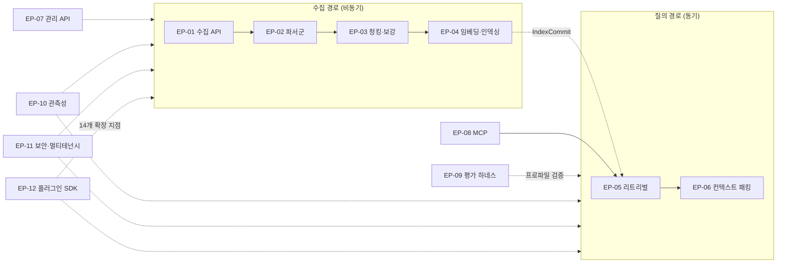
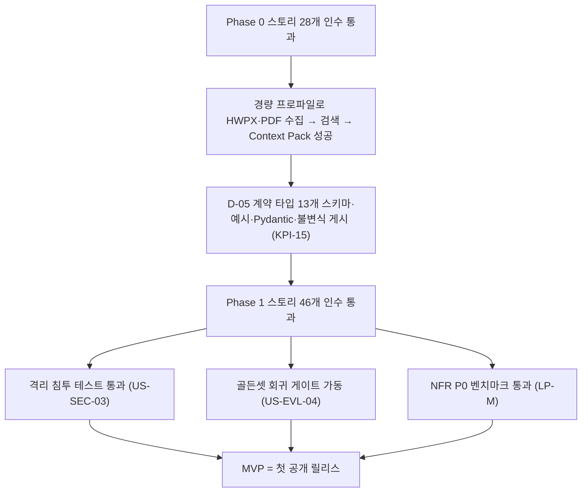

# 사용자 스토리와 인수 기준

> 기능 요구사항(FR)은 시스템이 **무엇을 해야 하는지**를 SHALL 문장으로 고정하고, 비기능 요구사항(NFR)은 **얼마나 잘**을 수치로 고정한다. 이 문서는 그 요구사항을 **누가, 왜 원하는가**의 관점으로 다시 묶고, 구현이 끝났는지 판정할 수 있는 **인수 기준(acceptance criteria)** 을 Gherkin 형식으로 붙인다. FR·NFR과 충돌하면 FR·NFR이 우선하고, 브리프와 충돌하면 [설계 브리프](../00-vision/00-design-brief.md)가 우선한다.

## 목적

- 12개 에픽 아래 사용자 스토리를 정의하여 백로그([에픽과 백로그](../11-roadmap/02-epics-and-backlog.md))의 원천을 제공한다.
- 각 스토리에 검증 가능한 인수 기준을 붙여 테스트 전략([테스트 전략](../10-development/04-testing-strategy.md))의 종단 간 시나리오 원천이 되게 한다.
- 스토리를 FR·NFR ID에 연결하여 요구사항 → 스토리 → 테스트의 추적성을 확보한다.
- MVP(첫 공개 릴리스) 포함 여부와 릴리스 단계(이 문서의 작업 가설 Phase 0~3, §1.1)를 스토리 단위로 표시한다. 단계 체계와 일정은 [마일스톤](../11-roadmap/01-milestones.md)이 소유한다.

## 범위

- **포함**: 브리프 §6 "포함" 범위의 기능 영역을 12개 에픽으로 묶은 사용자 스토리 91개와 인수 기준, FR/NFR 추적(FR → US 역추적 포함), 크기·우선순위·MVP 판정, 릴리스 단계 매핑. 브리프 §6의 "배포 매니페스트"와 "클라이언트 SDK"는 독립 에픽을 두지 않는다. 배포 매니페스트는 US-EMB-06·US-MGT-08(경량·표준 배포 프로파일 설치 관점)에서 다루고 형식·절차는 [배포 아키텍처](../02-architecture/08-deployment-architecture.md)와 [배포 가이드](../09-operations/01-deployment-guide.md)가 소유하며, 클라이언트 SDK는 EP-07(US-MGT-06)에 둔다.
- **제외**: 비범위 항목(크롤러, 답변 UI, 파인튜닝, 인증 서버, 문서 편집)의 스토리. 단, 브리프 §6 "훅은 제공"에 따라 훅 자체의 스토리는 포함한다. 레퍼런스 구현(`answer` 엔드포인트)은 US-MGT-07의 Could 부분으로만 다룬다.
- 페르소나의 상세 정의와 유즈케이스 흐름은 [페르소나와 유즈케이스](./03-personas-and-use-cases.md)에서 다룬다. 이 문서는 비전 §6의 요약 명칭 뒤에 그 문서가 정의한 페르소나 ID(PS-01~PS-07)를 병기한다. PS-08(최종 사용자, 간접)은 플랫폼을 직접 호출하지 않으므로 스토리를 두지 않는다.

## 1. 표기 규약

### 1.1 스토리 ID와 형식

`US-<에픽 코드>-<번호>`. 번호는 에픽 내 두 자리 일련번호이며 삭제된 번호는 재사용하지 않는다. 스토리 문장은 다음 형식을 따른다.

> `<페르소나>`로서 `<목표>`를 원한다, `<이유>` 때문에.

각 스토리는 다음 속성을 가진다.

| 속성 | 값 | 설명 |
|------|----|------|
| 관련 FR | `FR-<영역>-<번호>` | [기능 요구사항](./01-functional-requirements.md)의 ID. 스토리는 FR을 대체하지 않고 FR을 사용자 관점에서 묶는다 |
| 관련 NFR | `NFR-<카테고리>-<번호>` | [비기능 요구사항](./02-non-functional-requirements.md)의 ID. 인수 기준의 수치는 NFR 값을 그대로 인용한다 |
| 크기 | S / M / L | S: 1스프린트 내 1인, M: 1스프린트 1~2인, L: 2스프린트 이상 또는 다수 컴포넌트. 상대 추정이며 산정 근거는 백로그에서 갱신 |
| 우선순위 | Must / Should / Could | FR 문서의 MoSCoW를 따른다. NFR의 P0/P1/P2와는 Must≈P0, Should≈P1, Could≈P2로 대응 |
| MVP | 포함 / 제외 | "MVP"는 이 문서에서 **첫 공개 릴리스**(FR 문서의 M1)와 동의어다. 원칙: Must 스토리는 MVP 포함, Should는 Phase 판정에 따름, Could는 제외 |
| 단계 | Phase 0 / 1 / 2 / 3 | **미정:** 단계 구분은 [마일스톤](../11-roadmap/01-milestones.md)이 소유한다. [비전과 목표](../00-vision/01-vision-and-goals.md) §9는 단계의 수·이름을 정하지 않는다. 이 문서의 Phase 0~3은 백로그 정렬을 위한 **작업 가설(초안)** 이며 마일스톤 확정 시 갱신한다(US-I-02) |

### 1.2 인수 기준 형식

인수 기준은 Gherkin의 `Given / When / Then`을 한 줄로 쓴다. 스토리마다 2~4개. 인수 기준은 다음을 만족해야 한다.

- 계약 필드명·열거값·상태명은 계약 문서의 것을 그대로 쓴다. 계약 문서가 아직 확정하지 않은 이름(잡 상태 `queued`, `running`, `retry_wait`, `succeeded`, `failed`, `dead_lettered`; 오류 클래스 `transient_infra` 등)은 NFR §5.2·§5.4의 **제안 명칭**을 사용하며, [잡·이벤트·상태](../03-contracts/12-jobs-events-and-status.md)·[오류 모델](../03-contracts/13-error-model.md) 확정 시 일괄 갱신한다.
- 수치는 NFR의 값을 인용하고, 근거 없는 새 수치를 만들지 않는다. 설정값이 미정(O-xx)인 경우 "프로파일 설정값"으로 표현한다.
- 각 인수 기준은 FR 문서의 검증 방법 코드(T-CONTRACT, T-INT, T-E2E, T-GOLD, T-FIXTURE, T-LOAD, T-SEC 등) 중 하나 이상으로 자동화 가능해야 한다.

### 1.3 페르소나

명칭은 비전 §6의 요약 명칭을 쓰고, ID는 [페르소나와 유즈케이스](./03-personas-and-use-cases.md) §1이 정의한 `PS-xx`를 그대로 인용한다(그 문서의 "비전 §6 명칭" 열 기준). 스토리 문장에는 `명칭(PS-xx)로서` 형식으로 병기한다.

| ID | 페르소나(비전 §6 명칭) | 대표 역할 | 주로 접하는 표면 | 주 에픽 |
|----|------------------------|-----------|------------------|---------|
| PS-04 | AI 애플리케이션 개발자 | 백엔드·풀스택·에이전트 개발자 | 리트리벌 API, 클라이언트 SDK, Context Pack 렌더러 | EP-05, EP-06 |
| PS-02 | 문서 파이프라인 담당자 | 데이터 엔지니어, 콘텐츠 운영자 | 수집 API, 웹훅·이벤트, 프로파일 | EP-01, EP-02, EP-03 |
| PS-03 | 검색 품질 엔지니어 | ML·검색 엔지니어 | 평가 하네스, 프로파일 A/B, 점수 분해 | EP-04, EP-05, EP-09 |
| PS-01 | 플랫폼 운영자 | SRE, 플랫폼 엔지니어 | 배포 매니페스트, 관리 API, 관측성 | EP-07, EP-10 |
| PS-07 | 플러그인 개발자 | 오픈소스 기여자, 벤더 엔지니어 | 플러그인 SDK, 14개 확장 지점 | EP-12 |
| PS-06 | 보안·컴플라이언스 담당자 | 정보보호·감사 | 테넌트 격리, ACL, 감사 로그, PII | EP-11 |
| PS-05 | LLM 에이전트(기계 사용자) | Claude 등 LLM 기반 에이전트 | MCP 서버 도구 | EP-08 |

## 2. 에픽 맵

| 에픽 | 코드 | 이름 | 대응 FR 영역 | 브리프 근거 | 스토리 수 |
|------|------|------|--------------|-------------|-----------|
| EP-01 | ING | 수집 API | ING, API(웹훅) | R1, D-08 | 10 |
| EP-02 | PRS | 파서군 | PRS, NRM | R2, D-04, D-18 | 9 |
| EP-03 | CHK | 청킹·보강 | CHK, ENR | R2, D-19, O-05 | 8 |
| EP-04 | EMB | 임베딩·인덱싱 | EMB, IDX | D-15, D-16 | 7 |
| EP-05 | RET | 리트리벌 | QRY, RET, RNK | R3, D-07 | 9 |
| EP-06 | PCK | 컨텍스트 패킹 | PCK | R6, D-20 | 8 |
| EP-07 | MGT | 관리 API | MGT, API | 브리프 §6 "관리 API" 포함 범위, D-17 | 8 |
| EP-08 | MCP | MCP 서버 | MCP | D-13 | 5 |
| EP-09 | EVL | 평가 하네스 | EVL | D-12, 원칙 7 | 7 |
| EP-10 | OBS | 관측성 | OBS | D-11, 원칙 8 | 6 |
| EP-11 | SEC | 보안·멀티테넌시 | SEC | D-09, 원칙 9 | 8 |
| EP-12 | PLG | 플러그인 SDK | PLG | D-10, R4 | 6 |

## 3. EP-01 수집 API (ING)

플랫폼은 크롤러가 아니다(R1). 외부 시스템이 이미 확보한 문서의 URI와 메타데이터를 `IngestRequest`로 받아 비동기 잡으로 처리한다(D-08).

### US-ING-01 URI 기반 단건 수집 요청
- 스토리: 문서 파이프라인 담당자(PS-02)로서 문서 URI와 메타데이터만 넘겨 수집을 시작하기를 원한다, 원본 파일을 플랫폼에 직접 업로드하는 파이프라인을 따로 만들 필요가 없기 때문에.
- 관련: FR-ING-01, FR-ING-04, FR-ING-07, FR-ING-10, FR-API-01 / NFR-AVL-02, NFR-SEC-12 | 크기: M | 우선순위: Must | MVP: 포함 | 단계: Phase 0
- AC-1: Given 유효한 `IngestRequest`(URI, `tenant_id`, `collection_id`, metadata), When 수집 API에 POST하면, Then 202와 함께 `job_id`(ULID)와 상태 URL이 반환된다.
- AC-2: Given 스키마를 위반한 요청(필수 필드 누락), When POST하면, Then 4xx와 오류 모델 형식의 응답(기계 판독 코드, 위반 필드 경로)이 반환되고 잡은 생성되지 않는다.
- AC-3: Given 접수된 잡이 성공하면, When 검색으로 해당 문서를 조회하면, Then 요청 시 전달한 외부 메타데이터가 Context Pack의 출처 메타데이터에 그대로 보존된다.
- AC-4: Given 컬렉션 정책의 최대 파일 크기 또는 fetch 타임아웃을 초과하는 원본, When 페치하면, Then 잡은 `policy_violation`으로 종결되고 초과한 한도 항목이 오류에 명시되며 부분 산출물이 남지 않는다(FR-ING-10).

### US-ING-02 다중 URI 스킴에서 원본 가져오기
- 스토리: 문서 파이프라인 담당자(PS-02)로서 `s3://`, `gs://`, `az://`, `file://`, `http(s)://` 어디에 있는 문서든 같은 API로 수집하기를 원한다, 저장소마다 다른 수집 코드를 유지하고 싶지 않기 때문에.
- 관련: FR-ING-02, FR-ING-08 / NFR-SEC-09, NFR-PORT-05, NFR-PORT-07 | 크기: M | 우선순위: Must | MVP: 포함 | 단계: Phase 0
- AC-1: Given 1급 스킴 5종 각각의 URI, When 수집하면, Then 모두 `SourceDocument`가 생성되고 원본이 BLAKE3 해시 주소로 오브젝트 스토리지에 보관된다.
- AC-2: Given `file://` URI가 허용 루트 경로 목록 밖이거나 경로 탈출을 포함하면, When 수집하면, Then 잡은 `policy_violation`으로 실패하고 파일은 읽히지 않는다.
- AC-3: Given `https://` URI가 사설·링크로컬 IP로 해석되거나 리다이렉트 상한을 초과하면, When 페치하면, Then 요청은 차단되고 SSRF 차단 사유가 오류에 기록된다.
- AC-4: Given `smb://` URI이고 해당 fetcher 플러그인이 미설치이면, When 수집하면, Then `unsupported_format`류의 표준 오류로 거절되며 설치 가능한 확장 지점 이름이 힌트로 포함된다.

### US-ING-03 배치 수집 요청
- 스토리: 문서 파이프라인 담당자(PS-02)로서 수백~수천 건의 URI를 한 번의 요청으로 접수하기를 원한다, 대량 백필을 건별 호출로 하면 느리고 추적이 어렵기 때문에.
- 관련: FR-ING-03, FR-ING-10 / NFR-SCAL-07, NFR-REL-08 | 크기: M | 우선순위: Must | MVP: 포함 | 단계: Phase 1
- AC-1: Given URI 1,000건(NFR-SCAL-07 상한) 이하의 배치 요청, When POST하면, Then 배치 `job_id` 하나와 문서별 자식 잡 목록 조회 URL이 반환된다.
- AC-2: Given 상한을 초과하는 배치, When POST하면, Then 전체가 거절되고 상한값이 오류 응답에 포함된다(부분 접수 없음).
- AC-3: Given 배치 중 10%가 손상 파일이면, When 처리가 끝나면, Then 나머지 90%는 `succeeded`이고 손상 문서만 `failed`로 개별 보고된다.

### US-ING-04 잡 상태 조회와 이벤트 수신
- 스토리: 문서 파이프라인 담당자(PS-02)로서 잡의 진행 상태를 폴링하거나 웹훅으로 받기를 원한다, 어느 문서가 어느 단계에서 실패했는지 즉시 알아야 하기 때문에.
- 관련: FR-ING-14, FR-API-15 / NFR-PERF-16, NFR-OBS-05, NFR-USA-03 | 크기: M | 우선순위: Must | MVP: 포함 | 단계: Phase 0
- AC-1: Given 진행 중인 잡, When 상태 URL을 GET하면, Then 현재 상태(`queued`/`running`/`retry_wait`/`succeeded`/`failed`/`dead_lettered`), 현재 스테이지, 마지막 전이 시각(RFC 3339 UTC)이 반환되고 p95 지연은 50 ms 이내다.
- AC-2: Given 웹훅 구독이 등록된 테넌트(US-ING-10), When 잡 상태가 전이하면, Then `domain.entity.action` 명명의 이벤트가 1초 이내(p95)에 전달되고 페이로드는 이벤트 스키마를 통과하며 이벤트마다 고유 이벤트 ID(ULID)가 있다(FR-API-15).
- AC-3: Given 실패한 잡, When 상태를 조회하면, Then 오류 클래스, 실패 스테이지, 재시도 횟수, 해결 힌트가 오류 모델 형식으로 포함된다.

### US-ING-05 콘텐츠 해시 기반 멱등 수집
- 스토리: 문서 파이프라인 담당자(PS-02)로서 같은 문서를 다시 보내도 중복 인덱싱이 일어나지 않기를 원한다, 재실행·재시도가 잦은 배치 파이프라인에서 중복은 검색 품질을 망치기 때문에.
- 관련: FR-ING-05, FR-ING-06 / NFR-REL-02, NFR-REL-03, NFR-CST-07 | 크기: M | 우선순위: Must | MVP: 포함 | 단계: Phase 0
- AC-1: Given 동일 콘텐츠 해시의 원본이 동일 프로파일로 이미 처리되어 있으면, When 재수집하면, Then 파싱·정규화는 건너뛰고 산출물이 재사용되며 최종 `IndexCommit` 해시가 동일하다.
- AC-2: Given 동일한 클라이언트 멱등 키로 24시간(제안 윈도우) 내 재요청하면, When POST하면, Then 새 잡을 만들지 않고 기존 `job_id`를 반환한다.
- AC-3: Given 같은 URI지만 콘텐츠가 바뀐 원본, When 재수집하면, Then 새 문서 버전이 생성되고 이전 커밋은 원자적으로 교체된다.

### US-ING-06 문서 갱신과 버전 교체
- 스토리: 문서 파이프라인 담당자(PS-02)로서 문서가 개정되면 검색 결과가 구버전과 신버전을 동시에 노출하지 않기를 원한다, LLM이 상충하는 두 버전을 함께 인용하면 답이 틀리기 때문에.
- 관련: FR-ING-11, FR-IDX-05 / NFR-REL-07, NFR-PERF-12 | 크기: L | 우선순위: Must | MVP: 포함 | 단계: Phase 1
- AC-1: Given 활성 버전 v1이 있는 문서, When v2 수집이 완료되어 커밋되면, Then 검색은 커밋 전에는 v1만, 커밋 후에는 v2만 반환하며 두 버전이 섞인 응답은 없다.
- AC-2: Given 1만 청크 문서의 커밋 활성화, When 교체가 진행되면, Then 교체 시간은 NFR-PERF-12 목표 내이고 진행 중 검색 오류율은 증가하지 않는다.
- AC-3: Given v2 커밋 후 문제가 발견되면, When 관리 API로 롤백하면, Then v1 커밋이 다시 활성화되고 이벤트가 발행된다.

### US-ING-07 문서 삭제 요청
- 스토리: 문서 파이프라인 담당자(PS-02)로서 문서 삭제를 요청하면 검색에서 즉시 사라지기를 원한다, 삭제된 문서가 답변에 인용되는 것은 규정 위반이기 때문에.
- 관련: FR-ING-12 / NFR-PRV-03, NFR-PRV-09, NFR-PRV-10 | 크기: M | 우선순위: Must | MVP: 포함 | 단계: Phase 1
- AC-1: Given 인덱싱된 문서, When DELETE를 요청하면, Then 202와 `job_id`가 반환되고 메타 DB 툼스톤은 즉시, 벡터·렉시컬 인덱스 레코드는 60초(p95) 이내에 검색에서 관측 불가가 된다.
- AC-2: Given 이미 삭제된 문서, When 다시 DELETE하면, Then 오류 없이 완료 상태가 반환된다.
- AC-3: Given 삭제와 재수집이 겹치면, When 두 잡이 모두 끝나면, Then 최종 상태는 마지막 요청의 의도를 따르고 고아 인덱스 레코드는 0건이다.

### US-ING-08 잡 취소와 데드레터 재처리
- 스토리: 플랫폼 운영자(PS-01)로서 잘못 접수된 잡을 취소하고 최대 재시도를 넘긴 잡을 재처리하기를 원한다, 실패 잡이 큐에 쌓이거나 조용히 사라지면 운영이 불가능하기 때문에.
- 관련: FR-ING-15 / NFR-REL-04, NFR-REL-06, NFR-SEC-08 | 크기: M | 우선순위: Should | MVP: 포함 | 단계: Phase 1
- AC-1: Given `queued` 또는 `running` 잡, When 취소를 요청하면, Then 진행 중 활동은 안전 지점에서 중단되고 상태는 취소 종결 상태로 전이하며 부분 산출물은 정리된다(FR-ING-15; 콘텐츠 주소화 산출물 재사용 관점의 문구 재검토는 US-I-05).
- AC-2: Given `dead_lettered` 잡, When 관리 API로 재처리하면, Then 잡은 `queued`로 돌아가고 이전 성공 스테이지 산출물은 재사용된다.
- AC-3: Given 취소·재처리 작업, When 완료되면, Then 감사 로그에 주체·시각·대상 잡·결과가 기록된다.

### US-ING-09 수집 정책 오버라이드와 한도
- 스토리: 문서 파이프라인 담당자(PS-02)로서 요청 단위로 프로파일·우선순위·타임아웃을 지정하기를 원한다, 긴급 문서와 대량 백필을 같은 정책으로 처리할 수 없기 때문에.
- 관련: FR-ING-13 / NFR-SCAL-06, NFR-SEC-13, NFR-REL-10 | 크기: S | 우선순위: Should | MVP: 제외 | 단계: Phase 2
- AC-1: Given 컬렉션 기본 프로파일과 다른 프로파일 버전을 지정한 요청, When 처리되면, Then 지정 프로파일이 적용되고 `IndexCommit`에 그 프로파일 버전이 기록된다.
- AC-2: Given 테넌트 정책이 허용하지 않는 오버라이드(예: 허용 목록 밖 프로파일, OCR 강제 금지 컬렉션에서 OCR 강제), When POST하면, Then 검증 단계에서 4xx로 거부되고 거부된 필드 경로가 오류에 명시된다.
- AC-3: Given 테넌트의 동시 잡 할당량이 소진되었으면, When 새 요청을 보내면, Then 429와 `Retry-After`가 반환된다.

### US-ING-10 웹훅 구독 관리와 전달 보장
- 스토리: 문서 파이프라인 담당자(PS-02)로서 웹훅 엔드포인트를 테넌트 범위에서 등록·수정·해지하고 이벤트 타입·컬렉션으로 필터링하며, 전달 실패를 놓치지 않기를 원한다, 상태 전이를 폴링 없이 안정적으로 받아야 하기 때문에.
- 관련: FR-API-14, FR-API-15, FR-SEC-11 / NFR-OBS-05, NFR-SEC-01, NFR-REL-04 | 크기: M | 우선순위: Must | MVP: 포함 | 단계: Phase 1
- AC-1: Given `tenant_admin` 주체, When 이벤트 타입·컬렉션 필터가 있는 구독을 등록·조회·수정·해지하면, Then 각 작업이 반영되고 필터에 맞지 않는 이벤트는 전달되지 않는다.
- AC-2: Given 다른 테넌트의 컬렉션을 필터로 지정한 구독 요청, When 등록하면, Then 거부되고 어떤 경우에도 다른 테넌트의 이벤트가 전달되지 않는다(FR-SEC-03 격리).
- AC-3: Given 수신 엔드포인트가 5xx를 반환하면, When 재시도 정책(NFR §5.2)이 소진될 때까지 재전송하면, Then 모든 재전송의 이벤트 ID가 동일하고, 한도 초과 이벤트는 구독자가 조회할 수 있는 실패 목록에 남는다.

## 4. EP-02 파서군 (PRS, NRM)

모든 포맷은 어댑터를 거쳐 자체 소유 표준 모델 `ParsedDocument`로 변환되고(D-04), 정규화를 거쳐 `NormalizedDocument`가 된다. 포맷 등급은 [범위와 비범위](../00-vision/04-scope-and-non-goals.md) §6을 따른다.

### US-PRS-01 포맷 감지와 파서 라우팅
- 스토리: 문서 파이프라인 담당자(PS-02)로서 확장자가 틀리거나 없는 파일도 올바른 파서로 라우팅되기를 원한다, 실무 문서는 확장자와 실제 포맷이 자주 다르기 때문에.
- 관련: FR-PRS-01, FR-PRS-19 / NFR-SEC-10, NFR-REL-05 | 크기: M | 우선순위: Must | MVP: 포함 | 단계: Phase 0
- AC-1: Given 확장자가 `.pdf`이지만 실제로는 HWPX(zip 매직 바이트 + OWPML 매니페스트)인 파일, When 라우팅하면, Then HWPX 파서가 선택되고 판정 근거(매직·MIME·확장자)가 산출물 메타에 남는다.
- AC-2: Given 비지원 포맷(예: `.epub`), When 라우팅하면, Then `unsupported_format`으로 잡이 실패하고 `parser` 확장 지점 힌트가 포함된 이벤트가 발행된다.
- AC-3: Given 암호화된 PDF 또는 HWPX, When 파싱을 시도하면, Then 재시도 없이 `unsupported_format`(암호화)으로 종결되고 원본은 보관 상태를 유지한다.

### US-PRS-02 HWPX 1급 구조 파싱
- 스토리: 문서 파이프라인 담당자(PS-02)로서 HWPX 문서의 제목 계층·표·각주·그림 캡션이 그대로 검색 단위가 되기를 원한다, 한국 공공·기업 문서의 핵심 정보는 표와 각주에 있기 때문에.
- 관련: FR-PRS-02, FR-PRS-03, FR-PRS-14, FR-PRS-15 / NFR-PERF-10, NFR-MNT-07 | 크기: L | 우선순위: Must | MVP: 포함 | 단계: Phase 0
- AC-1: Given 골든 구조 코퍼스의 HWPX 문서, When 파싱하면, Then heading·paragraph·list_item·table·figure·caption·footnote 블록이 생성되고 구조 보존율은 비전 KPI-08 Y1 목표(≥ 0.95) 이상이다.
- AC-2: Given 병합 셀(rowspan/colspan)이 있는 표, When 파싱하면, Then 병합 정보가 `ParsedDocument` 표 블록에 보존되고 셀 텍스트 유실이 없다.
- AC-3: Given 모든 블록, When 검사하면, Then element path와 char offset이 채워져 있고(provenance 100%), 페이지 정보는 가능한 경우 채워진다.
- AC-4: Given 표 20개를 포함한 HWPX 100페이지, When 수집하면, Then end-to-end 처리 시간은 NFR-PERF-10 목표(< 30 s, 초안) 이내다.

### US-PRS-03 HWP 5.0 바이너리 파싱과 변환기 폴백
- 스토리: 문서 파이프라인 담당자(PS-02)로서 구형 HWP 5.0 바이너리 문서도 HWPX와 같은 1급 포맷으로 수집하기를 원한다, 보관 문서의 상당수가 아직 HWP이기 때문에(브리프 R1, [범위와 비범위](../00-vision/04-scope-and-non-goals.md) §6 1급).
- 관련: FR-PRS-04, FR-PRS-17, FR-PRS-21, FR-PRS-22, FR-NRM-09 / NFR-CMP-03, NFR-MNT-07, NFR-SEC-10 | 크기: L | 우선순위: Must(기본 파싱) / Should(고급 개체·변환기 격리) | MVP: 포함 | 단계: Phase 1
- AC-1: Given HWP 5.0 문서, When 수집하면, Then 1차 파서(D-18 v1.1: Apache-2.0 Java 사이드카 → HWPX → OWPML 어댑터; pyhwp는 AGPL 선택 플러그인)가 본문 텍스트·단락 구조·표·이미지를 추출하여 `ParsedDocument`를 생성하고 사용된 파서가 기록된다(FR-PRS-04, FR-PRS-17).
- AC-2: Given 1차 파서가 실패하거나 출력의 품질 점수(FR-NRM-09 지표)가 프로파일 임계 미만이면, When 파싱하면, Then 변환기 폴백(D-18: LibreOffice(H2Orestart) → HWPX → HWPX 어댑터)이 시도되고 시도 이력·폴백 여부·품질 점수가 산출물 메타에 기록된다(FR-PRS-17, FR-PRS-22).
- AC-3: Given 1차 파서·변환기 사이드카가 배포되지 않은 환경, When HWP 5.0을 수집하면, Then 라우터가 `unsupported_format`(비활성 포맷) 표준 오류로 거절하고 재시도하지 않는다(FR-PRS-22, 범위 문서 §6.4).
- AC-4: Given AGPL 계열 파서·변환기 이미지, When 배포 매니페스트와 코어 이미지를 검사하면, Then 코어 이미지에 해당 라이브러리가 없고 사이드카는 네트워크로 분리되어 있다(NFR-CMP-03, D-02).

### US-PRS-04 텍스트 PDF 레이아웃·표 인식 파싱
- 스토리: 문서 파이프라인 담당자(PS-02)로서 다단 레이아웃과 표가 있는 PDF의 읽기 순서와 표 구조가 보존되기를 원한다, 읽기 순서가 뒤섞인 텍스트는 청킹 품질을 무너뜨리기 때문에.
- 관련: FR-PRS-05, FR-PRS-06, FR-PRS-14, FR-PRS-15 / NFR-PERF-08, NFR-MNT-06 | 크기: L | 우선순위: Must | MVP: 포함 | 단계: Phase 0
- AC-1: Given 2단 레이아웃 텍스트 PDF, When 파싱하면, Then 단락의 읽기 순서가 골든 코퍼스와 일치하고 구조 보존율은 KPI-08 Y1 목표(텍스트 PDF ≥ 0.90) 이상이다.
- AC-2: Given 격자선이 없는 표, When 파싱하면, Then 행·열 구조가 table 블록으로 복원되고 각 셀에 page·bbox provenance가 있다.
- AC-3: Given 텍스트 PDF 100페이지, When 유휴 워커에서 수집하면, Then end-to-end 처리 시간은 NFR-PERF-08 목표(< 30 s) 이내다.
- AC-4: Given 파서 어댑터 모듈, When 정적 분석하면, Then 벤더 문서 모델 타입이 코어 계약 모듈에 임포트되지 않는다.

### US-PRS-05 스캔 PDF 판별과 OCR
- 스토리: 문서 파이프라인 담당자(PS-02)로서 스캔 PDF가 자동 판별되어 OCR되고 OCR 텍스트에도 위치 정보가 붙기를 원한다, 스캔 공문서에서도 원문 위치를 인용해야 하기 때문에.
- 관련: FR-PRS-07, FR-PRS-08 / NFR-PERF-09, NFR-PORT-03, NFR-REL-09 | 크기: L | 우선순위: Must | MVP: 포함 | 단계: Phase 1
- AC-1: Given 텍스트 레이어가 없는 페이지와 있는 페이지가 섞인 PDF, When 파싱하면, Then 페이지 단위로 스캔 여부가 판별되고 스캔 페이지만 OCR된다.
- AC-2: Given OCR된 블록, When 검사하면, Then page·bbox provenance와 OCR 신뢰도 점수가 기록된다.
- AC-3: Given 스캔 PDF 100페이지와 GPU OCR, When 수집하면, Then 처리 시간은 NFR-PERF-09 목표(< 5 min) 이내이고 30초 간격 하트비트가 기록된다.
- AC-4: Given GPU가 없는 환경, When 수집하면, Then 기능적으로 완료되며(성능 목표는 미보장) 실패하지 않는다.

### US-PRS-06 DOCX·DOC 파싱
- 스토리: 문서 파이프라인 담당자(PS-02)로서 DOCX와 레거시 DOC를 같은 구조 충실도로 수집하기를 원한다, 사내 문서의 대다수가 Word 계열이기 때문에.
- 관련: FR-PRS-09, FR-PRS-10, FR-PRS-22 / NFR-CMP-03, NFR-MNT-07 | 크기: M | 우선순위: Must(DOCX·DOC 모두 FR Must) | MVP: 포함 | 단계: Phase 0(DOCX), Phase 1(DOC, 변환 사이드카 필요)
- AC-1: Given 제목 스타일·표·이미지 캡션이 있는 DOCX, When 파싱하면, Then heading 계층, table, figure+caption 블록이 생성되고 구조 보존율이 1급 기준을 만족한다.
- AC-2: Given `.doc` 파일과 실행 중인 변환 사이드카, When 파싱하면, Then DOCX로 변환 후 DOCX 파서로 처리되고 결과에 2급(변환) 표시가 남는다. 사이드카 미배포 환경에서는 `unsupported_format`(비활성 포맷)으로 거절된다(FR-PRS-22).
- AC-3: Given 변경 추적·주석이 포함된 DOCX, When 파싱하면, Then 파서 문서에 정의된 정책(수락/거절/제외)이 적용되고 적용된 정책이 메타에 기록된다.

### US-PRS-07 HTML 본문 추출과 메타 수확
- 스토리: 문서 파이프라인 담당자(PS-02)로서 HTML 페이지에서 내비게이션·광고를 제거한 본문과 제목·발행일 메타를 얻기를 원한다, 보일러플레이트가 청크에 섞이면 검색 노이즈가 되기 때문에.
- 관련: FR-PRS-11, FR-PRS-12, FR-NRM-03 / NFR-MNT-07 | 크기: M | 우선순위: Must | MVP: 포함 | 단계: Phase 0
- AC-1: Given 내비게이션·푸터·광고가 있는 정적 HTML, When 파싱하면, Then 본문 블록만 남고 제거된 영역의 비율이 산출물 메타에 기록된다.
- AC-2: Given `<title>`, Open Graph, `<meta name="author">`가 있는 페이지, When 파싱하면, Then 문서 메타에 제목·저자·발행일이 채워진다.
- AC-3: Given 본문 추출이 실패한(본문 길이 임계 미만) 페이지, When 파싱하면, Then 전체 DOM 구조 폴백이 적용되고 경고가 기록된다.

### US-PRS-08 TXT·Markdown 파싱과 한국어 인코딩 감지
- 스토리: 문서 파이프라인 담당자(PS-02)로서 EUC-KR·CP949로 저장된 레거시 텍스트도 깨지지 않고 수집되기를 원한다, 오래된 한국어 텍스트 자산은 UTF-8이 아니기 때문에.
- 관련: FR-PRS-13, FR-NRM-01 / NFR-USA-07 | 크기: S | 우선순위: Must | MVP: 포함 | 단계: Phase 0
- AC-1: Given CP949로 인코딩된 `.txt`, When 파싱하면, Then 인코딩이 감지되어 NFC 정규화된 UTF-8 텍스트가 생성되고 감지된 인코딩이 메타에 기록된다.
- AC-2: Given frontmatter·헤딩·표·코드 블록이 있는 Markdown, When 파싱하면, Then heading 계층·table·code 블록과 frontmatter 메타가 `ParsedDocument`에 반영된다.
- AC-3: Given 구조 힌트가 없는 긴 평문, When 파싱하면, Then 빈 줄 기준 단락 블록이 생성되고 char offset provenance가 채워진다.

### US-PRS-09 정규화와 부분 파싱 허용
- 스토리: 문서 파이프라인 담당자(PS-02)로서 머리글·바닥글·페이지 번호가 제거되고 언어가 태깅된 정규화 문서를 얻기를 원한다, 반복 텍스트는 임베딩을 오염시키고 언어 태그는 분석기 선택에 필요하기 때문에.
- 관련: FR-NRM-01, FR-NRM-02, FR-NRM-04, FR-NRM-05, FR-NRM-08, FR-PRS-18 / NFR-USA-07 | 크기: M | 우선순위: Must | MVP: 포함 | 단계: Phase 0
- AC-1: Given 모든 페이지에 반복되는 머리글·바닥글이 있는 PDF, When 정규화하면, Then 반복 블록은 제거되고 제거 규칙이 산출물 메타에 기록된다.
- AC-2: Given 한영 혼용 문서, When 정규화하면, Then 문서와 블록 단위 BCP 47 언어 태그가 부여된다.
- AC-3: Given 표 블록, When 정규화하면, Then 색인용 셀 선형화 텍스트와 표시용 Markdown 표가 함께 생성된다.
- AC-4: Given 일부 페이지 파싱이 실패한 문서, When 정규화하면, Then 성공한 부분으로 `NormalizedDocument`가 생성되고 실패 범위가 `warnings`에 기록되어 잡은 부분 성공으로 종결된다.

## 5. EP-03 청킹·보강 (CHK, ENR)

기본 청킹은 구조 인식 계층 청킹 + 토큰 예산 병합 + 부모-자식 + 표 전용 청킹 + 문맥 보강이다(D-19). 청크 크기·오버랩 기본값은 미정(O-09)이므로 인수 기준은 "프로파일 설정값"으로 표현한다.

### US-CHK-01 구조 인식 계층 청킹
- 스토리: 검색 품질 엔지니어(PS-03)로서 청크가 문서의 섹션 경계를 존중하고 제목 경로를 알기를 원한다, 섹션을 가로지르는 청크는 의미가 섞여 임베딩 품질이 떨어지기 때문에.
- 관련: FR-CHK-01, FR-CHK-02, FR-CHK-04, FR-CHK-10, FR-CHK-11 / NFR-REL-02 | 크기: L | 우선순위: Must | MVP: 포함 | 단계: Phase 0
- AC-1: Given heading 계층이 있는 `NormalizedDocument`, When 청킹하면, Then 어떤 청크도 두 개 이상의 최하위 섹션을 가로지르지 않으며 각 청크에 heading 경로가 부착된다.
- AC-2: Given 프로파일의 자식 청크 최대 토큰 설정값, When 청킹하면, Then 표 청크를 제외한 모든 청크의 토큰 수가 설정값 이하이고 토큰 카운트는 프로파일의 임베딩 모델 토크나이저로 계산된다.
- AC-3: Given 동일 입력과 동일 프로파일 버전, When 두 번 청킹하면, Then 두 `ChunkSet`의 청크 텍스트·경계·출처 범위와 결정적 콘텐츠 키(FR-CHK-10, BLAKE3) 집합이 동일하다. 청크 ID는 D-06에 따라 ULID이므로 비교 대상에서 제외한다.

### US-CHK-02 부모-자식(small-to-big) 청크
- 스토리: 검색 품질 엔지니어(PS-03)로서 작은 청크로 정확히 검색하되 LLM에는 넓은 부모 문맥을 주기를 원한다, 작은 청크는 정밀도를, 큰 문맥은 답변 완결성을 주기 때문에.
- 관련: FR-CHK-03, FR-CHK-06, FR-IDX-10 / NFR-PERF-14 | 크기: M | 우선순위: Must | MVP: 포함 | 단계: Phase 0
- AC-1: Given 청킹 결과, When 자식 청크를 검사하면, Then 모든 자식에 `parent_chunk_id`가 있고 부모의 출처 범위가 자식의 출처 범위를 포함한다.
- AC-2: Given 부모 청크, When 저장하면, Then 부모 텍스트는 부모·문서 저장소에서 ID로 조회 가능하다.
- AC-3: Given 자식 청크가 검색되면, When 후처리에서 부모 확장을 적용하면, Then 부모 텍스트가 토큰 예산 내에서 대체·병합되고 원래 자식의 provenance가 유지된다.

### US-CHK-03 표 전용 청킹
- 스토리: 검색 품질 엔지니어(PS-03)로서 큰 표가 헤더를 잃지 않고 행 그룹으로 나뉘기를 원한다, 헤더 없는 표 조각은 LLM이 해석할 수 없기 때문에.
- 관련: FR-CHK-05, FR-NRM-05, FR-PCK-08 / NFR-REL-02 | 크기: M | 우선순위: Must | MVP: 포함 | 단계: Phase 0
- AC-1: Given 토큰 예산을 초과하는 표, When 청킹하면, Then 각 표 청크는 헤더 행을 반복 포함하고 청크 타입이 `table`로 분류된다.
- AC-2: Given 표 청크, When 검사하면, Then 색인용 선형화 텍스트와 표시용 Markdown 표가 모두 있고 캡션·표 번호가 접두어로 붙는다.
- AC-3: Given 병합 셀이 있는 표, When 행 그룹으로 나누면, Then 병합 셀 값이 해당 행 그룹 모두에 전파되어 정보 손실이 없다.

### US-CHK-04 오버랩과 미세 청크 제어
- 스토리: 검색 품질 엔지니어(PS-03)로서 오버랩 비율과 최소 청크 크기를 프로파일로 조정하기를 원한다, 코퍼스 유형마다 최적값이 다르기 때문에.
- 관련: FR-CHK-07, FR-CHK-12 / NFR-MNT-10 | 크기: S | 우선순위: Must | MVP: 포함 | 단계: Phase 0
- AC-1: Given 오버랩 설정값 N 토큰, When 평문 문서를 청킹하면, Then 인접 청크 간 공유 토큰 수가 N ± (문장 경계 보정 허용 토큰, 프로파일 설정값) 범위 안에 있고 오버랩 영역은 출처 범위에 중첩으로 표시된다.
- AC-2: Given 최소 청크 토큰 설정값 미만의 청크, When 청킹하면, Then 인접 청크에 병합되며 병합 불가(섹션 경계)인 경우만 단독 유지되고 경고가 기록된다.
- AC-3: Given 잘못된 설정(오버랩이 최대 크기 이상), When 프로파일을 로드하면, Then 시작 시 필드 경로를 포함한 검증 오류로 실패한다.

### US-CHK-05 결정적 문맥 접두어 부착
- 스토리: 검색 품질 엔지니어(PS-03)로서 각 청크 앞에 문서 제목·섹션 경로·캡션이 붙기를 원한다, 문맥 없는 청크는 검색과 LLM 해석 모두에서 불리하기 때문에.
- 관련: FR-ENR-01, FR-ENR-06, FR-ENR-07 / NFR-REL-02, NFR-CST-02 | 크기: S | 우선순위: Must | MVP: 포함 | 단계: Phase 0
- AC-1: Given 청크, When 보강하면, Then 결정적 접두어(문서 제목 + heading 경로 + 캡션)가 `EnrichedChunkSet`에 별도 필드로 기록되고 원문 텍스트는 변경되지 않는다.
- AC-2: Given 접두어가 부착된 청크, When 임베딩하면, Then 접두어 포함 텍스트가 임베딩 입력이 되고 표시용 텍스트는 원문을 유지한다.
- AC-3: Given 보강 결과, When 검사하면, Then 각 보강 항목에 생성 방식(`deterministic` 또는 모델 식별자)과 생성 시각이 기록된다.
- AC-4: Given 선택 보강 항목 하나가 실패하면, When 보강하면, Then 해당 필드만 비운 채 파이프라인이 계속되고 잡 경고가 기록되며, 프로파일이 필수로 지정한 보강 항목의 실패는 잡을 실패시킨다(FR-ENR-07).

### US-CHK-06 LLM 기반 문맥 요약·가상 질문(옵션)
- 스토리: 검색 품질 엔지니어(PS-03)로서 고가치 컬렉션에서 LLM 생성 문맥 요약과 가상 질문을 켤 수 있기를 원한다, 특정 코퍼스에서는 비용을 감수할 만큼 recall이 오르기 때문에.
- 관련: FR-ENR-01, FR-ENR-03, FR-ENR-07, FR-ENR-09, FR-EMB-10 / NFR-CST-02, NFR-PRV-06 | 크기: M | 우선순위: Could | MVP: 제외 | 단계: Phase 2
- AC-1: Given LLM 보강이 켜진 컬렉션, When 보강하면, Then 청크별 요약과 가상 질문이 생성되고 사용 모델·토큰 수가 기록된다.
- AC-2: Given 컬렉션 일일 토큰 예산 소진, When 보강하면, Then LLM 보강은 건너뛰고 결정적 접두어만 적용되며 경고 메트릭이 증가한다.
- AC-3: Given 외부 LLM API 사용이 테넌트 정책에서 허용되지 않으면, When 보강하면, Then 외부 호출은 발생하지 않고 잡은 실패하지 않는다.
- AC-4: Given LLM 호출이 실패하면, When 보강하면, Then 실패는 해당 청크에 격리되어 문서 전체 잡은 계속 진행된다.

### US-CHK-07 키워드·언어·도메인 태깅
- 스토리: 검색 품질 엔지니어(PS-03)로서 청크에 키워드와 언어 태그가 붙기를 원한다, 렉시컬 검색 부스팅과 컬렉션별 분석기 선택에 필요하기 때문에.
- 관련: FR-ENR-02, FR-ENR-05, FR-NRM-04 / NFR-USA-13 | 크기: S | 우선순위: Should | MVP: 포함 | 단계: Phase 1
- AC-1: Given 한국어 청크, When 보강하면, Then 형태소 기반 키워드 목록과 `lang: ko` 태그가 기록된다.
- AC-2: Given 한영 혼용 청크, When 보강하면, Then 주 언어와 보조 언어가 모두 태깅된다.
- AC-3: Given 키워드 보강, When 인덱싱하면, Then 키워드가 렉시컬 인덱스의 별도 필드로 저장되어 필터·부스팅에 사용 가능하다.

### US-CHK-08 대안 청킹 전략 옵션
- 스토리: 검색 품질 엔지니어(PS-03)로서 의미 분할·late chunking·proposition 청킹을 프로파일로 선택해 비교하기를 원한다, 코퍼스에 따라 구조 청킹이 최적이 아닐 수 있기 때문에.
- 관련: FR-CHK-08, FR-CHK-09 / NFR-MNT-05, NFR-MNT-11 | 크기: M | 우선순위: Could | MVP: 제외 | 단계: Phase 2
- AC-1: Given 의미 분할 청커를 지정한 프로파일, When 청킹하면, Then 동일 `ChunkSet` 계약을 만족하는 출력이 생성되고 청커 식별자·버전이 기록된다.
- AC-2: Given 두 프로파일(구조 청킹 vs 의미 분할), When 평가 하네스로 비교하면, Then 동일 골든셋에서 nDCG@10·Recall@20 차이가 리포트된다.
- AC-3: Given 청커만 변경한 프로파일, When 재인덱싱하면, Then 파싱·정규화는 재실행되지 않고 청킹 이후만 재실행된다.

## 6. EP-04 임베딩·인덱싱 (EMB, IDX)

기본 임베딩은 BGE-M3(dense + sparse), 기본 인덱스는 Qdrant(벡터) + OpenSearch Nori(렉시컬)이며 모두 어댑터 뒤에 있다(D-15, D-16). 경량 프로파일은 Qdrant 단독이다.

### US-EMB-01 dense·sparse 동시 임베딩
- 스토리: 검색 품질 엔지니어(PS-03)로서 한 번의 임베딩 호출로 dense와 learned sparse 벡터를 얻기를 원한다, 3-way 하이브리드의 두 축을 비용 두 배 없이 채우기 위해.
- 관련: FR-EMB-01, FR-EMB-02, FR-EMB-04, FR-EMB-05, FR-EMB-07 / NFR-PERF-11, NFR-REL-14 | 크기: M | 우선순위: Must | MVP: 포함 | 단계: Phase 0
- AC-1: Given `EnrichedChunkSet`, When 임베딩하면, Then 각 청크에 dense 벡터(프로파일 차원)와 sparse 벡터(토큰 ID→가중치)가 생성된다.
- AC-2: Given `EmbeddedChunkSet`, When 검사하면, Then 모든 벡터에 FR-EMB-05가 정의한 모델 식별자(모델 이름·버전·차원·정규화·입력 접두어 설정을 하나로 식별)가 기록된다. 서빙 이미지 digest·어댑터 버전의 추가 기록은 계약 제안으로 남긴다(US-I-12).
- AC-3: Given GPU 서빙, When 512토큰 청크를 배치 임베딩하면, Then 처리량이 NFR-PERF-11 목표 이상이다.
- AC-4: Given 배치 중 하나가 서빙 오류로 실패하면, When 임베딩하면, Then 실패한 배치만 재시도되고 성공한 배치는 재계산되지 않는다(FR-EMB-07).

### US-EMB-02 임베딩 모델·서빙 교체
- 스토리: 검색 품질 엔지니어(PS-03)로서 설정만 바꿔 임베딩 모델(예: 한국어 특화 모델)이나 서빙 엔진을 교체하기를 원한다, 모델 발전 속도가 빨라 코드 변경 없이 갈아탈 수 있어야 하기 때문에.
- 관련: FR-EMB-04, FR-EMB-06, FR-EMB-08 / NFR-PORT-03, NFR-CMP-04 | 크기: M | 우선순위: Must | MVP: 포함 | 단계: Phase 1
- AC-1: Given 프로파일의 모델 설정을 다른 지원 모델로 변경, When 워커를 재시작하면, Then 코드 변경 없이 새 모델로 임베딩되고 새 모델 식별자(FR-EMB-05)가 부여된다.
- AC-2: Given 질의·문서 비대칭 모델, When 질의를 임베딩하면, Then 모델 카드가 요구하는 질의 접두어(instruction)가 자동 적용된다.
- AC-3: Given 모델 최대 입력을 초과하는 청크, When 임베딩하면, Then 프로파일 정책(절단 또는 분할 후 풀링)이 적용되고 적용 사실이 기록된다.
- AC-4: Given 기본 프로파일, When 모델 라이선스를 검사하면, Then 상업적 사용을 허용하는 라이선스만 포함된다.

### US-EMB-03 임베딩 캐시와 재처리 회피
- 스토리: 플랫폼 운영자(PS-01)로서 같은 텍스트를 같은 모델로 두 번 임베딩하지 않기를 원한다, GPU 비용이 수집 비용의 큰 부분이기 때문에.
- 관련: FR-EMB-09, FR-ENR-09 / NFR-CST-06, NFR-CST-07, NFR-CST-03 | 크기: S | 우선순위: Should | MVP: 포함 | 단계: Phase 1
- AC-1: Given (텍스트 해시, 모델 식별자) 키가 동일한 청크(FR-EMB-09), When 재임베딩하면, Then 서빙 호출 없이 콘텐츠 주소화 산출물이 재사용된다.
- AC-2: Given 캐시 히트율 메트릭, When 동일 문서를 동일 프로파일로 재수집하면, Then 임베딩 캐시 히트율이 100%이고 임베딩 서빙 호출 수가 0이다(NFR-CST-06).
- AC-3: Given 산출물 저장소, When 총량을 측정하면, Then 동일 산출물 중복 저장이 없고 총량은 원본의 3배 이하다.

### US-EMB-04 하이브리드 레코드 인덱싱과 테넌시 필드 강제
- 스토리: 플랫폼 운영자(PS-01)로서 모든 인덱스 레코드에 dense·sparse·렉시컬 표현과 `tenant_id`·`collection_id`·`acl`이 빠짐없이 저장되기를 원한다, 필드가 하나라도 빠진 레코드는 격리를 깨기 때문에.
- 관련: FR-IDX-02, FR-IDX-03, FR-IDX-04, FR-IDX-09 / NFR-SEC-01, NFR-SEC-02 | 크기: L | 우선순위: Must | MVP: 포함 | 단계: Phase 1
- AC-1: Given `EmbeddedChunkSet`, When 인덱싱하면, Then 벡터 인덱스에는 named vectors(dense, sparse)와 페이로드가, 렉시컬 인덱스에는 Nori 분석 텍스트 필드가 기록된다.
- AC-2: Given `tenant_id`, `collection_id`, `acl` 중 하나가 누락된 레코드, When 인덱싱하면, Then 어댑터가 거절하고 커밋은 실패한다.
- AC-3: Given 조사가 결합된 한국어 텍스트, When 렉시컬 인덱스를 분석하면, Then 조사가 분리된 형태소 토큰이 색인된다.
- AC-4: Given 자주 필터되는 페이로드 필드(문서 ID, 언어, 사용자 메타 키), When 컬렉션을 만들면, Then 해당 필드에 페이로드 인덱스가 생성된다.

### US-EMB-05 원자적 인덱스 커밋과 롤백
- 스토리: 플랫폼 운영자(PS-01)로서 문서 버전의 인덱싱이 전부 성공하거나 전부 보이지 않기를 원한다, 반쯤 인덱싱된 문서는 잘못된 검색 결과를 만들기 때문에.
- 관련: FR-IDX-05, FR-IDX-06, FR-IDX-07 / NFR-REL-07, NFR-REL-12, NFR-REL-14 | 크기: L | 우선순위: Must | MVP: 포함 | 단계: Phase 1
- AC-1: Given 두 백엔드(벡터·렉시컬)에 걸친 커밋, When 한 백엔드 쓰기가 실패하면, Then 커밋은 활성화되지 않고 검색은 이전 커밋만 본다.
- AC-2: Given 커밋 레코드, When 검사하면, Then 프로파일 버전, 모델 식별자(FR-EMB-05), 플러그인 버전, 산출물 해시가 기록되어 있다(NFR-REL-14).
- AC-3: Given 인덱스 전체 손실, When 산출물(`EmbeddedChunkSet` 이하)에서 재구축하면, Then 원 커밋과 동일한 커밋 해시가 재현된다.

### US-EMB-06 경량 단일 백엔드 프로파일
- 스토리: AI 애플리케이션 개발자(PS-04)로서 컨테이너 하나(Qdrant 단독)로 하이브리드 검색을 로컬에서 돌리기를 원한다, 첫 검색까지 15분 안에 끝내고 싶기 때문에.
- 관련: FR-IDX-08, FR-IDX-01 / NFR-USA-01, NFR-PORT-02, NFR-PERF-02 | 크기: M | 우선순위: Must | MVP: 포함 | 단계: Phase 0
- AC-1: Given Docker Compose 경량 프로파일, When 퀵스타트 문서만 보고 설치·수집·검색을 수행하면, Then 신규 개발자 관찰 중앙값이 NFR-USA-01 목표 내다.
- AC-2: Given 경량 프로파일, When 한국어 질의를 보내면, Then D-15 경량 프로파일이 정의한 dense + sparse(BM25 포함) 조합의 결과가 융합되어 반환되고 `CandidateSet`에 리트리버별 점수가 남는다(FR-IDX-08). BM25 sparse의 토크나이저 위치는 13-indexing 문서 결정 사항이다(US-I-13).
- AC-3: Given 경량 프로파일과 표준 프로파일, When 동일 통합 테스트를 실행하면, Then 두 프로파일 모두 통과한다.

### US-EMB-07 인덱스 백엔드 교체와 스키마 마이그레이션
- 스토리: 플랫폼 운영자(PS-01)로서 이미 운영 중인 다른 벡터 DB나 검색 엔진으로 백엔드를 교체하기를 원한다, 벤더 종속과 이중 운영 비용을 피하기 위해.
- 관련: FR-IDX-01, FR-IDX-12 / NFR-PORT-06, NFR-SCAL-05, NFR-AVL-07 | 크기: L | 우선순위: Should | MVP: 제외 | 단계: Phase 2
- AC-1: Given 계약 준수 테스트 스위트를 통과한 `index_backend` 플러그인, When 설정에서 백엔드를 교체하면, Then 코어 코드 변경 없이 수집·검색 통합 테스트가 통과한다.
- AC-2: Given 인덱스 스키마 변경(필드 추가), When 마이그레이션을 실행하면, Then 기존 커밋으로 검색이 지속되고 새 인덱스로 별칭이 전환된다.
- AC-3: Given 샤드·레플리카 설정, When 컬렉션을 생성하면, Then 설정값이 백엔드에 반영되고 관리 API로 조회된다.

## 7. EP-05 리트리벌 (QRY, RET, RNK)

기본 파이프라인은 3-way 하이브리드 → 융합(RRF 기본, O-01) → 크로스인코더 리랭킹 → 후처리다(D-07). 모든 질의는 `tenant_id`·`collection_id`·`acl` 필터를 서버 측에서 강제한다(D-09).

### US-RET-01 하이브리드 검색 한 번 호출
- 스토리: AI 애플리케이션 개발자(PS-04)로서 질의 하나를 보내면 dense·sparse·렉시컬이 병렬 실행되고 융합된 결과를 받기를 원한다, 세 검색을 직접 조합하는 코드를 쓰고 싶지 않기 때문에.
- 관련: FR-RET-01, FR-RET-02, FR-RET-03, FR-RET-04, FR-RET-05, FR-QRY-01, FR-API-02 / NFR-PERF-05, NFR-PERF-06 | 크기: L | 우선순위: Must | MVP: 포함 | 단계: Phase 0
- AC-1: Given `QueryRequest`, When 검색하면, Then `QueryPlan`이 생성되고 세 리트리버가 병렬로 실행되어 `CandidateSet`에 리트리버별 후보와 점수가 모두 남는다.
- AC-2: Given 리랭커를 끈 프로파일, When Top-50을 요청하면, Then 융합 결과가 반환되고 LP-M 기준 p95 지연은 NFR-PERF-05 목표(< 250 ms, 초안) 이내다.
- AC-3: Given 융합 설정이 RRF, When 융합하면, Then 각 후보에 리트리버별 순위와 RRF 기여값이 기록된다.

### US-RET-02 크로스인코더 리랭킹과 폴백
- 스토리: 검색 품질 엔지니어(PS-03)로서 융합 후보를 크로스인코더로 재정렬하고, 리랭커가 죽어도 검색이 죽지 않기를 원한다, 리랭킹은 nDCG를 크게 올리지만 단일 장애점이 되어서는 안 되기 때문에.
- 관련: FR-RNK-01, FR-RNK-02, FR-RNK-03, FR-RNK-06, FR-RNK-08 / NFR-PERF-01, NFR-PERF-02, NFR-REL-13 | 크기: L | 우선순위: Must | MVP: 포함 | 단계: Phase 1
- AC-1: Given 융합 후보 50개, When 리랭킹하면, Then Top-10 `RankedSet`이 반환되고 각 항목에 리랭크 점수와 융합 점수가 분해되어 있다.
- AC-2: Given 리랭킹 입력 구성, When 검사하면, Then 청크 텍스트에 heading 경로 접두어가 포함되어 리랭커에 전달된다.
- AC-3: Given 리랭커 서빙 중단, When 검색하면, Then 융합 결과로 응답하고 응답에 부분 저하 표시가 포함되며 p95는 NFR §3.4 S6 기준을 만족한다.
- AC-4: Given LP-M·GPU 리랭커, When Top-10 하이브리드+리랭크를 측정하면, Then p95 < 800 ms, CPU 리랭커는 p95 < 1.5 s다.

### US-RET-03 필수 필터 강제와 메타데이터 필터 결합
- 스토리: AI 애플리케이션 개발자(PS-04)로서 문서 메타데이터(부서, 연도, 문서 유형)로 검색 범위를 좁히되 테넌트·ACL 필터는 내가 실수해도 항상 적용되기를 원한다, 권한 누출은 한 번도 허용되지 않기 때문에.
- 관련: FR-RET-06, FR-RET-07, FR-QRY-05 / NFR-SEC-01, NFR-SEC-02, NFR-PERF-13 | 크기: M | 우선순위: Must | MVP: 포함 | 단계: Phase 1
- AC-1: Given 호출자 주체와 요청의 메타데이터 필터, When 검색하면, Then 백엔드 질의에는 서버가 주입한 `tenant_id`·`collection_id`·`acl` 필터가 AND로 결합되어 있고 클라이언트가 이를 제거·완화할 수 없다.
- AC-2: Given 다른 테넌트의 문서 ID를 필터로 지정한 요청, When 검색하면, Then 결과는 0건이며 존재 여부도 노출되지 않는다.
- AC-3: Given 범위·집합·존재 연산자를 섞은 메타데이터 필터, When 검색하면, Then 세 리트리버 모두에 동일 의미의 필터가 적용되어 결과 집합이 일관된다.

### US-RET-04 점수 분해와 설명 가능성
- 스토리: 검색 품질 엔지니어(PS-03)로서 결과의 각 청크가 왜 뽑혔는지(dense/sparse/lexical/rerank 기여)를 보기를 원한다, 설명 없이는 튜닝 방향을 정할 수 없기 때문에.
- 관련: FR-RET-08, FR-RNK-08, FR-API-02 / NFR-OBS-03, NFR-OBS-01 | 크기: M | 우선순위: Must | MVP: 포함 | 단계: Phase 1
- AC-1: Given `RankedSet`, When 검사하면, Then 모든 항목에 dense·sparse·lexical 원점수와 순위, 융합 기여, 리랭크 점수가 있다(커버리지 100%, KPI-06).
- AC-2: Given 저수준 검색 엔드포인트(FR-API-02) 호출, When 검색하면, Then Context Pack 대신 융합 전 `CandidateSet`(리트리버별 Top-N)과 `RankedSet`이 반환된다.
- AC-3: Given 검색 응답, When 트레이스를 조회하면, Then 응답의 `trace_id`로 질의 이해·각 리트리버·융합·리랭크 스팬이 연결된다.

### US-RET-05 질의 정규화·언어 판별·교차 언어
- 스토리: AI 애플리케이션 개발자(PS-04)로서 띄어쓰기 오류·조사 결합·한자 병기가 있는 한국어 질의와 영어 질의로 한국어 문서를 찾기를 원한다, 사용자는 검색 엔진 문법을 모르기 때문에.
- 관련: FR-QRY-02, FR-QRY-07, FR-QRY-09 / NFR-USA-13, NFR-USA-07 | 크기: M | 우선순위: Must(정규화) / Should(교차 언어) | MVP: 포함 | 단계: Phase 1
- AC-1: Given 띄어쓰기가 없는 한국어 복합어 질의, When 검색하면, Then 렉시컬 경로가 형태소 분석으로 띄어쓰기된 원문 문서를 상위에 반환한다.
- AC-2: Given 영어 질의와 한국어 컬렉션, When 검색하면, Then 질의 언어 `en`이 판별되고 렉시컬 가중치를 낮춘 교차 언어 프로파일이 적용된다.
- AC-3: Given `QueryPlan`, When 검사하면, Then 리트리버별 후보 수·리랭크 후보 수·토큰 예산이 명시되어 있다.

### US-RET-06 질의 재작성·확장(옵션)
- 스토리: 검색 품질 엔지니어(PS-03)로서 multi-query·HyDE·step-back 같은 LLM 기반 질의 변환을 프로파일로 켜기를 원한다, 짧고 모호한 질의에서 recall을 올리는 검증된 기법이기 때문에.
- 관련: FR-QRY-03, FR-QRY-04, FR-QRY-06, FR-QRY-10 / NFR-PRV-06, NFR-CST-06 | 크기: M | 우선순위: Should | MVP: 제외 | 단계: Phase 2
- AC-1: Given multi-query 변환이 켜진 프로파일, When 검색하면, Then `QueryPlan`에 원 질의와 재작성 질의들이 모두 기록되고 각 재작성 질의의 후보가 융합에 참여한다.
- AC-2: Given 대화 이력이 포함된 요청, When 검색하면, Then 이력을 반영한 독립 질의가 생성되어 `QueryPlan`에 기록된다.
- AC-3: Given 동일 정규화 질의, When 질의 임베딩 캐시 TTL(설정값, NFR §9 질의 캐시 상한 ≤ 5 min 이내) 안에 재검색하면, Then 질의 임베딩이 캐시에서 제공되어 임베딩 서빙 호출이 생략된다(FR-QRY-10, NFR-CST-06).

### US-RET-07 빈 결과·저신뢰 신호
- 스토리: AI 애플리케이션 개발자(PS-04)로서 관련 문서가 없을 때 "없다"는 신호를 명확히 받기를 원한다, LLM이 무관한 청크로 환각 답변을 만드는 것을 막아야 하기 때문에.
- 관련: FR-RET-12, FR-PCK-09, FR-RNK-07 / NFR-OBS-03 | 크기: S | 우선순위: Must | MVP: 포함 | 단계: Phase 1
- AC-1: Given 모든 후보의 보정 점수가 프로파일 임계 미만, When 검색하면, Then 응답에 저신뢰 경고 필드가 설정되고 결과는 여전히 반환된다(호출자가 판단).
- AC-2: Given 필터 결과 0건, When 검색하면, Then 200과 빈 결과, 그리고 "필터로 인한 0건"과 "매칭 없음"을 구분하는 사유가 반환된다.
- AC-3: Given 리랭크 점수, When 보정하면, Then 점수는 0과 1 사이의 신뢰도로 변환되어 컬렉션 간 비교가 가능하다.

### US-RET-08 다중 컬렉션 검색
- 스토리: AI 애플리케이션 개발자(PS-04)로서 한 테넌트 안의 여러 컬렉션을 한 번에 검색하기를 원한다, 사용자 질문이 어느 컬렉션에 해당하는지 미리 알 수 없기 때문에.
- 관련: FR-RET-09 / NFR-SEC-01, NFR-PERF-01 | 크기: M | 우선순위: Should | MVP: 제외 | 단계: Phase 2
- AC-1: Given 동일 테넌트의 컬렉션 3개 지정, When 검색하면, Then 각 컬렉션의 후보가 컬렉션별 점수 정규화 후 융합되고 결과에 출처 컬렉션이 표시된다.
- AC-2: Given 모델 식별자(FR-EMB-05)가 서로 다른 컬렉션, When 함께 검색하면, Then dense 점수는 직접 비교하지 않고 순위 기반 융합만 사용된다.
- AC-3: Given 호출자가 접근 권한이 없는 컬렉션 포함, When 검색하면, Then 해당 컬렉션은 조용히 제외되지 않고 명시적 권한 오류가 반환된다.

### US-RET-09 고급 리트리벌 옵션(그래프·RAPTOR·agentic)
- 스토리: 검색 품질 엔지니어(PS-03)로서 GraphRAG·RAPTOR·반복 검색을 옵션 모듈 또는 플러그인으로 실험하기를 원한다, 다중 홉·요약형 질문에서 평면 검색이 한계를 보이기 때문에.
- 관련: FR-RET-10, FR-RET-11, FR-IDX-11, FR-ENR-04 / NFR-MNT-05 | 크기: L | 우선순위: Could | MVP: 제외 | 단계: Phase 2
- AC-1: Given 그래프 리트리버가 활성화된 프로파일, When 검색하면, Then 그래프 경로 후보가 `CandidateSet`에 별도 리트리버 이름으로 기록되고 융합에 참여한다.
- AC-2: Given 반복(agentic) 검색 옵션, When 검색하면, Then 반복 횟수·중간 질의가 `QueryPlan`에 기록되고 총 예산(시간·토큰) 상한을 넘지 않는다.
- AC-3: Given 고급 리트리버 미설치, When 해당 프로파일을 로드하면, Then 시작 시 명확한 설정 오류로 실패한다(런타임 무시 없음).

## 8. EP-06 컨텍스트 패킹 (PCK)

최종 출력은 청크 배열이 아니라 **Context Pack**이다(R6, D-20): 토큰 예산 내 정렬, 중복 제거, 부모 확장, 인용 ID, 신뢰도, 렌더 힌트를 갖고 공급자별 렌더러로 직렬화된다.

### US-PCK-01 토큰 예산 내 패킹
- 스토리: AI 애플리케이션 개발자(PS-04)로서 LLM 컨텍스트 예산(예: 8k 토큰)을 넘지 않는 Context Pack을 받기를 원한다, 예산 초과로 프롬프트가 잘리는 사고를 막아야 하기 때문에.
- 관련: FR-PCK-01, FR-PCK-14 / NFR-PERF-14, NFR-USA-12 | 크기: M | 우선순위: Must | MVP: 포함 | 단계: Phase 0
- AC-1: Given `max_tokens` 예산과 토크나이저 힌트가 있는 요청, When 패킹하면, Then 포함 청크의 총 토큰 수가 예산 이하이고 응답에 청크별·전체 토큰 통계가 있다.
- AC-2: Given 예산이 상위 청크 하나보다 작으면, When 패킹하면, Then 청크를 임의로 자르지 않고 포함 불가 사유와 최소 필요 예산을 반환한다.
- AC-3: Given 후보 50개, When 후처리·패킹하면, Then 소요 시간은 NFR-PERF-14 목표 이내다.

### US-PCK-02 중복·오버랩 제거와 다양성
- 스토리: AI 애플리케이션 개발자(PS-04)로서 같은 내용의 청크가 여러 번 들어오지 않기를 원한다, 중복은 토큰을 낭비하고 LLM을 한 출처로 편향시키기 때문에.
- 관련: FR-PCK-02, FR-PCK-04 / NFR-PERF-14 | 크기: M | 우선순위: Must(중복 제거) / Should(MMR) | MVP: 포함 | 단계: Phase 1
- AC-1: Given 오버랩으로 인접한 두 청크가 모두 상위에 있으면, When 패킹하면, Then 하나로 병합되고 병합된 출처 범위가 기록된다.
- AC-2: Given 동일 문서 버전이 다른 커밋에서 중복 인덱싱된 경우(방어적), When 패킹하면, Then 콘텐츠 해시가 같은 청크는 하나만 남는다.
- AC-3: Given MMR 다양성 옵션 활성(λ는 프로파일 설정값), When 동일 `RankedSet`을 패킹하면, Then 팩 항목 간 평균 pairwise 임베딩 유사도가 옵션 비활성 결과보다 작고(부호 기준 판정) 관련성 1위 항목은 동일하다.

### US-PCK-03 부모 확장과 위치 최적 정렬
- 스토리: AI 애플리케이션 개발자(PS-04)로서 검색된 자식 청크가 부모 문맥으로 확장되고 가장 중요한 청크가 프롬프트 앞·뒤에 오기를 원한다, LLM은 중간에 놓인 정보를 놓치기 때문에.
- 관련: FR-PCK-03, FR-PCK-05 / NFR-PERF-14 | 크기: M | 우선순위: Must | MVP: 포함 | 단계: Phase 1
- AC-1: Given 같은 부모를 가진 자식 청크 3개가 상위에 있으면, When 패킹하면, Then 부모 청크 하나로 대체되고 자식들의 점수 중 최댓값이 승계된다.
- AC-2: Given 정렬 전략이 "양끝 우선"이면, When 패킹하면, Then 관련성 1·2위가 팩의 첫·마지막 위치에 놓이고 원래 순위는 별도 필드에 보존된다.
- AC-3: Given 정렬 전략이 "문서 순서"이면, When 패킹하면, Then 같은 문서의 청크는 원문 순서로 묶이고 문서 그룹 간에는 관련성 순이다.

### US-PCK-04 인용 ID와 출처 메타데이터
- 스토리: AI 애플리케이션 개발자(PS-04)로서 각 청크에 안정적인 인용 ID와 원문 위치(문서, 페이지, bbox 또는 char offset, 섹션 경로)가 붙기를 원한다, 답변의 모든 문장을 원문으로 되돌릴 수 있어야 하기 때문에.
- 관련: FR-PCK-06, FR-PCK-07 / NFR-OBS-03 | 크기: S | 우선순위: Must | MVP: 포함 | 단계: Phase 0
- AC-1: Given Context Pack, When 검사하면, Then 모든 청크에 팩 내 고유 인용 ID, `document_id`, 문서 버전, 제목, 섹션 경로, provenance(page/bbox 또는 char offset + element path)가 있다(출처 완전성 100%, KPI-04).
- AC-2: Given 동일 `RankedSet`, When 두 번 패킹하면, Then 인용 ID 부여가 결정적으로 동일하다.
- AC-3: Given 수집 시 전달한 외부 메타데이터(예: 부서, 원본 URL), When 패킹하면, Then 출처 메타데이터에 포함되어 렌더러가 링크를 만들 수 있다.

### US-PCK-05 표·그림 텍스트화 포함
- 스토리: AI 애플리케이션 개발자(PS-04)로서 표는 Markdown 표로, 그림은 캡션·설명 텍스트로 팩에 들어오기를 원한다, LLM은 이미지·원시 셀 배열을 직접 읽지 못하기 때문에.
- 관련: FR-PCK-08, FR-NRM-05, FR-NRM-06, FR-PRS-15 / NFR-SEC-14 | 크기: S | 우선순위: Must | MVP: 포함 | 단계: Phase 1
- AC-1: Given 표 청크가 상위에 있으면, When 패킹하면, Then 표시용 Markdown 표(헤더 포함)가 팩 텍스트가 되고 색인용 선형화 텍스트는 포함되지 않는다.
- AC-2: Given 그림 블록에 캡션·대체 텍스트가 있으면, When 패킹하면, Then 캡션과 설명 텍스트가 청크로 포함되고 콘텐츠 주소로 저장된 원본 이미지 산출물 참조(FR-PRS-15)가 메타에 남는다.
- AC-3: Given 팩의 모든 청크, When 렌더링하면, Then 문서 콘텐츠는 지시가 아닌 데이터로 구분 표기된다.

### US-PCK-06 신뢰도와 프롬프트 힌트
- 스토리: AI 애플리케이션 개발자(PS-04)로서 팩 전체와 청크별 신뢰도, 그리고 "이 팩을 어떻게 쓰라"는 템플릿 힌트를 받기를 원한다, 애플리케이션이 환각 방지 로직과 프롬프트를 일관되게 구성해야 하기 때문에.
- 관련: FR-PCK-09, FR-PCK-12 / NFR-OBS-03 | 크기: S | 우선순위: Must(신뢰도) / Should(힌트) | MVP: 포함 | 단계: Phase 1
- AC-1: Given Context Pack, When 검사하면, Then 청크별 보정 신뢰도와 팩 수준 신뢰도 요약(최고·평균·저신뢰 경고)이 있다.
- AC-2: Given 저신뢰 경고가 설정된 팩, When 렌더링하면, Then 렌더 출력에 "근거 부족 시 답하지 말라"는 시스템 힌트가 포함된다.
- AC-3: Given 프롬프트 템플릿 힌트, When 검사하면, Then 인용 형식 지시(인용 ID 표기법)와 권장 시스템 프롬프트 조각이 포함된다.

### US-PCK-07 공급자 중립 JSON과 렌더러
- 스토리: AI 애플리케이션 개발자(PS-04)로서 표준 JSON 팩을 Anthropic Messages(`document`+`citations`), OpenAI 호환 메시지, XML/Markdown 중 원하는 형식으로 바로 받기를 원한다, LLM 공급자를 바꿔도 검색 코드를 바꾸지 않기 위해.
- 관련: FR-PCK-10, FR-PCK-11, FR-PCK-15 / NFR-MNT-01, NFR-MNT-02 | 크기: L | 우선순위: Must | MVP: 포함 | 단계: Phase 1
- AC-1: Given `render=none`, When 검색하면, Then Context Pack 표준 JSON이 반환되고 게시된 JSON Schema를 통과한다.
- AC-2: Given `render=anthropic`, When 검색하면, Then 청크가 `document` 콘텐츠 블록으로 직렬화되고 인용 ID가 `citations` 활성 구조와 대응된다.
- AC-3: Given `render=openai` 또는 `render=markdown`, When 검색하면, Then 각각의 형식으로 직렬화되고 세 형식 모두 동일 팩에 대해 결정적으로 동일한 출력을 낸다.
- AC-4: Given 렌더 출력, When 토큰을 계산하면, Then 팩의 토큰 통계와 렌더 후 토큰 수의 차이가 렌더러 오버헤드 필드에 보고된다.

### US-PCK-08 컨텍스트 압축 옵션
- 스토리: 검색 품질 엔지니어(PS-03)로서 추출식·생성식 압축을 프로파일로 켜서 같은 예산에 더 많은 근거를 담기를 원한다, 긴 청크의 상당 부분이 질의와 무관하기 때문에.
- 관련: FR-PCK-13 / NFR-PRV-06, NFR-CST-02 | 크기: M | 우선순위: Could | MVP: 제외 | 단계: Phase 2
- AC-1: Given 추출식 압축 활성, When 패킹하면, Then 청크 내 질의 관련 문장만 남고 원문 범위·생략 표시가 provenance에 기록된다.
- AC-2: Given 생성식 압축 활성, When 패킹하면, Then 압축 텍스트와 원문 청크 ID가 함께 반환되어 인용은 원문으로 해소된다.
- AC-3: Given 압축 옵션, When 평가 하네스로 비교하면, Then 동일 예산에서 컨텍스트 정밀도(KPI-03) 변화가 리포트된다.

## 9. EP-07 관리 API (MGT, API)

테넌트·컬렉션·프로파일·잡·재인덱싱을 관리하고 공개 API의 공통 품질(OpenAPI, 오류 모델, 버전, 헬스)을 보장한다.

### US-MGT-01 테넌트와 컬렉션 관리
- 스토리: 플랫폼 운영자(PS-01)로서 테넌트와 컬렉션을 API로 만들고 컬렉션에 프로파일을 고정하기를 원한다, 팀별 격리와 일관된 인덱싱 설정을 코드 없이 운영해야 하기 때문에.
- 관련: FR-MGT-01, FR-MGT-02, FR-SEC-02 / NFR-SCAL-02, NFR-SEC-04, NFR-AVL-03, NFR-PRV-11 | 크기: M | 우선순위: Must | MVP: 포함 | 단계: Phase 1
- AC-1: Given 테넌트 생성이 허용된 주체(FR-SEC-02의 네 역할 위에 필요한 플랫폼 수준 역할은 US-I-10 제안), When 테넌트를 생성하면, Then `tenant_id`(ULID)가 발급되고 할당량·정책 기본값이 적용된다. `TenantStatus.disabled`(바이블 §14 1.3.0)로 비활성화된 테넌트의 요청은 `auth.forbidden` 403(AM-38), 할당량(`tenants.quotas`) 초과는 `api.quota_exceeded`(AM-36·AM-39)를 반환한다.
- AC-2: Given `tenant_admin` 역할(FR-SEC-02), When 컬렉션을 프로파일 버전과 함께 생성하면, Then 컬렉션은 그 프로파일에 고정되고 인덱스 백엔드에 컬렉션 리소스가 생성된다.
- AC-3: Given 컬렉션 삭제 요청, When 실행하면, Then 100만 청크 컬렉션도 60초 이내(p95)에 논리 삭제되고(NFR-PRV-11) 물리 소거는 NFR §9 SLA에 따라 예약된다.

### US-MGT-02 프로파일 정의·불변성·기본 제공
- 스토리: 검색 품질 엔지니어(PS-03)로서 파서·청커·임베더·검색 전략 조합을 버전드 프로파일로 정의하고, 한 번 게시된 버전은 바뀌지 않기를 원한다, 실험을 재현하고 회귀 원인을 특정해야 하기 때문에.
- 관련: FR-MGT-03, FR-MGT-04, FR-MGT-05, FR-MGT-11 / NFR-MNT-10, NFR-REL-02 | 크기: M | 우선순위: Must | MVP: 포함 | 단계: Phase 0
- AC-1: Given 프로파일 정의(JSON/YAML), When 게시하면, Then 스키마 검증 후 불변 버전이 생성되고 이후 같은 버전의 수정 요청은 거절된다.
- AC-2: Given 기본 프로파일(표준 하이브리드, 경량), When 설치하면, Then 별도 설정 없이 사용 가능하고 각 프로파일 문서에 구성 요소와 모델 라이선스가 표기된다.
- AC-3: Given 잘못된 설정(존재하지 않는 플러그인 참조), When 검증하면, Then 필드 경로와 사용 가능한 후보 목록이 포함된 오류가 반환된다.

### US-MGT-03 재인덱싱과 프로파일 마이그레이션
- 스토리: 플랫폼 운영자(PS-01)로서 임베딩 모델을 바꾼 새 프로파일로 컬렉션을 무중단 재인덱싱하기를 원한다, 모델 업그레이드 중에도 검색은 계속되어야 하기 때문에.
- 관련: FR-MGT-06, FR-MGT-07 / NFR-MNT-11, NFR-AVL-07, NFR-REL-12 | 크기: L | 우선순위: Must(재인덱싱) / Should(마이그레이션) | MVP: 포함 | 단계: Phase 1
- AC-1: Given 청킹 이후만 바뀐 프로파일, When 재인덱싱하면, Then 파싱·정규화 산출물이 재사용되고 재파싱 잡은 0건이다.
- AC-2: Given 재인덱싱 진행 중, When 검색하면, Then 기존 커밋으로 계속 응답하고 완료 시 컬렉션 별칭이 새 커밋으로 원자 전환된다.
- AC-3: Given 재인덱싱 실패, When 중단하면, Then 기존 커밋은 그대로 활성이고 새 인덱스 자원은 정리된다.

### US-MGT-04 잡 관리와 산출물 조회
- 스토리: 플랫폼 운영자(PS-01)로서 잡을 필터·검색하고 각 스테이지 산출물(ParsedDocument 등)을 내려받기를 원한다, 파싱 품질 문제를 재현하고 디버깅해야 하기 때문에.
- 관련: FR-MGT-08, FR-MGT-09, FR-API-07 / NFR-PERF-16, NFR-SEC-04 | 크기: M | 우선순위: Must(잡) / Should(산출물) | MVP: 포함 | 단계: Phase 1
- AC-1: Given 잡 목록 조회, When 상태·컬렉션·기간 필터와 커서 페이지네이션을 사용하면, Then 안정적인 순서(ULID 기준)로 페이지가 반환된다.
- AC-2: Given 완료된 잡, When 산출물 목록을 조회하면, Then 스테이지별 산출물 해시·크기·다운로드 URL(만료 시간 포함)이 반환된다.
- AC-3: Given `reader` 역할(FR-SEC-02)만 있는 주체, When 산출물 다운로드를 요청하면, Then 역할 매트릭스(US-SEC-02)에 따라 허용 여부가 결정되고 감사 로그가 남는다.

### US-MGT-05 OpenAPI·오류 모델·API 버전
- 스토리: AI 애플리케이션 개발자(PS-04)로서 모든 엔드포인트에 예시와 오류 코드가 있는 OpenAPI 3.1 명세와 일관된 오류 응답을 원한다, 클라이언트를 자동 생성하고 오류 처리를 표준화하기 위해.
- 관련: FR-API-04, FR-API-05, FR-API-06, FR-API-16 / NFR-USA-02, NFR-USA-03, NFR-MNT-02 | 크기: M | 우선순위: Must | MVP: 포함 | 단계: Phase 0
- AC-1: Given 게시된 OpenAPI 문서, When 검사하면, Then 모든 엔드포인트에 요청·응답 예시와 오류 코드가 있고 예시는 스키마 검증을 통과한다.
- AC-2: Given 어떤 오류 응답이든, When 검사하면, Then 오류 모델 형식(기계 판독 코드, 메시지, 해결 힌트, `trace_id`)을 따른다.
- AC-3: Given API 마이너 버전 상승, When 기존 클라이언트가 호출하면, Then 후방 호환이 유지되고 필드 삭제·타입 변경은 메이저 버전에서만 일어난다.
- AC-4: Given 모든 API 요청·응답과 계약 산출물 예시, When 계약 테스트를 실행하면, Then 식별자는 ULID, 콘텐츠 해시는 BLAKE3 hex, 시각은 RFC 3339 UTC, 언어 코드는 BCP 47 형식이며 위반이 0건이다(FR-API-16, D-06).

### US-MGT-06 클라이언트 SDK와 문서·청크 조회
- 스토리: AI 애플리케이션 개발자(PS-04)로서 타입이 완전한 Python·TypeScript SDK로 검색·수집·문서 조회를 호출하기를 원한다, 계약을 손으로 옮기며 생기는 오류를 없애기 위해.
- 관련: FR-API-03, FR-API-10 / NFR-USA-04 | 크기: L | 우선순위: Must(문서·청크 조회 API) / Should(SDK) | MVP: 포함 | 단계: Phase 1
- AC-1: Given OpenAPI 명세, When SDK를 생성하면, Then 스키마 대비 타입 누락이 0이고 계약 테스트가 통과한다.
- AC-2: Given SDK, When 문서 ID로 조회하면, Then 문서 메타·버전·청크 목록(부모 포함)이 반환된다.
- AC-3: Given SDK 검색 호출, When `render` 옵션을 지정하면, Then 렌더 형식별 반환 타입이 정적으로 구분된다.

### US-MGT-07 헬스·레디니스·레이트 리밋·레퍼런스 answer
- 스토리: 플랫폼 운영자(PS-01)로서 의존성 상태를 반영하는 헬스 엔드포인트와 테넌트별 레이트 리밋을 원한다, 오토스케일과 공정한 자원 배분에 필요하기 때문에.
- 관련: FR-API-12, FR-API-09, FR-API-11 / NFR-AVL-06, NFR-SEC-13 | 크기: M | 우선순위: Must(헬스) / Should(리밋) / Could(answer) | MVP: 포함(헬스·리밋) / 제외(answer) | 단계: Phase 1(헬스·리밋), Phase 2(answer)
- AC-1: Given 인덱스 백엔드 중단, When 레디니스를 조회하면, Then 비준비 상태와 실패한 의존성 이름이 반환된다.
- AC-2: Given 테넌트 QPS 한도 초과, When 검색하면, Then 429와 `Retry-After`가 반환되고 429는 가용성 집계에서 성공으로 계산된다.
- AC-3: Given 레퍼런스 `answer` 엔드포인트 활성(옵트인, 코어 배포 필수 구성이 아님), When 질의하면, Then Context Pack 기반 답변과 문장별 인용 ID가 반환되고 인용 정확도는 KPI-05 측정 대상이 된다.

### US-MGT-08 오케스트레이션 러너 교체와 배포 프로파일
- 스토리: 플랫폼 운영자(PS-01)로서 같은 파이프라인 워크플로우 정의를 개발·경량 배포에서는 인프로세스 러너로, 프로덕션에서는 내구성 워크플로우 엔진(Temporal)으로 실행하기를 원한다, 배포 형태마다 파이프라인 코드가 갈리면 계약과 재현성이 깨지기 때문에(D-17).
- 관련: FR-MGT-13, FR-MGT-05, FR-IDX-08 / NFR-PORT-02, NFR-REL-02, NFR-USA-01 | 크기: L | 우선순위: Must | MVP: 포함 | 단계: Phase 0
- AC-1: Given 동일 `IngestRequest`·프로파일·픽스처 문서, When 인프로세스 러너와 Temporal 러너에서 각각 수집하면, Then 두 경로의 `IndexCommit` 해시가 동일하고 스테이지 구현 모듈은 러너별 분기가 없다(정적 분석).
- AC-2: Given Docker Compose(경량) 매니페스트와 Kubernetes(표준) 매니페스트, When 각 경로로 설치하고 동일 통합 테스트를 실행하면, Then 두 경로 모두 통과한다(NFR-PORT-02). 매니페스트 형식은 [배포 아키텍처](../02-architecture/08-deployment-architecture.md)가 확정한다.
- AC-3: Given 인프로세스 러너, When 워커 프로세스를 강제 종료 후 재시작하면, Then 축소되는 보장(재시도 지속성·하트비트·사가 보상)이 문서화된 한계와 일치하며 그 밖의 계약 위반은 없다(FR 미해결 이슈 17).

## 10. EP-08 MCP 서버 (MCP)

LLM 에이전트가 REST 없이 도구 호출로 검색하고 Context Pack을 직접 소비한다(D-13). 도구는 D-13이 확정한 3개(`search`, `get_document`, `list_collections`)에 FR-MCP-05가 추가한 `resolve_citation`(FR 미해결 이슈 3, ADR 필요)을 더한 것이며, REST와 동일한 테넌트·ACL 강제가 적용된다.

### US-MCP-01 표준 도구 세 가지
- 스토리: LLM 에이전트(PS-05)로서 `search`, `get_document`, `list_collections` 도구를 호출해 근거를 찾고 원문을 확인하기를 원한다, 사람 개입 없이 답변 근거를 확보해야 하기 때문에.
- 관련: FR-MCP-01, FR-MCP-02 / NFR-PERF-15, NFR-SEC-16 | 크기: M | 우선순위: Must | MVP: 포함 | 단계: Phase 1
- AC-1: Given MCP 클라이언트 연결, When 도구 목록을 조회하면, Then 세 도구가 JSON Schema 입력 정의와 함께 노출되고 스키마는 REST 계약과 동일 소스에서 생성된다.
- AC-2: Given `search` 호출, When 결과를 받으면, Then REST 검색과 동일 질의에 대해 동일 순위·인용 ID가 반환되고 추가 지연은 NFR-PERF-15 목표 이내다.
- AC-3: Given `get_document` 호출, When 인용 ID를 넘기면, Then 해당 청크의 원문·부모·provenance가 반환된다.

### US-MCP-02 렌더 형식 선택
- 스토리: LLM 에이전트(PS-05)로서 `search` 결과를 내가 소비하기 쉬운 형식(Anthropic `document` 블록 또는 Markdown)으로 받기를 원한다, 도구 결과를 그대로 컨텍스트에 넣어야 하기 때문에.
- 관련: FR-MCP-03, FR-PCK-11 / NFR-SEC-14 | 크기: S | 우선순위: Must | MVP: 포함 | 단계: Phase 1
- AC-1: Given `render` 인자 생략, When `search`하면, Then 서버 기본 렌더 형식(설정값)이 적용되고 응답에 형식 이름이 표시된다.
- AC-2: Given `render=anthropic`, When `search`하면, Then 도구 결과가 `document` 블록 배열로 반환되어 인용에 바로 사용 가능하다.
- AC-3: Given 렌더 출력, When 검사하면, Then 문서 콘텐츠와 시스템 힌트가 구분 표기되어 문서 내 지시문이 도구 지시로 해석되지 않는다.

### US-MCP-03 테넌트 컨텍스트와 인증
- 스토리: 보안·컴플라이언스 담당자(PS-06)로서 MCP 경로도 REST와 같은 인증·테넌트·ACL 강제를 받기를 원한다, 에이전트 경로가 권한 우회 통로가 되어서는 안 되기 때문에.
- 관련: FR-MCP-04, FR-SEC-03, FR-SEC-04 / NFR-SEC-16, NFR-SEC-02 | 크기: M | 우선순위: Must | MVP: 포함 | 단계: Phase 1
- AC-1: Given 인증 토큰 없는 MCP 연결, When 도구를 호출하면, Then 거절되고 도구 목록도 노출되지 않는다.
- AC-2: Given 토큰에서 도출된 테넌트·주체, When `search`하면, Then 클라이언트가 `tenant_id`를 인자로 바꿔도 서버 도출 값이 우선한다.
- AC-3: Given ACL 우회 시도 테스트 스위트, When REST와 MCP에 동일하게 실행하면, Then 두 경로의 결과 집합이 동일하다.

### US-MCP-04 `resolve_citation` 인용 해소 도구
- 스토리: LLM 에이전트(PS-05)로서 답변에 쓴 인용 ID를 `resolve_citation` 도구로 원문 위치(문서, 페이지, 문장 범위)로 해소하기를 원한다, 사용자에게 검증 가능한 링크를 제시해야 하기 때문에.
- 관련: FR-MCP-05, FR-PCK-06 / NFR-OBS-03 | 크기: S | 우선순위: Should | MVP: 제외 | 단계: Phase 2
- AC-1: Given 이전 `search` 응답의 인용 ID, When `resolve_citation`을 호출하면, Then 문서 메타, provenance, 원본 URI 접근 힌트가 반환된다.
- AC-2: Given 만료·삭제된 문서의 인용 ID, When `resolve_citation`을 호출하면, Then 명확한 "출처 소실" 상태가 반환된다.

### US-MCP-05 전송 방식
- 스토리: AI 애플리케이션 개발자(PS-04)로서 로컬 에이전트에는 stdio, 원격 배포에는 HTTP 스트리밍 전송으로 같은 MCP 서버를 쓰기를 원한다, 개발과 운영의 배포 형태가 다르기 때문에.
- 관련: FR-MCP-06 / NFR-SEC-05, NFR-PORT-02 | 크기: M | 우선순위: Should | MVP: 제외 | 단계: Phase 2
- AC-1: Given stdio 전송, When 로컬 에이전트가 연결하면, Then 도구 호출이 동작하고 로그는 표준 오류로 분리된다.
- AC-2: Given HTTP 전송, When 외부에서 연결하면, Then TLS가 강제되고 동일 인증 규칙이 적용된다.

## 11. EP-09 평가 하네스 (EVL)

모든 기본값은 골든셋 평가로 정당화된다(원칙 7, D-12). 평가 하네스는 코어 컴포넌트이며 릴리스 게이트다.

### US-EVL-01 골든셋 포맷과 로딩
- 스토리: 검색 품질 엔지니어(PS-03)로서 질의·정답 청크(qrels)·정답 문장으로 구성된 표준 골든셋 포맷을 원한다, 팀 간·릴리스 간 결과를 비교할 수 있어야 하기 때문에.
- 관련: FR-EVL-01 / NFR-MNT-08 | 크기: S | 우선순위: Must | MVP: 포함 | 단계: Phase 0
- AC-1: Given 골든셋 파일, When 로드하면, Then 스키마 검증을 통과하고 질의·문서·관련도 등급·정답 span이 파싱된다.
- AC-2: Given 골든셋 내 문서 ID가 컬렉션에 없으면, When 로드하면, Then 누락 목록이 보고되고 평가는 나머지로 계속된다(옵션).
- AC-3: Given 골든셋, When 검사하면, Then 라이선스·출처·버전 메타가 필수로 포함된다.

### US-EVL-02 오프라인 검색·컨텍스트 메트릭
- 스토리: 검색 품질 엔지니어(PS-03)로서 nDCG@k, Recall@k, MRR, 컨텍스트 정밀도를 한 번의 실행으로 얻기를 원한다, 튜닝의 효과를 숫자로 확인해야 하기 때문에.
- 관련: FR-EVL-02, FR-EVL-03, FR-EVL-10 / NFR-OBS-10 | 크기: M | 우선순위: Must | MVP: 포함 | 단계: Phase 0
- AC-1: Given 골든셋과 프로파일, When 평가를 실행하면, Then nDCG@10, Recall@20, MRR, 컨텍스트 정밀도가 질의별·전체로 산출되고 결과가 저장된다.
- AC-2: Given 두 실행 결과, When 비교하면, Then 메트릭 차이와 질의별 승·패·동률 수, 신뢰 구간(부트스트랩)이 리포트된다.
- AC-3: Given 기본 프로파일 릴리스, When 평가하면, Then 결과가 릴리스 태그와 함께 기록되어 릴리스 간 추세를 조회할 수 있다.

### US-EVL-03 프로파일 A/B 비교와 스테이지 진단
- 스토리: 검색 품질 엔지니어(PS-03)로서 두 프로파일을 같은 골든셋으로 비교하고, 손실이 어느 스테이지(리트리버, 융합, 리랭커)에서 생겼는지 보기를 원한다, 어디를 고칠지 알아야 하기 때문에.
- 관련: FR-EVL-04, FR-EVL-05 / NFR-OBS-03 | 크기: M | 우선순위: Must(A/B) / Should(진단) | MVP: 포함 | 단계: Phase 1
- AC-1: Given 프로파일 A·B, When 비교 실행하면, Then 동일 질의 집합에 대해 병렬 실행되고 메트릭 표와 질의별 순위 변화가 리포트된다.
- AC-2: Given 진단 옵션, When 실행하면, Then 리트리버별 Recall@100, 융합 후 Recall@50, 리랭크 후 nDCG@10이 단계별로 산출된다.
- AC-3: Given 정답 청크가 융합 전 후보에는 있으나 리랭크 후 탈락한 질의, When 진단하면, Then 해당 질의가 "리랭커 손실"로 분류된다.

### US-EVL-04 회귀 게이트
- 스토리: 플랫폼 운영자(PS-01)로서 기본 프로파일·코어 코드 변경 시 골든셋 회귀 검사가 CI에서 자동으로 돌고 임계 하락 시 머지가 막히기를 원한다, 품질 회귀를 배포 후에 알면 늦기 때문에.
- 관련: FR-EVL-08 / NFR-OBS-10, NFR-MNT-03 | 크기: M | 우선순위: Must | MVP: 포함 | 단계: Phase 1
- AC-1: Given 기본 프로파일 변경 PR, When CI가 실행되면, Then 소형 골든셋 평가가 실행되고 nDCG@10 하락이 임계(설정값)를 넘으면 실패한다.
- AC-2: Given 게이트 실패, When 리포트를 보면, Then 하락 기여 상위 질의와 스테이지 진단이 포함된다.
- AC-3: Given 의도된 트레이드오프, When 승인자가 면제를 기록하면, Then 면제 사유가 결과 저장소에 남는다.

### US-EVL-05 LLM-judge와 인용 정확도
- 스토리: 검색 품질 엔지니어(PS-03)로서 qrels가 없는 질의도 LLM-judge로 관련성·인용 정확도를 평가하기를 원한다, 사람 라벨링은 비싸고 느리기 때문에.
- 관련: FR-EVL-06 / NFR-PRV-06, NFR-CST-02 | 크기: M | 우선순위: Should | MVP: 제외 | 단계: Phase 2
- AC-1: Given judge 모델 설정과 프롬프트 버전, When 평가하면, Then 청크별 관련성 판정과 근거가 저장되고 judge 모델·프롬프트 버전이 결과에 기록된다.
- AC-2: Given 사람 라벨이 있는 서브셋, When judge 결과와 비교하면, Then 일치도(Cohen's kappa 등)가 리포트된다.
- AC-3: Given 레퍼런스 `answer` 출력, When 평가하면, Then 문장별 인용이 인용 span으로 지지되는 비율(KPI-05)이 산출된다.

### US-EVL-06 합성 골든셋과 한국어 벤치마크
- 스토리: 검색 품질 엔지니어(PS-03)로서 내 코퍼스에서 합성 질의를 생성하고 내장 한국어 벤치마크로 기본 프로파일을 검증하기를 원한다, 도메인 골든셋이 없을 때도 시작점이 필요하기 때문에.
- 관련: FR-EVL-07, FR-EVL-11 / NFR-USA-13 | 크기: M | 우선순위: Should | MVP: 제외 | 단계: Phase 2
- AC-1: Given 컬렉션, When 합성 생성을 실행하면, Then 청크 기반 질의·정답 쌍이 골든셋 포맷으로 생성되고 생성 모델·프롬프트가 기록된다.
- AC-2: Given 내장 한국어 벤치마크(HWPX 포함), When 기본 프로파일로 실행하면, Then KPI-01·KPI-02 Y1 목표(nDCG@10 ≥ 0.80, Recall@20 ≥ 0.92) 대비 결과가 리포트된다.
- AC-3: Given 합성 골든셋, When 사용하면, Then 결과에 "합성" 표시가 붙어 사람 라벨 골든셋과 구분된다.

### US-EVL-07 온라인 피드백 수집과 평가기 플러그인
- 스토리: AI 애플리케이션 개발자(PS-04)로서 검색 결과에 대한 사용자 피드백(유용/무용, 선택 청크)을 API로 보내고 골든셋 후보로 내보내기를 원한다, 실사용 데이터가 가장 좋은 평가 데이터이기 때문에.
- 관련: FR-EVL-09, FR-EVL-12 / NFR-PRV-04 | 크기: M | 우선순위: Should | MVP: 제외 | 단계: Phase 3
- AC-1: Given 검색 응답의 `trace_id`와 인용 ID, When 피드백을 POST하면, Then 피드백이 질의 리플레이 정보(옵트인 시)와 연결되어 저장된다.
- AC-2: Given 누적 피드백, When 골든셋 후보로 내보내면, Then 골든셋 포맷의 초안 파일이 생성되고 본문 미기록 원칙이 지켜진다.
- AC-3: Given `evaluator` 플러그인, When 등록하면, Then 하네스가 새 메트릭을 결과 표에 포함한다.

## 12. EP-10 관측성 (OBS)

모든 스테이지는 OpenTelemetry 스팬을 남기고 GenAI semantic conventions를 따른다(D-11). 메트릭 명명은 `rag_<stage>_<name>_<unit>`이다.

### US-OBS-01 종단 간 분산 트레이스
- 스토리: 플랫폼 운영자(PS-01)로서 수집 잡 하나와 검색 요청 하나를 각각 단일 트레이스로 따라가기를 원한다, 느린 스테이지와 실패 지점을 즉시 찾아야 하기 때문에.
- 관련: FR-OBS-01, FR-OBS-02, FR-OBS-09 / NFR-OBS-01, NFR-OBS-09 | 크기: M | 우선순위: Must | MVP: 포함 | 단계: Phase 1
- AC-1: Given 수집 잡, When 트레이스를 조회하면, Then fetch·parse·normalize·chunk·enrich·embed·index 스팬이 하나의 트레이스에 계층으로 연결되고 스팬 없는 스테이지가 0이다.
- AC-2: Given 검색 요청, When 트레이스를 조회하면, Then 질의 이해·리트리버별·융합·리랭크·패킹 스팬에 GenAI semconv 속성(모델, 토큰 수 등)이 있다.
- AC-3: Given 테넌트·환경 단위 샘플링 설정 10%(NFR-OBS-09 초안값, FR-OBS-09), When 오류·저하 요청이 발생하면, Then 해당 요청은 100% 기록된다.

### US-OBS-02 RED 메트릭과 대시보드
- 스토리: 플랫폼 운영자(PS-01)로서 API·스테이지별 Rate·Errors·Duration 메트릭과 기본 Grafana 대시보드를 원한다, SLO를 보지 않고는 운영할 수 없기 때문에.
- 관련: FR-OBS-03 / NFR-OBS-02, NFR-OBS-06, NFR-OBS-07, NFR-OBS-08 | 크기: M | 우선순위: Must(메트릭) / Should(대시보드) | MVP: 포함 | 단계: Phase 1
- AC-1: Given Prometheus 스크레이프, When 메트릭을 조회하면, Then 모든 API·스테이지에 `rag_<stage>_<name>_<unit>` 명명의 RED 지표가 있다.
- AC-2: Given `tenant_id` 라벨, When 카디널리티를 검사하면, Then 상위 N 또는 해시 버킷으로 제한되고 청크·문서 ID는 라벨에 없다.
- AC-3: Given 제공된 대시보드 템플릿, When 임포트하면, Then P0 NFR 각각에 대응하는 SLI 패널과 번레이트 알림 규칙이 존재한다.

### US-OBS-03 검색 설명(explain)과 리플레이
- 스토리: 검색 품질 엔지니어(PS-03)로서 특정 검색 요청을 나중에 그대로 재실행하고 각 후보의 점수 분해를 보기를 원한다, 사용자 불만을 재현하지 못하면 고칠 수 없기 때문에.
- 관련: FR-OBS-04, FR-OBS-09 / NFR-OBS-03, NFR-OBS-11, NFR-PRV-04 | 크기: M | 우선순위: Must(explain) / Should(리플레이) | MVP: 포함 | 단계: Phase 1
- AC-1: Given `explain=true` 요청, When 검색하면, Then 각 후보의 dense·sparse·lexical·rerank 점수와 융합 기여, 적용 필터, 사용 프로파일 버전이 반환된다.
- AC-2: Given 리플레이 옵트인 컬렉션, When 검색하면, Then `QueryRequest`·`QueryPlan`·백엔드 응답 요약이 저장되고 `trace_id`로 동일 질의를 재실행할 수 있다.
- AC-3: Given 리플레이 옵트아웃(기본, FR-OBS-09 텍스트 포함 설정 끔), When 검색하면, Then 질의 원문은 로그·트레이스에 기록되지 않고 해시만 남는다.

### US-OBS-04 구조화 로그와 상관 키
- 스토리: 플랫폼 운영자(PS-01)로서 모든 로그에 `trace_id`, `tenant_id`, `job_id`가 붙기를 원한다, 로그·트레이스·메트릭을 한 사건으로 묶어야 하기 때문에.
- 관련: FR-OBS-05 / NFR-OBS-04, NFR-SEC-07 | 크기: S | 우선순위: Must | MVP: 포함 | 단계: Phase 0
- AC-1: Given 임의의 로그 라인, When 파싱하면, Then JSON이고 상관 키 3종이 포함된다(누락률 < 0.1%).
- AC-2: Given 비밀값이 설정에 있으면, When 로그·오류 응답을 검사하면, Then 비밀값이 평문으로 나타나지 않는다.

### US-OBS-05 잡 진행률과 이벤트 지연
- 스토리: 문서 파이프라인 담당자(PS-02)로서 대용량 문서 잡의 페이지·청크 단위 진행률을 보기를 원한다, 5,000페이지 문서가 멈춘 것인지 진행 중인지 알아야 하기 때문에.
- 관련: FR-OBS-08, FR-ING-14 / NFR-REL-09, NFR-OBS-05 | 크기: S | 우선순위: Should | MVP: 포함 | 단계: Phase 1
- AC-1: Given OCR 진행 중인 잡, When 상태를 조회하면, Then 처리 페이지/전체 페이지와 마지막 하트비트 시각이 반환된다.
- AC-2: Given 하트비트 타임아웃 초과, When 감지되면, Then 활동이 재예약되고 진행률은 마지막 체크포인트에서 이어진다.

### US-OBS-06 외부 익스포터·드리프트·비용 계측
- 스토리: 플랫폼 운영자(PS-01)로서 Langfuse·Phoenix 같은 LLM 관측 도구로 트레이스를 내보내고, 테넌트별 GPU 초·토큰·저장 바이트와 품질 드리프트를 보기를 원한다, 비용 배분과 품질 저하 조기 감지가 필요하기 때문에.
- 관련: FR-OBS-06, FR-OBS-07, FR-OBS-10, FR-MGT-12 / NFR-OBS-12, NFR-CST-05 | 크기: M | 우선순위: Should | MVP: 제외 | 단계: Phase 2
- AC-1: Given 익스포터 옵션 모듈 활성, When 검색하면, Then 동일 트레이스가 OTLP와 익스포터 대상 모두에 도달한다.
- AC-2: Given 월간 집계, When 조회하면, Then 테넌트·컬렉션별 처리 토큰, GPU 초, 저장 바이트, 질의 수와 컬렉션 통계(문서 수·청크 수·인덱스 크기·최근 커밋·실패율, FR-MGT-12)가 반환된다.
- AC-3: Given 저신뢰 응답 비율·빈 결과 비율의 이동 평균, When 임계를 넘으면, Then 드리프트 경보 메트릭이 발화한다.

## 13. EP-11 보안·멀티테넌시 (SEC)

`tenant_id`·`collection_id`·`acl`은 모든 계약과 인덱스 레코드에 존재하고 리트리벌 시 서버가 강제한다(D-09). 인증은 OIDC 연동만 하고 인가는 코어가 소유한다.

### US-SEC-01 OIDC 인증과 서비스 계정
- 스토리: 보안·컴플라이언스 담당자(PS-06)로서 사내 IdP(OIDC)의 JWT와 서비스 계정 API 키로만 접근이 가능하기를 원한다, 별도 사용자 저장소를 만들면 감사 범위가 늘기 때문에.
- 관련: FR-SEC-01 / NFR-SEC-03, NFR-SEC-05 | 크기: M | 우선순위: Must | MVP: 포함 | 단계: Phase 1
- AC-1: Given 유효한 OIDC JWT, When API를 호출하면, Then 클레임이 테넌트·역할·ACL 주체로 매핑되어 요청 컨텍스트에 실린다.
- AC-2: Given 만료·서명 불일치 토큰 또는 토큰 없음, When 호출하면, Then 401이 반환되고 어떤 데이터도 노출되지 않는다.
- AC-3: Given 외부 노출 엔드포인트, When 연결하면, Then TLS 1.2 이상만 허용된다.

### US-SEC-02 역할 기반 권한
- 스토리: 플랫폼 운영자(PS-01)로서 FR-SEC-02가 정의한 최소 역할 `tenant_admin`, `collection_admin`, `ingestor`, `reader`로 권한을 나누기를 원한다, 최소 권한 원칙을 코드 없이 적용하기 위해.
- 관련: FR-SEC-02 / NFR-SEC-04 | 크기: M | 우선순위: Must | MVP: 포함 | 단계: Phase 1
- AC-1: Given `reader` 역할, When 수집을 요청하면, Then 403이 반환된다. Given `ingestor` 역할, When 컬렉션 설정을 변경하면, Then 403이 반환된다.
- AC-2: Given `tenant_admin` 역할, When 다른 테넌트의 컬렉션을 조회하면, Then 404 또는 403이 반환되고 존재 여부가 노출되지 않는다.
- AC-3: Given FR-SEC-02 역할명 기준 역할 매트릭스, When 모든 엔드포인트 × 역할 조합을 실행하면, Then 허용 표와 실제 결과가 100% 일치한다. NFR-SEC-04의 역할 명칭과 FR-SEC-02 식별자의 정렬은 US-I-10.

### US-SEC-03 테넌트 격리 강제
- 스토리: 보안·컴플라이언스 담당자(PS-06)로서 어떤 API·도구·백엔드 경로로도 다른 테넌트 데이터를 볼 수 없음을 테스트로 증명하기를 원한다, 격리는 약속이 아니라 증거여야 하기 때문에.
- 관련: FR-SEC-03, FR-RET-06, FR-IDX-04 / NFR-SEC-01, NFR-SEC-16 | 크기: L | 우선순위: Must | MVP: 포함 | 단계: Phase 1
- AC-1: Given 테넌트 A의 주체, When 테넌트 B의 문서 ID·컬렉션 ID·인용 ID로 검색·조회·MCP 호출을 시도하면, Then 모든 시도가 0건 또는 권한 오류다(우회 성공 0).
- AC-2: Given 격리 침투 테스트 스위트, When 릴리스마다 실행하면, Then 통과가 릴리스 게이트다.
- AC-3: Given 백엔드 직접 질의 로그, When 감사하면, Then 모든 검색 질의에 `tenant_id` 필터가 존재한다.

### US-SEC-04 문서 수준 ACL과 갱신
- 스토리: 보안·컴플라이언스 담당자(PS-06)로서 문서마다 접근 가능 주체(사용자·그룹)를 지정하고 권한 변경이 재인덱싱 없이 반영되기를 원한다, 인사 이동 때마다 재색인할 수는 없기 때문에.
- 관련: FR-SEC-04, FR-SEC-05 / NFR-SEC-02, NFR-PRV-03 | 크기: L | 우선순위: Must(ACL) / Should(갱신) | MVP: 포함 | 단계: Phase 1
- AC-1: Given 수집 시 `acl`에 그룹 G만 지정한 문서, When G에 속하지 않은 주체가 검색하면, Then 해당 문서 청크는 후보에서 제외된다(리랭크·패킹 이전).
- AC-2: Given ACL 갱신 API 호출, When 완료되면, Then 인덱스 페이로드의 `acl`만 갱신되고 벡터 재계산은 발생하지 않으며(FR-SEC-05), 검색 반영 지연은 프로파일 설정값 이내다(NFR 신규 항목 제안: 인덱스 삭제 SLA와 동일한 ≤ 60 s, US-I-11).
- AC-3: Given ACL이 비어 있는 문서, When 검색하면, Then 컬렉션 정책(기본 거부 또는 컬렉션 상속)에 따라 처리되고 정책이 응답 설명에 표시된다.

### US-SEC-05 원본 접근 자격 증명과 SSRF 방지
- 스토리: 보안·컴플라이언스 담당자(PS-06)로서 원본 저장소 자격 증명이 요청 본문에 평문으로 오가지 않고, 페처가 내부 네트워크를 탐색할 수 없기를 원한다, 페처는 공격자가 노리는 대표적 표면이기 때문에.
- 관련: FR-SEC-06, FR-ING-02 / NFR-SEC-07, NFR-SEC-09 | 크기: M | 우선순위: Must | MVP: 포함 | 단계: Phase 1
- AC-1: Given `IngestRequest`, When 자격 증명이 필요하면, Then 시크릿 참조(이름·ARN 등)만 허용되고 평문 값이 포함된 요청은 거절된다.
- AC-2: Given 사설 IP·메타데이터 엔드포인트로 해석되는 URI, When 페치하면, Then 차단되고 차단 사유가 감사 로그에 남는다.
- AC-3: Given 허용 호스트 목록이 설정된 테넌트, When 목록 밖 호스트를 요청하면, Then `policy_violation`으로 실패한다.

### US-SEC-06 감사 로그와 내보내기
- 스토리: 보안·컴플라이언스 담당자(PS-06)로서 수집·삭제·검색·관리 작업을 주체·시각·대상·결과와 함께 불변 저장하고 기간·테넌트별로 내보내기를 원한다, 감사 대응과 사고 조사가 필요하기 때문에.
- 관련: FR-SEC-07 / NFR-SEC-08, NFR-CMP-08 | 크기: M | 우선순위: Must | MVP: 포함 | 단계: Phase 1
- AC-1: Given 감사 대상 작업, When 수행하면, Then 감사 레코드가 append-only 저장소에 기록되고 사후 수정이 불가하다.
- AC-2: Given 내보내기 요청(기간, 테넌트), When 실행하면, Then JSON Lines 파일이 생성되고 질의 원문은 옵트인 없이는 포함되지 않는다.
- AC-3: Given 감사 레코드, When 검사하면, Then 관련 `trace_id`로 트레이스와 연결된다.

### US-SEC-07 PII 처리 정책과 삭제 완결성
- 스토리: 보안·컴플라이언스 담당자(PS-06)로서 컬렉션 정책으로 PII 탐지·마스킹을 켜고, 삭제 요청이 모든 저장소에 전파되었음을 확인하기를 원한다, 개인정보보호법·GDPR 대응이 필요하기 때문에.
- 관련: FR-SEC-08, FR-SEC-10, FR-ENR-08 / NFR-PRV-01, NFR-PRV-02, NFR-PRV-03, NFR-PRV-07, NFR-PRV-08 | 크기: L | 우선순위: Should(PII) / Must(삭제) | MVP: 포함(삭제) | 단계: Phase 1(삭제), Phase 2(PII)
- AC-1: Given PII 마스킹 정책이 켜진 컬렉션, When 주민등록번호·전화번호 패턴이 있는 문서를 수집하면, Then 인덱스 저장 전에 마스킹되고 원문 산출물에는 태그만 남는다.
- AC-2: Given 삭제 완료 이벤트, When 검증하면, Then 메타 DB·벡터·렉시컬·캐시에서 관측 불가이고 물리 소거 예약이 §9 SLA대로 기록된다.
- AC-3: Given 컬렉션 TTL 설정, When 만료되면, Then 문서가 자동 삭제되고 삭제 이벤트가 발행된다.
- AC-4: Given 테넌트 처리 기록 조회, When 요청하면, Then 저장소 목록, 외부 API 호출 대상, 보존 기간이 반환된다.

### US-SEC-08 안전한 파싱·웹훅 서명·프롬프트 주입 표면 축소
- 스토리: 보안·컴플라이언스 담당자(PS-06)로서 신뢰되지 않은 파일이 격리된 워커에서 처리되고, 웹훅이 서명되며, 문서 내 지시문이 LLM 지시로 해석되지 않기를 원한다, 문서 자체가 공격 벡터이기 때문에.
- 관련: FR-SEC-09, FR-SEC-11, FR-SEC-12, FR-PLG-07 / NFR-SEC-10, NFR-SEC-14, NFR-SEC-11 | 크기: L | 우선순위: Should(FR-SEC-09·11·12 모두 Should; 파싱 격리는 NFR-SEC-10 P0이므로 MVP 포함, Must 승격 여부는 FR 미해결 이슈 14) | MVP: 포함 | 단계: Phase 1
- AC-1: Given zip bomb·XXE 페이로드가 든 HWPX/DOCX, When 파싱하면, Then 워커는 한도 내에서 `malformed_input`으로 실패하고 호스트·다른 잡에 영향이 없다.
- AC-2: Given 파서 워커 컨테이너, When 검사하면, Then 비루트·읽기 전용 루트·egress 차단이 적용되어 있다.
- AC-3: Given 웹훅 전달, When 수신하면, Then HMAC 서명 헤더로 검증 가능하고 재전송 공격 방지용 타임스탬프가 포함된다.
- AC-4: Given "이전 지시를 무시하라"는 문장이 포함된 문서 청크, When 렌더링하면, Then 콘텐츠가 데이터 경계 표기로 감싸지고 시스템 힌트에 경계 준수 지시가 포함된다.

## 14. EP-12 플러그인 SDK (PLG)

14개 확장 지점(`fetcher`, `parser`, `normalizer`, `chunker`, `enricher`, `embedder`, `index_backend`, `query_transformer`, `retriever`, `fuser`, `reranker`, `postprocessor`, `packer`, `evaluator`)은 Python entry points 레지스트리로 연결된다(D-10).

### US-PLG-01 확장 지점 인터페이스와 레지스트리
- 스토리: 플러그인 개발자(PS-07)로서 14개 확장 지점의 타입이 명확한 인터페이스를 구현하고 entry point로 등록하면 플랫폼이 자동 발견하기를 원한다, 코어 코드를 수정하지 않고 기여해야 하기 때문에.
- 관련: FR-PLG-01, FR-PLG-02, FR-PLG-04, FR-PLG-06 / NFR-MNT-05, NFR-MNT-06 | 크기: L | 우선순위: Must | MVP: 포함 | 단계: Phase 0
- AC-1: Given 확장 지점 하나를 구현한 패키지, When 설치하면, Then 관리 API의 플러그인 목록에 이름·버전·확장 지점·능력 선언이 나타난다.
- AC-2: Given 능력 선언(예: 지원 MIME, 지원 언어, GPU 필요 여부)과 플러그인이 선언한 설정 JSON Schema(FR-PLG-04), When 프로파일이 플러그인을 참조하면, Then 능력과 요구가 맞지 않거나 설정 값이 스키마를 위반하면 설정 검증에서 필드 경로와 함께 실패한다.
- AC-3: Given 플러그인 인터페이스 변경, When 릴리스하면, Then SemVer를 따르고 폐기는 최소 1개 마이너 버전 전에 경고된다.

### US-PLG-02 계약 적합성 검사와 테스트 키트
- 스토리: 플러그인 개발자(PS-07)로서 내 플러그인이 계약을 지키는지 로컬에서 테스트 키트로 확인하기를 원한다, 등록 후 런타임에서 실패하면 사용자가 피해를 보기 때문에.
- 관련: FR-PLG-03, FR-PLG-05 / NFR-USA-10, NFR-PORT-06 | 크기: M | 우선순위: Must(검사) / Should(키트) | MVP: 포함 | 단계: Phase 1
- AC-1: Given `reranker` 플러그인, When 적합성 테스트를 실행하면, Then 입력 `CandidateSet` → 출력 `RankedSet` 스키마 준수, 결정성, 점수 분해 필드 존재가 검증된다.
- AC-2: Given `index_backend` 플러그인, When 적합성 테스트를 실행하면, Then 테넌시 필드 강제, 원자 커밋, 필터 의미 일관성 시나리오가 통과해야 등록 가능하다.
- AC-3: Given 플러그인 로드 시, When 적합성 검사가 실패하면, Then 플러그인은 비활성화되고 사유가 관리 API와 로그에 표시된다.

### US-PLG-03 플러그인 설정 스키마와 스캐폴딩
- 스토리: 플러그인 개발자(PS-07)로서 스캐폴딩 명령 하나로 설정 스키마·테스트·문서 골격이 갖춰진 플러그인 프로젝트를 만들기를 원한다, 2시간 안에 첫 플러그인을 등록·테스트하고 싶기 때문에(KPI-18).
- 관련: FR-PLG-04, FR-PLG-09 / NFR-USA-10, NFR-USA-09 | 크기: M | 우선순위: Should | MVP: 제외 | 단계: Phase 2
- AC-1: Given SDK CLI, When `reranker` 스켈레톤을 생성하면, Then 인터페이스 구현 스텁, 설정 Pydantic 모델, 적합성 테스트, README가 생성되고 테스트가 즉시 통과한다.
- AC-2: Given 플러그인 설정 스키마, When 프로파일에서 잘못된 값을 주면, Then 필드 경로가 포함된 검증 오류가 반환된다.
- AC-3: Given 플러그인 개발 가이드만 참고, When 신규 개발자가 플러그인을 작성·등록·테스트하면, Then 관찰 중앙값이 KPI-18 Y1 목표(≤ 2h) 이내다.

### US-PLG-04 격리 실행 옵션
- 스토리: 플랫폼 운영자(PS-01)로서 신뢰도가 낮거나 라이선스상 분리가 필요한 플러그인을 별도 프로세스·컨테이너(사이드카)로 실행하기를 원한다, 코어 프로세스의 안정성과 라이선스 준수를 지켜야 하기 때문에.
- 관련: FR-PLG-07 / NFR-CMP-03, NFR-SEC-10 | 크기: L | 우선순위: Should | MVP: 제외 | 단계: Phase 2
- AC-1: Given 사이드카 모드로 선언된 파서 플러그인, When 파싱하면, Then 코어 워커는 네트워크 계약으로 호출하고 플러그인 크래시는 `transient_infra`로 격리된다.
- AC-2: Given 사이드카 미기동, When 잡을 실행하면, Then 재시도 정책 후 폴백 체인으로 넘어간다.

### US-PLG-05 플러그인 관측성
- 스토리: 플랫폼 운영자(PS-01)로서 플러그인별 지연·오류·호출 수가 코어 스테이지와 같은 방식으로 계측되기를 원한다, 어느 플러그인이 병목인지 알아야 하기 때문에.
- 관련: FR-PLG-08 / NFR-OBS-01, NFR-OBS-02 | 크기: S | 우선순위: Must | MVP: 포함 | 단계: Phase 1
- AC-1: Given 플러그인 호출, When 트레이스를 보면, Then 플러그인 이름·버전 속성이 붙은 스팬이 스테이지 스팬의 자식으로 있다.
- AC-2: Given 메트릭, When 조회하면, Then 플러그인 라벨로 RED 지표가 분해된다.

### US-PLG-06 라이선스 메타데이터와 정책 게이트
- 스토리: 보안·컴플라이언스 담당자(PS-06)로서 플러그인마다 SPDX 라이선스가 선언되고 정책 위반 플러그인은 로드되지 않기를 원한다, 배포물의 라이선스 청결성을 자동으로 지켜야 하기 때문에.
- 관련: FR-PLG-10 / NFR-CMP-10, NFR-CMP-02 | 크기: S | 우선순위: Should | MVP: 제외 | 단계: Phase 2
- AC-1: Given SPDX 식별자가 없는 플러그인, When 로드하면, Then 거절되고 사유가 기록된다.
- AC-2: Given AGPL 플러그인이 인프로세스 모드로 선언되면, When 로드하면, Then 정책 위반으로 거절되고 사이드카 모드 전환 힌트가 제공된다.

## 15. MVP 스토리 목록과 릴리스 단계 매핑

MVP는 **첫 공개 릴리스**(FR 문서의 M1, NFR의 P0 게이트)와 동의어다. **미정:** 아래 Phase 0~3은 이 문서의 작업 가설이며(§1.1), 단계의 수·이름·일정·마일스톤 번호는 [마일스톤](../11-roadmap/01-milestones.md)이 소유한다. 단계 명칭 제안은 US-I-02에 둔다.

### 15.1 요약

| 구분 | 스토리 수 | 비고 |
|------|-----------|------|
| 전체 | 91 | 12개 에픽 |
| MVP 포함 | 74 | Must 전부 + 첫 공개 릴리스(Phase 0·1)에 배치된 Should |
| MVP 제외 | 17 | Could 전부 + Phase 2·3 Should |
| Phase 0 | 28 | 작업 가설: 계약·프레임워크 위에서 한 문서가 끝까지 흐르는가 |
| Phase 1 | 46 | 작업 가설: 실제 조직이 운영할 수 있는가 |
| Phase 2 | 16 | 작업 가설: 품질 증명과 확장 가능성 |
| Phase 3 | 1 | 작업 가설: 온라인 피드백 루프 |

부분 우선순위 스토리(예: US-SEC-07 삭제 Must / PII Should, US-MGT-07 헬스 Must / 리밋 Should / answer Could)는 Must 부분이 속한 단계로 집계하며, 나머지 부분은 **단계가 갈리는 경우에만** 아래 표에 괄호로 표시한다. 같은 단계에 속하는 부분(US-RET-05, PCK-02, PCK-06, MGT-03, MGT-04, MGT-06, EVL-03, OBS-02, OBS-03, SEC-04, SEC-08, PLG-02)은 표시하지 않는다. 아래 표의 스토리 표기는 `US-` 접두어를 생략한 것이며, 괄호 항목은 집계에 포함하지 않는다.

### 15.2 단계별 스토리 매핑

| 단계 | MVP | 스토리 (에픽 순) |
|------|-----|-------------------|
| Phase 0 (28) | 포함 | ING-01, 02, 04, 05 · PRS-01, 02, 04, 06(DOCX), 07, 08, 09 · CHK-01, 02, 03, 04, 05 · EMB-01, 06 · RET-01 · PCK-01, 04 · MGT-02, 05, 08 · EVL-01, 02 · OBS-04 · PLG-01 |
| Phase 1 (46) | 포함 | ING-03, 06, 07, 08, 10 · PRS-03, 05, (06 DOC) · CHK-07 · EMB-02, 03, 04, 05 · RET-02, 03, 04, 05, 07 · PCK-02, 03, 05, 06, 07 · MGT-01, 03, 04, 06, 07 · MCP-01, 02, 03 · EVL-03, 04 · OBS-01, 02, 03, 05 · SEC-01, 02, 03, 04, 05, 06, 07(삭제), 08 · PLG-02, 05 |
| Phase 2 (16) | 제외 | ING-09 · CHK-06, 08 · EMB-07 · RET-06, 08, 09 · PCK-08 · (MGT-07 answer) · MCP-04, 05 · EVL-05, 06 · OBS-06 · (SEC-07 PII) · PLG-03, 04, 06 |
| Phase 3 (1) | 제외 | EVL-07 |

### 15.3 MVP 완료 판정(개요)

MVP 판정은 (1) MVP 포함 스토리 74개의 인수 기준 전부 통과, (2) NFR P0 항목 전부 충족, (3) FR Must 136개 전부 검증 완료의 세 조건을 모두 요구한다. 조건 (3)의 스토리 기반 성립 여부는 §16에서 확인하고, 세 목록의 불일치는 US-I-01로 추적한다.

## 16. FR → US 역추적

FR 217개 중 202개가 하나 이상의 스토리 "관련" 행에 연결된다(Must 136/136, Should 57/62, Could 9/17, Won't 0/2). Must 136개는 모두 MVP 포함 스토리에 연결되어 §15.3 조건 (3)이 스토리 단위로 성립한다. 미연결 15개와 사유는 아래와 같다. 이 절은 각 스토리의 "관련" 행에서 기계적으로 추출한 것이므로 스토리를 수정하면 함께 갱신한다.

| 구분 | 미연결 FR | 사유 |
|------|-----------|------|
| Must | 없음 | — |
| Should (5) | FR-ING-09(원본 무결성 검증), FR-NRM-07(각주·미주 연결), FR-QRY-08(전략 라우팅), FR-QRY-11(오탈자 후보), FR-MGT-10(사전 관리) | FR 정의상 Should는 다음 마일스톤 이월이 가능하다. 스토리는 [에픽과 백로그](../11-roadmap/02-epics-and-backlog.md)에서 추가하고 이 문서 다음 버전에 반영(US-I-01) |
| Could (8) | FR-PRS-16, FR-PRS-20, FR-NRM-10, FR-EMB-03, FR-RNK-04, FR-RNK-05, FR-API-08, FR-MGT-14 | 프로파일·플러그인 옵션이며 기본 프로파일에 포함되지 않는다(FR §우선순위). US-CHK-08·US-RET-09·US-PCK-08과 같은 옵션 스토리 확장 시 추가 |
| Won't (2) | FR-ING-16, FR-API-13 | 브리프 §6 비목표를 기록하는 서술문. 의도적으로 스토리를 두지 않는다 |

## 결정 사항 요약

- **결정:** 스토리 ID는 `US-<에픽 코드>-<번호>`이며 에픽 코드는 FR 영역 코드와 정렬한다(ING, PRS, CHK, EMB, RET, PCK, MGT, MCP, EVL, OBS, SEC, PLG). 하나의 에픽이 여러 FR 영역을 묶을 수 있다(예: EP-05 = QRY + RET + RNK).
- **결정:** 우선순위는 FR 문서의 MoSCoW를 그대로 쓰고, NFR의 P0/P1/P2와는 Must≈P0, Should≈P1, Could≈P2로 대응한다.
- **결정:** "MVP"는 첫 공개 릴리스와 동의어이며, Must 스토리(Must 부분을 가진 부분 우선순위 스토리 포함)는 예외 없이 MVP에 포함된다. Should 스토리의 MVP 포함 여부는 단계(Phase 0·1) 판정으로 결정하고, Could 부분은 MVP에서 제외한다.
- **결정:** 사용자 원문(R1)과 브리프 §1이 명시한 포맷의 기본 파싱은 FR(FR-PRS-02, 04, 05, 09, 10, 11, 13)과 같이 모두 Must다. HWP 5.0(US-PRS-03)과 DOC(US-PRS-06)는 변환 사이드카가 필요하므로 Phase 1에 두되 MVP에 포함한다. O-07 의존은 고급 개체 범위(FR-PRS-21)에 한정한다.
- **결정:** 인수 기준의 수치는 NFR 값만 인용한다. 계약 미확정 명칭(잡 상태, 오류 클래스, `degraded` 표시)은 NFR 제안 명칭을, 역할은 FR-SEC-02 식별자를, 임베딩 모델 식별은 FR-EMB-05 정의를 그대로 사용하고 계약 확정 시 일괄 갱신한다.
- **결정:** 페르소나는 비전 §6의 7개 명칭에 [페르소나와 유즈케이스](./03-personas-and-use-cases.md)의 ID(PS-01~PS-07)를 병기하며, 이 문서는 페르소나 ID를 새로 만들지 않는다.
- **미정:** 릴리스 단계 체계는 [마일스톤](../11-roadmap/01-milestones.md)이 소유한다. 이 문서의 Phase 0~3은 백로그 정렬용 작업 가설이며, 마일스톤 확정 시 §1.1·§15의 단계 열을 갱신한다.

## 미해결 이슈

| # | 이슈 | 제안 | 관련 |
|---|------|------|------|
| US-I-01 | MVP 판정의 세 목록(MVP 스토리 74개, NFR P0, FR Must 136개)이 서로 완전히 대응하는지 검증되지 않았다. FR → US는 §16으로 확인했으나 NFR P0 → US 역추적과 §16의 Should 미연결 5건은 남아 있다 | [에픽과 백로그](../11-roadmap/02-epics-and-backlog.md)에서 3자 추적 매트릭스를 만들고 미연결 Should FR의 스토리를 추가해 이 문서 다음 버전에 반영 | §15.3, §16 |
| US-I-02 | 릴리스 단계 체계가 없다. 이 문서의 Phase 0~3과 FR 문서의 "첫 공개 릴리스(M1)"는 하나의 마일스톤 번호 체계로 통일되지 않았고, [페르소나와 유즈케이스](./03-personas-and-use-cases.md) 미해결 이슈 11도 "첫 공개 릴리스"를 기준점으로 쓰며 마일스톤 ID를 같은 문서에 위임한다 | [마일스톤](../11-roadmap/01-milestones.md)에서 단계 수·명칭·M1 대응을 확정. 제안 명칭: Phase 0 "기반", Phase 1 "프로덕션 준비", Phase 2 "품질과 생태계", Phase 3 "확장과 표준". 확정 후 이 문서 §1.1·§15와 페르소나 문서를 함께 갱신 | FR §우선순위, 비전 §9, 03-personas 이슈 11 |
| US-I-03 | 인수 기준에 사용한 잡 상태명·오류 클래스명은 NFR §5.2·§5.4의 제안 명칭이다. FR-ING-14는 스테이지 단위 상태(`fetching`~`committed`)를 별도로 제안하고 있어 두 제안이 다르다 | [잡·이벤트·상태](../03-contracts/12-jobs-events-and-status.md), [오류 모델](../03-contracts/13-error-model.md) 확정 시 이 문서의 해당 문자열을 일괄 치환 | NFR-I-05, NFR-I-06, FR 이슈 1 |
| US-I-04 | 부분 저하 표시(US-RET-02 AC-3), 저신뢰 경고(US-RET-07), 인용 ID 필드(US-PCK-04), 정렬 전략 열거값(US-PCK-03), 파서 시도 이력·폴백 여부·품질 점수 필드(US-PRS-03 AC-2)의 정확한 필드명이 계약에 없다 | [후보·순위 집합](../03-contracts/10-candidate-set-and-ranked-set.md), [Context Pack](../03-contracts/11-context-pack.md), [ParsedDocument](../03-contracts/03-parsed-document.md), [NormalizedDocument](../03-contracts/04-normalized-document.md) 계약 문서에 필드 제안. 이 문서는 계약을 변경하지 않음 | NFR-I-07, FR-PRS-17, FR-NRM-09 |
| US-I-05 | 잡 취소 종결 상태(US-ING-08 AC-1)가 NFR §5.4 상태 전이도에 없다(FR-ING-14 제안에는 `cancelled`가 있음). 또한 FR-ING-15는 취소 시 "부분 산출물 정리"를 요구하는데, 콘텐츠 주소화 산출물은 재사용 자산(원칙 4)이므로 "참조 해제 후 GC 대상"이 더 적합할 수 있다 | 잡·이벤트·상태 계약에 `cancelled` 상태 추가를 제안. FR-ING-15 문구 재검토(정리 vs 참조 해제)를 FR 문서 소유자에게 제안 | FR-ING-14, FR-ING-15 |
| US-I-06 | 렌더 형식 열거값(`none`, `anthropic`, `openai`, `markdown`, US-PCK-07)은 이 문서의 예시 표기다 | [Context Pack](../03-contracts/11-context-pack.md)과 [리트리벌 API](../05-api/03-retrieval-api.md)에서 열거값 확정 | D-20 |
| US-I-07 | HWP 5.0 고급 개체 범위(US-PRS-03 Should 부분, FR-PRS-21)와 변환기 의존 여부(FR-PRS-22)는 O-07에, PII 마스킹(US-SEC-07)은 O-05에, OCR 기본 엔진(US-PRS-05)은 O-08에 의존한다. HWP 5.0의 1급 지위와 Must·MVP 포함은 열려 있지 않다 | 07-tech-landscape 결과와 ADR 확정 후 해당 부분의 단계 열 갱신 | O-05, O-07, O-08 |
| US-I-08 | 스토리 크기(S/M/L)는 상대 추정이며 팀 속도 기준이 없다 | 첫 두 스프린트 실측 후 [에픽과 백로그](../11-roadmap/02-epics-and-backlog.md)에서 포인트로 재산정 | §1.1 |
| US-I-09 | 페르소나 문서의 유즈케이스(UC-01~UC-20)와 이 문서의 스토리 사이 교차 매핑이 없다 | 다음 버전에서 각 스토리 "관련" 행에 UC-xx를 추가하거나 페르소나 문서 §5 매트릭스에 US 열을 추가(소유자 협의) | 03-personas §3·§5 |
| US-I-10 | 역할 식별자가 문서 간 불일치한다. FR-SEC-02는 `tenant_admin`, `collection_admin`, `ingestor`, `reader`를, NFR-SEC-04는 "플랫폼 관리자, 테넌트 관리자, 컬렉션 쓰기, 컬렉션 읽기"를 쓴다. 테넌트 생성 주체(US-MGT-01 AC-1)에 필요한 플랫폼 수준 역할은 FR에 없다 | [멀티테넌시·보안 아키텍처](../02-architecture/07-multi-tenancy-and-security-architecture.md)에서 역할 집합을 확정하고(FR 이슈 9), 플랫폼 수준 역할(예: `platform_admin`) 추가를 FR-SEC-02에 제안. NFR-SEC-04 명칭을 FR 식별자로 정렬 제안 | FR-SEC-02, NFR-SEC-04 |
| US-I-11 | ACL 갱신의 검색 반영 지연(US-SEC-04 AC-2)에 NFR 수치가 없다. FR-SEC-05는 "즉시 반영"만 요구한다 | NFR-SEC 신규 항목 제안: ACL 갱신 반영 p95 ≤ 60 s(NFR §9 인덱스 삭제 SLA와 동일 근거). 확정 전까지 인수 기준은 "프로파일 설정값"으로 표기 | FR-SEC-05, NFR §9 |
| US-I-12 | 임베딩 재현성을 위해 모델 식별자(FR-EMB-05) 외에 서빙 이미지 digest·어댑터 버전을 `EmbeddedChunkSet`·`IndexCommit`에 기록할 필요가 있다 | [EmbeddedChunkSet·IndexRecord](../03-contracts/07-embedded-chunk-set-and-index-record.md), [IndexCommit](../03-contracts/08-index-commit.md) 계약에 필드 제안 | FR-EMB-05, NFR-REL-14 |
| US-I-13 | 경량 프로파일(D-15, Qdrant 단독)의 BM25 sparse 토크나이저 실행 위치(백엔드 내장 vs 플랫폼 측 형태소 분석)와 한국어 렉시컬 품질 기준이 정해지지 않았다 | [인덱싱](../04-pipelines/13-indexing.md) 파이프라인 문서에서 결정하고 US-EMB-06 AC-2를 갱신 | D-15, FR-IDX-08, 원칙 6 |

## 참조

- [설계 브리프](../00-vision/00-design-brief.md) — R1~R6, D-01~D-20, O-01~O-10, §6 범위, §7 품질 목표, §9 문서 규약
- [비전과 목표](../00-vision/01-vision-and-goals.md) — §3 목표 G-xx, §4 KPI-xx(수치의 단일 원천), §6 대상 사용자, §9 로드맵 연결(단계를 정하지 않음)
- [범위와 비범위](../00-vision/04-scope-and-non-goals.md) — §3 포함 범위, §6 포맷 등급(HWP 5.0 1급)·§6.4 사이드카 비활성, §7 URI 스킴, §9 언어 등급
- [기능 요구사항](./01-functional-requirements.md) — FR ID, MoSCoW, 검증 방법 코드, 미해결 이슈 3·9·14·17 / [비기능 요구사항](./02-non-functional-requirements.md) — NFR ID, P0/P1/P2, §3.4 부하 프로파일, §5.2 재시도, §5.4 잡 상태, §9 삭제 SLA
- [페르소나와 유즈케이스](./03-personas-and-use-cases.md) — PS-01~PS-08, UC-01~UC-20, 미해결 이슈 11
- 아키텍처: [설계 바이블](../02-architecture/00-design-bible.md), [멀티테넌시·보안 아키텍처](../02-architecture/07-multi-tenancy-and-security-architecture.md), [배포 아키텍처](../02-architecture/08-deployment-architecture.md)
- 계약: [수집 요청](../03-contracts/01-ingest-request.md), [ParsedDocument](../03-contracts/03-parsed-document.md), [NormalizedDocument](../03-contracts/04-normalized-document.md), [EmbeddedChunkSet·IndexRecord](../03-contracts/07-embedded-chunk-set-and-index-record.md), [IndexCommit](../03-contracts/08-index-commit.md), [후보·순위 집합](../03-contracts/10-candidate-set-and-ranked-set.md), [Context Pack](../03-contracts/11-context-pack.md), [잡·이벤트·상태](../03-contracts/12-jobs-events-and-status.md), [오류 모델](../03-contracts/13-error-model.md)
- 파이프라인·API: [인덱싱](../04-pipelines/13-indexing.md), [리트리벌 API](../05-api/03-retrieval-api.md), [MCP 서버](../05-api/05-mcp-server.md), [웹훅과 이벤트](../05-api/07-webhooks-and-events.md)
- 평가·운영·개발: [리트리벌 메트릭과 하네스](../08-evaluation/02-retrieval-metrics-and-harness.md), [배포 가이드](../09-operations/01-deployment-guide.md), [테스트 전략](../10-development/04-testing-strategy.md), [플러그인 개발 가이드](../10-development/06-plugin-development-guide.md)
- 로드맵: [마일스톤](../11-roadmap/01-milestones.md), [에픽과 백로그](../11-roadmap/02-epics-and-backlog.md)
