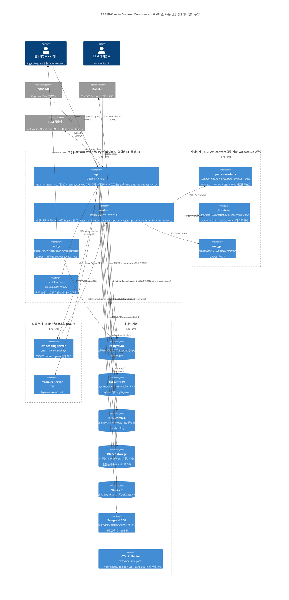
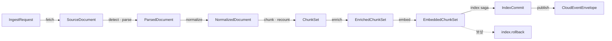
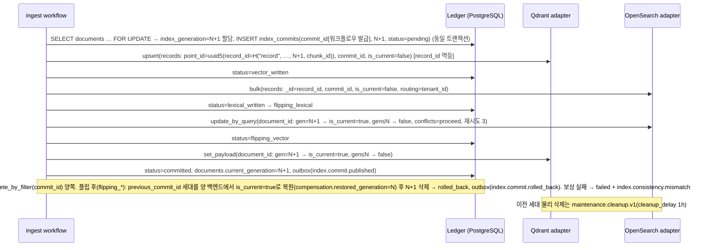
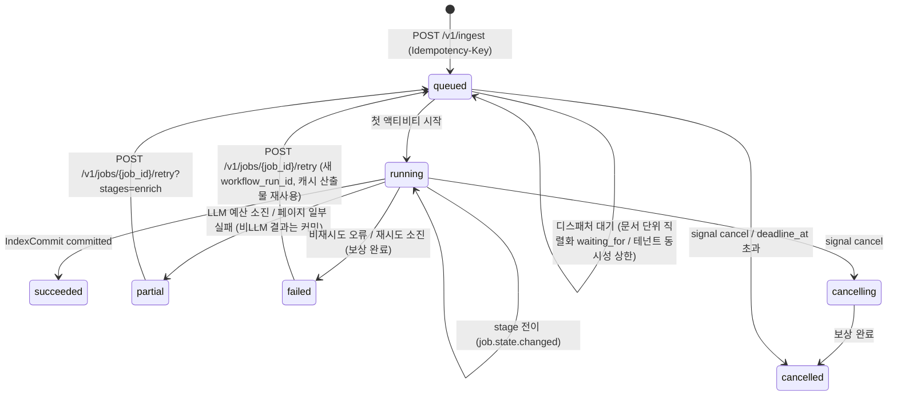

# 설계 바이블 (Design Bible)

## 목적

설계 브리프(`00-vision/00-design-brief.md`) 다음으로 우선하는 **단일 진실 원천(single source of truth)** 이다. 세 설계 제안(A 운영성 우선, B 검색 품질 우선, C 단순성·확장성 우선)과 두 심사 결과를 종합해, 이후 70여 개 문서를 작성하는 모든 에이전트가 **그대로 복사해 쓰는** 타입명·필드명·열거값·명명 규약·기본 파라미터·결정을 확정한다. 종합 원칙은 심사단 권고와 같다 — **계약 골격은 B, 커널·SDK는 C, 운영 계층은 A**. 세 제안의 치명적 결함(`chunk_ulid` 미정의, `QueryRequest.as_of` embargo 우회, `doc_version`에 `acl_hash` 포함, `Chunk.kind`/`IndexRecord.item_kind` 이중 열거, `document_password` 평문, 검색 핫패스 PostgreSQL 의존, `ulid_from_hash` 편법, 미검증 모델 식별자)은 모두 제거했다.

## 범위

- 포함: 문서 지위·변경 절차, 아키텍처 요약(C4), 결정 레지스터(D-01~D-20 확인·개정, O-01~O-10 해결·O-11·O-12 번호 배정, ADR 39건 배정), 스테이지 파이프라인 정본, 계약 인벤토리 정본(타입·필드·열거의 정확한 철자), 명명 규약, 프로파일 정본, 검색 경로 정본, ContextPack·렌더러 정본, 멀티테넌시·ACL 정본, 오케스트레이션 정본, 패키지 맵, 저장소 정본, API 표면, 리스크 Top 10, 용어 반영.
- 제외: JSON Schema 전문(`schemas/`와 03-contracts), OpenAPI 전문(05-api/openapi.yaml), 알고리즘 구현 세부(04-pipelines), 런북(09-operations). 이 문서의 표는 그 문서들이 **확장하되 바꾸지 못하는** 정본이다.
- 수치 표기: 실측 전 값은 모두 "초안 목표"다. 골든셋 게이트(§7.4)를 통과해야 프로파일 값이 바뀐다.
- 변경 이력: 1.0.0(2026-09-18) 초판. 1.1.0(2026-09-22) 설계 리뷰 반영 — 물리 키 스코프·세대 합성(`record_id`), 산출물 캐시 스코프(`scope_key`), `hydrate` 서브스텝, `reorder`·`citation_align`의 `pack` 이동, 보안/전략 필터 분리, 열거 타입명 고유화, 강제 지점 17개(E16 egress·E17 키 스코프), 세대 사가 보상 정밀화. 하위 문서·스키마가 미게시 상태의 개정이므로 계약 `schema_version`은 1.0.0을 유지한다. 1.2.1(2026-09-22) 계약 일관성 감사 반영(내부 불일치 3건) — §7.3 YAML의 `tiering`을 `ingest.index`에서 §5.6 정본 경로 `security.tiering`으로 이동(`security.tenant_isolation_tier` 명시), §5.6 게이트 값 행을 §7.3 YAML이 이미 쓰는 형태(`metric?`·`dataset?` 기본값, `min_delta_pt`·`promote_to`·`tool`)로 정합, §5.7 오류 표에서 경고 코드 `normalize.segmenter_fallback`·`embed.token_overflow`를 `yes` 열에서 `—` 열로 이동. 계약 `schema_version` 불변. 1.3.0(2026-09-23) 3단계 개정 요청 트리아지(`12-appendix/07-bible-amendment-triage-decisions.md`) 채택분 AM-01~AM-44 반영 — patch 25건(설명 보강·누락 행·예시 정정)과 minor 19건(선택 필드·열거값·이벤트·`JobKind`·§14 엔드포인트·해시 키 가산, ADR-0039). 필드 제거·필수화·개명·제약 강화는 없고 보류 AM-45~AM-56은 반영하지 않았다. 계약 `schema_version`은 M1 이전 개정이므로 1.0.0을 유지하고 각 계약 문서 `## 버전 이력`에 기록한다. 변경 목록은 `## 결정 사항 요약`의 v1.3.0 절.

---

## 1. 문서 지위와 우선순위 규칙

### 1.1 우선순위

**브리프 > 바이블 > ADR > 개별 설계 문서.** 브리프 §4의 확정 결정 중 연구 결과로 개정이 필요한 항목은 본 문서 §3의 레지스터에 `amended`로 기록하고, 브리프 §4 표의 해당 행을 v1.x로 직접 갱신한다(개정 표기 `(개정 v1.x, 근거: ADR-xxxx)`; 현재 v1.1·v1.2). 따라서 브리프와 바이블은 충돌하지 않으며, 충돌이 발견되면 **바이블이 오류**이고 브리프에 맞게 바이블을 고친다. ADR은 바이블의 결정 하나를 근거와 대안까지 기록하는 문서이며 바이블 표를 바꾸지 못한다. 개별 문서는 바이블의 타입·필드·열거값·기본값을 **그대로** 사용하고, 필요한 변경은 자기 문서의 `## 미해결 이슈`에 제안으로 남긴다(브리프 §11).

### 1.2 변경 절차

| 변경 종류 | 절차 | 바이블 버전 | 계약 `schema_version` |
|-----------|------|-------------|------------------------|
| 오탈자·설명 보강·예시 추가 | 소유자(architecture) 직접 수정 | patch | 불변 |
| 필드 추가(선택), 열거값 추가, 기본 파라미터 값 변경 | ADR 발의 → 게이트 근거(§7.4) 첨부 → 바이블 표 갱신 | minor | minor(가산만) |
| 산출물·응답 계약의 필수 → 선택화, 제약 완화 | ADR 발의 → 소비자 호환 조건 확인(소비자 minor ≥ 생산자 minor, 03-contracts/14 §2.1) → 바이블 표 갱신 | minor(조건부) | minor(조건부) |
| 필드 제거·의미 변경·필수화, 제약 강화, 열거값 제거·개명, 타입명·스테이지 경계 변경, 명명 규약 변경 | ADR 발의 → 영향 문서 목록 첨부 → 바이블 major → 영향 문서 일괄 개정 | major | major |
| 브리프 확정 결정(D-xx) 개정 | ADR 발의 → 바이블 §3 `amended` → 브리프 §4 행 갱신(v1.x) | minor | 해당 계약 규칙 |

- CI 게이트: `schemas/*.schema.json`의 열거값과 본 문서 §5.7 열거 표를 기계 대조한다(불일치 = 빌드 실패). 이벤트 이름·메트릭 이름·오류 코드도 동일하게 대조한다.
- 표기: 결정은 `**결정:**`, 미정은 `**미정(O-xx):**`, 확인 전 외부 사실은 `확인 필요(as of 2026-09)`.
- 이 문서를 인용할 때는 절 번호를 쓴다(예: "바이블 §5.7 `item_kind`").

---

## 2. 아키텍처 요약

### 2.1 핵심 아이디어(7개)

| # | 아이디어 | 한 줄 정의 | 출처 |
|---|----------|-----------|------|
| K1 | **단일 좌표계(One Coordinate System)** | 모든 검색 단위는 `IndexRecord` 하나로 표현되고 payload의 `block_refs[]{block_id, element_path, char_start, char_end, original_char_start, original_char_end, page?, bbox?}`·`sentence_spans[]`로 원문에 역추적된다(`Chunk.block_refs`와 동일 구조 `BlockRef`, `Provenance`로 결정적 변환). 인용 `segments`, 골든셋 `answer_spans`, 부모 확장, 문장 윈도우가 같은 좌표를 쓴다. 검색 핫패스는 `hydrate` 서브스텝(§4.3)이 이 좌표를 인덱스 payload에서 읽으며 PostgreSQL을 거치지 않는다 | B |
| K2 | **3-텍스트 규칙(Three-Text Rule)** | 청크는 `text`(표시 원문) / `embed_text`(결정적 접두어 + 원문; dense·sparse 입력) / `index_text`(렉시컬 뷰 + 접두어; BM25 입력)를 분리 보관하고 `strip_offsets`로 `enrich → strip` 대칭을 계약으로 강제한다 | B |
| K3 | **점수 원장(Score Ledger)** | `CandidateSet(채널 원점수·순위) → RankedSet(score_breakdown, Σ contribution = fused_score) → ContextPack(confidence_tier)`로 점수가 소실되지 않는다. 융합은 플랫폼 `fuser`가 수행한다 | B |
| K4 | **예산·순서·인용이 있는 팩** | 후처리 고정 순서, 대상 LLM 토크나이저 이중 카운트, `cite_id` 관련도순 불변, `litm_alternating` 공식 + 테스트 벡터, `overflow_policy` | B |
| K5 | **하나의 커널·두 개의 셸 + 단일 해시 식** | `Stage[In, Out]` 프로토콜 5멤버 + `PipelineContext` + `ArtifactRef` 단일 페이로드. 실행 셸은 `LocalRunner`(비내구)와 Temporal. 멱등성 키 = 캐시 키 = 산출물 경로 = `stage_key`(잡 스코프 `tenant_id/collection_id/document_id` 포함; 봉투 없는 콘텐츠 전용 캐시만 스코프 없이 공유, ADR-0037) | C |
| K6 | **원장 중심 + 세대 사가** | PostgreSQL 원장(`jobs, artifacts, lineage, index_commits, outbox, usage_ledger`)이 유일한 진실, 인덱스는 재구성 가능한 투영. `IndexCommit` 9단 상태 + `index_generation`/`is_current` 플립(렉시컬 → 벡터; 플립 후 실패는 이전 세대 복원). 물리 키 `record_id`가 세대를 포함해 세대가 공존한다. 복구 = 산출물 재적재(replay) | A |
| K7 | **격리 등급 1급 + 품질 게이트 프로파일** | 어댑터 격리 3단(`in_process/helper_process/sidecar`)과 테넌트 격리 3단(`payload_filter/shard_key/index_per_tenant`)을 `TieringPolicy` 하나로 선언·검증. 프로파일은 `extends` 단일 상속이며 모든 품질 기본값에 `gate`가 붙는다 | A + C + B |

### 2.2 C4 Container(`standard` 프로파일)



### 2.3 컨테이너 책임 표

| 컨테이너 | 책임(소유) | 소유하지 않는 것 | 격리 | `lite` 포함 |
|----------|-----------|------------------|------|-------------|
| `api` | 인증(OIDC JWT·API 키) → `PrincipalResolver` → `SecurityContext` 주입, Cedar 인가, 레이트리밋(fail-closed), `Idempotency-Key`, RFC 9457, SSE, MCP 마운트, **질의 파이프라인 인프로세스 실행**, 잡 읽기 모델 조회, `acl_recheck`·`audit` 이벤트 | 수집 스테이지 실행, 인덱스 쓰기 | 프로세스 | 예 |
| `worker` | `Stage[In, Out]` 제네릭 액티비티 래퍼(ArtifactRef 로드 → 실행 → 콘텐츠 주소화 저장 → 계보 기록), 하트비트·`Resumable`, 사이드카 호출, `index` 사가 | 재시도·타임아웃 정책 결정(오케스트레이터), 사이드카 내부 | 큐별 프로세스 | 예(`LocalRunner`는 api와 동일 프로세스) |
| `relay` | 아웃박스 릴레이 순수 코어 3함수, 웹훅·SSE 전달(테넌트 스코프) | 브로커 운영 | 프로세스 | 예(Procrastinate) |
| `eval harness` | 골든셋 로딩, 동일 스테이지 실행, ranx/ir_measures, RAGAS/DeepEval, 게이트 판정, `EvalReport` | 별도 검색 경로 | 인프로세스 | 예(소형 골든셋) |
| `parser-workers` | HWP 5.0 → HWPX(hwplib 1.1.11 + hwp2hwpx + hwpxlib 1.0.9), 암호화 HWPX, 배포용 텍스트(Tika `HwpV5Parser`, `quality=degraded`) | `ParsedDocument` 생성(Python 어댑터) | sidecar(A 등급) | 아니오 |
| `lo-sidecar` | DOC/RTF/ODT → DOCX, HWP 렌더 최후 폴백(H2Orestart), tini·프로세스 그룹 KILL·프로파일 락·네트워크 차단 | — | sidecar(C 등급, opt-in) | 아니오 |
| `ocr-gpu` | PaddleOCR PP-OCRv5 server 전면 OCR + 전처리 | — | sidecar | 아니오 |
| `embedding-server` | BGE-M3 3-in-1(vLLM pooling); 프롬프트는 어댑터가 소유 | — | sidecar | 아니오(sentence-transformers ONNX int8 인프로세스) |
| `reranker-server` | 크로스인코더(TEI), TEI/Cohere 응답 스키마 2종 | — | sidecar | 아니오(TEI CPU 또는 생략) |
| PostgreSQL | 원장(§13.1), RLS `FORCE`, Temporal 영속화(별도 DB) | 벡터·렉시컬 검색, **검색 핫패스** | — | 예 |
| Qdrant | dense·sparse 검색, payload 사전 필터, alias, `set_payload` 플립 | BM25 계산(lite는 클라이언트 포화값 적재) | — | 예 |
| OpenSearch | BM25(Nori `mixed`/`discard`), custom routing, DLS 이중 방어, 감사 로그 인덱스 | dense 검색 | — | 아니오 |
| Object Storage | 원본·산출물·파생물·모델 가중치 미러(BLAKE3 주소화) | 조회 인덱스 | — | 예(`file://`) |
| Valkey | 질의 임베딩(24h)·토큰 카운트·플랜 캐시, 레이트리밋, `Idempotency-Key` **조회 캐시**(판정 정본은 PostgreSQL `idempotency_keys`, 미스 시 PG 판정), ACL 회수 힌트 `aclrev:`(E9), MCP 커서 핸들(10분), 그룹 확장 캐시(5~15분), 부모 텍스트 캐시 | 정확성에 관여하는 상태(멱등 판정·ACL 정본·잡 상태는 PostgreSQL; Valkey 불가 시 PG 판정 또는 `degraded`) | — | 예 |
| Temporal | 내구 실행·재시도·사가·시그널·스케줄 | 잡 조회 정본(PostgreSQL `jobs`) | — | 단일 바이너리(운영) / 없음(개발) |
| OTel Collector | redaction(콘텐츠 차단)·transform·팬아웃 | — | sidecar | 선택 |

---

## 3. 결정 레지스터

### 3.1 브리프 확정 결정 D-01~D-20

상태: `confirmed`(그대로), `amended`(브리프 §4 v1.1로 개정 반영). 개정 내용은 브리프 §4 표의 새 문구가 정본이며 여기서는 요지와 이유를 적는다.

| ID | 결정(요지) | 상태 | 근거·개정 이유 | ADR |
|----|-----------|------|----------------|-----|
| D-01 | Python **3.12/3.13**(파서 워커 이미지 고정, 3.14는 검증 후), Pydantic v2, FastAPI, uv(`uv lock --check`), ruff, mypy strict, import-linter | amended | Unstructured `<3.14`, RapidOCR `≤3.13`, Nemotron extra 3.12 한정 → "3.12+"를 열어두면 파서 워커가 깨진다 | ADR-0035 |
| D-02 | Apache-2.0 + **라이선스 등급표 A/B/C/D/X**를 해석 지침으로; 플러그인·모델 메타 `license`·`license_grade`·`territory` 필수; CI 게이트 | amended | LGPL·BSL/SSPL·GPL 서버·MPL·모델 제한·지역 제한(HunyuanOCR)·매출 임계(OpenRAIL-M) 규칙 공백(매트릭스 P0) | ADR-0001 |
| D-03 | 문서 한국어, 식별자·필드·API 영문 snake_case | confirmed | §6 명명 규약으로 정밀화 | ADR-0036 |
| D-04 | ParsedDocument 자체 소유; `element_path`·`char_start/char_end` **필수**, `page`/`bbox` **nullable**(흐름 포맷), bbox 좌상단 원점·PDF 포인트 | amended | HWP/HWPX·DOCX·HTML·MD는 페이지·bbox가 존재하지 않음(매트릭스 P0) | ADR-0002 |
| D-05 | 스테이지 경계 13 계약 유지; 서브스테이지 `detect`(parse 내부)·`recount`(chunk 재카운트)·`hydrate`(fuse 내부, §4.3)·`publish`·`render`는 경계 타입을 추가하지 않는 정밀화(`RenderedContext`는 `ContextPack`의 뷰) | confirmed | K1·K3 단일 좌표계·점수 원장으로 경계의 필드를 확정 | ADR-0030 |
| D-06 | 발급형 `*_id`는 ULID; **콘텐츠 파생 키(`block_id`, `chunk_id`, `stage_key`, `*_hash`, `doc_version`)는 BLAKE3 hex 예외**(결합식은 §6.2 `H()`); **물리 인덱스 키는 스코프·세대 합성** `record_id = H("record", tenant_id, collection_id, document_id, str(index_generation), chunk_id)`, Qdrant `point_id = uuid5(NAMESPACE_RAG_CHUNK, record_id)`, OpenSearch `_id = record_id` | amended(v1.2) | 결정적 `chunk_id`는 시간 정렬 ULID로 표현 불가. A·B의 `chunk_ulid` 미정의, C의 `ulid_from_hash`(시간 비트 대체) 편법 모두 폐기. C가 제안한 `chunk_id`(ULID) + `chunk_key`(해시) 이중 필드는 ADR에 기각 대안으로 병기. **v1.2**: `chunk_id`에는 테넌트·컬렉션·문서 스코프가 없어 동일 바이트 문서(공개 법령 PDF·표준 서식)를 두 테넌트(또는 한 테넌트의 두 컬렉션)가 수집하면 같은 `point_id`로 upsert되어 뒤 테넌트의 `tenant_id`·`acl_*` payload가 앞 레코드를 덮어쓰고, 청킹 전 단계가 동일한 재색인(`from_stage=enrich\|embed`, `reindex_always`)은 이전 세대를 덮어써 세대 공존·롤백이 깨진다 → 물리 키에 스코프·세대를 합성하고 `chunk_id`는 콘텐츠 주소 payload 필드로 유지(리뷰 blocker). 브리프 D-06 식 `blake3(doc_version + element_path)`는 `H("block", …)` 결합식으로 v1.2 정정 | ADR-0004 |
| D-07 | 3-way 하이브리드 → **플랫폼 `fuser` RRF(k=60, 1:1:1, 변형 0.5)** → 골든셋 ≥200 qrels 시 CC → `hydrate` → 크로스인코더(top-100→20) → 후처리 **고정 순서** `relevance_gate → dedup → mmr → parent_expand → dedup → sentence_window → compress` → `pack` 내부 고정 순서 `acl_recheck → budget_cut → reorder → citation_align` | amended(v1.2) | 브리프의 "중복 제거, 부모 확장, MMR" 순서는 확장 후 다양성 판단 둔화·부모 중복 재발(07 문서); 서버 융합은 점수 분해를 잃음. **v1.2**: `reorder`(litm, K 의존)·`citation_align`(`cite_id` 확정)이 `pack`의 `k_max`·토큰 예산 절단 앞에 있으면 절단 뒤 `position`이 무효가 되고 `cite_id`가 후처리·pack 양쪽에서 이중 부여되므로 두 단계를 `pack` 내부로 이동(리뷰 major) | ADR-0013 |
| D-08 | 비동기 잡; `Idempotency-Key` 필수(draft-07 의미론; 판정 정본은 `idempotency_keys(tenant_id, key)` **테넌트 스코프**, `jobs` INSERT와 동일 트랜잭션, Valkey는 조회 캐시), `202 {job_id, status_url, events_url}`; 잡 상태 정본 = PostgreSQL `jobs`; 문서 단위 잡 직렬화·테넌트 동시성은 디스패처(§11.2); 이벤트 = CloudEvents + 아웃박스 + 릴레이 | amended | 읽기 모델·멱등성·조정(reconcile)이 미명시(A §6 D-08) | ADR-0017 |
| D-09 | 멀티테넌시 1급; `tenant_id`·`collection_id`·`acl_*`·`acl_hash` 전 레코드 필수, 리트리벌 **사전 필터** 강제, `SecurityContext` 서버 주입, 질의 측 항목(`candidates[]`·`results[]`·`ContextItem`)에도 `collection_id`·ACL 필드 전파 | confirmed | §10 강제 지점 17개로 정밀화(E16 아웃바운드 egress, E17 콘텐츠 키 스코프 추가). `QueryRequest.as_of` 제거(embargo 우회 차단) | ADR-0027 |
| D-10 | entry points 14 확장 지점 유지; 서브 역할은 `PluginMeta.role`로 표현(예: `normalizer` 그룹의 `korean_analyzer`/`sentence_splitter`/`pii_detector`, `packer` 그룹의 `renderer`/`token_counter`) | confirmed | 매트릭스 역할 매핑과 일치; 확장 지점 수는 늘리지 않는다 | ADR-0032 |
| D-11 | OTel; GenAI semconv **커밋 고정 + Weaver 상수**; Grafana·Tempo·Loki(AGPL)·Langfuse·Phoenix(ELv2)는 OTLP 대상·분리 컨테이너만(pip 의존 금지); AGPL 불가 대안 문서화 | amended | semconv Development 단계(속성 개명 위험), 관측 스택 라이선스 경계(매트릭스 P2) | ADR-0022 |
| D-12 | 골든셋 = TREC qrels/run + **`answer_spans` JSONL**; nDCG 선형 이득; Holm 보정; 인터리빙·쌍대 비교; 하네스는 동일 인프로세스 스테이지 실행; 프로파일 `gate` | amended | 문서 단위 qrels로는 청킹 비교(O-09) 불가 | ADR-0023 |
| D-13 | MCP `mcp>=2,<3`, Streamable HTTP, 도구 3종 + **`cursor`/`next_cursor`**(Valkey 핸들, 테넌트 바인딩); `search_batch`·`expand`는 v1.1 후보 | amended | 스펙 2026-07-28이 세션 제거 | ADR-0025 |
| D-14 | PostgreSQL + S3 호환(로컬 **RustFS 또는 SeaweedFS**, 개발 `file://`) + **Valkey**(Redis 호환 KV) | amended | Redis 8 삼중 라이선스, MinIO 2026-04 아카이브·AGPL 전환(매트릭스 P1) | ADR-0011 |
| D-15 | Qdrant(named vectors, payload 사전 필터) + OpenSearch(Nori `mixed`/`discard` + 사용자 사전 필수, DLS); `IndexBackend` + `capabilities()`; 목록에 Solr·pg_textsearch 추가, Elasticsearch는 어댑터 호환만; **경량 = Qdrant 단독, 플랫폼이 형태소 토큰화 + BM25 TF 포화값 계산 → `sparse_bm25` `modifier: idf`** | amended | Qdrant는 BM25를 계산하지 않고 한국어 형태소 분석이 없음(06·13 문서) | ADR-0012, ADR-0021 |
| D-16 | BGE-M3 dense+sparse 유지(근거 재기술: 3-in-1 + 생태계 + 드롭인 파인튠); 서빙 **vLLM pooling + TEI + 인프로세스**(Infinity 제외); 리랭커 bge-reranker-v2-m3; **`late_interaction` 별도 슬롯**(기본 끔); jina 계열 제외; `ko-quality` 게이트 +2p | amended | TEI/Infinity로는 BGE-M3 sparse 생산 불가(실현 불가); jina CC-BY-NC/Qwen Research(라이선스) | ADR-0009, ADR-0010 |
| D-17 | Temporal; 파이프라인 정의는 `PipelineContext`만 의존(`temporalio` 임포트 금지); **비내구 `LocalRunner`**(개발·CI·하네스); 경량 프로덕션 = Temporal 단일 바이너리 + PG; 리트리벌은 오케스트레이터 미경유 | amended | `@workflow.defn` 직접 재사용은 로컬 실행 불가, 내구성 미명시(매트릭스 P0) | ADR-0003 |
| D-18 | HWPX python-hwpx + OWPML 어댑터; **HWP 5.0 Java 사이드카 → HWPX**(unhwp → hwp-hwpx-parser → LO opt-in 폴백, pyhwp AGPL 플러그인); PDF Docling + **pypdfium2/pdftext**(PyMuPDF 제외) + **RapidOCR PP-OCRv5 korean mobile** 기본; DOCX Docling + **docx2python 각주 필수**; DOC lo-sidecar; HTML **Trafilatura → Docling** 순서; TXT/MD charset-normalizer + ftfy + markdown-it-py | amended | PyMuPDF AGPL 인프로세스 링크, pyhwp AGPL·정체, H2Orestart GPLv3(MIT 표기 오류), OCR 우선순위 부재, 각주 미처리(J-1, J-4) | ADR-0006, ADR-0007, ADR-0008 |
| D-19 | **ParsedDocument 네이티브 `StructureAwareChunker`**(Docling 어댑터 extra 2차); 512/2048/64; small-to-big; 표 행 그룹 256; **문맥 보강 = 결정적 `context_prefix`(켬) + LLM 접두어·요약(O-05, 끔)**; late chunking은 mean pooling 모델 강제 | amended | Docling 청커는 DoclingDocument 전용(HWP 백엔드 없음); "문맥 보강 기본"이 LLM으로 읽히면 O-05 충돌 | ADR-0020, ADR-0016 |
| D-20 | 공급자 중립 `ContextPack` + 렌더러 9종; Anthropic **`search_result`(1차)/`document`(2차) + `citations`**; `cite_id` 불변; `litm_alternating` 기본; 대상 LLM 토크나이저 재계산 | amended | RAG 전용 GA 경로는 `search_result`; 인용은 `output_config.format`과 병용 불가(10 문서) | ADR-0024 |

### 3.2 개방 결정 O-01~O-10

| ID | 해결 | 상태 | 근거·접목 | ADR |
|----|------|------|-----------|-----|
| O-01 융합 | RRF `k=60`, 채널 가중 `1:1:1`, 변형 질의 `0.5`를 플랫폼 `fuser`에서 수행. `contribution = w/(k+rank)`, 불변식 `Σ contribution = fused_score`, 타이브레이크 `record_id` 오름차순. 컬렉션 골든셋 ≥200 qrels 확보 시 `convex_minmax`로 프로파일 전환(ranx `optimize_fusion`, 프로파일 버전 증가 → `profile_hash` 변경 → 게이트 통과 후 blue/green). `fusion.k` 필수(로딩 시 검증). 서버 융합은 `lite`의 **단일 컬렉션 질의**(Qdrant `Fusion.RRF`, `k=60` 명시)만. **다중 컬렉션 융합 규칙**: 런은 (채널 × 컬렉션 × 변형)이고 후보는 정확히 한 컬렉션에 속하므로 RRF에 그대로 투입(컬렉션 차원은 중복 기여하지 않음); `convex_*`는 질의 내 모든 컬렉션이 같은 `embedding_profile_hash`·`analyzer_id`일 때만, 아니면 플래너가 `rrf`로 강등 + `degraded{fusion, profile_mismatch}` | resolved | 세 제안·매트릭스 일치. B의 계약 엄격성(fuser 의사코드, ranx 일치 CI) + A의 운영 규칙 + C의 `Fuser` 프로토콜 1개. C의 "Qdrant prefetch 한 요청" 서술은 채널 분리를 해치므로 B 규칙(dense·sparse 두 호출, prefetch 미사용)으로 대체 | ADR-0013 |
| O-02 sparse | BGE-M3 sparse(`vocab_id=xlm-roberta-250k`, 동일 패스) 기본. lexical 레그는 항상 유지(제3 레그). `ko-quality` PIXIE-Splade-v1.5(`ax-encoder-50k`), `unified-opensearch` inference-free-splade-ko-v1(라이선스 확인 후) → opensearch multilingual-v1. SPLADE-v3 제외. `vocab_id` 불일치는 색인·질의 모두 `embed.space_mismatch`(비재시도). sparse 모델 교체 = `embedding_space_ids.sparse_learned` 변경 = blue/green | resolved | 세 제안 동일 | ADR-0014 |
| O-03 GraphRAG/RAPTOR | 이분. GraphRAG 계열(LightRAG, HippoRAG 2, MS GraphRAG)은 **외부 플러그인 패키지**(`rag-plugin-lightrag`, `rag-plugin-hipporag`; `retriever` 채널 `graph` + `enricher`), 코어는 계약 슬롯(`item_kind`, `enrichment.entities/relations`, `channel=graph`, `QueryPlan.strategy`, `graph_path`)만. RAPTOR collapsed tree는 코어 옵션 `enricher`(`item_kind=summary`, 기본 끔). 저장소 PostgreSQL + Apache AGE. 그래프 인덱싱은 별도 잡 `build_graph`(`ingest-llm` 큐·예산 정책). 1차 엔진은 자체 측정까지 보류 | resolved | 세 제안 동일(J-8) | ADR-0015 |
| O-04 late interaction | 기본 끔, 별도 `late_interaction` 슬롯. BGE-M3 colbert(1024d)는 리랭크 비교 기준만. KURE-v2(128d)는 M2 골든셋에서 (a) 인덱스 단계 채널 `late_interaction` vs (b) 리랭크 단계 `late_interaction_rerank`(Qdrant `m=0` 저장 + prefetch top-300 → MaxSim top-100 → 크로스인코더 50→20)를 비교 후 ADR 개정. 계약은 두 위치를 모두 표현(`channels[].channel=late_interaction`, `QueryPlan.late_interaction_rerank`). `capabilities.supports_multivector=false` 백엔드는 로딩 시 자동 비활성 + `degraded`. `visual-pages`는 별도 컬렉션·인덱스 단계 필수. 저장 바이트는 `rag_index_bytes_total{vector="late_interaction"}` 별도 계량 | resolved | B의 2단 리랭크 필드를 실험 슬롯으로만 채택(사전 선호를 결정으로 승격하지 않음) | ADR-0010 |
| O-05 LLM 보강 | 비LLM 보강만 기본 켬(결정적 `context_prefix`, 형태소 분석기(`ctx.analyzer`: Kiwi 또는 공백기 mecab-ko) NNG/NNP 키워드, GLiNER2 엔티티, 날짜·조항 파생 메타). **LLM 보강은 모든 프로파일 기본 끔**(`premium` 포함), 컬렉션 정책으로 켬. `contextual_doc_summary`(dsRAG AutoContext식 문서·섹션 1회 요약)를 저비용 기준선으로 병행 평가. 비용 정책: `ingest-llm` 큐 + `max_concurrent_activities` + Valkey 테넌트 토큰 버킷 + 컬렉션 `enrichment_budget_tokens` + 코퍼스 1.5배 상한 초과 시 잡 `partial`. 게이트 nDCG@10 +0.03 & 문서당 비용 상한 이하. 외부 LLM에는 PII 정책 적용 텍스트만, 테넌트 `llm_enrichment_allowed` 옵트인 | resolved | B의 `premium` 기본 켬 불채택(J-3 다수 의견, 원칙 4·7). B의 구조(`generated_by`, `budget_used`, `status: partial`)와 A의 `usage_ledger` 집계는 채택 | ADR-0016 |
| O-06 이벤트 버스 | v1 브로커 없음. 제어 = Temporal 시그널/업데이트/쿼리, 도메인 이벤트 = `CloudEventEnvelope`(1.0.2) + PostgreSQL 트랜잭셔널 아웃박스(상태 갱신과 동일 트랜잭션) + 릴레이(웹훅·SSE). 릴레이 코어 순수 함수 3개를 Temporal/Procrastinate 실행기가 감싼다. 소비자 멱등 `event_id`. NATS JetStream은 (a) 외부 소비자 ≥2 + 재생, (b) `korean-gov` 감사 스트림 손실 불가·2년 보존, (c) 멀티 리전 조건에서만 ADR. 아웃박스 지연 SLO lite 30s / standard 5s / korean-gov 2s | resolved | 세 제안 동일 | ADR-0017 |
| O-07 HWP 5.0 | 1급 지원, LibreOffice는 opt-in 최후 폴백. `standard` 체인: Java 사이드카 → HWPX → 단일 OWPML 어댑터 → unhwp(헬퍼) → hwp-hwpx-parser → `lo-sidecar`. `lite`: unhwp → hwp-hwpx-parser. 배포용은 테넌트 `allow_distribution_documents` 시 Tika `HwpV5Parser` 텍스트(`quality=degraded`); 암호화는 `credentials_ref` 없으면 `parse.document_encrypted`. 변환본은 `derived` 산출물로 콘텐츠 주소화(재변환 생략). `ParsedDocument.parser_chain[]`에 실제 시도 순서 기록 | resolved | 세 제안 동일(J-1) | ADR-0007 |
| O-08 OCR | RapidOCR 3.9.x(`OCRVersion.PPOCRV5` + `ModelType.MOBILE` + `LangRec.KOREAN` 명시, ONNX Runtime) 기본; `premium` GPU PaddleOCR PP-OCRv5 server(`ocr-gpu`); 폴백 Tesseract 5 `kor+eng`(+`kor_vert`, `pdf_airgapped`). Surya 옵트인, EasyOCR·HunyuanOCR 제외, Docling `OcrAutoOptions` 금지. 페이지 단위 하트비트·타임아웃(CPU 60s / GPU 20s), `Resumable`, `page_status[]`·`Block.source`·`Block.confidence`. 프로파일 YAML `ocr: {plugin, lang, version, model}` 필수 키 | resolved | 세 제안 동일(J-4). CER/WER 재측정 후 ADR 갱신 | ADR-0008 |
| O-09 청크·토크나이저 | 예산 토크나이저 = `hf:BAAI/bge-m3`, `token_counts`에 `tiktoken:o200k_base` 병기. 자식 512(병합 하한 64) / 부모 2048(반환 단위만) / 구조 청크 오버랩 0 / 폴백 분할 오버랩 10% / 표 행 그룹 256 / `flat_text` 문장 윈도우 ±2. 렉시컬 토큰화는 형태소 분석기(혼용 금지). ContextPack 예산은 대상 LLM 토크나이저 재계산(이중 카운트), 리랭커 절단은 리랭커 토크나이저. `TokenCounter{tokenizer_id}` 단일 인터페이스. 임베더 교체 시 `token_counts` 키 누락이면 `recount` 스테이지(재청킹 아님). M2 그리드 {256, 384, 512, 768} × {0, 10%, 15%} | resolved | 세 제안 동일(J-5) | ADR-0019 |
| O-10 gRPC | REST + SSE + MCP 확정, gRPC v1 미제공. 필요 시 `connectrpc`를 같은 ASGI 앱에 마운트, protobuf는 JSON Schema 정본에서 코드젠. 내부 사이드카도 REST `POST /v1/convert` + `ArtifactRef` + RFC 9457. Qdrant `prefer_grpc=True`·Temporal 클라이언트 gRPC는 라이브러리 설정. 스트리밍 필요 사이드카는 부분 산출물 페이지 단위 저장 + 폴링. 도입 전 리트리벌 p95 측정으로 정당화 | resolved | 세 제안 동일(J-6). 오류 모델 1개(`StageError` ↔ RFC 9457 `type` URN 1:1) | ADR-0018 |
| O-11 프로파일 해시만 바뀐 재색인 | **미정(O-11):** 두 물리 해시(`embedding_profile_hash`·`analyzer_id`)가 불변이고 `profile_hash`만 바뀐 컬렉션 프로파일 변경의 green 물리 이름과 재색인 모드 B. 잠정 규칙: 자동 재색인 불가(부모 잡 `failed`) + 운영자 대안(변경 묶기·새 컬렉션 이관), 04-pipelines/19 | open | 1.3.0 번호 배정(AM-21). 해결은 ADR-0039 이후 ADR-0026 개정(AM-45 보류) | — |
| O-12 blue/green 채움 중 원장 기준 | **미정(O-12):** blue/green 채움 중 `documents` 원장 포인터(모드 A)와 정합성 검사(`consistency_check`)의 기준 세대 | open | 1.3.0 번호 배정(AM-21). 해결은 ADR-0039 이후(AM-45 보류) | — |

O-11·O-12는 1.3.0에서 번호만 배정한 개방 결정이다(헤더의 O-01~O-10은 1.0.0 해결분). 브리프 §5 비고에 같은 번호를 둔다.

### 3.3 ADR 목록(`06-adr/NNNN-slug.md`, MADR)

P0은 다른 설계 문서가 전제로 삼는 것이라 먼저 기록한다.

| 번호 | 제목 | slug | 우선 | 관련 결정 |
|------|------|------|------|-----------|
| 0001 | 라이선스 등급표 A/B/C/D/X와 D-02 해석 지침 | `license-grade-table-and-d02-interpretation` | P0 | D-02 |
| 0002 | ParsedDocument provenance: element_path·char offset 필수, page/bbox nullable | `provenance-element-path-and-nullable-page-bbox` | P0 | D-04 |
| 0003 | 오케스트레이터 중립 파이프라인과 비내구 LocalRunner | `orchestrator-neutral-pipeline-and-non-durable-local-runner` | P0 | D-17 |
| 0004 | 결정적 chunk_id·block_id 해시, 스코프·세대 합성 record_id/point_id와 D-06 ULID 예외 | `deterministic-chunk-id-scoped-record-id-and-ulid-exception` | P0 | D-06, E17 |
| 0005 | doc_version은 콘텐츠 해시만; ACL·메타데이터는 payload 갱신 | `doc-version-content-hash-only-and-acl-payload-update` | P0 | D-09, 원칙 4 |
| 0006 | PDF 고속 텍스트 경로: PyMuPDF 제거, pypdfium2 + pdftext | `pdf-fast-path-pypdfium2-pdftext-replaces-pymupdf` | P1 | D-18 |
| 0007 | HWP 5.0 기본 경로: Apache-2.0 Java 사이드카, pyhwp 강등, H2Orestart GPL 격리 | `hwp5-java-sidecar-first-pyhwp-demoted` | P1 | D-18, O-07 |
| 0008 | OCR 기본값 RapidOCR PP-OCRv5 korean / GPU PaddleOCR / 폴백 Tesseract | `ocr-default-rapidocr-ppocrv5-korean` | P1 | D-18, O-08 |
| 0009 | 임베딩 서빙: vLLM pooling + TEI + 인프로세스, Infinity 제외 | `embedding-serving-vllm-pooling-tei-inprocess` | P1 | D-16 |
| 0010 | BGE-M3 유지 근거 재기술과 late_interaction 슬롯 분리 | `bge-m3-rationale-and-late-interaction-slot` | P1 | D-16, O-04 |
| 0011 | 저장소 기본 이미지: Valkey, RustFS 또는 SeaweedFS | `kv-and-object-storage-valkey-rustfs-seaweedfs` | P1 | D-14 |
| 0012 | 경량 프로파일 Qdrant 단독 BM25 계약(sparse_bm25) | `lite-profile-qdrant-only-client-bm25` | P1 | D-15 |
| 0013 | 융합 RRF k=60 → convex combination 2단계 전략, 다중 컬렉션 융합 규칙, 후처리 고정 순서와 pack 내부 순서 | `fusion-rrf-k60-then-convex-combination-and-postprocess-order` | P1 | O-01, D-07 |
| 0014 | sparse 표현: BGE-M3 sparse 기본, lexical 레그 유지 | `sparse-representation-bge-m3-lexical-leg-kept` | P2 | O-02 |
| 0015 | GraphRAG 외부 플러그인 / RAPTOR 코어 옵션 이분 | `graph-rag-external-plugin-raptor-core-option` | P2 | O-03 |
| 0016 | LLM 보강 기본 끔과 비용 정책(enrichment_budget_tokens) | `llm-enrichment-default-off-and-budget-policy` | P2 | O-05, D-19 |
| 0017 | 이벤트 전달: 브로커 없는 v1(아웃박스 + CloudEvents), 테넌트 스코프 멱등 키, NATS 추가 조건 | `event-delivery-outbox-cloudevents-no-broker` | P2 | O-06, D-08 |
| 0018 | API 규약: REST + SSE + MCP, gRPC 미제공, RFC 9457·Idempotency-Key | `api-rest-sse-mcp-no-grpc-rfc9457` | P2 | O-10 |
| 0019 | 청크 크기·토크나이저 기본값과 recount 스테이지 | `chunk-size-tokenizer-defaults-and-recount-stage` | P3 | O-09 |
| 0020 | 기본 청커 StructureAwareChunker와 의존성 잠금(semchunk 3.2.5, tiktoken 0.12) | `default-chunker-structure-aware-and-dependency-locks` | P1 | D-19 |
| 0021 | 한국어 분석기: Kiwi 승격 조건과 공백기 기본(python-mecab-ko + kss) | `korean-analyzer-kiwi-promotion-and-interim-mecab-kss` | P2 | 원칙 6, D-15 |
| 0022 | 관측성 규약 고정(GenAI semconv 커밋·Weaver)과 라이선스 경계 | `observability-genai-semconv-pin-and-license-boundary` | P2 | D-11 |
| 0023 | 평가 하네스: qrels + answer_spans, nDCG 선형 이득, Holm 보정 | `evaluation-qrels-answer-spans-and-linear-ndcg` | P2 | D-12 |
| 0024 | Context Pack 순서 전략과 Anthropic search_result 렌더러 | `context-pack-ordering-and-anthropic-search-result-renderer` | P2 | D-20 |
| 0025 | MCP 커서 페이지네이션과 도구 집합 | `mcp-cursor-pagination-and-tool-set` | P2 | D-13 |
| 0026 | IndexCommit 세대 사가: 세대 합성 물리 키, 플립 중간 상태와 이전 세대 복원 보상, ID 발급·문서 직렬화, commit ledger | `index-commit-generation-saga-and-ledger` | P0 | K6 |
| 0027 | SecurityContext 서버 주입, 요청별 테넌트 JWT(DLS), ACL 회수 힌트와 강제 지점 17개 | `security-context-injection-and-acl-enforcement-points` | P0 | D-09 |
| 0028 | 테넌트 격리 등급 TieringPolicy | `tenant-isolation-tiering-policy` | P2 | K7 |
| 0029 | 3-텍스트 규칙과 결정적 context_prefix | `three-text-rule-and-deterministic-context-prefix` | P1 | K2, D-19 |
| 0030 | 단일 좌표계와 점수 원장(계약 골격) | `single-coordinate-system-and-score-ledger` | P0 | D-05, K1, K3 |
| 0031 | 프로파일 스키마: extends 단일 상속과 품질 게이트 | `profile-schema-extends-and-quality-gates` | P2 | K7 |
| 0032 | 플러그인 SDK: Stage 프로토콜 5멤버와 적합성 키트 | `plugin-sdk-stage-protocol-and-conformance-kit` | P1 | D-10 |
| 0033 | 사이드카 convert 계약과 격리 사다리 | `sidecar-convert-contract-and-isolation-ladder` | P1 | K5, O-10 |
| 0034 | 검색 핫패스의 PostgreSQL 미의존, hydrate 서브스텝과 부모 텍스트 저장 정책 | `retrieval-hot-path-postgres-independence-and-hydrate` | P2 | §7 가용성, K1 |
| 0035 | Python 버전·툴체인 고정 | `python-version-and-toolchain-pins` | P3 | D-01 |
| 0036 | 명명·식별자·열거 타입명·이벤트·메트릭 규약 | `naming-and-identifier-conventions` | P2 | D-03, D-06 |
| 0037 | 산출물 캐시 스코프: stage_key에 tenant·collection·document 합성, fetch 캐시 제외 | `artifact-cache-scope-and-stage-key-composition` | P0 | K5, 원칙 4 |
| 0038 | 아웃바운드 egress 정책(SSRF 방어)과 웹훅 HMAC 서명 | `outbound-egress-policy-and-webhook-signing` | P1 | D-09, §7 보안 |
| 0039 | 바이블 1.3.0 가산 개정 묶음(선택 필드·열거값·이벤트·`JobKind`·§14 엔드포인트·해시 키, AM-26~AM-44) | `bible-1-3-additive-amendment-bundle` | P1 | §1.2 minor, FR-MGT-01 |

**결정:** 1.3.0 minor 가산 묶음(AM-26~AM-44)은 ADR-0039 한 건으로 기록한다. 가산만이고 기본 파라미터 값을 바꾸지 않으므로 §7.4 게이트 근거는 해당 없음이다. 09-operations/08·10-development/08이 제안한 릴리스 버전 정책 ADR은 다음 빈 번호(0040~)로 발의한다(ADR 인덱스 순번).

---

## 4. 스테이지 파이프라인 정본

### 4.1 공통 규약

| 항목 | 규약 |
|------|------|
| 스테이지 시그니처 | `Stage[In, Out]` 프로토콜 5멤버: `plugin_id: str`, `config_schema: type[BaseModel]`, `capabilities() -> Capabilities`(§5.3), `fingerprint() -> str`, `async run(inp: In, ctx: StageContext) -> Out`. 선택 클래스 속성 `requires_lineage: tuple[str, ...] = ()`(셸이 함께 로드할 상류 `schema_type`; `index`·`chunk`·`enrich` LLM 서브스텝이 사용, 아래 경계 페이로드 행). `StageContext` 선택 멤버(1.3.0): `plan: QueryPlan \| None`(질의 측 스테이지만 채움, 수집 측은 `None`), `artifacts: DerivedArtifacts`(파생물 쓰기 포트; 셸이 저장·계보 기록을 수행하며 스테이지는 여전히 I/O를 직접 쓰지 않는다). 스테이지는 I/O·시간·난수를 직접 쓰지 않는다(`ctx.token_counter`, `ctx.analyzer`, `ctx.now()`, `ctx.lineage[...]`, `ctx.plan`, `ctx.artifacts`만) |
| 경계 페이로드 | 오케스트레이터를 넘는 값은 `ArtifactRef`만(Temporal 2MB 한계). 셸(액티비티 래퍼)이 `ArtifactRef ↔ 계약 인스턴스` 변환·저장·계보 기록을 담당. 스테이지가 `requires_lineage: [schema_type…]`로 선언한 상류 산출물은 셸이 입력 봉투의 `lineage_refs`(§5.2)에서 함께 로드해 `ctx.lineage[schema_type]`로 제공한다. 선언 가능한 것은 **입력 산출물의 `lineage_refs`로 고정되는 상류 산출물뿐**이다(결정성 보장, `stage_key` 불변). 사용 범위(1.3.0): `index` = `EnrichedChunkSet`·`ChunkSet`·`SourceDocument`; `chunk` = `ParsedDocument`(구조 필드 `Block.type`·`numbering_label`·`provenance`·`TableData`·`caption_of`; 기본 청커 `structure_aware`가 요구하므로 M1 필수); `enrich` LLM 서브스텝 = `ChunkSet`; 그 외 스테이지는 없음. 경계 페이로드는 여전히 `ArtifactRef` 1개다 |
| 지문 | `fingerprint = H("producer", plugin_id, plugin_version, config_hash, image_digest, model_ids)`(§6.2). SDK가 사이드카 image digest·`dictionary_hash`·`embedding_space_id`·`analyzer_id` 포함을 검증 |
| **멱등성 키 = 캐시 키 = 산출물 경로** | `stage_key = H("stage", stage_name, scope_key, input_hash, fingerprint)`, `scope_key = f"{tenant_id}/{collection_id}/{document_id}"`. 입력 해시 `input_hash` = `detect`·`parse`는 원본 `content_hash`, 그 외 스테이지는 `input_ref.blake3`(§4.2 표의 각 행). `recount`는 `fingerprint` 자리에 `tokenizer_id`를 포함한 지문을 쓴다. `embed`의 Producer 지문은 `config_hash`의 공간 설정으로 `embedding_space_id`를 담으며, 이는 모델 식별 키 `embedder_fingerprint`(§6.2)와 별개 키다. `artifacts(tenant_id, stage_key)` 행 또는 산출물 경로에 `stage_key`가 있으면 실행 생략(`cache_hit=true`, 계보 기록). 계약 산출물은 봉투(`tenant_id`·`collection_id`·`document_id`·`acl`)를 품으므로 **잡 스코프 안에서만** 재사용한다 — 동일 바이트를 다른 테넌트·컬렉션·문서가 수집하면 재실행(ADR-0037). 봉투가 없는 콘텐츠 전용 캐시만 스코프 없이 테넌트 내 공유: 원본 바이트 `sources/{blake3}`, 파생물 `H("derived", content_hash, sidecar_image_digest or "", options_hash or "")`, 청크 단위 임베딩 `H("embed", …)`, LLM 보강 `H("llm-enrich", …)`. `fetch`는 캐시 대상이 아니다(§4.2) |
| 격리 모드 | `in_process`(A 등급 순수 Python) / `helper_process`(`multiprocessing spawn`, ctypes·네이티브 크래시 위험) / `sidecar`(JVM·LibreOffice·CUDA·GPL/AGPL; REST `POST /v1/convert`) |
| 오류 모델 | `StageError{code: "stage.reason", retryable, stage, plugin_id}` ↔ RFC 9457 `type = urn:rag:error:{code}` 1:1. 재시도 가능 여부는 **오류 카탈로그(§5.7)가 결정**하고 셸은 정책만 적용 |
| 부분 성공 | 문서 전체 실패로 확대하지 않는다: `quality: degraded` + `warnings[]` + `page_status[]`(문서 측) / `degraded[]`(질의 측) |
| 계보 | `lineage(child_ref, parent_ref, stage_key, job_id, produced_at)`를 산출물 저장과 같은 트랜잭션에 기록 |

### 4.2 수집 파이프라인



| 스테이지 | 입력 계약 | 출력 계약 | 플러그인 확장 지점 | 격리 모드 | 멱등성 키(`stage_key` 구성) | 실패 정책 |
|----------|-----------|-----------|--------------------|-----------|------------------------------|-----------|
| `fetch` | `IngestRequest` | `SourceDocument` | `fetcher` | in_process(fsspec/httpx; smb 플러그인) | **캐시 없음**(`stage_key` 미적용, 항상 다운로드; `EgressPolicy` 적용 §10.3 E16). 검증자(`etag`\|`last_modified`)가 있고 같은 `document_id`의 이전 `SourceDocument`가 있으면 조건부 GET(304 → 이전 원본 바이트 재사용, `SourceDocument` 봉투는 새로 발급); 검증자 부재 시 조건부 재수집 금지. 다운로드 후 `content_hash` 확정, 동일 `content_hash` 원본이 `sources/`에 있으면 바이트 저장만 생략 | `fetch.access_denied`·`fetch.not_found`·`fetch.too_large`·`fetch.scheme_unsupported`·`fetch.egress_denied` 비재시도; 네트워크·5xx·`fetch.timeout` 재시도 5(지수) |
| `detect` (parse 내부 서브스테이지) | `SourceDocument` | `SourceDocument`(`format`, `format_confidence`, `container_flags` 채움). fetch 출력의 잠정값(`format = unknown` 또는 힌트, `format_confidence = 0.0`, 잠정 `media_type`, `container_flags` 자리표 `{false, false, false}`)은 **미판정**이며 판정 사실은 detect 출력만 가진다 | `parser`(role `format_detector`) | in_process(puremagic + ZIP/OLE 스니퍼) | `H("stage","detect", scope_key, content_hash, fingerprint)` | `parse.unsupported_format`·`parse.corrupt_container` 비재시도; 암호·배포 플래그는 판정만(오류는 `parse`가 결정) |
| `parse` | `SourceDocument` | `ParsedDocument`(+ `derived` 산출물: HWPX 변환본·페이지 이미지·표 HTML·벤더 JSON) | `parser` | 포맷별: HWPX·pdftext·Docling·DOCX·HTML·TXT in_process / unhwp helper_process / Java·LO·OCR-GPU sidecar | `H("stage","parse", scope_key, content_hash, parser_fingerprint)`; HWP→HWPX 변환본·페이지 이미지 등 파생물은 봉투가 없어 스코프 없이 `H("derived", content_hash, sidecar_image_digest or "", options_hash or "")`(테넌트 내 공유) | `parse.document_encrypted`·`parse.distribution_document`·`parse.unsupported_variant`·`parse.corrupt_container` 비재시도; `parse.sidecar_unavailable` 재시도 후 폴백 체인; `parse.conversion_failed` 폴백 체인; 페이지 타임아웃은 `page_status=timeout`으로 계속(`Resumable`) |
| `normalize` | `ParsedDocument` | `NormalizedDocument` | `normalizer`(roles `korean_analyzer`, `sentence_splitter`, `pii_detector`) | in_process(Kiwi/mecab-ko, kss, Presidio) | `H("stage","normalize", scope_key, parsed.blake3, fingerprint)`; fingerprint에 `analyzer_id`·`dictionary_hash`·`pii_policy` 포함 | `normalize.nfd_residual` 비재시도(버그); `normalize.pii_detector_unavailable` 재시도(**`keep` 폴백 금지**, 소진 시 잡 실패); 문장 분리기 예외 → kss → 정규식 폴백 + `warnings` |
| `chunk` | `NormalizedDocument`(+ `requires_lineage`: `ParsedDocument` 구조 필드, §4.1) | `ChunkSet` | `chunker` | in_process(StructureAwareChunker, semchunk 3.2.5) | `H("stage","chunk", scope_key, normalized.blake3, fingerprint)`; fingerprint에 `chunker_config_hash`·`primary_tokenizer_id` | `chunk.block_oversized` 경고 후 강제 분할; `chunk.count_exceeded` 행 그룹 확대 후 재시도, 최종 비재시도; `chunk.tokenizer_missing` 비재시도 |
| `recount` (선택) | `ChunkSet` | `ChunkSet`(`token_counts`에 키 추가) | `chunker`(role `token_counter`) | in_process | `H("stage","recount", scope_key, chunk_set.blake3, fingerprint)`(`fingerprint`에 `tokenizer_id` 포함) | `chunk.tokenizer_missing` 비재시도. 임베더 교체로 `token_counts`에 새 `tokenizer_id`가 없을 때만 실행(재청킹 아님) |
| `enrich` | `ChunkSet`(LLM 서브스텝은 + `requires_lineage`: `ChunkSet`, §4.1) | `EnrichedChunkSet` | `enricher` | in_process(결정적 접두어·Kiwi·GLiNER2) / LLM 호출은 외부 HTTP(`ingest-llm` 큐) | 결정적: `H("stage","enrich", scope_key, chunk_set.blake3, fingerprint)`; LLM: 청크 단위 `H("llm-enrich", model_id, prompt_hash, embed_text)` 캐시(봉투 없음, 재청킹·타 컬렉션에도 재사용) | `enrich.budget_exceeded` → 잡 `partial`(비LLM 결과는 커밋); `enrich.extractor_timeout` → 빈 배열 + `status=partial`; `enrich.content_policy_violation`·`enrich.llm_policy_denied` 비재시도 |
| `embed` | `EnrichedChunkSet` | `EmbeddedChunkSet` | `embedder` | 외부 HTTP(vLLM/TEI) / lite in_process | 청크 단위 `H("embed", embedding_space_id, "document", embed_text)`(봉투 없음); 세트 `H("stage","embed", scope_key, enriched.blake3, fingerprint)` | `embed.server_unavailable` 재시도(최대 간격 5m); `embed.token_overflow` truncate + 경고 + 봉투 `quality=degraded`(§4.1 부분 성공 규약의 적용); `embed.space_mismatch` 비재시도 |
| `index` | `EmbeddedChunkSet`(+ `requires_lineage`: `EnrichedChunkSet`, `ChunkSet`, `SourceDocument` — `IndexRecord` 필드별 원천은 §5.4 표 "원천" 열) | `IndexCommit` | `index_backend` | in_process 어댑터 → Qdrant(gRPC) / OpenSearch(HTTP) | `commit_id`(ULID)·`index_generation`은 워크플로우가 1회 발급·할당해 액티비티 인자로 전달(§11.4); `record_id`(스코프·세대 합성, §6.2) 단위 upsert 멱등 — 같은 커밋의 재시도는 같은 `record_id`, 다른 세대는 다른 `record_id`; 같은 `commit_id`가 `committed`면 no-op | `index.security_fields_missing` 배치 전체 거부(비재시도); `index.backend_unavailable` 재시도; `index.partial_commit` → 보상(§11.4: 플립 전 = 새 세대 삭제, 플립 후 = 이전 세대 복원 후 새 세대 삭제) 후 실패; `index.generation_conflict` 비재시도 |
| `publish` | `IndexCommit` | `CloudEventEnvelope[]` | — (플랫폼) | 로컬 액티비티(원장 갱신과 동일 트랜잭션) | `event_id`(ULID; 워크플로우가 1회 발급해 인자로 전달, 재시도에도 불변) | 릴레이 중복은 소비자 멱등(`event_id`); 릴레이 지연은 `rag_outbox_lag_seconds`(§6.5); 웹훅 대상이 `EgressPolicy` 위반이면 `outbox.egress_denied`(비재시도, E16) |

### 4.3 검색 파이프라인(오케스트레이터 미경유, 인프로세스)

| 스테이지 | 입력 계약 | 출력 계약 | 플러그인 확장 지점 | 격리 모드 | 멱등성/캐시 키 | 실패 정책 |
|----------|-----------|-----------|--------------------|-----------|----------------|-----------|
| `plan` | `QueryRequest` + `SecurityContext` | `QueryPlan` | `query_transformer`(파이프 `normalize_ko → router → self_query → rewrite → expand`) | in_process(+ `quality` 변형은 LLM) | 플랜 캐시 키(§6.2 `plan`: `normalized_query`·정렬된 `collection_ids`·`filters.effective_hash`·`profile_hash`·주체 해시); 질의 임베딩 Valkey `qemb:{embedding_space_id}:{H(normalized_query)}` 24h(컬렉션 프로파일이 다르면 공간별로 각각) | `plan.security_context_missing` → 400(계약 위반); `plan.llm_failed` → 원 질의 + 형태소 키워드, `route=single`, `degraded`; `plan.filter_field_forbidden` 422; 0건 시 `filters.relaxable_keys` 순서로 완화(보안·전략 필터 불변) |
| `retrieve` ×N 병렬 | `QueryPlan.channels[i]`(채널 × 컬렉션) × `rewritten_queries[]` | `CandidateSet.channel_runs[]`(채널 × 컬렉션 × 변형) | `retriever` | 인프로세스 어댑터 → Qdrant / OpenSearch / 플러그인 | 없음(ACL 시점성 때문에 결과 캐시 금지) | `retrieve.channel_timeout`·`retrieve.backend_error` → 채널 제외 + `degraded`; 최소 1채널 성공 필요, 전 채널 실패 시 503 `retrieve.unavailable` + `Retry-After`; `retrieve.security_context_missing` 예외 |
| `fuse` | `CandidateSet` | `RankedSet(stage=fused, hydrated=false)` | `fuser` | in_process 순수 함수 | 없음 | `fuse.k_missing`은 프로파일 로딩에서 사전 차단; 출력은 상위 `hydrate.top_n`으로 절단 |
| `hydrate` (fuse 내부 서브스텝, 경계 타입 추가 없음) | `RankedSet(fused)` | `RankedSet(fused, hydrated=true)` | `index_backend`(`retrieve(record_ids, with_payload)`) | 인프로세스 어댑터 → 벡터 백엔드 **1회 배치 조회**(`standard`·`lite` 모두 Qdrant) | 없음(ACL 시점성) | 상위 `hydrate.top_n`(기본 `rerank.top_n_in`) 후보의 `text, context_prefix, heading_path, numbering_path, page_start, page_end, block_refs, sentence_spans, table_ref, html_ref, acl_*, acl_hash, title, source_uri, external_id, doc_date, doc_type, lang, text_source, ocr_confidence_min, chunk_set_blake3`와 선택 `token_count_primary, ordinal, text_truncated, pii_policy_applied`를 채운다(§5.5 `RankedSet` 조건 필수 필드와 일치; 선택 4종은 1.3.0 `RankedResult` 가산분). `hydrate.backend_error` → 1회 재시도 후 503 `retrieve.unavailable`; 누락 레코드(세대 플립 경합)는 후보 제외 + `degraded{hydrate, partial_result}` |
| `rerank` | `RankedSet(fused)` | `RankedSet(stage=reranked)` | `reranker` | 외부 HTTP(TEI/vLLM) / in_process | 선택 Valkey `rr:{model_id}:{H(query, chunk_id)}` 60s | `rerank.timeout`(300ms)·5xx → fused 순서 폴백, `rerank.applied=false`, `explain += rerank_skipped`, `rag_rerank_fallback_total`; `rerank.schema_mismatch` 양 스키마 파서 |
| `postprocess` | `RankedSet(reranked)` | `RankedSet(stage=postprocessed)` | `postprocessor`(step 플러그인) | in_process + `ChunkTextStore`(부모 텍스트·좌표, §13.2) | 부모 텍스트 Valkey `ptxt:{tenant_id}:{chunk_set_blake3}` 24h | `postprocess.parent_text_miss` → 확장 생략 + `degraded`; 예산 초과 시 `parent_expand` 생략 |
| `pack` | `RankedSet(postprocessed)` + `QueryPlan` | `ContextPack` | `packer` | in_process(+ 선택 `count_tokens` API) | 내부 고정 순서 `acl_recheck → budget_cut → reorder → citation_align`(§8.2); 토큰 카운트 Valkey `tok:{tokenizer_id}:{H(text)}`; ACL 회수 힌트 Valkey `aclrev:{tenant_id}:{document_id}`; `content_hash` | `pack.budget_overflow` → `overflow_policy` 순서 적용(경고로 종료, 오류 아님); `pack.tokenizer_mismatch` 구성 거부; `pack.count_api_failed` → `approximate` + `calibration_ratio` + `degraded`; `acl_recheck` 실패 항목 `omitted.reason=acl_denied`; `aclrev` 조회 실패 → payload ACL로 판정 + `degraded{acl_recheck, unavailable}` |
| `render` | `ContextPack` + `renderer` | `RenderedContext` | `packer`(role `renderer`) | in_process | `H("render", content_hash, renderer, options_hash)` | `render.mixed_blocks`·`render.citations_with_structured_output`·`render.empty_pack` 사전 검증(400 예방) |

### 4.4 `StagePolicy` 표(`standard`; 큐는 §11.2)

| 스테이지 | `task_queue` | `start_to_close` | `heartbeat` | `max_attempts` | `non_retryable_error_codes` | `resumable` |
|----------|--------------|------------------|-------------|----------------|------------------------------|-------------|
| fetch | `ingest-io` | 5m | 30s | 5(지수, 최대 간격 1m) | `fetch.access_denied`, `fetch.not_found`, `fetch.too_large`, `fetch.scheme_unsupported`, `fetch.egress_denied` | no |
| detect | `ingest-cpu` | 1m | — | 3 | `parse.unsupported_format`, `parse.corrupt_container` | no |
| parse(텍스트) | `ingest-cpu` | 15m | 60s | 3 | `parse.document_encrypted`, `parse.distribution_document`, `parse.unsupported_variant`, `parse.corrupt_container`, `contract.violation` | 후보 어댑터 `Capabilities`로 결정(페이지 포맷은 yes(`heartbeat_details.page`); 흐름 포맷 TXT·MD·HTML·HWPX는 no) |
| parse(OCR) | `ingest-gpu-ocr`(premium) / `ingest-cpu`(standard) | 60m | 60s | 3 | 동일 | yes(page) |
| normalize | `ingest-cpu` | 5m | — | 3 | `normalize.nfd_residual`, `contract.violation` | no |
| chunk / recount | `ingest-cpu` | 5m | — | 3 | `chunk.tokenizer_missing`, `contract.violation` | no |
| enrich(결정적) | `ingest-cpu` | 5m | 60s | 3 | `enrich.content_policy_violation` | yes(`heartbeat_details.chunk_offset`) |
| enrich(LLM) | `ingest-llm` | 30m | 60s | 5(최대 간격 5m) | `enrich.content_policy_violation`, `enrich.llm_policy_denied`; `enrich.budget_exceeded`는 `partial` 종료 | yes(chunk_offset) |
| embed | `ingest-gpu-embed` | 20m | 60s | 5(최대 간격 5m) | `embed.space_mismatch`, `embed.tokenizer_missing` | yes(`heartbeat_details.batch_offset`) |
| index | `ingest-io` | 10m | 30s | 5 | `index.security_fields_missing`, `index.generation_conflict` | no(사가 보상) |
| publish | 로컬 액티비티 | 10s | — | 10 | — | — |

CPU 바운드 액티비티의 GIL 병목은 큐별 워커 프로세스 다중화 + `max_concurrent_activities` 고정 슬롯(리소스 튜너와 상호 배타)으로 대응한다.

---

## 5. 계약 인벤토리 정본

모든 계약은 JSON Schema 2020-12 + Pydantic v2(D-05), 초기 `schema_version = "1.0.0"`, 스키마 파일은 `schemas/{kebab-name}.schema.json`, `$id = urn:rag:schema:{kebab-name}:{major}`. 타입 표기는 브리프 §9.5(JSON Schema 용어). "필수" 열은 `Y` / `N` / 조건. 03-contracts 각 문서는 이 표의 필드를 **모두** 포함해야 하며 추가 필드는 선택(N)으로만 가능하다. 열거 필드의 타입은 `enum(TypeName)`으로 §5.7의 고유 열거 타입명을 참조하며(§6.4), 값 제약(부분집합·고정값)은 의미 열과 스키마 `const`/`enum`으로 표현한다.

### 5.1 인벤토리

| 타입(PascalCase) | `schema_version` | 스키마 파일 | 생산 | 소비 | 인라인 한계 / 산출물 한계 |
|------------------|------------------|-------------|------|------|----------------------------|
| `IngestRequest` | 1.0.0 | `ingest-request.schema.json` | 클라이언트(`POST /v1/ingest`) | `fetch`, API | 64KB(본문), `metadata` 16KB |
| `SourceDocument` | 1.0.0 | `source-document.schema.json` | `fetch`(+`detect`) | `parse`, `index`(`requires_lineage`: acl·metadata) | 32KB / 원본 200MB(프로파일 `fetch.max_bytes`) |
| `ParsedDocument` | 1.0.0 | `parsed-document.schema.json` | `parse` | `normalize`, `get_document` | 참조만 / 256MB, 블록 200,000, 블록 텍스트 1MB |
| `NormalizedDocument` | 1.0.0 | `normalized-document.schema.json` | `normalize` | `chunk`, `get_document` | 참조만 / 256MB |
| `ChunkSet` | 1.0.0 | `chunk-set.schema.json` | `chunk`, `recount` | `enrich`, `index`(`requires_lineage`: 본문·좌표·부모 번들), `postprocess`(부모 텍스트) | 참조만 / 청크 50,000 |
| `EnrichedChunkSet` | 1.0.0 | `enriched-chunk-set.schema.json` | `enrich` | `embed`, `index`(`requires_lineage`: index_text·keywords·entities) | 참조만 / 청크 50,000 |
| `EmbeddedChunkSet` | 1.0.0 | `embedded-chunk-set.schema.json` | `embed` | `index` | 참조만 / 레코드 50,000 × ~6KB, upsert 배치 256 |
| `IndexRecord` | 1.0.0 | `index-record.schema.json` | `index`(어댑터 매핑) | 인덱스 백엔드, `retrieve`, `hydrate` | payload 32KB(`block_refs`·`sentence_spans` 포함), `text` 8,192 UTF-8 바이트 |
| `IndexCommit` | 1.0.0 | `index-commit.schema.json` | `index` | 관리 API, `EvalRun`, 재색인, 정합성 검사 | 16KB / 원장 행 |
| `QueryRequest` | 1.0.0 | `query-request.schema.json` | 클라이언트, MCP `search` | `plan` | 16KB, `query` 4,000자, `collection_ids` 20, `filters` 8KB |
| `QueryPlan` | 1.0.0 | `query-plan.schema.json` | `plan` | `retrieve`~`pack` | 32KB(인프로세스; `explain` 시 응답 포함) |
| `CandidateSet` | 1.0.0 | `candidate-set.schema.json` | `retrieve` | `fuse` | 채널 런당 300 × 1KB(`payload_slim`) |
| `RankedSet` | 1.0.0 | `ranked-set.schema.json` | `fuse`(+`hydrate`), `rerank`, `postprocess` | `pack`, 평가(TREC run) | 100 × 2KB(`hydrated=false`) / 100 × ~10KB(`hydrated=true`, 인프로세스만) |
| `ContextPack` | 1.0.0 | `context-pack.schema.json` | `pack` | `render`, MCP, 클라이언트, 평가 | 512KB, 항목 20, 24,000 토큰(초안) |
| `RenderedContext` | 1.0.0 | `rendered-context.schema.json` | `render` | 클라이언트, `answer` 레퍼런스 | 렌더러 한계(§9) |
| `JobStatus` | 1.0.0 | `job-status.schema.json` | API(원장 읽기 모델) | 클라이언트, SSE | 8KB |
| `CloudEventEnvelope` | 1.0.0 | `cloud-event-envelope.schema.json` | `publish`, API 감사 | 릴레이, 웹훅, SSE | 64KB, `data`에 콘텍스트 본문 금지 |
| `StageError` / `ProblemDetails` | 1.0.0 | `stage-error.schema.json`, `problem-details.schema.json` | 모든 스테이지 / API | 셸, 클라이언트 | 4KB |
| `CollectionSpec` | 1.0.0 | `collection-spec.schema.json` | 관리 API | `plan`, `index`, 프로파일 검증 | 32KB |
| `Profile` | 1.0.0 | `profile.schema.json` | 운영자(YAML) | 로더·검증기, 모든 스테이지 | 256KB |
| `PluginMeta` | 1.0.0 | `plugin-meta.schema.json` | 플러그인 `pyproject.toml` | 레지스트리, 라이선스 게이트 | 8KB |
| `ConvertRequest` / `ConvertResponse` | 1.0.0 | `convert-request.schema.json`, `convert-response.schema.json` | 워커 / 사이드카 | 사이드카 / 워커 | 16KB(본문은 `ArtifactRef`) |
| `EvalDataset` / `EvalRun` / `EvalReport` | 1.0.0 | `eval-dataset.schema.json`, `eval-run.schema.json`, `eval-report.schema.json` | 하네스 | 하네스, 게이트, 관리 API | 64KB / qrels·`answer_spans`는 산출물 |
| `UserDictEntry` | 1.0.0 | `user-dict-entry.schema.json` | 관리 API | `normalize`, 인덱스 분석기 생성 | 2KB/행 |
| `FeedbackEvent` | 1.0.0 | `feedback-event.schema.json` | 클라이언트(`POST /v1/feedback`) | 평가, 온라인 피드백 | 8KB |
| `Capabilities` / `IndexBackendCapabilities` | 1.0.0 | `capabilities.schema.json`(common-types `$defs/Capabilities`의 순수 `$ref` 래퍼, 별칭 없음) | 플러그인 `capabilities()` | 프로파일 검증기(§7.4), `plan`(§8.1 6단계) | 4KB |
| `StagePolicy` | 1.0.0 | `stage-policy.schema.json` | 프로파일(§4.4) | 셸(`orchestration/context`) | 2KB |
| `TieringPolicy` | 1.0.0 | `tiering-policy.schema.json` | 프로파일 | E15 승격 잡, 컬렉션 검증 | 2KB |
| `EgressPolicy` | 1.0.0 | `egress-policy.schema.json` | 프로파일·테넌트 정책 | `fetch`, 릴레이(E16) | 4KB |
| `SchemaDiffReport` | 1.0.0 | `schema-diff-report.schema.json`(`$id urn:rag:schema:schema-diff-report:1`) | CI 스키마 diff 도구 | 릴리스 게이트, 관리 API | 64KB(소유 03-contracts/14) |
| 공용 타입(`ArtifactRef`, `Producer`, `Provenance`, `BlockRef`, `Acl`, `SecurityContext`, `Principal`, `TokenCounts`, `Warning`, `DegradedEntry`, `ChannelScore`, `ScoreBreakdown`, `FilterNode`, `Entity`, `Relation`, `TableData`, `TableCell`, `Block`, `NormalizedBlock`, `Chunk`, `Enrichment`, `VectorBundle`, `RankedResult`, `ContextItem`; 1.3.0 승격: `SecurityFilter`, `StrategyFilter`, `ChannelRunId`, `EmbeddingSpaceIds`(visual-pages `page_*` 키 포함), `TableRef`, `ProfileId`, `AnalyzerId`, `KebabName`, `ContractsCompat`, `Bcp47`, `MediaType`) | 1.0.0 | `common-types.schema.json`(`$defs`; 계약 전용 하위 타입은 해당 계약 스키마의 `$defs`) | — | 모든 계약 | — |

- 인벤토리는 35종이다(1.3.0에서 `SchemaDiffReport` 추가). 1.3.0 승격 공용 타입은 승격 전 계약별 사본·교차 `$ref`를 common-types `$ref`로 전환한다(Pydantic 절: `Bcp47`·`MediaType`은 `contracts/` 공용 제약 타입).
- **결정:** 관리 API 응답 객체(`TenantPolicies`, `TenantUsage`, `CollectionCreateRequest`, `ReindexEstimate`, `CollectionStatsView`, `DictionaryReplaceResult`, `ProfileSummary`, `ProfileValidationResult`, `PluginCapabilitiesView`, `PluginHealth`, `SchemaDescriptor`, `ApiKey`, `VersionInfo`, `CapacityView`, `Document` 등)는 **API 전용 뷰**다. 계약 인벤토리·`schemas/`·`GET /v1/schemas` 게시 대상이 아니며 `05-api/openapi.yaml` `components`에만 정의한다. 단일 출처는 `src/rag_platform/api/`의 Pydantic 모델이고, 계약 타입을 담을 때는 `schemas/`를 `$ref`로 재사용한다(FR-API-04 동일 출처 충족).

### 5.2 공통 봉투 필드(Envelope)

수집 측 산출물 계약(`SourceDocument`~`IndexCommit`)과 질의 측 계약(`QueryPlan`~`ContextPack`)이 공통으로 갖는 필드다. 각 타입 표에서는 "봉투"로 줄여 쓴다.

| 필드 | 타입 | 필수 | 의미 |
|------|------|------|------|
| `schema_version` | string(semver) | Y | 계약 버전. 초기 `"1.0.0"` |
| `schema_type` | string | Y | PascalCase 타입명(`"ParsedDocument"`). `ArtifactRef.schema_type`와 일치해야 로드 |
| `tenant_id` | string(ulid) | Y | 보안 삼중항 1 |
| `collection_id` / `collection_ids` | string(ulid) / array<string(ulid)> | Y | 수집 측 단수, 질의 측 복수 |
| `producer` | `Producer` | Y | 재현성 지문 |
| `quality` | enum[full, degraded] | Y(수집 측) | 품질 삼중항 1 |
| `warnings` | array<Warning> | Y(빈 배열 허용) | 품질 삼중항 2 |
| `degraded` | array<DegradedEntry> | Y(질의 측) | 품질 삼중항 3(질의 측) |
| `created_at` | string(date-time) | Y | RFC 3339 UTC |
| `lineage_refs` | object<string, ArtifactRef> | Y(수집 측) | 상류 산출물 참조 `{source?, parsed?, normalized?, chunk_set?, enriched?, embedded?}`(자기 자신 제외; 각 스테이지는 입력의 `lineage_refs`에 입력 ref를 더해 출력에 전파). `IndexCommit.artifact_refs`와 같은 키. 셸이 `requires_lineage`(§4.1) 로드에 사용 |

### 5.3 공용 타입

| 타입 | 필드 | 타입 | 필수 | 의미 |
|------|------|------|------|------|
| `ArtifactRef` | `uri`, `blake3`, `media_type` | string(uri) / string(hex64) / string | Y | `s3://…` 또는 `file://…`(§13.3); 산출물 바이트의 콘텐츠 해시; `application/vnd.rag.parsed-document+json` 등 자체 미디어 타입 또는 원본 MIME |
| | `schema_type`, `schema_version` | string / string(semver) | 조건 | 계약 산출물이면 PascalCase 타입명·계약 버전 |
| | `size_bytes`, `stage_key` | integer / string(hex64) | Y/N | 크기(인라인 금지 검증·계량); 생산 스테이지 멱등성 키(계보 자기 서술) |
| `Producer` | `plugin_id`, `plugin_version`, `config_hash` | string / string(semver) / string(hex64) | Y | `{extension_point}.{implementation}`(§6.1); 패키지 버전; `H("config", canonical_json(config))` |
| | `image_digest`, `model_ids` | string \| null / array<string> | Y(nullable)/N | 사이드카·서빙 이미지 digest(`sha256:…`); `{model_id}@{revision}` 목록 |
| `Provenance` | `element_path` | string | Y | 원본 요소 경로(OWPML 경로·Docling `self_ref`·HTML XPath·pdftext 블록 경로). 문서 내 유일 |
| | `char_start`, `char_end` | integer | Y | 블록 `text` 기준 0-based **유니코드 코드포인트** 오프셋, 끝 미포함 |
| | `page`, `bbox`, `section_index` | integer \| null / array<number>[4] \| null / integer \| null | Y(nullable)/Y(nullable)/N | 1-based(흐름 포맷 null); `[x0, y0, x1, y1]` 좌상단 원점·PDF 포인트(1/72 in); 구역 인덱스: HWPX `secPr`, OOXML `w:sectPr` |
| `Acl` | `allow_principals`, `deny_principals` | array<string> | Y/N | 주체 문자열(§10.1), ≤ 1,024; 거부가 허용보다 우선. **문서 단위**(모든 레벨 레코드가 상속) |
| | `visibility`, `classification` | enum(Visibility) / enum(Classification) | Y/N | 기본 `tenant` / 기본 `internal`(팩 `classification_max`로 전파) |
| | `embargo_until`, `expires_at`, `source_acl_hash` | string(date-time) \| null ×2 / string(hex64) | N | 이 시각 전/후 검색 불가; 원천 ACL 변경 감지 |
| `SecurityContext` | `tenant_id`, `principals`, `collection_ids` | string(ulid) / array<string> / array<string(ulid)> | Y | 서버 주입·읽기 전용(스키마 `readOnly`); 사용자 + 확장 그룹 + `tenant:*`, ≤ 1,024(초과 `auth.too_many_principals`); Cedar `allowed_collections` ∩ 요청 컬렉션 |
| | `as_of` | string(date-time) | Y | **서버 `now()`**. embargo/expiry 판정 시각. 클라이언트 입력 없음 |
| | `classification_max`, `policy_version`, `auth_method` | enum(Classification) / string / enum(AuthMethod) | Y | 주체가 볼 수 있는 최고 등급(테넌트 정책 기본 `internal`); Cedar 정책 버전 |
| | `visible_set` | array<enum(Visibility)> | Y | 필터 불변식 `:visible_set`(§10.2): 기본 `[public, tenant]`, `auth_method=api_key`이고 `service:` 주체만이면 `[public]` |
| `Principal` | `subject`, `groups`, `tenant_id`, `roles`, `auth_method`, `api_key_id` | string / array<string> / string(ulid) / array<string> / enum(AuthMethod) / string \| null | Y/Y/Y/Y/Y/N | `PrincipalResolver` 출력(§8.1 1단계); `SecurityContext.principals`의 원천 |
| `TokenCounts` | `{tokenizer_id: integer}` | object | Y | 예 `{"hf:BAAI/bge-m3": 387, "tiktoken:o200k_base": 455}` |
| `Warning` | `code`, `message`, `block_id`, `chunk_id`, `page` | string / string / string / string / integer | Y/Y/N/N/N | `stage.reason` 형식(§5.7); 콘텐츠 미포함; 위치 |
| `DegradedEntry` | `component` | enum(DegradedComponent) | Y | `planner_llm`, `channel.dense`, `channel.sparse`, `channel.lexical`, `channel.graph`, `channel.tree`, `channel.visual`, `channel.late_interaction`, `fusion`, `hydrate`, `rerank`, `late_interaction_rerank`, `parent_expand`, `sentence_window`, `compress`, `token_count`, `acl_recheck`, `self_query_filter`, `multi_query`, `query_embedding` |
| | `reason`, `detail` | enum(DegradedReason) / string | Y/N | 콘텐츠 미포함 |
| `StageError` | `code`, `type`, `retryable`, `stage` | string / string(uri) / boolean / string | Y | `stage.reason`(§5.7 카탈로그); `urn:rag:error:{code}`; 재시도 여부는 카탈로그가 결정; 발생 스테이지 |
| | `plugin_id`, `detail`, `artifact_ref` | string / string / `ArtifactRef` | N | 콘텐츠 미포함; 실패 시점 입력 |
| | `message`, `occurred_at`, `attempt`, `location`, `cause` | string / string(date-time) / integer / `ErrorLocation` / `StageError` | N | 1.3.0 선택 필드: 사람용 요약(콘텐츠 미포함); 발생 시각; 시도 번호(1-based); 위치 `ErrorLocation{page, block_id, chunk_id, pointer}`(질의 측은 `channel`·`collection_id`·`document_id` 선택 키, 03-contracts/13); 원인 오류(중첩) |
| `ProblemDetails`(RFC 9457) | `type`, `title`, `status`, `detail`, `instance` | string(uri) / string / integer / string / string(uri-reference) | Y/Y/Y/N/N | `type = urn:rag:error:{code}`; `instance`는 RFC 9457 §3.1.5에 따라 URI 참조(상대 경로 허용) |
| | `code`, `retryable`, `trace_id`, `errors[]` | string / boolean / string / array<StageError> | Y/Y/Y/N | `errors[]`는 다중 오류(검증) |
| | `retry_after`, `request_id` | integer / string(ulid) | N | 1.3.0 선택 필드: 재시도 대기 초(`Retry-After` 헤더와 같은 값); 요청 식별자 |
| `CloudEventEnvelope` | `specversion`, `id`, `source`, `type`, `time` | string / string(ulid) / string(uri) / string / string(date-time) | Y | `"1.0"`; `id` = `event_id`(소비자 멱등 키); `source = urn:rag:{component}`; `type`은 §5.7 이벤트 카탈로그 |
| | `subject`, `datacontenttype`, `dataschema` | string / string / string(uri) | Y/Y/N | `tenant/{tenant_id}/document/{document_id}`; `application/json`; `urn:rag:schema:{name}:{major}` |
| | `tenantid`, `data` | string(ulid) / object | Y | CloudEvents 확장 속성(릴레이 테넌트 스코프); `data`는 ID·해시·상태만, **콘텍스트 본문 금지** |
| `ChannelScore` | `score`, `rank`, `contribution`, `variant_ids` | number / integer / number / array<string(ulid)> | Y | 채널 원점수·채널 내 1-based 순위·융합 기여분·적중 질의 변형(`rewritten_queries[].variant_id`) |
| `ScoreBreakdown` | `dense`, `sparse`, `lexical`, `graph`, `tree`, `visual`, `late_interaction` | `ChannelScore` \| null | Y(nullable) | 미적중 null |
| | `fused`, `fused_rank`, `rerank_raw`, `rerank_normalized`, `normalization` | number / integer / number \| null / number \| null / enum(ScoreNormalization) | Y | |
| | `boosts` | array<object> | N | `{kind: enum(BoostKind), delta}` |
| `FilterNode` | `and` / `or` / `not` / (`field`, `op`, `value`) | array<FilterNode> / array<FilterNode> / FilterNode / enum(FilterableField) · enum(FilterOp) · any | 택1 | 논리 결합(깊이 ≤ 3, 절 ≤ 32) 또는 리프; `field`는 화이트리스트(§5.7 `FilterableField`, `custom.{key}`는 컬렉션 선언 키만) |
| `Entity` | `name`, `type`, `canonical_id`, `confidence`, `span`, `extractor` | string / string / string \| null / number / object \| null / enum(EntityExtractor) | Y/Y/N/Y/N/Y | `span = {chunk_id, char_start, char_end}` |
| `Relation` | `subject_id`, `predicate`, `object_id`, `weight`, `evidence_chunk_ids` | string / string / string / number / array<string> | Y | 그래프 플러그인 슬롯 |
| `BlockRef` | `block_id`, `element_path`, `char_start`, `char_end` | string(hex32) / string / integer / integer | Y | `Chunk.text`(display) 기준 코드포인트 오프셋(끝 미포함); `element_path`는 `Block.provenance.element_path` 복사(문서 내 유일) |
| | `original_char_start`, `original_char_end`, `page`, `bbox`, `section_index` | integer / integer / integer \| null / array<number>[4] \| null / integer \| null | Y/Y/Y(nullable)/Y(nullable)/N | 원문 `Block.text` 기준 오프셋(`offset_map` 사상 결과; `Provenance` 생성용 §6.3); 페이지·bbox·구역은 블록 값 복사. `Chunk.block_refs`·`IndexRecord.block_refs`·`RankedResult.block_refs`가 같은 구조 |
| `Capabilities`(모든 `Stage` 공통) | `isolation_modes`, `supports_resumable`, `contracts_compat` | array<enum(IsolationMode)> / boolean / string | Y | 지원 격리 모드; `heartbeat_details` 재개 지원; 계약 호환 범위(`">=1.0,<2.0"`) |
| | `input_formats`, `model_ids`, `requires_gpu`, `extra` | array<string> / array<string> / boolean / object \| null | N/N/N/N | 확장 지점별 선언(파서 포맷·임베더 모델 등); `extra`는 확장 지점 전용 필드(아래 `IndexBackendCapabilities` 등) |
| `IndexBackendCapabilities`(`Capabilities.extra`, `index_backend` 전용) | `supports_server_bm25`, `korean_analyzer`, `supports_server_fusion`, `tenant_isolation`, `supports_alias_swap`, `supports_multivector` | boolean / boolean / array<enum(FusionMethod)> / array<enum(TenantIsolationTier)> / boolean / boolean | Y | 프로파일 로딩 검증(§7.4 (2))·채널 구성(§8.1 6단계)의 근거. `supports_multivector=false` → `late_interaction` 자동 비활성 + `degraded`; `korean_analyzer=false`(Qdrant) → 플랫폼 측 `korean_analyzer` 필수(lite) |
| | `max_vector_dim`, `max_multivector_elements`, `supports_payload_only_points` | integer \| null / integer \| null / boolean \| null | Y(nullable) | 벡터 차원·멀티벡터 원소 상한(null = 미공개); 벡터 없는 포인트 허용(`ChunkTextStore` `vector_payload` 구현 조건, 확인 필요 as of 2026-09) |
| `StagePolicy` | `task_queue`, `start_to_close`, `heartbeat`, `max_attempts`, `backoff` | string / string(duration) / string(duration) \| null / integer / object | Y/Y/Y(nullable)/Y/N | §4.4 표의 한 행; `backoff{initial, max, coefficient}` 기본 `{1s, 5m, 2.0}` |
| | `non_retryable_error_codes`, `resumable`, `isolation` | array<string> / boolean / enum(IsolationMode) \| null | Y/Y/N | 오류 카탈로그(§5.7) 코드; `heartbeat_details` 재개; 격리 모드 강제 |
| `TieringPolicy` | `shard_key_threshold_chunks`, `threshold_qps`, `index_per_tenant`, `promotion_window` | integer / number \| null / enum(IndexPerTenantMode) / string(duration) | Y/N/Y/N | E15 승격 조건; 기본 `{1000000, null, opt_in, 24h}` |
| `EgressPolicy` | `allowed_schemes`, `allowed_hosts`, `deny_cidrs`, `max_redirects`, `resolve_pin` | array<string> / array<string> \| null / array<string(cidr)> / integer / boolean | Y/N/Y/Y/Y | 기본 `allowed_schemes=[https, s3, gs, az]`(`file`은 개발 프로파일만, `http`는 테넌트 옵트인), `deny_cidrs=[10.0.0.0/8, 172.16.0.0/12, 192.168.0.0/16, 127.0.0.0/8, 169.254.0.0/16, 0.0.0.0/8, ::1/128, fc00::/7, fe80::/10]`(사설·루프백·링크로컬·클라우드 메타데이터), `max_redirects=3`(리다이렉트마다 재검사), `resolve_pin=true`(DNS 해석 IP를 검사 후 고정 연결 — 재해석 우회 차단). 프로파일 정책 AND 테넌트 정책(§10.3 E16) |
| | `max_bytes`, `connect_timeout_ms`, `allowed_ports`, `strip_query_keys` | integer / integer / array<integer> / array<string> | N/N/N/N | 기본 `fetch.max_bytes` / 5,000 / `[443, 80(옵트인)]` / `resolved_uri`·로그에서 제거할 서명·자격 증명 쿼리 키(기본 목록은 04-pipelines/02 §3.6 표, 필드 정의는 03-contracts/15 §8에 등재) |

### 5.4 수집 측 계약

#### `IngestRequest` — 생산: 클라이언트 → 소비: `fetch`

`tenant_id`는 본문에 **없다**(토큰의 `SecurityContext`에서 도출). 비밀번호·토큰은 `credentials_ref`로만 받는다.

| 필드 | 타입 | 필수 | 의미 |
|------|------|------|------|
| `schema_version` | string | Y | `"1.0.0"` |
| `request_id` | string(ulid) | Y | 서버 발급(응답에 `job_id`와 함께 반환) |
| `collection_id` | string(ulid) | Y | 프로파일이 고정된 컬렉션 |
| `source_uri` | string(uri) | Y | `s3://`, `gs://`, `az://`, `file://`, `http(s)://`, `smb://`(플러그인). `fetch`가 `EgressPolicy`(E16)로 검사 — 사설망·메타데이터 IP·비허용 스킴은 `fetch.egress_denied` |
| `media_type_hint` | string | N | 힌트만; 시그니처 판정이 우선 |
| `external_id` | string | N | 원천 시스템 문서 ID(갱신·삭제 조회 키) |
| `external_version` | string | N | 원천 버전 라벨(etag 등) |
| `metadata.title`, `.authors`, `.doc_date`, `.doc_type`, `.department` | string / array<string> / string(date) / string / string | N | 파서 메타로 보완; `doc_date`는 팩 헤더·상충 판정·필터; `doc_type` 예 `regulation`, `press_release`, `report` |
| `metadata.language_hint`, `.tags`, `.genre` | string(bcp47) / array<string> / enum(Genre) | N | 기본 `ko`; 필터용 keyword; 청커 장르 라우팅 |
| `metadata.custom` | object<string, string \| number \| boolean> | N | 테넌트 정의 keyword 메타(컬렉션 `filterable_fields`에 선언된 키만 필터 가능) |
| `acl` | `Acl` | Y | D-09 |
| `pii_policy` | enum(PiiPolicy) | N | 컬렉션 기본값 상속 |
| `pii_tokenize_mode` | enum(PiiTokenizeMode) | 조건 | `tokenize`일 때, 기본 `encrypt` |
| `credentials_ref` | string | N | KeyProvider 참조(암호화 문서 비밀번호·원천 토큰). **본문 평문 금지** |
| `allow_distribution_documents` | boolean | N | 배포용 HWP 텍스트 폴백 허용(테넌트 정책과 AND) |
| `llm_enrichment_allowed` | boolean | N | 외부 LLM 보강 옵트인(테넌트 정책과 AND) |
| `dedup_policy` | enum(DedupPolicy) | N | 기본 `skip_if_same_hash`. `reindex_always`는 같은 `chunk_id` 집합이라도 새 `index_generation`으로 적재(`record_id`가 세대를 포함, §11.4) |
| `priority` | integer(0..9) | N | 기본 5, Temporal 업데이트로 변경 가능 |
| `callback.webhook_url` | string(uri) | N | 릴레이가 `EgressPolicy`(E16)로 검사, `subscriptions.secret_ref`로 HMAC 서명(§6.2) |
| `callback.events` | array<string> | N | 구독 이벤트 이름(§5.7) |
| `split_hint` | enum(SplitHint) | N | 컨테이너 내 다중 문서 분할(`json`은 `json_array`로 멤버 분할 후 `txt` 라우팅 §7.3) |
| `profile_overrides` | object | N | 컬렉션 프로파일의 허용 키만(`parse.pdf.route`, `enrich.generated_prefix`), 그 외 422 |
| `deadline_at` | string(date-time) | N | 초과 시 `cancelled` |
| `requested_at` | string(date-time) | Y | |

#### `SourceDocument` — 생산: `fetch`(+`detect`) → 소비: `parse`

| 필드 | 타입 | 필수 | 의미 |
|------|------|------|------|
| 봉투 | — | Y | §5.2 |
| `document_id` | string(ulid) | Y | `(tenant_id, collection_id, external_id or source_uri)` 기준 재사용, 아니면 신규. **API 접수 시 확정**(`jobs.document_id`; 문서 단위 잡 직렬화 키, §11.2) |
| `request_id` | string(ulid) | Y | 역참조 |
| `source_uri`, `resolved_uri` | string(uri) | Y | 리다이렉트·프리사인 해소 결과 |
| `artifact` | `ArtifactRef` | Y | 원본 바이트(`sources/`) |
| `content_hash` | string(hex64) | Y | `= artifact.blake3` |
| `doc_version` | string(hex64) | Y | **`= content_hash`**(콘텐츠만; ACL·메타 변경은 버전을 바꾸지 않는다, ADR-0005) |
| `size_bytes` | integer | Y | |
| `media_type` | string | Y | 시그니처 판정 결과 |
| `format` | enum(SourceFormat) | Y | 파서 라우터 키(§7.3 라우터는 전 값을 커버). fetch 출력은 잠정값 `unknown`(또는 힌트)이며 판정 사실은 detect 출력만 가진다(§4.2 `detect` 행) |
| `format_confidence` | number(0..1) | Y | fetch 출력 잠정값 `0.0`(미판정) |
| `container_flags.encrypted`, `.distribution`, `.compressed`, `.hwp_version` | boolean / boolean / boolean / string \| null | Y/Y/Y/N | HWP FileHeader·PDF 암호; HWP 배포용 비트; 압축; `5.0.x.x`. fetch 출력의 자리표 `{false, false, false}`는 **미판정**이며 판정 사실은 detect 출력만 가진다(필수 Y 유지) |
| `http_metadata.etag`, `.last_modified`, `.charset` | string | N | 조건부 재수집·원 인코딩 |
| `metadata` | object | Y | `IngestRequest.metadata` 복사 |
| `metadata_hash` | string(hex64) | Y | `H("meta", canonical_json(metadata))` |
| `acl` | `Acl` | Y | 전파 |
| `acl_hash` | string(hex64) | Y | `H("acl", canonical_json(acl))` |
| `pii_policy`, `pii_tokenize_mode` | enum(PiiPolicy) / enum(PiiTokenizeMode) | Y/조건 | 확정값(요청 > 컬렉션 > 테넌트) |
| `external_id`, `external_version` | string | N | |
| `credentials_ref` | string | N | 전파(값 미포함) |
| `fetched_at` | string(date-time) | Y | |
| `fetch_report` | object | N | `{attempts, bytes_per_sec, redirects}` |

#### `ParsedDocument` — 생산: `parse` → 소비: `normalize`, `get_document`

벤더 모델(DoclingDocument·OWPML·pdftext·docx2python)은 어댑터가 이 모델로 변환한다(D-04).

| 필드 | 타입 | 필수 | 의미 |
|------|------|------|------|
| 봉투 | — | Y | |
| `document_id`, `doc_version` | string(ulid) / string(hex64) | Y | |
| `source_ref` | `ArtifactRef` | Y | 입력 원본 |
| `parser_fingerprint.parser_id` | string | Y | 예 `parser.hwpx_python_hwpx`, `parser.pdf_docling_standard`, `parser.pdf_fast_pdftext` |
| `parser_fingerprint.parser_version` | string | Y | `{package}=={version}`; 복수 패키지는 패키지명 오름차순 `;` 연결(예 `docling==2.x;pdftext==0.x`) |
| `parser_fingerprint.model_ids` | array<string> | N | heron, TableFormer, PP-OCRv5 korean mobile 등 |
| `parser_fingerprint.sidecar_image_digest` | string \| null | N | |
| `parser_fingerprint.profile_option` | string | Y | 형식 `{format}_{variant}`(snake_case): `pdf_standard`, `pdf_fast_cpu`, `pdf_scanned_gpu` 등. 값 목록 정본은 04-pipelines/03 |
| `parser_chain` | array<string> | Y | 실제 시도 순서(`["parser.hwp5_java_sidecar", "parser.hwp5_unhwp"]`) |
| `source_kind` | enum(SourceKind) | Y | `flow` = HWP/HWPX/DOCX/HTML/MD |
| `page_count` | integer \| null | Y(nullable) | |
| `page_status` | array<object> | N | `{page, status: enum(PageStatus), ocr_confidence}` |
| `language` | string(bcp47) | Y | 문서 주 언어 |
| `metadata.title`, `.authors`, `.created_at`, `.modified_at` | string / array<string> / string(date-time) / string(date-time) | N | `IngestRequest.metadata.title` 부재 시 `IndexRecord.title` 대체 원천 1순위 |
| `metadata.page_header_text`, `.page_footer_text` | array<string> | N | 보일러플레이트 제거 근거 |
| `metadata.has_tracked_changes` | boolean | N | 기본 정책 `accept_all` |
| `metadata.navigation_text` | array<string> | N | HTML nav/aside |
| `metadata.web` | object | N | `{canonical_url, site_name, published_at, author}` |
| `metadata.genre` | enum(Genre) | N | 요청 힌트 또는 파서 추론 |
| `blocks` | array<Block> | Y | **문서 순서 평탄 리스트**, 계층은 `parent_block_id` |
| `artifacts` | array<object> | N | `{kind: enum[page_image, figure_crop, table_html, vendor_json, derived_source], ref: ArtifactRef, page?, block_id?}` |
| `annotations` | array<object> | N | `{kind: enum[memo, tracked_change, comment], block_id, char_start, char_end, text}` 인덱싱 제외 기본 |
| `fields` | array<object> | N | HWPX 필드 `{name, type, value, block_id}` |
| `links` | array<object> | N | `{block_id, char_start, char_end, href}` |
| `text_length`, `block_count` | integer | Y | |
| `source_encoding` | string | N | TXT/HTML 원 인코딩 |

**`Block`**

| 필드 | 타입 | 필수 | 의미 |
|------|------|------|------|
| `block_id` | string(hex32) | Y | `H("block", doc_version, element_path)[:32]` — 결정적 |
| `type` | enum(BlockType) | Y | |
| `parent_block_id` | string \| null | Y(nullable) | 섹션 트리·중첩 표·글상자 |
| `ordinal` | integer | Y | 형제 내 순서(0-based) |
| `text` | string | Y | 원문(NFC 미적용; 표·그림은 `""` 가능) |
| `level` | integer \| null | 조건 | heading 0..6(0 = 문서 제목), list_item 깊이 |
| `numbering_label` | string | N | "제3조", "1.1", "가." — 본문과 분리 |
| `heading_inferred` | boolean | N | 휴리스틱 heading |
| `ordered` | boolean | 조건 | list_item |
| `furniture` | boolean | Y | 머리말·꼬리말·nav 등 본문 아님(기본 청킹 제외) |
| `container` | enum(BlockContainer) | Y | |
| `lang` | string(bcp47) | N | 블록 언어(정규화에서 채움) |
| `source` | enum(BlockSource) | Y | 텍스트 출처(청크·항목의 `text_source`로 전파) |
| `confidence` | number \| null | 조건 | `source ∈ {ocr, vlm}`이면 필수 |
| `provenance` | `Provenance` | Y | |
| `caption_of`, `caption_block_ids` | string \| null / array<string> | N | caption → 대상 `block_id`; 역방향 |
| `table` | `TableData` | 조건 | `type=table` |
| `figure` / `formula` / `footnote` / `code` / `page_break` | object | 조건(type별) | `figure{artifact: ArtifactRef, kind: enum[image, chart, ole, equation_image], alt_text, caption_generated, caption_model}`; `formula{script, latex}`(한컴 수식 `script` 원문 필수); `footnote{kind: enum[footnote, endnote], anchor_block_id, anchor_char_offset, marker}`; `code{language}`; `page_break{page_no, section_index}` |

**`TableData` / `TableCell`** — 셀 격자 무손실(HTML `rowspan/colspan` 재생성 가능)

| 필드 | 타입 | 필수 | 의미 |
|------|------|------|------|
| `n_rows`, `n_cols` | integer | Y | |
| `cells` | array<TableCell> | Y | 앵커 셀만(병합 셀은 앵커 1개) |
| `cells[].row`, `.col`, `.row_span`, `.col_span` | integer | Y | 0-based 좌표; span ≥ 1 |
| `cells[].text`, `.is_header`, `.header_kind` | string / boolean / enum[column, row, section, none] | Y | 셀 내 문단 병합; 중첩 표는 `[table:{block_id}]` 플레이스홀더 |
| `cells[].provenance`, `.nested_table_block_id` | `Provenance` / string \| null | N | 셀 bbox·오프셋; 중첩 깊이 ≤ 3 |
| `header_row_indices`, `header_inferred` | array<integer> / boolean | Y | 표 행 그룹 청킹 시 헤더 반복 |
| `role` | enum(TableRole) | Y | `layout` 표는 청킹에서 문단으로 강등 |
| `quality.merged_cells_preserved`, `.structure_source`, `.structure_confidence` | boolean / enum[native, tableformer, line_based, render_fallback] / number \| null | Y/Y/N | 렌더 폴백 경로는 `merged_cells_preserved=false` 가능 |
| `html_ref` | `ArtifactRef` \| null | N | 파서 산출 HTML(무손실 1차) |

#### `NormalizedDocument` — 생산: `normalize` → 소비: `chunk`, `get_document`

| 필드 | 타입 | 필수 | 의미 |
|------|------|------|------|
| 봉투 | — | Y | |
| `document_id`, `doc_version` | string | Y | |
| `parsed_ref` | `ArtifactRef` | Y | 원 `ParsedDocument` |
| `normalizer_fingerprint` | string(hex64) | Y | 버전 + 규칙 해시 |
| `analyzer_id` | string | Y | `kiwi:0.24.0:cong`, `mecab-ko:1.3.7:ko-dic-2.1.1`(§6.4) |
| `dictionary_hash` | string(hex64) | Y | 컬렉션 사용자 사전 해시 |
| `language` | string(bcp47) | Y | |
| `genre` | enum(Genre) | Y | 최종 장르(요청 힌트 > 파서 > 휴리스틱) |
| `blocks` | array<NormalizedBlock> | Y | `block_id`로 원 블록과 1:1(아래 `NormalizedBlock` 표) |
| `heading_tree` | array<object> | Y | `{block_id, level, path: array<string>}` 청커·접두어용 사전 계산 |
| `derived_meta.dates` | array<string(date)> | N | ISO 변환(연도 필수 패턴만) |
| `derived_meta.law_refs` | array<string> | N | `{법령명}/제n조/제m항` 경로 |
| `derived_meta.entities_normalized` | array<object> | N | `{block_id, kind: enum[date, law_article, unit, org], char_start, char_end, value}` |
| `annotations.pii_spans` | array<object> | Y | `{block_id, entity_type, start, end, score, operator: enum[mask, tokenize, exclude, keep], row?, col?}`(`row`·`col`은 표 셀 스팬일 때 N) |
| `annotations.content_risk` | array<object> | N | `{block_id, kind, score}` 인젠션 L1 규칙 |
| `pii_report.policy_applied` | enum(PiiPolicy) | Y | `ChunkSet.pii_policy_applied`·`IndexRecord.pii_policy_applied`로 전파 |
| `pii_report.entity_counts` | object<string, integer> | Y | |
| `pii_report.detector_version` | string | Y | |
| `pii_report.tokenize_mode_applied` | enum(PiiTokenizeMode) | N | `policy_applied = tokenize`일 때 적용 모드 |
| `table_cell_views` | array<TableCellView> | 조건 | `type=table` 블록 앵커 셀의 텍스트 뷰(`(block_id, row, col)` 1:1). `pii_report.policy_applied ≠ keep`이면 필수(표가 없으면 `[]`), `keep`이면 N. 구조 정본 03-contracts/04 §2.9 |
| `genre_source` | enum[request_hint, parser, heuristic] | N | 최종 `genre`를 결정한 원천(인라인 열거 `NormalizedDocument.genre_source`, §5.7 서두) |
| `stats` | `NormalizationStats` | N | 문자·문장·형태소 토큰 통계(구조 정본 03-contracts/04 §2.8) |
| `normalization_report` | object | Y | `{removed_control_chars, nfd_composed, hanja_replaced, spacing_corrected: boolean, boilerplate_removed: array<string>}` |

**`NormalizedBlock`**

| 필드 | 타입 | 필수 | 의미 |
|------|------|------|------|
| `block_id` | string(hex32) | Y | 원 `Block.block_id` |
| `display_text`, `lexical_text` | string | Y | NFC(제어·PUA·zero-width 제거; 표시·인용 원문) / NFKC(기호 통일, 한자 독음, 띄어쓰기 교정 opt-in; BM25·키워드 입력) |
| `offset_map` | array<[integer, integer, integer]> | Y | `[display_start, original_start, length]` 구간 사상(display → 원문 `Block.text` 오프셋 복원; 청커가 `BlockRef.original_char_*`를 계산하는 입력) |
| `sentence_spans` | array<object> | Y | `{start, end, sub_spans[]}` display 기준 |
| `lang`, `boilerplate`, `furniture_reason` | string(bcp47) / boolean / enum(FurnitureReason) \| null | Y/Y/N | 반복 머리말·꼬리말·nav 판정 |
| `text_source`, `confidence` | enum(BlockSource) / number \| null | Y / Y(nullable) | 원 `Block.source`·`confidence` 복사(청크 `text_source`·`ocr_confidence_min` 계산용) |

불변식: `lexical_text`에 U+1100~U+11FF 잔존 없음; `pii_policy_applied ≠ keep`이면 원문 PII 문자열이 두 뷰에 없음(계약 테스트).

#### `ChunkSet` — 생산: `chunk`, `recount` → 소비: `enrich`, `postprocess`

계층: `level 0` 리프(임베딩·색인 단위; `item_kind ∈ {text, list_group, code, table, table_part, figure, page_image}`) → `level 1` 부모(섹션, `item_kind=parent`; 반환 단위만, 임베딩 안 함) → `level 2` 문서·코퍼스 상위 파생 항목(`item_kind ∈ {summary, community_report, entity}`; RAPTOR 요약 노드는 `level=2`·`tree_level ≥ 1`로 임베딩·색인되며 `tree_collapsed` 전략에서만 직접 후보 §10.2). ACL은 문서 단위(`SourceDocument.acl` 하나)이며 모든 레벨이 문서 ACL을 상속한다(§10.1).

| 필드 | 타입 | 필수 | 의미 |
|------|------|------|------|
| 봉투 | — | Y | |
| `chunk_set_id` | string(ulid) | Y | |
| `document_id`, `doc_version` | string | Y | |
| `normalized_ref` | `ArtifactRef` | Y | |
| `document_hash` | string(hex64) | Y | `= normalized_ref.blake3` |
| `chunker_id` | string | Y | `chunker.structure_aware`, `chunker.flat_text`, `chunker.docling_hybrid_adapter` |
| `chunker_config_hash` | string(hex64) | Y | `H("config", canonical_json(config))` |
| `primary_tokenizer_id` | string | Y | `hf:BAAI/bge-m3` |
| `secondary_tokenizer_ids` | array<string> | Y | `["tiktoken:o200k_base"]` |
| `genre_route` | enum(Genre) | Y | 적용된 장르 규칙 |
| `analyzer_id`, `dictionary_hash`, `language`, `pii_policy_applied` | string / string(hex64) / string(bcp47) / enum(PiiPolicy) | Y | `NormalizedDocument`에서 전파(`index`가 256MB 정규화 문서를 다시 읽지 않도록; `IndexRecord` 원천 CS) |
| `stats` | object | Y | `{leaf_count, parent_count, table_part_count, summary_count, oversized_blocks}` |
| `chunks` | array<Chunk> | Y | 리프·부모·표·요약 모두 |

**`Chunk`**

| 필드 | 타입 | 필수 | 의미 |
|------|------|------|------|
| `chunk_id` | string(hex64) | Y | `H("chunk", doc_version, chunker_config_hash, str(level), span)` — 결정적(ADR-0004) |
| `span` | string | Y | `"{first_block_id}:{char_start}-{last_block_id}:{char_end}"` — `chunk_id` 재계산 입력 |
| `item_kind` | enum(ItemKind) | Y | |
| `level` | integer(0..2) | Y | `summary`·`community_report`·`entity`는 2, `parent`는 1, 그 외 0 |
| `parent_chunk_id` | string \| null | Y(nullable) | 같은 세트 내 `level+1` |
| `child_chunk_ids` | array<string> | 조건 | `level ≥ 1` |
| `ordinal` | integer | Y | 같은 부모(`parent_chunk_id`; 없으면 문서) 아래 형제 순서(0-based) |
| `text` | string | Y | `display_text` 조각, **접두어 미포함** |
| `lexical_text` | string | Y | `lexical_text` 조각(BM25·sparse 입력 원료) |
| `heading_path` | array<string> | Y | 루트→현재 heading 텍스트 |
| `numbering_path` | array<string> | N | `["제2장", "제3조"]` |
| `block_refs` | array<BlockRef> | Y | `{block_id, element_path, char_start, char_end, original_char_start, original_char_end, page, bbox, section_index?}`(§5.3) — 오프셋은 `text`(display) 기준이며 합집합이 `text`를 재구성; `original_char_*`는 `offset_map`으로 사상한 원문 오프셋. `ContextItem.provenance`는 이 배열에서 결정적으로 생성된다(§6.3) |
| `sentence_spans` | array<[integer, integer]> | Y | `text` 기준; 인용 세그먼트·문장 윈도우 원천 |
| `token_counts` | `TokenCounts` | Y | primary + secondary 병기 |
| `lang` | string(bcp47) | Y | |
| `table_ref` | object | 조건 | `{table_block_id, header_row_indices[], row_range[2], col_range[2], serialization: enum(TableSerialization), html_ref: ArtifactRef \| null}` — `html_ref`는 `TableData.html_ref` 복사(팩 `tables[].html` 원천) |
| `window` | object | N | `{before_chunk_ids[], after_chunk_ids[]}` |
| `context_prefix.deterministic` | string | Y | `"{title} › {heading_path 조인} › {caption?}"` 50~100토큰 |
| `context_prefix.generated` | string \| null | Y(nullable) | LLM 문맥(O-05, 기본 null) |
| `context_prefix.generated_by` | string \| null | Y(nullable) | `{model_id}@{revision}` |
| `tree_level` | integer | N | RAPTOR(리프 0) |
| `page_image_ref` | `ArtifactRef` | N | `visual-pages` |
| `text_source` | enum(BlockSource) | Y | 포함 블록 `source`의 최저 신뢰 등급(신뢰 순 `text_layer > converted > vlm > ocr`; OCR 블록이 하나라도 있으면 `ocr`) |
| `ocr_confidence_min` | number \| null | Y(nullable) | 포함 블록 `confidence` 최소값(`text_source ∈ {ocr, vlm}`이면 non-null) |
| `content_hash` | string(hex64) | Y | `blake3_hex(utf8(text))` 변경 감지(§6.2) |

불변식: (1) `block_refs` 오프셋 합집합 = `text`(표는 `serialization`으로 재구성) (2) `level=0 → token_counts[primary_tokenizer_id] ≤ leaf_max_tokens` (3) `context_prefix.* ⊄ text` (4) `parent_chunk_id`는 같은 세트 내 존재 (5) 부모는 임베딩하지 않는다.

#### `EnrichedChunkSet` — 생산: `enrich` → 소비: `embed`, `index`

가산 봉투 개념(명시 상속)만 채택하고 저장은 분리한다: 청크 본문은 `chunk_set_ref`로 참조하고 `enrichments`만 담는다(3벌 중복 저장 방지).

| 필드 | 타입 | 필수 | 의미 |
|------|------|------|------|
| 봉투 | — | Y | |
| `chunk_set_id`, `document_id`, `doc_version` | string(ulid) / string(ulid) / string(hex64) | Y | |
| `chunk_set_ref` | `ArtifactRef` | Y | 원 `ChunkSet`(청크 본문 미복제) |
| `enricher_fingerprint` | string(hex64) | Y | 보강기 집합·버전·정책 해시 |
| `policy_hash` | string(hex64) | Y | 컬렉션 보강 정책 |
| `status` | enum[complete, partial] | Y | 예산 초과·추출기 타임아웃 시 `partial` |
| `budget_used` | object | Y | `{provider, model_id, llm_tokens_in, llm_tokens_out, cost_usd, calls, budget_remaining_tokens, charged_tokens?}` → `usage_ledger`. 선택 키 `charged_tokens`(1.3.0)는 예산 대조 기준 토큰 수 |
| `enrichments` | object<chunk_id, Enrichment> | Y | 청크별(아래 `Enrichment` 표) |
| `stats` | object | Y | `{chunks_enriched, llm_cache_hits, entities_total}` |

**`Enrichment`**

| 필드 | 타입 | 필수 | 의미 |
|------|------|------|------|
| `embed_text` | string | Y | `deterministic + "\n" + (generated + "\n")? + text` — dense·sparse 입력 |
| `index_text` | string | Y | `prefix(lexical) + "\n" + lexical_text` (+ `hypothetical_questions` 옵션 부착) — BM25 입력 |
| `strip_offsets` | object | Y | `{text_start_in_embed, text_start_in_index}` — `strip()` 대칭 보장 |
| `keywords` | array<object> | Y | `{term, weight, source: enum(KeywordSource)}` — `analyzer_nng`/`analyzer_nnp`는 `ctx.analyzer`(Kiwi 또는 mecab-ko) 품사 |
| `entities` | array<Entity> | Y | 기본 GLiNER2 |
| `relations` | array<Relation> | N | 그래프 플러그인만 |
| `dates`, `law_refs` | array<string(date)> / array<string> | N | 파생 메타(필터·부스트) |
| `figure_caption`, `figure_table_markdown` | string \| null | N | VLM 캡션(옵션, 원 캡션과 분리); 차트→표(옵션) |
| `hypothetical_questions` | array<string> | N | LLM 옵션(기본 끔); 켜면 `index_text`에만 부착, `embed_text`·`text` 미포함 |
| `summary` | string \| null | N | `contextual_doc_summary`(문서·섹션 1회, 옵션) |
| `risk_flags` | array<string> | Y | `injection_pattern`, `scan_timeout` 등 |
| `risk_score` | number(0..1) | Y | |
| `pii_entity_counts` | object<string, integer> | Y | |
| `status` | enum(EnrichStatus) | Y | 청크 단위 |

#### `EmbeddedChunkSet` — 생산: `embed` → 소비: `index`

| 필드 | 타입 | 필수 | 의미 |
|------|------|------|------|
| 봉투 | — | Y | |
| `chunk_set_id`, `document_id`, `doc_version` | string(ulid) / string(ulid) / string(hex64) | Y | |
| `enriched_ref` | `ArtifactRef` | Y | |
| `embedding_space_ids` | object | Y | `{dense, sparse_learned?, sparse_bm25?, late_interaction?}` 각 `H("space", …)`(§6.2) |
| `embedding_profile_hash` | string(hex64) | Y | `H("spaces", sorted "name=id")` — 컬렉션 바인딩 단위 |
| `embedder_fingerprint` | string(hex64) | Y | 서빙 스택 이미지 digest 포함 |
| `mode` | enum(EmbeddingMode) | Y | 항상 `document`(스키마 `const`); 질의 측 임베딩은 `query` |
| `pooling` | enum(Pooling) | Y | late chunking은 `late` |
| `vectors_ref` | `ArtifactRef` | Y | 벡터 본문(npz/parquet); 레코드는 오프셋만 |
| `vectors` | object<chunk_id, VectorBundle> | Y | 리프(및 `level=2` 색인 대상)만(아래 `VectorBundle` 표) |
| `cache_hits` | integer | Y | 청크 캐시 적중(비용 계량) |
| `stats` | object | Y | `{vectors_total, bytes_dense, bytes_sparse, bytes_late_interaction}` |

**`VectorBundle`**

| 필드 | 타입 | 필수 | 의미 |
|------|------|------|------|
| `dense` | object | Y | `{name: "dense", dim: 1024, offset}`(L2 정규화; `vectors_ref` 내 오프셋) |
| `sparse_learned` | object | Y(standard) | `{name, vocab_id: "xlm-roberta-250k", indices[], values[]}` |
| `sparse_bm25` | object | Y(lite) | `{name, vocab_id: analyzer_id, indices[], values[]}`(클라이언트 TF 포화값; 질의 시 `channel=lexical`) |
| `late_interaction`, `page_multivector`, `pooled_page_multivector`, `page_dense` | object | N | `late_interaction{name, dim: 128, count, offset}`; 나머지는 `visual-pages` |
| `embed_text_hash`, `truncated` | string(hex64) / boolean | Y | 캐시 키 재계산; 토큰 초과 절단 여부 |

#### `IndexRecord` — 생산: `index`(어댑터 매핑) → 소비: 인덱스 백엔드, `retrieve`, `hydrate`

리프 1개 = 레코드 1개(세대별). payload는 "필터·정렬·설명·리랭크 입력·인용 좌표·ACL 재검증에 필요한 것"만 넣는다. `text`(≤ 8,192 UTF-8 바이트)는 리랭커 입력 홉 제거를 위해 비정규화 복제하며 정본은 `ChunkSet` 산출물이다(ADR-0034). 검색 핫패스는 `hydrate`(§4.3)로 이 payload만 읽고 PostgreSQL을 읽지 않는다. "원천" 열은 `index` 스테이지가 값을 가져오는 상류 산출물이다: EMB = `EmbeddedChunkSet`(입력), ENR = `EnrichedChunkSet`, CS = `ChunkSet`, SRC = `SourceDocument`(이상 셋은 `requires_lineage`로 셸이 로드, §4.1), IDX = `index` 스테이지·워크플로우 인자.

| 필드 | 타입 | 필수 | 인덱싱 | 원천 | 의미 |
|------|------|------|--------|------|------|
| `record_id` | string(hex64) | Y | PK(OpenSearch `_id`) | IDX | `H("record", tenant_id, collection_id, document_id, str(index_generation), chunk_id)` — 스코프·세대 합성 물리 키(ADR-0004 v1.2, E17) |
| `point_id` | string(uuid) | Y | PK(Qdrant) | IDX | `uuid5(NAMESPACE_RAG_CHUNK, record_id)` 결정적 변환 |
| `chunk_id` | string(hex64) | Y | keyword | CS | 콘텐츠 주소 키(세대·스코프 무관; `exclude_ids`·`commit_hash`·평가 run의 문서 ID·`duplicates_of` 기준) |
| `tenant_id`, `collection_id` | string(ulid) | Y | keyword(`is_tenant=true`) / keyword + routing | 봉투 | **필수 사전 필터** |
| `document_id`, `doc_version`, `commit_id` | string(ulid) / string(hex64) / string(ulid) | Y | keyword | 봉투 / SRC / IDX | 삭제·부모 확장·상충 판정; 사가 보상 키 |
| `index_generation`, `is_current` | integer / boolean | Y | integer / bool | IDX | 문서 단위 세대; 커밋 완료 시 이전 세대 false(§11.4) |
| `item_kind`, `level`, `parent_chunk_id`, `ordinal`, `tree_level` | enum(ItemKind) / integer(0..2) / string \| null / integer / integer \| null | Y/Y/Y(nullable)/Y/N | keyword / integer / keyword / — / integer | CS | 전략 필터 `level IN :level_in`, `item_kind IN :item_kinds`(§10.2) |
| `vectors` | object | Y | named vectors | EMB | `{dense, sparse_learned?, sparse_bm25?, late_interaction?}` |
| `index_text`, `lexical_terms` | string / array<string> | Y(OpenSearch) / Y | text(`nori_index`/`nori_search`) / keyword 배열 | ENR | BM25 입력(`Enrichment.index_text`); Qdrant 한국어 키워드 필터·부스트(`keywords[].term`) |
| `text`, `text_preview`, `text_truncated` | string / string / boolean | Y | — | CS | 표시 원문 ≤ 8,192 UTF-8 바이트(초과 시 문장 경계에서 절단하고 `block_refs`·`sentence_spans`를 절단 범위로 재계산; 전문은 `ChunkSet`·`ChunkTextStore`); ≤ 200자(MCP `concise`·디버그) |
| `context_prefix` | string | Y | text(낮은 boost) | CS | 결정적 접두어(리랭크 입력·헤더 재생성) |
| `block_refs`, `sentence_spans` | array<BlockRef> / array<[integer, integer]> | Y | — | CS | 인용 좌표(K1). `text` 기준; `hydrate`가 읽어 `pack`이 `segments`·`provenance`를 생성 |
| `table_ref`, `html_ref` | object \| null / `ArtifactRef` \| null | 조건 | — | CS | `item_kind ∈ {table, table_part}`; 표 HTML 파생물 참조(`pack`이 로드해 `tables[].html`) |
| `title`, `heading_path`, `numbering_path`, `source_uri`, `external_id` | string / array<string> / array<string> / string(uri) / string \| null | Y/Y/Y/Y/N | keyword(heading 첫 2단) | SRC(`metadata`) / CS | `title` 부재 시 대체 순서: `ParsedDocument.metadata.title` → 첫 `heading level 0` 텍스트 → `source_uri` 마지막 경로 요소 |
| `doc_date`, `doc_type`, `department`, `tags`, `lang`, `genre`, `custom` | string(date) / string / string / array<string> / string(bcp47) / enum(Genre) / object | N/N/N/N/Y/Y/N | datetime / keyword | SRC(`metadata`) / CS | self-query·사용자 필터; `custom`은 `filterable_fields` 선언 키만 |
| `page_start`, `page_end` | integer \| null | Y(nullable) | integer | CS(`block_refs`) | 사용자 필터 `page`는 `page_start <= v <= page_end` 범위로 변환(§5.7) |
| `text_source`, `ocr_confidence_min` | enum(BlockSource) / number \| null | Y / Y(nullable) | keyword / float | CS | 청크 텍스트 출처 최저 등급·OCR 신뢰도(팩 `[ocr]` 표기 §9.3) |
| `acl_allow`, `acl_deny`, `acl_visibility`, `acl_classification` | array<string> / array<string> / enum(Visibility) / enum(Classification) | Y/N/Y/Y | keyword | SRC(`acl`) | `Acl.allow_principals`/`deny_principals` 평탄화; 문서 ACL(모든 레벨 동일) |
| `acl_embargo_until`, `acl_expires_at`, `acl_hash` | string(date-time) \| null ×2 / string(hex64) | N/N/Y | datetime / keyword | SRC | `acl_hash`는 E9 회수 힌트 대조 키 |
| `entity_ids` | array<string> | N | keyword | ENR | 부스트 |
| `content_hash`, `token_count_primary` | string(hex64) / integer | Y | — | CS | 정합성 검사; 패킹 사전 예산 |
| `risk_score`, `pii_policy_applied` | number / enum(PiiPolicy) | Y | float / keyword | ENR / CS | |
| `embedding_space_ids`, `embedding_profile_hash`, `analyzer_id`, `dictionary_hash` | object / string(hex64) / string / string(hex64) | Y | — / keyword | EMB / CS | 질의 시 공간·분석기 불일치 감지 |
| `chunk_set_blake3` | string(hex64) | Y | — | CS(`ArtifactRef.blake3`) | 부모 텍스트 번들 키(§13.2) |
| `updated_at` | string(date-time) | Y | datetime | IDX | |

#### `IndexCommit` — 생산: `index` 사가 → 소비: 관리 API, `EvalRun.index_commit_ids`, 재색인, 정합성 검사

PostgreSQL `index_commits` 원장이 정본이다.

| 필드 | 타입 | 필수 | 의미 |
|------|------|------|------|
| 봉투 | — | Y | |
| `commit_id` | string(ulid) | Y | |
| `document_id`, `doc_version` | string | Y | |
| `job_id` | string(ulid) | Y | |
| `kind` | enum(CommitKind) | Y | 삭제는 `record_count=0` 커밋 |
| `previous_commit_id`, `supersedes_commit_ids`, `superseded_by` | string(ulid) \| null / array<string(ulid)> / string(ulid) \| null | Y(nullable)/Y/N | 이전 세대; 제거 대상 이전 커밋; 대체한 다음 커밋 |
| `status` | enum(CommitStatus) | Y | 사가 상태 9단(§11.4): `flipping_lexical`·`flipping_vector`가 플립 실패 지점을 원장에 남긴다 |
| `index_generation` | integer | Y | 문서 단위 단조 증가 |
| `profile_id`, `profile_hash` | string | Y | |
| `parser_fingerprint_hash`, `normalizer_fingerprint`, `chunker_config_hash`, `enricher_fingerprint`, `embedder_fingerprint` | string(hex64) | Y | 재현성 조건 전부 |
| `embedding_space_ids`, `embedding_profile_hash` | object / string | Y | |
| `analyzer_id`, `dictionary_hash` | string | Y | 변경 시 렉시컬 재색인 트리거 |
| `record_count` | integer | Y | |
| `commit_hash` | string(hex64) | Y | `H("commit", profile_hash, sorted("{chunk_id}:{content_hash}:{embed_text_hash}"))` — 브리프 §7 재현성 목표 |
| `backend_results` | array<object> | Y | `{backend_id, backend_version, physical_name, alias, upserted, deleted, duration_ms, status: enum[ok, failed, compensated]}` |
| `artifact_refs` | object | Y | `{source, parsed, normalized, chunk_set, enriched, embedded}` — 재적재(replay) 복구 1순위 |
| `stats` | object | Y | `{bytes_dense, bytes_sparse, bytes_lexical, bytes_late_interaction, leaf_count, parent_count, llm_tokens, wall_seconds}` → `usage_ledger` |
| `compensation` | object \| null | N | `{reason, failed_at_status: enum(CommitStatus), deleted_counts: {backend_id: n}, restored_generation: integer \| null, completed_at}` — 플립 후 실패면 `restored_generation = 이전 세대`(§11.4) |
| `error` | `StageError` \| null | N | 롤백·실패 사유 |
| `events_emitted`, `started_at`, `committed_at` | array<string(ulid)> / string(date-time) / string(date-time) | Y/Y/N | outbox `event_id` |

### 5.5 질의 측 계약

#### `QueryRequest` — 생산: 클라이언트(`POST /v1/query`), MCP `search` → 소비: `plan`

`tenant_id`·`as_of`는 본문에 **없다**(서버 `SecurityContext`). 클라이언트가 보낸 보안 필드는 422로 거부한다.

| 필드 | 타입 | 필수 | 의미 |
|------|------|------|------|
| `schema_version` | string | Y | |
| `query_id` | string(ulid) | Y | 서버 발급 |
| `query` | string | Y | 원 질의(≤ 4,000자) |
| `collection_ids` | array<string(ulid)> | Y | 1..20; `SecurityContext.collection_ids`와 교집합(빈 집합이면 403). 컬렉션마다 채널 런이 분리되며 `embedding_profile_hash`가 서로 다르면 융합은 `rrf`로 강등(§8.1 6단계) |
| `conversation` | array<object> | N | `{role: enum[user, assistant], text}` ≤ 10턴, 재작성 입력 |
| `filters` | `FilterNode` | N | 사용자 필터(§5.7 DSL); 보안 필터와 AND |
| `top_k` | integer(1..50) | N | 기본 10(팩 `k_max`와 별개) |
| `mode` | enum(RetrievalMode) | N | 기본 `hybrid` |
| `retrieval_variant` | enum(RetrievalVariant) | N | 컬렉션 프로파일이 허용한 변형만; `quality`는 LLM 플래너·multi-query, `fast`는 리랭크 생략(`hydrate.top_n = pack.k_max × 2`) |
| `strategy_hint` | enum(Strategy) | N | 라우터 힌트(강제 아님) |
| `target_model` | object | N | `{provider: enum[anthropic, openai, google, local], model: string}` 토큰 카운터·렌더러 선택 |
| `max_context_tokens` | integer | N | 프로파일 기본(24,000) 이하로만 |
| `renderer` | enum(Renderer) | N | 기본 `target_model`에서 유도 |
| `ordering_strategy` | enum(OrderingStrategy) | N | |
| `include_parents` | boolean | N | small-to-big 강제 켬/끔(기본 프로파일) |
| `response_format` | enum(ResponseFormat) | N | MCP 기본 `concise` |
| `session_id`, `exclude_ids`, `cursor` | string(ulid) / array<string> / string | N | 에이전트 반복 검색; 이미 본 `chunk_id`; MCP "더 보기" 핸들(Valkey, 테넌트 바인딩) |
| `budget` | object | N | `{max_latency_ms, max_tool_calls, max_context_tokens}` 프로파일 상한 내 |
| `experiment_id`, `team_assignment`, `explain` | string / string / boolean | N | 인터리빙·A/B; `RankedSet.score_breakdown`·팩 `explain` 포함 |
| `requested_at` | string(date-time) | Y | |

#### `QueryPlan` — 생산: `plan` → 소비: `retrieve`, `fuse`, `rerank`, `postprocess`, `pack`

순수 데이터이며 후속 스테이지는 이를 재해석하지 않는다.

| 필드 | 타입 | 필수 | 의미 |
|------|------|------|------|
| 봉투(질의 측) | — | Y | `collection_ids`, `degraded[]` |
| `plan_id`, `query_id` | string(ulid) | Y | |
| `security_context` | `SecurityContext` | Y | 서버 주입·읽기 전용 |
| `profile_id`, `profile_hash` | string | Y | |
| `original_query`, `normalized_query` | string | Y | Kiwi 오타·띄어쓰기 교정(공백기 mecab-ko는 교정 생략) |
| `dense_query_text` | string | Y | 임베딩 입력(HyDE 시 가상 문서) |
| `analyzer_id`, `dictionary_hash` | string | Y | 컬렉션 값과 불일치 → `degraded += {component: "channel.lexical", reason: "analyzer_mismatch"}` |
| `route` | enum(Route) | Y | |
| `complexity` | enum(Complexity) | N | Adaptive-RAG |
| `strategy` | enum(Strategy) | Y | 기본 `hybrid`; `filters.strategy`를 결정 |
| `rewritten_queries` | array<object> | Y | `{variant_id, text, role: enum(QueryRole), weight, channels[]}` — `original`(weight 1.0, `variant_id = query_id`) 항상 포함, 변형 0.5(변형 `variant_id`는 서버 발급 ULID) |
| `sub_queries` | array<object> | N | `{sub_query_id, text, depends_on[]}` (`route=multi`) |
| `lexical_terms` | array<object> | Y | `{term, weight, tag}` Kiwi NNG/NNP/SL/SN + 사용자 사전(가중 1.5) |
| `filters.security` | object | Y | `{tenant_id, collection_ids[], principals[], visible_set[], as_of, is_current: true, classification_max}` — **보안 불변식, 제거·완화 불가**(§10.2) |
| `filters.strategy` | object | Y | `{level_in: array<integer>, item_kinds: array<enum(ItemKind)>}` — 전략 필터(§10.2): `hybrid`/`iterative` = `{[0], 기본 item_kinds}`, `tree_collapsed` = `{[0, 2], 기본 + summary}`, `graph_*` = `{[0, 2], 기본 + community_report, entity}`, `visual_pages` = `{[0], [page_image]}`. 플래너만 설정, **사용자 완화 불가** |
| `filters.user` | `FilterNode` \| null | Y(nullable) | 요청 필터 |
| `filters.self_query` | `FilterNode` \| null | Y(nullable) | 추출 필터 |
| `filters.relaxable_keys` | array<string> | Y | 0건 시 순서대로 제거할 **사용자·self-query** 필드(보안·전략 키 포함 시 스키마 위반) |
| `filters.effective_hash` | string(hex64) | Y | 백엔드에 전송된 최종 필터 해시(감사) |
| `channels` | array<object> | Y | `{channel: enum(Channel), collection_id, retriever_id, backend_id, collection_alias, embedding_profile_hash, index_generation_min, top_k, timeout_ms, weight, embedding_space_id?, query_vector_ref?, enabled}` — **채널 × 컬렉션** 단위(질의 변형은 `rewritten_queries[].channels`로 결합되어 런이 된다) |
| `fusion` | object | Y | `{method: enum(FusionMethod), k: integer(필수), weights: {channel: number}, variant_query_weight: number}` — 다중 컬렉션에서 `embedding_profile_hash`·`analyzer_id`가 섞이면 플래너가 `rrf`로 강등 + `degraded{fusion, profile_mismatch}` |
| `hydrate` | object | Y | `{top_n, backend_id, with_vectors: boolean}` — `fuse` 뒤 payload 배치 조회(§4.3); 기본 `top_n = rerank.top_n_in`, `fast` 변형 `pack.k_max × 2`, `with_vectors=true`면 `dedup`의 벡터 재조회 생략 |
| `rerank` | object | Y | `{enabled, plugin_id, model_id, backend: enum(RerankBackend), response_schema: enum(RerankResponseSchema), top_n_in, top_n_out, max_tokens_per_text, timeout_ms, normalization: enum(ScoreNormalization), instruction?}` |
| `late_interaction_rerank` | object | N | `{enabled, model_id, top_n_in, top_n_out}` 2단 리랭크 1단(O-04 실험 슬롯) |
| `postprocess` | object | Y | `{order: array<enum(PostprocessStep)>, relevance_gate: {tau}, dedup: {cosine_threshold, minhash: {num_perm, seed, scheme, threshold}}, mmr: {lambda}, parent_expand: {enabled, ratio_threshold, max_parent_tokens, text_store: enum[artifact_store, vector_payload]}, sentence_window: {enabled, n}, compress: {enabled, method}}` |
| `pack` | object | Y | `{k_max, max_context_tokens, reserved_answer_tokens, tokenizer: {provider, model, name}, count_method: enum(CountMethod), renderer: enum(Renderer), ordering: enum(OrderingStrategy), table_format_preference: array<enum(TableFormat)>, overflow_policy: array<enum(OverflowPolicy)>, expose_confidence, confidence_tiers: {high, medium}}` — 내부 순서 `acl_recheck → budget_cut → reorder → citation_align`은 고정(§8.2) |
| `latency_budget_ms` | object | Y | `{total, plan, retrieve, rerank, postprocess, pack}` 남은 예산 전파(§8.6) |
| `budget` | object | Y | `{max_tool_calls, llm_calls_allowed}` |
| `cache_keys` | object | Y | `{query_embedding, plan, self_query}` |
| `explain` | boolean | Y | |
| `planner_fingerprint` | string(hex64) | Y | |

#### `CandidateSet` — 생산: `retrieve` → 소비: `fuse`

| 필드 | 타입 | 필수 | 의미 |
|------|------|------|------|
| 봉투(질의 측) | — | Y | |
| `candidate_set_id`, `plan_id`, `query_id` | string(ulid) | Y | |
| `channel_runs` | array<object> | Y | 채널 × 컬렉션 × 질의 변형 단위(후보는 정확히 하나의 컬렉션에 속한다) |
| `channel_runs[].channel_run_id`, `.channel`, `.collection_id`, `.variant_id` | string / enum(Channel) / string(ulid) / string(ulid) | Y | `"{channel}:{collection_id}:{variant_id}"`(§6.1); `rewritten_queries[].variant_id` |
| `channel_runs[].retriever_id`, `.backend_id`, `.collection_alias`, `.embedding_profile_hash`, `.index_generation_seen[]`, `.status` | string / string / string / string(hex64) / array<integer> / enum(ChannelRunStatus) | Y | |
| `channel_runs[].took_ms`, `.returned`, `.total_hits`, `.truncated` | integer / integer / integer \| null / boolean | Y | `total_hits`는 필터 후 총량(recall 진단; 근사 허용) |
| `channel_runs[].error` | `StageError` \| null | N | 채널 제외 사유 |
| `channel_runs[].candidates` | array<object> | Y | |
| `…candidates[].record_id`, `.chunk_id`, `.collection_id`, `.document_id`, `.doc_version`, `.item_kind`, `.level`, `.parent_chunk_id` | string(hex64) / string(hex64) / string(ulid) / string(ulid) / string(hex64) / enum(ItemKind) / integer / string \| null | Y | `record_id`는 `hydrate` 조회 키이자 융합 후 후보 식별자(같은 `chunk_id`가 두 컬렉션에 있으면 별개 후보; 1차 `dedup`이 `content_hash`로 병합) |
| `…candidates[].score` | number | Y | 채널 원점수(cosine / dot / BM25 / MaxSim) |
| `…candidates[].rank` | integer | Y | 1-based |
| `…candidates[].payload_slim` | object | Y | `{heading_path, page_start, page_end, doc_date, acl_classification, acl_hash, token_count_primary, text_preview, content_hash, text_source}` — 본문·인용 좌표·전체 ACL은 `hydrate`가 채운다(§4.3) |
| `…candidates[].graph_path` | array<string> | N | 그래프 채널 설명 |
| `filters_applied` | object | Y | 실제 전송 필터(감사; `security`·`strategy`·`user`·`self_query` 구분) |
| `security_context_hash` | string(hex64) | Y | 어댑터가 "필터에 `tenant_id` 포함"을 서명(§6.2) |
| `total_unique` | integer | Y | |
| `total_latency_ms` | integer | Y | |

#### `RankedSet` — 생산: `fuse`(fused) → `hydrate`(fused, `hydrated=true`) → `rerank`(reranked) → `postprocess`(postprocessed) → 소비: `pack`, 평가

같은 타입이 세 번 갱신되며 `stage`로 구분한다. 단계별 조건 필수는 JSON Schema `if/then`(`stage`·`hydrated` 기반)으로 표현한다.

| 필드 | 타입 | 필수 | 의미 |
|------|------|------|------|
| 봉투(질의 측) | — | Y | |
| `ranked_set_id`, `plan_id`, `query_id` | string(ulid) | Y | |
| `stage` | enum(RankedStage) | Y | |
| `hydrated` | boolean | Y | `hydrate` 완료 여부(`fuse` 직후 false → `hydrate` 후 true; `reranked` 이후 항상 true) |
| `fusion` | object | Y | `{method, k, weights, variant_query_weight, candidates_in, candidates_out, downgraded_from?}` 실제 적용값(`convex_* → rrf` 강등 시 `downgraded_from`) |
| `rerank` | object | 조건(`stage ∈ {reranked, postprocessed}`) | `{applied, plugin_id, model_id, backend, response_schema, normalization, top_n_in, top_n_out, took_ms, skipped_reason?}` |
| `late_interaction_rerank` | object | N(조건 동일) | `{applied, model_id, top_n_in, top_n_out, took_ms}` |
| `relevance_gate` | object | 조건(`stage = postprocessed`) | `{tau, max_score, passed, retries}` |
| `calibration_ref` | string \| null | N | 컬렉션별 리랭크 점수 분포(`calibrations` 표) |
| `postprocess_report` | object | 조건(`stage = postprocessed`) | `{steps: [{step: enum(PostprocessStep), removed, added, took_ms}]}` |
| `results` | array<RankedResult> | Y | `final_rank` 오름차순 |
| `results[].record_id`, `.chunk_id`, `.collection_id`, `.document_id`, `.doc_version`, `.item_kind`, `.level`, `.parent_chunk_id` | string(hex64) \| null / string(hex64) / string(ulid) / string(ulid) / string(hex64) / enum(ItemKind) / integer / string \| null | Y(`record_id`는 nullable) | 부모 확장 항목(`item_kind=parent`)은 인덱스 레코드가 없어 `record_id=null` |
| `results[].final_rank` | integer | Y | 현 스테이지 기준 1-based |
| `results[].final_score` | number(0..1) | Y | `rerank_normalized`(적용 시) 또는 min-max `fused` |
| `results[].fused_score`, `.fused_rank` | number / integer | Y | |
| `results[].rerank_raw_score`, `.rerank_normalized_score`, `.rerank_rank` | number / number / integer | 조건(`rerank.applied`) | 리랭크 적용 시 |
| `results[].score_breakdown` | `ScoreBreakdown` | Y | 불변식 `Σ contribution = fused_score` |
| `results[].channels_hit` | array<enum(Channel)> | Y | |
| `results[].variant_ids` | array<string(ulid)> | Y | 적중 질의 변형 |
| `results[].text`, `.context_prefix`, `.heading_path`, `.numbering_path`, `.title`, `.source_uri`, `.external_id`, `.doc_date`, `.doc_type`, `.page_start`, `.page_end`, `.lang`, `.text_source`, `.ocr_confidence_min`, `.chunk_set_blake3` | string / string / array<string> / array<string> / string / string(uri) / string \| null / string(date) \| null / string \| null / integer \| null / integer \| null / string(bcp47) / enum(BlockSource) / number \| null / string(hex64) | 조건(`hydrated=true`) | `hydrate`가 `IndexRecord` payload에서 채운다(§4.3); 부모 확장 후에는 `ChunkTextStore` 번들의 부모 값 |
| `results[].acl` | object | 조건(`hydrated=true`) | `{allow[], deny[], visibility, classification, embargo_until, expires_at, acl_hash}` — `IndexRecord.acl_*` 역평탄화; `pack.acl_recheck` 입력(D-09) |
| `results[].block_refs`, `.sentence_spans` | array<BlockRef> / array<[integer, integer]> | 조건(`hydrated=true`) | 인용 좌표(K1). `text`를 바꾸는 단계(`parent_expand`·`sentence_window`·`compress`)는 두 배열을 함께 재계산한다 |
| `results[].table_ref`, `.html_ref` | object \| null / `ArtifactRef` \| null | N | 표 청크(`pack`이 `tables[]`로 구체화) |
| `results[].expanded_from` | array<string> | N | 부모 확장 시 원 자식 `chunk_id` |
| `results[].duplicates_of` | string \| null | N | 대표 `chunk_id` |
| `results[].window_chunk_ids` | array<string> | N | 문장 윈도우 |
| `results[].token_count_primary`, `.ordinal`, `.text_truncated`, `.pii_policy_applied` | integer / integer / boolean / enum(PiiPolicy) | N | 1.3.0 선택 필드. `hydrate`가 `IndexRecord` payload에서 채운다(패킹 사전 예산·형제 순서·절단 표시). 팩의 PII 원천은 `IndexRecord` payload 경로(`pii_policy_applied`)로 확정 |
| `results[].explain` | array<enum(ExplainCode)> | Y | |
| `stats` | object | Y | `{n_in, n_out, hydrated_n, gate_passed}` |

#### `ContextPack` — 생산: `pack` → 소비: `render`, MCP `structuredContent`(슬림), 클라이언트, 평가

| 필드 | 타입 | 필수 | 의미 |
|------|------|------|------|
| 봉투(질의 측) | — | Y | |
| `pack_id`, `query_id`, `plan_id` | string(ulid) | Y | |
| `profile_id`, `profile_hash` | string | Y | |
| `trace_id` | string | Y | OTel |
| `budget.tokenizer`, `.count_method`, `.calibration_ratio`, `.safety_margin` | object / enum(CountMethod) / number \| null / number | Y/Y/조건/Y | `{provider, model, name}`(모델 식별자는 프로파일 값); Anthropic는 `exact_api` 또는 `approximate + calibration_ratio`(근사 시 필수); 마진 기본 0.10 |
| `budget.max_context_tokens`, `.used_tokens`, `.reserved_answer_tokens`, `.k_max`, `.overflow_policy` | integer ×4 / array<enum(OverflowPolicy)> | Y | 적용 순서, 기본 `[downgrade_tables, truncate]` |
| `ordering` | object | Y | `{strategy: enum(OrderingStrategy), applied}` — `budget_cut` 뒤 최종 K개 기준으로 적용(§9.2) |
| `items` | array<ContextItem> | Y | **렌더 순서**(`position` 오름차순) |
| `omitted` | array<object> | Y | `{chunk_id, collection_id, document_id, reason: enum(OmitReason)}` — `cite_id` 없음(`cite_id`는 최종 항목에만 존재) |
| `sufficiency` | object | Y | `{status: enum(SufficiencyStatus), coverage: number, confidence: enum(ConfidenceTier), missing_aspects[], method: enum(SufficiencyMethod)}` |
| `stop_signal` | object | N | `{sufficient: boolean, coverage_estimate, reason}` — `sufficiency`에서 파생(에이전트 루프) |
| `compression` | object \| null | N | `{method, rate, granularity}` |
| `redaction_summary` | object | Y | `{pii_policy, entity_counts}` |
| `classification_max` | enum(Classification) | Y | 항목 최고 등급 |
| `render_hints` | object | Y | `{preferred_renderer: enum(Renderer), citation_style: enum(CitationStyle), instructions_template_id, stable_prefix_ref?, table_format_preference: array<enum(TableFormat)>, language, expose_confidence, data_marking: enum(DataMarking)}` |
| `explain` | object \| null | N | `explain=true` 시 상위 k `score_breakdown` |
| `diagnostics` | object | Y | `{dedup_removed, parent_expansions, mmr_lambda, filters_applied, latency_ms: {plan, retrieve, fuse, hydrate, rerank, postprocess, pack}, index_generations_seen[], count_method_fallback, pack_steps: [{step: enum(PackStep), removed, took_ms}], acl_recheck: {checked, denied, hint_hits}}` |
| `truncated`, `next_cursor` | boolean / string \| null | N | MCP |
| `content_hash` | string(hex64) | Y | `items` 결정적 직렬화(`sort_keys`, 타임스탬프 제외)의 BLAKE3 |

**`ContextItem`**

| 필드 | 타입 | 필수 | 의미 |
|------|------|------|------|
| `cite_id` | string | Y | `d{rank}`(`d1..dK`, K = 최종 항목 수) **관련도순 부여, 렌더 위치와 분리, 팩 확정 후 불변**. `pack`의 `budget_cut` 뒤 `citation_align`이 최종 항목 기준으로 연속 부여한다(절단으로 빠진 순위를 건너뛰지 않음; §8.2) |
| `rank`, `position` | integer | Y | 관련도 순위(1-based, 최종 항목 기준) / 렌더 위치(0-based) |
| `record_id`, `chunk_id`, `collection_id`, `document_id`, `doc_version` | string(hex64) \| null / string(hex64) / string(ulid) / string(ulid) / string(hex64) | Y(`record_id`는 nullable) | 부모 확장 항목(`item_kind=parent`)은 인덱스 레코드가 없어 `record_id=null` |
| `parent_chunk_id` | string \| null | N | |
| `item_kind`, `level` | enum(ItemKind) / integer | Y | |
| `confidence_tier` | enum(ConfidenceTier) | Y | 리랭크 정규 점수 구간(원시 점수 미노출) |
| `header` | object | Y | `{title, section_path[], numbering_path[], source_uri, external_id?, doc_date?, doc_type?, page_start?, page_end?, lang, doc_version_label?}`; **`conflicts_with`가 비어 있지 않으면 `doc_date`·`doc_version_label` 필수**(스키마 `dependentRequired`; 값이 없으면 표지를 붙이지 않고 `warnings += pack.conflict_unlabeled`) |
| `text` | string | Y | 원문(접두어 제외). 단위는 **UTF-8 바이트**: `level=0` 항목 ≤ 8,192(`IndexRecord.text` 한계와 동일; `text_truncated` 리프는 절단 범위 안에서 `segments` 생성); 부모 확장 항목은 `parent_expand.max_parent_tokens`(2048, 예산 토크나이저) 기준이며 바이트 안전 상한 32,768(초과 시 확장 취소) |
| `text_format` | enum(TextFormat) | Y | |
| `text_source`, `ocr_confidence_min` | enum(BlockSource) / number \| null | Y / Y(nullable) | 항목 텍스트 출처(OCR·VLM·변환본 구분; 렌더러 `[ocr]` 표기 §9.3) |
| `segments` | array<object> | Y | `{index, text, char_start, char_end, block_id}` 인용 최소 단위(문장·표 행); `citation_align`이 `sentence_spans`·`block_refs`에서 생성, `text` 기준 오프셋 |
| `context_prefix` | string \| null | N | 결정적 접두어(렌더러 `title`/`context`로 매핑) |
| `tables` | array<object> | N | `{table_id, html, markdown, json_records, caption, format_used: enum(TableFormat), downgraded}` — `pack`이 `html_ref`(파생물 로드)·`table_ref`에서 구체화 |
| `figures` | array<object> | N | `{figure_id, caption, alt_text, image_ref?}` |
| `parent` | object | N | `{parent_chunk_id, expanded, parent_text_included, child_chunk_ids[]}` — 흡수된 자식은 `omitted(parent_merged)`에 `chunk_id`로만 남는다(`cite_id` 없음) |
| `duplicates_of` | string \| null | N | |
| `conflicts_with` | array<object> | N | `{cite_id, kind: enum(ConflictKind), note}` 규칙 기반 표지만 |
| `provenance` | **array**<Provenance> | Y | `block_refs[]`에서 결정적으로 생성: `element_path`·`page`·`bbox`·`section_index` 복사, `char_start/char_end = original_char_start/original_char_end`(원문 `Block.text` 기준, §6.3) |
| `acl` | object | Y | `{classification, checked: true, checked_at, source: enum(AclCheckSource)}` 반환 직전 재검증 증적(`checked_at = SecurityContext.as_of`; `source`는 payload 판정 / 회수 힌트 판정, §9.1) |
| `scores` | `ScoreBreakdown` | 조건 | `explain=true`만 |
| `token_count` | integer | Y | `budget.tokenizer` 기준 |

#### `RenderedContext` — 생산: `render` → 소비: 클라이언트, `answer` 레퍼런스

| 필드 | 타입 | 필수 | 의미 |
|------|------|------|------|
| `schema_version`, `pack_id`, `renderer`, `tenant_id`, `collection_ids` | string(semver) / string(ulid) / enum(Renderer) / string(ulid) / array<string(ulid)> | Y | 봉투 일부(`tenant_id`는 내부 계약에만 존재하며 공급자 페이로드에는 넣지 않는다, §9.3) |
| `provider_payload` | object \| string | Y | 공급자 네이티브 블록/메시지/XML 문자열 |
| `stable_prefix` | object \| string \| null | Y(nullable) | 지시문 템플릿·도구 정의·컬렉션 고정 문맥(프롬프트 캐시 브레이크포인트 앞) |
| `volatile_suffix` | object \| string | Y | 이번 팩 항목 + 질의 |
| `citation_map` | array<object> | Y | `{provider_key, cite_id, chunk_id, collection_id, document_id, segment_range: [start_index, end_index]}` — 공급자 인용 위치 → 세그먼트 역매핑(`source` URI에 의존하지 않음) |
| `token_count_rendered`, `count_method` | integer / enum(CountMethod) | Y | 렌더 후 재카운트 |
| `warnings` | array<Warning> | Y | |

### 5.6 잡·이벤트·운영 계약

#### `JobStatus` — 생산: API(원장 읽기 모델) → 소비: 클라이언트, SSE

| 필드 | 타입 | 필수 | 의미 |
|------|------|------|------|
| `schema_version`, `job_id`, `tenant_id`, `collection_id` | string(semver) / string(ulid) / string(ulid) / string(ulid) | Y | |
| `kind` | enum(JobKind) | Y | |
| `state` | enum(JobState) | Y | §11.5 상태 기계 |
| `stage`, `progress` | string \| null / object | Y(nullable)/Y | 현재/마지막 스테이지; `{done, total, unit: enum[stage, page, chunk, document]}` |
| `attempts`, `workflow_run_id`, `workflow_id`, `idempotency_key`, `request_id` | integer / string(uuid) \| null / string \| null / string / string | Y/Y(nullable)/Y(nullable)/Y/N | `workflow_run_id`는 Temporal run id(`LocalRunner`는 null; §6.1) |
| `waiting_for` | string(ulid) \| null | N | 문서 단위 직렬화로 대기 중인 앞 `job_id`(§11.2 디스패처) |
| `document_id`, `index_commit_id`, `from_stage` | string \| null | N | 재처리 시작 스테이지 포함 |
| `last_error`, `degraded` | `StageError` \| null / array<DegradedEntry> | N/Y | |
| `cost`, `priority` | object / integer(0..9) | Y | `{llm_tokens_in, llm_tokens_out, cost_usd, gpu_seconds}` |
| `status_url`, `events_url` | string(uri) | Y | |
| `created_at`, `started_at`, `updated_at`, `finished_at`, `deadline_at` | string(date-time) \| null | Y/N/Y/N/N | |

#### `CollectionSpec` — 생산: 관리 API → 소비: `plan`, `index`, 프로파일 검증

| 필드 | 타입 | 필수 | 의미 |
|------|------|------|------|
| `schema_version`, `collection_id`, `tenant_id`, `name` | string(semver) / string(ulid) / string(ulid) / string | Y | |
| `profile_id`, `profile_hash` | string | Y | 컬렉션은 정확히 하나의 프로파일 해시에 바인딩 |
| `embedding_space_ids`, `embedding_profile_hash` | object / string | Y | |
| `analyzer_id`, `dictionary_hash`, `dictionary_ref` | string | Y | |
| `tenant_isolation_tier` | enum(TenantIsolationTier) | Y | |
| `backends` | array<object> | Y | `{backend_id, role: enum[vector, lexical, graph], physical_name, alias}` |
| `policies` | object | Y | `{pii_policy, pii_tokenize_mode, llm_enrichment_allowed, allow_distribution_documents, enrichment_budget_tokens, corpus_multiplier_max}` |
| `filterable_fields` | array<string> | Y | `custom.*` 키 화이트리스트 |
| `license_policy` | object | Y | `{max_grade: enum(LicenseGrade)(X 불가), territory: array<string>}` |
| `calibration_ref` | string \| null | N | |
| `stats` | object | Y | `{document_count, leaf_count, parent_count, bytes_dense, bytes_sparse, bytes_lexical}` |
| `created_at`, `updated_at` | string(date-time) | Y | |

#### 기타 운영 계약

**`PluginMeta`** — 생산: 플러그인 `pyproject.toml`(`[tool.rag_platform.plugin]`) → 소비: 레지스트리, 라이선스 게이트, 프로파일 검증

| 필드 | 타입 | 필수 | 의미 |
|------|------|------|------|
| `plugin_id` | string | Y | `{extension_point}.{implementation}`(§6.1) |
| `extension_point` | enum(ExtensionPoint) | Y | D-10 14종 |
| `role` | string \| null | N | 서브 역할(`korean_analyzer`, `sentence_splitter`, `pii_detector`, `format_detector`, `token_counter`, `renderer` …) |
| `version` | string(semver) | Y | 패키지 버전(`Producer.plugin_version`) |
| `license`, `license_grade`, `territory` | string(SPDX) / enum(LicenseGrade) / array<string> | Y/Y/Y | 빈 `territory` = 제한 없음; `license_policy.territory`와 대조 |
| `linkage` | enum(Linkage) | Y | 네이티브 코드 링크 형태. `license_grade=B`이고 `static_bundled`(LGPL 정적 링크 wheel 등)이면 기본 설치·기본 프로파일에서 거부(§7.4 (1)) |
| `isolation_supported` | array<enum(IsolationMode)> | Y | |
| `model_ids`, `model_license_ack_required` | array<string> / boolean | N/N | D 등급 모델 포함 시 `true` |
| `sidecar_image` | string \| null | N | `sidecar` 격리 시 이미지 참조(digest는 런타임 `Producer.image_digest`) |
| `contracts_compat` | string | Y | `">=1.0,<2.0"` |
| `capabilities` | `Capabilities` | Y | §5.3(`index_backend`는 `extra = IndexBackendCapabilities`) |

**`ConvertRequest` / `ConvertResponse`** — 워커 ↔ 사이드카 `POST /v1/convert`

| 타입 | 필드 | 타입 | 필수 | 의미 |
|------|------|------|------|------|
| `ConvertRequest` | `input`, `options`, `tenant_id`, `document_id`, `deadline_ms`, `trace_id`, `credentials_ref` | `ArtifactRef` / object / string(ulid) / string(ulid) / integer / string / string \| null | Y/N/Y/Y/Y/Y/N | 본문은 참조만; 비밀은 `credentials_ref` |
| `ConvertResponse` | `output`, `derived`, `warnings`, `error`, `took_ms`, `producer` | `ArtifactRef` \| null / array<ArtifactRef> / array<Warning> / `StageError` \| null / integer / `Producer` | Y(nullable)/Y/Y/N/Y/Y | `output=null`이면 `error` 필수 |

**`EvalDataset` / `EvalRun` / `EvalReport`** — 하네스

| 타입 | 필드 | 타입 | 필수 | 의미 |
|------|------|------|------|------|
| `EvalDataset` | `dataset_id`, `name`, `content_hash`, `qrels_ref`, `answer_spans_ref`, `corpus_collection_id` | string(ulid) / string / string(hex64) / `ArtifactRef` / `ArtifactRef` / string(ulid) | Y | TREC qrels + `answer_spans` JSONL(D-12) |
| | `judgment_level`, `label_provenance`, `license`, `created_at` | enum(JudgmentLevel) / enum(LabelProvenance) / string(SPDX) / string(date-time) | Y | |
| | `relevance_max`, `topics_ref`, `language` | integer / `ArtifactRef` / string(bcp47) | N | 1.3.0 선택 필드: graded 판정의 관련도 상한(기본 3, `binary`는 1; nDCG 선형 이득 상한); TREC topics(질의) 파일; 데이터셋 주 언어 |
| `EvalRun` | `run_id`, `dataset_id`, `profile_id`, `profile_hash`, `index_commit_ids`, `status` | string(ulid) / string(ulid) / string / string(hex64) / array<string(ulid)> / enum(EvalRunStatus) | Y | `run_id`는 EvalRun 전용 식별자(§6.1) |
| | `judge_model`, `experiment_id`, `metrics_requested`, `started_at`, `finished_at` | string \| null / string \| null / array<string> / string(date-time) / string(date-time) \| null | N/N/Y/Y/N | |
| `EvalReport` | `run_id`, `metrics`, `comparison`, `gate_result`, `artifacts_ref`, `created_at` | string(ulid) / object<string, number> / object \| null / object / `ArtifactRef` / string(date-time) | Y/Y/N/Y/Y/Y | `metrics` 키 `ndcg@10, recall@20, mrr, span_hit_rate@k, judged@10 …`; `comparison{baseline_run_id, deltas, p_values, correction: "holm"}`; `gate_result{passed, failed_gates[]}` |

**`UserDictEntry` / `FeedbackEvent`**

| 타입 | 필드 | 타입 | 필수 | 의미 |
|------|------|------|------|------|
| `UserDictEntry` | `entry_id`, `tenant_id`, `collection_id`, `surface`, `pos`, `reading`, `synonyms`, `weight`, `source`, `updated_at` | string(ulid) / string(ulid) / string(ulid) \| null / string / string / string \| null / array<string> / number / enum(DictSource) / string(date-time) | Y/Y/Y(nullable)/Y/Y/N/Y/Y/Y/Y | Kiwi·mecab-ko 사용자 사전, Nori `user_dictionary_rules`, `synonym_graph` 생성의 단일 소스 |
| `FeedbackEvent` | `feedback_id`, `tenant_id`, `query_id`, `pack_id`, `kind`, `cite_ids`, `rating`, `comment`, `created_at` | string(ulid) ×4 / enum(FeedbackKind) / array<string> / integer(1..5) \| null / string \| null / string(date-time) | Y/Y/Y/Y/Y/Y/N/N/Y | `comment`는 PII 정책 적용 후 저장 |

**`Profile`** — 최상위 키(§7.3 YAML 정본의 스키마 `profile.schema.json`)

| 필드 | 타입 | 필수 | 의미 |
|------|------|------|------|
| `schema_version`, `profile_id`, `version` | string(semver) / string(kebab) / string(semver) | Y | `version` 변경 → `profile_hash` 변경 → 컬렉션 blue/green |
| `profile_hash` | string(hex64) | N(readOnly) | 1.3.0: `H("profile", canonical_json(resolved))`(§6.2). 로더가 해소(03-contracts/15 §3.8) 후 채우는 읽기 전용 값이며 자기 자신은 해시 입력에서 제외한다 |
| `extends` | string \| null | Y(nullable) | 단일 상속·깊은 병합(배열 교체); `base`는 `extends: null` |
| `tier` | enum(ProfileTier) | Y | |
| `license_policy` | object | Y | `{max_grade: enum(LicenseGrade), territory: array<string>}` |
| `runtime` | object | Y | `{orchestrator: enum[local, temporal], queues: object<string, string>, tenant_concurrent_jobs_max: integer, acl_propagation_slo: duration, outbox_lag_slo: duration, egress: EgressPolicy}` |
| `ingest` | object | Y | `{fetch, parse{router, options}, normalize, chunk, recount?, enrich, embed, index}` — 각 스테이지 값은 `{plugin, policy: StagePolicy, …플러그인 config_schema 필드}`; `parse.router`는 `SourceFormat` 전 값을 키로 가진다(§7.4 (10)) |
| `query` | object | Y | `{transform: array<plugin_id>, channels: array<object>, fusion, hydrate, rerank, postprocess, pack, latency_budget_ms}` |
| `security`, `observability`, `eval` | object | Y | `{authn, authz, rate_limit, tenant_isolation_tier, tiering: TieringPolicy}` / `{content_capture, tenant_id_hash}` / `{datasets[], gates}` |
| 게이트 값 | object | — | 품질 기본값은 `{value, gate: {metric?, dataset?, grid?, min_delta?, min_delta_pt?, min_qrels?, candidate?, promote_to?, tool?, max_cost_per_doc_usd?}}` 형식(§7.4; `profile.schema.json` `$defs/GateSpec`). `metric` 생략 = `ndcg@10`, `dataset` 생략 = `eval.datasets[0]`; `grid | min_delta | min_delta_pt | min_qrels | candidate | promote_to` 중 하나 이상 필수. `min_delta`는 지표 단위, `min_delta_pt`는 퍼센트 포인트, `promote_to`는 enum(FusionMethod)(O-01 전환 목표), `tool`은 판정 도구(`ranx.optimize_fusion` 등) |

### 5.7 열거 정본(정확한 철자)

열거 타입명은 PascalCase **고유**(§6.4)이며 필드 표는 `enum(TypeName)`으로 참조한다. CI(§1.2)는 `schemas/*.schema.json`의 `$defs/{TypeName}` 값 집합을 이 표와 대조하고, 표에 없는 중첩 객체의 인라인 열거(`{kind: enum[...]}`)는 `{Type}.{path}` 이름으로 **`common-types.schema.json`의 `$defs`** 에 등재해 필드 표의 인라인 값과 대조한다(계약별 로컬 `$defs`에 두지 않는다; §12 `contracts/enums.py` 단일 소스와 일치).

| 열거 타입명 | 사용 필드 | 값 |
|-------------|-----------|----|
| `BlockType` | `Block.type` | `heading, paragraph, list_item, table, figure, caption, footnote, code, formula, page_break, page_header, page_footer, toc, form_field` (Docling `TITLE` → `heading` level 0, `DOCUMENT_INDEX` → `toc`, `KEY_VALUE_REGION`/`FORM` → `form_field`; `page_header`/`page_footer`/`toc`는 `furniture=true`) |
| `BlockContainer` | `Block.container` | `body, text_box, table_cell, footnote_body, page_header, page_footer` |
| `BlockSource` | `Block.source`, `NormalizedBlock.text_source`, `Chunk.text_source`, `IndexRecord.text_source`, `ContextItem.text_source` | `text_layer, ocr, vlm, converted` |
| `SourceFormat` | `SourceDocument.format`, `parse.router` 키 | `hwpx, hwp5, hwp3, pdf, docx, doc, rtf, odt, html, txt, md, json, unknown` |
| `SourceKind` | `ParsedDocument.source_kind` | `born_digital, scanned, mixed, pre_ocr, flow` |
| `Genre` | `metadata.genre`, `NormalizedDocument.genre`, `ChunkSet.genre_route`, `IndexRecord.genre` | `law_article, outline_report, narrative, web_article, form, manual, unknown` |
| `Quality` | 봉투 `quality` | `full, degraded` |
| `PageStatus` | `page_status[].status` | `ok, timeout, ocr_failed, skipped` |
| `FurnitureReason` | `NormalizedBlock.furniture_reason` | `repeated_header, nav, boilerplate` |
| `TableRole` | `TableData.role` | `data, toc, form, layout` |
| `ItemKind`(단일 열거, A의 `kind`/`item_kind` 이중 폐기) | `Chunk.item_kind`, `IndexRecord.item_kind`, 후보·결과·항목 | `text, list_group, code, table, table_part, figure, parent, summary, community_report, entity, page_image` — 기본 전략 필터 `item_kinds = [text, list_group, code, table, table_part, figure]`(`level_in=[0]`); `parent`는 후처리로만; `summary`(level 2)는 `tree_collapsed`(`level_in=[0, 2]`)에서만, `community_report`/`entity`(level 2)는 `graph_*`에서만, `page_image`(level 0)는 `visual_pages`에서만 직접 후보(§10.2 전략 필터) |
| `ChunkLevel`(integer) | `Chunk.level`, `IndexRecord.level` | `0`(리프) `1`(부모 섹션) `2`(문서·코퍼스 상위 파생: `summary`, `community_report`, `entity`; RAPTOR `tree_level ≥ 1` 노드는 2) |
| `TableSerialization` | `table_ref.serialization` | `html, markdown, triplet, row_json` |
| `TableFormat` | `tables[].format_used`, `table_format_preference[]` | `html, markdown, json` |
| `PiiPolicy` / `PiiTokenizeMode` | `pii_policy`, `pii_policy_applied` / `pii_tokenize_mode` | `mask, tokenize, exclude, keep, reject` / `hash, encrypt` |
| `DedupPolicy` / `SplitHint` | `IngestRequest.dedup_policy` / `.split_hint` | `skip_if_same_hash, reindex_always` / `none, json_array, zip_members` |
| `Visibility` / `Classification` | `Acl.visibility`, `acl_visibility`, `SecurityContext.visible_set[]` / `Acl.classification`, `acl_classification`, `classification_max` | `public, tenant, restricted` / `public, internal, confidential, secret`(나열 순 = 등급 순) |
| `AuthMethod` | `SecurityContext.auth_method`, `Principal.auth_method` | `oidc, api_key, mtls` |
| `VectorName`(named vectors) | `vectors.*`, Qdrant named vectors | `dense, sparse_learned, sparse_bm25, late_interaction, page_multivector, pooled_page_multivector, page_dense` |
| `Pooling` | `EmbeddedChunkSet.pooling` | `cls, mean, late` |
| `EmbeddingMode` | `EmbeddedChunkSet.mode`(`const document`), 질의 임베딩 캐시 키 | `document, query` |
| `KeywordSource` | `Enrichment.keywords[].source` | `analyzer_nng, analyzer_nnp, sparse_top, user_dict` |
| `EntityExtractor` | `Entity.extractor` | `gliner2, spacy_ko, llm, dictionary` |
| `EnrichStatus` | `EnrichedChunkSet.status`, `Enrichment.status` | `complete, partial` |
| `Channel` | `channels[].channel`, `channel_runs[].channel`, `channels_hit[]` | `dense, sparse, lexical, graph, tree, visual, late_interaction` — `sparse_bm25` 벡터(lite)는 항상 `channel=lexical`(retriever `retriever.qdrant_sparse_bm25`, `fusion.weights.lexical` 적용, `ScoreBreakdown.lexical`에 기록); `sparse`는 learned sparse(`sparse_learned`)만 |
| `ScoreKind`(점수 원장 열) | `ScoreBreakdown` 키 | `Channel` ∪ `fused, rerank` |
| `BoostKind` | `ScoreBreakdown.boosts[].kind` | `entity, recency, item_kind_penalty, user_dictionary` |
| `FusionMethod` | `fusion.method`, `IndexBackendCapabilities.supports_server_fusion[]` | `rrf, convex_minmax, convex_zscore, dbsf, combmnz` |
| `RerankBackend` / `RerankResponseSchema` / `ScoreNormalization` | `rerank.backend` / `rerank.response_schema` / `rerank.normalization`, `ScoreBreakdown.normalization` | `tei, vllm, sglang, llamacpp, in_process, qdrant_maxsim` / `tei, cohere` / `sigmoid, minmax, identity` |
| `Route` / `Complexity` / `Strategy` | `QueryPlan.route` / `.complexity` / `.strategy`, `QueryRequest.strategy_hint` | `no_retrieval, single, multi` / `no_retrieval, single_step, multi_step` / `hybrid, graph_local, graph_global, tree_collapsed, visual_pages, iterative` |
| `QueryRole` | `rewritten_queries[].role` | `original, rewrite, abstraction, hypothetical, sub_query` |
| `ChannelRunStatus` | `channel_runs[].status` | `ok, timeout, error, disabled` |
| `RankedStage` | `RankedSet.stage` | `fused, reranked, postprocessed` |
| `PostprocessStep`(고정 순서) | `postprocess.order[]`, `postprocess_report.steps[].step` | `relevance_gate, dedup, mmr, parent_expand, dedup, sentence_window, compress` (`reorder`·`citation_align`은 `pack` 내부 `PackStep`으로 이동, D-07 v1.2) |
| `PackStep`(고정 순서) | `ContextPack.diagnostics.pack_steps[].step` | `acl_recheck, budget_cut, reorder, citation_align` |
| `ExplainCode` | `results[].explain[]` | `lexical_only_hit, dense_only_hit, sparse_only_hit, multi_channel_hit, rerank_skipped, parent_of_n_hits, mmr_demoted, below_gate, deduped, window_added, boost_entity, boost_recency, late_interaction_pass, hydrate_missing, acl_revoked_hint` |
| `OrderingStrategy` | `ordering.strategy`, `QueryRequest.ordering_strategy`, `pack.ordering` | `litm_alternating, relevance_desc, document_order` |
| `ConfidenceTier` | `confidence_tier`, `sufficiency.confidence` | `high, medium, low` |
| `CountMethod` | `budget.count_method`, `RenderedContext.count_method` | `exact_api, exact_local, approximate` |
| `OverflowPolicy` | `overflow_policy[]` | `downgrade_tables, truncate, compress` |
| `OmitReason` | `omitted[].reason` | `below_threshold, duplicate, budget_exceeded, acl_denied, parent_merged, item_kind_excluded, risk_flagged, hydrate_missing` |
| `SufficiencyStatus` / `SufficiencyMethod` | `sufficiency.status` / `.method` | `not_needed, sufficient, insufficient, unknown` / `rule, llm_judge` (`partial`은 기각: `coverage` + `confidence`로 표현, ADR-0024) |
| `ConflictKind` | `conflicts_with[].kind` | `version, source, date` |
| `TextFormat` / `CitationStyle` / `DataMarking` | `text_format` / `render_hints.citation_style` / `render_hints.data_marking` | `markdown, plain, html` / `native, bracket_id` / `none, delimit, datamark` |
| `AclCheckSource` | `ContextItem.acl.source` | `payload, revocation_hint` |
| `Renderer` | `QueryRequest.renderer`, `pack.renderer`, `RenderedContext.renderer` | `anthropic_search_result, anthropic_document, openai_messages, gemini_messages, xml_documents, markdown, mcp_tool_result, plain_records, dify_external_knowledge` |
| `ResponseFormat` / `RetrievalVariant` / `RetrievalMode` | `QueryRequest.response_format` / `.retrieval_variant` / `.mode` | `concise, detailed, pack_only` / `default, quality, fast` / `hybrid, dense, sparse, lexical` |
| `CommitStatus` / `CommitKind` | `IndexCommit.status`, `compensation.failed_at_status` / `IndexCommit.kind` | `pending, vector_written, lexical_written, flipping_lexical, flipping_vector, committed, rolling_back, rolled_back, failed` / `upsert, delete` |
| `JobState` | `JobStatus.state` | `queued, running, succeeded, partial, failed, cancelling, cancelled` |
| `JobKind` | `JobStatus.kind` | `ingest_document, reprocess_document, delete_document, acl_update, reindex_collection, build_graph, evaluate, consistency_check, tier_promotion, delete_collection` (`delete_collection`은 1.3.0 가산: 워크플로우 `collection.delete.v1`, §11.2) |
| `IsolationMode` / `TenantIsolationTier` / `LicenseGrade` | 격리 모드 / `tenant_isolation_tier` / `license_grade`, `license_policy.max_grade` | `in_process, helper_process, sidecar` / `payload_filter, shard_key, index_per_tenant` / `A, B, C, D, X` |
| `Linkage` / `IndexPerTenantMode` | `PluginMeta.linkage` / `TieringPolicy.index_per_tenant` | `pure_python, dynamic, static_bundled` / `opt_in, auto, disabled` |
| `ExtensionPoint` | `PluginMeta.extension_point` | `fetcher, parser, normalizer, chunker, enricher, embedder, index_backend, query_transformer, retriever, fuser, reranker, postprocessor, packer, evaluator`(D-10 14종) |
| `ProfileTier` | `Profile.tier` | `lite, standard, premium, korean-gov` |
| `TenantStatus` | `tenants.status`(§13.1), `GET/PATCH /v1/tenants/{tenant_id}` 응답 `status` | `active, disabled` (1.3.0 가산; `disabled` 테넌트의 요청은 `auth.forbidden` 403) |
| `CompatLevel` / `SchemaChangeKind` | `SchemaDiffReport.declared_level`·`.computed_level`·`changes[].level` / `SchemaDiffReport.changes[].kind` | `patch, minor, major` / `annotation_changed, property_added_optional, property_added_required, property_removed, property_required_added, property_required_removed, type_changed, nullable_added, nullable_removed, enum_value_added, enum_value_removed, const_changed, constraint_relaxed, constraint_tightened, additional_properties_opened, additional_properties_closed, ref_target_changed, deprecated_added, default_changed, defs_renamed, id_changed` (1.3.0 `SchemaDiffReport` 등재와 함께 가산, 정의 03-contracts/14) |
| `DegradedComponent` | `DegradedEntry.component` | §5.3 `DegradedEntry` 행의 목록(`planner_llm, channel.*, fusion, hydrate, rerank, late_interaction_rerank, parent_expand, sentence_window, compress, token_count, acl_recheck, self_query_filter, multi_query, query_embedding`) |
| `DegradedReason` | `DegradedEntry.reason` | `timeout, unavailable, capability_unsupported, analyzer_mismatch, profile_mismatch, latency_budget, llm_failed, filter_relaxed, approximate_count, skipped_by_policy, partial_result` |
| `JudgmentLevel` / `LabelProvenance` / `EvalRunStatus` | `EvalDataset.judgment_level` / `.label_provenance` / `EvalRun.status` | `binary, graded` / `human, umbrela, synthetic` / `running, completed, failed` |
| `DictSource` / `FeedbackKind` | `UserDictEntry.source` / `FeedbackEvent.kind` | `manual, imported, mined` / `cited, rated, corrected` |
| `FilterOp` | `FilterNode.op` | `eq, ne, in, not_in, gt, gte, lt, lte, exists, prefix, contains_any, contains_all` |
| `FilterableField`(사용자·self-query 필터 가능 필드) | `FilterNode.field` | `document_id, doc_version, external_id, doc_date, doc_type, department, tags, lang, genre, item_kind, heading_path, entity_ids, page_start, page_end, page, custom.{key}`(컬렉션 `filterable_fields` 선언 키만). `page`는 필터 빌더가 `page_start <= v AND page_end >= v`(`eq`; `in`은 OR 결합)로 변환하는 가상 필드(Qdrant payload 인덱스 `page_start`·`page_end` §13.4). 사용자 `item_kind`는 전략 필터와 AND. **금지**: `tenant_id, collection_id, acl_*, is_current, index_generation, level, commit_id, record_id` → `plan.filter_field_forbidden` |

**이벤트 이름 카탈로그(`domain.entity.action`, CloudEvents `type`)**

| 도메인 | 이벤트 |
|--------|--------|
| 수집 | `ingest.document.fetched`, `ingest.document.parsed`, `ingest.document.normalized`, `ingest.document.chunked`, `ingest.document.enriched`, `ingest.document.embedded`, `ingest.document.indexed`, `ingest.document.retried`, `ingest.document.failed`, `ingest.document.deleted` |
| 잡 | `job.state.changed` |
| 인덱스 | `index.commit.published`, `index.commit.rolled_back`, `index.consistency.mismatch` |
| ACL·컬렉션 | `acl.document.updated`, `collection.profile.changed`, `collection.reindex.completed` |
| 테넌트 | `tenant.policies.changed`(1.3.0 가산: 테넌트 정책·할당량·상태 변경, 캐시 무효화 트리거; 감사 이벤트를 무효화 트리거로 겸용하지 않는다) |
| 감사 | `audit.query.executed`, `audit.document.accessed`, `audit.acl.changed`, `audit.admin.action` |
| 피드백·평가 | `feedback.query.cited`, `feedback.query.rated`, `eval.run.completed` |

**오류 코드 접두 규약과 카탈로그**: 코드는 `{stage}.{reason}`(snake_case), RFC 9457 `type = urn:rag:error:{code}`. 접두는 `fetch, parse, normalize, chunk, enrich, embed, index, publish, plan, retrieve, fuse, hydrate, rerank, postprocess, pack, render, auth, api, profile, plugin, contract, outbox`. "재시도" 열의 `—`는 오류가 아닌 경고·폴백 코드(`Warning.code`·`DegradedEntry`로 기록)다.

| 코드 | 재시도 | 코드 | 재시도 |
|------|--------|------|--------|
| `fetch.access_denied`, `fetch.not_found`, `fetch.too_large`, `fetch.scheme_unsupported`, `fetch.egress_denied`(E16) | no | `fetch.timeout`, `fetch.upstream_error` | yes |
| `parse.unsupported_format`, `parse.unsupported_variant`, `parse.corrupt_container`, `parse.document_encrypted`, `parse.distribution_document` | no | `parse.sidecar_unavailable`, `parse.conversion_failed`(폴백 후 no), `parse.page_timeout`(page_status) | yes |
| `parse.block_limit_exceeded`, `parse.container_limit_exceeded`(1.3.0) | no | `parse.page_ocr_failed`, `parse.page_skipped`, `parse.block_oversized`, `parse.element_path_synthesized`, `parse.table_structure_fallback`, `parse.footnote_unanchored`, `parse.extractor_fallback`(경고, 1.3.0) | — |
| `normalize.nfd_residual`, `normalize.pii_policy_violation` | no | `normalize.pii_detector_unavailable` | yes |
| | | `normalize.segmenter_fallback`(경고; 폴백 분절기 적용 후 정상 종료) | — |
| `chunk.tokenizer_missing`, `chunk.count_exceeded`(최종) | no | `chunk.block_oversized`(경고) | — |
| `enrich.content_policy_violation`, `enrich.llm_policy_denied`, `enrich.budget_exceeded`(→ partial) | no | `enrich.extractor_timeout`, `enrich.llm_unavailable` | yes |
| | | `enrich.extractor_timeout`은 청크 단위 `Warning.code`로도 쓴다(빈 배열 + `status=partial`, §4.2) | — |
| `embed.space_mismatch`, `embed.tokenizer_missing` | no | `embed.server_unavailable` | yes |
| | | `embed.token_overflow`(경고; truncate 후 정상 종료, §4.2) | — |
| `index.security_fields_missing`, `index.generation_conflict` | no | `index.backend_unavailable`, `index.partial_commit`(보상 후 no) | yes |
| `plan.security_context_missing`, `plan.filter_field_forbidden`, `plan.collection_forbidden` | no | `plan.llm_failed`(폴백) | — |
| `retrieve.security_context_missing`(500: 서버 측 계약 위반, 미분류 500이 아니라 이 카탈로그 코드로 실패; 클라이언트 원인은 `plan.security_context_missing` 400이 먼저 차단, §10.3 E7), `fuse.k_missing` | no | `retrieve.channel_timeout`, `retrieve.backend_error`, `retrieve.unavailable`(503), `hydrate.backend_error`(1회 재시도 후 503 `retrieve.unavailable`) | yes |
| `rerank.schema_mismatch`, `pack.tokenizer_mismatch`, `render.mixed_blocks`, `render.citations_with_structured_output`, `render.empty_pack`, `render.template_unsupported`(1.3.0) | no | `rerank.timeout`(폴백), `postprocess.parent_text_miss`(폴백), `pack.count_api_failed`(폴백), `pack.budget_overflow`(경고; `overflow_policy` 적용 후 정상 종료), `pack.conflict_unlabeled`(경고), `pack.acl_hint_unavailable`(폴백, `degraded{acl_recheck, unavailable}`) | — |
| `auth.unauthenticated`(401), `auth.forbidden`(403), `auth.too_many_principals`(422), `api.idempotency_conflict`(409), `api.idempotency_payload_mismatch`(422), `api.rate_limited`(429), `contract.violation`(400/500), `profile.invalid`, `plugin.license_denied`, `plugin.capability_unsupported`, `outbox.egress_denied`(E16) | no | `outbox.relay_failed` | yes |
| `api.not_found`(404), `api.quota_exceeded`(AM-39 할당량; HTTP 상태는 05-api/01 §9 확정), `contract.schema_type_mismatch`, `contract.upcast_failed`(1.3.0) | no | `contract.acl_deny_all`(경고: 잠금 ACL 접수, §10.1), `profile.gate_pending`(경고: 게이트 미통과 기본값, §7.4)(1.3.0) | — |

---

## 6. 명명 규약 정본

### 6.1 식별자(ID)

| 대상 | 규약 | 예 |
|------|------|----|
| 발급형 ID(`request_id, document_id, job_id, commit_id, chunk_set_id, query_id, variant_id, plan_id, candidate_set_id, ranked_set_id, pack_id, event_id, collection_id, tenant_id, entry_id, feedback_id, dataset_id, run_id(EvalRun 전용)`) | ULID, 26자 Crockford base32 **대문자**, 서버 발급(`commit_id`·`event_id`는 워크플로우가 1회 생성, §11.4) | `01J9ZQ4K7X2M8N3P5R6S7T8V9W` |
| 콘텐츠 파생 키(`block_id, chunk_id, record_id, stage_key, content_hash, doc_version, commit_hash, *_hash, embedding_space_id, embedding_profile_hash, profile_hash, dictionary_hash`) | BLAKE3 **소문자 hex**(결합식 §6.2). 기본 64자, `block_id`만 32자 절단 | `9f3a…` |
| `record_id`(물리 레코드) | `H("record", tenant_id, collection_id, document_id, str(index_generation), chunk_id)` — 스코프·세대 합성; OpenSearch `_id = record_id` | `5d7e…` |
| `point_id`(Qdrant) | `uuid5(NAMESPACE_RAG_CHUNK, record_id)`, `NAMESPACE_RAG_CHUNK = uuid5(NAMESPACE_URL, "urn:rag:chunk")` | — |
| `cite_id` | `d{rank}`(1-based 관련도순, 최종 항목 연속 `d1..dK`) | `d1`, `d17` |
| `channel_run_id`(채널 런) | `"{channel}:{collection_id}:{variant_id}"` | `lexical:01J9…COLL1:01J9…Q` |
| `variant_id`(질의 변형) | ULID 서버 발급; `original` 변형은 `variant_id = query_id` | — |
| `workflow_run_id` | Temporal run id(`string(uuid)`, Temporal 발급; `LocalRunner`는 null). `run_id`라는 이름은 `EvalRun`에서만 쓴다 | — |
| `plugin_id` | `{extension_point}.{implementation}`(둘 다 snake_case). 여러 플러그인을 합성한 생산자(`Producer.plugin_id`)는 예약 구현명 `{extension_point}.pipeline`(`enricher.pipeline`, `query_transformer.pipeline`, `retriever.pipeline`)을 쓴다 | `parser.hwpx_python_hwpx`, `embedder.vllm_pooling_bge_m3`, `index_backend.qdrant`, `fuser.rrf`, `packer.default` |
| `analyzer_id` | `{engine}:{version}:{dictionary}` | `mecab-ko:1.3.7:ko-dic-2.1.1`(공백기 기본), `kiwi:0.24.0:cong`(확인 필요 as of 2026-09; `[kiwi]` extra), `nori:3.8:mecab-ko-dic-2018-07` |
| `tokenizer_id` | `hf:{repo}`, `tiktoken:{encoding}`, `anthropic:{model}`, `gemini:{model}` | `hf:BAAI/bge-m3`, `tiktoken:o200k_base` |
| `model_id` 표기 | 자체 호스팅: `{repo}@{revision}`(HF SHA 또는 태그); 서빙 이미지는 `image_digest` 별도. API 모델: `{provider}:{model}`, `@{revision}`은 선택(공급자 날짜 스냅샷이 있으면 그 값, 없으면 Models API `created_at`을 `producer`에 병기) | `BAAI/bge-m3@<sha>`, `anthropic:<model-id>` |
| `profile_id` | kebab-case | `standard`, `korean-gov`, `standard-ko-hybrid` |
| 주체(principal) | `user:{subject}`, `group:{group_id}`, `service:{client_id}`, `tenant:*` | `group:finance` |

### 6.2 해시 결합 규칙

`H(label, *parts) = blake3_hex(utf8(label) + 0x1F + 0x1F.join(utf8(part) for part in parts))`. 라벨은 해시 용도를 구분하는 도메인 접두어다. `canonical_json` = 키 정렬, 공백 없음, `ensure_ascii=false`, 수치는 **RFC 8785(JCS) 직렬화**(부동소수 최단 표현, 정수값 실수 `1.0` → `1`). 해시 입력 객체에서 값 없는 선택 필드(키 부재·`null`)는 제거한 뒤 `canonical_json`을 적용한다(`acl_hash`·`metadata_hash` 등, 03-contracts/02 §3).

| 키 | 식 |
|----|----|
| `content_hash`(문서) | `blake3_hex(원본 바이트)` — 라벨 없음 |
| `content_hash`(청크·`IndexRecord`) | `blake3_hex(utf8(Chunk.text))` — 라벨 없음(원본 바이트 규약과 동일) |
| `doc_version` | `= content_hash`(문서) |
| `block_id` | `H("block", doc_version, element_path)[:32]` |
| `chunk_id` | `H("chunk", doc_version, chunker_config_hash, str(level), span)`, `span = f"{first_block_id}:{char_start}-{last_block_id}:{char_end}"` |
| `config_hash` / `chunker_config_hash` | `H("config", canonical_json(config))` |
| `fingerprint`(Producer) | `H("producer", plugin_id, plugin_version, config_hash, image_digest or "", ",".join(model_ids))` |
| `stage_key` | `H("stage", stage_name, scope_key, input_hash, fingerprint)`, `scope_key = f"{tenant_id}/{collection_id}/{document_id}"`(ADR-0037; `fetch`는 미적용). `input_hash` = `detect`·`parse`는 원본 `content_hash`, 그 외 `input_ref.blake3`(§4.1) |
| `record_id` / `point_id` | `H("record", tenant_id, collection_id, document_id, str(index_generation), chunk_id)` / `uuid5(NAMESPACE_RAG_CHUNK, record_id)` |
| `parser_fingerprint_hash` | `H("parser", parser_id, parser_version, ",".join(model_ids), sidecar_image_digest or "", profile_option)` |
| `normalizer_fingerprint` | `H("normalizer", plugin_id, plugin_version, config_hash, analyzer_id, dictionary_hash, pii_policy, pii_detector_version)` |
| `enricher_fingerprint` | `H("enricher", *sorted(f"{plugin_id}@{plugin_version}:{config_hash}"), policy_hash)` |
| `embedder_fingerprint` | `H("embedder", plugin_id, plugin_version, config_hash, image_digest or "", embedding_profile_hash)` |
| `planner_fingerprint` | `H("planner", *sorted(f"{plugin_id}@{plugin_version}:{config_hash}" for transform in query.transform), profile_hash)` |
| `security_context_hash` | `H("sec", tenant_id, ",".join(sorted(principals)), ",".join(sorted(collection_ids)), as_of, classification_max, ",".join(visible_set))` |
| `filters.effective_hash` | `H("filters", canonical_json(백엔드 전송 필터 트리: security + strategy + user + self_query))`. 해석은 03-contracts/09 §5.4를 채택한다: 입력 트리는 `QueryPlan.filters`에 저장된 계획 필터 트리이며 `as_of`는 리터럴 대신 바인드 이름 `":as_of"`로 직렬화한다 |
| `plan` 캐시 키 | `H("plan", normalized_query, ",".join(sorted(collection_ids)), filters.effective_hash, profile_hash, H("principals", *sorted(principals)), H("opts", canonical_json(플랜에 영향 주는 QueryRequest 옵션)))`(1.3.0: `opts` 항 추가 — 구현 전이라 저장된 키 없음) |
| `query_hash` / `principal_hash` | `H("query", normalized_query)` / `H("principal", tenant_id, subject)` — 감사·로그·캐시 상관 키(원문·주체 문자열 미기록). 계약 필드 아님 |
| `lexical_profile_hash` | `H("lex", analyzer_id, dictionary_hash, mapping_version)`. `mapping_version`의 계약 위치: 03-contracts/15 확정 대기 |
| `derived` 파생물 키 | `H("derived", content_hash, sidecar_image_digest or "", options_hash or "")` — 봉투 없음, 테넌트 내 공유. `options_hash = H("config", canonical_json(파생물 옵션: DPI·OCR 언어 등))`(1.3.0 가산) |
| 청크 임베딩 캐시 / LLM 보강 캐시 | `H("embed", embedding_space_id, "document", embed_text)` / `H("llm-enrich", model_id, prompt_hash, embed_text)` — LLM 보강 키의 `embed_text`는 `generated`를 포함하지 않은 조립 결과(결정적 접두어 + 원문)이며, 문서·섹션 요약은 `embed_text` 자리에 섹션 텍스트 해시를 쓴다 |
| 웹훅 서명(E16) | `RAG-Signature: t={unix_ts},v1={hex(HMAC-SHA256(secret, f"{unix_ts}.{body}"))}` — `secret`은 `subscriptions.secret_ref`, 수신자는 5분 재생 창 검증 |
| `embedding_space_id` | `H("space", model_id, revision, str(dim), str(normalized), prompt_hash, quantization, vocab_id or "")` |
| `embedding_profile_hash` | `H("spaces", *sorted(f"{name}={space_id}"))` |
| `profile_hash` | `H("profile", canonical_json(extends 해소·기본값 채움 후의 프로파일))` |
| `commit_hash` | `H("commit", profile_hash, *sorted(f"{chunk_id}:{content_hash}:{embed_text_hash}"))` |
| `dictionary_hash` | `H("dict", *sorted(entry 정규화 행))` — 정규화 행 정의는 03-contracts/16 §6.2 |
| `metadata_hash` / `acl_hash` | `H("meta", canonical_json(metadata))` / `H("acl", canonical_json(acl))` |
| `ContextPack.content_hash` | `H("pack", canonical_json(items))`(타임스탬프·`trace_id` 제외) |

### 6.3 시간·언어·텍스트 오프셋

- 시각 필드는 `*_at`, RFC 3339 UTC, `Z` 접미, 밀리초 정밀도(`2026-09-22T09:00:00.000Z`). 날짜만은 `*_date`(`YYYY-MM-DD`).
- 언어는 BCP 47 소문자(`ko`, `en`, `ko-KR`), 필드명 `lang`(블록·청크·레코드·항목 `header.lang`) / `language`(문서·팩 힌트 `render_hints.language`).
- 문자 오프셋은 **유니코드 코드포인트**, 0-based, 끝 미포함. 기준 텍스트: `Provenance`는 원문 `Block.text`; `sentence_spans`·`segments`·`BlockRef.char_start/char_end`는 `display_text`/`Chunk.text`. 청커가 `NormalizedBlock.offset_map`으로 `BlockRef.original_char_start/original_char_end`(원문 기준)를 함께 기록하므로 하류(`hydrate`·`pack`)는 `offset_map` 없이 `block_refs → Provenance`를 결정적으로 생성한다.
- 표시 텍스트 NFC, 렉시컬 뷰 NFKC(혼용 금지).

### 6.4 필드·열거·타입·스키마

- 타입 `PascalCase`, 필드·열거값 `snake_case`, 열거값은 문자열. 불리언은 `is_`/`has_`/`supports_` 접두 또는 형용사(`enabled`, `truncated`). 컬렉션 필드는 복수형(`chunks`, `warnings`). 참조 필드는 `*_ref`(단수 `ArtifactRef`)/`*_refs`.
- **열거 타입명은 `PascalCase` 고유**(§5.7 첫 열): 같은 이름의 열거는 하나만 존재하며(`mode` 같은 동명 이의 금지 → `EmbeddingMode`/`RetrievalMode`), 필드 표는 `enum(TypeName)`으로 참조하고 값 제약(고정값·부분집합)은 스키마 `const`/`enum` 부분집합으로 표현한다. 스키마 `$defs` 키 = 열거 타입명.
- 식별자 이름은 의미당 하나: `run_id`는 `EvalRun`만, 채널 런은 `channel_run_id`, Temporal은 `workflow_run_id`, 질의 변형은 `variant_id`(§6.1).
- 스키마 파일 `schemas/{kebab-name}.schema.json`, `$id = urn:rag:schema:{kebab-name}:{major}`, `schema_version` semver: 추가는 minor, 제거·의미 변경은 major. 플러그인은 `contracts_compat` 범위 선언.
- 미디어 타입 `application/vnd.rag.{kebab-name}+json`.

### 6.5 이벤트·메트릭·스팬·로그

- 이벤트 `domain.entity.action`(과거형 동사), CloudEvents `source = urn:rag:{component}`, `subject = tenant/{tenant_id}/{entity}/{id}`, 확장 속성 `tenantid`. `{component}` 값은 §2.3 컨테이너 이름이며, 도메인 이벤트 생산자는 `urn:rag:api`·`urn:rag:worker` 둘이다(평가 하네스의 `eval.run.completed`도 `worker`).
- 메트릭 `rag_<stage>_<name>_<unit>`(Prometheus; 단위 `seconds, bytes, total, count, ratio`). 라벨은 저카디널리티만: `stage, channel, backend_id, profile_id, outcome, renderer, queue`. **`tenant_id` 라벨 금지**. 정본 목록: `rag_query_latency_seconds`, `rag_plan_latency_seconds`, `rag_embed_query_latency_seconds`, `rag_retrieve_latency_seconds{channel}`, `rag_rerank_latency_seconds`, `rag_rerank_fallback_total`, `rag_postprocess_latency_seconds`, `rag_pack_latency_seconds`, `rag_pack_tokens_count`, `rag_pack_citation_unresolved_total`, `rag_ingest_stage_duration_seconds{stage}`, `rag_enrich_llm_tokens_total`, `rag_enrich_llm_cost_usd_total`, `rag_index_bytes_total{vector}`, `rag_outbox_lag_seconds`, `rag_acl_propagation_seconds`, `rag_hydrate_latency_seconds`, `rag_hydrate_missing_total`, `rag_acl_recheck_denied_total`, `rag_egress_denied_total{component}`, `rag_parser_sidecar_unavailable_total`, `rag_pii_detector_errors_total`, `rag_authz_errors_total`, `rag_consistency_mismatch_total`, `rag_eval_metric_value{metric}`.
- 1.3.0 정본 추가(09-operations/03 §4.2 제안 중 현행 라벨 집합으로 표현되는 34종 + 04-pipelines/03 라우터 2종; 라벨 규약 불변): `rag_ingest_jobs_total{queue, outcome}`, `rag_ingest_stage_cache_hit_total{stage}`, `rag_job_queue_wait_seconds{queue}`, `rag_dispatch_waiting_jobs_count{queue}`, `rag_fetch_bytes_total{outcome}`, `rag_parse_page_status_total{outcome}`, `rag_parse_fallback_total{stage}`, `rag_parse_format_mismatch_total`, `rag_parse_source_kind_total{outcome}`, `rag_normalize_pii_spans_total{outcome}`, `rag_gpu_seconds_total{queue}`, `rag_embed_batch_tokens_count{backend_id}`, `rag_embed_truncated_total{backend_id}`, `rag_embed_cache_total{outcome}`, `rag_index_records_count{backend_id}`, `rag_delete_propagation_seconds{backend_id}`, `rag_retrieve_channel_runs_total{channel, outcome}`, `rag_retrieve_candidates_count{channel}`, `rag_pack_items_count{profile_id}`, `rag_pack_omitted_total{outcome}`, `rag_query_degraded_total{component}`, `rag_render_latency_seconds{renderer}`, `rag_embed_query_cache_total{outcome}`, `rag_plan_cache_total{outcome}`, `rag_postprocess_parent_text_cache_total{outcome}`, `rag_pack_token_cache_total{outcome}`, `rag_answer_latency_seconds{outcome}`, `rag_answer_llm_tokens_total{outcome}`, `rag_answer_llm_cost_usd_total`, `rag_eval_judge_cost_usd_total`, `rag_eval_last_run_timestamp_seconds{profile_id}`, `rag_serving_gpu_seconds_total{backend_id}`, `rag_webhook_delivery_total{outcome}`, `rag_webhook_delivery_latency_seconds{outcome}`, `rag_webhook_pending_count`, `rag_api_idempotency_total{outcome}`. 새 라벨(`code`, `status`, `route`, `kind`)이 필요한 `rag_stage_errors_total`, `rag_api_problems_total`, `rag_feedback_events_total`, `rag_api_sse_connections_count`는 라벨 허용 집합 개정(ADR-0022 minor, 09-operations/03 미해결 1)까지 노출하지 않는다. 라벨 값 영역: `outcome`은 메트릭별 결과 열거(예 `PageStatus`·`SourceKind`·`OmitReason` 값, 캐시 `hit, miss, bypass, error`)이며 `rag_parse_format_mismatch_total`은 라벨 없음.
- 스팬 이름 `rag.{stage}`(`rag.plan`, `rag.retrieve.dense`, `rag.rerank`, `rag.ingest.parse`, 1.3.0 추가 `rag.ingest.detect`(parse 자식)·`rag.parse.call`(후보 파서 호출, 속성 `rag.plugin_id`·`rag.isolation_mode`·`rag.image_digest`·`rag.cache_hit`)); 속성은 Weaver 생성 상수 `gen_ai.*`(retrieval 스팬 `gen_ai.data_source.id = collection_id`), OpenInference `retrieval.documents.*`/`reranker.*`, 자체 `rag.*`(`rag.tenant_id_hash`, `rag.profile_hash`, `rag.plan_id`, `rag.degraded_count`). 콘텐츠 캡처 기본 끔; 점수 분해는 스팬 이벤트 아닌 `RankedSet`에.
- 로그 structlog JSON, 필드 `event, level, tenant_id_hash, job_id, trace_id, stage, code`.

### 6.6 환경 변수·설정

- 접두 `RAG_`, 중첩은 `__`(pydantic-settings): `RAG_PG__DSN`, `RAG_OBJECT_STORE__URI`, `RAG_VALKEY__URL`, `RAG_TEMPORAL__ADDRESS`, `RAG_PROFILE__PATH`, `RAG_AUTH__OIDC_ISSUER`, `RAG_OTEL__EXPORTER_OTLP_ENDPOINT`, `RAG_OTEL__CONTENT_CAPTURE=none`.
- 비밀은 `RAG_SECRETS__PROVIDER=env|openbao|aws_kms` + `credentials_ref` 간접 참조. 로그·트레이스에 값 미기록.

### 6.7 패키지·모듈·엔드포인트

- 코어 배포 패키지 `rag-platform`(import `rag_platform`), extras `[kiwi]`, `[docling-chunker]`, `[gpu]`, `[opensearch]`, `[temporal]`, `[eval]`. 플러그인 배포 `rag-plugin-{name}`(import `rag_plugin_{name}`), entry point 그룹 `rag_platform.{extension_point}`.
- 사이드카 이미지 `parser-workers`, `ocr-gpu`(본 저장소 `sidecars/`). GPL/AGPL 이미지·플러그인(`lo-sidecar`, `rag-plugin-pyhwp-sidecar`, `rag-plugin-pymupdf-sidecar`)은 **별도 저장소 `rag-platform-gpl-sidecars`**(별도 LICENSE/NOTICE, 코어 이미지 미포함, 독립 빌드·태깅·릴리스)에서 관리하고 본 저장소는 Helm `optIn.*` 값과 이미지 참조 링크만 둔다(D-02 C 등급, ADR-0001·0007).
- REST 경로 `/v1/{plural-kebab}`(예외: 단일 인스턴스 자원 `GET /v1/version`은 단수; 1.3.0), 액션은 하위 POST(`/v1/jobs/{job_id}/cancel`), 경로 변수 `{snake_id}`, 쿼리 파라미터 snake_case, 헤더 `Idempotency-Key`, `RateLimit`, `RateLimit-Policy`, `Deprecation`, `Sunset`. 사이드카 `POST /v1/convert`, `GET /healthz`. MCP `/mcp`. 상태·계량 `GET /healthz`, `GET /readyz`, `GET /metrics`.
- Temporal 워크플로우 타입 `{domain}.{entity}.v{n}`(`ingest.document.v1`), 액티비티 `stage.{stage_name}`, 태스크 큐 `ingest-io` 등 kebab-case.
- 테이블 snake_case 복수(`index_commits`), 오브젝트 키 §13.3, Qdrant/OpenSearch 물리명 §13.4.

---

## 7. 프로파일 정본

프로파일은 컬렉션에 고정되는 버전드 프리셋이며 `profile_hash`가 `IndexCommit`·`QueryPlan`·`ContextPack`에 기록된다. 상속 체인은 `base → lite → standard → premium`, `korean-gov extends standard`. `extends`는 단일 상속·깊은 병합(배열은 교체)이다.

### 7.1 컴포넌트 표

| 컴포넌트 | `lite`(단일 노드, GPU 0, 사이드카 0, 컨테이너 4(개발) / 5~6(운영 `--durable`: + Temporal 단일 바이너리, RustFS·SeaweedFS 동거 시 6; 02-architecture/08 §2.1)) | `standard`(기본, 멀티테넌트, GPU 1) | `premium`(GPU, 품질 우선) | `korean-gov`(공공·규제, ISMS-P) |
|----------|------|------|------|------|
| 인프라 | app, PostgreSQL, Qdrant, Valkey, 오브젝트 스토리지(`file://` 허용) | + OpenSearch, Temporal(분리), vLLM pooling, TEI GPU, `parser-workers` | + `ocr-gpu`, `ingest-llm` 워커, Qdrant multivector | standard + OpenBao Transit, 감사 인덱스, mTLS, NATS JetStream(조건부) |
| 오케스트레이션 | `LocalRunner`(개발·CI) / Temporal 단일 바이너리 + PG(운영); 큐 `ingest` + `maintenance`; Procrastinate 부수 큐 | Temporal frontend/history/matching, 큐 `ingest-io/ingest-cpu/ingest-gpu-embed/maintenance`, KEDA `temporal` | + `ingest-gpu-ocr`, `ingest-llm`, MIG 또는 전용 GPU | standard + 테넌트 등급별 네임스페이스, 야간 재색인·평가 스케줄 |
| 포맷 판별 | puremagic 2.2 + 자체 ZIP/OLE 스니퍼 | 동일 | 동일 | + FileHeader 배포용·암호 플래그 정책 + 감사 로그 |
| HWPX | python-hwpx `>=6.4,<7` + OWPML lxml 어댑터(in_process) | 동일 | 동일 | + hwpxlib 사이드카(암호화 HWPX) + 한컴 고지 `NOTICE` CI |
| HWP 5.0 | unhwp 0.11(helper_process, x64) → hwp-hwpx-parser 1.0; 배포용 `parse.distribution_document` | Java 사이드카(hwplib 1.1.11 + hwp2hwpx + hwpxlib 1.0.9) → unhwp → hwp-hwpx-parser → `lo-sidecar`(opt-in); 배포용: 테넌트 옵트인(`allow_distribution_documents`) 시 Tika `HwpV5Parser` 텍스트(`quality=degraded`, O-07·ADR-0007), 옵트인 없으면 `parse.distribution_document` | 동일 | + Tika `HwpV5Parser` 배포용 텍스트(옵트인, degraded) + `spacing_corrector` opt-in |
| PDF 디지털 | `pdf_fast_cpu`(pypdfium2 5.13 + pdftext 0.7) | `pdf_standard`(Docling 2.129.x heron + TableFormer ACCURATE, `OMP_NUM_THREADS=4`; egret-m 옵션) | `pdf_standard` GPU | standard + 2단·공문서 골든셋 회귀 |
| PDF 스캔 | RapidOCR PP-OCRv5 korean mobile(CPU) | 동일(비트맵 영역만) | `pdf_scanned_gpu`(PaddleOCR server) / `pdf_vlm_gpu`(골든셋 후) | + `kor_vert` 세로쓰기 라우팅 + `pdf_airgapped`(Tesseract, 모델 번들) |
| DOC/RTF/ODT | DOC `parse.unsupported_format`; ODT odfdo; RTF striprtf(degraded) | `lo-sidecar` → DOCX → Docling | 동일 | + unoserver 풀 옵션 |
| DOCX / HTML / TXT·MD | Docling `MsWordDocumentBackend` + docx2python 3.7 / Trafilatura 2.2 xml → Docling HTML / charset-normalizer 3.5 + ftfy + markdown-it-py 4.2(하위 경로: `mdit_py_plugins`, CSV `clevercsv`, JSON `orjson`/`ijson`, XML `lxml`; 모두 A 등급, 04-pipelines/08) | 동일 | 동일 | + HTML `docs-site` 선택자 훅 |
| 한국어 분석기·문장 분리 | **공백기 기본** python-mecab-ko 1.3.7 + kss 6.0 `punct`; Kiwi는 `[kiwi]` extra 오버라이드 | 동일(정본 YAML §7.3은 mecab-ko + kss). kiwipiepy 0.24.0 Apache-2.0 wheel의 PyPI 공개 확인 후 ADR-0021 개정으로 승격 — 확인 필요(as of 2026-09; 이슈 #233 open). 현행 0.23.2는 LGPL 정적 링크 wheel(`linkage=static_bundled`)로 기본 설치 금지(D-02 B) | 동일 | 동일 + 컬렉션 사용자 사전 필수, NFC/NFKC 이중 뷰, 한자 독음 |
| PII | Presidio 정규식 + KR 인식기 5종(명시 활성) | Presidio + spaCy `ko_core_news_lg`(런타임 다운로드) | 동일 | `tokenize`+`encrypt`(OpenBao DEK), 주민등록번호 `reject`, L2 분류기 필수 + NeMo rails |
| 청킹 | `structure_aware`(512/2048/64) + `flat_text`(384, 10%) | + 표 행 그룹 256 + 결정적 접두어 | + `contextual_llm`·`contextual_doc_summary`(컬렉션 옵션) + RAPTOR(`advanced`) | + `law_article` 장르 라우팅 |
| 보강 | 결정적 접두어, 형태소 키워드(`enricher.korean_keywords`, `ctx.analyzer` 위임), 날짜 메타 | + GLiNER2 엔티티 | + LLM 접두어·캡션(Qwen3-VL-8B)·가상 질문(옵션, 예산) | standard(LLM은 온프레미스 Qwen3만, 외부 API 테넌트 옵트인) |
| 임베딩·서빙 | bge-m3 dense ONNX int8 in_process + `sparse_bm25`(형태소 + TF 포화) | bge-m3 dense+sparse @ vLLM 0.29 pooling | `ko-quality`(KURE-v1 + PIXIE-Splade-v1.5) 또는 `quality-max`(Qwen3-Embedding-4B MRL 1024); `late_interaction` KURE-v2(M2) | standard; 가중치·LICENSE 자체 미러링 필수 |
| 인덱스 | Qdrant 단독(`dense` + `sparse_bm25`; `sparse_bm25`는 `channel=lexical`·`retriever.qdrant_sparse_bm25`; GPU 없이 sparse_learned 생성 가능 노드는 추가), 테넌트 IDF, `payload_filter` | Qdrant 1.19 + OpenSearch 3.8(Nori `mixed`/`discard`, routing, DLS) | + Qdrant multivector(turbo4) | + 대형 테넌트 `shard_key`/`index_per_tenant`, 감사 로그 별도 인덱스 |
| 질의 이해 | 형태소 키워드(`query_transformer.korean_normalize`; Kiwi 설치 시 오타·띄어쓰기 교정, mecab-ko는 교정 생략), 규칙 라우터, 정규식 self-query | 동일 + 대화 재작성(규칙) | + LLM self-query·라우터(`quality`), multi-query 3(가중 0.5), HyDE(dense) | standard(외부 LLM 옵트인) |
| 융합 | 단일 컬렉션 질의는 Qdrant `Fusion.RRF(k=60)` 위임 가능, 다중 컬렉션·`explain`은 플랫폼 fuser | 플랫폼 fuser RRF k=60 → CC(게이트; 컬렉션 프로파일 혼합 시 rrf 강등) | 동일 | standard |
| 리랭커 | gte-multilingual-reranker-base @ TEI CPU(30→10) 또는 생략 | bge-reranker-v2-m3 @ TEI GPU(100→20) | Qwen3-Reranker-4B @ vLLM/SGLang(50→20) + 선택 KURE-v2 MaxSim 1단(300→100) | standard + dragonkue ko A/B |
| 후처리·패킹 | 후처리 `relevance_gate → dedup`(pack 내부 `acl_recheck → budget_cut → reorder → citation_align`은 전 프로파일 공통); k_max 10, 12k, Markdown 표, `xml_documents` | 후처리 전 단계; k_max 20, 24k, HTML 표, `anthropic_search_result` | + 충분성 LLM 판정·`compress`(EXIT) 옵션 | `document_order`, 상충 표지, `get_document` 유도, 데이터마킹 L3, `classification_max` |
| 이벤트·API | 아웃박스 → 웹훅/SSE(Procrastinate); FastAPI + MCP; API 키 + 정적 역할 | Temporal 릴레이 + KEDA `postgresql`; OIDC(Keycloak/Dex) + Cedar 4.12 + limits/Valkey | 동일 | + NATS(감사 스트림) 조건부, mTLS, ReBAC(OpenFGA) 옵션 |
| 관측성 | OTel → Jaeger + Prometheus | Collector(redaction) → Tempo/Loki/Prometheus + Grafana(분리) + Langfuse(OTLP) | 동일 | AGPL 불가 시 OpenSearch Observability + Perses; `NO_CONTENT` 강제 |
| 평가 | ranx + DeepEval pytest(소형 골든셋) | + ir_measures, RAGAS 0.4 collections, RAGElo, 인터리빙 | + O-03/O-04/O-05 ablation | + 셀프호스팅 judge(교정 후), KoPub·Allganize KO, 사람 라벨 100% |

### 7.2 핵심 파라미터 표(초안 목표; YAML 경로)

| 파라미터 | `lite` | `standard` | `premium` | `korean-gov` |
|----------|--------|------------|-----------|--------------|
| `ingest.chunk.leaf_max_tokens / parent_max_tokens / merge_min_tokens` | 512 / 2048 / 64 | 동일 | 동일 | 동일 |
| `ingest.chunk.table_row_group_tokens` / `fallback_overlap_ratio` / `sentence_window_n` | 256 / 0.10 / 2 | 동일 | 동일 | 동일 |
| `ingest.chunk.tokenizer` / `secondary_tokenizers` | `hf:BAAI/bge-m3` / `[tiktoken:o200k_base]` | 동일 | 프로파일 임베딩 모델 토크나이저 | 동일 |
| `ingest.enrich.generated_prefix.enabled` / `enrichment_budget_tokens` / `corpus_multiplier_max` | false / 0 / 1.5 | false / 0 / 1.5 | **false**(컬렉션 옵트인) / 20,000 / 1.5 | false / 0 / 1.5 |
| `ingest.embed.batch_max_tokens` | 8,192 | 32,768 | 65,536 | 32,768 |
| `ingest.index.commit.flip_order` / `cleanup_delay` | `[lexical, vector]` / 1h | 동일 | 동일 | 동일 |
| `query.channels[*].top_k` / `timeout_ms` | 50 / 400 | 100 / 250 | 150 / 250 | 100 / 250 |
| `query.fusion.method / k / weights / variant_query_weight` | rrf / 60 / 1:1:1 / 0.5 | rrf / 60 / 1:1:1 / 0.5 → CC(게이트) | 동일 | rrf / 60 |
| `query.hydrate.top_n` / `with_vectors` | 30 / false | 100 / false | 100(MaxSim 옵션 시 MaxSim 뒤 100) / false | 100 / false |
| `query.rerank.top_n_in → top_n_out / max_tokens_per_text / timeout_ms` | 30→10 / 512 / 700 | 100→20 / 512 / 300 | (300→100 MaxSim 옵션) → 50→20 / 1024 / 600 | 100→20 / 512 / 300 |
| `query.postprocess.relevance_gate.tau` | 0.20 | 0.30 | 0.30 | 0.30 |
| `query.postprocess.dedup.cosine_threshold` / `minhash` | 0.95 / `{num_perm: 128, seed: 42, scheme: affine32, threshold: 0.8}` | 동일 | 동일 | 동일 |
| `query.postprocess.mmr.lambda` | 끔 | 0.7 | 0.7 | 0.7 |
| `query.postprocess.parent_expand.ratio_threshold / max_parent_tokens / text_store` | 끔 | 0.5 / 2048 / artifact_store | 0.4 / 2048 / artifact_store | 0.5 / 2048 / artifact_store |
| `query.pack.k_max / max_context_tokens / reserved_answer_tokens` | 10 / 12,000 / 2,000 | 20 / 24,000 / 4,000 | 20 / 32,000 / 4,000 | 20 / 24,000 / 4,000 |
| `query.pack.ordering` / `table_format_preference` / `renderer` | litm_alternating / [markdown, json] / xml_documents | litm_alternating / [html, markdown, json] / anthropic_search_result | 동일 standard | document_order / [html, markdown] / xml_documents |
| `query.pack.confidence_tiers` (high ≥ / medium ≥) | 0.7 / 0.4 | 0.7 / 0.4(캘리브레이션 후 갱신) | 동일 | 동일 |
| `query.latency_budget_ms.total`(p95 목표) | 1,500 | 800 | 800(default) / 2,500(quality) | 800 |
| `runtime.tenant_concurrent_jobs_max` | 4 | 32 | 64 | 등급별 8/32/128 |
| `runtime.acl_propagation_slo` / `outbox_lag_slo` | 15m / 30s | 5m / 5s | 5m / 5s | 1m(푸시) / 2s |
| `runtime.consistency_check` / `snapshot` | 일 1회 / 일 1회 | 시간 1회 샘플 + 일 1회 전체 / 6h | 동일 | 시간 1회 전체 / 1h + 리전 복제 |
| `security.tenant_isolation_tier` | payload_filter | payload_filter → 100만 청크 초과 시 shard_key 승격 | 동일 | 규제 테넌트 index_per_tenant 선택 |
| `security.rate_limit.fail_mode` | open(개발) / closed(운영) | closed | closed | closed |
| `observability.content_capture` | none | none | none | `NO_CONTENT` 잠금 |
| `eval.gates.ndcg@10.min / recall@20.min` | 0.70 / 0.85 | 0.80 / 0.92 | 0.80 / 0.92 | 0.80 / 0.92 |

### 7.3 프로파일 YAML 스키마 개요(`schemas/profile.schema.json`)

```yaml
schema_version: "1.0.0"
profile_id: standard
version: "1.0.0"                      # 변경 → profile_hash 변경 → 컬렉션 blue/green
extends: lite                         # 단일 상속, 깊은 병합(배열 교체)
tier: standard                        # lite | standard | premium | korean-gov
license_policy: {max_grade: B, territory: [KR]}
runtime:
  orchestrator: temporal              # local | temporal
  queues: {fetch: ingest-io, parse: ingest-cpu, ocr: ingest-cpu, normalize: ingest-cpu, chunk: ingest-cpu, enrich: ingest-cpu, enrich_llm: ingest-llm, embed: ingest-gpu-embed, index: ingest-io}
  tenant_concurrent_jobs_max: 32      # 디스패처가 원장 jobs.running 수로 강제(§11.2)
  acl_propagation_slo: 5m
  outbox_lag_slo: 5s
  egress:                             # EgressPolicy(§5.3, E16): fetch·웹훅 릴레이 공통, 테넌트 정책과 AND
    allowed_schemes: [https, s3, gs, az]
    deny_cidrs: [10.0.0.0/8, 172.16.0.0/12, 192.168.0.0/16, 127.0.0.0/8, 169.254.0.0/16, 0.0.0.0/8, "::1/128", "fc00::/7", "fe80::/10"]
    max_redirects: 3
    resolve_pin: true
ingest:
  fetch: {plugin: fetcher.fsspec_httpx, max_bytes: 209715200, policy: {start_to_close: 5m, heartbeat: 30s, max_attempts: 5}}
  parse:
    router:
      # 라우터는 SourceFormat 열거 13값을 모두 커버해야 한다(§7.4 (10)); 값이 문자열이면 해당 오류 코드로 즉시 종료
      hwpx: [parser.hwpx_python_hwpx]
      hwp5: [{plugin: parser.hwp5_java_sidecar, isolation: sidecar, image: parser-workers}, {plugin: parser.hwp5_unhwp, isolation: helper_process}, {plugin: parser.hwp5_hwp_hwpx_parser}]
      hwp3: parse.unsupported_variant                 # HWP 3.x 바이너리 미지원(전 프로파일)
      pdf:  {born_digital: parser.pdf_docling_standard, scanned: parser.pdf_docling_standard, mixed: page_route}
      docx: [parser.docx_docling_docx2python]
      doc:  [{plugin: parser.office_lo_sidecar, isolation: sidecar, image: lo-sidecar, then: docx}]   # lo-sidecar 미설치(optIn 꺼짐) 시 parse.unsupported_format
      rtf:  [{plugin: parser.office_lo_sidecar, isolation: sidecar, image: lo-sidecar, then: docx}, parser.rtf_striprtf]   # 폴백은 quality=degraded
      odt:  [{plugin: parser.office_lo_sidecar, isolation: sidecar, image: lo-sidecar, then: docx}, parser.odt_odfdo]
      html: [parser.html_trafilatura_docling]
      txt:  [parser.text_charset_markdown_it]
      md:   [parser.text_charset_markdown_it]
      json: {split: json_array, then: txt}             # split_hint=json_array 로 멤버 분할 후 txt 라우팅(split_hint=none 이면 txt 그대로)
      unknown: parse.unsupported_format
    options:
      pdf: {layout_model: heron, table_model: tableformer_accurate, threads: 4}
      ocr: {plugin: rapidocr, lang: [korean], version: PPOCRV5, model: MOBILE}   # 필수 키(v3.9+ 기본 PP-OCRv6 차단)
      page_timeout: {cpu: 60s, gpu: 20s}
  normalize:
    # 공백기 기본(ADR-0021). [kiwi] extra 설치 시 오버라이드 예: analyzer: {plugin: normalizer.kiwi, fallback: normalizer.mecab_ko}, sentence_splitter: {plugin: normalizer.kiwi_sentences, fallback: normalizer.kss_punct}
    #   — kiwipiepy>=0.24.0(Apache-2.0) PyPI 공개 확인 필요(as of 2026-09); 0.23.2(LGPL static_bundled)는 §7.4 (1)에서 거부
    analyzer: {plugin: normalizer.mecab_ko, user_dictionary: collection}
    sentence_splitter: {plugin: normalizer.kss_punct, fallback: normalizer.regex_sentences}
    pii: {plugin: normalizer.presidio_ko, policy: mask, recognizers: [KR_RRN, KR_PHONE, KR_BANK_ACCOUNT, KR_CARD, KR_PASSPORT]}   # 선택 키 reject_entities: tuple[str, ...](1.3.0) — 1건이라도 탐지되면 normalize.pii_policy_violation. korean-gov: [KR_RRN](§7.1 주민등록번호 reject). policy=reject 와 함께 쓰면 profile.invalid
  chunk:
    plugin: chunker.structure_aware
    tokenizer: hf:BAAI/bge-m3
    secondary_tokenizers: [tiktoken:o200k_base]
    leaf_max_tokens: {value: 512, gate: {metric: ndcg@10, grid: [256, 384, 512, 768], dataset: ko-public-v1}}
    parent_max_tokens: 2048
    merge_min_tokens: 64
    fallback: {plugin: chunker.flat_text, max_tokens: 384, overlap_ratio: {value: 0.10, gate: {grid: [0, 0.10, 0.15]}}, sentence_window_n: 2}
    table_row_group_tokens: 256
    genre_rules: {law_article: {heading_regex: "^제\\d+조", split_on: [항]}}
  enrich:
    deterministic: [enricher.deterministic_prefix, enricher.korean_keywords, enricher.gliner2_entities, enricher.derived_meta]   # korean_keywords 는 ctx.analyzer(Kiwi 또는 mecab-ko) 위임
    generated_prefix: {enabled: false, plugin: enricher.llm_context_prefix, gate: {metric: ndcg@10, min_delta: 0.03, max_cost_per_doc_usd: 0.05}}
    contextual_doc_summary: {enabled: false, plugin: enricher.doc_summary_autocontext}
    budget: {enrichment_budget_tokens: 0, corpus_multiplier_max: 1.5, queue: ingest-llm}
  embed:
    dense:  {plugin: embedder.vllm_pooling_bge_m3, model_id: BAAI/bge-m3, revision: "<sha>", dim: 1024, normalized: true, dtype: fp16}
    sparse: {plugin: embedder.vllm_pooling_bge_m3, vocab_id: xlm-roberta-250k}
    late_interaction: {enabled: false}
    equivalence_gate: {cosine_min: 0.9999, sample: 1000}
  index:
    backends:
      - {plugin: index_backend.qdrant, role: vector, named_vectors: [dense, sparse_learned], tenant_isolation: payload_filter, hnsw: {m: 0, payload_m: 16}}
      - {plugin: index_backend.opensearch, role: lexical, analyzer: {index: nori_mixed, search: nori_discard, stop_tags: ["J*", "E*", "S*"]}, routing: tenant_id, dls: true}
    commit: {strategy: insert_then_delete, flip_order: [lexical, vector], cleanup_delay: 1h}
    # tiering 은 여기가 아니라 security.tiering(§5.6 Profile 표); ingest.index.tiering 은 profile.schema.json 이 거부한다
query:
  transform: [query_transformer.korean_normalize, query_transformer.rule_router, query_transformer.regex_self_query]   # korean_normalize 는 ctx.analyzer 위임(Kiwi 설치 시 교정 켬)
  channels:
    - {channel: dense,   retriever: retriever.qdrant_dense,    top_k: 100, timeout_ms: 250}
    - {channel: sparse,  retriever: retriever.qdrant_sparse,   top_k: 100, timeout_ms: 250}
    - {channel: lexical, retriever: retriever.opensearch_bm25, top_k: 100, timeout_ms: 250}
  fusion: {method: rrf, k: 60, weights: {dense: 1.0, sparse: 1.0, lexical: 1.0}, variant_query_weight: 0.5, gate: {promote_to: convex_minmax, min_qrels: 200, tool: ranx.optimize_fusion}}
  hydrate: {top_n: 100, backend: index_backend.qdrant, with_vectors: false}   # fuse 뒤 payload 1회 배치 조회(§4.3); top_n ≥ max(rerank.top_n_in, pack.k_max)
  rerank: {plugin: reranker.tei_cross_encoder, model_id: BAAI/bge-reranker-v2-m3, response_schema: tei, backend: tei, top_n_in: 100, top_n_out: 20, max_tokens_per_text: 512, timeout_ms: 300, normalization: sigmoid, gate: {candidate: dragonkue/bge-reranker-v2-m3-ko, min_delta_pt: 2}}
  postprocess:
    order: [relevance_gate, dedup, mmr, parent_expand, dedup]        # reorder·citation_align 은 pack 내부 고정 순서(acl_recheck → budget_cut → reorder → citation_align)
    relevance_gate: {tau: 0.3}
    dedup: {cosine_threshold: 0.95, minhash: {num_perm: 128, seed: 42, scheme: affine32, threshold: 0.8}}
    mmr: {lambda: 0.7}
    parent_expand: {ratio_threshold: 0.5, max_parent_tokens: 2048, text_store: artifact_store}
  pack: {k_max: 20, max_context_tokens: 24000, reserved_answer_tokens: 4000, ordering: litm_alternating, renderer: anthropic_search_result, instructions_template_id: rag-answer-ko@1,
         tokenizer: {provider: anthropic, model: "<target-model-id>", count_method: exact_api, calibration_ratio: null, safety_margin: 0.10},
         table_format_preference: [html, markdown, json], overflow_policy: [downgrade_tables, truncate], confidence_tiers: {high: 0.7, medium: 0.4}}
  latency_budget_ms: {total: 800, plan: 60, retrieve: 120, rerank: 250, postprocess: 60, pack: 40}
security:
  authn: oidc
  authz: {plugin: cedar, policy_version: "2026-09"}
  rate_limit: {store: valkey, fail_mode: closed}
  tenant_isolation_tier: payload_filter   # 새 컬렉션 기본 등급(§7.2); 임계 초과 시 tiering 으로 승격(E15)
  tiering: {shard_key_threshold_chunks: 1000000, index_per_tenant: opt_in}   # TieringPolicy(§5.3·§5.6, ADR-0028)
observability: {content_capture: none, tenant_id_hash: true}
eval:
  datasets: [ko-public-v1, allganize-ko]
  gates: {ndcg@10: {min: 0.80, max_regression: 0.01, p: 0.05, correction: holm}, recall@20: {min: 0.92}, judged@10: {warn_below: 0.7}}
```

### 7.4 로딩 시 검증 규칙과 게이트

- `rag profile validate`: (1) 모든 `plugin` 값은 등록된 entry point이고 `PluginMeta.license_grade ≤ license_policy.max_grade`(C/D/X는 `optIn` 명시 필요, D 모델은 `model_license_ack: true`), `territory` 대조, **`license_grade=B`이고 `linkage=static_bundled`이면 거부**(명시 extra 설치 + `optIn` 필요 — kiwipiepy 0.23.2 등 LGPL 정적 링크 wheel); (2) 요구 능력 ↔ `capabilities()`(`IndexBackendCapabilities` 포함) 대조(멀티벡터 미지원 → `late_interaction` 채널 자동 비활성 + `degraded`; `korean_analyzer=false` 백엔드 단독이면 플랫폼 측 `korean_analyzer` 필수), (3) `fusion.k` 필수, (4) `chunk.tokenizer` = 임베딩 모델 토크나이저·팩 `tokenizer.provider`와 카운터 일치, (5) late chunking ↔ mean pooling 모델, (6) `ocr.version/model/lang` 필수, (7) `filters.relaxable_keys`에 보안·전략 키 금지, (8) `embedding_space_ids` 재계산 일치, (9) `lite`는 플랫폼 측 `korean_analyzer` 필수, (10) `parse.router`는 `SourceFormat` 열거 전 값을 키로 가짐(누락 → `profile.invalid`), (11) `query.hydrate.top_n ≥ max(rerank.top_n_in, pack.k_max)`, (12) `runtime.egress.deny_cidrs`는 기본 목록(§5.3)을 포함해야 하며 축소 불가.
- **품질 기본값은 게이트 없이 바뀌지 않는다.** `gate{metric?, dataset?, grid | min_delta | min_delta_pt | min_qrels | candidate | promote_to, tool?, max_cost_per_doc_usd?}`(§5.6 게이트 값 행; `metric` 생략 = `ndcg@10`, `dataset` 생략 = `eval.datasets[0]`)가 붙은 값은 하네스 결과(`EvalReport.gate_result.passed`)와 ADR 없이는 변경할 수 없다. 프로파일 값 변경 = `version` 증가 = `profile_hash` 변경 = 컬렉션 blue/green 재색인.
- `rag profile diff lite standard`는 상속 해소 후 차이만 출력한다.

---

## 8. 검색 경로 정본

### 8.1 알고리즘 단계(`standard`, GPU)

| # | 단계 | 알고리즘·규칙 | 기본 파라미터 |
|---|------|---------------|---------------|
| 1 | 인증·인가 | JWT(JWKS) 또는 API 키 → `Principal{subject, groups[], tenant_id, roles[]}` → 그룹 확장(캐시 5~15분, 상한 1,024) → Cedar `allowed_collections` ∩ 요청 → `SecurityContext` 주입(`as_of = now()`) | fail-closed |
| 2 | 정규화·키워드 | 형태소 분석기(`ctx.analyzer`): Kiwi 설치 시 `typos='basic'` + `space()` 교정 → `normalized_query`(공백기 mecab-ko는 교정 생략); NNG/NNP/SL/SN → `lexical_terms`(사용자 사전 가중 1.5) | — |
| 3 | 라우터 | 규칙(길이·의문사·명령형·인사) → `route ∈ {no_retrieval, single, multi}`; `quality` 변형은 LLM 구조화 출력, 실패 시 `single` + `degraded(planner_llm, llm_failed)` | 규칙 항상 |
| 4 | self-query | 정규식(날짜·문서유형·부서) → `filters.self_query`; `quality`는 LLM(캐시). 0건이면 `filters.relaxable_keys` 순서로 제거 후 1회 재검색(보안·전략 필터 불변) | 정규식 항상 |
| 5 | 질의 임베딩 | bge-m3 단일 패스 → dense + sparse; Valkey 24h | 40ms(미스) |
| 6 | 채널 구성 | 컬렉션마다 `CollectionSpec` ↔ `IndexBackendCapabilities` 대조 후 **채널 × 컬렉션** 런 구성(`channels[].collection_id`, 컬렉션별 alias·`embedding_profile_hash`); `analyzer_id` 불일치 → `degraded`; 컬렉션 간 `embedding_profile_hash`가 다르면 질의 임베딩을 공간별로 계산하고 `fusion.method ∈ convex_*`면 `rrf`로 강등 + `degraded{fusion, profile_mismatch}`; `filters.strategy`를 `strategy`에서 결정(§10.2); `QueryRequest.budget.max_latency_ms < total`이면 **사전 저하 순서**: multi-query 끔 → `top_n_in`·`hydrate.top_n` 100→50 → 리랭크 끔 → 채널 축소(lexical 유지) | — |
| 7 | 병렬 검색 | `asyncio.gather`; dense·sparse는 Qdrant `query_points` **두 호출**(prefetch로 묶지 않음; `lite` 단일 컬렉션 질의만 서버 `Fusion.RRF`), lexical은 OpenSearch `bool.filter + match(index_text, nori_search) + should(terms lexical_terms boost 0.3, match cjk_bigram boost 0.1) + routing=tenant_id`(lite는 Qdrant `sparse_bm25` 질의를 `channel=lexical`로). 모든 채널 **사전 필터**(§10.2 보안 + 전략 + 사용자). 채널 타임아웃 시 제외, 1채널 이상 성공 필요 | top_k 100/채널·컬렉션, timeout 250ms |
| 8 | 융합 | 런 = 채널 × 컬렉션 × 변형(후보는 한 컬렉션에만 속해 컬렉션 차원이 중복 기여하지 않음). RRF: `contribution = w_run / (k + rank)`, `w_run = channel_weight × (1.0 원 질의 \| 0.5 변형)`, `fused_score = Σ contribution`; 정렬 `(-fused_score, record_id)`; `channels_hit` 기록; 상위 `hydrate.top_n` 절단. CC: 채널별 min-max → `Σ w_c·norm`(동일 프로파일 컬렉션만). ranx 일치 CI | k=60, 1:1:1 |
| 9 | hydrate | fused 상위 `hydrate.top_n`의 `record_id`로 벡터 백엔드 `retrieve(with_payload=[text, context_prefix, heading_path, numbering_path, page_start, page_end, block_refs, sentence_spans, table_ref, html_ref, acl_*, acl_hash, title, source_uri, external_id, doc_date, doc_type, lang, text_source, ocr_confidence_min, chunk_set_blake3, token_count_primary, ordinal, text_truncated, pii_policy_applied])` **1회 배치** → `RankedSet.hydrated=true`; 누락 레코드(플립 경합)는 제외 + `degraded{hydrate, partial_result}` + `explain += hydrate_missing` | top_n 100, 15ms |
| 10 | 리랭크 | 입력 = hydrated 상위 `top_n_in`, 텍스트 = `context_prefix + "\n" + text`(hydrate 값)를 **리랭커 토크나이저**로 `max_tokens_per_text` 절단; TEI(`texts`/`score`)·Cohere(`documents`/`relevance_score`) 파싱; `sigmoid` 정규화; 컬렉션 `calibration_ref`로 tier·tau 보정; 타임아웃·5xx → fused 순서 폴백 + `rerank_skipped` | 100→20, 512, 300ms |
| 11 | 2단 리랭크(옵션, O-04) | `late_interaction_rerank`: Qdrant `m=0` 저장 토큰 벡터로 MaxSim(prefetch 300 → 100, hydrate는 MaxSim 뒤 100에 적용) → 크로스인코더 50→20; `score_breakdown.late_interaction` 기록, 현재는 순서 필터(재융합 없음) | premium 실험 슬롯 |
| 12 | 후처리 | 고정 순서 `relevance_gate → dedup → mmr → parent_expand → dedup → sentence_window → compress`(§8.2); `text`를 바꾸는 단계는 `block_refs`·`sentence_spans`를 함께 재계산 | — |
| 13 | 패킹 | 내부 고정 순서 `acl_recheck`(payload ACL + Valkey 회수 힌트, §9.1) → `budget_cut`(`k_max`와 `max_context_tokens − reserved_answer_tokens` 이중 제한, 대상 LLM 토크나이저 재카운트, `overflow_policy`) → `reorder`(최종 K 기준 `litm_alternating`) → `citation_align`(`cite_id = d1..dK` 연속 재부여, `segments`·`provenance`·`tables`·`conflicts_with` 확정) → `sufficiency` → `content_hash` | 20 / 24k / 4k |
| 14 | 렌더·감사 | 렌더러 사전 검증, `RenderedContext`, `audit.query.executed` 아웃박스(ID·해시만) | — |

### 8.2 후처리 단계와 `pack` 내부 서브스텝 정의

후처리(`postprocess`)는 `RankedSet`을 바꾸고, `pack` 서브스텝은 `ContextPack`을 만든다. `reorder`·`citation_align`은 예산 절단 뒤에 와야 하므로 `pack` 내부 고정 순서다(D-07 v1.2).

| 단계 | 알고리즘 | 파라미터(standard) |
|------|----------|--------------------|
| `relevance_gate` | `max(final_score) < tau`면 실패: `quality`는 재작성·필터 완화 1회 재검색, `default`는 `sufficiency.status=insufficient`로 진행(`below_gate` 항목은 `omitted.reason=below_threshold`) | tau 0.3 |
| `dedup`(1차) | `content_hash` 동일 제거(다른 컬렉션의 같은 청크 포함) → 코사인 ≥ 0.95 근중복 제거(`hydrate.with_vectors=false`면 Qdrant `retrieve(with_vectors)` 배치 1회) → 대표는 상위 순위, 제거는 `duplicates_of`; 폴백 MinHash 고정 파라미터 | 0.95 / `{128, 42, affine32, 0.8}` |
| `mmr` | `argmax λ·rel_norm(d) − (1−λ)·max_{s∈S} cos(d, s)`, `rel_norm` = 리랭크 정규 점수 min-max | λ 0.7 |
| `parent_expand` | 같은 `parent_chunk_id` 자식 적중 비율 ≥ `ratio_threshold` 또는 자식 합 토큰 ≥ 부모 60%면 부모로 병합(`expanded_from[]`, `explain += parent_of_n_hits`); 표 조각은 표 전체 + 캡션; 부모의 `text`·`block_refs`·`sentence_spans`·`text_source`는 `ChunkTextStore` 번들(§13.2, 키 `chunk_set_blake3`, PG 미의존)에서 로드; 부모 ACL은 문서 ACL(자식 `acl`과 동일)이므로 별도 계산 없음; 예산 초과 부모는 확장 취소 | 0.5 / 2048 |
| `dedup`(2차) | 부모에 흡수된 자식 제거(`omitted.reason=parent_merged`, `parent.child_chunk_ids[]`에 기록), 부모 간 중복 제거 | — |
| `sentence_window`(옵션) | 적중 문장 ±n을 `sentence_spans`로 슬라이스(`flat_text` 청커만); `block_refs`·`sentence_spans`를 슬라이스 범위로 재계산 | n 2 |
| `compress`(옵션) | 문장 단위 보존형(EXIT) 1차 후보(문장 삭제만 → `sentence_spans`·`block_refs` 재계산 가능); 토큰 단위(LLMLingua-2)는 `text_format=plain` + `block_refs` 무효화(`provenance`는 블록 단위만 유지) | 기본 끔 |
| **pack** `acl_recheck` | 항목별 ACL 재검증(§9.1): `results[].acl` + Valkey `aclrev:` 회수 힌트 → 실패 항목 `omitted.reason=acl_denied`; `items[].acl{checked, checked_at, source}` | — |
| **pack** `budget_cut` | `k_max` 컷 → 대상 LLM 토크나이저 재카운트 → `max_context_tokens − reserved_answer_tokens` 초과 시 `overflow_policy` 순서(`downgrade_tables` → `truncate`: 하위 순위부터 제거, `omitted.reason=budget_exceeded` → `compress`); 결과가 **최종 항목 집합(K)** | 20 / 24k / 4k |
| **pack** `reorder` | 최종 K개에 `litm_alternating`(§9.2 공식) / `relevance_desc` / `document_order`(문서 간 관련도, 문서 내 원문 순서) 적용 → `position` | litm_alternating |
| **pack** `citation_align` | 최종 K개에 `cite_id = d{rank}`(`d1..dK` 연속) 부여; `sentence_spans`·표 행을 `segments[]`로 확정; `block_refs → provenance[]` 생성; `html_ref`·`table_ref`로 `tables[]` 구체화; 규칙 기반 `conflicts_with`(같은 `document_id` 다른 `doc_version`, 같은 `section_path` 다른 문서, 날짜 역전; 표지 대상은 `header.doc_date`·`doc_version_label` 필수) | — |

### 8.3 지연 예산 분배(`standard` GPU p95 800ms, 초안)

| 스테이지 | 예산(ms) | 누적 | 초과 위험 시 축소 |
|----------|---------:|-----:|-------------------|
| 인증·인가·레이트리밋 | 10 | 10 | 없음(fail-closed) |
| plan(정규화·라우터·필터) | 20 | 30 | LLM self-query 생략 |
| 질의 임베딩 | 40 | 70 | 캐시 히트 시 0 |
| retrieve(병렬 max) | 120 | 190 | 채널 타임아웃 250 → 제외 |
| fuse | 5 | 195 | — |
| hydrate(payload 배치 1회, 100 × ~10KB) | 15 | 210 | `top_n` 100→50(리랭크 축소와 연동) |
| rerank | 250 | 460 | 남은 예산 < 250 → `top_n_in` 100→50; < 120 → 리랭크 생략 |
| postprocess(+ 부모 텍스트) | 60 | 520 | `parent_expand` 생략 |
| pack(acl_recheck `aclrev` MGET + 토큰 카운트) | 40 | 560 | `count_tokens` API 대신 캐시/근사(`approximate` + `calibration_ratio`, `degraded`); 힌트 조회 실패 → payload 판정 |
| render + 직렬화 | 15 | 575 | — |
| 네트워크·GC 여유 | 225 | 800 | — |

`lite`(CPU): 임베딩 ONNX int8 약 150ms, TEI CPU 리랭크 top-30 700ms, 총 1,500ms. `premium quality`: 2,500ms. 남은 예산은 `QueryPlan.latency_budget_ms`로 전파되어 각 스테이지가 스스로 축소한다.

---

## 9. ContextPack 및 렌더러 정본

### 9.1 패커 규칙

| 규칙 | 내용 |
|------|------|
| 이중 제한 | 항목 수 `k_max`(20)와 `max_context_tokens − reserved_answer_tokens` 동시 적용 |
| 이중 카운트 | 청크 예산은 `token_count_primary`(임베딩 토크나이저); 팩 예산은 **대상 LLM 토크나이저** 재계산. Anthropic `count_tokens`(`exact_api`, Valkey `tok:` 캐시) 또는 `approximate` + 실측 `calibration_ratio` + 10% 마진; OpenAI `tiktoken:o200k_base`(`exact_local`); Gemini `count_tokens`/`LocalTokenizer`; 로컬 HF `tokenizers`. 공급자·카운터 불일치는 구성 거부 |
| 임계값 컷 | `final_score < tau` → `omitted.reason=below_threshold` |
| 예산 초과 | `overflow_policy` 순서: `downgrade_tables`(HTML → Markdown → JSON, `tables[].downgraded=true`) → `truncate`(하위 순위 항목부터 제거, `omitted.reason=budget_exceeded`) → `compress`(옵션). 절단은 `reorder`·`citation_align` **앞**(`budget_cut`)에서 끝나므로 `position`·`cite_id`는 항상 최종 K개 기준이다 |
| 텍스트 한계 | 단위는 UTF-8 바이트. 리프 항목 ≤ 8,192(`IndexRecord.text`와 동일; `text_truncated` 리프는 절단 범위 안에서 `segments`를 만들고 `header`에 `truncated` 표기), 부모 항목은 `max_parent_tokens`(예산 토크나이저) 기준 + 바이트 안전 상한 32,768 |
| 출처 표기 | `text_source ∈ {ocr, vlm}` 또는 `quality=degraded` 문서의 항목은 헤더에 `[ocr]`/`[vlm]`/`[converted]`를 붙이고 `expose_confidence=true`면 `ocr_confidence_min`을 병기(§9.3) |
| 헤더 | `title › section_path (doc_date)` + `source_uri` + `confidence_tier`; 원시 점수는 숨김(`explain`만) |
| 충분성 | 규칙: `route=no_retrieval → not_needed`; `relevance_gate.passed → sufficient`(`confidence`는 `max(final_score)` tier); 실패 → `insufficient`; 리랭크 생략 + 캘리브레이션 없음 → `unknown`. `coverage` = 적중 질의 변형/키워드 비율. LLM 판정은 `premium` 옵션 |
| 상충 표지 | 규칙 기반 `conflicts_with[]`만; 표지가 붙는 항목은 `header.doc_date`·`doc_version_label` 필수(스키마 `dependentRequired`), 값이 없으면 표지를 생략하고 `warnings += pack.conflict_unlabeled` |
| 결정성 | `items` 직렬화 `sort_keys` + 고정 순서 + 타임스탬프 제외 → `content_hash`; 같은 `RankedSet`·설정이면 바이트 동일(프롬프트 캐시 접두어 일치) |
| 데이터마킹 | `korean-gov`는 `render_hints.data_marking=datamark`(L3) |
| ACL 재검증(`acl_recheck`) | 반환 직전 항목별 ACL을 `SecurityContext.as_of`로 재평가한다. 입력 = `hydrate`가 채운 `results[].acl`(payload) + Valkey 회수 힌트 `aclrev:{tenant_id}:{document_id}`(`acl.update.v1`·`delete.document.v1`이 백엔드 payload 갱신 **전에** `{acl_hash, acl, deleted}`를 기록, TTL = 2 × `acl_propagation_slo`). 힌트가 있고 `acl_hash`가 payload와 다르면 힌트의 `acl`로 §10.2 조건을 판정(`deleted`면 제외, `explain += acl_revoked_hint`, `acl.source=revocation_hint`); 힌트가 없거나 같으면 payload 값으로 embargo·expires·classification 시간 조건만 재평가(`acl.source=payload`). 실패 `omitted.reason=acl_denied`, `items[].acl = {classification, checked: true, checked_at: as_of, source}`, `classification_max` 계산. Valkey 불가 시 payload 판정 + `degraded{acl_recheck, unavailable}`(회수 창 = 전파 SLO). 정본은 `documents.acl`과 백엔드 payload이며 힌트는 전파 창을 닫는 장치다(PG 미의존 유지) |

### 9.2 순서 전략 `litm_alternating`(정본 공식)

순위 `k`(1-based), 항목 수 `K`: 홀수 `k` → `position = K − (k+1)/2`, 짝수 `k` → `position = k/2 − 1`. `r1`은 항상 마지막(질의 직전), `r2`는 항상 처음.

| K | 렌더 순서(position 0 → K−1) |
|---|------------------------------|
| 1 | `[r1]` |
| 2 | `[r2, r1]` |
| 3 | `[r2, r3, r1]` |
| 4 | `[r2, r4, r3, r1]` |
| 5 | `[r2, r4, r5, r3, r1]` |

적합성 키트 `litm_order(K=1..5)`가 이 표를 고정한다. `litm_alternating_primacy`(r1 처음) 변형은 골든셋 A/B 항목으로만 열어 둔다.

### 9.3 렌더러 규칙

| 렌더러 | 매핑 | 인용 역매핑 | 제약(사전 검증 오류) |
|--------|------|-------------|----------------------|
| `anthropic_search_result`(1차) | 항목 1개 → `{"type":"search_result","source":"rag://{collection_id}/{document_id}/{chunk_id}","title":"{title} › {section_path} ({doc_date}) [{confidence_tier}]{ [ocr]}","content":[segments[] 각각 text 블록],"citations":{"enabled":true}}`(`source`에 `tenant_id` 미포함 — 역매핑은 `citation_map`); 표는 HTML 문자열 텍스트 블록; user 최상위 또는 `tool_result.content` | `search_result_location{search_result_index, start_block_index, end_block_index, cited_text}` → `citation_map[provider_key=search_result_index] → {cite_id, chunk_id, collection_id, document_id, segment_range}` | `citations.enabled` all-or-nothing; `tool_result.content`에 `search_result`와 `text` 혼합 금지(`render.mixed_blocks`) → 안내 문구는 첫 항목 `content[0]` 또는 시스템 지시문; `output_config.format` 병용 금지(`render.citations_with_structured_output`); 빈 결과는 `{"type":"text","text":"No results found."}` 단일 블록(`render.empty_pack` 방지); `cache_control`은 최상위 블록만(빈 텍스트 블록 금지); 블록 수 상한은 확인 필요(as of 2026-09) |
| `anthropic_document`(2차) | `get_document`·긴 섹션: `{"type":"document","source":{"type":"content","content":[segments]},"title","context": context_prefix,"citations":{"enabled":true}}` | `content_block_location` → 세그먼트 | 스캔 PDF(텍스트 없음) 인용 불가 |
| `xml_documents`(공급자 중립 폴백) | `<documents><document index="dN"><source/><title/><section/><date/><confidence/><document_content/></document></documents>` + 지시문 "인용문 먼저 추출, `[dN]` 표기" | 정규식 `\[d(\d+)\]` + 선택 구조화 출력 `{answer, citations: [cite_id]}` | `cite_id` 화이트리스트 검증(환각 인용 차단); 20k+ 토큰은 프롬프트 상단 |
| `openai_messages` | `xml_documents`를 `input_text`로 포장; `text.format` JSON Schema 인용 배열 | 마커 + 구조화 출력 | `file_search`는 자체 리트리버에 무효 |
| `gemini_messages` | 동일 XML을 `parts`로 | `start_index/end_index` 문자 범위 → 세그먼트 | — |
| `markdown` | `### [dN] title › path` + 본문(사람·디버그) | 마커 | — |
| `mcp_tool_result` | `structuredContent` = 슬림 팩(`items[]{cite_id, chunk_id, collection_id, document_id, header, text_preview \| text, confidence_tier, text_source, provenance}`, `sufficiency`, `truncated`, `next_cursor`), `content[0].text` = `xml_documents` | 마커 | `response_format=concise` 기본(`text_preview`), 20k 토큰 상한, 초과 시 `truncated` + `next_cursor`; Anthropic 호스트 재전달 시 동종 블록 규칙 |
| `plain_records` / `dify_external_knowledge` | `[{id, content, score(tier→수치), title, metadata}]` / Dify 외부 지식 API 스키마 | 없음 | 외부 앱 연동 |

공통 규칙: (1) 공급자 페이로드에는 `tenant_id`·주체·`acl_*`·`record_id`를 넣지 않는다(내부 식별자는 `RenderedContext.citation_map`에만). (2) `text_source ∈ {ocr, vlm}`이면 `title`(또는 `document.context`, XML `<source>`) 끝에 `[ocr]`/`[vlm]`, 변환본 `quality=degraded`는 `[converted]`를 붙이고 `expose_confidence=true`면 `ocr_confidence_min`을 소수 2자리로 병기한다. (3) 모든 렌더러는 `cite_id`가 최종 항목 연속 `d1..dK`임을 전제하며 `omitted[]`는 렌더하지 않는다.

### 9.4 프롬프트 캐싱 규약

- `RenderedContext.stable_prefix`(지시문 템플릿 `instructions_template_id`, 도구 정의, 컬렉션 고정 문맥 `stable_prefix_ref`)와 `volatile_suffix`(팩 항목·질의)를 분리, 브레이크포인트는 접두어 끝 1개(+ 팩 끝 1개).
- 멀티턴 루프에서 이전 턴 팩은 재정렬하지 않고 **추가만** 한다(`session_id`, `exclude_ids`).
- MCP `tools/list`는 결정적 순서. 렌더 후 실제 토큰을 재카운트해 `budget.used_tokens` 갱신, 초과 시 `overflow_policy`로 재렌더.

### 9.5 ContextPack JSON 예시(요약; 모델 식별자는 플레이스홀더)

```json
{
  "schema_version": "1.0.0", "schema_type": "ContextPack",
  "pack_id": "01J9ZQ4K7X2M8N3P5R6S7T8V9W", "query_id": "01J9ZQ4K7X2M8N3P5R6S7T8V9A", "plan_id": "01J9ZQ4K7X2M8N3P5R6S7T8V9B",
  "tenant_id": "01J9ZP0000000000000000TNNT", "collection_ids": ["01J9ZP000000000000000COLL1"],
  "profile_id": "standard", "profile_hash": "4c1e…", "trace_id": "9d2f…",
  "budget": {"tokenizer": {"provider": "anthropic", "model": "<target-model-id>", "name": "anthropic:<target-model-id>"},
             "count_method": "exact_api", "calibration_ratio": null, "safety_margin": 0.10,
             "max_context_tokens": 24000, "used_tokens": 9870, "reserved_answer_tokens": 4000, "k_max": 20,
             "overflow_policy": ["downgrade_tables", "truncate"]},
  "ordering": {"strategy": "litm_alternating", "applied": true},
  "items": [
    {"cite_id": "d2", "rank": 2, "position": 0, "record_id": "5d7e…", "chunk_id": "7b0c…",
     "collection_id": "01J9ZP000000000000000COLL1", "document_id": "01J9ZP00000000000000000DOC2",
     "doc_version": "e41a…", "parent_chunk_id": null, "item_kind": "text", "level": 0, "confidence_tier": "high",
     "header": {"title": "정보보호 지침", "section_path": ["제2장 운영", "제3조 절차"], "numbering_path": ["제2장", "제3조"],
                "source_uri": "s3://docs/…", "doc_date": "2026-03-01", "page_start": null, "page_end": null, "lang": "ko"},
     "text": "제3조(절차) ① …", "text_format": "markdown", "text_source": "text_layer", "ocr_confidence_min": null,
     "segments": [{"index": 0, "text": "제3조(절차) ① …", "char_start": 0, "char_end": 41, "block_id": "a9f1…"}],
     "provenance": [{"element_path": "/hp:sec[0]/hp:p[37]", "char_start": 0, "char_end": 41, "page": null, "bbox": null, "section_index": 0}],
     "acl": {"classification": "internal", "checked": true, "checked_at": "2026-09-22T09:00:00.000Z", "source": "payload"}, "token_count": 512},
    {"cite_id": "d1", "rank": 1, "position": 1, "…": "…"}
  ],
  "omitted": [{"chunk_id": "c3d4…", "collection_id": "01J9ZP000000000000000COLL1", "document_id": "01J9ZP00000000000000000DOC3", "reason": "duplicate"}],
  "sufficiency": {"status": "sufficient", "coverage": 0.8, "confidence": "high", "missing_aspects": [], "method": "rule"},
  "redaction_summary": {"pii_policy": "mask", "entity_counts": {"KR_PHONE": 1}},
  "classification_max": "internal",
  "render_hints": {"preferred_renderer": "anthropic_search_result", "citation_style": "native",
                   "instructions_template_id": "rag-answer-ko@1", "table_format_preference": ["html", "markdown"],
                   "language": "ko", "expose_confidence": true, "data_marking": "none"},
  "degraded": [], "warnings": [],
  "diagnostics": {"dedup_removed": 3, "parent_expansions": 1, "mmr_lambda": 0.7,
                  "latency_ms": {"plan": 18, "retrieve": 96, "fuse": 3, "hydrate": 11, "rerank": 210, "postprocess": 41, "pack": 27},
                  "index_generations_seen": [7], "count_method_fallback": false,
                  "pack_steps": [{"step": "acl_recheck", "removed": 0, "took_ms": 2}, {"step": "budget_cut", "removed": 3, "took_ms": 19},
                                 {"step": "reorder", "removed": 0, "took_ms": 1}, {"step": "citation_align", "removed": 0, "took_ms": 5}],
                  "acl_recheck": {"checked": 12, "denied": 0, "hint_hits": 0}},
  "created_at": "2026-09-22T09:00:00.000Z", "content_hash": "9f3a…"
}
```

---

## 10. 멀티테넌시·ACL 정본

### 10.1 주체(principal)와 ACL 의미

- 주체 문자열: `user:{subject}`(OIDC `sub` 또는 이메일), `group:{group_id}`, `service:{client_id}`(API 키·M2M), `tenant:*`(테넌트 전원). `SecurityContext.principals = [user:…, group:…×n, tenant:*]`, 상한 1,024(초과 `auth.too_many_principals`).
- `Acl.visibility`: `public` = 테넌트의 모든 주체(서비스·API 키 포함)에게 **allow 목록 검사만 생략**하고 보임(**교차 테넌트 불가**; `deny_principals`·embargo·expires·classification 검사는 그대로 적용); `tenant` = 테넌트의 인증된 사용자 주체 전원(`service:` 전용 주체는 `allow_principals`에 있어야 함 — §10.2 `:visible_set`); `restricted` = `allow_principals`에 포함된 주체만. `deny_principals`는 항상 우선. `embargo_until ≤ as_of < expires_at`일 때만 보임. `classification ≤ SecurityContext.classification_max`.
- 잠금 ACL(1.3.0 명시): `visibility=restricted` + 빈 `allow_principals`는 **누구에게도 보이지 않는** 문서(잠금)다. `deny_principals ∋ tenant:*`도 같은 결과다. 수집은 이를 거부하지 않고 경고 `contract.acl_deny_all`(§5.7)과 함께 접수한다(권한 부여 전 선적재 용도).
- ACL은 **문서 단위**(`SourceDocument.acl` 하나, `acl_hash`)다. 부모·요약·표 조각 등 모든 레벨의 레코드와 `ChunkTextStore` 번들은 문서 ACL을 상속하므로 small-to-big 확장으로 권한이 상승하지 않는다. 블록·청크 단위 ACL은 v1 미지원이며 도입 시 `Block.acl_override`·`Chunk.acl` 필드를 ADR로 추가한다.
- 페이로드 매핑: `Acl.allow_principals → acl_allow`, `deny_principals → acl_deny`, `visibility → acl_visibility`, `embargo_until → acl_embargo_until`, `expires_at → acl_expires_at`, `classification → acl_classification`, `SourceDocument.acl_hash → acl_hash`. 질의 측 역매핑은 `RankedResult.acl{allow, deny, visibility, classification, embargo_until, expires_at, acl_hash}`.

### 10.2 필터 불변식(모든 채널·모든 백엔드, 사전 필터)

```text
-- (a) 보안 불변식: QueryPlan.filters.security — 제거·완화 불가
tenant_id = :tenant_id
AND collection_id IN :collection_ids
AND is_current = true
AND (acl_visibility IN :visible_set OR acl_allow ANY :principals)
AND NOT (acl_deny ANY :principals)
AND (acl_embargo_until IS NULL OR acl_embargo_until <= :as_of)
AND (acl_expires_at IS NULL OR acl_expires_at > :as_of)
AND acl_classification <= :classification_max
-- (b) 전략 필터: QueryPlan.filters.strategy — 플래너가 strategy로 결정, 사용자 완화 불가
AND level IN :level_in
AND item_kind IN :item_kinds
-- (c) 사용자·self-query 필터 — filters.relaxable_keys 순서로만 완화
AND <user filters> AND <self_query filters>
```

`:visible_set`은 `SecurityContext.visible_set`: 기본 `('public', 'tenant')`, `auth_method=api_key`이고 주체가 `service:`만이면 `('public')`(즉 `visibility=tenant` 문서는 `acl_allow`로만 통과). `:level_in`·`:item_kinds`는 `strategy`별 고정값 — `hybrid`/`iterative` `[0]` + 기본 `item_kinds`, `tree_collapsed` `[0, 2]` + `summary`, `graph_*` `[0, 2]` + `community_report`·`entity`, `visual_pages` `[0]` + `page_image`(§5.5 `filters.strategy`, §5.7 `ItemKind`). 세 그룹은 `CandidateSet.filters_applied`에 구분 기록된다. Qdrant는 `must/should/must_not` JSON(A §10.2 형식), OpenSearch는 `bool.filter`(+ DLS `term tenant_id`, 요청별 테넌트 JWT — E8), PostgreSQL 조회는 RLS `FORCE` + 동일 조건이다. `IndexBackend.search`는 필터에 `tenant_id`가 없으면 `retrieve.security_context_missing` 예외를 던지고, `CandidateSet.security_context_hash`(§6.2)로 포함을 서명한다. `hydrate`·`ChunkTextStore`·`get_document`는 같은 (a) 조건으로 재조회한다.

### 10.3 강제 지점(17개)

| # | 지점 | 강제 내용 | 실패 시 | 검증 |
|---|------|-----------|---------|------|
| E1 | API 인증 | OIDC JWT(JWKS, Authlib) 또는 `api_key_id → tenant`; 본문에 `tenant_id`가 오면 422 | 401 | 계약 테스트 |
| E2 | API 인가 | Cedar 4.12 `authorize(principal, action, resource)`; `allowed_collections` ∩ 요청, 결정에 `policy_version` | 403(fail-closed) | 정책 단위 테스트 |
| E3 | 레이트리밋 | `limits` + Valkey, 키 `tenant_id`/`api_key_id`; 운영 fail-closed | 429 + `RateLimit` | 부하 테스트 |
| E4 | 수집 정규화 | 주체 접두어 정규화·상한 1,024; `pii_policy` 적용(`keep` 불가 항목: 고유식별정보·계좌·카드); PII 모델 로딩 실패 시 `keep` 폴백 금지(잡 실패); ACL은 문서 단위로 모든 레벨 레코드·부모 번들에 동일 전파(`acl_hash` 포함) | 잡 실패 | 계약 테스트 |
| E5 | 인덱스 쓰기 | `tenant_id`·`collection_id`·`acl_allow`·`acl_visibility`·`acl_hash` 누락 레코드 1건이라도 있으면 **배치 전체 거부**; `record_id`가 `tenant_id`·`collection_id`·`document_id`·`index_generation`을 합성(E17); Qdrant `is_tenant` payload 인덱스; OpenSearch `routing=tenant_id` + filtered alias; 오브젝트 키 `tenants/{tenant_id}/` 접두 | `index.security_fields_missing` | 스키마 필수 + 어댑터 테스트 |
| E6 | 플래너 | `SecurityContext` 서버 주입(요청 본문 무시), `filters.security`·`filters.strategy` 제거·완화 불가, `filters.relaxable_keys`에 보안·전략 키 금지(스키마) | `plan.security_context_missing` | 스키마 테스트 |
| E7 | 리트리버 어댑터 | `search(plan, security)`에 `tenant_id` 부재 → 예외; 사전 필터만(사후 필터 금지); `security_context_hash` 서명 | `retrieve.security_context_missing` 500(서버 측 계약 위반을 미분류 500이 아니라 카탈로그 코드로 실패; 클라이언트 원인은 E6 `plan.security_context_missing` 400이 먼저 차단) | 어댑터 계약 테스트("백엔드 요청에 tenant_id 필터 존재") |
| E8 | 백엔드 이중 방어 | OpenSearch Security DLS `{"term":{"tenant_id":"${attr.jwt.tenant_id}"}}` — api가 **요청별 단명 JWT**(TTL ≤ 60s, 클레임 `tenant_id`·`sub`·`aud=opensearch`, 플랫폼 서명 키; JWKS를 OpenSearch Security `jwt` 인증 도메인에 등록, 역할 `rag_reader`에 DLS 매핑)를 발급해 OpenSearch 요청 `Authorization` 헤더로 전달하고 DLS는 그 클레임을 참조한다. `auth_method=api_key`·`mtls` 주체도 같은 경로(원 주체 토큰은 전달하지 않음). PostgreSQL RLS `FORCE`(모든 테넌트 표, `SET LOCAL app.tenant_id`). Qdrant는 `korean-gov`·`index_per_tenant`에서 Qdrant JWT RBAC(`access[].collections[].payload = {tenant_id}`, 요청별 테넌트 스코프 토큰; 확인 필요 as of 2026-09) 옵션이며 그 외 등급은 **사전 필터 단일 방어**(리스크 #3) | 서버 측 차단 | 카나리 테넌트 침투 테스트(주기), "서비스 계정 토큰만으로는 DLS가 0건" 테스트 |
| E9 | 패커 재검증 | 항목별 ACL·embargo·expires·classification을 `as_of`로 재평가. 입력은 `hydrate`가 채운 `results[].acl`과 Valkey 회수 힌트 `aclrev:{tenant_id}:{document_id}`(§9.1; `acl.update.v1`·`delete.document.v1`이 백엔드 갱신 전에 기록). `omitted.reason=acl_denied`, `items[].acl{checked: true, checked_at, source}`, `classification_max`, `redaction_summary` | 항목 제외 | 골든 시나리오 "ACL 회수(또는 삭제) → 백엔드 전파 완료 전 질의 → 미반환", Valkey 불가 시 `degraded{acl_recheck}` |
| E10 | 부모 확장·문서 조회 | `ChunkTextStore`·`get_document`·`hydrate`도 동일 보안 필터(§10.2 (a)); 부모·번들은 문서 ACL 상속(후보 `acl`과 동일) | 확장 생략 | 단위 테스트 |
| E11 | ACL 갱신 | `PATCH /v1/documents/{document_id}/acl` → `aclrev:` 회수 힌트 기록 → `update_acl` payload만 갱신(재임베딩·`doc_version` 변경 없음, `acl_hash` 갱신) → `acl.document.updated`, 회수 전파 SLO(§7.2) `rag_acl_propagation_seconds` | SLO 알림 | 메트릭 |
| E12 | 이벤트·웹훅 | 아웃박스 이벤트 `tenantid` 필수, 릴레이는 테넌트별 구독만 전달, `data`에 콘텍스트 본문 금지, 웹훅은 `RAG-Signature` HMAC(§6.2) | 미전달 | 계약 테스트 |
| E13 | 관측성 | 트레이스 콘텐츠 캡처 기본 끔, `rag.tenant_id_hash`만, Collector redaction; `korean-gov` `NO_CONTENT` 잠금 | — | "본문 문자열이 스팬에 없음" 테스트 |
| E14 | MCP | 동일 `PrincipalResolver`(RFC 9728 PRM 게시, `Authorization: Bearer`, audience 검증); `list_collections`는 `allowed_collections`만; 커서 핸들은 `tenant_id`에 바인딩 | 401/403, `isError` | conformance CI |
| E15 | 격리 등급 승격 | `TieringPolicy{shard_key_threshold_chunks: 1000000, threshold_qps, index_per_tenant: opt_in}` 초과 테넌트는 `shard_key`(Qdrant custom sharding) / `index_per_tenant`(OpenSearch 전용 인덱스)로 blue/green 승격 잡(`tier_promotion`) | — | 운영 런북 |
| E16 | 아웃바운드 egress | `fetch`(원천 `source_uri`)·릴레이(`webhook_url`)의 아웃바운드 연결은 `EgressPolicy`(§5.3: 스킴 허용 목록, 사설·루프백·링크로컬·클라우드 메타데이터 CIDR 거부, DNS 해석 IP 검사 후 고정 연결, 리다이렉트마다 재검사·`max_redirects`, 크기·시간 상한)를 프로파일 정책 AND 테넌트 정책으로 강제한다. 사이드카 호출은 서비스 디스커버리 주소만. 웹훅은 `subscriptions.secret_ref`로 `RAG-Signature: t={ts},v1=HMAC-SHA256(secret, "{ts}.{body}")`를 붙이고 수신자는 5분 재생 창을 검증한다. 워커·릴레이 NetworkPolicy로 내부망 egress 차단(이중 방어) | `fetch.egress_denied` / `outbox.egress_denied`(비재시도) | 계약 테스트(`169.254.169.254`, RFC1918, `localhost`, 리다이렉트 우회, DNS 리바인딩, `file://` 운영 거부), `rag_egress_denied_total{component}` |
| E17 | 콘텐츠 키 스코프 | 물리 레코드 키 `record_id`는 `tenant_id`·`collection_id`·`document_id`·`index_generation`을 합성(§6.2); 산출물 `stage_key`는 `scope_key`를 포함(§4.1); `artifacts`·`lineage` PK에 `tenant_id`; `jobs`·`idempotency_keys`는 `(tenant_id, key)` 유일(§13.1) | `contract.violation` | 적합성 키트 `idempotency`: "두 테넌트(및 같은 테넌트의 두 컬렉션)가 동일 바이트를 수집해도 각자의 `tenant_id`·`collection_id`로 레코드·산출물이 생성되고 서로 덮어쓰지 않는다", "동일 `chunk_id` 재색인(`from_stage=embed`)에서 이전 세대가 플립 전까지 검색된다" |

### 10.4 격리 수준

| 등급 | 수단 | 기본 | 승격 조건 |
|------|------|------|-----------|
| `payload_filter` | 공유 물리 컬렉션/인덱스 + `tenant_id` 사전 필터(`is_tenant` 인덱스, `payload_m=16, m=0`) + routing + DLS(요청별 테넌트 JWT, E8); 물리 키 `record_id`는 테넌트·컬렉션·문서·세대 합성(E17)이라 공유 컬렉션에서도 충돌 없음; Qdrant는 사전 필터 단일 방어 | `lite`, `standard`, `premium` | — |
| `shard_key` | Qdrant custom sharding(`shard_key=tenant_id`), OpenSearch routing 고정 | — | 테넌트 청크 > 100만 또는 QPS 임계 |
| `index_per_tenant` | 테넌트 전용 물리 컬렉션/인덱스(`rag_{kind}_{profile12}_t_{tenant_id}`) + OpenBao Transit 테넌트 DEK(크립토 셰레딩) + Qdrant JWT RBAC 테넌트 스코프 토큰 옵션(E8) | `korean-gov` 선택 | 규제·계약 요구 |


---

## 11. 오케스트레이션 정본

### 11.1 두 실행기, 하나의 정의

파이프라인 정의(`rag_platform.pipelines.ingest.run(ctx, req_ref, profile) -> IndexCommit`, `pipelines.query.run(ctx, req, security, profile) -> ContextPack`)는 `PipelineContext` 프로토콜(`run(stage, inp_ref, out_type, policy) -> ArtifactRef`, `emit(event)`, `now()`, `sleep(d)`)에만 의존하는 순수 비동기 함수다. `TemporalContext`는 `workflow.execute_activity`, `LocalContext`는 `asyncio` + 재시도로 감싼다. `pipelines`·`retrieval`·`render` 패키지는 `temporalio`·`fastapi`를 임포트하지 않는다(import-linter). 검색 경로는 항상 `LocalContext`로 `api` 프로세스 안에서 실행된다.

| 모드 | 실행기 | 내구성 | 용도 | 제약 |
|------|--------|--------|------|------|
| `temporal` | Temporal Server 1.32 + `temporalio` 1.33, `pydantic_data_converter`, `TracingInterceptor` | 내구(재시도·하트비트·사가·시그널·스케줄) | standard/premium/korean-gov 수집·재색인·평가·정합성 검사 | 페이로드 `ArtifactRef`만, 결정론(`Replayer` CI) |
| `temporal-lite` | Temporal 단일 바이너리 + PostgreSQL(`start-dev` 아님) | 내구 | `lite` 프로덕션 | DBOS Transact 3.x는 안정화 후 ADR |
| `local` | `LocalRunner`(asyncio) | **비내구**(크래시 시 `failed`, 재시도는 클라이언트) | 개발·CI·평가 하네스·라이브러리 임베딩 | 프로덕션 금지(`rag up --profile lite --durable`로 Temporal 추가) |
| `query` | `LocalContext` 인프로세스 | 무상태 | 모든 프로파일의 리트리벌 | 오케스트레이터·PostgreSQL 미경유 |

### 11.2 워크플로우·큐

| 워크플로우 타입 | 트리거 | 구성 |
|-----------------|--------|------|
| `ingest.document.v1` | `POST /v1/ingest` | `stage.fetch → stage.parse → stage.normalize → stage.chunk → stage.enrich → stage.embed → stage.index → stage.publish`; 워크플로우 ID = `job_id`(`id_conflict_policy=USE_EXISTING`). `document_id`는 API 접수 시 `(tenant_id, collection_id, external_id or source_uri)`로 확정해 `jobs.document_id`에 기록. **문서 단위 직렬화**: 같은 `document_id`의 활성 잡(`queued\|running\|cancelling`)이 있으면 새 잡은 `queued`(`jobs.waiting_for = 앞 job_id`)로 남고 **디스패처**(api 프로세스; PG advisory lock `tenant_id`로 직렬화, 앞 잡 종료 이벤트·조정 스케줄에서 실행)가 시작한다. 디스패처는 `runtime.tenant_concurrent_jobs_max`(원장 `jobs.state=running` 수)도 여기서 강제한다. `commit_id`·`event_id`는 워크플로우 코드가 `workflow.now()`·`workflow.random()`(재생 결정적)으로 **1회 생성**해 액티비티 인자로 전달하므로 액티비티 재시도에도 불변(`LocalRunner`는 일반 생성) |
| `reprocess.document.v1` | `POST /v1/documents/{document_id}/reprocess {from_stage}` | 원장 계보에서 `from_stage` 이전 산출물 재사용(`cache_hit`; `stage_key`는 잡 스코프 포함이라 같은 문서만 적중), 이후만 재실행; `recount`는 여기서만. `from_stage ∈ {enrich, embed, index}`처럼 `chunk_id` 집합이 같은 재색인도 새 `index_generation`으로 적재한다(`record_id`가 세대를 포함하므로 이전 세대 레코드는 플립 전까지 그대로 검색됨, §11.4). 문서 단위 직렬화는 `ingest`와 동일 |
| `delete.document.v1` | `DELETE /v1/documents/{document_id}` | `aclrev:` 삭제 힌트 기록(E9) → `kind=delete` 커밋: 양 백엔드 `delete_by_filter(document_id)` → `is_current` 없음 → `ingest.document.deleted` |
| `acl.update.v1` | `PATCH /v1/documents/{document_id}/acl` | `documents.acl`·`acl_hash` 갱신 + `aclrev:{tenant_id}:{document_id}` 회수 힌트 기록(E9) → `update_acl` payload만 갱신(양 백엔드, `acl_*`·`acl_hash`) → `acl.document.updated`; 실패 시 재시도, SLO 감시 |
| `reindex.collection.v1` | `POST /v1/collections/{collection_id}/reindex`, 프로파일 변경 | 부모가 문서 ID 페이지 조회 → 자식 `ingest.document.v1` 슬라이딩 윈도우 50 → 1,000개마다 `continue_as_new` → blue/green 물리 컬렉션 채움 → 하네스 게이트 → alias 교체(렉시컬 → 벡터) |
| `build.graph.v1` | 컬렉션 정책(`graph` 플러그인) | `ingest-llm` 큐, `enrichment_budget_tokens` 정책, 코어 매니페스트에 그래프 컴포넌트 없음 |
| `eval.run.v1` | `POST /v1/eval/runs`, 야간 스케줄 | 하네스가 `query_pipeline` 동일 경로 실행, `EvalReport` + `eval.run.completed` |
| `maintenance.consistency.v1` | 스케줄(§7.2), `POST /v1/collections/{collection_id}/consistency-check`(`JobKind.consistency_check`, 1.3.0) | `document_id`별 레코드 수·`content_hash` 집합을 원장 ↔ Qdrant ↔ OpenSearch 대조, 불일치는 `index.consistency.mismatch` + 산출물 재적재 |
| `maintenance.cleanup.v1` | 스케줄(`cleanup_delay` 1h) | `is_current=false` 이전 세대 물리 삭제(`delete_by_filter(document_id, index_generation < current_generation)`; `record_id`가 세대별이라 현재 세대에 영향 없음), 만료 커서·멱등 키 캐시·`aclrev` 힌트 정리 |
| `tier.promotion.v1` | `TieringPolicy` 임계 초과 | 테넌트 `shard_key`/`index_per_tenant` 승격 blue/green |
| `collection.delete.v1` | `DELETE /v1/collections/{collection_id}`(`JobKind.delete_collection`, 1.3.0) | `collections.deleted_at` 기록(논리 삭제, 이후 신규 수집·질의 거부) → 부모가 문서 ID 페이지를 순회해 자식 `delete.document.v1` 팬아웃(슬라이딩 윈도우) → 물리 컬렉션·alias 정리 → `collection.profile.changed`·`ingest.document.deleted`·`audit.admin.action` 재사용(새 이벤트 없음) |

태스크 큐: `ingest-io`(fetch, index, publish), `ingest-cpu`(detect, parse 텍스트·CPU OCR, normalize, chunk, recount, enrich 결정적), `ingest-gpu-ocr`(premium OCR), `ingest-gpu-embed`(embed), `ingest-llm`(LLM 보강·그래프·판정, 동시성 상한), `maintenance`(재색인·평가·정합성·정리). `lite`는 `ingest` + `maintenance`. 큐별 워커 Deployment + KEDA `temporal` 스케일러, `minReplicaCount: 1`. 스케줄은 `client.create_schedule` + `ScheduleOverlapPolicy.SKIP`.

### 11.3 재시도 분류

| 분류 | 조건 | 셸 동작 |
|------|------|---------|
| `retryable` | 일시 장애: `*.unavailable`, `*.timeout`, HTTP 5xx, 네트워크 | `StagePolicy.max_attempts`까지 지수 백오프(최대 간격 5m), 하트비트 기반 `Resumable` 재개 |
| `non_retryable` | 계약 위반·미지원 포맷·암호화·배포용(정책 불허)·접근 거부·보안 필드 누락·공간 불일치 | 즉시 실패, 잡 `failed`, 보상(사가) |
| `partial` | 페이지 단위 실패(`page_status`), 추출기 타임아웃, LLM 예산 소진 | 계속 진행, `quality=degraded`/`status=partial`, 잡 `partial`(`retry?stages=enrich` 가능) |
| `fallback` | 사이드카 불가·변환 실패 → 폴백 체인; 리랭크·카운트 API 실패 → 저하 | 다음 어댑터 시도, `parser_chain`/`degraded` 기록 |

### 11.4 IndexCommit 세대 사가



원칙: (1) 새 세대는 `is_current=false`로 먼저 적재되어 검색에 보이지 않는다. `record_id`가 `index_generation`을 포함하므로 청킹 전 단계가 같은 재색인(`chunk_id` 집합 동일: `from_stage=enrich\|embed`, `reindex_always`, 임베더·ACL 정책 변경)도 이전 세대를 덮어쓰지 않는다(공백·중복 없음, ADR-0026). (2) 플립 순서는 **렉시컬 → 벡터**로 고정하고 중간 상태 `flipping_lexical`/`flipping_vector`를 원장에 기록해 실패 지점을 안다; 수 초의 혼합 상태는 허용한다(`ContextPack.diagnostics.index_generations_seen`으로 관측). (3) 보상은 실패 지점에 따라 둘이다 — 플립 전은 새 세대 삭제, 플립 후는 **이전 세대(`previous_commit_id`) 복원 후 새 세대 삭제**(`compensation.restored_generation`); 복원 실패는 `failed` + `index.consistency.mismatch`. (4) OpenSearch `update_by_query`는 비원자적이므로 `conflicts=proceed` + 재시도 후 정합성 검사 잡이 세대별 `is_current=true` 카운트를 `record_count`와 대조하고, `content_hash` 집합 불일치는 **산출물 재적재**로 복구한다(스냅샷 복원은 시간 단축용 2순위). (5) 컬렉션 단위 프로파일 변경은 세대 플립이 아니라 blue/green 물리 컬렉션 + alias 교체다. (6) 발급·직렬화: `commit_id`·`event_id`는 워크플로우가 1회 생성해 인자로 전달(재시도 불변), `index_generation`은 원장 `documents` 행 잠금 아래 `max(index_commits.index_generation) + 1`로 할당하며 폐기·롤백된 세대 번호는 재사용하지 않는다(별도 `last_generation` 컬럼 없음), 문서 단위 잡 직렬화는 디스패처(§11.2)가 보장하며 플립 시 `documents.current_generation ≥ N+1`이면 `index.generation_conflict`(안전망).

### 11.5 잡 상태 기계와 API 매핑



| API | Temporal 매핑 | 원장 |
|-----|---------------|------|
| `GET /v1/jobs/{job_id}` | PostgreSQL 읽기 모델; 불일치 시 `handle.query(get_status)` | `jobs` |
| `POST /v1/jobs/{job_id}/cancel` | `handle.signal(cancel)` → 진행 액티비티 취소 + 보상 | `job_events` |
| `PATCH /v1/jobs/{job_id}`(priority) | `handle.execute_update(set_priority)` | `jobs` |
| Temporal 불가 | API 503 + `Retry-After`, 잡 `queued` 유지, 조정 스케줄이 미시작 워크플로우 재시작 | `jobs` |

### 11.6 개발 모드(5분 기동)

| 단계 | 명령 | 목표 | 결과 |
|------|------|-----:|------|
| 1 | `uv tool install rag-platform` | 60s | CLI `rag` |
| 2 | `rag up --profile lite` | 90s | compose(PostgreSQL, Qdrant, Valkey), 오브젝트 스토리지 `file://./.rag/artifacts`, 마이그레이션, bge-m3 ONNX int8·mecab-ko-dic 최초 다운로드 |
| 3 | `rag ingest ./samples/*.hwpx --collection demo --wait` | 30s | `LocalRunner` 인프로세스, 진행률 SSE |
| 4 | `rag query "정보공개 청구 절차" --collection demo --render markdown --explain` | 2s | `ContextPack` + Markdown + 점수 분해 |
| 5 | `rag mcp serve` | 20s | MCP `search`·`get_document`·`list_collections` |

CI: `WorkflowEnvironment.start_time_skipping()` 단위 테스트, `Replayer` 히스토리 회귀, 계약 스냅샷, 적합성 키트, 소형 골든셋 게이트, `uv lock --check`, 라이선스 게이트, 열거 대조(§1.2).

---

## 12. 모듈/패키지 맵 정본

단일 저장소, `uv` 워크스페이스, 배포 패키지 `rag-platform`(import `rag_platform`). 코어는 A 등급 순수 Python만 인프로세스 의존한다.

```text
rag-platform/
├── pyproject.toml                 # extras: [kiwi] [docling-chunker] [gpu] [opensearch] [temporal] [eval]
├── justfile .pre-commit-config.yaml   # 루트 개발 파일(태스크 래퍼·pre-commit, 10-development/01·02); compose 오버레이는 deploy/compose/compose.{lite,lite-durable,observability}.yaml
├── schemas/                       # JSON Schema 2020-12, contracts와 1:1 (CI export diff)
├── src/rag_platform/
│   ├── contracts/                 # Pydantic v2 모델 — 코드보다 먼저. common.py(ArtifactRef Producer Provenance Acl SecurityContext TokenCounts Warning
│   │   │                          #   DegradedEntry StageError ProblemDetails CloudEventEnvelope ChannelScore ScoreBreakdown FilterNode Entity Relation)
│   │   ├── ingest_request.py source_document.py parsed_document.py(Block TableData) normalized_document.py chunk_set.py enriched_chunk_set.py
│   │   ├── embedded_chunk_set.py index_record.py index_commit.py query_request.py query_plan.py candidate_set.py ranked_set.py context_pack.py
│   │   ├── rendered_context.py jobs.py(JobStatus) collection_spec.py profile.py plugin_meta.py convert.py eval.py user_dict.py feedback.py
│   │   ├── capabilities.py(Capabilities IndexBackendCapabilities) policies.py(StagePolicy TieringPolicy EgressPolicy)
│   │   └── enums.py(§5.7 열거 단일 소스) versioning.py(schema_version 호환 규칙)
│   ├── sdk/                       # Stage StageContext(lineage plan artifacts) PipelineContext StagePolicy capabilities 모델 SidecarStage TokenCounter DerivedArtifacts(파생물 쓰기 포트) hash_of(H)
│   ├── plugins/                   # entry point 레지스트리, PluginMeta 검증, license_gate, capabilities_check
│   ├── adapters/                  # 벤더 구현(Adapters over Forks) — 각 디렉터리가 entry point ≥1
│   │   ├── fetch/fsspec_httpx.py
│   │   ├── parse/{router(ParseRouterStage: 라우터·폴백 체인) format_detector hwpx_python_hwpx(owpml_adapter) hwpx_hwpxlib_sidecar(암호화 HWPX) hwp5_java_sidecar hwp5_unhwp hwp5_hwp_hwpx_parser pdf_docling_standard(docling_to_parsed)
│   │   │          pdf_fast_pdftext docx_docling_docx2python office_lo_sidecar html_trafilatura_docling text_charset_markdown_it(mdit_py_plugins clevercsv orjson/ijson lxml 하위 경로)}.py
│   │   ├── normalize/{korean/(kiwi mecab_ko kss user_dictionary) pii_presidio}.py   chunk/{structure_aware flat_text table_rows recount docling_hybrid_adapter(extra)}.py
│   │   ├── enrich/{deterministic_prefix korean_keywords(ctx.analyzer 위임) gliner2_entities derived_meta llm_context_prefix doc_summary_autocontext raptor_tree}.py
│   │   ├── embed/{vllm_pooling_bge_m3 tei_dense inprocess_sentence_transformers sparse_bm25 pylate_late_interaction}.py
│   │   ├── index/{qdrant/(filters point_id bm25_sparse) opensearch/(nori_settings dls) saga age_graph_store}.py
│   │   ├── query/{korean_normalize rule_router regex_self_query llm_self_query multi_query hyde}.py   retrieve/{qdrant_dense qdrant_sparse qdrant_sparse_bm25 opensearch_bm25}.py
│   │   └── rerank/{tei_cross_encoder(tei·cohere 파서) qdrant_maxsim flashrank}.py   llm/{anthropic openai_compat gemini token_counters}.py
│   ├── pipelines/                 # ingest.py reindex.py query.py — PipelineContext만 의존(temporalio·fastapi 임포트 금지)
│   ├── retrieval/                 # 검색 핫패스(인프로세스, PostgreSQL 미의존): planner filters(D-09 빌더: security/strategy/user) channels fusion hydrate rerank
│   │   ├── postprocess/{relevance_gate dedup mmr parent_expand sentence_window compress}.py
│   │   └── pack/{packer acl_recheck budget_cut reorder citation_align sufficiency conflicts chunk_text_store}.py
│   ├── render/                    # anthropic_search_result anthropic_document openai_messages gemini_messages xml_documents markdown mcp_tool_result plain_records dify_external_knowledge citation_map
│   ├── orchestration/             # context.py(StagePolicy 적용) temporal/{workflows activities(제네릭 래퍼 1개) worker converters tracing schedules}
│   │                              # local/runner.py(LocalRunner 비내구) dispatcher.py(문서 단위 직렬화·테넌트 동시성) outbox/{relay_core(순수 함수 3개) temporal_relay procrastinate_relay webhook_signer}
│   ├── ledger/                    # PostgreSQL 원장: models repo migrations/ reconcile consistency_check usage
│   ├── storage/                   # artifact_store(S3·file) keys valkey          security/  principal_resolver authz_cedar security_context rate_limit acl_recheck(aclrev) egress_policy backend_token(요청별 테넌트 JWT) key_provider audit
│   ├── profiles/                  # loader(extends 해소) schema validate profile_hash builtin/{base,lite,standard,premium,korean-gov}.yaml
│   ├── settings/                  # pydantic-settings 런타임 설정(RAG_ 환경 변수, §6.6) — security·profiles와 같은 층
│   ├── korean/                    # UserDictEntry → Kiwi/Nori/synonym 생성기, 팽창률 계수     eval/  harness runner(LocalRunner 재사용) trec metrics_ranx judge_ragas span_hit gates datasets/
│   ├── telemetry/                 # otel(Weaver 상수 gen_ai.* rag.*) metrics redaction
│   ├── api/                       # FastAPI: ingest query render answer jobs documents collections profiles tenants api_keys plugins schemas version audit_events eval feedback subscriptions events(SSE) problems(RFC 9457) idempotency — API 전용 뷰 DTO의 단일 출처(§5.1)
│   ├── mcp/                       # McpToolAdapter tools(search get_document list_collections) cursor_store
│   ├── testing/                   # 적합성 키트: contract_roundtrip idempotency security_invariants renderer_citation_roundtrip litm_order fuser_equivalence
│   └── cli/                       # rag up ingest query reprocess reindex eval profile(validate diff) plugin(list --check-license) cache(invalidate --stage) serve(api worker relay sidecar) mcp tenant(관리 API 래퍼) + 개발 전용 run-stage·diff 리포트 — 명령 정본: 10-development/02 §CLI
├── sidecars/                      # 별도 이미지, 코어 의존 없음, 모두 POST /v1/convert: parser-workers(Java 21: hwplib hwp2hwpx hwpxlib Tika HwpV5Parser)  ocr-gpu(PaddleOCR PP-OCRv5 server)
│                                  #   lo-sidecar(LibreOffice + H2Orestart, GPLv3)는 이 저장소에 없다 → 별도 저장소 rag-platform-gpl-sidecars(참조 링크·Helm optIn 값만, §6.7)
├── plugins/                       # 별도 배포물(A/B 등급만): rag-plugin-lightrag rag-plugin-hipporag rag-plugin-colqwen-visual rag-plugin-kure-late-interaction
│                                  #   AGPL 플러그인(pyhwp·pymupdf 사이드카)은 rag-platform-gpl-sidecars 저장소에서 배포
├── sdk/{python,typescript}/       # 클라이언트 SDK(계약 모델 재사용 / JSON Schema 코드젠)
├── deploy/{helm,compose}/         # 프로파일별 values; GPL/AGPL 이미지는 optIn.*
└── tests/                         # contracts(스냅샷·불변식) adapters(계약 코퍼스) security(카나리) replay(Temporal) eval(소형 골든셋)
```

의존 방향(import-linter): `contracts ← sdk ← plugins | adapters | pipelines | retrieval | render ← orchestration | ledger | storage | security | profiles | settings | eval ← api | mcp | cli`. 역방향 금지. `pipelines`·`retrieval`·`render`는 `temporalio`·`fastapi`·`ledger`를 모른다. `adapters`는 `storage`를 모른다(ArtifactRef 로드는 셸). `security`는 `api`·`retrieval`·`adapters/index`에서만 사용.

---

## 13. 저장소 정본

### 13.1 PostgreSQL 핵심 테이블(모두 `tenant_id` + RLS `FORCE`, `SET LOCAL app.tenant_id`; Temporal 영속화는 별도 DB)

| 테이블 | 키·핵심 컬럼 | 용도 |
|--------|--------------|------|
| `tenants` | `tenant_id` PK, `name`, `policies jsonb`(llm_enrichment_allowed, allow_distribution_documents, classification_max, egress_policy), `tier`(읽기 전용, 승격은 `tier.promotion.v1`), `status`(`TenantStatus`, 1.3.0), `quotas jsonb`(`{documents_max, storage_bytes_max, qps_max}`, 1.3.0), `disabled_at`(1.3.0) | 테넌트 정책·할당량·상태(`/v1/tenants`, §14) |
| `api_keys` | `api_key_id` PK, `tenant_id`, `hash`, `principal`, `expires_at` | E1 |
| `collections` | `collection_id` PK, `CollectionSpec` 컬럼(`profile_hash`, `embedding_profile_hash`, `analyzer_id`, `dictionary_hash`, `tenant_isolation_tier`, `backends jsonb`, `policies jsonb`, `filterable_fields`), `deleted_at`(논리 삭제, 1.3.0 `collection.delete.v1`) | 컬렉션 레지스트리(검색 경로는 캐시 사본만 사용; `deleted_at IS NOT NULL`이면 신규 수집·질의 거부) |
| `profiles` | `profile_id`, `version` PK, `profile_hash`, `yaml`, `resolved jsonb` | 프로파일 저장·검증 이력 |
| `documents` | `document_id` PK, `collection_id`, `external_id`, `source_uri`, `current_doc_version`, `current_generation`, `current_commit_id`, `acl jsonb`, `acl_hash`, `metadata jsonb`, `metadata_hash` | 문서 정본·ACL 갱신 대상 |
| `jobs` | `job_id` PK, `kind`, `state`, `stage`, `progress jsonb`, `attempts`, `workflow_run_id`, `idempotency_key` **UNIQUE(tenant_id, idempotency_key)**(배치 자식 잡은 NULL 허용 — 배치 키는 `idempotency_keys`에만, 1.3.0), `request_id`, `document_id`(접수 시 확정), `waiting_for`(문서 직렬화 대기 대상 `job_id`), `index_commit_id`, `last_error jsonb`, `cost jsonb`, 시각 컬럼; 부분 인덱스 `(document_id) WHERE state IN ('queued','running','cancelling')` | 잡 읽기 모델(정본); 디스패처의 직렬화·동시성 판정 원천 |
| `job_events` | `event_id` PK, `job_id`, `from_state`, `to_state`, `stage`, `payload jsonb`, `created_at` | 상태 전이 이력 |
| `idempotency_keys` | `(tenant_id, key)` PK, `request_hash`, `job_id`, `job_ids text[]`(배치 응답 재현, `POST /v1/ingest/batch`; 1.3.0), `expires_at` | draft-07 판정 **정본**(200/409/422; `jobs` INSERT와 동일 트랜잭션). Valkey `idem:`은 조회 캐시, 미스 시 PG 판정 |
| `artifacts` | `(tenant_id, stage_key)` PK, `artifact_ref jsonb`, `schema_type`, `blake3`, `size_bytes`, `producer jsonb`, `created_at` | 멱등성 키 → 산출물(캐시 조회); `stage_key`는 `scope_key` 포함(§4.1) |
| `lineage` | `(tenant_id, child_ref_blake3, parent_ref_blake3)` PK, `stage_key`, `job_id`, `produced_at` | 계보(재처리·감사) |
| `index_commits` | `commit_id` PK, `IndexCommit` 컬럼(`status`, `index_generation`, `commit_hash`, `backend_results jsonb`, `artifact_refs jsonb`, `stats jsonb`) | commit ledger(정본) |
| `outbox` | `event_id` PK, `type`, `subject`, `envelope jsonb`, `published_at` NULL, `attempts` | 트랜잭셔널 아웃박스 |
| `subscriptions` | `subscription_id` PK, `tenant_id`, `webhook_url`(등록 시 `EgressPolicy` 검사), `events[]`, `secret_ref`(웹훅 HMAC-SHA256 서명 키 참조, E16) | 웹훅 구독 |
| `usage_ledger` | `(tenant_id, day, meter)` PK, `value`(llm_tokens, gpu_seconds, bytes_indexed, queries) | 과금·알림 |
| `user_dictionary_entries` | `entry_id` PK, `UserDictEntry` 컬럼 | Kiwi/Nori/synonym 단일 소스 |
| `calibrations` | `calibration_ref` PK, `collection_id`, `reranker_model_id`, `score_quantiles jsonb`, `computed_at` | `confidence_tier`·`tau` 보정 |
| `eval_datasets`, `eval_runs`, `eval_reports` | 각 ID PK + 계약 컬럼 | 평가 하네스 |
| `feedback_events` | `feedback_id` PK, `FeedbackEvent` 컬럼 | 온라인 피드백 |
| `audit_log`(standard) | `audit_id` PK, `type`, `principal`, `subject`, `created_at` | `korean-gov`는 OpenSearch 감사 인덱스(2년) + NATS 조건부 |

검색 핫패스(`plan`~`render`)는 PostgreSQL을 읽지 않는다: 컬렉션 스펙·프로파일·현재 세대는 api 프로세스 캐시(Valkey 또는 인메모리, 갱신은 `collection.profile.changed` 이벤트)로 제공한다(ADR-0034).

### 13.2 `ChunkTextStore`(부모 텍스트, PG 미의존)

`get_many(chunk_set_blake3, parent_chunk_ids, security) -> {parent_chunk_id: ParentEntry}` 인터페이스. 기본 구현 `artifact_store`: `index` 스테이지가 청크 세트당 부모 번들 `derived/parent_texts/{chunk_set_blake3}.json`(`{parent_chunk_id: {text, heading_path, numbering_path, token_counts, block_refs, sentence_spans, text_source, ocr_confidence_min, page_start, page_end}}`)을 저장하고, `parent_expand`는 후보 payload의 `chunk_set_blake3`로 번들을 로드한다(Valkey `ptxt:{tenant_id}:{chunk_set_blake3}` 24h). 키를 `doc_version`이 아니라 `chunk_set_blake3`로 두는 이유: `parent_chunk_id`는 `chunker_config_hash`에 의존하므로 같은 문서를 청커 설정이 다른 두 컬렉션(또는 blue/green 재색인)에 넣으면 `doc_version` 키 번들이 덮어써진다. 번들에 ACL은 없다(부모는 문서 ACL을 상속하므로 후보의 `acl`이 그대로 적용, E10). 대안 `vector_payload`: 부모를 벡터 없는 payload 전용 포인트로 적재(`IndexBackendCapabilities.supports_payload_only_points`; Qdrant 빈 named vectors 허용 여부 확인 필요, as of 2026-09). 04-pipelines/17 실측으로 택1하며 프로파일 `parent_expand.text_store`로 전환한다.

### 13.3 오브젝트 키 규약(S3 호환 / `file://`)

| 대상 | 키 |
|------|----|
| 원본 | `tenants/{tenant_id}/sources/{blake3[:2]}/{blake3}` |
| 스테이지 산출물(계약 JSON) | `tenants/{tenant_id}/artifacts/{schema_type_kebab}/{stage_key[:2]}/{stage_key}.json` (순수 스테이지이므로 `stage_key` 경로 = 콘텐츠 주소 + 잡 스코프(§4.1); `ArtifactRef.blake3`는 바이트 해시) |
| 파생물(HWPX 변환본·페이지 이미지·표 HTML·벤더 JSON·벡터 npz·부모 텍스트 번들) | `tenants/{tenant_id}/derived/{kind}/{blake3[:2]}/{blake3}.{ext}`(봉투 없음, 테넌트 내 공유); 부모 번들은 `derived/parent_texts/{chunk_set_blake3}.json` |
| 캐시 제외 스테이지 산출물(`fetch`·`index`) | `tenants/{tenant_id}/artifacts/{schema_type_kebab}/{blake3[:2]}/{blake3}.json`(`stage_key`가 없으므로 바이트 해시 키, 1.3.0) |
| LLM 보강 캐시 | `tenants/{tenant_id}/derived/llm_enrich/{key[:2]}/{key}.json`(`key = H("llm-enrich", …)`, §6.2; 1.3.0) |
| 평가 셋 | `eval/datasets/{dataset_id}/{qrels\|answer_spans}.jsonl` |
| 모델 미러 | `models/{repo}/{revision}/…` + `LICENSE` + `models.lock` |
| 스냅샷 | `snapshots/{backend_id}/{physical_name}/{timestamp}` |

규칙(1.3.0): 이미 점유된 `stage_key` 경로는 덮어쓰지 않는다. 새로 계산한 산출물이 기존 산출물과 정규화 동치면 기존 참조를 반환하고, 다르면(비결정성 버그) 바이트 해시 키 경로에 저장한 뒤 경고를 남긴다.

### 13.4 Qdrant / OpenSearch / Valkey 명명

| 대상 | 규약 |
|------|------|
| Qdrant 물리 컬렉션 | `rag_vec_{embedding_profile_hash[:12]}`(공유; `payload_filter`·`shard_key`), `rag_vec_{hash12}_t_{tenant_id}`(`index_per_tenant`). 공유 컬렉션의 `point_id`는 `record_id`(테넌트·컬렉션·문서·세대 합성)에서 유도되므로 동일 콘텐츠의 교차 테넌트·교차 컬렉션 충돌이 없다(E17) |
| Qdrant named vectors | `dense`(cosine, HNSW `m=0`, `payload_m=16`), `sparse_learned`(`modifier: none`), `sparse_bm25`(`modifier: idf`, lite), `late_interaction`(`MultiVectorConfig(MAX_SIM)`, `m=0` 옵션), `page_multivector`, `pooled_page_multivector`, `page_dense` |
| Qdrant payload 인덱스 | `tenant_id`(keyword, `is_tenant=true`), `collection_id`, `document_id`, `chunk_id`, `is_current`, `level`, `item_kind`, `acl_allow`, `acl_deny`, `acl_visibility`, `acl_classification`, `acl_embargo_until`, `acl_expires_at`, `index_generation`, `doc_date`, `doc_type`, `department`, `tags`, `lang`, `genre`, `page_start`, `page_end`, `lexical_terms`, `entity_ids`, `custom.*`(선언 키). `block_refs`·`sentence_spans`·`text`·`acl_hash` 등은 payload 저장만(비인덱스, `hydrate`가 읽음) |
| Qdrant alias | `col_{collection_id}_vec` → 물리 컬렉션(blue/green 교체 단위) |
| OpenSearch 물리 인덱스 | `rag_lex_{lexical_profile_hash[:12]}`(`lexical_profile_hash = H("lex", analyzer_id, dictionary_hash, mapping_version)`), 테넌트 전용은 `_t_{tenant_id}` 접미 |
| OpenSearch 필드 | `index_text`(analyzer `nori_index`=`mixed`, search_analyzer `nori_search`=`discard`, stoptags `J*`·`E*`·`S*`), `context_prefix`(boost 0.5), `cjk_bigram`(보조), `lexical_terms`(keyword), payload 필드 미러(`block_refs` 등은 `enabled: false` 오브젝트); `_id = record_id`, `routing = tenant_id` |
| OpenSearch alias | `col_{collection_id}_lex`(filtered alias `collection_id`), 테넌트 filtered alias `t_{tenant_id}_lex` |
| Valkey 키 | `qemb:{space}:{hash}`(24h), `plan:{tenant}:{profile_hash}:{hash}`(5m), `tok:{tokenizer_id}:{hash}`(7d), `ptxt:{tenant}:{chunk_set_blake3}`(24h), `rr:{model}:{hash}`(60s), `idem:{tenant}:{key}`(24h; PG `idempotency_keys` 판정 캐시, 미스 시 PG), `aclrev:{tenant}:{document_id}`(2 × `acl_propagation_slo`; E9 회수 힌트), `rl:{tenant}:{window}`, `cursor:{tenant}:{ulid}`(10m), `groups:{tenant}:{subject}`(5~15m), `collspec:{collection_id}`(이벤트 무효화). 모든 테넌트 스코프 키는 `{tenant}` 접두 필수(`qemb`·`tok`·`rr`는 콘텐츠 해시 키라 예외) |

---

## 14. API 표면 정본(`/v1`, JSON, RFC 9457, `Idempotency-Key`, `RateLimit`)

| 메서드 | 경로 | 목적 |
|--------|------|------|
| POST | `/v1/ingest` | `IngestRequest` 접수 → `202 {job_id, status_url, events_url}`(`Idempotency-Key` 필수) |
| POST | `/v1/ingest/batch` | 최대 100건 배열, 건별 `job_id` |
| GET | `/v1/jobs` | 목록(`collection_id`, `state`, `kind`, 커서) |
| GET | `/v1/jobs/{job_id}` | `JobStatus` |
| GET | `/v1/jobs/{job_id}/events` | SSE(`job.state.changed`, 스테이지 경계 진행률; 세부 진행률은 `GET /v1/jobs/{job_id}` 폴링) |
| POST | `/v1/jobs/{job_id}/cancel` · `/retry` | 취소 / 재시도(`?stages=enrich`) |
| PATCH | `/v1/jobs/{job_id}` | `priority` 변경 |
| GET | `/v1/documents/{document_id}` | 문서 메타·현재 커밋·ACL |
| GET | `/v1/documents/{document_id}/content` | `?view=parsed\|normalized\|chunks&cursor=`(ACL 필터) |
| GET | `/v1/documents/{document_id}/commits` | `IndexCommit` 이력 |
| PATCH | `/v1/documents/{document_id}/acl` | ACL payload 갱신(`acl.update.v1`) |
| PATCH | `/v1/documents/{document_id}/metadata` | 메타 갱신(접두어 영향 시 `reprocess from_stage=enrich` 제안 응답) |
| POST | `/v1/documents/{document_id}/reprocess` | `{from_stage: enum[parse, normalize, chunk, recount, enrich, embed, index]}` |
| DELETE | `/v1/documents/{document_id}` | 삭제 잡(`delete.document.v1`) |
| POST | `/v1/documents/{document_id}/unmask` | PII 원문 복원(역할 `pii_officer`, `pii_tokenize_mode ∈ {tokenize, encrypt}` 문서만; 감사 `audit.document.accessed`; 1.3.0) |
| POST | `/v1/query` | `QueryRequest` → `{context_pack, rendered?, explain?}` |
| POST | `/v1/render` | `{pack_id \| context_pack, renderer, options}` → `RenderedContext` |
| POST | `/v1/answer` | 레퍼런스 구현(인용 켠 텍스트 응답 1차; 구조화는 2단계 호출 또는 `bracket_id`) |
| POST | `/v1/feedback` | `FeedbackEvent` |
| GET/POST | `/v1/collections` | 목록 / 생성(`CollectionSpec`, 프로파일 검증) |
| GET/PATCH/DELETE | `/v1/collections/{collection_id}` | 조회 / 정책·프로파일 변경(→ blue/green) / 삭제 잡(`JobKind.delete_collection`, `collection.delete.v1`, 202) |
| POST | `/v1/collections/{collection_id}/reindex` | `reindex.collection.v1` |
| GET | `/v1/collections/{collection_id}/stats` | 레코드·바이트·세대 |
| POST | `/v1/collections/{collection_id}/consistency-check` | 정합성 검사 잡(`JobKind.consistency_check`, `maintenance.consistency.v1`, 202; 1.3.0) |
| GET/PUT | `/v1/collections/{collection_id}/dictionary` | `UserDictEntry[]`(변경 → `dictionary_hash` → 렉시컬 재색인 제안) |
| GET | `/v1/profiles` · `/v1/profiles/{profile_id}` | 프로파일 조회(해소 결과 포함) |
| POST | `/v1/profiles` | 새 버전 게시(`(profile_id, version)` 불변 — 같은 키 재게시는 `contract.violation`; 1.3.0) |
| POST | `/v1/profiles/validate` | YAML 검증(§7.4 규칙) |
| GET/POST | `/v1/tenants` | 테넌트 목록 / 생성(플랫폼 관리자; 1.3.0, FR-MGT-01) |
| GET/PATCH | `/v1/tenants/{tenant_id}` | 조회 / `status`(`TenantStatus`)·`quotas{documents_max, storage_bytes_max, qps_max}` 변경(`tier`는 읽기 전용, 승격은 `tier.promotion.v1`; 1.3.0) |
| GET | `/v1/tenants/{tenant_id}/usage` | `usage_ledger` |
| GET/PATCH | `/v1/tenants/{tenant_id}/policies` | 테넌트 정책 조회(1.3.0) / 변경(→ `tenant.policies.changed`) |
| GET/POST | `/v1/api-keys` | API 키 목록 / 발급(`secret`은 발급·회전 응답에 1회만; 1.3.0) |
| DELETE | `/v1/api-keys/{api_key_id}` | API 키 폐기(1.3.0) |
| POST | `/v1/api-keys/{api_key_id}/rotate` | API 키 회전(1.3.0) |
| GET | `/v1/plugins` · `/v1/plugins/{plugin_id}` | 설치 플러그인·`PluginMeta`·능력 조회(1.3.0) |
| GET | `/v1/audit-events` | 감사 이벤트 조회(테넌트 스코프, 커서; 1.3.0) |
| GET/POST/DELETE | `/v1/subscriptions` · `/v1/subscriptions/{subscription_id}` | 웹훅 구독 |
| GET | `/v1/events` | 테넌트 스코프 SSE 스트림(CloudEvents) |
| POST/GET | `/v1/eval/datasets` · `/v1/eval/runs` · `/v1/eval/runs/{run_id}` · `/v1/eval/runs/{run_id}/report` | 평가 하네스 |
| GET | `/v1/schemas` · `/v1/schemas/{name}` | 게시 스키마 목록(1.3.0) / JSON Schema 게시(§5.1 인벤토리만; API 전용 뷰 제외) |
| GET | `/v1/version` | 플랫폼·계약·API 버전(단일 인스턴스 자원, §6.7; 1.3.0) |
| GET | `/healthz` · `/readyz` · `/metrics` | 상태·Prometheus |
| GET | `/.well-known/oauth-protected-resource` | MCP PRM(RFC 9728) |
| — | `/mcp` | MCP Streamable HTTP: `search(query, collection_ids?, top_k?, filters?, response_format?, cursor?)`, `get_document(document_id, view?, cursor?)`, `list_collections()`; v1.1 후보 `search_batch`, `expand` |
| POST | `/v1/convert`(사이드카) | `ConvertRequest → ConvertResponse` |
| GET | `/healthz`(사이드카) | 모델·JVM·LO 준비 상태 |

---

## 15. 리스크 Top 10

| # | 리스크 | 영향 | 가능성 | 완화(바이블 장치) |
|---|--------|------|--------|-------------------|
| 1 | **한국어 문서 수준 골든셋 부재** — 모든 기본값이 영어·라인 OCR·벤더 수치 의존 | nDCG@10 ≥ 0.80 미달을 늦게 인지, 잘못된 기본값 고착 | 확실 | 하네스 M1 산출물; 골든셋 4종 + Allganize KO·MIRACL-ko; `doc_id + answer_spans`; 모든 기본값 `gate`(§7.4) |
| 2 | **라이선스 지뢰**(PyMuPDF·pyhwp·H2Orestart·MinIO·Redis 8·jina·Infinity·모델 지역/매출 제한) | Apache-2.0 채택성 훼손 | 높음 | ADR-0001 등급표 CI 게이트, `PluginMeta.license_grade/territory`, `models.lock` + 미러링, GPL 이미지 opt-in |
| 3 | **교차 테넌트 누출** — 필터 누락·ACL 지연·그룹 폭증·저선택도 recall 급락·콘텐츠 키 충돌(동일 바이트 문서)·SSRF(워커·릴레이 경유 내부망 탐색) | 치명 | 중 | §10 E1~E17(E16 egress, E17 키 스코프), 어댑터 불변식 계약 테스트, DLS(요청별 테넌트 JWT)/RLS 이중 방어, `aclrev` 회수 힌트 재검증, 카나리 침투, 티어 승격. **잔여 리스크**: Qdrant는 `payload_filter`·`shard_key` 등급에서 사전 필터 단일 방어(서버 측 이중 방어는 OpenSearch·PG만; `index_per_tenant` + Qdrant JWT RBAC 옵션) |
| 4 | **HWP 파서 생태계 취약**(python-hwpx Alpha, unhwp 크래시·arm64 미지원, hwp2hwpx×hwpxlib 미검증) | R1 1급 요구 불안정 | 높음 | 상한 `<7` + pin-and-bump 계약 코퍼스, 3중 폴백 체인이 프로파일 값, 격리 사다리, `parser_chain` 감사, `PrvText` 유사도 신호 |
| 5 | **두 백엔드 정합성 붕괴**(부분 커밋·alias 비원자성·lite BM25 퇴화) | 검색 누락·중복 | 중 | ADR-0026 세대 사가 + 원장 + `is_current` 플립 + 정합성 검사 + 재적재; `sparse_bm25` 포화식 강제 + bm25s 일치 테스트 |
| 6 | **리랭커 p95 초과**(top-100 × 512 GPU 병목) | §7 800ms 위반 | 중 | 지연 예산 전파·축소 규칙(§8.3), 300ms 폴백, 2단 리랭크 옵션, 컬렉션 캘리브레이션, KEDA |
| 7 | **인용 좌표 불일치**(정규화 `offset_map`·압축·표 직렬화) | 인용 신뢰도·평가 무효 | 중 | K1 불변식 스키마 검증, 문장 단위 압축만 기본 후보, `rag_pack_citation_unresolved_total`, 적합성 키트 `renderer_citation_roundtrip` |
| 8 | **캐시 키 = 멱등성 키 규칙의 함정**(지문 누락 시 낡은 산출물 재사용, 스코프 누락 시 타 테넌트·컬렉션 봉투 재사용, 검증자 없는 원천의 낡은 원본 재사용) | 조용한 품질 회귀·교차 스코프 오염 | 중 | SDK가 `fingerprint()` 구성요소 강제 검증(image digest·`dictionary_hash`·`embedding_space_id`), `stage_key`에 `scope_key` 합성(ADR-0037), `fetch` 캐시 제외, 서빙 교체 코사인 ≥ 0.9999 게이트, `rag cache invalidate --stage`, 적합성 키트 `idempotency`(E17) |
| 9 | **빠른 릴리스 의존성 파손**(Docling 주 2회, docling-core 상한, vLLM pooling, MCP 스펙, OTel GenAI 개명) | 어댑터 파손·빌드 실패 | 높음 | `uv lock --check`, semchunk 3.2.5/tiktoken 0.12 잠금 + Docling 어댑터 extra, `McpToolAdapter` + conformance CI, Weaver 레지스트리 diff, 계약 스냅샷 |
| 10 | **비용 폭주**(LLM 보강·그래프·판정 LLM·멀티벡터) 및 **PostgreSQL 단일 장애 반경**(원장·아웃박스·Temporal) | 운영 비용·수집 가용성 | 중 | O-05 기본 끔 + `enrichment_budget_tokens` + 토큰 버킷 + `partial`; 128d + turbo4; judge 샘플링; Temporal 전용 DB 분리, 원장 append-only, PG HA, 검색 핫패스 PG 미의존(ADR-0034) |

---

## 16. 용어 추가/변경(글로서리 반영 사항)

`00-vision/03-glossary.md` 다음 개정에 반영한다.

| 구분 | 용어 | 반영 내용 |
|------|------|-----------|
| 추가 | 설계 바이블(Design Bible) | 브리프 다음 우선순위의 단일 진실 원천(본 문서) |
| 추가 | 단일 좌표계(One Coordinate System) | `block_refs → Provenance`로 인용·평가·확장이 같은 좌표를 쓰는 원칙(K1) |
| 추가 | 3-텍스트 규칙(Three-Text Rule) / `text`·`embed_text`·`index_text` / `strip_offsets` | K2 |
| 추가 | 점수 원장(Score Ledger) / `ScoreBreakdown` / `contribution` | K3, 불변식 `Σ contribution = fused_score` |
| 추가 | 스테이지 키(`stage_key`) / 스코프 키(`scope_key`) | 멱등성 키 = 캐시 키 = 산출물 경로; `scope_key = tenant/collection/document`를 포함(ADR-0037) |
| 추가 | 레코드 키(`record_id`) | 테넌트·컬렉션·문서·세대를 합성한 물리 인덱스 키; `point_id = uuid5(record_id)`, OpenSearch `_id`(ADR-0004 v1.2) |
| 추가 | `hydrate` | 융합 뒤 상위 후보의 payload(본문·좌표·ACL)를 1회 배치 조회하는 `fuse` 내부 서브스텝(ADR-0034) |
| 추가 | 블록 참조(`BlockRef`) | `block_id, element_path, char_start/end(display), original_char_start/end(원문), page, bbox` — 청크·레코드·결과 공통 좌표 구조 |
| 추가 | 전략 필터(`filters.strategy`) | `level_in`·`item_kinds`; 보안 불변식과 분리된, 플래너가 결정하는 사용자 완화 불가 필터 |
| 추가 | 회수 힌트(`aclrev`) | ACL 갱신·삭제 시 백엔드 전파 전에 기록하는 Valkey 힌트; `pack.acl_recheck`가 payload `acl_hash`와 대조(E9) |
| 추가 | 아웃바운드 정책(`EgressPolicy`) / 웹훅 서명(`RAG-Signature`) | SSRF 방어(E16, ADR-0038) |
| 추가 | 디스패처(dispatcher) | 문서 단위 잡 직렬화·테넌트 동시성 상한을 원장 기준으로 강제하는 api 구성요소(§11.2) |
| 추가 | 채널 런 ID(`channel_run_id`) / 변형 ID(`variant_id`) / `workflow_run_id` | 채널 × 컬렉션 × 변형 런 식별자 / 질의 변형 ULID / Temporal run id(`run_id`는 EvalRun 전용) |
| 추가 | 텍스트 출처(`text_source`) / `ocr_confidence_min` | 청크·항목 텍스트의 최저 신뢰 출처와 OCR 신뢰도(렌더러 `[ocr]` 표기) |
| 추가 | 지문(`Producer` / `fingerprint`) | 플러그인·설정·이미지·모델의 재현성 지문 |
| 추가 | 산출물 참조(`ArtifactRef`) | 스테이지 경계의 유일한 페이로드 |
| 추가 | 보안 컨텍스트(`SecurityContext`) | 서버 주입·읽기 전용 주체·컬렉션·`as_of` |
| 추가 | 세대(`index_generation`) / 현재 플래그(`is_current`) / 세대 플립 | 문서 단위 blue/green(ADR-0026) |
| 추가 | 커밋 원장(commit ledger) / 산출물 재적재(replay) | PostgreSQL `index_commits`; 복구 1순위 |
| 추가 | 격리 사다리(Isolation Ladder) / `in_process`·`helper_process`·`sidecar` | 어댑터 격리 3단 |
| 추가 | 격리 등급 정책(`TieringPolicy`) / `payload_filter`·`shard_key`·`index_per_tenant` | 테넌트 격리 3단 |
| 추가 | 사이드카 변환 계약(`POST /v1/convert`) / `SidecarStage` | 사이드카 공통 REST 계약 |
| 추가 | 결정적 접두어(`context_prefix.deterministic`) / 생성 접두어(`context_prefix.generated`) | 문맥 보강의 두 슬롯 |
| 추가 | 항목 종류(`item_kind`) | 검색 단위 의미 단일 열거(11값) |
| 추가 | 인용 ID(`cite_id`) 불변 규칙 / `segments` / `CitationMap` | `pack.budget_cut` 뒤 최종 항목에 연속 `d1..dK` 부여, 렌더 위치와 분리 |
| 추가 | pack 서브스텝(`PackStep`) | `acl_recheck → budget_cut → reorder → citation_align` 고정 순서(D-07 v1.2) |
| 추가 | LITM 교대 배치(`litm_alternating`) | §9.2 공식 |
| 추가 | 충분성(`sufficiency`) / 정지 신호(`stop_signal`) | 팩의 에이전트 루프 신호 |
| 추가 | 저하 기록(`degraded[]`) / 품질 삼중항 | `quality`·`warnings`·`degraded`/`page_status` |
| 추가 | 임베딩 공간 ID(`embedding_space_id`) / 임베딩 프로파일 해시(`embedding_profile_hash`) | 벡터 공간별 ID + 컬렉션 합성 해시 |
| 추가 | 분석기 ID(`analyzer_id`) / 사전 해시(`dictionary_hash`) | 색인·질의 토큰화 일관성 |
| 추가 | 재카운트(`recount`) | 임베더 교체 시 토큰 수만 재계산하는 스테이지 |
| 추가 | 게이트(`gate`) | 품질 기본값 변경 조건(메트릭·그리드·데이터셋) |
| 추가 | 관련도 게이트(`relevance_gate`) / `tau` | 후처리 첫 단계 |
| 추가 | `ChunkTextStore` | 부모 텍스트 조회 인터페이스(PG 미의존) |
| 추가 | `CloudEventEnvelope` / 아웃박스 릴레이 | 도메인 이벤트 봉투와 전달 |
| 추가 | 라이선스 등급(A/B/C/D/X) / `territory` / `model_license_ack` | ADR-0001 |
| 변경 | Redis → Valkey(Redis 호환 KV) | D-14 개정 |
| 변경 | MinIO → RustFS / SeaweedFS | D-14 개정 |
| 변경 | PyMuPDF → pypdfium2 + pdftext(PyMuPDF는 AGPL 옵트인 사이드카) | D-18 개정 |
| 변경 | pyhwp(hwp5) → AGPL 선택 플러그인; HWP 5.0 1차는 Java 사이드카 | D-18 개정 |
| 변경 | H2Orestart 라이선스 표기 MIT → GPLv3(C 등급) | 사실 정정 |
| 변경 | 인프로세스 러너 → 비내구 `LocalRunner` | D-17 개정 |
| 변경 | 문서 버전(`doc_version`) = 콘텐츠 해시만(ACL·메타 제외) | GL-12 해소(ADR-0005) |
| 변경 | 사전 필터 / 사후 필터 → 사전 필터만 허용 | GL-15 해소 |
| 변경 | 잡 상태 열거 확정 `queued, running, succeeded, partial, failed, cancelling, cancelled` | GL-06 해소 |
| 변경 | 이름 붙은 벡터 확정 `dense, sparse_learned, sparse_bm25, late_interaction, page_multivector, pooled_page_multivector, page_dense`(`colbert` 대신 `late_interaction`) | GL-07 해소 |
| 변경 | 최종 K = `pack.k_max`, 후보 K = `channels[].top_k`, 리랭크 K = `rerank.top_n_in/top_n_out` | GL-08 해소 |
| 변경 | 경량 프로파일 BM25 = 플랫폼 계산 `sparse_bm25` | GL-13·GL-14 해소 |
| 변경 | 문자 오프셋 기준 = 원문 `Block.text` 코드포인트, `offset_map`으로 정규화 뷰 사상; `BlockRef`가 display·원문 오프셋을 병기 | GL-05 해소 |
| 변경 | 후처리 고정 순서에서 `reorder`·`citation_align` 제거 → `pack` 내부 | D-07 v1.2 |
| 변경 | `point_id = uuid5(chunk_id)` → `uuid5(record_id)`; OpenSearch `_id = record_id` | D-06 v1.2 |
| 변경 | 열거 `mode` 동명 이의 → `EmbeddingMode`/`RetrievalMode`; 모든 열거에 고유 타입명 | ADR-0036 |
| 변경 | 부모 ACL = 자식 교집합 → ACL은 문서 단위, 모든 레벨 상속 | §10.1 |
| 변경 | 강제 지점 15개 → 17개(E16 egress, E17 콘텐츠 키 스코프) | ADR-0027 |

---

## 결정 사항 요약

- **결정:** 계약 골격은 B, 커널·SDK는 C, 운영 계층은 A로 접목한다. 핵심 아이디어 K1~K7(§2.1)이 모든 문서의 전제다.
- **결정:** D-01·D-02·D-04·D-06·D-07·D-08·D-11~D-20은 `amended`(브리프 §4 v1.1 반영; D-06·D-07은 v1.2로 재개정), D-03·D-05·D-09·D-10은 `confirmed`. O-01~O-10은 §3.2대로 해결(O-04·O-09는 M2 게이트 후 ADR 개정 가능), O-11·O-12는 `open`. ADR 39건은 §3.3 번호·slug대로 기록한다.
- **결정:** 세 제안의 치명 결함 수정 — `chunk_id`는 BLAKE3 콘텐츠 주소 키(D-06 예외), `as_of`는 `SecurityContext`에만, `doc_version = content_hash`, `item_kind` 단일 열거 11값, `credentials_ref`, `Acl.allow_principals/deny_principals` + `visibility[public, tenant, restricted]`, `sufficiency.status` 4값, 검색 핫패스 PostgreSQL 미의존(`ChunkTextStore`), `ContextItem.provenance`는 배열, 미검증 모델 식별자는 플레이스홀더.
- **결정(리뷰 반영, v1.1):** 물리 인덱스 키는 스코프·세대 합성 `record_id`(`point_id = uuid5(record_id)`, OpenSearch `_id = record_id`); 산출물 `stage_key`는 `scope_key`를 포함하고 `fetch`는 캐시하지 않는다(ADR-0037); 인용 좌표(`block_refs`·`sentence_spans`)와 ACL·본문은 `IndexRecord` payload에 있고 `hydrate` 서브스텝이 읽는다; `reorder`·`citation_align`은 `pack` 내부(`acl_recheck → budget_cut → reorder → citation_align`); 보안 필터와 전략 필터(`level_in`·`item_kinds`)를 분리; ACL은 문서 단위·모든 레벨 상속; 세대 사가는 플립 중간 상태를 기록하고 플립 후 실패는 이전 세대를 복원; `commit_id`·`event_id`는 워크플로우가 1회 발급, `index_generation`은 원장 행 잠금 할당, 문서 단위 잡 직렬화는 디스패처; 멱등 키·`artifacts`·`lineage`는 테넌트 스코프; DLS는 요청별 테넌트 JWT; 아웃바운드는 `EgressPolicy` + 웹훅 HMAC(ADR-0038); GPL/AGPL 산출물은 별도 저장소; 공백기 한국어 분석기 기본은 mecab-ko + kss, Kiwi는 `[kiwi]` extra(`linkage=static_bundled` B 등급 거부).
- **결정:** 모든 열거값(고유 타입명 `enum(TypeName)`)·이벤트·오류 코드·메트릭 이름은 §5.7·§6에 적힌 철자만 유효하며 CI가 `schemas/`와 대조한다.
- **결정:** 기본 파라미터(§7.2)는 모두 초안 목표이고 `gate` 없이는 바뀌지 않는다.

### v1.3.0(2026-09-23) 변경 목록

근거는 `12-appendix/07-bible-amendment-triage-decisions.md` §2(AM 번호). patch = 설명 보강·누락 행·예시 정정, minor = 가산(ADR-0039). 계약 `schema_version` 1.0.0 유지.

| AM | 등급 | 절 | 변경 |
|----|------|----|------|
| AM-01 | patch | §5.1, §5.7 | 인벤토리 `SchemaDiffReport` 행(35종), `Capabilities` 래퍼 주석, 열거 `CompatLevel`·`SchemaChangeKind` 등재 |
| AM-02 | patch | §5.1 | 관리 API 응답 객체 = API 전용 뷰(계약 인벤토리·`schemas/` 비대상, `api/` Pydantic 단일 출처) |
| AM-03 | patch | 범위·미해결·참조 | 브리프 v1.2.2 인용, 미해결 11(하위 문서 미작성) 종결 |
| AM-04 | patch | §2.2 | C4 `Rel(api, s3, …)` 추가 |
| AM-05 | patch | §4.1, §4.2, §6.2 | `stage_key` 입력 해시(`detect`·`parse` = `content_hash`), `recount` 지문, `embed` 지문 vs `embedder_fingerprint` 구분 |
| AM-06 | patch | §4.2 `detect`, §5.4 `SourceDocument` | fetch 출력 잠정값은 미판정(`container_flags` Y 유지) |
| AM-07 | patch | §4.2 `embed`, §4.4 | `embed.token_overflow` → `quality=degraded`, `parse(텍스트)` `resumable`은 `Capabilities`로 결정 |
| AM-08 | patch | §4.3 `hydrate`, §8.1 9단계 | `with_payload`에 `heading_path`·`numbering_path`·`page_start`·`page_end` |
| AM-09 | patch | §5.4 | `Chunk.ordinal` 형제 순서, `parser_version`·`profile_option` 형식 |
| AM-10 | patch | §5.7 서두 | 인라인 열거는 `common-types.schema.json` `$defs`에 등재 |
| AM-11 | patch | §6.1 | `{extension_point}.pipeline` 예약 구현명, `packer.default`, API 모델 `{provider}:{model}` |
| AM-12 | patch | §6.2 | JCS 수치 직렬화, 선택 필드 제거 후 해시, `effective_hash` 해석, `dictionary_hash` 정규화 행 참조, `llm-enrich` 키 입력 |
| AM-13 | patch | §6.5 | CloudEvents `source` 컴포넌트 = §2.3 컨테이너 이름(`api`·`worker`) |
| AM-14 | patch | §7.1 | `lite` 컨테이너 수(4 / 5~6), HWP 5.0 `standard` 배포용 Tika 텍스트 |
| AM-15 | patch | §7.3 | `security.tiering` 정본 확인(1.2.1 반영분 유지) |
| AM-16 | patch | §9.5 | 예시 `tokenizer.name` = `anthropic:<target-model-id>`, `element_path` = OWPML 권고 문법 |
| AM-17 | patch | §10.1 | 잠금 ACL(빈 `allow_principals` + `restricted`, `deny ∋ tenant:*`) = 경고 `contract.acl_deny_all` |
| AM-18 | patch | §11.4 (6) | `index_generation = max + 1`, 세대 번호 비재사용 |
| AM-19 | patch | §13.3 | 캐시 제외 스테이지 산출물·LLM 보강 캐시 키, 점유 `stage_key` 경로 비덮어쓰기 |
| AM-20 | patch | §14 | `/v1/jobs/{job_id}/events` 진행률 범위 |
| AM-21 | patch | §3.2 | O-11·O-12 번호 배정(`open`) |
| AM-22 | patch | §12 | `parse/router.py`·`hwpx_hwpxlib_sidecar.py`·`settings/`·루트 개발 파일, `cli/` 명령 정본 = 10-development/02 §CLI |
| AM-23 | patch | §1.2 | 필수 → 선택화·제약 완화 = minor(조건부), 제약 강화 = major |
| AM-24 | patch | §2.2, §11.4 | mermaid 문장의 `;` 제거 |
| AM-25 | patch | §5.7, §10.3 E7 | `retrieve.security_context_missing` = 500 카탈로그 코드 |
| AM-26 | minor | §4.1, §4.2 | `requires_lineage` 범위: `chunk`(`ParsedDocument`), `enrich` LLM(`ChunkSet`) — M1 필수 |
| AM-27 | minor | §4.1, §12 | `StageContext.plan`·`artifacts: DerivedArtifacts` |
| AM-28 | minor | §5.3 | `StageError.message·occurred_at·attempt·location·cause`, `ProblemDetails.retry_after·request_id`, `instance` = uri-reference |
| AM-29 | minor | §5.3 | `section_index` = HWPX `secPr`·OOXML `w:sectPr` |
| AM-30 | minor | §5.3 | `EgressPolicy.strip_query_keys`(+ 기존 선택 3필드) |
| AM-31 | minor | §5.4 | `NormalizedDocument.table_cell_views`(조건)·`genre_source`·`pii_report.tokenize_mode_applied`·`stats`·`pii_spans[].row/col` |
| AM-32 | minor | §5.4 | `budget_used.charged_tokens` |
| AM-33 | minor | §5.5, §4.3, §8.1 | `RankedResult.token_count_primary·ordinal·text_truncated·pii_policy_applied` |
| AM-34 | minor | §5.6 | `EvalDataset.relevance_max·topics_ref·language`, `Profile.profile_hash`(readOnly), 게이트 값 키 확인 |
| AM-35 | minor | §5.1 | common-types 승격 11종(`SecurityFilter` 등) |
| AM-36 | minor | §5.7 | 오류·경고 코드 16종 추가(카탈로그 84종), `enrich.extractor_timeout` 경고 겸용 |
| AM-37 | minor | §5.7, §11.2, §13.1, §14 | `JobKind.delete_collection`, `collection.delete.v1`, `collections.deleted_at` |
| AM-38 | minor | §5.7 | 이벤트 `tenant.policies.changed`, 열거 `TenantStatus` |
| AM-39 | minor | §14, §13.1, §6.7, §11.2, §12 | `/v1/tenants` 계열·API 키·플러그인·스키마 목록·버전·정합성 검사·감사 이벤트·프로파일 게시·unmask, `tenants.status·quotas·disabled_at`, `/v1/version` 단수 예외 |
| AM-40 | minor | §6.2 | `derived` 키 `options_hash`, `plan` 캐시 `opts` 항, `query_hash`·`principal_hash` |
| AM-41 | minor | §6.5 | 정본 메트릭 36종·스팬 2종 추가(라벨 규약 불변) |
| AM-42 | minor | §7.1, §12 | TXT·MD·JSON 하위 경로 라이브러리 병기 |
| AM-43 | minor | §7.3 | `ingest.normalize.pii.reject_entities` |
| AM-44 | minor | §13.1 | `idempotency_keys.job_ids`, 배치 자식 잡 `jobs.idempotency_key` NULL 허용 |

- **결정:** 1.3.0은 가산 개정이다. 하류 문서·스키마 반영은 전파 지시서(`12-appendix/08-propagation-directives.md`)와 T3(계약·스키마)가 수행하며, `tools/validate-contracts.mjs` ERROR 0이 게이트다.

## 미해결 이슈

1. `ChunkTextStore` 기본 구현(`artifact_store` 번들 vs `vector_payload`)은 04-pipelines/17 실측(p95·저장량) 후 확정; Qdrant 벡터 없는 포인트 허용 여부 확인 필요(as of 2026-09).
2. `confidence_tiers`(0.7/0.4)·`relevance_gate.tau`(0.3)는 리랭커·컬렉션 캘리브레이션 전까지 의미가 약하다. `calibrations` 표 스키마와 갱신 주기는 08-evaluation과 합의.
3. O-04 위치(인덱스 vs 리랭크)와 MaxSim 기여의 재융합 여부(현재 순서 필터)는 M2 골든셋 후 ADR-0010 개정.
4. O-09 그리드 {256, 384, 512, 768} × {0, 10%, 15%} 결과로 ADR-0019 갱신; 한국어 팽창률 계수 프로파일 고정.
5. `uri_fetcher` 연구 공백(fsspec/obstore/httpx/smbprotocol 비교·라이선스 확인)은 04-pipelines/02 작성 전 별도 조사.
6. 로컬 오브젝트 스토리지 1차(RustFS vs SeaweedFS) 실측 후 ADR-0011 확정; DBOS·NATS 도입 시점.
7. Anthropic `count_tokens` RPM 한도와 `search_result` 블록 수 상한은 공식 한도 확인 필요(as of 2026-09); 하네스는 `approximate + calibration_ratio` 허용 + `count_method` 기록.
8. `is_current` 플립 혼합 상태 p99와 `index_generation_min` 필터 도입 여부(04-pipelines/19); `Resumable` `heartbeat_details` 스키마(04-pipelines/01).
9. 원장 표 RLS 정책과 pgbouncer 트랜잭션 모드에서 `SET LOCAL app.tenant_id` 강제 방법(02-architecture/04·07).
10. `hypothetical_questions`의 `index_text` 부착이 BM25 스케일을 왜곡하는지 ablation 후 정책 확정(기본 끔 유지).
11. (종결, 1.3.0) 3단계에서 문서 맵의 하위 문서가 모두 작성되었다. 링크 검사(A1)는 오류로 처리하고 "(작성 예정)"·전방 참조 표기는 전파 지시서(`12-appendix/08-propagation-directives.md`)대로 제거한다.
12. `hydrate` 1회 배치 조회(100 × ~10KB payload)의 p95와 `with_vectors=true`로 `dedup` 벡터 조회를 병합할지 여부는 04-pipelines/15 실측으로 확정(§8.3 15ms는 초안 목표).
13. Qdrant JWT RBAC(`access[].collections[].payload` 제한)의 문법·성능과 요청별 토큰 발급 비용은 확인 필요(as of 2026-09); 확인 전까지 Qdrant는 사전 필터 단일 방어(리스크 #3).
14. OpenSearch Security `jwt` 인증 도메인 + 요청별 단명 JWT(E8)의 구성·키 회전·서비스 계정 혼용은 09-operations/05에서 검증; 실패 시 대안은 테넌트 filtered alias 전용 접속.
15. kiwipiepy 0.24.0(Apache-2.0) PyPI 공개 확인 후 ADR-0021 개정으로 §7.3 YAML 기본을 Kiwi로 승격(`analyzer_id` 변경 → 렉시컬 재색인).
16. 디스패처의 문서 단위 직렬화가 대량 재색인(`reindex.collection.v1` 슬라이딩 윈도우 50)과 충돌하지 않는지, `waiting_for` 체인 길이 상한·기아 방지 규칙은 02-architecture/06에서 확정.
17. `record_id`에 세대를 합성하면서 세대별 레코드가 `cleanup_delay`(1h) 동안 2배 공존한다 — 저장량·payload 인덱스 크기 영향은 04-pipelines/19에서 측정.
18. **미정(O-11):** `profile_hash`만 바뀐 컬렉션 프로파일 변경의 green 물리 이름·재색인 모드 B(§3.2, 트리아지 AM-45 보류). 04-pipelines/19 실측 뒤 ADR-0026 개정.
19. **미정(O-12):** blue/green 채움 중 `documents` 원장 포인터와 정합성 검사 기준 세대(§3.2, AM-45 보류).
20. `mapping_version`(렉시컬 매핑 버전)의 계약 위치는 03-contracts/15 확정 대기(§6.2 `lexical_profile_hash` 행).
21. `api.quota_exceeded`(§5.7)의 HTTP 상태는 05-api/01 §9·02-architecture/07에서 확정한다. 초안: 문서 수·저장 용량 초과 403, QPS 초과는 기존 `api.rate_limited` 429.
22. 1.3.0 보류 항목 AM-45~AM-56(재색인 모드 B, `cancelling → succeeded`, `enrich.llm_unavailable` 소진 시 partial, 옛한글, `relaxed_keys` 개명, `keywords[].weight ≥ 0`, Nori stoptags, lite `page_route`·premium 예산·PDFium 격리, `dry_run`·`/v1/capacity`, `job.progress.updated`, 체크박스 → `form_field`, 평가 판정 산출물 경로)은 트리아지 결정 §5.2의 잠정 규칙을 따르고 재발의 시점에 다음 빈 ADR 번호(0040~)로 다룬다.
23. 관리 API 권한 액션(Cedar `manage_tenants`·`manage_api_keys`·`read_audit`·`unmask_pii` 등)의 정본 목록은 02-architecture/07 §4.1이 소유한다(§14는 경로만).

## 참조

- [설계 브리프](../00-vision/00-design-brief.md) (v1.2.2)
- [용어집](../00-vision/03-glossary.md)
- [기술 지형 종합: 선정 매트릭스와 결정 권고](../07-tech-landscape/00-summary-and-selection-matrix.md)
- [설계 제안 A: 운영성 우선](../12-appendix/design-proposals/proposal-A-operability-first.md)
- [설계 제안 B: 검색 품질 우선](../12-appendix/design-proposals/proposal-B-retrieval-quality-first.md)
- [설계 제안 C: 단순성·확장성 우선](../12-appendix/design-proposals/proposal-C-simplicity-and-extensibility-first.md)
- 기술 지형 개별 문서 01~14(`../07-tech-landscape/`)
