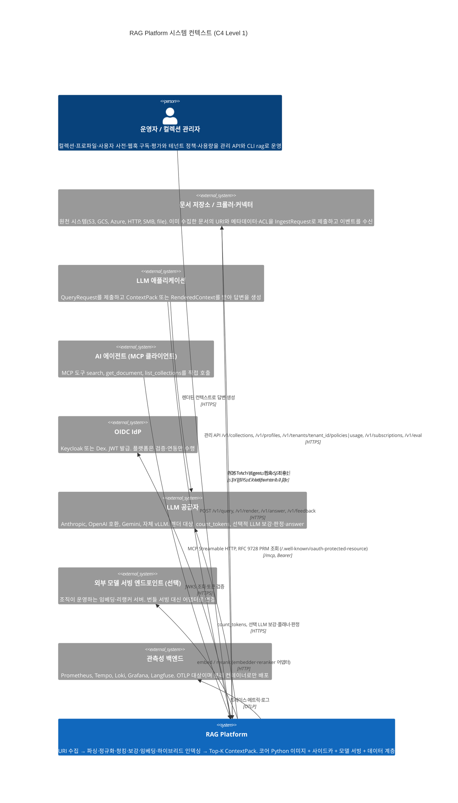
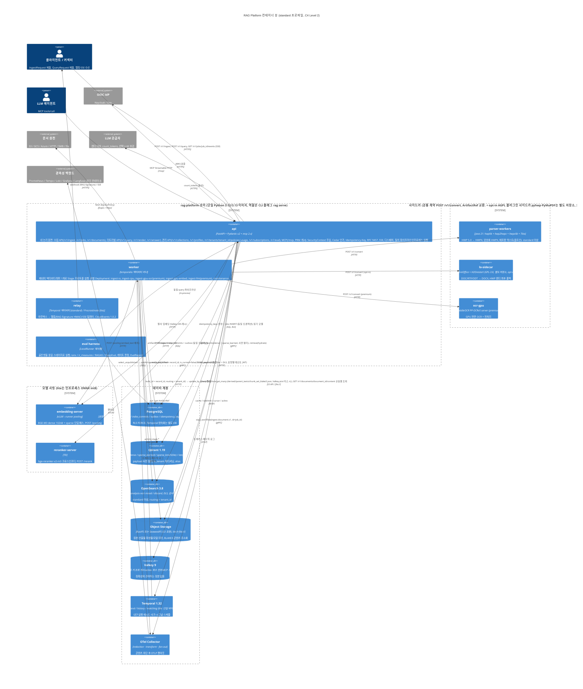
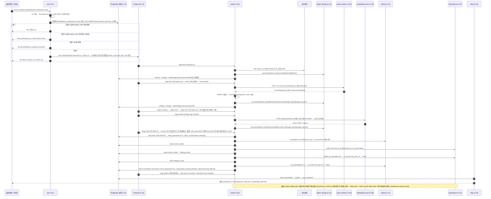
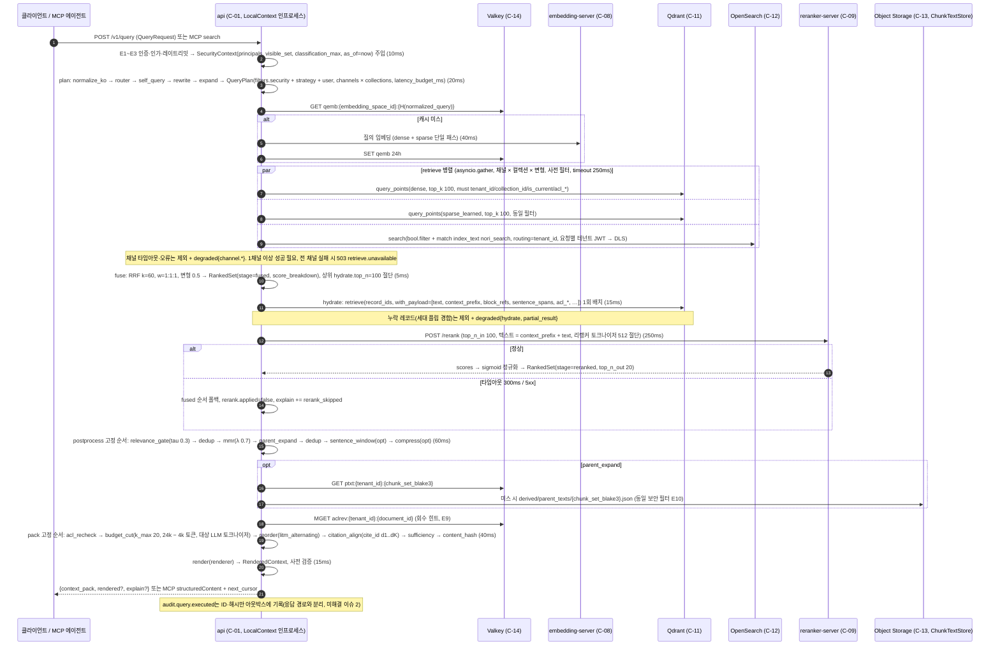
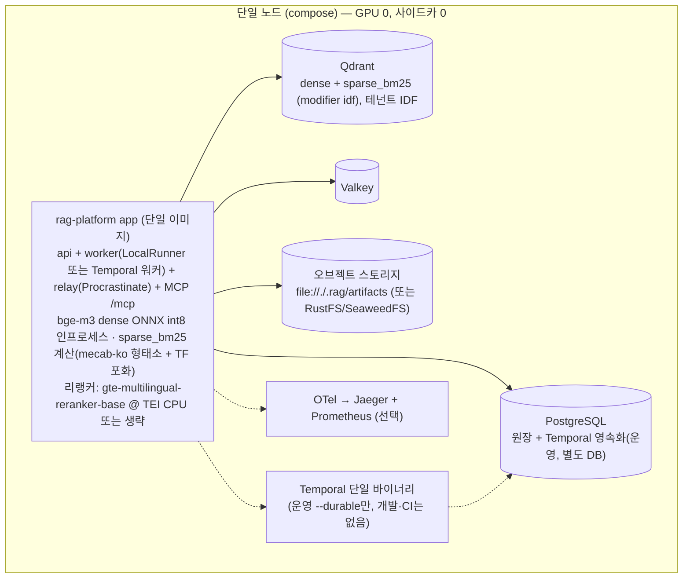
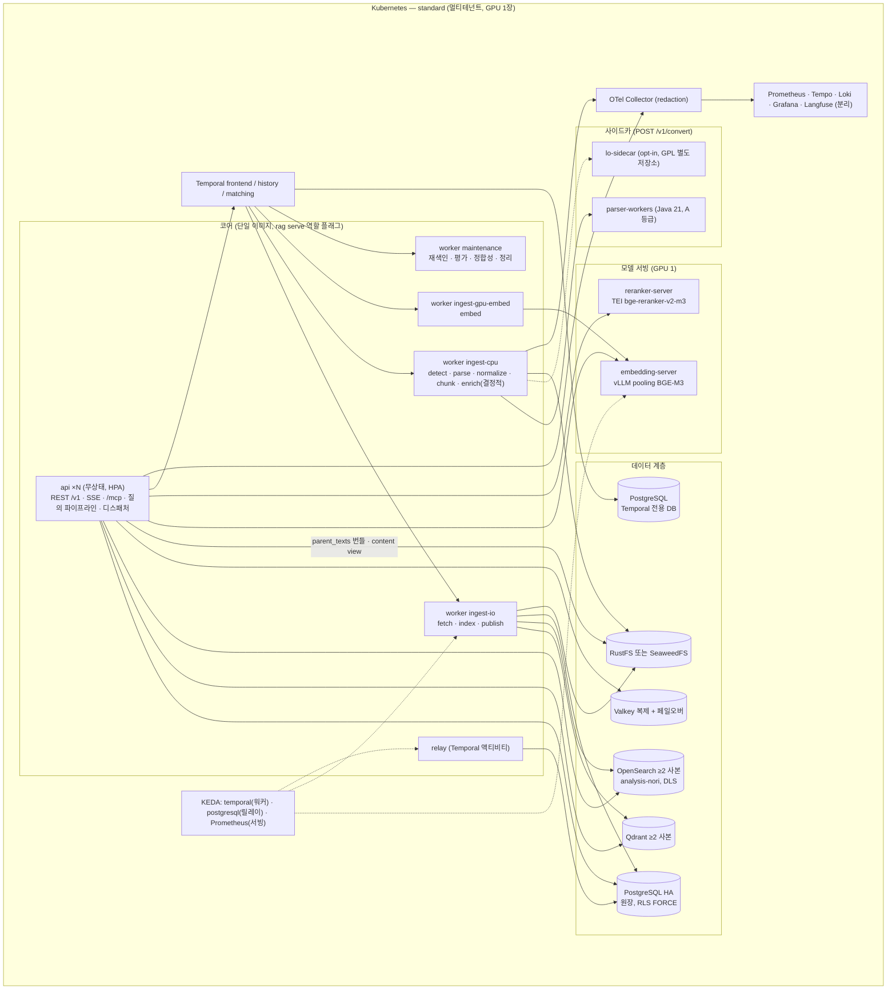
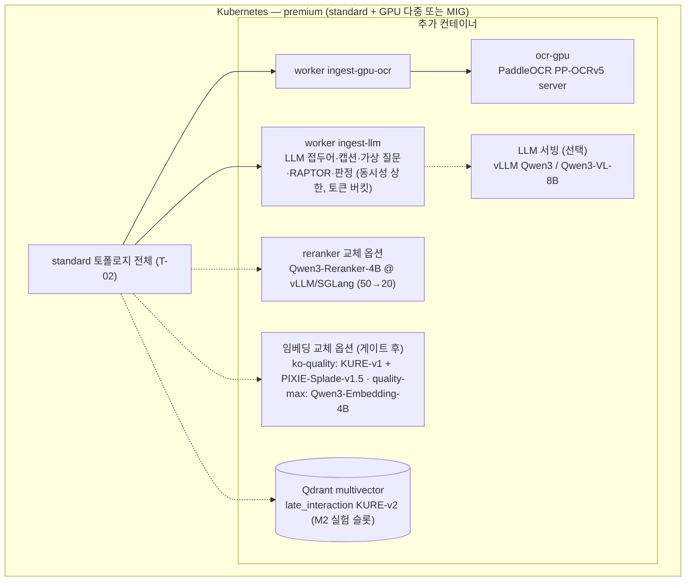

# 시스템 개요 (C4 Level 1-2)

## 목적

이 문서는 RAG Platform의 **시스템 컨텍스트(C4 Level 1)** 와 **컨테이너 뷰(C4 Level 2)** 를 한 장에 고정한다. 설계 바이블 §2가 확정한 컨테이너 이름·책임·격리 경계를 그대로 사용하되, (1) 외부 행위자와 시스템 경계, (2) 컨테이너별 책임·기술·스케일 단위·상태 보유 여부, (3) 수집·검색 두 주요 흐름의 시퀀스, (4) 배포 토폴로지 3종(`lite`·`standard`·`premium`), (5) 비기능 요구사항(NFR)을 달성하는 아키텍처 전술, (6) 기술 스택 요약을 덧붙여, 이후 02-architecture 하위 문서(컴포넌트·데이터 흐름·저장소·플러그인·오케스트레이션·보안·배포·장애 모드)가 공유하는 **지도**가 되게 한다.

이 문서는 새 타입·필드·열거값·엔드포인트·이벤트를 정의하지 않는다. 모든 식별자는 바이블 §4~§14의 정본을 인용하며, 본 문서가 부여하는 것은 참조용 컨테이너 번호(`C-nn`)·흐름 번호(`F-nn`)·토폴로지 번호(`T-nn`)·전술 번호(`QA-nn`)뿐이다.

## 범위

- **포함**: C4 Level 1 컨텍스트 다이어그램과 외부 행위자 표, C4 Level 2 컨테이너 다이어그램(`standard` 프로파일 기준)과 컨테이너 표, 컨테이너 간 통신 규약, 수집·검색 시퀀스 다이어그램, 배포 토폴로지 3종 개요, NFR → 아키텍처 전술 매핑, 기술 스택 요약.
- **제외**: 컴포넌트(C4 Level 3) 분해 → [컴포넌트 아키텍처](02-component-architecture.md); 계약 필드 정의 → [계약 개요](../03-contracts/00-contract-overview.md); 스테이지 알고리즘 → [파이프라인 프레임워크](../04-pipelines/01-pipeline-framework.md); Helm 값·리소스 요청량·네트워크 정책 세부 → [배포 아키텍처](08-deployment-architecture.md)와 [배포 가이드](../09-operations/01-deployment-guide.md); 장애 시나리오 상세 → [장애 모드와 복원력](09-failure-modes-and-resilience.md).
- **수치**: 실측 전 값은 모두 "초안 목표"다(바이블 §범위). 외부 라이브러리 버전은 선정 매트릭스 확인일(2026-09-18~22) 기준이며 잠금 파일(`uv.lock`, `models.lock`)이 정본이다.

## 1. 표기 규약

| 항목 | 규약 |
|------|------|
| C4 레벨 | Level 1 = 시스템 컨텍스트(사람·외부 시스템·본 시스템). Level 2 = 컨테이너(독립 배포·실행 단위: 프로세스, 컨테이너 이미지, 데이터 저장소). Level 3(컴포넌트)은 [컴포넌트 아키텍처](02-component-architecture.md)가 다룬다 |
| 컨테이너 이름 | 바이블 §2.2~§2.3의 이름을 그대로 쓴다: `api`, `worker`, `relay`, `eval harness`, `parser-workers`, `lo-sidecar`, `ocr-gpu`, `embedding-server`, `reranker-server`, PostgreSQL, Qdrant, OpenSearch, Object Storage, Valkey, Temporal, OTel Collector. 본 문서는 참조용 번호 `C-01`~`C-16`을 덧붙인다. 관측성 백엔드는 시스템 경계 밖의 외부 시스템이므로 컨테이너 번호를 부여하지 않고 §3.2 표 아래 각주로만 적는다 |
| 프로파일 표기 | `lite` / `standard` / `premium` / `korean-gov`(바이블 §7 `ProfileTier`). 다이어그램은 `standard`를 기준으로 그리고 프로파일별 차이는 표로 적는다 |
| 점선 | `flowchart`(§5)의 점선 간선 `-.->`은 프로파일 옵션·opt-in·폴백 경로다. C4 다이어그램(§2.1·§3.1)에는 점선 스타일이 없으므로 프로파일 차이는 라벨의 `(premium)`·`(opt-in)` 접미와 §3.2 표의 `lite 포함` 열로 적는다 |
| 격리 등급 | 어댑터 격리 3단 `in_process` / `helper_process` / `sidecar`(열거 타입명은 바이블 §5.7 `IsolationMode`, 값 정의는 §4.1), 라이선스 등급 A/B/C/D/X(D-02, [ADR-0001](../06-adr/0001-license-grade-table-and-d02-interpretation.md)) |
| 강제 지점 | `E1`~`E17`은 바이블 §10.3 멀티테넌시 강제 지점 번호다 |

## 2. 시스템 컨텍스트 (C4 Level 1)

### 2.1 컨텍스트 다이어그램

### 2.2 외부 행위자·시스템 표

| 행위자 / 외부 시스템 | 역할 | 플랫폼과의 접점 | 플랫폼이 책임지지 않는 것 |
|---|---|---|---|
| 문서 저장소 / 크롤러·커넥터 | 원천 시스템. 문서를 이미 수집해 두고 **위치(URI)와 메타데이터·ACL**을 제출한다(Pull 모델, 브리프 R1) | `POST /v1/ingest`·`POST /v1/ingest/batch`(`IngestRequest`, `Idempotency-Key` 필수), `202 {job_id, status_url, events_url}`, 웹훅·`GET /v1/events` SSE 수신. 플랫폼 `fetch` 스테이지가 `s3://`·`gs://`·`az://`·`http(s)://`·`file://`·`smb://`(플러그인)로 원본에 접근 | 크롤링·변경 감지·커넥터 운영(브리프 §6 비목표, FR-ING-16) |
| LLM 애플리케이션 | 최종 답변을 생성하는 앱·챗봇·백엔드 | `POST /v1/query` → `ContextPack`, `POST /v1/render` → `RenderedContext`, 선택 `POST /v1/answer`(레퍼런스 구현), `POST /v1/feedback`(`FeedbackEvent`) | 답변 생성 UI(FR-API-13), 대화 상태 관리 |
| AI 에이전트(MCP 클라이언트) | 에이전트 런타임이 플랫폼을 도구로 직접 호출 | `/mcp` Streamable HTTP(`mcp>=2,<3`), 도구 `search`·`get_document`·`list_collections`, `cursor`/`next_cursor` 페이지네이션(Valkey 핸들, 테넌트 바인딩), `structuredContent`(슬림 `ContextPack`, 20k 토큰 상한) | 에이전트 루프·도구 선택(클라이언트 책임). `search_batch`·`expand`는 v1.1 후보 |
| 운영자 / 컬렉션 관리자 | 컬렉션·프로파일·사용자 사전·웹훅 구독·평가 운영, 테넌트 정책·사용량 관리 | 관리 API(`/v1/collections`, `/v1/profiles`, `/v1/profiles/validate`, `/v1/tenants/{tenant_id}/policies`, `/v1/tenants/{tenant_id}/usage`, `/v1/subscriptions`, `/v1/eval/*`; 바이블 §14), CLI `rag` | 사용자 계정·그룹 관리(IdP 책임). 테넌트 생성·목록 엔드포인트는 바이블 §14에 없다(미해결 이슈 12) |
| OIDC IdP | 인증 서버(레퍼런스 Keycloak, 경량 Dex) | `api`가 JWKS로 JWT 검증(E1), MCP용 RFC 9728 PRM 게시(`GET /.well-known/oauth-protected-resource`) | 플랫폼은 자체 사용자 저장소를 두지 않는다(FR-SEC-01). API 키는 `service:` 주체용 보조 수단이며 `api_keys` 표는 해시만 보관 |
| LLM 공급자 | Anthropic · OpenAI 호환 · Gemini · 자체 vLLM | 렌더러 대상(`Renderer` 9종, 바이블 §5.7), 선택 `count_tokens`(정확 토큰 카운트), 선택 LLM 보강·`quality` 변형 플래너·판정·`answer` | 기본 프로파일은 LLM 호출 없이 동작한다(O-05 기본 끔, [ADR-0016](../06-adr/0016-llm-enrichment-default-off-and-budget-policy.md)) |
| 외부 모델 서빙 엔드포인트(선택) | 조직이 이미 운영하는 임베딩·리랭커 서버 | `embedder`·`reranker` 어댑터가 HTTP로 연결(FR-EMB-04, FR-RNK-03). 같은 임베딩 공간 안의 서빙 교체는 코사인 ≥ 0.9999 동등성 게이트(D-16) | 기본은 플랫폼 번들 `embedding-server`·`reranker-server`(§3) |
| 관측성 백엔드 | Prometheus · Tempo · Loki · Grafana · Langfuse 등 | OTel Collector가 OTLP로 전달. Grafana·Tempo·Loki(AGPL)·Langfuse·Phoenix(ELv2)는 분리 컨테이너·OTLP 대상으로만(D-11, [ADR-0022](../06-adr/0022-observability-genai-semconv-pin-and-license-boundary.md)) | 코어 이미지에 pip·코드 의존 금지 |

### 2.3 시스템 경계

| 포함(플랫폼 소유) | 제외(비목표, 훅만 제공) |
|---|---|
| 수집 API, 파서군, 정규화, 청킹, 보강, 임베딩, 인덱싱, 리트리벌 API, 컨텍스트 패킹, MCP 서버, 관리 API, 평가 하네스, 관측성 계측, 배포 매니페스트, 플러그인 SDK, 클라이언트 SDK(Python/TypeScript) | 웹 크롤러·커넥터, 최종 답변 생성 UI, 모델 파인튜닝 파이프라인, 사용자 인증 서버(OIDC 연동만), 문서 편집. `POST /v1/answer`는 레퍼런스 구현으로만 제공(브리프 §6) |

## 3. 컨테이너 뷰 (C4 Level 2)

### 3.1 컨테이너 다이어그램(`standard` 프로파일)

바이블 §2.2의 정본 다이어그램을 이 문서의 관점(논리 API 표면, 태스크 큐 단위, 관측성 팬아웃)으로 다시 그린 것이다. 컨테이너 이름과 관계는 바이블과 동일하되, `api` → Object Storage 읽기 간선 하나는 바이블 §13.2(`ChunkTextStore` 기본 구현 `artifact_store`)와 §14(`GET /v1/documents/{document_id}/content`)에서 도출해 추가했다(바이블 §2.2에는 빠져 있어 갱신을 요청한다, 미해결 이슈 11). 컨테이너별 `lite` 미포함 여부는 §3.2 표의 `lite 포함` 열을 따른다.

핵심은 셋이다. (1) 코어는 **단일 Python 이미지**이며 역할은 CLI 플래그(`rag serve api|worker|relay`)로 갈린다. 작업 지시에 등장하는 "수집 API·리트리벌 API·관리 API·MCP 서버"는 별개 컨테이너가 아니라 `api` 컨테이너 안의 **네 논리 표면**이다 — "네 논리 표면"은 본 문서의 참조 용어이며, 바이블 §2.2는 `api` 단일 컨테이너에 REST `/v1` · SSE · `/mcp` 마운트를 묶어 그리고 §2.3 `api` 행·§14 경로 표가 그 책임과 경로를 정의한다. (2) 사이드카는 모두 `POST /v1/convert` 하나의 계약(`ConvertRequest`/`ConvertResponse`)으로 호출되고 페이로드는 `ArtifactRef`다([ADR-0033](../06-adr/0033-sidecar-convert-contract-and-isolation-ladder.md)). (3) 검색 경로는 `api` 프로세스 안에서 인프로세스로 실행되며 Temporal도 PostgreSQL도 거치지 않는다(D-17, [ADR-0034](../06-adr/0034-retrieval-hot-path-postgres-independence-and-hydrate.md)). Object Storage만은 `parent_expand`의 부모 텍스트 번들(바이블 §13.2, Valkey `ptxt:` 미스 시)과 문서 산출물 조회에서 `api`가 직접 읽는 **소프트 의존성**이다 — 불가 시 검색은 `parent_expand`만 생략하고 `degraded{parent_expand}`로 응답한다.

### 3.2 컨테이너 책임·기술·스케일 단위·상태 표

"상태 보유"는 그 컨테이너가 사라지면 복구 불가능한 정본(source of truth)을 갖는지를 뜻한다. "투영"은 원장·산출물에서 100% 재구성 가능한 파생 상태다(NFR-REL-12).

| 번호 | 컨테이너 | 책임(소유) | 기술(매트릭스 1차 선택, 잠금 파일 정본) | 스케일 단위 | 상태 보유 | `lite` 포함 |
|------|----------|-----------|------|------|------|------|
| C-01 | `api` | 인증(OIDC JWT·API 키) → `PrincipalResolver` → `SecurityContext` 주입(E1), Cedar 인가(E2), 레이트리밋 fail-closed(E3), `Idempotency-Key` 판정, RFC 9457, SSE, MCP 마운트(E14), **질의 파이프라인 인프로세스 실행**(`plan`~`render`; `parent_expand`의 `ChunkTextStore` 부모 번들은 Valkey `ptxt:` 미스 시 Object Storage에서 읽음), 잡 읽기 모델 조회, `GET /v1/documents/{document_id}/content` 산출물 조회, 디스패처(문서 단위 직렬화·테넌트 동시성), `acl_recheck`·`audit` 이벤트 | FastAPI 0.141 + Pydantic 2.13 + uvicorn 0.53 + sse-starlette 3.4 + `mcp` 2.x + Authlib + cedarpy(Cedar 4.12) | 무상태 replica(HPA: RPS·CPU). 세션 친화성 없음(NFR-SCAL-04) | 없음(컬렉션 스펙·프로파일·현재 세대는 Valkey 또는 인메모리 캐시 사본, `collection.profile.changed`로 무효화) | 예 |
| C-02 | `worker` | `Stage[In, Out]` 제네릭 액티비티 래퍼: `ArtifactRef` 로드 → 실행 → 콘텐츠 주소화 저장 → 계보 기록, `stage_key` 캐시 판정, 하트비트·`Resumable`, 사이드카 호출, `index` 세대 사가 | `temporalio` 1.33 액티비티 러너, `pydantic_data_converter`, `TracingInterceptor`; 어댑터는 A 등급 순수 Python만 인프로세스 | **큐별 Deployment** + KEDA `temporal` 스케일러(`minReplicaCount: 1`): `ingest-io`, `ingest-cpu`, `ingest-gpu-embed`, `maintenance`(standard), + `ingest-gpu-ocr`, `ingest-llm`(premium). GIL은 프로세스 다중화 + `max_concurrent_activities` 고정 슬롯으로 대응 | 없음(산출물은 Object Storage, 원장은 PostgreSQL) | 예(`LocalRunner`는 `api`와 동일 프로세스, 운영 `--durable`은 Temporal 워커) |
| C-03 | `relay` | 아웃박스 릴레이 순수 코어 3함수(`select_unpublished → publish → mark_published`), 웹훅 `RAG-Signature` HMAC-SHA256 서명(E16), 테넌트 스코프 구독 필터(E12), SSE 팬아웃 | Temporal 액티비티(standard) / Procrastinate 3.9(lite, PostgreSQL `LISTEN/NOTIFY` + `SKIP LOCKED`) | 프로세스, KEDA `postgresql` 스케일러(아웃박스 미발행 건수) | 없음(진행 커서는 `outbox.published_at`) | 예(Procrastinate) |
| C-04 | `eval harness` | 골든셋(TREC qrels/run + `answer_spans` JSONL) 로딩, **프로덕션과 동일한 인프로세스 스테이지 실행**, ranx/ir_measures 메트릭(nDCG 선형 이득, Holm 보정), RAGAS/DeepEval 판정, 프로파일 `gate` 판정, `EvalReport` | `LocalRunner` + ranx 0.3.21 + ir_measures 0.4.3 + RAGAS 0.4.3 + DeepEval 4.2.3 | 잡 단위(`eval.run.v1`, `maintenance` 큐 또는 CI 프로세스) | 없음(결과는 PostgreSQL `eval_runs`·`eval_reports`, 데이터셋은 Object Storage `eval/datasets/`) | 예(소형 골든셋) |
| C-05 | `parser-workers` | HWP 5.0 → HWPX 변환, 암호화 HWPX(자격 증명 제공 시), 배포용 문서 텍스트(Tika `HwpV5Parser`, `quality=degraded`, 테넌트 옵트인) | Java 21: hwplib 1.1.11 + hwp2hwpx + hwpxlib 1.0.9 + Tika 3.2.1 — 모두 Apache-2.0(A 등급) | CPU Deployment, HPA. 요청은 `POST /v1/convert`, 상태는 `GET /healthz` | 없음(변환본은 `derived` 산출물로 워커가 저장) | 아니오(`lite`는 unhwp `helper_process` → hwp-hwpx-parser) |
| C-06 | `lo-sidecar` | DOC/RTF/ODT → DOCX 변환, HWP 렌더 최후 폴백(H2Orestart), tini·프로세스 그룹 KILL·프로파일 락 분리·네트워크 차단 | LibreOffice 26.8 headless(MPL-2.0) + H2Orestart(GPL-3.0, C 등급) — 별도 저장소 `rag-platform-gpl-sidecars`, Helm `optIn.*` | CPU Deployment(opt-in), 요청당 프로세스 격리 | 없음(임시 프로파일 디렉터리만) | 아니오 |
| C-07 | `ocr-gpu` | 스캔 PDF 전면 OCR + 전처리(방향·왜곡 보정), 페이지 단위 부분 산출물 | PaddleOCR 3.7 PP-OCRv5 server det + korean mobile rec(Apache-2.0) | GPU Deployment(premium), 큐 `ingest-gpu-ocr`와 짝 | 없음 | 아니오(`lite`·`standard`는 RapidOCR CPU 인프로세스) |
| C-08 | `embedding-server` | BGE-M3 3-in-1(dense 1024d + sparse 단일 패스) 문서·질의 임베딩. 프롬프트·접두어는 어댑터가 소유 | vLLM 0.29 `--runner pooling`(`BgeM3EmbeddingModel` + sparse 플러그인). dense 전용 모델은 TEI 1.9.4 — [ADR-0009](../06-adr/0009-embedding-serving-vllm-pooling-tei-inprocess.md) | GPU Deployment + KEDA(Prometheus 큐 깊이·지연), 0→1 < 3분 목표(NFR-PERF-17) | 없음(모델 가중치는 Object Storage `models/` 미러에서 로드) | 아니오(sentence-transformers ONNX int8 인프로세스) |
| C-09 | `reranker-server` | 크로스인코더 리랭킹(top-100→20), TEI/Cohere 응답 스키마 2종 | TEI 1.9.4 + `BAAI/bge-reranker-v2-m3`(Apache-2.0) | GPU Deployment + KEDA | 없음 | 아니오(gte-multilingual-reranker-base @ TEI CPU top-30→10, 또는 생략) |
| C-10 | PostgreSQL | **원장 정본**: `tenants`, `api_keys`, `collections`, `profiles`, `documents`, `jobs`, `job_events`, `idempotency_keys`, `artifacts`, `lineage`, `index_commits`, `outbox`, `subscriptions`, `usage_ledger`, `user_dictionary_entries`, `calibrations`, `eval_*`, `feedback_events`, `audit_log`(바이블 §13.1). 모든 표 `tenant_id` + RLS `FORCE`. Temporal 영속화·가시성은 **별도 DB** | PostgreSQL(HA, PITR: RPO ≤ 5분 초안, NFR-REL-15) | 수직 + 스트리밍 복제·자동 페일오버. 검색 핫패스가 읽지 않으므로 검색 QPS와 무관 | **예(정본)** | 예 |
| C-11 | Qdrant | dense·sparse 벡터 검색, payload 사전 필터, `hydrate` 배치 `retrieve`, alias(blue/green), `set_payload` 플립. `lite`는 `sparse_bm25`(플랫폼 계산 BM25 포화값, `modifier: idf`)도 저장 | Qdrant 1.19.x(Apache-2.0), named vectors `dense`(cosine, HNSW `m=0`, `payload_m=16`)·`sparse_learned`·`sparse_bm25`·`late_interaction`(opt) | 물리 컬렉션 `rag_vec_{embedding_profile_hash[:12]}` 샤드·복제(ENV-M 사본 ≥ 2), 테넌트 100만 청크 초과 시 `shard_key` 승격(E15) | 투영(산출물에서 재적재 가능) | 예 |
| C-12 | OpenSearch | BM25 렉시컬 검색(Nori `mixed` 색인 / `discard` 질의, 사용자 사전), `tenant_id` custom routing, filtered alias, Security DLS 이중 방어(E8), `korean-gov` 감사 인덱스 | OpenSearch 3.8 + `analysis-nori` + Security 플러그인(Apache-2.0) | 물리 인덱스 `rag_lex_{lexical_profile_hash[:12]}` 샤드·복제 ≥ 2, 대형 테넌트 `_t_{tenant_id}` 전용 인덱스 | 투영 | 아니오 |
| C-13 | Object Storage | 원본(`sources/`), 스테이지 산출물(`artifacts/`), 파생물(`derived/`, 부모 텍스트 번들 포함), 평가 셋, 모델 가중치 미러(`models/` + `LICENSE` + `models.lock`), 스냅샷 — BLAKE3 콘텐츠 주소화, 키는 `tenants/{tenant_id}/` 접두(E5, 바이블 §13.3). 쓰기는 C-02, 읽기는 C-02(산출물·파생물)와 C-01(부모 텍스트 번들·산출물 조회, 소프트 의존성) | RustFS 또는 SeaweedFS(둘 다 Apache-2.0, ADR 실측 후 택1) / 클라우드 S3 / 개발 `file://` — [ADR-0011](../06-adr/0011-kv-and-object-storage-valkey-rustfs-seaweedfs.md) | 스토리지 자체 스케일(내구성 위임, NFR-REL-11) | **예(정본: 원본·산출물)** | 예(`file://./.rag/artifacts`) |
| C-14 | Valkey | 질의 임베딩 24h·토큰 카운트·플랜 캐시, 레이트리밋, `Idempotency-Key` **조회 캐시**(판정 정본은 PostgreSQL), ACL 회수 힌트 `aclrev:`(E9), MCP 커서 핸들(10분), 그룹 확장 캐시, 부모 텍스트 캐시 | Valkey 9.x(BSD-3, Redis 프로토콜 호환) | 복제 + 자동 페일오버(ENV-M) | 휘발(정확성 비관여: 불가 시 PostgreSQL 판정 또는 `degraded`, NFR-AVL-09) | 예 |
| C-15 | Temporal | 내구 워크플로우 실행(`ingest.document.v1`, `reprocess.document.v1`, `delete.document.v1`, `acl.update.v1`, `reindex.collection.v1`, `build.graph.v1`, `eval.run.v1`, `maintenance.consistency.v1`, `maintenance.cleanup.v1`, `tier.promotion.v1` 10종, 바이블 §11.2; `JobKind` 열거 9종은 `maintenance.cleanup.v1`을 잡으로 노출하지 않음), 재시도·하트비트·타임아웃·사가·시그널·스케줄, `Replayer` 결정론 | Temporal Server 1.32(MIT), frontend/history/matching 분리, 영속화·advanced visibility 모두 PostgreSQL | 역할별 수평 확장(standard), 단일 바이너리(lite 운영), 없음(개발·CI는 `LocalRunner`) | PostgreSQL에 위임(별도 DB) | 단일 바이너리(운영) / 없음(개발) |
| C-16 | OTel Collector | 콘텐츠 redaction(기본 `content_capture=none`, `korean-gov` `NO_CONTENT` 잠금, E13), 속성 transform, 백엔드 팬아웃 | OpenTelemetry Collector | DaemonSet 또는 Deployment(배치는 미해결 이슈 4) | 없음 | 선택 |

표 밖 항목(컨테이너 번호 없음):

- **관측성 백엔드(외부 시스템, 컨테이너 아님; §2.1 `System_Ext`, §2.2 표 참조)**: 메트릭·트레이스·로그·LLM 관측 저장·대시보드. Prometheus, Tempo·Loki·Grafana(AGPL, C 등급 분리 컨테이너), Langfuse(OTLP), 경량 Jaeger; AGPL 불가 시 OpenSearch Observability + Perses 또는 VictoriaMetrics/VictoriaLogs + Jaeger. 관측 데이터를 보유하지만 코어 정본이 아니며 시스템 경계 밖이다. `lite`는 Jaeger + Prometheus 선택(D-11, [ADR-0022](../06-adr/0022-observability-genai-semconv-pin-and-license-boundary.md)).
- **옵트인 AGPL 플러그인 사이드카(C-06 `lo-sidecar`와 동일 패턴)**: `rag-plugin-pyhwp-sidecar`(pyhwp, HWP 5.0 폴백 파서)·`rag-plugin-pymupdf-sidecar`(PyMuPDF, PDF 파서) — 라이선스 C 등급(AGPL), 격리 등급 `sidecar`, 계약 `POST /v1/convert` + `ArtifactRef` + `GET /healthz`, 별도 저장소 `rag-platform-gpl-sidecars`에서 독립 빌드·릴리스, 본 저장소는 Helm `optIn.*` 값과 이미지 참조만 둔다. 모든 프로파일에서 기본 미포함(`lite` 불가)이며 컬렉션 프로파일이 `parser` 플러그인으로 명시 선택할 때만 배포한다(바이블 §4.1 격리 모드, §6.7, §12; D-02, D-18, [ADR-0006](../06-adr/0006-pdf-fast-path-pypdfium2-pdftext-replaces-pymupdf.md), [ADR-0007](../06-adr/0007-hwp5-java-sidecar-first-pyhwp-demoted.md)).

### 3.3 핵심 아이디어(K1~K7)의 컨테이너 배치

바이블 §2.1의 일곱 아이디어가 어느 컨테이너에서 실현되는지를 고정한다. 이후 문서는 이 배치를 바꾸지 못한다.

| 아이디어 | 실현 컨테이너 | 실현 방식 |
|----------|---------------|-----------|
| K1 단일 좌표계 | C-02 `worker`(생산), C-11 Qdrant(payload 보관), C-01 `api`(`hydrate`·`pack`에서 소비) | `IndexRecord.block_refs[]`·`sentence_spans[]`를 Qdrant payload에 저장하고 `hydrate`가 1회 배치로 읽는다. PostgreSQL을 거치지 않는다 |
| K2 3-텍스트 규칙 | C-02 `worker`(`chunk`·`enrich`·`embed`·`index`), C-11·C-12(각각 `embed_text` 벡터·`index_text` BM25) | `text`(표시) / `embed_text`(dense·sparse 입력) / `index_text`(BM25 입력) 분리, `strip_offsets`로 대칭 강제 |
| K3 점수 원장 | C-01 `api`(`retrieve → fuse → rerank → postprocess → pack`) | `CandidateSet` 채널 원점수 → `RankedSet.score_breakdown`(Σ contribution = `fused_score`) → `ContextPack.confidence_tier`. 융합은 플랫폼 `fuser`가 수행하므로 서버 융합 위임은 `lite` 단일 컬렉션 질의만 |
| K4 예산·순서·인용이 있는 팩 | C-01 `api`(`pack`·`render`), C-14 Valkey(토큰 카운트 캐시), 외부 LLM 공급자(`count_tokens` 옵션) | `pack` 내부 고정 순서 `acl_recheck → budget_cut → reorder → citation_align`, 대상 LLM 토크나이저 이중 카운트 |
| K5 하나의 커널·두 개의 셸 + 단일 해시 식 | C-01 `api`(`LocalRunner`·`LocalContext`), C-02 `worker` + C-15 Temporal(`TemporalContext`), C-13 Object Storage(`stage_key` 경로) | 파이프라인 정의는 `PipelineContext`만 의존(`temporalio` 임포트 금지 린트). `stage_key = H("stage", stage_name, scope_key, input_ref.blake3, fingerprint)`가 멱등성 키 = 캐시 키 = 산출물 경로 |
| K6 원장 중심 + 세대 사가 | C-10 PostgreSQL(정본), C-02 `worker`(사가 실행), C-11·C-12(투영) | `IndexCommit` 9단 상태(`CommitStatus`), `index_generation`/`is_current` 플립(렉시컬 → 벡터), `record_id`가 세대를 포함해 세대 공존, 복구는 산출물 재적재 |
| K7 격리 등급 1급 + 품질 게이트 프로파일 | C-02 `worker`(격리 사다리 호출자), C-05~C-07 사이드카, C-04 `eval harness`(게이트), C-01 `api`(프로파일 로더·검증) | `TieringPolicy` 하나로 어댑터 격리 3단과 테넌트 격리 3단 선언, 프로파일 `extends` 단일 상속 + 모든 품질 기본값에 `gate` |

### 3.4 컨테이너 간 통신 규약

| 출발 → 도착 | 프로토콜 | 페이로드·계약 | 규약·강제 지점 |
|---|---|---|---|
| 클라이언트 → C-01 `api` | HTTPS REST `/v1`, SSE | JSON(`IngestRequest`, `QueryRequest`, `JobStatus`, `ContextPack`…), RFC 9457 `ProblemDetails` | `Idempotency-Key`(수집), `RateLimit`·`RateLimit-Policy`, `Deprecation`·`Sunset`; 본문에 `tenant_id`가 오면 422(E1) |
| MCP 클라이언트 → C-01 `api` | MCP Streamable HTTP `/mcp` | `search`·`get_document`·`list_collections` 도구, `structuredContent` | `Authorization: Bearer`, audience 검증, PRM 게시, 커서 `tenant_id` 바인딩(E14) |
| C-01 → OIDC IdP | HTTPS | JWKS | 캐시된 JWKS로 JWT 검증(Authlib) |
| C-01 → C-10 PostgreSQL | SQL(RLS `FORCE`, `SET LOCAL app.tenant_id`) | `idempotency_keys` 판정 + `jobs` INSERT **동일 트랜잭션**, 잡 읽기 모델, 관리 API CRUD | 검색 핫패스(`plan`~`render`)는 **읽지 않는다**(ADR-0034) |
| C-01 → C-15 Temporal | gRPC(`temporalio` 클라이언트) | `start_workflow(ingest.document.v1, id=job_id, id_conflict_policy=USE_EXISTING)`, `signal(cancel)`, `execute_update(set_priority)`, `query(get_status)` | Temporal 불가 시 503 + `Retry-After`, 잡 `queued` 유지, 조정 스케줄 재시작 |
| C-15 → C-02 `worker` | 태스크 큐 long-poll | 액티비티 `stage.{stage_name}`, 인자는 `ArtifactRef`만(2MB 한계) | `StagePolicy`(`start_to_close`, `heartbeat`, `max_attempts`, `non_retryable_error_codes`) |
| C-02 → 문서 원천 | fsspec(s3fs/gcsfs/adlfs) · httpx · smbprotocol(플러그인) | 원본 바이트 | `EgressPolicy`: 스킴 허용 목록, 사설·루프백·메타데이터 CIDR 거부, DNS 해석 후 고정 연결, 리다이렉트 재검사(E16); `fetch`는 캐시 대상 아님 |
| C-02 → C-13 Object Storage | S3 API / `file://` | 원본·산출물·파생물 | 키 `tenants/{tenant_id}/…`(바이블 §13.3), `ArtifactRef.blake3` 바이트 해시 |
| C-01 → C-13 Object Storage | S3 API / `file://` | 부모 텍스트 번들 `derived/parent_texts/{chunk_set_blake3}.json`(`ChunkTextStore.get_many`, 기본 구현 `artifact_store`, 바이블 §13.2); 산출물 조회(`GET /v1/documents/{document_id}/content?view=parsed\|normalized\|chunks`, 바이블 §14) | 동일 보안 필터(E10; 번들은 문서 ACL 상속). 번들은 Valkey `ptxt:{tenant_id}:{chunk_set_blake3}` 24h 미스 시에만 읽음. 검색의 **소프트 의존성**: 미스·불가 시 `postprocess.parent_text_miss` → 확장 생략 + `degraded{parent_expand}`, 검색 자체는 성공 |
| C-02 → C-05/C-06/C-07 사이드카 | HTTP `POST /v1/convert`, `GET /healthz` | `ConvertRequest → ConvertResponse`(본문은 `ArtifactRef`), RFC 9457 | 서비스 디스커버리 주소만(E16); `parse.sidecar_unavailable` 재시도 후 폴백 체인; 스트리밍 필요 시 페이지 단위 부분 산출물 + 폴링(O-10) |
| C-02 → C-08 `embedding-server` | HTTP `POST /pooling` | `embed_text` 배치(`ingest.embed.batch_max_tokens`) | `embed.server_unavailable` 재시도(최대 간격 5m), `embed.space_mismatch` 비재시도 |
| C-02 → C-11 Qdrant | gRPC(`prefer_grpc=True`) | `upsert`(배치 256), `set_payload`, `delete_by_filter` | `point_id = uuid5(NAMESPACE_RAG_CHUNK, record_id)`, 보안 필드 누락 시 배치 전체 거부(E5) |
| C-02 → C-12 OpenSearch | HTTP | `bulk`(`_id = record_id`, `routing = tenant_id`), `update_by_query` | 플립 `conflicts=proceed` + 재시도 3 |
| C-02 → C-10 PostgreSQL | SQL | `artifacts` + `lineage` + `index_commits` + `outbox` **동일 트랜잭션** | `commit_id`·`event_id`는 워크플로우가 1회 발급(재시도 불변) |
| C-01 → C-11 Qdrant | gRPC | `query_points(dense)`, `query_points(sparse_learned)` **두 호출**, `retrieve(record_ids, with_payload)` | 사전 필터 `filters.security + strategy + user`(E7), `tenant_id` 부재 시 `retrieve.security_context_missing` |
| C-01 → C-12 OpenSearch | HTTP | `bool.filter + match(index_text, nori_search) + should(...)`, `routing=tenant_id` | 요청별 단명 테넌트 JWT(TTL ≤ 60s, `aud=opensearch`) → DLS 이중 방어(E8) |
| C-01 → C-08 / C-09 | HTTP | 질의 임베딩 / `POST /rerank`(TEI `texts`·`score` 또는 Cohere `documents`·`relevance_score`) | 임베딩은 Valkey `qemb:` 24h; 리랭크 타임아웃 300ms → fused 순서 폴백 + `rerank_skipped` |
| C-01 → C-14 Valkey | RESP | `qemb:`, `plan:`, `tok:`, `ptxt:`, `rr:`, `idem:`, `aclrev:`, `rl:`, `cursor:`, `groups:`, `collspec:`(바이블 §13.4) | 테넌트 스코프 키는 `{tenant}` 접두 필수; 불가 시 PG 판정 또는 `degraded` |
| C-01 → LLM 공급자 | HTTPS | `count_tokens`(옵션), `quality` 플래너, `answer` | 실패 시 `approximate` + `calibration_ratio` + `degraded{token_count}` |
| C-03 `relay` → 구독자 | HTTPS 웹훅 / SSE | `CloudEventEnvelope`(1.0.2, `type = domain.entity.action`, `subject = tenant/{tenant_id}/…`, 확장 `tenantid`) | `RAG-Signature: t=…,v1=HMAC-SHA256`, 5분 재생 창; `webhook_url`은 등록 시·전송 시 `EgressPolicy` 검사(`outbox.egress_denied`); 소비자 멱등 키 `event_id` |
| 모든 코어 컨테이너 → C-16 OTel Collector | OTLP gRPC/HTTP | 스팬 `rag.{stage}`, 메트릭 `rag_<stage>_<name>_<unit>`, structlog JSON | 콘텐츠 캡처 기본 끔, `tenant_id`는 해시(`rag.tenant_id_hash`), 메트릭 라벨에 `tenant_id` 금지 |

### 3.5 의존 방향과 격리 경계

- **패키지 의존 방향(import-linter, 바이블 §12)**: `contracts ← sdk ← plugins | adapters | pipelines | retrieval | render ← orchestration | ledger | storage | security | profiles | eval ← api | mcp | cli`. `pipelines`·`retrieval`·`render`는 `temporalio`·`fastapi`·`ledger`를 모른다. 따라서 C-01과 C-02가 같은 이미지를 공유해도 검색 코드가 오케스트레이터에, 수집 코드가 웹 프레임워크에 결합되지 않는다.
- **어댑터 격리 사다리**: `in_process`(A 등급 순수 Python: python-hwpx, pdftext, Docling, Trafilatura 등) → `helper_process`(`multiprocessing spawn`, 네이티브 크래시 위험: unhwp) → `sidecar`(JVM·LibreOffice·CUDA·GPL/AGPL: C-05~C-07). 격리 등급은 `PluginMeta`와 프로파일에 선언되고 SDK가 검증한다.
- **라이선스 경계**: 코어 이미지는 A 등급만 인프로세스 의존(D-02). GPL/AGPL 이미지·플러그인(`lo-sidecar`, `rag-plugin-pyhwp-sidecar`, `rag-plugin-pymupdf-sidecar`)은 별도 저장소 `rag-platform-gpl-sidecars`에서 독립 빌드·릴리스하고 본 저장소는 Helm `optIn.*` 값과 이미지 참조만 둔다(바이블 §6.7; 배포 단위로서의 책임·격리·opt-in 조건은 §3.2 표 밖 항목). 관측 스택의 AGPL·ELv2 제품은 OTLP 대상·분리 컨테이너로만(외부 시스템, §3.2 표 밖 항목).
- **네트워크 경계**: 워커·릴레이는 NetworkPolicy로 내부망 egress를 차단하고 `EgressPolicy`를 이중 방어로 둔다(E16). 사이드카는 서비스 디스커버리 주소로만 호출된다.

## 4. 주요 흐름

### 4.1 F-01 수집 흐름: API → Temporal → 스테이지 → 커밋 → 이벤트

`standard` 프로파일, 스캔 없는 HWP 5.0 문서 1건이 정상 처리되는 경로다. `fetch`를 제외한 모든 스테이지 실행 전에 셸이 `artifacts(tenant_id, stage_key)` 행을 조회해 `cache_hit`이면 실행을 생략한다(그림에서는 생략; 바이블 §4.1 멱등성 키 행). `fetch`는 캐시 대상이 아니라 항상 다운로드하며 검증자(`etag`·`last_modified`)가 있을 때만 조건부 GET을 쓴다(바이블 §4.2 `fetch` 행, [ADR-0037](../06-adr/0037-artifact-cache-scope-and-stage-key-composition.md)). 오브젝트 키는 바이블 §13.3 정본 형식을 그대로 쓴다. 각 스테이지 종료는 `job.state.changed`와 `ingest.document.{fetched|parsed|normalized|chunked|enriched|embedded|indexed}` 이벤트를 아웃박스에 남긴다.

흐름의 불변식(바이블 §4.1, §11.4):

| 불변식 | 의미 |
|--------|------|
| 멱등 접수 | `idempotency_keys(tenant_id, key)`가 판정 정본이고 `jobs` INSERT와 같은 트랜잭션이다. Valkey `idem:`은 조회 캐시일 뿐이다 |
| 경계 페이로드 = `ArtifactRef` | 오케스트레이터를 넘는 값은 `ArtifactRef` 하나. 계약 인스턴스 변환·저장·계보는 셸(액티비티 래퍼)이 담당한다 |
| 캐시 = 멱등성 = 경로 | `stage_key`에 `scope_key = tenant_id/collection_id/document_id`가 들어가므로 같은 바이트를 다른 테넌트·컬렉션이 수집해도 봉투가 다른 산출물은 재실행된다. 봉투 없는 콘텍스트 전용 캐시(`sources/`, `derived`, 청크 임베딩, LLM 보강)만 테넌트 내 공유([ADR-0037](../06-adr/0037-artifact-cache-scope-and-stage-key-composition.md)) |
| 세대 공존 | `record_id = H("record", tenant_id, collection_id, document_id, str(index_generation), chunk_id)`이므로 새 세대는 이전 세대를 덮어쓰지 않고 `is_current` 플립까지 검색에 보이지 않는다([ADR-0026](../06-adr/0026-index-commit-generation-saga-and-ledger.md)) |
| 부분 성공 | 페이지 단위 실패·LLM 예산 소진은 잡을 `partial`로 끝내고 비LLM 결과는 커밋한다. `quality=degraded` + `warnings[]` + `page_status[]` |
| 잡 상태 정본 | PostgreSQL `jobs`(`JobState`: `queued, running, succeeded, partial, failed, cancelling, cancelled`). Temporal은 실행 엔진이며 불일치 시 `handle.query(get_status)`로 보정 |

### 4.2 F-02 검색 흐름: API → 플래너 → 병렬 리트리버 → 융합 → 리랭크 → 패킹

`standard` GPU 프로파일, `mode=hybrid`, 단일 컬렉션, `retrieval_variant=default`. 전 구간이 `api` 프로세스 안의 `LocalContext`에서 실행되고 Temporal·PostgreSQL을 거치지 않는다. 괄호의 ms는 바이블 §8.3 지연 예산(p95 800ms, 초안)이다.

흐름의 불변식(바이블 §4.3, §8, §10.2):

| 불변식 | 의미 |
|--------|------|
| 오케스트레이터·원장 미경유 | 검색 경로는 `LocalContext`로 `api` 안에서 실행되고 PostgreSQL을 읽지 않는다. 컬렉션 스펙·프로파일·현재 세대는 캐시 사본(ADR-0034). Object Storage는 `parent_expand`의 `ChunkTextStore`(`artifact_store`, 바이블 §13.2)만 읽는 소프트 의존성이며 불가 시 확장만 생략한다(§3.4) |
| 사전 필터 | 모든 채널·모든 백엔드에 `filters.security`(테넌트·컬렉션·`is_current`·ACL·embargo·expires·classification)와 `filters.strategy`(`level_in`·`item_kinds`)가 사전 필터로 들어간다. 사후 필터로 격리를 구현하지 않는다(E7, FR-RET-06) |
| 결과 캐시 금지 | `retrieve`·`hydrate`는 ACL 시점성 때문에 결과를 캐시하지 않는다. 캐시는 질의 임베딩·토큰 카운트·플랜·부모 텍스트만 |
| 점수 원장 보존 | 융합은 플랫폼 `fuser`가 수행해 `score_breakdown`에 채널별 기여를 남긴다. `explain=true`면 `QueryPlan`과 분해 점수가 응답에 포함된다 |
| 지연 예산 전파 | `QueryPlan.latency_budget_ms`가 각 스테이지로 전파되고 사전 저하 순서(multi-query 끔 → `top_n_in`·`hydrate.top_n` 100→50 → 리랭크 끔 → 채널 축소, lexical 유지)가 적용된다 |
| ACL 재검증 | `pack.acl_recheck`가 hydrate payload ACL과 Valkey `aclrev:` 회수 힌트로 항목별 재평가한다. ACL 갱신·삭제가 백엔드에 전파되기 전의 질의에서도 회수된 문서는 반환되지 않는다(E9) |

### 4.3 두 흐름의 대비

| 관점 | F-01 수집 | F-02 검색 |
|------|-----------|-----------|
| 동기성 | 비동기 잡(`202` + `job_id`), at-least-once + 멱등 | 동기 요청-응답, 무상태 |
| 실행 셸 | Temporal(`TemporalContext`) 또는 `LocalRunner`(개발·CI·하네스) | 항상 `LocalContext` 인프로세스 |
| 상태 정본 | PostgreSQL 원장(`jobs`, `artifacts`, `lineage`, `index_commits`, `outbox`) | 없음(요청 스코프). 캐시는 Valkey |
| 경계 페이로드 | `ArtifactRef`만 | 인메모리 계약 인스턴스(`QueryPlan` → `CandidateSet` → `RankedSet` → `ContextPack`) |
| 실패 처리 | `StagePolicy` 재시도·비재시도 분류, 사가 보상, `partial` | 채널 제외 + `degraded[]`, 폴백(리랭크·카운트·힌트), 503 `retrieve.unavailable` |
| 확장 축 | 큐별 워커 Deployment(KEDA `temporal`) + GPU 서빙 | `api` replica + 벡터·렉시컬 백엔드 사본 + GPU 서빙 |
| 지연 목표(초안) | 텍스트 PDF 100p < 30s, 스캔 PDF 100p < 5min(GPU) | p95 < 800ms(GPU) / < 1.5s(CPU) |
| 이벤트 | `ingest.document.*`, `job.state.changed`, `index.commit.*` | `audit.query.executed`(ID·해시만), `feedback.query.*`(클라이언트 제출) |

## 5. 배포 토폴로지 3종 개요

세 토폴로지는 바이블 §7.1 프로파일 컴포넌트 표를 배포 단위로 옮긴 것이다. `korean-gov`는 `standard`의 변형(`extends standard`)이며 §5.4 표의 마지막 열로만 적는다. Helm 값·리소스 요청량·네트워크 정책은 [배포 아키텍처](08-deployment-architecture.md)가 확정한다.

### 5.1 T-01 `lite`: 단일 노드

GPU 0, 사이드카 0. 개발·소규모 팀·PoC용이며 `rag up --profile lite`로 기동한다(바이블 §11.6 "5분 기동"). 개발 모드는 `LocalRunner`(비내구), 운영은 `--durable`로 Temporal 단일 바이너리를 추가한다.

특징: OpenSearch가 없으므로 렉시컬 채널은 Qdrant `sparse_bm25`(`channel=lexical`, `retriever.qdrant_sparse_bm25`)로 대체된다([ADR-0012](../06-adr/0012-lite-profile-qdrant-only-client-bm25.md)). HWP 5.0은 unhwp(`helper_process`) → hwp-hwpx-parser, DOC은 `parse.unsupported_format`. 단일 컬렉션 질의는 Qdrant 서버 `Fusion.RRF(k=60)` 위임이 허용된다. p95 목표 1,500ms(CPU), `tenant_concurrent_jobs_max` 4.

### 5.2 T-02 `standard`: 멀티테넌트 Kubernetes, GPU 1

기본 프로파일. 3-way 하이브리드(Qdrant dense·sparse + OpenSearch BM25) + GPU 리랭커.

특징: 큐별 워커 Deployment로 CPU 바운드 파싱과 GPU 임베딩 호출이 분리되어 서로 스케일 신호를 오염시키지 않는다. OpenSearch DLS는 요청별 단명 테넌트 JWT로 이중 방어된다(E8). p95 목표 800ms(GPU), `tenant_concurrent_jobs_max` 32, 격리 등급 `payload_filter` → 100만 청크 초과 시 `shard_key` 승격.

### 5.3 T-03 `premium`: GPU 다중, 품질 우선

`standard`에 GPU OCR·LLM 보강·고품질 모델 옵션을 더한다. 기본값은 여전히 LLM 보강 끔(컬렉션 옵트인)이다.

특징: 스캔 PDF는 `ingest-gpu-ocr` 큐 + `ocr-gpu` 사이드카로 100p < 5min 목표(NFR-PERF-09)를 겨냥한다. `ingest-llm` 큐는 `max_concurrent_activities` + Valkey 테넌트 토큰 버킷 + 컬렉션 `enrichment_budget_tokens`(20,000 초안) + 코퍼스 1.5배 상한으로 비용을 통제하고 초과 시 잡을 `partial`로 끝낸다. `retrieval_variant=quality` p95 목표 2,500ms, `tenant_concurrent_jobs_max` 64.

### 5.4 토폴로지 비교

| 항목 | T-01 `lite` | T-02 `standard` | T-03 `premium` | `korean-gov`(standard 변형) |
|------|-------------|-----------------|----------------|-----------------------------|
| 노드·GPU | 단일 노드, GPU 0 | Kubernetes, GPU 1 | Kubernetes, GPU 다중 또는 MIG | standard + 규제 요건 |
| 코어 컨테이너 | app 1(역할 통합) | `api`, 큐별 `worker` 4, `relay` | + `worker ingest-gpu-ocr`, `worker ingest-llm` | standard + 테넌트 등급별 Temporal 네임스페이스 |
| 오케스트레이션 | `LocalRunner`(개발) / Temporal 단일 바이너리 + PG(운영); 큐 `ingest` + `maintenance` | Temporal frontend/history/matching, 큐 4종, KEDA `temporal` | + 큐 `ingest-gpu-ocr`, `ingest-llm` | standard + 야간 재색인·평가 스케줄 |
| 벡터·렉시컬 인덱스 | Qdrant 단독(`dense` + `sparse_bm25`) | Qdrant 1.19 + OpenSearch 3.8(Nori) | + Qdrant multivector(turbo4) | + 대형 테넌트 `shard_key`/`index_per_tenant`, 감사 인덱스 |
| 임베딩 | bge-m3 dense ONNX int8 인프로세스 | bge-m3 dense+sparse @ vLLM pooling | `ko-quality` / `quality-max` 옵션(게이트) | standard, 가중치·LICENSE 자체 미러 필수 |
| 리랭커 | gte-multilingual-reranker-base @ TEI CPU(30→10) 또는 생략 | bge-reranker-v2-m3 @ TEI GPU(100→20) | Qwen3-Reranker-4B(50→20) + 선택 MaxSim 1단 | standard + dragonkue ko A/B |
| 파서 사이드카 | 없음(unhwp helper → hwp-hwpx-parser; DOC 미지원) | `parser-workers`(Java), `lo-sidecar`(opt-in) | 동일 | + Tika `HwpV5Parser` 배포용 텍스트(옵트인) |
| OCR | RapidOCR PP-OCRv5 korean mobile(CPU) | 동일(비트맵 영역만) | `ocr-gpu`(PaddleOCR server) / `pdf_vlm_gpu`(골든셋 후) | + `kor_vert` 세로쓰기, `pdf_airgapped`(Tesseract) |
| 이벤트 릴레이 | Procrastinate | Temporal 액티비티 + KEDA `postgresql` | 동일 | + NATS JetStream(감사 스트림, 조건부), mTLS |
| 인증·인가 | API 키 + 정적 역할 | OIDC(Keycloak/Dex) + Cedar + `limits`/Valkey | 동일 | + mTLS, ReBAC(OpenFGA) 옵션, OpenBao Transit 테넌트 DEK |
| 관측성 | OTel → Jaeger + Prometheus | Collector(redaction) → Tempo/Loki/Prometheus + Grafana + Langfuse | 동일 | AGPL 불가 시 OpenSearch Observability + Perses, `NO_CONTENT` 잠금 |
| 검색 p95 목표(초안) | 1,500ms | 800ms | 800ms(default) / 2,500ms(quality) | 800ms |
| `tenant_concurrent_jobs_max` | 4 | 32 | 64 | 등급별 8 / 32 / 128 |
| 아웃박스 지연 SLO | 30s | 5s | 5s | 2s |
| 격리 등급 기본 | `payload_filter` | `payload_filter` → `shard_key` 승격 | 동일 | 규제 테넌트 `index_per_tenant` 선택 |

## 6. 품질 속성 달성 전략 (NFR → 아키텍처 전술)

비기능 요구사항 ID는 [비기능 요구사항](../01-requirements/02-non-functional-requirements.md)의 것이다. 전술은 바이블이 이미 확정한 장치를 컨테이너 관점에서 재배열한 것이며, 새 수치를 만들지 않는다.

| 번호 | 품질 속성 / NFR | 목표(초안) | 아키텍처 전술 | 담당 컨테이너 | 근거 |
|------|-----------------|-----------|---------------|---------------|------|
| QA-01 | 검색 지연 NFR-PERF-01/02 | 하이브리드 + 리랭크 Top-10 p95 < 800ms(GPU) / < 1.5s(CPU), 100만 청크 | 검색 경로 인프로세스(오케스트레이터·PostgreSQL 미경유); 채널 병렬 `asyncio.gather`; 백엔드 **사전 필터**로 후보 축소; `hydrate` 1회 배치; 질의 임베딩 Valkey 24h; `latency_budget_ms` 전파 + 사전 저하 순서; 리랭크 300ms 폴백 | C-01, C-08, C-09, C-11, C-12, C-14 | 바이블 §8.3, ADR-0034 |
| QA-02 | 질의 임베딩 지연 NFR-PERF-07 | < 40ms(GPU) | BGE-M3 단일 패스로 dense+sparse 동시 산출(질의당 1회 호출), 캐시 히트 시 0 | C-08, C-14 | ADR-0009 |
| QA-03 | 수집 처리량 NFR-PERF-08/09/10 | 텍스트 PDF·HWPX 100p < 30s, 스캔 PDF 100p < 5min(GPU) | 큐 분리(`ingest-io`/`ingest-cpu`/`ingest-gpu-ocr`/`ingest-gpu-embed`)로 병목 격리; `pdf_fast_cpu`(pypdfium2 + pdftext) 고속 경로; 페이지 단위 하트비트·`Resumable`; `stage_key` 캐시로 재처리 생략; 임베딩 배치 `batch_max_tokens` | C-02, C-05, C-07, C-08 | 바이블 §4.4, §7.2, ADR-0006, ADR-0008 |
| QA-04 | 검색 품질 NFR-QLT(nDCG@10 ≥ 0.80, Recall@20 ≥ 0.92) | 한국어 골든셋, dense-only 대비 +15%p | 3-way 하이브리드(dense + learned sparse + 형태소 BM25) → RRF → 크로스인코더; 결정적 `context_prefix`; 한국어 형태소 분석기 + 컬렉션 사용자 사전; small-to-big 부모 확장; 모든 기본값에 프로파일 `gate`; 하네스가 프로덕션 동일 코드 경로 실행 | C-01, C-02, C-04, C-11, C-12 | D-07, D-15, D-16, D-19, ADR-0013, ADR-0023 |
| QA-05 | 워커 확장성 NFR-SCAL-03 | 워커 2→8 확장 시 (처리량 배율 / 4) ≥ 0.8 | 큐별 Deployment + KEDA `temporal` 스케일러; 프로세스 다중화 + `max_concurrent_activities` 고정 슬롯(GIL); 임베딩·OCR을 별도 GPU 서빙으로 분리해 워커가 CPU만 소비 | C-02, C-07, C-08, C-15 | 바이블 §4.4, §11.2 |
| QA-06 | API 무상태 확장 NFR-SCAL-04 | 세션 친화성 없음 | 요청별 `SecurityContext` 생성; 모든 상태는 PostgreSQL·Valkey·Temporal; MCP 커서는 Valkey 핸들(세션 없음) | C-01, C-14 | ADR-0025, ADR-0027 |
| QA-07 | 다수 테넌트 수용 NFR-SCAL-02 | 테넌트 ≥ 1,000, 컬렉션 ≥ 10,000 | 공유 물리 컬렉션 + `tenant_id` payload 파티셔닝(`is_tenant`) + routing; 물리 컬렉션은 `embedding_profile_hash`·`lexical_profile_hash` 단위로만 늘어남; `TieringPolicy`로 대형 테넌트만 `shard_key`/`index_per_tenant` 승격 | C-11, C-12 | ADR-0028 |
| QA-08 | at-least-once NFR-REL-01, 멱등 NFR-REL-02/03 | 누락 잡 0, 동일 입력 → 동일 `IndexCommit` 해시, 중복 잡 0 | Temporal 내구 실행; `jobs` INSERT와 `idempotency_keys` 판정 동일 트랜잭션; `stage_key` = 캐시 키 = 산출물 경로; BLAKE3 콘텐츠 주소화; `fingerprint`에 image digest·`dictionary_hash`·`embedding_space_id` 강제; `commit_hash`; 조정 스케줄이 미시작 워크플로우 재시작 | C-01, C-02, C-10, C-13, C-15 | ADR-0003, ADR-0004, ADR-0017, ADR-0037 |
| QA-09 | 원자적 커밋 NFR-REL-07, 롤백 FR-IDX-06 | 구·신 세대 혼합 노출 0(수 초 혼합 상태는 관측 대상) | 세대 사가: `is_current=false` 적재 → 렉시컬 → 벡터 플립; `record_id` 세대 합성으로 공존; 실패 지점별 보상(플립 전 삭제 / 플립 후 이전 세대 복원); `maintenance.consistency.v1` 대조 + 산출물 재적재 | C-02, C-10, C-11, C-12 | ADR-0026 |
| QA-10 | 부분 저하 NFR-REL-13 | 단일 백엔드 중단 시 검색 성공률 ≥ 99% | 채널 타임아웃·오류는 제외 + `degraded[]`(최소 1채널 성공); 리랭크·토큰 카운트·ACL 힌트 폴백; `hydrate` 누락은 항목 제외; Valkey 불가 시 PostgreSQL 판정 또는 `degraded`; Object Storage는 검색 **소프트 의존성**(불가 시 `parent_expand`만 생략 + `degraded{parent_expand}`, 바이블 §4.3 `postprocess` 행) | C-01, C-13, C-14 | 바이블 §4.3 |
| QA-11 | 검색 가용성 NFR-AVL-01 | 월 99.9% | 검색 핫패스 PostgreSQL 미의존(원장 장애가 검색에 전파되지 않음); 캐시는 비핵심 의존성(NFR-AVL-09); Object Storage는 `parent_expand` 부모 번들·문서 산출물 조회에만 쓰이는 소프트 의존성(검색 성공에 비필수); 인덱스 사본 ≥ 2; `api` 다중 replica; 임베딩·리랭커 KEDA | C-01, C-11, C-12, C-13, C-14 | ADR-0034 |
| QA-12 | 재인덱싱 중 검색 지속 NFR-AVL-07 | 기존 커밋으로 100% 응답, 완료 시 원자 전환 | 문서 단위는 세대 플립, 컬렉션 단위 프로파일 변경은 blue/green 물리 컬렉션 + alias(`col_{collection_id}_vec`, `col_{collection_id}_lex`) 교체; 하네스 게이트 통과 후 전환 | C-02, C-04, C-11, C-12 | 바이블 §11.2 `reindex.collection.v1` |
| QA-13 | 테넌트 격리·ACL NFR-SEC-01/02 | 교차 테넌트 노출 0 | 강제 지점 17개(E1~E17): 서버 주입 `SecurityContext`, 사전 필터 불변식, 인덱스 쓰기 배치 거부, RLS `FORCE`, OpenSearch DLS 요청별 테넌트 JWT, `record_id`·`stage_key` 스코프 합성, `pack.acl_recheck` + `aclrev:` 회수 힌트, 오브젝트 키 `tenants/{tenant_id}/` 접두 | C-01, C-02, C-10~C-14 | ADR-0027, ADR-0004, ADR-0037 |
| QA-14 | SSRF·경로 탈출 방지 NFR-SEC-09 | 테스트 통과 100%, 리다이렉트 ≤ 3 | `EgressPolicy`(스킴 허용 목록, 사설·루프백·메타데이터 CIDR 거부, DNS 해석 후 고정 연결, 리다이렉트 재검사) — `fetch`와 웹훅 릴레이 모두; NetworkPolicy 이중 방어; 웹훅 HMAC 서명 | C-02, C-03 | ADR-0038 |
| QA-15 | 파서 샌드박스 NFR-SEC-10 | 악성 샘플 통과 100% | 격리 사다리 `in_process` / `helper_process` / `sidecar`; 사이드카는 tini·프로세스 그룹 KILL·네트워크 차단·비루트; 압축 컨테이너 전개 상한; 사이드카 계약은 REST + `ArtifactRef`만 | C-02, C-05, C-06, C-07 | ADR-0033 |
| QA-16 | 설명 가능성·관측성 NFR-OBS(§10) | 점수 분해 100%, 콘텐츠 캡처 기본 끔 | `RankedSet.score_breakdown`·`explain[]`·`ContextPack.diagnostics`를 계약에 포함(스팬 아님); OTel `rag.{stage}` 스팬 + Weaver 생성 상수; `rag_*` 메트릭 정본 목록; Collector redaction; `tenant_id`는 해시 | C-01, C-02, C-16 | ADR-0022, ADR-0030 |
| QA-17 | 라이선스 준수 NFR-CMP(§14) | Apache-2.0 코어, C/D/X 차단 | 라이선스 등급표 CI 게이트(pip-licenses + liccheck + SBOM + `models.lock`); GPL/AGPL 이미지 별도 저장소 + Helm opt-in; 관측 AGPL 제품 OTLP 대상만; `PluginMeta.license_grade`·`territory` 필수 | 빌드 파이프라인, C-06, opt-in AGPL 플러그인 사이드카·외부 관측 백엔드(§3.2 표 밖 항목) | ADR-0001 |
| QA-18 | 비용 통제 NFR-CST(§15) | LLM 보강 기본 끔, 예산 초과 시 `partial` | `ingest-llm` 전용 큐 + `max_concurrent_activities` + Valkey 테넌트 토큰 버킷 + `enrichment_budget_tokens` + 코퍼스 1.5배 상한; `usage_ledger` 집계; 청크 단위 LLM 보강 캐시(`H("llm-enrich", …)`) | C-02, C-10, C-14 | ADR-0016 |
| QA-19 | 개발자 경험 §11.6 5분 기동 | `rag up --profile lite` 90s, 첫 질의 2s | 단일 이미지 + `LocalRunner` + `file://` + Qdrant 단독; 동일 파이프라인 정의를 두 셸이 실행 | C-01(lite app) | ADR-0003, ADR-0012 |

## 7. 기술 스택 요약

선정 매트릭스([기술 선정 요약](../07-tech-landscape/00-summary-and-selection-matrix.md))의 1차 선택을 컨테이너 관점으로 접은 것이다. 버전은 매트릭스 확인일(2026-09) 기준이며 잠금 파일이 정본이다. 라이선스 등급은 D-02 등급표(A 자유 / B LGPL 조건부 / C 네트워크 분리 / D 모델 제한 / X 금지).

| 영역 | 1차 선택(`standard`) | 등급 | 프로파일 차이·대안 | 컨테이너 |
|------|----------------------|------|--------------------|----------|
| 언어·툴체인 | Python 3.12/3.13, uv(`uv lock --check`), ruff, mypy strict, import-linter | A | 3.14는 호환성 검증 후([ADR-0035](../06-adr/0035-python-version-and-toolchain-pins.md)) | C-01~C-04 |
| API 프레임워크 | FastAPI 0.141 + Pydantic 2.13(OpenAPI 3.1) + uvicorn 0.53 + sse-starlette 3.4; RFC 9457, `Idempotency-Key`, `RateLimit`(draft-11), 불투명 커서 | A | granian/hypercorn(HTTP/2 끝단); gRPC v1 미제공, 필요 시 ConnectRPC 동일 ASGI 마운트([ADR-0018](../06-adr/0018-api-rest-sse-mcp-no-grpc-rfc9457.md)) | C-01 |
| MCP | `mcp>=2,<3` Streamable HTTP, `/mcp` 마운트, 외부 OIDC AS + RFC 9728 PRM, `McpToolAdapter` 격리, conformance CI | A | `fastmcp` 4.x → 저수준 `mcp.server.Server`([ADR-0025](../06-adr/0025-mcp-cursor-pagination-and-tool-set.md)) | C-01 |
| 오케스트레이션 | Temporal Server 1.32 + `temporalio` 1.33, PostgreSQL 영속화·가시성, `pydantic_data_converter`, `TracingInterceptor`; 개발·CI·하네스는 `LocalRunner` | A(MIT) | `lite` 운영은 단일 바이너리; DBOS Transact 3.x는 안정화 후 ADR([ADR-0003](../06-adr/0003-orchestrator-neutral-pipeline-and-non-durable-local-runner.md)) | C-02, C-15 |
| 경량 태스크 큐 | Procrastinate 3.9(PostgreSQL `LISTEN/NOTIFY` + `SKIP LOCKED`) — `lite` 릴레이·웹훅·평가 배치 | A | TaskIQ / pgqueuer / pgmq | C-03 |
| 이벤트 | v1 브로커 없음: CloudEvents 1.0.2(`cloudevents>=2.2,<3`) + PostgreSQL 트랜잭셔널 아웃박스 + 릴레이(웹훅·SSE) | A | NATS JetStream 2.15는 외부 소비자 ≥ 2 + 재생, `korean-gov` 감사 스트림, 멀티 리전 조건에서만([ADR-0017](../06-adr/0017-event-delivery-outbox-cloudevents-no-broker.md)) | C-03, C-10 |
| 원장·레지스트리 | PostgreSQL(RLS `FORCE`, PITR), Temporal 전용 DB 분리 | A | — | C-10 |
| 오브젝트 스토리지 | RustFS 또는 SeaweedFS(S3 호환, Apache-2.0) — 실측 후 택1; 개발 `file://` | A | 클라우드 S3, Apache Ozone; MinIO 제외(2026-04 아카이브·AGPL)([ADR-0011](../06-adr/0011-kv-and-object-storage-valkey-rustfs-seaweedfs.md)) | C-13 |
| KV 캐시 | Valkey 9.x(BSD-3) | A | Redis 8은 C 등급 분리 서비스 옵션 | C-14 |
| 벡터 인덱스 | Qdrant 1.19.x — named vectors, payload 사전 필터, `is_tenant`, alias, `prefer_grpc` | A | Milvus 2.6 / OpenSearch k-NN / pgvector + pgvectorscale / LanceDB(dev), `IndexBackend` + `capabilities()` 뒤([ADR-0012](../06-adr/0012-lite-profile-qdrant-only-client-bm25.md)) | C-11 |
| 렉시컬 인덱스 | OpenSearch 3.8 + `analysis-nori`(색인 `mixed` / 질의 `discard`, 사용자 사전, stoptags) + Security DLS | A | `lite` Qdrant `sparse_bm25`; Solr 10 + nori; pg_textsearch + textsearch_ko; Elasticsearch는 어댑터 호환만 | C-12 |
| 임베딩 모델·서빙 | `BAAI/bge-m3`(dense 1024d + sparse 단일 패스) @ vLLM 0.29 `--runner pooling`; dense 전용 모델·리랭커는 TEI 1.9.4; `lite` sentence-transformers ONNX int8 인프로세스 | A(MIT/Apache) | `ko-quality` KURE-v1 + PIXIE-Splade-v1.5, `quality-max` Qwen3-Embedding-4B(게이트 +2p); Infinity·jina 계열 제외([ADR-0009](../06-adr/0009-embedding-serving-vllm-pooling-tei-inprocess.md), [ADR-0010](../06-adr/0010-bge-m3-rationale-and-late-interaction-slot.md)) | C-08 |
| 리랭커 | `BAAI/bge-reranker-v2-m3` @ TEI(GPU, 100→20, 512 토큰) | A | `lite` gte-multilingual-reranker-base @ TEI CPU(30→10) → FlashRank; `premium` Qwen3-Reranker-4B @ vLLM/SGLang(50→20) | C-09 |
| 포맷 판별 | puremagic 2.2 + 자체 ZIP/OLE 스니퍼(HWPX `mimetype`·`content.hpf`, HWP FileHeader 플래그) | A | python-magic → Magika → Tika `/detect` | C-02 |
| HWPX / HWP 5.0 | python-hwpx `>=6.4,<7` + 자체 OWPML lxml 어댑터(in_process); HWP 5.0은 Java 사이드카(hwplib 1.1.11 + hwp2hwpx + hwpxlib 1.0.9) → HWPX → 동일 어댑터 | A | 폴백 unhwp 0.11(helper, x64) → hwp-hwpx-parser 1.0 → `lo-sidecar`(opt-in); pyhwp는 AGPL 선택 플러그인([ADR-0007](../06-adr/0007-hwp5-java-sidecar-first-pyhwp-demoted.md)) | C-02, C-05, C-06 |
| PDF | Docling 2.129.x(heron 레이아웃 + TableFormer ACCURATE) + pypdfium2 5.13 + pdftext 0.7 고속 경로; OCR RapidOCR 3.9.x PP-OCRv5 korean mobile(ONNX Runtime) | A(모델 CDLA-Permissive-2.0 법무 검토) | GPU PaddleOCR 3.7 PP-OCRv5 server(`ocr-gpu`), 폴백 Tesseract 5.5 `kor+eng`·`kor_vert`; PyMuPDF는 AGPL이라 옵트인 사이드카만([ADR-0006](../06-adr/0006-pdf-fast-path-pypdfium2-pdftext-replaces-pymupdf.md), [ADR-0008](../06-adr/0008-ocr-default-rapidocr-ppocrv5-korean.md)) | C-02, C-07 |
| DOCX / DOC·RTF·ODT | Docling `MsWordDocumentBackend` + docx2python 3.7(각주·미주 병합 필수); DOC·RTF·ODT는 `lo-sidecar`(LibreOffice 26.8 + H2Orestart) → DOCX → Docling | A / C(H2Orestart GPL-3.0) | `lite`: ODT odfdo, RTF striprtf(degraded), DOC 미지원; unoserver 풀 옵션 | C-02, C-06 |
| HTML / TXT·MD | Trafilatura 2.2(`xml`, `>=1.8` 핀) → Docling HTML(순서 고정); charset-normalizer 3.5 + ftfy 6.3 + markdown-it-py 4.2 | A | readability-lxml / magic-html(골든셋 A/B 후) | C-02 |
| 한국어 분석기·문장 분리 | 공백기 기본 python-mecab-ko 1.3.7 + kss 6.0 `punct`; Kiwi는 `[kiwi]` extra(kiwipiepy 0.24.0 Apache-2.0 wheel 공개 확인 후 승격 — 확인 필요 as of 2026-09) | A / B(Kiwi 0.23.2 정적 링크는 기본 금지) | OpenSearch Nori는 서버 측 분석기; `analyzer_id`를 커밋·플랜에 기록([ADR-0021](../06-adr/0021-korean-analyzer-kiwi-promotion-and-interim-mecab-kss.md)) | C-02, C-01 |
| 청킹 | 자체 `StructureAwareChunker`(512/2048/64, 표 행 그룹 256, 결정적 `context_prefix`) + semchunk 3.2.5 + tiktoken 0.12 잠금 | A | `DoclingHybridChunkerAdapter`(`[docling-chunker]` extra, CI 동등성); Chonkie SemanticChunker(`semantic_experimental`)([ADR-0020](../06-adr/0020-default-chunker-structure-aware-and-dependency-locks.md)) | C-02 |
| 보강·PII | 결정적 접두어, 형태소 키워드, GLiNER2 엔티티, 날짜·조항 메타; Presidio + KR 인식기(+ spaCy `ko_core_news_lg` 런타임 다운로드) | A(spaCy 모델 CC BY-SA 4.0 미번들) | LLM 접두어·요약·캡션(Qwen3-VL-8B)·RAPTOR는 옵션([ADR-0016](../06-adr/0016-llm-enrichment-default-off-and-budget-policy.md)) | C-02 |
| 인증·인가 | Authlib(OIDC JWKS), Cedar 4.12(cedarpy), 레퍼런스 IdP Keycloak / Dex, `limits` + Valkey 레이트리밋 | A | OPA 사이드카, OpenFGA/SpiceDB ReBAC 옵션, OpenBao Transit 키 관리([ADR-0027](../06-adr/0027-security-context-injection-and-acl-enforcement-points.md)) | C-01 |
| 관측성 | OpenTelemetry Python SDK 1.44, GenAI semconv 커밋 고정 + Weaver 상수, OpenInference `retrieval.*`, structlog JSON, Prometheus; Collector redaction | A / C(Grafana·Tempo·Loki AGPL 분리) | Langfuse 4.x(OTLP), Phoenix(ELv2 분리), Jaeger(lite), OpenSearch Observability + Perses(AGPL 불가)([ADR-0022](../06-adr/0022-observability-genai-semconv-pin-and-license-boundary.md)) | C-16(+ 외부 관측 백엔드, §3.2 표 밖 항목) |
| 평가 | ranx 0.3.21(nDCG 선형 이득, Holm) + ir_measures 0.4.3 + RAGAS 0.4.3 collections + DeepEval 4.2.3(pytest 게이트); 골든셋 TREC qrels/run + `answer_spans` JSONL | A | RAGElo(쌍대), open-rag-eval, Allganize RAG-Evaluation-Dataset-KO 외부 회귀([ADR-0023](../06-adr/0023-evaluation-qrels-answer-spans-and-linear-ndcg.md)) | C-04 |
| 라이선스 게이트 | pip-licenses + liccheck + cyclonedx-bom(SBOM) + Syft + Trivy; `models.lock`(id, revision, sha256, license, grade, territory) + safetensors + picklescan | A | ScanCode 주간([ADR-0001](../06-adr/0001-license-grade-table-and-d02-interpretation.md)) | CI |
| 배포 | Helm + compose(`deploy/{helm,compose}`), 프로파일별 values, KEDA(`temporal`·`postgresql`·Prometheus 스케일러), GPL 이미지 `optIn.*` | A | — | 전체 |

## 결정 사항 요약

- **결정:** C4 Level 2의 배포 단위는 바이블 §2.2~§2.3의 컨테이너 16종(+ 외부 관측 백엔드)이며, "수집 API·리트리벌 API·관리 API·MCP 서버"는 별개 컨테이너가 아니라 `api` 컨테이너의 네 논리 표면이다. 코어는 단일 Python 이미지이고 역할은 `rag serve api|worker|relay` 플래그로 갈린다. ([ADR-0003](../06-adr/0003-orchestrator-neutral-pipeline-and-non-durable-local-runner.md), [ADR-0018](../06-adr/0018-api-rest-sse-mcp-no-grpc-rfc9457.md))
- **결정:** 검색 경로(`plan`~`render`)는 `api` 프로세스 안에서 `LocalContext`로 실행되며 Temporal도 PostgreSQL도 거치지 않는다. 컬렉션 스펙·프로파일·현재 세대는 캐시 사본으로 제공한다. Object Storage는 `parent_expand` 부모 텍스트 번들(`ChunkTextStore` `artifact_store`, 바이블 §13.2)과 문서 산출물 조회에서만 `api`가 읽는 소프트 의존성이며, 불가 시 확장만 생략한다(`degraded{parent_expand}`). ([ADR-0034](../06-adr/0034-retrieval-hot-path-postgres-independence-and-hydrate.md))
- **결정:** 수집 경로의 경계 페이로드는 `ArtifactRef`만이며, `stage_key`(`scope_key` 포함)가 멱등성 키 = 캐시 키 = 산출물 경로다. 잡 상태 정본은 PostgreSQL `jobs`, 이벤트는 CloudEvents + 트랜잭셔널 아웃박스 + 릴레이(v1 브로커 없음). ([ADR-0017](../06-adr/0017-event-delivery-outbox-cloudevents-no-broker.md), [ADR-0037](../06-adr/0037-artifact-cache-scope-and-stage-key-composition.md))
- **결정:** 인덱스 쓰기는 세대 사가(`is_current=false` 적재 → 렉시컬 → 벡터 플립, 세대 합성 `record_id`)로만 수행하고, 인덱스는 산출물에서 재구성 가능한 투영이다. ([ADR-0026](../06-adr/0026-index-commit-generation-saga-and-ledger.md), [ADR-0004](../06-adr/0004-deterministic-chunk-id-scoped-record-id-and-ulid-exception.md))
- **결정:** 사이드카(`parser-workers`, `lo-sidecar`, `ocr-gpu`)는 모두 `POST /v1/convert` + `ArtifactRef` + RFC 9457 하나의 계약으로 호출되며, GPL/AGPL 이미지는 별도 저장소에서 opt-in으로만 배포한다. ([ADR-0033](../06-adr/0033-sidecar-convert-contract-and-isolation-ladder.md), [ADR-0001](../06-adr/0001-license-grade-table-and-d02-interpretation.md), [ADR-0007](../06-adr/0007-hwp5-java-sidecar-first-pyhwp-demoted.md))
- **결정:** 모델 서빙은 `embedding-server`(vLLM pooling, BGE-M3 3-in-1)와 `reranker-server`(TEI)로 분리 배포하며 `lite`는 인프로세스 ONNX int8로 대체한다. 외부 서빙 엔드포인트는 어댑터로 연결 가능하되 같은 공간 교체는 코사인 ≥ 0.9999 게이트를 거친다. ([ADR-0009](../06-adr/0009-embedding-serving-vllm-pooling-tei-inprocess.md))
- **결정:** 배포 토폴로지는 `lite`(단일 노드, Qdrant 단독, GPU 0) / `standard`(Kubernetes, Qdrant + OpenSearch, GPU 1) / `premium`(GPU 다중, `ocr-gpu`·`ingest-llm` 추가) 3종을 기본으로 하고 `korean-gov`는 `standard`의 변형으로 둔다. 프로파일 상속은 `base → lite → standard → premium`, `korean-gov extends standard`. ([ADR-0012](../06-adr/0012-lite-profile-qdrant-only-client-bm25.md), [ADR-0031](../06-adr/0031-profile-schema-extends-and-quality-gates.md))
- **결정:** 저장소는 PostgreSQL(원장 정본) + S3 호환 오브젝트 스토리지(원본·산출물 정본, RustFS 또는 SeaweedFS) + Valkey(휘발 캐시, 정확성 비관여) + Qdrant/OpenSearch(투영)이며, 상태 정본은 PostgreSQL과 Object Storage 둘뿐이다. ([ADR-0011](../06-adr/0011-kv-and-object-storage-valkey-rustfs-seaweedfs.md))
- **결정:** 멀티테넌시는 강제 지점 E1~E17로 구현하며, 검색은 사전 필터만 사용하고 OpenSearch DLS는 요청별 단명 테넌트 JWT로, PostgreSQL은 RLS `FORCE`로 이중 방어한다. Qdrant는 `payload_filter`·`shard_key` 등급에서 사전 필터 단일 방어임을 잔여 리스크로 기록한다. ([ADR-0027](../06-adr/0027-security-context-injection-and-acl-enforcement-points.md), [ADR-0028](../06-adr/0028-tenant-isolation-tiering-policy.md), [ADR-0038](../06-adr/0038-outbound-egress-policy-and-webhook-signing.md))
- **결정:** 관측성은 OTel Collector를 유일한 출구로 두고(콘텐츠 redaction, `tenant_id` 해시), AGPL·ELv2 관측 제품은 OTLP 대상·분리 컨테이너로만 연결한다. ([ADR-0022](../06-adr/0022-observability-genai-semconv-pin-and-license-boundary.md))

## 미해결 이슈

1. **`api` 논리 표면의 물리 분리(제안)**: 바이블은 `api`를 단일 컨테이너로 두지만, 검색 p95 보호를 위해 수집·관리 트래픽과 검색 트래픽을 별도 Deployment(`rag serve api --surfaces query` 같은 필터)로 나눌 필요가 있을 수 있다. 같은 이미지·같은 코드이므로 컨테이너 뷰는 바뀌지 않고 배포 뷰만 바뀐다. [배포 아키텍처](08-deployment-architecture.md)에서 확정하고, 필요하면 CLI 옵션을 미해결 이슈로 등록한다.
2. **`audit.query.executed` 기록의 응답 경로 분리 방식**: 바이블 §8.1 14단계는 검색 감사 이벤트를 아웃박스에 기록하고 §13.1은 검색 핫패스가 PostgreSQL을 읽지 않는다고 한다. 쓰기의 동기/비동기(응답 후 백그라운드 태스크·배치 큐) 여부와 실패 시 정책(감사 유실 허용 여부, `korean-gov`에서는 불허 가능성)을 [멀티테넌시·보안 아키텍처](07-multi-tenancy-and-security-architecture.md)에서 확정한다.
3. **`lite` 컨테이너 수 정의**: 바이블 §7.1은 `lite`를 "컨테이너 5"로 적지만 오브젝트 스토리지가 `file://`이고 Temporal 단일 바이너리는 운영(`--durable`)에서만 추가된다. 개발 모드 4(app, PostgreSQL, Qdrant, Valkey) / 운영 모드 5 또는 6(+ Temporal, + RustFS/SeaweedFS)로 읽었으며 [배포 아키텍처](08-deployment-architecture.md)에서 정확한 compose 구성으로 확정한다.
4. **OTel Collector 배치 형태**: 사이드카·DaemonSet·중앙 Deployment 중 어느 것을 기본으로 할지, `korean-gov`의 `NO_CONTENT` 잠금을 Collector 정책으로 강제하는 방법을 [관측성](../09-operations/03-observability.md)과 [배포 아키텍처](08-deployment-architecture.md)에서 확정한다.
5. **오브젝트 스토리지 택1**: RustFS와 SeaweedFS는 ADR-0011 실측 후 택1이다. 본 문서는 두 이름을 병기했으며 확정 시 §3.2·§5·§7의 해당 셀만 갱신한다.
6. **`eval harness` 실행 위치**: 바이블은 `LocalRunner` 재사용·인프로세스와 `eval.run.v1` 워크플로우(`maintenance` 큐)를 함께 언급한다. CI 프로세스, `maintenance` 워커, 별도 잡 Pod 중 운영 기본 실행 위치를 [오케스트레이션과 워크플로우](06-orchestration-and-workflows.md)에서 확정한다.
7. **기능 요구사항 문서와의 열거 불일치(갱신 요청)**: FR-ING-14의 잡 상태 제안(`fetching`, `parsing` 등)과 FR-CHK-11의 청크 타입 제안은 바이블 §5.7 `JobState`(`queued, running, succeeded, partial, failed, cancelling, cancelled` + `JobStatus.stage`)와 `ItemKind`로 해소되었다. FR-MCP-06(stdio 전송)은 바이블 D-13이 Streamable HTTP만 확정했으므로 stdio는 CLI `rag mcp serve`의 로컬 개발 편의로만 검토한다. FR-MCP-05 `resolve_citation`은 D-13 도구 3종에 없으므로 `get_document`로 대체되는지 [MCP 서버](../05-api/05-mcp-server.md)에서 판단한다. 기능 요구사항 문서의 미해결 이슈 1·2·3·4를 바이블 기준으로 갱신할 것을 요청한다.
8. **Qdrant 서버 측 이중 방어**: `payload_filter`·`shard_key` 등급에서 Qdrant는 사전 필터 단일 방어다(리스크 #3). Qdrant JWT RBAC(`access[].collections[].payload = {tenant_id}`, 확인 필요 as of 2026-09)를 `standard`에도 기본 적용할 수 있는지 성능 실측 후 [멀티테넌시·보안 아키텍처](07-multi-tenancy-and-security-architecture.md)에서 결정한다.
9. **외부 모델 서빙 엔드포인트의 컨텍스트 표기**: 본 문서는 조직이 운영하는 임베딩·리랭커 서버를 Level 1 외부 시스템(선택)으로 그렸다. 바이블 §2.2는 모델 서빙을 시스템 경계 안에 둔다. 두 표기는 충돌하지 않으나(번들 기본 + BYO 옵션), 프로파일 YAML에서 외부 엔드포인트를 선언하는 필드는 [프로파일·정책 계약](../03-contracts/15-collection-profile-and-policy-contracts.md)이 확정한다.
10. **`premium` GPU 배치 단위**: MIG 분할 vs 전용 GPU, `embedding-server`·`reranker-server`·`ocr-gpu`·LLM 서빙의 GPU 공유 정책은 [확장과 성능](../09-operations/04-scaling-and-performance.md)에서 실측으로 정한다.
11. **바이블 §2.2 C4 다이어그램 갱신 요청(`api` → Object Storage 간선)**: 바이블 §13.2는 `ChunkTextStore` 기본 구현 `artifact_store`가 `derived/parent_texts/{chunk_set_blake3}.json`을 읽고, §14는 `GET /v1/documents/{document_id}/content?view=parsed|normalized|chunks`가 산출물을 반환한다고 정하므로 `api`는 Object Storage를 직접 읽는다. 그러나 §2.2 다이어그램에는 `Rel(api, s3, …)`가 없다. 본 문서 §3.1·§3.4·§5.2는 이 간선을 소프트 의존성으로 추가했으며, 바이블 §1.2 변경 절차의 "설명 보강"(patch)으로 §2.2에 `Rel(api, s3, "ChunkTextStore get_many / documents content view")`를 추가하고 §2.3 `api` 행에 "부모 텍스트 번들·산출물 조회(Object Storage)"를 덧붙일 것을 요청한다. NetworkPolicy 설계([배포 아키텍처](08-deployment-architecture.md), [멀티테넌시·보안 아키텍처](07-multi-tenancy-and-security-architecture.md))는 `api` → Object Storage egress를 허용 목록에 포함해야 한다.
12. **테넌트 생성·목록 API 부재**: 바이블 §14의 테넌트 경로는 `GET /v1/tenants/{tenant_id}/usage`·`PATCH /v1/tenants/{tenant_id}/policies` 둘뿐이며 테넌트 생성·목록·삭제(`/v1/tenants` CRUD)는 없다. 테넌트 프로비저닝을 관리 API로 노출할지, CLI `rag`·마이그레이션·IdP 연동(테넌트 = OIDC 클레임)으로만 처리할지 [관리 API](../05-api/04-management-api.md)에서 확정하고, 관리 API로 노출한다면 바이블 §14에 엔드포인트 추가(§1.2 minor 절차)를 요청한다. 본 문서의 운영자 역할·다이어그램은 §14 정본만 인용한다.

## 참조

- [설계 브리프](../00-vision/00-design-brief.md) — 원 요구사항 R1~R6, 원칙, D-01~D-20, §6 시스템 경계, §7 품질 목표
- [설계 바이블](00-design-bible.md) — §2 아키텍처 요약·C4·컨테이너 책임, §3 결정 레지스터·ADR 목록, §4 스테이지 파이프라인, §5.1 계약 인벤토리, §5.7 열거·이벤트·오류 코드, §6 명명 규약, §7 프로파일, §8 검색 경로·지연 예산, §10 멀티테넌시 강제 지점, §11 오케스트레이션, §12 모듈 맵, §13 저장소, §14 API 표면, §15 리스크
- [기술 선정 요약 및 선정 매트릭스](../07-tech-landscape/00-summary-and-selection-matrix.md) — 역할별 1차 선택·대안·라이선스, 프로파일별 기본 조합, `standard` 구성도
- [기능 요구사항](../01-requirements/01-functional-requirements.md) — FR-ING·PRS·IDX·RET·PCK·API·MCP·MGT·SEC 참조
- [비기능 요구사항](../01-requirements/02-non-functional-requirements.md) — NFR-PERF·QLT·SCAL·REL·AVL·SEC 목표
- 하위 아키텍처 문서: [컴포넌트 아키텍처](02-component-architecture.md), [데이터 흐름과 문서 생애주기](03-data-flow-and-document-lifecycle.md), [저장소 아키텍처](04-storage-architecture.md), [플러그인 아키텍처](05-plugin-architecture.md), [오케스트레이션과 워크플로우](06-orchestration-and-workflows.md), [멀티테넌시·보안 아키텍처](07-multi-tenancy-and-security-architecture.md), [배포 아키텍처](08-deployment-architecture.md), [장애 모드와 복원력](09-failure-modes-and-resilience.md)
- 계약: [계약 개요](../03-contracts/00-contract-overview.md), [IngestRequest](../03-contracts/01-ingest-request.md), [IndexCommit](../03-contracts/08-index-commit.md), [QueryRequest·QueryPlan](../03-contracts/09-query-request-and-query-plan.md), [ContextPack](../03-contracts/11-context-pack.md), [잡·이벤트·상태](../03-contracts/12-jobs-events-and-status.md), [오류 모델](../03-contracts/13-error-model.md), [평가·피드백·사이드카 계약](../03-contracts/16-eval-feedback-and-sidecar-contracts.md)
- API: [API 설계 가이드라인](../05-api/01-api-design-guidelines.md), [수집 API](../05-api/02-ingestion-api.md), [리트리벌 API](../05-api/03-retrieval-api.md), [관리 API](../05-api/04-management-api.md), [MCP 서버](../05-api/05-mcp-server.md), [웹훅과 이벤트](../05-api/07-webhooks-and-events.md)
- 운영: [배포 가이드](../09-operations/01-deployment-guide.md), [관측성](../09-operations/03-observability.md), [확장과 성능](../09-operations/04-scaling-and-performance.md), [보안과 컴플라이언스](../09-operations/05-security-and-compliance.md)
- ADR: [ADR 인덱스](../06-adr/README.md) — 본 문서가 인용한 ADR-0001, 0003, 0004, 0006~0013, 0016~0018, 0020~0023, 0025~0028, 0030, 0031, 0033~0035, 0037, 0038
