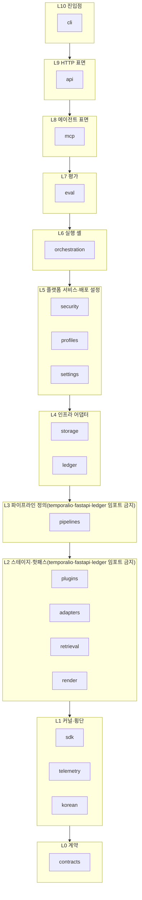
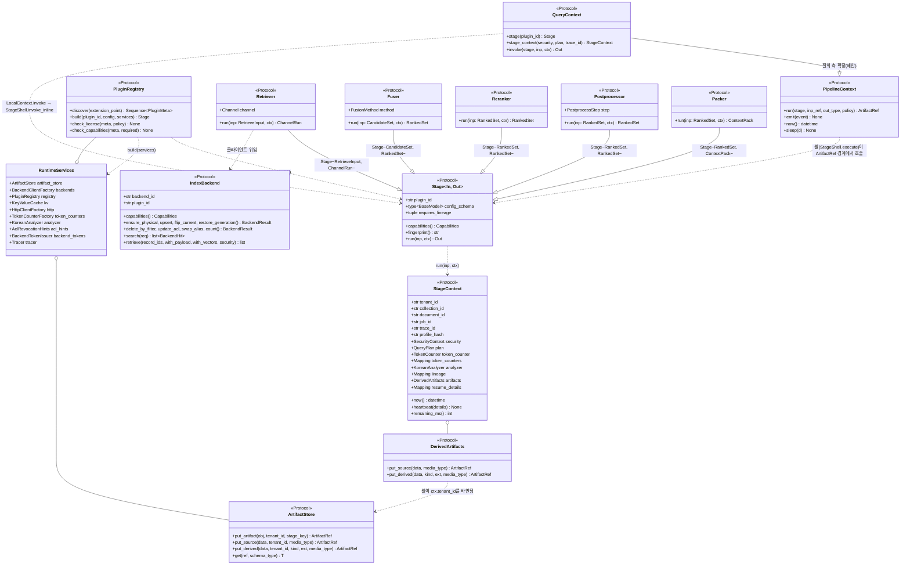
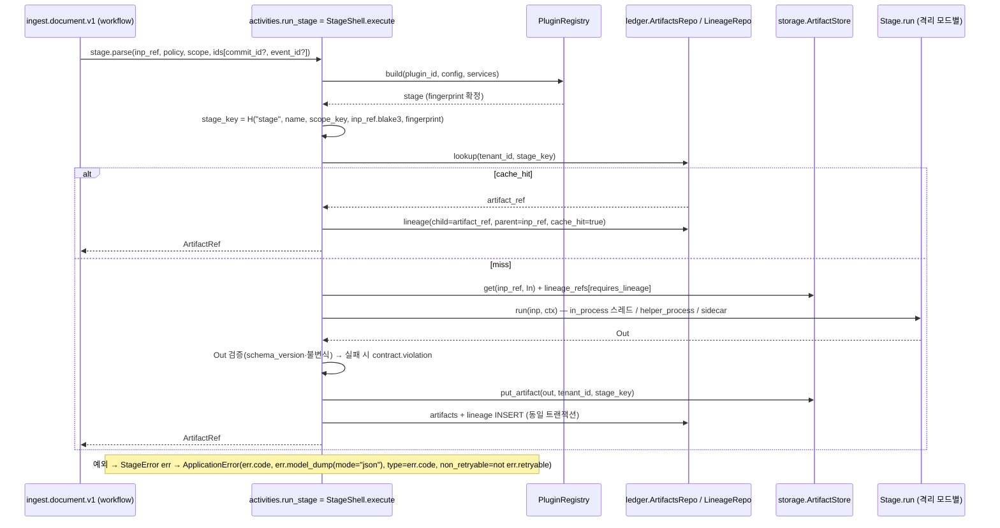

# 컴포넌트 아키텍처 (C4 Level 3)

## 목적

이 문서는 `rag-platform` 배포 패키지(import `rag_platform`) 내부의 **Python 패키지·모듈 경계**를 C4 Level 3(컴포넌트) 수준으로 고정한다. 각 모듈이 무엇을 책임지고, 어떤 공개 인터페이스(프로토콜(Protocol)·추상 기반 클래스(ABC))를 노출하며, 누구를 의존할 수 있고 누구를 의존하면 안 되는지, 상태와 부수효과(side effect)가 어디에만 존재하는지를 확정한다. 이어서 동시성 모델(asyncio 대 프로세스), 설정 모델(Pydantic Settings + 프로파일 YAML), 오류 전파 경계, 배포 단위(컨테이너)와 패키지의 매핑을 정한다.

설계 바이블(`00-design-bible.md`, 이하 "바이블") §12 모듈/패키지 맵과 §4.1 스테이지 공통 규약이 정본이며, 이 문서는 그것을 **확장하되 바꾸지 않는다**. 구현자는 이 문서의 시그니처를 `src/rag_platform/sdk/`의 코드로 옮기고, `import-linter` 계약을 CI에 두어 계층 규칙을 기계적으로 강제한다(브리프 D-01).

## 범위

- 포함: 패키지 트리와 계층 규칙(import-linter 계약), 핵심 추상(`Stage`, `StageContext`, `PipelineContext`·`QueryContext`, `ArtifactStore`·`DerivedArtifacts`, `PluginRegistry`, `IndexBackend`, `Retriever`, `Fuser`, `Reranker`, `Packer` 등)의 시그니처, 모듈별 책임·인터페이스·의존·상태 위치, 셸(shell; 액티비티 래퍼)의 실행 모델, 동시성 모델, 설정 모델, 오류 전파 경계, 배포 단위 매핑.
- 제외: 컨테이너 간 상호작용(C4 Level 2, [시스템 개요](./01-system-overview.md)와 바이블 §2), 계약 필드의 전문([계약 개요](../03-contracts/00-contract-overview.md)와 바이블 §5), 각 스테이지 알고리즘(04-pipelines), 워크플로우 상세([오케스트레이션](./06-orchestration-and-workflows.md)), 저장소 스키마([저장소](./04-storage-architecture.md)), 플러그인 패키징·배포 절차([플러그인](./05-plugin-architecture.md)), Kubernetes 매니페스트([배포](./08-deployment-architecture.md)).
- 정본 규칙: 타입명·필드명·열거값·오류 코드·이벤트명은 바이블 §5·§5.7·§6을 그대로 쓴다. 이 문서가 새로 붙이는 이름(포트 프로토콜, 내부 데이터 클래스, 설정 클래스)은 본문에 "제안"으로 표기하고 `## 미해결 이슈`에 모아 바이블 반영 여부를 남긴다.
- 수치는 모두 "초안 목표"다(바이블 §7.2·§8.3 값을 인용).

다른 초안·제안서에서 쓰인 비공식 패키지 이름과 정본 이름의 대응은 다음과 같다. 이 문서 이후 모든 문서는 오른쪽 열만 쓴다.

| 비공식 이름(제안서·초안) | 정본(바이블 §12) | 비고 |
|--------------------------|------------------|------|
| `core` | `rag_platform.sdk` | `Stage`·`StageContext`·`PipelineContext`·`TokenCounter`·`hash_of` |
| `fetch`, `parse`, `normalize`, `chunk`, `enrich`, `embed` | `rag_platform.adapters.{fetch,parse,normalize,chunk,enrich,embed}` | 벤더 어댑터(Adapters over Forks) |
| `index(backends)` | `rag_platform.adapters.index` | Qdrant·OpenSearch 어댑터 + 세대 사가 |
| `retrieve(planner, retrievers, fusion, rerank, postprocess, pack)` | `rag_platform.retrieval` + `rag_platform.adapters.{query,retrieve,rerank}` | 핫패스 로직은 `retrieval`, 백엔드 호출은 `adapters` |
| `workflows` | `rag_platform.orchestration` | Temporal 워크플로우·액티비티·`LocalRunner`·디스패처·아웃박스 |
| `observability` | `rag_platform.telemetry` | OTel·Weaver 상수·redaction |
| `plugins(sdk)` | `rag_platform.plugins`(레지스트리) + `rag_platform.sdk`(공개 SDK) | 플러그인 저자가 임포트하는 것은 `sdk`·`contracts`만 |

## 1. 패키지 지도와 계층 규칙

### 1.1 패키지 트리

바이블 §12의 트리를 모듈 단위로 요약한다. 한 줄 정의는 "이 모듈이 소유하는 것"이다.

| 패키지 | 소유(책임) | 소유하지 않는 것 |
|--------|-----------|------------------|
| `contracts` | Pydantic v2 계약 모델 전부(바이블 §5.1 인벤토리), `enums.py`(§5.7 단일 소스), `versioning.py`(`schema_version` 호환 규칙), `schemas/`로의 JSON Schema 내보내기 | 로직, I/O, 기본값 정책 |
| `sdk` | `Stage`·`StageContext`·`PipelineContext`·`QueryContext`(제안) 프로토콜, `SidecarStage` 기반 클래스, `TokenCounter`·`KoreanAnalyzer`·`ArtifactStore`·`DerivedArtifacts`·`PluginRegistry` 등 **포트(port) 프로토콜**, `hash_of`(§6.2 `H()`), `StageError` 발생 헬퍼 | 구현체, 배포 설정, 외부 라이브러리 의존(순수 Python·A 등급만) |
| `telemetry` | OTel 트레이서·미터 획득, Weaver 생성 속성 상수(`gen_ai.*`, `retrieval.*`, `rag.*`), 메트릭 이름 상수(§6.5), 콘텐츠 redaction 규칙, structlog 설정 | 익스포터 운영(Collector), 대시보드 |
| `korean` | `UserDictEntry[]` → Kiwi 사용자 사전·Nori `user_dictionary_rules`·`synonym_graph` 생성기(순수 함수), 한국어 팽창률 계수 | 형태소 분석기 실행(어댑터), 사전 저장(원장) |
| `plugins` | entry point 그룹 `rag_platform.{extension_point}` 탐색, `PluginMeta` 검증, `license_gate`, `capabilities_check`, 인스턴스 빌드 | 플러그인 구현 |
| `adapters` | 확장 지점 14종 중 벤더 의존이 있는 10종의 1급 구현(§7.1 컴포넌트 표): `fetch`, `parse`, `normalize`, `chunk`, `enrich`, `embed`, `index`, `query`, `retrieve`, `rerank` + 공용 LLM 클라이언트 `llm`. `fuser`·`postprocessor`·`packer` 구현은 `retrieval`, `evaluator`는 `eval`이 소유 | 산출물 저장(셸), 재시도·타임아웃(오케스트레이터), 보안 컨텍스트 생성(`security`) |
| `pipelines` | `ingest.run`, `reindex.run`, `query.run` — `PipelineContext`(질의 측은 그 확장 `QueryContext`)만으로 스테이지를 호출하는 순수 비동기 함수(§11.1). `query.run`은 `retrieval`·`render`의 정의 함수를 순서대로 부른다 | 실행 셸, 영속화, HTTP |
| `retrieval` | 검색 핫패스: `planner`, `filters`(security/strategy/user 빌더), `channels`, `fusion`, `hydrate`, `rerank` 호출, `postprocess/*`, `pack/*`(`acl_recheck`·`budget_cut`·`reorder`·`citation_align`·`sufficiency`·`conflicts`·`chunk_text_store`) | PostgreSQL 접근(ADR-0034), 렌더링 |
| `render` | `Renderer` 열거 9종의 렌더러, `citation_map` 역매핑 | 팩 생성 |
| `orchestration` | `context.py`(셸: `StagePolicy` 적용·`stage_key`·캐시·계보·`invoke_inline`), `temporal/*`(워크플로우·제네릭 액티비티 1개·워커·컨버터·트레이싱·스케줄), `local/runner.py`(`LocalRunner`·`LocalContext` — 질의 실행기, 바이블 §11.1), `dispatcher.py`, `outbox/*`(릴레이 순수 함수 3개·두 실행기·웹훅 서명) | 스테이지 로직, 인덱스 백엔드 세부 |
| `ledger` | PostgreSQL 원장(§13.1) 모델·리포지토리·마이그레이션·`reconcile`·`consistency_check`·`usage` | 검색 핫패스 조회, 인덱스 데이터 |
| `storage` | `artifact_store`(S3 호환·`file://`, 키 규약 §13.3), `keys`, `valkey`(키 규약 §13.4) | 원장(PostgreSQL) |
| `security` | `principal_resolver`, `authz_cedar`, `security_context`, `rate_limit`, `acl_recheck`(`aclrev:` 힌트), `egress_policy`, `backend_token`(요청별 테넌트 JWT, E8), `key_provider`, `audit` | 인덱스 필터 빌드(`retrieval/filters`), 스키마 정의(`contracts`) |
| `profiles` | `loader`(`extends` 해소·깊은 병합), `schema`, `validate`(§7.4 12규칙), `profile_hash`, `builtin/*.yaml` | 프로파일 저장(원장) |
| `settings`(바이블 §12 1.3.0, AM-22) | 배포 설정 `Settings`(pydantic-settings, `RAG_*`; §5.2) — 프로세스가 **어디에 연결되는지**만 | 프로파일 값(§5.1), 플러그인 SDK 표면 |
| `eval` | 하네스 `runner`(`LocalRunner` 재사용), TREC 입출력, `metrics_ranx`, `judge_ragas`, `span_hit`, `gates`, `datasets/` | 별도 검색 경로 |
| `api` | FastAPI 앱·라우터(§14), RFC 9457 `problems`, `idempotency`, SSE `events`, `SecurityContext` 주입 미들웨어, 질의 파이프라인 인프로세스 실행 | 스테이지 로직, 워커 |
| `mcp` | `McpToolAdapter`, 도구 3종(`search`, `get_document`, `list_collections`), `cursor_store` | 인증 정책(`security` 재사용) |
| `cli` | `rag up/ingest/query/reprocess/reindex/eval/profile/plugin/cache/serve/mcp` | 비즈니스 로직 |
| `testing` | 적합성 키트(`contract_roundtrip`, `idempotency`, `security_invariants`, `renderer_citation_roundtrip`, `litm_order`, `fuser_equivalence`) | 프로덕션 경로 |

### 1.2 의존 방향과 import-linter 계약

**결정:** 의존 방향은 바이블 §12(1.3.0) 규칙 `contracts ← sdk ← plugins | adapters | pipelines | retrieval | render ← orchestration | ledger | storage | security | profiles | settings | eval ← api | mcp | cli`을 그대로 따르되, 바이블이 같은 계층으로 묶은 그룹 안의 실제 의존(파이프라인 정의 → 검색 핫패스·렌더, 디스패처 → 원장, 아웃박스 릴레이 → 원장·egress 정책, 하네스 → `LocalRunner`, 레이트리밋·회수 힌트 → Valkey)을 표현하기 위해 **계층 내부 순서를 정밀화**한다. 바이블의 모든 화살표는 보존되며 역방향은 어디에서도 허용되지 않는다(근거: 바이블 §12, [ADR-0003](../06-adr/0003-orchestrator-neutral-pipeline-and-non-durable-local-runner.md); import-linter 버전 고정은 [ADR-0035](../06-adr/0035-python-version-and-toolchain-pins.md)).



화살표는 계층 단위의 "임포트할 수 있다"이며 상위 계층은 자기보다 아래의 **모든** 계층을 임포트할 수 있다(모듈 간 실제 의존은 §3 표의 "의존" 열이 정본이다). `import-linter` 계약은 다음과 같다. `|`는 같은 계층이면서 서로 독립(상호 임포트 금지)을 뜻한다. 외부 패키지를 금지 목록에 두므로 루트 절의 `include_external_packages = True`가 필수이고, 목록 값은 모듈당 한 줄로 적는다(INI 리더는 개행으로만 목록을 나눈다).

```ini
[importlinter]
root_package = rag_platform
include_external_packages = True

[importlinter:contract:layers]
name = rag_platform layered architecture (bible §12, refined)
type = layers
layers =
    rag_platform.cli
    rag_platform.api
    rag_platform.mcp
    rag_platform.eval
    rag_platform.orchestration
    rag_platform.security | rag_platform.profiles | rag_platform.settings
    rag_platform.storage | rag_platform.ledger
    rag_platform.pipelines
    rag_platform.plugins | rag_platform.adapters | rag_platform.retrieval | rag_platform.render
    rag_platform.sdk | rag_platform.telemetry | rag_platform.korean
    rag_platform.contracts

[importlinter:contract:no-orchestrator-in-stages]
name = pipelines/retrieval/render never import temporalio, fastapi, ledger
type = forbidden
source_modules =
    rag_platform.pipelines
    rag_platform.retrieval
    rag_platform.render
    rag_platform.adapters
    rag_platform.sdk
    rag_platform.contracts
forbidden_modules =
    temporalio
    fastapi
    starlette
    rag_platform.ledger
    rag_platform.orchestration

[importlinter:contract:adapters-no-storage]
name = adapters never import storage/security (ArtifactRef load/save is the shell's job)
type = forbidden
source_modules = rag_platform.adapters
forbidden_modules =
    rag_platform.storage
    rag_platform.security

[importlinter:contract:contracts-pure]
name = contracts import only pydantic and stdlib
type = forbidden
source_modules =
    rag_platform.contracts
forbidden_modules =
    httpx
    qdrant_client
    opensearchpy
    temporalio
    fastapi
    starlette
    sqlalchemy
    valkey
    pydantic_settings
```

검증: 스텁 패키지 트리(`src/rag_platform/{모듈}/__init__.py`)에 위 INI를 두고 `lint-imports`를 실행하면 `Contracts: 4 kept`가 나와야 한다(10-development/05 CI 잡).

세부 규칙(바이블 §12 문장을 계약으로 옮긴 것):

| 규칙 | 의미 | 위반 예 |
|------|------|---------|
| `pipelines`·`retrieval`·`render`는 `temporalio`·`fastapi`·`ledger`를 모른다 | 파이프라인 정의는 두 실행기에서 동일하게 실행되어야 하고(§11.1), 검색 핫패스는 PostgreSQL을 읽지 않는다([ADR-0034](../06-adr/0034-retrieval-hot-path-postgres-independence-and-hydrate.md)) | `retrieval/pack/chunk_text_store.py`에서 `ledger.repo` 임포트 |
| `adapters`는 `storage`를 모른다 | `ArtifactRef ↔ 계약 인스턴스` 변환·저장은 셸(`orchestration/context.py`)의 일이다(§4.1). 어댑터가 파생물을 저장할 때는 테넌트가 고정된 `ctx.artifacts`(`DerivedArtifacts`, §2.3) 포트만 쓴다 | 파서 어댑터가 `storage.artifact_store.S3ArtifactStore`를 직접 생성 |
| `security` 구현은 `api`·`mcp`·`retrieval`(`pack.acl_recheck`)·`adapters/index`·`adapters/retrieve`(E8 백엔드 토큰은 읽기 경로에 붙는다)와 조립 지점(`orchestration.context`·`orchestration.outbox`)에서만 **사용**된다 | 계층 규칙상 `retrieval`·`adapters`는 `security`를 임포트할 수 없으므로 `sdk`의 포트 프로토콜(`AclRevocationHints`, `BackendTokenIssuer`, `EgressGuard`)로 받는다(§1.3). 바이블 §12 문장(`api`·`retrieval`·`adapters/index`)에 `adapters/retrieve`·`mcp`·조립 지점을 더하는 것은 제안(미해결 이슈 1) | `adapters/retrieve/opensearch_bm25.py`에서 `security.backend_token` 임포트 |
| `contracts`는 순수하다 | 스키마 내보내기(`schemas/`)와 1:1 diff CI가 가능해야 한다 | 계약 모델의 validator가 Valkey를 조회 |
| 플러그인 패키지(`rag_plugin_*`)는 `rag_platform.sdk`·`rag_platform.contracts`만 임포트한다 | 플러그인 SDK 안정 표면([ADR-0032](../06-adr/0032-plugin-sdk-stage-protocol-and-conformance-kit.md)) | 플러그인이 `rag_platform.adapters.index.qdrant`를 상속 |

### 1.3 포트와 주입: 계층 규칙을 지키는 방법

L2~L3(스테이지·핫패스·파이프라인)이 L4~L5(저장소·보안·설정)의 능력을 쓰려면 **프로토콜은 `sdk`에, 구현은 상위 계층에, 연결은 조립 지점(composition root)에** 둔다. 조립 지점은 프로세스 진입 함수 네 곳이다: `api.create_app`(api 프로세스, `/mcp` 포함), `orchestration.temporal.worker.main`(워커), `orchestration.outbox`의 릴레이 실행기(`temporal_relay`/`procrastinate_relay`; relay 프로세스), `cli`(`rag serve …`는 위 셋을 호출하고, `rag ingest/query/eval`의 로컬 실행·하네스는 `cli`가 직접 조립). 조립 지점이 `Settings`(§5.2)로 `RuntimeServices`(제안, §2.3)를 만들어 `PluginRegistry.build()`에 넘기고, 요청·잡 단위 값은 `StageContext`로 넘긴다.

| 주입 경로 | 수명 | 내용 | 예 |
|-----------|------|------|----|
| `RuntimeServices` → 플러그인 생성자 | 프로세스 | 백엔드 클라이언트 팩토리(`backends`), 플러그인 레지스트리, 산출물 저장소, Valkey, HTTP 클라이언트 팩토리(egress 가드 적용), 토큰 카운터 팩토리, 형태소 분석기, 회수 힌트, 백엔드 토큰 발급기, 트레이서(§2.3 dataclass 필드와 1:1) | `retriever.opensearch_bm25`가 `BackendTokenIssuer`를 받아 요청별 테넌트 JWT를 붙인다(E8) |
| `StageContext` → `Stage.run` | 액티비티·요청 1회 | 스코프 ID, `SecurityContext`·`QueryPlan`(질의 측), 토큰 카운터, 분석기, `lineage`, `now()`, 하트비트, 테넌트 바인딩 파생물 저장 포트, 남은 예산 | `pack`이 `ctx.security.as_of`로 embargo를 재평가 |
| 인자 | 호출 1회 | 계약 인스턴스(`In`), `StagePolicy`(셸) | `fuser.run(candidates, ctx)`(`ctx.plan.fusion`을 읽음) |

스테이지가 `RuntimeServices`를 직접 받지 않는 이유는 순수성 검증이다: 적합성 키트 `idempotency`는 같은 `In`·같은 `ctx` 결정값으로 두 번 실행해 바이트 동일 출력을 요구하며, 프로세스 자원은 생성자에서만 보이므로 `run()` 본문이 숨은 상태를 갖기 어렵다.

## 2. 커널: 핵심 추상

### 2.1 클래스 다이어그램



### 2.2 `Stage`, `StageContext`, `PipelineContext`

**결정:** `Stage[In, Out]`는 바이블 §4.1의 5멤버 프로토콜(`plugin_id`, `config_schema`, `capabilities()`, `fingerprint()`, `run()`) + 선택 클래스 속성 `requires_lineage`다. **14 확장 지점 인터페이스는 모두 이 프로토콜의 타입 특수화**이며(`run(inp, ctx)` 하나만 실행 진입점; 질의 측의 `plan`·`security`는 인자가 아니라 `ctx`로 받는다), 확장 지점별 추가 멤버는 §2.4 표의 열로만 늘린다. 이렇게 해야 `PluginRegistry.build() -> Stage`가 리트리버·퓨저도 반환할 수 있고 적합성 키트 `idempotency`(같은 `In`·`ctx`로 `run()` 2회)가 14종에 똑같이 적용된다(근거: [ADR-0032](../06-adr/0032-plugin-sdk-stage-protocol-and-conformance-kit.md)).

```python
# src/rag_platform/sdk/stage.py
from __future__ import annotations
from collections.abc import Mapping
from datetime import datetime
from typing import TYPE_CHECKING, Any, ClassVar, Protocol, TypeVar
from pydantic import BaseModel
from rag_platform.contracts.capabilities import Capabilities
from rag_platform.contracts.common import SecurityContext
from rag_platform.contracts.query_plan import QueryPlan
if TYPE_CHECKING:
    from rag_platform.sdk.ports import DerivedArtifacts
    from rag_platform.sdk.retrieval import KoreanAnalyzer, TokenCounter

In = TypeVar("In", bound=BaseModel, contravariant=True)
Out = TypeVar("Out", bound=BaseModel, covariant=True)


class Stage(Protocol[In, Out]):
    """바이블 §4.1 — 5멤버. I/O·시간·난수는 ctx를 통해서만."""

    plugin_id: str                                     # "{extension_point}.{implementation}" (§6.1)
    config_schema: type[BaseModel]                     # 프로파일 값 검증·config_hash 원천
    requires_lineage: ClassVar[tuple[str, ...]] = ()   # 셸이 함께 로드할 상류 schema_type(바이블 §4.1 1.3.0, AM-26): `index` = EnrichedChunkSet·ChunkSet·SourceDocument; `chunk` = ParsedDocument; `enrich` LLM 서브스텝 = ChunkSet

    def capabilities(self) -> Capabilities: ...
    def fingerprint(self) -> str: ...                  # H("producer", plugin_id, plugin_version, config_hash, image_digest, model_ids)
    async def run(self, inp: In, ctx: StageContext) -> Out: ...


class StageContext(Protocol):
    """셸이 만들어 넘기는 실행 문맥. 스테이지가 볼 수 있는 유일한 부수효과 창구."""
    # 스코프(§4.1 scope_key). 질의 측은 collection_id·document_id·job_id가 None이고
    # 컬렉션 범위는 ctx.security.collection_ids(바이블 §5.3; QueryRequest.collection_ids ≤ 20)로 읽는다
    tenant_id: str
    collection_id: str | None
    document_id: str | None
    job_id: str | None
    trace_id: str
    profile_hash: str
    security: SecurityContext | None                   # 질의 측 필수(서버 주입, 읽기 전용); 수집 측 None
    plan: QueryPlan | None                             # 바이블 §4.1 1.3.0(AM-27): 질의 측 필수(fusion·rerank·postprocess·pack 파라미터의 단일 원천); 수집 측 None
    # 바이블 §4.1이 허용한 멤버
    token_counter: TokenCounter                        # primary_tokenizer_id
    token_counters: Mapping[str, TokenCounter]         # secondary_tokenizer_ids·대상 LLM 카운터
    analyzer: KoreanAnalyzer                           # Kiwi 또는 mecab-ko (ADR-0021)
    lineage: Mapping[str, BaseModel]                   # requires_lineage로 선언한 상류 산출물 {schema_type: instance}
    def now(self) -> datetime: ...                     # Temporal은 activity 시각, Local은 wall clock
    # Resumable(§4.4). heartbeat_details 스키마는 04-pipelines/01
    def heartbeat(self, details: Mapping[str, Any]) -> None: ...
    resume_details: Mapping[str, Any] | None
    artifacts: DerivedArtifacts                        # 바이블 §4.1 1.3.0(AM-27, §1.3·§2.3): 테넌트 바인딩 파생물 포트 — 어댑터가 storage·tenant_id를 모른 채 derived/를 쓴다
    def remaining_ms(self) -> int | None: ...          # 데드라인·지연 예산(질의 측은 QueryPlan.latency_budget_ms에서 파생)
```

`PipelineContext`는 바이블 §11.1의 4멤버다. `TemporalContext`(`orchestration.temporal`)는 `workflow.execute_activity("stage.{name}", …)`로, `LocalContext`(`orchestration.local`)는 `asyncio` + `StagePolicy` 재시도로 `run`을 감싼다. 검색 경로는 바이블 §11.1대로 **모든 프로파일에서 `LocalContext`가 `api` 프로세스 안에서 실행**한다. 검색은 `ArtifactRef` 경계를 만들지 않으므로 `LocalContext`는 `PipelineContext` 위에 질의 측 확장 `QueryContext`(제안)를 함께 구현하고, 그 `invoke`는 `orchestration.context.StageShell.invoke_inline`(검증·트레이싱만, 저장·계보 없음; §4.1 (4))에 위임한다. `pipelines`는 `sdk`의 두 프로토콜만 임포트하므로 `orchestration` 임포트 금지(L2~L3 계약)를 지킨다.

```python
# src/rag_platform/sdk/pipeline.py
class PipelineContext(Protocol):                       # 바이블 §11.1 4멤버
    async def run(self, stage: str, inp_ref: ArtifactRef, out_type: type[Out], policy: StagePolicy) -> ArtifactRef: ...
    async def emit(self, event: CloudEventEnvelope) -> None: ...
    def now(self) -> datetime: ...
    async def sleep(self, d: timedelta) -> None: ...

class QueryContext(PipelineContext, Protocol):
    """제안. 질의 측 확장 — ArtifactRef 경계 없이 인메모리 호출. 구현 orchestration.local.LocalContext, 주입 api.create_app."""
    def stage(self, plugin_id: str) -> Stage[Any, Any]: ...        # 프로파일 해소 결과(PluginRegistry.build, api 기동 시 1회)
    def stage_context(self, *, security: SecurityContext, plan: QueryPlan | None, trace_id: str) -> StageContext: ...
    async def invoke(self, stage: Stage[In, Out], inp: In, ctx: StageContext) -> Out: ...   # → StageShell.invoke_inline

# src/rag_platform/pipelines/ingest.py  — temporalio·fastapi·ledger·orchestration 임포트 금지
async def run(ctx: PipelineContext, req_ref: ArtifactRef, profile: Profile) -> IndexCommit: ...
# src/rag_platform/pipelines/query.py  — 항상 LocalContext(api 프로세스 인프로세스, 바이블 §11.1). retrieval·render 정의 함수를 순서대로 호출
async def run(ctx: QueryContext, req: QueryRequest, security: SecurityContext, profile: Profile) -> ContextPack: ...
```

### 2.3 `ArtifactStore`, `PluginRegistry`, `RuntimeServices`

```python
# src/rag_platform/sdk/ports.py
class ArtifactStore(Protocol):
    """키 규약은 바이블 §13.3. 구현은 storage.artifact_store(S3 호환 / file://).
    셸(orchestration.context)·storage·retrieval.pack.chunk_text_store에만 노출한다 — 스테이지에는 주지 않는다."""
    async def put_artifact(self, obj: BaseModel, *, tenant_id: str, stage_key: str) -> ArtifactRef: ...   # artifacts/{schema_type_kebab}/{stage_key[:2]}/{stage_key}.json
    async def put_source(self, data: bytes, *, tenant_id: str, media_type: str) -> ArtifactRef: ...       # sources/{blake3[:2]}/{blake3}; 동일 blake3 존재 시 쓰기 생략
    async def put_derived(self, data: bytes, *, tenant_id: str, kind: str, ext: str, media_type: str) -> ArtifactRef: ...  # derived/{kind}/…; 봉투 없음
    async def get(self, ref: ArtifactRef, schema_type: type[T]) -> T: ...   # schema_type·blake3 일치 검증(불일치 → contract.violation)
    async def get_bytes(self, ref: ArtifactRef) -> bytes: ...
    async def exists(self, uri: str) -> bool: ...


class DerivedArtifacts(Protocol):
    """제안. 스테이지(서드파티 플러그인 포함)가 받는 ctx.artifacts — 셸이 ctx.tenant_id를 고정한 쓰기 전용 파사드.
    get·put_artifact·exists가 없고 tenant_id 인자도 없으므로 어댑터는 타 테넌트 키를 만들 수도, 계약 산출물을 읽을 수도 없다(E5·E17).
    읽기는 ctx.lineage만. 적합성 키트 security_invariants가 이 불변식을 검사한다."""
    async def put_source(self, data: bytes, *, media_type: str) -> ArtifactRef: ...
    async def put_derived(self, data: bytes, *, kind: str, ext: str, media_type: str) -> ArtifactRef: ...


class PluginRegistry(Protocol):
    """entry point 그룹 rag_platform.{extension_point}(§6.7). 구현은 plugins.registry."""
    def discover(self, extension_point: ExtensionPoint) -> Sequence[PluginMeta]: ...
    def meta(self, plugin_id: str) -> PluginMeta: ...
    def build_stage(self, plugin_id: str, config: Mapping[str, Any], services: RuntimeServices) -> Stage[Any, Any]: ...
    def build_port(self, plugin_id: str, config: Mapping[str, Any], services: RuntimeServices) -> Any: ...
    # build_stage는 Stage[In, Out] 구현(파이프라인 스테이지)을, build_port는 role 포트(IndexBackend·ContextRenderer·TokenCounter·KoreanAnalyzer 등 Stage가 아닌 구현)를 반환한다 — 정적 타입 불일치 해소(트리아지 #14)
    # config는 Stage.config_schema로 검증된 뒤 인스턴스에 고정된다(config_hash 확정)
    def check_license(self, meta: PluginMeta, policy: LicensePolicy) -> None: ...        # LicensePolicy = Profile.license_policy{max_grade, territory} 객체 타입(profile.schema.json $defs); 위반 → plugin.license_denied
    def check_capabilities(self, meta: PluginMeta, required: Mapping[str, Any]) -> None: ...  # 위반 → plugin.capability_unsupported


@dataclass(frozen=True)
class RuntimeServices:
    """제안. 프로세스 수명 자원의 단일 정본(§2.1 다이어그램·§1.3 표는 이 필드와 1:1). 조립 지점(§1.3)만 생성한다."""
    artifact_store: ArtifactStore
    backends: BackendClientFactory           # 프로세스당 1개 백엔드 클라이언트(§4.2 규칙 5)
    registry: PluginRegistry                 # ParseRouterStage가 체인 멤버 파서를 build(§3.2). 순환은 조립 지점이 registry → services 순으로 만들어 해소
    kv: KeyValueCache                        # Valkey(§13.4 키). 구성 부재는 기동 실패, 런타임 불가는 degraded(바이블 §2.3)
    http: HttpClientFactory                  # EgressGuard(E16)를 적용한 httpx.AsyncClient 팩토리
    token_counters: TokenCounterFactory      # tokenizer_id → TokenCounter
    analyzer: KoreanAnalyzer
    acl_hints: AclRevocationHints            # aclrev:{tenant_id}:{document_id} 조회(E9)
    backend_tokens: BackendTokenIssuer | None  # 요청별 테넌트 JWT(E8); OpenSearch가 없는 lite는 None
    tracer: Tracer                           # opentelemetry.trace.Tracer(telemetry.get_tracer)


class BackendClientFactory(Protocol):    # 프로세스당 1개(§4.2 규칙 5); 반환 타입은 벤더 클라이언트라 sdk는 Any로 둔다
    def qdrant(self) -> Any: ...             # qdrant-client AsyncQdrantClient(prefer_grpc=True)
    def opensearch(self) -> Any: ...         # opensearch-py AsyncOpenSearch(커넥션 풀); lite는 None

class KeyValueCache(Protocol):           # 키 규약 §13.4
    async def get(self, key: str) -> bytes | None: ...
    async def mget(self, keys: Sequence[str]) -> list[bytes | None]: ...
    async def set(self, key: str, value: bytes, *, ttl_s: int) -> None: ...
    async def delete(self, *keys: str) -> None: ...

class AclRevocationHints(Protocol):      # aclrev: 조회 → RevocationHint{acl_hash, acl: Acl, deleted: bool}(§9.1)
    async def lookup(self, tenant_id: str, document_ids: Sequence[str]) -> Mapping[str, RevocationHint | None]: ...

class BackendTokenIssuer(Protocol):      # E8 요청별 단명 테넌트 JWT(TTL ≤ 60s)
    def issue(self, *, tenant_id: str, subject: str, audience: str, ttl_s: int = 60) -> str: ...

class EgressGuard(Protocol):             # 위반 → fetch.egress_denied / outbox.egress_denied
    async def check(self, url: str, policy: EgressPolicy) -> ResolvedTarget: ...   # ResolvedTarget(제안) = {url, resolved_ip, port}; resolve_pin용
```

### 2.4 확장 지점 인터페이스

D-10의 14 확장 지점은 모두 `Stage[In, Out]`의 특수화다. 아래 표의 "추가 멤버"는 §2.2의 5멤버 외에 그 확장 지점이 더 요구하는 것이며, 입·출력 타입은 바이블 §4.2·§4.3 표와 일치한다. `In`이 계약 하나가 아닌 경우의 내부 타입(`ChannelSpec` = `QueryPlan.channels[]` 원소, `QueryVariant` = `QueryPlan.rewritten_queries[]` 원소, `ChannelRun` = `CandidateSet.channel_runs[]` 원소, `RetrieveInput{channel: ChannelSpec, variant: QueryVariant}` = 리트리버 `In`)은 해당 계약 스키마 `$defs`의 Pydantic 클래스명 또는 `sdk` 내부 타입 제안이다(미해결 이슈 4). 질의 측 스테이지가 공통으로 읽는 `QueryPlan`·`SecurityContext`는 인자가 아니라 `ctx.plan`·`ctx.security`다.

| 확장 지점(entry point 그룹) | `In → Out` | 추가 멤버 | 격리 모드(바이블 §4.2·§4.3; 규칙은 이 문서 §4.3) | 상태·부수효과 |
|-----------------------------|------------|-----------|---------------------|---------------|
| `fetcher` | `IngestRequest → SourceDocument` | `schemes: frozenset[str]` | in_process(fsspec/httpx, egress 가드 필수) | 원천 네트워크 I/O; 원본 바이트는 `ctx.artifacts.put_source` |
| `parser` | `SourceDocument → ParsedDocument` | `formats: frozenset[SourceFormat]`, `can_parse(source) -> bool`; role `format_detector`는 `detect(source) -> SourceDocument` | 포맷별 in_process / helper_process / sidecar | 파생물 `ctx.artifacts.put_derived`; 사이드카 `POST /v1/convert` |
| `normalizer` | `ParsedDocument → NormalizedDocument`; roles `korean_analyzer`(`KoreanAnalyzer` 제공), `sentence_splitter`, `pii_detector` | — | in_process | 없음(모델 가중치 로딩만) |
| `chunker` | `NormalizedDocument → ChunkSet`; role `token_counter`(`recount`: `ChunkSet → ChunkSet`) | `primary_tokenizer_id` | in_process | 없음 |
| `enricher` | `ChunkSet → EnrichedChunkSet` | `deterministic: bool`(LLM 보강이면 False → `ingest-llm` 큐) | in_process / 외부 HTTP(LLM) | LLM 호출(`H("llm-enrich", …)` 캐시는 셸) |
| `embedder` | `EnrichedChunkSet → EmbeddedChunkSet`; 질의 측 `embed_query(text) -> VectorBundle` | `embedding_space_ids`, `mode` | 외부 HTTP(vLLM/TEI) / in_process(ONNX) | 서빙 호출; 벡터 본문은 `ctx.artifacts.put_derived(kind="vectors")` |
| `index_backend` | `EmbeddedChunkSet → IndexCommit`(어댑터 매핑은 `IndexRecord`) | `IndexBackend` 프로토콜(아래) | in_process 어댑터 → Qdrant gRPC / OpenSearch HTTP | 인덱스 쓰기(유일한 인덱스 변경 지점) |
| `query_transformer` | `QueryPlan → QueryPlan`(플래너 파이프 `normalize_ko → router → self_query → rewrite → expand`) | `order: int` | in_process(+`quality` 변형 LLM) | LLM 호출(옵션) |
| `retriever` | `RetrieveInput{channel: ChannelSpec, variant: QueryVariant} → ChannelRun` | `channel: Channel` | in_process 어댑터 → 백엔드 | 백엔드 읽기(사전 필터 강제, E7; 필터는 `ctx.plan.filters`·`ctx.security`) |
| `fuser` | `CandidateSet → RankedSet(stage=fused, hydrated=false)` | `method: FusionMethod`(`ctx.plan.fusion`을 읽는 순수 변환) | in_process 순수 함수 | 없음 |
| `reranker` | `RankedSet(fused) → RankedSet(reranked)` | `capabilities().extra = {backend: RerankBackend, response_schema: RerankResponseSchema}` | 외부 HTTP(TEI/vLLM) / in_process | 서빙 호출; 실패는 예외가 아닌 `rerank.applied=false` |
| `postprocessor` | `RankedSet → RankedSet` | `step: PostprocessStep` | in_process(+`ChunkTextStore`) | 부모 번들 읽기(포트) |
| `packer` | `RankedSet(postprocessed) → ContextPack` | roles `renderer`(`ContextRenderer`), `token_counter`(`TokenCounter`) | in_process(+선택 `count_tokens` API) | `tok:`·`aclrev:` 조회(포트) |
| `evaluator` | `EvalRun → EvalReport(부분)` | `metrics: frozenset[str]` | in_process | 골든셋 산출물 읽기 |

**`IndexBackend`** — 인덱스를 바꾸는 유일한 인터페이스. 메서드 이름은 바이블 §4.3(`retrieve`), §11.2(`update_acl`, `delete_by_filter`), §11.4(`upsert`, 플립)에서 가져오고 나머지는 이 문서의 정의다.

```python
# src/rag_platform/sdk/index_backend.py
class IndexBackend(Protocol):
    backend_id: str                     # "qdrant" | "opensearch" | 플러그인 값(IndexCommit.backend_results[].backend_id)
    plugin_id: str                      # "index_backend.qdrant"

    def capabilities(self) -> Capabilities: ...   # extra = IndexBackendCapabilities(§5.3)

    async def ensure_physical(self, spec: CollectionSpec) -> str: ...
    # 물리 컬렉션/인덱스·alias·payload 인덱스 보장(§13.4). 반환 = physical_name

    async def upsert(self, records: Sequence[IndexRecord], *, commit_id: str) -> BackendResult: ...
    # is_current=false로 적재. record_id 단위 멱등. tenant_id·collection_id·acl_allow·acl_visibility·acl_hash
    # 누락 레코드가 1건이라도 있으면 배치 전체 거부 → index.security_fields_missing (E5)

    async def flip_current(self, scope: DocumentScope, *, generation: int) -> BackendResult: ...
    # scope = (tenant_id, collection_id, document_id). gen == generation → is_current=true, gen < generation → false

    async def restore_generation(self, scope: DocumentScope, *, generation: int) -> BackendResult: ...
    # 보상: 이전 세대를 is_current=true로 복원(§11.4 플립 후 실패)

    async def delete_by_filter(self, flt: EffectiveFilter) -> BackendResult: ...
    # 삭제 커밋·보상(commit_id)·정리(index_generation < current)

    async def update_acl(self, scope: DocumentScope, *, acl_fields: Mapping[str, Any]) -> BackendResult: ...
    # acl_* payload만 갱신(재임베딩 없음, E11)

    async def search(self, req: BackendSearchRequest) -> list[BackendHit]: ...
    # req.filter에 tenant_id 조건이 없으면 retrieve.security_context_missing 예외(E7·§10.2). 사후 필터 금지

    async def retrieve(self, record_ids: Sequence[str], *, with_payload: Sequence[str],
                       with_vectors: bool, security: EffectiveFilter) -> list[Mapping[str, Any]]: ...
    # hydrate(§4.3) 1회 배치. 보안 필터 (a)를 다시 적용(E10). 누락은 빈 자리로 반환(플립 경합)

    async def swap_alias(self, alias: str, physical_name: str) -> None: ...   # blue/green
    async def count(self, flt: EffectiveFilter) -> int: ...                  # 정합성 검사
```

`BackendResult`는 `IndexCommit.backend_results[]` 원소(`{backend_id, backend_version, physical_name, alias, upserted, deleted, duration_ms, status: enum[ok, failed, compensated]}`)와 같은 구조다. `EffectiveFilter`(제안)는 `retrieval/filters`가 만든 `{security, strategy, user, self_query}` 네 그룹의 백엔드 중립 필터 트리이며 `filters.effective_hash`의 입력이다. 사용자용 `FilterNode`는 `tenant_id` 등을 금지하므로(§5.7 `FilterableField`) 보안 조건을 표현할 수 없고, 따라서 내부 타입이 필요하다.

**`Retriever`, `Fuser`, `Reranker`, `Postprocessor`, `Packer`, `ContextRenderer`, `TokenCounter`, `KoreanAnalyzer`**

```python
# src/rag_platform/sdk/retrieval.py — 질의 측 확장 지점은 모두 Stage[In, Out] 특수화(5멤버 그대로). plan·security는 ctx(§2.2)
class RetrieveInput(BaseModel):          # 제안(sdk 내부): 리트리버 In. 계약 하나가 아니므로 sdk가 소유
    channel: ChannelSpec                 # QueryPlan.channels[] 원소(채널 × 컬렉션)
    variant: QueryVariant                # QueryPlan.rewritten_queries[] 원소

class Retriever(Stage[RetrieveInput, ChannelRun], Protocol):
    channel: Channel                     # sparse_bm25 벡터를 쓰는 리트리버는 channel=lexical(§5.7 Channel); plugin_id 예 retriever.qdrant_dense
    # run(inp, ctx): 사전 필터 = ctx.plan.filters + ctx.security(E7). channel_run_id = "{channel}:{collection_id}:{variant_id}"
    # 실패는 예외가 아니라 ChannelRun.status=error + error(StageError)

class Fuser(Stage[CandidateSet, RankedSet], Protocol):
    method: FusionMethod                 # plugin_id = fuser.{method}: fuser.rrf | fuser.convex_minmax | fuser.convex_zscore | fuser.dbsf | fuser.combmnz
    # run(candidates, ctx): ctx.plan.fusion만 읽는 순수 변환(await 없음). stage=fused, hydrated=false, Σ contribution = fused_score, 타이브레이크 record_id 오름차순

class Reranker(Stage[RankedSet, RankedSet], Protocol):
    ...                                  # reranker.tei_cross_encoder | reranker.qdrant_maxsim | reranker.flashrank
    # run(ranked, ctx): 타임아웃·5xx → 예외 대신 fused 순서 유지 + rerank.applied=false + explain rerank_skipped

class Postprocessor(Stage[RankedSet, RankedSet], Protocol):
    step: PostprocessStep                # plugin_id = postprocessor.{step}; text를 바꾸면 block_refs·sentence_spans를 함께 재계산(K1)

class Packer(Stage[RankedSet, ContextPack], Protocol):
    ...                                  # run(ranked, ctx): 내부 고정 순서 acl_recheck → budget_cut → reorder → citation_align(§8.2), 결정적 content_hash

class ContextRenderer(Protocol):         # packer 그룹, role=renderer
    plugin_id: str                       # 레지스트리 조회 키(바이블 §6.1 1.3.0); 합성 생산자는 "{extension_point}.pipeline"(AM-11)
    renderer: Renderer                   # enum(Renderer) 9종
    def validate(self, pack: ContextPack, options: Mapping[str, Any]) -> None: ...   # render.* 사전 검증
    def render(self, pack: ContextPack, options: Mapping[str, Any]) -> RenderedContext: ...

class TokenCounter(Protocol):            # packer·chunker 그룹 role=token_counter
    tokenizer_id: str                    # hf:{repo} | tiktoken:{encoding} | anthropic:{model} | gemini:{model}
    count_method: CountMethod            # exact_api | exact_local | approximate
    async def count(self, text: str) -> int: ...
    async def count_many(self, texts: Sequence[str]) -> list[int]: ...
    def truncate(self, text: str, max_tokens: int) -> str: ...

class KoreanAnalyzer(Protocol):          # normalizer 그룹 role=korean_analyzer; ctx.analyzer
    analyzer_id: str                     # "{engine}:{version}:{dictionary}"
    dictionary_hash: str
    def tokenize(self, text: str) -> list[Morpheme]: ...            # Morpheme{surface, pos, start, end}
    def split_sentences(self, text: str) -> list[tuple[int, int]]: ...
    def normalize_query(self, text: str) -> str: ...                # Kiwi 교정; mecab-ko는 항등
    def keywords(self, text: str) -> list[tuple[str, str]]: ...     # (term, pos) — NNG/NNP/SL/SN
```

`Retriever`가 `IndexBackend`와 분리된 이유: 하나의 백엔드가 여러 채널을 낸다(Qdrant → `dense`·`sparse`·`lexical(sparse_bm25)`). 리트리버는 채널의 질의 표현(벡터·희소 벡터·형태소 항)과 백엔드 요청 형식을 알고, 백엔드는 물리 연산만 안다. 둘 다 `security` 필터가 없으면 실패한다. 같은 폴더의 [플러그인 아키텍처](./05-plugin-architecture.md)는 리트리버를 `search(channel: PlanChannel, variant: RewrittenQuery, plan, security, ctx)`로, 퓨저를 `fuse(candidates, fusion, top_n)`으로 적었다 — 이름·인자 통일은 미해결 이슈 4의 합의 대상이며 정본은 03-contracts/09·10의 `$defs` 클래스명이다.

## 3. 모듈 카탈로그

각 모듈의 책임, 공개 인터페이스, 허용 의존, 상태·부수효과 위치를 정리한다. "상태"는 프로세스 밖에 남는 것만 적는다.

### 3.1 L0·L1: `contracts`, `sdk`, `telemetry`, `korean`

| 모듈 | 공개 인터페이스 | 의존 | 상태·부수효과 |
|------|-----------------|------|---------------|
| `contracts` | 바이블 §5.1의 모든 타입(`IngestRequest` … `EgressPolicy`), `enums.py`의 열거 타입(§5.7), `versioning.is_compatible(schema_version, range)`, `export_schemas()`(CI가 `schemas/`와 diff) | pydantic만 | 없음 |
| `sdk` | §2의 프로토콜 전부(`Stage`, `StageContext`, `PipelineContext`, `QueryContext`, `ArtifactStore`, `DerivedArtifacts`, `PluginRegistry`, `RuntimeServices`, `BackendClientFactory`, `IndexBackend`, 질의 측 5종 …), `SidecarStage`(아래), `hash_of(label, *parts)`, `stage_error(code, *, stage, plugin_id, retryable=None)`(카탈로그 조회로 `retryable` 결정), 내부 타입 `RetrieveInput`, `Morpheme`, `RevocationHint`, `ResolvedTarget`, `DocumentScope`, `EffectiveFilter`, `BackendSearchRequest`, `BackendHit` | contracts, blake3 | 없음 |
| `telemetry` | `get_tracer(component)`, `get_meter()`, Weaver 생성 상수 모듈 `attrs`(`gen_ai.*`, `retrieval.*`, `rag.*`), `metrics` 상수(§6.5 정본 목록), `redact(span_attrs)`, `configure_logging()` | contracts, opentelemetry-api/sdk | OTLP 익스포트(프로세스 수명) |
| `korean` | `build_kiwi_user_dict(entries) -> str`, `build_nori_rules(entries) -> list[str]`, `build_synonym_graph(entries) -> list[str]`, `dictionary_hash(entries) -> str`(`H("dict", …)`), `expansion_ratio(lang, analyzer_id) -> float` | contracts | 없음 |

`SidecarStage`는 사이드카 격리(`isolation=sidecar`) 어댑터의 공통 기반 클래스다. `ConvertRequest`를 만들고 `POST /v1/convert`를 호출하고 `ConvertResponse.error`를 `StageError`로 승격하며, 응답 대기 중 `ctx.heartbeat()`를 호출한다(근거: [ADR-0033](../06-adr/0033-sidecar-convert-contract-and-isolation-ladder.md)).

```python
class SidecarStage(ABC, Generic[In, Out]):
    image: str                                  # PluginMeta.sidecar_image (digest는 런타임 Producer.image_digest)
    endpoint_env: str                           # 서비스 디스커버리 주소만(E16); 예 RAG_SIDECAR__PARSER_WORKERS_URL
    @abstractmethod
    def to_convert_request(self, inp: In, ctx: StageContext) -> ConvertRequest: ...
    @abstractmethod
    def from_convert_response(self, resp: ConvertResponse, inp: In, ctx: StageContext) -> Out: ...
    async def run(self, inp: In, ctx: StageContext) -> Out: ...
    # deadline_ms = ctx.remaining_ms(); POST /v1/convert(재시도 없음 — 재시도는 셸); 대기 중 heartbeat;
    # HTTP 5xx·연결 실패·타임아웃 → parse.sidecar_unavailable(재시도); resp.error → 그대로 StageError;
    # resp.output(ArtifactRef)은 사이드카가 이미 저장한 derived/ 참조
```

### 3.2 L2·L3: `plugins`, `adapters`, `retrieval`, `render`, `pipelines`

| 모듈 | 공개 인터페이스 | 의존 | 상태·부수효과 |
|------|-----------------|------|---------------|
| `plugins` | `EntryPointRegistry(PluginRegistry)`, `license_gate.check(meta, policy)`, `capabilities_check.compare(required, declared)`, `load_meta(dist) -> PluginMeta`(`[tool.rag_platform.plugin]`) | sdk, contracts, importlib.metadata | 프로세스 내 메타 캐시만 |
| `adapters.fetch` | `fetcher.fsspec_httpx` — `FsspecHttpxFetcher(Stage[IngestRequest, SourceDocument])`: 조건부 GET(`etag`/`last_modified`), `max_bytes`, `EgressGuard` 적용, `content_hash` 확정 후 `ctx.artifacts.put_source` | sdk, fsspec, httpx | 원천 읽기, 원본 저장 |
| `adapters.parse` | `format_detector`(role, `detect`), 파서 11종(§7.3 `router` 키), `parse/router.py`(`ParseRouterStage`: `Stage[SourceDocument, ParsedDocument]`, `plugin_id="parser.router"`: 프로파일 `parse.router[format]` 체인을 순서대로 시도, `parser_chain[]` 기록, `derived` 참조 부착), `parse/hwpx_hwpxlib_sidecar.py`(암호화 HWPX, 바이블 §12 1.3.0) | sdk, python-hwpx, docling, pypdfium2, pdftext, docx2python, trafilatura, … | 파생물 저장(포트), 사이드카 호출 |
| `adapters.normalize` | `normalizer.mecab_ko`·`normalizer.kiwi`(`KoreanAnalyzer` 제공), `normalizer.kss_punct`, `normalizer.regex_sentences`, `normalizer.presidio_ko`, `user_dictionary` 로더 | sdk, korean, mecab-ko/kiwipiepy(extra), kss, presidio | 없음 |
| `adapters.chunk` | `chunker.structure_aware`, `chunker.flat_text`, `chunker.table_rows`(structure_aware 내부 전략), `chunker.recount`(role `token_counter`), `chunker.docling_hybrid_adapter`(`[docling-chunker]`) | sdk, semchunk 3.2.5, tiktoken 0.12 | 없음 |
| `adapters.enrich` | `enricher.deterministic_prefix`, `enricher.korean_keywords`(`ctx.analyzer` 위임), `enricher.gliner2_entities`, `enricher.derived_meta`, `enricher.llm_context_prefix`, `enricher.doc_summary_autocontext`, `enricher.raptor_tree` | sdk, gliner2, `adapters.llm` | LLM 호출(옵션) |
| `adapters.embed` | `embedder.vllm_pooling_bge_m3`, `embedder.tei_dense`, `embedder.inprocess_sentence_transformers`, `embedder.sparse_bm25`(형태소 + TF 포화, `modifier: idf`), `embedder.pylate_late_interaction` | sdk, httpx, sentence-transformers(lite), pylate(opt) | 서빙 호출 |
| `adapters.index` | `index_backend.qdrant`(`filters`, `point_id`, `bm25_sparse`), `index_backend.opensearch`(`nori_settings`, `dls`), `saga.IndexSaga`(§11.4 9단 상태; 워크플로우가 호출하는 액티비티 단위 함수 집합), `age_graph_store`(플러그인 슬롯) | sdk, korean, qdrant-client, opensearch-py(`[opensearch]`) | 인덱스 쓰기, alias |
| `adapters.query` | `query_transformer.korean_normalize`, `.rule_router`, `.regex_self_query`, `.llm_self_query`, `.multi_query`, `.hyde` | sdk, `adapters.llm` | LLM 호출(옵션) |
| `adapters.retrieve` | `retriever.qdrant_dense`, `.qdrant_sparse`, `.qdrant_sparse_bm25`(channel=lexical), `.opensearch_bm25`(요청별 테넌트 JWT, E8) | sdk, qdrant-client, opensearch-py | 백엔드 읽기 |
| `adapters.rerank` | `reranker.tei_cross_encoder`(TEI·Cohere 응답 파서), `reranker.qdrant_maxsim`, `reranker.flashrank` | sdk, httpx | 서빙 호출 |
| `adapters.llm` | `anthropic`, `openai_compat`, `gemini` 클라이언트 어댑터(보강·플래너·`answer` 레퍼런스·판정 공용), `token_counters`(`anthropic:` `exact_api`, `tiktoken:` `exact_local`, `gemini:`, `hf:`) | sdk, httpx, tiktoken, tokenizers | 외부 LLM 호출 |
| `pipelines` | `ingest.run`, `reindex.run`, `query.run`(§2.2). `query.run`은 `retrieval.planner.plan → channels.run_all → fusion.fuse → hydrate → rerank.apply → postprocess.run → pack.pack`을 `QueryContext.invoke`로 순서대로 호출하는 정의 함수 | sdk, contracts, retrieval, render(L3 → L2) | 없음(모든 부수효과는 `ctx`) |
| `retrieval` | `planner.plan(req, qctx, profile) -> QueryPlan`, `filters.build(plan) -> EffectiveFilter`, `channels.run_all(plan, qctx) -> CandidateSet`(채널 × 컬렉션 × 변형을 `asyncio.gather`), `fusion.fuse`, `hydrate.hydrate(ranked, backend, ctx) -> RankedSet`, `rerank.apply`, `postprocess.run(order, …)`, `pack.pack`, `pack.chunk_text_store.ChunkTextStore`(§13.2 `get_many(chunk_set_blake3, parent_chunk_ids, security)`; `ArtifactStoreChunkTextStore`는 `ArtifactStore`·`KeyValueCache` 포트 주입) — 각 함수는 `QueryContext.stage(plugin_id)`로 얻은 `Stage`를 `invoke`한다 | sdk, telemetry | 백엔드 읽기·Valkey(포트) |
| `render` | `get_renderer(name: Renderer) -> ContextRenderer`, 렌더러 9종, `citation_map.build(pack, renderer) -> CitationMap`(제안: `{cite_id → 렌더 위치·segments}` 역매핑, 바이블 §16) | sdk, contracts | 없음 |

`ParseRouterStage`는 플랫폼 소유 합성 스테이지다. 하나의 `stage.parse` 액티비티 안에서 (1) `detect`(별도 `stage_key`, 1m) → (2) `SourceFormat`별 프로파일 체인(`[{plugin, isolation, image, then}]`) 순차 시도 → (3) 첫 성공을 `ParsedDocument`로 반환하고 `parser_chain[]`에 시도 순서·결과를 남긴다. 문자열 값(`parse.unsupported_variant`, `parse.unsupported_format`)은 즉시 해당 코드로 종료한다. 폴백은 카탈로그의 `parse.sidecar_unavailable`(재시도 소진 후)·`parse.conversion_failed`에서만 일어나며 `parse.document_encrypted` 등 비재시도 코드는 체인을 끊는다.

### 3.3 L4·L5: `storage`, `ledger`, `security`, `profiles`, `settings`

| 모듈 | 공개 인터페이스 | 의존 | 상태·부수효과 |
|------|-----------------|------|---------------|
| `storage` | `S3ArtifactStore`, `FileArtifactStore`(둘 다 `ArtifactStore`; 쓰기 전 `blake3` 계산, 동일 키 존재 시 쓰기 생략), `TenantBoundArtifacts(DerivedArtifacts)`(셸이 `tenant_id`를 바인딩해 생성), `keys.artifact_key(...)`(§13.3), `ValkeyCache(KeyValueCache)`, `keys.valkey_key(kind, **parts)`(§13.4; 테넌트 스코프 키 `{tenant}` 접두 강제) | sdk, obstore 또는 boto3(확인 필요 as of 2026-09), valkey/redis-py 클라이언트 | 오브젝트 스토리지, Valkey |
| `ledger` | `models`(§13.1 표), `repo.JobsRepo`, `IdempotencyRepo`(draft-07 판정, `jobs` INSERT와 동일 트랜잭션), `ArtifactsRepo.lookup(tenant_id, stage_key)`, `LineageRepo`, `CommitsRepo`, `OutboxRepo.select_unpublished/mark_published`, `DocumentsRepo.allocate_generation(FOR UPDATE)`, `reconcile.run()`, `consistency_check.run()`, `usage.meter()`; 모든 세션은 `SET LOCAL app.tenant_id` | sdk, PostgreSQL 드라이버·ORM·마이그레이션 도구(제안 SQLAlchemy 2.x async + asyncpg + alembic; 확인 필요 as of 2026-09 — 04-storage-architecture·10-development/01에서 확정, 미해결 이슈 9) | PostgreSQL(RLS `FORCE`) |
| `security` | `PrincipalResolver.resolve(request) -> Principal`(OIDC JWKS·API 키), `CedarAuthorizer.authorize(principal, action, resource) -> Decision`, `security_context.build(principal, requested_collection_ids, now) -> SecurityContext`(`as_of = now()`, `visible_set` 규칙 §10.2), `RateLimiter`(limits + Valkey, fail-closed), `ValkeyAclRevocationHints(AclRevocationHints)`, `EgressPolicyGuard(EgressGuard)`, `TenantJwtIssuer(BackendTokenIssuer)`, `key_provider`(env/openbao/aws_kms), `audit.emit(event)` | sdk, storage, authlib, cedarpy, limits | JWKS 캐시, Valkey, 감사 아웃박스 |
| `profiles` | `load(path_or_id) -> Profile`(`extends` 단일 상속·깊은 병합·배열 교체), `validate(profile, registry) -> list[ProblemDetails]`(§7.4 12규칙), `profile_hash(profile)`, `diff(a, b)`, `builtin.names()` | sdk, plugins, ledger(저장 이력 조회) | 없음(저장은 `api`가 `ledger.profiles`에) |
| 최상위 `settings/`(바이블 §12 1.3.0, `security`·`profiles`와 같은 층, AM-22) | `Settings`(§5.2)와 하위 절 모델, `check_unknown_env(settings)`; 조립 지점만 임포트(`security`·`storage`·`ledger`는 생성자 인자로 값을 받는다) | pydantic-settings | 없음(기동 시 1회 읽음) |

### 3.4 L6~L10: `orchestration`, `eval`, `mcp`, `api`, `cli`

| 모듈 | 공개 인터페이스 | 의존 | 상태·부수효과 |
|------|-----------------|------|---------------|
| `orchestration.context` | `StageShell.execute(stage_name, inp_ref, policy, scope, ids) -> ArtifactRef`(§4.1 흐름), `StageShell.invoke_inline(stage, inp, ctx) -> Out`(질의 측; `LocalContext.invoke`가 위임), `build_stage_context(...)`(`DerivedArtifacts`에 `tenant_id` 바인딩), `build_runtime_services(settings) -> RuntimeServices` | sdk, plugins, storage, ledger, profiles, settings, security(`egress_policy`·`backend_token`만 — `RuntimeServices`에 채움) | 산출물·계보·`artifacts` 행 |
| `orchestration.temporal` | `workflows`(§11.2 타입 10종; `@workflow.defn`은 여기만), `activities.run_stage`(제네릭 액티비티 1개 = `StageShell.execute`), `worker.main(queues, processes, max_concurrent_activities)`, `converters.pydantic_data_converter`, `tracing.TracingInterceptor`, `schedules.ensure()` | temporalio, orchestration.context | Temporal 상태 |
| `orchestration.local` | `LocalContext(PipelineContext, QueryContext)`: 수집은 `asyncio` + `StagePolicy` 재시도·타임아웃으로 `StageShell.execute`를, 질의는 `invoke → StageShell.invoke_inline`을 호출(바이블 §11.1 `query` 모드; 모든 프로파일의 `api`가 임포트); `LocalRunner` 비내구 잡 실행기(크래시 시 `failed`) | orchestration.context | 산출물·계보(수집, 동일 규약); 질의는 없음 |
| `orchestration.dispatcher` | `Dispatcher.try_start(job_id)`: PG advisory lock(`tenant_id`) 아래 문서 단위 직렬화(`waiting_for`)·`tenant_concurrent_jobs_max` 강제 → `start_workflow(id=job_id, USE_EXISTING)` | ledger, temporalio | `jobs` 행 |
| `orchestration.outbox` | `relay_core.select_unpublished / publish / mark_published`(순수 함수 3개), `temporal_relay`, `procrastinate_relay`, `webhook_signer.sign(secret, ts, body) -> "t=…,v1=…"` | ledger, security(egress) | 웹훅 전송, SSE 팬아웃 |
| `eval` | `harness.run(dataset, profile, collection_id) -> EvalReport`(`LocalRunner`·`pipelines.query.run` 동일 경로), `trec.read_qrels/write_run`, `metrics_ranx.compute`, `judge_ragas.judge`, `span_hit.rate`, `gates.evaluate(report, profile.eval.gates)` | orchestration.local, retrieval, ranx, ir_measures, ragas, deepeval(`[eval]`) | `eval_*` 테이블(원장), 골든셋 산출물 |
| `mcp` | `McpToolAdapter`(mcp SDK 격리층), `tools.search/get_document/list_collections`, `cursor_store`(Valkey `cursor:{tenant}:{ulid}` 10분) | security, retrieval, render, storage, mcp SDK 2.x | Valkey 커서 |
| `api` | `create_app(settings) -> FastAPI`(라우터: §14 표), `problems.to_problem(exc) -> ProblemDetails`, `idempotency` 미들웨어, `events`(SSE), `deps.security_context`(E1~E3 → `SecurityContext` 주입) | 모두 | HTTP 연결, SSE 스트림, `jobs`·`idempotency_keys` INSERT |
| `cli` | `rag up`, `rag ingest`, `rag query`, `rag reprocess`, `rag reindex`, `rag eval`, `rag profile validate|diff`, `rag plugin list --check-license`, `rag cache invalidate --stage`, `rag serve api|worker|relay|sidecar`, `rag mcp serve` | 모두 | 프로세스 기동 |

## 4. 실행·동시성 모델

### 4.1 셸: 제네릭 액티비티 래퍼 1개

**결정:** 수집 파이프라인의 모든 스테이지는 단일 제네릭 액티비티 `stage.{stage_name}`으로 실행되며, 액티비티 본문은 `StageShell.execute` 하나다. 셸이 `ArtifactRef ↔ 계약 인스턴스` 변환, `stage_key` 계산, 캐시 조회, `requires_lineage` 로드, 실행, Pydantic 검증, 저장, 계보 기록을 담당하고 스테이지는 순수 변환만 한다(바이블 §4.1·K5; 근거: [ADR-0003](../06-adr/0003-orchestrator-neutral-pipeline-and-non-durable-local-runner.md), [ADR-0037](../06-adr/0037-artifact-cache-scope-and-stage-key-composition.md)).



규칙: (1) `fetch`는 `stage_key`를 계산하지 않는다(캐시 없음, §4.2). (2) `index`는 `requires_lineage = ("EnrichedChunkSet", "ChunkSet", "SourceDocument")`를 선언하고 셸이 입력 봉투 `lineage_refs`에서 함께 로드한다. (3) `commit_id`·`event_id`·`index_generation`은 워크플로우가 발급해 액티비티 인자로 전달한다(§11.4). (4) 질의 측은 `LocalContext.invoke`(`orchestration.local`, 바이블 §11.1의 질의 실행기)가 `StageShell.invoke_inline`에 위임해 같은 검증·트레이싱을 수행하되 저장·계보를 생략한다.

### 4.2 동시성 모델: asyncio와 프로세스의 경계

**결정:** I/O 바운드 작업은 `asyncio` 단일 이벤트 루프에서, CPU 바운드 작업은 **프로세스 경계**에서 격리한다. CPU 바운드 스테이지는 프로세스당 슬롯 1(`max_concurrent_activities = 1`)로 격리하고 큐별로 프로세스를 다중화하며, 같은 프로세스 안에서는 `Stage.run`을 전용 스레드에서 실행해 셸의 루프가 하트비트·취소를 유지한다(같은 GIL을 공유하므로 병렬성이 아니라 응답성을 위한 분리다). GIL을 장시간 해제하지 않는 네이티브 호출(Docling 레이아웃 모델·mecab-ko 등)은 하트비트 전송을 지연시킬 수 있으므로 `heartbeat` 간격의 절반을 넘기는 어댑터는 `helper_process`로 승격한다(§4.3; 바이블 §4.4 마지막 문단, 08 문서 함정 2). Python 3.13 자유 스레딩 빌드는 채택하지 않는다(의존성 호환 확인 필요 as of 2026-09; D-01).

| 컨테이너(역할) | 프로세스 배치 | 이벤트 루프 안에서 | 이벤트 루프 밖에서 | 초안 기본값 |
|----------------|---------------|--------------------|--------------------|-------------|
| `api` | uvicorn 워커 N개(ASGI 3, HTTP/1.1; TLS·HTTP/2는 인그레스), 프로세스 간 상태 없음 | 인증·인가, 플래너, `asyncio.gather`로 채널 × 컬렉션 × 변형 병렬 검색(채널별 `asyncio.timeout(timeout_ms / 1000)`), 융합(후보 ≤ Σ 채널 `top_k` × 변형 수 × 컬렉션 수; `standard` 기본 3 × 100 × 변형 수 × 컬렉션 수, 바이블 §7.3·§8.1), hydrate 배치 1회, 리랭크 HTTP, 후처리(100개 이하 벡터 연산), 패킹, 렌더, SSE, MCP | `exact_local` 토큰 카운트가 항목 수 > 20이면 `asyncio.to_thread`(Rust 토크나이저는 GIL 해제); MinHash 폴백 계산 | 워커 수 = vCPU(초안), 채널 타임아웃 250ms, 총 예산 800ms(§8.3) |
| `worker --queue ingest-io` | 프로세스 1개, `max_concurrent_activities` 높음 | `fetch`(httpx/fsspec 스트리밍), `index`(Qdrant gRPC·OpenSearch bulk 배치 256), `publish`(로컬 액티비티) | 없음 | 슬롯 32(초안) |
| `worker --queue ingest-cpu` | 프로세스 P개(`--processes P`, P = vCPU 초안), 프로세스당 `max_concurrent_activities = 1` | 셸(로드·저장·하트비트·취소 감시) | `Stage.run`을 전용 스레드에서 실행(`asyncio.to_thread` + 스레드 내 이벤트 루프) → 하트비트는 메인 루프가 계속 보낸다(GIL 미해제 네이티브 호출 동안은 지연 가능 — 결정문의 승격 규칙); `helper_process` 모드는 `multiprocessing` spawn 컨텍스트로 문서 1건마다 단명 프로세스 | `OMP_NUM_THREADS=4`(Docling), 페이지 타임아웃 CPU 60s |
| `worker --queue ingest-gpu-ocr`, `ingest-gpu-embed` | 프로세스 1~2개(GPU 1개당), 슬롯 낮음 | 사이드카·서빙 HTTP 호출 대기, 배치 조립(`batch_max_tokens` 32,768) | 없음(연산은 서빙 컨테이너) | 슬롯 4(초안) |
| `worker --queue ingest-llm` | 프로세스 1개, 슬롯 = `max_concurrent_activities`(동시성 상한) | LLM HTTP 호출, Valkey 토큰 버킷 | 없음 | 슬롯 8(초안), 최대 간격 5m |
| `worker --queue maintenance` | 프로세스 1개 | 재색인 부모 워크플로우 자식 팬아웃(슬라이딩 윈도우 50), 정합성 검사 배치 조회, 정리 | 없음 | — |
| `relay` | 프로세스 1개(standard: Temporal 액티비티, lite: Procrastinate) | `select_unpublished → publish → mark_published`, 웹훅 httpx, SSE | 없음 | 지연 SLO 5s(standard) |
| `eval harness` | Job/CronJob 1개, `LocalRunner` | 질의 파이프라인 동일 경로 | `ProcessPoolExecutor`로 골든셋 질의 팬아웃(초안) | — |

세부 규칙:

1. **`Stage.run`은 항상 `async def`** 이지만 CPU 바운드 어댑터는 내부에서 `await`하지 않아도 된다. 셸이 큐(`ingest-cpu`)와 `StagePolicy.isolation`을 보고 전용 스레드·헬퍼 프로세스·사이드카 중 어디서 코루틴을 돌릴지 결정한다. 어댑터는 자기가 어디서 실행되는지 모른다.
2. **하트비트는 셸의 책임**이다. 어댑터는 진행 지점(`page`, `chunk_offset`, `batch_offset`)만 `ctx.heartbeat(details)`로 알리고, 셸이 `StagePolicy.heartbeat` 간격으로 Temporal에 전달한다. 스레드에서 실행 중인 스테이지가 부른 `heartbeat()`는 스레드 안전 큐로 메인 루프에 넘겨진다.
3. **취소**: 워크플로우 `cancel` 시그널 → 액티비티 취소 → 셸이 `ctx`의 취소 이벤트를 세우고 헬퍼 프로세스는 프로세스 그룹 KILL, 사이드카는 `deadline_ms` 만료로 정리한다. 스테이지는 취소를 감지할 의무가 없다(부분 산출물은 버려진다).
4. **질의 핫패스의 예산 전파**: `QueryPlan.latency_budget_ms`의 남은 값이 `ctx.remaining_ms()`로 각 스테이지에 전달되고, §8.3의 축소 규칙(리랭크 `top_n_in` 100→50 → 리랭크 생략 → `parent_expand` 생략 → 근사 카운트)을 각 스테이지가 스스로 적용한다. 셸은 `asyncio.timeout(total)` 하나만 건다.
5. **백엔드 클라이언트는 프로세스당 1개**(`RuntimeServices.backends` 팩토리, §2.3; Qdrant `prefer_grpc=True`, OpenSearch 커넥션 풀). 요청별로 바뀌는 것은 헤더(E8 테넌트 JWT)와 필터만이다. 동기 CPU 라이브러리(mecab-ko·Kiwi·kss·GLiNER2·Docling)는 `ingest-cpu` 프로세스에서만 로드하되, `api`의 `plan`이 쓰는 형태소 분석은 질의 4,000자 이하라 이벤트 루프 안에서 허용한다(초안; p95 측정 후 `to_thread` 전환).

### 4.3 격리 모드 결정 규칙

격리 모드(`IsolationMode`)는 플러그인이 `Capabilities.isolation_modes`로 지원 범위를 선언하고, 프로파일 `StagePolicy.isolation`(또는 `parse.router[].isolation`)이 하나를 고른다. 프로파일 검증(§7.4 (2))이 미지원 조합을 거부한다.

| 모드 | 언제 | 실행 방식 | 크래시 변환 | 예 |
|------|------|-----------|-------------|----|
| `in_process` | A 등급 순수 Python, 네이티브 크래시 위험 없음 | 워커 프로세스 안 전용 스레드 | 예외 → `StageError` | python-hwpx, Docling, semchunk, RRF |
| `helper_process` | ctypes·네이티브 패닉 위험(unhwp), 메모리 누수 의심 | `multiprocessing` spawn, 문서 1건 = 프로세스 1개, 입력은 `ArtifactRef`·설정, 출력은 `ArtifactRef`(헬퍼도 셸의 로드·저장 코드를 재사용) | 비정상 종료·시그널 → `parse.conversion_failed`(폴백 체인) | `parser.hwp5_unhwp` |
| `sidecar` | JVM·LibreOffice·CUDA·GPL/AGPL | `SidecarStage` → `POST /v1/convert`, `ArtifactRef` 교환, `deadline_ms` | 연결 실패·5xx → `parse.sidecar_unavailable`(재시도 후 폴백); 응답 `error` → 그대로 | `parser.hwp5_java_sidecar`, `parser.office_lo_sidecar`, `ocr-gpu` |

## 5. 설정 모델

### 5.1 두 층: `Settings`(배포)와 `Profile`(품질)

**결정:** 설정은 두 층으로 나뉘며 서로 침범하지 않는다. `Settings`는 프로세스가 **어디에 연결되는지**(환경 변수, pydantic-settings, 접두 `RAG_`, 중첩 `__`; 바이블 §6.6)를, `Profile`은 파이프라인이 **무엇을 어떻게 하는지**(YAML, `extends` 단일 상속, `profile_hash`가 `IndexCommit`·`QueryPlan`·`ContextPack`에 기록; 바이블 §7)를 담는다. 환경 변수로 프로파일 값을 덮어쓰는 경로는 없다 — 그렇게 하면 `profile_hash`가 실제 동작을 대표하지 못한다(근거: [ADR-0031](../06-adr/0031-profile-schema-extends-and-quality-gates.md)).

| 항목 | `Settings`(`rag_platform.settings`, 제안 — L5; 조립 지점 `api`·`orchestration`·`cli`·`eval`·`mcp`만 임포트하고 플러그인 SDK 표면(`sdk`)에는 두지 않는다) | `Profile`(`rag_platform.profiles`) |
|------|------|------|
| 원천 | 환경 변수 `RAG_*`, `.env`(개발), 비밀은 `credentials_ref` 간접 참조 | `builtin/{base,lite,standard,premium,korean-gov}.yaml`, 운영자 YAML(`RAG_PROFILE__PATH`), 원장 `profiles` 이력 |
| 변경 효과 | 재기동; 산출물·해시에 영향 없음 | `version` 증가 → `profile_hash` 변경 → 컬렉션 blue/green |
| 검증 시점 | 프로세스 기동(`Settings()` 생성 실패 = 기동 실패) | `rag profile validate`, `POST /v1/profiles/validate`, 컬렉션 생성·변경, 워커 기동 시 캐시 적재 |
| 예 | `RAG_PG__DSN`, `RAG_OBJECT_STORE__URI`, `RAG_VALKEY__URL`, `RAG_TEMPORAL__ADDRESS`, `RAG_PROFILE__PATH`, `RAG_AUTH__OIDC_ISSUER`, `RAG_OTEL__EXPORTER_OTLP_ENDPOINT`, `RAG_OTEL__CONTENT_CAPTURE=none`, `RAG_SECRETS__PROVIDER` | `ingest.chunk.leaf_max_tokens`, `query.fusion.k`, `query.pack.renderer`, `runtime.queues` |

### 5.2 `Settings` 클래스

바이블 §6.6이 이름을 확정한 변수는 필수 필드로, 그 외 필드는 이 문서의 제안(선택, 기본값 있음)이다. Valkey는 `lite`를 포함한 모든 프로파일의 필수 컨테이너(바이블 §2.2·§11.6; 레이트리밋 E3·MCP 커서 D-13·`aclrev` E9의 전제)이므로 **선택 설정이 아니다** — 구성 부재는 기동 실패, 런타임 불가만 `degraded`(바이블 §2.3)다.

```python
# src/rag_platform/settings.py  (제안 모듈, §1.1)
import os
from pathlib import Path
from typing import Literal
from pydantic import BaseModel, ConfigDict, SecretStr
from pydantic_settings import BaseSettings, SettingsConfigDict

class _Section(BaseModel):
    model_config = ConfigDict(extra="forbid")       # 하위 키 오타(RAG_VALKEY__URLX)를 거부하려면 절 모델에도 forbid가 필요

class PgSettings(_Section):
    dsn: SecretStr                                  # RAG_PG__DSN (정본)
    pool_min: int = 2                               # 제안
    pool_max: int = 16                              # 제안

class ObjectStoreSettings(_Section):
    uri: str                                        # RAG_OBJECT_STORE__URI (정본): s3://bucket[/prefix] | file:///path
    endpoint_url: str | None = None                 # 제안(RustFS/SeaweedFS)

class ValkeySettings(_Section):
    url: str                                        # RAG_VALKEY__URL (정본); 모든 프로파일 필수

class TemporalSettings(_Section):
    address: str | None = None                      # RAG_TEMPORAL__ADDRESS (정본); None → LocalRunner만(개발·CI, 바이블 §11.1 local)
    namespace: str = "default"                      # 제안

class ProfileSettings(_Section):
    path: Path | None = None                        # RAG_PROFILE__PATH (정본); None → builtin
    id: str = "lite"                                # 제안: builtin 프로파일 ID

class AuthSettings(_Section):
    oidc_issuer: str | None = None                  # RAG_AUTH__OIDC_ISSUER (정본)
    audience: str | None = None                     # 제안
    jwks_cache_ttl_s: int = 300                     # 제안

class OtelSettings(_Section):
    exporter_otlp_endpoint: str | None = None       # RAG_OTEL__EXPORTER_OTLP_ENDPOINT (정본)
    content_capture: Literal["none"] = "none"       # RAG_OTEL__CONTENT_CAPTURE (정본; v1은 none만 허용)

class SecretsSettings(_Section):
    provider: Literal["env", "openbao", "aws_kms"] = "env"   # RAG_SECRETS__PROVIDER (정본)

class SidecarSettings(_Section):                    # 제안: E16 서비스 디스커버리 주소만(SidecarStage.endpoint_env)
    parser_workers_url: str | None = None
    lo_sidecar_url: str | None = None
    ocr_gpu_url: str | None = None
    embedding_server_url: str | None = None
    reranker_server_url: str | None = None

class ServeSettings(_Section):                      # 제안: rag serve 인자와 동일
    host: str = "0.0.0.0"
    port: int = 8000
    workers: int = 1                                # uvicorn 워커
    processes: int = 1                              # ingest-cpu 프로세스 다중화(§4.2)
    max_concurrent_activities: int = 1

class Settings(BaseSettings):
    model_config = SettingsConfigDict(env_prefix="RAG_", env_nested_delimiter="__", extra="forbid")
    pg: PgSettings
    object_store: ObjectStoreSettings
    valkey: ValkeySettings
    temporal: TemporalSettings = TemporalSettings()
    profile: ProfileSettings = ProfileSettings()
    auth: AuthSettings = AuthSettings()
    otel: OtelSettings = OtelSettings()
    secrets: SecretsSettings = SecretsSettings()
    sidecar: SidecarSettings = SidecarSettings()
    serve: ServeSettings = ServeSettings()

def check_unknown_env(settings: Settings, environ: dict[str, str] = os.environ) -> list[str]:
    """제안. RAG_ 접두 환경 변수 중 모델이 유도하는 유효 이름(RAG_{SECTION}__{FIELD})에 없는 것을 반환한다. 비어 있지 않으면 기동 실패."""
    valid = {f"RAG_{s}__{f}".upper() for s, m in type(settings).model_fields.items() for f in m.annotation.model_fields}
    return sorted(k for k in environ if k.startswith("RAG_") and k not in valid)
```

주의: pydantic-settings의 환경 변수 소스는 모델 필드에서 유도한 이름만 조회하므로 `extra="forbid"`는 `.env` 파일의 미지 키와(절 모델에 `forbid`를 둔 경우) `RAG_VALKEY__URLX` 같은 **하위 키** 오타만 거부한다. OS 환경 변수의 **최상위** 오타(`RAG_VALKY__URL`)는 읽히지 않은 채 조용히 무시되어 기동이 성공하므로, 조립 지점은 `check_unknown_env()`를 호출해 위반 시 기동을 중단한다. 비밀 값은 로그·트레이스에 기록하지 않는다(`SecretStr`, telemetry redaction).

### 5.3 프로파일 YAML 스키마 개요

프로파일의 정본 YAML은 바이블 §7.3, 최상위 키는 §5.6 `Profile` 표다. 이 문서는 **어느 모듈이 어느 키를 소비하는지**만 매핑한다.

| 최상위 키 | 소비 모듈 | 소비 시점 |
|-----------|-----------|-----------|
| `schema_version`, `profile_id`, `version`, `extends`, `tier` | `profiles.loader` | 로딩(`extends` 해소 후 `profile_hash`) |
| `license_policy{max_grade, territory}` | `plugins.license_gate` | 로딩 검증 (1) |
| `runtime{orchestrator, queues, tenant_concurrent_jobs_max, acl_propagation_slo, outbox_lag_slo, egress}` | `orchestration.context`(큐·`StagePolicy`), `orchestration.dispatcher`(동시성), `orchestration.outbox`(SLO), `security.egress_policy`(E16) | 워커 기동·잡 접수 |
| `ingest.{fetch,parse,normalize,chunk,recount,enrich,embed,index}` | `plugins.registry.build`(각 `plugin` + `config_schema`), `adapters.parse.router`(`parse.router`), `orchestration.context`(`policy: StagePolicy`) | 액티비티 실행마다(캐시된 해소 결과) |
| `query.{transform, channels, fusion, hydrate, rerank, postprocess, pack, latency_budget_ms}` | `retrieval.planner`(채널·예산·필터), `retrieval.fusion`, `retrieval.hydrate`, `retrieval.postprocess`, `retrieval.pack`, `render` | 질의마다(api 프로세스 캐시) |
| `security{authn, authz, rate_limit, tenant_isolation_tier, tiering}` | `security.*`, `adapters.index`(격리 등급) | api 기동, 컬렉션 생성 |
| `observability{content_capture, tenant_id_hash}` | `telemetry.redaction` | 기동 |
| `eval{datasets, gates}` | `eval.gates`, `eval.harness` | 하네스 실행 |
| 게이트 값 `{value, gate}` | `profiles.validate`(형식), `eval.gates`(판정) | 로딩·하네스 |

### 5.4 로딩·해소·검증 순서

1. `profiles.load`: 파일 또는 builtin → `extends` 체인 해소(`base → lite → standard → premium`, `korean-gov extends standard`) → 깊은 병합(배열 교체) → 기본값 채움 → `Profile` 계약 검증.
2. `profiles.validate`(§7.4 12규칙): 모든 `plugin` 값이 등록된 entry point이고 라이선스 등급·`territory`·`linkage` 조건을 만족하는지(1), 요구 능력 ↔ `capabilities()`(2), `fusion.k` 필수(3), 토크나이저 일치(4), late chunking ↔ mean pooling(5), `ocr.version/model/lang`(6), `relaxable_keys`에 보안·전략 키 금지(7), `embedding_space_ids` 재계산 일치(8), `lite`의 플랫폼 측 `korean_analyzer`(9), `parse.router`가 `SourceFormat` 13값 전부(10), `hydrate.top_n ≥ max(rerank.top_n_in, pack.k_max)`(11), `deny_cidrs` 기본 목록 포함(12). 위반 = `profile.invalid`(ProblemDetails `errors[]`에 규칙 번호).
3. `profile_hash = H("profile", canonical_json(해소 결과))`. 컬렉션은 `CollectionSpec.profile_hash`에 바인딩된다.
4. 워커·api 프로세스는 기동 시 해소 결과를 메모리에 적재하고, `collection.profile.changed` 이벤트로 `collspec:{collection_id}` 캐시를 무효화한다(검색 핫패스는 원장을 읽지 않는다, §13.1).

## 6. 오류 전파 경계

**결정:** 오류 모델은 하나다. 모든 경계에서 오류는 `StageError{code, type, retryable, stage, plugin_id?, detail?, artifact_ref?}`로 표현되고, 코드는 바이블 §5.7 카탈로그의 `{stage}.{reason}`만 유효하며, `retryable`은 카탈로그가 결정하고 셸은 정책만 적용한다. HTTP 경계에서는 RFC 9457 `ProblemDetails`로 1:1 변환된다(`type = urn:rag:error:{code}`; 근거: [ADR-0018](../06-adr/0018-api-rest-sse-mcp-no-grpc-rfc9457.md)).

### 6.1 경계 표

| # | 경계 | 안쪽에서 나오는 것 | 변환 | 변환 주체 | 부분 실패 처리 |
|---|------|--------------------|------|-----------|----------------|
| B1 | 벤더 라이브러리 → 어댑터 | 벤더 예외(`docling` 예외, `httpx.HTTPStatusError`, ctypes 크래시) | 어댑터가 카탈로그 코드로 `stage_error(...)` 발생. 어댑터가 매핑하지 못한 예외는 그대로 전파(B2) | 어댑터 | 페이지·블록 단위 실패는 `page_status[]`·`warnings[]`·`quality=degraded`로 흡수(§4.1 부분 성공) |
| B2 | `Stage.run` → 셸 | `StageError` 또는 미분류 예외, Pydantic 검증 실패 | `StageError`는 그대로; 출력 검증 실패는 `contract.violation`(비재시도); 미분류 예외는 `StageError`로 만들지 않고 셸이 재시도 정책의 "재시도 가능"으로 취급, 소진 시 잡 `failed` + `last_error`에 예외 타입만(콘텐츠 미포함) | `StageShell` | — |
| B3 | 셸 → Temporal | `StageError` | `ApplicationError(err.code, err.model_dump(mode="json"), type=err.code, non_retryable=not err.retryable)`(temporalio 시그니처: `message, *details, type=, non_retryable=`); 워크플로우는 `exc.details[0]`을 `StageError.model_validate`로 복원. `StagePolicy.non_retryable_error_codes`는 카탈로그와 일치해야 함(프로파일 검증) | `activities.run_stage` | `Resumable`이면 `heartbeat_details`로 재개 |
| B4 | 헬퍼 프로세스 → 셸 | 비정상 종료 코드·시그널 | `parse.conversion_failed`(폴백 체인) | `StageShell`(helper 실행기) | 체인의 다음 어댑터 |
| B5 | 사이드카 → `SidecarStage` | HTTP 5xx·연결 실패·타임아웃 / `ConvertResponse.error` | `parse.sidecar_unavailable`(재시도) / `error` 그대로 | `SidecarStage` | `parser_chain[]` 기록 후 폴백 |
| B6 | 워크플로우 → 원장·이벤트 | `ApplicationError` | `jobs.state`(`failed`/`partial`), `jobs.last_error = StageError`, `job.state.changed` + `ingest.document.failed`(data는 ID·코드만); `index` 실패는 사가 보상 후 `index.commit.rolled_back` | `orchestration.temporal.workflows` | `partial`은 비LLM 결과 커밋(§11.3) |
| B7 | 질의 스테이지 → 파이프라인 | 채널 타임아웃·백엔드 오류·리랭커 실패·힌트 조회 실패 | **예외가 아니라 데이터**: `channel_runs[].status/error`, `degraded[]`, `rerank.applied=false`, `explain[]`. 전 채널 실패만 `retrieve.unavailable`(503) | 각 스테이지 | 최소 1채널 성공이면 계속 |
| B8 | 파이프라인 → `api` | `StageError`(`plan.*`, `retrieve.unavailable`, `render.*`, `contract.violation`) | `problems.to_problem` → `ProblemDetails{type, title, status, code, retryable, trace_id, errors[]}`; 503은 `Retry-After` | `api.problems` | — |
| B9 | `api` 미들웨어 | 인증·인가·레이트리밋·멱등 키·본문 검증 | `auth.*`(401/403/422), `api.rate_limited`(429 + `RateLimit`), `api.idempotency_conflict`(409), `api.idempotency_payload_mismatch`(422), `contract.violation`(400) | `api.deps`, `api.idempotency` | — |
| B10 | `api` → MCP | `ProblemDetails` | `CallToolResult{isError: true, content[0].text = ProblemDetails JSON}`; 인증 실패는 HTTP 401/403 + PRM | `mcp.McpToolAdapter` | — |
| B11 | 릴레이 → 웹훅 | 전송 실패 / egress 위반 | `outbox.relay_failed`(재시도, `attempts` 증가) / `outbox.egress_denied`(비재시도) | `orchestration.outbox` | 소비자 멱등 `event_id` |

### 6.2 HTTP 상태 매핑

바이블 §5.7 카탈로그·§14에 상태가 명시된 코드는 그대로 적고, 명시되지 않은 코드는 [오류 모델](../03-contracts/13-error-model.md)(소유 문서)의 초안 매핑을 인용해 "(초안)"으로 표기한다. 나머지는 `contract.violation` 규칙(클라이언트 원인 400, 서버 원인 500)을 따른다. `ProblemDetails` 예시 본문은 오류 모델 문서가 소유한다.

| 코드 | 상태 | 헤더·비고 |
|------|------|-----------|
| `auth.unauthenticated` | 401 | MCP는 `WWW-Authenticate` + PRM(RFC 9728) |
| `auth.forbidden`(바이블), `plan.collection_forbidden`(초안; 컬렉션 존재 비노출) | 403 | fail-closed |
| `auth.too_many_principals`, `api.idempotency_payload_mismatch`, `plan.filter_field_forbidden`(바이블); `profile.invalid`(`/v1/profiles/validate`·컬렉션 생성), `plugin.license_denied`, `plugin.capability_unsupported`, `pack.tokenizer_mismatch`(요청 유도)(초안) | 422 | `errors[]`에 항목별 `StageError` |
| `api.idempotency_conflict` | 409 | 동일 키 처리 중 |
| `api.rate_limited` | 429 | `RateLimit`, `RateLimit-Policy` |
| `contract.violation`(클라이언트 원인), `plan.security_context_missing`, `render.mixed_blocks`, `render.citations_with_structured_output`, `render.empty_pack` | 400 | 요청·구성 오류 |
| `contract.violation`(산출물), `profile.invalid`·`pack.tokenizer_mismatch`(런타임 구성)(초안) | 500 | 워커는 기동 실패로 드러낸다 |
| `retrieve.unavailable`(전 채널 실패, `hydrate.backend_error` 재시도 후) | 503 | `Retry-After` |
| 오케스트레이터 불가(`POST /v1/ingest` 시) | 503 | `Retry-After`; 잡은 `queued` 유지, 조정 스케줄이 재시작(§11.5) |

## 7. 배포 단위와 패키지 매핑

### 7.1 컨테이너 ↔ 모듈 매트릭스

코어는 **단일 Python 이미지**이며 역할은 `rag serve {api|worker|relay}`와 `rag mcp serve`·`rag eval` CLI 플래그로 정해진다(바이블 §2.2). 아래 표에서 `●`는 그 프로세스가 임포트·실행하는 모듈, `○`는 계약·포트만 쓰는 간접 사용, 빈칸은 임포트하지 않음이다.

| 모듈 | `api`(+`/mcp`) | `worker`(큐별) | `relay` | `eval harness` | `cli`(개발 `rag up`·`ingest`) | 사이드카·서빙(비Python 코어) |
|------|:-:|:-:|:-:|:-:|:-:|:-:|
| `contracts` | ● | ● | ● | ● | ● | ○(`ConvertRequest/Response` JSON) |
| `sdk` | ● | ● | ● | ● | ● | |
| `telemetry` | ● | ● | ● | ● | ● | ○(OTLP) |
| `korean` | ●(사전 API) | ●(normalize·index) | | | ● | |
| `plugins` | ● | ● | | ● | ● | |
| `adapters.fetch/parse/normalize/chunk/enrich/embed/index` | ○(`get_document`·ACL 갱신은 워크플로우 경유) | ● | | ●(LocalRunner) | ● | |
| `adapters.query/retrieve/rerank/llm` | ● | ●(LLM 보강·판정; `maintenance` 큐 `eval.run.v1`) | | ● | ● | |
| `pipelines.ingest/reindex` | | ● | | ● | ● | |
| `pipelines.query`, `retrieval`, `render` | ● | ●(`maintenance` 큐 `eval.run.v1`만) | | ● | ● | |
| `orchestration.context`(셸) | ●(질의 `invoke_inline`) | ● | | ● | ● | |
| `orchestration.temporal` | ●(클라이언트: start·signal·query) | ●(워커) | ●(standard) | | ●(`rag serve worker\|api`가 `worker.main`·클라이언트 호출) | |
| `orchestration.local` | ●(질의 `LocalContext`, **모든 프로파일**; lite 개발 모드는 `LocalRunner`도) | ●(`maintenance` 큐 `eval.run.v1`의 하네스) | | ● | ● | |
| `orchestration.dispatcher` | ● | | | | ● | |
| `orchestration.outbox` | ●(SSE 팬아웃) | | ● | | ● | |
| `ledger` | ●(읽기 모델·멱등·접수) | ●(산출물·계보·커밋·아웃박스) | ●(아웃박스) | ●(eval 표) | ● | |
| `storage` | ●(Valkey·`html_ref`·부모 번들 읽기) | ● | | ● | ● | |
| `security` | ● | ●(조립 지점: `egress_policy`·`backend_token`만; `authz_cedar`·`principal_resolver` 제외) | ●(`egress_policy`·웹훅 서명) | ○ | ● | |
| `profiles` | ● | ● | | ● | ● | |
| `settings` | ● | ● | ● | ● | ● | |
| `eval` | ●(`/v1/eval` 접수) | ●(`maintenance` 큐 `eval.run.v1` 액티비티; 운영 기본 실행 위치는 01-system-overview 미해결 이슈 6) | | ● | ● | |
| `api` | ● | | | | ●(`rag serve api`) | |
| `mcp` | ● | | | | ●(`rag mcp serve`) | |
| `cli` | | | | | ● | |

배포 단위별 명령·큐·스케일 표는 [배포 아키텍처](./08-deployment-architecture.md)가 소유한다. 이 문서가 고정하는 것은 명령 ↔ 조립 지점 매핑만이다: `rag serve api --workers N` → `api.create_app`(질의 `LocalContext` 포함; `lite`는 `LocalRunner`도 같은 프로세스), `rag serve worker --queue {ingest-io|ingest-cpu|ingest-gpu-ocr|ingest-gpu-embed|ingest-llm|maintenance} [--processes P --max-concurrent-activities 1]` → `orchestration.temporal.worker.main`, `rag serve relay` → `orchestration.outbox` 실행기, `rag eval run …`·`rag ingest`·`rag query` → `cli`가 `LocalRunner`·`LocalContext`를 직접 조립.

### 7.2 이미지와 extras

| 이미지 | 기본 설치 | extras(`pyproject.toml`, §6.7) | 포함 금지 |
|--------|-----------|--------------------------------|-----------|
| `rag-platform`(코어) | `contracts`·`sdk`·…·`cli` 전부(A 등급 순수 Python 의존만); `standard` 이상 `api`·`worker`는 `[temporal,opensearch]`, `eval-harness`는 `[temporal,opensearch,eval]` | `[temporal]`(temporalio), `[opensearch]`(opensearch-py), `[kiwi]`(kiwipiepy ≥ 0.24, Apache-2.0 확인 필요 as of 2026-09), `[docling-chunker]`, `[gpu]`(paddle·CUDA 런타임은 `ocr-gpu` 이미지로 분리), `[eval]`(ranx·ir_measures·ragas·deepeval) | PyMuPDF·pyhwp·H2Orestart 등 C 등급, Grafana 계열 pip 의존 |
| `parser-workers`, `ocr-gpu`(사이드카, `sidecars/`) | Java 21 + hwplib + hwp2hwpx + hwpxlib + Tika / PaddleOCR PP-OCRv5 server + `POST /v1/convert` | — | Python 코어(계약 JSON만 공유) |

Python 버전은 D-01에 따라 3.12/3.13으로 고정하고 파서 워커 이미지는 3.13 상한을 넘기지 않는다(근거: [ADR-0035](../06-adr/0035-python-version-and-toolchain-pins.md)).

## 결정 사항 요약

- **결정:** 패키지 트리와 의존 방향은 바이블 §12를 따르고, 같은 계층 안의 실제 의존을 표현하기 위해 11계층(`contracts` → `sdk | telemetry | korean` → `plugins | adapters | retrieval | render` → `pipelines` → `storage | ledger` → `security | profiles | settings` → `orchestration` → `eval` → `mcp` → `api` → `cli`)으로 정밀화한다. `import-linter` `layers` + `forbidden` 계약 4개(`include_external_packages = True`)를 CI 게이트로 둔다(바이블 §12, [ADR-0003](../06-adr/0003-orchestrator-neutral-pipeline-and-non-durable-local-runner.md); 도구 버전 고정은 [ADR-0035](../06-adr/0035-python-version-and-toolchain-pins.md)).
- **결정:** 하위 계층이 상위 계층의 능력(저장소·Valkey·보안)을 쓰는 방법은 `sdk` 포트 프로토콜 + 조립 지점 주입(`RuntimeServices` 생성자 주입, `StageContext` 요청 주입)만이다. 어댑터는 `storage`·`security`를 임포트하지 않으며, 스테이지가 받는 파생물 포트는 테넌트가 고정된 `DerivedArtifacts`다.
- **결정:** `Stage[In, Out]`는 5멤버 프로토콜이며 14 확장 지점은 모두 그 타입 특수화다(`run(inp, ctx)` 단일 진입점; 질의 측 `plan`·`security`는 `ctx`). 확장 지점별 추가 멤버는 §2.4 표로 고정한다([ADR-0032](../06-adr/0032-plugin-sdk-stage-protocol-and-conformance-kit.md)).
- **결정:** `IndexBackend`는 인덱스를 바꾸는 유일한 인터페이스이고 `Retriever`와 분리된다. `search`·`retrieve`는 `tenant_id` 조건 없는 필터를 거부한다([ADR-0027](../06-adr/0027-security-context-injection-and-acl-enforcement-points.md)); 세대 사가는 `adapters/index/saga`의 액티비티 함수 집합으로 구현하고 상태는 원장에 둔다([ADR-0026](../06-adr/0026-index-commit-generation-saga-and-ledger.md)).
- **결정:** 수집 스테이지는 제네릭 액티비티 `stage.{name}` 하나(`StageShell.execute`)로 실행되고, 질의 스테이지는 바이블 §11.1대로 모든 프로파일에서 `LocalContext`(`orchestration.local`, `QueryContext` 구현)가 `api` 프로세스 안에서 실행한다(`invoke → StageShell.invoke_inline`, 저장·계보 없음). 검색 핫패스는 PostgreSQL을 읽지 않는다([ADR-0034](../06-adr/0034-retrieval-hot-path-postgres-independence-and-hydrate.md)).
- **결정:** I/O는 `asyncio`, CPU 바운드는 프로세스 경계다. `ingest-cpu` 워커는 프로세스 다중화 + 프로세스당 슬롯 1, `Stage.run`은 전용 스레드에서 실행해 하트비트·취소를 메인 루프가 유지하며, GIL을 장시간 해제하지 않는 네이티브 호출은 `helper_process`로 승격한다. 격리 사다리 `in_process / helper_process / sidecar`는 프로파일이 고르고 검증기가 거부한다([ADR-0033](../06-adr/0033-sidecar-convert-contract-and-isolation-ladder.md)).
- **결정:** 설정은 `Settings`(환경, `RAG_*`; 제안 모듈 `rag_platform.settings`, 플러그인 SDK 표면 밖)와 `Profile`(YAML, `profile_hash`)의 두 층이며 환경 변수가 프로파일 값을 덮어쓰는 경로는 없다. Valkey 연결은 모든 프로파일의 필수 설정이다([ADR-0031](../06-adr/0031-profile-schema-extends-and-quality-gates.md)).
- **결정:** 오류 모델은 `StageError` 하나이며 11개 경계(B1~B11)에서의 변환 주체와 규칙을 §6.1로 고정한다. 질의 측 부분 실패는 예외가 아닌 데이터(`degraded[]`, `channel_runs[].error`, `rerank.applied=false`)다([ADR-0018](../06-adr/0018-api-rest-sse-mcp-no-grpc-rfc9457.md)).
- **결정:** 배포 단위는 단일 Python 이미지 + CLI 역할 플래그이며, 모듈 ↔ 프로세스 매트릭스(§7.1)를 벗어난 임포트는 이미지 빌드 시 `import-linter`와 기동 시 지연 임포트 검사로 막는다.

## 미해결 이슈

1. **바이블 §12 `|` 표기와 `security` 사용 범위 문장.** import-linter `layers` 계약에서 `|`는 "같은 계층·상호 독립"이므로 바이블의 `plugins | adapters | pipelines | retrieval | render`와 `orchestration | ledger | storage | security | profiles | eval`을 그대로 옮기면 바이블 자신이 요구하는 의존(`pipelines.query` → `retrieval`·`render`, 디스패처 → 원장, 하네스 → `LocalRunner`, 레이트리밋 → Valkey)이 위반된다. 이 문서의 11계층 정밀화(또는 `:` 표기)를 바이블 §12에 반영할지 architecture 소유자 확인 필요; `eval`을 `orchestration`과 같은 계층(`:`)으로 낮출 수 있는지도 10-development/01과 합의한다. 같은 §12 마지막 문단의 "`security`는 `api`·`retrieval`·`adapters/index`에서만 사용"에 `adapters/retrieve`(E8 백엔드 토큰은 읽기 경로), `mcp`, 조립 지점(`orchestration.context`·`orchestration.outbox`)을 더하는 patch 갱신을 제안한다(§1.2 표 3행, §3.4). 새 최상위 모듈 `settings/`(§5)의 트리 등재는 이슈 9.
2. **`StageContext` 확장 멤버.** 바이블 §4.1은 `ctx.token_counter`, `ctx.analyzer`, `ctx.now()`, `ctx.lineage[...]`"만"을 적었다. 이 문서는 `security`, `plan`(질의 측 `QueryPlan`; 질의 측 5종 확장 지점이 `run(inp, ctx)` 하나로 통일되기 위한 조건), `artifacts`(`DerivedArtifacts`), `heartbeat()/resume_details`, `remaining_ms()`, 스코프 ID를 추가했고, 질의 측 `collection_id=None`·컬렉션 범위는 `ctx.security.collection_ids`로 읽는다고 정했다. 특히 `artifacts` 없이는 파서가 `TableData.html_ref`·페이지 이미지 같은 `derived` 참조를 `ParsedDocument`에 넣을 수 없다. 바이블 §4.1 표 갱신(patch) 제안. `QueryContext`(§2.2; `PipelineContext`의 질의 측 확장 3멤버)도 §11.1 문장("검색 경로는 항상 `LocalContext`")과 함께 등재가 필요하다.
3. **`RuntimeServices`·포트 프로토콜 이름.** `KeyValueCache`, `AclRevocationHints`, `BackendTokenIssuer`, `EgressGuard`, `HttpClientFactory`, `TokenCounterFactory`, `BackendClientFactory`(`RuntimeServices.backends`), `DerivedArtifacts`, `Tracer`(= `opentelemetry.trace.Tracer` 별칭), `RuntimeServices.registry`는 이 문서의 제안이다. 바이블 §12 `sdk/` 행에 등재 여부 확정 필요.
4. **내부 데이터 타입 이름.** `ChannelSpec`(= `QueryPlan.channels[]`), `QueryVariant`(= `rewritten_queries[]`), `ChannelRun`(= `CandidateSet.channel_runs[]`), `RetrieveInput{channel, variant}`, `EffectiveFilter`, `BackendSearchRequest`, `BackendHit`, `DocumentScope`, `Morpheme`, `RevocationHint`, `ResolvedTarget`, `CitationMap`은 계약 스키마 `$defs` 또는 `sdk` 내부 타입으로 03-contracts/09·10·11 문서와 이름을 맞춰야 한다. [플러그인 아키텍처](./05-plugin-architecture.md)는 같은 것을 `PlanChannel`·`RewrittenQuery`로, 리트리버를 `search(channel, variant, plan, security, ctx)`로, 퓨저를 `fuse(candidates, fusion, top_n)`으로 적었다 — 정본은 03-contracts/09·10의 `$defs` 클래스명으로 두고, 시그니처는 이 문서의 `run(inp, ctx)`(§2.2 결정)로 05 문서를 개정하는 것을 합의 대상으로 명시한다.
5. **`ParseRouterStage`의 위치와 `detect` 서브스테이지의 타임아웃 강제.** 바이블 §12 트리에 라우터 파일이 없다. `adapters/parse/router.py`(이 문서) 대신 `pipelines/`나 `sdk/`가 적절한지, 그리고 `stage.parse` 액티비티 안에서 `detect`의 1m 타임아웃을 셸이 별도 데드라인으로 강제하는 방식이 §4.4 표의 의도와 일치하는지 04-pipelines/03에서 확정. 라우터가 체인 멤버를 만들기 위해 `RuntimeServices.registry`를 두었다(§2.3).
6. **미분류 예외의 오류 코드.** 카탈로그에 "예상치 못한 내부 오류" 코드가 없어 셸이 `StageError`를 만들 수 없다(§6.1 B2). [오류 모델](../03-contracts/13-error-model.md) §3.3이 제안한 `api.internal_error`(500, 모든 스테이지·`api`) 채택과 합쳐 바이블 §5.7에 제안한다. 추가 전까지는 Temporal 기본 재시도 + `last_error`에 예외 타입만 기록.
7. **동시성 초안값.** `ingest-io` 슬롯 32, `ingest-cpu` 프로세스 수 = vCPU·슬롯 1, GPU 큐 슬롯 4, `ingest-llm` 슬롯 8, uvicorn 워커 = vCPU, `to_thread` 전환 임계(토큰 카운트 항목 20개, 형태소 분석 4,000자), `helper_process` 승격 임계(하트비트 간격의 절반)는 모두 초안 목표이며 09-operations/04 부하 실측(`temporalio/omes`)으로 확정.
8. **Python 3.13 자유 스레딩(free-threaded) 빌드.** 채택 시 `ingest-cpu`의 프로세스 다중화를 스레드로 대체할 수 있으나 Docling·mecab-ko·ONNX Runtime 휠의 호환은 확인 필요(as of 2026-09). D-01 범위 안에서 ADR-0035 개정 후보.
9. **`Settings`의 위치·제안 필드와 저장소 클라이언트.** `Settings`를 새 최상위 모듈 `rag_platform.settings`(L5, `security | profiles`와 같은 계층)에 두었다 — 바이블 §12 트리에 없는 모듈이므로 트리 등재(patch) 또는 `orchestration/settings.py`로의 격하 여부를 architecture 소유자가 확정한다. 바이블 §6.6이 확정한 8개 변수 외의 필드(`pool_*`, `sidecar.*_url`, `serve.*`, `auth.audience` 등)와 `check_unknown_env()`는 09-operations/02 설정 레퍼런스에서 확정한다. `ledger`의 드라이버·ORM·마이그레이션 도구(제안 SQLAlchemy 2.x async + asyncpg + alembic)와 `storage.artifact_store`의 S3 구현 라이브러리(`obstore` 대 `boto3`/`aiobotocore`)는 브리프·바이블·매트릭스에 선정이 없으므로 04-storage-architecture·10-development/01·04-pipelines/02 `uri_fetcher` 조사에서 확정.
10. **스테이지에 노출되는 포트의 테넌트 스코프.** `ctx.artifacts`는 `DerivedArtifacts`(테넌트 바인딩, 쓰기 전용)로 좁혔고 적합성 키트 `security_invariants`에 "어댑터가 받은 포트로 타 테넌트 키를 만들 수 없다" 항목을 둔다. 반면 `hydrate`·`ChunkTextStore`의 Valkey 캐시(`ptxt:`)는 여전히 `RuntimeServices.kv` 생성자 주입이며 캐시 키에 `tenant_id`가 들어가므로, 요청 스코프 검증(E17)이 생성자 주입만으로 충분한지 07-multi-tenancy 문서에서 재검토.
11. **셸 모듈 파일명.** 바이블 §12는 `orchestration/context.py`, [오케스트레이션과 워크플로우](./06-orchestration-and-workflows.md)의 스케치는 `orchestration/stage_shell.py`를 쓴다. 이 문서는 바이블 이름(`orchestration.context.StageShell`)을 따르며 06 문서의 파일명 정정을 요청한다.

## 참조

- [설계 브리프](../00-vision/00-design-brief.md) — D-01, D-05, D-10, D-17, §9 문서 규약
- [설계 바이블](./00-design-bible.md) — §2.1 핵심 아이디어(K5 하나의 커널·두 개의 셸), §2.2~2.3 컨테이너, §4.1 스테이지 공통 규약, §4.2~4.4 파이프라인·`StagePolicy`, §5.1 계약 인벤토리, §5.3 공용 타입(`Capabilities`·`StagePolicy`), §5.7 열거·이벤트·오류 카탈로그, §6 명명 규약, §7 프로파일, §8 검색 경로, §10 멀티테넌시, §11 오케스트레이션, §12 모듈/패키지 맵, §13 저장소, §14 API 표면
- [시스템 개요 (C4 Level 1~2)](./01-system-overview.md) — §3.3 K5(`LocalContext`), 미해결 이슈 6(하네스 실행 위치)
- [계약 개요](../03-contracts/00-contract-overview.md)
- [오류 모델](../03-contracts/13-error-model.md) — 상태 매핑 초안, `api.internal_error` 제안
- [데이터 흐름과 문서 생애주기](./03-data-flow-and-document-lifecycle.md)
- [저장소 아키텍처](./04-storage-architecture.md)
- [플러그인 아키텍처](./05-plugin-architecture.md) — 확장 지점별 프로토콜 스케치(이름 통일은 미해결 이슈 4)
- [오케스트레이션과 워크플로우](./06-orchestration-and-workflows.md) — `LocalContext`·`TemporalContext` 스케치
- [멀티테넌시·보안 아키텍처](./07-multi-tenancy-and-security-architecture.md)
- [배포 아키텍처](./08-deployment-architecture.md) — 배포 단위·큐·스케일 표 소유
- [파이프라인 프레임워크](../04-pipelines/01-pipeline-framework.md)
- [설정 레퍼런스](../09-operations/02-configuration-reference.md)
- [저장소 구조](../10-development/01-repository-structure.md)
- [기술 지형 종합: 선정 매트릭스](../07-tech-landscape/00-summary-and-selection-matrix.md) — 역할 ↔ D-10 확장 지점 매핑, 어댑터·플러그인 공통 요구 1~7
- [오케스트레이션·메시징·API 프레임워크](../07-tech-landscape/08-orchestration-messaging-and-api-frameworks.md) — Temporal 함정(GIL·2MB 페이로드·히스토리 한계), ASGI 서버
- ADR: [0003](../06-adr/0003-orchestrator-neutral-pipeline-and-non-durable-local-runner.md), [0018](../06-adr/0018-api-rest-sse-mcp-no-grpc-rfc9457.md), [0026](../06-adr/0026-index-commit-generation-saga-and-ledger.md), [0027](../06-adr/0027-security-context-injection-and-acl-enforcement-points.md), [0031](../06-adr/0031-profile-schema-extends-and-quality-gates.md), [0032](../06-adr/0032-plugin-sdk-stage-protocol-and-conformance-kit.md), [0033](../06-adr/0033-sidecar-convert-contract-and-isolation-ladder.md), [0034](../06-adr/0034-retrieval-hot-path-postgres-independence-and-hydrate.md), [0035](../06-adr/0035-python-version-and-toolchain-pins.md), [0037](../06-adr/0037-artifact-cache-scope-and-stage-key-composition.md)(번호·slug는 바이블 §3.3 표)
