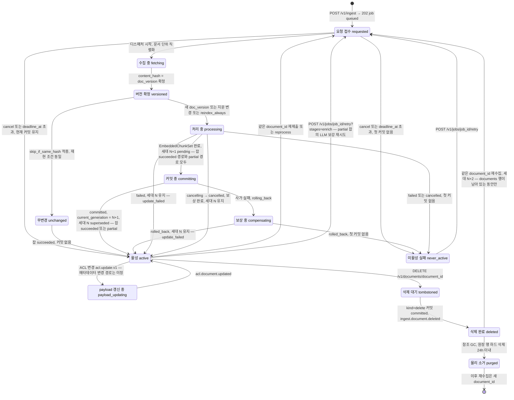
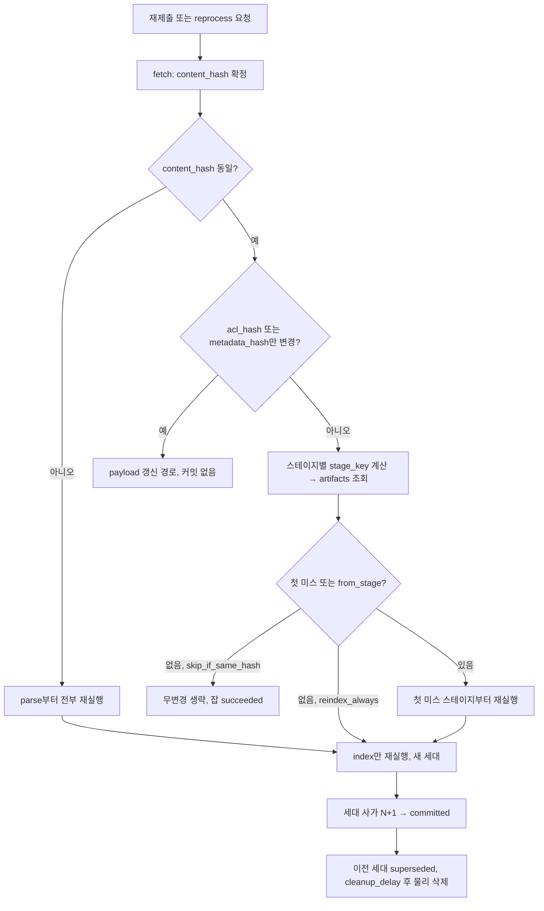
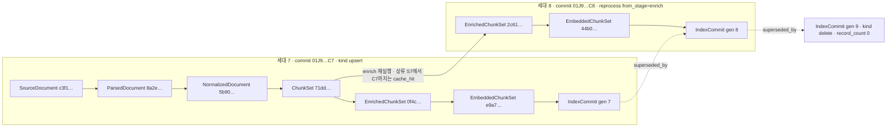
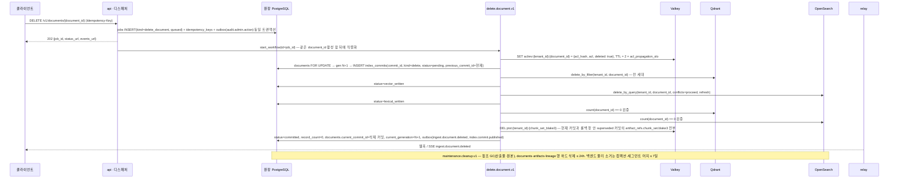
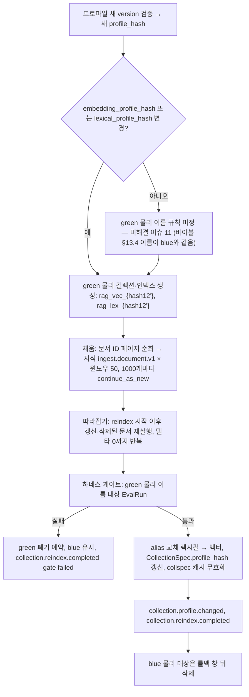

# 데이터 흐름과 문서 생애주기

## 목적

하나의 문서가 `IngestRequest`로 접수된 순간부터 인덱스에서 검색되고, 새 버전으로 교체되고, 삭제되어 모든 저장소에서 소거될 때까지 **어떤 데이터가 어디에 어떤 키로 놓이고, 무엇이 바뀌면 어디부터 다시 계산되는지**를 한 장에 확정한다. 설계 바이블(Design Bible, [`00-design-bible.md`](./00-design-bible.md))의 스테이지 파이프라인(§4), 계약 봉투(§5.2), 해시 결합 규칙(§6.2), 세대 사가(§11.4), 잡 상태 기계(§11.5), 저장소 정본(§13)을 **문서 생애주기 관점으로 재배열**한 문서이며, 새 타입·열거·엔드포인트를 정의하지 않는다. 바이블에 없는 것은 선택 필드 또는 "미해결 이슈"의 제안으로만 남긴다.

독자는 (1) 04-pipelines 각 스테이지 문서와 [갱신·삭제·재색인](../04-pipelines/19-update-delete-and-reindexing.md)을 쓰는 작성자, (2) 캐시·보존·삭제 전파 정책을 운영하는 운영자, (3) "이 청크가 어디서 왔고 언제 지워지는가"를 증명해야 하는 감사 담당자다.

## 범위

- 포함: 문서 생애주기 상태 모델과 상태 다이어그램, 스테이지별 데이터 흐름 표(입력·출력 계약, 저장 위치, 캐시 키, 재실행 조건), 변경 감지(`content_hash`, HTTP 검증자, `metadata_hash`, `acl_hash`, 스테이지 지문)와 무변경 생략(`skip_if_same_hash`), 부분 재처리 알고리즘(계보 해시 체인), 산출물(artifact) 보존 정책, 데이터 계보(lineage) 조회, 삭제 전파 SLA와 검증, 동시 갱신 경합, 백필·재색인 플로우, 이벤트 발행 시점 표.
- 제외: 각 스테이지 알고리즘(04-pipelines), 계약 스키마 전문(03-contracts), 오케스트레이터 워크플로우 코드 구조([오케스트레이션과 워크플로우](./06-orchestration-and-workflows.md)), 저장소 물리 설계([저장소 아키텍처](./04-storage-architecture.md)), 검색 경로 데이터 흐름(`plan`~`render`는 [시스템 개요](./01-system-overview.md)와 바이블 §4.3·§8), 백업 매체 내 삭제([백업과 재해 복구](../09-operations/07-backup-and-disaster-recovery.md)).
- 정본 관계: 이 문서의 표는 바이블 §4·§5·§6·§11·§13을 인용·재배열한 것이다. 충돌하면 바이블이 옳다. 수치는 바이블 §7.2 값 외에는 모두 "초안 목표"다.

## 1. 생애주기 개관

### 1.1 상태는 저장하지 않고 원장에서 파생한다

문서의 생애주기 상태를 **계약 필드로 노출하지 않는다**. PostgreSQL 원장(`documents`, `jobs`, `index_commits`; 바이블 §13.1)의 컬럼 조합에서 **파생**한다. 이유는 (1) 상태를 두 곳에 쓰면 어긋나고, (2) 원장이 이미 유일한 진실(K6)이며, (3) `JobState`·`CommitStatus` 두 열거(바이블 §5.7)가 각각 잡과 커밋의 상태를 정확히 표현하기 때문이다. 아래 표의 상태 이름은 설명용 라벨이며 계약 필드가 아니다. 조회 지연을 줄이기 위한 읽기 모델 컬럼(`documents.deleted_at`, 제안 `status ∈ {active, deleting, deleted}`)은 [저장소 아키텍처](./04-storage-architecture.md) §2 `documents` 표와 그 문서 미해결 이슈 #1이 소유하며, 그 컬럼은 아래 파생 규칙의 **캐시**이고 정본이 아니다(미해결 이슈 2).

| 생애주기 상태(라벨) | 파생 규칙(원장 조건) | 검색 노출 |
|---------------------|----------------------|-----------|
| 요청 접수(requested) | `jobs(kind ∈ {ingest_document, reprocess_document}, state=queued)` 존재. 신규 문서는 `documents.current_commit_id IS NULL`, 갱신·재처리는 현재 커밋 유지 | 없음(신규) / 현재 세대(갱신) |
| 수집·처리 중(processing) | `jobs.state=running`, `jobs.stage ∈ {fetch, parse, normalize, chunk, recount, enrich, embed}`. §1.2 다이어그램의 하위 국면: 수집 중(fetching, `stage=fetch`) → 버전 확정(versioned, `content_hash` 확정 후 §3.2 판정) → 무변경(unchanged, §3.2 행 1: 잡 `succeeded`·커밋 없음) 또는 나머지 스테이지 실행 | 없음(신규) / 이전 세대(갱신) |
| 커밋 중(committing) | 이 문서의 `index_commits.status ∈ {pending, vector_written, lexical_written, flipping_lexical, flipping_vector}` | 이전 세대(플립 중 수 초 혼합 허용, 바이블 §11.4 (2)) |
| 보상 중(compensating) | 이 문서의 `index_commits.status = rolling_back`(사가 보상 진행, 바이블 §11.4 (3)) | 플립 전 실패: 이전 세대 / 플립 후 실패: 이전 세대 복원 중(혼합 가능) |
| 활성(active) | `documents.current_commit_id → index_commits(kind=upsert, status=committed)`. 잡 `state ∈ {succeeded, partial}` 모두 해당 — `partial`(LLM 예산 소진·페이지 일부 실패·추출기 타임아웃, 바이블 §11.3·§11.5)은 비LLM 결과를 **정상 커밋**하므로 새 세대가 활성이며, 산출물 봉투 `quality=degraded`·`EnrichedChunkSet.status=partial`로만 구분된다 | 현재 세대 `is_current=true` |
| 미활성 실패(never_active) | `jobs.state ∈ {failed, cancelled}`(커밋은 없거나 `status ∈ {rolled_back, failed}`)이고 `documents.current_commit_id IS NULL` | 없음 |
| 갱신 실패·이전 유지(update_failed) | `jobs.state ∈ {failed, cancelled}` 또는 이 문서의 최신 커밋 `status ∈ {rolled_back, failed}`이고 `current_commit_id` 불변. §1.2 다이어그램에서는 `active`로 복귀하는 간선이며 잡·커밋 이력에만 남는다. 커밋 `failed`(보상 실패)는 `index.consistency.mismatch`로 복구 잡이 뜨고 복구 전까지 노출 상태가 보장되지 않는다 | 이전 세대 그대로(UC-07 E1) |
| payload 갱신 중(payload_updating) | `jobs(kind=acl_update, state ∈ {queued, running})`. 메타데이터 payload 갱신(`PATCH …/metadata`, 바이블 §14)은 `JobKind`·워크플로우 타입·백엔드 연산이 바이블에 없어 **경로 미정**(미해결 이슈 18) | 현재 세대(Valkey `aclrev` 힌트로 `acl_recheck` 보정, E9) |
| 삭제 대기·전파 중(tombstoned) | `jobs(kind=delete_document, state ∈ {queued, running})` | 현재 세대이나 `aclrev{deleted: true}` 힌트로 `pack.acl_recheck`가 제외 |
| 삭제 완료(deleted) | `documents.current_commit_id → index_commits(kind=delete, status=committed, record_count=0)` | 없음 |
| 물리 소거 완료(purged) | `documents`·`artifacts`·`lineage` 행 없음, `index_commits` 이력만 잔존. 이후 같은 원천의 재수집은 **새 `document_id`** 를 받는다(§7.4) | 없음 |

커밋 수준의 "대체됨(superseded)"은 `IndexCommit.superseded_by`(다음 커밋)와 `supersedes_commit_ids`(이전 커밋)로 표현되며(바이블 §5.4 `IndexCommit`), 문서 상태와는 별개다.

### 1.2 상태 다이어그램

상태 집합은 §1.1 표와 같다. `fetching`·`versioned`·`unchanged`는 표의 "처리 중(processing)" 행이 설명하는 하위 국면이고, 표의 "갱신 실패·이전 유지(update_failed)"는 아래에서 `active`로 복귀하는 간선(세대 N 유지)이다. 잡 상태 전이는 바이블 §11.5, 커밋 상태 전이는 바이블 §11.4를 따른다.



## 2. 스테이지별 데이터 흐름

### 2.1 데이터 흐름 표

바이블 §4.2(스테이지·멱등성 키)·§13.3(오브젝트 키)·§6.2(해시 결합)를 생애주기 관점으로 합친 표다. 경로의 `artifacts/{schema_type_kebab}/…`는 `tenants/{tenant_id}/artifacts/{schema_type_kebab}/{stage_key[:2]}/{stage_key}.json`, `derived/…`는 `tenants/{tenant_id}/derived/{kind}/{blake3[:2]}/{blake3}.{ext}`의 약칭이다. `scope_key = f"{tenant_id}/{collection_id}/{document_id}"`(ADR-0037).

| 스테이지 | 입력 계약 | 출력 계약 | 저장 위치 | 캐시 키(= 멱등성 키 = 산출물 경로) | 재실행 조건 |
|----------|-----------|-----------|-----------|--------------------------------------|-------------|
| `fetch` | `IngestRequest` | `SourceDocument` | 원본 바이트 `tenants/{tenant_id}/sources/{blake3[:2]}/{blake3}`; 봉투 `artifacts/source-document/…`. 봉투에는 `stage_key`가 없으므로(캐시 없음, ADR-0037) 바이블 §13.3의 `{stage_key}.json` 경로와 §13.1 `artifacts(tenant_id, stage_key)` PK를 그대로 쓸 수 없다 — 오브젝트 키와 원장 등재 대체 키는 [원본 문서 계약](../03-contracts/02-source-document.md)에서 확정(미해결 이슈 19) | **없음**(`stage_key` 미적용, 항상 실행). 조건부 GET 검증자 `http_metadata.etag`·`last_modified` | 매 잡. 검증자가 있고 같은 `document_id`의 이전 `SourceDocument`가 있으면 조건부 GET, 304면 이전 바이트 재사용(봉투는 새 발급); 동일 `content_hash` 원본이 `sources/`에 있으면 바이트 저장만 생략 |
| `detect`(parse 내부) | `SourceDocument` | `SourceDocument`(`format`, `format_confidence`, `container_flags`) | 갱신 봉투 `artifacts/source-document/…` | `H("stage", "detect", scope_key, content_hash, fingerprint)` | `content_hash` 변경, 탐지기 지문 변경 |
| `parse` | `SourceDocument` | `ParsedDocument` + `derived`(HWPX 변환본·페이지 이미지·표 HTML·벤더 JSON) | `artifacts/parsed-document/…`; 파생물 `derived/{kind}/…` | `H("stage", "parse", scope_key, content_hash, parser_fingerprint)`; 파생물 `H("derived", content_hash, sidecar_image_digest)`(봉투 없음, 테넌트 내 공유) | `content_hash` 변경; `parser_fingerprint_hash` 구성요소(파서 ID·버전·`model_ids`·사이드카 `image_digest`·`profile_option`) 변경; `from_stage=parse` |
| `normalize` | `ParsedDocument` | `NormalizedDocument` | `artifacts/normalized-document/…` | `H("stage", "normalize", scope_key, parsed.blake3, normalizer_fingerprint)` — 지문에 `analyzer_id`·`dictionary_hash`·`pii_policy`·PII 탐지기 버전 포함 | 상류 산출물 변경; 분석기·사용자 사전·PII 정책 변경; `from_stage=normalize` |
| `chunk` | `NormalizedDocument` | `ChunkSet` | `artifacts/chunk-set/…` | `H("stage", "chunk", scope_key, normalized.blake3, fingerprint)` — 지문에 `chunker_config_hash`·`primary_tokenizer_id` 포함 | 상류 변경; 청커 설정·1차 토크나이저 변경(`chunk_id` 전부 변경); `from_stage=chunk` |
| `recount`(선택) | `ChunkSet` | `ChunkSet`(`token_counts`에 키 추가) | `artifacts/chunk-set/…`(새 `stage_key`) | `H("stage", "recount", scope_key, chunk_set.blake3, tokenizer_id)` | 임베더 토크나이저 ID가 `token_counts`에 없을 때만(재청킹 아님, O-09) |
| `enrich` | `ChunkSet` | `EnrichedChunkSet`(청크 본문은 `chunk_set_ref` 참조) | `artifacts/enriched-chunk-set/…` | 세트 `H("stage", "enrich", scope_key, chunk_set.blake3, enricher_fingerprint)`; LLM 보강은 청크 단위 `H("llm-enrich", model_id, prompt_hash, embed_text)`(봉투 없음, 재청킹·타 컬렉션에도 재사용) | 상류 변경; 보강기 집합·버전·`policy_hash`·LLM 모델·프롬프트 변경; `from_stage=enrich` |
| `embed` | `EnrichedChunkSet` | `EmbeddedChunkSet` + 벡터 본문(`vectors_ref`) | `artifacts/embedded-chunk-set/…`; 벡터 npz/parquet `derived/vectors/…`(kind 이름은 [임베딩](../04-pipelines/12-embedding.md)에서 확정) | 세트 `H("stage", "embed", scope_key, enriched.blake3, embedder_fingerprint)`; 청크 단위 `H("embed", embedding_space_id, "document", embed_text)`(봉투 없음) | 상류 변경(`embed_text`); `embedding_space_id` 변경(모델·revision·차원·프롬프트·양자화·`vocab_id`). 같은 공간의 서빙 교체(`image_digest`만 변경)는 세트 키가 바뀌어도 청크 캐시는 전부 적중 |
| `index` | `EmbeddedChunkSet` + `requires_lineage`(`EnrichedChunkSet`, `ChunkSet`, `SourceDocument`) | `IndexCommit` | Qdrant `rag_vec_{embedding_profile_hash[:12]}`, OpenSearch `rag_lex_{lexical_profile_hash[:12]}`; 원장 `index_commits`; 부모 텍스트 번들 `derived/parent_texts/{chunk_set_blake3}.json` | 캐시 없음. `commit_id`(워크플로우 1회 발급)와 `record_id = H("record", tenant_id, collection_id, document_id, str(index_generation), chunk_id)` 단위 upsert 멱등 | 커밋마다 새 세대 N+1. `dedup_policy=skip_if_same_hash`이고 재현 조건 전부 동일이면 커밋 생략(§3.2 행 1) |
| `publish` | `IndexCommit` | `CloudEventEnvelope[]` | `outbox`(원장 갱신과 동일 트랜잭션) | `event_id`(워크플로우 1회 발급, 재시도 불변) | 커밋 상태 전이마다. 릴레이 재전송 중복은 소비자 `event_id` 멱등 |

### 2.2 봉투·계보 참조의 전파

- 수집 측 산출물은 공통 봉투(바이블 §5.2)를 품는다: `tenant_id`, `collection_id`, `producer`, `quality`, `warnings`, `created_at`, **`lineage_refs`**. 각 스테이지는 입력의 `lineage_refs`에 입력 `ArtifactRef`를 더해 출력에 전파하므로 `EmbeddedChunkSet.lineage_refs = {source, parsed, normalized, chunk_set, enriched}`가 되고, `IndexCommit.artifact_refs`는 여기에 `embedded`를 더한 6키다.
- 셸(액티비티 래퍼)은 산출물 저장·`artifacts(tenant_id, stage_key)` 행·`lineage(child_ref, parent_ref, stage_key, job_id, produced_at)` 행·아웃박스 이벤트를 **한 트랜잭션**에 기록한다(바이블 §4.1 "계보"). 캐시 적중(`cache_hit=true`)도 계보 행을 남기므로 "이 잡이 어떤 산출물을 썼는가"는 항상 원장에서 복원된다.
- 봉투를 품는 계약 산출물은 잡 스코프 안에서만 재사용된다(`stage_key`에 `scope_key` 포함). 봉투가 없는 콘텐츠 전용 산출물(원본 바이트, `derived`, 청크 임베딩 캐시, LLM 보강 캐시)만 테넌트 내에서 문서·컬렉션을 넘어 공유된다. 테넌트 경계는 오브젝트 키 접두 `tenants/{tenant_id}/`와 `artifacts`·`lineage` PK의 `tenant_id`로 물리적으로 분리된다(E17).

### 2.3 검색 경로가 읽는 것

검색 핫패스(`plan`~`render`)는 PostgreSQL을 읽지 않는다(ADR-0034). 생애주기 관점에서 검색이 의존하는 저장물은 정확히 셋이다: (1) 인덱스 백엔드의 `IndexRecord` payload(본문 ≤ 8,192바이트, `block_refs`, `sentence_spans`, `acl_*`, `chunk_set_blake3`), (2) `derived/parent_texts/{chunk_set_blake3}.json`(부모 확장), (3) payload `html_ref`(바이블 §5.4 `IndexRecord`)가 가리키는 `derived` 표 HTML 파생물. 페이지 이미지(`Chunk.page_image_ref`, `visual-pages` 프로파일)는 바이블 §5.4 `IndexRecord` 표에 없으므로 payload 포함 여부는 확인 필요다(포함되면 같은 부류로 취급한다). 따라서 보존 정책(§5)은 **현재 커밋이 참조하는 이 세 부류를 절대 먼저 지우지 않는다**는 제약을 갖는다.

## 3. 변경 감지와 무변경 생략

### 3.1 변경 감지 신호

| 신호 | 계산·원천 | 비교 대상(원장) | 의미 |
|------|-----------|-----------------|------|
| `content_hash` = `doc_version` | `blake3_hex(원본 바이트)`(라벨 없음, 바이블 §6.2) | `documents.current_doc_version` | 본문 변경의 **유일한** 버전 신호. ACL·메타는 버전을 바꾸지 않는다(ADR-0005) |
| `http_metadata.etag`, `.last_modified` | 원천 HTTP/S3 응답 헤더 | 같은 `document_id`의 이전 `SourceDocument.http_metadata` | 조건부 GET(304)로 **다운로드 생략**에만 쓴다. 버전 판정에는 쓰지 않는다(검증자 없는 원천은 조건부 재수집 금지) |
| `external_version` | `IngestRequest.external_version` | 이전 값 | 원천 버전 라벨 힌트. 값이 달라도 `content_hash`가 같으면 무변경 |
| `metadata_hash` | `H("meta", canonical_json(metadata))` | `documents.metadata_hash` | payload 필터 필드(`doc_date`, `doc_type`, `department`, `tags`, `custom`)·헤더(`title`) 갱신 |
| `acl_hash` | `H("acl", canonical_json(acl))` | `documents.acl_hash` | payload ACL 갱신(`acl_*`, `acl_hash`), 회수 힌트 기록(E9·E11) |
| 스테이지 지문 | 컬렉션 프로파일 해소 결과(`profile_hash`, `parser_fingerprint_hash`, `normalizer_fingerprint`, `chunker_config_hash`, `enricher_fingerprint`, `embedder_fingerprint`, `embedding_space_ids`, `analyzer_id`, `dictionary_hash`) | 현재 커밋 `index_commits` 행의 같은 컬럼 | 어느 스테이지부터 다시 계산할지(§4) |
| `dedup_policy` | `IngestRequest.dedup_policy`(기본 `skip_if_same_hash`) | — | `reindex_always`면 같은 `chunk_id` 집합이라도 새 세대로 적재 |

### 3.2 재제출 판정 표

같은 `document_id`(API 접수 시 `(tenant_id, collection_id, external_id or source_uri)`로 확정)로 `IngestRequest`가 다시 오면 `fetch` 완료 직후 워크플로우가 다음 표로 분기한다. "재현 조건"은 §3.1의 스테이지 지문 전부다.

| # | `content_hash` | `acl_hash` | `metadata_hash` | 재현 조건 | `dedup_policy` | 동작 | 새 커밋 | 발행 이벤트 |
|---|----------------|------------|-----------------|-----------|----------------|------|---------|-------------|
| 1 | 동일 | 동일 | 동일 | 동일 | `skip_if_same_hash` | **무변경 생략**: 잡 `succeeded`, `JobStatus.index_commit_id` = 현재 커밋, `progress.unit=stage` | 없음 | `ingest.document.fetched`, `job.state.changed` |
| 2 | 동일 | 다름 | 동일 | 동일 | `skip_if_same_hash` | payload ACL 갱신 경로: `aclrev:{tenant_id}:{document_id}` 힌트 → 양 백엔드 `update_acl`(`acl_*`, `acl_hash`) → `documents.acl`·`acl_hash` 갱신. `doc_version` 불변 | 없음 | `acl.document.updated`, `audit.acl.changed`(§10: 재제출 경로도 발행 주체가 워크플로우인 채로 발행), `job.state.changed` |
| 3 | 동일 | 동일/다름 | 다름 | 동일 | `skip_if_same_hash` | payload 메타 갱신(필터 필드·`title`·`custom`). **경로 미정**: 바이블 §14 `PATCH …/metadata`는 있으나 `JobKind`·워크플로우 타입·`IndexBackend` 메타 payload 갱신 연산이 정의되지 않았다(미해결 이슈 18; `update_acl`은 ACL 필드만 갱신, E11). `title` 변경은 `context_prefix.deterministic`에 영향 → 새 `SourceDocument` 봉투 `warnings[]`(바이블 §5.2)에 기록하고 `reprocess from_stage=enrich`를 제안(바이블 §14 규칙; 경고 코드·재처리 시작점·`JobStatus` 노출은 미해결 이슈 3·4) | 없음 | `job.state.changed`(+ 행 2) |
| 4 | 동일 | — | — | 하나라도 다름 | `skip_if_same_hash` | **부분 재처리**(§4): 첫 미스 스테이지부터 재실행, 새 세대 N+1 | 있음 | 재실행 스테이지 이벤트 + `ingest.document.indexed` + `index.commit.published` |
| 5 | 동일 | — | — | 동일 | `reindex_always` | 전 스테이지 캐시 적중, `index`만 새 세대로 재적재(같은 `chunk_id`·같은 `commit_hash`; `record_id`가 세대를 포함하므로 덮어쓰기 없음) | 있음 | `ingest.document.indexed`, `index.commit.published` |
| 6 | 다름 | — | — | — | — | **새 문서 버전**: `parse` 이후 전부 재실행. 콘텐츠 전용 캐시(파생물·청크 임베딩·LLM 보강)만 적중 | 있음 | 전 스테이지 이벤트 |

행 2의 payload 갱신은 `acl.update.v1`과 같은 갱신 경로를 쓰고, 행 3은 같은 원리(재임베딩·`doc_version` 변경 없음, E11)의 메타 갱신 경로를 전제하지만 그 워크플로우·`JobKind`·백엔드 연산은 미정이다(미해결 이슈 18). 행 1의 "무변경"에도 `SourceDocument` 봉투는 새로 발급되고 `ingest.document.fetched`는 발행된다 — 원천이 살아 있음을 감사 증적으로 남기기 위해서다.

### 3.3 조건부 재수집 규칙

1. `fetch`는 캐시 대상이 아니다. 검증자(`etag` 또는 `last_modified`)가 있고 같은 `document_id`의 이전 `SourceDocument`가 있을 때만 조건부 GET을 보낸다. 304면 이전 원본 바이트(`sources/{blake3}`)를 재사용하고 `content_hash`를 이전 값으로 확정한다. `fetched_at`·`request_id`·`metadata`·`acl`은 새 요청 값으로 채운 **새 봉투**를 발급한다.
2. 검증자가 없는 원천(`file://`, 검증자 미제공 HTTP, 프리사인 URL 재발급)은 항상 전체 다운로드한다. `s3://`·`gs://`·`az://`의 ETag는 검증자로 인정한다(멀티파트 ETag는 콘텐츠 해시가 아니므로 `content_hash` 대용으로 쓰지 않는다).
3. 다운로드 후 `content_hash`를 확정하고 `sources/`에 같은 해시가 있으면 바이트 저장만 생략한다(테넌트 내 공유; 다른 문서가 같은 바이트를 가져와도 원본은 하나).
4. 모든 아웃바운드 연결은 `EgressPolicy`(E16)를 통과한다. 조건부 GET·리다이렉트마다 재검사한다.

## 4. 부분 재처리 알고리즘

### 4.1 원리: 계보 해시 체인의 첫 미스

`stage_key = H("stage", stage_name, scope_key, input_ref.blake3, fingerprint)`는 (a) 문서 스코프, (b) 직전 산출물의 바이트 해시, (c) 현재 프로파일이 요구하는 생산자 지문으로만 결정된다. 따라서 **실행하지 않고도** `SourceDocument`의 `content_hash`에서 출발해 스테이지 순서대로 키를 계산하고 `artifacts(tenant_id, stage_key)`를 조회할 수 있다. 적중한 산출물의 `blake3`가 다음 스테이지의 입력 해시가 된다. **첫 미스 스테이지가 재실행 시작점**이며, 그 이후는 모두 재실행된다 — 재실행된 산출물의 봉투에는 새 `created_at`·`producer`가 들어가 바이트 해시가 바뀌므로 하류 키는 필연적으로 미스한다(콘텐츠가 같아도 그렇다; 콘텍스트 수준 재사용은 청크 단위 캐시가 담당한다. 개선 제안은 미해결 이슈 5).

`from_stage`(`POST /v1/documents/{document_id}/reprocess {from_stage}`, `from_stage ∈ {parse, normalize, chunk, recount, enrich, embed, index}`)는 **시작 하한**이다: 지정 스테이지 이상은 캐시를 조회하지 않고 강제 재실행하고, 미만은 캐시 적중을 기대한다(미스면 그 스테이지부터 자동 시작). 지문이 바뀌지 않은 스테이지를 강제 재실행하면 같은 `stage_key`에 다른 바이트가 저장될 수 있으므로 셸은 이 경우 `rag_ingest_stage_duration_seconds{stage}`와 함께 경고를 남긴다(순수 스테이지면 콘텍스트는 동일해야 한다).

### 4.2 알고리즘

```python
# 의사코드. H()는 바이블 §6.2의 결합 해시 H(label, *parts), artifacts.get()은 PostgreSQL
# artifacts(tenant_id, stage_key) 조회(바이블 §13.1)다. fetch·detect는 계획 대상이 아니다(§3.3).
STAGES = ("parse", "normalize", "chunk", "recount", "enrich", "embed", "index")
# from_stage 허용값 = STAGES 전부(바이블 §14 POST …/reprocess {from_stage}); index는 캐시가 없어 항상 run이다.

def plan_reprocess(doc, profile, from_stage=None):
    scope_key = f"{doc.tenant_id}/{doc.collection_id}/{doc.document_id}"
    source = doc.latest_source_document          # fetch는 항상 실행되어 있음(§3.3)
    input_blake3 = source.content_hash           # parse의 입력 해시 = 원본 바이트 해시
    plan, missed = [], False
    prev_chunk_set = None                        # 직전에 cache_hit한 ChunkSet 참조(token_counts 확인용)
    for stage in STAGES:
        forced = from_stage is not None and STAGES.index(stage) >= STAGES.index(from_stage)
        if stage == "index":
            plan.append(("index", "run"))        # 캐시 없음, 항상 새 세대(dedup 생략은 §3.2 행 1에서 결정)
            break
        if stage == "recount" and not forced and not profile.needs_recount(prev_chunk_set):
            continue                             # 임베더 tokenizer_id가 token_counts에 있으면 생략;
                                                 # prev_chunk_set이 None(chunk 재실행)이면 프로파일의
                                                 # chunk 토크나이저 설정과 임베더 tokenizer_id를 비교
        if missed or forced:
            plan.append((stage, "run"))
            missed = True
            continue
        key = H("stage", stage, scope_key, input_blake3, profile.fingerprint(stage))
        hit = artifacts.get(doc.tenant_id, key)
        if hit is None:
            plan.append((stage, "run"))
            missed = True
        else:
            plan.append((stage, "cache_hit", hit.artifact_ref))
            input_blake3 = hit.blake3
            if stage in ("chunk", "recount"):
                prev_chunk_set = hit.artifact_ref
    return plan
```

`from_stage=index`(§5.4 롤백, §9.1 정합성 복구·백필 C)는 `parse`~`embed` 전부를 캐시 조회하고 `index`만 실행하는 계획이 되며, 캐시가 하나라도 미스면 그 스테이지부터 자동으로 물러난다. `from_stage=recount`는 `forced`가 생략 검사보다 먼저 평가되므로 무시되지 않는다.

실행 시 셸은 `cache_hit` 스테이지에 대해서도 계보 행과 `ingest.document.*` 이벤트(`cache_hit=true`)를 남긴다. 캐시 조회는 `artifacts` 행뿐 아니라 산출물 오브젝트의 존재를 뜻하므로, 보존 정책(§5)이 지운 산출물은 미스로 판정된다: `index`는 `requires_lineage`로 `EnrichedChunkSet`·`ChunkSet`·`SourceDocument`를 함께 로드하므로 이 셋이 없는 문서는 `index`만 재실행할 수 없고, `ParsedDocument`가 없는 문서는 `analyzer_id`·`dictionary_hash` 변경(§4.3 `normalize` 시작)이라도 `parse`부터 물러난다(§5.2).

### 4.3 변경 종류별 시작 스테이지

| 변경 | 첫 미스 스테이지 | 이유 | 물리 인덱스 영향 |
|------|------------------|------|------------------|
| 원본 바이트 | `parse` | `content_hash` 변경 → `doc_version`·`block_id`·`chunk_id` 전부 변경 | 없음(같은 물리 컬렉션, 새 세대) |
| 파서 플러그인 버전·모델·사이드카 `image_digest`·`profile_option` | `parse` | `parser_fingerprint_hash` | 없음 |
| `analyzer_id`(예: mecab-ko → Kiwi 승격), `dictionary_hash`(사용자 사전), `pii_policy`, PII 탐지기 버전 | `normalize`(보존 정책이 `ParsedDocument`를 지운 문서는 `parse`로 후퇴, §4.2·§5.2) | `normalizer_fingerprint` | **OpenSearch 물리 인덱스 변경**(`lexical_profile_hash = H("lex", analyzer_id, dictionary_hash, mapping_version)`) → blue/green(§9.2) |
| 청커 설정(`leaf_max_tokens` 등)·1차 토크나이저 | `chunk` | `chunker_config_hash` → `chunk_id`·`parent_chunk_id` 전부 변경, 부모 번들 키(`chunk_set_blake3`) 변경 | 없음 |
| 임베더 토크나이저가 `token_counts`에 없음 | `recount` | O-09(재청킹 아님) | 없음 |
| 보강기 집합·정책(`policy_hash`)·LLM 모델·프롬프트 | `enrich` | `enricher_fingerprint`; LLM 청크 캐시는 `model_id`·`prompt_hash`가 같은 청크만 적중 | 없음 |
| 임베딩 모델·revision·프롬프트·양자화·`vocab_id` | `embed` | `embedding_space_id` 변경 | **Qdrant 물리 컬렉션 변경**(`rag_vec_{embedding_profile_hash[:12]}`) → blue/green |
| 같은 공간의 서빙 스택 교체(`image_digest`만) | `embed`(세트 키) | 청크 캐시 전부 적중 → 실질 비용 0; 교체 전 코사인 ≥ 0.9999 동등성 게이트(D-16) | 없음 |
| ACL·메타데이터만 | 없음 | payload 갱신(ADR-0005) | 없음 |
| `dedup_policy=reindex_always` | `index` | — | 없음 |

### 4.4 흐름도



## 5. 아티팩트 보존 정책

### 5.1 산출물 분류와 기본 보존

보존은 **재현성(replay)**과 **비용**의 거래다. 브리프 §7 재현성 목표("동일 `IngestRequest` + 동일 프로파일 → 동일 `IndexCommit` 해시")와 NFR-REL-12("`EmbeddedChunkSet` 이하 산출물에서 인덱스를 100% 재구축")가 하한을 정한다. 아래 기간은 모두 **초안 목표**이며 컬렉션 정책(`retention`, 미해결 이슈 6)으로 바꾼다.

| 산출물 | 위치 | 재현성 역할 | 기본 보존(초안 목표) | GC 조건 |
|--------|------|-------------|----------------------|---------|
| 원본 바이트 | `sources/{blake3}` | 전체 재현의 뿌리; 조건부 GET 304 재사용; `get_document` 원본 다운로드 | 현재 버전: 문서 삭제까지. 컬렉션 `retain_source=false`(FR-ING-08)면 커밋 후 삭제(파생물이 참조하는 그림·표 이미지는 이미 `derived`로 분리 저장됨). superseded 버전: 롤백 창 7일 | 참조 카운트 0 + 롤백 창 경과 |
| `SourceDocument` 봉투 | `artifacts/source-document/`(오브젝트 키·`artifacts` 등재 키는 미해결 이슈 19) | ACL·메타·`http_metadata` 원천; `index`의 `requires_lineage`; §3.3 조건부 GET의 이전 검증자 | 현재 커밋 `artifact_refs.source`가 가리키는 한 유지. 무변경 생략(§3.2 행 1)으로 새로 발급된 봉투는 커밋이 참조하지 않으므로 `documents` → 최신 `SourceDocument` 참조를 GC 뿌리에 별도로 포함한다(§5.3) | 커밋 superseded + 롤백 창 |
| 파생물(HWPX 변환본, 페이지 이미지, 표 HTML, 벤더 JSON) | `derived/{kind}/` | 재변환 생략(O-07); payload `html_ref`(및 payload 포함이 확인되면 `page_image_ref`)는 **검색 경로가 읽음**(§2.3) | 현재 커밋의 payload가 참조하는 한 유지; 변환본·벤더 JSON은 30일 | 참조 카운트 0 + 7일 |
| `ParsedDocument`, `NormalizedDocument` | `artifacts/parsed-document/`, `artifacts/normalized-document/` | `GET /v1/documents/{document_id}/content?view=parsed\|normalized`(바이블 §14; 소비자 `get_document`, §5.1) — 바이블에 "원본에서 재생성" 경로가 없으므로 이 API는 저장된 산출물에만 의존한다; 재청킹·분석기 변경의 출발점(§4.3) | 현재 커밋: `full_replay`·`index_replay`(기본)에서 **유지**; `minimal`에서만 커밋 직후 참조 해제(`?view=parsed\|normalized` 404 — 초안 결정, 미해결 이슈 6). superseded 버전: `full_replay`는 롤백 창, `index_replay`·`minimal`은 즉시 GC 대상 | 등급별(§5.2) |
| `ChunkSet` | `artifacts/chunk-set/` | 청크 본문 **정본**(`IndexRecord.text`는 8,192바이트 복제본), `?view=chunks`, `requires_lineage` | 현재 커밋: **필수 유지** | superseded + 롤백 창 |
| `EnrichedChunkSet` | `artifacts/enriched-chunk-set/` | `index_text`·`keywords`·`entities` 원천, `requires_lineage` | 현재 커밋: **필수 유지** | 동일 |
| `EmbeddedChunkSet` + 벡터 본문 | `artifacts/embedded-chunk-set/`, `derived/vectors/` | 인덱스 재구성(replay) 1순위(NFR-REL-12) | 현재 커밋: **필수 유지** | 동일 |
| 부모 텍스트 번들 | `derived/parent_texts/{chunk_set_blake3}.json` | 검색 경로 `parent_expand`(§13.2) | 현재 커밋이 참조하는 한 **필수 유지** | `chunk_set_blake3` 참조 0 |
| 청크 임베딩 캐시, LLM 보강 캐시 | 04-pipelines/12·11에서 확정(미해결 이슈 7) | 비용 절감(재청킹·타 컬렉션 재사용) | 최근 사용 90일 | 참조 문서 0(문서 파생 콘텐츠이므로 삭제 완결성 대상, FR-SEC-10) |
| 이전 세대 백엔드 레코드(`is_current=false`) | Qdrant·OpenSearch | 플립 후 실패 시 이전 세대 복원(§11.4 보상) | `cleanup_delay` **1h**(바이블 §7.2) | `maintenance.cleanup.v1` `delete_by_filter(document_id, is_current=false, index_generation < current_generation)` — `is_current=false` 조건을 반드시 포함한다(바이블 §11.2; blue/green 채움 중 다른 물리 대상의 서빙 세대를 지우지 않기 위해, §9.2) |
| `index_commits` 행 | PostgreSQL | 커밋 원장 정본, 재현성 조건 전부, 감사 증적(본문 없음) | **영구**(append-only) | 테넌트 삭제 시만 |
| `artifacts`, `lineage` 행 | PostgreSQL | 캐시 조회·계보 | 대응 산출물과 수명 동일 | 산출물 GC와 같은 트랜잭션에 삭제 |
| `outbox` 행 | PostgreSQL | 이벤트 전달 | `published_at` 후 7일 | 정리 스케줄 |
| `jobs`, `job_events` 행 | PostgreSQL | 읽기 모델·상태 이력 | 종료 후 90일 | 정리 스케줄 |
| `audit_log` | PostgreSQL / OpenSearch 감사 인덱스 | 불변 증적 | ≥ 1년(NFR-SEC-08), `korean-gov` 2년 | 정책 |

### 5.2 보존 등급(컬렉션 정책 제안)

등급은 "어떤 커밋의 어떤 `artifact_refs` 키를 GC 뿌리로 삼는가"(§5.3)로 정의한다. 산출물을 직접 지우는 것이 아니라 뿌리에서 제외해 도달성 GC가 회수하게 한다(콘텐츠 주소화 객체는 다른 문서·커밋이 공유할 수 있으므로 "커밋 직후 삭제"는 "참조 해제"를 뜻한다).

| 등급 | 현재 커밋 뿌리 | superseded 커밋 뿌리(롤백 창 안) | 재현 방법 | `?view=parsed\|normalized` | 비용 |
|------|----------------|----------------------------------|-----------|-----------------------------|------|
| `full_replay` | `artifact_refs` 6키 전부 + 파생물 전부 | 6키 전부 | 어느 스테이지부터든 캐시 적중 | 제공 | 최대(문서당 원본 + 파싱 문서 최대 256MB×2 + 청크 3벌 + 벡터, 두 벌) |
| `index_replay`(**기본**) | 6키 전부 + payload 참조 파생물 + 부모 번들(변환본·벤더 JSON은 30일 후 뿌리 제외) | `source`, `chunk_set`, `enriched`, `embedded`(= `requires_lineage` 집합 + 재적재 입력); `parsed`·`normalized`·변환본은 superseded 즉시 뿌리 제외 | 인덱스는 `EmbeddedChunkSet`에서 즉시 재적재; 재청킹·분석기 변경은 현재 `ParsedDocument`·`NormalizedDocument`에서 시작; 롤백은 superseded `embedded` 재적재(§5.4) | 현재 버전 제공 | 중간(superseded 파싱 문서 두 벌이 가장 큰 항목이므로 절감 폭이 크다) |
| `minimal` | `source`, `chunk_set`, `enriched`, `embedded` + payload 참조 파생물 + 부모 번들(원본 바이트는 `retain_source` 옵션) | `embedded`만 | 재적재만 가능; 그 외는 원본에서 `parse`부터 전면 재실행 | 404(초안 결정, 미해결 이슈 6; 커밋 직후 `parsed`·`normalized`·변환본 참조 해제) | 최소 |

어떤 등급이든 **현재 커밋의 `requires_lineage` 집합 + `EmbeddedChunkSet` + 검색 경로 참조 파생물 + 부모 번들은 지우지 않는다**. 이 집합이 없으면 `index.consistency.mismatch` 복구(산출물 재적재, §11.4 (4))가 불가능하고 §4.2의 계획이 `parse`까지 물러나야 한다. `index_replay`에서 현재 커밋의 `ParsedDocument`·`NormalizedDocument`를 유지하는 이유는 바이블 §14 `GET …/content?view=parsed|normalized`와 §5.1 소비자 `get_document`가 이 산출물에만 의존하기 때문이다; 이를 지우고 지연 재생성하는 경로는 바이블에 없으므로 새 결정이 필요하며 `minimal`의 404와 함께 미해결 이슈 6에 둔다.

### 5.3 참조 카운트 GC

콘텍스트 주소화 객체는 공유된다(같은 바이트를 가져온 두 문서의 `sources/{blake3}`, 같은 `content_hash`의 파생물, 같은 `embed_text`의 임베딩 캐시). 따라서 삭제는 "문서에 속한 객체 삭제"가 아니라 **도달 불가능 객체 회수**다.

1. 뿌리(root): (a) `documents.current_commit_id`가 가리키는 커밋의 `artifact_refs` 중 **컬렉션 보존 등급이 현재 커밋 뿌리로 지정한 키**(§5.2; `index_replay`는 6키 전부, `minimal`은 `parsed`·`normalized` 제외), (b) 롤백 창 안의 superseded 커밋의 `artifact_refs` 중 등급이 superseded 뿌리로 지정한 키, (c) 활성 잡(`queued|running|cancelling`)의 `lineage_refs`, (d) `documents` 행이 가리키는 최신 `SourceDocument` 봉투와 그 원본 바이트(무변경 생략·조건부 GET 검증자 원천; 커밋이 참조하지 않으므로 별도 뿌리, 미해결 이슈 19), (e) 법적 보존(legal hold) 문서의 모든 커밋.
2. 도달: `artifact_refs` → `lineage(child ← parent)` 역추적 → 산출물 본문 안의 `ArtifactRef`(`ParsedDocument.artifacts[].ref`, `Chunk.table_ref.html_ref`, `Chunk.page_image_ref`, `EmbeddedChunkSet.vectors_ref`, `EnrichedChunkSet.chunk_set_ref`). 뿌리에서 제외된 키(예: `minimal`의 `parsed`)는 역추적 출발점이 아니므로, 그 산출물이 다른 뿌리에서도 도달되지 않으면 회수된다.
3. 회수: 뿌리에서 도달하지 않고 유예(grace) 시간(초안 1h)을 넘긴 객체를 삭제하고 `artifacts`·`lineage` 행을 같은 트랜잭션에서 지운다.
4. 스코프: 테넌트별로 수행한다. 객체 키가 `tenants/{tenant_id}/` 접두를 갖고 PK에 `tenant_id`가 있어 교차 테넌트 참조가 존재하지 않으므로 테넌트 단위 mark-and-sweep이 안전하다. 원장 표는 모두 RLS `FORCE`이므로(바이블 §13.1) GC·정합성 검사 트랜잭션은 테넌트별로 `SET LOCAL app.tenant_id`를 설정한 뒤 읽고 지운다(pgbouncer 트랜잭션 모드에서의 강제 방법은 바이블 미해결 9, [저장소 아키텍처](./04-storage-architecture.md) 미해결 #14).
5. 실행: `maintenance.cleanup.v1` 스케줄(초안 1h 주기)의 한 단계로 둔다(별도 워크플로우 여부는 미해결 이슈 8). NFR §9의 "산출물 ≤ 24h" 데드라인은 "다음 주기 + 유예"로 충족한다.

### 5.4 이전 세대와 superseded 커밋

- 백엔드의 이전 세대 레코드는 `cleanup_delay` 1h 뒤 물리 삭제된다. 그 뒤의 롤백은 이전 세대를 되살리는 것이 아니라 **superseded 커밋의 `artifact_refs.embedded`를 새 세대 N+2로 재적재**하는 것이다(`reprocess from_stage=index`; 커밋 지정 인자는 미해결 이슈 14). 그래서 산출물 롤백 창(7일)이 백엔드 세대 공존 시간(1h)보다 길다.
- superseded 커밋 행은 영구 보존되나 그 `artifact_refs`가 가리키는 산출물은 롤백 창 뒤 GC될 수 있다. 이때 커밋 행의 `artifact_refs`는 매달린 참조(dangling)가 되며, 관리 API는 `artifacts` 행 부재로 "재적재 불가(재실행 필요)"를 표시한다.
- 세대 공존으로 `cleanup_delay` 동안 문서당 레코드가 2배가 된다(바이블 미해결 17). 대량 재색인에서는 이 배수가 컬렉션 전체에 걸리므로 §9.2의 윈도우 크기(50)가 사실상 공존 상한을 결정한다.

## 6. 데이터 계보 조회

### 6.1 계보 원천

| 원천 | 내용 | 방향 |
|------|------|------|
| `lineage(tenant_id, child_ref_blake3, parent_ref_blake3, stage_key, job_id, produced_at)` | 산출물 간 부모→자식 간선; 어떤 잡이 어떤 키로 만들었는지 | 양방향(간선 표) |
| `artifacts(tenant_id, stage_key) → artifact_ref, schema_type, blake3, producer` | 키→산출물, 생산자 지문(`plugin_id`, `plugin_version`, `config_hash`, `image_digest`, `model_ids`) | 키 조회 |
| 봉투 `lineage_refs` | 산출물 안에 상류 6키 참조 내장(원장 없이도 자기 서술) | 자식→부모 |
| `IndexCommit.artifact_refs`, `previous_commit_id`, `supersedes_commit_ids`, `superseded_by`, 지문 컬럼 | 커밋→산출물, 커밋 간 세대 체인, 재현 조건 | 커밋→상류, 커밋↔커밋 |
| `IndexRecord.chunk_set_blake3`, `chunk_id`, `commit_id`, `doc_version`, `block_refs[].element_path` | 레코드→청크 세트→블록→원문 요소 경로 | 레코드→상류 |
| `jobs.index_commit_id`, `job_events` | 잡→커밋, 상태 전이 이력 | 잡→커밋 |

### 6.2 조회 패턴

| 질문 | 시작점 | 경로 | 표면 |
|------|--------|------|------|
| 이 커밋은 무엇으로 만들어졌나(재현 조건) | `commit_id` | `index_commits.artifact_refs` 6키 + 지문 컬럼 + `profile_hash` | `GET /v1/documents/{document_id}/commits` |
| 이 검색 항목은 원문 어디인가 | `record_id` 또는 `chunk_id` | payload `block_refs[].{element_path, original_char_start, original_char_end, page, bbox}` → `Provenance`(단일 좌표계 K1) — 검색 경로에서는 원장을 거치지 않고 payload만으로 생성 | `ContextPack.items[].provenance`, `segments` |
| 이 청크의 전문·부모·이웃은 | `chunk_id`, `chunk_set_blake3` | `ChunkSet`(`artifacts` by `blake3`) → `chunks[]`, `parent_chunk_id`, `window` | `GET …/content?view=chunks`, `ChunkTextStore` |
| 이 산출물을 소비한 커밋은 어느 것인가(영향 분석) | 산출물 `blake3` | `lineage` child 방향 반복 → `EmbeddedChunkSet` → `index_commits.artifact_refs.embedded` | 제안 `GET /v1/documents/{document_id}/lineage`(미해결 이슈 15) |
| 어떤 플러그인·모델 버전이 만들었나 | 산출물 | `artifacts.producer`, `lineage.job_id`, `ParsedDocument.parser_chain[]` | 동일 |
| 문서 버전 이력과 세대 체인 | `document_id` | `index_commits ORDER BY index_generation`; `previous_commit_id` 체인; `kind=delete` 포함 | commits API |
| 파서 X 버전 v가 만든 모든 문서(결함 리콜) | `parser_fingerprint_hash` | `index_commits WHERE parser_fingerprint_hash = …`(현재 커밋만) → `reprocess from_stage=parse` 일괄 | 관리 API(재색인 필터, [관리 API](../05-api/04-management-api.md)) |
| 삭제가 정말 끝났는가 | `document_id` | `index_commits(kind=delete, status=committed)` + `backend_results[].deleted` + `audit.admin.action` + GC 로그 | commits API + 감사 |

### 6.3 예시

한 문서의 두 세대와 삭제 커밋의 계보 그래프다(해시는 축약 표기). 세대 8은 `reprocess from_stage=enrich`이므로 `S7 → P7 → N7 → C7` 간선은 캐시 적중(`cache_hit=true`)으로 세대 8 잡의 `job_id`로 계보 행이 다시 기록되고, `C7 → E8` 간선은 `enrich`가 실제 재실행된 간선이다.



제안 계보 조회 응답(`GET /v1/documents/{document_id}/lineage`, 미해결 이슈 15)의 형태다. 필드는 `IndexCommit`·`ArtifactRef`·`lineage` 원장 컬럼(바이블 §13.1: `child_ref_blake3`, `parent_ref_blake3`, `stage_key`, `job_id`, `produced_at`)을 그대로 투영한 것이며 새 계약 타입을 정의하지 않는다. `edges[]`에 캐시 적중 여부(`cache_hit`)는 없다 — `lineage` 표에 그 컬럼이 없기 때문이며, 컬럼 추가는 미해결 이슈 15의 제안이다. 예시는 축약이다: `artifact_refs`는 6키 중 `source`·`chunk_set` 2키만, `edges[]`는 세대 8의 `enrich` 간선 1개만 보인다. `stage_key`(= `H("stage", "enrich", scope_key, chunk_set.blake3, enricher_fingerprint)`, 바이블 §6.2)는 산출물 바이트 해시 `blake3`와 **다른 값**이며 산출물 경로(`{stage_key[:2]}/{stage_key}.json`, 바이블 §13.3)에 쓰인다; `SourceDocument`에는 `stage_key`가 없다(§2.1, 미해결 이슈 19).

```json
{
  "document_id": "01J9ZQ4K7X2M8N3P5R6S7T8V9W",
  "current_commit_id": "01J9ZR8C3D4E5F6G7H8J9K0M1N",
  "current_generation": 8,
  "commits": [
    {
      "commit_id": "01J9ZR8C3D4E5F6G7H8J9K0M1N",
      "kind": "upsert",
      "status": "committed",
      "index_generation": 8,
      "previous_commit_id": "01J9ZQ9A1B2C3D4E5F6G7H8J9K",
      "superseded_by": null,
      "profile_hash": "9b1c6d0e4f2a3b5c7d8e9f0a1b2c3d4e5f6a7b8c9d0e1f2a3b4c5d6e7f8a9b0c",
      "commit_hash": "4e7d9c2b1a0f8e6d5c4b3a29181716151413121110fedcba9876543210abcdef",
      "artifact_refs": {
        "source": {
          "uri": "s3://rag/tenants/01J9ZP0T3N4N5T6T7T8T9T0T1T/artifacts/source-document/c3/c3f1a2b3c4d5e6f708192a3b4c5d6e7f8091a2b3c4d5e6f708192a3b4c5d6e7f.json",
          "blake3": "c3f1a2b3c4d5e6f708192a3b4c5d6e7f8091a2b3c4d5e6f708192a3b4c5d6e7f",
          "media_type": "application/vnd.rag.source-document+json",
          "schema_type": "SourceDocument",
          "schema_version": "1.0.0",
          "size_bytes": 4821
        },
        "chunk_set": {
          "uri": "s3://rag/tenants/01J9ZP0T3N4N5T6T7T8T9T0T1T/artifacts/chunk-set/a4/a4c8e2f6b0d4183c5a7e9f1b3d5c7e9a0b2d4f6a8c0e2f4b6d8a0c2e4f6b8d0a.json",
          "blake3": "71dd0e1f2a3b4c5d6e7f8091a2b3c4d5e6f708192a3b4c5d6e7f8091a2b3c4d5",
          "media_type": "application/vnd.rag.chunk-set+json",
          "schema_type": "ChunkSet",
          "schema_version": "1.0.0",
          "size_bytes": 1932711,
          "stage_key": "a4c8e2f6b0d4183c5a7e9f1b3d5c7e9a0b2d4f6a8c0e2f4b6d8a0c2e4f6b8d0a"
        }
      },
      "edges": [
        {
          "stage_key": "d7e5f3a1b9c7d5e3f1a9b7c5d3e1f9a7b5c3d1e9f7a5b3c1d9e7f5a3b1c9d7e5",
          "child_ref_blake3": "2c61b0a9f8e7d6c5b4a3928170615f4e3d2c1b0a9f8e7d6c5b4a3928170615f4",
          "parent_ref_blake3": "71dd0e1f2a3b4c5d6e7f8091a2b3c4d5e6f708192a3b4c5d6e7f8091a2b3c4d5",
          "job_id": "01J9ZR7Y5W4V3T2T1S0R9Q8P7N",
          "produced_at": "2026-09-22T09:14:03.211Z"
        }
      ]
    }
  ]
}
```

## 7. 삭제 전파 SLA와 검증

### 7.1 삭제 흐름

바이블 §11.2 `delete.document.v1`("`aclrev:` 삭제 힌트 기록 → `kind=delete` 커밋: 양 백엔드 `delete_by_filter(document_id)` → `is_current` 없음 → `ingest.document.deleted`")을 NFR §9 데드라인에 맞춰 전개한 것이다.



규칙:

1. **툼스톤(tombstone)** 은 새 컬럼이 아니라 "`documents.current_commit_id`가 `kind=delete`·`status=committed` 커밋을 가리키는 상태"다. 접수 직후~커밋 전의 "삭제 중"은 활성 `delete_document` 잡의 존재로 읽기 모델이 파생한다(§1.1). 조회 API는 두 경우 모두 삭제 상태를 반환하고 목록·통계에서 제외한다(응답 코드는 [API 설계 가이드라인](../05-api/01-api-design-guidelines.md)).
2. 삭제 커밋은 `CommitStatus`의 `pending → vector_written → lexical_written → committed` 경로만 지나며 `flipping_*`는 생략한다(활성화할 새 세대가 없다). 재시도 소진 시 `failed` + `index.consistency.mismatch`. 삭제는 백엔드에서 되돌릴 수 없으므로 보상은 없고, 부분 삭제 상태는 재시도·조정(reconcile)으로만 수렴한다(03-contracts/08에서 확인, 미해결 이슈 10).
3. `aclrev` 힌트는 백엔드 삭제 **전에** 기록한다. `pack.acl_recheck`는 힌트의 `deleted: true`를 보면 항목을 `omitted.reason=acl_denied`, `explain += acl_revoked_hint`로 제외한다(E9). 백엔드 삭제가 힌트 TTL(standard 10분)보다 늦어질 수 있으므로 워크플로우는 액티비티 재시도마다 힌트를 다시 기록한다(제안, 미해결 이슈 9).
4. `delete_by_filter`는 **전 세대**를 지운다(`index_generation` 조건 없음). 플립 중이던 커밋이 있으면 문서 직렬화가 그 잡을 먼저 끝내므로 삭제와 플립은 겹치지 않는다.
5. Valkey `ptxt:{tenant_id}:{chunk_set_blake3}`(부모 텍스트 번들 캐시, 24h, 바이블 §13.4)는 삭제 문서의 부모 **본문**을 담으므로 FR-SEC-10(캐시·보강 캐시에서 문서 파생물 제거)과 NFR §9 "질의·결과 캐시 물리 소거 ≤ 5 min" 대상이다. 백엔드 삭제·0건 검증 뒤, 커밋 전에 현재 커밋과 롤백 창 안 superseded 커밋의 `artifact_refs.chunk_set.blake3` 키를 모두 `DEL`한다. `chunk_set_blake3`는 다른 문서와 공유되지 않으므로(봉투 포함 산출물, §2.2) 안전하다. 같은 번들이 삭제 직전 검색으로 다시 캐시될 수 있으나 `aclrev{deleted: true}` 힌트가 `pack.acl_recheck`에서 항목을 제외하므로 관측 경로는 없고, 잔여 키는 TTL로 만료된다(재적재 경합의 상한은 힌트 TTL이며 미해결 이슈 9와 함께 확정).
6. 컬렉션 삭제(`DELETE /v1/collections/{collection_id}`)는 문서 수에 비례하지 않아야 한다(NFR-PRV-11): 컬렉션 레지스트리 행 제거 + `collspec:{collection_id}` 캐시 무효화 + alias `col_{collection_id}_vec`·`col_{collection_id}_lex` 제거로 **즉시 논리 삭제**하고(플래너가 컬렉션을 해소할 수 없어 `plan.collection_forbidden`), 문서별 `kind=delete` 커밋은 `reindex.collection.v1`과 같은 페이지 순회로 비동기 수행한다.

### 7.2 SLA 표

NFR §9의 최대 데드라인(hard deadline)에 본 설계의 메커니즘과 초안 목표를 대응시킨 표다. NFR §9는 대상마다 논리 삭제 데드라인과 물리 소거 데드라인을 따로 두므로(둘 다 최대값) 두 값이 모두 있는 대상(질의·결과 캐시)은 두 행으로 나눴다. "초안 목표"는 실측 전 값이다.

| 대상 | NFR §9 요구(최대) | 메커니즘 | 초안 목표 | 측정 |
|------|-------------------|----------|-----------|------|
| 조회 API 삭제 상태 | 즉시 | 활성 `delete_document` 잡(접수 트랜잭션) → 읽기 모델 "삭제 중"; 커밋 후 툼스톤 | 요청 트랜잭션 내 | API 응답 검사 |
| 질의 결과 미노출(관측 요구) | 인덱스 ≤ 60 s | `aclrev{deleted: true}` 힌트 → `pack.acl_recheck` 제외 | 힌트 기록 ≤ 5 s(큐 대기 포함) | 골든 시나리오 E9 "삭제 → 전파 전 질의 → 미반환", `rag_acl_recheck_denied_total` |
| Qdrant 레코드 논리 삭제 | ≤ 60 s | `delete_by_filter(tenant_id, document_id)` | 큐 대기 포함 ≤ 60 s | `count(document_id) == 0`, `rag_acl_propagation_seconds`(삭제 힌트 전파도 같은 계량, 전용 메트릭은 미해결 이슈 9) |
| OpenSearch 레코드 논리 삭제 | ≤ 60 s | `delete_by_query` + `refresh` | 동일 | 동일 |
| 백엔드 물리 소거 | ≤ 7일 | Qdrant vacuum·세그먼트 최적화, OpenSearch 세그먼트 머지 | 백엔드 기본 주기 | 운영 런북(스냅샷 포함 여부 확인) |
| 질의·결과 캐시(관측 — 논리 삭제) | ≤ 5 s(논리 삭제 데드라인) | 결과 캐시 **없음**(ACL 시점성, 바이블 §4.3); `ptxt:` 번들은 필터·`acl_recheck`를 통과한 후보에만 적용되어 누출 경로가 없음; `plan:` 5m는 본문 없음 | 즉시 | 캐시 히트 응답 검사 |
| 질의·결과 캐시(물리 소거, `ptxt:` 부모 본문) | ≤ 5 min(물리 소거 데드라인; 캐시 TTL 상한) | `delete.document.v1`이 백엔드 삭제 후 `DEL ptxt:{tenant_id}:{chunk_set_blake3}` 명시 삭제(§7.1 규칙 5); 나머지 Valkey 키(`qemb`·`tok`·`rr`·`plan`)는 본문·문서 파생물이 없음 | ≤ 60 s(삭제 잡 안) | Valkey 키 부재 검사(적합성 키트 시나리오) |
| 산출물·원본(오브젝트) | ≤ 24 h(마지막 참조 삭제 기준) | 참조 카운트 GC(§5.3), `maintenance.cleanup.v1` 1h 주기 + 유예 1h | ≤ 3 h | 버킷 리스팅 vs `artifacts` 대조(고아 0; `SourceDocument` 봉투·원본은 등재 키 확정 전까지 `documents`·`index_commits.artifact_refs.source` 대조, 미해결 이슈 19) |
| 원장 행(`documents`, `artifacts`, `lineage`) | ≤ 24 h | GC 트랜잭션에서 하드 삭제; `index_commits`·`job_events`·감사 로그는 본문이 없어 보존 | ≤ 24 h | DB 스캔 |
| 청크 임베딩·LLM 보강 캐시 | (FR-SEC-10 삭제 완결성) | 참조 문서 0인 항목 삭제(콘텐츠 파생) | GC와 동일 | 캐시 키 대조 |
| 트레이스·로그 | ≤ 30일 | 본문 미기록(`content_capture=none`), 저장소 TTL | 30일 | TTL 설정 감사 |
| 백업 | ≤ 35일 | 복구 후 툼스톤 재적용 = 복구 시점 이후의 `kind=delete` 커밋을 원장에서 재생 | — | 복구 리허설 |
| 삭제 완료 이벤트 | ≤ 5 s(논리 삭제 완료 후) | 아웃박스 → 릴레이(`outbox_lag_slo` standard 5s, lite 30s, korean-gov 2s) | 프로파일 SLO | `rag_outbox_lag_seconds` |

### 7.3 검증

1. **커밋 전 자기 검증**: 워크플로우가 양 백엔드 `count(document_id) == 0`을 확인한 뒤에만 `committed`로 전이하고 `ingest.document.deleted`를 발행한다(UC-08 E1 "완료 이벤트는 모든 백엔드 확인 후").
2. **골든 시나리오**(적합성 키트): "삭제 접수 → 백엔드 삭제 전 질의 → 0건", "삭제 접수 후 재삭제 → 오류 없이 완료", "삭제 직후 재수집 → 세대 N+2 활성", "두 테넌트가 같은 바이트를 가진 문서 중 한쪽만 삭제 → 다른 테넌트 레코드·원본 무영향(E17)".
3. **주기 정합성 검사**(`maintenance.consistency.v1`): 툼스톤 문서의 백엔드 레코드 수가 0이 아니거나 `artifacts` 행이 남아 있으면 `index.consistency.mismatch` + `rag_consistency_mismatch_total` → 삭제 커밋 재구동.
4. **GC 검증**: 버킷 리스팅 표본과 `artifacts` 행을 대조해 고아 객체 0을 확인한다(NFR §9 "버킷 리스팅"). `stage_key`가 없는 `SourceDocument` 봉투와 원본 바이트는 `artifacts` 행이 아니라 `documents`·`index_commits.artifact_refs.source`의 참조로 대조한다(등재 키 확정 전 임시 규칙, 미해결 이슈 19).
5. **감사 증적**: 접수 시 `audit.admin.action{action: delete_document}`, 완료 시 `ingest.document.deleted{commit_id, backend_results[].deleted}`, GC 시 삭제 객체 수를 `job_events`에 기록한다. 세 증적이 모두 있어야 "삭제 완료"로 보고한다(PS-06 감사 페르소나).

### 7.4 멱등성·경합·유예

- **멱등**(NFR-PRV-09): 툼스톤 문서에 대한 재삭제는 잡을 만들되 첫 액티비티에서 "현재 커밋이 `kind=delete`·`committed`"임을 보고 즉시 `succeeded`로 끝낸다. 같은 `Idempotency-Key` 재전송은 `idempotency_keys(tenant_id, key)` 판정으로 같은 `job_id`를 200으로 돌려준다.
- **삭제·수집 경합**(NFR-PRV-10): 같은 `document_id`의 잡은 접수 순서로 직렬화되므로(§8) 최종 상태는 마지막 접수 의도를 따른다. 삭제 뒤 수집은 툼스톤에서 세대 N+2로 재활성화되며 `document_id`는 재사용된다 — 단 `documents` 행이 살아 있는 동안(하드 삭제 ≤ 24h, §7.2)만이다. `document_id`는 접수 시 `(tenant_id, collection_id, external_id or source_uri)`로 `documents` 행을 찾아 재사용하므로(바이블 §5.4 `SourceDocument`, §11.2), `purged` 이후 같은 원천의 재수집은 **새 ULID `document_id`** 를 받고 세대 1부터 시작하며, 옛 `index_commits` 이력은 `external_id`·`source_uri`로만 연결된다. 이력 연속성이 필요한 테넌트는 `documents` 행 보존 기간을 늘리는 읽기 모델 옵션(미해결 이슈 2)을 쓴다.
- **법적 보존(legal hold, ISS-NFR-08)**: 활성 시 논리 삭제(툼스톤·백엔드 삭제)는 그대로 진행하고 산출물·원본 GC만 유예한다. 플래그 위치는 `documents` 컬럼 제안(미해결 이슈 2).
- **컴플라이언스 즉시 소거**(UC-08 A2): `purge_mode=immediate`(컬렉션 정책 제안, 미해결 이슈 6)면 유예 없이 GC를 삭제 잡 안에서 수행하고 백업 대상 표시를 남긴다. 백업 매체 내 처리는 09-operations/07의 정책이다.

## 8. 동시 갱신 경합

### 8.1 직렬화 규칙(바이블 §11.2·§11.4 (6))

| 규칙 | 내용 | 실패 시 |
|------|------|---------|
| 문서 ID 확정 | API 접수 시 `(tenant_id, collection_id, external_id or source_uri)`로 `document_id`를 확정해 `jobs.document_id`에 기록 | — |
| 문서 단위 직렬화 | 같은 `document_id`의 활성 잡(`queued\|running\|cancelling`)이 있으면 새 잡은 `queued`(`jobs.waiting_for = 앞 job_id`). 디스패처(api 프로세스, PG advisory lock `tenant_id`)가 앞 잡 종료 이벤트·조정 스케줄에서 시작. 부분 인덱스 `(document_id) WHERE state IN ('queued','running','cancelling')`가 판정 원천 | `waiting_for` 체인 상한·기아 방지는 바이블 미해결 16 |
| 테넌트 동시성 | `runtime.tenant_concurrent_jobs_max`(lite 4 / standard 32 / premium 64)를 원장 `jobs.state=running` 수로 강제 | 초과분 `queued` |
| 세대 할당 | `index_generation`은 `documents` 행 `FOR UPDATE` 잠금 아래 N+1 할당, 같은 트랜잭션에 `index_commits(pending)` INSERT. N의 원천: 바이블 §11.4 (6)은 잠금만 정하므로 일반 수집에서는 `current_generation`과 같지만, `rolled_back` 세대와 blue/green 채움 중 전진하지 않은 green 세대(§9.2 단계 3 제안)를 재사용하지 않으려면 **그 문서의 `MAX(index_commits.index_generation)`** 이어야 한다([저장소 아키텍처](./04-storage-architecture.md) I1 `UNIQUE(tenant_id, document_id, index_generation)`; 제안 확정 전까지는 `current_generation + 1`, 미해결 이슈 20) | 같은 세대 재할당은 UNIQUE 위반으로 트랜잭션 실패 → 액티비티 재시도 |
| 발급 불변 | `commit_id`·`event_id`는 워크플로우가 1회 생성해 액티비티 인자로 전달(재시도 불변) | — |
| 플립 안전망 | 플립 시 `documents.current_generation ≥ N+1`이면 `index.generation_conflict`(비재시도) | 보상 후 `failed` |
| 멱등 키 | `Idempotency-Key`는 `(tenant_id, key)` 스코프, `jobs` INSERT와 동일 트랜잭션: 동일 페이로드 200(같은 `job_id`), 다른 페이로드 422 `api.idempotency_payload_mismatch`, 처리 중 409 `api.idempotency_conflict` | — |

**결정:** 같은 문서의 동시 갱신은 **접수 순서 직렬화(FIFO)** 로 처리하고 "최신 우선(앞 잡 취소)"은 기본으로 채택하지 않는다([ADR-0026](../06-adr/0026-index-commit-generation-saga-and-ledger.md), [ADR-0017](../06-adr/0017-event-delivery-outbox-cloudevents-no-broker.md)). 이유: (1) `fetch`는 실행 시점에 원천을 읽으므로 앞 잡이 이미 최신 바이트를 받는 경우가 많고 뒤 잡은 `skip_if_same_hash`로 무비용 종료한다, (2) 세대가 단조 증가하고 한 시점에 한 세대만 `is_current=true`임이 추론 가능하다, (3) 취소·보상 경로가 늘지 않는다. 대기 큐가 길 때의 병합(coalescing)은 미해결 이슈 13의 옵션이다.

### 8.2 시나리오

| 시나리오 | 처리 | 결과 |
|----------|------|------|
| 같은 문서 v1(A)·v2(B) 연속 제출, 둘 다 큐 | B는 `queued`, `waiting_for=A`. A 실행 → 커밋 N+1 → B 실행 | A가 실행 시점에 이미 v2 바이트를 받으면 B는 §3.2 행 1로 무변경 종료. 아니면 B가 N+2 |
| A 실행 중 B 접수 | 동일 | 세대 N+1 → N+2, 각 플립 사이 이전 세대만 노출 |
| 같은 문서 ingest + delete 동시 | 접수 순서 직렬화 | 마지막 요청 의도(NFR-PRV-10). delete 뒤 ingest는 툼스톤에서 재활성 |
| 같은 문서 `reprocess` + ingest 동시 | 동일 직렬화(`reprocess.document.v1`도 문서 단위) | — |
| A가 플립 도중 크래시 | `flipping_lexical\|flipping_vector` 원장 상태 → Temporal 재시도 → 실패 시 이전 세대 복원 보상(`compensation.restored_generation=N`) → `rolled_back` | B는 A 종료 후 시작 |
| 다른 문서 동시 처리 | 독립. 테넌트 동시성 상한만 적용 | — |
| 재색인 자식 잡 vs 같은 문서 신규 ingest | 문서 직렬화 동일 적용; 재색인은 따라잡기(catch-up) 루프로 흡수(§9.2) | — |
| 같은 바이트를 두 컬렉션이 수집 | `document_id`가 다르므로 병렬. `stage_key`에 `scope_key`가 있어 산출물은 각자 생성, 원본·파생물·청크 임베딩 캐시만 공유(E17) | — |

### 8.3 세대 플립 중 질의

플립은 렉시컬 → 벡터 순서로 고정되어 수 초의 혼합 상태(렉시컬은 N+1, 벡터는 N)가 생긴다(바이블 §11.4 (2)). 검색 경로의 처리: (1) 채널 결과는 `record_id`로 식별되고 `record_id`에 세대가 들어 있으므로 같은 청크의 N·N+1 레코드는 별개 후보가 되어 RRF에서 각각 기여한다 — 1차 `dedup`이 `content_hash`로 병합하고 `duplicates_of`에 기록한다; (2) `hydrate` 시점에 이미 `is_current=false`가 된 레코드는 조회 누락으로 제외되고 `degraded{hydrate, partial_result}`·`explain += hydrate_missing`·`rag_hydrate_missing_total`로 관측된다; (3) `ContextPack.diagnostics.index_generations_seen[]`과 `CandidateSet.channel_runs[].index_generation_seen[]`이 혼합 여부를 기록한다. 혼합 상태의 p99와 `index_generation_min` 필터 도입 여부는 바이블 미해결 8(04-pipelines/19)이다.

## 9. 백필·재색인 플로우

### 9.1 재처리 종류

| 트리거 | 범위 | 시작 스테이지(§4.3) | 물리 대상 변화 | 전환 방식 | 워크플로우 |
|--------|------|---------------------|----------------|-----------|------------|
| 운영자 단일 문서 재처리 | 문서 | `from_stage` 지정 | 없음 | 문서 세대 플립 | `reprocess.document.v1` |
| 정합성 불일치 복구 | 문서 | `index`(재적재) | 없음 | 문서 세대 플립 | `maintenance.consistency.v1` → `reprocess from_stage=index` |
| 롤백 | 문서 | `index`(superseded 커밋 `artifact_refs.embedded` 재적재) | 없음 | 세대 N+2 | `reprocess.document.v1`(커밋 지정 인자 제안, 미해결 이슈 14) |
| 파서·정규화기·보강기 플러그인 업그레이드(지문 변경, 프로파일 `version` 증가 → `profile_hash` 변경) | 컬렉션(해당 포맷·전체) | 첫 미스(`parse`/`normalize`/`enrich`) | 양 백엔드 green 물리 대상(이름 규칙 **미정**, 미해결 이슈 11) | **물리 blue/green + alias 교체**(바이블 §11.4 (5)·§5.6 `Profile.version`·§3.2 O-01) | `reindex.collection.v1` |
| 청커 설정 변경 | 컬렉션 | `chunk` | 동일(`chunk_id`·부모 번들 전부 변경) | 동일 | 동일 |
| 사용자 사전(`dictionary_hash`)·`analyzer_id` 변경 | 컬렉션 | `normalize` | OpenSearch 물리 인덱스(`lexical_profile_hash`) | **물리 blue/green(렉시컬)** + alias 교체 | 동일 |
| 임베딩 모델 교체(`embedding_space_id`) | 컬렉션 | `embed`(+`recount`) | Qdrant 물리 컬렉션(`embedding_profile_hash`) | **물리 blue/green(벡터)** + alias 교체 | 동일 |
| 백필 A: 메타 파생 payload 필드 추가(`filterable_fields`에 `custom.*` 선언, `doc_type` 채움) | 컬렉션 | 없음 | 없음 | payload 갱신(세대 없음) | **미정**: 메타 payload 갱신의 워크플로우 타입·`JobKind`·`IndexBackend` 연산이 바이블에 없다(미해결 이슈 18) |
| 백필 B: 계산 필드 추가(`entity_ids`, `derived_meta.law_refs`, 생성 접두어 켬) | 컬렉션 | `enrich` | green 물리 대상(이름 규칙 미정, 미해결 이슈 11) | 물리 blue/green + alias 교체 | `reindex.collection.v1` |
| 백필 C: 백엔드 추가(lite → standard, OpenSearch 신설) | 컬렉션 | `index`(재적재만) | 새 백엔드 물리 인덱스 신설 | 채움 후 alias 생성, `CollectionSpec.backends` 갱신 | `reindex.collection.v1` |
| 격리 등급 승격(E15) | 테넌트 | `index`(재적재만) | 물리 컬렉션·인덱스 신설(`_t_{tenant_id}`) | 물리 blue/green | `tier.promotion.v1` |

**결정:** 컬렉션 단위 프로파일 변경은 문서 세대 플립이 아니라 **blue/green 물리 컬렉션·인덱스 + alias 교체(렉시컬 → 벡터)** 로 전환한다(바이블 §11.4 (5), §11.2 `reindex.collection.v1`; [ADR-0026](../06-adr/0026-index-commit-generation-saga-and-ledger.md)). `CollectionSpec`은 정확히 하나의 `profile_hash`에 바인딩되므로(바이블 §5.6) 한 물리 컬렉션 안에 두 `profile_hash`의 커밋을 공존시키는 방식은 채택하지 않는다. [저장소 아키텍처](./04-storage-architecture.md), [컴포넌트 아키텍처](./02-component-architecture.md), [시스템 개요](./01-system-overview.md) QA-12가 같은 결정을 공유한다. [오케스트레이션과 워크플로우](./06-orchestration-and-workflows.md) §2.5는 `embedding_profile_hash`·`lexical_profile_hash` 중 하나라도 바뀌는 변경(그 문서의 **모드 A**)에서는 이 결정과 같으나, 두 해시가 모두 같은 변경(청커·보강기·파서 지문, 백필 B)을 **모드 B(카나리 + 한 물리 대상 안의 롤링 세대 플립)** 로 처리하는 잠정 결정(그 문서 §2.5 B-1~B-5, 미해결 15)을 두고 있어 이 문단의 "공존 방식 불채택"과 상충한다. 바이블 §11.4 (5)("컬렉션 단위 프로파일 변경은 세대 플립이 아니라 blue/green")와 §5.6 `CollectionSpec` 단일 `profile_hash` 바인딩이 정본이므로 본 문서는 모드 B를 채택하지 않는다. 두 문서의 택1은 미해결 이슈 11(그 문서 미해결 15와 같은 항목)에서 ADR로 확정하고, 확정 결과에 따라 06-orchestration 또는 본 문서를 개정한다.

**미정(O-xx 미배정, 미해결 11):** 물리 이름이 `rag_vec_{embedding_profile_hash[:12]}`·`rag_lex_{lexical_profile_hash[:12]}`(바이블 §13.4)에서만 파생되므로, 두 해시가 바뀌지 않는 프로파일 변경(청커·보강기·파서)은 green의 물리 이름이 blue와 같아 blue/green 대상을 만들 수 없다. 해소안은 (a) 물리 이름에 `profile_hash[:12]`를 합성(바이블 §13.4 개정), (b) 한 물리 대상 안의 롤링 세대 플립 + 카나리 게이트(바이블 §11.4 (5)·§5.6 `CollectionSpec` 바인딩 규칙의 예외 필요; [오케스트레이션과 워크플로우](./06-orchestration-and-workflows.md) §2.5 모드 B가 잠정 채택) 중 하나이며, 본 문서는 어느 쪽도 결정하지 않는다. 바이블 §3.2 개방 결정 표에 해당 항목이 없어 O-xx 번호가 없으며 등재 제안은 미해결 이슈 11에 둔다. 해소 전까지 이런 변경은 `embedding_profile_hash` 또는 `lexical_profile_hash`가 함께 바뀌는 변경(예: 임베더 revision 증가)에 묶어 배포하거나 새 컬렉션으로 이관한다.

### 9.2 `reindex.collection.v1` 플로우



단계별 규칙([오케스트레이션과 워크플로우](./06-orchestration-and-workflows.md) §2.5 **모드 A**의 공통 단계 0~5와 마무리 A-6~A-8과 같은 흐름이며, 이 문서는 원장·산출물 관점의 규칙만 더한다. 그 문서의 모드 B(카나리 + 롤링 세대 플립)는 본 문서가 채택하지 않는다 — §9.1 미정, 미해결 이슈 11):

1. **준비**: `POST /v1/profiles/validate`로 새 버전을 검증하고 `profile_hash'`·`embedding_profile_hash'`·`lexical_profile_hash'`를 계산한다. green 물리 이름은 `rag_vec_{embedding_profile_hash'[:12]}`·`rag_lex_{lexical_profile_hash'[:12]}`(바이블 §13.4)이며, 두 해시가 바뀌지 않는 변경은 green을 만들 수 없다(§9.1 미정, 미해결 이슈 11). 컬렉션은 정확히 하나의 `profile_hash`에 바인딩되므로(`CollectionSpec`) 재색인이 끝나기 전에는 `CollectionSpec.profile_hash`를 바꾸지 않는다. 검색 경로는 계속 blue(현재) 구성으로 동작한다.
2. **채움**: green 물리 대상은 별도 컬렉션·인덱스이므로 자식 `ingest.document.v1`은 §4의 부분 재처리를 수행하고 **정상적으로 세대 사가를 완주**한다(`committed`, green 안에서 `is_current=true`; `index_generation`은 원장 행 잠금 아래 단조 증가로 정상 할당). alias가 여전히 blue를 가리키므로 프로덕션에는 보이지 않는다. 커밋의 `backend_results[].physical_name`이 green을 기록하고 `IndexCommit.profile_hash = profile_hash'`다.
3. **채움 중 원장 포인터(제안, 미해결 이슈 20)**: 바이블 §11.4 사가는 `committed` 시 `documents.current_generation=N+1`로 전진시키지만, 채움 중 이를 그대로 적용하면 §1.1 파생 규칙·`GET /v1/documents/{document_id}`·`…/commits`가 서빙되지 않는 green 커밋을 "활성"으로 보고한다. 본 문서의 제안은 **`documents.current_commit_id`·`current_generation`은 alias가 가리키는 물리 대상(blue)에 적재된 커밋에 대해서만 전진시키고, green 커밋에 대해서는 전진시키지 않으며, alias 교체 시점(단계 6)에 문서별 최신 green `committed` 커밋으로 한 번 전진시키는 것**이다. 이는 바이블 §11.4 사가의 예외이므로 ADR-0026 개정 전까지 제안이며, 확정 전에는 `GET /v1/collections/{collection_id}/stats`가 "재색인 중"을 표시하고 조회 API는 `CollectionSpec.profile_hash`와 일치하는 최신 `committed` 커밋을 "서빙 중"으로 표시한다. 이 제안에서는 green 커밋 뒤에도 `documents.current_generation`이 전진하지 않으므로 **세대 번호의 원천**을 함께 정해야 한다: `documents` 행 `FOR UPDATE` 잠금 아래 그 문서의 **`MAX(index_commits.index_generation) + 1`**(전진하지 않은 green 세대·`rolled_back` 세대 포함)로 할당하고 `current_generation + 1`을 쓰지 않는다 — 후자면 같은 문서의 두 green 커밋(채움 N+1, 따라잡기)이 같은 세대를 받아 [저장소 아키텍처](./04-storage-architecture.md) I1 `UNIQUE(tenant_id, document_id, index_generation)`과 세대 단조 증가를 깨뜨린다(대안: `documents.next_generation` 컬럼, 바이블 §13.1 minor 개정; §8.1 세대 할당 행). 바이블 §11.4 (6)은 "원장 `documents` 행 잠금 아래 할당"만 정하고 N의 원천은 정하지 않으므로 이는 정밀화다. [오케스트레이션과 워크플로우](./06-orchestration-and-workflows.md) §2.5는 포인터 규칙과 `max(index_commits.index_generation) + 1` 할당을 모드 A에 채택하고 ADR-0026 개정 항목으로 발의했다(그 문서 미해결 18).
4. **채움 중 정합성·정리**: `maintenance.consistency.v1`은 alias가 아니라 커밋의 `backend_results[].physical_name` 기준으로 **물리 대상별**로 원장 ↔ 백엔드를 대조한다(alias 기준이면 blue의 레코드 수와 green 커밋의 `record_count`를 비교해 컬렉션 전체에 거짓 `index.consistency.mismatch`와 재적재 잡이 난다). `maintenance.cleanup.v1`의 세대 정리는 `is_current=false` 조건을 포함하므로(§5.1, 바이블 §11.2) blue의 서빙 세대(N)가 green의 새 세대(N+1)보다 낮아도 지워지지 않는다. blue에서 정상 수집(N+2)이 일어난 문서는 따라잡기(단계 5)가 green에 N+3으로 재적재한다.
5. **따라잡기**: 재색인 시작 시각 이후 `committed_at`이 갱신된 문서(신규 수집·갱신·삭제)를 다시 자식으로 실행한다. 삭제된 문서는 green에서도 `kind=delete`로 반영된다. 델타가 0이 될 때까지(또는 임계 이하이면 컬렉션 잠금 후 마지막 1회) 반복한다. 문서 단위 직렬화가 자식 잡과 신규 ingest 사이에 그대로 적용되므로 고아 세대는 생기지 않는다(종료 조건·잠금은 미해결 이슈 12).
6. **게이트와 교체**: 하네스가 green 물리 이름을 대상으로 `EvalRun(index_commit_ids = green 커밋)`을 실행하고 프로파일 `gate`(nDCG@10·Recall@20 최소값, 베이스라인 대비 차이·Holm 보정)를 판정한다. **통과**: alias `col_{collection_id}_lex` → green, 이어서 `col_{collection_id}_vec` → green(렉시컬 → 벡터 순서 고정); `CollectionSpec.profile_hash`·`backends[].physical_name` 갱신, 문서별 원장 포인터 전진(단계 3 제안), `collection.profile.changed`로 api 캐시(`collspec:{collection_id}`) 무효화. blue 물리 대상은 재색인 롤백 창(초안 24h; [오케스트레이션과 워크플로우](./06-orchestration-and-workflows.md) §2.5 A-8도 24h를 프로파일 키 `ingest.index.reindex_rollback_window`로 제안 — 값 확정은 미해결 이슈 17) 뒤 `maintenance.cleanup.v1`이 삭제한다(문서 세대의 `cleanup_delay` 1h와 다른 값이다). **실패**: green을 폐기 예약하고 blue를 유지한다. green 커밋은 `committed` 종단 상태를 그대로 둔다 — `rolled_back`은 실패한 사가가 `rolling_back`을 거쳐 도달하는 상태이므로(바이블 §11.4, §5.7 `CommitStatus`) 게이트 실패로 커밋 상태를 바꾸지 않는다. 06-orchestration §2.5 A-6(`ledger.discard_green`)도 같은 규칙이며 `index.commit.rolled_back`을 발행하지 않는다. 원장 포인터는 단계 3 제안에 따라 전진하지 않았으므로 되돌릴 것이 없고, 폐기된 green 커밋은 `backend_results[].physical_name`이 삭제된 대상을 가리키는 커밋으로 이력에 남는다(관리 API 표시는 미해결 이슈 20).
7. **관측**: `rag_ingest_stage_duration_seconds{stage}`, `rag_index_bytes_total{vector}`(green 채움 중 저장량 2배), 진행률은 부모 `JobStatus.progress{done, total, unit: document}`.

### 9.3 백필 규칙

- 메타에서 파생되는 payload 필드(백필 A)는 `doc_version`도 `chunk_id`도 바꾸지 않으므로 세대를 만들지 않고 `update_acl`과 같은 원리의 payload 갱신 경로로 채운다. `IndexRecord` 필드의 "원천" 열(바이블 §5.4)이 `SRC(metadata)`인 필드만 이 경로가 가능하다. 다만 바이블에는 ACL 갱신(`update_acl`, E11)만 정의되어 있고 메타 payload 갱신의 `JobKind`·워크플로우·백엔드 연산은 없으므로 경로 자체는 미정이다(미해결 이슈 18). 확정 전에는 백필 B와 같은 재색인으로 대체한다.
- 계산 필드(백필 B)는 원천이 `ENR`·`CS`이므로 `enrich`(또는 `chunk`)부터 재실행해야 하고, 결과는 새 세대다. 결정적 보강만 켜져 있으면 CPU 비용만 든다. LLM 보강을 켜는 백필은 `enrichment_budget_tokens`·코퍼스 1.5배 상한·`ingest-llm` 큐 동시성에 묶이며 초과 시 문서 잡이 `partial`로 끝난다(O-05).
- 백엔드 추가(백필 C)는 `EmbeddedChunkSet`·`requires_lineage` 산출물이 보존되어 있으면 `index`만 재실행한다. `minimal`을 넘어 그 집합을 지운 컬렉션은 `parse`부터 재실행된다 — 보존 등급을 낮출 때 운영자가 감수하는 비용이다.

## 10. 이벤트 발행 시점

모든 도메인 이벤트는 `CloudEventEnvelope`(CloudEvents 1.0.2; `id = event_id`, `source = urn:rag:{component}`, `subject = tenant/{tenant_id}/{entity}/{id}`, 확장 속성 `tenantid`)로 **원장 갱신과 동일 트랜잭션의 `outbox`** 에 기록되고 릴레이가 웹훅·SSE로 전달한다(O-06, ADR-0017). `data`에는 ID·해시·상태만 넣고 콘텐츠 본문은 넣지 않는다(E12). 이름은 바이블 §5.7 카탈로그 그대로다. 바이블은 이벤트 이름만 정하고 `data` 키는 정하지 않으므로 아래 "`data` 요약" 열은 [잡·이벤트·상태](../03-contracts/12-jobs-events-and-status.md)에 대한 **제안**이며, 바이블 다른 절의 필드명과 대응되지 않는 키는 "(제안)"으로 표시했다.

| 이벤트 | 발행 시점 | 발행 주체 | `subject` | `data` 요약(ID·해시·상태만) | 트랜잭션 경계 |
|--------|-----------|-----------|-----------|------------------------------|---------------|
| `job.state.changed` | `jobs.state` 전이마다(`queued → running → succeeded\|partial\|failed\|cancelling → cancelled`, 재시도 `failed\|partial → queued`)와 `running` 내 `stage` 전이 | api(접수·취소·재시도) / 셸(스테이지) | `tenant/{tenant_id}/job/{job_id}` | `job_id`, `kind`, `from_state`, `to_state`, `stage`, `progress`, `waiting_for` | `jobs` UPDATE + `job_events` INSERT + `outbox` |
| `ingest.document.fetched` | `SourceDocument` 산출물·계보 기록 후(무변경 생략 경로에서도 발행) | 셸(`fetch`) | `tenant/{tenant_id}/document/{document_id}` | `document_id`, `doc_version`, `content_hash`, `size_bytes`, `format`, `conditional_304`(제안: 304 재사용 여부, §3.3; `SourceDocument.fetch_report` 확장 후보) | `artifacts` + `lineage` + `outbox` |
| `ingest.document.parsed` / `.normalized` / `.chunked` / `.enriched` / `.embedded` | 각 스테이지 산출물·계보 기록 후. 캐시 적중도 발행(`cache_hit=true`) | 셸 | 동일 | `artifact.blake3`, `stage_key`, `quality`, `warnings_count`, `cache_hit`, `page_status` 요약(parsed), `stats`(chunked·embedded) | 동일 |
| `ingest.document.retried` | 재시도 가능 오류로 액티비티 재시작 시 | 셸 | 동일 | `stage`, `attempt`, `code`, `next_attempt_at` | `jobs.attempts` UPDATE + `outbox`([오케스트레이션과 워크플로우](./06-orchestration-and-workflows.md) §6.2 제안, 그 문서 미해결 17; 03-contracts/12에서 확정) |
| `ingest.document.indexed` | `IndexCommit.status=committed` 전이(플립 완료 직후) | `publish` | 동일 | `commit_id`, `index_generation`, `record_count`, `commit_hash`, `previous_commit_id` | `index_commits` UPDATE + `documents` UPDATE + `outbox` |
| `ingest.document.failed` | 잡 `failed`(비재시도 오류 또는 재시도 소진, 보상 완료 후) | 셸 / `publish` | 동일 | `job_id`, `stage`, `code`, `retryable=false`, `compensation.failed_at_status` | `jobs` UPDATE + `outbox` |
| `ingest.document.deleted` | 삭제 커밋 `committed`(양 백엔드 0건 확인 후) | `publish` | 동일 | `commit_id`, `index_generation`, `backend_results[].deleted`, `purge_after`(제안: 산출물 GC 예정 시각, 미해결 이슈 2의 `documents.purge_after` 컬럼과 함께 확정) | 동일 |
| `index.commit.published` | 커밋 `committed`(`kind=upsert`·`delete` 모두) | `publish` | `tenant/{tenant_id}/commit/{commit_id}` | `commit_id`, `kind`, `document_id`, `index_generation`, `commit_hash`, `profile_hash`, `physical_names` | `ingest.document.indexed`와 같은 트랜잭션 |
| `index.commit.rolled_back` | 보상 완료 → `rolled_back` | `publish` | 동일 | `commit_id`, `compensation.failed_at_status`, `restored_generation`, `deleted_counts` | `index_commits` UPDATE + `outbox` |
| `index.consistency.mismatch` | `maintenance.consistency.v1` 불일치 탐지, 사가 보상 실패, 삭제 재시도 소진 | maintenance / `publish` | `tenant/{tenant_id}/document/{document_id}` | `document_id`, `expected{backend_id: n}`, `actual{backend_id: n}`, `content_hash_set_mismatch`, `action` | `outbox`(+ 복구 잡 INSERT) |
| `acl.document.updated` | 양 백엔드 `update_acl` payload 갱신 완료 후 | `acl.update.v1` | 동일 | `document_id`, `acl_hash_old`, `acl_hash_new`, `propagation_ms` | `documents` UPDATE + `outbox` |
| `collection.profile.changed` | 컬렉션 PATCH 확정 시, 그리고 재색인 alias 교체 완료 시 | 관리 API / `reindex.collection.v1` | `tenant/{tenant_id}/collection/{collection_id}` | `collection_id`, `profile_hash_old`, `profile_hash_new`, `physical_names` | `collections` UPDATE + `outbox`; api `collspec:` 캐시 무효화 트리거 |
| `collection.reindex.completed` | `reindex.collection.v1` 종료(통과·실패 모두) | `reindex.collection.v1` | 동일 | `collection_id`, `documents_total`, `commits`, `gate_result{passed, failed_gates[]}`, `run_id` | `outbox` |
| `audit.document.accessed` | `GET /v1/documents/{document_id}`·`/content` 응답 시 | api | `tenant/{tenant_id}/document/{document_id}` | `principal` 해시, `view`, `doc_version` | `outbox` |
| `audit.acl.changed` | (a) `PATCH …/acl` 접수 시(주체 api); (b) `POST /v1/ingest` 재제출로 `acl_hash`가 바뀐 경우(§3.2 행 2; 주체 워크플로우, `fetch` 완료 후 판정 시점) | api / 워크플로우 | 동일 | `principal` 해시, `acl_hash_old`, `acl_hash_new`, `job_id`, `origin`(제안: `acl_patch` 또는 `ingest_resubmit`) | (a) `jobs` INSERT와 동일 트랜잭션 / (b) `documents.acl` UPDATE와 동일 트랜잭션 |
| `audit.admin.action` | 삭제·재처리·재색인·컬렉션 변경 요청 접수 시 | api | 대상 엔티티 | `action`(`delete_document`, `reprocess_document`, `reindex_collection` …), `principal` 해시, `job_id` | 동일 |
| `eval.run.completed` | 하네스 게이트 판정 후(재색인 게이트 포함) | harness | `tenant/{tenant_id}/eval_run/{run_id}` | `run_id`, `profile_hash`, `gate_result`, `metrics` 요약 | `eval_reports` INSERT + `outbox` |

발행 원칙: (1) 이벤트는 사실(fact)이며 원장 상태와 같은 트랜잭션에서만 기록된다 — 원장에 없는 이벤트도, 이벤트 없는 원장 전이도 없다; (2) 릴레이는 순서를 보장하지 않으므로 소비자는 `event_id` 멱등과 `index_generation`·`job_events` 순서로 재정렬한다; (3) 이벤트에는 본문·PII가 없으므로 삭제 전파 대상이 아니다(`outbox` 행은 7일 뒤 정리).

## 결정 사항 요약

- **결정:** 문서 생애주기 상태는 계약 필드로 노출하지 않고 원장(`documents`, `jobs`, `index_commits`)에서 파생한다(읽기 모델 컬럼 `deleted_at`·제안 `status`는 파생 규칙의 캐시, [저장소 아키텍처](./04-storage-architecture.md)). `partial` 잡의 커밋은 정상 활성 세대다(바이블 §11.3·§11.5). 툼스톤은 "`current_commit_id`가 `kind=delete`·`committed` 커밋을 가리키는 상태"다 ([ADR-0026](../06-adr/0026-index-commit-generation-saga-and-ledger.md)).
- **결정:** 문서 버전 신호는 `content_hash`(= `doc_version`) 하나다. ACL·메타데이터 변경은 payload 갱신이며 세대를 만들지 않는다. HTTP 검증자는 다운로드 생략에만 쓴다 ([ADR-0005](../06-adr/0005-doc-version-content-hash-only-and-acl-payload-update.md)).
- **결정:** 부분 재처리는 `stage_key` 체인을 실행 없이 계산해 `artifacts(tenant_id, stage_key)` 첫 미스 스테이지에서 시작한다. `from_stage`는 시작 하한이다. 봉투를 품는 산출물은 잡 스코프 안에서만 재사용하고 콘텍스트 전용 캐시만 테넌트 내 공유한다 ([ADR-0037](../06-adr/0037-artifact-cache-scope-and-stage-key-composition.md), [ADR-0003](../06-adr/0003-orchestrator-neutral-pipeline-and-non-durable-local-runner.md)).
- **결정:** 기본 보존 등급은 `index_replay`(초안): 현재 커밋의 `requires_lineage` 집합 + `EmbeddedChunkSet` + 검색 경로 참조 파생물 + 부모 번들은 어떤 등급에서도 지우지 않는다. 이전 세대 백엔드 레코드는 `cleanup_delay` 1h, superseded 산출물은 롤백 창 7일(초안), `index_commits`는 영구. GC는 테넌트별 참조 도달성 기반이다 ([ADR-0026](../06-adr/0026-index-commit-generation-saga-and-ledger.md), [ADR-0011](../06-adr/0011-kv-and-object-storage-valkey-rustfs-seaweedfs.md)).
- **결정:** 삭제는 `aclrev{deleted: true}` 회수 힌트 → `kind=delete` 커밋(양 백엔드 `delete_by_filter` 전 세대, 0건 검증) → `ingest.document.deleted` → 참조 GC 순서다. NFR §9 데드라인은 힌트(≤ 5 s 관측 차단)·백엔드 삭제(≤ 60 s)·GC(≤ 24 h)로 충족한다 ([ADR-0027](../06-adr/0027-security-context-injection-and-acl-enforcement-points.md), [ADR-0026](../06-adr/0026-index-commit-generation-saga-and-ledger.md)).
- **결정:** 같은 문서의 동시 갱신·삭제는 접수 순서 직렬화(디스패처 `waiting_for`)로 처리하고 세대는 `documents` 행 잠금 아래 단조 증가한다. 최신 우선 병합은 기본 끔 ([ADR-0026](../06-adr/0026-index-commit-generation-saga-and-ledger.md), [ADR-0017](../06-adr/0017-event-delivery-outbox-cloudevents-no-broker.md)).
- **결정:** 컬렉션 단위 프로파일 변경은 문서 세대 플립이 아니라 blue/green 물리 컬렉션·인덱스 + alias 교체(렉시컬 → 벡터)이며, 따라잡기 루프로 재색인 중 갱신을 흡수한다(바이블 §11.4 (5); [ADR-0026](../06-adr/0026-index-commit-generation-saga-and-ledger.md), [ADR-0004](../06-adr/0004-deterministic-chunk-id-scoped-record-id-and-ulid-exception.md)). **미정(O-xx 미배정, 미해결 11):** `embedding_profile_hash`·`lexical_profile_hash`가 바뀌지 않는 변경의 green 물리 이름 규칙(물리 이름에 `profile_hash[:12]` 합성 vs 롤링 세대 플립 + 카나리; [오케스트레이션과 워크플로우](./06-orchestration-and-workflows.md) §2.5는 후자를 모드 B로 잠정 채택했고 본 문서는 채택하지 않는다). **미정(O-xx 미배정, 미해결 20):** blue/green 채움 중 `documents.current_*` 포인터 처리와 세대 번호 원천(본 문서 제안: green 커밋에 대해서는 전진하지 않고 alias 교체 시 한 번 전진, 세대는 `documents` 행 잠금 아래 `MAX(index_commits.index_generation) + 1`; 06-orchestration §2.5가 모드 A에 채택하고 ADR-0026 개정을 발의).
- **결정:** 기본 보존 등급 `index_replay`는 현재 커밋의 `ParsedDocument`·`NormalizedDocument`를 유지한다(바이블 §14 `GET …/content?view=parsed|normalized`의 유일한 원천). `minimal`만 커밋 직후 `parsed`·`normalized` 참조를 해제한다(부재 시 `?view=parsed|normalized` 응답은 404가 초안 결정이며, 원본에서 지연 재생성하는 대안과의 택1은 미해결 이슈 6). 삭제 잡은 `ptxt:` 부모 본문 캐시를 명시 삭제한다(FR-SEC-10, NFR §9; [ADR-0026](../06-adr/0026-index-commit-generation-saga-and-ledger.md), [ADR-0027](../06-adr/0027-security-context-injection-and-acl-enforcement-points.md)).
- **결정:** 모든 이벤트는 원장 갱신과 동일 트랜잭션의 아웃박스에 기록되며 캐시 적중 스테이지도 `cache_hit=true`로 발행한다 ([ADR-0017](../06-adr/0017-event-delivery-outbox-cloudevents-no-broker.md)).

## 미해결 이슈

1. [잡·이벤트·상태](../03-contracts/12-jobs-events-and-status.md), [IndexCommit](../03-contracts/08-index-commit.md)은 작성 시점에 미작성이어서 바이블 §5.4·§5.6·§5.7·§11을 정본으로 썼다. 두 문서 게시 후 §1.1 파생 규칙·§7.1 삭제 커밋 상태 경로·§10 `data` 요약 필드(제안)를 대조한다. [시스템 개요](./01-system-overview.md)는 게시되어 대조를 마쳤다: 그 문서 §4 K6(세대 사가·9단 `CommitStatus`·세대 합성 `record_id`), QA-09(플립 전 삭제 / 플립 후 이전 세대 복원 보상, 정합성 검사 + 재적재), QA-12(문서 단위 세대 플립, 컬렉션 단위 blue/green + alias 교체)는 본 문서 §1·§7·§8·§9와 일치한다. [오케스트레이션과 워크플로우](./06-orchestration-and-workflows.md) 미해결 17은 §10 표에 대해 (a) `ingest.document.retried`의 트랜잭션 경계를 `jobs.attempts += 1` 동일 트랜잭션으로(본 문서 §10 반영), (b) `index.commit.published`·`ingest.document.deleted`의 발행 주체(`stage.index` 사가 vs `stage.publish`)를 그 문서 §6.2 규칙으로 통일하자고 제안했다 — 03-contracts/12 게시 후 세 문서를 함께 대조한다. 또한 본 문서가 브리프 §8 문서 맵 경로로 링크한 대상 중 작성 시점 미작성 파일은 15개다(`../03-contracts/08-index-commit.md`, `../03-contracts/12-jobs-events-and-status.md`, `../03-contracts/15-collection-profile-and-policy-contracts.md`, `../04-pipelines/01-pipeline-framework.md`, `../04-pipelines/02-fetching-and-source-resolution.md`, `../04-pipelines/11-enrichment.md`, `../04-pipelines/12-embedding.md`, `../04-pipelines/13-indexing.md`, `../04-pipelines/19-update-delete-and-reindexing.md`, `../05-api/01-api-design-guidelines.md`, `../05-api/02-ingestion-api.md`, `../05-api/04-management-api.md`, `../05-api/07-webhooks-and-events.md`, `../09-operations/02-configuration-reference.md`, `../09-operations/07-backup-and-disaster-recovery.md`). 문서 맵 순서상 선행 게시가 끝나면 링크 대상 존재와 인용 절 번호를 재검사한다.
2. 읽기 모델 비정규화: [저장소 아키텍처](./04-storage-architecture.md) §2 `documents` 표가 이미 `deleted_at` 컬럼과 `status ∈ {active, deleting, deleted}`(그 문서 미해결 #1)를 제안하고 있으므로 본 문서는 별도 제안을 두지 않고 그 제안에 병합한다. 본 문서가 더하는 것은 (a) 그 컬럼은 §1.1 파생 규칙의 캐시이며 정본이 아니라는 규칙, (b) `documents.purge_after`(GC 예정 시각; §10 `ingest.document.deleted.data.purge_after` 제안과 동일 원천)·`documents.legal_hold`(boolean, ISS-NFR-08) 컬럼 후보, (c) `purged` 이후 `document_id` 연속성이 필요한 테넌트를 위한 `documents` 행 보존 기간 옵션(§7.4)이다. 03-contracts/12·04-pipelines/19 합의 후 바이블 §13.1 minor 개정 제안으로 묶는다.
3. `metadata.title` 변경과 `context_prefix.deterministic`의 정합: 접두어는 `Chunk`(`chunk` 산출물) 필드인데 바이블 §14 `PATCH …/metadata`는 `reprocess from_stage=enrich`를 제안한다. `chunk` 캐시가 적중하면 접두어가 갱신되지 않으므로 (a) 시작점을 `chunk`로 올리거나 (b) 접두어 조립을 `enrich`로 이관해야 한다. 바이블 §5.4·§14 정합 확인 요청.
4. 무변경 생략(§3.2 행 1)의 사유를 클라이언트에 알리는 `JobStatus.skipped_reason`(선택 필드)과, 접두어 영향 메타 변경(행 3)의 경고 코드(예: `index.prefix_stale`)를 바이블 §5.7 카탈로그에 추가하는 제안. 바이블 §5.6 `JobStatus`에는 `warnings` 필드가 없으므로(`degraded`·`last_error`만) 경고는 산출물 봉투 `warnings[]`(바이블 §5.2)에만 남고, 잡 조회로 노출하려면 `JobStatus.warnings: array<Warning>`(선택 필드) 추가 제안이 함께 필요하다. 추가 전까지는 `job.state.changed`의 `progress`와 `SourceDocument.warnings[]`로만 표현한다.
5. 재실행 스테이지의 하류 캐시 캐스케이드(§4.1): 봉투 `created_at`·`producer`가 바이트 해시를 바꿔 콘텍스트가 같아도 하류가 전부 재실행된다. 봉투를 제외한 콘텍스트 다이제스트(예: `ChunkSet.document_hash`류)를 `stage_key` 입력으로 쓰는 대안은 재현성·감사 추적과의 상충을 검토한 뒤 ADR-0037 개정으로 다룬다.
6. 보존 정책 스키마: `CollectionSpec.policies`에 `retention_class: enum[full_replay, index_replay, minimal]`, `rollback_window`(duration), `retain_source`(boolean), `purge_mode: enum[graceful, immediate]` 추가 제안 → [컬렉션 프로파일·정책 계약](../03-contracts/15-collection-profile-and-policy-contracts.md). 기간 값(7일·30일·90일·24h)은 모두 초안 목표다. `minimal`에서 `GET /v1/documents/{document_id}/content?view=parsed|normalized`가 404를 돌려주는 규칙(바이블 §14는 산출물 부재 시 동작을 정하지 않음)과, 404 대신 원본에서 `parse`·`normalize`를 지연 재실행해 응답하는 대안(새 결정; 지연·비용 정책 필요)은 [관리 API](../05-api/04-management-api.md)·03-contracts/15에서 택1한다.
7. 청크 임베딩 캐시 `H("embed", …)`와 LLM 보강 캐시 `H("llm-enrich", …)`의 저장 위치(오브젝트 `derived/` vs PostgreSQL 표)와 참조 카운트 방식은 [임베딩](../04-pipelines/12-embedding.md)·[보강](../04-pipelines/11-enrichment.md)에서 확정한다. 두 캐시는 문서 파생 콘텍스트이므로 FR-SEC-10 삭제 완결성 대상이다.
8. 산출물 참조 GC(§5.3)를 `maintenance.cleanup.v1`의 단계로 두는지 별도 워크플로우로 두는지, 대형 테넌트에서 도달성 계산 비용(`lineage` 간선 수)과 `continue_as_new` 분할은 [오케스트레이션과 워크플로우](./06-orchestration-and-workflows.md)에서 확정한다.
9. 삭제 전파 전용 메트릭 `rag_delete_propagation_seconds`(바이블 §6.5 목록 추가 필요; 현재는 `rag_acl_propagation_seconds`로 계량)와, 삭제 잡이 끝나기 전 `aclrev` 힌트 TTL(2 × `acl_propagation_slo`)이 만료되는 것을 막는 재기록 규칙(§7.1 규칙 3)을 ADR-0027 개정으로 확정한다.
10. 삭제 커밋(`kind=delete`)의 `CommitStatus` 경로(`flipping_*` 생략)와 `index.commit.published` 발행 여부, `record_count=0` 커밋의 `commit_hash` 정의(빈 집합 해시)는 [IndexCommit](../03-contracts/08-index-commit.md)에서 확정한다.
11. **미정(O-xx 미배정, green 물리 이름 규칙)**: 물리 이름이 `embedding_profile_hash`·`lexical_profile_hash`에서만 파생되어(바이블 §13.4) 청커·보강기·파서 변경(`profile_hash`만 변경)은 green의 이름이 blue와 같아 바이블 §11.4 (5)의 blue/green 대상을 만들 수 없다(§9.1). [오케스트레이션과 워크플로우](./06-orchestration-and-workflows.md) §2.5 단계 0은 "현재 blue와 물리 이름이 같으면 모드 A가 아니므로 재사용하지 않는다"로 두 해시가 같은 변경을 **모드 B(카나리 + 롤링 세대 플립)** 로 분기하고, 이를 혼합 프로파일 상태를 허용하는 잠정 결정으로 그 문서 미해결 15에 등재해 본 항목을 역참조한다. 대안 (a) 물리 이름에 `profile_hash[:12]`를 합성(바이블 §13.4 개정, ADR-0026 개정; 컬렉션 규모의 저장량 2배 기간이 생김), (b) 한 물리 대상 안의 롤링 세대 플립 + 카나리 게이트(= 06 모드 B; 바이블 §11.4 (5)와 §5.6 `CollectionSpec` 단일 `profile_hash` 바인딩의 예외 필요; 혼합 프로파일 상태 허용). 본 문서는 바이블 §11.4 (5)를 따라 (b)를 채택하지 않고 택1도 하지 않는다 — [갱신·삭제·재색인](../04-pipelines/19-update-delete-and-reindexing.md)·06-orchestration(미해결 15)과 함께 ADR로 확정하고, 확정 결과에 따라 두 문서 중 한쪽을 개정한다. 표기 규약(브리프 §9.7 `**미정(O-xx):**`)을 지키기 위해 바이블 §3.2 개방 결정 표에 이 항목을 등재하는 patch를 함께 제안한다(후보 번호 O-11; 배정 전까지 본 문서는 `**미정(O-xx 미배정, 미해결 11):**`로 표기).
12. 재색인 따라잡기 루프의 종료 조건(델타 임계)과 마지막 회차의 컬렉션 잠금(디스패처가 해당 `collection_id`의 신규 잡을 `queued`로 보류)은 바이블 미해결 16(`waiting_for` 체인·기아 방지)과 함께 확정한다.
13. 최신 우선 병합(coalescing): 앞 잡이 아직 `queued`이고 둘 다 `kind=ingest_document`이며 `Idempotency-Key`가 다르면 앞 잡을 `cancelled`로 접고 뒤 잡만 실행하는 옵션. 기본 끔 제안; 취소 사유 표기(`last_error.code`)가 필요하다.
14. 롤백 API: `POST /v1/documents/{document_id}/reprocess`에 `commit_id`(superseded 커밋의 `artifact_refs.embedded`를 재적재) 인자를 추가하거나 `POST /v1/documents/{document_id}/rollback`을 신설하는 제안(바이블 §14 미포함). FR-IDX-06의 "롤백 가능 보존 기간"은 미해결 이슈 6의 `rollback_window`다.
15. 계보 조회 API `GET /v1/documents/{document_id}/lineage`(§6.3 예시 형태)와 재색인 필터(`parser_fingerprint_hash` 등 지문 기준 문서 선택) 제안 → [관리 API](../05-api/04-management-api.md). 바이블 §14 표에 없으므로 추가 전까지는 `…/commits`와 `…/content` 조합으로 대신한다. 함께 제안: `lineage` 표에 `cache_hit boolean` 컬럼(바이블 §13.1 minor 개정) — 캐시 적중 간선도 계보 행을 남기므로(§2.2) 현재는 "이 간선이 이 잡에서 실행되었는가"를 `artifacts.created_at`과 `lineage.produced_at`의 비교로만 유추할 수 있다.
16. 세대 공존(`cleanup_delay` 1h) 저장량과 payload 인덱스 크기 영향(바이블 미해결 17), 재색인 윈도우 50에서의 컬렉션 규모 배수는 [갱신·삭제·재색인](../04-pipelines/19-update-delete-and-reindexing.md)에서 측정한다.
17. `outbox` 7일·`jobs`/`job_events` 90일·GC 유예 1h·재색인 롤백 창(blue 물리 대상 보존 24h; [오케스트레이션과 워크플로우](./06-orchestration-and-workflows.md) §2.5 A-8도 24h이며 프로파일 키 `ingest.index.reindex_rollback_window` 제안은 그 문서 미해결 4)은 초안 목표이며 [운영 설정 레퍼런스](../09-operations/02-configuration-reference.md)에서 프로파일 값으로 확정한다.
18. **메타데이터 payload 갱신 경로 부재**: 바이블 §14에 `PATCH /v1/documents/{document_id}/metadata`가 있으나 §5.7 `JobKind`에 대응 종류가 없고(`acl_update`만), §11.2에 워크플로우 타입이 없으며, 백엔드 payload 갱신 연산은 `update_acl`(E11, `acl_*`·`acl_hash`만)만 정의되어 있다. 본 문서 §1.1·§3.2 행 3·§9.1 백필 A·§9.3이 전제하는 "메타 payload 갱신 경로"를 위해 `JobKind.metadata_update`(또는 `acl_update`의 범위 확대), 워크플로우 `metadata.update.v1`, `IndexBackend.update_payload(document_id, fields)`(원천 `SRC(metadata)` 필드만) 추가를 제안한다 → [오케스트레이션과 워크플로우](./06-orchestration-and-workflows.md)·[잡·이벤트·상태](../03-contracts/12-jobs-events-and-status.md)·[인덱싱](../04-pipelines/13-indexing.md). [오케스트레이션과 워크플로우](./06-orchestration-and-workflows.md) §2.4가 같은 골격(`ledger.update_metadata` → `stage.index` 모드 `update_payload` → `stage.publish`; `metadata.update.v1`·`JobKind.metadata_update` 등재 제안, 등재 전에는 `acl.update.v1`의 `payload_fields` 인자로 실행)을 결정했으므로(그 문서 미해결 14) 본 항목에는 바이블 §11.2·§5.7 patch 발의만 남는다. 확정 전에는 메타 변경을 `reprocess from_stage=enrich`(재색인) 또는 위 `payload_fields` 경로로 처리한다.
19. **fetch 산출물의 오브젝트 키와 `artifacts` 등재 키**: `SourceDocument` 봉투는 `stage_key`가 없어(fetch 캐시 없음, ADR-0037, 바이블 §4.2) 바이블 §13.3의 `artifacts/{schema_type_kebab}/{stage_key[:2]}/{stage_key}.json` 경로와 §13.1 `artifacts(tenant_id, stage_key)` PK에 등재할 수 없다. 그러나 `IndexCommit.artifact_refs.source`·`requires_lineage`·§5.3 도달성 GC·§7.3 "버킷 리스팅 vs `artifacts` 대조"는 봉투가 원장에 등재되어 있음을 전제한다. 대체 키 제안: `H("stage", "fetch", scope_key, content_hash, H("fetch-envelope", request_id))`처럼 요청별로 달라지는 결정적 키, 또는 `artifacts.stage_key`를 nullable로 두고 `blake3` 기준 보조 유일 키 추가 → [원본 문서 계약](../03-contracts/02-source-document.md)·[저장소 아키텍처](./04-storage-architecture.md). 확정 전까지 GC 뿌리는 `documents` 행 → 최신 `SourceDocument` 참조를 별도로 포함하고(§5.3 (d)), 고아 검증은 `documents`·`index_commits.artifact_refs.source` 대조로 대신한다(§7.3). [원본 문서](../03-contracts/02-source-document.md)가 게시되어 fetch 출력은 `fetch_key = H("stage", "fetch", scope_key, request_id, fingerprint)` 경로에 저장하고 `artifacts` 행을 만들지 않으며, detect 출력(`stage_key = H("stage", "detect", scope_key, content_hash, fingerprint)`)을 `artifacts`에 등재해 하류(`lineage_refs.source`·`artifact_refs.source`)가 참조하도록 결정했다(그 문서 §11, 미해결 2; 06-orchestration 미해결 16은 `blake3` 키 대안). 따라서 위 임시 규칙은 `artifacts` 행이 없는 fetch 출력 봉투에만 남고, 바이블 §13.3 patch 확정 후 정리한다.
20. **미정(O-xx 미배정, blue/green 채움 중 `documents` 원장 처리)**: 바이블 §11.4 사가는 `committed` 시 `documents.current_generation=N+1`로 전진시키지만 green 채움 커밋에 이를 적용하면 §1.1 파생 규칙·조회 API가 서빙되지 않는 커밋을 활성으로 보고하고, `maintenance.consistency.v1`이 alias(blue) 기준으로 대조하면 거짓 불일치가 난다. 본 문서 §9.2 단계 3·4의 제안 — (a) 원장 포인터는 alias 물리 대상의 커밋만 전진, alias 교체 시 한 번 전진; (b) 세대 번호는 `documents` 행 잠금 아래 그 문서의 `MAX(index_commits.index_generation) + 1`(전진하지 않은 green 세대·`rolled_back` 세대 포함; 대안 `documents.next_generation` 컬럼, 바이블 §13.1 minor 개정; §8.1); (c) 정합성 검사는 `backend_results[].physical_name` 기준; (d) 게이트 실패 시 green 커밋은 `committed` 유지(`rolled_back`은 사가 보상 전용, `index.commit.rolled_back` 미발행) — 를 [오케스트레이션과 워크플로우](./06-orchestration-and-workflows.md) §2.5(모드 A 본문 결정, A-6 `ledger.discard_green`, A-7 `ledger.advance_pointers`)가 그대로 채택하고 ADR-0026 개정(minor) 항목으로 그 문서 미해결 18에 발의했다. 남은 것은 (1) ADR-0026 개정 확정과 바이블 §11.4 예외 문구, (2) [IndexCommit](../03-contracts/08-index-commit.md)에서 폐기된 green 커밋의 관리 API 표시(`backend_results[].status`에 물리 대상 폐기를 표현할 값 부재), (3) 바이블 §3.2 개방 결정 등재 patch(후보 번호 O-12; 배정 전까지 `**미정(O-xx 미배정, 미해결 20):**` 표기)다.

## 참조

- [설계 브리프](../00-vision/00-design-brief.md) — §3 원칙 3·4, §4 D-05·D-06·D-08·D-14·D-17, §7 재현성 목표, §8 문서 맵
- [설계 바이블](./00-design-bible.md) — §2.1 K5·K6, §4.1~4.2 스테이지·멱등성 키, §5.2 봉투·`lineage_refs`, §5.4 `SourceDocument`·`ChunkSet`·`IndexRecord`·`IndexCommit`, §5.6 `JobStatus`, §5.7 열거·이벤트·오류 카탈로그, §6.1~6.2 식별자·해시 결합, §7.2 `cleanup_delay`·SLO, §9.1 `acl_recheck`, §10.3 E9·E11·E16·E17, §11.2 워크플로우·큐, §11.4 세대 사가, §11.5 잡 상태 기계, §13 저장소·오브젝트 키, §14 API 표면
- [기술 조사 요약과 선정 매트릭스](../07-tech-landscape/00-summary-and-selection-matrix.md) — `orchestrator`·`event_bus`·`object_store_local`·`cache_kv_store` 행, "교차 함의" 계약 제안(`IndexCommit`/`CollectionSpec` 사가·원장·alias 교체 순서)
- [기능 요구사항](../01-requirements/01-functional-requirements.md) — FR-ING-08 원본 보존 옵션, FR-IDX-06 롤백, FR-SEC-10 삭제 완결성(캐시·보강 캐시 포함)
- [비기능 요구사항](../01-requirements/02-non-functional-requirements.md) — §9 데이터 보존·삭제 전파 데드라인(질의·결과 캐시 물리 소거 ≤ 5 min 포함), NFR-REL-12, NFR-PRV-03·07·09·10·11
- [페르소나와 유즈케이스](../01-requirements/03-personas-and-use-cases.md) — UC-07 문서 갱신 전파, UC-08 문서 삭제 전파, UC-15 임베더 교체·재색인
- [시스템 개요](./01-system-overview.md), [컴포넌트 아키텍처](./02-component-architecture.md), [저장소 아키텍처](./04-storage-architecture.md), [오케스트레이션과 워크플로우](./06-orchestration-and-workflows.md), [멀티테넌시·보안 아키텍처](./07-multi-tenancy-and-security-architecture.md), [장애 모드와 회복탄력성](./09-failure-modes-and-resilience.md)
- [수집 요청](../03-contracts/01-ingest-request.md), [원본 문서](../03-contracts/02-source-document.md), [IndexCommit](../03-contracts/08-index-commit.md), [잡·이벤트·상태](../03-contracts/12-jobs-events-and-status.md), [컬렉션 프로파일·정책 계약](../03-contracts/15-collection-profile-and-policy-contracts.md)
- [파이프라인 프레임워크](../04-pipelines/01-pipeline-framework.md), [수집과 원천 해소](../04-pipelines/02-fetching-and-source-resolution.md), [인덱싱](../04-pipelines/13-indexing.md), [갱신·삭제·재색인](../04-pipelines/19-update-delete-and-reindexing.md)
- [수집 API](../05-api/02-ingestion-api.md), [관리 API](../05-api/04-management-api.md), [웹훅과 이벤트](../05-api/07-webhooks-and-events.md)
- ADR: [0003](../06-adr/0003-orchestrator-neutral-pipeline-and-non-durable-local-runner.md), [0004](../06-adr/0004-deterministic-chunk-id-scoped-record-id-and-ulid-exception.md), [0005](../06-adr/0005-doc-version-content-hash-only-and-acl-payload-update.md), [0011](../06-adr/0011-kv-and-object-storage-valkey-rustfs-seaweedfs.md), [0017](../06-adr/0017-event-delivery-outbox-cloudevents-no-broker.md), [0026](../06-adr/0026-index-commit-generation-saga-and-ledger.md), [0027](../06-adr/0027-security-context-injection-and-acl-enforcement-points.md), [0037](../06-adr/0037-artifact-cache-scope-and-stage-key-composition.md)
- [백업과 재해 복구](../09-operations/07-backup-and-disaster-recovery.md), [운영 설정 레퍼런스](../09-operations/02-configuration-reference.md)
