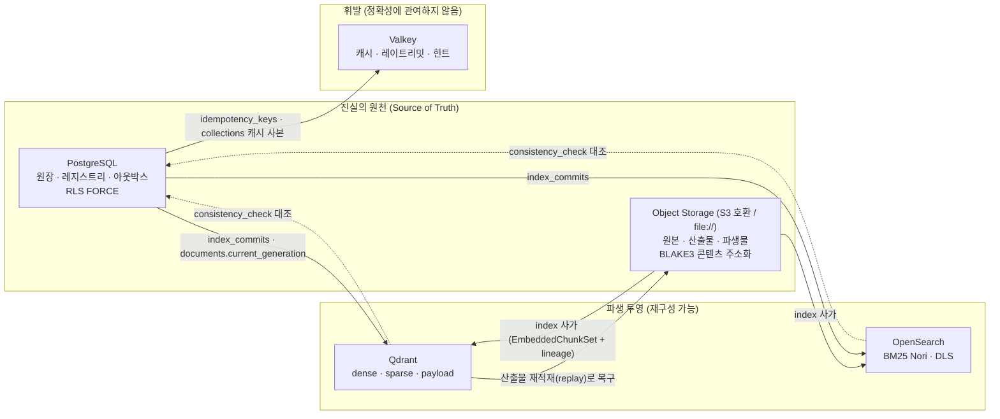
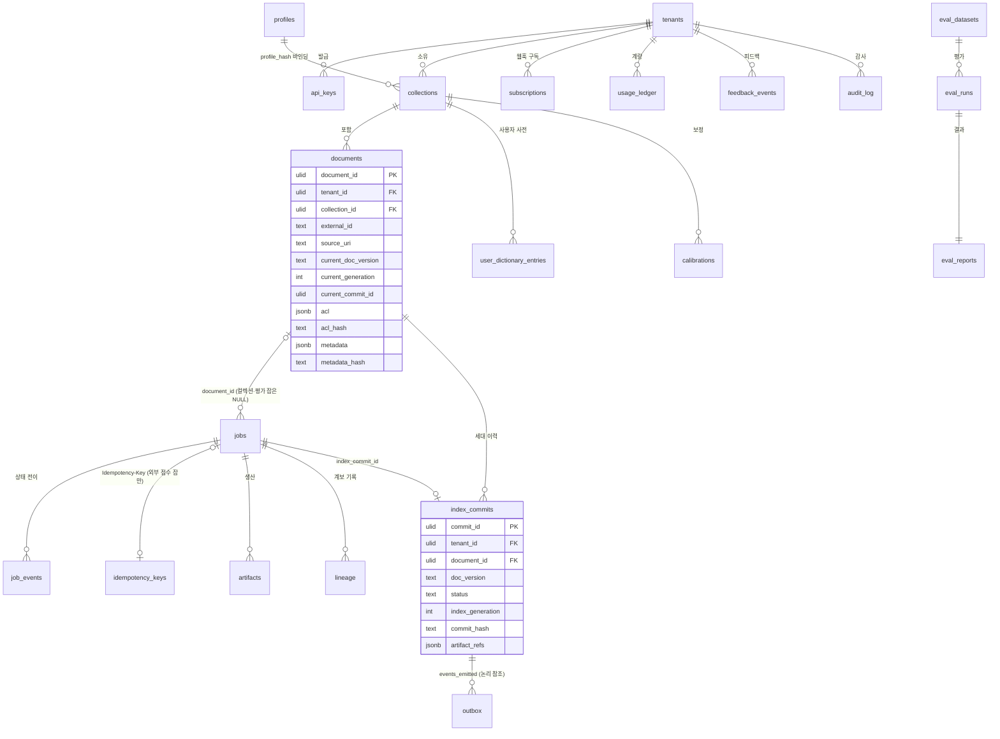
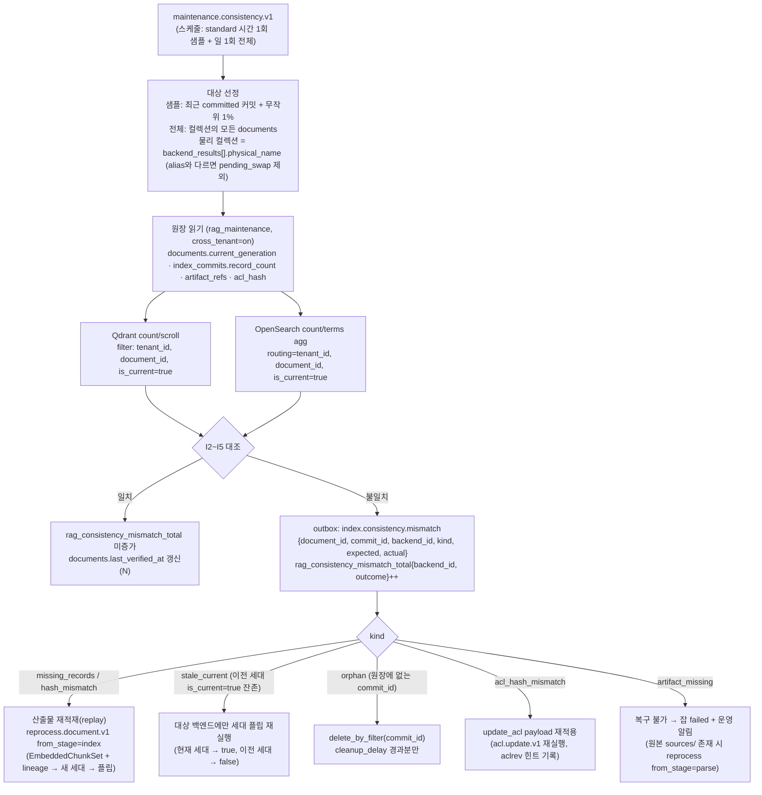

# 저장소 아키텍처

> 정본 관계: 이 문서는 설계 바이블 §13(저장소 정본), §5.4 `IndexRecord`·`IndexCommit`, §10.4(격리 수준), §11.4(세대 사가)를 물리 설계 수준으로 전개한다. 테이블명·컬럼명·키 규약·명명은 바이블을 그대로 따르며, 바이블에 없는 항목은 `(N)`(선택 컬럼·확장) 또는 `(제안)`으로 표기하고 "미해결 이슈"에 등재한다. `03-contracts/07`·`08`·`12`는 동시 작성 중이므로 해당 계약의 필드는 바이블 §5.4·§5.6을 정본으로 인용한다.

## 목적

RAG Platform이 사용하는 다섯 저장소 — PostgreSQL(원장·레지스트리), S3 호환 오브젝트 스토리지(원본·산출물), Qdrant(벡터 인덱스), OpenSearch(렉시컬 인덱스), Valkey(캐시·힌트) — 의 **물리 스키마, 키 레이아웃, 테넌트 격리 수단, 일관성 모델, 수명주기, 용량 산정**을 확정한다. 구현자가 마이그레이션·컬렉션 생성 스크립트·인덱스 템플릿을 이 문서만으로 작성할 수 있어야 하며, 운영자가 어느 저장소가 진실의 원천이고 무엇이 재구성 가능한 투영인지 즉시 판단할 수 있어야 한다.

## 범위

**포함**: PostgreSQL 스키마(erDiagram, 테이블 정의, 인덱스·파티셔닝, RLS 정책, 커넥션 풀 규약), 오브젝트 스토리지 키 레이아웃·압축·수명주기, Qdrant 컬렉션 설계(테넌트 전략, named vectors, 양자화, payload 인덱스, alias 스왑, shard/replica), OpenSearch 인덱스 설계(템플릿, Nori 분석기, 매핑, ACL 필드·DLS, alias 스왑, ISM), Valkey 키·TTL·장애 모드, 일관성 모델과 불일치 감지·복구, 100만 청크 기준 용량 산정, 백업 단위.

**제외**: 백업·복구 절차 상세([09-operations/07](../09-operations/07-backup-and-disaster-recovery.md)), 배포 토폴로지·HA 구성([02-architecture/08](./08-deployment-architecture.md)), ACL 의미론과 강제 지점 전체([02-architecture/07](./07-multi-tenancy-and-security-architecture.md)), 인덱싱 파이프라인 알고리즘([04-pipelines/13](../04-pipelines/13-indexing.md)), 재색인·삭제 워크플로우 상세([04-pipelines/19](../04-pipelines/19-update-delete-and-reindexing.md)), 검색 시 필터 구성([04-pipelines/15](../04-pipelines/15-hybrid-search-and-fusion.md)).

## 1. 저장소 지형과 책임 분리

### 1.1 다섯 저장소와 진실의 원천



| 저장소 | 소유하는 진실 | 소유하지 않는 것 | 손실 시 복구 | `lite` 포함 |
|--------|---------------|------------------|--------------|-------------|
| PostgreSQL | 테넌트·컬렉션·프로파일·문서 정본(ACL·메타), 잡 상태, 멱등 판정, 산출물 카탈로그(`artifacts`)·계보(`lineage`), 커밋 원장(`index_commits`), 아웃박스, 사용량, 사전, 평가·피드백, 감사(standard) | 검색 핫패스(`plan`~`render`는 PG를 읽지 않음, ADR-0034), 벡터·렉시컬 검색, 원본 바이트 | PITR 복원(백업 단위 §9) | 예 |
| Object Storage | 원본 바이트, 스테이지 산출물(계약 JSON), 파생물(변환본·페이지 이미지·표 HTML·부모 텍스트 번들), 평가셋, 모델 미러, 인덱스 스냅샷 | 조회 인덱스, 메타 질의 | 버킷 버저닝·리전 복제(§9) | 예(`file://`) |
| Qdrant | 없음 — `IndexRecord`의 벡터·payload 투영 | 진실. `record_id`·payload는 `EmbeddedChunkSet`·`ChunkSet`·`SourceDocument`에서 결정적으로 재생성 | 산출물 재적재 1순위, 스냅샷 2순위 | 예 |
| OpenSearch | 없음 — `IndexRecord`의 렉시컬 투영 + 감사 인덱스(`korean-gov`) | 진실(감사 인덱스 제외) | 산출물 재적재 1순위, `repository-s3` 스냅샷 2순위 | 아니오 |
| Valkey | 없음 — 캐시·힌트·카운터 | 멱등 판정·ACL 정본·잡 상태(모두 PostgreSQL) | 재기동 시 빈 상태로 시작(§6 장애 모드) | 예 |

**결정:** PostgreSQL 원장과 오브젝트 스토리지의 콘텐츠 주소화 산출물만이 진실의 원천이며, Qdrant·OpenSearch는 `IndexCommit.artifact_refs`로부터 결정적으로 재구성되는 투영이다(바이블 K6, [ADR-0026](../06-adr/0026-index-commit-generation-saga-and-ledger.md), [ADR-0034](../06-adr/0034-retrieval-hot-path-postgres-independence-and-hydrate.md)).

### 1.2 쓰기 경로와 트랜잭션 경계

| 쓰기 | 트랜잭션 경계 | 참여 저장소 |
|------|---------------|-------------|
| `POST /v1/ingest` 접수 | 단일 PG 트랜잭션: `idempotency_keys` INSERT + `jobs` INSERT + `documents` UPSERT(`document_id` 확정) | PostgreSQL(Valkey `idem:`은 사후 캐시) |
| 스테이지 산출물 저장 | 오브젝트 PUT(콘텐츠 주소, 멱등) → PG 트랜잭션: `artifacts` + `lineage` INSERT | Object Storage → PostgreSQL |
| `index` 사가 | PG 트랜잭션마다 `index_commits.status` 갱신; 백엔드 쓰기는 각각 멱등(`record_id`) | PostgreSQL ↔ Qdrant ↔ OpenSearch |
| `publish` | 원장 갱신과 **동일 PG 트랜잭션**에 `outbox` INSERT | PostgreSQL |
| ACL 갱신(`acl.update.v1`) | PG `documents.acl`·`acl_hash` 갱신 → Valkey `aclrev:` 힌트 → 백엔드 `update_acl` payload | PostgreSQL → Valkey → Qdrant·OpenSearch |
| 삭제(`delete.document.v1`) | Valkey `aclrev:` 삭제 힌트 → `kind=delete` 커밋 → 양 백엔드 `delete_by_filter(document_id)` → `documents` 상태 갱신 | Valkey → PostgreSQL ↔ Qdrant·OpenSearch |

## 2. PostgreSQL 스키마

바이블 §13.1의 테이블 목록을 정본으로 하며, 모든 테넌트 스코프 테이블은 `tenant_id` 컬럼 + RLS `FORCE`를 가진다. Temporal 영속화·가시성은 **별도 데이터베이스**(`temporal`, `temporal_visibility`)에 두어 원장과 장애 반경을 분리한다(바이블 §15 리스크 #10).

### 2.1 개체 관계도



`tenants`·`collections`·`jobs`·`artifacts`·`outbox`와 나머지 표의 컬럼은 §2.2에 있다. 내부 발급 잡(`reindex_collection`·`evaluate`·`consistency_check`·`tier_promotion`, `reindex.collection.v1`의 자식 `ingest.document.v1`)은 `Idempotency-Key`가 없으므로 `jobs.idempotency_key`는 NULL 허용이고, `idempotency_keys` 행은 422 판정만 남긴 경우 `jobs` 없이 존재할 수 있다(바이블 §11.2).

### 2.2 테이블 정의

컬럼 타입 표기는 PostgreSQL 타입이다. ULID는 `char(26)`(Crockford base32 대문자, 바이블 §6.1)이며 BLAKE3 해시는 `char(64)`(`block_id`만 `char(32)`)로 저장한다. 모든 `*_at`은 `timestamptz`(UTC). 열거 컬럼은 `text` + `CHECK` 제약으로 바이블 §5.7 철자를 강제하고, CI가 `schemas/*.schema.json`과 대조한다. `(N)` 표기 컬럼은 바이블 §13.1·§5.6에 없는 추가 컬럼이며 NULL 허용·기본값 있음으로만 도입한다(미해결 이슈 #1·#15).

#### 레지스트리

| 테이블 | 컬럼(키·핵심) | 제약·비고 |
|--------|----------------|-----------|
| `tenants` | `tenant_id char(26)` PK, `name text`, `tier text`, `policies jsonb`(`llm_enrichment_allowed`, `allow_distribution_documents`, `classification_max`, `egress_policy`), `status text`(`TenantStatus`, 바이블 §13.1 1.3.0, AM-39), `quotas jsonb`(`{documents_max, storage_bytes_max, qps_max}`, 1.3.0), `disabled_at`(N, 1.3.0), `created_at`, `updated_at` | RLS `FORCE` 적용: `rag_app`은 자기 테넌트 행 `SELECT`만(`policies` 부트스트랩 읽기), 쓰기는 `rag_platform_admin`(§2.4). `tier`의 값 집합은 바이블 §13.1이 정하지 않았고 프로파일 `ProfileTier`와 다른 테넌트 등급(§7.2 `korean-gov` "등급별 8/32/128")을 전제하므로 `CHECK` 없이 두고 02-architecture/07·05-api/04에서 확정(미해결 이슈 #15). `tier` 승격은 `tier.promotion.v1` 워크플로우로만(읽기 전용) |
| `api_keys` | `api_key_id char(26)` PK, `tenant_id`, `hash text`(Argon2id 또는 SHA-256+salt, 09-operations/05에서 확정), `principal text`(`service:{client_id}`), `roles text[]`(N), `expires_at`, `revoked_at`(N), `last_used_at`(N) | 인덱스 `(hash)` UNIQUE; 평문 키 미저장(E1). 인증 시점에는 `app.tenant_id`를 아직 알 수 없으므로 조회는 `SECURITY DEFINER` 함수 `lookup_api_key(hash)`로만 한다(§2.4) |
| `collections` | `collection_id char(26)` PK, `tenant_id`, `name text`, `profile_id text`, `profile_hash char(64)`, `embedding_space_ids jsonb`, `embedding_profile_hash char(64)`, `analyzer_id text`, `dictionary_hash char(64)`, `dictionary_ref text`, `tenant_isolation_tier text`, `backends jsonb`, `policies jsonb`, `filterable_fields text[]`, `license_policy jsonb`, `calibration_ref text`, `stats jsonb`, `created_at`, `updated_at`, `deleted_at`(N, 바이블 §13.1 1.3.0, AM-37) | `CollectionSpec` 컬럼(바이블 §5.6; `dictionary_ref`는 string); UNIQUE `(tenant_id, name)`; `backends` = `[{backend_id, role, physical_name, alias}]`; `CHECK tenant_isolation_tier IN ('payload_filter','shard_key','index_per_tenant')`; `deleted_at IS NOT NULL`이면 신규 수집·질의 거부(`collection.delete.v1`의 논리 삭제) |
| `profiles` | `profile_id text`, `version text`, PK `(profile_id, version)`, `profile_hash char(64)` UNIQUE, `tier text`(N), `yaml text`, `resolved jsonb`, `validated_at`(N), `validation_report jsonb`(N) | `extends` 해소 결과(`resolved`)를 보관해 `profile_hash` 재계산 가능; 테넌트 무관(전역 표, RLS 유일 예외); `tier`는 `Profile.tier`(`ProfileTier`) 사본 |
| `user_dictionary_entries` | `entry_id char(26)` PK, `tenant_id`, `collection_id`(NULL = 테넌트 공통), `surface text`, `pos text`, `reading text`, `synonyms text[]`, `weight numeric`, `source text`, `updated_at` | `UserDictEntry` 컬럼; UNIQUE `(tenant_id, coalesce(collection_id,''), surface, pos)`; `CHECK source IN ('manual','imported','mined')` |
| `calibrations` | `calibration_ref text` PK, `tenant_id`, `collection_id`, `reranker_model_id text`, `score_quantiles jsonb`, `computed_at` | `confidence_tier`·`tau` 보정(바이블 §13.1) |

#### 문서·잡·멱등

| 테이블 | 컬럼(키·핵심) | 제약·비고 |
|--------|----------------|-----------|
| `documents` | `document_id char(26)` PK, `tenant_id`, `collection_id`, `external_id text`, `source_uri text`, `source_uri_norm text`(N), `current_doc_version char(64)`, `current_generation integer` DEFAULT 0, `current_commit_id char(26)`, `acl jsonb`, `acl_hash char(64)`, `metadata jsonb`, `metadata_hash char(64)`, `status text`(N), `last_verified_at`(N, 정합성 검사 §7.3), `created_at`, `updated_at`, `deleted_at`(N) | `document_id`는 접수 시 `(tenant_id, collection_id, external_id or source_uri)`로 확정(바이블 §11.2) → UNIQUE `(tenant_id, collection_id, external_id) WHERE external_id IS NOT NULL`, UNIQUE `(tenant_id, collection_id, source_uri_norm) WHERE external_id IS NULL`. `source_uri_norm`은 스킴·호스트 소문자화·기본 포트 제거·경로 정규화 결과(선택 컬럼, 미해결 이슈 #1). `status ∈ {active, deleting, deleted}`(제안, 미해결 이슈 #1) |
| `jobs` | `job_id char(26)` PK, `tenant_id`, `collection_id`, `kind text`, `state text`, `stage text`, `progress jsonb`, `attempts integer`, `priority smallint`, `workflow_id text`, `workflow_run_id uuid`, `idempotency_key text`(N, 배치 자식 잡은 NULL 허용, 바이블 §13.1 1.3.0 AM-44), `request_id text`, `document_id char(26)`, `waiting_for char(26)`, `from_stage text`, `index_commit_id char(26)`, `last_error jsonb`, `degraded jsonb`, `cost jsonb`, `created_at`, `started_at`, `updated_at`, `finished_at`, `deadline_at` | `JobStatus` 읽기 모델 정본(바이블 §5.6). UNIQUE `(tenant_id, idempotency_key)`(배치 자식 잡의 NULL은 유니크 제약에서 제외되므로 다건 허용); `CHECK kind IN ('ingest_document','reprocess_document','delete_document','acl_update','reindex_collection','build_graph','evaluate','consistency_check','tier_promotion','delete_collection')`(AM-37); `CHECK state IN ('queued','running','succeeded','partial','failed','cancelling','cancelled')` |
| `job_events` | `event_id char(26)`, `tenant_id`, `job_id`, `from_state text`, `to_state text`, `stage text`, `payload jsonb`, `created_at`; PK `(created_at, event_id)` | append-only(UPDATE·DELETE 권한 없음); `job.state.changed` 이벤트의 원천. 바이블 §13.1은 `event_id` PK — 월 단위 파티션 키 `created_at`을 PK에 포함하는 파티셔닝 확장(N; PostgreSQL은 파티션 테이블의 PK/UNIQUE에 파티션 키가 반드시 포함되어야 함) |
| `idempotency_keys` | `tenant_id char(26)`, `key text`, PK `(tenant_id, key)`, `request_hash char(64)`, `job_id char(26)`, `job_ids text[]`(N, 배치 응답 재현 `POST /v1/ingest/batch`, 바이블 §13.1 1.3.0 AM-44), `response_status smallint`(N), `created_at`, `expires_at` | draft-07 판정 정본(200 재생 / 409 진행 중 / 422 `request_hash` 불일치); `jobs` INSERT와 동일 트랜잭션; `expires_at` 기본 24h(초안 목표, 미해결 이슈 #2); 배치 요청은 `job_ids`로 재생하고 자식 `jobs.idempotency_key`는 NULL |

#### 산출물·계보·커밋

| 테이블 | 컬럼(키·핵심) | 제약·비고 |
|--------|----------------|-----------|
| `artifacts` | `tenant_id char(26)`, `stage_key char(64)`, PK `(tenant_id, stage_key)`, `collection_id`(N), `document_id`(N), `stage_name text`(N), `schema_type text`, `schema_version text`(N), `blake3 char(64)`, `size_bytes bigint`, `compressed_size_bytes bigint`(N), `artifact_ref jsonb`, `producer jsonb`, `job_id`(N), `created_at`, `last_accessed_at`(N) | 멱등성 키 → 산출물(캐시 조회, `cache_hit`); `stage_key`는 `scope_key`를 포함하므로 잡 스코프 밖 재사용 불가([ADR-0037](../06-adr/0037-artifact-cache-scope-and-stage-key-composition.md)); 인덱스 `(tenant_id, document_id, stage_name)`, `(tenant_id, blake3)` |
| `lineage` | `tenant_id char(26)`, `child_ref_blake3 char(64)`, `parent_ref_blake3 char(64)`, PK `(tenant_id, child_ref_blake3, parent_ref_blake3)`, `stage_key char(64)`, `job_id`, `produced_at` | 산출물 저장과 같은 트랜잭션에 기록(바이블 §4.1); 재처리·감사·GC 참조 계수의 원천 |
| `index_commits` | `commit_id char(26)` PK, `tenant_id`, `collection_id`, `document_id`, `doc_version char(64)`, `job_id`, `kind text`, `previous_commit_id`, `supersedes_commit_ids char(26)[]`, `superseded_by`, `status text`, `index_generation integer`, `profile_id text`, `profile_hash char(64)`, `parser_fingerprint_hash`, `normalizer_fingerprint`, `chunker_config_hash`, `enricher_fingerprint`, `embedder_fingerprint`(각 `char(64)`), `embedding_space_ids jsonb`, `embedding_profile_hash char(64)`, `analyzer_id text`, `dictionary_hash char(64)`, `record_count integer`, `commit_hash char(64)`, `backend_results jsonb`, `artifact_refs jsonb`, `stats jsonb`, `compensation jsonb`, `error jsonb`, `events_emitted char(26)[]`, `started_at`, `committed_at`, `updated_at` | commit ledger 정본(바이블 §5.4 `IndexCommit`); UNIQUE `(tenant_id, document_id, index_generation)`; `CHECK status IN ('pending','vector_written','lexical_written','flipping_lexical','flipping_vector','committed','rolling_back','rolled_back','failed')`; `CHECK kind IN ('upsert','delete')`; 갱신 허용 컬럼은 사가 진행·보상·다음 커밋 시점에 바뀌는 `status`, `backend_results`, `record_count`, `commit_hash`, `stats`, `compensation`, `error`, `events_emitted`, `committed_at`, `updated_at`, `superseded_by`(바이블 §5.4 `IndexCommit`·§11.4)이며 그 외 컬럼은 INSERT 후 불변(트리거로 거부) |
| `document_versions`(뷰, N) | `SELECT tenant_id, document_id, doc_version AS content_hash, commit_id, status, index_generation, committed_at FROM index_commits` | 바이블 §13.1에 없는 **읽기 전용 뷰**. "문서 버전 = 콘텐츠 해시"([ADR-0005](../06-adr/0005-doc-version-content-hash-only-and-acl-payload-update.md))이므로 별도 진실 표를 두지 않고 커밋 원장을 투영한다(미해결 이슈 #1) |

#### 이벤트·구독·계량·평가·감사

| 테이블 | 컬럼(키·핵심) | 제약·비고 |
|--------|----------------|-----------|
| `outbox` | `event_id char(26)`, `tenant_id`, `type text`, `subject text`, `envelope jsonb`(`CloudEventEnvelope`), `created_at`, `published_at` NULL, `attempts integer`, `last_error text`(N), `next_attempt_at`(N); PK `(created_at, event_id)` | 부분 인덱스 `(created_at) WHERE published_at IS NULL`(릴레이 `select_unpublished`); **일 단위** RANGE 파티션(보존 7일 = 파티션 8개, 만료는 DROP; 초안 목표); PK에 파티션 키 포함은 파티셔닝 확장(N, 바이블 §13.1은 `event_id` PK); `index_commits.events_emitted`는 논리 참조(FK 없음); `data`에 콘텍스트 본문 금지(E12) |
| `subscriptions` | `subscription_id char(26)` PK, `tenant_id`, `webhook_url text`, `events text[]`, `secret_ref text`, `status text`, `created_at`, `updated_at` | 등록 시 `EgressPolicy` 검사(E16); `secret_ref`는 간접 참조(비밀 미저장) |
| `usage_ledger` | `tenant_id char(26)`, `day date`, `meter text`, PK `(tenant_id, day, meter)`, `value numeric`, `updated_at` | `meter ∈ {llm_tokens, gpu_seconds, bytes_indexed, queries}`(바이블 §13.1) + `bytes_stored`(제안, 미해결 이슈 #16); `IndexCommit.stats`와 질의 카운터에서 집계 |
| `eval_datasets` | `dataset_id char(26)` PK, `tenant_id`, `name`, `content_hash char(64)`, `qrels_ref jsonb`, `answer_spans_ref jsonb`, `corpus_collection_id`, `judgment_level text`, `label_provenance text`, `license text`, `created_at` | `EvalDataset` 컬럼 |
| `eval_runs` | `run_id char(26)` PK, `tenant_id`, `dataset_id`, `profile_id`, `profile_hash`, `index_commit_ids char(26)[]`, `status text`, `judge_model`, `experiment_id`, `metrics_requested text[]`, `started_at`, `finished_at` | `EvalRun` 컬럼; `CHECK status IN ('running','completed','failed')` |
| `eval_reports` | `run_id char(26)` PK FK, `tenant_id`, `metrics jsonb`, `comparison jsonb`, `gate_result jsonb`, `artifacts_ref jsonb`, `created_at` | `EvalReport` 컬럼 |
| `feedback_events` | `feedback_id char(26)` PK, `tenant_id`, `query_id`, `pack_id`, `kind text`, `cite_ids text[]`, `rating smallint`, `comment text`, `created_at` | `comment`는 PII 정책 적용 후 저장 |
| `audit_log` | `audit_id char(26)`, `tenant_id`, `type text`, `principal text`, `subject text`, `action text`(N), `detail jsonb`(N), `trace_id text`(N), `created_at`; PK `(created_at, audit_id)` | `standard`: 월 단위 RANGE 파티션(PK에 파티션 키 포함은 확장 N), 보존 1년(초안 목표); `korean-gov`: OpenSearch 감사 인덱스 2년 + NATS 조건부(바이블 §13.1); `type`은 `audit.*` 이벤트 카탈로그; INSERT는 `SECURITY DEFINER` 감사 트리거만(§2.4) |

플러그인 레지스트리는 Python entry points + `PluginMeta` 검증(바이블 §12 `plugins/`)으로 프로세스 기동 시 구성되며 PostgreSQL 표가 아니다. 감사 목적의 "로딩된 플러그인 지문 스냅샷" 표(`plugin_snapshots`)는 미해결 이슈 #3의 제안이다.

### 2.3 인덱스·파티셔닝

**결정:** 파티셔닝 키는 `tenant_id`가 아니라 **시간**이다. 테넌트 수(수십~수천)가 파티션 수로 적합하지 않고, RLS `FORCE`가 이미 테넌트 경계를 강제하므로(바이블 §13.1) `tenant_id`는 모든 복합 인덱스의 **선두 컬럼**으로만 둔다. 원장은 모든 격리 등급에서 단일 스키마 + `tenant_id` + RLS다(07-tech-landscape/12 §1.3; 스키마-퍼-테넌트는 미채택 대안). `index_per_tenant` 테넌트의 PostgreSQL 물리 분리는 바이블 §10.4가 규정하지 않으므로 결정하지 않고 미해결 이슈 #4로 둔다.

| 테이블 | 인덱스 | 용도 |
|--------|--------|------|
| `documents` | UNIQUE `(tenant_id, collection_id, external_id) WHERE external_id IS NOT NULL`; UNIQUE `(tenant_id, collection_id, source_uri_norm) WHERE external_id IS NULL`; `(tenant_id, collection_id, updated_at)`; `(tenant_id, acl_hash)` | `document_id` 확정, 컬렉션 페이지 조회(`reindex.collection.v1`), ACL 회수 대상 조회 |
| `jobs` | UNIQUE `(tenant_id, idempotency_key)`; 부분 `(document_id) WHERE state IN ('queued','running','cancelling')`; `(tenant_id, state, created_at)`; 부분 `(tenant_id) WHERE state = 'running'`; `(waiting_for) WHERE waiting_for IS NOT NULL`; `(deadline_at) WHERE state = 'queued'` | 문서 단위 직렬화·테넌트 동시성(디스패처, 바이블 §11.2), 목록 API, 만료 취소 |
| `job_events` | PK `(created_at, event_id)`; `(job_id, created_at)`; 월 단위 RANGE 파티션(`created_at`) | SSE 이력, 보존 90일(초안 목표); `job_id`는 논리 참조(파티션 테이블이라 FK 없음) |
| `idempotency_keys` | PK `(tenant_id, key)`; `(expires_at)` | 판정, 만료 정리 |
| `artifacts` | PK `(tenant_id, stage_key)`; `(tenant_id, document_id, stage_name)`; `(tenant_id, blake3)`; `(created_at)` | 캐시 조회, 문서별 계보 열람, 참조 계수, GC 스캔 |
| `lineage` | PK; `(tenant_id, parent_ref_blake3)`; `(job_id)` | 하류 탐색(재처리 영향 분석), GC 참조 계수 |
| `index_commits` | UNIQUE `(tenant_id, document_id, index_generation)`; `(tenant_id, document_id, committed_at DESC)`; 부분 `(status, updated_at) WHERE status NOT IN ('committed','rolled_back','failed')`; `(tenant_id, collection_id, committed_at)` | 세대 할당(`FOR UPDATE` 행 잠금은 `documents`), 커밋 이력 API, 정합성 검사 대상(진행 중 커밋), 컬렉션 통계 |
| `outbox` | PK `(created_at, event_id)`; 부분 `(created_at) WHERE published_at IS NULL`; `(tenant_id, created_at)`; **일 단위** RANGE 파티션 | 릴레이 폴링(`SKIP LOCKED`), 테넌트 SSE 재생, 보존 7일 정리(파티션 DROP) |
| `usage_ledger` | PK `(tenant_id, day, meter)` | 집계 API |
| `audit_log` | PK `(created_at, audit_id)`; `(tenant_id, created_at)`; `(tenant_id, principal, created_at)`; 월 단위 RANGE 파티션 | 감사 조회, 보존 정리(파티션 DROP) |

시간 파티션 테이블(`job_events`·`audit_log` 월, `outbox` 일)은 `pg_partman` 또는 마이그레이션 스케줄로 다음 구간 파티션을 선생성하고, 보존 만료 파티션은 `DETACH` 후 `DROP`한다(파티션 단위 삭제로 VACUUM 부담 회피). 파티션 테이블의 PK는 파티션 키를 포함해야 하므로 세 표의 PK는 `(created_at, id)`이고, 이들을 가리키는 `index_commits.events_emitted`·`jobs`→`job_events` 참조는 FK 없는 논리 참조다. `jsonb` 컬럼(`progress`, `backend_results`, `artifact_refs`, `stats`, `envelope`)은 GIN 인덱스를 두지 않는다 — 조회는 항상 키 컬럼으로 한다.

### 2.4 RLS 정책

**결정:** 테넌트 스코프 테이블 전부에 `ENABLE ROW LEVEL SECURITY` + `FORCE ROW LEVEL SECURITY`를 적용하고, 세션 변수 `app.tenant_id`를 트랜잭션마다 `SET LOCAL`로 주입한다(바이블 §13.1, [ADR-0027](../06-adr/0027-security-context-injection-and-acl-enforcement-points.md)). 애플리케이션 접속 역할은 `NOBYPASSRLS`이며 테이블 소유자가 아니다(07-tech-landscape/12 §1.3).

```sql
-- 역할 분리: 소유자(마이그레이션·SECURITY DEFINER 함수) / 애플리케이션 / 플랫폼 운영(횡단 읽기) / 백그라운드(릴레이·정합성 검사)
CREATE ROLE rag_owner NOLOGIN;
CREATE ROLE rag_app LOGIN NOBYPASSRLS;
CREATE ROLE rag_platform_admin LOGIN NOBYPASSRLS;
CREATE ROLE rag_maintenance LOGIN NOBYPASSRLS;
GRANT rag_owner TO rag_platform_admin;  -- 마이그레이션 실행 시 소유자 권한 상속(09-operations/01, #16)
-- 예: documents (모든 테넌트 스코프 테이블에 동일 패턴을 마이그레이션이 생성)
ALTER TABLE documents OWNER TO rag_owner;
ALTER TABLE documents ENABLE ROW LEVEL SECURITY;
ALTER TABLE documents FORCE ROW LEVEL SECURITY;

-- 정책 1: 애플리케이션 — 현재 트랜잭션의 테넌트만. current_setting 두 번째 인자 true → 미설정 시 NULL → 0행(fail-closed)
CREATE POLICY tenant_isolation ON documents
  FOR ALL TO rag_app
  USING (tenant_id = current_setting('app.tenant_id', true))
  WITH CHECK (tenant_id = current_setting('app.tenant_id', true));

-- 정책 2: 플랫폼 운영 — 명시적 횡단 모드에서만 읽기. 쓰기는 대상 tenant_id로 SET LOCAL 후 별도 트랜잭션
CREATE POLICY platform_cross_tenant ON documents
  FOR SELECT TO rag_platform_admin
  USING (current_setting('app.cross_tenant', true) = 'on');

-- tenants: rag_app은 자기 테넌트 행 SELECT만(policies 부트스트랩), 쓰기는 플랫폼 운영(횡단 모드)
CREATE POLICY tenant_self_read ON tenants FOR SELECT TO rag_app USING (tenant_id = current_setting('app.tenant_id', true));
CREATE POLICY tenant_admin_write ON tenants FOR ALL TO rag_platform_admin USING (current_setting('app.cross_tenant', true) = 'on') WITH CHECK (current_setting('app.cross_tenant', true) = 'on');

-- 정책 3: 백그라운드 — outbox 릴레이는 FOR UPDATE SKIP LOCKED 잠금과 published_at 갱신을 같은 트랜잭션에서 수행해야 하므로 SELECT+UPDATE 허용
CREATE POLICY relay_cross_tenant ON outbox
  FOR ALL TO rag_maintenance
  USING (current_setting('app.cross_tenant', true) = 'on')
  WITH CHECK (current_setting('app.cross_tenant', true) = 'on');
GRANT SELECT, UPDATE (published_at, attempts, last_error, next_attempt_at) ON outbox TO rag_maintenance;
-- 정합성 검사: documents 횡단 읽기 + last_verified_at(N) 컬럼 단위 갱신만
CREATE POLICY maintenance_cross_tenant ON documents
  FOR ALL TO rag_maintenance
  USING (current_setting('app.cross_tenant', true) = 'on')
  WITH CHECK (current_setting('app.cross_tenant', true) = 'on');
GRANT SELECT, UPDATE (last_verified_at) ON documents TO rag_maintenance;

-- 감사 트리거·인증 조회는 rag_owner 소유 SECURITY DEFINER 함수. FORCE RLS는 소유자에게도 적용되므로 소유자 정책이 필요
CREATE POLICY audit_insert ON audit_log FOR INSERT TO rag_owner WITH CHECK (true);
CREATE POLICY api_key_lookup ON api_keys FOR SELECT TO rag_owner USING (true);
-- lookup_api_key(hash text) RETURNS (api_key_id, tenant_id, principal, roles, expires_at, revoked_at) SECURITY DEFINER; rag_app에 EXECUTE만 부여

-- 애플리케이션 트랜잭션 프롤로그(리포지토리 계층이 매 트랜잭션 삽입)
BEGIN;
SET LOCAL app.tenant_id = '01J9ZQ4K7X2M8N3P5R6S7T8V9W';
-- ... 질의 ...
COMMIT;
```

| 규칙 | 내용 |
|------|------|
| 적용 대상 | `tenant_id` 컬럼이 있는 모든 테이블(바이블 §13.1 "모두"): `tenants, api_keys, collections, documents, jobs, job_events, idempotency_keys, artifacts, lineage, index_commits, outbox, subscriptions, usage_ledger, user_dictionary_entries, calibrations, eval_*, feedback_events, audit_log` |
| 예외·특칙 | `profiles`(전역, 유일 예외). `tenants`: `rag_app`은 `FOR SELECT`(`tenant_id = current_setting('app.tenant_id', true)`)만 — 워커·API가 잡마다 `policies`를 읽는 부트스트랩 경로; INSERT/UPDATE는 `rag_platform_admin`. `api_keys`: 인증 시점에는 테넌트를 모르므로 `rag_app`은 직접 조회하지 않고 `lookup_api_key(hash)`(`SECURITY DEFINER`)만 호출; 그 결과의 `tenant_id`로 프롤로그를 시작한다(E1). `audit_log`: 애플리케이션 역할에 INSERT 권한 없음, 감사 트리거 함수만 기록 |
| 세션 변수 | `app.tenant_id`(ULID 문자열), `app.cross_tenant`(운영·백그라운드 모드 `on` 만; 기본 미설정), `app.principal`(감사 트리거용) |
| 릴레이·디스패처·정합성 검사 | 릴레이는 `rag_maintenance` + `app.cross_tenant=on`으로 `SELECT … FOR UPDATE SKIP LOCKED` → 전달 → `published_at` UPDATE를 **한 트랜잭션**에서 수행한다(잠금은 트랜잭션 종료 시 해제되므로 분리하면 SKIP LOCKED의 의미가 사라짐). 디스패처는 `rag_platform_admin` 횡단 읽기로 대기 잡을 찾고, 시작은 대상 `tenant_id`로 `SET LOCAL`한 별도 트랜잭션에서 한다(바이블 §11.2 advisory lock). 정합성 검사는 `rag_maintenance`로 읽고 `documents.last_verified_at`(N)만 갱신하며, 복구는 잡 발급(테넌트 스코프)으로 한다 |
| 정책 내 서브쿼리 금지 | 정책식은 `tenant_id = current_setting(...)` 또는 `current_setting('app.cross_tenant', true) = 'on'` 단일 비교만(경합·누출 방지, 07-tech-landscape/12 §1.3 함정) |
| 검증 | 적합성 키트 `security_invariants`: "`app.tenant_id` 미설정 트랜잭션은 모든 테넌트 표에서 0행", "타 테넌트 ID 설정 시 0행", "`INSERT` 시 `WITH CHECK` 위반", "`rag_maintenance`는 `cross_tenant` 미설정 시 0행", "`rag_app`이 `api_keys`를 직접 SELECT하면 0행" |

### 2.5 커넥션 풀·트랜잭션 규약

| 항목 | 규약 | 근거 |
|------|------|------|
| 풀 모드 | 애플리케이션 내 asyncpg/psycopg 풀 **세션 모드** 기본. 외부 풀러(PgBouncer) 사용 시 **트랜잭션 모드**만 허용하고 `SET LOCAL`을 트랜잭션마다 재발행(세션 `SET` 금지) | `SET LOCAL`은 트랜잭션 종료 시 해제되어 커넥션 재사용 오염이 없다(바이블 미해결 이슈 #9 해소안; 본 문서 미해결 이슈 #18) |
| 프롤로그 강제 | 리포지토리 계층(`rag_platform.ledger.repo`)이 `tenant_id` 없는 트랜잭션 개시를 타입 수준에서 거부(`TenantTx(tenant_id)` 컨텍스트 매니저만 공개) | E17, RLS fail-closed |
| 격리 수준 | 기본 `READ COMMITTED`; 세대 할당은 `SELECT … FROM documents WHERE document_id = $1 FOR UPDATE` 행 잠금(바이블 §11.4 (6)); 디스패처는 `pg_advisory_xact_lock(hashtext(tenant_id))` | 문서 단위 직렬화·테넌트 동시성 |
| 아웃박스 폴링 | `rag_maintenance` 트랜잭션: `SELECT … FROM outbox WHERE published_at IS NULL ORDER BY created_at LIMIT $1 FOR UPDATE SKIP LOCKED` → 전달 → `UPDATE outbox SET published_at = now()` → COMMIT | 릴레이 다중 인스턴스 경합 회피(§2.4 정책 3) |
| 준비 문장 | PgBouncer 트랜잭션 모드에서는 프로토콜 수준 준비 문장 비활성(`prepare_threshold=None` 또는 PgBouncer `max_prepared_statements`) | 풀러 호환 |
| 타임아웃 | `statement_timeout`(`SET LOCAL`) API 5s / 워커 60s / 정합성 검사 10m — 모두 초안 목표(09-operations/04 실측 후 조정) | 장애 격리 |

### 2.6 데이터베이스 분리

| 데이터베이스 | 내용 | HA·백업 |
|--------------|------|---------|
| `rag_ledger` | §2.2 전체 | 동기 복제 1 + PITR(§9) |
| `temporal` / `temporal_visibility` | Temporal 영속화·가시성(advanced visibility, PostgreSQL) | Temporal 권고에 따름; 원장과 **다른 인스턴스 권장**(`standard` 이상), `lite`는 동일 인스턴스의 별도 DB |
| `procrastinate`(`lite`) | Procrastinate 큐 스키마 | `rag_ledger` 내 별도 스키마 허용 |

## 3. 오브젝트 스토리지

### 3.1 키 레이아웃

바이블 §13.3의 키 규약을 그대로 따른다. 버킷은 프로파일당 하나(`RAG_OBJECT_STORE__URI`, 예 `s3://rag-standard` 또는 `file://./.rag/artifacts`)이며, 테넌트 경계는 `tenants/{tenant_id}/` 접두로 표현한다(E5). 접두 단위로 버킷 정책·SSE-KMS 키·수명주기 규칙을 걸 수 있어야 하므로 테넌트 접두를 최상위에 둔다. 규칙(바이블 §13.3 1.3.0): 이미 점유된 `stage_key` 경로는 덮어쓰지 않는다 — 새 산출물이 기존과 정규화 동치면 기존 참조를 반환하고, 다르면(비결정성 버그) 바이트 해시 키 경로에 저장한 뒤 경고를 남긴다.

| 대상 | 키 | 콘텐츠 주소 | 스코프 |
|------|----|-------------|--------|
| 원본 | `tenants/{tenant_id}/sources/{blake3[:2]}/{blake3}` | `blake3 = content_hash(원본 바이트)` | 테넌트 내 공유(동일 바이트 문서는 1회 저장) |
| 스테이지 산출물 | `tenants/{tenant_id}/artifacts/{schema_type_kebab}/{stage_key[:2]}/{stage_key}.json` | 경로 = `stage_key`(잡 스코프 포함); `ArtifactRef.blake3`는 바이트 해시 | 잡 스코프(`tenant/collection/document`) |
| 캐시 제외 스테이지 산출물(`fetch`·`index`) | `tenants/{tenant_id}/artifacts/{schema_type_kebab}/{blake3[:2]}/{blake3}.json`(바이블 §13.3 1.3.0) | `stage_key`가 없으므로 바이트 해시 키 | 잡 스코프 |
| 파생물 | `tenants/{tenant_id}/derived/{kind}/{blake3[:2]}/{blake3}.{ext}`; LLM 보강 캐시는 `derived/llm_enrich/{key[:2]}/{key}.json`(바이블 §13.3 1.3.0) | `H("derived", content_hash, sidecar_image_digest or "", options_hash or "")`(바이블 §6.2 1.3.0, AM-40); LLM 보강 캐시 `key = H("llm-enrich", model_id, prompt_hash, embed_text)` | 테넌트 내 공유(봉투 없음) |
| 부모 텍스트 번들 | `tenants/{tenant_id}/derived/parent_texts/{chunk_set_blake3}.json`(바이블 §13.2·§13.3 철자) | `ChunkSet` 산출물의 `ArtifactRef.blake3` | 테넌트 내(`ChunkTextStore`, 바이블 §13.2) |
| 평가셋 | `eval/datasets/{dataset_id}/{qrels\|answer_spans}.jsonl` | `EvalDataset.content_hash`로 검증 | 전역(라이선스 필드 필수) |
| 모델 미러 | `models/{repo}/{revision}/…` + `LICENSE` + `models.lock` | `models.lock`의 sha256 | 전역 |
| 스냅샷 | `snapshots/{backend_id}/{physical_name}/{timestamp}` | 백엔드 자체 포맷 | 전역(운영) |

`{kind}`(파생물) 값은 바이블 §13.3이 종류만 서술하므로 다음 열거는 **제안**이다(미해결 이슈 #5): `hwpx`(HWP→HWPX 변환본), `docx`(DOC/RTF/ODT→DOCX), `page_images`, `table_html`, `vendor_json`(DoclingDocument 등 벤더 원본), `vectors_npz`, `parent_texts`. 부모 텍스트 번들에 다른 파생물과 같은 `{blake3[:2]}/` 분산 접두를 적용하는 것도 같은 이슈의 제안이며, 본 표와 구현은 바이블 철자를 쓴다.

### 3.2 압축과 객체 메타데이터

저장 계층 압축은 브리프·바이블에 없고, [03-contracts/00](../03-contracts/00-contract-overview.md) §9.2 **미정(U-4)** 이 "04-storage-architecture 확정 후 ADR(minor)로 반영"하도록 본 문서에 위임했다. 아래는 그 위임에 따른 확정이며, 관련 ADR은 아직 없다(§3.3 번호 체계상 신규 ADR 제안, 미해결 이슈 #6).

**결정:** 계약 JSON 산출물과 부모 텍스트 번들은 **zstd(RFC 8878)** 로 압축해 저장하되, 압축은 저장 계층의 전송 인코딩이며 계약과 키에는 나타나지 않는다. `ArtifactRef.blake3`·`size_bytes`는 **비압축 정본 바이트** 기준이고, 압축 여부는 객체 메타데이터(`Content-Encoding: zstd`)로만 표현한다. 이로써 `stage_key` 경로·`ArtifactRef` 계약이 압축 정책과 독립적으로 유지되고, 해제 후 재계산한 BLAKE3로 무결성을 검증할 수 있다.

| 항목 | 03-contracts/00 §9.2 현행 정의(U-4 확정 전) | 본 문서 결정 | U-4 종결 시 필요한 갱신 |
|------|-----------------------------------------------|--------------|--------------------------|
| `blake3`·`size_bytes` 기준 | 저장된 바이트(압축 없음 전제) | 비압축 정본 바이트 | §9.2 첫 항·바이블 §5.3 `ArtifactRef`·§13.3 "바이트 해시" 문구를 "비압축 바이트"로 개정(minor) |
| 압축 여부 표기 | `ArtifactRef.content_encoding`(N) 추가 검토 | 객체 메타데이터 `Content-Encoding`만; 계약 필드 추가 없음 | `content_encoding`(N) 미도입 확정(도입 시 객체 메타데이터 미러로 한정) |
| 임계 크기 | 미정 | 임계 없음 — 계약 JSON은 크기 무관 전부 압축(작은 객체는 CPU 비용이 무시할 수준) | §9.2에 "임계 없음" 명시 |
| 대상 범위 | 계약 JSON | 계약 JSON + 파생물 중 `parent_texts` 번들만(검색 경로 로드 크기 축소); 그 외 파생물·원본은 비압축 | §9.2에 `parent_texts` 예외 명시 |
| 확정 전 동작 | 셸은 압축 없이 저장 | 본 문서 `active` 후 ADR(minor) 반영 시점부터 압축 켬 | ADR 발의(미해결 이슈 #6) |

| 대상 | 압축 | 레벨(초안 목표) | 근거 |
|------|------|-----------------|------|
| 계약 JSON(`ParsedDocument`~`EmbeddedChunkSet`, `IndexCommit`) | zstd | 3(기본), `EmbeddedChunkSet`은 1 | 텍스트 JSON은 3~5배 축소 예상; 벡터 float 배열은 압축률이 낮아 CPU만 소모 → 낮은 레벨 |
| 부모 텍스트 번들 | zstd | 3 | 검색 경로 `parent_expand`가 로드 — 해제 비용 ≤ 수 ms 목표 |
| 원본(PDF·HWPX·DOCX·ZIP 등) | 없음 | — | 이미 압축된 컨테이너 포맷; `txt`·`html`·`md`도 200MB 상한 내 단일 객체라 압축 이득보다 단순성 우선 |
| 파생물 이미지(`page_images`)·`vectors_npz` | 없음(포맷 자체 압축) | — | 재압축 무의미 |

객체 메타데이터(S3 user metadata, `file://`는 사이드카 `.meta.json`):

```json
{
  "Content-Type": "application/vnd.rag.parsed-document+json", "Content-Encoding": "zstd",
  "x-amz-meta-rag-schema-type": "ParsedDocument", "x-amz-meta-rag-schema-version": "1.0.0",
  "x-amz-meta-rag-blake3": "9f3a6c1d2e4b5a7f8c9d0e1f2a3b4c5d6e7f8a9b0c1d2e3f4a5b6c7d8e9f0a1b",
  "x-amz-meta-rag-size-bytes": "1843201", "x-amz-meta-rag-compressed-size-bytes": "412377",
  "x-amz-meta-rag-tenant-id": "01J9ZQ4K7X2M8N3P5R6S7T8V9W",
  "x-amz-meta-rag-stage-key": "5d7e0f1a2b3c4d5e6f7a8b9c0d1e2f3a4b5c6d7e8f9a0b1c2d3e4f5a6b7c8d9e"
}
```

읽기 경로(`storage.artifact_store`)는 `Content-Encoding`을 보고 해제하며, 해제 후 BLAKE3를 재계산해 `ArtifactRef.blake3`와 다르면 `contract.violation`으로 실패한다(저장 손상·키 충돌 감지). Python zstd 바인딩은 `zstandard` 패키지(BSD-3)를 후보로 두되 버전·API는 확인 필요(as of 2026-09).

### 3.3 수명주기 규칙

산출물 GC는 버킷 수명주기 규칙(시간 기반)만으로는 불충분하다 — 콘텐츠 주소화 객체는 여러 커밋이 참조하므로 **참조 계수**가 필요하다. 원장(`artifacts`·`lineage`·`index_commits.artifact_refs`)이 참조 원천이며, `maintenance.cleanup.v1`이 아래 규칙을 적용한다.

| 대상 | 보존 규칙(초안 목표) | 삭제 주체 | 비고 |
|------|----------------------|-----------|------|
| 원본 `sources/` | 참조하는 `documents.status != deleted`가 하나라도 있으면 보존; 마지막 참조 삭제 후 **30일** 유예 | `maintenance.cleanup.v1` | 유예 중 재수집은 바이트 저장 생략(`fetch` 규약, 바이블 §4.2) |
| 산출물 `artifacts/` | `index_commits.status = committed`인 **현재 세대와 직전 세대**(`previous_commit_id`)의 `artifact_refs`가 참조하는 객체는 보존; 그 외(롤백·실패·구세대)는 `committed_at` 또는 `updated_at` 기준 **30일** 후 삭제 | 동일 | 산출물 재적재(replay) 복구 1순위 자원이므로 두 세대를 유지 |
| 파생물 `derived/` | 참조 계수(`lineage.parent_ref_blake3`) 0이 된 뒤 **30일** | 동일 | 테넌트 내 공유 객체 — 다른 문서가 참조 중이면 유지 |
| 부모 텍스트 번들 | 원장 기준: `index_commits.status = 'committed'`이고 `commit_id = documents.current_commit_id`인 커밋의 `artifact_refs.chunk_set.blake3`가 참조하지 않는 번들은 `cleanup_delay`(1h) + **7일** 후 삭제 | 동일 | 세대 플립 직후 `parent_expand` 경합 방지; 백엔드 payload 스캔(`chunk_set_blake3`는 비인덱스, §4.4)에 의존하지 않음 |
| 평가셋 `eval/` | 자동 삭제 없음 | 운영자 | 라이선스·재현성 |
| 모델 미러 `models/` | 자동 삭제 없음; `models.lock`에서 제거된 revision은 운영자 승인 후 삭제 | 운영자 | |
| 스냅샷 `snapshots/` | 일 7개 + 주 4개 + 월 3개(`standard`); `korean-gov`는 09-operations/07 규정 | 버킷 수명주기 규칙 | 시간 기반 규칙으로 충분 |
| 삭제된 테넌트 | 접두 `tenants/{tenant_id}/` 전체를 유예(**30일**, `korean-gov`는 즉시 파기 옵션) 후 삭제; `index_per_tenant` DEK 폐기로 크립토 셰레딩 | 테넌트 삭제 잡 | 개인정보 파기 의무 |

버킷 설정: 버저닝 **켬**(오브젝트 덮어쓰기·삭제 실수 복구), 미완료 멀티파트 업로드 7일 후 정리, `korean-gov`는 감사 산출물 접두에 Object Lock(WORM) 적용 옵션. 콘텐츠 주소화 객체는 덮어쓰기가 항상 동일 바이트이므로 버저닝 비용은 작다.

### 3.4 구현 선택과 접근 제어

| 항목 | 규약 |
|------|------|
| 로컬 구현 | RustFS 또는 SeaweedFS(둘 다 Apache-2.0; ADR-0011 실측 후 택1, 바이블 미해결 이슈 #6). MinIO는 제외(2026-04 아카이브·AGPL) |
| 개발 | `file://`(`rag up --profile lite`); 키 레이아웃 동일, 메타데이터는 `.meta.json` 사이드카 |
| 클라이언트 | fsspec 계열(`s3fs`) 또는 obstore — 04-pipelines/02 조사 후 확정(바이블 미해결 이슈 #5) |
| 암호화 | 전송 TLS; 저장 SSE-S3 기본, `korean-gov`·`index_per_tenant`는 SSE-KMS 테넌트별 KEK(접두 단위 키 정책) |
| 접근 | 워커·API는 버킷 전용 자격 증명(`RAG_SECRETS__PROVIDER` 간접 참조); 클라이언트에 사전 서명 URL을 직접 노출하지 않는다(`GET /v1/documents/{document_id}/content`가 프록시) |
| 무결성 | PUT 후 ETag/`Content-MD5` 대신 애플리케이션 BLAKE3 검증(읽기 시 재계산, §3.2) |

## 4. Qdrant 컬렉션 설계

### 4.1 테넌트 전략

**결정:** 기본은 **공유 물리 컬렉션 + `tenant_id` payload 파티셔닝**(`is_tenant=true`, HNSW `m=0`, `payload_m=16`)이며, 승격 기준은 `TieringPolicy`(바이블 §5.3 기본 `{shard_key_threshold_chunks: 1000000, threshold_qps: null, index_per_tenant: opt_in}`)를 따른다([ADR-0028](../06-adr/0028-tenant-isolation-tiering-policy.md), 바이블 §10.4). 공유 컬렉션에서도 `point_id = uuid5(NAMESPACE_RAG_CHUNK, record_id)`가 테넌트·컬렉션·문서·세대를 합성하므로 교차 테넌트 충돌이 없다([ADR-0004](../06-adr/0004-deterministic-chunk-id-scoped-record-id-and-ulid-exception.md), E17).

| 등급 | 물리 컬렉션 | 격리 수단 | 선택 기준 | 방어선 |
|------|-------------|-----------|-----------|--------|
| `payload_filter`(기본) | `rag_vec_{embedding_profile_hash[:12]}` 공유 | `tenant_id` keyword 인덱스 `is_tenant=true` → 테넌트별 HNSW 서브그래프(`payload_m=16`, 전역 `m=0`); 필터 불변식 §10.2 (a) | `lite`·`standard`·`premium` 기본; 테넌트 청크 ≤ 100만 | 사전 필터 **단일 방어**(바이블 리스크 #3) |
| `shard_key` | 동일 공유 컬렉션, `sharding_method: custom` | 대형 테넌트는 `shard_key = tenant_id` 전용 샤드, 소형은 `fallback` 샤드에서 payload 필터(tiered multitenancy, Qdrant 1.16+) | 테넌트 청크 > 100만 또는 `threshold_qps` 초과 → `tier.promotion.v1` | 사전 필터 + 샤드 물리 분리(노이즈 이웃 완화) |
| `index_per_tenant` | `rag_vec_{hash12}_t_{tenant_id}` 전용 | 컬렉션 분리 + Qdrant JWT RBAC 테넌트 스코프 토큰 옵션(E8, 확인 필요 as of 2026-09) + OpenBao Transit 테넌트 DEK | `korean-gov` 선택, 규제·계약 요구 | 서버 측 이중 방어 |

같은 `embedding_profile_hash`를 가진 컬렉션(`collection_id`)들은 하나의 물리 컬렉션을 공유하고 `collection_id` payload로 구분한다. 임베딩 공간이 다르면(차원·모델·양자화) 물리 컬렉션이 분리된다 — 논리 컬렉션 하나가 두 공간에 걸치는 일은 없다(`CollectionSpec.embedding_profile_hash` 단일 바인딩). 컬렉션 폭증을 막기 위해 물리 컬렉션 수 상한은 `standard` 기준 200(초안 목표)으로 두고 `rag_index_bytes_total{vector}`와 함께 감시한다.

### 4.2 named vectors 정의

바이블 §5.7 `VectorName` 열거와 §13.4 규약을 그대로 사용한다. 컬렉션 생성 요청(`standard` 프로파일 3노드, BGE-M3 공간)의 정본 JSON — `shard_number`·`replication_factor`·`write_consistency_factor`·`default_segment_number`는 §4.6 표의 프로파일 값을 따르며 아래는 `standard` 값이다:

```json
{
  "vectors": {
    "dense": {
      "size": 1024,
      "distance": "Cosine",
      "on_disk": true,
      "hnsw_config": { "m": 0, "payload_m": 16, "ef_construct": 128, "full_scan_threshold": 10000, "on_disk": false },
      "quantization_config": { "scalar": { "type": "int8", "quantile": 0.99, "always_ram": true } }
    }
  },
  "sparse_vectors": {
    "sparse_learned": { "modifier": "none", "index": { "on_disk": true, "full_scan_threshold": 10000 } }
  },
  "hnsw_config": { "m": 0, "payload_m": 16 },
  "optimizers_config": { "indexing_threshold": 20000, "default_segment_number": 4 },
  "shard_number": 6,
  "replication_factor": 2,
  "write_consistency_factor": 1,
  "on_disk_payload": true
}
```

| 벡터 이름 | 타입·거리 | 프로파일 | 설정 | 비고 |
|-----------|-----------|----------|------|------|
| `dense` | float32[1024], `Cosine`(정규화 벡터) | 전체 | HNSW `m=0`, `payload_m=16`, `ef_construct=128`; scalar int8 양자화(§4.3) | BGE-M3; `ko-quality`(KURE-v1 1024d)·`quality-max`(Qwen3-Embedding-4B MRL 1024)도 같은 차원이나 **다른 공간** → 다른 물리 컬렉션 |
| `sparse_learned` | sparse(`indices`=vocab id, `values`=가중치), `modifier: none` | `standard` 이상 | 역색인 `on_disk` | BGE-M3 sparse(`vocab_id=xlm-roberta-250k`); `vocab_id` 불일치는 `embed.space_mismatch` |
| `sparse_bm25` | sparse, `modifier: idf` | `lite`(Qdrant 단독) | 역색인 `on_disk`; 질의 시 `idf` 모집단을 테넌트 필터 범위로 지정(Qdrant 1.19) | 클라이언트가 형태소 토큰화 + BM25 TF 포화값(k1=1.2, b=0.75) 계산([ADR-0012](../06-adr/0012-lite-profile-qdrant-only-client-bm25.md)); 채널은 항상 `lexical` |
| `late_interaction` | multivector float16 또는 `turbo4`[n][128], `Cosine`, `comparator: max_sim` | `premium`(옵션, 기본 끔) | HNSW `m=0`(재점수 전용) 또는 유지(1차 검색); 1-bit TurboQuant 결합 | KURE-v2 128d; 위치(인덱스 vs 리랭크)는 M2 후 [ADR-0010](../06-adr/0010-bge-m3-rationale-and-late-interaction-slot.md) 개정 |
| `page_multivector`, `pooled_page_multivector`, `page_dense` | multivector / multivector(풀링) / dense | `visual-pages` 별도 컬렉션 | 2단계: 풀링 HNSW top-200 → 전체 MaxSim | 텍스트 레코드 컬렉션과 물리 분리 |

`lite`는 위 JSON에 `"sparse_bm25": {"modifier": "idf", "index": {"on_disk": true}}`를 `sparse_vectors`에 추가하고 `sparse_learned`를 생략한다(GPU 없이 sparse_learned를 생성할 수 있는 노드는 둘 다 가진다, 바이블 §7.1). `premium`의 `late_interaction` 추가 정의:

```json
{
  "late_interaction": {
    "size": 128, "distance": "Cosine", "datatype": "float16",
    "multivector_config": { "comparator": "max_sim" },
    "hnsw_config": { "m": 0 },
    "quantization_config": { "binary": { "always_ram": false } }
  }
}
```

`turbo4` 데이터타입과 TurboQuant 1-bit 결합은 Qdrant 1.19 튜토리얼에서 확인되었으나(07-tech-landscape/05), qdrant-client의 필드 명칭·허용 조합은 구현 시 확인 필요(as of 2026-09). Qdrant 1.18+는 컬렉션 재생성 없이 named vector 추가·제거가 가능하므로 `late_interaction` 슬롯은 기존 컬렉션에 나중에 추가할 수 있다.

### 4.3 양자화

**결정:** `dense`는 **scalar int8 양자화 + 원본 float32 디스크 보존 + 재점수(rescore)** 를 기본으로 한다. 원본을 보존하므로 양자화 정책 변경에 재임베딩이 필요 없고, `hydrate.with_vectors=false`(바이블 §7.2)라 원본 벡터 읽기는 재점수 시에만 일어난다. 이진(binary) 양자화와 TurboQuant는 프로파일 `gate`(바이블 §7.4 형식) 통과 시 프로파일 값으로만 전환한다 — `ingest.index.quantization.dense: {value: scalar_int8, gate: {metric: "ndcg@10", min_delta: -0.01, candidate: "binary", dataset: <컬렉션 골든셋>}}`(허용 하락 폭 0.01은 초안 목표; 바이블 게이트는 교체 상승 폭 `+2p`·`+0.03`만 정하므로 하락 허용치는 08-evaluation/05에서 확정).

| 벡터 | 기본 | 대안(게이트 후) | 질의 파라미터(초안 목표) | 메모리 효과 |
|------|------|-----------------|--------------------------|-------------|
| `dense` | scalar int8, `quantile=0.99`, `always_ram=true`, 원본 `on_disk=true` | binary(`always_ram=true`, `rescore=true`, `oversampling=4.0`) / TurboQuant 4-bit(원본 미보존은 **금지** — 재적재 시에만 허용) | `quantization: {rescore: true, oversampling: 2.0}`, `hnsw_ef=128` | RAM 약 1/4(float32 대비) |
| `sparse_learned`·`sparse_bm25` | 양자화 없음(역색인 `on_disk`) | — | — | 역색인 크기는 비영 항 수에 비례 |
| `late_interaction` | float16 + binary 양자화(재점수 전용) | `turbo4` + 1-bit TurboQuant | prefetch top-300 → MaxSim top-100 | fp16 77GB → 4-bit 약 19GB(100만 청크 × 300토큰, 07-tech-landscape/05 계산) |
| `page_*` | float16 | `turbo4` | 2단계 | |

### 4.4 payload 인덱스

바이블 §13.4 목록이 정본이되, 바이블 §5.4 `IndexRecord` 표의 "인덱싱" 열과 §5.7 `FilterableField`가 필터 가능으로 정한 `doc_version`·`external_id`·`heading_path`·`parent_chunk_id`·`tree_level`이 §13.4 목록에 빠져 있다(바이블 내부 불일치). 두 백엔드의 필터 능력을 대칭으로 유지하고 `lite`(Qdrant 단독)에서 사용자 필터가 전수 스캔으로 떨어지지 않도록 본 문서는 §5.4·§5.7을 따라 이 다섯 필드를 인덱스하고, §13.4 목록 보정을 미해결 이슈 #17로 제안한다. 인덱스가 없는 payload 필드는 저장만 하며(`on_disk_payload=true`), `hydrate`가 `retrieve(record_ids, with_payload=true)` 1회 배치로 읽는다.

| 필드 | 인덱스 타입 | 옵션 | 용도 |
|------|-------------|------|------|
| `tenant_id` | keyword | `is_tenant: true` | 보안 필터 (a), 테넌트별 HNSW 서브그래프 |
| `collection_id`, `document_id`, `chunk_id`, `commit_id` | keyword | `on_disk: false` | 보안 필터, 삭제·세대 플립 `set_payload` 대상 선택, `exclude_ids`, orphan 삭제(`commit_id`) |
| `is_current` | bool | — | 보안 필터 (a) `is_current = true` |
| `index_generation` | integer | `lookup: true, range: true` | 세대 플립(`gen = N+1`, `gen ≤ N`), `maintenance.cleanup.v1` 범위 삭제 |
| `level`, `item_kind` | integer / keyword | — | 전략 필터 (b) |
| `doc_version`, `external_id` | keyword | — | 사용자·self-query 필터(바이블 §5.4 인덱싱 열, §5.7 `FilterableField`), 상충 판정 |
| `heading_path` | keyword(배열) | — | 사용자·self-query 필터(§5.7). 바이블 §5.4 "첫 2단" 제한은 Qdrant가 배열 일부만 인덱스할 수 없어 전체 배열을 인덱스하고 필터 빌더가 깊이를 제한한다(별도 필드 제안은 미해결 이슈 #17) |
| `parent_chunk_id`, `tree_level` | keyword / integer | — | 바이블 §5.4 인덱싱 열; 부모 확장 역조회·RAPTOR 트리 필터 |
| `acl_allow`, `acl_deny` | keyword(배열) | `on_disk: false`(핫 필터) | `match_any` 주체 필터 |
| `acl_visibility`, `acl_classification` | keyword | — | `visible_set`, `classification ≤ max`(허용 값 집합 `match_any`로 변환) |
| `acl_embargo_until`, `acl_expires_at` | datetime | `range: true` | `as_of` 비교(NULL 허용은 `is_null` 조건과 OR) |
| `doc_date` | datetime | `range: true`, `is_principal: true`(range 인덱스 최적화 힌트; keyword에는 적용되지 않음 — 확인 필요 as of 2026-09, 미해결 이슈 #13) | 사용자·self-query 필터 |
| `doc_type`, `department`, `tags`, `lang`, `genre` | keyword | — | 사용자 필터 |
| `page_start`, `page_end` | integer | `range: true` | 가상 필드 `page` 변환(바이블 §5.7 `FilterableField`) |
| `lexical_terms` | keyword(배열) | `on_disk: true` | `lite` 한국어 키워드 필터·부스트 |
| `entity_ids` | keyword(배열) | `on_disk: true` | 엔티티 부스트 |
| `custom.{key}` | 선언 타입(keyword/integer/float/datetime) | 컬렉션 `filterable_fields` 선언 키만 생성 | 사용자 정의 필터 |
| 비인덱스(저장만) | `record_id`, `ordinal`, `text`, `text_preview`, `text_truncated`, `context_prefix`, `index_text`(Qdrant에는 미저장 — OpenSearch 전용), `block_refs`, `sentence_spans`, `table_ref`, `html_ref`, `title`, `numbering_path`, `source_uri`, `text_source`, `ocr_confidence_min`, `acl_hash`, `content_hash`, `token_count_primary`, `risk_score`, `pii_policy_applied`, `embedding_space_ids`, `embedding_profile_hash`, `analyzer_id`, `dictionary_hash`, `chunk_set_blake3`, `updated_at` | — | `hydrate`·`acl_recheck`·정합성 검사 입력 |

`index_text`는 BM25 입력이므로 OpenSearch에만 저장한다(`lite`는 `sparse_bm25` 벡터로 대체되며 원문 토큰은 저장하지 않는다). payload 총량 상한 32KB(바이블 §5.1)는 어댑터가 upsert 전 검증한다.

### 4.5 alias 기반 재색인 스왑

| alias | 대상 | 교체 단위 |
|-------|------|-----------|
| `col_{collection_id}_vec` | 논리 컬렉션 → 물리 컬렉션 `rag_vec_{hash12}` | 컬렉션 프로파일 변경(blue/green) |

리트리버·`hydrate`·`index` 어댑터는 항상 alias로 접근한다. 프로파일 변경(`PATCH /v1/collections/{collection_id}` → `reindex.collection.v1`)은 (1) 새 `embedding_profile_hash`의 물리 컬렉션을 준비(없으면 생성) → (2) 자식 `ingest.document.v1`이 새 물리 컬렉션에 새 세대를 적재(alias 미경유, `physical_name` 직접) → (3) 하네스 게이트 → (4) **렉시컬 alias 먼저, 벡터 alias 다음**(바이블 §11.2 `reindex.collection.v1` "alias 교체(렉시컬 → 벡터)"; §11.4 (2) 플립 순서와 같은 방향) 순으로 `update_collection_aliases([delete_alias, create_alias])` 한 요청으로 원자 교체 → (5) `collections.backends[].physical_name` 갱신 + `collection.profile.changed` 발행 → (6) 이전 물리 컬렉션은 다른 논리 컬렉션이 공유 중이면 해당 `collection_id` 레코드만 `delete_by_filter`, 아니면 `cleanup_delay` 후 컬렉션 삭제. 문서 단위 갱신은 alias 교체가 아니라 `is_current` 세대 플립이다(§7.2). 재색인 중 (2)~(4) 창에서 자식 잡의 세대는 **새 물리 컬렉션에서만** 적재·플립되고 이전 컬렉션은 alias 교체까지 변경되지 않는다 — `documents.current_commit_id`는 새 컬렉션의 커밋을 가리키지만 alias는 이전 컬렉션을 향하므로, 정합성 검사는 검사 대상 물리 컬렉션을 `index_commits.backend_results[].physical_name`으로 정하고 alias 대상과 다르면 `pending_swap`으로 제외한다(§7.3).

### 4.6 shard·replica·운영 파라미터

| 항목 | `lite` | `standard` | `premium` | `korean-gov` |
|------|--------|------------|-----------|--------------|
| 노드 | 1 | 3 | 3 | 3(+리전 복제 옵션) |
| `shard_number`(물리 컬렉션) | 1 | 2 × 노드 수 = 6(초안 목표; 재샤딩 회피용 여유; §4.2 JSON과 동일) | 6 | 6 |
| `optimizers_config.default_segment_number` | 2 | 4(초안 목표) | 4 | 4 |
| `replication_factor` | 1 | 2 | 2 | 2 |
| `write_consistency_factor` | 1 | 1(`index` 사가가 `wait=true`로 확정 대기) | 1 | 2 |
| `sharding_method` | auto | auto → `shard_key` 승격 테넌트만 custom | 동일 | custom 기본(테넌트 등급별) |
| 스냅샷 | 일 1회 | 6h(바이블 §7.2) | 6h | 1h + 리전 복제 |
| `on_disk_payload` | true | true | true | true |
| gRPC | `prefer_grpc=true` | 동일 | 동일 | 동일(mTLS) |

`write_consistency_factor=1`은 쓰기 지연을 낮추되 레플리카 지연 동안 읽기 노드에 따라 세대 플립이 수 초 늦게 보일 수 있다 — `ContextPack.diagnostics.index_generations_seen`으로 관측하고(바이블 §11.4 (2)), `korean-gov`는 2로 올린다.

## 5. OpenSearch 인덱스 설계

OpenSearch 3.8 + `analysis-nori`(07-tech-landscape/06). 물리 인덱스는 `rag_lex_{lexical_profile_hash[:12]}`(`lexical_profile_hash = H("lex", analyzer_id, dictionary_hash, mapping_version)`, 바이블 §13.4)이며 `analyzer_id`·`dictionary_hash`·매핑 버전 중 하나라도 바뀌면 **새 물리 인덱스 + alias 교체**다(분석기는 인덱스 생성 후 변경 불가). 테넌트 전용은 `_t_{tenant_id}` 접미.

### 5.1 인덱스 템플릿과 Nori 분석기

```json
{
  "index_patterns": ["rag_lex_*"],
  "priority": 100,
  "version": 1,
  "_meta": { "mapping_version": "1", "owner": "rag-platform" },
  "template": {
    "settings": {
      "index": {
        "number_of_shards": 3,
        "number_of_replicas": 1,
        "refresh_interval": "1s",
        "max_result_window": 10000,
        "codec": "best_compression",
        "mapping": { "total_fields": { "limit": 400 } },
        "sort": { "field": ["tenant_id", "document_id", "ordinal"], "order": ["asc", "asc", "asc"] }
      },
      "analysis": {
        "tokenizer": {
          "rag_nori_mixed": { "type": "nori_tokenizer", "decompound_mode": "mixed", "discard_punctuation": true,
            "user_dictionary_rules": ["행정안전부", "정보공개법", "세종특별자치시 세종 특별 자치 시"] },
          "rag_nori_discard": { "type": "nori_tokenizer", "decompound_mode": "discard", "discard_punctuation": true,
            "user_dictionary_rules": ["행정안전부", "정보공개법", "세종특별자치시 세종 특별 자치 시"] }
        },
        "filter": {
          "rag_pos_stop": { "type": "nori_part_of_speech",
            "stoptags": ["E", "J", "SC", "SE", "SF", "SH", "SL", "SN", "SP", "SSC", "SSO", "SY"] },
          "rag_synonym": { "type": "synonym_graph", "lenient": true,
            "synonyms": ["행안부, 행정안전부", "정보공개법, 공공기관의 정보공개에 관한 법률"] },
          "rag_hangul_bigram": { "type": "cjk_bigram", "ignored_scripts": ["han", "hiragana", "katakana"], "output_unigrams": false }
        },
        "analyzer": {
          "nori_index": { "type": "custom", "tokenizer": "rag_nori_mixed", "filter": ["rag_pos_stop", "nori_readingform", "lowercase"] },
          "nori_search": { "type": "custom", "tokenizer": "rag_nori_discard", "filter": ["rag_pos_stop", "nori_readingform", "lowercase", "rag_synonym"] },
          "hangul_bigram": { "type": "custom", "tokenizer": "standard", "filter": ["lowercase", "rag_hangul_bigram"] }
        }
      }
    }
  }
}
```

두 토크나이저의 `user_dictionary_rules`는 같은 `UserDictEntry` 집합에서 생성되므로 내용이 동일하다(Nori는 토크나이저별 선언만 허용). 사전이 커지면 `user_dictionary` 파일 경로로 전환한다(§5.1 표 "사용자 사전").

| 요소 | 결정 | 근거 |
|------|------|------|
| 색인 분석기 `nori_index` | `decompound_mode=mixed`(원형 + 구성요소) | 복합명사 원형 소실 방지, BM25 recall 절대값 0.2 이상 차이(07-tech-landscape/06 §한국어 렉시컬 분석기) |
| 검색 분석기 `nori_search` | `decompound_mode=discard` + `synonym_graph`(질의 시점만) | 질의는 구성요소만으로 원형·구성요소 색인 토큰 모두에 적중; 동의어는 색인 팽창 없이 질의 확장 |
| 품사 제거 `rag_pos_stop` | 바이블 §13.4 그대로 `J*`·`E*`·`S*` 전체 = Nori 태그 `E, J, SC, SE, SF, SH, SL, SN, SP, SSC, SSO, SY` | 바이블 §13.4가 `index_text` stoptags를 확정했으므로 개별 문서는 그대로 쓴다(§1.1). `S*`에 포함된 `SL`(외국어)·`SH`(한자)·`SN`(숫자)은 검색어일 수 있어 유지가 유리할 수 있으나, 이는 골든셋 A/B 근거를 붙여 바이블 §13.4 minor 개정으로 제안한다(미해결 이슈 #7). Lucene `DEFAULT_STOP_TAGS`(18개; 07-tech-landscape/13 122행의 "30개"는 세분 태그 표기 — 확인 필요 as of 2026-09)에 포함된 `XSN`(명사 파생 접미사)·`MM`·`MAG`·`IC` 등은 제거하지 않는다(07-tech-landscape/13 함정: "투명성" 정확 매칭) |
| 사용자 사전 | `user_dictionary_rules` 인라인(생성기 `rag_platform.korean`이 `UserDictEntry`에서 생성) | `dictionary_hash`가 인덱스명에 들어가므로 사전 변경 = 새 인덱스; 규칙 1만 행 초과 컬렉션은 `user_dictionary` 파일(설정 디렉터리 배포)로 전환(미해결 이슈 #8) |
| `nori_readingform` | 한자 → 한글 독음 | 공문서 한자 표기 대응(`korean-gov` 요구) |
| 보조 필드 `cjk_bigram`(바이블 §13.4 1.3.0 필드명; 분석기 `hangul_bigram`은 토큰 필터 `rag_hangul_bigram` 사용) | `cjk_bigram` 필터, 한글만, `output_unigrams=false` | OOV·띄어쓰기 오류 내성; 질의 boost 0.3(초안 목표, 골든셋 A/B) |
| `codec: best_compression` | DEFLATE 저장 압축 | `_source`가 payload 미러를 담아 크기가 크다; zstd 코덱(`zstd`, `zstd_no_dict`)은 OpenSearch 버전별 지원 확인 필요(as of 2026-09) |
| `index.sort` | `tenant_id, document_id, ordinal` | 같은 테넌트·문서 레코드 물리 인접 → 라우팅된 샤드 내 블록 압축·스캔 효율 |

### 5.2 필드 매핑

`dynamic: strict`로 미선언 필드를 거부하고, `custom`만 컬렉션 `filterable_fields` 선언에 따라 어댑터가 `put_mapping`으로 추가한다.

```json
{
  "mappings": {
    "dynamic": "strict",
    "_routing": { "required": true },
    "_source": { "enabled": true },
    "properties": {
      "record_id": { "type": "keyword" }, "chunk_id": { "type": "keyword" }, "tenant_id": { "type": "keyword" },
      "collection_id": { "type": "keyword" }, "document_id": { "type": "keyword" }, "doc_version": { "type": "keyword" },
      "commit_id": { "type": "keyword" }, "index_generation": { "type": "integer" }, "is_current": { "type": "boolean" },
      "item_kind": { "type": "keyword" }, "level": { "type": "byte" }, "parent_chunk_id": { "type": "keyword" },
      "ordinal": { "type": "integer" }, "tree_level": { "type": "byte" },
      "index_text": { "type": "text", "analyzer": "nori_index", "search_analyzer": "nori_search", "index_options": "positions", "norms": true },
      "cjk_bigram": { "type": "text", "analyzer": "hangul_bigram", "norms": true },
      "context_prefix": { "type": "text", "analyzer": "nori_index", "search_analyzer": "nori_search", "norms": true },
      "lexical_terms": { "type": "keyword" },
      "title": { "type": "keyword", "fields": { "text": { "type": "text", "analyzer": "nori_index", "search_analyzer": "nori_search" } } },
      "heading_path": { "type": "keyword" }, "external_id": { "type": "keyword" },
      "numbering_path": { "type": "keyword", "index": false, "doc_values": false },
      "source_uri": { "type": "keyword", "index": false, "doc_values": false },
      "doc_date": { "type": "date", "format": "strict_date" }, "doc_type": { "type": "keyword" }, "department": { "type": "keyword" },
      "tags": { "type": "keyword" }, "lang": { "type": "keyword" }, "genre": { "type": "keyword" },
      "page_start": { "type": "integer" }, "page_end": { "type": "integer" }, "entity_ids": { "type": "keyword" },
      "text_source": { "type": "keyword" }, "ocr_confidence_min": { "type": "float" },
      "acl_allow": { "type": "keyword" }, "acl_deny": { "type": "keyword" }, "acl_visibility": { "type": "keyword" },
      "acl_classification": { "type": "keyword" },
      "acl_embargo_until": { "type": "date", "format": "strict_date_optional_time" },
      "acl_expires_at": { "type": "date", "format": "strict_date_optional_time" },
      "acl_hash": { "type": "keyword", "index": false },
      "risk_score": { "type": "float" }, "pii_policy_applied": { "type": "keyword" },
      "content_hash": { "type": "keyword", "index": false }, "token_count_primary": { "type": "integer", "index": false },
      "embedding_profile_hash": { "type": "keyword" }, "analyzer_id": { "type": "keyword" }, "dictionary_hash": { "type": "keyword" },
      "chunk_set_blake3": { "type": "keyword", "index": false },
      "updated_at": { "type": "date", "format": "strict_date_optional_time" },
      "text": { "type": "text", "index": false }, "text_preview": { "type": "text", "index": false },
      "text_truncated": { "type": "boolean", "index": false },
      "block_refs": { "type": "object", "enabled": false }, "sentence_spans": { "type": "object", "enabled": false },
      "table_ref": { "type": "object", "enabled": false }, "html_ref": { "type": "object", "enabled": false },
      "embedding_space_ids": { "type": "object", "enabled": false },
      "custom": { "type": "object", "dynamic": "strict", "properties": {} }
    }
  }
}
```

| 규칙 | 내용 |
|------|------|
| `_id` | `record_id`(브리프 D-06 v1.2 "OpenSearch `_id = record_id`", 바이블 §5.4 `record_id` 행, [ADR-0004](../06-adr/0004-deterministic-chunk-id-scoped-record-id-and-ulid-exception.md)); `bulk` 항목은 `index` 액션(멱등 upsert) |
| `routing` | `tenant_id` 필수(`_routing.required=true` → 누락 시 요청 거부, E5 이중 방어) |
| BM25 필드 | `index_text`(주, boost 1.0), `context_prefix`(boost 0.5, 바이블 §13.4), `cjk_bigram`(바이블 §13.4·§8 1.3.0 필드명, boost 0.1~0.3 초안 목표), `title.text`(boost 0.7 초안 목표) — `multi_match` 대신 `bool.should` 4절로 채널 내 점수 분해 유지 |
| 벡터 필드 | 없음. `unified-opensearch` 프로파일(k-NN fp16/`on_disk`)은 07-tech-landscape/06 대안이며 본 문서 범위 밖 |
| 미러 필드 | `text`·`block_refs` 등은 `_source`에만 존재(재적재·디버그·`explain`용). `hydrate`는 Qdrant에서 읽으므로 OpenSearch `_source` 크기 축소를 위해 `_source.excludes`로 `text`·`block_refs`·`sentence_spans`를 제외하는 옵션은 미해결 이슈 #9 |
| 배열의 배열 | `sentence_spans`(`[[int,int],…]`)를 `enabled:false` 오브젝트로 저장하는 것이 OpenSearch 3.8에서 허용되는지 확인 필요(as of 2026-09); 불가 시 어댑터가 `{"spans": [...]}`로 감싼다(미해결 이슈 #9) |
| `acl_classification ≤ max` | keyword 순서 비교가 불가하므로 필터 빌더가 `terms: [허용 등급 목록]`으로 변환(바이블 §5.7 `Classification` 나열 순 = 등급 순) |

### 5.3 ACL 필드와 DLS 이중 방어

`acl_*`·`acl_hash`는 `IndexRecord`(바이블 §5.4)를 그대로 미러하며 문서 단위(모든 레벨 동일)다. 애플리케이션 `bool.filter`(§10.2 (a))와 별개로 OpenSearch Security 플러그인 DLS(Document Level Security)가 **요청별 단명 테넌트 JWT**의 클레임으로 `tenant_id`를 서버 측에서 강제한다(E8).

```json
{
  "rag_reader": {
    "reserved": false, "cluster_permissions": ["cluster_composite_ops_ro"], "tenant_permissions": [],
    "index_permissions": [ {
      "index_patterns": ["rag_lex_*", "col_*_lex", "t_*_lex"],
      "dls": "{\"term\": {\"tenant_id\": \"${attr.jwt.tenant_id}\"}}",
      "allowed_actions": ["read", "search", "indices:data/read/mget"]
    } ]
  }
}
```

| 항목 | 규약 |
|------|------|
| 인증 도메인 | Security `jwt`: 플랫폼 서명 키 JWKS 등록, `aud=opensearch`, TTL ≤ 60s, 클레임 `tenant_id`·`sub` — `api`가 요청마다 발급(원 주체 토큰 미전달) |
| 역할 매핑 | `rag_reader`(DLS, 검색 전용) ↔ 백엔드 역할 `rag_api`; `rag_writer`(`index`·`update_by_query`·`delete_by_query`, DLS 없음, 워커 전용 서비스 계정, NetworkPolicy로 api에서 차단) |
| 테스트 | "서비스 계정 토큰만으로는 DLS가 0건", 카나리 테넌트 침투(주기) |
| 실패 대안 | E8 구성이 불가한 환경은 테넌트 filtered alias `t_{tenant_id}_lex` 전용 접속(바이블 미해결 이슈 #14) |

### 5.4 alias 스왑

| alias | 정의 | 용도 |
|-------|------|------|
| `col_{collection_id}_lex` | `rag_lex_{hash12}` + filter `{"term": {"collection_id": "<collection_id>"}}` + `routing`은 요청별 지정 | 리트리버·`index` 어댑터의 유일한 접근 이름(blue/green 교체 단위) |
| `t_{tenant_id}_lex` | 공유 인덱스 + filter `{"term": {"tenant_id": "<tenant_id>"}}` + `index_routing`/`search_routing = tenant_id` | E8 대안 접속, 운영 조회 |
| `rag_lex_current`(제안) | 현재 alias 대상 물리 인덱스 전체 | 정합성 검사·통계(운영 전용). 바이블 §13.4 alias 목록(`col_*_lex`·`t_*_lex`)에 없으므로 추가 제안(미해결 이슈 #5) |

교체는 `POST _aliases {"actions": [{"remove": …}, {"add": …}]}` 한 요청으로 원자적이며, §4.5의 순서 규칙(렉시컬 → 벡터)에서 **먼저** 실행된다. 프로파일 변경으로 `analyzer_id`·`dictionary_hash`가 바뀌면 `PUT /v1/collections/{collection_id}/dictionary`가 "렉시컬 재색인 제안"을 응답하고(바이블 §14), 승인 시 `reindex.collection.v1`이 새 `rag_lex_{hash12}`를 채운다. 동일 `lexical_profile_hash`를 공유하는 다른 논리 컬렉션은 영향을 받지 않는다.

### 5.5 ISM 정책

렉시컬 인덱스는 시계열이 아니므로 롤오버를 쓰지 않는다. alias에서 제외된(retired) 물리 인덱스의 삭제는 원장 기준으로 `maintenance.cleanup.v1`이 수행하고, ISM(Index State Management)은 **감사 인덱스**(`korean-gov`, 시계열; 인덱스명 `rag_audit-*`는 바이블 §13.4에 없는 **제안**, 미해결 이슈 #5)와 retired 인덱스의 읽기 전용화·force merge에만 쓴다.

```json
{
  "policy": {
    "description": "rag audit log indices: rollover, warm, delete after 2 years",
    "default_state": "hot",
    "states": [
      { "name": "hot", "actions": [ { "rollover": { "min_index_age": "30d", "min_primary_shard_size": "30gb" } } ],
        "transitions": [ { "state_name": "warm", "conditions": { "min_index_age": "60d" } } ] },
      { "name": "warm", "actions": [ { "read_only": {} }, { "force_merge": { "max_num_segments": 1 } } ],
        "transitions": [ { "state_name": "delete", "conditions": { "min_index_age": "730d" } } ] },
      { "name": "delete", "actions": [ { "delete": {} } ], "transitions": [] }
    ],
    "ism_template": [ { "index_patterns": ["rag_audit-*"], "priority": 100 } ]
  }
}
```

| 인덱스 | 정책 | 보존 |
|--------|------|------|
| `rag_lex_*`(현재) | ISM 없음; 스냅샷 6h(`repository-s3`) | 컬렉션 수명 |
| `rag_lex_*`(retired, alias 제외) | 인덱스 설정 `index.rag.retired_at` 기록 → `read_only` + `force_merge` → `maintenance.cleanup.v1`이 `cleanup_delay`(1h) + 7일 후 삭제(초안 목표) | 7일 |
| `rag_audit-*`(`korean-gov`, 제안) | 위 정책: 30일/30GB 롤오버 → 60일 warm → 730일 삭제. 롤오버 전제: 인덱스 템플릿 `rag_audit-*`에 `plugins.index_state_management.rollover_alias: rag_audit` 설정, 부트스트랩이 초기 인덱스 `rag_audit-000001`과 write alias `rag_audit`(`is_write_index: true`)를 생성 | 2년(바이블 §13.1) |

### 5.6 shard·replica·JVM

| 항목 | `standard` | `premium` | `korean-gov` |
|------|------------|-----------|--------------|
| 데이터 노드 | 3 | 3 | 3 + 전용 마스터 3 |
| `number_of_shards` / 물리 인덱스 | 3(초안 목표; 100만 청크 ≈ 프라이머리 7~10 GB(§8.2 소계) → 샤드당 약 2.3~3.3 GB, 성장 여유. OpenSearch 샤드 크기 일반 권고 10~50 GB(운영 가이드 기준, 확인 필요 as of 2026-09) 내 재분할은 새 인덱스 + alias) | 3 | 테넌트 등급별(`index_per_tenant` 1~3) |
| `number_of_replicas` | 1 | 1 | 2 |
| custom routing | `tenant_id` | 동일 | 동일 |
| JVM 힙 | ≤ 32GB, 노드 RAM의 50% | 동일 | 동일 |
| `refresh_interval` | 1s(세대 플립 가시성 ≤ 1s) | 동일 | 동일 |
| 스냅샷 | `repository-s3` → `snapshots/opensearch/{physical_name}/{timestamp}`, 6h | 6h | 1h |

## 6. Valkey 용도

Valkey 9.x(BSD-3, Redis 프로토콜 호환; [ADR-0011](../06-adr/0011-kv-and-object-storage-valkey-rustfs-seaweedfs.md))는 **정확성에 관여하지 않는 상태만** 담는다(바이블 §2.3). 모든 테넌트 스코프 키는 `{tenant}` 접두가 필수이며, 콘텐츠 해시 키(`qemb`·`tok`·`rr`)만 예외다(바이블 §13.4).

### 6.1 키·TTL·장애 모드

| 키 패턴 | 값 | TTL | 쓰는 곳 → 읽는 곳 | Valkey 불가 시 |
|---------|----|-----|-------------------|----------------|
| `qemb:{embedding_space_id}:{H(normalized_query)}` | dense float32[1024] + sparse(`indices/values`) 직렬화(msgpack, 초안) | 24h | `plan` → `retrieve` | 임베딩 서버 재호출(지연 증가만) |
| `plan:{tenant}:{profile_hash}:{hash}` | `QueryPlan` JSON(≤ 32KB) | 5m | `plan` | 재계획 |
| `tok:{tokenizer_id}:{H(text)}` | integer | 7d | `pack`(토큰 카운트) | 로컬 카운트 또는 `approximate` + `degraded{token_count}` |
| `ptxt:{tenant}:{chunk_set_blake3}` | 부모 텍스트 번들(zstd 압축 바이트) | 24h | `postprocess.parent_expand` | 오브젝트 스토리지 직접 로드 |
| `rr:{model_id}:{H(query, chunk_id)}` | rerank 점수 float | 60s | `rerank`(선택) | 리랭커 재호출 |
| `idem:{tenant}:{key}` | `{request_hash, job_id, response_status}` | 24h | `api`(`Idempotency-Key` 조회 캐시) | **PostgreSQL `idempotency_keys` 판정**(정본, 정확성 무손실) |
| `aclrev:{tenant}:{document_id}` | `{acl_hash, revoked_at, kind: acl_update \| delete}` | 2 × `acl_propagation_slo`(`standard` 10m) | `acl.update.v1`·`delete.document.v1` → `pack.acl_recheck`(E9) | payload ACL로 판정 + `degraded{acl_recheck, unavailable}`; SLO 알림 |
| `rl:{tenant}:{window}` / `rl:{tenant}:{api_key_id}:{window}`(제안, 미해결 이슈 #5) | 슬라이딩 윈도 카운터(`limits`) | 윈도 길이 | `api` 레이트리밋(E3; 바이블 §13.4는 테넌트 키만, E3의 `api_key_id` 키는 테넌트 접두 아래 제안) | 운영 **fail-closed**(429), 개발 fail-open |
| `cursor:{tenant}:{ulid}` | MCP 페이지네이션 핸들(`{query_id, offset, security_context_hash}`) | 10m | MCP `search`/`get_document` | 커서 무효 → 클라이언트 재질의 |
| `groups:{tenant}:{subject}` | 확장 그룹 목록 | 5~15m | `PrincipalResolver` | IdP 재조회 |
| `collspec:{collection_id}` | `CollectionSpec` 캐시 사본(현재 세대·`physical_name`·`alias` 포함) | 무기한, `collection.profile.changed` 이벤트로 무효화 | `api` 프로세스(검색 핫패스 PG 미의존) | 인메모리 사본 유지 → 없으면 기동 시 PG 1회 로드 |
| `bucket:{tenant}:llm`(제안, 미해결 이슈 #5) | LLM 보강 토큰 버킷(바이블 §3.2 O-05는 "Valkey 테넌트 토큰 버킷" 개념만 규정) | 윈도 길이 | `ingest-llm` 워커(O-05 비용 정책) | fail-closed(보강 건너뜀 → `partial`) |

### 6.2 운영 규약

| 항목 | 규약 |
|------|------|
| 배포 | `lite` 단일 인스턴스(영속화 끔); `standard` 이상 3노드(1 primary + 2 replica, Sentinel 또는 Cluster) |
| 메모리 정책 | `maxmemory-policy volatile-lru`(TTL 있는 키만 축출); TTL 없는 `collspec:`는 소량 |
| 영속화 | 기본 **끔**(재기동 = 빈 캐시). `aclrev:` 힌트 손실은 SLO 창 안에서만 영향 → `acl_recheck`가 payload `acl_hash`로 판정하므로 정확성 무손실; `korean-gov`는 AOF `everysec` 옵션 |
| 크기 상한 | 값 ≤ 512KB(`ptxt` 번들 초과 시 캐시 생략), 키 수는 `rag_valkey_keys_total`(제안 메트릭, 미해결 이슈 #10)로 감시 |
| 격리 | 테넌트 접두 강제(정적 검사: `rag_platform.storage.valkey` 키 빌더만 사용); `KEYS`·`FLUSHALL` 명령 ACL 비활성 |
| 라이브러리 | `redis-py`(또는 `valkey-py`) 버전 확인 필요(as of 2026-09); Redis 8은 호환 옵션(C 등급 분리 컨테이너) |

## 7. 일관성 모델

### 7.1 원칙

**결정:** PostgreSQL 원장이 유일한 진실이고 Qdrant·OpenSearch는 `IndexCommit.artifact_refs`에서 결정적으로 재생성되는 투영이다. 두 백엔드 간 쓰기는 트랜잭션이 아니므로 `IndexCommit` **세대 사가**(바이블 §11.4, [ADR-0026](../06-adr/0026-index-commit-generation-saga-and-ledger.md))로 원자성을 근사하고, 남는 불일치는 정합성 검사 잡이 감지해 **산출물 재적재**로 복구한다.

| 불변식 | 내용 | 검증 지점 |
|--------|------|-----------|
| I1 세대 단조성 | 문서별 `index_generation`은 `documents` 행 잠금 아래 `max(index_commits.index_generation) + 1`로 할당(바이블 §11.4 (6) 1.3.0, AM-18); 폐기·롤백된 세대 번호도 재사용하지 않는다(별도 `last_generation` 컬럼 없음); `UNIQUE(tenant_id, document_id, index_generation)` | PG 제약 |
| I2 현재 세대 유일성 | 각 백엔드에서 `document_id`별 `is_current=true` 레코드의 `index_generation`은 단일 값이며 `documents.current_generation`과 같다 | 정합성 검사 |
| I3 레코드 수 일치 | `is_current=true` 레코드 수 = `index_commits.record_count`(현재 커밋) — 양 백엔드 동일 | 정합성 검사 |
| I4 콘텐츠 일치 | 백엔드 `is_current=true` 레코드의 `{chunk_id: content_hash}` 집합 = 현재 커밋 `artifact_refs`에서 파생한 기대 집합(`EmbeddedChunkSet.vectors` 키 × `ChunkSet` 청크의 `content_hash = blake3(Chunk.text)`, 바이블 §6.2) — 바이블 §11.4 (4) "`content_hash` 집합 대조". `commit_hash` 재검증은 `embed_text_hash`가 payload에 없으므로(바이블 §5.4 `IndexRecord`에 부재; `EmbeddedChunkSet.vectors[].embed_text_hash`에만 존재) 백엔드가 아니라 산출물 측에서 `H("commit", profile_hash, sorted(...))`를 재계산해 원장 값과 대조한다(I6의 확장) | 정합성 검사(전체 모드) |
| I5 ACL 일치 | 백엔드 `acl_hash` = `documents.acl_hash` | 정합성 검사·`pack.acl_recheck`(E9) |
| I6 산출물 재현성 | `artifact_refs`의 모든 객체가 존재하고 BLAKE3가 일치 | 정합성 검사(샘플) + 읽기 시 검증(§3.2) |

### 7.2 세대 플립과 혼합 상태

문서 갱신은 alias 교체가 아니라 세대 플립이다(바이블 §11.4). 새 세대는 `is_current=false`로 양 백엔드에 먼저 적재되어 검색에 보이지 않고, 플립은 **렉시컬 → 벡터** 순서로 `update_by_query` → `set_payload`를 수행한다. 두 플립 사이 수 초 동안 lexical 채널은 N+1, dense·sparse 채널은 N을 반환할 수 있다. 이 혼합은 허용되며 `record_id`가 세대별로 다르므로 융합에서 같은 `chunk_id`가 두 `record_id`로 나타날 수 있다 — `dedup`이 `chunk_id` 기준으로 접고 `ContextPack.diagnostics.index_generations_seen`에 기록한다. 이전 세대의 물리 삭제는 `maintenance.cleanup.v1`(`cleanup_delay` 1h)이 수행하므로 그 사이 저장량은 갱신된 문서에 한해 2배다(바이블 미해결 이슈 #17).

### 7.3 불일치 감지·복구 잡



| `kind`(제안, 이벤트 `data.kind` = 메트릭 `outcome` 라벨 값; 미해결 이슈 #14) | 판정 | 복구 | 재시도 |
|----------------------------------|------|------|--------|
| `missing_records` | I3 위반: 백엔드 수 < `record_count` | `reprocess.document.v1 {from_stage: index}` — 산출물이 캐시 적중이므로 `index`만 재실행(새 세대) | 잡 정책 |
| `hash_mismatch` | I4 위반 | 동일 | 동일 |
| `stale_current` | I2 위반(두 세대 `is_current=true` 또는 `current_generation` 불일치) | 해당 백엔드에서 플립만 재실행(`update_by_query`/`set_payload`); 실패 시 `missing_records` 경로 | 3회 |
| `orphan` | 원장에 커밋이 없는 `commit_id`의 레코드(롤백 보상 누락; `commit_id`는 §4.4 keyword 인덱스) | `cleanup_delay` 경과 후 `delete_by_filter(commit_id)`(바이블 §11.4 보상과 같은 키; 세대 단위 삭제는 같은 세대의 정상 레코드를 지울 수 있어 쓰지 않음) | 1회 |
| `acl_hash_mismatch` | I5 위반 | `acl.update.v1` 재실행 | 3회 |
| `artifact_missing` | I6 위반 | `sources/` 원본이 있으면 `reprocess from_stage=parse`; 없으면 운영 알림 | 수동 |

메트릭은 `rag_consistency_mismatch_total{backend_id, outcome}`이다 — 바이블 §6.5 라벨 허용 목록(`stage, channel, backend_id, profile_id, outcome, renderer, queue`)에 `kind`가 없으므로 위 `kind` 값을 `outcome` 라벨 값으로 쓴다. 정합성 검사는 검색 핫패스와 분리된 `maintenance` 큐에서 실행되며, 테넌트 횡단 접근은 §2.4 `rag_maintenance` 정책으로만 허용된다. 검사 대상 물리 컬렉션·인덱스는 커밋의 `backend_results[].physical_name`이며 blue/green 재색인 중 alias 대상과 다른 커밋은 `pending_swap`으로 제외한다(§4.5; 불일치가 아니므로 이벤트·메트릭 미발생). OpenSearch `update_by_query`가 비원자적(`conflicts=proceed`)이라 `stale_current`가 가장 흔한 불일치로 예상된다(바이블 §11.4 (4)). 이벤트 `index.consistency.mismatch`의 `data`에는 ID·해시·카운트만 담는다(E12).

## 8. 용량 산정(100만 청크 기준)

모든 수치는 **초안 목표**이며 골든셋 코퍼스 색인 후 실측으로 교체한다(브리프 §9.8). 산정식 출처가 있는 항목은 표기했고, 나머지는 자료형 크기에서 유도한 가정이다.

### 8.1 가정

| 가정 | 값 | 근거 |
|------|----|------|
| 리프 청크(level 0) | 1,000,000 | 브리프 §7 성능 목표 기준 규모 |
| 부모 청크(level 1) | 200,000(리프 5개당 1) | 512/2048 예산에서 유도(바이블 §7.2) |
| 문서 수 | 20,000(문서당 리프 50) | 100페이지급 공문서 혼합 가정 |
| 리프 `text` 평균 | 2,000 UTF-8 바이트(한글 약 700자, BGE-M3 약 400 토큰) | 리프 예산 512 토큰의 약 80% 채움 가정; 상한 8,192 바이트 |
| `index_text` 평균 | 2,200 바이트(`context_prefix` 150 + NFKC 뷰) | 3-텍스트 규칙(K2) |
| `dense` | 1024 × float32 = 4,096 B; int8 1,024 B | BGE-M3 |
| `sparse_learned` 비영 항 | 평균 60개 × 8 B = 480 B | 07-tech-landscape/06 "수십 항" |
| `IndexRecord` payload 평균 | 6 KB(`block_refs`·`sentence_spans` 포함; 상한 32 KB) | 바이블 §5.1 "100 × ~10KB(hydrated)" 하향 가정 |
| 원본 문서 평균 | 2 MB | PDF·HWPX 혼합 |
| 갱신 비율 | 시간당 문서 1%(세대 공존 창 1h) | 운영 가정 |

### 8.2 저장소별 추정

| 저장소 | 항목 | 산정 | 추정치 |
|--------|------|------|--------|
| Qdrant | `dense` 원본(디스크, `on_disk=true`) | 1M × 4,096 B | 4.1 GB |
| Qdrant | `dense` int8 + HNSW(RAM) | Qdrant Capacity Planning 공식 식 `벡터 수 × 차원 × 바이트 × 1.5`에 int8 1 B 대입 | 약 1.5 GB RAM(float32 상주 시 6.1 GB) |
| Qdrant | `sparse_learned` 역색인 | 1M × 480 B × 약 2(역색인 오버헤드) | 약 1.0 GB |
| Qdrant | payload 저장(`on_disk_payload`) | 1M × 6 KB | 6.0 GB |
| Qdrant | payload 인덱스(keyword·integer·datetime 약 25필드) | 필드당 평균 60 B × 25 × 1M | 약 1.5 GB |
| Qdrant | **소계(레플리카 1)** | 합 | **약 14 GB 디스크, 2~3 GB RAM** |
| Qdrant | `replication_factor=2` + 세대 공존(+1%) | ×2 × 1.01 | **약 28 GB** |
| Qdrant | (`premium` 옵션) `late_interaction` 128d | 1M × 300 토큰 × 128 × 2 B(fp16) / 4-bit | 77 GB / 약 19 GB(07-tech-landscape/05) |
| OpenSearch | `index_text` 역색인 | 2.2 GB 원문 × 0.6~1.4(LZ4 코덱 측정치, Nori `mixed` 상단) | 1.3~3.1 GB |
| OpenSearch | `cjk_bigram` 역색인 | 한글 바이그램은 형태소 대비 토큰 1.5~2배 | 2.0~4.0 GB |
| OpenSearch | `context_prefix`·`title.text`·keyword doc values | 소량 + keyword 25필드 × 1M | 약 1.0 GB |
| OpenSearch | `_source`(`best_compression`) | 1M × 6 KB × 0.4 | 약 2.4 GB |
| OpenSearch | **소계(프라이머리)** | 합 | **약 7~10 GB**(§5.6 샤드 3 → 샤드당 약 3 GB) |
| OpenSearch | 레플리카 1 + 세대 공존 | ×2 × 1.01 | **약 14~21 GB** |
| Object Storage | 원본 `sources/` | 20k × 2 MB | 40 GB |
| Object Storage | 계약 산출물(문서당 `SourceDocument`~`IndexCommit` 약 1.45 MB 원문 JSON → zstd 텍스트 ×0.3, 벡터 ×0.9) | 20k × 약 0.6 MB | 약 12 GB(비압축 약 29 GB) |
| Object Storage | 부모 텍스트 번들 | 20k × 10 부모 × 8 KB × 0.3 | 약 0.5 GB |
| Object Storage | 파생물(스캔 PDF 10% × 페이지 이미지 20장 × 150 KB, 표 HTML·변환본 포함) | 2k × 3 MB + 소량 | 약 7 GB |
| Object Storage | 인덱스 스냅샷 | Qdrant 전체 스냅샷 14 GB × 보존 개수; OpenSearch `repository-s3` 증분 약 1.5 × 프라이머리 | 보존 정책에 따라 15~200 GB(미해결 이슈 #11) |
| Object Storage | **소계(스냅샷 제외)** | 합 | **약 60 GB** |
| PostgreSQL | `documents`·`jobs`·`job_events`·`idempotency_keys` | 20k × (3 + 2 + 10 × 0.5 + 0.3) KB | 약 0.2 GB |
| PostgreSQL | `artifacts`·`lineage` | 20k × 8 스테이지 × (1 + 0.3) KB | 약 0.2 GB |
| PostgreSQL | `index_commits`(jsonb 포함) | 20k × 12 KB | 약 0.25 GB |
| PostgreSQL | `outbox`(7일 보존) | 20k × 10 이벤트 × 3 KB | 약 0.6 GB(정리 전) |
| PostgreSQL | 인덱스·TOAST 오버헤드 | ×1.5 | — |
| PostgreSQL | **소계(감사 제외)** | 합 | **약 2 GB** |
| PostgreSQL | `audit_log`(`standard`, 질의 10만/일 × 1 KB × 365일) | — | 약 35 GB/년 — 감사 볼륨이 원장을 지배하므로 파티션 DROP 보존 정책 필수(미해결 이슈 #12) |
| Valkey | `qemb`(질의 10만/일, 고유 50%, 4.6 KB) + `idem` + `aclrev` + `plan` + `ptxt` + 커서 | 230 MB + 소량 | **< 1 GB(`maxmemory` 2 GB 권고)** |

### 8.3 해석

- 검색 핫패스의 병목은 용량이 아니라 **Qdrant payload 읽기**(`hydrate` 100 × 6 KB)와 OpenSearch 힙이다. 100만 청크는 `standard` 3노드에서 여유가 있고, 1,000만 청크로 확장하면 Qdrant 디스크 약 280 GB·OpenSearch 약 200 GB로 선형 증가하므로 `shard_key` 승격(테넌트 > 100만)과 물리 컬렉션 분할이 먼저 필요하다.
- 오브젝트 스토리지는 원본이 지배한다(40 GB / 60 GB). 산출물 zstd는 약 17 GB를 절약하는 대신 워커 CPU를 쓰며, `EmbeddedChunkSet`은 압축 이득이 작아 레벨 1로 둔다.
- `rag_index_bytes_total{vector}`(바이블 §6.5)와 `usage_ledger.bytes_indexed`(·제안 meter `bytes_stored`, 미해결 이슈 #16)가 실측 원천이며, 이 표는 M1 코퍼스 색인 후 09-operations/04에서 갱신한다.

## 9. 백업 단위

복구 절차·RPO/RTO 검증은 [09-operations/07](../09-operations/07-backup-and-disaster-recovery.md)이 소유한다. 이 절은 **무엇을 어떤 단위로** 백업하는지만 정한다.

| 단위 | 방법 | 주기(초안 목표) | 복구 우선순위 | 비고 |
|------|------|-----------------|---------------|------|
| PostgreSQL `rag_ledger` | 물리 백업 + WAL 아카이브(PITR) | 연속(WAL) + 일 1회 베이스 | **1** — 원장 없이는 어떤 투영도 검증 불가 | Temporal DB는 별도 단위(Temporal 권고) |
| Object Storage 버킷 | 버저닝 + 교차 리전 복제(`korean-gov`) 또는 야간 동기화 | 연속 | **2** — 산출물 재적재의 원천 | 콘텐츠 주소화라 증분 동기화 효율적 |
| Qdrant 물리 컬렉션 | 컬렉션 스냅샷 → `snapshots/qdrant/{physical_name}/{timestamp}` | 6h(`standard`), 1h(`korean-gov`) | **3(시간 단축용)** — 재적재가 1순위, 스냅샷은 2순위 | S3 호환 스냅샷 스토리지 설정 확인 필요(as of 2026-09) |
| OpenSearch 물리 인덱스 | `repository-s3` 스냅샷(증분) → `snapshots/opensearch/{physical_name}/{timestamp}` | 6h / 1h | **3** | 감사 인덱스(`rag_audit-*`)는 규제 보존 단위로 별도 정책 |
| Valkey | 없음(`korean-gov` AOF 옵션) | — | 없음 | 캐시·힌트만 |
| 프로파일·사전 | `profiles`·`user_dictionary_entries`는 원장에 포함; 기본 프로파일 YAML은 저장소(Git) | — | 1과 동일 | |

복원 순서는 원장 → 오브젝트 스토리지 검증(`artifacts.blake3` 대조) → 인덱스(재적재 또는 스냅샷) → 정합성 검사 전체 모드 → alias 확인이다. 교차 백엔드 시점 불일치는 스냅샷 복원 뒤 `maintenance.consistency.v1` 전체 모드가 해소한다(§7.3).

## 결정 사항 요약

- **결정:** 진실의 원천은 PostgreSQL 원장과 오브젝트 스토리지의 콘텐츠 주소화 산출물이며, Qdrant·OpenSearch는 `IndexCommit.artifact_refs`에서 재구성되는 투영이다. 복구 1순위는 산출물 재적재, 스냅샷은 2순위다([ADR-0026](../06-adr/0026-index-commit-generation-saga-and-ledger.md), [ADR-0034](../06-adr/0034-retrieval-hot-path-postgres-independence-and-hydrate.md)).
- **결정:** PostgreSQL 테넌트 스코프 테이블 전부(`tenants` 포함; 예외는 전역 `profiles`만)에 RLS `FORCE` + 트랜잭션별 `SET LOCAL app.tenant_id`를 적용하고, 애플리케이션 역할은 `NOBYPASSRLS`·비소유자다. 인증 조회(`lookup_api_key`)·감사 기록은 `SECURITY DEFINER` 함수, 릴레이·정합성 검사는 `rag_maintenance` 역할의 `cross_tenant` 정책으로 잠금과 갱신을 한 트랜잭션에서 수행한다. 파티셔닝 키는 시간(`job_events`·`audit_log` 월, `outbox` 일 단위; 파티션 PK는 `(created_at, id)`)이며 `tenant_id`는 복합 인덱스 선두 컬럼이다. `index_per_tenant`의 PostgreSQL 물리 분리는 결정하지 않는다([ADR-0027](../06-adr/0027-security-context-injection-and-acl-enforcement-points.md)).
- **결정:** 계약 JSON 산출물과 `parent_texts` 번들은 zstd로 압축하되 저장 계층 전송 인코딩(`Content-Encoding: zstd`)으로만 표현하고, `ArtifactRef.blake3`·`size_bytes`·키 경로는 비압축 정본 바이트 기준으로 불변이다(03-contracts/00 §9.2 U-4의 위임에 따른 확정; ADR은 신규 발의 대상, 미해결 이슈 #6).
- **결정:** 산출물 GC는 원장 참조 계수 기반이다 — 현재 세대와 직전 세대의 `artifact_refs`가 참조하는 객체를 보존하고 그 외는 30일 후 삭제(초안 목표), 원본은 마지막 참조 삭제 후 30일 유예.
- **결정:** Qdrant 기본은 공유 물리 컬렉션 `rag_vec_{embedding_profile_hash[:12]}` + `is_tenant` payload 파티셔닝(`m=0`, `payload_m=16`)이며 `TieringPolicy` 임계 초과 시 `shard_key`, 규제 요구 시 `index_per_tenant`로 승격한다([ADR-0028](../06-adr/0028-tenant-isolation-tiering-policy.md), [ADR-0004](../06-adr/0004-deterministic-chunk-id-scoped-record-id-and-ulid-exception.md)).
- **결정:** `dense`는 scalar int8 양자화 + float32 원본 디스크 보존 + 재점수 기본; 원본을 버리는 양자화(TurboQuant 4-bit 저장)는 금지한다. `sparse_bm25`는 `lite`에서만 `modifier: idf`로 적재한다([ADR-0012](../06-adr/0012-lite-profile-qdrant-only-client-bm25.md)).
- **결정:** OpenSearch 물리 인덱스는 `rag_lex_{lexical_profile_hash[:12]}`, 색인 분석기 Nori `mixed` / 검색 `discard` + `synonym_graph`, stoptags는 바이블 §13.4 그대로 `J*`·`E*`·`S*` 전체(Nori 태그 `E, J, SC, SE, SF, SH, SL, SN, SP, SSC, SSO, SY`), 보조 필드 `cjk_bigram`(한글), `_id = record_id`, `routing = tenant_id` 필수, DLS는 요청별 단명 테넌트 JWT([ADR-0021](../06-adr/0021-korean-analyzer-kiwi-promotion-and-interim-mecab-kss.md), E8). Qdrant payload 인덱스는 바이블 §13.4 목록 + §5.4·§5.7이 인덱싱·필터 가능으로 정한 `doc_version`·`external_id`·`heading_path`·`parent_chunk_id`·`tree_level`이다.
- **결정:** 문서 갱신은 `is_current` 세대 플립(렉시컬 → 벡터), 컬렉션 프로파일 변경은 blue/green 물리 컬렉션 + alias 교체(렉시컬 → 벡터)다. alias `col_{collection_id}_vec`·`col_{collection_id}_lex`만이 어댑터의 접근 이름이다.
- **결정:** Valkey는 정확성에 관여하지 않는 상태만 담고, 멱등 판정·ACL 정본·잡 상태는 PostgreSQL이다. 불가 시 레이트리밋은 운영 fail-closed, 나머지는 원천 재조회 또는 `degraded` 기록이다([ADR-0011](../06-adr/0011-kv-and-object-storage-valkey-rustfs-seaweedfs.md), [ADR-0017](../06-adr/0017-event-delivery-outbox-cloudevents-no-broker.md)).
- **결정:** 불일치 감지는 `maintenance.consistency.v1`(불변식 I1~I6; I4는 바이블 §11.4 (4) `content_hash` 집합 대조)이며 `index.consistency.mismatch` 이벤트 + `rag_consistency_mismatch_total{backend_id, outcome}`로 관측하고, 복구는 종류별(`missing_records`·`hash_mismatch` → 재적재, `stale_current` → 플립 재실행, `orphan` → `delete_by_filter(commit_id)`, `acl_hash_mismatch` → ACL 재적용)로 고정한다.

## 미해결 이슈

1. `documents.source_uri_norm`·`status ∈ {active, deleting, deleted}`·`deleted_at`·`last_verified_at`(모두 N)과 읽기 전용 뷰 `document_versions`는 바이블 §13.1에 없다. 03-contracts/12·04-pipelines/19 합의 후 바이블 minor 개정 제안.
2. `idempotency_keys.expires_at` 기본 24h(Valkey `idem:` TTL과 동일)가 재전송 창으로 충분한지 05-api/02에서 확정.
3. 감사용 `plugin_snapshots`(기동 시 로딩된 `PluginMeta`·`fingerprint` 스냅샷) 표 추가 제안 — 02-architecture/05와 합의.
4. `index_per_tenant` 테넌트의 PostgreSQL 물리 분리 여부·단위(별도 DB vs 스키마 vs 단일 스키마 유지). 바이블 §10.4·§13.1은 분리를 규정하지 않으므로 본 문서는 결정하지 않는다 — 02-architecture/07·08에서 규제 요구 확인 후 바이블 §10.4 개정 여부 결정.
5. 앵커에 없는 이름의 등재 제안(바이블 §13.3·§13.4 minor): 파생물 `{kind}` 열거(`hwpx, docx, page_images, table_html, vendor_json, vectors_npz, parent_texts`), `parent_texts` 번들의 `{blake3[:2]}/` 분산 접두, OpenSearch alias `rag_lex_current`, 감사 인덱스 `rag_audit-*`(+ write alias `rag_audit`), Valkey 키 `bucket:{tenant}:llm`·`rl:{tenant}:{api_key_id}:{window}`.
6. 압축 결정(§3.2)의 계약 반영: 03-contracts/00 §9.2를 본 문서 결정(비압축 바이트 기준 `blake3`·`size_bytes`, 임계 없음, `parent_texts` 예외, `content_encoding` 필드 미도입)에 맞게 갱신해 U-4를 종결하고, 신규 ADR(제안 slug `artifact-compression-zstd-transport-encoding`; 번호는 바이블 §3.3 등재 시 확정)로 바이블 §5.3 `ArtifactRef`·§13.3 문구를 minor 개정. 확정 전까지 셸은 §9.2대로 비압축 저장.
7. `rag_pos_stop`에서 `SL`(외국어)·`SH`(한자)·`SN`(숫자)을 제외해 외국어·한자·숫자 검색어를 보존하는 안(07-tech-landscape/13 함정) — 컬렉션 골든셋 A/B(`gate: {metric: "ndcg@10", min_delta: 0.0}`) 근거를 붙여 바이블 §13.4 stoptags의 minor 개정 제안. 확정 전에는 §13.4 그대로 `S*` 전체를 제거한다.
8. Nori `user_dictionary_rules` 인라인 규칙 수 상한(설정 크기)과 파일 배포 전환 임계(1만 행 초안) — 04-pipelines/09·13에서 실측.
9. OpenSearch `_source.excludes`로 `text`·`block_refs`·`sentence_spans`를 제외할지(저장량 약 2 GB/100만 청크 절감 vs 재적재·디버그 편의), `sentence_spans` 배열의 배열을 `enabled:false`로 저장 가능한지 확인 필요(as of 2026-09).
10. Valkey 키 수·메모리 메트릭 `rag_valkey_keys_total`·`rag_valkey_memory_bytes`는 바이블 §6.5 정본 목록에 없다 — 09-operations/03에 추가 제안.
11. 인덱스 스냅샷 보존 정책(Qdrant 전체 스냅샷은 회당 약 14 GB) — 재적재가 1순위이므로 Qdrant 보존을 일 3 + 주 2로 축소할지 09-operations/07에서 확정; Qdrant S3 호환 스냅샷 스토리지 설정 확인 필요(as of 2026-09).
12. `audit_log`(`standard`) 볼륨이 원장을 지배한다(약 35 GB/년 가정). `audit.query.executed` 샘플링 또는 OpenSearch 감사 인덱스로의 이관 기준을 09-operations/05와 합의.
13. Qdrant 확인 필요(as of 2026-09): `is_principal` 힌트의 적용 범위(integer/float/datetime range 인덱스 한정, keyword 배열 미적용 여부), scalar 양자화 파라미터 명칭, `turbo4`·binary 양자화의 멀티벡터 적용, JWT RBAC payload 제한 문법.
14. 정합성 검사 계약 제안(03-contracts/12·07): (a) `index.consistency.mismatch` 이벤트 `data.kind` 열거(`missing_records, hash_mismatch, stale_current, orphan, acl_hash_mismatch, artifact_missing`)와 메트릭 `outcome` 라벨 값의 동일성; (b) `documents.last_verified_at`(N); (c) `IndexRecord` payload에 `embed_text_hash`(N, 비인덱스)를 추가해 백엔드만으로 `commit_hash` 재계산을 가능하게 할지 — 추가 시 바이블 §5.4 minor; (d) 바이블 §6.5 라벨 목록에 `kind`를 추가하는 대안.
15. `tenants.tier`의 값 집합(테넌트 등급 열거)은 02-architecture/07·05-api/04에서 확정하고 바이블 §13.1에 반영; `tenants.status`·`collections.deleted_at`·`idempotency_keys.job_ids`는 해소(바이블 1.3.0, AM-39·AM-37·AM-44). §2.2의 나머지 `(N)` 컬럼 목록(`api_keys.roles/revoked_at/last_used_at`, `profiles.tier/validated_at/validation_report`, `idempotency_keys.response_status`, `artifacts.collection_id/document_id/stage_name/schema_version/job_id/compressed_size_bytes/last_accessed_at`, `outbox.last_error/next_attempt_at`, `audit_log.action/detail/trace_id`, 파티션 PK 확장)은 바이블 §13.1 minor 개정으로 일괄 제안.
16. `usage_ledger.meter`에 `bytes_stored`(오브젝트 스토리지 테넌트 접두 바이트) 추가 제안 — 바이블 §13.1 minor.
17. 바이블 §13.4 Qdrant payload 인덱스 목록에 `doc_version`·`external_id`·`heading_path`·`parent_chunk_id`·`tree_level` 추가 제안(§5.4 인덱싱 열·§5.7 `FilterableField`와 정합). `heading_path` "첫 2단" 제한을 별도 필드(예: `heading_path_top2`(N))로 구현할지는 03-contracts/07과 합의.
18. PgBouncer 트랜잭션 모드에서 `SET LOCAL` 프롤로그 강제(§2.5)는 바이블 미해결 이슈 #9의 해소안이다 — 02-architecture/07 검토 후 바이블 반영.

## 참조

- [설계 브리프](../00-vision/00-design-brief.md) — D-06, D-09, D-14, D-15, §7 품질 목표
- [설계 바이블](./00-design-bible.md) — §1.1, §2.3, §3.3, §4.1, §5.4 `EmbeddedChunkSet`·`IndexRecord`·`IndexCommit`, §5.6, §5.7, §6, §7.2, §7.4, §10.2~10.4, §11.2, §11.4, §13
- [시스템 개요](./01-system-overview.md)
- [계약 개요](../03-contracts/00-contract-overview.md) — §9.2 미정(U-4) 저장 계층 압축 위임
- [멀티테넌시·보안 아키텍처](./07-multi-tenancy-and-security-architecture.md)
- [배포 아키텍처](./08-deployment-architecture.md)
- [EmbeddedChunkSet과 IndexRecord](../03-contracts/07-embedded-chunk-set-and-index-record.md)
- [IndexCommit](../03-contracts/08-index-commit.md)
- [잡·이벤트·상태](../03-contracts/12-jobs-events-and-status.md)
- [인덱싱 파이프라인](../04-pipelines/13-indexing.md)
- [갱신·삭제·재색인](../04-pipelines/19-update-delete-and-reindexing.md)
- [백업과 재해 복구](../09-operations/07-backup-and-disaster-recovery.md)
- [기술 지형 종합: 선정 매트릭스](../07-tech-landscape/00-summary-and-selection-matrix.md)
- [벡터·렉시컬 인덱스 백엔드](../07-tech-landscape/06-vector-and-lexical-index-backends.md)
- [보안·멀티테넌시·PII·라이선스](../07-tech-landscape/12-security-multitenancy-pii-and-licensing.md)
- [한국어 NLP·토크나이징](../07-tech-landscape/13-korean-nlp-tokenization-and-language-resources.md)
- ADR: [0004](../06-adr/0004-deterministic-chunk-id-scoped-record-id-and-ulid-exception.md), [0005](../06-adr/0005-doc-version-content-hash-only-and-acl-payload-update.md), [0011](../06-adr/0011-kv-and-object-storage-valkey-rustfs-seaweedfs.md), [0012](../06-adr/0012-lite-profile-qdrant-only-client-bm25.md), [0017](../06-adr/0017-event-delivery-outbox-cloudevents-no-broker.md), [0021](../06-adr/0021-korean-analyzer-kiwi-promotion-and-interim-mecab-kss.md), [0026](../06-adr/0026-index-commit-generation-saga-and-ledger.md), [0027](../06-adr/0027-security-context-injection-and-acl-enforcement-points.md), [0028](../06-adr/0028-tenant-isolation-tiering-policy.md), [0034](../06-adr/0034-retrieval-hot-path-postgres-independence-and-hydrate.md), [0037](../06-adr/0037-artifact-cache-scope-and-stage-key-composition.md)
