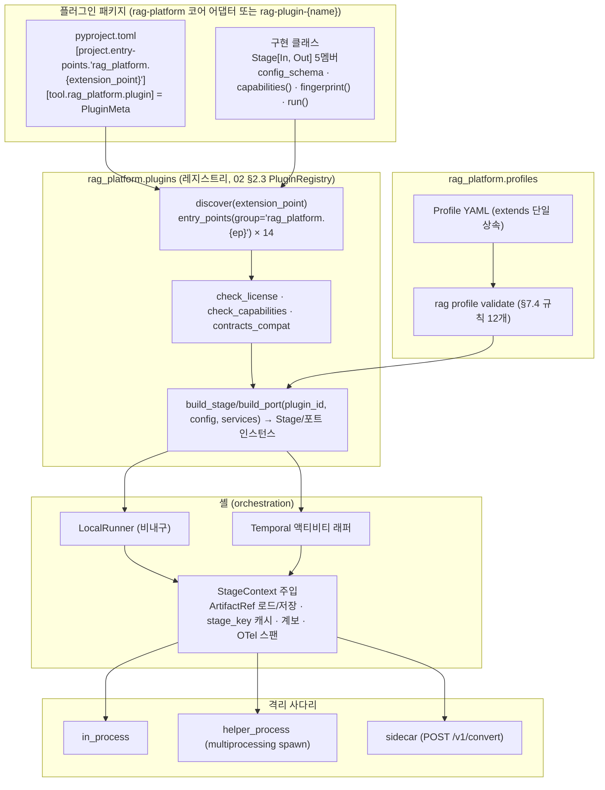

# 플러그인 아키텍처

## 목적

이 문서는 브리프 D-10(플러그인 시스템)과 바이블 §4.1(스테이지 공통 규약)·§5.3(`Capabilities`)·§5.6(`PluginMeta`)·§6.7(패키지·entry point 규약)·§7(프로파일 정본)·§12(모듈 맵)를 하나의 플러그인 아키텍처로 엮는다. 확장 지점(extension point) 14종 각각의 프로토콜(Protocol) 시그니처, 입력·출력 계약, 수명주기, 설정 스키마, 능력 선언, 등록·조회·폴백, 격리 모드, 버전 호환, 관측성 계측, 적합성 테스트 킷, 보안, 프로파일 조합, 초기 카탈로그를 확정해 플러그인 작성자(코어 어댑터 개발자와 외부 패키지 개발자 모두)가 **바이블 표를 그대로 복사해 구현할 수 있게** 한다.

원칙은 브리프 §3의 2(Adapters over Forks)·3(Pure Stages, Durable Orchestration)·5(Pluggable Everywhere)다. 플랫폼이 소유하는 것은 계약과 오케스트레이션이고, 벤더 라이브러리는 어댑터 플러그인으로 감싼다. 플러그인은 순수 변환이며 재시도·타임아웃·격리·관측은 셸(shell)이 책임진다.

## 범위

- 포함: `Stage[In, Out]` 커널 프로토콜과 `StageContext`, 확장 지점 14종의 Protocol 시그니처와 서브 역할(`PluginMeta.role`), 수명주기 훅, `config_schema`(Pydantic v2)와 `config_hash`, `Capabilities`/`IndexBackendCapabilities`, entry point 등록과 레지스트리 조회, 우선순위·폴백 체인, 격리 모드 3단(`IsolationMode`)과 사이드카 변환 계약, 플러그인 API 버전·계약 버전 호환 규칙, 셸 자동 계측, 적합성 키트, 보안(신뢰 수준·샌드박스·리소스 한계), 프로파일 YAML(lite/standard/premium/korean-gov)의 플러그인 조합, 초기 플러그인 카탈로그.
- 제외: 각 계약의 필드 전문(03-contracts), 스테이지 알고리즘 세부(04-pipelines), 플러그인 개발 절차·템플릿(10-development/06), 배포 매니페스트(02-architecture/08), 사이드카 이미지 빌드(sidecars/).
- 정본 관계: 이 문서의 타입명·필드명·열거값은 바이블 §5·§5.7·§6을 그대로 쓴다. SDK 타입(`Stage`, `StageContext`, `PluginRegistry`, 확장 지점 Protocol)의 Python 시그니처는 [컴포넌트 아키텍처](02-component-architecture.md) §2.2~§2.4를 그대로 복사하고, 계약 직렬화·확장 필드 규칙은 [계약 개요](../03-contracts/00-contract-overview.md) §8, 버전 호환 판정은 [스키마 버전 관리](../03-contracts/14-schema-versioning-and-compatibility.md) §4를 따른다. 바이블·02·03-contracts에 없는 항목은 선택 필드(N) 또는 "(제안)"으로 표기하고 `## 미해결 이슈`에 남긴다. 아직 작성 전인 문서(03-contracts/15, 04-pipelines/01·03, 10-development/06)로의 링크는 브리프 §8 문서 맵 경로로만 건다(as of 2026-09). 이 문서가 링크한 ADR(0001·0003·0004·0007·0009·0013·0015·0016·0022·0023·0031·0032·0033·0034·0036·0037)은 바이블 §3.3의 번호·slug 그대로이며 파일이 모두 존재한다.

## 1. 전체 구조

플러그인 시스템은 네 층으로 나뉜다. (1) **계약(contracts)**: 스테이지 경계 타입(Pydantic v2 + JSON Schema 2020-12). (2) **커널(sdk)**: `Stage` 프로토콜, `StageContext`, `Capabilities`, `SidecarStage`, `TokenCounter`, 해시 함수 `H`. (3) **레지스트리(plugins)**: entry point 발견, `PluginMeta` 검증, 라이선스 게이트, 능력 대조. (4) **셸(orchestration)**: `LocalRunner`·Temporal 액티비티 래퍼가 `ArtifactRef`를 로드해 스테이지를 실행하고 저장·계보·계측을 수행한다. 의존 방향은 바이블 §12와 같이 `contracts ← sdk ← plugins | adapters | pipelines | retrieval | render ← orchestration …`이며 역방향은 import-linter가 금지한다.



**결정:** 확장 지점은 D-10의 14종을 유지하고 서브 역할은 `PluginMeta.role`로 표현한다(바이블 §3.1 D-10 `confirmed`, [ADR-0032](../06-adr/0032-plugin-sdk-stage-protocol-and-conformance-kit.md)). 확장 지점 수를 늘리는 변경은 바이블 major 절차(§1.2)를 거친다.

## 2. 커널: `Stage` 프로토콜과 `StageContext`

### 2.1 `Stage[In, Out]` 5멤버

바이블 §4.1의 정본 시그니처를 Python으로 옮긴 것이며 02 §2.2 `src/rag_platform/sdk/stage.py`(`Stage(Protocol[In, Out])`: `plugin_id: str`, `config_schema: type[BaseModel]`, `requires_lineage: ClassVar[tuple[str, ...]] = ()`, `capabilities()`, `fingerprint()`, `async def run(inp, ctx)`)와 코드가 같으므로 여기서는 반복하지 않는다. 모든 확장 지점 구현은 이 프로토콜을 구조적으로(structural subtyping) 만족해야 하며, 추가 멤버는 확장 지점별 Protocol이 정의한다(§3; 02 §2.2 결정대로 14 확장 지점은 모두 이 프로토콜의 타입 특수화이고 실행 진입점은 `run(inp, ctx)` 하나다). 이 문서의 모든 Python 블록은 `from __future__ import annotations`, `from typing import Any, ClassVar, Generic, Protocol, TypeVar`, `from collections.abc import Mapping, Sequence`, `from pydantic import BaseModel`, `from rag_platform.contracts import *`(계약·열거 타입), `from rag_platform.sdk import *`(SDK 타입)를 전제하고 임포트를 생략한다.

| 멤버 | 의미 | 셸이 사용하는 곳 |
|------|------|------------------|
| `plugin_id` | `{extension_point}.{implementation}`(둘 다 snake_case, 바이블 §6.1). entry point 그룹 접미와 이름에서 조립된 값과 일치해야 한다(§6.2) | `Producer.plugin_id`, 스팬 속성, 오류 `StageError.plugin_id` |
| `config_schema` | Pydantic v2 모델 타입. 프로파일 YAML의 스테이지 값에서 `plugin`·`policy`를 제외한 나머지 키가 이 모델로 검증된다 | 프로파일 로딩(§7.4 (1)), `config_hash = H("config", canonical_json(config))` |
| `requires_lineage` | 상류 산출물 `schema_type` 튜플. 셸이 입력 봉투의 `lineage_refs`로 고정되는 상류만 골라 `ctx.lineage[schema_type]`로 제공(결정성 보장, `stage_key` 불변) | `index = ("EnrichedChunkSet", "ChunkSet", "SourceDocument")`; `chunk = ("ParsedDocument",)`; `enrich` LLM 서브스텝 `= ("ChunkSet",)`; 그 외 스테이지는 없음(바이블 §4.1 1.3.0, AM-26) |
| `capabilities()` | `Capabilities`(바이블 §5.3). 인스턴스 생성 후 설정을 반영한 값이어야 한다(예: 임베더의 `model_ids`) | 프로파일 검증(§7.4 (2)), `plan` 6단계 채널 구성 |
| `fingerprint()` | 재현성 지문. SDK가 이미지 digest·`dictionary_hash`·`embedding_space_id`·`analyzer_id` 포함을 검증한다(바이블 리스크 #8) | `stage_key` 합성, `Producer` |
| `run()` | 순수 비동기 변환. 예외는 SDK 예외 `StageFailure`(§2.4; 속성 `.error: StageError`, `raise StageFailure(error)`)로만 던진다 — 계약 모델 `StageError`는 예외가 아니다 | 액티비티 본문 |

### 2.2 `StageContext`

스테이지가 외부 세계에 닿는 유일한 통로다. 바이블 §4.1이 명시한 멤버(`token_counter`, `analyzer`, `now()`, `lineage`, 1.3.0부터 `plan`·`artifacts`도 **결정**)가 정본이고, 나머지 멤버는 02 §2.2 `StageContext`·§2.3 `DerivedArtifacts`(구체 파사드 형태는 02가 제안)·§2.4 `TokenCounter`/`KoreanAnalyzer`를 그대로 옮긴 것이다. 02 §2.3 `ArtifactStore`(`put_artifact`·`get`·`get_bytes`·`exists`, `tenant_id` 인자)는 셸(`orchestration.context`)·`storage`·`retrieval.pack.chunk_text_store`에만 노출되며 **스테이지에는 주지 않는다**. `heartbeat_details` 스키마는 04-pipelines/01(파이프라인 프레임워크)이 확정한다(바이블 미해결 이슈 8). 플러그인 설정(`config_schema` 인스턴스)은 `ctx`가 아니라 레지스트리 `build_stage()`/`build_port()`가 인스턴스에 고정한다(§6.3).

`TokenCounter`(role `token_counter`: `tokenizer_id`, `count_method: CountMethod`, `count`/`count_many`/`truncate`)와 `KoreanAnalyzer`(role `korean_analyzer`: `analyzer_id`, `dictionary_hash`, `tokenize`/`split_sentences`/`normalize_query`/`keywords`) 전문은 02 §2.4와 동일하며 여기서는 반복하지 않는다(§3.1 역할 표·§3.4·§3.6 참고).

```python
# 02 §2.2 sdk/stage.py
class StageContext(Protocol):
    """셸이 만들어 넘기는 실행 문맥. 스테이지가 볼 수 있는 유일한 부수효과 창구."""
    # 스코프(바이블 §4.1 scope_key). 질의 측은 collection_id·document_id·job_id가 None이고
    # 컬렉션 범위는 ctx.security.collection_ids(바이블 §5.3; QueryRequest.collection_ids ≤ 20)로 읽는다(02 §2.2)
    tenant_id: str
    collection_id: str | None
    document_id: str | None
    job_id: str | None
    trace_id: str
    profile_hash: str
    security: SecurityContext | None                    # 질의 측 필수(서버 주입, 읽기 전용); 수집 측 None
    plan: QueryPlan | None                              # 바이블 §4.1 1.3.0 선택 멤버(AM-27): 질의 측 필수(retrieve~pack이 읽는 fusion·rerank·postprocess·pack 파라미터의 단일 원천); 수집 측 None
    # 바이블 §4.1이 허용한 멤버
    token_counter: TokenCounter                         # primary_tokenizer_id(프로파일 chunk.tokenizer)
    token_counters: Mapping[str, TokenCounter]          # secondary_tokenizer_ids·대상 LLM 카운터
    analyzer: KoreanAnalyzer                            # Kiwi 또는 mecab-ko(ADR-0021); 전 프로파일 필수
    lineage: Mapping[str, BaseModel]                    # requires_lineage로 선언한 상류 산출물 {schema_type: instance}
    def now(self) -> datetime: ...                      # Temporal은 activity 시각, Local은 wall clock
    # Resumable(바이블 §4.4). heartbeat_details 스키마는 04-pipelines/01
    def heartbeat(self, details: Mapping[str, Any]) -> None: ...
    resume_details: Mapping[str, Any] | None
    artifacts: DerivedArtifacts                         # 바이블 §4.1 1.3.0 선택 멤버(AM-27): 테넌트 바인딩 쓰기 전용 파사드 — put_source(data, *, media_type), put_derived(data, *, kind, ext, media_type);
                                                        #   tenant_id 인자·get·put_artifact·exists 없음(E5·E17)
    def remaining_ms(self) -> int | None: ...           # 데드라인·지연 예산(질의 측은 ctx.plan.latency_budget_ms에서 파생)
```

규칙:

- 스테이지는 `datetime.now()`, `random`, 파일·네트워크 I/O를 직접 호출하지 않는다. 임베딩 서버·리랭커 서버 같은 외부 HTTP는 예외지만 반드시 `ctx.remaining_ms()`를 존중하고, HTTP 클라이언트는 `RuntimeServices.http`(02 §2.3, `EgressGuard` 적용 팩토리)에서만 얻으며, 비밀은 `credentials_ref` 간접 참조로만 받는다(바이블 §6.6).
- `ctx.artifacts`는 `DerivedArtifacts`(02 §2.3 제안)다: 셸이 `ctx.tenant_id`를 고정한 **쓰기 전용** 파사드로 `put_source(data, *, media_type)`·`put_derived(data, *, kind, ext, media_type)` 둘만 있고 `tenant_id` 인자·`get`·`put_artifact`·`exists`가 없다 — 어댑터는 타 테넌트 키를 만들 수도, 계약 산출물을 읽을 수도 없다(E5·E17; 읽기는 `ctx.lineage`만). `put_derived`가 만든 파생물은 봉투가 없으므로 `H("derived", content_hash, sidecar_image_digest)` 키로 테넌트 내 공유된다(바이블 §4.1, [ADR-0037](../06-adr/0037-artifact-cache-scope-and-stage-key-composition.md)). 계약 산출물 저장(`ArtifactStore.put_artifact`)은 스테이지가 아니라 셸의 일이며, 적합성 키트 `security_invariants`가 이 불변식을 검사한다(§10). `StageContext.artifacts: DerivedArtifacts`는 바이블 §4.1 1.3.0(AM-27)에서 확정되었고, `put_source`/`put_derived` 두 메서드로 좁힌 구체 파사드 형태는 02 §2.3과 동일하다(§미해결 이슈 1은 나머지 편의 멤버만 다룬다).
- `heartbeat`는 동기 호출이며 `Capabilities.supports_resumable=true`인 스테이지만 부른다(스레드 실행 시 셸이 메인 루프로 넘긴다, 02 §4.2). `heartbeat_details` 키는 바이블 §4.4 표의 `page`, `chunk_offset`, `batch_offset`다.
- 질의 측 스테이지(`retriever`~`packer`)가 공통으로 읽는 `QueryPlan`·`SecurityContext`는 `run()` 인자가 아니라 `ctx.plan`·`ctx.security`다(02 §2.2 결정). 셸(`LocalContext.stage_context(security=…, plan=…, trace_id=…)`, 02 §2.2 `QueryContext`)이 요청마다 채우며, `ctx.plan`이 `None`인 질의 측 호출은 `contract.violation`이다.
- `ctx.deadline`·`ctx.call_sidecar`·`ctx.secret`·`ctx.logger`·`ctx.config` 같은 편의 멤버는 두지 않는다. 필요가 확인되면 02 §2.2·04-pipelines/01과 합의해 추가한다(§미해결 이슈 1).

### 2.3 수명주기 훅(선택)

바이블의 5멤버 프로토콜은 무상태 순수 변환을 전제하므로 수명주기 멤버가 없다. 그러나 모델 로딩(ONNX 세션, GLiNER2 가중치), 커넥션 풀(Qdrant gRPC, OpenSearch), 사이드카 준비 확인은 첫 `run` 앞에서 한 번 수행돼야 한다. 이를 위해 SDK는 **선택** 프로토콜 `StageLifecycle`을 제공하고, 셸은 구현 여부를 `isinstance` 검사로 판별해 호출한다. 이 훅은 계약(`schemas/`)에 나타나지 않으며, 프로토콜 멤버 수를 바꾸지 않는다(제안; §미해결 이슈 1).

```python
class StageLifecycle(Protocol):                 # (제안) rag_platform.sdk
    async def init(self, services: RuntimeServices) -> None: ...   # 워커 프로세스당 1회. build() 뒤 클라이언트 생성(02 §2.3 RuntimeServices)
    async def warmup(self) -> None: ...        # 모델·사전 로딩, 더미 추론 1회. 실패 시 워커 readyz=false
    async def health(self) -> HealthReport: ...   # (제안) {status: enum[ok, degraded, failing], detail, checked_at}
    async def close(self) -> None: ...         # 커넥션·세션 해제. 워커 종료·핫 리로드 시
```

| 훅 | 호출 시점 | 실패 시 | 타임아웃(초안 목표) |
|----|-----------|---------|---------------------|
| `init` | 워커 프로세스 기동, 프로파일 해소 뒤 | 워커 기동 실패(`profile.invalid` 또는 `plugin.capability_unsupported`) | 30s |
| `warmup` | `init` 뒤, 태스크 큐 폴링 전 | `/readyz` 미준비 유지, 재시도 3회 후 프로세스 종료 | 모델 크기 의존, 기본 120s |
| `health` | `/healthz` 폴링, Temporal 워커 헬스, 사이드카 `GET /healthz` 위임 | `degraded`면 폴백 체인 우선순위 하향(§6.4), `failing`이면 큐 폴링 중단 | 5s |
| `close` | SIGTERM, 프로파일 교체(`collection.profile.changed`) | 로그만 | 10s |

수명주기는 **프로세스 단위**다. 스테이지 인스턴스는 워커 프로세스에서 프로파일 해시당 하나이며 `run`은 재진입 가능해야 한다(동시 액티비티 `max_concurrent_activities`). 사이드카의 수명주기는 컨테이너가 소유하고 `SidecarStage`의 `health`는 `GET /healthz`를 위임한다(바이블 §14).

### 2.4 오류 계약

`StageError`(바이블 §5.3, `contracts/common.py`)는 Pydantic **계약 모델**이며 `BaseException`이 아니므로 그대로 `raise`할 수 없다. 플러그인은 SDK 예외 `rag_platform.sdk.StageFailure(Exception)`(제안; 속성 `.error: StageError`) **하나만** 던지고, 셸(액티비티 래퍼·`LocalRunner`)이 경계에서 `.error`를 계약 `StageError{code: "stage.reason", type: "urn:rag:error:{code}", retryable, stage, plugin_id, detail?, artifact_ref?}`로 직렬화해 원장·`ProblemDetails`·`ConvertResponse.error`에 기록한다. 재시도 가능 여부는 오류 카탈로그(§5.7)가 결정하고, 플러그인이 `retryable`을 임의로 바꾸면 SDK 검증이 거부한다. 카탈로그에 없는 코드를 던지면 셸이 `contract.violation`(비재시도)으로 감싼다. `StageFailure` 이외의 미분류 예외가 경계에 도달하면 셸은 이를 `StageError`로 만들지 않고 **재시도 가능**으로 취급하며(워커 크래시·GIL 교착·네이티브 오류처럼 일시적일 수 있는 실패를 비재시도로 확정하지 않는다) 소진 시 `last_error`에 예외 타입만 남긴다 — `contract.violation`은 계약 검증 실패(§5.3)에만 쓴다(04-pipelines/01 §10.2 B2와 정합). 벤더 예외(`docling` 예외, `httpx.TimeoutException`, JVM 오류 문자열)는 어댑터 안에서 카탈로그 코드로 변환한다 — 예: 사이드카 5xx·연결 실패 → `parse.sidecar_unavailable`(재시도 후 폴백), 변환기 비정상 종료 → `parse.conversion_failed`(폴백), 암호 문서 → `parse.document_encrypted`(비재시도). 부분 성공은 예외가 아니라 `quality=degraded` + `warnings[]` + `page_status[]`(수집 측) / `degraded[]`(질의 측)로 표현한다.

## 3. 확장 지점 14종(D-10)

### 3.1 요약 표

입력·출력·격리 기본값은 바이블 §4.2·§4.3 표를 그대로 옮긴 것이고, Protocol 시그니처는 02 §2.4를 그대로 복사한다. 02 §2.2의 결정대로 **14 확장 지점 인터페이스는 모두 `Stage[In, Out]`의 타입 특수화**이며 실행 진입점은 `run(inp, ctx)` 하나다 — 질의 측(`retriever`~`packer`)이 공통으로 읽는 `QueryPlan`·`SecurityContext`는 인자가 아니라 `ctx.plan`·`ctx.security`다(§2.2). 이렇게 해야 `PluginRegistry.build_stage() -> Stage`가 리트리버·퓨저도 반환하고 적합성 키트 `idempotency`(같은 `In`·`ctx`로 `run()` 2회)가 14종에 똑같이 적용된다. "형태" 열의 **Stage**는 이 특수화이며 §3.2 이하 Protocol은 5멤버에 **더해** 요구되는 멤버만 적는다. **포트(port)**는 02 §2.4가 `Stage`와 별개의 독립 Protocol로 정의한 인터페이스 **4개**(`IndexBackend`, `ContextRenderer`, `TokenCounter`, `KoreanAnalyzer`)로, 플랫폼(`index` 사가·`hydrate`·`retriever` 어댑터, `render` 스테이지, `ctx.token_counter`·`ctx.analyzer` 주입)이 `run()` 대신 포트 고유 메서드(`upsert`/`search`/`retrieve`…, `render`, `count`, `tokenize`)를 호출한다. 포트 중 `IndexBackend`는 `plugin_id`·`capabilities()`를 갖고(02 §2.4 코드), role 포트 셋(`ContextRenderer`·`TokenCounter`·`KoreanAnalyzer`)은 02 코드에 두 멤버가 없으나 레지스트리가 `PluginMeta`로 발견·검증하므로 구현 클래스에 `plugin_id`·`capabilities()`를 두는 것을 보완 제안한다. `config_schema`는 레지스트리 `build_port(plugin_id, config, services)`(02 §2.3, 트리아지 #14로 `build_stage()`와 분리 결정)가 프로파일 값을 검증해 `config_hash`(`planner_fingerprint`·`Producer` 입력)를 확정하는 데 필요하므로 **모든 포트 구현이 선언해야 한다**(02 §2.4 코드 보완 제안, §미해결 이슈 11 잔여분). `fingerprint()`는 `Stage` 5멤버이므로 모든 Stage형이 구현하며(수집 측은 `stage_key` 합성, 질의 측은 `Producer` 검증), 포트 4종 중 `index_backend`만 `IndexCommit.producer`를 위해 필수이고 나머지 셋은 선택이다.

| 확장 지점(`ExtensionPoint`) | 형태 | 입력 계약 | 출력 계약 | 호출 스테이지 | 기본 격리 | 서브 역할(`PluginMeta.role`) |
|------|------|-----------|-----------|--------------|-----------|------|
| `fetcher` | Stage | `IngestRequest` | `SourceDocument` | `fetch` | `in_process` | (없음; URI 스킴은 `Capabilities.input_formats`) |
| `parser` | Stage | `SourceDocument` | `ParsedDocument` | `detect`, `parse` | 포맷별 3단 모두 | `format_detector`, `ocr_engine`, `vlm_document_parser` |
| `normalizer` | Stage + 포트 | `ParsedDocument` | `NormalizedDocument` | `normalize` | `in_process` | `korean_analyzer`(`KoreanAnalyzer` 제공), `sentence_splitter`, `pii_detector` |
| `chunker` | Stage | `NormalizedDocument` / `ChunkSet` | `ChunkSet` | `chunk`, `recount` | `in_process` | `token_counter`(`recount`: `ChunkSet → ChunkSet`, 바이블 §4.2) |
| `enricher` | Stage | `ChunkSet` | `EnrichedChunkSet` | `enrich` | `in_process`(LLM은 외부 HTTP) | (없음) |
| `embedder` | Stage(+ `embed_query()`) | `EnrichedChunkSet` / 질의 텍스트 | `EmbeddedChunkSet` / `VectorBundle` | `embed`, `plan`(질의 임베딩) | 외부 HTTP / `in_process`(lite) | (없음) |
| `index_backend` | 포트(`IndexBackend`; 02 §2.4 표 행은 `EmbeddedChunkSet → IndexCommit`) | `IndexRecord[]`, `EffectiveFilter`, `record_id[]` | `BackendResult`, `BackendHit[]`, payload | `index` 사가, `hydrate`, `retriever` 어댑터 | `in_process` 클라이언트 | (없음) |
| `query_transformer` | Stage(파이프) | `QueryPlan` | `QueryPlan` | `plan` | `in_process`(+LLM) | (없음; 파이프 순서는 프로파일 `query.transform[]`) |
| `retriever` | Stage | `RetrieveInput{channel: ChannelSpec, variant: QueryVariant}`(sdk 내부 제안 타입; `$defs`는 03-contracts/09) + `ctx.plan.filters`·`ctx.security` | `ChannelRun`(= `CandidateSet.channel_runs[]` 원소; 03-contracts/10 `$defs`) | `retrieve` | `in_process` | (없음) |
| `fuser` | Stage(순수 함수) | `CandidateSet` + `ctx.plan.fusion` | `RankedSet(stage=fused)` | `fuse` | `in_process` | (없음) |
| `reranker` | Stage | `RankedSet(fused, hydrated=true)` + `ctx.plan.rerank` | `RankedSet(stage=reranked)` | `rerank` | 외부 HTTP / `in_process` | (없음) |
| `postprocessor` | Stage(단계) | `RankedSet` + `ctx.plan.postprocess` | `RankedSet` | `postprocess` | `in_process` | (없음; 단계 이름은 `PostprocessStep`) |
| `packer` | Stage + 포트(role) | `RankedSet(postprocessed)` + `ctx.plan.pack` | `ContextPack` / `RenderedContext` | `pack`, `render` | `in_process` | `renderer`(`ContextRenderer`), `token_counter`(`TokenCounter`) |
| `evaluator` | Stage | `EvalRun` | `EvalReport`(부분: `metrics`만) | 하네스 | `in_process` | (없음) |

### 3.2 `fetcher`

```python
class Fetcher(Stage[IngestRequest, SourceDocument], Protocol):
    """fetch 스테이지. 캐시 없음(stage_key 미적용), EgressPolicy 강제(E16). 02 §2.4 추가 멤버 schemes."""
    schemes: frozenset[str]                      # {"s3", "gs", "az", "https", "file"}; 라우팅 사전 판정
```

- `schemes`와 같은 값을 `Capabilities.input_formats`에 선언한다(`["s3", "gs", "az", "https", "file"]`; `smb`는 별도 플러그인). 프로파일 `runtime.egress.allowed_schemes`와 교집합만 활성화된다.
- 출력 `SourceDocument`의 `artifact`(원본 바이트 `sources/{blake3}`, `ctx.artifacts.put_source`), `content_hash`, `doc_version = content_hash`, `media_type`, `http_metadata`는 fetcher가 채우고, `format`·`format_confidence`·`container_flags`는 `detect`(parser 그룹 `format_detector`)가 채운다.
- 조건부 GET 규칙(검증자 `etag`|`last_modified`가 있을 때만 304 재사용)은 바이블 §4.2 `fetch` 행이 정본이다.
- 오류: `fetch.access_denied`, `fetch.not_found`, `fetch.too_large`, `fetch.scheme_unsupported`, `fetch.egress_denied`(비재시도), `fetch.timeout`, `fetch.upstream_error`(재시도).

### 3.3 `parser`

```python
class FormatDetector(Stage[SourceDocument, SourceDocument], Protocol):
    """role=format_detector. format·format_confidence·container_flags만 채운다(오류 판정은 parse가)."""
    def detect(self, source: SourceDocument) -> SourceDocument: ...   # 02 §2.4 추가 멤버; run()은 이를 감싼다


class Parser(Stage[SourceDocument, ParsedDocument], Protocol):
    formats: frozenset[SourceFormat]                           # 02 §2.4; Capabilities.input_formats와 동일 값
    def can_parse(self, source: SourceDocument) -> bool: ...   # format ∈ formats 이고 container_flags 조건 충족


class OcrEngine(Protocol):                                     # (제안) role=ocr_engine 포트; 04-pipelines/05 소유
    """페이지 비트맵 → 라인/워드 박스. parse.options.ocr 로 선택된다."""
    engine_id: str                                             # "rapidocr", "paddleocr", "tesseract", "surya"
    async def recognize(self, page_image: bytes, lang: list[str], ctx: StageContext) -> OcrPage: ...   # OcrPage(제안; 03-contracts/03 $defs)
```

- `Capabilities.input_formats`는 `SourceFormat` 값의 부분집합이다(`hwpx, hwp5, hwp3, pdf, docx, doc, rtf, odt, html, txt, md, json, unknown`). 라우터는 `parse.router[format]`의 후보 체인에서 `can_parse`가 참인 첫 후보부터 시도한다(§6.4).
- OCR·페이지 이미지·표 HTML·벤더 JSON·HWP→HWPX 변환본은 `ctx.artifacts.put_derived`(인프로세스) 또는 `ConvertResponse.derived[]`(사이드카)로 저장되고 `ParsedDocument`가 참조한다. 실제 시도 순서는 `ParsedDocument.parser_chain[]`에 기록한다(O-07).
- 페이지 단위 진행은 `ctx.heartbeat({"page": n})`, 타임아웃 페이지는 `page_status[].status=timeout`으로 계속한다(O-08). `supports_resumable=true`인 파서만 재개 대상이다.
- 07-tech-landscape/03의 `ParserAdapter` 제안은 이 프로토콜로 흡수된다(`name`→`plugin_id`, `supported_formats`→`input_formats`, `parse`→`run`, 예외 4종→오류 카탈로그).

### 3.4 `normalizer`

```python
class Normalizer(Stage[ParsedDocument, NormalizedDocument], Protocol):
    """normalize 스테이지 본체. 하위 포트(ctx.analyzer, sentence_splitter, pii_detector)를 ctx 또는 설정으로 받는다."""


# role=korean_analyzer 구현은 §2.2의 KoreanAnalyzer(02 §2.4)를 그대로 제공한다(추가 멤버 없음).
# 사용자 사전(UserDictEntry[]) → 엔진별 사전 파일·dictionary_hash 생성은 rag_platform.korean(바이블 §12)의 몫이며 플러그인 API가 아니다.


class SentenceSplitter(Protocol):                   # (제안) role=sentence_splitter 포트; 04-pipelines/09 소유
    def split(self, text: str) -> list[tuple[int, int]]: ...   # 코드포인트 [start, end) 스팬, 원문 기준; ctx.analyzer.split_sentences 위임 가능


class PiiDetector(Protocol):                         # (제안) role=pii_detector 포트; 04-pipelines/09 소유
    detector_version: str
    def detect(self, text: str, recognizers: list[str]) -> list[PiiSpan]: ...   # PiiSpan(제안; 03-contracts/04 $defs) {start, end, entity_type, score}
```

- `normalizer_fingerprint`는 `analyzer_id`·`dictionary_hash`·`pii_policy`·`pii_detector_version`을 포함해야 하며 SDK가 누락을 검증한다(바이블 §6.2).
- PII 검출기 로딩 실패는 `normalize.pii_detector_unavailable`(재시도)이고 **`keep` 폴백은 금지**된다(E4). 문장 분리기 실패는 `fallback` 플러그인 → 정규식으로 내려가며 `normalize.segmenter_fallback` 경고를 남긴다.
- `korean_analyzer`는 `lite`(Qdrant 단독)에서 필수다(§7.4 (9)). 같은 인스턴스가 `ctx.analyzer`로 `enricher.korean_keywords`·`query_transformer.korean_normalize`·`embedder.sparse_bm25`에 위임된다.

### 3.5 `chunker`

```python
class Chunker(Stage[NormalizedDocument, ChunkSet], Protocol):
    """chunk 스테이지. 토큰 예산은 ctx.token_counter(프로파일 chunk.tokenizer) 기준."""
    primary_tokenizer_id: str                        # 02 §2.4 추가 멤버 = config.tokenizer = ctx.token_counter.tokenizer_id


class Recounter(Stage[ChunkSet, ChunkSet], Protocol):
    """role=token_counter, recount 스테이지(바이블 §4.2). token_counts에 새 tokenizer_id 키만 추가한다(재청킹 아님, ADR-0019)."""
```

- `chunker_config_hash`는 `chunk_id` 합성에 들어가므로(§6.2) `config_schema`의 모든 필드가 결정적이어야 한다(난수 시드 고정, 부동소수 최단 표현).
- 불변식(`block_refs` 합집합이 `text`를 재구성, `level=0`은 `leaf_max_tokens` 이내, 부모는 임베딩 대상 아님)은 적합성 키트 `contract_roundtrip`이 검사한다. `fallback: {plugin: chunker.flat_text, …}`의 라우팅 조건은 04-pipelines/10이 소유한다.

### 3.6 `enricher`

```python
class Enricher(Stage[ChunkSet, EnrichedChunkSet], Protocol):
    """enrich 스테이지(바이블 §4.2: ChunkSet → EnrichedChunkSet). 02 §2.4 추가 멤버 deterministic."""
    deterministic: bool                              # False면 LLM 보강 → ingest-llm 큐·예산 정책(O-05) 적용
```

- 프로파일 `enrich.deterministic[]`처럼 한 스테이지 안에서 여러 enricher를 순차 적용하는 **합성 규칙**(중간 표현, `Enrichment` 병합 순서, `enricher_fingerprint = H("enricher", *sorted(...), policy_hash)` 산출)은 플랫폼 `enrich` 스테이지 내부 규칙이며 04-pipelines/11이 소유한다. 각 플러그인의 계약 경계는 위 시그니처 하나다(합성 시 중간 타입은 §미해결 이슈 12). `index_text`에서 접두어를 되돌리는 `strip` 대칭(K2)도 04-pipelines/11 소유의 플랫폼 규칙이다.
- 결정적 보강(`deterministic_prefix`, `korean_keywords`, `gliner2_entities`, `derived_meta`)은 `deterministic=True`이고 `stage_key` 캐시 대상이다. LLM 보강은 청크 단위 `H("llm-enrich", model_id, prompt_hash, embed_text)` 캐시를 쓰며 모든 프로파일에서 기본 끔이다([ADR-0016](../06-adr/0016-llm-enrichment-default-off-and-budget-policy.md)).
- 예산 초과는 `enrich.budget_exceeded` → 잡 `partial`(비LLM 결과는 커밋), 추출기 타임아웃은 빈 배열 + `Enrichment.status=partial`. 외부 LLM에는 PII 정책 적용 텍스트만, 테넌트 `llm_enrichment_allowed` 옵트인 필수(`enrich.llm_policy_denied`).

### 3.7 `embedder`

```python
class Embedder(Stage[EnrichedChunkSet, EmbeddedChunkSet], Protocol):
    embedding_space_ids: dict[str, str]              # 02 §2.4; {dense, sparse_learned?, sparse_bm25?, late_interaction?} = H("space", …)
    mode: EmbeddingMode                              # 02 §2.4; run()은 document, embed_query()는 query 프롬프트를 쓴다
    async def embed_query(self, text: str) -> VectorBundle: ...   # 02 §2.4 질의 측 포트(plan 스테이지가 호출); 프롬프트는 어댑터 소유
```

- `Capabilities.model_ids`(`{repo}@{revision}`), `requires_gpu`, `extra`(제안: `{vectors: array<enum(VectorName)>, dim, max_input_tokens, pooling: enum(Pooling), vocab_id, tokenizer_id, requires_instruction}`)를 선언한다. `extra` 스키마는 03-contracts/15가 확정한다(§미해결 이슈 3).
- 문서·질의 프롬프트(`query: `, `Instruct:`)는 어댑터가 소유하고 `prompt_hash`가 `embedding_space_id`에 들어간다. 같은 공간 안에서 서빙 스택을 바꾸면(vLLM ↔ TEI ↔ 인프로세스) 코사인 ≥ 0.9999 동등성 게이트를 통과해야 한다([ADR-0009](../06-adr/0009-embedding-serving-vllm-pooling-tei-inprocess.md)).
- `vocab_id` 불일치는 색인·질의 모두 `embed.space_mismatch`(비재시도). 배치는 `ingest.embed.batch_max_tokens`로 자르고 `ctx.heartbeat({"batch_offset": i})`로 재개한다.

### 3.8 `index_backend`

```python
# src/rag_platform/sdk/index_backend.py — 시그니처는 02 §2.4와 동일(메서드별 동작 설명은 그 문서 코드 주석이 정본)
class IndexBackend(Protocol):
    """포트. 인덱스를 바꾸는 유일한 인터페이스. 플랫폼 index 사가·hydrate·retriever 어댑터가 호출한다. 모든 검색·조회는 사전 필터(E7)."""
    backend_id: str                     # "qdrant" | "opensearch" | 플러그인 값
    plugin_id: str                      # "index_backend.qdrant"

    def capabilities(self) -> Capabilities: ...
    async def ensure_physical(self, spec: CollectionSpec) -> str: ...
    async def upsert(self, records: Sequence[IndexRecord], *, commit_id: str) -> BackendResult: ...
    async def flip_current(self, scope: DocumentScope, *, generation: int) -> BackendResult: ...
    async def restore_generation(self, scope: DocumentScope, *, generation: int) -> BackendResult: ...
    async def delete_by_filter(self, flt: EffectiveFilter) -> BackendResult: ...
    async def update_acl(self, scope: DocumentScope, *, acl_fields: Mapping[str, Any]) -> BackendResult: ...
    async def search(self, req: BackendSearchRequest) -> list[BackendHit]: ...
    async def retrieve(self, record_ids: Sequence[str], *, with_payload: Sequence[str],
                       with_vectors: bool, security: EffectiveFilter) -> list[Mapping[str, Any]]: ...
    async def swap_alias(self, alias: str, physical_name: str) -> None: ...   # blue/green; supports_alias_swap=true 백엔드만
    async def count(self, flt: EffectiveFilter) -> int: ...                  # 정합성 검사(maintenance.consistency.v1)
```

- `backend_id`와 `plugin_id`는 **별개 식별자**다(02 §2.4). 프로파일은 `index.backends[].plugin`에 `plugin_id`를 쓰고, 레지스트리가 인스턴스를 만들 때 어댑터가 선언한 `backend_id`(코어 어댑터는 `plugin_id`의 implementation 부분 `qdrant`·`opensearch`)를 `CollectionSpec.backends[].backend_id`에 기록한다. 이후 `QueryPlan.channels[].backend_id`·`hydrate.backend_id`·`IndexCommit.backend_results[].backend_id`·스냅샷 키·메트릭 라벨(바이블 §5.5·§5.6·§6.5)은 모두 이 값을 쓴다.
- `DocumentScope`(`(tenant_id, collection_id, document_id)`), `EffectiveFilter`(`retrieval/filters`가 만든 `{security, strategy, user, self_query}` 백엔드 중립 필터 트리, `filters.effective_hash` 입력), `BackendSearchRequest`, `BackendHit`은 02 §2.4의 제안 타입이고 `BackendResult`는 `IndexCommit.backend_results[]` 원소와 같은 구조다.
- `search`·`retrieve`·`update_acl`·`delete_by_filter`의 필터·스코프에 `tenant_id`가 없으면 어댑터가 `retrieve.security_context_missing`(질의 측) 또는 계약 위반(수집 측)을 던진다(E7). 보안 필드(`tenant_id`, `collection_id`, `acl_allow`, `acl_visibility`, `acl_hash`) 누락 레코드가 1건이라도 있으면 `upsert`는 배치 전체를 `index.security_fields_missing`으로 거부한다(E5).
- `IndexBackendCapabilities`(`supports_server_bm25, korean_analyzer, supports_server_fusion[], tenant_isolation[], supports_alias_swap, supports_multivector, max_vector_dim, max_multivector_elements, supports_payload_only_points`)는 프로파일 검증(§7.4 (2))과 `plan` 6단계의 근거다. `supports_multivector=false`면 `late_interaction` 채널이 자동 비활성 + `degraded{channel.late_interaction, capability_unsupported}`.
- 물리 키는 `record_id = H("record", tenant_id, collection_id, document_id, str(index_generation), chunk_id)`, Qdrant `point_id = uuid5(NAMESPACE_RAG_CHUNK, record_id)`, OpenSearch `_id = record_id`([ADR-0004](../06-adr/0004-deterministic-chunk-id-scoped-record-id-and-ulid-exception.md)). 어댑터는 이 변환 외의 ID를 만들지 않는다.

### 3.9 `query_transformer`

```python
class QueryTransformer(Stage[QueryPlan, QueryPlan], Protocol):
    """plan 파이프의 한 단계. filters.security·filters.strategy 는 읽기 전용(E6) — SDK가 변경을 거부한다."""
    order: int                                        # 02 §2.4 추가 멤버; 파이프 위치(normalize_ko=0 → router → self_query → rewrite → expand)
```

- 셸(플랫폼 `plan` 스테이지)이 `QueryRequest` + `SecurityContext` + `CollectionSpec`으로 초기 `QueryPlan`을 만들고 `query.transform[]` 순서로 적용한다. 정본 파이프 순서는 `normalize_ko → router → self_query → rewrite → expand`(바이블 §4.3).
- LLM 변형(`llm_self_query`, `multi_query`, `hyde`)은 `Capabilities.extra.uses_llm=true`(제안, §5)로 선언하고 `latency_budget_ms.plan` 안에서만 실행되며 실패 시 `plan.llm_failed` 폴백(원 질의 + 형태소 키워드, `route=single`, `degraded{planner_llm, llm_failed}`).
- 변형 질의는 `rewritten_queries[]`에 서버 발급 `variant_id`(ULID)로 추가하며 `original`(weight 1.0, `variant_id = query_id`)을 제거할 수 없다.

### 3.10 `retriever`

```python
# src/rag_platform/sdk/retrieval.py — 시그니처는 02 §2.4와 동일. 질의 측 확장 지점은 모두 Stage[In, Out] 특수화(5멤버 그대로). plan·security는 ctx(§2.2)
class RetrieveInput(BaseModel):          # 제안(sdk 내부): 리트리버 In. 계약 하나가 아니므로 sdk가 소유(02 미해결 이슈 4)
    channel: ChannelSpec                 # QueryPlan.channels[] 원소(채널 × 컬렉션; backend_id 포함)
    variant: QueryVariant                # QueryPlan.rewritten_queries[] 원소

class Retriever(Stage[RetrieveInput, ChannelRun], Protocol):
    channel: Channel                     # sparse_bm25 벡터를 쓰는 리트리버는 channel=lexical(§5.7 Channel); plugin_id 예 retriever.qdrant_dense
```

- `ChannelSpec`(= `QueryPlan.channels[]` 원소), `QueryVariant`(= `QueryPlan.rewritten_queries[]` 원소), `ChannelRun`(= `CandidateSet.channel_runs[]` 원소)은 02 §2.4가 제안한 계약 `$defs` Pydantic 클래스명이며 03-contracts/09·10이 확정한다. `RetrieveInput`은 계약 하나가 아닌 `In`을 위한 `sdk` 내부 타입 제안이다(02 미해결 이슈 4). 플랫폼 `retrieve` 스테이지가 (채널 × 컬렉션 × 변형)마다 `run(RetrieveInput, ctx)`를 병렬 호출하고 결과를 `CandidateSet.channel_runs[]`로 모은다. 리트리버가 어느 백엔드를 쓰는지는 `ChannelSpec.backend_id`(플래너가 `CollectionSpec.backends[]`에서 채움)로 전달되고, 리트리버 자체는 `Capabilities.extra.backend_id`(제안, §5)로 호환 백엔드를 선언한다.
- 사전 필터는 `ctx.plan.filters`(security + strategy + user + self_query)와 `ctx.security`에서만 만든다. `ctx.security`가 `None`이면 `retrieve.security_context_missing`(E7)이다.
- 출력 `ChannelRun`은 `CandidateSet.channel_runs[]` 한 항목(`channel_run_id = "{channel}:{collection_id}:{variant_id}"`, `status: enum(ChannelRunStatus)`, 후보 ≤ `top_k`, `payload_slim`)이다. 실패는 예외가 아니라 `status=error` + `error`(StageError)로 반환한다. 결과 캐시는 ACL 시점성 때문에 금지된다.
- `sparse_bm25`(lite)는 `retriever.qdrant_sparse_bm25`가 `channel=lexical`로 실행한다(바이블 §5.7 `Channel`). 그래프·트리·비주얼 채널은 외부 플러그인이 같은 프로토콜로 제공한다([ADR-0015](../06-adr/0015-graph-rag-external-plugin-raptor-core-option.md)).

### 3.11 `fuser`

`Fuser(Stage[CandidateSet, RankedSet])`(02 §2.4와 동일)의 추가 멤버는 `method: FusionMethod`(`plugin_id = fuser.{method}`: `fuser.rrf` | `fuser.convex_minmax` | `fuser.convex_zscore` | `fuser.dbsf` | `fuser.combmnz`)뿐이다.

- 불변식 `Σ contribution = fused_score`, 타이브레이크 `record_id` 오름차순, `ctx.plan.fusion.k` 필수(`fuse.k_missing`은 로딩 시 차단). 적합성 키트 `fuser_equivalence`가 ranx 결과와 대조한다([ADR-0013](../06-adr/0013-fusion-rrf-k60-then-convex-combination-and-postprocess-order.md)).
- `hydrate`는 fuser 다음의 플랫폼 서브스텝이며 플러그인 확장 지점이 아니다(`index_backend.retrieve` 호출).

### 3.12 `reranker`

`Reranker(Stage[RankedSet, RankedSet])`(02 §2.4와 동일)는 추가 멤버가 없다(파라미터는 `ctx.plan.rerank`; 구현 예 `reranker.tei_cross_encoder` | `reranker.qdrant_maxsim` | `reranker.flashrank`).

- 입력 텍스트는 `context_prefix + "\n" + text`(hydrate 값)를 **리랭커 토크나이저**로 `ctx.plan.rerank.max_tokens_per_text` 절단한다. `rerank_raw`·`rerank_normalized`(`normalization: enum(ScoreNormalization)`)를 `score_breakdown`에 기록한다.
- 타임아웃·5xx는 fused 순서 폴백(`rerank.applied=false`, `explain += rerank_skipped`, `rag_rerank_fallback_total`)이며 오류가 아니다. 스키마 파싱 실패는 `rerank.schema_mismatch`(비재시도).

### 3.13 `postprocessor`

`Postprocessor(Stage[RankedSet, RankedSet])`(02 §2.4와 동일)의 추가 멤버는 `step: PostprocessStep`(`plugin_id = postprocessor.{step}`: `relevance_gate` | `dedup` | `mmr` | `parent_expand` | `sentence_window` | `compress`)뿐이다.

- 단계 순서는 플랫폼이 고정한다(`relevance_gate → dedup → mmr → parent_expand → dedup → sentence_window → compress`, D-07 v1.2). 플러그인은 **한 단계의 구현을 교체**할 수 있을 뿐 순서를 바꾸지 못한다. `reorder`·`citation_align`은 `pack` 내부 `PackStep`이므로 이 확장 지점에 속하지 않는다.
- `text`를 바꾸는 단계(`sentence_window`, `compress`)는 `block_refs`·`sentence_spans`를 함께 재계산해야 하며 적합성 키트 `renderer_citation_roundtrip`이 검증한다. 토큰 단위 압축은 `block_refs`를 무효화하므로 `text_format=plain`으로만 허용된다.
- `parent_expand`는 `ChunkTextStore.get_many(chunk_set_blake3, parent_chunk_ids, ctx.security)`로 부모 텍스트를 읽는다(PG 미의존, [ADR-0034](../06-adr/0034-retrieval-hot-path-postgres-independence-and-hydrate.md)).

### 3.14 `packer`

`Packer(Stage[RankedSet, ContextPack])`(02 §2.4와 동일)는 추가 멤버가 없다(내부 순서는 아래 참고).

```python
class ContextRenderer(Protocol):                      # 02 §2.4 포트(Stage 아님); packer 그룹 role=renderer. render 스테이지가 validate → render 순으로 호출
    plugin_id: str                       # 보완 제안 — 02 §2.4 코드에는 없음(레지스트리 조회 키, §미해결 이슈 11)
    renderer: Renderer                   # enum(Renderer) 9종: anthropic_search_result | anthropic_document | openai_messages | gemini_messages | xml_documents | markdown | mcp_tool_result | plain_records | dify_external_knowledge
    def validate(self, pack: ContextPack, options: Mapping[str, Any]) -> None: ...   # render.mixed_blocks 등 사전 검증(400 예방)
    def render(self, pack: ContextPack, options: Mapping[str, Any]) -> RenderedContext: ...
```

- Protocol 이름은 `ContextRenderer`다. `Renderer`는 바이블 §5.7의 **열거 타입명**(`rag_platform.contracts.enums.Renderer`, `QueryRequest.renderer`·`pack.renderer`·`RenderedContext.renderer`)이므로 SDK 클래스가 같은 이름을 가질 수 없다(바이블 §6.4 고유 열거 타입명, 02 §2.4).
- role `token_counter`는 §2.2 `TokenCounter`(02 §2.4: `tokenizer_id`, `count_method: enum(CountMethod)`, `count`/`count_many`/`truncate`)를 구현하는 대상 LLM 예산 카운터다. 공급자는 `tokenizer_id` 접두(`anthropic:` | `tiktoken:` | `hf:` | `gemini:`, 바이블 §6.1)로 식별된다. Anthropic은 `exact_api`(`count_tokens`)가 1차, 근사 시 `approximate + calibration_ratio + safety_margin` 기록 필수.
- `pack` 내부 순서와 `cite_id = d1..dK` 불변 규칙은 바이블 §8.2·§9.1이 정본이다. 커스텀 패커는 네 서브스텝을 **재구현**할 수는 있지만 순서를 바꾸거나 생략하면 적합성 키트 `litm_order`·`renderer_citation_roundtrip`·`security_invariants`(acl_recheck)에서 실패한다.
- 렌더러는 공급자 페이로드에 `tenant_id`·주체·`acl_*`·`record_id`를 넣지 않는다(§9.3 공통 규칙 (1)). 역매핑은 `RenderedContext.citation_map`에만 둔다.

### 3.15 `evaluator`

```python
class Evaluator(Stage[EvalRun, EvalReport], Protocol):    # 02 §2.4 표 행: EvalRun → EvalReport(부분); 추가 멤버 metrics
    metrics: frozenset[str]                           # 산출 메트릭 키("ndcg@10", "recall@20", "span_hit_rate@k", "judged@10", …); plugin_id 예 evaluator.retrieval_metrics
```

- 하네스는 프로덕션과 동일한 인프로세스 스테이지(`LocalRunner`)로 `ContextPack`을 생성한 뒤, `EvalRun`을 `In`으로 evaluator의 `run()`을 호출한다(D-12). 스테이지는 I/O를 직접 하지 않으므로(바이블 §4.1) 골든셋(`EvalDataset.qrels_ref`·`answer_spans_ref`)과 생성된 `ContextPack` 집합은 하네스가 로드해 `ctx.lineage`로 제공한다 — `requires_lineage`를 `index`·`chunk`·`enrich` LLM 서브스텝 밖(`evaluator`)에서도 쓰는 확장이므로 키 이름과 함께 §미해결 이슈 19의 제안이다. nDCG는 **선형 이득** 고정, 다중 비교는 Holm 보정([ADR-0023](../06-adr/0023-evaluation-qrels-answer-spans-and-linear-ndcg.md)).
- 최종 `EvalReport.metrics`는 여러 evaluator의 부분 리포트를 합친 것이며 키 충돌은 `profile.invalid`다. `comparison`·`gate_result`·`artifacts_ref`는 플랫폼(하네스)이 채운다.

## 4. 설정 스키마(`config_schema`)와 `config_hash`

플러그인은 자기 설정을 Pydantic v2 모델로 선언한다. 프로파일 YAML의 스테이지 값에서 `plugin`·`policy`(`StagePolicy`)·`isolation`·`image`·`then`·`fallback`(셸 예약 키)을 제외한 나머지 키가 이 모델로 검증되고, `config_hash = H("config", canonical_json(config))`가 `fingerprint`와 `stage_key`에 들어간다.

```python
from pydantic import BaseModel, ConfigDict, Field


class GenreRule(BaseModel):
    """바이블 §7.3 genre_rules.law_article = {heading_regex: "^제\\d+조", split_on: [항]} 형태."""
    model_config = ConfigDict(extra="forbid", frozen=True)

    heading_regex: str
    split_on: list[str] = Field(default_factory=list)


class StructureAwareChunkerConfig(BaseModel):
    """chunker.structure_aware 의 config_schema (기본값 = 바이블 §7.2 standard 열; 초안 목표)."""
    model_config = ConfigDict(extra="forbid", frozen=True)   # 미지 키 거부(오탈자 = profile.invalid), 불변

    tokenizer: str = Field("hf:BAAI/bge-m3", pattern=r"^(hf|tiktoken|anthropic|gemini):")   # = ctx.token_counter.tokenizer_id (§7.4 (4))
    secondary_tokenizers: list[str] = Field(default_factory=lambda: ["tiktoken:o200k_base"])   # 바이블 §7.2·§7.3 chunk.secondary_tokenizers → ctx.token_counters
    leaf_max_tokens: int = Field(512, ge=64, le=4096)
    parent_max_tokens: int = Field(2048, ge=256, le=16384)
    merge_min_tokens: int = Field(64, ge=0)
    table_row_group_tokens: int = Field(256, ge=32)
    genre_rules: dict[str, GenreRule] = Field(default_factory=dict)
```

규칙:

| 규칙 | 내용 | 검증 위치 |
|------|------|-----------|
| `extra="forbid"` | 프로파일의 오탈자 키는 즉시 `profile.invalid`. 게이트 값 `{value, gate}` 래퍼는 로더가 먼저 벗긴다(§7.4) | 프로파일 로딩 |
| 결정성 | 모델·사전·이미지 참조는 설정이 아니라 지문 구성요소로 별도 검증(`model_ids`, `analyzer_id`, `image_digest`). 설정에 절대 경로·호스트명·비밀을 넣지 않는다(비밀은 `credentials_ref`) | SDK `fingerprint()` 검증 |
| 스키마 게시 | 각 플러그인의 `config_schema`는 JSON Schema로 출력할 수 있어야 하며(`model_json_schema()`), 프로파일 스키마(`schemas/profile.schema.json`)의 스테이지 값은 `oneOf` 대신 **레지스트리 시점 동적 검증**으로 처리한다(프로파일 스키마는 `plugin`·`policy`만 정적으로 검증; 03-contracts/14 §2.3 `profile` 행). CLI 하위 명령 `rag plugin schema {plugin_id}`는 **제안**(바이블 §12 `cli/plugin`은 `list --check-license`만; 10-development/06 소유, §미해결 이슈 5) | 로더, CLI(제안) |
| 기본값 | `config_schema` 기본값은 바이블 §7.2 `standard` 값과 같아야 한다. 다르면 적합성 키트가 실패한다 | 적합성 키트 |
| 금지 | 설정으로 격리 모드·큐·재시도를 바꾸는 필드를 두지 않는다(그것은 `StagePolicy`·`isolation`의 몫) | 코드 리뷰·린트 |

## 5. 능력 선언(`Capabilities`)

`capabilities()`는 바이블 §5.3 `Capabilities`를 반환한다. 공통 필드 `isolation_modes`, `supports_resumable`, `contracts_compat`(필수), `input_formats`, `model_ids`, `requires_gpu`, `extra`(선택). `extra`는 확장 지점 전용 객체로, `index_backend`만 `IndexBackendCapabilities`가 정본이고 나머지는 아래 제안을 03-contracts/15가 확정한다.

| 확장 지점 | `input_formats` 의미 | `extra` 제안 필드(N) | 검증에 쓰이는 규칙 |
|-----------|----------------------|----------------------|--------------------|
| `fetcher` | URI 스킴 | `{max_bytes, supports_conditional_get, supports_range}` | `runtime.egress.allowed_schemes ⊆ input_formats` 아니면 `fetch.scheme_unsupported` 사전 경고 |
| `parser` | `SourceFormat` 부분집합 | `{source_kinds: array<enum(SourceKind)>, page_provenance: boolean, table_merged_cells: boolean, ocr_engines: array<string>, arch: array<string>}` | 라우터 후보 체인 구성(§6.4); `arch`(`x86_64`, `aarch64`)는 unhwp 같은 네이티브 헬퍼의 배치 제약 |
| `normalizer` | — | `{analyzer_id, dictionary_supported, languages: array<string(bcp47)>, recognizers: array<string>}` | `lite`에서 `korean_analyzer` 필수(§7.4 (9)); `analyzer_id`가 `IndexCommit`·`QueryPlan`에 기록 |
| `chunker` | — | `{tokenizers: array<string>, supports_tables, supports_genre_routing}` | `chunk.tokenizer ∈ tokenizers` |
| `enricher` | — | `{deterministic: boolean, languages, item_kinds_produced: array<enum(ItemKind)>}` | `deterministic=false`(02 §2.4 `Enricher.deterministic`)면 컬렉션 `llm_enrichment_allowed`·`ingest-llm` 큐 필요 |
| `embedder` | — | `{vectors: array<enum(VectorName)>, dim, max_input_tokens, pooling: enum(Pooling), vocab_id, tokenizer_id, requires_instruction, batch_max_tokens}` | `late_interaction` 요구 ↔ `vectors`; late chunking ↔ `pooling=mean`(§7.4 (5)); `chunk.tokenizer == tokenizer_id`(§7.4 (4)) |
| `index_backend` | — | **`IndexBackendCapabilities`(정본, §5.3)** | §7.4 (2), `plan` 6단계 |
| `query_transformer` | 언어 | `{uses_llm: boolean, produces: array<enum(QueryRole)>, sets_filters: boolean}` | `uses_llm=true`면 `latency_budget_ms.plan` 안에서만 실행, `quality` 변형 한정 |
| `retriever` | — | `{channel: enum(Channel), backend_id: array<string>, supports_prefilter: true, supports_variants}` | `backend_id`는 호환 `IndexBackend.backend_id` 목록(§3.8); `supports_prefilter`가 `false`면 로딩 거부(E7: 사전 필터만) |
| `fuser` | — | `{methods: array<enum(FusionMethod)>, preserves_breakdown: true}` | `fusion.method ∈ methods` |
| `reranker` | — | `{backend: enum(RerankBackend), response_schema: enum(RerankResponseSchema), max_tokens_per_text, tokenizer_id, model_ids}` | `rerank.max_tokens_per_text ≤ extra.max_tokens_per_text` |
| `postprocessor` | — | `{step: enum(PostprocessStep), mutates_text: boolean, requires_vectors: boolean}` | `mutates_text=true`면 좌표 재계산 검증 대상 |
| `packer` | — | `{renderers: array<enum(Renderer)>, count_methods: array<enum(CountMethod)>, providers}` | `pack.renderer ∈ renderers`, `pack.tokenizer.provider ∈ providers` |
| `evaluator` | — | `{metrics: array<string>, requires_judge_llm: boolean}` | `eval.gates` 키 ⊆ 산출 메트릭 합집합 |

`capabilities()`는 설정을 반영한 **실행 시 값**(예: 임베더 `model_ids` = 프로파일 `model_id@revision`)이고 `PluginMeta.capabilities`는 **정적 선언**이다. 정적 부분(`isolation_modes`, `contracts_compat`, `input_formats`)이 불일치하면 `plugin.capability_unsupported`. 대조 실패 처리는 (a) **로딩 거부**(`profile.invalid` / `plugin.capability_unsupported`; 예 `pgvector + late_interaction`, CLS pooling + late chunking) 또는 (b) **자동 저하**(컬렉션 단위 불일치 → 채널 비활성 + `degraded[]`) 두 가지다.

## 6. 등록·발견·조회·폴백

### 6.1 패키지와 entry point

**결정:** 플러그인 배포 패키지는 `rag-plugin-{name}`(import `rag_plugin_{name}`), entry point 그룹은 `rag_platform.{extension_point}`, entry point 이름은 `implementation`(snake_case)이다(바이블 §6.7). `plugin_id`는 항상 `"{extension_point}.{implementation}"`이다. 코어 어댑터(`rag_platform.adapters.*`)도 동일 그룹에 등록되어 코어와 외부 플러그인이 같은 경로로 발견된다. 여러 플러그인을 합성한 생산자(`Producer.plugin_id`)는 실제 entry point 대신 예약 구현명 `{extension_point}.pipeline`(`enricher.pipeline`, `query_transformer.pipeline`, `retriever.pipeline`)을 쓰며 레지스트리에는 등록되지 않는다(바이블 §6.1 1.3.0, AM-11). [ADR-0036](../06-adr/0036-naming-and-identifier-conventions.md).

```toml
# rag-plugin-lightrag/pyproject.toml (예시; 버전·의존성은 확인 필요 as of 2026-09)
[project]
name = "rag-plugin-lightrag"
version = "0.1.0"
requires-python = ">=3.12,<3.14"
dependencies = ["rag-platform>=1.0,<2.0"]

[project.entry-points."rag_platform.retriever"]
lightrag_graph = "rag_plugin_lightrag.retriever:LightRagGraphRetriever"

[tool.rag_platform.plugin]                 # = PluginMeta 1개(바이블 §5.6; 선택 필드 role·model_ids·sidecar_image 생략)
schema_version = "1.0.0"
plugin_id = "retriever.lightrag_graph"     # = "{그룹 접미}.{entry point 이름}"
extension_point = "retriever"
version = "0.1.0"
license = "MIT"
license_grade = "A"
territory = []
linkage = "pure_python"
isolation_supported = ["in_process", "sidecar"]
contracts_compat = ">=1.0,<2.0"
capabilities = {isolation_modes = ["in_process", "sidecar"], supports_resumable = false, contracts_compat = ">=1.0,<2.0"}
```

`plugin_id`는 `"{그룹 접미}.{entry point 이름}"`과 정확히 같아야 한다(`rag_platform.retriever` + `lightrag_graph` → `retriever.lightrag_graph`). 불일치는 로딩 시 `contract.violation`이다. 바이블 §5.6은 `[tool.rag_platform.plugin]` **단일 표 = `PluginMeta` 하나**만 정의하므로 위 예시는 entry point 하나만 등록한다. 바이블 §3.2 O-03·§12 `plugins/`가 전제하는 "한 배포 패키지가 `retriever`와 `enricher`를 함께 제공"(`rag-plugin-lightrag`)하는 형태는 배열 테이블 `[[tool.rag_platform.plugin]]`(항목마다 `PluginMeta` 하나, entry point와 1:1)이 필요한데 이는 **제안**이며 03-contracts/15 `plugin-meta.schema.json`이 확정한다(§미해결 이슈 13). 확정 전에는 확장 지점마다 별도 배포 패키지로 나누어 배포하며, §13.2 카탈로그의 패키지명(`rag-plugin-lightrag` 등)은 바이블 §12 `plugins/` 목록을 따르는 **논리 묶음**이다.

### 6.2 `PluginMeta`

바이블 §5.6 `PluginMeta`(`schema_version 1.0.0`, `plugin-meta.schema.json`) 필드를 그대로 쓴다. `pyproject.toml`의 `[tool.rag_platform.plugin]`이 원천이고 레지스트리는 이를 `PluginMeta`로 파싱해 검증한다. 실행 시 값(`Producer.image_digest`, `plugin_version`)은 런타임이 채운다.

```json
{
  "schema_version": "1.0.0",
  "plugin_id": "parser.hwp5_java_sidecar",
  "extension_point": "parser",
  "role": null,
  "version": "1.0.0",
  "license": "Apache-2.0",
  "license_grade": "A",
  "territory": [],
  "linkage": "pure_python",
  "isolation_supported": ["sidecar"],
  "model_ids": [],
  "model_license_ack_required": false,
  "sidecar_image": "parser-workers",
  "contracts_compat": ">=1.0,<2.0",
  "capabilities": {
    "isolation_modes": ["sidecar"],
    "supports_resumable": true,
    "contracts_compat": ">=1.0,<2.0",
    "input_formats": ["hwp5"],
    "model_ids": [],
    "requires_gpu": false,
    "extra": {"source_kinds": ["flow"], "page_provenance": false, "table_merged_cells": true, "arch": ["x86_64", "aarch64"]}
  }
}
```

### 6.3 레지스트리 조회

```python
# src/rag_platform/sdk/ports.py — 시그니처는 02 §2.3과 동일. 구현은 plugins.registry
class PluginRegistry(Protocol):
    """entry point 그룹 rag_platform.{extension_point}(§6.7). discover()는 메타데이터만 읽고 모듈을 임포트하지 않는다."""
    def discover(self, extension_point: ExtensionPoint) -> Sequence[PluginMeta]: ...
    def meta(self, plugin_id: str) -> PluginMeta: ...
    def build_stage(self, plugin_id: str, config: Mapping[str, Any], services: RuntimeServices) -> Stage[Any, Any]: ...   # Stage 특수화(포트 4종 제외)
    def build_port(self, plugin_id: str, config: Mapping[str, Any], services: RuntimeServices) -> IndexBackend | ContextRenderer | TokenCounter | KoreanAnalyzer: ...   # 포트 4종 전용(트리아지 #14)
    def check_license(self, meta: PluginMeta, policy: LicensePolicy) -> None: ...        # 위반 → plugin.license_denied
    def check_capabilities(self, meta: PluginMeta, required: Mapping[str, Any]) -> None: ...  # 위반 → plugin.capability_unsupported
```

| 항목 | 규칙 |
|------|------|
| 조회 키 | `meta(plugin_id)`·`build_stage(plugin_id, …)`·`build_port(plugin_id, …)`의 키는 모두 `plugin_id`다. 프로파일은 `plugin_id`만 쓰고 버전은 `uv.lock`이 고정한다(한 환경에 한 배포 버전만 설치). `plugin_id@version` 표기(`version` = `PluginMeta.version`, 배포 패키지 버전; 예 `parser.hwpx_python_hwpx@1.0.0` — 래핑 라이브러리 python-hwpx의 버전은 `parser_fingerprint_hash`의 `parser_version`으로 별도 기록된다, 바이블 §6.2)는 `Producer` 재현·적합성 테스트·CLI 출력에서 쓰는 **검증 단언**이며, 레지스트리 API에 `@version` 조회를 추가하는 것은 `plugins.registry` 구현 계층의 제안이다(§미해결 이슈 11 잔여분) |
| 포트 반환 | `build()`는 `build_stage()`와 `build_port()`로 나뉜다(02 §2.3, 트리아지 #14). `build_stage()`는 14 확장 지점 중 `Stage` 특수화(포트 4종 제외, 리트리버·퓨저·패커 포함)를 반환하고, `build_port()`는 `index_backend`(`IndexBackend`)와 role 포트(`ContextRenderer`·`TokenCounter`·`KoreanAnalyzer`) 4개를 반환한다 — 포트는 `Stage`가 아니므로 반환 타입 합집합 없이 메서드로 분리해 정적 타입을 맞춘다. 호출 측(`index` 사가·`render`·`ctx` 조립)은 그대로 포트 타입을 받는다 |
| 역할 | `PluginMeta.role`은 **확장 지점 안에서만** 고유하다(`chunker`의 `token_counter` = `recount` 스테이지, `packer`의 `token_counter` = 대상 LLM 카운터). 역할 조회는 항상 `discover(extension_point)` 결과를 `role`로 걸러 수행하므로 두 그룹이 섞이지 않는다 |
| 중복 | 같은 `plugin_id`가 두 배포 패키지에서 발견되면 로딩 실패(`profile.invalid`, 사유 `duplicate plugin_id`). 이름 충돌 방지는 코어 어댑터가 접두 없이, 외부 패키지가 벤더 접두(`lightrag_`, `hipporag_`)를 쓰는 관례로 해결한다 |
| 검증 순서 | (1) `PluginMeta` 스키마 → (2) `plugin_id` = 그룹·이름 조립값 → (3) `contracts_compat` ∩ 코어 계약 버전(§8) → (4) `check_license`(§7.4 (1): `license_grade ≤ license_policy.max_grade`, C/D/X는 `optIn` 명시, D 모델 `model_license_ack`, `territory` 대조, `B + static_bundled` 거부) → (5) `check_capabilities`(정적 능력 일치) → (6) 격리 모드 결정(§7) → (7) `build`(`config_schema` 검증 + 인스턴스 생성) → (8) `StageLifecycle.init(services)`(구현 시) |
| 게으른 로딩 | `discover`는 메타데이터만 읽고 모듈은 임포트하지 않는다(entry point `load()`는 `build` 시점). 프로파일이 참조하지 않는 플러그인은 임포트되지 않으므로 선택 extra(`[kiwi]`, `[docling-chunker]`) 미설치가 오류가 아니다 |
| 실패 코드 | `plugin.license_denied`, `plugin.capability_unsupported`, `profile.invalid`, `contract.violation`(모두 비재시도, 바이블 §5.7). 미발견·버전 불일치 전용 코드는 제안(§미해결 이슈 4) |
| 프로파일 해소·캐시 | 프로파일 전체를 해소해 플러그인 인스턴스 집합을 만드는 것은 `profiles.validate(profile, registry)`(02 §3.3)와 셸의 조립 지점이 `PluginRegistry`를 반복 호출해 수행한다. 해소 결과(제안 명 `PluginGraph`)는 `profile_hash` 단위로 워커 프로세스에 캐시되고 `collection.profile.changed` 이벤트로 무효화된다(캐시 객체의 이름·형태는 `plugins.registry` 구현 계층 제안, §미해결 이슈 11) |

### 6.4 우선순위와 폴백 체인

폴백은 두 종류다. **후보 체인(candidate chain)**은 같은 슬롯에 순서 있는 여러 플러그인을 두고 앞이 실패하면 뒤를 시도한다. **단일 폴백(`fallback`)**은 한 플러그인의 예외·미설치 시 대체 플러그인 하나를 지정한다.

파서 라우터(`ingest.parse.router`, 04-pipelines/03 소유)는 `SourceFormat` 13값 각각에 후보 체인을 갖는다(§7.4 (10): 누락 키는 `profile.invalid`). 체인 항목은 `plugin_id` 문자열 또는 `{plugin, isolation?, image?, then?}` 객체이고, 값이 오류 코드 문자열(`parse.unsupported_variant`)이면 즉시 종료다.

| 규칙 | 내용 |
|------|------|
| 진행 조건 | 다음 후보로 넘어가는 오류는 `parse.sidecar_unavailable`(재시도 소진 후), `parse.conversion_failed`, `parse.page_timeout` 전 페이지 실패, 헬퍼 프로세스 크래시(→ `parse.conversion_failed`로 변환)뿐이다. `parse.document_encrypted`, `parse.distribution_document`, `parse.unsupported_variant`, `parse.corrupt_container`는 체인을 멈춘다 |
| `then` | 변환형 후보(`office_lo_sidecar`)는 `then: docx`로 변환본을 다른 포맷 체인에 재투입한다(바이블 §7.3 `doc/rtf/odt` 행). `hwp5_java_sidecar`의 HWP→HWPX 변환은 라우터 `then`이 아니라 **어댑터 내부**에서 끝난다(사이드카 `output`이 HWPX 파생물 → 같은 어댑터가 OWPML 변환까지 수행; 바이블 §7.3 YAML에 `then` 없음). 변환본은 `derived` 산출물(`H("derived", content_hash, sidecar_image_digest)`)로 저장되어 재변환을 생략한다 |
| 미설치 후보 | `optIn` 꺼진 사이드카(`lo-sidecar`)나 미설치 extra는 체인에서 **건너뛴다**(경고 로그). 남는 후보가 없으면 `parse.unsupported_format` |
| 품질 표기 | 폴백 결과가 정보 손실을 수반하면 어댑터가 `quality=degraded` + `warnings[]`를 남긴다(`rtf_striprtf`, Tika `HwpV5Parser`). 시도 순서는 `ParsedDocument.parser_chain[]` |
| 헬스 연동 | `StageLifecycle.health()`가 `degraded`인 후보는 같은 체인 안에서 뒤로 미룬다(순서 재배열은 체인 내부에서만, 프로파일 해시 불변). `failing`이면 건너뛴다 |
| 다른 슬롯 | `normalize.analyzer.fallback`(Kiwi → mecab-ko), `normalize.sentence_splitter.fallback`(kss → regex), `chunk.fallback`(structure_aware → flat_text), `rerank`(폴백 = 생략), `pack.tokenizer`(`exact_api` → `approximate`). 질의 측 폴백은 `degraded[]`, 수집 측 폴백은 `warnings[]`·`parser_chain[]`에 기록 |
| 우선순위 값 | 별도 `priority` 정수 없음. 프로파일 배열 순서가 유일한 정본(`profile_hash`에 포함) |

## 7. 격리 모드(`IsolationMode`)

### 7.1 사다리

| 모드 | 대상 | 실행 방식 | 크래시 격리 | 지문 추가 요소 |
|------|------|-----------|-------------|----------------|
| `in_process` | A 등급 순수 Python(`linkage=pure_python`), 또는 A 등급 `dynamic` 링크 중 크래시 이력 없는 라이브러리 | 워커 프로세스에서 직접 `await run()` | 없음(워커 전체 영향) | — |
| `helper_process` | ctypes·네이티브 크래시 위험(unhwp), 메모리 폭주 위험 | `multiprocessing` `spawn` 컨텍스트 자식 프로세스, 입력은 `ArtifactRef`, 결과는 파이프로 `ArtifactRef` 회신; 타임아웃 시 프로세스 그룹 KILL | 프로세스 | 없음 — 번들 네이티브 바이너리(unhwp `.so`)는 배포 패키지의 일부이므로 그 변경은 `PluginMeta.version` 상승(`plugin_version`)으로 지문에 반영한다(§8). `Capabilities.extra`는 지문 입력이 아니므로 별도 `helper_digest`를 두어도 `stage_key`가 바뀌지 않는다(리스크 #8) |
| `sidecar` | JVM(hwplib·hwpxlib·Tika), LibreOffice, CUDA OCR, **모든 C 등급(GPL/AGPL)**, 대형 모델 서빙 | 별도 컨테이너 REST `POST /v1/convert`(`ConvertRequest`/`ConvertResponse`), `GET /healthz`; `SidecarStage` 기반 클래스가 호출·타임아웃·오류 변환 | 컨테이너 | `Producer.image_digest`(`sha256:…`) 필수 |

**결정:** C 등급 컴포넌트는 `sidecar`가 강제되며 인프로세스·헬퍼 프로세스 등록이 거부된다. 이미지는 별도 저장소 `rag-platform-gpl-sidecars`에서 빌드·릴리스하고 코어 이미지에 포함하지 않으며 Helm `optIn.*` 값으로만 활성화한다(D-02, 바이블 §6.7, [ADR-0001](../06-adr/0001-license-grade-table-and-d02-interpretation.md), [ADR-0033](../06-adr/0033-sidecar-convert-contract-and-isolation-ladder.md)). 코어와 사이드카 사이에는 네트워크 API 외의 결합(pip 의존·코드 임포트·공유 라이브러리)이 없어야 한다.

### 7.2 모드 결정 규칙

실행 모드는 다음 교집합에서 가장 낮은 단(왼쪽) 모드를 택한다: `PluginMeta.isolation_supported` ∩ `Capabilities.isolation_modes` ∩ (프로파일 후보 항목 `isolation` 또는 `StagePolicy.isolation`이 있으면 그 단일 값). 단, 다음 강제 규칙이 우선한다.

| 조건 | 강제 |
|------|------|
| `license_grade = C` | `sidecar`만 허용(D-02, 바이블 §4.1·§6.7). `isolation_supported`에 다른 값이 있으면 `plugin.license_denied`. §11.1 `restricted` 수준과 동일 규칙 |
| `license_grade = D` 또는 `model_license_ack_required = true`(D 등급 모델 포함) | 격리 강제 **없음**(선언값). 조건은 기본 프로파일 제외 + `model_license_ack`(§7.4 (1), 브리프 D-02, ADR-0001)만이다 |
| `license_grade = B` 이고 `linkage = static_bundled` | 기본 설치·기본 프로파일 거부(§7.4 (1)); 명시 extra + `optIn`으로만, 모드는 선언값 |
| `linkage = dynamic` 이고 `extra.arch`가 현재 노드와 불일치 | 로딩 거부(`plugin.capability_unsupported`) — unhwp x64 전용 |
| `requires_gpu = true` | (제안; 바이블 §7.4 규칙 13 추가 후보, §미해결 이슈 14) 큐가 `ingest-gpu-*`이거나 `sidecar`가 아니면 `profile.invalid`. 채택 전에는 경고 로그만 |
| `StagePolicy.isolation`이 선언되고 플러그인이 미지원 | `plugin.capability_unsupported` |

### 7.3 `SidecarStage`와 변환 계약

```python
class SidecarStage(Generic[In, Out]):
    """sidecar 격리 스테이지의 기반 클래스(rag_platform.sdk, 바이블 §12). 서브클래스는 to_request/from_response 만 구현한다."""
    sidecar_image: ClassVar[str]                              # PluginMeta.sidecar_image

    def __init__(self, config: BaseModel, services: RuntimeServices) -> None:   # PluginRegistry.build_stage()가 호출(02 §2.3)
        self.config = config
        self._http = services.http                            # EgressGuard 적용 httpx.AsyncClient 팩토리; 주소는 서비스 디스커버리 값만(E16)

    def to_request(self, inp: In, ctx: StageContext) -> ConvertRequest: ...        # input=ArtifactRef, options, tenant_id, document_id, deadline_ms=ctx.remaining_ms(), trace_id, credentials_ref
    def from_response(self, inp: In, resp: ConvertResponse, ctx: StageContext) -> Out: ...   # output → 계약 인스턴스, derived[] 전파, warnings 병합

    async def _convert(self, req: ConvertRequest) -> ConvertResponse: ...          # POST {sidecar}/v1/convert; 연결 실패·5xx → StageFailure(parse.sidecar_unavailable)

    async def run(self, inp: In, ctx: StageContext) -> Out:
        resp = await self._convert(self.to_request(inp, ctx))
        if resp.output is None:                                # 바이블 §5.6: output=null이면 error 필수
            raise StageFailure(resp.error)                     # error: StageError (parse.sidecar_unavailable | parse.conversion_failed | …), §2.4
        return self.from_response(inp, resp, ctx)
```

- 사이드카는 본문을 받지 않는다. `ConvertRequest.input`은 `ArtifactRef`이고 사이드카가 오브젝트 스토리지에서 직접 읽는다(콘텐츠 주소). 응답 `output`·`derived[]`도 `ArtifactRef`다(바이블 §5.6, O-10).
- `ConvertResponse.producer`(사이드카 측 `plugin_id`·`plugin_version`·`image_digest`)는 워커의 `Producer.image_digest`로 복사되어 지문에 들어간다. 이미지 태그가 아니라 digest다.
- 사이드카 하드닝(07-tech-landscape/03 `lo-sidecar` 규격): 네트워크 egress 차단, 읽기 전용 루트 FS, `/work` tmpfs, 비루트 UID, seccomp, tini + 프로세스 그룹 KILL, 인스턴스 재시작 정책(변환 N회 또는 RSS 상한). 이 규격은 모든 사이드카 이미지의 기본값이며 02-architecture/08이 매니페스트로 옮긴다.
- 헬스: `GET /healthz`는 준비 상태(모델·JVM·LO)를 반환하고 `SidecarStage.health()`가 이를 위임한다. `rag_parser_sidecar_unavailable_total` 메트릭으로 폴백 빈도를 관측한다.

## 8. 버전 호환

세 개의 버전이 독립적으로 움직인다.

| 버전 | 소유 | 표기 | 호환 규칙 |
|------|------|------|-----------|
| 계약 `schema_version` | 바이블 §5(초기 `1.0.0`), 03-contracts | 봉투 필드, `ArtifactRef.schema_version`, `$id = urn:rag:schema:{kebab}:{major}` | 필드 추가(선택)·열거값 추가 = minor(가산만), 제거·의미 변경·필수화 = major(바이블 §1.2). 플러그인은 `contracts_compat` 범위(`">=1.0,<2.0"`)로 수용 가능한 계약 major·minor를 선언한다 |
| 플러그인 SDK API 버전 | 코어 패키지 `rag-platform` 버전(semver)이 SDK 버전이다. 별도 상수 `rag_platform.sdk.API_VERSION`은 **제안**(10-development/08 릴리스 절차 소유; 바이블 §12에 없음) | 플러그인 `dependencies = ["rag-platform>=1.0,<2.0"]` | `Stage` 멤버 추가는 SDK minor(기본 구현 제공), 멤버 시그니처 변경·제거는 major. `StageContext` 멤버 추가는 minor, 제거는 major |
| 플러그인 자체 버전 | `PluginMeta.version` = 배포 패키지 버전 | `Producer.plugin_version`, `plugin_id@version` 표기 | 플러그인 **출력에 영향을 주는** 변경(알고리즘·기본값·래핑 라이브러리 버전·번들 네이티브 바이너리)은 minor 이상이어야 한다. 지문에 들어가므로 버전이 바뀌면 `stage_key`가 바뀌어 재실행된다 — patch로 출력이 바뀌면 캐시가 낡은 산출물을 재사용한다(리스크 #8) |

로딩 규칙(03-contracts/14 §4.2 매트릭스, 00 §8.2): (1) 프로파일 로딩 시 코어의 현재 계약 버전 집합 `{schema_type: schema_version}`이 플러그인 `contracts_compat` 범위 밖이면 `plugin.capability_unsupported`(사유 `contracts_compat`; 사전 차단). (2) 산출물 로드 시 `schema_type` 불일치·major 불일치는 `contract.violation`(14 §4.2 행 1·2·4). (3) 같은 major에서 산출물 minor ≤ 소비자 minor면 그대로 로드한다(행 6). (4) 산출물 minor > 소비자 minor는 **거부**(`contract.violation`, 행 7)다 — 00 §8.2가 계약에 없는 키를 위반으로 정하고 Pydantic 모델은 `extra='forbid'`이므로 알 수 없는 필드를 보존하는 `extra="allow"` 로드는 없다. 알 수 없는 선택 속성을 `prune_unknown`으로 제거한 뒤 `extra='forbid'`로 읽는 관용 읽기(`load_tolerant`)는 14 문서의 제안이며 채택 전에는 거부다. (5) 낮은 major 산출물을 소비자 major로 올리는 업캐스터 체인(`contracts/versioning.py` `UpcasterRegistry`, 14 §6.2)도 제안이며 채택 전에는 거부 + 재처리 제안(행 3·4). 계약 major 상승 시 플러그인은 `contracts_compat`를 넓혀(`">=1.0,<3.0"`) 두 major에 대해 적합성 키트를 통과해야 한다(마이그레이션 절차는 03-contracts/14 소유).

## 9. 관측성 자동 계측

**결정:** 플러그인은 스팬·메트릭을 직접 만들지 않는다. 셸(액티비티 래퍼·`LocalRunner`·질의 파이프라인)이 모든 `run` 호출을 계측하고, 플러그인 내부의 외부 호출(모델 서버·사이드카·LLM)만 SDK 데코레이터로 표준 속성을 붙인다(D-11, [ADR-0022](../06-adr/0022-observability-genai-semconv-pin-and-license-boundary.md)). 속성 상수는 OTel Weaver 생성 모듈 `rag_platform.telemetry.otel`에서만 가져온다(문자열 리터럴 금지 린트).

바이블 §6.5의 자체 속성 정본은 `rag.tenant_id_hash`, `rag.profile_hash`, `rag.plan_id`, `rag.degraded_count` 네 개다. 아래 표의 나머지 `rag.*` 속성(`rag.plugin_id`, `rag.plugin_version`, `rag.stage_key`, `rag.cache_hit`, `rag.isolation_mode`, `rag.quality`, `rag.warnings_count`, `rag.image_digest`)은 **제안**이며 Weaver 레지스트리 등재(09-operations/03, 바이블 §6.5 개정)가 확정하기 전까지 필수가 아니다(§미해결 이슈 15).

| 계측 지점 | 스팬 이름 | 속성(정본 / 제안) | 메트릭(바이블 §6.5 정본) |
|-----------|-----------|-------------------|--------------------------|
| 수집 스테이지 `run` | `rag.ingest.{stage}`(`rag.ingest.parse`) | 정본: `rag.profile_hash`, `rag.tenant_id_hash` / 제안: `rag.plugin_id`, `rag.plugin_version`, `rag.stage_key`, `rag.cache_hit`, `rag.isolation_mode`, `rag.quality`, `rag.warnings_count` | `rag_ingest_stage_duration_seconds{stage, outcome}` |
| 질의 스테이지 | `rag.plan`, `rag.retrieve.{channel}`, `rag.fuse`, `rag.hydrate`, `rag.rerank`, `rag.postprocess`, `rag.pack`, `rag.render` | 정본: 위 + `rag.plan_id`, `rag.degraded_count`, retrieval 스팬 `gen_ai.data_source.id = collection_id`, OpenInference `retrieval.documents.*`(콘텐츠 캡처 끔이면 ID·점수만) | `rag_plan_latency_seconds`, `rag_retrieve_latency_seconds{channel}`, `rag_rerank_latency_seconds`, `rag_rerank_fallback_total`, `rag_postprocess_latency_seconds`, `rag_pack_latency_seconds`, `rag_pack_tokens_count`, `rag_hydrate_latency_seconds`, `rag_hydrate_missing_total` |
| 플러그인 내부 모델·서버 호출 | `rag.{stage}.call`(자식 스팬) — `@instrumented_call(kind="embedding"|"rerank"|"llm"|"sidecar"|"ocr")`(SDK 데코레이터, 제안) | `gen_ai.*`(요청 모델·토큰 수; 콘텐츠 캡처 기본 끔), `server.address` / 제안: `rag.plugin_id` | `rag_enrich_llm_tokens_total`, `rag_enrich_llm_cost_usd_total`, `rag_parser_sidecar_unavailable_total`, `rag_egress_denied_total{component}` |
| 사이드카 내부 | 사이드카가 OTLP로 자체 스팬(`trace_id`는 `ConvertRequest.trace_id`로 전파) | 제안: `rag.plugin_id`, `rag.image_digest` | 사이드카 자체 메트릭(`/metrics`) |

데코레이터 사용 예: `@instrumented_call(kind="rerank")`를 `reranker.tei_cross_encoder`의 서버 호출 메서드에 붙이면 자식 스팬 `rag.rerank.call`과 `gen_ai.request.model`, 지연·`outcome` 라벨이 자동으로 기록된다.

규칙: (1) 라벨은 저카디널리티만(`stage, channel, backend_id, profile_id, outcome, renderer, queue`); `tenant_id` 라벨 금지, 스팬에는 `rag.tenant_id_hash`. (2) 콘텐츠(질의문·청크 본문)는 캡처 기본 끔(`RAG_OTEL__CONTENT_CAPTURE=none`), `korean-gov`는 `NO_CONTENT` 잠금. 플러그인이 `detail`·로그에 본문을 넣으면 적합성 키트 `security_invariants`("본문 문자열이 스팬·로그에 없음")가 실패한다. (3) 점수 분해는 스팬 속성이 아니라 `RankedSet.score_breakdown`에 기록한다. (4) 구조화 로그는 structlog JSON 필드 `event, level, tenant_id_hash, job_id, trace_id, stage, code`(바이블 §6.5)이며, 셸이 `run` 호출 전에 `structlog.contextvars.bind_contextvars(...)`로 이 필드를 바인딩하므로 플러그인은 `structlog.get_logger()`만 쓰고 필드를 직접 넣지 않는다(`ctx.logger` 전용 멤버는 §미해결 이슈 1의 합의 대상).

## 10. 적합성 테스트 킷(conformance kit)

**결정:** 코어는 `rag_platform.testing` 패키지로 적합성 키트를 배포하고, 모든 플러그인(코어 어댑터 포함)은 확장 지점별 기반 테스트 클래스를 **상속**해 CI에서 실행한다. 키트를 통과하지 못한 플러그인은 카탈로그(§13)에 등재되지 않는다([ADR-0032](../06-adr/0032-plugin-sdk-stage-protocol-and-conformance-kit.md)). 키트 모듈은 바이블 §12의 6개다: `contract_roundtrip`, `idempotency`, `security_invariants`, `renderer_citation_roundtrip`, `litm_order`, `fuser_equivalence`.

| 키트 모듈 | 검사 | 적용 확장 지점 |
|-----------|------|----------------|
| `contract_roundtrip` | 출력이 계약 스키마(JSON Schema 2020-12 + Pydantic)를 통과하고 `dump → load → dump`가 바이트 동일; 봉투 필드(`schema_version`, `schema_type`, `tenant_id`, `collection_id`, `producer`, `quality`/`degraded`, `warnings`, `created_at`, `lineage_refs`) 전파; K1 좌표 불변식(`block_refs` 합집합 = `text`, `original_char_*`가 원문 범위 안) | 모든 Stage형 |
| `idempotency` | 같은 `In`·같은 `ctx`·같은 설정으로 `run()` 2회 → 같은 출력 해시(02 §2.2; 14종 공통); `fingerprint()`에 이미지 digest·`dictionary_hash`·`embedding_space_id`·`analyzer_id`가 포함; 설정 한 필드 변경 → `config_hash` 변경; **E17**: 두 테넌트(및 같은 테넌트의 두 컬렉션)가 동일 바이트를 처리해도 각자의 `stage_key`·`record_id`로 산출물·레코드가 생기고 덮어쓰지 않음 | 모든 Stage형(2회 실행); 지문·`stage_key`·E17 항목은 수집 측 전부, `index_backend` |
| `security_invariants` | `IndexBackend.search(req)`의 `req.filter`·`retrieve(..., security)`·`update_acl(scope)`·`delete_by_filter(flt)`에 `tenant_id` 없으면 예외; `Retriever.run()`이 `ctx.security=None`이면 `retrieve.security_context_missing`; 백엔드 요청에 `tenant_id` 필터 존재(E7); 어댑터가 받은 `ctx.artifacts`(`DerivedArtifacts`)로 타 테넌트 키를 만들 수 없음(E17); 보안 필드 누락 배치 전체 거부(E5); `filters.security`·`filters.strategy` 변경 시도 거부(E6); 본문 문자열이 스팬·로그·`StageError.detail`·`Warning.message`에 없음(E13); 렌더러 페이로드에 `tenant_id`·주체·`acl_*`·`record_id` 없음 | `index_backend`, `retriever`, `query_transformer`, `packer`(renderer), 모든 Stage(로그) |
| `renderer_citation_roundtrip` | `cite_id`가 최종 항목 연속 `d1..dK`; 각 렌더러의 인용 역매핑(`citation_map`)이 `segments`·`provenance`로 복원; `text`를 바꾸는 후처리 뒤에도 `block_refs → Provenance`가 원문을 가리킴 | `packer`(renderer), `postprocessor`(`mutates_text=true`) |
| `litm_order` | `K=1..5` 테스트 벡터(바이블 §9.2)로 `litm_alternating` 배치 검증; `relevance_desc`·`document_order` 정렬 | `packer` |
| `fuser_equivalence` | RRF(k=60, 1:1:1, 변형 0.5)·CC 결과가 ranx와 동일; `Σ contribution = fused_score`; 타이브레이크 `record_id` | `fuser` |

확장 지점별 기반 클래스(예)와 상속 방식:

```python
# tests/test_conformance.py (플러그인 저장소)
from rag_platform.testing.parser import ParserConformance

class TestHwpxPythonHwpx(ParserConformance):
    plugin_ref = "parser.hwpx_python_hwpx"          # 레지스트리 조회 키(@version 선택)
    corpus = "hwpx-public-v1"                        # 계약 테스트 코퍼스(공공누리 제1유형; 키트가 제공하는 픽스처 ID)
    config = {"preserve_text_boxes": True}           # config_schema 인스턴스로 검증됨
```

키트가 제공하는 것: 확장 지점별 픽스처(`SourceDocument` 코퍼스, `NormalizedDocument`·`ChunkSet` 스냅샷, `CandidateSet`·`RankedSet` 벡터, 골든 `ContextPack`), 두 테넌트 시나리오 생성기, 가짜 `StageContext`·`RuntimeServices`(결정적 `now()`, 인메모리 `ArtifactStore`, 기록형 HTTP 클라이언트 팩토리로 사이드카 응답 재생), 스키마 스냅샷 비교. 벤더 라이브러리 릴리스마다 코퍼스를 다시 돌리는 것이 pin-and-bump의 "bump" 조건이다(07 매트릭스 어댑터 공통 요구 3).

CI 게이트(코어 저장소): 적합성 키트 전체 + 계약 스냅샷 + 열거 대조(§1.2) + `uv lock --check` + 라이선스 게이트 + Weaver 레지스트리 diff. 외부 플러그인은 자기 CI에서 키트를 실행하고 결과 리포트(`conformance.json`, 키트 버전·통과 모듈 목록; 스키마는 10-development/06 소유)를 패키지 메타에 동봉한다. 이를 확인하는 CLI 하위 명령 `rag plugin verify {plugin_id}@{version}`은 **제안**(바이블 §12 `cli/plugin`은 `list --check-license`만, §미해결 이슈 5)이며 확정 전에는 `rag plugin list --check-license`가 리포트 유무를 함께 출력한다.

## 11. 보안

플러그인은 테넌트 데이터를 직접 만지는 코드이므로 신뢰 수준·격리·리소스 한계를 계층적으로 적용한다. 신뢰 수준은 새 필드가 아니라 기존 `PluginMeta` 필드(`license_grade`, `linkage`, `isolation_supported`, 출처)에서 **도출**된다(전용 `trust_level` 필드는 제안, §미해결 이슈 5).

### 11.1 신뢰 수준(도출 규칙)

| 수준 | 도출 조건 | 허용 격리 | 기본 프로파일 포함 |
|------|-----------|-----------|--------------------|
| `core` | 코어 저장소 `rag_platform.adapters.*`, A 등급, 적합성 키트 통과, 릴리스 서명 | 3단 모두(선언값) | 예 |
| `verified` | 외부 패키지(`rag-plugin-*`), A/B 등급, `conformance.json` 유효, 배포 아티팩트 서명(Sigstore 또는 조직 키; 확인 필요 as of 2026-09) | 선언값 | `optIn` 또는 프로파일 명시 |
| `restricted` | C 등급(GPL/AGPL), 또는 D 등급 모델 포함(`license_grade = D` 또는 `model_license_ack_required = true`) | 선언값 — 단 C 등급은 `sidecar`만(§7.2, 바이블 §4.1·§6.7); D 등급은 격리 강제 없음(브리프 D-02, 바이블 §3.1 D-02, ADR-0001) | 아니오(C: `optIn.*`; D: `model_license_ack: true` + 기본 프로파일 제외, §7.4 (1)) |
| `untrusted` | 서명·적합성 리포트 없음, 또는 X 등급 | 로딩 거부 | 아니오 |

`rag plugin list --check-license`가 각 플러그인의 도출 수준을 출력한다. `profile validate`는 `untrusted` 중 X 등급 참조를 `plugin.license_denied`(라이선스 게이트 전용, 바이블 §5.7)로, 서명·적합성 리포트 부재는 `profile.invalid`(사유 문자열 `plugin unverified`)로 거부한다 — 전용 코드 `plugin.signature_invalid`는 §미해결 이슈 4의 제안이며 확정 전까지 `profile.invalid`를 쓴다. 개발 환경에서 서명 검사를 생략하는 설정 `RAG_PLUGINS__ALLOW_UNVERIFIED=true`는 **제안**(바이블 §6.6에 없음; 09-operations/02 설정 레퍼런스 소유, §미해결 이슈 5)이며 켜면 로그 경고를 남긴다.

### 11.2 샌드박스와 리소스 한계

| 격리 모드 | 네트워크 | 파일 시스템 | 프로세스·리소스 | 비밀 |
|-----------|----------|-------------|-----------------|------|
| `in_process` | 워커 NetworkPolicy: 오브젝트 스토리지·PostgreSQL·Valkey·Qdrant·OpenSearch·모델 서버·사이드카 서비스만 egress 허용; HTTP는 `RuntimeServices.http`(EgressGuard)만; `fetch`는 `EgressPolicy`(E16) | 워커 컨테이너 읽기 전용 루트 FS, `/tmp` tmpfs 크기 상한 | 큐별 `max_concurrent_activities` 고정 슬롯; 컨테이너 CPU·메모리 limits; 스테이지 `start_to_close` 타임아웃(§4.4) | `credentials_ref` 간접 참조만(바이블 §6.6; 해소는 `security.key_provider`, 바이블 §12). 스테이지에 비밀 값을 넘기는 포트는 §미해결 이슈 1; 환경 변수 직접 접근 금지(린트) |
| `helper_process` | 부모와 동일 NetworkPolicy(추가 차단 없음) — 헬퍼는 네트워크를 쓰지 않아야 함(적합성 키트가 소켓 생성 감시) | 입력 `ArtifactRef`를 부모가 로컬 tmpfs로 내려 경로 전달; 헬퍼는 그 디렉터리만 | `RLIMIT_AS`(기본 4GiB, 초안 목표)·`RLIMIT_CPU`; 타임아웃 시 프로세스 그룹 KILL; 크래시 → `parse.conversion_failed` | 부모가 전달하지 않음 |
| `sidecar` | 컨테이너 NetworkPolicy: 오브젝트 스토리지 + 워커로부터의 인바운드만; 외부 egress 차단 | 읽기 전용 루트 FS, `/work` tmpfs, 비루트 UID, seccomp `RuntimeDefault` | Pod requests/limits, `deadline_ms` 준수, 변환 N회·RSS 상한 시 인스턴스 재기동, tini | `ConvertRequest.credentials_ref`를 사이드카가 자기 시크릿 프로바이더로 해소(값 전달 금지) |

공통 규칙:

- **모델 파일**: `safetensors` 전용, `revision` SHA 고정, `models.lock`(id, revision, sha256, license, grade, territory) + picklescan/ModelScan CI 스캔(07-tech-landscape/12). `.bin/.pt/.pkl` 로딩은 SDK 모델 로더가 거부한다. 가중치·LICENSE는 자체 오브젝트 스토리지(`models/{repo}/{revision}/…`)에 미러링한다.
- **입력 위생**: 파서 플러그인은 크기 상한(`fetch.max_bytes`, 기본 200MB), 압축 해제 폭탄 상한(제안: 압축비 100:1·펼친 크기 1GiB, 초안 목표), 매크로 존재 로그(`olevba`; 실행 없음)를 SDK 헬퍼로 적용한다.
- **콘텐츠 유출 방지**: `StageError.detail`·`Warning.message`·로그·스팬에 본문 금지(E13); 외부 LLM 호출은 PII 정책 적용 텍스트만(O-05).
- **공급망·감사**: `uv lock --check`, SBOM(cyclonedx), pip-licenses + liccheck 등급 게이트, REUSE 헤더; 플러그인 설치는 잠금 파일로만(런타임 `pip install` 금지). 해소된 플러그인 그래프(`plugin_id@version`, `image_digest`, 격리 모드)는 `IndexCommit.producer`·`QueryPlan.planner_fingerprint`로 남고 프로파일 변경은 `collection.profile.changed`·`audit.admin.action` 이벤트로 기록된다.

## 12. 프로파일: 플러그인 조합의 정본

프로파일(`Profile`, `schemas/profile.schema.json`)은 "어떤 플러그인을 어떤 파라미터로 어떤 격리 모드에서 엮는가"의 유일한 선언이다. 상속 체인 `base → lite → standard → premium`, `korean-gov extends standard`, `extends`는 단일 상속·깊은 병합(배열 교체)이며 값 변경은 `version` 증가 → `profile_hash` 변경 → 컬렉션 blue/green이다(바이블 §7, [ADR-0031](../06-adr/0031-profile-schema-extends-and-quality-gates.md)). `standard` YAML 전문은 바이블 §7.3이 정본이므로 여기서는 `lite`를 YAML 발췌로, 나머지 셋은 **상위 프로파일 대비 플러그인 슬롯 차이 표**로 적는다. 상속 체인이 `base → lite → standard`이므로 `lite`는 `standard`(§7.3)의 키를 상속할 수 없다 — `parse.router`의 13개 `SourceFormat` 키는 아래 발췌에 모두 적었고(§7.4 (10)), 생략한 `runtime.egress`·`security`·`observability`·`eval`은 `lite`가 자체 선언하며 값은 바이블 §7.1·§7.2의 `lite` 열과 같다(`base` 프로파일의 내용은 바이블 §7에 없으므로 §미해결 이슈 16). 모든 수치는 §7.2의 초안 목표다.

### 12.1 `lite`(단일 노드, GPU 0, 사이드카 0)

```yaml
profile_id: lite
version: "1.0.0"
extends: base
tier: lite
license_policy: {max_grade: B, territory: [KR]}
runtime: {orchestrator: temporal, queues: {fetch: ingest, parse: ingest, normalize: ingest, chunk: ingest, enrich: ingest, embed: ingest, index: ingest}, tenant_concurrent_jobs_max: 4, acl_propagation_slo: 15m, outbox_lag_slo: 30s}
ingest:
  fetch: {plugin: fetcher.fsspec_httpx, max_bytes: 209715200}
  parse:
    router:
      hwpx: [parser.hwpx_python_hwpx]
      hwp5: [{plugin: parser.hwp5_unhwp, isolation: helper_process}, parser.hwp5_hwp_hwpx_parser]   # 사이드카 없음; 배포용은 parse.distribution_document
      hwp3: parse.unsupported_variant                                         # 전 프로파일 공통(바이블 §7.3)
      pdf:  {born_digital: parser.pdf_fast_pdftext, scanned: parser.pdf_docling_standard, mixed: page_route}
      docx: [parser.docx_docling_docx2python]
      doc:  parse.unsupported_format                                          # lo-sidecar 없음
      rtf:  [parser.rtf_striprtf]                                             # quality=degraded
      odt:  [parser.odt_odfdo]
      html: [parser.html_trafilatura_docling]
      txt:  [parser.text_charset_markdown_it]
      md:   [parser.text_charset_markdown_it]
      json: {split: json_array, then: txt}                                    # split_hint=json_array 멤버 분할 후 txt 라우팅
      unknown: parse.unsupported_format
    options: {ocr: {plugin: rapidocr, lang: [korean], version: PPOCRV5, model: MOBILE}, page_timeout: {cpu: 60s}}
  normalize:
    analyzer: {plugin: normalizer.mecab_ko, user_dictionary: collection}      # lite는 플랫폼 측 korean_analyzer 필수(§7.4 (9))
    sentence_splitter: {plugin: normalizer.kss_punct, fallback: normalizer.regex_sentences}
    pii: {plugin: normalizer.presidio_ko, policy: mask, recognizers: [KR_RRN, KR_PHONE, KR_BANK_ACCOUNT, KR_CARD, KR_PASSPORT]}
  chunk: {plugin: chunker.structure_aware, tokenizer: hf:BAAI/bge-m3, secondary_tokenizers: [tiktoken:o200k_base], leaf_max_tokens: 512, parent_max_tokens: 2048, merge_min_tokens: 64,
          fallback: {plugin: chunker.flat_text, max_tokens: 384, overlap_ratio: 0.10, sentence_window_n: 2}}
  enrich: {deterministic: [enricher.deterministic_prefix, enricher.korean_keywords, enricher.derived_meta], generated_prefix: {enabled: false}, budget: {enrichment_budget_tokens: 0, corpus_multiplier_max: 1.5}}
  embed:
    dense: {plugin: embedder.inprocess_sentence_transformers, model_id: BAAI/bge-m3, revision: "<sha>", dim: 1024, normalized: true, dtype: int8_onnx}
    sparse_bm25: {plugin: embedder.sparse_bm25, k1: 1.2, b: 0.75}            # 형태소 토큰 + TF 포화값 → Qdrant modifier: idf(ADR-0012)
    late_interaction: {enabled: false}
    batch_max_tokens: 8192
  index:
    backends: [{plugin: index_backend.qdrant, role: vector, named_vectors: [dense, sparse_bm25], tenant_isolation: payload_filter}]
query:
  transform: [query_transformer.korean_normalize, query_transformer.rule_router, query_transformer.regex_self_query]
  channels:
    - {channel: dense,   retriever: retriever.qdrant_dense,       top_k: 50, timeout_ms: 400}
    - {channel: lexical, retriever: retriever.qdrant_sparse_bm25, top_k: 50, timeout_ms: 400}   # sparse_bm25는 항상 channel=lexical
  fusion: {method: rrf, k: 60, weights: {dense: 1.0, lexical: 1.0}, variant_query_weight: 0.5}   # 단일 컬렉션 질의는 Qdrant Fusion.RRF 위임 가능
  hydrate: {top_n: 30, backend: index_backend.qdrant, with_vectors: false}
  rerank: {plugin: reranker.tei_cross_encoder, model_id: Alibaba-NLP/gte-multilingual-reranker-base, backend: tei, response_schema: tei, top_n_in: 30, top_n_out: 10, max_tokens_per_text: 512, timeout_ms: 700, normalization: sigmoid}   # 또는 생략
  postprocess: {order: [relevance_gate, dedup], relevance_gate: {tau: 0.20}, dedup: {cosine_threshold: 0.95, minhash: {num_perm: 128, seed: 42, scheme: affine32, threshold: 0.8}}}
  pack: {k_max: 10, max_context_tokens: 12000, reserved_answer_tokens: 2000, ordering: litm_alternating, renderer: xml_documents, table_format_preference: [markdown, json], confidence_tiers: {high: 0.7, medium: 0.4}}
  latency_budget_ms: {total: 1500}
```

### 12.2 `standard`(기본, 멀티테넌트, GPU 1) — `lite` 대비

| 슬롯 | `lite` → `standard` | 격리 |
|------|---------------------|------|
| `parse.router.hwp5` | `[hwp5_java_sidecar(sidecar, parser-workers), hwp5_unhwp(helper_process), hwp5_hwp_hwpx_parser]` | 3단 혼합 |
| `parse.router.pdf` | `born_digital`·`scanned` 모두 `parser.pdf_docling_standard`(heron + TableFormer ACCURATE, `threads: 4`) | in_process |
| `parse.router.doc/rtf/odt` | `[office_lo_sidecar(sidecar, lo-sidecar, then: docx), …폴백]` — `optIn.loSidecar` 꺼짐이면 `doc`은 `parse.unsupported_format` | sidecar(C 등급 이미지) |
| `normalize.pii` / `chunk` / `enrich` | + spaCy `ko_core_news_lg` NER(런타임 다운로드) / + `table_row_group_tokens: 256`, `genre_rules.law_article` / + `enricher.gliner2_entities` | in_process |
| `embed` | `dense`·`sparse` 모두 `embedder.vllm_pooling_bge_m3`(`vocab_id: xlm-roberta-250k`), `sparse_bm25` 제거, `equivalence_gate {cosine_min: 0.9999}`, `batch_max_tokens: 32768` | 외부 HTTP |
| `index.backends` | + `index_backend.opensearch`(role `lexical`, Nori `mixed`/`discard`, `routing: tenant_id`, `dls: true`); Qdrant `named_vectors: [dense, sparse_learned]` | in_process 클라이언트 |
| `query.channels` / `fusion` | 3-way `qdrant_dense` / `qdrant_sparse` / `opensearch_bm25`, `top_k: 100`, `timeout_ms: 250`; rrf k=60 1:1:1 + `gate {promote_to: convex_minmax, min_qrels: 200}` | — |
| `query.rerank` | `reranker.tei_cross_encoder` + `BAAI/bge-reranker-v2-m3`, 100→20, 512, 300ms | 외부 HTTP |
| `query.postprocess` | `[relevance_gate, dedup, mmr, parent_expand, dedup]`, `tau 0.3`, `mmr.lambda 0.7`, `parent_expand {0.5, 2048, artifact_store}` | in_process |
| `query.pack` | 20 / 24,000 / 4,000, `anthropic_search_result`, `[html, markdown, json]`, `tokenizer {provider: anthropic, count_method: exact_api}` | in_process |
| `runtime` / `security` | 큐 `ingest-io/ingest-cpu/ingest-gpu-embed/maintenance`(바이블 §7.1; `queues.enrich_llm: ingest-llm` 매핑 키는 있으나 `ingest-llm` 워커는 premium부터), `tenant_concurrent_jobs_max: 32`, SLO 5m / 5s; `authn: oidc` + Cedar | — |

### 12.3 `premium`(GPU, 품질 우선) — `standard` 대비

| 슬롯 | `standard` → `premium` | 격리 |
|------|------------------------|------|
| `runtime` | 큐 + `ingest-gpu-ocr`(OCR) + `ingest-llm` **워커 추가**(LLM 보강; standard는 매핑 키만), `tenant_concurrent_jobs_max: 64`(바이블 §7.1·§7.2) | — |
| `parse.options.ocr` | `{plugin: paddleocr, lang: [korean], version: PPOCRV5, model: SERVER}`(→ `parser.ocr_paddleocr`, role `ocr_engine`) → `pdf_scanned_gpu`; 이미지 `ocr-gpu` | sidecar |
| `enrich` | `generated_prefix {enabled: false, plugin: enricher.llm_context_prefix, gate {metric: ndcg@10, min_delta: 0.03, max_cost_per_doc_usd: 0.05}}`, `contextual_doc_summary {enabled: false, plugin: enricher.doc_summary_autocontext}`, `enricher.raptor_tree`(advanced 컬렉션), `budget {enrichment_budget_tokens: 20000, corpus_multiplier_max: 1.5, queue: ingest-llm}` — 모두 컬렉션 옵트인(O-05) | 외부 HTTP |
| `embed` / `chunk.tokenizer` | `dense`·`sparse`를 `ko-quality`(KURE-v1 + PIXIE-Splade-v1.5) 또는 `quality-max`(Qwen3-Embedding-4B MRL 1024) 후보로 교체 — 게이트 `ko-quality` nDCG@10 +2p(D-16, 바이블 §7.1 premium 임베딩 행), 교체 시 `ingest.chunk.tokenizer`도 "프로파일 임베딩 모델 토크나이저"로 바뀐다(§7.2, §7.4 (4)); `late_interaction {enabled: false, plugin: embedder.pylate_late_interaction, model_id: nlpai-lab/KURE-v2, dim: 128}`(M2 게이트, O-04); `batch_max_tokens: 65536` | 외부 HTTP |
| `index.backends[qdrant]` | `named_vectors: [dense, sparse_learned, late_interaction]`, `multivector {quantization: turbo4}` | in_process 클라이언트 |
| `query.transform` | + `query_transformer.llm_self_query`, `query_transformer.multi_query`(변형 3, 가중 0.5), `query_transformer.hyde`(dense) — `retrieval_variant=quality`만 | 외부 HTTP |
| `query.channels` / `late_interaction_rerank` | `top_k: 150`; `{enabled: false, plugin: reranker.qdrant_maxsim, top_n_in: 300, top_n_out: 100}` 실험 슬롯 | in_process |
| `query.rerank` | `reranker.vllm_sequence_classifier`(제안; 바이블 §7.1 "Qwen3-Reranker-4B @ vLLM/SGLang"에 대응하는 어댑터가 §12 `adapters/rerank/`에 없음, §미해결 이슈 6) + `Qwen/Qwen3-Reranker-4B`(`backend: vllm`), 50→20, 1024, 600ms | 외부 HTTP |
| `query.postprocess` / `pack` | `parent_expand.ratio_threshold 0.4`, `compress {enabled: false, plugin: postprocessor.compress_exit}`; 20 / 32,000 / 4,000; `latency_budget_ms.total 800`(default) / 2,500(quality) | in_process |

### 12.4 `korean-gov`(공공·규제, ISMS-P) — `standard` 대비

| 슬롯 | `standard` → `korean-gov` | 격리 |
|------|---------------------------|------|
| `runtime` | `tenant_concurrent_jobs_max` 등급별 8/32/128, `acl_propagation_slo: 1m`(푸시), `outbox_lag_slo: 2s`; NATS JetStream 감사 스트림은 조건부(O-06) | — |
| `parse.router.hwpx` | + `parser.hwpx_hwpxlib_sidecar`(암호화 HWPX, `credentials_ref`; 이미지 `parser-workers`) + 한컴 고지 `NOTICE` CI | sidecar |
| `parse.router.hwp5` | + `parser.hwp5_tika_distribution`(배포용 텍스트; 테넌트 `allow_distribution_documents` 시 `quality=degraded`), `spacing_corrector` opt-in | sidecar |
| `parse.options.ocr` | `vertical_fallback {plugin: tesseract, lang: [kor_vert]}`(세로쓰기 라우팅), `airgapped {plugin: tesseract, lang: [kor, eng]}`(`pdf_airgapped`, 모델 번들) | helper_process |
| `normalize.analyzer` / `pii` | `user_dictionary_required: true`, NFC/NFKC 이중 뷰, 한자 독음 / `policy: tokenize`, `tokenize_mode: encrypt`(OpenBao Transit DEK), `reject_entities: [KR_RRN]`, L2 분류기 `normalizer.pii_l2_classifier` 필수 + NeMo rails | in_process |
| `chunk` / `enrich` | `law_article` 장르 라우팅 켬 / LLM 보강은 온프레미스 Qwen3만, 외부 API는 테넌트 옵트인 | in_process |
| `index` | OpenSearch 감사 로그 별도 인덱스; 대형·규제 테넌트 `shard_key`/`index_per_tenant`(`TieringPolicy`, 크립토 셰레딩) | in_process 클라이언트 |
| `query.pack` | `ordering: document_order`, `renderer: xml_documents`, `table_format_preference: [html, markdown]`, 상충 표지, `get_document` 유도, 데이터마킹 L3, `classification_max` 전달 | in_process |
| `security` / `observability` / `eval` | OIDC + mTLS, Cedar(+ OpenFGA ReBAC 옵션); `content_capture: none` `NO_CONTENT` 잠금, AGPL 불가 시 OpenSearch Observability + Perses; 셀프호스팅 judge(교정 후), KoPub·Allganize KO, 사람 라벨 100% | — |

표에 등장하지만 바이블 §7.3에 없는 키(`vertical_fallback`, `airgapped`, `user_dictionary_required`, `reject_entities`, `pii_l2_classifier`, `late_interaction_rerank.plugin`, `compress.plugin`, `multivector.quantization`, `raptor_tree` 슬롯)는 해당 플러그인 `config_schema` 또는 프로파일 스키마 확장 **제안**이며 03-contracts/15가 확정한다. 표의 `plugin_id` 중 바이블 §12 모듈 맵에 없는 것(`parser.hwpx_hwpxlib_sidecar`, `parser.hwp5_tika_distribution`, `normalizer.pii_l2_classifier`, `reranker.vllm_sequence_classifier`)은 §13.1에 "(제안)"으로 등재했다(§미해결 이슈 6).

## 13. 플러그인 카탈로그(초기 목록)

"코어 내장"은 `rag-platform` 배포 패키지 안의 `rag_platform.adapters.*`(A 등급 순수 Python 인프로세스 의존만, 바이블 §12)이고, "별도 패키지"는 `rag-plugin-{name}` 또는 별도 저장소 `rag-platform-gpl-sidecars`다. 라이선스 등급은 07 매트릭스 기준이며 "확인 필요"는 as of 2026-09.

### 13.1 코어 내장

| 확장 지점 | `plugin_id` | 역할 | 격리 | 등급 | 프로파일 |
|-----------|-------------|------|------|------|----------|
| `fetcher` | `fetcher.fsspec_httpx` | — | in_process | A(fsspec·httpx BSD-3; 확인 필요) | 전체 |
| `parser` | `parser.format_detector` | `format_detector` | in_process | A(puremagic MIT) | 전체 |
| `parser` | `parser.hwpx_python_hwpx` | — | in_process | A(Apache-2.0) | 전체 |
| `parser` | `parser.hwp5_java_sidecar` | — | sidecar(`parser-workers`) | A(hwplib·hwp2hwpx·hwpxlib·Tika Apache-2.0) | standard+ |
| `parser` | `parser.hwpx_hwpxlib_sidecar`(제안; 바이블 §7.1 korean-gov "hwpxlib 사이드카(암호화 HWPX)"에 대응, §12 모듈 맵 추가 필요) | — | sidecar(`parser-workers`) | A(hwpxlib Apache-2.0) | korean-gov(`credentials_ref` 필수) |
| `parser` | `parser.hwp5_tika_distribution`(제안; 바이블 §7.1 korean-gov "Tika `HwpV5Parser` 배포용 텍스트"에 대응, §12 모듈 맵 추가 필요) | — | sidecar(`parser-workers`) | A(Tika Apache-2.0) | korean-gov(테넌트 `allow_distribution_documents`, `quality=degraded`) |
| `parser` | `parser.hwp5_unhwp` / `parser.hwp5_hwp_hwpx_parser` | — | helper_process(x64) / in_process | A(MIT) / A(Apache-2.0) | 전체 |
| `parser` | `parser.pdf_fast_pdftext` / `parser.pdf_docling_standard` | — | in_process | A(pypdfium2·pdftext) / A(코드 MIT, 모델 CDLA-Permissive-2.0 법무 검토) | lite / standard+ |
| `parser` | `parser.ocr_rapidocr` / `parser.ocr_paddleocr` / `parser.ocr_tesseract` | `ocr_engine` | in_process(ONNX Runtime) / sidecar(`ocr-gpu`, 바이블 §6.7) / helper_process | A(Apache-2.0) / A(PaddleOCR Apache-2.0) / A(Apache-2.0) | 전체 / premium(`pdf_scanned_gpu`, O-08) / korean-gov 폴백 |
| `parser` | `parser.docx_docling_docx2python`, `parser.html_trafilatura_docling`, `parser.text_charset_markdown_it` | — | in_process | A(MIT / Trafilatura `>=1.8` Apache-2.0 / MIT) | 전체 |
| `parser` | `parser.office_lo_sidecar` | — | sidecar(`lo-sidecar`, 이미지는 GPL 저장소) | 클라이언트 A / 이미지 C | standard+ `optIn` |
| `parser` | `parser.rtf_striprtf`, `parser.odt_odfdo` | — | in_process | A(확인 필요) | lite 폴백 |
| `normalizer` | `normalizer.mecab_ko` / `normalizer.kiwi` | `korean_analyzer` | in_process | A(BSD-3 + Apache-2.0 사전) / kiwipiepy 0.24+ A, 0.23.2 B `static_bundled` 거부(확인 필요) | 전체(공백기 기본) / `[kiwi]` extra |
| `normalizer` | `normalizer.kss_punct`, `normalizer.kiwi_sentences`, `normalizer.regex_sentences` | `sentence_splitter` | in_process | A | 전체 |
| `normalizer` | `normalizer.presidio_ko` | `pii_detector` | in_process | A(MIT; spaCy `ko_core_news_lg` CC BY-SA 4.0 미번들) | 전체 |
| `normalizer` | `normalizer.pii_l2_classifier`(제안; 바이블 §7.1 korean-gov "L2 분류기 필수"에 대응, §12 모듈 맵 추가 필요; 모델·라이선스 확인 필요 as of 2026-09) | `pii_detector` | in_process | 미정 | korean-gov 필수 |
| `chunker` | `chunker.structure_aware`, `chunker.flat_text`, `chunker.table_rows`, `chunker.recount`(`token_counter`) / `chunker.docling_hybrid_adapter` | — | in_process | A(semchunk MIT) / A(docling-core MIT) | 전체 / `[docling-chunker]` extra(2차) |
| `enricher` | `enricher.deterministic_prefix`, `enricher.korean_keywords`, `enricher.derived_meta`, `enricher.gliner2_entities` / `enricher.llm_context_prefix`, `enricher.doc_summary_autocontext`, `enricher.raptor_tree` | — | in_process / 외부 HTTP(`ingest-llm`) | A / A(자체) | 전체(GLiNER2는 standard+) / premium 옵션(기본 끔) |
| `embedder` | `embedder.vllm_pooling_bge_m3` / `embedder.tei_dense` / `embedder.pylate_late_interaction` | — | 외부 HTTP | A(vLLM·TEI Apache-2.0, BGE-M3 MIT) / A(PyLate MIT; 확인 필요) | standard+ / dense 전용 / premium M2 실험(모델 무관 범용 PyLate 어댑터; KURE 전용 경로는 §13.2 `rag-plugin-kure-late-interaction`, 경계는 §미해결 이슈 17) |
| `embedder` | `embedder.inprocess_sentence_transformers`, `embedder.sparse_bm25` | — | in_process | A | lite·개발 |
| `index_backend` | `index_backend.qdrant` / `index_backend.opensearch` / `index_backend.age_graph_store` | — | in_process 클라이언트 | A(Apache-2.0) | 전체 / standard+ `[opensearch]` / 그래프 플러그인 |
| `query_transformer` | `query_transformer.korean_normalize`, `query_transformer.rule_router`, `query_transformer.regex_self_query` / `query_transformer.llm_self_query`, `query_transformer.multi_query`, `query_transformer.hyde` | — | in_process / 외부 HTTP | A | 전체 / premium `quality` |
| `retriever` | `retriever.qdrant_dense`, `retriever.qdrant_sparse`, `retriever.qdrant_sparse_bm25`, `retriever.opensearch_bm25` | — | in_process | A | 프로파일별 |
| `fuser` | `fuser.rrf` / `fuser.convex_minmax` | — | in_process | A | 전체 / 게이트 후 |
| `reranker` | `reranker.tei_cross_encoder` / `reranker.vllm_sequence_classifier`(제안; 바이블 §12 `adapters/rerank/` 모듈 맵 추가 필요) / `reranker.qdrant_maxsim`, `reranker.flashrank` | — | 외부 HTTP / 외부 HTTP / in_process | A(TEI, bge-reranker-v2-m3 Apache-2.0) / A(Qwen3-Reranker Apache-2.0) / A(FlashRank Apache-2.0) | 전체 / premium / premium 옵션(모델 무관 Qdrant MaxSim prefetch)·lite 폴백 |
| `postprocessor` | `postprocessor.relevance_gate`, `postprocessor.dedup`, `postprocessor.mmr`, `postprocessor.parent_expand`, `postprocessor.sentence_window` / `postprocessor.compress_exit` | — | in_process / 외부 HTTP | A / **미정**(EXIT 저장소·어댑터 메타는 Apache-2.0이나 기반 `google/gemma-2b-it`의 Gemma Terms of Use 승계 여부 법무 검토 대기; 승계 시 D + `model_license_ack`, 07-tech-landscape/10 §compress) | 전체 / premium 옵션(기본 끔; 공개 어댑터가 영어 전용이라 한국어 재학습·골든셋 검증 전 켜지 않음, 07/10 미해결 이슈 11) |
| `packer` | `packer.default` | — | in_process | A | 전체 |
| `packer` | `packer.render_{renderer}` × 9(`anthropic_search_result`, `anthropic_document`, `openai_messages`, `gemini_messages`, `xml_documents`, `markdown`, `mcp_tool_result`, `plain_records`, `dify_external_knowledge`) | `renderer` | in_process | A | 전체(`Renderer` 열거 1:1) |
| `packer` | `packer.token_counter_anthropic`, `packer.token_counter_tiktoken`, `packer.token_counter_hf`, `packer.token_counter_gemini` | `token_counter` | in_process(+API) | A(tiktoken MIT, tokenizers Apache-2.0) | 전체 |
| `evaluator` | `evaluator.retrieval_metrics`, `evaluator.judge`, `evaluator.span_hit` | — | in_process | A(ranx MIT, RAGAS·DeepEval Apache-2.0) | `[eval]` extra |

### 13.2 별도 패키지

복수 확장 지점을 한 패키지로 등재한 행(`rag-plugin-lightrag`, `rag-plugin-hipporag`, `rag-plugin-colqwen-visual`, `rag-plugin-kure-late-interaction`)은 §6.1의 `[[tool.rag_platform.plugin]]` 배열 테이블 제안(§미해결 이슈 13) 확정을 전제한다. 확정 전에 배포하면 확장 지점별 패키지로 분할하며, 아래 패키지명은 바이블 §12 `plugins/` 목록을 따르는 논리 묶음이다.

| 패키지 | 저장소 | 확장 지점 / `plugin_id` | 격리 | 등급 | 비고 |
|--------|--------|--------------------------|------|------|------|
| `rag-plugin-lightrag` | 코어 모노레포 `plugins/` | `retriever.lightrag_graph`(채널 `graph`), `enricher.lightrag_graph_builder` | in_process(PG + AGE) / sidecar | A(MIT) | O-03, 1차 엔진은 자체 측정 후 |
| `rag-plugin-hipporag` | `plugins/` | `retriever.hipporag_graph`, `enricher.hipporag_graph_builder` | sidecar(고정 의존) | A(MIT) | 별도 워커 컨테이너 |
| `rag-plugin-colqwen-visual` | `plugins/` | `embedder.colqwen_pages`, `retriever.qdrant_visual`(채널 `visual`), `parser.page_renderer`(`vlm_document_parser`) | 외부 HTTP(vLLM) | A(백본 Apache-2.0, 어댑터 MIT) | `visual-pages` 별도 컬렉션 |
| `rag-plugin-kure-late-interaction` | `plugins/` | `embedder.kure_late_interaction`, `reranker.kure_maxsim` | 외부 HTTP | A(Apache-2.0) | O-04 M2 실험 슬롯. 코어 `embedder.pylate_late_interaction`·`reranker.qdrant_maxsim`은 모델 무관 범용 어댑터, 이 패키지는 KURE-v2 전용 전처리·서빙 경로다(경계 확정과 바이블 §12 `plugins/` 목록 정리는 §미해결 이슈 17) |
| `rag-plugin-smb-fetcher`(제안) | `plugins/` | `fetcher.smbprotocol` | in_process | A(MIT; 확인 필요) | 브리프 R1 `smb://` |
| `lo-sidecar` | `rag-platform-gpl-sidecars` | 이미지(코어 `parser.office_lo_sidecar`가 호출) | sidecar | C(H2Orestart GPL-3.0; LibreOffice MPL-2.0) | Helm `optIn.loSidecar` |
| `rag-plugin-pyhwp-sidecar`(대안·기각 후 격리 사이드카 — pyhwp는 ADR-0007이 정본 경로에서 대안·기각하고 최후 폴백으로만 격리) / `rag-plugin-pymupdf-sidecar` | `rag-platform-gpl-sidecars` | `parser.hwp5_pyhwp_sidecar` / `parser.pdf_pymupdf_sidecar` | sidecar 강제 | C(AGPL-3.0) | 최후 폴백 / 옵트인만(D-18) |
| `rag-plugin-surya-ocr`(제안) | 별도 | `parser.ocr_surya`(`ocr_engine`) | sidecar | D(가중치 OpenRAIL-M 매출 임계) | `model_license_ack` 필수, 옵트인 |

카탈로그 등재 조건: `PluginMeta` 유효, 적합성 키트 통과 리포트, 라이선스 등급·`territory` 판정, 격리 모드 선언, 소유자 연락처. 라이선스 사유로 `HunyuanOCR`(대한민국 사용 비허가, X)·jina 계열(CC-BY-NC, D)·Elasticsearch 공식 이미지(ELv2/SSPL, C)를 제외하고(D-02, D-15, D-16), `EasyOCR`(Apache-2.0)은 라이선스가 아니라 **유지보수 정체·한국어 품질** 사유로 제외한다(O-08, ADR-0008, 07-tech-landscape/02).

## 결정 사항 요약

- **결정:** 확장 지점은 D-10 14종(`ExtensionPoint`)을 유지하고 서브 역할은 `PluginMeta.role`로 표현한다. 14 확장 지점 인터페이스는 모두 바이블 §4.1 `Stage[In, Out]` 5멤버(`plugin_id`, `config_schema`, `capabilities()`, `fingerprint()`, `run()`)의 타입 특수화이며 실행 진입점은 `run(inp, ctx)` 하나다 — 질의 측 `QueryPlan`·`SecurityContext`는 인자가 아니라 `ctx.plan`·`ctx.security`로 받는다(02 §2.2 결정). `Stage`와 별개의 포트 Protocol은 02 §2.4의 `IndexBackend`(`index_backend`; `index` 사가·`hydrate`·`retriever` 어댑터가 호출), `ContextRenderer`(packer role `renderer`), `TokenCounter`(role `token_counter`), `KoreanAnalyzer`(role `korean_analyzer`) 4개뿐이며, 포트 구현도 `config_schema`를 선언한다(`build_port()` 검증). 시그니처는 02 §2.2~§2.4를 복사하며 이 문서가 독자 정의하지 않는다([ADR-0032](../06-adr/0032-plugin-sdk-stage-protocol-and-conformance-kit.md)).
- **결정:** 플러그인은 SDK 예외 `StageFailure(.error: StageError)`만 던지고 셸이 경계에서 계약 `StageError`로 직렬화한다(계약 모델은 예외가 아니다). 수명주기 훅 `init/warmup/health/close`는 선택 프로토콜 `StageLifecycle`(제안)이며 계약·프로토콜 멤버 수를 바꾸지 않는다. 셸이 구현 여부를 판별해 프로세스 단위로 호출한다.
- **결정:** 등록은 entry point 그룹 `rag_platform.{extension_point}` + `pyproject.toml` `[tool.rag_platform.plugin]`(`PluginMeta` 하나)이며 `plugin_id = "{extension_point}.{implementation}"`은 그룹·이름 조립값과 일치해야 한다. 레지스트리 API는 02 §2.3 `PluginRegistry`(`discover(extension_point)`, `meta`, `build`, `check_license`, `check_capabilities`)이고 조회 키는 `plugin_id`, 버전 고정은 `uv.lock`([ADR-0036](../06-adr/0036-naming-and-identifier-conventions.md)).
- **결정:** 폴백은 프로파일 배열 순서가 유일한 우선순위다(별도 `priority` 없음). 파서 라우터는 `SourceFormat` 13값 전부에 후보 체인 또는 오류 코드를 갖고, 체인 진행 조건은 `parse.sidecar_unavailable`·`parse.conversion_failed`류로 한정된다([ADR-0007](../06-adr/0007-hwp5-java-sidecar-first-pyhwp-demoted.md)).
- **결정:** 격리는 `in_process / helper_process / sidecar` 3단이며 C 등급(GPL/AGPL)은 `sidecar` 강제, 이미지는 별도 저장소 `rag-platform-gpl-sidecars` + Helm `optIn.*`, 사이드카 계약은 `POST /v1/convert`(`ConvertRequest`/`ConvertResponse`, `ArtifactRef`만)다([ADR-0001](../06-adr/0001-license-grade-table-and-d02-interpretation.md), [ADR-0033](../06-adr/0033-sidecar-convert-contract-and-isolation-ladder.md)).
- **결정:** 버전은 계약 `schema_version`(플러그인이 `contracts_compat` 범위 선언), 코어 패키지(SDK) 버전, `PluginMeta.version` 세 축이며 출력에 영향을 주는 플러그인 변경(번들 네이티브 바이너리 포함)은 minor 이상이어야 한다(지문·`stage_key` 무효화, [ADR-0037](../06-adr/0037-artifact-cache-scope-and-stage-key-composition.md)). 산출물 로드 판정은 03-contracts/14 §4.2 매트릭스를 따르며 높은 minor 산출물은 거부한다(`extra="allow"` 로드 없음).
- **결정:** 관측성은 셸 자동 계측 + `@instrumented_call` 데코레이터(제안), 플러그인은 스팬·메트릭을 직접 만들지 않으며 콘텐츠 캡처 기본 끔이다. 바이블 §6.5에 없는 `rag.*` 속성은 Weaver 등재 전까지 제안이다([ADR-0022](../06-adr/0022-observability-genai-semconv-pin-and-license-boundary.md)).
- **결정:** 적합성 키트 6모듈(`contract_roundtrip`, `idempotency`, `security_invariants`, `renderer_citation_roundtrip`, `litm_order`, `fuser_equivalence`)을 상속 통과해야 카탈로그에 등재된다.
- **결정:** 신뢰 수준(`core / verified / restricted / untrusted`)은 `PluginMeta` 기존 필드에서 도출하고, 샌드박스·리소스 한계는 격리 모드별 표(§11.2)를 따른다. 격리 강제는 C 등급 `sidecar`만이며 D 등급은 `model_license_ack` + 기본 프로파일 제외 조건만 갖는다(브리프 D-02). 모델 파일은 `safetensors` 전용 + `models.lock` + 스캔.
- **결정:** 프로파일 4종(`lite/standard/premium/korean-gov`)의 플러그인 조합은 바이블 §7.1~§7.3이 정본이며 이 문서의 YAML·표는 발췌다. 게이트 없는 품질 기본값 변경은 금지된다([ADR-0031](../06-adr/0031-profile-schema-extends-and-quality-gates.md)).

## 미해결 이슈

1. 해소(v1.3, AM-27): `StageContext.plan`·`artifacts: DerivedArtifacts`는 바이블 §4.1 1.3.0에서 결정으로 확정되었다. 남는 것은 `StageLifecycle(init/warmup/health/close)`의 타임아웃 기본값(30s/120s/5s/10s)과 `HealthReport` 스키마(초안 목표), `StageContext`의 나머지 편의 멤버(`logger`, `deadline` 절대 시각, 비밀 해소 포트 `secret(credentials_ref)`, 사이드카 호출 헬퍼) 신설 여부뿐이며 이는 02 §2.2·04-pipelines/01과 합의한다. `StageFailure` 예외 클래스는 바이블 §12 `sdk/`에 추가 제안(ADR-0032 개정).
2. `heartbeat_details` 스키마(`page`, `chunk_offset`, `batch_offset`)와 `Resumable` 재개 규약은 바이블 미해결 이슈 8과 동일하게 04-pipelines/01 소유.
3. `Capabilities.extra`의 확장 지점별 필드(§5 표; `embedder`의 `vectors/dim/max_input_tokens/pooling/vocab_id/tokenizer_id`, `parser`의 `source_kinds/arch`, `retriever`의 `backend_id/supports_prefilter`, `enricher`·`query_transformer`의 `deterministic`/`uses_llm` 등)는 제안이다. 03-contracts/15가 `capabilities.schema.json` `$defs`로 확정한다.
4. 레지스트리 실패 코드 `plugin.not_found`, `plugin.version_conflict`, `plugin.duplicate_id`, `plugin.signature_invalid`는 바이블 §5.7 카탈로그에 없다. 현재는 `profile.invalid`(사유 문자열)·`contract.violation`으로 표현하며(`plugin.license_denied`는 라이선스 게이트 전용), 전용 코드 추가는 minor ADR로 제안한다.
5. `PluginMeta.trust_level`(enum 제안 `core, verified, restricted, untrusted`) 전용 필드, 배포 아티팩트 서명 수단(Sigstore cosign vs 조직 GPG; 확인 필요 as of 2026-09), `conformance.json` 리포트 스키마, CLI 하위 명령 `rag plugin schema {plugin_id}`·`rag plugin verify {plugin_id}@{version}`(바이블 §12 `cli/plugin`·02 §3.4 개정), 설정 `RAG_PLUGINS__ALLOW_UNVERIFIED`(바이블 §6.6 개정, 09-operations/02)는 10-development/06과 09-operations/02·05에서 확정.
6. §12 표의 바이블 §7.3 외 키(`vertical_fallback`, `airgapped`, `user_dictionary_required`, `reject_entities`, `pii_l2_classifier`, `late_interaction_rerank.plugin`, `compress.plugin`, `multivector.quantization`)는 플러그인 `config_schema` 또는 프로파일 스키마 확장 제안이다. `ocr.plugin` 단축명(`rapidocr`, `paddleocr`, `tesseract`)이 `parser.ocr_{name}`(role `ocr_engine`)으로 해소되는 규칙도 03-contracts/15에서 확정. 바이블 §7.1이 요구하지만 §12 모듈 맵에 없는 어댑터 `parser.hwpx_hwpxlib_sidecar`, `parser.hwp5_tika_distribution`, `normalizer.pii_l2_classifier`, `reranker.vllm_sequence_classifier`, `parser.ocr_paddleocr`(사이드카 클라이언트)는 바이블 §12 모듈 맵 추가 제안(patch~minor).
7. `helper_process` 리소스 한계(`RLIMIT_AS` 4GiB), 압축 해제 폭탄 상한(100:1·1GiB)은 초안 목표이며 09-operations/04 부하 테스트로 확정.
8. `fetcher` 연구 공백(fsspec/obstore/httpx/smbprotocol 비교·라이선스)은 바이블 미해결 이슈 5와 동일. `fetcher.smbprotocol` 별도 패키지 여부는 04-pipelines/02 작성 전 조사.
9. 플러그인 핫 리로드(프로파일 교체 시 `close → init` vs 워커 재기동)와 해소 결과 캐시 무효화의 경합은 02-architecture/06(오케스트레이션)에서 확정.
10. 헬스 `degraded` 후보를 체인 안에서 뒤로 미루는 규칙(§6.4)이 `parser_chain[]` 기록·재현성과 충돌하지 않는지(같은 입력·같은 프로파일이 헬스 상태에 따라 다른 파서를 탈 수 있음) 검토 필요. 대안은 "건너뛰기만 허용, 재배열 금지".
11. 해소(v1.3, 트리아지 #14 일부): `PluginRegistry`는 `build_stage() -> Stage[Any, Any]`(14 확장 지점 중 `Stage` 특수화)와 `build_port() -> IndexBackend | ContextRenderer | TokenCounter | KoreanAnalyzer`(포트 4종)로 분리해 반환 타입 문제를 해소한다(02 §2.3). 남은 02 §2.3·§2.4 개정 제안: (a) 포트 Protocol 4개 코드에 `config_schema: type[BaseModel]`을 명시(`build_port()` 검증·`config_hash` 산출 근거)하고, role 포트 셋에 `plugin_id`·`capabilities()`를 더하며, `fingerprint()`의 필수 범위(모든 Stage형 + `index_backend`)를 적는다; `index_backend`가 02 §2.4 표에서 `Stage[EmbeddedChunkSet, IndexCommit]` 행으로 적혀 있으나 실제 진입점은 `IndexBackend` 포트 메서드이므로 `run()`의 의미(단일 백엔드 upsert 배치인지, 미구현 허용인지)를 04-pipelines/13과 합의한다. 질의 측 6종(`Retriever`·`Fuser`·`Reranker`·`Postprocessor`·`Packer`·`Evaluator`)은 이 개정(v0.1.0, 2026-09-22)으로 02 §2.2 결정대로 `Stage` 특수화·`run(inp, ctx)`로 통일했으므로 02 미해결 이슈 4의 "05 개정" 항목은 해소되었고, 남는 것은 `$defs` 클래스명(`ChannelSpec`·`QueryVariant`·`ChannelRun`)의 03-contracts/09·10 확정과 `RetrieveInput`의 `sdk` 등재다; (b) `PluginRegistry`에 `plugin_id@version` 검증 단언, 프로파일 전체 해소 결과 캐시(제안 명 `PluginGraph`), `role` 필터 편의 메서드를 둘지는 `plugins.registry` 구현 계층에서 결정.
12. `enrich` 스테이지가 여러 `Enricher`를 순차 적용할 때의 중간 타입(첫 enricher 뒤의 `EnrichedChunkSet`을 다음 enricher가 `ChunkSet` 대신 받는가, `Enrichment` 병합 규칙, `enricher_fingerprint` 산출)은 04-pipelines/11 소유. 계약 경계 `ChunkSet → EnrichedChunkSet`(바이블 §4.2)은 바꾸지 않는다.
13. 한 배포 패키지가 여러 확장 지점을 제공하는 경우(`rag-plugin-lightrag`의 `retriever` + `enricher`, 바이블 §3.2 O-03·§12)의 `PluginMeta` 복수 선언(`[[tool.rag_platform.plugin]]` 배열 테이블)은 바이블 §5.6 확장 제안이며 03-contracts/15 `plugin-meta.schema.json`이 확정한다.
14. `requires_gpu = true` 플러그인이 GPU 큐(`ingest-gpu-*`) 또는 `sidecar` 밖에 배치되면 `profile.invalid`로 거부하는 규칙은 바이블 §7.4 규칙 13 추가 제안(03-contracts/15·바이블 minor).
15. 스팬 속성 `rag.plugin_id`, `rag.plugin_version`, `rag.stage_key`, `rag.cache_hit`, `rag.isolation_mode`, `rag.quality`, `rag.warnings_count`, `rag.image_digest`와 SDK 데코레이터 `@instrumented_call`은 바이블 §6.5·Weaver 레지스트리(09-operations/03) 개정 제안.
16. `base` 프로파일(`extends: null`)의 내용은 바이블 §7에 없다. `lite`가 자체 선언하는 키(`runtime.egress`, `security`, `observability`, `eval`)와 `base`가 소유할 키의 경계는 03-contracts/15에서 확정.
17. 코어 `embedder.pylate_late_interaction`·`reranker.qdrant_maxsim`(모델 무관 범용)과 별도 패키지 `rag-plugin-kure-late-interaction`(`embedder.kure_late_interaction`, `reranker.kure_maxsim`; KURE-v2 전용)이 같은 슬롯·같은 모델을 겨냥한다. M2 실험(O-04) 결과에 따라 둘 중 하나를 카탈로그에서 내리고 바이블 §12 `plugins/` 목록을 개정한다.
18. `postprocessor.compress_exit`의 라이선스 등급(EXIT 어댑터의 Gemma Terms 승계 여부)과 `normalizer.pii_l2_classifier`의 모델·라이선스는 법무 검토 대기(07-tech-landscape/00 미해결 7, 07/10 미해결 11). 확정 전까지 두 플러그인은 기본 끔·카탈로그 등급 "미정".
19. `evaluator`의 입력 전달. `Evaluator`는 `Stage[EvalRun, EvalReport]`이고 스테이지는 I/O를 직접 하지 않으므로(바이블 §4.1) 골든셋(`EvalDataset`)과 하네스가 생성한 `ContextPack` 집합(TREC run)을 `ctx.lineage`로 받아야 한다. 바이블 §4.1은 `requires_lineage`를 `index`·`chunk`·`enrich` LLM 서브스텝만 쓴다고 적었으므로(1.3.0, AM-26) `evaluator`로의 확장, `lineage` 키 이름(예 `"EvalDataset"`, 런 결과 산출물의 `schema_type`), 대용량 런 결과의 산출물 형태는 08-evaluation/02·03-contracts/16과 합의해 바이블 §4.1 표에 반영한다(patch~minor).

## 참조

- [설계 브리프](../00-vision/00-design-brief.md) — D-02, D-10, D-17, D-18, §3 원칙 2·3·5
- [설계 바이블](00-design-bible.md) — §2.1 K5·K7, §3.1 D-10, §3.3 ADR 0001·0032·0033·0036·0037, §4.1~§4.4, §5.1, §5.3 `Capabilities`·`IndexBackendCapabilities`·`StagePolicy`, §5.6 `PluginMeta`·`ConvertRequest`/`ConvertResponse`·`Profile`, §5.7 `IsolationMode`·`Linkage`·`ExtensionPoint`·`LicenseGrade`, §6.1·§6.2·§6.5·§6.7, §7, §10.3 E5·E6·E7·E13·E16·E17, §11.1, §12, §14
- [컴포넌트 아키텍처](02-component-architecture.md) — §2.2 `Stage`·`StageContext`, §2.3 `ArtifactStore`·`PluginRegistry`·`RuntimeServices`, §2.4 확장 지점 인터페이스(`IndexBackend`, `Retriever`, `Fuser`, `Reranker`, `Postprocessor`, `Packer`, `ContextRenderer`, `TokenCounter`, `KoreanAnalyzer`), §3.4 `cli`, §4.3 격리 모드 결정 · [배포 아키텍처](08-deployment-architecture.md) · [멀티테넌시·보안 아키텍처](07-multi-tenancy-and-security-architecture.md)
- [계약 개요](../03-contracts/00-contract-overview.md) — §4.19~§4.21 `Capabilities`·`IndexBackendCapabilities`·`StagePolicy`, §8.1~§8.2 null·확장 필드 정책 · [스키마 버전 관리와 호환성](../03-contracts/14-schema-versioning-and-compatibility.md) — §2.3 unknown 필드, §4.2 생산자·소비자 매트릭스, §6.2 업캐스터(제안) · [컬렉션·프로파일·정책 계약](../03-contracts/15-collection-profile-and-policy-contracts.md)
- [LLM 문맥 최적화와 MCP](../07-tech-landscape/10-llm-context-optimization-and-mcp.md) — `compress` 후보(EXIT) 라이선스·언어 제약
- [파이프라인 프레임워크](../04-pipelines/01-pipeline-framework.md) · [파싱 라우터와 포맷 판별](../04-pipelines/03-parsing-router-and-format-detection.md)
- [플러그인 개발 가이드](../10-development/06-plugin-development-guide.md)
- [기술 지형 종합: 선정 매트릭스](../07-tech-landscape/00-summary-and-selection-matrix.md) — 역할과 D-10 매핑, 어댑터·플러그인 공통 요구
- [문서 파싱: Office·HTML·텍스트](../07-tech-landscape/03-document-parsing-office-html-text.md) — 어댑터 계약 제안, `lo-sidecar` 하드닝 규격
- [보안·멀티테넌시·PII·라이선스](../07-tech-landscape/12-security-multitenancy-pii-and-licensing.md) — 모델 파일 공급망, 라이선스 스캐너
- ADR: [0001](../06-adr/0001-license-grade-table-and-d02-interpretation.md), [0003](../06-adr/0003-orchestrator-neutral-pipeline-and-non-durable-local-runner.md), [0004](../06-adr/0004-deterministic-chunk-id-scoped-record-id-and-ulid-exception.md), [0007](../06-adr/0007-hwp5-java-sidecar-first-pyhwp-demoted.md), [0009](../06-adr/0009-embedding-serving-vllm-pooling-tei-inprocess.md), [0013](../06-adr/0013-fusion-rrf-k60-then-convex-combination-and-postprocess-order.md), [0015](../06-adr/0015-graph-rag-external-plugin-raptor-core-option.md), [0016](../06-adr/0016-llm-enrichment-default-off-and-budget-policy.md), [0022](../06-adr/0022-observability-genai-semconv-pin-and-license-boundary.md), [0023](../06-adr/0023-evaluation-qrels-answer-spans-and-linear-ndcg.md), [0031](../06-adr/0031-profile-schema-extends-and-quality-gates.md), [0032](../06-adr/0032-plugin-sdk-stage-protocol-and-conformance-kit.md), [0033](../06-adr/0033-sidecar-convert-contract-and-isolation-ladder.md), [0034](../06-adr/0034-retrieval-hot-path-postgres-independence-and-hydrate.md), [0036](../06-adr/0036-naming-and-identifier-conventions.md), [0037](../06-adr/0037-artifact-cache-scope-and-stage-key-composition.md)
