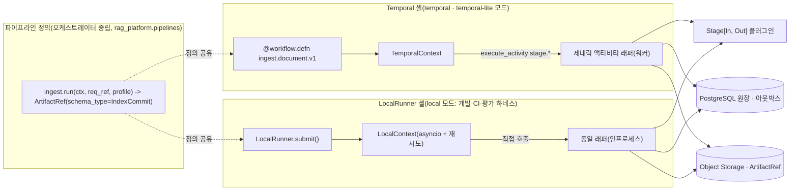
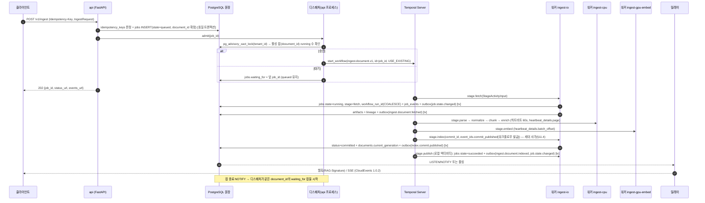
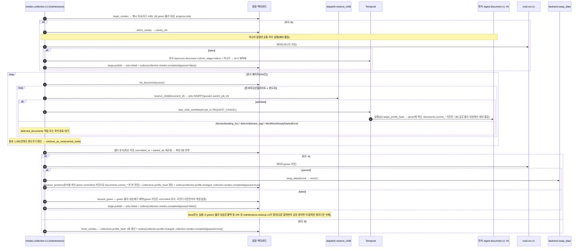
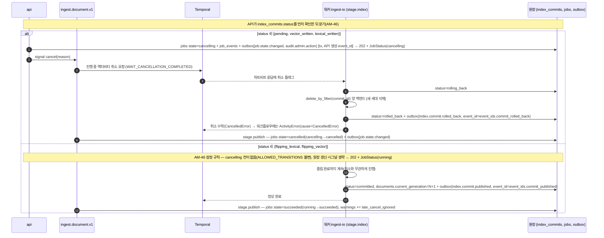

# 오케스트레이션과 워크플로우

## 목적

수집·재처리·삭제·ACL 갱신·재색인·평가·유지보수 잡을 내구성 워크플로우(durable workflow) 엔진 Temporal 위에서 어떻게 정의·실행·관측·복구하는지 확정한다. 설계 바이블 §11(오케스트레이션 정본)을 그대로 따르되, 바이블이 개별 문서로 위임한 다음 항목을 이 문서가 결정한다.

- 워크플로우 타입별 입력·단계·시그널·종료 조건·보상(사가) 절차와 히스토리 한계 대응(자식 워크플로우 팬아웃, `continue_as_new`).
- 액티비티 설계 원칙: 멱등성, 하트비트·재개(`Resumable`), 타임아웃, 오류 분류별 재시도 정책, 태스크 큐 분리와 워커 배치.
- 워크플로우 결정론 규칙과 코드 버전 관리(`workflow.patched`, 타입 이름 증분, `Replayer` CI).
- Temporal 실행 상태 ↔ PostgreSQL `jobs` 원장 ↔ 트랜잭셔널 아웃박스의 동기화 규칙(누가, 어느 트랜잭션에서, 어떤 ID로 기록하는가).
- 인프로세스 러너(`LocalRunner`)가 같은 파이프라인 정의를 비내구로 실행하는 어댑터 패턴과 그 한계.
- 백프레셔·동시성 한계·테넌트 공정성, 그리고 바이블 미해결 이슈 16(디스패처의 문서 단위 직렬화와 대량 재색인의 충돌, `waiting_for` 체인 상한·기아 방지)의 해소.
- 처리량 추정과 워커 사이징 가이드(가정 명시, 초안 목표).

## 범위

- 포함: 수집 측(비동기 잡) 오케스트레이션 전체, 스케줄 잡, 아웃박스 릴레이 실행기, 디스패처(admission), 개발·CI용 `LocalRunner`.
- 제외: 검색 경로(`plan → render`)는 오케스트레이터를 거치지 않는 인프로세스 실행이며(D-17, 바이블 §4.3·§11.1) 이 문서의 대상이 아니다. 스테이지 내부 알고리즘(04-pipelines), 계약 스키마 전문(03-contracts), 배포 매니페스트(08-deployment-architecture, 09-operations), 세대 사가의 백엔드 호출 세부(04-pipelines/19)는 각 문서가 소유한다.
- 정본 관계: 워크플로우 타입명(`{domain}.{entity}.v{n}`), 액티비티명(`stage.{stage_name}`), 태스크 큐명, `StagePolicy` 값, 잡 상태·이벤트·오류 코드 철자는 바이블 §4.4·§5.7·§6.7·§11이 정본이다. 이 문서가 새로 도입하는 내부 타입·액티비티 이름은 "내부(계약 아님)"로 표시하고 `## 미해결 이슈`에 등재 제안을 남긴다.
- 외부 라이브러리 사실(Temporal Server 1.32, `temporalio` 1.33, KEDA `temporal` 스케일러 등)은 [오케스트레이션·메시징·API 프레임워크](../07-tech-landscape/08-orchestration-messaging-and-api-frameworks.md)(확인일 2026-09-18~22)를 근거로 하며, 그 문서에 없는 사실은 "확인 필요(as of 2026-09)"로 표기한다.

---

## 1. 실행 모델 개요

### 1.1 두 실행기, 하나의 정의

**결정:** 파이프라인 정의는 `PipelineContext` 프로토콜(`run`, `emit`, `now`, `sleep`)에만 의존하는 순수 비동기 함수이고, Temporal 셸(`TemporalContext`)과 비내구 `LocalRunner` 셸(`LocalContext`)이 각자 컨텍스트를 주입해 같은 정의를 실행한다(바이블 §11.1, D-17, [ADR-0003](../06-adr/0003-orchestrator-neutral-pipeline-and-non-durable-local-runner.md)). `pipelines`·`retrieval`·`render` 패키지는 `temporalio`·`fastapi`·`ledger`를 임포트하지 않는다(import-linter, 바이블 §12).



| 모드(바이블 §11.1) | 실행기 | 내구성 | 잡 원장 | `workflow_run_id` |
|--------------------|--------|--------|---------|--------------------|
| `temporal` | Temporal Server 1.32 + `temporalio` 1.33, `pydantic_data_converter`, `TracingInterceptor` | 내구(재시도·하트비트·사가·시그널·스케줄) | PostgreSQL `jobs`(정본) | Temporal run id |
| `temporal-lite` | Temporal 단일 바이너리 + PostgreSQL(`start-dev` 아님) | 내구 | 동일 | 동일 |
| `local` | `LocalRunner`(asyncio) | **비내구**(크래시 시 `failed`, 재시도는 클라이언트) | 동일(원장은 항상 기록) | `null` |

세 모드 모두에서 잡 상태의 조회 정본은 PostgreSQL `jobs`이고 Temporal은 실행 엔진이다(D-08). 원장 쓰기는 **액티비티(또는 로컬 액티비티) 안에서만** 일어나며 워크플로우 코드는 I/O를 하지 않는다(§6).

파이프라인 정의의 반환 타입은 바이블 §11.1이 `-> IndexCommit`으로 적지만 이 문서는 `ArtifactRef(schema_type=IndexCommit)`를 쓴다. 이유는 페이로드 크기(`IndexCommit` 인라인 한계 16KB는 Temporal 2MB 한계와 무관)가 아니라 **의존 방향**이다: `PipelineContext`는 4멤버(`run`, `emit`, `now`, `sleep`)뿐이고 `run`이 돌려주는 것은 `ArtifactRef`이므로, 정의가 `IndexCommit` 인스턴스를 돌려주려면 산출물을 로드하는 I/O가 필요한데 `pipelines` 패키지는 `storage`·`ledger`를 임포트할 수 없다(바이블 §12). 원장 `index_commits`가 커밋의 정본이므로 참조 반환으로 충분하다. 바이블 §11.1 시그니처 개정(patch)은 미해결 이슈 13에 등재한다.

### 1.2 구성 요소와 책임

| 구성 요소 | 위치 | 책임 | 소유하지 않는 것 |
|-----------|------|------|------------------|
| API(`api`) | api 프로세스 | `Idempotency-Key` 판정 + `jobs INSERT`(동일 트랜잭션) → 디스패처 호출 → `202 {job_id, status_url, events_url}` | 워크플로우 내부 상태 |
| 디스패처(dispatcher) | api 프로세스(`orchestration/dispatcher.py`) | 문서 단위 직렬화(`waiting_for`), `runtime.tenant_concurrent_jobs_max`, 우선순위 순서, `deadline_at` 만료 취소, 미시작 워크플로우 조정(reconcile) | 재시도·타임아웃(Temporal) |
| 워크플로우(`orchestration/temporal/workflows`) | Temporal 워커(모든 큐가 워크플로우 태스크도 처리) | 스테이지 순서, ID 1회 발급(`commit_id`·`event_id`), 시그널·업데이트·쿼리, 자식 팬아웃, `continue_as_new` | 원장 쓰기, 백엔드 호출 |
| 제네릭 액티비티 래퍼(`orchestration/temporal/activities`) | 큐별 워커 | `ArtifactRef` 로드 → `stage_key` 캐시 조회(`fetch`·`index` 제외; `reprocess from_stage` 이상은 `force`로 미조회, §3.2) → `Stage.run` → 콘텐츠 주소화 저장 → 원장·계보·아웃박스 동일 트랜잭션 → `ArtifactRef` 반환; 하트비트·`Resumable`; Temporal 바인딩(`make_activity`)에서만 `StageError → ApplicationError` 변환 | 재시도 정책 결정(정책은 `StagePolicy`, 적용은 Temporal) |
| 릴레이(`relay`) | 별도 프로세스(`rag serve relay`; 바이블 §2.3) — `standard` 이상은 릴레이 전용 태스크 큐 `relay`(제안, §6.4)만 폴링하는 Temporal 워커, `lite`는 Procrastinate 워커 | 아웃박스 → 웹훅·SSE(CloudEvents 1.0.2), 순수 코어 3함수, 발행 후 `NOTIFY outbox_published` | 브로커 운영(v1 없음), api 프로세스 내부 채널 |
| 스케줄(`orchestration/temporal/schedules`) | Temporal Schedule | 정합성 검사·정리·야간 평가·티어 승격 트리거(`ScheduleOverlapPolicy.SKIP`) | 디스패처 조정 틱(api 프로세스 타이머) |

---

## 2. 워크플로우 카탈로그

바이블 §11.2의 10개 타입을 그대로 쓴다. 일반적으로 쓰이는 역할 명칭(IngestBatch·IngestDocument·ReindexCollection·DeleteDocument·EvaluationRun·ScheduledMaintenance)과 정식 타입의 대응은 다음과 같다.

| 정식 타입(§11.2) | 역할 | `JobKind`(§5.7) | 트리거 | 태스크 큐 | 히스토리 한계 대응 |
|------------------|------|-----------------|--------|-----------|--------------------|
| `ingest.document.v1` | IngestDocument | `ingest_document` | `POST /v1/ingest`, `/v1/ingest/batch`, 재색인 자식 | 스테이지별(§4.4) | 단일 문서: 액티비티 8개, 이벤트 약 40개 |
| `reprocess.document.v1` | IngestDocument(부분) | `reprocess_document` | `POST /v1/documents/{document_id}/reprocess` | 동일 | 동일 |
| `delete.document.v1` | DeleteDocument(사가) | `delete_document` | `DELETE /v1/documents/{document_id}` | `ingest-io` | 소형 |
| `acl.update.v1` | — | `acl_update` | `PATCH /v1/documents/{document_id}/acl` | `ingest-io` | 소형 |
| `reindex.collection.v1` | ReindexCollection | `reindex_collection` | `POST /v1/collections/{collection_id}/reindex`, 프로파일 변경 | `maintenance`(부모) | 자식 슬라이딩 윈도우 50, 1,000개마다 `continue_as_new` |
| `build.graph.v1` | — | `build_graph` | 컬렉션 정책(`graph` 플러그인) | `ingest-llm` | 플러그인 소유(O-03) |
| `eval.run.v1` | EvaluationRun | `evaluate` | `POST /v1/eval/runs`, 야간 스케줄 | `maintenance` | 질의 배치 액티비티 + 하트비트 |
| `maintenance.consistency.v1` | ScheduledMaintenance | `consistency_check` | 스케줄(§7.2), `POST /v1/collections/{collection_id}/consistency-check`(1.3.0, AM-39) | `maintenance` | 문서 페이지마다 `continue_as_new` |
| `maintenance.cleanup.v1` | ScheduledMaintenance | — (테넌트 무관 시스템 잡) | 스케줄(1h) | `maintenance` | 테넌트·페이지 단위 `continue_as_new`(§2.7) |
| `tier.promotion.v1` | — | `tier_promotion` | `TieringPolicy` 임계 초과 | `maintenance` | blue/green |
| `collection.delete.v1` | — | `delete_collection`(1.3.0) | `DELETE /v1/collections/{collection_id}` | `maintenance`(부모) | 부모가 `collections.deleted_at` 기록 후 자식 `delete.document.v1` 팬아웃(§2.5 방식), 새 이벤트 없이 기존 이벤트 재사용(바이블 §11.2, AM-37) |

**배치 수집(`POST /v1/ingest/batch`)에 대한 결정:** 별도 `IngestBatch` 워크플로우 타입을 두지 않는다. API가 최대 100건을 건별 `jobs` 행과 건별 `job_id`로 접수하고(바이블 §14), 팬아웃·동시성 제한은 디스패처(§8)가 `tenant_concurrent_jobs_max`로 강제한다. 배치 단위 상태 조회 수단은 바이블 §14 `GET /v1/jobs` 필터(`collection_id`, `state`, `kind`, 커서)에 없으므로, 배치 전체에 `request_id` 1개를 발급해 각 건의 `jobs.request_id`에 기록하고 `GET /v1/jobs`에 `request_id` 필터를 추가하는 안을 제안한다(바이블 §5.4 `IngestRequest.request_id`는 "요청당 서버 발급"이므로 배치 요청 1건 = `request_id` 1개로 해석; 05-api/02·바이블 §14 표 갱신 필요, 미해결 이슈 2). 배치 단위 취소·집계가 요구되면 `ingest.batch.v1` 부모 워크플로우를 §11.2에 등재하는 ADR을 발의한다(미해결 이슈 2).

### 2.1 `ingest.document.v1`

| 항목 | 내용 |
|------|------|
| 워크플로우 ID | `job_id`(ULID). **최상위 시작 경로**(API·디스패처·조정 틱의 `start_workflow`)는 `id_conflict_policy=USE_EXISTING`이므로 중복 시작해도 실행은 하나다. 자식 시작(`start_child_workflow`)에는 이 정책이 없으므로 재색인 자식은 §2.5·§6.3 규칙으로 최상위 경로와 분리한다 |
| 입력(내부 타입 `IngestWorkflowInput`, 계약 아님) | `job{job_id, tenant_id, collection_id, document_id, profile_hash, priority}`, `request_ref: ArtifactRef(schema_type=IngestRequest)`, `profile: PipelineProfile`(내부; `Profile`에서 `profile_hash`·스테이지 순서(`recount` 포함 여부)·스테이지별 `StagePolicy`만 투영한 것, 약 9 × 2KB — 전체 `Profile`(≤ 256KB)을 히스토리에 넣지 않기 위함. 플러그인 설정은 액티비티가 `job.profile_hash`로 해소), `from_stage`(기본 `fetch`; `reprocess`는 그 이상 스테이지를 `StageActivityInput.force=true`로 실행, §2.2·§3.2), `reindex{parent_job_id, target_profile_hash, mode: blue_green \| rolling_canary} \| null`(모드 A 자식의 `stage.index`는 `documents.current_*`를 전진시키지 않음, §2.5) |
| 단계 | `stage.fetch → stage.parse → stage.normalize → stage.chunk → [stage.recount] → stage.enrich → stage.embed → stage.index → stage.publish`(`detect`는 `parse` 내부, `recount`는 프로파일 `ingest.recount`가 있을 때만 실행되는 조건부 스테이지이며 실질적으로 `reprocess`에서 쓰인다) |
| 결과(내부 `IngestWorkflowResult`) | `{state: enum(JobState) 중 succeeded \| partial \| failed \| cancelled, commit_ref: ArtifactRef(schema_type=IndexCommit) \| null, last_error: StageError \| null, warnings: array<Warning>}` |
| ID 발급 | `commit_id`와 스테이지별 `event_id`(`event_ids{state_changed, stage_event, commit_published?, commit_rolled_back?}`; 뒤의 둘은 `index` 스테이지에만)는 워크플로우가 `workflow.now()` + `workflow.random()`으로 ULID를 1회 생성해 액티비티 인자로 전달한다. 재시도·재생에도 불변이므로 아웃박스 `INSERT … ON CONFLICT (event_id) DO NOTHING`으로 정확히 한 번 기록된다(바이블 §11.2·§11.4 (6)) |
| 시그널·업데이트·쿼리 | `cancel(reason)`, `set_priority(priority)`(검증기 0..9), `get_status()`(§5) |
| 실행 시간 상한(초안 목표) | `execution_timeout` 24h. 산식: 1회 시도 기준 `start_to_close` 합(바이블 §4.4: fetch 5m + parse(OCR) 60m + normalize 5m + chunk 5m + enrich(LLM) 30m + embed 20m + index 10m + publish 10s) ≈ 2h15m; 재시도 상한 포함 최악은 Σ(`max_attempts` × `start_to_close`) = fetch 25m + parse 3h + normalize 15m + chunk 15m + enrich 2h30m + embed 1h40m + index 50m ≈ 8h55m에 백오프 합(최대 간격 5m × 약 20회 ≈ 1h40m)을 더해 약 10.5h이며, 나머지는 큐 대기 여유다. 초과 시 `failed`이며 운영 알림 대상. `last_error.code`로 쓸 카탈로그 코드가 없어 배정은 미해결 이슈 6 |
| 종료 | `succeeded`(커밋 `committed`), `partial`(LLM 예산 소진·페이지 일부 실패, 비LLM 결과는 커밋), `failed`(비재시도·소진), `cancelled` |



### 2.2 `reprocess.document.v1`

같은 파이프라인 정의를 `from_stage ∈ {parse, normalize, chunk, recount, enrich, embed, index}`부터 실행한다(바이블 §14). 첫 액티비티 `ledger.resolve_lineage`(내부)가 원장 `lineage`·`artifacts`에서 `from_stage` 직전 산출물의 `ArtifactRef`를 찾아 시작 입력으로 삼는다. 그 산출물이 보존 정책으로 회수되어 없으면 존재하는 가장 가까운 상류 산출물까지 물러나 시작 스테이지를 낮춘다(03-data-flow §4.2). `from_stage` 이상의 스테이지는 `StageActivityInput.force=true`로 실행되어 `stage_key` 캐시를 조회하지 않고 강제 재실행한다(03-data-flow §4.1 "`from_stage`는 시작 하한"); `index`는 어차피 캐시가 없어 항상 새 세대를 만든다(§3.2). `stage_key`가 잡 스코프(`tenant_id/collection_id/document_id`)를 포함하므로 같은 문서의 산출물만 `cache_hit`한다([ADR-0037](../06-adr/0037-artifact-cache-scope-and-stage-key-composition.md)). `from_stage ∈ {enrich, embed, index}`처럼 `chunk_id` 집합이 같은 재색인도 새 `index_generation`으로 적재되고 플립 전까지 이전 세대가 검색된다(바이블 §11.4, [ADR-0026](../06-adr/0026-index-commit-generation-saga-and-ledger.md)). `recount`는 이 워크플로우에서만 실행된다(임베더 교체로 `token_counts`에 새 `tokenizer_id`가 없을 때, [ADR-0019](../06-adr/0019-chunk-size-tokenizer-defaults-and-recount-stage.md)). 문서 단위 직렬화는 `ingest`와 동일하다.

### 2.3 `delete.document.v1` — 삭제 사가

**결정:** 삭제는 되돌리는(undo) 사가가 아니라 **전진 복구(forward recovery)** 사가다. 삭제 연산은 `document_id` 필터 기준으로 멱등하므로 보상은 "완료까지 재시도"이고, 재시도 소진 시 원장에 실패를 남겨 정합성 검사 잡이 재구동한다. 중간 상태 동안의 노출은 회수 힌트가 막는다(E9).

| 순서 | 액티비티 | 큐 | 내용 | 실패 시 |
|------|----------|----|------|---------|
| 1 | `ledger.begin_delete`(내부) | `ingest-io` | (a) **툼스톤 단락(短絡)**: `documents.current_commit_id`가 `kind=delete`·`status=committed` 커밋을 가리키면 아무것도 쓰지 않고 `already_deleted`를 반환 → 워크플로우는 2단계를 건너뛰고 3단계에서 `succeeded`로 종료(03-data-flow §7.4 멱등 규칙). (b) 그 외: Valkey `aclrev:{tenant_id}:{document_id} = {deleted: true, …}` 삭제 힌트 기록(TTL 2 × `acl_propagation_slo`; 백엔드 삭제 **전**) → 원장 트랜잭션에서 `documents … FOR UPDATE` → 다음 `index_generation` 할당(그 문서의 `max(index_commits.index_generation) + 1`, §2.5·§3.2) → `index_commits(commit_id[워크플로우 발급], kind=delete, status=pending, record_count=0, index_generation=N+1, previous_commit_id=documents.current_commit_id)` INSERT(바이블 §5.4 `IndexCommit` 필수 필드, §11.4 (6)) | 재시도(멱등: `commit_id` 충돌 시 기존 행·세대 재사용) |
| 2 | `stage.index`(모드 `delete`) | `ingest-io` | Qdrant `delete_by_filter(tenant_id, document_id)`(전 세대, `index_generation` 조건 없음) → `status=vector_written` → OpenSearch `delete_by_query(tenant_id, document_id, routing=tenant_id, conflicts=proceed, refresh)` → `status=lexical_written` → **양 백엔드 `count(document_id) == 0` 검증**(0이 아니면 `index.backend_unavailable`로 재시도) → Valkey **`DEL ptxt:{tenant_id}:{chunk_set_blake3}`**(현재 커밋과 롤백 창 안 superseded 커밋의 `artifact_refs.chunk_set.blake3` 전부; 부모 본문 캐시 소거, FR-SEC-10·NFR §9 "질의·결과 캐시 물리 소거 ≤ 5 min", 03-data-flow §7.1 규칙 5·§7.2, 바이블 §13.4 `ptxt:`; 오브젝트 참조 해제와 별개) → 원장 트랜잭션에서 `status=committed, committed_at`, `documents.current_commit_id=commit_id`, `documents.current_generation=N+1`, 부모 번들 `derived/parent_texts/{chunk_set_blake3}.json` 참조 해제, `outbox(index.commit.published, event_id=event_ids.commit_published)` | `index.backend_unavailable` 재시도 5회; 매 시도마다 `aclrev` 힌트 TTL 갱신; 소진 시 `status=failed` + `index.consistency.mismatch`(보상 없음 — 삭제는 되돌릴 수 없으므로 재시도·정합성 검사로만 수렴) |
| 3 | `stage.publish`(로컬) | — | `ingest.document.deleted{commit_id, index_generation, backend_results[].deleted}`, `job.state.changed(succeeded)`; `purge_mode=immediate`(컬렉션 정책 제안, 03-data-flow 미해결 이슈 6)면 3단계 앞에 `maintenance.gc_document`(내부; §2.7의 참조 GC를 이 문서 뿌리에 한정해 즉시 수행) 액티비티를 끼운다 | 10회 재시도 |

플립(`is_current`)은 없으며 `CommitStatus` 경로는 `pending → vector_written → lexical_written → committed`다(바이블 §11.2, 03-data-flow §7.1 규칙 2). 산출물·원본 오브젝트와 `documents`·`artifacts`·`lineage` 행은 이 워크플로우가 지우지 않고 `maintenance.cleanup.v1`의 참조 GC(§2.7)가 24h 이내에 회수한다(03-data-flow §5.3·§7.2; `index_commits`·`job_events`는 본문이 없어 보존). 테넌트 단위 완전 삭제(purge)만 별도 잡 제안으로 남긴다(미해결 이슈 8). `aclrev` 힌트가 2단계 완료 전에 만료되면 결과가 재노출될 수 있으므로, 2단계의 재시도마다 힌트를 다시 쓰고 `maintenance.consistency.v1`도 미완료 삭제 커밋(`kind=delete AND status NOT IN (committed, failed)`)을 발견하면 힌트를 재기록한 뒤 삭제를 재구동한다.

### 2.4 `acl.update.v1`

`ledger.update_acl`(내부; `documents.acl`·`acl_hash` 갱신 + `aclrev:` 회수 힌트 기록, PG 커밋 후 Valkey 기록 순서) → `stage.index`(모드 `update_acl`; 양 백엔드 payload `acl_*`·`acl_hash`만 갱신, 재임베딩·`doc_version` 변경 없음) → `stage.publish`(`acl.document.updated`). 전파 시간은 `rag_acl_propagation_seconds`로 계측하고 `runtime.acl_propagation_slo`(standard 5m) 초과 시 알림(E11). Valkey 불가 시 힌트 기록 실패는 재시도 대상이며 백엔드 갱신을 먼저 진행하지 않는다(힌트가 먼저여야 E9 재검증이 유효).

**메타데이터 갱신·백필 A(payload 갱신 경로)에 대한 결정:** `PATCH /v1/documents/{document_id}/metadata`(바이블 §14)와 03-data-flow §9.1 백필 A(메타 파생 payload 필드 추가)는 세대를 만들지 않는 payload 갱신이므로 `acl.update.v1`과 **같은 액티비티 골격**을 쓴다: `ledger.update_metadata`(내부; `documents.metadata`·`metadata_hash` 갱신, 회수 힌트 없음) → `stage.index`(모드 `update_payload`; 바이블 §5.4 `IndexRecord` 원천이 `SRC(metadata)`인 필드만) → `stage.publish`. 다만 바이블 §11.2에 해당 워크플로우 타입이, §5.7 `JobKind`에 해당 값이 없으므로 `metadata.update.v1` / `metadata_update` 등재를 §11.2·§5.7 patch로 제안하고(미해결 이슈 14), 등재 전까지는 이 경로를 `acl.update.v1`의 입력 인자 `payload_fields`(내부)로 구분해 실행한다. 컬렉션 단위 백필 A는 `reindex.collection.v1`이 아니라 `maintenance.consistency.v1`과 같은 페이지 순회로 문서별 payload 갱신 잡을 팬아웃한다(세대·게이트 불필요).

### 2.5 `reindex.collection.v1` — 부모·자식 팬아웃

**결정:** 컬렉션 재색인은 부모 워크플로우가 문서 ID 페이지를 조회해 자식 `ingest.document.v1`을 슬라이딩 윈도우(상한 50)로 실행하고, 자식 1,000개 완료마다 `continue_as_new`한다(바이블 §11.2). 전환 방식은 두 모드다(03-data-flow §9.1~9.2). **모드 A(물리 blue/green)**: 새 프로파일의 `embedding_profile_hash` 또는 `lexical_profile_hash`가 바뀌면 물리 이름(`rag_vec_{embedding_profile_hash[:12]}`, `rag_lex_{lexical_profile_hash[:12]}`, 바이블 §13.4)이 달라지므로 green 물리 대상을 채운 뒤 하네스 게이트를 통과하면 alias를 **렉시컬 → 벡터** 순서로 교체한다(바이블 §11.4 (5)). **모드 B(카나리 + 롤링 세대 플립)**: 두 해시가 모두 같은 프로파일 변경(청커·보강기·파서 지문, 백필 B)은 물리 이름이 같아 green을 만들 수 없으므로 카나리 표본만 먼저 세대 플립 → 게이트 → 나머지를 롤링 플립한다. 물리 이름에 `profile_hash`를 합성해 모드 B를 없애는 대안은 03-data-flow 미해결 이슈 11을 따라 미해결로 남긴다(미해결 이슈 15). 자식 승인은 API와 동일한 디스패처 함수를 거치며(§8.2), 자식은 항상 API 발원 잡에 양보한다.

공통 단계(두 모드):

| 단계 | 액티비티/구성 | 내용 |
|------|---------------|------|
| 0 준비·분기 | `ledger.begin_reindex`(내부, `maintenance`) | 대상 프로파일 해소(`profile_hash'`, `embedding_profile_hash'`, `lexical_profile_hash'`; `POST /v1/profiles/validate` 규칙) → 현재 `CollectionSpec`과 비교해 **두 해시 중 하나라도 다르면 모드 A, 모두 같으면 모드 B**로 판정하고 `carried_state.mode`에 기록. 모드 A는 green 물리 대상 생성(**현재 blue와 물리 이름이 같으면 모드 A가 아니므로 재사용하지 않는다**; 다른 컬렉션이 이미 만든 같은 이름의 공유 물리 컬렉션은 그대로 쓴다) + `collections.backends`에 green 항목 기록. 두 모드 공통으로 `jobs.progress{total=document_count, unit=document}`, `started_at` 기록 |
| 1 페이지 | `ledger.list_documents(collection_id, cursor, page_size=200)` | 문서 ID·`current_commit_id`·최신 `committed` 커밋의 `profile_hash` 페이지 조회(ULID 순 커서). 최신 `committed` 커밋의 `profile_hash`가 이미 `profile_hash'`인 문서는 건너뛴다(부모 재시도·델타 패스에서 자식을 다시 만들지 않기 위함 — `index`는 캐시가 없어 자식이 실행되면 새 세대가 생긴다, §3.2). 모드 B의 카나리 단계는 표본 집합만 순회 |
| 2 승인 | `dispatch.reserve_child(document_id, parent_job_id)` | 디스패처 승인 함수(§8.2)를 액티비티로 호출. `admitted`면 자식 `jobs` 행을 `state=queued, parent_job_id=parent_job_id`(제안 컬럼, §6.3)로 INSERT하고 `admitted{job_id}`를 반환. 그 외 `blocked{waiting_for}` / `deferred{reason=tenant_cap}` |
| 3 팬아웃 | `workflow.start_child_workflow(ingest.document.v1, id=job_id, parent_close_policy=REQUEST_CANCEL)` | `admitted`만 시작. 인플라이트 ≤ `min(50, floor(tenant_concurrent_jobs_max × reindex_max_share))`; `blocked`는 `deferred_documents`에 적립하고 페이지 끝에서 재시도(최대 3회), `deferred{tenant_cap}`은 자식 하나가 끝날 때까지 대기. `WorkflowAlreadyStartedError`(같은 `job_id`의 실행이 이미 존재 — 조정 틱 경합·부모 재시도)는 자식 결과를 기다릴 수 없으므로 `deferred_documents`에 적립하고 `ledger.get_job(job_id)`(내부) 폴링(30s)으로 종료를 확인한다 |
| 4 회전 | `continue_as_new(carried_state)` | 완료 자식 1,000개마다. 회전 전에 윈도우를 **드레인**(인플라이트 자식 완료 대기)하여 자식 핸들을 넘기지 않는다(단순성 우선; 1,000건당 약 1 윈도우 분량의 처리량 손실은 초안 허용) |
| 5 델타(따라잡기) | 1~4 반복 | 대상: 문서의 최신 `index_commits.committed_at > started_at`이고 그 커밋의 `profile_hash ≠ profile_hash'`인 문서(신규 수집·갱신·삭제; `documents.updated_at` 컬럼은 바이블 §13.1에 없으므로 커밋 시각으로 판정). 최대 3회 또는 델타 0건까지(종료 조건·마지막 회차 컬렉션 잠금은 03-data-flow 미해결 이슈 12·이 문서 미해결 이슈 10) |

모드 A 마무리(공통 단계 뒤, A-6 게이트 → A-7 교체 → A-8 정리): 운영 절차·검증층·롤백 규칙의 정본은 [갱신·삭제·재색인](../04-pipelines/19-update-delete-and-reindexing.md) §5.2~§5.3이다. 이 문서가 소유하는 액티비티 이름만 적으면 — A-6: 자식 `eval.run.v1` 실패 시 `ledger.discard_green`(green 커밋은 `committed` 유지, `rolled_back` 미발행); A-7: `backend.swap_alias`(렉시컬 → 벡터) → `ledger.advance_pointers`(문서별 최신 green `committed` 커밋으로 `documents.current_*` 한 번 전진, 아래 본문의 포인터 결정); A-8: `maintenance.cleanup.v1`이 롤백 창(24h) 뒤 blue(실패 시 green)를 정리(공유 물리 대상은 이 컬렉션 레코드만 삭제).

모드 B 마무리(공통 단계를 두 번 수행):

| 단계 | 액티비티/구성 | 내용 |
|------|---------------|------|
| B-1 카나리 선정 | `ledger.select_canary`(내부) | 표본 = 프로파일 `eval.datasets[]`의 `corpus_collection_id`가 이 컬렉션인 데이터셋의 문서 전부 + 무작위 1%(최소 50개, 초안). `carried_state.canary_ids`에 기록 |
| B-2 카나리 실행 | 공통 단계 1~4를 표본 집합만으로 | 자식이 `target_profile_hash`로 새 세대를 적재·플립한다(같은 물리 대상 안에서 `is_current` 플립; 바이블 §11.4). 이 시점부터 컬렉션은 혼합 프로파일 상태(카나리 새 지문, 나머지 옛 지문)다 |
| B-3 게이트 | 자식 `eval.run.v1`(`index_commit_ids` = 카나리 커밋) | 통과면 B-4. **실패면** 카나리 문서마다 자식 `reprocess.document.v1(from_stage=index)`으로 superseded 커밋의 `artifact_refs.embedded`를 세대 N+2로 재적재(커밋 지정 인자는 03-data-flow 미해결 이슈 14) → `collection.reindex.completed{gate_result.passed=false}` + 부모 `failed`. `CollectionSpec.profile_hash`는 바뀌지 않았으므로 되돌릴 것이 없다 |
| B-4 롤링 | 공통 단계 1~5를 나머지 문서로 | 윈도우 50, 1,000개마다 `continue_as_new`, 델타 패스 포함 |
| B-5 완료 | `ledger.finish_reindex`(내부) | `CollectionSpec.profile_hash`를 **1회** 갱신 → `collection.profile.changed` + `collection.reindex.completed{gate_result.passed=true}`. 롤링 중 `IndexCommit.profile_hash`가 문서마다 다를 수 있음은 허용한다(03-data-flow §9.1 결정 "한 물리 컬렉션 안에 두 `profile_hash` 커밋 공존 방식은 채택하지 않는다"의 예외 — 그 문서 미해결 11 (b)가 요구하는 `CollectionSpec` 단일 바인딩의 예외이며, 이 문서 미해결 이슈 15의 잠정 결정). 물리 대상 삭제는 없다 |



`continue_as_new`에 넘기는 상태(내부 `ReindexCarriedState`)는 `collection_id`·`parent_job_id`·`target_profile_hash`·`mode`·`phase`·`cursor`·`window_max`·`delta_pass`·`canary_ids`·`counters{admitted, succeeded, partial, failed, deferred}`·`deferred_documents`·`started_at` 필드를 담는다. `mode`는 `blue_green`(A) 또는 `rolling_canary`(B), `phase`는 `canary | children | delta | gate | swap | finish`(내부 값, 계약 아님)다. 자식은 `IngestWorkflowInput.reindex{parent_job_id, target_profile_hash, mode}`로 색인한다(모드 A는 green 물리 대상, 모드 B는 같은 물리 대상의 새 세대). 자식의 `fetch`는 검증자(`etag`\|`last_modified`)가 있으면 조건부 GET으로 원본 바이트를 재사용하고, 지문이 바뀌지 않은 스테이지는 `stage_key` 캐시에 적중하며 `index`만 항상 실행되므로(§3.2) 재색인 비용은 "실제로 바뀐 스테이지부터 + 적재"로 자연히 수렴한다(바이블 §4.1·§4.2).

**모드 A의 원장 포인터에 대한 결정(03-data-flow 미해결 이슈 20에 대한 이 문서의 답):** 03-data-flow §9.2 (3)의 제안을 채택한다. `reindex.mode = blue_green`인 자식의 `stage.index`는 세대 사가를 정상 완주해 커밋을 `committed`로 남기되(`index.commit.published` 발행, `IndexCommit.profile_hash = profile_hash'`, `backend_results[].physical_name` = green, green 안에서 `is_current=true`) **`documents.current_commit_id`·`current_generation`을 전진시키지 않는다**. 포인터는 A-7에서 `ledger.advance_pointers`가 alias 교체 직후 문서별 최신 green `committed` 커밋으로 한 번 전진시킨다. 따라서 채움 중 조회 API는 계속 blue 커밋을 활성으로 보고하고(03-data-flow §1.1 파생 규칙), 게이트 실패·취소 시 되돌릴 포인터가 없다. 이를 위해 `index_generation` 할당은 `documents` 행 잠금 아래 **그 문서의 `max(index_commits.index_generation) + 1`**(전진하지 않은 green 세대 포함)로 하며 `current_generation + 1`이 아니다 — blue에서 정상 수집(N+2)이 일어난 문서는 델타 패스가 green에 N+3으로 재적재한다(03-data-flow §9.2 (4)). 폐기된 green 세대(A-6 게이트 실패)·롤백된 세대(사가 보상)도 번호를 재사용하지 않는다(별도 `last_generation` 컬럼 없음, 바이블 §11.4 (6), AM-18). 바이블 §11.4 (6)의 안전망(`documents.current_generation ≥ N+1`이면 `index.generation_conflict`)은 그대로 유효하다. 이 규칙은 바이블 §11.4 사가("`committed` 시 `documents.current_generation=N+1`")의 예외이므로 [ADR-0026](../06-adr/0026-index-commit-generation-saga-and-ledger.md) 개정 항목으로 미해결 이슈 18에 등재한다. 모드 B(`rolling_canary`)와 일반 수집은 바이블 §11.4 그대로 `committed` 트랜잭션에서 포인터를 전진시킨다.

부모 취소(`cancel`)는 인플라이트 자식에 취소를 전파(`REQUEST_CANCEL`)하고 완료를 기다린 뒤, 모드 A는 A-6 실패 경로와 같이 `ledger.discard_green`으로 green 물리 대상을 폐기 예약하고(포인터 미전진이라 복원 없음) `cancelled`로 종료하며, 모드 B는 이미 플립된 문서를 그대로 둔 채(혼합 상태 허용) `cancelled`로 종료한다. 부모 재시도(`POST /v1/jobs/{job_id}/retry`)는 새 run이 `ledger.list_documents`를 다시 순회하되 최신 `committed` 커밋의 `profile_hash`가 이미 `profile_hash'`인 문서는 단계 1의 필터로 제외되어 자식을 만들지 않는다(`index`는 캐시가 없어 자식이 실행되면 새 세대가 생기므로 부모가 걸러야 한다). 부모가 종료(실패·취소)된 뒤 `queued`로 남은 자식 행(`parent_job_id` 설정, `workflow_run_id IS NULL`)은 조정 틱(§6.3)이 `cancelled`로 접는다.

### 2.6 `eval.run.v1`

`eval.prepare`(내부; `EvalDataset` 참조 로드, `EvalRun` 행 `running`) → `eval.execute`(내부; 하네스가 `LocalContext`로 `pipelines.query.run`을 워커 프로세스 안에서 실행, 질의 배치 단위 하트비트 `heartbeat_details.query_offset`, `start_to_close` 6h 초안) → `eval.report`(내부; ranx/ir_measures 집계, Holm 보정, `EvalReport` 저장, `gate_result`) → `stage.publish`(`eval.run.completed`). 야간 스케줄은 `client.create_schedule` + `ScheduleOverlapPolicy.SKIP`. 하네스는 프로덕션과 동일한 인프로세스 스테이지를 실행한다(D-12, [ADR-0023](../06-adr/0023-evaluation-qrels-answer-spans-and-linear-ndcg.md)).

### 2.7 `maintenance.consistency.v1` · `maintenance.cleanup.v1` · `tier.promotion.v1`

| 타입 | 스케줄(§7.2 standard) | 액티비티 흐름 | 불일치·결과 |
|------|------------------------|---------------|-------------|
| `maintenance.consistency.v1` | 시간 1회 샘플(문서 1% 초안) + 일 1회 전체 | `ledger.list_documents` 페이지 → `backend.count_records(document_id, physical_name, index_generation)`(내부)로 **커밋의 `backend_results[].physical_name` 기준 물리 대상별** 대조(alias 기준 금지 — 재색인 채움 중 blue의 레코드 수와 green 커밋의 `record_count`를 비교하면 컬렉션 전체에 거짓 불일치가 난다, 03-data-flow §9.2 (4)): blue는 `current_commit_id` 커밋의 세대, 재색인 중 green은 문서별 최신 green `committed` 커밋의 세대(§2.5; 포인터 미전진)를 기준으로 양 백엔드 `is_current=true` 카운트·`content_hash` 집합을 `record_count`와 대조 → 문서 페이지마다 `continue_as_new`. 툼스톤 문서는 백엔드 레코드 0건·`artifacts` 행 부재를 확인(03-data-flow §7.3 (3)) | 불일치는 `index.consistency.mismatch` + `rag_consistency_mismatch_total`; 복구는 산출물 재적재: 자식 `reprocess.document.v1`을 **지문이 처음 달라지는 스테이지**부터(`IndexCommit.*_fingerprint` ↔ 현재 프로파일 비교; 모두 같으면 `from_stage=index`). 미완료 삭제 커밋은 `aclrev` 재기록 후 재구동(§2.3). 재색인 후 대상 프로파일 커밋이 없는 문서(§2.5 `deferred`)도 여기서 회수 |
| `maintenance.cleanup.v1` | 1h | 단계 (1) **세대 정리**: `IndexCommit.superseded_by IS NOT NULL`이고 후속 커밋의 `committed_at + cleanup_delay`(1h)가 지난 세대를 `delete_by_filter(document_id, is_current=false, index_generation < current_generation)`(바이블 §11.2; `is_current=false` 조건 필수 — 재색인 채움 중 다른 물리 대상의 서빙 세대를 지우지 않기 위함, 03-data-flow §5.1; `CommitStatus`에 "superseded" 값은 없으므로 `superseded_by` 필드 기준). (2) **참조 GC**(아래 결정). (3) **재색인 물리 대상 정리**: alias 교체(또는 게이트 실패·취소) 시각 + 재색인 롤백 창(초안 24h)이 경과한 blue(실패 시 green) 물리 컬렉션·인덱스를 정리한다(§2.5 A-8). 물리 삭제는 그 물리 이름을 가리키는 `collections.backends[].physical_name`·alias가 **0개**일 때만 하고, 다른 컬렉션이 공유 중이면(바이블 §13.4 `rag_vec_{hash12}`·`rag_lex_{hash12}` 공유) 이 컬렉션의 레코드만 `delete_by_filter(tenant_id, collection_id)`로 지운다. (4) **원장·캐시 정리**: `idempotency_keys.expires_at` 경과 행, `outbox.published_at + 7d`(초안) 경과 행, 종료 후 90d(초안) 경과 `jobs`·`job_events` 행 삭제; Valkey 키는 TTL로 자연 만료 | 단계별 삭제 카운트를 `job_events.payload`에 기록(03-data-flow §7.3 (5) GC 증적) |
| `tier.promotion.v1` | `TieringPolicy` 임계 감시(스케줄 1d) | `shard_key`/`index_per_tenant` 승격 blue/green(E15) | 04-pipelines/19·07-multi-tenancy 문서 소유 |

**참조 GC에 대한 결정(03-data-flow §5.3·§7.1~7.4, 미해결 이슈 8 위임 항목):** 산출물·원본 오브젝트의 회수는 별도 워크플로우가 아니라 `maintenance.cleanup.v1`의 단계 (2)로 두고, **테넌트 단위 mark-and-sweep**을 테넌트마다 한 번의 `continue_as_new` 회전으로 수행한다(테넌트 하나의 도달성 계산이 한 run의 히스토리에 담기도록 `lineage` 간선을 10,000개 페이지(초안)로 나눠 액티비티 `maintenance.gc_mark(tenant_id, cursor)`(내부)를 반복 호출하고, 표식 집합은 액티비티가 PostgreSQL 임시 표에 유지한다). 규칙은 다음과 같다.

| 항목 | 규칙 |
|------|------|
| 뿌리(root) 집합 | (a) `documents.current_commit_id`가 가리키는 커밋의 `artifact_refs` 중 **컬렉션 보존 등급이 현재 커밋 뿌리로 지정한 키**(03-data-flow §5.2; 기본 `index_replay`는 6키 전부, `minimal`은 `parsed`·`normalized` 제외), (b) 롤백 창(초안 7d) 안의 superseded 커밋의 `artifact_refs` 중 등급이 superseded 뿌리로 지정한 키(`index_replay`는 `source`·`chunk_set`·`enriched`·`embedded`), (c) 활성 잡(`state IN ('queued','running','cancelling')`)의 `lineage_refs`, (d) 법적 보존(legal hold) 문서의 모든 커밋 `artifact_refs`(플래그 위치는 03-data-flow 미해결 이슈 2), (e) `documents` 행이 가리키는 최신 `SourceDocument` 봉투와 그 원본 바이트(무변경 생략·조건부 GET 검증자 원천; 커밋이 참조하지 않으므로 별도 뿌리, 03-data-flow §5.3 (d)·미해결 이슈 19), (f) 재색인 모드 A 진행 중 문서별 최신 green `committed` 커밋의 `artifact_refs`(포인터가 전진하지 않아 (a)에 들지 않음, §2.5) |
| 도달(mark) | `artifact_refs` → `lineage(child ← parent)` 역추적 → 산출물 본문 안의 `ArtifactRef`(파생물·벡터 본문·부모 번들) |
| 회수(sweep) | 뿌리에서 도달하지 않고 `artifacts.created_at + 유예 1h`(초안)를 넘긴 객체를 오브젝트 스토리지에서 삭제하고 `artifacts`·`lineage` 행을 **같은 트랜잭션**에서 삭제. 툼스톤(`kind=delete` 커밋이 현재 커밋) 문서의 `documents` 행은 산출물이 모두 회수된 회전에서 하드 삭제; `index_commits`·`job_events`·감사 로그는 보존 |
| 스코프·안전성 | 객체 키가 `tenants/{tenant_id}/` 접두, `artifacts`·`lineage` PK에 `tenant_id`가 있어 교차 테넌트 참조가 없으므로 테넌트 단위 sweep이 안전. 청크 임베딩·LLM 보강 캐시는 저장 위치가 확정되면(03-data-flow 미해결 이슈 7) 같은 뿌리 규칙으로 회수 |
| 데드라인 | 1h 주기 + 1h 유예 ≤ 3h(초안 목표)로 NFR §9 "산출물·원장 행 ≤ 24h"를 충족. `purge_mode=immediate` 문서는 §2.3 3단계에서 삭제 잡이 직접 회수 |
| 검증 | 버킷 리스팅 표본 ↔ `artifacts` 행 대조(고아 0)를 `maintenance.consistency.v1` 일 1회 전체 회차에 포함 |

디스패처의 조정(reconcile)은 Temporal 스케줄이 아니라 **api 프로세스 타이머**(10s 초안)다. Temporal 자체가 불가한 상황에서도 동작해야 하기 때문이다(§8.2).

---

## 3. 액티비티 설계 원칙

### 3.1 제네릭 래퍼 하나

**결정:** 모든 `stage.*` 액티비티는 `Stage[In, Out]` 구현을 감싸는 제네릭 래퍼 1개다(바이블 §2.3 `worker`). 래퍼는 Temporal 전용 호출(`activity.info()`, `activity.heartbeat()`)을 `ShellRuntime` 인터페이스 뒤에 두어 `LocalRunner`가 같은 래퍼를 인프로세스로 호출할 수 있게 한다.

```python
# src/rag_platform/orchestration/context.py — 오케스트레이터 중립 래퍼 스케치(정본은 04-pipelines/01; 구 orchestration/stage_shell.py는 삭제, R-08)
# temporalio를 임포트하지 않는다: LocalRunner(local 모드, [temporal] extra 미설치 가능, 바이블 §6.7)가 같은 함수를 호출한다.
from rag_platform.contracts.common import ArtifactRef, StageError
from rag_platform.sdk import StageContext, hash_of  # hash_of == H(label, *parts) (바이블 §6.2)

# stage_key 캐시 제외 스테이지(바이블 §4.1·§4.2, ADR-0037 "index·publish: 해당 없음", 03-data-flow §4.2 "index는 캐시가 없어 항상 run"):
#   fetch — stage_key 미적용, 항상 다운로드(조건부 GET)
#   index — 캐시 없음, 항상 실행해 새 index_generation으로 적재. 멱등은 commit_id·record_id 단위(바이블 §4.2 index 행
#           "같은 commit_id가 committed면 no-op")이며 stage_key 캐시가 아니다. 캐시 대상이면 reprocess from_stage=index(롤백·정합성 복구·백필 C)가
#           같은 EmbeddedChunkSet·같은 지문으로 적중해 세대 사가를 건너뛴다(§2.2, 바이블 §11.2 "새 index_generation으로 적재"와 충돌)
CACHE_EXEMPT = frozenset({"fetch", "index"})


async def run_stage(inp: "StageActivityInput", rt: "ShellRuntime", shell: "StageShell") -> ArtifactRef:
    stage = shell.registry.resolve(inp.stage, inp.job.profile_hash)
    async with shell.ledger.tenant_tx(inp.job.tenant_id) as tx:        # SET LOCAL app.tenant_id
        if rt.attempt() == 1:                                          # queued→running / stage 전이 + workflow_run_id(COALESCE)
            await tx.mark_stage_started(inp.job, inp.stage, workflow_run_id=rt.workflow_run_id(),
                                        event_id=inp.event_ids.state_changed)
        else:
            await tx.record_retry(inp.job, inp.stage, rt.attempt())    # jobs.attempts += 1 + outbox(ingest.document.retried)
    key = hash_of("stage", inp.stage, inp.job.scope_key, inp.input_ref.blake3, stage.fingerprint())
    cacheable = inp.stage not in CACHE_EXEMPT and not inp.force        # force: reprocess from_stage 이상은 캐시 미조회·강제 재실행(03-data-flow §4.1)
    if cacheable and (hit := await shell.ledger.artifacts.get(inp.job.tenant_id, key)) is not None:
        await shell.ledger.commit_stage(inp.job, inp.stage, hit.ref, key, cache_hit=True,
                                        event_id=inp.event_ids.stage_event)   # index는 CACHE_EXEMPT라 이 분기에 도달하지 않는다
        return hit.ref
    payload = await shell.store.load(inp.input_ref, expect=stage.input_type)
    ctx = StageContext.from_shell(shell, inp.job, resume=rt.resume_details(), on_progress=rt.heartbeat,
                                  lineage=await shell.load_lineage(stage, payload),
                                  commit_id=inp.commit_id, saga_event_ids=inp.event_ids,
                                  reindex=inp.reindex)                 # index 사가만 사용; reindex.mode=blue_green이면 documents.current_* 미전진(§2.5)
    out = await stage.run(payload, ctx)      # StageError는 그대로 전파(재시도 여부는 오류 카탈로그 §5.7가 결정)
    ref = await shell.store.put(out, stage_key=key)                    # 콘텐츠 주소화 저장; force 재실행이 같은 stage_key에 다른 바이트를 쓰면 경고(03-data-flow §4.1)
    await shell.ledger.commit_stage(inp.job, inp.stage, ref, key, parent_ref=inp.input_ref,
                                    event_id=inp.event_ids.stage_event if inp.stage != "index" else None)
    return ref                               # artifacts+lineage+jobs+job_events+outbox 동일 tx; index는 stage_event 미사용(§6.2)
```

```python
# src/rag_platform/orchestration/temporal/activities.py — Temporal 바인딩 스케치
from temporalio import activity
from temporalio.exceptions import ApplicationError

from rag_platform.contracts.common import ArtifactRef, StageError
from rag_platform.orchestration.context import run_stage, StageShell


class TemporalRuntime:                       # ShellRuntime 구현: Temporal 바인딩
    def attempt(self) -> int: return activity.info().attempt
    def workflow_run_id(self) -> str: return activity.info().workflow_run_id
    def resume_details(self):                # 재시도 시 마지막 하트비트 세부(없으면 None)
        d = activity.info().heartbeat_details
        return d[0] if d else None
    def heartbeat(self, details) -> None: activity.heartbeat(details)


def make_activity(stage_name: str):
    @activity.defn(name=f"stage.{stage_name}")
    async def _act(inp: "StageActivityInput") -> ArtifactRef:
        try:
            return await run_stage(inp, TemporalRuntime(), StageShell.current())
        except StageError as e:              # 여기서만 Temporal 예외로 변환: code가 곧 non_retryable_error_types 항목
            raise ApplicationError(e.detail or e.code, e.model_dump(), type=e.code, non_retryable=not e.retryable) from e
    return _act
```

액티비티 입력(내부 타입 `StageActivityInput`, 계약 아님) 예. 경계 페이로드는 `ArtifactRef` 1개이고 나머지는 ID·해시만이다(2MB 한계, 바이블 §4.1). `event_ids.commit_published`·`commit_rolled_back`과 `commit_id`·`reindex`는 `index` 스테이지에만 채워지고 그 외에는 `null`이다. `force`는 `reprocess.document.v1`에서 `from_stage` 이상 스테이지에만 `true`(캐시 미조회·강제 재실행, 03-data-flow §4.1), `reindex`는 `IngestWorkflowInput.reindex`의 사본(모드 A 포인터 규칙, §2.5)이다. 예시는 `normalize` 입력(`ParsedDocument`; `stage_key`가 있는 산출물)이다 — `fetch` 산출물 `SourceDocument`는 `stage_key`가 없으므로(바이블 §4.2) 오브젝트 키 규약이 바이블 §13.3에 미정이다(미해결 이슈 16).

```json
{
  "stage": "normalize",
  "job": {"job_id": "01J9…9W", "tenant_id": "01J9…9X", "collection_id": "01J9…9Y", "document_id": "01J9…9Z", "profile_hash": "9f3a…3a7f", "priority": 5},
  "input_ref": {"uri": "s3://rag/tenants/01J9…9X/artifacts/parsed-document/4b/4b8d….json", "blake3": "2a6f…1b5d", "media_type": "application/vnd.rag.parsed-document+json", "schema_type": "ParsedDocument", "schema_version": "1.0.0", "size_bytes": 204800, "stage_key": "4b8d…1b5d"},
  "event_ids": {"state_changed": "01J9…W00", "stage_event": "01J9…W01", "commit_published": null, "commit_rolled_back": null},
  "commit_id": null, "force": false, "reindex": null
}
```

### 3.2 멱등성

| 층 | 규칙 | 근거 |
|----|------|------|
| 실행 생략 | `stage_key = H("stage", stage_name, scope_key, input_ref.blake3, fingerprint)`가 `artifacts(tenant_id, stage_key)`에 있으면 실행하지 않고 계보만 기록(`cache_hit=true`). 예외 둘: `fetch`(캐시 없음 — 항상 다운로드, 조건부 GET)와 `index`(캐시 없음 — 항상 실행해 새 `index_generation`으로 적재; 멱등은 아래 "인덱스" 행의 `commit_id`·`record_id` 단위). `reprocess.document.v1`의 `from_stage` 이상 스테이지는 `StageActivityInput.force=true`로 캐시를 조회하지 않고 강제 재실행한다(03-data-flow §4.1·§4.2) | 바이블 §4.1·§4.2, ADR-0037 |
| 산출물 | 콘텐츠 주소화 저장이므로 재시도가 같은 바이트를 다시 써도 무해. `ArtifactRef.blake3` 검증 | 원칙 4 |
| 원장 | `commit_stage`는 `artifacts` UPSERT, `lineage` PK 충돌 무시, `jobs` 갱신은 `stage` 단조성 가드(`WHERE stage_order < :new`), `outbox`는 `event_id` PK 충돌 무시 — 트랜잭션이 커밋되었는데 액티비티 완료 기록 전에 워커가 죽어 재실행되어도 결과가 같다 | §6 |
| 인덱스 | `commit_id`는 워크플로우 발급(불변), `index_generation`은 `documents` 행 잠금 아래 그 문서의 `max(index_commits.index_generation) + 1`로 할당하되(전진하지 않은 모드 A green 세대 포함, §2.5) `index_commits(commit_id)`가 이미 있으면 그 세대를 재사용, `record_id` 단위 upsert, `committed`면 no-op | 바이블 §11.4 (6), ADR-0026 |
| 이벤트 | `event_id` 워크플로우 발급 → 아웃박스 정확히 한 번; 소비자는 `id` 멱등 | O-06, ADR-0017 |
| 로컬 액티비티 | `stage.publish`는 히스토리 마커 기록 전 재실행 가능성이 있으므로 위 원장 규칙으로 멱등(07-tech-landscape/08 미해결 이슈 2 해소) | — |

### 3.3 하트비트와 재개(`Resumable`)

| 항목 | 규칙 |
|------|------|
| 주기 | 래퍼는 `StagePolicy.heartbeat`의 1/3 이하 간격으로 하트비트한다(60s 정책 → ≤ 20s). 스테이지의 `on_progress` 콜백이 호출될 때마다 즉시 하트비트하고, 콜백이 없는 구간은 래퍼가 타이머로 보낸다(느린 단일 호출 사이드카 대기 중에도 감지 유지) |
| 세부(details) | `Capabilities.supports_resumable=true`인 스테이지만 재개 세부를 보낸다. 부분 산출물은 `derived/` 파생물로 콘텐츠 주소화 저장하고 세부에는 참조만 둔다(2MB 한계) |
| 재개 | 재시도 시 래퍼가 `activity.info().heartbeat_details`를 `StageContext.resume`으로 전달한다. `parse(OCR)`: `page`, `enrich`: `chunk_offset`, `embed`: `batch_offset`(바이블 §4.4) |
| 취소 | 하트비트 응답으로 취소 요청을 받으면 래퍼가 스테이지에 `ctx.cancelled`를 세우고 현재 페이지·배치를 마무리한 뒤 `asyncio.CancelledError`로 종료한다. 워크플로우는 `ActivityCancellationType.WAIT_CANCELLATION_COMPLETED`로 호출해 사가 보상이 끝나기를 기다린다 |
| 사이드카 | `ConvertRequest.deadline_ms`는 남은 `start_to_close`의 80%로 계산해 전달하고, 사이드카 호출 대기 중에도 타이머 하트비트를 유지한다 |

`heartbeat_details` 스키마는 바이블 미해결 이슈 8에 따라 04-pipelines/01이 소유한다. 이 문서의 제안(내부 타입 `ResumeCursor`):

```json
{
  "schema_version": "1.0.0",
  "stage": "parse",
  "unit": "page",
  "done": 37,
  "total": 120,
  "cursor": {"page": 37},
  "partial_ref": {
    "uri": "s3://rag/tenants/01J9ZQ4K7X2M8N3P5R6S7T8V9X/derived/partial_parse/0c/0c5e9b3d7a1f6e2c4b8d0a9f3e7c1b5d2a6f8e0c4b9d3a7f9f3a6c1e2b7d4a8f.json",
    "blake3": "0c5e9b3d7a1f6e2c4b8d0a9f3e7c1b5d2a6f8e0c4b9d3a7f9f3a6c1e2b7d4a8f",
    "media_type": "application/vnd.rag.partial-parse+json",
    "size_bytes": 1048576
  },
  "updated_at": "2026-09-22T09:00:00.000Z"
}
```

### 3.4 타임아웃

`StagePolicy`(바이블 §4.4)의 `start_to_close`·`heartbeat`를 Temporal `start_to_close_timeout`·`heartbeat_timeout`에 1:1로 매핑한다. 그 외 타임아웃의 결정:

| 타임아웃 | 설정 | 이유 |
|----------|------|------|
| `schedule_to_close` | 설정하지 않음 | 재시도 상한은 `max_attempts`가 담당. 큐 대기가 길어져도 잡을 실패시키지 않고(백프레셔는 대기로 표현) `deadline_at`은 `queued` 잡에만 적용(바이블 §11.5) |
| `schedule_to_start` | 설정하지 않음; 대신 큐 대기 시간을 관측(§8.4) | 백로그가 곧 스케일 신호 |
| 워크플로우 `execution_timeout` | `ingest`·`reprocess`·`delete`·`acl.update` 24h, `eval.run` 12h, 부모·유지보수는 없음(`continue_as_new`) | 초안 목표 |
| 로컬 액티비티 `stage.publish` | `start_to_close` 10s, `max_attempts` 10 | 바이블 §4.4 |
| 사이드카 `deadline_ms` | 남은 `start_to_close` × 0.8 | 래퍼가 정리할 시간 확보 |

### 3.5 재시도 정책(오류 분류별)

`StagePolicy`를 Temporal `RetryPolicy`로 변환한다: `initial_interval=backoff.initial(1s)`, `backoff_coefficient=backoff.coefficient(2.0)`, `maximum_interval=backoff.max`(기본 5m; `fetch`는 1m, 바이블 §4.4), `maximum_attempts=max_attempts`, `non_retryable_error_types=non_retryable_error_codes`. Temporal 바인딩(`make_activity`)이 `StageError.code`를 `ApplicationError.type`에 넣으므로 카탈로그 코드 문자열이 곧 Temporal의 비재시도 타입이다. 공유 래퍼 `run_stage`는 `StageError`를 그대로 전파하며 `LocalRunner`는 `StageError.retryable`로 같은 판정을 한다(§7.1).

| 분류(바이블 §11.3) | 대표 코드(§5.7) | Temporal 매핑 | 백오프 | 시도 상한 | 잡 결과 |
|--------------------|-----------------|---------------|--------|-----------|---------|
| `retryable` | `fetch.timeout`, `fetch.upstream_error`, `parse.sidecar_unavailable`, `normalize.pii_detector_unavailable`, `enrich.llm_unavailable`, `embed.server_unavailable`, `index.backend_unavailable`, `outbox.relay_failed`, HTTP 5xx·네트워크·워커 크래시(`heartbeat_timeout`) | `ApplicationError(non_retryable=False)` 또는 시스템 오류 → 서버 재시도, `Resumable` 재개 | 1s × 2.0ⁿ, 상한 5m(io 1m) | `max_attempts`(fetch 5, parse 3, embed·enrich(LLM)·index 5) | 소진 시 `failed` + `ingest.document.failed`; `normalize.pii_detector_unavailable` 소진은 **`keep` 폴백 금지**로 잡 실패(E4) |
| `non_retryable` | `fetch.access_denied`·`not_found`·`too_large`·`scheme_unsupported`·`egress_denied`, `parse.unsupported_format`·`unsupported_variant`·`corrupt_container`·`document_encrypted`·`distribution_document`, `normalize.nfd_residual`, `chunk.tokenizer_missing`, `enrich.content_policy_violation`·`llm_policy_denied`, `embed.space_mismatch`·`tokenizer_missing`, `index.security_fields_missing`·`generation_conflict`, `contract.violation` | `ApplicationError(non_retryable=True)` → 즉시 실패 | — | 1 | `failed`; `index`는 사가 보상 후 실패(§11.4) |
| `partial` | `parse.page_timeout`(`page_status=timeout`), `enrich.extractor_timeout`(빈 배열 + `status=partial`), `enrich.budget_exceeded` | 액티비티 **정상 종료**(`quality=degraded`/`status=partial`) | — | — | `partial`; `POST /v1/jobs/{job_id}/retry?stages=enrich` 가능 |
| `fallback` | `parse.sidecar_unavailable`(재시도 후) → 폴백 체인, `parse.conversion_failed` → 폴백 체인 | 액티비티 내부 어댑터 전환, `ParsedDocument.parser_chain[]` 기록 | 내부 | 내부 | `full` 또는 `degraded` |

재시도 시 래퍼는 `ingest.document.retried`를 기록한다(§6.2). 재시도 횟수는 `JobStatus.attempts`(스테이지 합)로 노출한다.

### 3.6 태스크 큐 분리와 워커 배치

`StagePolicy.task_queue` 값은 바이블 §4.4 표 그대로다. 큐별 워커는 별도 Deployment이고 KEDA `temporal` 스케일러(v2.17+, 07-tech-landscape/08)로 백로그 기반 확장하며 `minReplicaCount: 1`이다.

| 큐 | 스테이지 | 병목 자원 | 슬롯 정책(`max_concurrent_activities`, 초안) | 격리·비고 |
|----|----------|-----------|-----------------------------------------------|-----------|
| `ingest-io` | `fetch`, `index`, `stage.publish`(로컬) | 네트워크 I/O | 프로세스당 16 | asyncio 네이티브. `EgressPolicy` 적용(E16). NetworkPolicy로 내부망 egress 차단 |
| `ingest-cpu` | `detect`, `parse`(텍스트·CPU OCR), `normalize`, `chunk`, `recount`, `enrich`(결정적) | CPU·GIL | 프로세스당 1~2, 파드당 프로세스 4(`worker_multiprocessing` 패턴) | 동기 스테이지는 `activity_executor=ThreadPoolExecutor`; 네이티브 크래시 위험 어댑터(unhwp)는 `helper_process`; JVM·LO·GPU는 `sidecar`. 리소스 튜너와 고정 슬롯은 상호 배타이므로 고정 슬롯을 쓴다(바이블 §4.4) |
| `ingest-gpu-ocr` | `parse`(OCR, premium) | GPU 사이드카 `ocr-gpu` | 프로세스당 4 | 워커는 HTTP 클라이언트, GPU는 사이드카 측 |
| `ingest-gpu-embed` | `embed` | 임베딩 서버(vLLM pooling/TEI) | 프로세스당 8 | 배치 크기 `ingest.embed.batch_max_tokens`(§7.2) |
| `ingest-llm` | `enrich`(LLM), `build.graph.v1` | 외부 LLM 한도 | 프로세스당 4 + Valkey 테넌트 토큰 버킷 | 기본 끔(O-05). `enrichment_budget_tokens` 초과 → `partial` |
| `maintenance` | 재색인 부모, 평가, 정합성, 정리(참조 GC 포함), 티어 승격 | 혼합 | 프로세스당 4 | 워크플로우 태스크 캐시(`max_cached_workflows`) 넉넉히 |
| `relay`(**제안**, 바이블 §11.2 미등재 → 미해결 이슈 3) | 상주 워크플로우 `outbox.relay.v1`과 액티비티 `outbox.relay_loop`(§6.4) | 웹훅 네트워크 I/O | 프로세스당 1(릴레이 인스턴스 1개) | `rag serve relay`가 이 큐만 폴링하는 **별도 프로세스**(바이블 §2.3 `relay` 컨테이너와 일치). `standard` 이상만; `lite`는 Procrastinate 워커 |

`lite`는 `ingest` + `maintenance` 두 큐다(바이블 §11.2; 릴레이는 Procrastinate이므로 큐가 없다). `profile.runtime.queues` 맵으로 스테이지 → 큐를 바꾼다(§7.3). 워커 이미지는 단일 Python 이미지이고 역할은 CLI 플래그(`rag serve worker --queue ingest-cpu`, `rag serve relay`)다(바이블 §2.2).

---

## 4. 워크플로우 결정론과 버전 관리

### 4.1 결정론 규칙

Temporal은 이벤트 히스토리를 재생(replay)해 상태를 복원하므로 워크플로우 코드는 같은 입력·히스토리에서 같은 명령 순서를 내야 한다. 파이프라인 정의(`pipelines/*`)와 워크플로우 클래스(`orchestration/temporal/workflows`)에 다음을 강제한다.

| 금지 | 대체 | 검증 |
|------|------|------|
| `datetime.now()`, `time.time()` | `workflow.now()`(`PipelineContext.now()`) | 샌드박스 차단 + ruff 커스텀 규칙 |
| `random`, `uuid.uuid4()`, `secrets` | `workflow.random()`, `workflow.uuid4()`; ULID는 `ulid_from(workflow.now(), workflow.random().getrandbits(80))` | 동일 |
| 네트워크·파일·DB I/O, 환경 변수 읽기 | 액티비티로 격리; 설정은 입력(`profile_hash` → 액티비티가 해소) | import-linter(`pipelines`는 `ledger`·`storage`·`temporalio`·`fastapi` 임포트 금지) |
| 문자열 `set`/`frozenset` 순회 | 정렬된 `list`(Python 문자열 해시는 프로세스마다 다르므로 순회 순서가 비결정적) | ruff 규칙 + 리뷰 체크리스트 |
| 스레드·프로세스 생성, `asyncio.sleep` | `workflow.sleep`(`PipelineContext.sleep`), `workflow.wait_condition` | 샌드박스 |
| 전역 가변 상태 | 워크플로우 인스턴스 속성만 | 리뷰 |
| 대형 페이로드 | `ArtifactRef`만(2MB 한계); 워크플로우 결과도 `ArtifactRef` | 계약 인라인 한계(바이블 §5.1) 스키마 검증, CI |

샌드박스는 `SandboxedWorkflowRunner(restrictions=SandboxRestrictions.default.with_passthrough_modules("pydantic", "rag_platform.contracts", "rag_platform.pipelines"))`로 부작용 없는 모듈을 통과시킨다(성능). 히스토리 한계(51,200 이벤트·50MB, 대기 액티비티·자식·시그널 각 2,000개, 07-tech-landscape/08)는 `ingest.document.v1`(약 40 이벤트)에는 여유가 크고, 부모·유지보수 워크플로우는 `continue_as_new`로 대응한다(§2.5·§2.7).

### 4.2 버전 관리

| 변경 종류 | 방법 | 절차 |
|-----------|------|------|
| 진행 중 실행과 호환되는 워크플로우 로직 변경(스테이지 추가·순서 조정·분기 추가) | `workflow.patched("ingest-v1-<slug>")` 분기 | (1) 패치 분기 배포 → (2) 패치 전 코드로 시작된 실행이 모두 종료됨을 가시성 조회로 확인 → (3) `workflow.deprecate_patch("…")`로 교체 → (4) 다음 릴리스에서 제거 |
| 입력·결과·의미가 바뀌는 비호환 변경 | 새 타입 `ingest.document.v2`(`{domain}.{entity}.v{n}`, 바이블 §6.7) | API·디스패처는 새 잡을 v2로 시작, 워커는 v1·v2를 함께 등록, v1 실행이 모두 끝나면 v1 등록 해제. `POST /v1/jobs/{job_id}/retry`는 원 잡의 타입으로 새 run을 시작한다 |
| 액티비티(스테이지) 코드 변경 | 자유(부작용 코드는 재생되지 않음) | 단, 산출물 계약은 `schema_version` 규칙(바이블 §1.2·§6.4)을 따르고 `fingerprint()`가 바뀌어 `stage_key`가 갈리므로 낡은 캐시 재사용은 없다(리스크 #8) |
| `StagePolicy` 값 변경 | 프로파일 `version` 증가 → `profile_hash` 변경 | 진행 중 실행은 시작 시점 정책을 액티비티 옵션으로 이미 받았으므로 영향 없음 |
| Temporal Worker Versioning(배포 기반 버전 지정) | 도입 보류 | 기능 성숙도·API 안정성 확인 필요(as of 2026-09); 확인 후 `patched` 절차의 대체 수단으로 ADR |

CI: `tests/replay/`에 스테이징에서 채집한 워크플로우 타입별 히스토리(정상·재시도·취소·`partial`·`continue_as_new` 경로)를 두고 `Replayer.replay_workflows`로 회귀를 잡는다. 단위 테스트는 `WorkflowEnvironment.start_time_skipping()`, 액티비티는 `ActivityEnvironment(on_heartbeat=…)`(바이블 §11.6).

---

## 5. 시그널·업데이트·쿼리

| 이름 | 종류 | 대상 워크플로우 | 트리거(바이블 §11.5·§14) | 의미·검증 |
|------|------|-----------------|---------------------------|-----------|
| `cancel(reason)` | 시그널 | 모든 잡 워크플로우 | `POST /v1/jobs/{job_id}/cancel` → API가 원장 트랜잭션(`jobs.state=cancelling` + `job_events` + `outbox(job.state.changed, audit.admin.action)`)을 커밋한 뒤 `handle.signal(cancel)` | 워크플로우가 진행 중 액티비티 태스크를 취소(`WAIT_CANCELLATION_COMPLETED`), 보상 완료 후 `stage.publish`로 `cancelling → cancelled` 기록(바이블 §11.5). `queued` 잡(워크플로우 미시작)은 디스패처가 원장에서 직접 `queued → cancelled`. 시그널 전송 실패(Temporal 불가)는 503 + `Retry-After`이고 잡은 `cancelling`으로 남아 조정 틱이 시그널을 재전송한다(§6.3) |
| `set_priority(priority)` | 업데이트(+검증기 `0..9`) | 문서 잡, 재색인 부모 | `PATCH /v1/jobs/{job_id}` → `handle.execute_update(set_priority)` | 실행 중 잡의 남은 액티비티 인자에 반영(`TemporalContext.run`이 워크플로우 인스턴스의 `_priority`를 읽어 `StageActivityInput.job.priority`에 넣음, §7.1) + 원장 `jobs.priority`는 API가 갱신. `queued` 잡은 디스패처 순서에만 영향(§8.2) |
| `get_status()` | 쿼리(동기) | 모든 잡 워크플로우 | `GET /v1/jobs/{job_id}`에서 원장 불일치 감지 시 | `{stage(마지막 `ctx.run` 호출 스테이지), priority, cancel_requested}` 인메모리 뷰. 액티비티 `attempt`·하트비트 `progress`는 워크플로우 코드에 노출되지 않으므로 **원장(`jobs.attempts`·`jobs.progress`)이 정본**이며 쿼리는 조정용 |
| `child_finished` | 없음(사용 안 함) | — | — | 재색인 자식은 Temporal 자식 워크플로우 결과로 완료를 받으므로 별도 시그널 없음 |

**결정:** 취소는 Temporal 네이티브 `handle.cancel()`이 아니라 시그널로 구현한다(바이블 §11.5). 이유: (1) 취소 사유·주체를 워크플로우 상태에 남겨 `JobStatus.last_error`·감사 이벤트(`audit.admin.action`)에 반영, (2) `stage.index`가 플립 시작(`flipping_lexical`) 이후면 취소를 **보류하고 커밋을 완료**한 뒤 `succeeded`로 끝내는 규칙(혼합 상태를 남기지 않음; 늦은 취소는 `warnings[]`에 기록)을 워크플로우가 판단해야 하기 때문이다. 플립 전(`pending~lexical_written`) 취소는 새 세대 삭제 보상 후 `cancelled`다. `running → cancelling` 전이의 기록 주체는 **API**이며, `index_commits.status`가 아직 `flipping_*` 이전이면 이 문서 앞부분대로 `state=cancelling`을 먼저 커밋해 `GET /v1/jobs/{job_id}`가 보상 중에도 `cancelling`을 돌려준다(03-data-flow §10). **트리아지 §5.2 AM-46 잠정 규칙(바이블 §11.5 상태 기계·03-contracts/12 `ALLOWED_TRANSITIONS`는 변경하지 않는 조건, (가)major 유발이라 M3 전 운영 요구 확인 시 재발의):** 플립 시작(`flipping_lexical`) **후** 도착한 취소는 `jobs.state`를 `cancelling`으로 전이시키지 않는다 — API는 `index_commits.status`를 함께 확인해 `flipping_*` 이후면 원장 갱신·시그널 전송을 생략하고, 잡은 `running → succeeded`로 정상 종료하며 `warnings += late_cancel_ignored`만 남긴다. 이 경우 취소 API(`POST /v1/jobs/{job_id}/cancel`)는 202와 **현재(변경 없는) `JobStatus`**(`state=running`)를 돌려준다(CR-29). `cancelling → succeeded` 전이를 상태 기계에 추가하는 patch안은 채택하지 않는다.



---

## 6. 상태 동기화: Temporal ↔ `jobs` 원장 ↔ 아웃박스

### 6.1 원칙

**결정:** PostgreSQL `jobs`가 잡 상태의 유일한 조회 정본이고 모든 원장 쓰기는 액티비티(또는 로컬 액티비티) 안에서 **상태 갱신·`job_events`·`outbox`를 한 트랜잭션**으로 수행한다(D-08, O-06, [ADR-0017](../06-adr/0017-event-delivery-outbox-cloudevents-no-broker.md)). 워크플로우 코드는 원장을 읽거나 쓰지 않으며, ID(`commit_id`·`event_id`)만 발급한다. 도메인 이벤트는 `CloudEventEnvelope`(1.0.2)로 `data`에 ID·해시·상태만 담고 본문을 넣지 않는다(E12).

### 6.2 누가 무엇을 기록하는가

| 전이·이벤트 | 기록 주체 | 트랜잭션 내용 | `event_id` 출처 |
|-------------|-----------|---------------|-----------------|
| `queued` 생성(접수) | API | `idempotency_keys` + `jobs INSERT` + `outbox(job.state.changed)`(접수 시 발행, 트리아지 #116; 이전 "이벤트 없음"에서 정정) | API 생성 ULID(워크플로우 밖) |
| `queued → queued`(대기·순서) | 디스패처 | `jobs.waiting_for` 갱신, `job_events` | — (이벤트 없음) |
| `queued → cancelled`(미시작 취소·`deadline_at`) | 디스패처 | `jobs` + `job_events` + `outbox(job.state.changed)` | 디스패처 생성 ULID(워크플로우 없음) |
| `running → cancelling` | **API**(`POST /v1/jobs/{job_id}/cancel` 수신 시, `handle.signal(cancel)` 전송 **직전**) | `jobs.state=cancelling` + `job_events` + `outbox(job.state.changed, audit.admin.action)` | API 생성 ULID(워크플로우 밖; 시그널 핸들러는 I/O 불가) |
| `queued → running`, `stage` 전이 | 첫 스테이지·각 스테이지 래퍼(`mark_stage_started`) | `jobs.state/stage/started_at/progress` + `job_events` + `outbox(job.state.changed)` | `StageActivityInput.event_ids.state_changed` |
| `jobs.workflow_run_id` 기록 | 최상위 시작 경로는 디스패처(`start_workflow` 반환 핸들의 run id, §8.2 (4)); 재색인 자식(및 모든 잡의 안전망)은 첫 스테이지 래퍼가 `activity.info().workflow_run_id`를 `mark_stage_started` 트랜잭션에서 `COALESCE` 기록 | `jobs.workflow_run_id` | — (이벤트 없음) |
| `ingest.document.{fetched…embedded}` | 스테이지 래퍼(`commit_stage`; `index` 스테이지는 `stage_event`를 쓰지 않음) | `artifacts` + `lineage` + `jobs.progress` + `outbox(ingest.document.*)` | `event_ids.stage_event` |
| `ingest.document.retried` | 래퍼(`attempt > 1`, `record_retry`) | `jobs.attempts += 1` + `outbox`(`data{stage, attempt, code, next_attempt_at}`) — 03-data-flow §10은 "원장 갱신 없음"이라 적으나 `JobStatus.attempts`(바이블 §5.6)의 집계 위치를 하나로 두기 위해 이 문서는 같은 트랜잭션에서 합산한다(03-data-flow §10 행 정정 제안, 미해결 이슈 17) | 래퍼 생성 ULID(시도 스코프, 중복 무해) |
| `index.commit.published` / `rolled_back` | `stage.index` 사가 내부(바이블 §11.4 다이어그램; `committed`·`rolled_back` 전이 트랜잭션) | `index_commits.status` + `documents.current_commit_id/current_generation`(재색인 모드 A의 green 커밋은 미전진 — A-7 `ledger.advance_pointers`가 일괄 전진, §2.5) + `outbox` | 워크플로우가 `commit_id`와 함께 발급한 `event_ids.commit_published`·`commit_rolled_back` |
| 종료(`succeeded`·`partial`·`failed`·`cancelled`) | `stage.publish`(로컬 액티비티)만 — `ingest.document.indexed \| failed \| deleted`의 단일 소유자 | `jobs.state/finished_at/last_error/index_commit_id` + `job_events` + `outbox(job.state.changed, ingest.document.indexed \| failed \| deleted)` | 워크플로우 발급(`publish` 호출의 `event_ids`) |
| 진행률(`progress{done,total,unit}`) | 래퍼 | 스테이지 시작·종료 시 + 장시간 스테이지는 하트비트 시각 기준 30s 간격(초안)으로만 `jobs.progress` 갱신 | — |

이벤트별 소유자는 하나다: 접수 `job.state.changed`(`queued` 생성)와 `running → cancelling`은 API, `ingest.document.fetched~embedded`는 래퍼 `commit_stage`, `index.commit.published|rolled_back`은 `stage.index` 사가, `ingest.document.indexed|failed|deleted`와 종료 `job.state.changed`는 `stage.publish`. 03-data-flow §10은 `index.commit.published`·`ingest.document.deleted`를 `publish`가 커밋 트랜잭션에서 발행한다고 적는데, 이 문서는 바이블 §11.4 다이어그램을 따라 커밋 전이 트랜잭션(사가 내부)에서 `index.commit.published`를, 종료 트랜잭션(`stage.publish`)에서 `ingest.document.indexed|deleted`를 기록한다(정합은 03-contracts/12 게시 후 대조, 미해결 이슈 17).

`LocalRunner`도 같은 함수를 호출하므로 원장·아웃박스 기록 형태는 동일하며 `workflow_run_id`만 `null`이다.

### 6.3 조정(reconcile)

원장과 Temporal이 어긋나는 경우는 (a) API가 `jobs INSERT` 후 `start_workflow`에 실패(Temporal 불가 → 503 + `Retry-After`, 잡 `queued` 유지), (b) 워커가 원장 트랜잭션 커밋 후 액티비티 완료 보고 전 사망(재실행은 멱등, §3.2), (c) `running` 잡의 워크플로우가 종료됐는데 `stage.publish`가 실패(10회 소진)한 경우다. 디스패처 조정 틱(10s 초안)이 다음을 수행한다.

1. `state=queued AND waiting_for IS NULL AND workflow_run_id IS NULL AND parent_job_id IS NULL`인 잡을 승인 규칙(§8.2)에 따라 시작한다(최상위 경로는 `USE_EXISTING`이므로 중복 안전). `parent_job_id`(제안 컬럼, 미해결 이슈 3)가 있는 행은 재색인 부모가 `start_child_workflow`로 시작하므로 조정 틱이 건드리지 않는다 — 건드리면 같은 `job_id`의 최상위 실행이 생겨 부모의 자식 시작이 `WorkflowAlreadyStartedError`로 실패하거나 결과 집계·취소 전파가 끊어진다. 단, 부모 잡이 종료 상태인데 `queued`로 남은 자식 행은 `cancelled`로 접는다.
2. `state IN ('running','cancelling') AND updated_at < now() − max(start_to_close) − backoff 합`인 잡은 `describe_workflow`로 실제 상태를 조회하고, 종료된 워크플로우면 결과를 읽어 `stage.publish`와 같은 트랜잭션을 api에서 수행한다. `cancelling`인데 `handle.query(get_status).cancel_requested=false`면 시그널 전송이 실패한 경우이므로 `cancel`을 재전송한다.
3. `deadline_at < now()`인 `queued` 잡을 `cancelled`로 종료한다.

`GET /v1/jobs/{job_id}`는 원장을 읽고, `running`인데 `updated_at`이 오래됐으면 `handle.query(get_status)`로 보정한다(바이블 §11.5).

### 6.4 아웃박스 릴레이 실행기

**결정:** 릴레이 코어는 순수 함수 3개 `select_unpublished(tx, limit) → publish(envelope, targets) → mark_published(tx, event_id)`이고, `standard` 이상은 Temporal 액티비티가, `lite`는 Procrastinate 태스크가 감싼다(바이블 §2.3, 07-tech-landscape/08 미해결 이슈 7 해소). 두 실행기 모두 `LISTEN/NOTIFY` 깨우기 + 폴링을 병행하고 `rag_outbox_lag_seconds`로 `runtime.outbox_lag_slo`(lite 30s / standard 5s / korean-gov 2s)를 감시한다.

| 실행기 | 구조 | 동시성·순서 | 실패 |
|--------|------|-------------|------|
| Temporal(`standard`·`premium`·`korean-gov`) | 상주 워크플로우(ID `outbox-relay`, `USE_EXISTING`; 타입 이름 `outbox.relay.v1` 제안, §11.2 미등재 → 미해결 이슈 3)가 **릴레이 전용 태스크 큐 `relay`**(제안, §3.6)의 액티비티 `outbox.relay_loop`(내부; `start_to_close` 1h, 하트비트 10s)를 반복 실행하고 1h마다 `continue_as_new`. 이 큐를 폴링하는 워커가 `rag serve relay` **별도 프로세스**(바이블 §2.3·§12)이며, 상주 워크플로우의 시작은 이 프로세스가 기동 시 `start_workflow(USE_EXISTING)`로 보장한다 | 릴레이 인스턴스 1개(`relay` 큐 워커 1 replica; KEDA `postgresql` 스케일러는 미발행 건수 알림 용도만)가 `SELECT … FOR UPDATE SKIP LOCKED`로 배치를 잡음; 구독별 순서는 `event_id`(ULID) 오름차순 | 웹훅 5xx·타임아웃은 `outbox.attempts` 증가 후 지수 백오프(재시도 카탈로그 `outbox.relay_failed`), `EgressPolicy` 위반은 `outbox.egress_denied` 비재시도(E16); 소진 시 `published_at`은 비우고 운영 알림 |
| Procrastinate(`lite`) | 주기 태스크(1s) + NOTIFY 트리거 태스크가 같은 3함수 호출(`rag serve relay`가 Procrastinate 워커로 동작) | 잠금 큐(`queueing_lock`)로 단일 인스턴스 | 동일 |

릴레이는 api 프로세스 밖에 있으므로 SSE(`GET /v1/jobs/{job_id}/events`, `GET /v1/events`)로의 전달은 **프로세스 간 경로 하나**로 통일한다: `mark_published(tx, event_id)` 트랜잭션이 `NOTIFY outbox_published, '{tenant_id}:{event_id}'`를 함께 실행하고, 각 api 인스턴스는 `LISTEN outbox_published`로 깨어나 해당 테넌트 스트림의 마지막 전달 `event_id` 이후 행을 `outbox`에서 읽어 연결된 SSE 클라이언트에 쓴다. 재접속 시 `Last-Event-ID`(=`event_id`) 이후를 읽는 경로와 **같은 코드**이므로 별도의 인프로세스 채널은 없다. NOTIFY 유실(api 재접속 중)은 SSE 핸들러의 주기 폴링(5s, 초안)이 보정한다(05-api/07 소유). `lite`에서도 Procrastinate 릴레이가 같은 `NOTIFY`를 보낸다.

---

## 7. 인프로세스 러너(`LocalRunner`)

### 7.1 어댑터 패턴

`PipelineContext`는 바이블 §11.1의 4멤버다. `TemporalContext`는 `workflow.execute_activity`로, `LocalContext`는 `asyncio` + 재시도 루프로 `run`을 구현한다. 파이프라인 정의는 두 컨텍스트를 구분하지 못한다.

```python
# src/rag_platform/pipelines/ingest.py — temporalio · fastapi · ledger 임포트 금지(import-linter). PipelineContext(4멤버: run/emit/now/sleep, 바이블 §11.1)는 02 §2.2와 동일 시그니처라 재정의하지 않는다
STAGES = ("fetch", "parse", "normalize", "chunk", "recount", "enrich", "embed", "index")   # publish는 루프 밖

async def run(ctx: PipelineContext, req_ref: ArtifactRef, profile: "PipelineProfile", *, from_stage: str = "fetch") -> ArtifactRef:
    ref = req_ref
    for stage in STAGES[STAGES.index(from_stage):]:
        if stage == "recount" and not profile.has_stage("recount"):    # 프로파일 ingest.recount가 있을 때만(바이블 §4.2·§7.3)
            continue
        ref = await ctx.run(stage, ref, OUT_TYPES[stage], profile.stage_policy(stage))
    commit_ref = ref                                                     # ArtifactRef(schema_type="IndexCommit")
    await ctx.run("publish", commit_ref, CloudEventEnvelopeList, profile.stage_policy("publish"))  # 출력 CloudEventEnvelope[]
    return commit_ref   # 원장 index_commits가 정본(§1.1 반환 타입 근거)
```

```python
# src/rag_platform/orchestration/temporal/workflows.py — 스케치
import asyncio
from datetime import timedelta
from temporalio import workflow
from temporalio.common import RetryPolicy
from temporalio.exceptions import ActivityError, CancelledError
from temporalio.workflow import ActivityCancellationType

with workflow.unsafe.imports_passed_through():
    from rag_platform.contracts.common import ArtifactRef
    from rag_platform.pipelines import ingest as ingest_pipeline
    from rag_platform.orchestration.ids import ulid_from


def forced(stage: str, from_stage: str) -> bool:              # 공용 규칙(orchestration/ids.py 옆): reprocess의 from_stage 이상은 캐시 미조회
    stages = ingest_pipeline.STAGES                           # 강제 재실행(03-data-flow §4.1 "from_stage는 시작 하한"); 일반 ingest(from_stage=fetch)는 False
    return from_stage != "fetch" and stage in stages and stages.index(stage) >= stages.index(from_stage)


class TemporalContext:
    def __init__(self, wf: "IngestDocumentWorkflow", job: "JobScope", *, from_stage: str = "fetch", reindex=None) -> None:
        self._wf, self.job, self._from_stage, self._reindex = wf, job, from_stage, reindex

    def _ulid(self) -> str:                                   # 재생 결정적 ULID
        return ulid_from(workflow.now(), workflow.random().getrandbits(80))

    def _event_ids(self, stage: str) -> "EventIds":           # 스테이지 호출당 1회 발급, 재시도·재생 불변
        return EventIds(
            state_changed=self._ulid(), stage_event=self._ulid(),
            commit_published=self._ulid() if stage == "index" else None,
            commit_rolled_back=self._ulid() if stage == "index" else None)

    async def run(self, stage, inp_ref, out_type, policy):
        self._wf._stage = stage                                # get_status().stage
        inp = StageActivityInput(
            stage=stage, job=self.job.model_copy(update={"priority": self._wf._priority}),   # set_priority 반영
            input_ref=inp_ref, event_ids=self._event_ids(stage),
            commit_id=self._ulid() if stage == "index" else None,
            force=forced(stage, self._from_stage),             # §3.1 run_stage의 캐시 미조회 플래그
            reindex=self._reindex if stage == "index" else None)   # 모드 A 포인터 규칙(§2.5)은 index 사가만 본다
        if stage == "publish":                                 # 로컬 액티비티(원장 + 아웃박스)
            return await workflow.execute_local_activity(
                "stage.publish", inp, result_type=ArtifactRef,
                start_to_close_timeout=policy.start_to_close,
                retry_policy=RetryPolicy(maximum_attempts=policy.max_attempts))
        return await workflow.execute_activity(
            f"stage.{stage}", inp, result_type=ArtifactRef, task_queue=policy.task_queue,
            start_to_close_timeout=policy.start_to_close, heartbeat_timeout=policy.heartbeat,
            cancellation_type=ActivityCancellationType.WAIT_CANCELLATION_COMPLETED,
            retry_policy=RetryPolicy(
                initial_interval=policy.backoff.initial, backoff_coefficient=policy.backoff.coefficient,
                maximum_interval=policy.backoff.max, maximum_attempts=policy.max_attempts,
                non_retryable_error_types=list(policy.non_retryable_error_codes)))

    async def emit(self, event):                              # 워크플로우 발원 이벤트(취소 등) → 원장 + 아웃박스
        await workflow.execute_local_activity("stage.publish", event, start_to_close_timeout=timedelta(seconds=10),
                                              retry_policy=RetryPolicy(maximum_attempts=10))
    def now(self): return workflow.now()
    async def sleep(self, d): await workflow.sleep(d)


@workflow.defn(name="ingest.document.v1")
class IngestDocumentWorkflow:
    def __init__(self) -> None:
        self._task: asyncio.Task | None = None
        self._cancel_reason: str | None = None
        self._priority = 5
        self._stage: str | None = None

    @workflow.run
    async def run(self, inp: "IngestWorkflowInput") -> "IngestWorkflowResult":
        self._priority = inp.job.priority
        ctx = TemporalContext(self, inp.job, from_stage=inp.from_stage, reindex=inp.reindex)
        self._task = asyncio.create_task(ingest_pipeline.run(ctx, inp.request_ref, inp.profile, from_stage=inp.from_stage))
        try:
            commit_ref = await self._task
        except ActivityError as e:                                 # 액티비티가 취소를 수락(보상 완료)한 경우
            if isinstance(e.cause, CancelledError) and self._cancel_reason is not None:
                await ctx.emit(terminal_event("cancelled", inp.job, self._cancel_reason))   # cancelling → cancelled
                return IngestWorkflowResult(state="cancelled", commit_ref=None, warnings=[])
            raise                                                  # 그 외 액티비티 실패는 publish가 failed로 확정
        except asyncio.CancelledError:
            if self._cancel_reason is None: raise                  # 워크플로우 자체 취소(운영자 handle.cancel)
            await ctx.emit(terminal_event("cancelled", inp.job, self._cancel_reason))
            return IngestWorkflowResult(state="cancelled", commit_ref=None, warnings=[])
        warnings = []
        if self._cancel_reason is not None:                        # 늦은 취소: 플립 이후라 액티비티가 커밋을 완료(§5)
            warnings.append(Warning(code="index.late_cancel_ignored", message=self._cancel_reason))   # 코드는 제안(미해결 이슈 6)
        return IngestWorkflowResult(state="succeeded", commit_ref=commit_ref, warnings=warnings)   # partial/failed는 publish가 원장 상태로 확정

    @workflow.signal
    def cancel(self, reason: str | None = None) -> None:          # 원장 cancelling 기록은 API가 시그널 전에 수행(§6.2)
        self._cancel_reason = reason or "client_request"
        if self._task is not None: self._task.cancel()

    @workflow.update
    def set_priority(self, priority: int) -> int:
        self._priority = priority; return priority

    @set_priority.validator
    def _validate_priority(self, priority: int) -> None:
        if not 0 <= priority <= 9: raise ValueError("priority must be within 0..9")

    @workflow.query
    def get_status(self) -> dict:                                  # attempt·progress는 원장 정본(§5)
        return {"stage": self._stage, "priority": self._priority, "cancel_requested": self._cancel_reason is not None}
```

`ActivityError(cause=CancelledError)` 표면화와 `WAIT_CANCELLATION_COMPLETED` 조합의 정확한 SDK 동작은 확인 필요(as of 2026-09)이며, 취소 경로는 `tests/replay/`의 취소 히스토리로 고정한다(§4.2).

```python
# src/rag_platform/orchestration/local/runner.py — 비내구 LocalRunner(스케치)
import asyncio
from datetime import datetime, timezone

from rag_platform.contracts.common import StageError
from rag_platform.orchestration.context import run_stage           # temporalio 의존 없음

class LocalRuntime:                                  # ShellRuntime 구현: 인프로세스(§3.1 TemporalRuntime과 같은 4메서드)
    def __init__(self, attempt: int, resume): self._attempt, self._resume, self.last = attempt, resume, None
    def attempt(self): return self._attempt
    def workflow_run_id(self): return None            # LocalRunner는 null(바이블 §6.1)
    def resume_details(self): return self._resume
    def heartbeat(self, details): self.last = details        # 다음 시도에 넘길 재개 세부만 보관

class LocalContext:
    def __init__(self, job, shell, *, from_stage="fetch", reindex=None):
        self.job, self.shell, self._from_stage, self._reindex = job, shell, from_stage, reindex
    def now(self): return datetime.now(timezone.utc)
    async def sleep(self, d): await asyncio.sleep(d.total_seconds())
    async def emit(self, event): await self.shell.ledger.publish(event)
    async def run(self, stage, inp_ref, out_type, policy):
        inp = StageActivityInput(                    # ID는 스테이지 호출당 1회 발급 → 모든 시도가 같은 값(Temporal과 동일 의미)
            stage=stage, job=self.job, input_ref=inp_ref,
            event_ids=EventIds(state_changed=new_ulid(), stage_event=new_ulid(),
                               commit_published=new_ulid() if stage == "index" else None,
                               commit_rolled_back=new_ulid() if stage == "index" else None),
            commit_id=new_ulid() if stage == "index" else None,      # 일반 ULID(재생 없음)
            force=forced(stage, self._from_stage),                   # TemporalContext와 같은 공용 규칙(§7.1 위)
            reindex=self._reindex if stage == "index" else None)
        delay, resume = policy.backoff.initial, None
        for attempt in range(1, policy.max_attempts + 1):
            rt = LocalRuntime(attempt, resume)
            try:
                return await asyncio.wait_for(run_stage(inp, rt, self.shell), policy.start_to_close.total_seconds())
            except StageError as e:                  # 카탈로그(§5.7)의 retryable로 판정 — Temporal의 non_retryable_error_types와 동일 의미
                if not e.retryable or attempt == policy.max_attempts: raise
            except asyncio.TimeoutError:
                if attempt == policy.max_attempts: raise
            resume = rt.last
            await asyncio.sleep(delay.total_seconds()); delay = min(delay * policy.backoff.coefficient, policy.backoff.max)

class LocalRunner:
    def __init__(self, shell, max_concurrency: int = 4):
        self.shell, self._sem, self._tasks = shell, asyncio.Semaphore(max_concurrency), {}
    async def submit(self, job, request_ref, profile, *, from_stage="fetch") -> str:
        await self.shell.ledger.insert_job(job, workflow_run_id=None)            # 원장은 동일하게 기록
        self._tasks[job.job_id] = asyncio.create_task(self._execute(job, request_ref, profile, from_stage)); return job.job_id
    async def _execute(self, job, request_ref, profile, from_stage):
        async with self._sem:
            ctx = LocalContext(job, self.shell, from_stage=from_stage)          # reprocess: from_stage 이상 force(§3.2)
            try: await ingest.run(ctx, request_ref, profile, from_stage=from_stage)
            except asyncio.CancelledError: await self.shell.ledger.finish(job, "cancelled"); raise
            except Exception as e: await self.shell.ledger.finish(job, "failed", error=to_stage_error(e))
    def cancel(self, job_id: str) -> None: self._tasks[job_id].cancel()
```

### 7.2 한계

| 항목 | Temporal 셸 | `LocalRunner` 셸 | 함의 |
|------|-------------|------------------|------|
| 내구성 | 워커·서버 크래시 후 재생·재개 | 프로세스 종료 시 잡 `failed`(원장 기록은 조정 틱 또는 재기동 시 `running` 잡 정리), 재시도는 클라이언트 | 프로덕션 금지(바이블 §11.1). `rag up --profile lite --durable`로 Temporal 추가 |
| 재시도·백오프 | 서버 정책 | 인프로세스 루프(동일 `StagePolicy`) | 의미 동일, 프로세스 재시작을 넘지 못함 |
| 하트비트·재개 | 서버 감시, `heartbeat_details` | 인프로세스 보관(`LocalRuntime.last`); 프로세스 종료 시 소실 | `Resumable` 테스트는 두 셸 모두에서 수행 |
| 시그널·업데이트·쿼리 | 있음 | `cancel`만(`Task.cancel`; API가 `cancelling`을 기록한 뒤 호출, 러너가 `cancelled`로 종료), 우선순위는 접수 시 고정 | API는 `workflow_run_id=null`이면 `LocalRunner` 핸들로 라우팅 |
| 문서 직렬화·테넌트 동시성 | 디스패처(PG advisory lock) | 동일 함수 사용(PG는 `lite`·개발 컴포즈에 존재) + `Semaphore` | 승인 규칙은 셸 무관 |
| ID 발급 | 재생 결정적 | 일반 ULID | 두 셸 모두 `event_ids`·`commit_id`를 **스테이지 호출당 1회** 발급하고 시도 간 재사용한다(로컬은 재생만 없음). 따라서 `commit_stage` 커밋 직후 타임아웃으로 재시도돼도 아웃박스 행 수가 늘지 않고, `index` 재시도가 같은 커밋·세대를 이어간다(미해결 이슈 9 테스트 케이스) |
| 결정론 검증 | `Replayer` | 없음 | 파이프라인 정의의 순수성은 두 셸 공통 린트로 보장 |
| 페이로드 한계 | 2MB | 없음 | `ArtifactRef` 규칙은 로컬에서도 강제(CI 스키마 규칙) — 로컬에서 되는 것이 Temporal에서 안 되는 사고 방지 |

---

## 8. 백프레셔·동시성 한계·테넌트 공정성

### 8.1 계층별 제어

| 계층 | 제어 | 신호 | 실패 시 |
|------|------|------|---------|
| API | 레이트리밋(`limits` + Valkey, `tenant_id`/`api_key_id`, fail-closed) | 429 + `RateLimit`(E3) | — |
| 멱등성 | `Idempotency-Key`(테넌트 스코프) | 200/409/422 | 중복 잡 생성 차단 |
| 디스패처 | 문서 단위 직렬화, `tenant_concurrent_jobs_max`, 우선순위, 체인 상한(§8.2) | `jobs.waiting_for`, `queued` 체류 | 대기(잡은 접수됨) |
| Temporal 태스크 큐 | 백로그(대기 액티비티) | 백로그 수·대기 시간 → KEDA | 스케일 아웃 |
| 워커 | `max_concurrent_activities` 고정 슬롯 | 슬롯 포화 | 백로그로 역류 |
| 외부 서비스 | 임베딩 서버 KEDA(Prometheus), LLM Valkey 테넌트 토큰 버킷, 사이드카 큐 | `embed.server_unavailable` 재시도, `enrich.budget_exceeded` → `partial` | 재시도·저하 |
| 원장 | PostgreSQL 쓰기(스테이지당 2 tx: 시작 기록 + 커밋) | 트랜잭션 지연 | 액티비티 지연 → 백로그 |

### 8.2 디스패처 승인 규칙(바이블 미해결 이슈 16 해소)

**결정:** 승인(admission)은 `orchestration/dispatcher.py`의 함수 하나로 통일하고, API 접수·조정 틱·재색인 부모(`dispatch.reserve_child` 액티비티) 세 호출자가 모두 이 함수를 거친다. 함수는 테넌트 advisory lock(`pg_advisory_xact_lock(hash(tenant_id))`) 아래에서 다음 순서로 판정한다.

1. **문서 직렬화**: `jobs` 부분 인덱스 `(document_id) WHERE state IN ('queued','running','cancelling')`로 같은 `document_id`의 활성 잡을 찾는다. 있으면 `waiting_for = 그 잡 중 가장 늦게 접수된 job_id`(체인의 꼬리)로 `queued` 유지. 체인 길이가 `document_queue_depth_max`(초안 8)를 넘으면 API는 `429 api.rate_limited` + `Retry-After`로 접수를 거절한다(기존 코드 재사용; 문서 단위 백프레셔 코드 신설은 미해결 이슈 6). 재색인 자식은 `blocked`를 돌려받고 행을 만들지 않는다(양보). 승인된 자식 행은 `parent_job_id`(제안 컬럼)를 채워 조정 틱의 최상위 시작 대상에서 제외한다(§6.3 (1)).
2. **테넌트 동시성**: `count(jobs.state='running' AND tenant_id)` < `runtime.tenant_concurrent_jobs_max`(lite 4 / standard 32 / premium 64 / korean-gov 등급별 8·32·128)일 때만 시작. 재색인 자식은 추가로 `running_reindex_children < floor(cap × reindex_max_share)`(초안 0.75)를 만족해야 하며, 즉 API 발원 잡에 최소 25%의 슬롯을 남긴다.
3. **순서**: 승인 가능한 `queued` 잡은 `(priority DESC, job_id ASC)`(ULID = 접수 시각 순)로 시작한다. 같은 문서 체인 안에서는 접수 순서를 우선순위보다 우선한다(체인은 FIFO).
4. **시작**: 최상위 호출자(API·조정 틱)는 `start_workflow(type, id=job_id, task_queue=…, id_conflict_policy=USE_EXISTING)` 후 반환 핸들의 run id를 `jobs.workflow_run_id`에 기록한다(첫 스테이지 래퍼가 `COALESCE`로 다시 기록하므로 기록 전 크래시도 안전). 재색인 부모(`dispatch.reserve_child`)는 여기서 시작하지 않고 `admitted{job_id}`만 돌려주며 시작은 부모의 `start_child_workflow`다(§2.5). Temporal 불가면 잡은 `queued`로 남고 API는 503 + `Retry-After`를 반환하며 조정 틱이 재시도한다.

기아 방지: (a) 우선순위는 테넌트 내부 순서에만 작용하고 테넌트 간 격리는 각자의 cap이 담당하므로 한 테넌트의 대량 배치가 다른 테넌트의 슬롯을 점유하지 못한다. (b) 문서 체인은 FIFO이므로 낮은 우선순위 잡이 뒤에 오는 높은 우선순위 잡에 무한히 밀리지 않는다. (c) 재색인은 API 잡에 양보하고 `deferred` 문서를 정합성 검사가 회수하므로 재색인 중에도 API 잡의 대기 상한은 "문서 체인 길이 × 잡 지속 시간"으로 유계다. (d) 워커 계층은 Temporal 태스크 큐가 대체로 도착순이므로 테넌트 공정성을 제공하지 않는다 — v1은 디스패처 cap으로 충분하다고 판단하며, Temporal 태스크 큐 우선순위·공정성 키 기능은 확인 필요(as of 2026-09)로 남겨 확인 후 ADR로 검토한다(미해결 이슈 5).

### 8.3 한계 수치

| 한계 | 값 | 출처 | 대응 |
|------|----|------|------|
| Temporal 단일 페이로드 | 2MB(gRPC 메시지 4MB) | 07-tech-landscape/08 | `ArtifactRef`만; 계약 스키마 인라인 한계(바이블 §5.1) |
| 히스토리 | 51,200 이벤트 / 50MB(경고 10,240 / 10MB) | 동일 | 부모·유지보수는 `continue_as_new`; `ingest.document.v1` ≈ 40 이벤트 |
| 대기 액티비티·자식·시그널·취소 요청 | 각 2,000 | 동일 | 재색인 윈도우 ≤ 50 |
| 태스크 큐 | 개수 제한 없음 | — | 바이블 §11.2의 6개 + 릴레이 전용 `relay`(제안, §3.6) |
| 테넌트 동시 잡 | 프로파일 §7.2 | 바이블 | 디스패처 |
| 문서 체인 길이 | 8(초안) | 이 문서 | 429 + `Retry-After` |
| 아웃박스 지연 SLO | lite 30s / standard 5s / korean-gov 2s | 바이블 §3.2 O-06 | `rag_outbox_lag_seconds` |

### 8.4 관측 신호

정본 메트릭(바이블 §6.5)만 사용한다: `rag_ingest_stage_duration_seconds{stage}`(액티비티 실행 시간), `rag_outbox_lag_seconds`, `rag_acl_propagation_seconds`, `rag_consistency_mismatch_total`, `rag_enrich_llm_tokens_total`, `rag_parser_sidecar_unavailable_total`. 큐 대기 시간(스케줄 → 시작)과 큐 백로그, 디스패처 대기(`queued` 체류·`waiting_for` 체인 길이)는 Temporal 서버 메트릭과 원장 SQL로 관측하되, 플랫폼 메트릭으로 승격할 이름(`rag_job_queue_wait_seconds{queue}` 등)은 미해결 이슈 7로 제안한다. 스팬은 `rag.ingest.{stage}`(Weaver 상수), `TracingInterceptor`가 워크플로우·액티비티 스팬을 연결한다.

---

## 9. 처리량 추정과 워커 사이징 가이드

이관 완료(P2, #159, 2026-09-23): 이 절(§9.1~§9.5 — 도착률·서비스 시간 가정, 큐별 워커 사이징, Temporal·PostgreSQL 사이징, 사이징 절차)의 전문을 [확장과 성능](../09-operations/04-scaling-and-performance.md) §9로 옮겼다. 방법은 Little의 법칙 `동시 실행 수 N = 도착률 λ × 서비스 시간 S`이며, 결론만 남기면: `ingest-cpu` 큐가 비용을 지배하고(스캔 문서 비율에 선형 민감), 테넌트 동시 잡 상한(`tenant_concurrent_jobs_max`)이 워커 증설보다 먼저 처리량을 제한하며, 모든 수치는 부하 테스트 전 초안 가정이다.

---

## 10. O-06 반영: 제어는 시그널, 도메인 이벤트는 아웃박스

**결정(O-06, [ADR-0017](../06-adr/0017-event-delivery-outbox-cloudevents-no-broker.md)):** v1은 메시지 브로커를 두지 않는다. 제어 평면(취소·우선순위·진행 조회·자식 완료)은 Temporal 시그널·업데이트·쿼리·자식 워크플로우 결과로, 도메인 이벤트(`ingest.document.*`, `job.state.changed`, `index.commit.*`, `acl.document.updated`, `collection.*`, `eval.run.completed`)는 `CloudEventEnvelope` + PostgreSQL 트랜잭셔널 아웃박스 + 릴레이(웹훅·SSE)로 전달한다. 관측 신호(OTLP)는 도메인 이벤트와 분리한다. 워커 간 통신에 이벤트를 쓰지 않는다 — 스테이지 순서는 워크플로우가, 상태는 원장이 담당한다.

| 요구 | 수단 | 브로커가 필요하지 않은 이유 |
|------|------|------------------------------|
| 잡 취소·우선순위·진행 | 시그널·업데이트·쿼리(§5) | 대상이 단일 워크플로우 실행 |
| 문서 잡 순서·동시성 | 디스패처 + 원장(§8.2) | 판정 정본이 PostgreSQL |
| 클라이언트 알림 | 아웃박스 → 웹훅(HMAC `RAG-Signature`)·SSE | at-least-once + 소비자 `event_id` 멱등 |
| 내부 캐시 무효화(`collspec:` 등) | 릴레이 `mark_published`의 PG `NOTIFY outbox_published` → api `LISTEN` → `collection.profile.changed` 행 읽기(§6.4) + `collspec:` TTL 폴백 | 릴레이가 api 밖에 있어도 PG가 팬아웃 경로가 되고 TTL 폴백이 있음 |
| 재색인 자식 완료 집계 | Temporal 자식 워크플로우 결과 | 부모가 직접 대기 |

NATS JetStream 추가는 (a) 외부 소비자 ≥ 2 + 재생, (b) `korean-gov` 감사 스트림 손실 불가·2년 보존, (c) 멀티 리전 조건에서만 ADR로 결정하며, 그때도 릴레이의 목적지만 바뀌고 봉투(CloudEvents 1.0.2)와 아웃박스는 유지된다(바이블 §3.2 O-06).

---

## 결정 사항 요약

- **결정:** 파이프라인 정의는 `PipelineContext` 4멤버에만 의존하고 Temporal 셸과 비내구 `LocalRunner` 셸이 공유한다. 검색 경로는 오케스트레이터를 거치지 않는다([ADR-0003](../06-adr/0003-orchestrator-neutral-pipeline-and-non-durable-local-runner.md), D-17).
- **결정:** 워크플로우 타입은 바이블 §11.2의 10개(`ingest.document.v1` 등)만 쓰고 배치 수집은 별도 타입 없이 API 팬아웃 + 디스패처로 처리한다. 워크플로우 ID = `job_id`, 최상위 시작 경로는 `USE_EXISTING`, 재색인 자식은 `parent_job_id`(제안 컬럼)로 조정 틱 대상에서 분리한다.
- **결정:** 모든 `stage.*` 액티비티는 오케스트레이터 중립 래퍼 1개(`run_stage`)다 — `stage_key` 캐시(`fetch`·`index` 제외; `reprocess from_stage` 이상은 `StageActivityInput.force`로 미조회·강제 재실행) → 실행 → 콘텐츠 주소화 저장 → `artifacts`·`lineage`·`jobs`·`job_events`·`outbox` 동일 트랜잭션. 래퍼는 `StageError`를 그대로 전파하고 Temporal 바인딩에서만 `ApplicationError(type=code)`로 변환하므로 `LocalRunner`는 `temporalio` 없이 동작한다. 재시도 가능 여부는 오류 카탈로그(§5.7)가 결정한다.
- **결정:** `commit_id`·`event_ids{state_changed, stage_event, commit_published?, commit_rolled_back?}`는 워크플로우(로컬은 `LocalContext`)가 스테이지 호출당 1회 발급해 인자로 전달하고 시도 간 재사용하며, 원장은 `event_id`·`commit_id` 충돌 무시로 멱등하다. 이벤트별 소유자는 하나다(래퍼 / `stage.index` 사가 / `stage.publish` / API). `index_generation`은 원장 행 잠금 아래 할당한다([ADR-0026](../06-adr/0026-index-commit-generation-saga-and-ledger.md)).
- **결정:** 취소는 시그널로 구현하며 `running → cancelling`은 API가 시그널 전에 원장에 기록하고 `cancelling → cancelled`는 `stage.publish`가 기록한다. `stage.index`는 플립 시작 이후 취소를 보류하고 커밋을 완료한다. 삭제는 전진 복구 사가(툼스톤 단락 → `aclrev` 힌트 → 다음 세대 `kind=delete` 커밋 → 양 백엔드 삭제·0건 검증 → Valkey `ptxt:` 부모 본문 캐시 `DEL` → `committed` + `index.commit.published` → `ingest.document.deleted`)이며 산출물·원장 행은 참조 GC가 24h 이내 회수한다.
- **결정:** `reindex.collection.v1`은 두 해시(`embedding_profile_hash`·`lexical_profile_hash`) 변경 여부로 모드 A(물리 blue/green + alias 교체 렉시컬 → 벡터; 채움 중 green 커밋은 `committed`로 남되 `documents.current_*`를 전진시키지 않고 alias 교체 직후 `ledger.advance_pointers`가 한 번 전진, 게이트 실패·취소 시 green 물리 대상 폐기 예약만 — 커밋 상태 변경·포인터 복원 없음; 03-data-flow 미해결 이슈 20의 제안 채택, ADR-0026 개정 항목)와 모드 B(카나리 표본 세대 플립 → 게이트 → 롤링 플립, `CollectionSpec.profile_hash` 1회 갱신)로 나뉜다. `index_generation`은 문서의 `max(index_commits.index_generation) + 1`로 할당한다. 자식은 디스패처 승인 함수를 거쳐 `min(50, floor(cap × 0.75))` 윈도우로 실행하고 1,000개마다 윈도우를 드레인한 뒤 `continue_as_new`하며, 델타 패스는 최신 커밋 `committed_at` 기준이다. `collection.reindex.completed`는 통과·실패 모두 발행하고, blue(실패 시 green) 물리 대상은 재색인 롤백 창(초안 24h) 뒤 정리한다(다른 컬렉션이 공유 중이면 이 컬렉션 레코드만 삭제). 재색인은 항상 API 발원 잡에 양보한다(바이블 미해결 이슈 16 해소).
- **결정:** 산출물·원본의 참조 GC는 `maintenance.cleanup.v1`의 한 단계로 테넌트 단위 mark-and-sweep(유예 1h, 법적 보존 예외, `purge_mode=immediate`는 삭제 잡이 직접 수행)으로 실행하고 테넌트마다 `continue_as_new`한다(03-data-flow 미해결 이슈 8 해소).
- **결정:** 승인은 단일 함수(테넌트 advisory lock; 문서 FIFO 체인, 체인 상한 8, 테넌트 cap, `(priority DESC, job_id ASC)`)이며 디스패처 조정 틱은 api 프로세스 타이머(10s)다.
- **결정:** 아웃박스 릴레이는 순수 함수 3개를 Temporal 상주 워크플로우(standard 이상; 릴레이 전용 큐 `relay`를 폴링하는 `rag serve relay` 별도 프로세스)와 Procrastinate(lite)가 감싼다. SSE·내부 캐시 무효화는 PG `NOTIFY outbox_published` → api `LISTEN` → `outbox` 읽기 단일 경로다. 브로커는 v1 없음(O-06, [ADR-0017](../06-adr/0017-event-delivery-outbox-cloudevents-no-broker.md)).
- **결정:** 결정론 규칙(시간·난수·I/O·문자열 집합 순회 금지)은 린트·샌드박스·`Replayer` CI로 강제하고, 호환 변경은 `workflow.patched`, 비호환 변경은 타입 이름 증분으로 관리한다.
- **결정:** 처리량·사이징 수치는 모두 초안 가정이며 omes 부하 테스트와 스테이지 실측으로 갱신한다. 테넌트 동시성 상한이 테넌트별 처리량 상한을 결정한다는 점을 운영 문서에 명시한다.

## 미해결 이슈

1. 내부 타입 `IngestWorkflowInput`(`reindex.mode` 포함)·`IngestWorkflowResult`·`StageActivityInput`(·`EventIds`; `force`·`reindex` 포함)·`PipelineProfile`·`ReindexCarriedState`·`ResumeCursor`와 내부 액티비티 이름군 `ledger.*`(`discard_green`·`advance_pointers` 포함)·`dispatch.*`·`backend.*`·`maintenance.gc_*`·`outbox.relay_loop`·`eval.*`는 바이블 §5.1·§6.7에 없다. 계약으로 게시할지(03-contracts/12) 오케스트레이션 내부로 둘지, 액티비티 명명 규약을 `stage.*` 외로 확장할지 ADR-0036 개정으로 확정 필요.
2. 배치 수집: (a) `POST /v1/ingest/batch`가 배치 전체에 `request_id` 1개를 발급해 각 `jobs.request_id`에 기록한다는 해석(바이블 §5.4 `IngestRequest.request_id` "요청당 서버 발급")의 확정과 (b) `GET /v1/jobs`에 `request_id` 필터 추가(바이블 §14 표·05-api/02 갱신, patch)는 05-api/02와 합의. 배치 단위 취소·집계가 요구되면 `ingest.batch.v1` 부모 워크플로우를 §11.2에 등재(ADR 발의).
3. 바이블 §11.2·§13.1 patch 제안 묶음: (a) 릴레이 상주 워크플로우 타입 `outbox.relay.v1`과 **릴레이 전용 태스크 큐 `relay`**(§3.6·§6.4; `rag serve relay` 별도 프로세스가 폴링) 등재, (b) `maintenance.cleanup.v1` 범위를 세대 정리 + 참조 GC + 재색인 물리 대상 정리 + `outbox`/`jobs`/`job_events` 보존 정리로 확장(§2.7), (c) `jobs.parent_job_id`(nullable) 컬럼(재색인 자식을 조정 틱 대상에서 제외, §6.3) — §13.1 `jobs` 핵심 컬럼 표 갱신은 04-storage와 합의.
4. `reindex_max_share`(0.75)·`document_queue_depth_max`(8)·드레인 간격(1,000)·조정 틱(10s)·진행률 갱신 간격(30s)·재색인 롤백 창(`ingest.index.reindex_rollback_window` 24h 제안)·GC 유예(1h)·카나리 표본 규칙(1%, 최소 50)은 초안 값이다. 프로파일 `runtime`/`ingest.index` 키로 노출할지(`profile.schema.json` 선택 필드) 03-contracts/15와 합의.
5. Temporal 태스크 큐 우선순위·공정성 키 기능의 안정성·SDK 노출 여부는 확인 필요(as of 2026-09). 확인되면 디스패처 우선순위를 워커 계층까지 전파하는 ADR 검토. Temporal Worker Versioning도 동일.
6. 오류·경고 코드 후보: 워크플로우 `execution_timeout` 초과, 문서 체인 상한 초과(현재 `api.rate_limited` 재사용), 평가 게이트 실패(재색인 `failed` 사유), 늦은 취소 무시 경고(`index.late_cancel_ignored` 제안, `warnings[].code`). §5.7 카탈로그 추가는 ADR 절차(minor). 바이블 §11.5 상태 기계에 `cancelling → succeeded` 전이를 추가하는 patch안은 트리아지 AM-46(§5)에 따라 **채택하지 않는다** — 플립 후 취소는 `cancelling` 전이 자체를 생략하는 잠정 규칙으로 대신한다.
7. 메트릭 후보 `rag_job_queue_wait_seconds{queue}`, `rag_dispatch_waiting_jobs_count`, `rag_reindex_deferred_documents_count`는 §6.5 정본 목록에 없다. 09-operations/03과 합의 후 추가.
8. 문서 단위 산출물·원본·원장 행 회수는 §2.7 참조 GC 결정으로 확정했다. 남은 것은 **테넌트 단위 완전 삭제(purge)**(컬렉션·문서 수에 비례하지 않는 테넌트 전체 소거, 백업 매체 처리)로, 규제 프로파일(`korean-gov`) 요구를 07-multi-tenancy-and-security 문서에서 정의 후 워크플로우 추가. 법적 보존 플래그 위치(`documents.legal_hold` 제안)와 `purge_mode` 컬렉션 정책은 03-data-flow 미해결 이슈 2·6을 따른다.
9. `LocalRunner` 테스트 케이스(04-pipelines/01·10-development/04에서 고정): (a) `index` 재시도 시 `commit_id`·세대 유지(§7.2), (b) **로컬 재시도 시 아웃박스 행 수 불변**(`commit_stage` 커밋 직후 타임아웃 재시도가 같은 `event_id`로 `ON CONFLICT DO NOTHING`), (c) 로컬 프로세스 재기동 후 `running` 잡 정리 절차.
10. 재색인 중 API 갱신 문서의 처리(델타 패스 3회 + 정합성 검사 회수)는 alias 교체 직전 수 초의 누락 창을 허용한다. 교체 직전 해당 컬렉션의 신규 잡을 디스패처가 잠시 보류(`queued` 유지)하는 옵션의 필요성과 델타 임계 종료 조건은 03-data-flow 미해결 이슈 12와 함께 04-pipelines/19 실측 후 결정.
11. `heartbeat_details` 스키마(`ResumeCursor` 제안)는 바이블 미해결 이슈 8에 따라 04-pipelines/01이 확정한다.
12. DBOS Transact를 `lite` 내구 러너(`PipelineContext` 세 번째 구현)로 추가할지는 3.0.x 안정화 후 ADR(바이블 §11.1). 이 문서의 디스패처·원장 규칙은 실행기와 무관하게 유지되도록 설계했다.
13. 바이블 §11.1 시그니처 `pipelines.ingest.run(ctx, req_ref, profile) -> IndexCommit`을 `-> ArtifactRef(schema_type=IndexCommit)`로 고치는 patch 제안(§1.1 근거: `PipelineContext.run`이 `ArtifactRef`만 돌려주고 `pipelines`는 `storage`를 임포트할 수 없음). `profile` 인자의 타입을 `PipelineProfile` 투영으로 두는 것도 함께 확정.
14. 메타데이터 갱신(`PATCH /v1/documents/{document_id}/metadata`)·백필 A의 워크플로우 타입 `metadata.update.v1`과 `JobKind.metadata_update` 등재 제안(바이블 §11.2·§5.7 patch, §2.4). 등재 전까지 `acl.update.v1`의 `payload_fields` 인자로 실행.
15. **미정(O-11):** 모드 B(카나리 + 롤링 세대 플립)는 혼합 프로파일 상태를 허용하는 잠정 결정이다. 물리 이름에 `profile_hash[:12]`를 합성해 모든 프로파일 변경을 모드 A로 통일하는 대안(바이블 §13.4·§11.4 (5) 개정, 저장량 2배 기간이 컬렉션 규모로 확대)은 03-data-flow 미해결 이슈 11에 따라 04-pipelines/19와 함께 택1한다. 바이블 §3.2 O-11(1.3.0 번호 배정, AM-21) 해결은 ADR-0039 이후 ADR-0026 개정으로 이관(AM-45 보류).
16. `fetch` 산출물 `SourceDocument`는 `stage_key`가 없으므로(바이블 §4.2) 바이블 §13.3의 스테이지 산출물 키 규약(`{stage_key[:2]}/{stage_key}.json`)을 적용할 수 없다. `artifacts/source-document/{blake3[:2]}/{blake3}.json`(바이트 해시 키) 제안을 04-pipelines/02·바이블 §13.3 patch로 확정.
17. 03-data-flow §10 이벤트 표와의 정합: (a) `ingest.document.retried` 행의 "원장 갱신 없음"을 이 문서의 `jobs.attempts += 1` 동일 트랜잭션으로 정정 제안, (b) `index.commit.published`·`ingest.document.deleted`의 발행 주체(`stage.index` 사가 vs `stage.publish`)와 트랜잭션 경계는 §6.2 규칙으로 통일 제안, (c) 03-data-flow 미해결 이슈 17의 "blue 물리 대상 보존(본 문서 24h vs 06-orchestration `cleanup_delay` 1h)"은 이 문서가 재색인 롤백 창을 24h로 정하면서(§2.5 A-8) 일치하게 되었으므로 그 문장의 정정을 요청한다(값의 근거는 이 문서, 그 문서 §9.2 (6)은 값을 미해결 17로 둔다). 03-contracts/12 게시 후 세 문서를 대조한다.
18. **미정(O-12):** 재색인 모드 A의 원장 포인터 규칙(§2.5; 03-data-flow 미해결 이슈 20에 대한 이 문서의 답; 바이블 §3.2 O-12, 1.3.0 번호 배정 AM-21, 해결은 ADR-0039 이후 AM-45 보류): (a) `reindex.mode=blue_green` 자식의 `stage.index`는 `committed` 전이에서 `documents.current_commit_id`·`current_generation`을 전진시키지 않고, alias 교체 직후 `ledger.advance_pointers`가 문서별 최신 green `committed` 커밋으로 일괄 전진, (b) `index_generation` 할당을 `current_generation + 1`이 아니라 문서의 `max(index_commits.index_generation) + 1`로 정밀화, (c) 게이트 실패·취소 시 green 커밋은 `committed` 유지(`rolled_back`은 `rolling_back` 보상 경로 전용, `index.commit.rolled_back` 미발행), (d) `maintenance.consistency.v1`은 `backend_results[].physical_name` 기준 물리 대상별 대조 — 모두 바이블 §11.4 사가의 예외·정밀화이므로 [ADR-0026](../06-adr/0026-index-commit-generation-saga-and-ledger.md) 개정(minor)으로 발의한다. 폐기된 green 커밋의 관리 API 표시(`backend_results[].status`에 물리 대상 폐기를 표현할 값 부재)와 `collections.backends[]` green 항목의 폐기 시각 컬럼은 03-contracts/08·04-storage와 합의.

## 참조

- [설계 브리프](../00-vision/00-design-brief.md) — D-08, D-14, D-17, §7 품질 목표
- [설계 바이블](./00-design-bible.md) — §2.3, §3.2 O-06·O-11·O-12, §3.3, §4.1~4.4, §5.1~5.3, §5.6~5.7, §6, §7.2~7.4, §10.3, §11, §13, §14
- [기술 지형 종합: 선정 매트릭스](../07-tech-landscape/00-summary-and-selection-matrix.md) — `orchestrator`·`task_queue_light`·`event_bus` 행, O-06 권고
- [오케스트레이션·메시징·API 프레임워크](../07-tech-landscape/08-orchestration-messaging-and-api-frameworks.md) — Temporal 진입점·한계 수치, 두 모드 공유 패턴, 리소스 초안
- [데이터 흐름과 문서 생애주기](./03-data-flow-and-document-lifecycle.md) — §5.3 참조 GC, §7.1~7.4 삭제 흐름·SLA·멱등, §9.1~9.2 재색인 모드 A/B, §10 이벤트 발행 시점, 미해결 이슈 8·11·12·14(이 문서에 위임된 결정)
- [잡·이벤트·상태 계약](../03-contracts/12-jobs-events-and-status.md) — `JobStatus`·`CommitStatus`·이벤트 카탈로그(바이블 §5.6·§5.7·§11.5를 정본으로 삼음)
- [인덱스 커밋 계약](../03-contracts/08-index-commit.md) — 동시 작성 중(바이블 §5.4 `IndexCommit`·§11.4를 정본으로 삼음), [에러 모델](../03-contracts/13-error-model.md)
- [파이프라인 프레임워크](../04-pipelines/01-pipeline-framework.md), [업데이트·삭제·재색인](../04-pipelines/19-update-delete-and-reindexing.md) — 동시 작성 중
- [저장소 아키텍처](./04-storage-architecture.md), [배포 아키텍처](./08-deployment-architecture.md), [실패 모드와 회복력](./09-failure-modes-and-resilience.md)
- [수집 API](../05-api/02-ingestion-api.md), [웹훅과 이벤트](../05-api/07-webhooks-and-events.md) — 동시 작성 중
- [확장과 성능](../09-operations/04-scaling-and-performance.md), [벤치마크 계획](../08-evaluation/05-benchmark-plan-and-baselines.md) — 동시 작성 중
- ADR: [0003](../06-adr/0003-orchestrator-neutral-pipeline-and-non-durable-local-runner.md), [0004](../06-adr/0004-deterministic-chunk-id-scoped-record-id-and-ulid-exception.md), [0017](../06-adr/0017-event-delivery-outbox-cloudevents-no-broker.md), [0018](../06-adr/0018-api-rest-sse-mcp-no-grpc-rfc9457.md), [0019](../06-adr/0019-chunk-size-tokenizer-defaults-and-recount-stage.md), [0023](../06-adr/0023-evaluation-qrels-answer-spans-and-linear-ndcg.md), [0026](../06-adr/0026-index-commit-generation-saga-and-ledger.md), [0036](../06-adr/0036-naming-and-identifier-conventions.md), [0037](../06-adr/0037-artifact-cache-scope-and-stage-key-composition.md), [0038](../06-adr/0038-outbound-egress-policy-and-webhook-signing.md)
