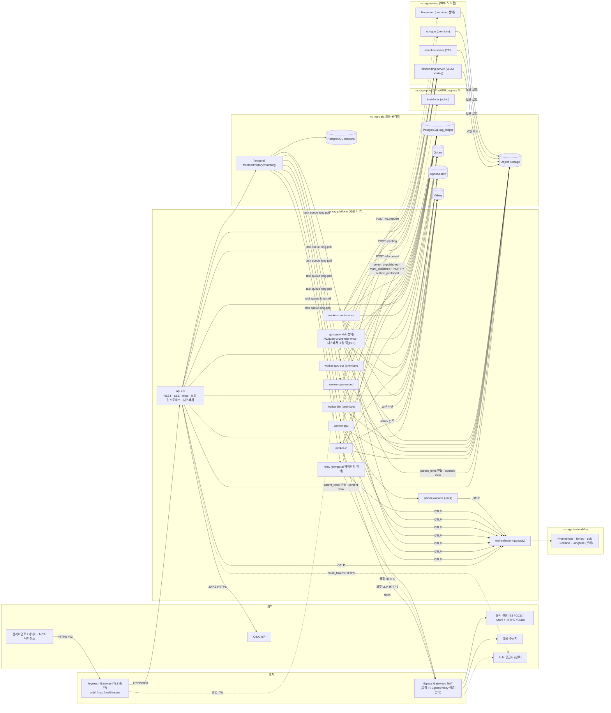
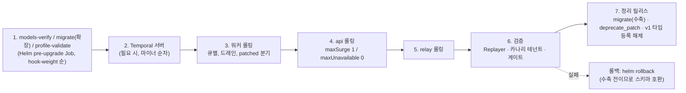

# 배포 아키텍처

## 목적

이 문서는 설계 바이블 §2(컨테이너), §7(프로파일), §11(오케스트레이션), §12(패키지 맵), §13(저장소)이 확정한 논리 컨테이너를 **실제 배포 단위**(compose 서비스, Kubernetes Deployment·Job·ScaledObject, 네임스페이스, 노드풀)로 옮기고, 그 배포 단위를 만드는 **컨테이너 이미지·빌드 전략·Helm 차트·네트워크 정책·GPU 스케줄링·사이징·환경 분리·에어갭·업그레이드 절차**를 확정한다. [시스템 개요](01-system-overview.md) §5가 개요만 그린 배포 토폴로지 3종(`lite`·`standard`·`premium`)을 상세화하고, 그 문서가 이 문서로 위임한 미해결 이슈(1 `api` 논리 표면의 물리 분리, 3 `lite` 컨테이너 수, 4 OTel Collector 배치, 10 `premium` GPU 배치 단위)를 해소한다.

이 문서는 새 계약 타입·필드·열거값·엔드포인트·이벤트를 정의하지 않는다. 배포 단위 이름·Helm 값 키·네임스페이스·노드 라벨은 이 문서가 부여하되, 컨테이너·큐·환경 변수·이미지 이름은 바이블 §2.2~§2.3·§6.6~§6.7·§11.2를 그대로 쓴다. 작업 지시에 등장하는 이미지 이름(`worker-cpu`, `worker-gpu`, `sidecar-libreoffice`, `sidecar-agpl-parsers`, `mcp`, `eval-runner`)은 바이블 정본과 다르므로 §3.2의 매핑표로 흡수한다.

## 범위

- **포함**: 배포 프로파일 3종(+`korean-gov` 변형) 상세, 컨테이너 이미지 목록과 빌드 전략(멀티스테이지, CUDA 베이스, 모델 캐시 볼륨, 공급망), Helm 차트 구조와 values 주요 키, compose 구성, 네트워크 토폴로지·네임스페이스·NetworkPolicy·인그레스·서비스 메시 결정, GPU 스케줄링과 모델 서빙 배치, 사이징 표, 환경별(개발·스테이징·운영) 차이, 에어갭 설치, 업그레이드·롤백 전략.
- **제외**: 설치 명령 순서와 런북 → [배포 가이드](../09-operations/01-deployment-guide.md), [런북](../09-operations/06-runbooks.md); 환경 변수 전체 목록 → [설정 레퍼런스](../09-operations/02-configuration-reference.md); 관측 백엔드 구성 → [관측성](../09-operations/03-observability.md); 부하 실측·튠 → [확장과 성능](../09-operations/04-scaling-and-performance.md); 백업·복구 → [백업과 재해 복구](../09-operations/07-backup-and-disaster-recovery.md); 업그레이드 절차 세부 → [업그레이드와 마이그레이션](../09-operations/08-upgrade-and-migration.md); CI 파이프라인 → [CI/CD](../10-development/05-ci-cd.md).
- **수치**: 실측 전 값은 모두 "초안 목표"다(바이블 §범위). 외부 이미지 태그·버전은 선정 매트릭스 확인일(2026-09-18~22) 기준이며 Helm values의 digest 고정값이 정본이다.
- **전방 참조**: 위 `→` 표기 문서(09-operations/01~08, 10-development/05·08)와 §참조의 03-contracts/15·16은 브리프 §8 문서 맵 경로이며 작성 예정이다(`depends_on` 아님; 작성 전까지 바이블 해당 절이 정본). 파일명이 문서 맵과 달라지면 이 문서의 링크를 일괄 갱신한다.

---

## 1. 배포 원칙

| # | 원칙 | 내용 | 근거 |
|---|------|------|------|
| P1 | **단일 코어 이미지, 역할은 플래그** | 코어는 Python 이미지 `rag-platform` 하나이며 `api`·`worker`·`relay`·`eval harness`·MCP는 `rag serve api\|worker\|relay`, `rag mcp serve`, `rag eval run` 명령으로 갈린다. 역할별 이미지를 만들지 않는다 | 바이블 §2.2, §12, [ADR-0003](../06-adr/0003-orchestrator-neutral-pipeline-and-non-durable-local-runner.md) |
| P2 | **배포 프로파일 = 품질 프로파일** | `lite`·`standard`·`premium`·`korean-gov`(`ProfileTier`)는 컬렉션 품질 프리셋이면서 배포 토폴로지 이름이다. Helm `values-{tier}.yaml`이 바이블 §7.1 컴포넌트 표를 그대로 배포 단위로 옮긴다 | 바이블 §7, [ADR-0031](../06-adr/0031-profile-schema-extends-and-quality-gates.md) |
| P3 | **데이터 계층은 외부 제공** | PostgreSQL·Qdrant·OpenSearch·Valkey·Temporal·오브젝트 스토리지는 운영 차트의 강한 의존성이 아니다(관리형 또는 업스트림 차트). 개발·스테이징용 번들 차트만 별도 제공한다 | Temporal Helm 차트가 DB 서브차트를 설치하지 않는 관행(07-tech-landscape/08) |
| P4 | **라이선스 경계 = 저장소·이미지·네임스페이스 경계** | C 등급(GPL/AGPL) 이미지는 별도 저장소 `rag-platform-gpl-sidecars`에서 빌드되고 Helm `optIn.*`로만 켜지며 전용 네임스페이스에 배치된다. 코어 이미지에 C 등급 의존을 넣지 않는다 | D-02, 바이블 §6.7, [ADR-0001](../06-adr/0001-license-grade-table-and-d02-interpretation.md) |
| P5 | **digest 고정** | 모든 이미지는 digest로 고정한다. 사이드카·서빙 이미지 digest는 `Producer.image_digest`로 지문(`fingerprint`)에 들어가 `stage_key`를 바꾸므로 태그 이동은 재현성 위반이다 | 바이블 §4.1, §6.2, 리스크 #8 |
| P6 | **검색 가용성 우선 배치** | 검색 경로(`api` 인프로세스)는 PostgreSQL·Temporal 없이도 응답해야 한다. `api`의 readiness는 프로파일 캐시와 `hydrate` 백엔드(Qdrant)만 요구한다(§10.2). OpenSearch 불가는 채널 제외 + `degraded`(바이블 §4.3 `retrieve` "최소 1채널 성공"), 원장·오케스트레이터 장애는 수집 표면의 503으로만 나타난다 | [ADR-0034](../06-adr/0034-retrieval-hot-path-postgres-independence-and-hydrate.md), 브리프 §7 가용성, [시스템 개요](01-system-overview.md) QA-10 |
| P7 | **워커는 GPU를 쥐지 않는다** | GPU는 서빙(`embedding-server`·`reranker-server`·선택 `sparse-encoder-server`·`llm-server`)과 사이드카(`ocr-gpu`)에만 있다. `ingest-gpu-*` 큐의 워커는 HTTP 클라이언트이므로 코어 이미지에 CUDA가 없다. 인프로세스 인코더를 워커에 두어 GPU를 요구하는 배치는 금지다 | 바이블 §2.3, [ADR-0009](../06-adr/0009-embedding-serving-vllm-pooling-tei-inprocess.md), [ADR-0033](../06-adr/0033-sidecar-convert-contract-and-isolation-ladder.md) |

---

## 2. 배포 프로파일 3종 상세

### 2.1 `lite` — 단일 노드 docker compose

**결정:** `lite`는 docker compose 단일 노드로 배포하며 두 모드를 가진다. 개발 모드(`rag up --profile lite`)는 `LocalRunner`(비내구)로 `api`·`worker`·`relay`를 한 프로세스에서 실행하고 컨테이너 4개다. 운영 모드(`rag up --profile lite --durable`)는 Temporal 단일 바이너리를 추가해 컨테이너 5개(오브젝트 스토리지를 `file://`로 둘 때) 또는 6개(RustFS 또는 SeaweedFS를 띄울 때)다. 이로써 [시스템 개요](01-system-overview.md) 미해결 이슈 3(바이블 §7.1 "컨테이너 5"의 해석)을 "운영 모드·`file://` 기준 5"로 확정하되, 바이블 §7.1 열 머리 문구 자체는 무조건 "5"이므로 "4(개발) / 5~6(운영 `--durable`)"로 정밀화하는 patch를 요청한다(미해결 이슈 14). `lite`의 배포 경로는 compose 하나다 — Helm 차트의 `global.tier` 열거에 `lite`는 없고(§4.2), GPU 없는 개발 클러스터(kind/k3d)는 `standard` 형상을 축소해 쓴다(§8). (근거: 바이블 §11.1 `temporal-lite`·§11.6, [ADR-0003](../06-adr/0003-orchestrator-neutral-pipeline-and-non-durable-local-runner.md), [ADR-0012](../06-adr/0012-lite-profile-qdrant-only-client-bm25.md))

| compose 서비스 | 이미지 | 개발 | 운영(`--durable`) | 비고 |
|----------------|--------|:----:|:----:|------|
| `app` | `rag-platform` | 1 | 1 | `rag serve api` 단일 프로세스에 `LocalRunner`(개발) 또는 Temporal 워커(운영, 큐 `ingest`·`maintenance`)와 Procrastinate 릴레이를 함께 띄운다(동거 플래그 이름은 미해결 이슈 5). bge-m3 dense ONNX int8 인프로세스, `sparse_bm25`(mecab-ko 형태소 + TF 포화) 계산, MCP `/mcp` 포함 |
| `postgres` | PostgreSQL | 1 | 1 | DB `rag_ledger` + (운영) `temporal`·`temporal_visibility` 별도 DB, `procrastinate` 스키마([저장소 아키텍처](04-storage-architecture.md) §2.6) |
| `qdrant` | Qdrant 1.19 | 1 | 1 | named vectors `dense`·`sparse_bm25`(`modifier: idf`) |
| `valkey` | Valkey 9 | 1 | 1 | 캐시·레이트리밋·멱등 키 조회 캐시 |
| `temporal` | Temporal 1.32 단일 바이너리 | — | 1 | `start-dev` 아님. PostgreSQL 영속화, `numHistoryShards` 초안 4(단일 노드; 생성 후 변경 불가) |
| `objectstore` | RustFS 또는 SeaweedFS | — | 선택 | 기본은 `file://./.rag/artifacts` 바인드 볼륨(바이블 §7.1 "`file://` 허용") |
| `reranker` | TEI CPU(`text-embeddings-inference:cpu-1.9`) | 선택 | 선택 | gte-multilingual-reranker-base(30→10). 생략 시 `rerank.applied=false` 경로 |
| `otel`, `jaeger`, `prometheus` | OTel Collector, Jaeger, Prometheus | 선택 | 선택 | `compose.observability.yaml` 오버레이 |

`lite`의 특징은 [시스템 개요](01-system-overview.md) §5.1과 같다: OpenSearch 없음(렉시컬 채널은 Qdrant `sparse_bm25`, `channel=lexical`), 사이드카 없음(HWP 5.0은 unhwp `helper_process` → hwp-hwpx-parser, DOC은 `parse.unsupported_format`), GPU 없음, 큐 `ingest` + `maintenance`, `tenant_concurrent_jobs_max` 4, 검색 p95 목표 1,500ms. `--durable` 없이 운영하는 것은 금지다(바이블 §11.1).

### 2.2 `standard` — Kubernetes, 멀티테넌트, GPU 1

기본 운영 토폴로지. 큐별 워커 Deployment, Java 사이드카, GPU 서빙 2종, Qdrant + OpenSearch 3-way 하이브리드.

| 배포 단위 | 종류 | 이미지 | 기본 replica | 스케일러 | 노드풀 |
|-----------|------|--------|:----:|----------|--------|
| `api` | Deployment + Service + HPA + PDB | `rag-platform` | 2 | HPA(CPU 60% 초안) + 선택 KEDA `prometheus`(`rag_query_latency_seconds`) | `cpu-general` |
| `api-query`(선택, §5.3) | Deployment(동일 spec) | `rag-platform` | 0(끔) | HPA | `cpu-general` |
| `worker-io` | Deployment + KEDA `ScaledObject` | `rag-platform` | 1 | KEDA `temporal`(`taskQueue: ingest-io`, `queueTypes: activity`) | `cpu-general` |
| `worker-cpu` | Deployment + KEDA | `rag-platform` | 1 | KEDA `temporal`(`ingest-cpu`), `maxReplicaCount` 32 초안 | `cpu-parse`(고메모리) |
| `worker-gpu-embed` | Deployment + KEDA | `rag-platform` | 1 | KEDA `temporal`(`ingest-gpu-embed`) | `cpu-general`(GPU 없음, P7) |
| `worker-maintenance` | Deployment + KEDA | `rag-platform` | 1 | KEDA `temporal`(`maintenance`) 1~2 | `cpu-general` |
| `relay` | Deployment + KEDA | `rag-platform` | 1 | KEDA `postgresql`(아웃박스 미발행 건수) 1~2(바이블 §7.1; 2번째 파드는 가용성용, §6.4) | `cpu-general` |
| `parser-workers` | Deployment + HPA | `parser-workers`(Java 21) | 2 | HPA(CPU) | `cpu-general` |
| `lo-sidecar` | Deployment(opt-in) | `rag-platform-gpl-sidecars/lo-sidecar` | 0 | HPA | `cpu-general`, 네임스페이스 `rag-optin` |
| `embedding-server` | Deployment + KEDA | vLLM `--runner pooling` | 1 | KEDA `prometheus`(큐 깊이·지연) 1~2 | `gpu-serving` |
| `reranker-server` | Deployment + KEDA | TEI GPU | 1 | KEDA `prometheus` 1~2 | `gpu-serving` |
| `otel-collector` | Deployment(게이트웨이) | OTel Collector | 2 | 고정 | `cpu-general` |
| 마이그레이션·검증·스케줄 | Job(Helm hook) | `rag-platform` | — | — | — |
| 데이터 계층 | 외부(관리형 또는 `rag-platform-data` 차트) | PostgreSQL HA, Temporal(frontend/history/matching), Qdrant ≥2 사본, OpenSearch ≥2 사본, Valkey 복제, RustFS 또는 SeaweedFS | — | — | `data` |

GPU 1장 기준의 서빙 배치는 §6.2에서 다룬다. `tenant_concurrent_jobs_max` 32, 아웃박스 지연 SLO 5s, 격리 등급 `payload_filter`(100만 청크 초과 시 `shard_key` 승격)는 바이블 §7.2 값이다. `relay`는 `standard` 이상에서 Temporal 액티비티다(바이블 §2.2 `relay` 컨테이너): `rag serve relay`는 [오케스트레이션과 워크플로우](06-orchestration-and-workflows.md) §3.6이 제안한 전용 태스크 큐 `relay`(바이블 §11.2 미등재, 06 미해결 이슈 3)만 폴링하는 별도 프로세스이며, 상주 워크플로우 `outbox-relay`가 액티비티 `outbox.relay_loop`를 반복 실행한다(06 §6.4). 따라서 `relay` 파드는 Temporal frontend에 접속해야 하고(§5.2), SSE 전달은 `relay`의 `mark_published` 트랜잭션이 보내는 PG `NOTIFY outbox_published` → 각 `api` 인스턴스 `LISTEN` → `outbox` 읽기 **단일 경로**이며 `relay`↔`api` 직접 네트워크 경로는 없다(06 §6.4; 양쪽 모두 PG 5432만 필요하고 바이블 §14에 릴레이 수신 엔드포인트는 없다).

### 2.3 `premium` — GPU 노드풀 다중, 오토스케일, HA

`standard` 전체에 GPU 노드풀 3종(OCR·임베딩·리랭커) + 선택 `gpu-llm`(온프레미스 `llm-server`를 둘 때만)과 LLM 보강 큐를 더한다. LLM 보강은 여전히 기본 끔(컬렉션 옵트인, O-05)이다.

| 추가·변경 배포 단위 | 내용 | 노드풀 |
|--------------------|------|--------|
| `worker-gpu-ocr` | 큐 `ingest-gpu-ocr`(바이블 §4.4 parse(OCR) premium 행), `ocr-gpu`의 HTTP 클라이언트(GPU 없음, P7), Deployment + KEDA `temporal` | `cpu-general` |
| `ocr-gpu` | PaddleOCR 3.7 PP-OCRv5 **server det + `korean_PP-OCRv5_mobile_rec`** + 방향·왜곡 전처리(UVDoc, textline orientation) 사이드카, `POST /v1/convert`, 페이지 단위 부분 산출물. 한국어 인식 모델은 mobile 단일이고 `PP-OCRv5_server_rec`는 중·영·일 전용이므로 server rec을 쓰지 않는다([ADR-0008](../06-adr/0008-ocr-default-rapidocr-ppocrv5-korean.md) F2·결정 표 premium 행, 07-tech-landscape/02 §PaddleOCR) | `gpu-ocr`(T4/L4급, 07-tech-landscape/02) |
| `worker-llm` | 큐 `ingest-llm`, `max_concurrent_activities` 4 초안 + Valkey 테넌트 토큰 버킷(06 §3.6) — 따라서 Valkey egress 필요(§5.2) | `cpu-general` |
| `llm-server`(선택) | vLLM Qwen3 / Qwen3-VL-8B(캡션·접두어·판정). 외부 LLM API 사용 시 생략 | `gpu-llm` |
| `embedding-server` 교체 옵션 | `ko-quality`(KURE-v1 dense @ TEI + PIXIE-Splade-v1.5 sparse @ `sparse-encoder-server`(sentence-transformers `SparseEncoder`를 감싼 별도 서빙 Deployment, §6.3); TEI `/embed_sparse`의 ModernBERT 지원은 확인 필요 as of 2026-09 — 07-tech-landscape/05 "프로파일별 조합"·미해결 이슈 2) 또는 `quality-max`(Qwen3-Embedding-4B, fp16 약 8GB, 권장 VRAM 16GB+; 07-tech-landscape/05) — 게이트 통과 컬렉션만 | `gpu-embed` |
| `reranker-server` 교체 옵션 | Qwen3-Reranker-4B @ vLLM/SGLang(50→20), 선택 KURE-v2 MaxSim 1단 | `gpu-rerank` |
| Qdrant | multivector(`late_interaction`, turbo4) 활성, 사본 ≥2 | `data` |
| HA | `api` ≥3 replica·PDB `minAvailable: 2`, 서빙 각 ≥2 replica, PostgreSQL 동기 복제, Temporal 역할별 ≥2 파드, Valkey 복제 + 페일오버 | — |

GPU 노드풀을 셋으로 나누는 이유는 스케일 신호 분리다: OCR은 수집 백로그(KEDA `temporal`)에, 임베딩은 임베딩 요청 큐에, 리랭커는 검색 QPS에 반응하므로 한 풀에 섞으면 서로의 오토스케일을 오염시킨다. `tenant_concurrent_jobs_max` 64, `retrieval_variant=quality` p95 목표 2,500ms(바이블 §7.2).

### 2.4 `korean-gov` 변형

`korean-gov extends standard`이며 배포에서 달라지는 것만 적는다: 서비스 메시(mTLS `STRICT`, §5.4), OpenBao Transit(테넌트 DEK), OpenSearch 감사 인덱스(2년), NATS JetStream(감사 스트림 손실 불가 조건에서만, O-06), Temporal 네임스페이스를 테넌트 등급별로 분리(`gov-tier-a`·`gov-tier-b`…, Kubernetes 네임스페이스가 아니라 Temporal 네임스페이스), OTel Collector `NO_CONTENT` 잠금, `pdf_airgapped` 프로파일과 모델·이미지 미러 필수(§9), Tika `HwpV5Parser` 배포용 텍스트(테넌트 옵트인).

### 2.5 비교

| 항목 | `lite` | `standard` | `premium` | `korean-gov` |
|------|--------|------------|-----------|--------------|
| 플랫폼 | docker compose 단일 노드 | Kubernetes | Kubernetes(GPU 다중) | Kubernetes(규제) |
| 코어 배포 단위 | `app` 1 | `api`, 워커 4, `relay` | + `worker-gpu-ocr`, `worker-llm` | standard |
| 사이드카 | 0 | `parser-workers`, `lo-sidecar`(opt-in) | + `ocr-gpu` | standard + hwpxlib 암호화 HWPX(`parser-workers` 내), Tika `HwpV5Parser` 배포용 텍스트(테넌트 옵트인), unoserver 풀 옵션(바이블 §7.1 `korean-gov` 열) |
| 서빙 | 인프로세스 ONNX int8(+ TEI CPU 리랭커 선택) | vLLM pooling + TEI GPU | + LLM 서빙, 교체 옵션(`sparse-encoder-server` 포함) | standard(가중치 자체 미러 필수) |
| GPU | 0 | 1(공유) 또는 2(전용) | 노드풀 3~4종 | standard |
| 인덱스 | Qdrant 단독 | Qdrant + OpenSearch | + multivector | + `shard_key`/`index_per_tenant`, 감사 인덱스 |
| 오케스트레이션 | `LocalRunner` / Temporal 단일 바이너리 | Temporal 분리 + KEDA | + 큐 2종 | + Temporal 네임스페이스 등급별 |
| 인증 | API 키 + 정적 역할 | OIDC + Cedar | 동일 | + mTLS, OpenFGA 옵션 |
| 이벤트 릴레이 | Procrastinate | Temporal 액티비티 + KEDA `postgresql` | 동일 | + NATS 조건부 |
| 관측 | OTel → Jaeger + Prometheus | Collector → Tempo/Loki/Prometheus + Grafana + Langfuse(분리) | 동일 | AGPL 불가 대안 |

AGPL 파서 사이드카(`rag-plugin-pyhwp-sidecar`, `rag-plugin-pymupdf-sidecar`)는 특정 프로파일에 배정되지 않은 **전 프로파일 공통 opt-in**이다(§3.1, `optIn.*`). 바이블 §7.1은 어느 열에도 AGPL 사이드카를 두지 않는다.

---

## 3. 컨테이너 이미지와 빌드 전략

### 3.1 이미지 목록

| 이미지 | 저장소·경로 | 베이스 | 역할(실행 명령) | 라이선스 등급 | GPU | `Producer.image_digest` 기록 |
|--------|-------------|--------|-----------------|:-----:|:---:|:---:|
| `rag-platform` | 본 저장소 `Dockerfile` | `python:3.13-slim`(D-01; 3.14 검증 전) + uv | `rag serve api`, `rag serve worker --queue …`, `rag serve relay`, `rag mcp serve`, `rag eval run`, 마이그레이션·검증 Job | A(순수 Python A 등급만) | 없음(P7) | 아니오(코어 지문은 `plugin_version`·`config_hash`) |
| `parser-workers` | 본 저장소 `sidecars/parser-workers` | `eclipse-temurin:21-jre` | HWP 5.0 → HWPX(hwplib + hwp2hwpx + hwpxlib), 암호화 HWPX, Tika `HwpV5Parser`; `POST /v1/convert`, `GET /healthz` | A | 없음 | 예 |
| `ocr-gpu` | 본 저장소 `sidecars/ocr-gpu` | PaddlePaddle CUDA 이미지(태그·CUDA 버전은 노드 드라이버와 함께 09-operations/01에서 고정) | PaddleOCR 3.7 PP-OCRv5 server det + `korean_PP-OCRv5_mobile_rec` + 전처리, FastAPI `POST /v1/convert` | A | 필수 | 예 |
| `sparse-encoder-server`(선택) | 본 저장소 `sidecars/sparse-encoder`(제안) | `python:3.13-slim` + sentence-transformers(CPU) 또는 CUDA 변형 | `ko-quality` learned sparse(PIXIE-Splade-v1.5·splade-ko-v1) `SparseEncoder.encode_query/encode_document`를 HTTP로 노출(응답 스키마는 03-contracts/07 `SparseVector`; 엔드포인트 이름은 미해결 이슈 17) | A | 선택(149M 파라미터·약 0.3GB, CPU 가능; 07-tech-landscape/05) | 예 |
| `lo-sidecar` | **별도 저장소** `rag-platform-gpl-sidecars` | Debian + LibreOffice headless + H2Orestart | DOC/RTF/ODT → DOCX, HWP 렌더 최후 폴백; tini, 프로세스 그룹 KILL, 프로파일 락, 네트워크 차단 | C(GPL-3.0) | 없음 | 예 |
| `rag-plugin-pyhwp-sidecar`, `rag-plugin-pymupdf-sidecar` | 별도 저장소 `rag-platform-gpl-sidecars` | Python slim | AGPL 파서 사이드카(선택 플러그인) | C(AGPL) | 없음 | 예 |
| `embedding-server` | 업스트림 vLLM 이미지(태그 확인 필요 as of 2026-09; 0.29 계열) | CUDA | `vllm serve BAAI/bge-m3 --runner pooling`(BGE-M3 dense + sparse), `POST /pooling` | A(MIT/Apache) | 필수 | 예(`embedder_fingerprint`) |
| `reranker-server` | 업스트림 TEI `ghcr.io/huggingface/text-embeddings-inference:{cpu,86,89,hopper}-1.9` | CUDA / CPU | `bge-reranker-v2-m3`(GPU) 또는 gte-multilingual-reranker-base(CPU, lite), `POST /rerank` | A | 선택 | 예 |
| `otel-collector` | 업스트림 OpenTelemetry Collector | — | redaction·transform·팬아웃 | A | 없음 | 아니오 |
| 데이터 계층 | 업스트림(PostgreSQL, Qdrant 1.19, OpenSearch 3.8, Valkey 9, Temporal 1.32, RustFS 또는 SeaweedFS) | — | — | A | 없음 | 아니오 |

Grafana·Tempo·Loki(AGPL)·Langfuse·Phoenix(ELv2)는 플랫폼 이미지 목록에 없다. OTLP 대상으로 별도 배포하며 이 차트는 엔드포인트 값만 받는다(D-11, [ADR-0022](../06-adr/0022-observability-genai-semconv-pin-and-license-boundary.md)).

### 3.2 작업 지시 이름 ↔ 정본 매핑

**결정:** 작업 지시의 이미지 목록은 이미지가 아니라 **배포 단위**(Deployment·Job) 또는 바이블의 다른 이름으로 대응한다. 역할별 이미지를 만들면 P1(단일 이미지)과 바이블 §2.2가 깨지고, `worker-gpu`에 CUDA를 넣으면 P7이 깨진다. (근거: 바이블 §2.2·§6.7·§12, [ADR-0003](../06-adr/0003-orchestrator-neutral-pipeline-and-non-durable-local-runner.md))

| 지시 이름 | 정본 대응 | 설명 |
|-----------|-----------|------|
| `api` | 이미지 `rag-platform`, Deployment `api` | 네 논리 표면(수집·리트리벌·관리·MCP)을 한 프로세스가 제공 |
| `worker-cpu` | 이미지 `rag-platform`, Deployment `worker-cpu`(큐 `ingest-cpu`) + `worker-io`(`ingest-io`) + `worker-maintenance` | 같은 이미지, `--queue` 인자만 다름 |
| `worker-gpu` | 이미지 `rag-platform`, Deployment `worker-gpu-embed`(`ingest-gpu-embed`), `worker-gpu-ocr`(`ingest-gpu-ocr`, premium) | GPU는 서빙·사이드카에 있으므로 워커 이미지에 CUDA 없음 |
| `sidecar-libreoffice` | 이미지 `lo-sidecar`(별도 저장소, `optIn.loSidecar`) | GPL-3.0 C 등급 |
| `sidecar-agpl-parsers` | 이미지 `rag-plugin-pyhwp-sidecar`, `rag-plugin-pymupdf-sidecar`(별도 저장소, `optIn.*`) | AGPL C 등급; 바이블은 하나로 묶지 않고 플러그인별 이미지 |
| `mcp` | 이미지 `rag-platform`, `api`의 `/mcp` 마운트(별도 Deployment 불필요; 필요 시 `api-query`로 분리, §5.3) | D-13 FastAPI `/mcp` 마운트 |
| `eval-runner` | 이미지 `rag-platform`, `rag eval run`(CI Job) 또는 `eval.run.v1` 워크플로우(`worker-maintenance` 큐) | `[eval]` extra 포함 빌드 |
| (지시에 없음) | `parser-workers`, `ocr-gpu`, `embedding-server`, `reranker-server` | 바이블 §2.2 컨테이너 |

### 3.3 멀티스테이지 빌드

**결정:** 코어 이미지는 uv 기반 3단계 멀티스테이지로 빌드하고, extras는 빌드 인자 `EXTRAS`로 주입하되 기본 빌드는 `temporal,opensearch,eval`을 포함해 `api`·`worker`·`relay`·`eval harness`가 **같은 이미지 digest**를 쓴다. 이는 [컴포넌트 아키텍처](02-component-architecture.md) §7.2가 `api`·`worker`는 `[temporal,opensearch]`, `eval-harness`만 `[temporal,opensearch,eval]`로 나눈 것을 단일 digest 원칙(P1)에 따라 **의도적으로 통합**한 편차다 — 역할별 extras를 나누면 이미지가 둘이 되어 P1·§3.5 digest 전파가 깨지고, `[eval]`(ranx·ir_measures·ragas·deepeval)은 모두 A 등급 순수 Python이라 코어 포함에 라이선스 장애가 없다. 02 §7.2 행을 "코어 기본 빌드 `[temporal,opensearch,eval]`"로 맞추는 patch를 요청한다(미해결 이슈 15). `[kiwi]`·`[docling-chunker]`는 명시 빌드(`rag-platform:<ver>-kiwi` 등)에서만 포함한다. `[gpu]` extra는 코어 이미지에 넣지 않는다(CUDA·Paddle 런타임은 `ocr-gpu`로 분리, 02 §7.2). (근거: D-01·D-02, [ADR-0035](../06-adr/0035-python-version-and-toolchain-pins.md))

| 이미지 | 단계 | 내용 |
|--------|------|------|
| `rag-platform` | `base` | `python:3.13-slim`, `uv` 바이너리 복사, 비루트 사용자(uid 10001), 시스템 패키지: mecab-ko 런타임 라이브러리(python-mecab-ko wheel이 정적 번들이면 생략), `libgomp`(ONNX Runtime), 폰트 없음 |
| | `deps` | `uv sync --frozen --no-dev --extra temporal --extra opensearch --extra eval`(`uv lock --check`는 CI에서 선행), 바이트코드 컴파일 |
| | `runtime` | `deps`의 가상환경만 복사, `HF_HOME=/models/hf`, `RAG_*` 기본값 없음(모두 values에서 주입), `ENTRYPOINT ["rag"]`. 모델 가중치·사전은 이미지에 굽지 않고 볼륨(§3.4)으로 공급 |
| `parser-workers` | `build` → `runtime` | `maven:3-eclipse-temurin-21`에서 fat jar 빌드 → `eclipse-temurin:21-jre`, 비루트, JVM 힙 상한을 컨테이너 메모리 한도에서 계산(`-XX:MaxRAMPercentage=75`) |
| `ocr-gpu` | `base`(PaddlePaddle CUDA) → `deps`(paddleocr, FastAPI) → `runtime` | CUDA 마이너 버전은 GPU 노드 드라이버 호환 매트릭스에 맞춰 values에서 이미지 digest로 선택. PP-OCRv5 server det + `korean_PP-OCRv5_mobile_rec` + 방향·왜곡 전처리(UVDoc·textline orientation) 모델은 볼륨(§3.4)에서 로드, 에어갭은 번들 변형 이미지 `ocr-gpu:<ver>-bundled` |
| `lo-sidecar`(별도 저장소) | 단일 | LibreOffice headless + H2Orestart 확장, tini PID 1, `--norestore`, 요청별 임시 프로파일 디렉터리, seccomp 기본, `NET_RAW` 등 능력 제거, 네트워크 정책으로 egress 0 |

이미지 크기 상한(초안 목표): `rag-platform` 1.5GB 이하(Docling·ONNX Runtime 포함), `parser-workers` 400MB 이하, `ocr-gpu`는 CUDA 베이스로 수 GB(상한 미설정). 크기 회귀는 CI 경고.

### 3.4 모델 캐시 볼륨과 미러

**결정:** 모델 가중치·사전·OCR 모델은 이미지에 굽지 않는다. 정본은 오브젝트 스토리지 미러 `models/{repo}/{revision}/… + LICENSE + models.lock`(바이블 §13.3)이며, **볼륨을 채우는 주체는 파드별 init 컨테이너 하나다**: `rag models sync --lock /config/models.lock --dest /models`가 그 파드가 소비하는 항목만 볼륨에 내려받고(sha256 대조, pickle 거부), 본 컨테이너가 로컬 경로로 로드한다. Helm 훅 Job은 볼륨을 쓰지 않고 미러의 존재·sha256·`LICENSE`·등급만 검증한다(§4.4 `models-verify`) — 노드 로컬 PVC나 emptyDir을 Job이 채우면 다른 노드·파드에서 보이지 않고, `ReadOnlyMany` PVC는 Job이 쓸 수 없으므로 공급 책임을 init 컨테이너로 단일화한다. 운영 프로파일은 `HF_HUB_OFFLINE=1`로 외부 다운로드를 차단한다. (근거: D-02 `models.lock`, 바이블 §13.3, [ADR-0001](../06-adr/0001-license-grade-table-and-d02-interpretation.md), 07-tech-landscape/05 "가중치 미러링")

| 소비자 | 볼륨 내용 | 볼륨 종류(초안) | 크기(초안) |
|--------|-----------|-----------------|-----------|
| `embedding-server`, `reranker-server` | `models/BAAI/bge-m3/<sha>`, `models/BAAI/bge-reranker-v2-m3/<sha>` | 노드 로컬 PVC(`ReadWriteOnce`) 또는 emptyDir + init sync | bge-m3 fp16 약 1.1GB, bge-reranker-v2-m3 약 1.1GB(07-tech-landscape/05) |
| `worker-cpu` | Docling 모델(heron 레이아웃·TableFormer; `docling-tools models download` 결과), RapidOCR `korean_PP-OCRv5_mobile_rec`·det ONNX, mecab-ko-dic, kss 리소스, spaCy `ko_core_news_lg`(PII, standard), GLiNER2 | 노드별 emptyDir + init sync(기본) 또는 `ReadOnlyMany` PVC(사전 적재된 공유 볼륨을 운영자가 제공할 때만) | 수백 MB~2GB(모델별 크기는 `models.lock`에서 확정) |
| `app`(lite) | bge-m3 dense ONNX int8, mecab-ko-dic, RapidOCR ONNX | 바인드 볼륨 `./.rag/models` | 최초 `rag up` 시 다운로드(바이블 §11.6) |
| `ocr-gpu` | PP-OCRv5 server det + `korean_PP-OCRv5_mobile_rec`(14MB) + UVDoc·textline orientation 전처리 모델 | emptyDir + init sync 또는 번들 이미지 | server det·전처리 모델 크기 확인 필요(as of 2026-09) |
| `sparse-encoder-server`(ko-quality) | `models/telepix/PIXIE-Splade-v1.5/<sha>` | emptyDir + init sync | 약 0.3GB(07-tech-landscape/05) |

`models.lock`은 CI 라이선스 게이트의 입력이자 sync의 입력이다. 형식은 선정 매트릭스가 요구한 열(`id, revision, sha256, license, grade, territory`)에 배포용 열을 더한 제안이며 10-development/05가 확정한다. 아래 예시의 `docling-project/docling-models`(CDLA-Permissive-2.0) 등급 `A`는 **잠정**이다 — [ADR-0001](../06-adr/0001-license-grade-table-and-d02-interpretation.md)과 [시스템 개요](01-system-overview.md) §7은 CDLA-Permissive-2.0을 법무 검토 대기로 두므로, 검토 결과가 나오면 이 항목의 `grade`를 갱신하고 A가 아니면 `standard` 기본 라우팅(`parser.pdf_docling_standard`)을 재검토한다. 한국어 OCR 인식 가중치는 하나(PP-OCRv5 korean mobile, ADR-0008 F2)지만 **배포 파일 포맷은 소비자마다 다르다**: `sidecar.ocr_gpu`(PaddleOCR 3.7)는 Paddle 추론 포맷을, `parser.pdf_docling_standard`(RapidOCR, ONNX Runtime)는 ONNX 변환본을 로드하므로(07-tech-landscape/02 §C PaddleOCR·RapidOCR 행) 항목을 포맷별로 나눈다 — init 컨테이너 sync가 "그 파드가 소비하는 항목만" 내려받는 규약에서 한 항목에 두 소비자를 두면 `ocr-gpu` 파드가 ONNX 파일을 받아 로드에 실패한다. ONNX 변환본의 출처는 RapidAI 모델 허브(07-tech-landscape/02 참조 "RapidOCR 모델 목록")이며 아래 예시의 저장소 id·`revision`은 확인 필요(as of 2026-09)다.

```json
{
  "schema_version": "1.0.0",
  "generated_at": "2026-09-22T09:00:00.000Z",
  "mirror_uri": "s3://rag/models",
  "models": [
    {
      "id": "BAAI/bge-m3",
      "revision": "<sha>",
      "sha256": "<sha256>",
      "license": "MIT",
      "grade": "A",
      "territory": [],
      "format": "safetensors",
      "consumers": ["embedder.vllm_pooling_bge_m3", "embedder.inprocess_sentence_transformers"]
    },
    {
      "id": "BAAI/bge-reranker-v2-m3",
      "revision": "<sha>",
      "sha256": "<sha256>",
      "license": "Apache-2.0",
      "grade": "A",
      "territory": [],
      "format": "safetensors",
      "consumers": ["reranker.tei_cross_encoder"]
    },
    {
      "id": "docling-project/docling-models",
      "revision": "<sha>",
      "sha256": "<sha256>",
      "license": "CDLA-Permissive-2.0",
      "grade": "A",
      "territory": [],
      "format": "safetensors",
      "consumers": ["parser.pdf_docling_standard"]
    },
    {
      "id": "PaddlePaddle/korean_PP-OCRv5_mobile_rec",
      "revision": "<sha>",
      "sha256": "<sha256>",
      "license": "Apache-2.0",
      "grade": "A",
      "territory": [],
      "format": "paddle",
      "consumers": ["sidecar.ocr_gpu"]
    },
    {
      "id": "RapidAI/RapidOCR",
      "revision": "<sha>",
      "sha256": "<sha256>",
      "license": "Apache-2.0",
      "grade": "A",
      "territory": [],
      "format": "onnx",
      "consumers": ["parser.pdf_docling_standard"]
    }
  ]
}
```

D 등급 모델은 `models.lock`에 있어도 프로파일 `model_license_ack: true` 없이는 sync 대상에서 제외된다(바이블 §7.4 (1)). pickle 계열 파일은 sync가 거부한다(safetensors 전용, 07-tech-landscape/12).

### 3.5 공급망과 digest 고정

| 항목 | 규약 |
|------|------|
| 태그·digest | 릴리스 태그 `ghcr.io/<org>/rag-platform:<semver>`와 digest를 함께 게시. Helm values는 `image.digest`를 필수로 받고 태그는 표시용이다(P5) |
| 사이드카 digest 전파 | Helm이 `global.imageDigests.<name>`을 사이드카 환경 변수 `IMAGE_DIGEST`로 주입하고 사이드카 `GET /healthz`가 `image_digest`를 응답한다. 워커는 첫 호출 전 `/healthz`로 digest를 읽어 `Producer.image_digest`·`parser_fingerprint_hash`에 기록한다(Kubernetes downward API는 이미지 digest를 노출하지 않으므로 values 주입이 유일한 결정적 경로). `/healthz` 응답 필드는 03-contracts/16 제안(미해결 이슈 2) |
| 서명·SBOM | cosign 서명 + CycloneDX SBOM 첨부(Syft), Trivy 취약점 스캔, pip-licenses + liccheck 라이선스 게이트, `models.lock` picklescan — 모두 릴리스 파이프라인 게이트(01-system-overview §7 "라이선스 게이트") |
| 재현 빌드 | `uv lock --check`, 베이스 이미지 digest 고정, 빌드 인자 `EXTRAS` 기록을 이미지 라벨(`org.opencontainers.image.*`, `io.rag.extras`)에 남김 |
| 취약점 SLA | 초안: Critical 7일, High 30일 내 재빌드·롤링(09-operations/05에서 확정) |

---

## 4. Helm 차트 구조와 values

### 4.1 구조

**결정:** Helm 차트는 둘이다. `rag-platform`(운영 차트: 코어·사이드카·서빙·정책·Job)과 `rag-platform-data`(개발·스테이징 전용 번들: 데이터 계층 업스트림 차트를 `condition`으로 묶은 umbrella). 운영 차트는 데이터 계층 접속 정보만 받는다(P3). GPL/AGPL 이미지는 `optIn.*` 값과 이미지 참조만 두고 차트 안에 이미지를 빌드·동봉하지 않는다(바이블 §6.7·§12). (근거: [ADR-0001](../06-adr/0001-license-grade-table-and-d02-interpretation.md), [ADR-0011](../06-adr/0011-kv-and-object-storage-valkey-rustfs-seaweedfs.md))

```text
deploy/
├── compose/
│   ├── compose.lite.yaml               # 개발: app, postgres, qdrant, valkey (LocalRunner)
│   ├── compose.lite-durable.yaml       # 운영 lite 오버레이: + temporal(단일 바이너리), [+ objectstore]
│   ├── compose.observability.yaml      # 선택: otel-collector, jaeger, prometheus
│   └── .env.example                    # RAG_* 변수 예시(비밀은 파일 참조)
└── helm/
    ├── rag-platform/
    │   ├── Chart.yaml                  # appVersion = 코어 이미지 semver
    │   ├── values.yaml                 # base 기본값(standard 형상, 모든 optIn 끔)
    │   ├── values-standard.yaml  values-premium.yaml  values-korean-gov.yaml
    │   ├── values-airgapped.yaml       # 미러 레지스트리·HF_HUB_OFFLINE·pdf_airgapped 오버레이(§9)
    │   ├── profiles/                   # builtin 프로파일 YAML 사본(ConfigMap 소스; 정본은 패키지 내 builtin/)
    │   └── templates/
    │       ├── api/         deployment.yaml service.yaml hpa.yaml pdb.yaml  (api-query 는 조건부 두 번째 Deployment)
    │       ├── workers/     deployment-{io,cpu,gpu-ocr,gpu-embed,llm,maintenance}.yaml scaledobject-*.yaml pdb.yaml
    │       ├── relay/       deployment.yaml scaledobject.yaml
    │       ├── sidecars/    parser-workers.yaml ocr-gpu.yaml optin-lo-sidecar.yaml optin-agpl-parsers.yaml
    │       ├── serving/     embedding-server.yaml reranker-server.yaml sparse-encoder-server.yaml llm-server.yaml scaledobject-*.yaml
    │       ├── jobs/        models-verify.yaml migrate.yaml profile-validate.yaml (모두 pre-install,pre-upgrade; hook-weight -30/-20/-10, §4.4)  schedules-apply.yaml(post-install,post-upgrade)
    │       ├── network/     networkpolicy-*.yaml ingress.yaml httproute.yaml(Gateway API 선택)
    │       ├── config/      configmap-profile.yaml configmap-models-lock.yaml externalsecret.yaml(선택) serviceaccount.yaml
    │       ├── observability/ otel-collector.yaml servicemonitor.yaml
    │       └── priorityclass.yaml
    └── rag-platform-data/              # 개발·스테이징: postgresql, qdrant, opensearch, valkey, temporal, rustfs|seaweedfs 서브차트
        ├── Chart.yaml                  # dependencies[].condition = data.<name>.enabled
        └── values.yaml
```

### 4.2 values 주요 키

값 키는 camelCase이고 컨테이너·큐·환경 변수 이름은 바이블 철자를 그대로 문자열 값으로 쓴다. `RAG_*` 환경 변수(바이블 §6.6)와의 대응을 "주입" 열에 적었다.

| 키 | 타입·기본값 | 의미 | 주입 |
|----|-------------|------|------|
| `global.tier` | enum `standard\|premium\|korean-gov`, `standard` | 배포 프로파일. `values-{tier}.yaml`이 덮어쓰는 형상의 이름. `lite`는 compose 전용이라 Helm 열거에 없다(§2.1) | `RAG_PROFILE__PATH`(ConfigMap 마운트 경로) |
| `global.image.registry`, `global.image.pullSecrets[]` | string, — | 레지스트리 접두(에어갭 미러) | — |
| `global.imageDigests.{ragPlatform, parserWorkers, ocrGpu, embeddingServer, rerankerServer, loSidecar, …}` | string(`sha256:…`), 필수 | 모든 이미지 digest(P5). 사이드카·서빙은 `IMAGE_DIGEST` env로 자기 digest를 받음 | `IMAGE_DIGEST` |
| `global.airgapped` | boolean, `false` | `HF_HUB_OFFLINE=1`, 외부 egress 0, `pdf_airgapped` 라우팅 허용 | `HF_HUB_OFFLINE` |
| `profile.inline` / `profile.existingConfigMap` | YAML 객체 / string | 운영자 프로파일 YAML(바이블 §7.3; `extends` 단일 상속·깊은 병합, 상속 원본 제한은 바이블에 없음 — 03-contracts/15 확정 대상, 미해결 이슈 16). 설치·업그레이드 시 `profile-validate` Job(`rag profile validate`)이 검증(§4.4) | `RAG_PROFILE__PATH` |
| `externals.postgres.dsnSecretRef` | `{name, key}` | 원장 DSN(비밀) | `RAG_PG__DSN` |
| `externals.temporal.{address, namespace, tlsSecretRef}` | string | Temporal frontend 주소·네임스페이스 | `RAG_TEMPORAL__ADDRESS` |
| `externals.objectStore.{uri, endpointUrl, credentialsSecretRef}` | string | `s3://bucket[/prefix]` 또는 `file://`(lite) | `RAG_OBJECT_STORE__URI` |
| `externals.valkey.urlSecretRef` | `{name, key}` | Valkey URL(없으면 `degraded` 경로) | `RAG_VALKEY__URL` |
| `externals.qdrant.{url, apiKeySecretRef, preferGrpc}` | string, `true` | 벡터 백엔드 | 어댑터 설정(제안 필드, 09-operations/02) |
| `externals.opensearch.{url, jwtSigningKeySecretRef}` | string | 렉시컬 백엔드 + 요청별 테넌트 JWT 서명 키(E8) | 어댑터 설정 |
| `externals.oidc.{issuer, audience}` | string | IdP | `RAG_AUTH__OIDC_ISSUER` |
| `externals.otel.endpoint` | string | Collector OTLP 엔드포인트 | `RAG_OTEL__EXPORTER_OTLP_ENDPOINT` |
| `secrets.provider` | enum `env\|openbao\|aws_kms`, `env` | 비밀 간접 참조 제공자 | `RAG_SECRETS__PROVIDER` |
| `api.{replicas, resources, autoscaling{enabled, minReplicas, maxReplicas, targetCPUUtilizationPercentage}, pdb.minAvailable, uvicornWorkers}` | — | 수집·관리·MCP 표면 | `rag serve api --workers`(플래그는 제안, [컴포넌트 아키텍처](02-component-architecture.md) §5.2 `ServeSettings`; 미해결 이슈 5) |
| `api.querySplit.{enabled, replicas, paths[]}` | boolean `false` | 검색 트래픽 전용 두 번째 Deployment(§5.3) | 인그레스 경로 규칙 |
| `workers.<queue>.{enabled, minReplicaCount, maxReplicaCount, processes, maxConcurrentActivities, resources, nodeSelector, tolerations, terminationGracePeriodSeconds, keda{targetQueueSize, cooldownPeriod}}` | 큐 키: `ingestIo, ingestCpu, ingestGpuOcr, ingestGpuEmbed, ingestLlm, maintenance`(바이블 §11.2 큐 6종; `lite`의 `ingest`는 compose 전용) | 큐별 워커 Deployment + `ScaledObject` | `rag serve worker --queue <큐명> --processes --max-concurrent-activities`(`--processes`·`--max-concurrent-activities`는 제안, 미해결 이슈 5) |
| `relay.{mode, replicas, taskQueue, keda.unpublishedThreshold}` | enum `temporal\|procrastinate`; `taskQueue` `relay`(06 §3.6 제안) | 아웃박스 릴레이(Temporal 액티비티 워커, §2.2) | `rag serve relay` |
| `sidecars.parserWorkers.{enabled, replicas, resources, autoscaling}` | boolean `true`(standard+) | Java 사이드카 | 워커 `RAG_SIDECAR__PARSER_WORKERS_URL`(제안 필드) |
| `sidecars.ocrGpu.{enabled, replicas, gpu{resourceName, count}, nodeSelector, tolerations}` | boolean `false`(premium `true`) | GPU OCR 사이드카 | `RAG_SIDECAR__OCR_GPU_URL` |
| `optIn.loSidecar.{enabled, image, digest, acknowledgeLicense}` | boolean `false` | GPL 사이드카. `acknowledgeLicense: true` 없이 `enabled`면 렌더 실패(D-02 고지) | `RAG_SIDECAR__LO_SIDECAR_URL`; 프로파일 `parse.router.doc` 사용 가능 |
| `optIn.pyhwpSidecar`, `optIn.pymupdfSidecar` | 동일 구조 | AGPL 플러그인 사이드카 | 플러그인 `sidecar_image` |
| `serving.embedding.{enabled, engine, model{id, revision}, image, digest, replicas, gpu{resourceName, count, memoryUtilization}, externalUrl, keda}` | engine enum `vllm_pooling\|tei\|external`, `vllm_pooling` | 임베딩 서빙. `external`이면 배포하지 않고 URL만 | `RAG_SIDECAR__EMBEDDING_SERVER_URL` |
| `serving.reranker.{…, engine}` | engine enum `tei_gpu\|tei_cpu\|vllm\|sglang\|external\|none` | 리랭커 서빙. `none`은 lite 생략 | `RAG_SIDECAR__RERANKER_SERVER_URL` |
| `serving.sparse.{enabled, engine, model{id, revision}, image, digest, replicas, gpu, externalUrl}` | engine enum `sparse_encoder\|tei\|external`, `enabled: false` | `ko-quality` learned sparse 서빙 `sparse-encoder-server`(§6.3). `tei`는 `/embed_sparse` ModernBERT 지원 확인 후에만 | `RAG_SIDECAR__SPARSE_ENCODER_SERVER_URL`(제안 필드) |
| `serving.additional[]` | 배열 | 교체·blue/green용 추가 서빙 인스턴스(§6.3) | — |
| `models.{mirrorUri, lock(ConfigMap 내용), cache{storageClass, size, accessMode}}` | — | §3.4(적재는 init 컨테이너만) | init 컨테이너 인자 |
| `network.{networkPolicy.enabled, egressGateway{enabled, cidr}, denyClusterEgressFromWorkers}` | boolean `true` | §5.2 | — |
| `ingress.{enabled, className, host, tls{secretName}, annotations, gatewayApi.enabled, adminHost, adminAllowlist[]}` | `adminHost` string(선택), `adminAllowlist[]` CIDR | §5.3; `adminHost`가 있으면 관리 표면 경로를 그 호스트로만 라우팅하고 `adminAllowlist[]`를 소스 IP 허용 목록 어노테이션으로 전달 | — |
| `mesh.{enabled, mtlsMode}` | boolean `false`, `STRICT` | §5.4 | — |
| `observability.{otelCollector{mode, replicas, config}, contentCapture, serviceMonitor.enabled}` | mode `gateway`, `none` | §5.2·8 | `RAG_OTEL__CONTENT_CAPTURE=none` |
| `jobs.{modelsVerify.enabled, migrate.enabled, profileValidate.enabled, schedulesApply.enabled}` | boolean `true` | Helm hook Job(§4.4) | `rag models verify`, `rag ledger migrate`, `rag profile validate`, `rag schedules apply` |
| `priorityClasses.{api, serving, workers, maintenance}` | string | 파드 우선순위(§6.4) | — |

### 4.3 `standard` values 발췌

```yaml
global:
  tier: standard
  image: {registry: ghcr.io/example}
  imageDigests:
    ragPlatform: "sha256:<digest>"
    parserWorkers: "sha256:<digest>"
    embeddingServer: "sha256:<digest>"
    rerankerServer: "sha256:<digest>"
externals:
  postgres: {dsnSecretRef: {name: rag-pg, key: dsn}}
  temporal: {address: temporal-frontend.rag-data.svc:7233, namespace: rag}
  objectStore: {uri: s3://rag, endpointUrl: http://objectstore.rag-data.svc:9000, credentialsSecretRef: {name: rag-s3, key: env}}
  valkey: {urlSecretRef: {name: rag-valkey, key: url}}
  qdrant: {url: http://qdrant.rag-data.svc:6334, preferGrpc: true}
  opensearch: {url: https://opensearch.rag-data.svc:9200, jwtSigningKeySecretRef: {name: rag-os-jwt, key: pem}}
  oidc: {issuer: https://idp.example.com/realms/rag, audience: rag-platform}
  otel: {endpoint: http://otel-collector.rag-platform.svc:4317}
api:
  replicas: 2
  autoscaling: {enabled: true, minReplicas: 2, maxReplicas: 8, targetCPUUtilizationPercentage: 60}
  pdb: {minAvailable: 1}
workers:
  ingestIo:    {minReplicaCount: 1, maxReplicaCount: 4,  maxConcurrentActivities: 16, terminationGracePeriodSeconds: 60}
  ingestCpu:   {minReplicaCount: 1, maxReplicaCount: 32, processes: 4, maxConcurrentActivities: 1,
                resources: {requests: {cpu: "4", memory: 12Gi}}, nodeSelector: {rag.io/node-pool: cpu-parse},
                terminationGracePeriodSeconds: 120}
  ingestGpuEmbed: {minReplicaCount: 1, maxReplicaCount: 2, maxConcurrentActivities: 8}
  maintenance: {minReplicaCount: 1, maxReplicaCount: 2}
relay: {mode: temporal, replicas: 1, taskQueue: relay}
sidecars:
  parserWorkers: {enabled: true, replicas: 2}
  ocrGpu: {enabled: false}
optIn:
  loSidecar: {enabled: false}
serving:
  embedding: {engine: vllm_pooling, model: {id: BAAI/bge-m3, revision: "<sha>"}, replicas: 1,
              gpu: {resourceName: nvidia.com/gpu, count: 1, memoryUtilization: 0.45},
              nodeSelector: {rag.io/node-pool: gpu-serving}}
  reranker:  {engine: tei_gpu, model: {id: BAAI/bge-reranker-v2-m3, revision: "<sha>"}, replicas: 1,
              gpu: {resourceName: nvidia.com/gpu, count: 1}, nodeSelector: {rag.io/node-pool: gpu-serving}}
models: {mirrorUri: s3://rag/models, cache: {storageClass: local-nvme, size: 20Gi}}
network: {networkPolicy: {enabled: true}, egressGateway: {enabled: true}}
ingress: {enabled: true, className: nginx, host: rag.example.com, tls: {secretName: rag-tls}}
mesh: {enabled: false}
observability: {otelCollector: {mode: gateway, replicas: 2}, contentCapture: none}
```

### 4.4 설치·업그레이드 훅 순서

같은 단계의 훅 사이 순서는 `helm.sh/hook-weight`(낮은 값 먼저)가 보장하며, 가중치가 없으면 순서가 보장되지 않으므로 세 `pre-*` Job 모두에 가중치를 둔다. 훅 Job은 `helm.sh/hook-delete-policy: before-hook-creation,hook-succeeded`로 정리한다.

| 순서 | 훅 | `hook-weight` | Job | 실패 시 |
|------|----|:---:|-----|---------|
| 1 | `pre-install`, `pre-upgrade` | -30 | `models-verify`: `models.lock` 전 항목의 미러 존재·sha256·`LICENSE`·등급(D 등급은 `model_license_ack`) 검증. **볼륨에 쓰지 않는다** — 적재는 파드별 init 컨테이너(§3.4) | 설치 중단 |
| 2 | `pre-install`, `pre-upgrade` | -20 | `migrate`: 원장 스키마 마이그레이션(확장 단계만, §10.5), RLS 정책 적용 | 설치 중단(롤백 불필요: 확장 단계는 구버전과 호환) |
| 3 | `pre-install`, `pre-upgrade` | -10 | `profile-validate`: `profile.inline`/`existingConfigMap` 검증(바이블 §7.4 규칙 12개), `license_policy` ↔ `optIn` 정합(`optIn.loSidecar.enabled=false`인데 프로파일이 `lo-sidecar`를 라우터에 두면 실패). 최초 설치의 프로파일도 검증 대상이므로 `pre-install`을 포함한다 | 설치 중단 |
| 4 | 본 릴리스 | — | Deployment·ScaledObject·NetworkPolicy·Ingress 적용(롤링, §10) | Helm 원자 롤백(`--atomic`) |
| 5 | `post-install`, `post-upgrade` | 0 | `schedules-apply`: Temporal 스케줄(`maintenance.consistency.v1`, `maintenance.cleanup.v1`, `eval.run.v1` 야간, `tier.promotion.v1`) 생성·갱신(`ScheduleOverlapPolicy.SKIP`) | 경고(스케줄 없이도 서비스 가능) |

---

## 5. 네트워크 토폴로지

### 5.1 토폴로지



`sparse-encoder-server`(`ko-quality` 선택, §6.3)는 `rag-serving`에 `embedding-server`와 같은 규칙으로 배치되며 그림에서는 생략했다. `relay`와 `api` 사이에 직접 간선이 없는 것은 의도다: SSE 전달은 `relay`의 `NOTIFY outbox_published`(위 `relay --> pg` 간선)와 `api`가 자기 PG 연결에서 수행하는 `LISTEN`(위 `api --> pg` 간선)으로만 이루어진다(06 §6.4).

### 5.2 네임스페이스와 NetworkPolicy

**결정:** 네임스페이스 4개(+데이터 1개)로 나누고 모든 네임스페이스에 기본 거부(ingress·egress) 정책을 둔 뒤 아래 표만 허용한다. 워커·릴레이의 클러스터 외부 egress는 Egress Gateway(또는 고정 IP NAT)를 거치며, 애플리케이션 `EgressPolicy`(E16)가 이중 방어다. GPL/AGPL 사이드카는 `rag-optin`에 격리해 egress 0으로 둔다. (근거: 바이블 §10.3 E16, [ADR-0038](../06-adr/0038-outbound-egress-policy-and-webhook-signing.md), [ADR-0033](../06-adr/0033-sidecar-convert-contract-and-isolation-ladder.md))

| 출발(네임스페이스/파드) | 허용 ingress | 허용 egress | 금지(명시) |
|------------------------|--------------|-------------|-----------|
| `rag-platform/api`, `api-query` | 인그레스 컨트롤러 ns → 8000; `otel`·Prometheus 스크레이프 → 9090(`/metrics`) | `rag-data`(PG 5432 — 원장 읽기 모델·멱등 판정 + SSE 팬아웃용 `LISTEN outbox_published`(06 §6.4; `relay`로부터의 ingress는 없음), Temporal 7233, Qdrant 6333/6334, OpenSearch 9200, Valkey 6379, **Object Storage** S3 API 포트(`externals.objectStore.endpointUrl`) — `parent_expand`의 `ChunkTextStore` 기본 구현 `artifact_store`가 `derived/parent_texts/{chunk_set_blake3}.json`을 읽고 `GET /v1/documents/{document_id}/content`가 산출물을 읽음, 바이블 §4.3 `postprocess`·§7.2 `parent_expand.text_store`·§13.2·§14), `rag-serving`(emb 8000, rr 8080, 선택 sparse-encoder), `otel` 4317, 외부 HTTPS 443(IdP JWKS, LLM 공급자 — `externals.oidc.issuer`·LLM 호스트만 FQDN 정책) | 문서 원천·웹훅(api는 fetch·릴레이를 하지 않음), `rag-optin` |
| `rag-platform/worker-io` | 스크레이프만 | `rag-data`(PG, Temporal, Qdrant, OpenSearch, Object Storage, **Valkey 6379** — `ingest-io` 큐의 `ledger.begin_delete`·`ledger.update_acl`이 백엔드 갱신 **전에** `aclrev:{tenant_id}:{document_id}` 회수 힌트를 기록하며 힌트 기록 실패 시 백엔드 갱신을 진행하지 않음, 바이블 §10.3 E9·E11·§11.2, 06 §2.3·§2.4), `otel`, **Egress Gateway → 외부**(fetch) | 클러스터 내부 CIDR(서비스·파드 CIDR) 직접 접속 — `EgressPolicy.deny_cidrs`와 NetworkPolicy 양쪽에서 거부 |
| `rag-platform/worker-cpu` | 스크레이프만 | `rag-data`(PG, Temporal, Object Storage), `parser-workers` 8080, `rag-optin/lo-sidecar` 8080(opt-in 시), `otel` | 외부 전부(모델은 볼륨에서), `rag-serving`(CPU OCR은 인프로세스 RapidOCR) |
| `rag-platform/worker-gpu-ocr`(premium) | 스크레이프만 | `rag-data`(PG, Temporal, Object Storage), `rag-serving/ocr-gpu` 8000, `otel` | 외부 전부 |
| `rag-platform/worker-gpu-embed` | 스크레이프만 | `rag-data`(PG, Temporal, Object Storage), `rag-serving/embedding-server`(+ `ko-quality` 시 `sparse-encoder-server`·TEI dense 인스턴스), `otel` | 문서 원천 |
| `rag-platform/worker-llm`(premium) | 스크레이프만 | `rag-data`(PG, Temporal, Object Storage, **Valkey 6379** — 테넌트 토큰 버킷, 06 §3.6·바이블 §3.2 O-05 비용 정책), `otel`, Egress Gateway → LLM 공급자 443(테넌트 옵트인) 또는 `rag-serving/llm-server` | 문서 원천 |
| `rag-platform/worker-maintenance` | 스크레이프만 | `rag-data` 전체(Valkey 포함 — `maintenance.cleanup.v1`이 만료 커서·멱등 키 캐시·`aclrev` 힌트 정리, 바이블 §11.2), `rag-serving`(평가 시 임베딩·리랭크), `otel` | 외부 |
| `rag-platform/relay` | 스크레이프만 | `rag-data`(PG 5432 — 아웃박스 읽기·`mark_published` + `NOTIFY outbox_published`(SSE 팬아웃은 이 경로만, 06 §6.4), **Temporal 7233** — 큐 `relay` 폴링, §2.2), `otel`, **Egress Gateway → 웹훅 443** | 클러스터 내부 CIDR(웹훅 SSRF; `rag-platform/api`로의 직접 경로도 없음), `rag-serving` |
| `rag-platform/parser-workers` | `worker-cpu` → 8080 | `otel` | 그 외 전부(JVM은 외부 접속 없음) |
| `rag-serving/*` | `api`·`api-query`(emb·rr·sparse), `worker-gpu-embed`(emb·sparse), `worker-gpu-ocr`(ocr), `worker-llm`(llm-server), `worker-maintenance`(평가: emb·rr) → 서빙 포트 | `rag-data/Object Storage`(모델 sync), `otel` | 외부(HF 다운로드 차단) |
| `rag-optin/lo-sidecar` | `worker-cpu` → 8080 | **0**(관측은 워커 측 스팬만; `otel` 단일 예외 허용 여부는 미해결 이슈 12) | **모든 외부·내부 egress**(LibreOffice 매크로·링크 추적 차단) |
| `rag-data/*` | `rag-platform`·`rag-serving`·`rag-observability`(스크레이프)에서만 | 복제 트래픽(자기 네임스페이스), 백업 대상 | 외부 |
| `rag-observability/*` | `otel-collector` → OTLP | 알림 대상 | 코어 파드 직접 접속 |

Egress Gateway가 없는 클러스터에서는 NetworkPolicy `ipBlock`으로 RFC1918·링크로컬·메타데이터(`169.254.169.254/32`)·서비스 CIDR을 `except`로 제외한 `0.0.0.0/0`을 워커·릴레이에만 허용한다. 두 방어 중 하나가 빠지면 `rag_egress_denied_total{component}` 0건이 곧 정책 누락 신호이므로 카나리 테스트(`169.254.169.254`, `localhost`, 사설 IP, 리다이렉트 우회)를 배포 검증에 포함한다(E16).

### 5.3 인그레스

**결정:** 진입점은 Kubernetes Ingress(NGINX Ingress Controller 기준 값 제공) 또는 Gateway API `HTTPRoute`(`ingress.gatewayApi.enabled`) 하나이며 TLS는 엣지에서 종단한다. 레이트리밋·인증·멱등성은 인그레스가 아니라 `api`가 수행한다(E1~E3 fail-closed 의미론은 애플리케이션이 소유). `api-query` 분리는 **인그레스 경로 규칙**으로 구현하며 코드·CLI 변경이 없다 — 같은 `rag-platform` 이미지·같은 `rag serve api` 명령의 두 번째 Deployment에 검색 경로만 라우팅한다. 이로써 [시스템 개요](01-system-overview.md) 미해결 이슈 1을 "물리 분리는 선택, 방법은 인그레스 라우팅"으로 확정한다. (근거: [ADR-0018](../06-adr/0018-api-rest-sse-mcp-no-grpc-rfc9457.md), [ADR-0025](../06-adr/0025-mcp-cursor-pagination-and-tool-set.md), [ADR-0034](../06-adr/0034-retrieval-hot-path-postgres-independence-and-hydrate.md))

| 항목 | 값(초안) | 이유 |
|------|----------|------|
| 경로 → 서비스 | 기본 `/v1/*`, `/healthz`, `/readyz` → `api`; `api.querySplit.enabled`면 `/v1/query`, `/v1/render`, `/v1/answer`, `/mcp`, `/.well-known/oauth-protected-resource` → `api-query` | 검색 p95를 수집·관리 트래픽에서 격리 |
| 요청 본문 상한 | 8MB(`proxy-body-size`) | `POST /v1/ingest/batch` 100 × 64KB ≈ 6.4MB, `POST /v1/render` 인라인 `ContextPack` 512KB(바이블 §5.1) |
| 읽기 타임아웃 | SSE 경로(`/v1/jobs/{job_id}/events`, `/v1/events`)와 `/mcp` 3,600s, `proxy-buffering: off`; 그 외 60s | SSE 장기 연결, MCP Streamable HTTP 스트림 |
| HTTP 버전 | 클라이언트 ↔ 엣지 HTTP/2 허용, 엣지 ↔ `api` HTTP/1.1 | uvicorn HTTP/1.1; HTTP/2 끝단은 granian/hypercorn 옵션(01-system-overview §7) |
| 헤더 전달 | `Idempotency-Key`, `Authorization`, `Last-Event-ID`, `RateLimit*`(응답), `traceparent` | 계약 헤더(바이블 §6.7) |
| 세션 친화성 | 없음 | `api` 무상태(NFR-SCAL-04); MCP 커서는 Valkey 핸들 |
| 관리 표면 노출 | `/v1/collections`, `/v1/profiles`, `/v1/tenants`, `/v1/subscriptions`, `/v1/eval` 는 선택적으로 별도 호스트·IP 허용 목록(`ingress.adminHost`, `ingress.adminAllowlist[]`, §4.2) | 운영자 표면 노출 최소화 |
| WAF | 선택(값으로 어노테이션 전달) | 플랫폼 기능 아님 |

`api-query` Deployment는 디스패처 조정 틱도 실행하지만(같은 코드) PG advisory lock으로 무해하다 — 그래서 §5.1·§5.2는 `api-query`에도 PG 간선·egress를 둔다. 라우팅되는 `/mcp`(`get_document`)·`/v1/render {pack_id}`·`/v1/documents/{document_id}/content`도 문서 메타(캐시)와 산출물(Object Storage)을 읽는다. 조정 틱을 끄는 설정(`RAG_SERVE__DISPATCHER=false` 제안)은 미해결 이슈 3으로 남긴다.

### 5.4 서비스 메시

**결정:** 서비스 메시는 v1 기본 배포의 요구사항이 아니며 플랫폼 코드는 메시를 알지 못한다(메시 중립). `korean-gov`는 코어·서빙·데이터 계층 간 mTLS를 요구하므로(바이블 §7.1) 메시(Istio ambient 또는 Linkerd; 선택은 09-operations/05) `mtlsMode: STRICT`를 권장 경로로 두고, 메시 없이 갈 때는 cert-manager 발급 인증서로 서비스별 TLS(OpenSearch·Qdrant·PostgreSQL·Temporal은 각자 TLS 설정)를 켠다. 메시를 쓰더라도 E16 egress 통제는 NetworkPolicy + `EgressPolicy`를 유지한다(메시 egress 정책은 3중 방어일 뿐 대체가 아님). (근거: 바이블 §7.1 `korean-gov` 열, [ADR-0027](../06-adr/0027-security-context-injection-and-acl-enforcement-points.md))

메시를 켤 때의 주의: 사이드카 프록시가 SSE·gRPC long-poll(Temporal 워커 폴링)을 유휴 타임아웃으로 끊지 않도록 유휴 시간을 Temporal long-poll 상한(70s 초안, 확인 필요 as of 2026-09) 이상으로 설정하고, `lo-sidecar` 네임스페이스는 메시 주입 대상에서 제외한다(egress 0 정책과 프록시 우회 충돌 방지).

### 5.5 서비스 디스커버리

사이드카·서빙 주소는 Kubernetes Service DNS(`<name>.<ns>.svc`)만 허용하며 값은 Helm이 워커 환경 변수(제안 필드 `RAG_SIDECAR__*_URL`, [컴포넌트 아키텍처](02-component-architecture.md) §5.2)로 주입한다. 프로파일 YAML의 `parse.router.{format}[].image`(예: `parse.router.hwp5[0].image: parser-workers`; `parse.router`는 `SourceFormat` 값을 키로 갖는 맵이고 각 값이 어댑터 배열, 바이블 §7.3·§7.4 (10))는 논리 이름이고, 실제 URL은 이 환경 변수가 결정한다. 외부 서빙(`serving.embedding.engine: external`)은 FQDN 허용 목록 NetworkPolicy가 추가된다.

---

## 6. GPU 스케줄링과 모델 서빙 배치

### 6.1 노드풀·셀렉터·테인트

| 노드풀 라벨 `rag.io/node-pool` | 테인트 | 배치 대상 | 프로파일 |
|--------------------------------|--------|-----------|----------|
| `cpu-general` | 없음 | `api`, `worker-io`, `worker-gpu-embed`, `worker-maintenance`, `relay`, `parser-workers`, `otel-collector`; premium `worker-gpu-ocr`, `worker-llm`(모두 HTTP 클라이언트, P7) | standard+ |
| `cpu-parse` | `rag.io/pool=cpu-parse:NoSchedule`(선택) | `worker-cpu`(고메모리: Docling 프로세스당 약 2GB 가정, 06 §9.3) | standard+ |
| `gpu-serving` | `nvidia.com/gpu=present:NoSchedule` | `embedding-server`, `reranker-server`(standard 공유 풀) | standard |
| `gpu-embed`, `gpu-rerank`, `gpu-ocr`, `gpu-llm` | 동일 | 역할별 전용 서빙(premium); `sparse-encoder-server`는 `gpu-embed`(GPU 변형) 또는 `cpu-general`(CPU 변형) | premium |
| `data` | 선택 | 자체 호스팅 데이터 계층(로컬 NVMe) | 자체 호스팅 시 |

GPU 파드는 `nodeSelector: {rag.io/node-pool: gpu-*}` + `tolerations` + `resources.limits: {nvidia.com/gpu: 1}`(또는 MIG 리소스 이름)를 함께 선언한다. 장치 노출은 NVIDIA k8s-device-plugin(GPU Operator)이며 DRA(`ResourceClaim`)는 v1 매니페스트 범위 밖의 선택 경로다(07-tech-landscape/08).

### 6.2 GPU 공유 방식

**결정:** 프로덕션 GPU 공유는 전용 GPU 또는 MIG(지원 GPU: A30/A100/H100 계열, 대상 목록은 NVIDIA 문서 확인 필요 as of 2026-09)만 허용하고 time-slicing은 개발·스테이징에 한정한다(07-tech-landscape/08 결정). `standard`의 "GPU 1"은 (a) MIG 지원 GPU 1장을 2분할(임베딩 `2g`/`3g` 인스턴스 + 리랭커 `1g.10gb` 인스턴스) 또는 (b) MIG 미지원 GPU(L4·T4·A10)에서는 2장 전용을 운영 권장으로 하고, (c) MIG 미지원 GPU 1장에 두 서빙을 time-slicing으로 동거시키는 구성은 **스테이징·PoC 한정**으로 values에 `serving.sharing: time_slicing`을 명시해야 렌더된다. (근거: [ADR-0009](../06-adr/0009-embedding-serving-vllm-pooling-tei-inprocess.md); 잔여 논점은 미해결 이슈 4)

| 방식 | 격리 | 값 | 허용 환경 |
|------|------|----|-----------|
| 전용(`nvidia.com/gpu: 1`) | 완전 | 기본 | 전 환경 |
| MIG `single`/`mixed` | 하드웨어(메모리·연산) | `serving.*.gpu.resourceName: nvidia.com/mig-1g.10gb` 등; GPU Operator `mig.strategy` | 운영(지원 GPU) |
| time-slicing | 없음(메모리·장애 격리 없음) | GPU Operator `ClusterPolicy` + ConfigMap `sharing.timeSlicing.resources[].replicas`; `serving.sharing: time_slicing` | 개발·스테이징 |
| MPS / HAMi | 부분(메모리 상한) | 실험 | 스테이징 검증 후 옵션 |

VRAM 근거(07-tech-landscape/05): bge-m3·bge-reranker-v2-m3는 fp16 가중치 약 1.1GB, 배치·8k 토큰 고려 권장 VRAM 6~8GB 각각 → 24GB급 GPU 1장에 두 모델이 물리적으로는 들어가지만 격리가 없다는 것이 (c)를 운영에서 배제하는 이유다. vLLM은 `--gpu-memory-utilization`(values `memoryUtilization`)으로 자기 몫을 제한한다.

### 6.3 서빙 인스턴스 배치

**결정:** 서빙 인스턴스는 **모델당 1개 Deployment**다. TEI·vLLM은 프로세스당 모델 하나를 서빙하므로 `embedding-server-<model-slug>`, `reranker-server-<model-slug>` 이름으로 배포하고, 컬렉션 프로파일이 다른 임베딩 공간을 쓰거나 blue/green 재색인 중이면 구·신 서빙이 **동시에** 존재해야 한다(`serving.additional[]`). 엔진 선택 규칙: (a) BGE-M3 3-in-1은 vLLM pooling([ADR-0009](../06-adr/0009-embedding-serving-vllm-pooling-tei-inprocess.md) — 이 결정은 BGE-M3에 한정된다); (b) dense 전용 모델(KURE-v1 등)과 크로스인코더 리랭커는 TEI; (c) Qwen3-Reranker 계열은 vLLM/SGLang; (d) ModernBERT 계열 learned sparse(PIXIE-Splade-v1.5, splade-ko-v1)는 sentence-transformers `SparseEncoder`를 감싼 **별도 서빙 Deployment `sparse-encoder-server`**다(07-tech-landscape/05 "프로파일별 조합" `ko-quality` 행 "TEI(XLM-R dense) + `SparseEncoder` 워커"; 여기서 "워커"는 P7에 따라 수집 워커 인프로세스가 아니라 서빙 파드다 — 149M 파라미터·약 0.3GB라 CPU 변형도 가능). TEI `/embed_sparse`는 BERT/DistilBERT MaskedLM 전용이어서 ModernBERT SPLADE 지원은 확인 필요(as of 2026-09, 07-tech-landscape/05 미해결 이슈 2)이고, vLLM pooling이 ModernBERT SPLADE를 서빙한다는 근거는 어느 앵커에도 없으므로 (d)의 엔진 확정은 그 이슈 해소 뒤로 미룬다(미해결 이슈 17). TEI는 CPU 이미지(`cpu-1.9`)와 GPU 이미지(`89`·`hopper` 등)를 같은 인터페이스로 제공하므로 리랭커는 `tei_cpu`(lite) ↔ `tei_gpu`(standard) 전환이 values 한 줄이다. (근거: D-16, [ADR-0009](../06-adr/0009-embedding-serving-vllm-pooling-tei-inprocess.md), [ADR-0010](../06-adr/0010-bge-m3-rationale-and-late-interaction-slot.md))

| 프로파일 | 임베딩 인스턴스 | 리랭커 인스턴스 | OCR·LLM | GPU 합계(초안) |
|----------|-----------------|-----------------|---------|----------------|
| `lite` | 없음(인프로세스 ONNX int8) | `tei_cpu` gte-multilingual-reranker-base 1(선택) | 없음 | 0 |
| `standard` | `vllm_pooling` bge-m3 ×1~2 | `tei_gpu` bge-reranker-v2-m3 ×1~2 | 없음 | 1(MIG 2분할) 또는 2, 스케일아웃 시 +1씩 |
| `premium` | bge-m3 ×2 + 옵션(`ko-quality`: TEI KURE-v1 + `sparse-encoder-server` PIXIE-Splade-v1.5; `quality-max`: vLLM Qwen3-Embedding-4B, 16GB+) | bge-reranker-v2-m3 ×2 또는 Qwen3-Reranker-4B(vLLM/SGLang) ×2 | `ocr-gpu` ×1~N(T4/L4급), `llm-server`(선택, Qwen3-VL-8B는 24GB급) | 4~8 |
| `korean-gov` | standard(가중치 자체 미러) | standard + dragonkue A/B 시 +1 | `pdf_airgapped`는 CPU | standard와 동일 |

서빙 교체(같은 `embedding_space_id` 안에서 이미지·엔진만 바꾸는 경우)는 코사인 ≥ 0.9999 동등성 게이트(D-16)를 스테이징에서 통과한 뒤 `serving.additional[]`로 신 인스턴스를 띄우고 URL을 전환한다. 이미지 digest가 바뀌면 `embedder_fingerprint` → `stage_key`가 바뀌지만 청크 단위 캐시 `H("embed", embedding_space_id, "document", embed_text)`는 봉투가 없어 그대로 적중하므로 재임베딩 비용은 발생하지 않는다(바이블 §4.1·§6.2).

### 6.4 오토스케일과 우선순위

| 대상 | 스케일러 | 신호 | 범위(초안) | 비고 |
|------|----------|------|-----------|------|
| `api` | HPA | CPU 60%; 선택 KEDA `prometheus` `rag_query_latency_seconds` p95 | 2~8 | 무상태 |
| 워커(큐별) | KEDA `temporal` | `taskQueue`, `queueTypes: activity`, `targetQueueSize` 5(기본) | `minReplicaCount: 1`(0→1 지연 회피), 상한은 §7.3 | 인플라이트 미계수 → `cooldownPeriod` 300s(GPU 큐), `terminationGracePeriodSeconds`는 §10.3 |
| `relay` | KEDA `postgresql`(바이블 §7.1 `standard` "Temporal 릴레이 + KEDA `postgresql`") | `outbox` 미발행 건수 | 1~2 | 06 §6.4는 상주 워크플로우 `outbox-relay` **1개**가 액티비티를 순차 실행하므로 2번째 파드는 처리량이 아니라 가용성(워커 장애 시 액티비티 재스케줄)만 더한다. `SELECT … FOR UPDATE SKIP LOCKED`는 다중 인스턴스 안전성의 근거이지 병렬화 근거가 아니다. 처리량 확장(테넌트·구독 파티션별 워크플로우 다중화)은 06 미해결 이슈 3과 함께 미해결 이슈 18 |
| 서빙 | KEDA `prometheus` | TEI/vLLM 큐 깊이·지연 메트릭 | 1~2(standard), 2~4(premium) | 0→1 목표 < 3분(NFR-PERF-17; 모델 캐시 볼륨이 전제) |
| `parser-workers` | HPA | CPU | 2~6 | JVM 워밍업 고려 `minReplicas` 2 |
| PriorityClass | — | `rag-serving`(최고) > `rag-api` > `rag-workers` > `rag-maintenance`(선점 가능) | — | 노드 압박 시 유지보수 워커가 먼저 밀림 |

---

## 7. 사이징

### 7.1 가정

처리량 가정은 [오케스트레이션과 워크플로우](06-orchestration-and-workflows.md) §9.1을 그대로 쓴다: 문서당 평균 20페이지·리프 청크 60개(20p × 약 1,500 **토큰** ÷ 512), 문서 구성 텍스트 70% / 스캔 20% / 소형 10%. 청크 크기 가정은 [저장소 아키텍처](04-storage-architecture.md) §8.1을 따른다: 리프 `text` 평균 2,000 UTF-8 바이트(한글 약 700자, 상한 8,192바이트), `index_text` 평균 2,200바이트(`context_prefix` 150 + NFKC 뷰). 한국어는 음절당 UTF-8 3바이트이므로 글자 수 기준 산정(07-tech-landscape/06 §용량 산정의 "청크 평균 1,500자 → 1.5KB")은 쓰지 않는다. 여기에 저장소 산정용 가정을 추가한다(모두 실측 대상).

| 항목 | 값 | 근거 |
|------|----|------|
| Qdrant dense RAM | `벡터 수 × 1024 × 4B × 1.5` | Qdrant Capacity Planning 공식 문서(07-tech-landscape/06 §용량 산정) |
| Qdrant payload(디스크, mmap) | 레코드당 약 6KB | 바이블 §5.1 `EmbeddedChunkSet` "레코드 × ~6KB" |
| sparse 벡터 | dense RAM의 10% 이내 | 초안 가정(BGE-M3 sparse 비영 항 수 실측 필요) |
| OpenSearch 인덱스 | `index_text`(2.2KB/레코드) 대비 0.6~1.4배(Nori `mixed`는 상단); `_source`는 `index_text` + `context_prefix` + payload 미러 ≈ 3KB/레코드 | 비율은 Elastic LZ4 코덱 측정치·07-tech-landscape/06(초안 가정), 바이트 기준은 04 §8.1 |
| 오브젝트 스토리지 | 문서당 원본 2MB + 산출물 JSON 6종·파생물 1.5MB = 3.5MB | 초안 가정(HWPX·PDF 혼합) |
| 원장 PostgreSQL | 문서당 약 50행·20KB(`artifacts`·`lineage`·`jobs`·`job_events`·`outbox`); `outbox`·`job_events` 7일 보존 | 06 §9.4, 초안 가정 |
| 세대 공존 | `cleanup_delay` 1h 동안 재색인 문서의 레코드 2배 | 바이블 미해결 이슈 17 |

### 7.2 인덱스·저장소 사이징(초안 목표)

| 규모 | 문서 | 청크(레코드) | Qdrant dense RAM | Qdrant payload 디스크 | OpenSearch 인덱스(+`_source`) | 오브젝트 스토리지 | 원장 PG | 권장 형상(초안) |
|------|-----:|-------------:|-----------------:|----------------------:|------------------------------:|------------------:|--------:|-----------------|
| S | 1만 | 60만 | 3.7GB | 3.6GB | 0.8~1.8GB(+1.8GB) | 35GB | 0.2GB | `lite` 단일 노드 또는 `standard` 최소(Qdrant 1노드 8GB, OpenSearch 1노드 힙 4GB, 샤드 1+1) |
| M | 10만 | 600만 | 37GB | 36GB | 8~18GB(+18GB) | 350GB | 2GB | `standard`: Qdrant 2사본 × 48GB RAM(또는 int8 스칼라 양자화로 약 1/4 + `on_disk`), OpenSearch 3노드 힙 8GB, 샤드 10~30GB 단위 |
| L | 100만 | 6,000만 | 369GB | 360GB | 79~185GB(+180GB) | 3.5TB | 20GB | `premium`: Qdrant 샤딩 + int8/turbo4 양자화 필수, `shard_key` 승격 테넌트 다수, OpenSearch 6+ 데이터 노드(힙 ≤ 32GB), PG 파티셔닝([저장소 아키텍처](04-storage-architecture.md) §2.3) |

OpenSearch 열의 산식: 인덱스 = 레코드 수 × 2.2KB × 0.6~1.4, 괄호는 `_source` = 레코드 수 × 3KB(§7.1). `lite`는 OpenSearch가 없으므로 S 행의 OpenSearch 열은 `standard` 최소 형상에만 적용된다.

100만 청크(브리프 §7 지연 목표 기준점)는 S와 M 사이(dense RAM 6.1GB)이며, 바이블 §7.2의 `shard_key` 승격 임계(테넌트당 100만 청크)와 일치한다. `late_interaction`(KURE-v2 128d)을 켜면 100만 청크 기준 fp16 약 77GB / turbo4 약 19GB가 별도로 더해진다(07-tech-landscape/05 저장량 계산).

### 7.3 컴퓨트 사이징(`standard`, 일 10만 문서 설계점, 초안)

06 §9.3의 피크 산정(λ_peak 3.5 docs/s)을 배포 단위로 옮긴 것이다. 평균은 KEDA가 내려주고 피크가 `maxReplicaCount`다.

| 배포 단위 | 파드 형상 | 평균 | 피크 | 비고 |
|-----------|-----------|-----:|-----:|------|
| `api` | 1 vCPU / 2GB | 2 | 8 | 검색 QPS·SSE 연결 수로 별도 산정(09-operations/04) |
| `worker-io` | 1 vCPU / 1GB, 슬롯 16 | 1 | 2~4 | |
| `worker-cpu` | 4 vCPU / 12GB, 프로세스 4 × 슬롯 1 | 10 | 30(상한 32) | 스캔 비율에 선형 민감(20% → 30%면 약 1.4배) |
| `worker-gpu-embed` | 1 vCPU / 1GB, 슬롯 8 | 1 | 2 | HTTP 클라이언트 |
| `worker-maintenance` | 1 vCPU / 2GB | 1 | 2 | |
| `relay` | 0.5 vCPU / 512MB | 1 | 2 | |
| `parser-workers` | 1 vCPU / 2GB(JVM 힙 1.5GB) | 2 | 6 | HWP 5.0 비율에 비례 |
| `embedding-server` | GPU 1(MIG 인스턴스 또는 전용), 4 vCPU / 16GB | 1 | 2 | 필요 처리량 210 chunks/s vs GPU 1장 150 chunks/s 가정 |
| `reranker-server` | GPU 1(MIG 1g.10gb 가능), 2 vCPU / 8GB | 1 | 2 | 검색 QPS 기준 |
| Temporal | frontend 2, history 2, matching 1(각 1~2 vCPU / 2~4GB), `numHistoryShards` 512 | — | — | 07-tech-landscape/08 리소스 표 |
| PostgreSQL(원장) | 4 vCPU / 16GB + 동기 복제 1 | — | — | Temporal DB는 별도 인스턴스 권장([저장소 아키텍처](04-storage-architecture.md) §2.6) |
| Valkey | 3노드 × 1 vCPU / 2GB | — | — | 휘발 캐시 |

### 7.4 `lite` 단일 노드

| 모드 | 형상(초안) | 수용 규모 |
|------|-----------|-----------|
| 개발 | 4 vCPU / 16GB / SSD 100GB | 청크 10만 이하, 동시 잡 4 |
| 운영(`--durable`) | 8 vCPU / 32GB / NVMe 500GB | 청크 100만 이하(Qdrant dense 6.1GB + payload 6GB), 검색 p95 1,500ms(CPU) |

---

## 8. 환경별 차이

| 항목 | 개발(dev) | 스테이징(staging) | 운영(prod) |
|------|-----------|-------------------|------------|
| 플랫폼 | compose `lite`(`LocalRunner`) 또는 kind/k3d + `rag-platform-data` + `values-standard.yaml` 축소(replica 1, GPU 없음 → `serving.*.engine: external`로 공유 개발 서빙을 가리킴; `lite` 형상은 Helm으로 배포하지 않음, §2.1) | Kubernetes, `rag-platform-data` 번들 허용, `standard` 형상 축소(replica 1) | Kubernetes, 데이터 계층 관리형 또는 HA 자체 호스팅 |
| 오케스트레이터 | `LocalRunner`(비내구) | Temporal(분리) | Temporal(분리, HA) |
| 오브젝트 스토리지 | `file://./.rag/artifacts` | RustFS 또는 SeaweedFS | S3 호환(관리형 또는 자체) |
| 인증 | API 키 + 정적 역할 | OIDC(Dex) | OIDC(Keycloak 또는 조직 IdP) |
| `security.rate_limit.fail_mode` | `open` | `closed` | `closed` |
| `EgressPolicy.allowed_schemes` | `+file, +http` | 운영과 동일(`https, s3, gs, az`) | `https, s3, gs, az` |
| GPU | 없음(CPU 임베딩) | time-slicing 허용 | 전용 또는 MIG |
| 이미지 | 태그 이동 허용(`:dev`) | digest 고정 | digest 고정 + 서명 검증(admission) |
| 모델 | 최초 다운로드(`HF_HUB_OFFLINE=0`) | 미러 sync | 미러 sync, `HF_HUB_OFFLINE=1` |
| 관측 | Jaeger + Prometheus | 운영 동일 스택 | Collector redaction, `content_capture=none` |
| 테넌트 | `demo` | 합성 테넌트 + **카나리 침투 테넌트**(E8 테스트) | 실 테넌트 + 카나리 테넌트(주기 침투) |
| 재생 히스토리 | — | 워크플로우 히스토리 채집 → `tests/replay/` | — |
| 데이터 | 샘플·골든셋 | 익명화 사본 + 골든셋 | 실데이터, PITR |
| 업그레이드 | 재생성 | 운영과 동일 절차 리허설(§10) | 롤링 + 드레인 |

세 환경은 **같은 차트·같은 이미지 digest**를 쓰고 values 파일만 다르다(`values-{tier}.yaml` + `values-env-{dev,staging,prod}.yaml`). 환경 의존 값(접속 주소·비밀·replica·리소스·GPU 공유 방식)은 모두 `Settings`(`RAG_*`)와 Helm values에 속하며, 환경 변수로 프로파일 값을 덮어쓰는 경로는 없다([컴포넌트 아키텍처](02-component-architecture.md) §5.1). 프로파일 YAML은 환경이 아니라 컬렉션에 속하고 `profile_hash = H("profile", canonical_json(해소 후 프로파일))`(바이블 §6.2)은 `runtime`(하위 `runtime.egress` 포함, 바이블 §7.3)·`security` 서브트리를 포함하므로, **스테이징과 운영의 프로파일 YAML은 바이트 동일**해야 스테이징 게이트(`EvalReport.gate_result`)가 운영 `profile_hash`에 대해 유효하다 — 위 표에서 스테이징과 운영의 `security.rate_limit.fail_mode`(`closed`)·`EgressPolicy.allowed_schemes`가 같은 이유다. 개발의 `fail_mode: open`·`+file, +http`는 별도 프로파일(`profile_id` 접미 `-dev`, `extends` 운영 프로파일)이며 그 `profile_hash`로 만든 커밋·게이트 결과는 운영 근거로 쓰지 않는다. 환경 키를 `profile_hash` 계산에서 제외하는 방안은 해시 식 변경(바이블 §1.2 major)이므로 이 문서가 결정하지 않고 ADR 발의 제안으로만 남긴다(미해결 이슈 19).

---

## 9. 에어갭 설치

**결정:** 에어갭(air-gapped) 설치는 `values-airgapped.yaml` 오버레이 하나로 표현하며, 외부 네트워크 의존을 (1) 이미지, (2) 모델·사전, (3) Python·Java 패키지, (4) Helm 차트, (5) 인증서·시각의 다섯 축으로 나눠 모두 내부 미러에서 공급한다. `korean-gov`는 이 오버레이를 기본으로 켠다. (근거: D-02 `models.lock`·미러링, 바이블 §7.1 `pdf_airgapped`, [ADR-0008](../06-adr/0008-ocr-default-rapidocr-ppocrv5-korean.md))

| 축 | 미러 대상 | 방법 | 검증 |
|----|-----------|------|------|
| 이미지 | §3.1 전 이미지 + 데이터 계층 + KEDA·GPU Operator·인그레스 컨트롤러·OTel Collector | `rag release bundle --images`가 digest 목록을 내고 `skopeo copy`(또는 동등 도구)로 사설 레지스트리에 복제; `global.image.registry`로 접두 치환, digest는 불변 | 설치 전 `rag release verify`가 레지스트리에서 digest 존재·서명 확인 |
| 모델·사전 | `models.lock` 전 항목(bge-m3, bge-reranker-v2-m3, Docling 모델, RapidOCR PP-OCRv5 korean ONNX, mecab-ko-dic, kss 리소스, GLiNER2, spaCy `ko_core_news_lg`, Tesseract `kor`·`kor_vert` traineddata, `[kiwi]` 시 Kiwi 모델), `LICENSE` 파일 | 연결망에서 `rag models mirror --lock models.lock --dest s3://…/models`로 미러 생성 → 매체 반입 → 내부 오브젝트 스토리지 `models/`에 적재; 파드는 §3.4 sync만 수행, `HF_HUB_OFFLINE=1` | sync가 sha256 대조; 누락 시 파드 readiness 실패로 조기 노출 |
| OCR | `pdf_airgapped`(Docling + Tesseract `kor+eng`, CPU) 라우팅 활성, `ocr-gpu`는 번들 이미지 `ocr-gpu:<ver>-bundled` | 프로파일 `parse.options.ocr` 폴백 체인에 Tesseract 포함 | 골든셋 소형 회귀(품질 하향 감수) |
| 패키지 | Python wheel(uv 사설 인덱스), Java 아티팩트(`parser-workers` 빌드용, 이미지 반입 시 불필요) | 이미지 자체를 반입하므로 런타임 패키지 다운로드는 없음; 플러그인 추가 설치 시 사설 인덱스 | `uv lock --check` |
| Helm 차트 | `rag-platform`, `rag-platform-data`, 업스트림 의존 차트 | OCI 레지스트리로 push(`helm push`) | `helm pull --verify` |
| 인증서·시각 | 내부 CA, NTP | cert-manager 내부 발급자, 노드 NTP | JWT `exp`·RFC 3339 시각 정확성(Idempotency 만료·embargo 판정) |
| 관측 | AGPL 불가 시 OpenSearch Observability + Perses 또는 VictoriaMetrics/Logs + Jaeger | 이미지 미러에 포함 | — |

에어갭에서 금지되는 것: 런타임 `pip install`·HF 다운로드·spaCy `download`, `latest` 태그, 외부 `count_tokens` API(팩은 `approximate` + `calibration_ratio`, `degraded{token_count}`), 외부 LLM 보강(온프레미스 `llm-server`만). 프로파일 검증기는 `global.airgapped=true`일 때 외부 URL을 참조하는 플러그인 설정을 `profile.invalid`로 거부한다(제안, 미해결 이슈 6).

---

## 10. 업그레이드 전략

### 10.1 순서

**결정:** 업그레이드는 "원장 확장 → Temporal 서버 → 워커 → api → relay → 정리" 순서로, 구·신 버전이 **한 릴리스 동안 공존**할 수 있어야 한다. 계약 `schema_version` major가 같은 범위 안에서만 롤링이 허용되고, major 변경은 바이블 §1.2 절차(영향 문서 일괄 개정)를 거친 별도 마이그레이션 릴리스다. (근거: 바이블 §1.2·§6.4, [ADR-0003](../06-adr/0003-orchestrator-neutral-pipeline-and-non-durable-local-runner.md), [ADR-0026](../06-adr/0026-index-commit-generation-saga-and-ledger.md))



### 10.2 `api` 롤링

`RollingUpdate{maxSurge: 1, maxUnavailable: 0}`, PDB `minAvailable: 1`(premium 2), readiness `GET /readyz` = **프로파일·컬렉션 스펙 캐시 적재 + `hydrate` 백엔드(Qdrant, `standard`·`lite` 공통) 도달**만이다. OpenSearch·PG·Temporal·Valkey·Object Storage는 readiness에 넣지 않는다(P6): OpenSearch 불가는 바이블 §4.3 `retrieve` 규칙대로 렉시컬 채널 제외 + `degraded{channel.lexical, unavailable}`로 응답하고([시스템 개요](01-system-overview.md) QA-10 "단일 백엔드 중단 시 검색 성공률 ≥ 99%"), readiness에 넣으면 OpenSearch 장애가 모든 `api` 파드를 NotReady로 만들어 검색이 전면 중단된다. Qdrant는 `hydrate`가 1회 배치 조회를 요구하는 유일한 필수 백엔드라 readiness에 남는다. liveness `GET /healthz`. `preStop`은 인그레스 엔드포인트 제거 전파를 기다리는 5s 대기 후 uvicorn graceful shutdown(진행 중 요청 완료, SSE 연결은 서버가 닫고 클라이언트가 `Last-Event-ID`로 재접속). `terminationGracePeriodSeconds` 30s.

### 10.3 워커 드레인

| 항목 | 규약 |
|------|------|
| 신호 | SIGTERM → 워커가 즉시 태스크 큐 폴링을 중단하고 진행 중 액티비티만 마무리(`temporalio` `Worker(graceful_shutdown_timeout=…)`; SDK 옵션 의미는 확인 필요 as of 2026-09) |
| 유예 | `terminationGracePeriodSeconds` = `ingest-io` 60s, `ingest-cpu` 120s, `ingest-gpu-*`·`ingest-llm` 120s, `maintenance` 300s(초안). 유예 안에 끝나지 않는 액티비티(OCR 최대 60m, 임베딩 20m)는 **끝내지 않는다** — 하트비트가 끊기면 서버가 `heartbeat_timeout`(60s) 후 다른 워커에 재시도하고 `heartbeat_details`로 재개한다(`Resumable`, 바이블 §4.4·06 §3.3). 즉 드레인의 정의는 "짧은 액티비티는 완료, 긴 액티비티는 재개 가능 지점까지"다 |
| 순서 | 큐별로 `worker-io` → `worker-cpu` → `worker-gpu-*` → `worker-maintenance`(재색인 부모는 `continue_as_new` 경계에서 자연 이관) |
| 사가 | `stage.index` 진행 중 파드 종료는 `index_commits.status`로 재시도 지점이 결정된다(플립 전 재시도는 `record_id` 멱등, 플립 중은 상태 재개, 바이블 §11.4) |
| KEDA | 스케일인은 인플라이트를 세지 않으므로 `cooldownPeriod`(300s)와 위 유예·재개 규칙으로 안전성을 확보한다. `minReplicaCount: 1` 유지 |
| 코드 호환 | 진행 중 워크플로우와 호환되는 변경은 `workflow.patched`, 비호환은 `ingest.document.v2` 타입 증분(06 §4.2). 신 워커는 v1·v2를 모두 등록하고 v1 실행이 모두 끝나면 정리 릴리스에서 v1 등록 해제 |

### 10.4 Temporal 버전 호환

| 항목 | 규약 |
|------|------|
| 서버 | 마이너 버전을 건너뛰지 않고 순차 업그레이드(Temporal 자체 호스팅 가이드, 확인 필요 as of 2026-09); 스키마는 서버 롤아웃 전 `temporal-sql-tool update-schema`(기본·가시성 DB 각각); `numHistoryShards`는 변경 불가이므로 재생성만 가능 — 초기값(standard 512, lite 4)은 부하 테스트 후 확정 |
| SDK | `temporalio` 1.33 ↔ Server 1.32는 매트릭스 확인일 기준 조합이며 SDK·서버 호환 창은 릴리스 노트로 매 업그레이드마다 확인. 코어 이미지 업그레이드가 SDK 업그레이드를 동반하므로 워커·api(클라이언트) 순서(§10.1)를 지킨다 |
| 결정론 | 업그레이드 전 스테이징에서 채집한 히스토리로 `Replayer` 회귀(CI 게이트, 바이블 §11.6) |
| Worker Versioning | 도입 보류(06 §4.2); 확인 후 `patched` 절차 대체 수단으로 ADR |
| lite | 단일 바이너리 이미지 교체 + 동일 스키마 도구; 다운타임 수 분 허용(수집만 중단, 검색은 계속) |

### 10.5 원장 마이그레이션과 계약 버전

| 항목 | 규약 |
|------|------|
| 확장·수축 | 마이그레이션은 확장(expand: 컬럼·테이블·인덱스 추가, 기본값)과 수축(contract: 제거·NOT NULL 승격)으로 나누고 수축은 **다음 릴리스**의 정리 단계에서만 실행한다. 확장만 적용된 상태에서 구·신 코드가 모두 동작하므로 `helm rollback`이 항상 가능하다 |
| RLS | 새 테넌트 테이블은 마이그레이션 안에서 `ENABLE ROW LEVEL SECURITY` + `FORCE`를 함께 적용(정책 누락 = 마이그레이션 실패, [저장소 아키텍처](04-storage-architecture.md) §2.4) |
| 장기 실행 | 대형 테이블 인덱스는 `CONCURRENTLY`; `outbox`·`job_events` 파티션 전환은 정리 잡이 담당 |
| 계약 | 산출물 JSON은 `schema_version` minor 가산만 롤링 허용. 구 워커가 신 산출물을 읽어야 하는 창(워커 롤링 중)은 minor 호환 규칙(미지 필드 무시, `additionalProperties`는 03-contracts/14 규칙)으로 보장. 지문이 바뀐 스테이지는 `stage_key`가 갈려 재실행되며 낡은 캐시 재사용은 없다(리스크 #8) |
| 프로파일 | 프로파일 값 변경은 업그레이드가 아니라 `version` 증가 → `profile_hash` 변경 → 컬렉션 blue/green 재색인(`reindex.collection.v1`)이다. 코어 업그레이드가 builtin 프로파일 기본값을 바꾸면 릴리스 노트에 `profile_hash` 변경과 재색인 필요 컬렉션을 명시한다 |

### 10.6 데이터 계층 업그레이드

| 구성 요소 | 방식 | 전제 |
|-----------|------|------|
| Qdrant | 사본 ≥2(`replication_factor: 2`, `write_consistency_factor: 1`)에서 노드 순차 재시작; 컬렉션 alias는 영향 없음 | standard 이상 사본 2; lite는 다운타임 허용(검색 중단 수 분) |
| OpenSearch | 롤링 재시작(`cluster.routing.allocation.enable: primaries` → 노드 재시작 → 복구), `analysis-nori` 플러그인 버전 동시 갱신; 분석기 변경이 토큰화를 바꾸면 `analyzer_id`가 바뀌므로 렉시컬 재색인(blue/green) 필요 | 사본 ≥2 |
| PostgreSQL | 마이너: 복제본 승격 페일오버; 메이저: 논리 복제 또는 `pg_upgrade` 정지 창; Temporal DB 별도 인스턴스라 원장과 독립 | PITR 스냅샷 선행 |
| Valkey | 복제본 순차 교체; 캐시 소실은 `degraded` 또는 PG 판정으로 흡수(정본 없음) | — |
| 오브젝트 스토리지 | 제품 고유; 키 레이아웃 불변 | — |
| 서빙 이미지 | §6.3 동등성 게이트 후 `serving.additional[]`로 신 인스턴스 → URL 전환 → 구 인스턴스 제거 | — |

### 10.7 롤백

`helm rollback`은 수축 전이면 항상 안전하다. 롤백 후에도 (1) 신 워커가 시작한 `ingest.document.v2` 실행은 구 워커에 타입이 없어 멈추므로 v2 도입 릴리스는 롤백 창 동안 v1·v2 동시 등록 워커를 유지해야 하고, (2) 신 프로파일로 만들어진 blue/green green 컬렉션은 alias 교체 전이면 그대로 `cleanup_delay` 후 정리되고 교체 후면 `collections.profile_hash`를 이전 값으로 되돌리는 관리 API 호출(alias 역교체, 렉시컬 → 벡터 순서)이 필요하며, (3) Temporal 서버 스키마는 다운그레이드가 지원되지 않으므로 서버 롤백은 PITR 복원 절차다([백업과 재해 복구](../09-operations/07-backup-and-disaster-recovery.md)).

---

## 결정 사항 요약

- **결정:** 코어는 단일 Python 이미지 `rag-platform`이며 `api`·`worker`·`relay`·`eval harness`·MCP는 CLI 플래그로 갈린다. 작업 지시의 `worker-cpu`·`worker-gpu`·`mcp`·`eval-runner`는 이미지가 아니라 Deployment·Job이고, `sidecar-libreoffice`·`sidecar-agpl-parsers`는 별도 저장소의 `lo-sidecar`·`rag-plugin-{pyhwp,pymupdf}-sidecar`다. GPU는 서빙·`ocr-gpu`에만 있고 워커 이미지에 CUDA가 없다. `ocr-gpu`는 PP-OCRv5 server det + `korean_PP-OCRv5_mobile_rec`(server rec은 한국어 미지원)이다. ([ADR-0003](../06-adr/0003-orchestrator-neutral-pipeline-and-non-durable-local-runner.md), [ADR-0008](../06-adr/0008-ocr-default-rapidocr-ppocrv5-korean.md), [ADR-0009](../06-adr/0009-embedding-serving-vllm-pooling-tei-inprocess.md), [ADR-0033](../06-adr/0033-sidecar-convert-contract-and-isolation-ladder.md))
- **결정:** `lite`는 compose 전용(개발 4컨테이너 / 운영 `--durable` 5(+1) 컨테이너; Helm `global.tier`에 없음), `standard`는 Kubernetes 큐별 워커 4 + `relay`(Temporal 액티비티 워커, 큐 `relay`) + 사이드카 + GPU 서빙 2, `premium`은 GPU 노드풀 3종 + 선택 `gpu-llm`·`worker-gpu-ocr`/`ocr-gpu`·`ingest-llm`·HA. `korean-gov`는 standard 변형(mTLS·OpenBao·감사 인덱스·에어갭·hwpxlib 암호화 HWPX·Tika 배포용 텍스트). ([ADR-0012](../06-adr/0012-lite-profile-qdrant-only-client-bm25.md), [ADR-0031](../06-adr/0031-profile-schema-extends-and-quality-gates.md))
- **결정:** 빌드는 uv 멀티스테이지, 기본 extras `temporal,opensearch,eval`(02 §7.2의 역할별 분리를 단일 digest 원칙으로 통합, patch 요청), `[gpu]`는 코어 제외. 모델·사전은 이미지에 굽지 않고 오브젝트 스토리지 미러 `models/` + `models.lock`에서 **파드별 init 컨테이너만** 볼륨에 sync하며(Helm 훅은 검증만), 운영은 `HF_HUB_OFFLINE=1`. 모든 이미지는 digest 고정이고 사이드카 digest는 values → `IMAGE_DIGEST` → `/healthz` → `Producer.image_digest`로 전파된다. ([ADR-0001](../06-adr/0001-license-grade-table-and-d02-interpretation.md), [ADR-0035](../06-adr/0035-python-version-and-toolchain-pins.md))
- **결정:** Helm 차트는 운영 `rag-platform`과 개발·스테이징 번들 `rag-platform-data` 둘이며, 데이터 계층은 운영 차트의 의존성이 아니다. GPL/AGPL은 `optIn.*` + `acknowledgeLicense` + 네임스페이스 `rag-optin`(egress 0)으로만 켜진다. 훅 순서는 `pre-install,pre-upgrade` 공통으로 models-verify(-30) → migrate(확장, -20) → profile-validate(-10) → 릴리스 → schedules-apply. ([ADR-0011](../06-adr/0011-kv-and-object-storage-valkey-rustfs-seaweedfs.md))
- **결정:** 네임스페이스 기본 거부 + 표 5.2 허용 규칙(`api`·`api-query` → Object Storage, `worker-io`·`worker-llm`·`worker-maintenance` → Valkey, `relay` → Temporal(`api`로의 직접 경로 없음 — SSE는 PG `NOTIFY`/`LISTEN` 단일 경로, 06 §6.4), `worker-gpu-ocr` → `ocr-gpu`를 포함), 워커·릴레이 외부 egress는 Egress Gateway 경유 + `EgressPolicy` 이중 방어. 인그레스는 TLS 종단·경로 라우팅만 하고 인증·레이트리밋·멱등성은 `api`가 소유한다. `api-query` 물리 분리는 인그레스 경로 규칙으로 구현한다(코드 변경 없음). 서비스 메시는 v1 필수 아님, `korean-gov` mTLS는 메시 `STRICT` 권장. ([ADR-0038](../06-adr/0038-outbound-egress-policy-and-webhook-signing.md), [ADR-0018](../06-adr/0018-api-rest-sse-mcp-no-grpc-rfc9457.md), [ADR-0027](../06-adr/0027-security-context-injection-and-acl-enforcement-points.md))
- **결정:** GPU 공유는 전용 또는 MIG만 운영 허용, time-slicing은 개발·스테이징 한정(`serving.sharing: time_slicing` 명시 시 렌더). 서빙은 모델당 Deployment 1개, blue/green·교체 시 구·신 동시 운영. 엔진: BGE-M3 3-in-1은 vLLM pooling, dense 전용·크로스인코더 리랭커는 TEI, ModernBERT learned sparse(`ko-quality`)는 `SparseEncoder` 기반 별도 서빙 `sparse-encoder-server`(엔진 최종 확정은 07-tech-landscape/05 미해결 이슈 2 후). OTel Collector는 게이트웨이 Deployment(2 replica). ([ADR-0009](../06-adr/0009-embedding-serving-vllm-pooling-tei-inprocess.md), [ADR-0022](../06-adr/0022-observability-genai-semconv-pin-and-license-boundary.md))
- **결정:** `api` readiness는 프로파일 캐시 + `hydrate` 백엔드(Qdrant)만이며 OpenSearch 불가는 채널 제외 + `degraded`다(P6, QA-10). ([ADR-0034](../06-adr/0034-retrieval-hot-path-postgres-independence-and-hydrate.md))
- **결정:** 사이징은 §7 공식·가정(청크 `text` 2,000B·`index_text` 2.2KB, 04 §8.1)으로 산정한 초안 목표(S/M/L)이며 omes 부하 테스트·골든셋 색인 실측으로 갱신한다. 환경은 같은 차트·같은 digest에 values만 다르고, 스테이징·운영의 프로파일 YAML은 바이트 동일하다(환경 값은 `Settings`).
- **결정:** 업그레이드 순서는 원장 확장 → Temporal → 워커(드레인: 짧은 액티비티 완료, 긴 액티비티는 `Resumable` 재개) → api → relay → 정리(수축·`deprecate_patch`·구 타입 해제)이며, 수축 전에는 `helm rollback`이 항상 안전하다. 프로파일 변경은 업그레이드가 아니라 blue/green 재색인이다. ([ADR-0026](../06-adr/0026-index-commit-generation-saga-and-ledger.md), [ADR-0037](../06-adr/0037-artifact-cache-scope-and-stage-key-composition.md))

## 미해결 이슈

1. **배포 결정의 ADR 부재.** 바이블 §3.3에는 배포 토폴로지·Helm 구조·GPU 공유 정책을 다루는 ADR이 없다. 본 문서의 결정(P1~P7, §5.2 네트워크 경계, §6.2 GPU 공유)을 ADR 1건("배포 토폴로지와 GPU 공유 정책")으로 등재할지 architecture 소유자 확인 필요(번호는 바이블 §3.3 갱신으로 배정).
2. **사이드카 `/healthz` 응답 필드.** `image_digest`·`models[]`·`runtime` 필드는 이 문서의 제안이다. 바이블 §14는 "모델·JVM·LO 준비 상태"만 적었으므로 [평가·피드백·사이드카 계약](../03-contracts/16-eval-feedback-and-sidecar-contracts.md)에서 `ConvertResponse`와 함께 확정 필요. 확정 전까지 워커는 `IMAGE_DIGEST`를 values에서 직접 받아 기록하는 대안을 허용한다.
3. **`api-query` 인스턴스의 디스패처 조정 틱.** 검색 전용 Deployment에서 조정 틱·SSE 팬아웃을 끄는 설정(`RAG_SERVE__DISPATCHER`, `RAG_SERVE__SURFACES` 제안)은 바이블 §6.6 변수 목록에 없다. [설정 레퍼런스](../09-operations/02-configuration-reference.md)에서 선택 필드로 확정.
4. **`standard` GPU 1장의 실현 방식.** 바이블 §7.1은 "GPU 1"이고 07-tech-landscape/08은 time-slicing을 dev/staging 한정으로 결정했다. MIG 미지원 GPU(L4·T4·A10) 1장에서 임베딩·리랭커를 함께 서빙하는 운영 구성은 현재 불가능하므로, "standard = MIG 지원 GPU 1장 또는 GPU 2장"으로 바이블 §7.1 문구를 정밀화하거나 time-slicing의 운영 허용 조건(메모리 상한·장애 반경 수용)을 [확장과 성능](../09-operations/04-scaling-and-performance.md) 실측으로 정한다([시스템 개요](01-system-overview.md) 미해결 이슈 10과 연동).
5. **`models.lock` 형식과 새 CLI 하위 명령·플래그.** `format`·`consumers`·`mirror_uri` 열(같은 가중치의 포맷별 항목 분리 — §3.4 예시의 PP-OCRv5 korean mobile `paddle`/`onnx` 두 항목 — 를 유지할지, `consumers[]`를 `{consumer, format}` 객체 배열로 바꿔 한 항목에 여러 포맷을 둘지, RapidOCR ONNX 변환본의 저장소 id·`revision` 확인 포함), 그리고 바이블 §12 `cli/` 목록(`serve(api worker relay sidecar)`)에 없는 `rag models sync|verify|mirror`, `rag release bundle|verify`, `rag schedules apply`, `rag ledger migrate`, `lite` 단일 프로세스 동거 플래그, 그리고 `rag serve api --workers`·`rag serve worker --processes --max-concurrent-activities`([컴포넌트 아키텍처](02-component-architecture.md) §5.2 `ServeSettings` 제안과 동일)는 모두 제안이다. [CI/CD](../10-development/05-ci-cd.md)·[릴리스 프로세스](../10-development/08-release-process.md)·[배포 가이드](../09-operations/01-deployment-guide.md)에서 확정하고 바이블 §12 `cli/` 행 갱신(patch)을 요청한다.
6. **에어갭 검증 규칙.** `global.airgapped=true`에서 외부 URL 참조 플러그인 설정을 `profile.invalid`로 거부하는 규칙은 바이블 §7.4 (1)~(12)에 없다. (13)으로 추가 제안(minor).
7. **Egress Gateway 부재 시 NetworkPolicy `ipBlock except` 규칙의 CNI 지원 편차**(일부 CNI는 `except` 미지원). 지원 CNI 목록과 대안(Cilium `CiliumNetworkPolicy` FQDN 정책)을 [배포 가이드](../09-operations/01-deployment-guide.md)에서 확정.
8. **드레인 유예 값과 KEDA `cooldownPeriod`**(60/120/300s)는 초안이다. 액티비티 실측 분포(06 §9.2)와 `heartbeat_timeout` 60s의 관계를 09-operations/04에서 확정하고, 하트비트 없는 짧은 액티비티(`normalize`·`chunk` 5m)가 유예를 넘길 때의 정책(재시도 허용 횟수 소모)을 문서화.
9. **OTel Collector DaemonSet 병행 여부.** 게이트웨이 모드를 기본으로 정했으나 노드 로그(Loki)·노드 메트릭 수집이 필요하면 에이전트 DaemonSet을 병행해야 한다. `korean-gov` `NO_CONTENT` 잠금을 두 계층 모두에 강제하는 방법은 [관측성](../09-operations/03-observability.md)에서 확정.
10. **서비스 메시 제품 선택과 Temporal long-poll 유휴 타임아웃 값**(70s 초안, 확인 필요)은 [보안과 컴플라이언스](../09-operations/05-security-and-compliance.md)에서 확정.
11. **사이징 가정의 실측 교체.** 문서당 오브젝트 3.5MB, 원장 20KB, sparse 10%, OpenSearch 0.6~1.4배, `_source` 3KB/레코드는 모두 가정이다. 특히 한국어 코퍼스의 UTF-8 바이트 계수(리프 512 토큰 ≈ 한글 600~900자 ≈ 2~3KB)와 Nori `mixed` 팽창률은 골든셋 코퍼스 색인 후 실측해 §7.2 OpenSearch 열을 갱신하고, `late_interaction` 활성 시 저장량 열을 추가한다.
12. **`lo-sidecar` 네임스페이스 분리와 메시 제외.** `rag-optin` 네임스페이스 egress 0 정책(§5.2 표 확정값)이 OTLP 전송까지 막으므로 사이드카 관측은 워커 측 스팬으로만 남는다. 사이드카 자체 메트릭이 필요하면 `otel-collector`로의 단일 egress 예외를 허용할지 [관측성](../09-operations/03-observability.md)에서 결정(허용 시 §5.2 행 개정).
13. **오브젝트 스토리지 택1**(RustFS vs SeaweedFS, ADR-0011 실측)과 **S3 클라이언트 라이브러리** 확정 후 `rag-platform-data` 서브차트 의존과 `externals.objectStore` 키를 고정한다.
14. **바이블 §7.1 `lite` 열 머리 "컨테이너 5" 정밀화(patch).** §2.1의 확정(개발 4 / 운영 `--durable` 5, RustFS·SeaweedFS 동거 시 6)에 맞춰 "컨테이너 4(개발) / 5~6(운영 `--durable`)"로 문구 보강을 요청한다(바이블 §1.2 오탈자·설명 보강 = patch).
15. **02 §7.2 extras 분리의 통합(patch).** [컴포넌트 아키텍처](02-component-architecture.md) §7.2는 `api`·`worker` `[temporal,opensearch]` / `eval-harness` `[temporal,opensearch,eval]`로 나누지만 §3.3은 단일 digest를 위해 코어 기본 빌드를 `[temporal,opensearch,eval]`로 통합했다. 02 §7.2 행 갱신을 요청하며, 만약 `[eval]` 의존 크기·취약점 표면이 문제로 실측되면 대안은 `rag-platform:<ver>-eval` 명시 빌드로 되돌리는 것이다.
16. **`extends` 상속 원본 범위.** 운영자 프로파일(`profile.inline`)의 `extends`가 builtin만 가리킬 수 있는지, 같은 ConfigMap의 다른 운영자 프로파일(체인)도 허용하는지는 바이블 §7이 정하지 않았다(단일 상속·깊은 병합만 확정). [프로파일·정책 계약](../03-contracts/15-collection-profile-and-policy-contracts.md)에서 확정하기 전까지 차트는 제한을 두지 않고 `profile-validate`의 "미존재 부모 거부"(ADR-0031 검증 2)에만 의존한다.
17. **`sparse-encoder-server`의 엔진·계약.** `ko-quality` learned sparse(PIXIE-Splade-v1.5) 서빙을 sentence-transformers `SparseEncoder` 래퍼 Deployment로 두었으나, TEI `/embed_sparse`의 ModernBERT 지원(07-tech-landscape/05 미해결 이슈 2)이 확인되면 TEI로 대체한다. 래퍼의 HTTP 엔드포인트 이름·응답 스키마(`SparseVector`, `vocab_id=ax-encoder-50k`)·`Producer.image_digest` 전파는 [평가·피드백·사이드카 계약](../03-contracts/16-eval-feedback-and-sidecar-contracts.md)과 04-pipelines/12에서 확정. 이미지 경로 `sidecars/sparse-encoder`는 바이블 §12 `sidecars/` 목록에 없으므로 patch 요청 대상이다.
18. **`relay` 스케일 모델.** 바이블 §7.1은 `standard` 릴레이를 "Temporal 릴레이 + KEDA `postgresql`"로 두지만 06 §6.4의 단일 상주 워크플로우 구조에서는 파드 수가 처리량을 바꾸지 못한다. 테넌트·구독 파티션별 워크플로우 다중화(처리량) 또는 KEDA 제거·고정 2(가용성만)를 06 미해결 이슈 3(`outbox.relay.v1`·전용 큐 `relay` 등재)과 함께 결정하고 §2.2·§6.4를 갱신한다.
19. **`profile_hash`와 환경 키.** `runtime`·`security.rate_limit.fail_mode`·`runtime.egress`를 `profile_hash` 계산에서 제외하면 환경별 프로파일 분기가 게이트를 무효화하지 않게 되지만, 이는 바이블 §6.2 해시 식 변경(§1.2 major)이므로 이 문서가 결정하지 않는다. ADR 발의 여부는 architecture 소유자 확인 필요. 그 전까지 §8의 "스테이징·운영 프로파일 바이트 동일" 규칙을 지킨다.

## 참조

- [설계 브리프](../00-vision/00-design-brief.md) — D-01, D-02, D-11, D-14~D-17, §7 품질 목표, §8 산출물 맵
- [설계 바이블](00-design-bible.md) — §2.2~§2.3 컨테이너, §3.3 ADR 목록, §4.1·§4.4 스테이지·`StagePolicy`, §5.1 계약 인벤토리, §5.3 `EgressPolicy`·`Capabilities`, §5.7 열거·오류 코드, §6.2 해시 결합, §6.6 환경 변수, §6.7 패키지·이미지·엔드포인트, §7 프로파일, §10.3~10.4 강제 지점·격리 수준, §11 오케스트레이션, §12 패키지 맵, §13 저장소, §14 API 표면, §15 리스크
- [시스템 개요](01-system-overview.md) — §3.2 컨테이너 표, §5 토폴로지 개요, §7 기술 스택, 미해결 이슈 1·3·4·10
- [오케스트레이션과 워크플로우](06-orchestration-and-workflows.md) — §3.3 하트비트·재개, §3.6 큐·워커 배치, §4.2 버전 관리, §8 백프레셔, §9 처리량·사이징
- [컴포넌트 아키텍처](02-component-architecture.md) — §5 설정 모델(`Settings`), §7 배포 단위와 이미지·extras
- [저장소 아키텍처](04-storage-architecture.md) — §2.5~2.6 커넥션 풀·DB 분리, §3.4 오브젝트 스토리지 구현, §8.1 청크 바이트 가정(사이징)
- [기술 선정 요약 및 선정 매트릭스](../07-tech-landscape/00-summary-and-selection-matrix.md) — 프로파일별 기본 조합, 어댑터·플러그인 공통 요구(격리·버전 고정·미러링)
- [오케스트레이션·메시징·API 프레임워크](../07-tech-landscape/08-orchestration-messaging-and-api-frameworks.md) — Temporal 한계·리소스 표, KEDA 스케일러, 서빙 배치·GPU 공유 비교
- [임베딩 모델과 서빙](../07-tech-landscape/05-embedding-models-and-serving.md) — VRAM 표, 가중치 미러링, late interaction 저장량
- [벡터·렉시컬 인덱스 백엔드](../07-tech-landscape/06-vector-and-lexical-index-backends.md) — Qdrant·OpenSearch 용량 산정식, 멀티테넌시 격리 수단
- [PDF 파싱·레이아웃·OCR](../07-tech-landscape/02-document-parsing-pdf-layout-ocr.md) — OCR 컨테이너 리소스, `pdf_airgapped`, 모델 번들
- 운영·개발 문서: [배포 가이드](../09-operations/01-deployment-guide.md), [설정 레퍼런스](../09-operations/02-configuration-reference.md), [관측성](../09-operations/03-observability.md), [확장과 성능](../09-operations/04-scaling-and-performance.md), [보안과 컴플라이언스](../09-operations/05-security-and-compliance.md), [백업과 재해 복구](../09-operations/07-backup-and-disaster-recovery.md), [업그레이드와 마이그레이션](../09-operations/08-upgrade-and-migration.md), [CI/CD](../10-development/05-ci-cd.md), [릴리스 프로세스](../10-development/08-release-process.md)
- 계약: [프로파일·정책 계약](../03-contracts/15-collection-profile-and-policy-contracts.md), [평가·피드백·사이드카 계약](../03-contracts/16-eval-feedback-and-sidecar-contracts.md), [스키마 버전과 호환성](../03-contracts/14-schema-versioning-and-compatibility.md)
- ADR: [0001](../06-adr/0001-license-grade-table-and-d02-interpretation.md), [0003](../06-adr/0003-orchestrator-neutral-pipeline-and-non-durable-local-runner.md), [0008](../06-adr/0008-ocr-default-rapidocr-ppocrv5-korean.md), [0009](../06-adr/0009-embedding-serving-vllm-pooling-tei-inprocess.md), [0010](../06-adr/0010-bge-m3-rationale-and-late-interaction-slot.md), [0011](../06-adr/0011-kv-and-object-storage-valkey-rustfs-seaweedfs.md), [0012](../06-adr/0012-lite-profile-qdrant-only-client-bm25.md), [0018](../06-adr/0018-api-rest-sse-mcp-no-grpc-rfc9457.md), [0022](../06-adr/0022-observability-genai-semconv-pin-and-license-boundary.md), [0025](../06-adr/0025-mcp-cursor-pagination-and-tool-set.md), [0026](../06-adr/0026-index-commit-generation-saga-and-ledger.md), [0027](../06-adr/0027-security-context-injection-and-acl-enforcement-points.md), [0031](../06-adr/0031-profile-schema-extends-and-quality-gates.md), [0033](../06-adr/0033-sidecar-convert-contract-and-isolation-ladder.md), [0034](../06-adr/0034-retrieval-hot-path-postgres-independence-and-hydrate.md), [0035](../06-adr/0035-python-version-and-toolchain-pins.md), [0037](../06-adr/0037-artifact-cache-scope-and-stage-key-composition.md), [0038](../06-adr/0038-outbound-egress-policy-and-webhook-signing.md)
