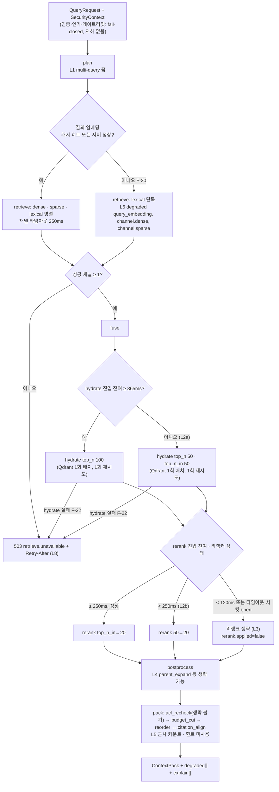
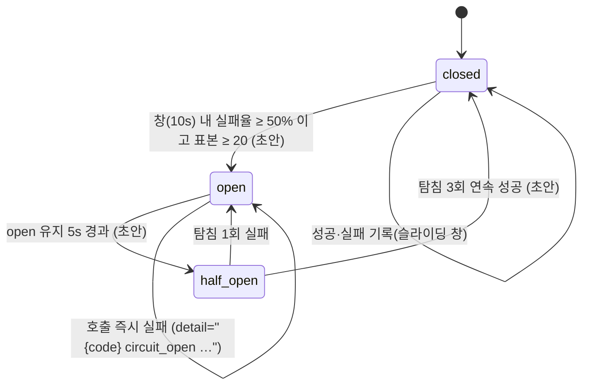

# 실패 모드와 회복력

## 목적

플랫폼의 모든 컴포넌트가 **어떻게 실패하고, 실패가 어디까지 번지며, 시스템이 무엇을 자동으로 하고, 사람은 무엇을 해야 하는지**를 한 곳에 고정한다. 설계 바이블은 이미 스테이지별 실패 정책(§4.2~4.4), 재시도 분류(§11.3), 세대 사가 보상(§11.4), 지연 예산(§8.3), 오류 카탈로그(§5.7)를 확정했다. 이 문서는 그 규칙을 바꾸지 않고 다음을 덧붙인다.

- 컴포넌트 × 실패 모드의 **FMEA(Failure Mode and Effects Analysis) 표** — 영향·감지·완화·복구·심각도를 한 행에 놓아 운영자가 증상에서 원인과 조치로 바로 갈 수 있게 한다.
- 검색 경로의 **우아한 성능 저하(graceful degradation) 사다리** — 어떤 순서로 무엇을 끄고, 무엇은 절대 끄지 않는지(보안 필터·ACL 재검증), 그리고 왜 "캐시 응답"이 마지막 계단이 될 수 없는지.
- **타임아웃 예산의 계층 규칙**, **서킷 브레이커(circuit breaker)·벌크헤드(bulkhead)·재시도 예산(retry budget)** 의 배치.
- **멱등성 보장의 검증 방법**(무엇을 죽여도 결과가 같아야 하는가), **카오스 테스트 계획**, **런북(runbook) 링크**, **SLO(Service Level Objective)와 에러 버짓(error budget)**.

## 범위

- 포함: 수집 경로(`fetch`~`publish`), 검색 경로(`plan`~`render`), 공용 인프라(PostgreSQL, Valkey, Temporal, 오브젝트 스토리지, Qdrant, OpenSearch, 사이드카, 모델 서버), 이벤트 릴레이. 프로파일은 `standard`를 기준으로 쓰고 `lite`·`premium`·`korean-gov` 차이는 표에 병기한다.
- 제외: 백업·복구의 절차 상세([백업과 재해 복구](../09-operations/07-backup-and-disaster-recovery.md)), 런북 본문([런북](../09-operations/06-runbooks.md)), 알림 규칙·대시보드 정의([관측성](../09-operations/03-observability.md)), 배포 토폴로지·HA 구성([배포 아키텍처](./08-deployment-architecture.md)), 보안 강제 지점의 의미론([멀티테넌시·보안 아키텍처](./07-multi-tenancy-and-security-architecture.md)), 워크플로우 정의·디스패처([오케스트레이션과 워크플로우](./06-orchestration-and-workflows.md)).
- 정본 관계: 오류 코드·열거값·이벤트·메트릭 이름은 바이블 §5.7·§6.5가 정본이다. 이 문서는 새 코드·열거값·메트릭을 만들지 않으며, 필요한 것은 `## 미해결 이슈`에 제안으로만 남긴다. 오류 계약의 상세는 [에러 모델](../03-contracts/13-error-model.md)(active, 이하 "13 문서")이 정본이며, 이 문서는 그중 §4.3(재시도 소진·포이즌 판정과 `retry` 재개), §4.4(질의 경로 재시도 — `hydrate` 1회, 그 외 0회), §5.2(`DegradedEntry.detail` 기록 규약), §6.3(`ProblemDetails.errors[]` 규칙), §7.1·§7.2(HTTP 상태·`Retry-After`), §3.3(바이블 §5.7 미등재 **제안 코드** — 채택 전 사용 금지)을 인용한다. 비기능 요구사항 ID(`NFR-AVL-01` 등)는 [비기능 요구사항](../01-requirements/02-non-functional-requirements.md)의 것이다.
- 수치 표기: 바이블·프로파일(§7.2)·NFR 문서에서 온 값은 출처를 적고, 이 문서가 새로 제안하는 값은 모두 **초안 목표**로 표시한다. 외부 도구(카오스 주입 도구 등)의 버전·API는 07-tech-landscape에 근거가 없으므로 "확인 필요(as of 2026-09)"로 둔다.

---

## 1. 회복력 원칙

### 1.1 실패에 대한 다섯 가지 반응

바이블 §11.3의 네 분류(`retryable`, `non_retryable`, `partial`, `fallback`)에 검색 경로의 다섯째 반응 **저하(degrade)** 를 더해 이 문서 전체에서 같은 단어를 쓴다. 검색 경로는 오케스트레이터를 거치지 않으므로(D-17) 재시도 대신 저하가 기본 반응이고, 실패는 예외가 아니라 **데이터**(`channel_runs[].status`, `degraded[]`, `rerank.applied=false`, `explain[]`)다([컴포넌트 아키텍처](./02-component-architecture.md) §6 B7).

| 반응 | 수집 경로에서 | 검색 경로에서 | 표현 |
|------|---------------|---------------|------|
| `retryable` | `StagePolicy.max_attempts`까지 지수 백오프, `Resumable` 재개 | `hydrate.backend_error` 1회만; 그 외 재시도 없음(13 문서 §4.4) | `StageError.retryable=true`, `ingest.document.retried` |
| `non_retryable` | 즉시 잡 `failed`, `index`는 사가 보상 후 실패 | 400/403/422 즉시 응답 | `StageError.retryable=false`, RFC 9457 |
| `partial` | 계속 진행, `quality=degraded` + `warnings[]` + `page_status[]`, 잡 `partial` | — | 봉투 `quality`, `EnrichStatus` |
| `fallback` | 폴백 체인(`parser_chain[]`), 다음 어댑터 | 리랭크 생략, 카운트 근사, 힌트 미사용 | `parser_chain[]`, `degraded[]`, `rerank.applied=false` |
| 저하(degrade) | — | 채널 제외, 단계 생략, 파라미터 축소; **최소 1채널 성공** 필요, 전 채널 실패만 503 `retrieve.unavailable` | `DegradedEntry{component, reason, detail}`, `explain[]` |

### 1.2 진실의 원천과 장애 반경

무엇이 파생 데이터인지 알면 복구 순서가 정해진다([저장소 아키텍처](./04-storage-architecture.md) §1.1, 바이블 §13).

| 저장소 | 진실(복구 불가 시 손실) | 파생(재구축 가능) | 검색 경로 의존 | 수집 경로 의존 |
|--------|--------------------------|-------------------|----------------|----------------|
| 오브젝트 스토리지 | 원본 바이트, 스테이지 산출물, 파생물, 부모 텍스트 번들 | — | `parent_expand`(번들 로드, Valkey 미스 시) | 모든 스테이지 |
| PostgreSQL 원장 | 테넌트·컬렉션·문서·ACL 정본, 잡, 멱등 키, 계보, 커밋 원장, 아웃박스 | — | **없음**(ADR-0034; 컬렉션 스펙은 api 캐시) — API 키 인증 조회는 §2.4 F-31 참조 | 모든 스테이지(스테이지당 1~2 트랜잭션) |
| Qdrant | 없음 | `IndexRecord` 벡터·payload 투영 | dense·sparse 채널, **`hydrate`**(standard·lite 모두) | `index` 사가 |
| OpenSearch | 감사 인덱스(`korean-gov`)만 | `IndexRecord` 렉시컬 투영 | lexical 채널 | `index` 사가 |
| Valkey | 없음 | 캐시·힌트·카운터·레이트리밋 창 | 캐시 미스 경로로 계속(단, 레이트리밋 fail-closed — §2.4 F-32) | 멱등 키 조회 캐시(미스 시 PG 판정) |
| Temporal(별도 PG DB) | 진행 중 워크플로우 히스토리 | — | 없음 | 실행 엔진(불가 시 잡 `queued` 유지) |

복구 1순위는 항상 **산출물 재적재(replay)** 이고 인덱스 스냅샷은 시간 단축용 2순위다(바이블 §11.4 (4), NFR-REL-12).

---

## 2. FMEA 표

### 2.1 등급 정의

| 심각도 | 정의 | 예 |
|--------|------|----|
| S1 치명 | 교차 테넌트 노출, 데이터 손실, 복구 불가 정합성 붕괴 | ACL 회수 힌트 유실 후 재노출, 원장 유실 |
| S2 높음 | SLO 위반(검색 가용성·지연) 또는 테넌트 전체 수집 정지 | 전 채널 실패 503, Temporal 장기 불가 |
| S3 중간 | 저하 응답, 일부 문서 실패·지연 | 리랭크 생략, OCR 페이지 타임아웃 |
| S4 낮음 | 사용자 비가시, 운영 비용만 | 캐시 미스 증가, 중복 이벤트 |

감지 등급: **D1** 자동·즉시(요청 경로 안에서 판정), **D2** 자동·지연(메트릭·정합성 검사·조정 틱), **D3** 수동(운영자 관찰). 행 ID `F-nn`은 §8 카오스 실험과 §9 런북 표가 참조한다.

### 2.2 수집 경로

| ID | 컴포넌트 | 실패 모드 | 영향 | 감지 | 완화(자동) | 복구(수동·후속) | 심각도 |
|----|----------|-----------|------|------|------------|-----------------|--------|
| F-01 | `fetch` | 원천 4xx(권한·부재), 크기 초과, 스킴 미지원, egress 위반 | 해당 문서 잡 `failed` | D1 `fetch.access_denied`·`not_found`·`too_large`·`scheme_unsupported`·`egress_denied`(비재시도) | 즉시 실패, `ingest.document.failed` 웹훅; 다른 문서 영향 없음(NFR-REL-08) | 클라이언트가 URI·권한·`EgressPolicy` 수정 후 재접수(새 `Idempotency-Key`) | S4 |
| F-02 | `fetch` | 원천 5xx·네트워크·느린 응답 | 잡 지연 | D1 `fetch.timeout`·`fetch.upstream_error`(재시도), `start_to_close` 5m | 5회 지수 백오프(최대 간격 1m), `connect_timeout_ms` 5,000, 조건부 GET(검증자 있을 때) | 소진 시 `failed`; 원천 복구 후 `POST /v1/jobs/{job_id}/retry` | S3 |
| F-03 | `fetch` | 부분 다운로드·바이트 손상 | 잘못된 원본 저장 위험 | D1 `content_hash` 확정 후 `Content-Length`·검증자 불일치 → 재시도 | 콘텐츠 주소화 저장이므로 손상 바이트는 다른 해시로 저장되어 정상 원본을 덮어쓰지 않음 | — | S4 |
| F-04 | `detect`·`parse` | 미지원·손상·암호화·배포용 문서 | 문서 잡 `failed` | D1 `parse.unsupported_format`·`corrupt_container`·`document_encrypted`·`distribution_document`·`unsupported_variant`(비재시도) | 즉시 실패; 배포용은 테넌트 `allow_distribution_documents` 시 Tika 텍스트 `quality=degraded` | `credentials_ref` 제공 또는 정책 변경 후 재처리 | S4 |
| F-05 | `parse`(in_process) | 파서 **무한 루프·행(hang)** | 워커 슬롯 점유, 문서 지연 | D1 `start_to_close`(텍스트 15m / OCR 60m) — **래퍼 타이머 하트비트가 행을 가리므로** `heartbeat_timeout`으로는 감지되지 않음(§4.2) | 타임아웃 시 액티비티 실패 → 재시도 3회 → `failed`; 페이지 단위 타임아웃(O-08 CPU 60s / GPU 20s)은 어댑터 내부에서 `page_status=timeout` | 진행 정지 감지 규칙(§4.2 제안) 도입; 재현 샘플을 계약 코퍼스에 추가 | S3 |
| F-06 | `parse`(helper_process·sidecar) | 네이티브 크래시(ctypes segfault), JVM OOM, LibreOffice 좀비 | 어댑터 실패, 사이드카 재시작 | D1 헬퍼 비정상 종료 → `parse.conversion_failed`(폴백); 사이드카 5xx·연결 실패 → `parse.sidecar_unavailable`(재시도 후 폴백), `rag_parser_sidecar_unavailable_total` | 격리 사다리(`in_process`/`helper_process`/`sidecar`, ADR-0033)로 워커 프로세스 보호; 폴백 체인(`parser_chain[]`); 사이드카 tini·프로세스 그룹 KILL·프로파일 락 | 체인 소진 시 `failed`; 포이즌 문서 격리(F-36) | S3 |
| F-07 | `parse`(OCR) | OCR 지연·GPU 큐 적체 | 스캔 문서 처리 지연(브리프 §7 100p < 5min 위협) | D2 `rag_ingest_stage_duration_seconds{stage="parse"}` p95, 큐 백로그(KEDA 신호) | 페이지 단위 하트비트·`Resumable`(`heartbeat_details.page`), `start_to_close` 60m, `premium`은 `ingest-gpu-ocr` 별도 큐(벌크헤드), KEDA 스케일 아웃, 페이지 타임아웃 → `page_status=timeout` + 계속 | `partial` 잡은 `retry?stages=parse`가 아닌 재처리(`reprocess from_stage=parse`)로 재OCR; GPU 용량 증설 | S3 |
| F-08 | `parse`(OCR 사이드카) | `ocr-gpu` 사이드카 다운·CUDA 오류 | premium 스캔 문서 정지 | D1 `parse.sidecar_unavailable`; D2 사이드카 `/healthz` | 재시도 후 폴백 체인(RapidOCR CPU → Tesseract), `quality=degraded`·`Block.source=ocr`·`confidence` 기록 | 사이드카 재기동 런북(RB-06) | S3 |
| F-09 | `normalize` | PII 검출기 로딩·호출 실패 | 문서 잡 지연 → 실패 | D1 `normalize.pii_detector_unavailable`(재시도), `rag_pii_detector_errors_total` | 재시도 3회; **`keep` 폴백 금지**(E4) — 소진 시 잡 `failed` | 모델 캐시 복구 후 `retry` | S3(보안상 fail-closed 의도) |
| F-10 | `normalize`·`chunk` | 정규화 잔여(NFD)·토크나이저 부재·청크 수 초과 | 문서 잡 `failed` | D1 `normalize.nfd_residual`, `chunk.tokenizer_missing`, `chunk.count_exceeded`(최종) 비재시도 | `chunk.block_oversized`는 경고 후 강제 분할; `count_exceeded`는 행 그룹 확대 후 1회 재시도 | 버그 수정(정규화)·프로파일 토크나이저 확인 | S4 |
| F-11 | `enrich`(LLM) | 외부 LLM 불가·한도·예산 소진 | 보강만 누락 | D1 `enrich.llm_unavailable`(재시도 5, 최대 간격 5m), `enrich.budget_exceeded` → `partial`, `enrich.extractor_timeout` → 빈 배열 + `status=partial` | 비LLM 결과는 커밋(잡 `partial`), `ingest-llm` 큐 격리 + Valkey 테넌트 토큰 버킷 | `POST /v1/jobs/{job_id}/retry?stages=enrich` | S4(기본 끔, O-05) |
| F-12 | 임베딩 서버(vLLM pooling / TEI) | **서버 다운·과부하** | `embed` 스테이지 정지 → `ingest-gpu-embed` 큐 적체 | D1 `embed.server_unavailable`(재시도 5, 최대 간격 5m), 서킷 브레이커 open(§5.1); D2 큐 백로그·임베딩 서버 자체 헬스 체크(서킷 half-open 탐침)·api `/healthz` 의존성 상태(§3.4) | 어댑터 서킷 open 시 즉시 `embed.server_unavailable`로 실패해 Temporal 백오프에 맡김(연결 시도 폭주 방지); KEDA(Prometheus)로 서버 복제 증가; 적체는 `tenant_concurrent_jobs_max`로 유계. **폴백 모델 없음** — 다른 모델은 `embedding_space_id`가 달라 같은 공간에 적재할 수 없다(`embed.space_mismatch` 비재시도, ADR-0009) | 서버 복구 후 자동 재개(`heartbeat_details.batch_offset` 재개); 소진 시 `failed` → 원인 해소 후 `retry`(캐시 산출물 재사용). **주의:** 현 정책(5회, 백오프 1s·2s·4s·8s)은 연결 거부 시 약 15s, 타임아웃 시 약 10분 안에 소진되어 "최대 간격 5m"에 도달하지 못하므로 수 분의 서버 재기동을 견디지 못할 수 있다(미해결 이슈 16) | S2(수집) |
| F-13 | 임베딩 서버 | **모델 버전 불일치**(서버가 프로파일과 다른 `model_id@revision`·차원·정규화를 서빙) | 잘못된 벡터가 같은 공간에 적재될 위험 | D1 어댑터 `warmup`·`health`에서 서빙 모델 식별자 ↔ 프로파일 `embedding_space_ids` 대조 → 불일치 시 `embed.space_mismatch`(비재시도) + 워커 `/readyz=false`; `Producer.model_ids`·`image_digest`가 `fingerprint`에 포함되어 `stage_key`가 갈림 | 배치 전체 거부(1건도 적재 안 함); 같은 공간 서빙 교체는 코사인 ≥ 0.9999 동등성 게이트 통과 시에만(D-16) | 잘못 적재된 세대가 있으면 `IndexCommit.embedder_fingerprint`로 식별 → `reprocess from_stage=embed` | S1(품질 조용한 회귀) → 게이트로 S4화 |
| F-14 | `index`(Qdrant) | upsert 실패·타임아웃(플립 전) | 커밋 `pending`~`vector_written` 정지 | D1 `index.backend_unavailable`(재시도 5), 원장 `index_commits.status` | 재시도(`record_id` 멱등 upsert); 소진 시 `rolling_back` → `delete_by_filter(commit_id)` 양 백엔드 → `rolled_back`, `index.commit.rolled_back` | 백엔드 복구 후 `retry`(같은 `commit_id`·세대 재사용) | S3 |
| F-15 | `index`(OpenSearch) | bulk 실패(플립 전) | 동일 | 동일 | 동일 보상(Qdrant에 이미 쓴 새 세대 삭제) | 동일 | S3 |
| F-16 | `index` 사가 | **플립 중 실패**(`flipping_lexical` 완료 후 Qdrant `set_payload` 실패) | 수 초~수 분 혼합 상태(렉시컬은 N+1, 벡터는 N) | D1 `CommitStatus=flipping_vector`에서 예외; 관측 `ContextPack.diagnostics.index_generations_seen` | 보상: 이전 세대(`previous_commit_id`) `is_current=true` 복원 양 백엔드 → 새 세대 삭제 → `rolled_back`(`compensation.restored_generation=N`); 복원 실패 → `failed` + `index.consistency.mismatch` | `maintenance.consistency.v1`이 세대별 `is_current` 카운트 대조 → 산출물 재적재; 런북 RB-03 | S2 |
| F-17 | `index` | 보안 필드 누락·세대 충돌 | 배치 전체 거부 | D1 `index.security_fields_missing`·`index.generation_conflict`(비재시도) | E5 배치 거부(1건도 쓰지 않음); 디스패처 문서 직렬화가 충돌을 예방, 코드는 안전망 | 계약 위반 버그 수정 | S1(예방) |
| F-18 | `publish`·아웃박스 | 원장 트랜잭션 성공 후 액티비티 완료 보고 전 워커 사망 | 재실행 | D1 Temporal 재시도 | `event_id`·`commit_id` 워크플로우 발급 → `outbox` PK 충돌 무시, `jobs.stage` 단조 가드([오케스트레이션](./06-orchestration-and-workflows.md) §3.2) | — | S4 |
| F-19 | 릴레이·웹훅 | 수신자 5xx·타임아웃, egress 위반, 릴레이 정지 | 알림 지연·미전달 | D1 `outbox.relay_failed`(재시도, `attempts`), `outbox.egress_denied`(비재시도); D2 `rag_outbox_lag_seconds` > `outbox_lag_slo`(standard 5s) | 지수 백오프, 소비자 `event_id` 멱등, SSE는 `Last-Event-ID`로 `outbox` 직접 재생 | 소진 시 `published_at` NULL + 알림; 수신자 복구 후 운영자가 재발행 트리거(RB-08) | S3 |

### 2.3 검색 경로

| ID | 컴포넌트 | 실패 모드 | 영향 | 감지 | 완화(자동) | 복구 | 심각도 |
|----|----------|-----------|------|------|------------|------|--------|
| F-20 | 임베딩 서버(질의) | 다운·타임아웃 → 질의 임베딩 불가 | dense·sparse 채널 실행 불가 | D1 `qemb:` 캐시 미스 + 호출 실패/서킷 open | 캐시 히트 질의는 정상; 미스 질의는 **lexical 단독**으로 계속 + `degraded{query_embedding, unavailable}` + `degraded{channel.dense, unavailable}` + `degraded{channel.sparse, unavailable}`, `explain += lexical_only_hit`; `lite`는 `sparse_bm25`가 lexical 채널이므로 동일하게 계속 | 서버 복구 시 서킷 half-open 탐침으로 자동 복귀 | S3(품질 저하, 가용성 유지) |
| F-21 | Qdrant | **부분 장애**(일부 샤드 지연·타임아웃, 노드 1대 다운) | dense·sparse 채널 지연 | D1 채널 타임아웃 250ms(`retrieve.channel_timeout`), `retrieve.backend_error` | 채널 제외 + `degraded{channel.dense\|sparse, timeout}`; `hydrate`는 정상 노드로 1회 재시도(`hydrate.backend_error`) | 복제 수 ≥ 2(NFR-AVL-05)로 노드 장애 흡수; 런북 RB-04 | S3 |
| F-22 | Qdrant | **전면 장애** | `standard`: dense·sparse 제외 가능하지만 **`hydrate`가 Qdrant 1회 배치 조회**(바이블 §4.3)이므로 lexical 후보도 payload를 채울 수 없음 → 503 `retrieve.unavailable`; `lite`: 전 채널 실패 → 503 | D1 `hydrate.backend_error` 1회 재시도 후 503, 서킷 open; D2 `/readyz`(Qdrant는 `hydrate` 백엔드라 readiness 필수 의존성, §3.4·08 문서 §10.2) | 두 구간으로 나뉜다 — (a) 파드가 NotReady로 전환되기 전(readiness 프로브 주기 동안)의 진행 중·신규 요청은 **앱 503** `retrieve.unavailable` + `Retry-After` 5s(13 문서 §7.2 초안, L8); (b) NotReady 전환 후에는 인그레스가 엔드포인트를 제거해 신규 요청은 **인그레스 503**(본문이 `application/problem+json`인지는 13 문서 §7.1 "확인 필요" 항목, `Retry-After` 없음). api 프로세스는 계속 기동(fail-fast) | 복구 후 자동; "렉시컬만" 저하를 완성하려면 `hydrate` 폴백 소스(OpenSearch `_source` 미러)가 필요 — 미해결 이슈 2 | S2 |
| F-23 | OpenSearch | 부분·전면 장애, DLS JWT 거부(시계 왜곡 포함) | lexical 채널 제외 | D1 `retrieve.channel_timeout`·`retrieve.backend_error` | **dense + sparse 단독**으로 계속 + `degraded{channel.lexical, unavailable}`(NFR-REL-13의 정의 사례); `hydrate`는 영향 없음. 전제: OpenSearch는 `/readyz` 의존성이 아니다(08 문서 §10.2·P6, §3.4) — readiness에 있으면 전 api 파드가 NotReady가 되어 이 저하 응답이 나가지 못한다 | 복구 후 자동 | S3 |
| F-24 | 리랭커 서버(TEI) | 다운·타임아웃(300ms)·응답 스키마 불일치 | 리랭크 생략 | D1 `rerank.timeout`·5xx → 폴백, `rag_rerank_fallback_total`; `rerank.schema_mismatch`(구성 오류, 양 스키마 파서) | fused 순서 반환, `rerank.applied=false`, `explain += rerank_skipped`, `degraded{rerank, timeout\|unavailable}`; 팩 충분성은 바이블 §9.1 충분성 행대로 `sufficiency.status=unknown`(리랭크 생략 + 캘리브레이션 없음); 항목별 `confidence_tier`(바이블 §5.5 `ContextItem`, 리랭크 정규 점수 구간)만 정본 규칙이 없어 `low` + `explain += rerank_skipped` 제안(미해결 이슈 6) | KEDA·복구 후 자동 | S3 |
| F-25 | `plan`(LLM 변형) | `quality` 변형 LLM 실패 | 재작성·self-query 생략 | D1 `plan.llm_failed` | 원 질의 + 형태소 키워드, `route=single`, `degraded{planner_llm, llm_failed}` | — | S4 |
| F-26 | `pack` | 대상 LLM `count_tokens` API 실패 | 토큰 예산 근사 | D1 `pack.count_api_failed` | `tok:` 캐시 → 근사 + `calibration_ratio` + 10% 마진, `degraded{token_count, approximate_count}` | — | S4 |
| F-27 | `pack` `acl_recheck` | Valkey `aclrev:` 힌트 조회 실패 | ACL 회수·삭제 전파 창(≤ `acl_propagation_slo`) 동안 이미 회수된 문서가 재노출될 수 있음 | D1 `pack.acl_hint_unavailable` → `degraded{acl_recheck, unavailable}`, `rag_acl_recheck_denied_total` 급감 | payload ACL·embargo·expires는 여전히 `as_of`로 재평가(E9); 힌트만 손실 | Valkey 복구 시 자동; `korean-gov`는 Valkey HA 필수(§2.4 F-32) | S1 후보(보안 창) — HA로 S3화 |
| F-28 | `postprocess` | 부모 텍스트 번들 미스(Valkey 미스 + 오브젝트 스토리지 지연) | 부모 확장 생략 | D1 `postprocess.parent_text_miss` | 확장 생략 + `degraded{parent_expand, unavailable}`; 예산 초과 시 정책상 생략(`latency_budget`) | — | S4 |
| F-29 | `hydrate` | 세대 플립 경합으로 일부 `record_id` 누락 | 후보 일부 제외 | D1 누락 레코드 → `degraded{hydrate, partial_result}`, `explain += hydrate_missing`, `rag_hydrate_missing_total` | 항목 제외 후 계속(`omitted.reason=hydrate_missing`) | 지속 증가 시 `maintenance.consistency.v1` 조기 실행 | S4 |
| F-30 | 인증·인가·레이트리밋 | OIDC JWKS 조회 실패, Cedar 정책 로딩 실패 | 요청 거부 | D1 401/403(fail-closed) | JWKS 캐시(키 회전 주기 내), 정책 인메모리 캐시 + `policy_version` | IdP 복구; 캐시 TTL은 07 문서 소유 | S2(가용성) |

### 2.4 플랫폼 인프라

| ID | 컴포넌트 | 실패 모드 | 영향 | 감지 | 완화(자동) | 복구 | 심각도 |
|----|----------|-----------|------|------|------------|------|--------|
| F-31 | PostgreSQL 원장 | 다운·페일오버·잠금 폭주·디스크 풀 | **수집 정지**(모든 스테이지가 원장 트랜잭션), `POST /v1/ingest` 503 + `Retry-After`(30s 초안, 13 문서 §7.2) — **채택된 코드 없음**: 13 문서 §3.3 `api.dependency_unavailable` 조기 채택 필요(미해결 이슈 15), 잡 조회 실패; **검색은 계속**(ADR-0034) — 단, API 키 인증(`api_keys` 조회)은 캐시 미스 시 실패(미해결 이슈 3) | D1 액티비티 예외(미분류 → 재시도 가능, B2), `statement_timeout`(API 5s / 워커 60s); D2 `/healthz` 의존성 상태 반영 ≤ 10s(NFR-AVL-06; PG는 `/readyz` 미포함, §3.4) | 동기 복제 1 + 자동 페일오버, PITR(RPO ≤ 5min, NFR-REL-15), Temporal은 별도 DB로 장애 반경 분리; 워커는 트랜잭션 실패를 재시도로 흡수(`stage_key` 캐시로 재실행 비용 최소) | 페일오버 후 조정 틱이 `queued` 잡 재시작·`running` 잡 대조([오케스트레이션](./06-orchestration-and-workflows.md) §6.3); 런북 RB-01 | S2 |
| F-32 | Valkey | 전면 장애 | 캐시 미스(+40ms 질의 임베딩, 토큰 카운트 API 부하), `idem:` 미스 → PG 판정, MCP 커서 무효, 그룹 확장 재계산, `aclrev` 힌트 손실(F-27); **레이트리밋은 운영 fail-closed(바이블 §7.2 `security.rate_limit.fail_mode`)이므로 Valkey 불가 = 전 요청 429 위험** | D1 커맨드 타임아웃(§4.1) → 미스 처리; D2 `/healthz` 의존성 상태(`degraded`)·커맨드 타임아웃 메트릭(Valkey는 `/readyz` 미포함, §3.4) | 캐시 미스 허용(NFR-AVL-09: 성공률 ≥ 99%, p95 ≤ 1.5배); 복제 + 자동 페일오버(ENV-M) | 레이트리밋 fail-closed와 NFR-AVL-09의 충돌은 ISS-NFR-19·미해결 이슈 4(인메모리 로컬 토큰 버킷 폴백 제안) | S2(레이트리밋 경로) / S4(캐시) |
| F-33 | Temporal 서버 | frontend/history 불가, DB 불가 | 새 잡 시작 불가(API 503 + `Retry-After` 30s 초안, 잡 `queued` 유지, 바이블 §11.5) — **채택된 코드 없음**: 13 문서 §3.3 `api.orchestrator_unavailable` 조기 채택 필요(`retrieve.unavailable` 오용 금지, 미해결 이슈 15), 진행 중 액티비티는 완료 보고·하트비트 실패 → 재시도, 스케줄 잡 지연; **검색 무영향** | D1 `start_workflow` RPC 오류; D2 조정 틱(10s), Temporal 서버 메트릭 | 조정 틱이 api 프로세스 타이머라 Temporal 없이도 동작; 워커 재실행은 `stage_key`·`record_id`·`event_id` 멱등 | 서버 HA(frontend 2 / history 2, ENV-M); 복구 후 자동 재개; 런북 RB-02 | S2(수집) |
| F-34 | 오브젝트 스토리지 | 불가·쿼터 초과(**디스크 풀**) | 산출물 저장 실패 → 스테이지 실패(재시도), `fetch` 원본 저장 실패; 검색은 부모 번들 로드만 영향(`ptxt:` 캐시 미스 시) | D1 put 예외(미분류 → 재시도); D2 버킷 사용량 알림 80% / 90%(초안 목표) | 재시도 백오프; 수명주기 규칙(스냅샷 보존, 04-storage §3.3) | 쿼터 증설; 정리는 `maintenance.cleanup.v1` 범위 밖(산출물은 계보용 보존) — 테넌트 purge는 미해결 이슈(06 문서 8) | S2 |
| F-35 | Qdrant·OpenSearch·PG·워커 디스크 | 디스크 풀(OpenSearch flood-stage 시 인덱스 read-only 블록, Qdrant WAL 쓰기 실패, PG 쓰기 실패, 워커 임시 디렉터리 풀) | 쓰기 실패(`index.backend_unavailable` 재시도 → 보상), 검색은 계속(읽기 가능); PG는 F-31로 전이; 워커는 사이드카 변환·모델 캐시 실패 → `parse.conversion_failed` 폴백 | D2 디스크 사용량 알림 80% / 90%(초안 목표), 백엔드 자체 경고 | 사가 보상으로 부분 커밋 없음; 세대 `cleanup_delay`(1h) 뒤 이전 세대 삭제로 2배 공존 상한 | 용량 증설 후 `retry`; 런북 RB-05 | S2 |
| F-36 | 워커·큐 | **포이즌 메시지**(같은 문서가 워커를 반복 크래시시킴: OOMKilled, segfault) | 재시도마다 워커 프로세스 손실, 슬롯 점유 | D1 `heartbeat_timeout`(워커 사망) → 재시도, `max_attempts`(parse 3) 소진 → `failed` + `last_error`. **포이즌 판정은 별도 코드가 아니다**(13 문서 §4.3): `JobStatus.state=failed` ∧ `last_error.retryable=true` ∧ `attempts ≥ StagePolicy.max_attempts`; D2 같은 `content_hash`의 반복 실패(원장 `jobs.last_error` 집계) | 격리 사다리로 프로세스 손실을 헬퍼·사이드카에 한정; 컨테이너 메모리 상한 + `fetch.max_bytes`(200MB) + 블록 200,000 상한; 시도 상한이 있어 무한 재시도 없음 | **DLQ 등가** = `jobs.state=failed` + `last_error` + `POST /v1/jobs/{job_id}/retry`(바이블 §11.5, 13 문서 §4.3; 별도 큐 없이 NFR-REL-06 "DLQ 이동 + 관리 API 재처리"에 대응). 격리 목록(quarantine)은 그 위의 자동 재시도·재접수 금지 규칙: 같은 `content_hash`가 2개 잡에서 연속 `failed`면 거부 — 계약 필드 없음, 미해결 이슈 5 제안; 런북 RB-07 | S3 |
| F-37 | 릴레이 | 포이즌 이벤트(수신자가 특정 이벤트를 항상 5xx) | 해당 구독 큐 정체 | D1 `outbox.attempts` 소진; D2 `rag_outbox_lag_seconds` | 구독별 순서는 `event_id` 오름차순이지만 소진 이벤트는 `published_at` NULL로 남기고 다음 이벤트 진행(정체 전파 차단) | 운영자 재발행(RB-08) | S4 |
| F-38 | 모델 서빙(리랭커·OCR·분석기) | 버전 불일치(리랭커 모델 교체 후 `calibration_ref` 미갱신, `analyzer_id`·`dictionary_hash` 불일치) | `confidence_tier`·`tau` 왜곡; 색인·질의 토큰화 불일치로 lexical recall 저하 | D1 `plan` 6단계 `analyzer_id` 대조 → `degraded{channel.lexical, analyzer_mismatch}`; D2 `rag_eval_metric_value` 야간 회귀 | `IndexCommit.analyzer_id`·`dictionary_hash`·`embedder_fingerprint` 기록(NFR-REL-14); 사전 변경은 렉시컬 재색인 제안 응답 | `calibrations` 재계산; 렉시컬 재색인 | S3 |
| F-39 | 모든 노드 | **시계 왜곡(clock skew)** | (a) `SecurityContext.as_of` 오차 → embargo·expiry 판정 오차, (b) OpenSearch DLS 요청별 JWT(TTL ≤ 60s) 거부 → lexical 채널 실패(F-23), (c) 웹훅 `RAG-Signature` 5분 재생 창 거부, (d) ULID 시간 비트 어긋남 → 디스패처 순서 미세 변동(무해), (e) `deadline_at`·TTL 판정 오차, (f) 지연 예산 계산 오류 | D2 노드 NTP 오프셋 알림 > 1s(초안 목표); D1 JWT 검증 실패율 급증 | 모든 시각은 서버 `now()`·UTC(클라이언트 시각 불신, D-09 `as_of` 제거); 지연 예산은 단조 시계(`time.monotonic()`)로만 계산; JWT 검증 여유(leeway) 30s(초안 목표); Temporal `workflow.now()`는 서버 시각·재생 결정적 | NTP/chrony 강제(배포 매니페스트, 08 문서), 런북 RB-09 | S3(보안 판정은 fail-closed 방향) |
| F-40 | KEDA·GPU | 0→1 스케일 지연, GPU 경합·MIG 프로파일 불일치 | 임베딩·OCR 처리량 저하 | D2 큐 백로그, 서버 p95 | `minReplicaCount: 1`, 전용 GPU 또는 MIG(초안), 벌크헤드로 검색 리랭커와 수집 임베딩 서버 분리(§5.2) | 용량 계획([확장과 성능](../09-operations/04-scaling-and-performance.md)) | S3 |
| F-41 | api 배포 | 롤링 업데이트 중 연결 끊김, SSE 스트림 단절 | 요청 실패 < 0.1%, SSE 재접속 | D2 배포 중 오류율(NFR-AVL-04) | 연결 드레이닝 ≤ 30s, SSE `Last-Event-ID` 재생, 워커는 `WAIT_CANCELLATION_COMPLETED`로 사가 중단 없음 | — | S4 |

---

## 3. 검색 경로의 우아한 성능 저하

### 3.1 저하 사다리

**결정:** 검색 경로의 저하 순서는 바이블 §8.1 6단계(사전 저하)와 §8.3(예산 초과 축소)을 합친 아래 사다리 하나로 고정한다. 사다리를 내려가게 하는 트리거는 둘 — **예산 부족**(사전: `QueryRequest.budget.max_latency_ms < total`, 런타임: `QueryPlan.latency_budget_ms` 잔여)과 **의존성 실패**(서킷 open·타임아웃·오류) — 이고, 각 계단은 반드시 `DegradedEntry`를 남긴다. 두 트리거가 밟는 계단의 집합은 다르다: **사전 저하**는 바이블 §8.1 6단계 순서 그대로 **L1 → L2a → L3 → L6**만 밟고(L4·L5는 §8.3의 런타임 전용 계단이라 사전 저하 순서에 없다), **런타임 예산 부족·의존성 실패**는 트리거가 발생한 단계의 계단(L2a/L2b/L3/L4/L5/L6/L6')을 그 시점에 밟는다. 절대 내려가지 않는 계단은 **보안 필터·`acl_recheck`·`security_context` 검증**이다(E6·E7·E9: 실패는 항목 제외 또는 요청 실패, 생략 불가).

| 계단 | 조치 | 트리거 | 기록(`DegradedEntry`) | 품질 영향 |
|------|------|--------|------------------------|-----------|
| L0 | 정상 | — | 없음 | — |
| L1 | multi-query 변형 끔(원 질의만) | 사전 저하 1순위(`QueryRequest.budget.max_latency_ms < total`, 바이블 §8.1 6단계) 또는 `quality` LLM 실패 | `multi_query`·`planner_llm`, `latency_budget\|llm_failed` | 소 |
| L2a | `hydrate.top_n`·`rerank.top_n_in` 100 → 50 | 사전 저하 2순위(바이블 §8.1), 또는 **hydrate 진입 시** 잔여 < 365ms(= hydrate 15 + rerank 250 + postprocess 60 + pack 40, 바이블 §8.3). 바이블 §7.4 (11) `hydrate.top_n ≥ max(rerank.top_n_in, pack.k_max)`는 50 ≥ max(50, 20)으로 유지 | `hydrate`·`rerank`, `latency_budget`(`detail: top_n=50`) | 소 |
| L2b | `rerank.top_n_in` 100 → 50만(`hydrate`는 이미 끝남) | **rerank 진입 시** 잔여 < 250ms(바이블 §8.3) | `rerank`, `latency_budget`(`detail: top_n_in=50`) | 소 |
| L3 | 리랭크 생략(fused 순서) | 사전 저하 3순위, 또는 rerank 진입 시 잔여 < 120ms, 또는 리랭커 타임아웃(300ms)·5xx·서킷 open | `rerank`, `latency_budget\|timeout\|unavailable`; `rerank.applied=false`, `explain += rerank_skipped` | 중 |
| L4 | `parent_expand`·`sentence_window`·`compress` 생략 — **런타임 전용**(바이블 §8.3; 사전 저하 순서에 없음) | postprocess 진입 시 잔여 < 60ms, 또는 번들 미스 | `parent_expand\|sentence_window\|compress`, `latency_budget\|unavailable` | 중 |
| L5 | 토큰 카운트 근사(`approximate` + `calibration_ratio`), ACL 힌트 미사용(payload 판정) — **런타임 전용**(바이블 §8.3) | `count_tokens` API 실패·예산, `aclrev` 조회 실패 | `token_count, approximate_count`; `acl_recheck, unavailable` | 소(정확도) |
| L6 | 채널 축소 — **lexical 유지**, dense·sparse 중 실패·지연 채널 제외 | 사전 저하 4순위(`QueryRequest.budget.max_latency_ms` 부족 시 바이블 §8.1 "채널 축소(lexical 유지)"), 또는 채널 타임아웃 250ms, 백엔드 오류, 질의 임베딩 불가(F-20) | `channel.dense\|channel.sparse, timeout\|unavailable\|latency_budget`; `query_embedding, unavailable` | 중~대 |
| L6' | 채널 축소 — lexical 제외, dense + sparse 유지 | OpenSearch 실패(F-23)·`analyzer_id` 불일치(F-38); 예산 부족만으로는 밟지 않음 | `channel.lexical, unavailable\|analyzer_mismatch` | 중 |
| L7 | **최소 1채널 성공 + `hydrate` 성공** 이면 응답 | — | 위 항목 누적 | — |
| L8 | 503 `retrieve.unavailable` + `Retry-After`(5s 초안, 13 문서 §7.2) | 전 채널 실패 또는 `hydrate` 1회 재시도 후 실패(F-22) | `ProblemDetails.errors[]`에 채널별 `StageError`(13 문서 §6.3 H3) | 실패 |

흔히 제안되는 "리랭커 끔 → sparse 끔 → 캐시 응답" 순서와 비교하면 앞 둘은 L3·L6에 해당하지만, **"sparse만 먼저 끈다"는 규칙은 두지 않는다** — 어느 채널을 제외하는지는 실패한 채널이 결정하며, 예산 부족만으로 채널을 끌 때는 바이블 §8.1의 "채널 축소(lexical 유지)"를 따른다(dense·sparse는 같은 Qdrant 호출 비용 구조라 둘 중 하나만 끄는 것은 이득이 작고, lexical은 한국어 형태소 recall의 마지막 보루다). "캐시 응답"은 §3.3에서 금지한다.



### 3.2 백엔드 부분 장애 시 가능한 채널 조합(`standard`)

| 상태 | dense | sparse | lexical | `hydrate` | 응답 | 기록 |
|------|-------|--------|---------|-----------|------|------|
| 정상 | 예 | 예 | 예 | 예 | 정상 | — |
| OpenSearch 불가 | 예 | 예 | 제외 | 예 | **벡터만**(정상 응답) | `channel.lexical, unavailable` |
| Qdrant 부분(타임아웃) | 제외 또는 지연 | 제외 또는 지연 | 예 | 예(정상 노드) | 렉시컬 + 성공 채널 | `channel.dense\|sparse, timeout` |
| Qdrant 전면 불가 | 제외 | 제외 | 예 | **불가** | 503(F-22) | `errors[]` |
| 임베딩 서버 불가, 캐시 미스 | 제외 | 제외 | 예 | 예 | **렉시컬만** | `query_embedding, unavailable` + 채널 2건 |
| 리랭커 불가 | 예 | 예 | 예 | 예 | fused 순서 | `rerank, unavailable` |
| Valkey 불가 | 예(+40ms) | 예 | 예 | 예 | 정상(근사 카운트·힌트 미사용) | `token_count`, `acl_recheck` |

`lite`는 Qdrant 단독(dense + `sparse_bm25`=lexical)이므로 Qdrant 불가는 곧 503이며, 이는 단일 노드 프로파일의 의도된 한계다. 이 표의 "정상 응답"·"렉시컬만"·"벡터만"은 모두 §3.4의 readiness 규칙(08 문서 §10.2가 이미 그렇게 정의한다)을 전제한다 — OpenSearch·Valkey가 `/readyz` 의존성이면 인그레스가 트래픽을 끊어 저하 응답 자체가 나가지 못한다.

### 3.3 "캐시 응답" 계단을 두지 않는 이유

**결정:** 검색 결과(`CandidateSet`·`RankedSet`·`ContextPack`)를 캐시해 백엔드 불가 시 돌려주는 계단은 **금지**한다. 근거: (1) 바이블 §4.3은 `retrieve`·`hydrate`에 "결과 캐시 금지(ACL 시점성)"를 명시한다 — 캐시된 팩은 `as_of` 시점의 embargo·expiry·회수 힌트 판정을 우회해 E9를 무력화한다. (2) 세대 플립·삭제 후 캐시된 결과는 `is_current=false` 레코드를 노출한다(NFR-REL-07 위반). (3) 저하 응답은 `degraded[]`로 사실을 알려야 하는데(NFR-REL-13) 캐시 응답은 "그때는 맞았던 답"이라 저하 사실을 표현할 수 없다. 허용되는 캐시는 바이블 §13.4 Valkey 키 행의 **중간값 캐시**만이다 — 콘텐츠 해시 키 `qemb:{space}:{hash}`(24h)·`tok:{tokenizer_id}:{hash}`(7d)·`rr:{model}:{hash}`(60s)(테넌트 접두 예외)와 테넌트 스코프 키 `plan:{tenant}:{profile_hash}:{hash}`(5m; 주체 해시 포함)·`ptxt:{tenant}:{chunk_set_blake3}`(24h). 이들은 결과가 아니라 **계산의 중간값**이고 ACL 판정 뒤에 소비된다.

### 3.4 readiness 의존성 규칙

**결정:** 저하 사다리가 성립하려면 `GET /readyz`(바이블 §14)가 요구하는 의존성과 저하 가능한 의존성을 구분해 고정해야 한다. 이 구분은 [배포 아키텍처](./08-deployment-architecture.md) §10.2·P6이 이미 확정했고 이 문서는 그것을 **그대로 채택**한다: `/readyz` = **프로파일·컬렉션 스펙 캐시 적재 + `hydrate` 백엔드(Qdrant, `standard`·`lite` 공통) 도달**만이며, OpenSearch·PG·Temporal·Valkey·오브젝트 스토리지는 readiness에 넣지 않는다. 이는 곧 **L7 성립에 필수인 것만** 요구한다는 뜻이다(`hydrate`가 고정된 벡터 백엔드는 바이블 §4.3). 08 문서가 열거하지 않은 리랭커 서버·임베딩 서버도 같은 이유(L3·L6로 저하 가능)로 readiness에 넣지 않는다. readiness 밖의 의존성은 `GET /healthz`의 **의존성 상태**(컴포넌트별 `ok | degraded | down`, 응답 형식은 이 문서의 제안)와 메트릭으로만 노출한다([ADR-0034](../06-adr/0034-retrieval-hot-path-postgres-independence-and-hydrate.md), 08 문서 P6). 근거(08 문서 §10.2와 같다): (1) OpenSearch가 readiness에 있으면 OpenSearch 전면 장애 시 모든 api 파드가 NotReady가 되어 인그레스가 트래픽을 끊고, F-23의 "dense + sparse 단독 계속"과 NFR-REL-13(단일 백엔드 중단 시 성공률 ≥ 99%)이 성립할 수 없다. (2) Valkey가 readiness에 있으면 NFR-AVL-09(캐시는 비핵심 의존성)와 충돌한다. (3) PG·Temporal 제외는 ADR-0034의 검색 핫패스 PG 미의존과 같다. NFR-AVL-06("의존성 중단 시 레디니스 실패 반영 ≤ 10s")은 **트래픽 차단(`/readyz`)과 상태 노출(`/healthz`)을 분리**해 `/healthz` 의존성 상태 반영 지연 ≤ 10s로 충족한다 — 이 해석은 NFR 소유자 확인이 필요하다(미해결 이슈 17).

| 의존성 | `/readyz` | `/healthz` 상태 | 불가 시 검색 반응 |
|--------|-----------|-----------------|-------------------|
| 프로파일·컬렉션 스펙 캐시 | 필수(08 문서 §10.2) | `ok \| down` | NotReady(요청 처리 불가) |
| Qdrant(`hydrate` 백엔드) | 필수(08 문서 §10.2) | `ok \| degraded \| down` | 전면 불가: NotReady 전환 전(readiness 프로브 주기)의 진행 중·신규 요청은 앱 503 + `Retry-After` 5s(L8, F-22), 전환 후 신규 요청은 인그레스 503; 부분 장애는 L6(F-21) |
| OpenSearch | 미포함 | `degraded` | L6'(F-23) |
| Valkey | 미포함 | `degraded` | 캐시 미스·L5(F-32; 레이트리밋 fail-closed는 미해결 이슈 4) |
| 리랭커 서버 | 미포함 | `degraded` | L3(F-24) |
| 임베딩 서버 | 미포함 | `degraded` | L6 lexical 단독(F-20) |
| PostgreSQL·Temporal | 미포함 | `degraded` | 검색 무영향; 수집 표면 503(F-31·F-33) |
| 오브젝트 스토리지 | 미포함 | `degraded` | L4 부모 확장 생략(F-28) |

`lite`는 Qdrant가 유일 백엔드이므로 readiness = Qdrant + 프로파일·컬렉션 스펙 캐시로 같다(08 문서 §10.2 "`standard`·`lite` 공통"). 08 문서 §10.2·P6은 이미 readiness를 "프로파일·컬렉션 스펙 캐시 적재 + `hydrate` 백엔드(Qdrant) 도달"만으로 정의하고 OpenSearch·PG·Temporal·Valkey·오브젝트 스토리지를 제외하므로 §3.4는 이를 그대로 채택하며 08 문서에 개정을 요구하지 않는다. 남은 공백은 `/healthz` 의존성 상태의 응답 형식·소유 문서와 NFR-AVL-06 해석 확인이다(미해결 이슈 17).

---

## 4. 타임아웃 예산 분배

### 4.1 검색 경로(총예산 → 단계)

총예산은 프로파일 `query.latency_budget_ms.total`(`lite` 1,500 / `standard` 800 / `premium` 800·`quality` 2,500, 바이블 §7.2)이며 `QueryRequest.budget.max_latency_ms`가 더 작으면 그 값이 총예산이다. 단계별 예산은 바이블 §8.3 표가 정본이고, 아래는 그 표에 **내부 호출 타임아웃(클라이언트 측)** 을 덧붙인 것이다. 규칙: **내부 타임아웃 ≤ 단계 예산 ≤ 잔여 예산**이며, 이 규칙의 예외는 표에 **명시 열거**한 세 행(retrieve·hydrate·rerank)뿐이고 각 행에 초과 이유와 초과분을 어디서 차감하는지를 적는다. 잔여 예산은 `QueryPlan.latency_budget_ms`로 전파되어 각 단계가 스스로 축소한다.

| 단계 | 단계 예산(ms, 바이블 §8.3) | 내부 호출 타임아웃(초안 목표) | 초과 시 반응(§3.1 계단) |
|------|--------------------:|------------------------------|--------------------------|
| 인증·인가·레이트리밋 | 10 | JWKS 캐시 히트 0 / Valkey 커맨드 ≤ 10ms(단계 예산과 동치, 레이트리밋 1회 호출) | fail-closed(401/403/429), 저하 없음 |
| plan | 20 | `quality` LLM 호출은 예산 외(`plan.llm_failed` 폴백) | L1 |
| 질의 임베딩 | 40 | 임베딩 서버 HTTP 35ms(연결 5 + 응답 30) | L6(lexical 단독) |
| retrieve(병렬) | 120 | **예외** — 채널 타임아웃 250ms(`query.channels[*].timeout_ms`, 바이블 §7.2; lite 400) > 단계 예산 120. 이유: 단계 예산보다 크게 두어 느린 채널 1개가 전체를 끌지 않고 **제외**되게 함; 초과분은 바이블 §8.3 네트워크·GC 여유(225ms)에서 차감 | L6 / L6' |
| fuse | 5 | 순수 함수 | — |
| hydrate | 15 | **예외** — Qdrant `retrieve` 1회 40ms > 단계 예산 15, 실패 시 1회 재시도, 재시도 포함 상한 100ms(초안 목표). 이유: `hydrate`는 L8의 마지막 보루라 15ms에서 끊으면 요청 전체가 503이 되므로 배치 조회를 예산 안에서 끊지 않는다; 초과분(최대 85ms)은 바이블 §8.3 네트워크·GC 여유(225ms)에서 차감한다. 재시도는 잔여 `QueryPlan.latency_budget_ms` ≥ 100(재시도 상한) + 365(후속 단계 예산 합)일 때만 수행하고, 아니면 첫 실패에서 바로 L8 | L2a(top_n 50) / L8 |
| rerank | 250 | **예외** — `query.rerank.timeout_ms` 300(lite 700 / premium 600, 바이블 §7.2) > 단계 예산 250(바이블 §8.3). 이유: 바이블 §7.2와 §8.3의 정본 간 불일치를 그대로 물려받은 것이며 이 문서가 고칠 수 없다(미해결 이슈 18). 실효 타임아웃 = `min(timeout_ms, 잔여 − 115)`(115 = postprocess 60 + pack 40 + render 15) | L2b → L3 |
| postprocess | 60 | Valkey `ptxt:` 10ms → 오브젝트 스토리지 30ms | L4 |
| pack | 40 | Valkey `aclrev:` MGET 10ms, `count_tokens` API 25ms | L5 |
| render + 직렬화 | 15 | — | — |
| 네트워크·GC 여유 | 225 | — | — |

Valkey 커맨드 타임아웃(10ms, 초안 목표)을 넘긴 호출은 **오류가 아니라 캐시 미스**로 처리한다(NFR-AVL-09). 모든 예산 계산은 단조 시계(`time.monotonic()`)를 쓰고 실제 경과 시간(`now()`)는 `as_of`·감사에만 쓴다(F-39).

### 4.2 수집 경로(스테이지 → 내부 호출)

`StagePolicy.start_to_close`·`heartbeat`(바이블 §4.4)가 바깥 경계다. 안쪽 타임아웃은 항상 바깥보다 짧아야 하며, 사이드카에는 남은 `start_to_close`의 80%를 `ConvertRequest.deadline_ms`로 넘긴다([오케스트레이션](./06-orchestration-and-workflows.md) §3.4).

| 스테이지 | `start_to_close` | `heartbeat` | 내부 호출 타임아웃 | 페이지·배치 단위 |
|----------|------------------|-------------|--------------------|------------------|
| fetch | 5m | 30s | `EgressPolicy.connect_timeout_ms` 5,000; 읽기 무진행 30s(초안 목표) | — |
| parse(텍스트) | 15m | 60s | 사이드카 `deadline_ms` = 잔여 × 0.8; PG `statement_timeout` 60s; Docling 경로는 **문서 단위** `PipelineOptions.document_timeout`(확인 필요 as of 2026-09) = 잔여 `start_to_close` × 0.8 | 페이지 타임아웃은 **어댑터가 구현**한다(07-tech-landscape/02: 하트비트 + `page_status=timeout`) — Docling 자체에는 페이지 단위 타임아웃 옵션이 없는 것으로 파악되므로(문서 단위만; 확인 필요 as of 2026-09) 페이지 단위 적용은 pypdfium2/pdftext 페이지 반복 경로에서만 가능, 초안 목표 30s |
| parse(OCR) | 60m | 60s | 동일 | 페이지 OCR 타임아웃 CPU 60s / GPU 20s(O-08) → `page_status=timeout` |
| normalize·chunk·recount | 5m | — | — | — |
| enrich(결정적 / LLM) | 5m / 30m | 60s | LLM 호출 60s(초안 목표) | `chunk_offset` 재개 |
| embed | 20m | 60s | 서버 HTTP 배치 120s(초안 목표; `batch_max_tokens` 32,768) | `batch_offset` 재개 |
| index | 10m | 30s | Qdrant upsert 배치(256) 30s, OpenSearch bulk 30s, `update_by_query` 60s(초안 목표) | `record_id` 멱등 |
| publish(로컬) | 10s | — | PG 5s | — |

**하트비트가 행을 가리는 문제(F-05):** 래퍼는 `on_progress` 콜백이 없는 구간에도 타이머로 하트비트를 보내므로(06 문서 §3.3), 스테이지가 `ThreadPoolExecutor`에서 무한 루프에 빠져도 Temporal은 살아 있다고 본다. 감지는 `start_to_close`에 의존한다. **제안(초안):** 래퍼가 마지막 `on_progress` 이후 `heartbeat × 5`(60s → 5m) 동안 진행이 없으면 하트비트를 **중단**해 `heartbeat_timeout`으로 조기 실패시키는 "진행 정지(stall) 규칙"을 `Capabilities.supports_resumable=true`인 스테이지(페이지·배치 진행이 있는 것)에만 적용한다. 진행 단위가 없는 스테이지(normalize·chunk)는 `start_to_close`가 5m이라 그대로 둔다. 04-pipelines/01과 합의 후 확정(미해결 이슈 7).

### 4.3 계층 규칙

| 규칙 | 내용 | 검증 |
|------|------|------|
| 안쪽 ≤ 바깥, 예외는 명시 열거 | 클라이언트 호출 타임아웃 ≤ 단계 예산(검색; 예외 retrieve·hydrate·rerank는 §4.1 표에 이유와 차감 출처를 적음) / 사이드카 `deadline_ms` < 잔여 `start_to_close`(수집) | 프로파일 로딩 검증에 추가 제안(미해결 이슈 8) |
| 재시도 포함 | 재시도를 포함한 총 시간이 바깥 경계 안에 들어야 함 — `hydrate` 40 + 40 + 백오프 ≤ 100ms(재시도 상한, §4.1) 이고 100 ≤ 잔여 `QueryPlan.latency_budget_ms` − 365(후속 단계 예산 합); 수집은 시도마다 안쪽 호출 타임아웃 합 < `start_to_close`(Temporal은 `start_to_close`를 시도마다 새로 적용하므로 시도 간 합산은 `max_attempts`가 유계) | 단위 테스트 |
| 전파 | 검색: `latency_budget_ms` 잔여를 다음 단계에 전달; 수집: 사이드카에 `deadline_ms` 전달 | 계약(`QueryPlan.latency_budget_ms`, `ConvertRequest.deadline_ms`) |
| 시계 | 예산은 단조 시계, 판정은 서버 UTC | ruff 규칙(`datetime.now()` 금지는 워크플로우에 이미 적용, 06 문서 §4.1) |

---

## 5. 서킷 브레이커·벌크헤드·재시도 예산

### 5.1 서킷 브레이커

**결정:** 서킷 브레이커는 **외부 서비스 어댑터**(임베딩 서버, 리랭커 서버, Qdrant, OpenSearch, LLM 공급자, `count_tokens` API, 사이드카)에 프로세스 단위·`backend_id` 단위로 둔다. 상태는 계약에 나타나지 않고, open 상태에서의 즉시 실패는 기존 오류 코드로 표현한다 — 검색 경로는 `retrieve.backend_error`/`rerank.timeout`/`pack.count_api_failed` 등 폴백 코드 + `DegradedEntry{reason=unavailable, detail="{유발 코드} circuit_open backend_id={id}"}`(13 문서 §5.2: `detail`의 첫 토큰은 유발 오류 코드, 콘텐츠 미포함), 수집 경로는 해당 `*.unavailable` 재시도 코드(`embed.server_unavailable`, `parse.sidecar_unavailable`, `index.backend_unavailable`)로 즉시 실패해 Temporal 백오프에 맡긴다. 즉 브레이커는 **재시도 정책을 바꾸지 않고 실패를 빨리 만들기만** 한다. 부작용 하나를 명시한다: 빠른 실패는 `max_attempts`를 빨리 소진시키므로, 시도 상한이 5회인 현 `StagePolicy`에서는 수집 측 인내 시간이 짧아진다(F-12 주의, 미해결 이슈 16). 그 해법은 브레이커가 아니라 `StagePolicy`(시도 수·초기 간격)에 있다.



| 대상 어댑터 | 실패로 세는 것 | 세지 않는 것 | open 시 검색 반응 | open 시 수집 반응 |
|-------------|----------------|--------------|-------------------|-------------------|
| 임베딩 서버 | 연결 실패, 5xx, 타임아웃 | 4xx(`embed.token_overflow` 등 입력 문제) | L6 lexical 단독 | `embed.server_unavailable` 즉시 |
| 리랭커 서버 | 동일 | `rerank.schema_mismatch`(구성) | L3 | — |
| Qdrant | 연결·5xx·타임아웃 | 필터 오류(계약 위반) | 채널 제외; `hydrate`는 브레이커 무시하고 1회 시도(마지막 보루) | `index.backend_unavailable` 즉시 |
| OpenSearch | 동일 + DLS JWT 거부(401) | 매핑 오류 | L6' | 동일 |
| LLM 공급자 | 연결·5xx·429·타임아웃 | 콘텐츠 정책 거부(`enrich.llm_policy_denied`) | L1 | `enrich.llm_unavailable` 즉시 |
| `count_tokens` API | 동일 | — | L5 | — |
| 사이드카 | 연결·5xx·타임아웃 | `ConvertResponse.error`(문서 문제) | — | `parse.sidecar_unavailable` 즉시 → 폴백 체인 |

파라미터(실패율 50% / 표본 20 / 창 10s / open 5s / 탐침 3회)는 모두 **초안 목표**이며 프로파일 `runtime` 키로 노출할지는 미해결 이슈 9다. 브레이커 상태 메트릭은 바이블 §6.5 정본 목록에 없으므로 `rag_retrieve_circuit_open_total{backend_id}`를 제안한다(미해결 이슈 10).

### 5.2 벌크헤드

벌크헤드는 한 의존성의 포화가 다른 경로의 슬롯을 빼앗지 못하게 하는 **격리 칸**이다. 이미 바이블이 정한 칸을 표로 모으고, 검색 경로에 필요한 칸을 추가한다.

| 칸 | 수단 | 격리 대상 | 근거 |
|----|------|-----------|------|
| 태스크 큐 6종 | `ingest-io`/`ingest-cpu`/`ingest-gpu-ocr`/`ingest-gpu-embed`/`ingest-llm`/`maintenance`, 큐별 Deployment + KEDA | OCR 적체가 fetch·index를 막지 않음; LLM 한도가 임베딩을 막지 않음 | 바이블 §11.2 |
| 워커 슬롯 | `max_concurrent_activities` 고정(io 16 / cpu 1~2×4 / gpu-embed 8 / llm 4) | GIL·메모리 | 06 문서 §3.6 |
| 테넌트 상한 | `tenant_concurrent_jobs_max`(lite 4 / standard 32 / premium 64) + 재색인 `reindex_max_share` 0.75 | 한 테넌트의 배치가 다른 테넌트 슬롯을 점유하지 못함 | 바이블 §7.2, 06 문서 §8.2 |
| 프로세스 격리 | `in_process` / `helper_process` / `sidecar` | 네이티브 크래시·JVM·GPL | ADR-0033 |
| 모델 서버 분리 | 검색용 리랭커 서버(`reranker-server`)와 수집용 임베딩 서버(`embedding-server`)는 별도 Deployment·GPU; 질의 임베딩은 임베딩 서버를 공유하되 **전용 우선 큐**는 서버 기능 확인 필요(as of 2026-09) | 대량 색인이 검색 p95를 깨지 않음 | 바이블 §2.3 |
| api 프로세스 내 세마포어(제안, 초안 목표) | 백엔드별 `asyncio.Semaphore`: Qdrant 64, OpenSearch 64, 리랭커 32, 임베딩 32, LLM 8 — 커넥션 풀 크기와 일치 | 느린 백엔드가 이벤트 루프의 동시 요청 전체를 점유하지 못함 | 이 문서 |
| PG 커넥션 풀 | api·워커 별도 풀, `statement_timeout` API 5s / 워커 60s / 정합성 10m | 잠금 대기가 API 스레드를 소진하지 못함 | 04-storage §2.5 |
| Temporal DB 분리 | 원장과 별도 데이터베이스 | 히스토리 폭증이 원장을 막지 않음 | 04-storage §2.6, 리스크 #10 |

### 5.3 재시도 예산

재시도는 장애 중 부하를 증폭시키는 첫 원인이다. 규칙:

| 경로 | 재시도 규칙 | 예산 |
|------|-------------|------|
| 수집(Temporal) | `StagePolicy.max_attempts`, 백오프 `{1s, 5m, 2.0}`(fetch 최대 1m), `Resumable` 재개 | 시도 상한이 곧 예산; 동시 재시도 수는 `tenant_concurrent_jobs_max` × 스테이지로 유계. 유효 인내 시간 = Σ 백오프 + Σ 시도 시간이며 5회 정책의 Σ 백오프는 15s에 불과하다(미해결 이슈 16) |
| 수집(LocalRunner) | 동일 정책을 인프로세스 루프로 | 동일 + 지터(초안: ±20%) — Temporal 서버의 지터 적용 여부는 확인 필요(as of 2026-09), LocalRunner는 자체 적용 |
| 검색 | `hydrate` 1회만; 채널·리랭커·카운트·힌트는 **재시도 0**(저하) | 요청당 최대 1회 추가 호출 |
| 릴레이 | `outbox.attempts` 지수 백오프, 소진 시 `published_at` NULL + 알림 | 구독별 순차 |
| 클라이언트 | 503·429의 `Retry-After` 준수, `Idempotency-Key` 재사용(중복 잡 0) | SDK 기본: 3회, 지터, `Retry-After` 우선(05-api 소유) |
| **백엔드별 재시도 비율 상한(제안, 초안 목표)** | 프로세스 단위로 최근 60s의 "재시도 호출 / 전체 호출" ≤ 10%를 넘으면 추가 재시도를 생략(즉시 폴백·실패) | 재시도 폭주(thundering herd, NFR-REL-04) 차단; 메트릭 `rag_retrieve_retry_budget_ratio{backend_id}` 제안(미해결 이슈 10) |

### 5.4 백프레셔 연쇄

접수 → 디스패처 → 큐 → 워커 → 외부 서비스의 각 계층에서 "가득 참"은 **대기로 표현**되고 실패로 표현되지 않는다(06 문서 §8.1). 예외는 API 계층의 문서 체인 상한(8) 초과 `429 api.rate_limited`와 Temporal 불가 `503`(채택 코드 없음 — 13 문서 §3.3 `api.orchestrator_unavailable` 조기 채택 필요, 미해결 이슈 15)이며 둘 다 `Retry-After`를 동반한다. 검색 경로에는 큐가 없으므로 백프레셔는 레이트리밋(429)과 서킷·세마포어(즉시 저하)로만 나타난다.

---

## 6. 멱등성 보장 검증

### 6.1 층별 불변식

| 층 | 키 | 불변식 | 위반 시 증상 |
|----|----|--------|--------------|
| API 접수 | `idempotency_keys(tenant_id, key)` + `jobs` INSERT 동일 트랜잭션 | 같은 키 재전송은 새 잡을 만들지 않고 200(같은 본문)/409/422 | 중복 잡, 이중 색인 |
| 워크플로우 | ID = `job_id`, `USE_EXISTING` | API·디스패처·조정 틱이 중복 시작해도 실행 1개 | 이중 실행 |
| 스테이지 | `stage_key = H("stage", stage_name, scope_key, input_ref.blake3, fingerprint)`, `scope_key = f"{tenant_id}/{collection_id}/{document_id}"`(바이블 §6.2) | 같은 키는 실행 생략(`cache_hit`); 지문에 image digest·`dictionary_hash`·`embedding_space_id` 포함 | 낡은 산출물 재사용(리스크 #8), 교차 스코프 오염 |
| 산출물 | BLAKE3 콘텐츠 주소화 | 재시도가 같은 바이트를 다시 써도 무해 | — |
| 원장 | `artifacts` UPSERT, `lineage` PK 무시, `jobs.stage` 단조 가드, `outbox(event_id)` 충돌 무시 | 트랜잭션 커밋 후 워커 사망 → 재실행 결과 동일 | 중복 이벤트·역행 상태 |
| ID 발급 | `commit_id`·`event_id`는 워크플로우 1회 발급 | 액티비티 재시도에 불변 | 아웃박스 중복, 세대 이중 발급 |
| 인덱스 | `record_id = H("record", tenant_id, collection_id, document_id, str(index_generation), chunk_id)`(바이블 §6.2) upsert; `committed`면 no-op | 같은 커밋 재시도 = 같은 레코드; 다른 세대 = 다른 레코드(공존) | 세대 덮어쓰기, 교차 테넌트 충돌(E17) |
| 삭제 | `delete_by_filter(document_id)` | 반복 실행 안전(전진 복구) | — |
| 이벤트 소비 | CloudEvents `id = event_id` | 소비자 멱등 | 중복 웹훅 처리 |
| 재현성 | `commit_hash = H("commit", profile_hash, *sorted(f"{chunk_id}:{content_hash}:{embed_text_hash}"))`(바이블 §6.2) | 동일 입력 + 동일 프로파일 → 동일 해시(NFR-REL-02) | 조용한 회귀 |

### 6.2 검증 방법

**결정:** 멱등성은 문서가 아니라 **장애 주입 테스트**로 검증한다. 적합성 키트 `idempotency`(E17, ADR-0032)와 [테스트 전략](../10-development/04-testing-strategy.md)에 아래 시나리오를 고정하고, CI(`LocalRunner`)와 스테이징(Temporal)에서 모두 실행한다.

| # | 주입 지점 | 방법 | 기대 결과 | 대상 층 |
|---|-----------|------|-----------|---------|
| I-01 | 접수 | 같은 `Idempotency-Key`로 100회 동시 POST | `jobs` 1행, 응답 모두 같은 `job_id`(본문 불일치는 422) | API |
| I-02 | 접수 | `jobs INSERT` 커밋 직후 `start_workflow` 실패 주입 | 잡 `queued` 유지, 조정 틱이 시작, 실행 1개 | 워크플로우 |
| I-03 | 스테이지 | `commit_stage` 트랜잭션 커밋 직후 워커 SIGKILL | 재시도가 `cache_hit=true`, `artifacts`·`lineage`·`outbox` 행 수 불변 | 원장 |
| I-04 | 스테이지 | 산출물 put 성공 후 원장 커밋 전 SIGKILL | 재시도가 같은 바이트를 재저장(해시 동일), 원장 1회 기록 | 산출물 |
| I-05 | index | Qdrant upsert 성공 후 `status=vector_written` 기록 전 SIGKILL | 재시도가 같은 `commit_id`·세대로 이어감, 포인트 수 = `record_count` | 인덱스 |
| I-06 | index | `flipping_lexical` 뒤 Qdrant `set_payload` 실패 주입 | `rolled_back`, `restored_generation=N`, 양 백엔드 `is_current` 카운트 = 세대 N의 `record_count` | 사가 |
| I-07 | index | 같은 문서 `from_stage=embed` 재처리 2회 | 세대 N+1·N+2 공존, 플립 전까지 N 검색됨, `cleanup_delay` 후 N 삭제 | 세대 |
| I-08 | 스코프 | 두 테넌트(및 같은 테넌트 두 컬렉션)가 동일 바이트 수집 | 각자 `record_id`·`stage_key`, 서로 덮어쓰지 않음 | E17 |
| I-09 | publish | 로컬 액티비티 마커 기록 전 재실행 | `outbox` 행 1개, `job.state.changed` 1회 | 이벤트 |
| I-10 | 릴레이 | 웹훅 수신 후 ack 전 릴레이 SIGKILL | 수신자에 같은 `event_id` 2회 도달, 소비자 멱등 처리 확인(SDK 테스트) | 소비 |
| I-11 | 재현성 | 동일 `IngestRequest` + 동일 프로파일 2회(LLM 보강 끔) | `commit_hash` 일치 100% | 재현성 |
| I-12 | 지문 | 사이드카 이미지 digest만 변경 | `stage_key` 변경 → 재실행(캐시 미적중), `parser_fingerprint_hash` 변경 | 리스크 #8 |
| I-13 | fetch | 검증자 없는 원천의 바이트 변경 후 재수집 | 항상 다운로드(캐시 없음), 새 `doc_version` | 리스크 #8 |
| I-14 | 삭제 | `delete_by_filter` 1회 성공 후 SIGKILL | 재시도 안전, `aclrev` 힌트 재기록, 최종 `committed` | 삭제 |

각 시나리오는 "무엇을 죽여도 **원장 행 수·백엔드 레코드 수·`commit_hash`** 가 같다"를 단언(assert)한다. 스테이징에서는 `Replayer` 히스토리(정상·재시도·취소·`partial`)를 채집해 CI 회귀에 넣는다(06 문서 §4.2).

### 6.3 예시: 재시도 소진 후 `JobStatus`

HWP 5.0 문서(F-06)가 폴백 체인을 모두 소진했을 때 원장 읽기 모델(`JobStatus`, 바이블 §5.6)의 일부다. `plugin_id`는 **마지막으로 시도한 어댑터**이고(13 문서 예시 5와 같은 규칙; 시도 순서의 정본은 `ParsedDocument.parser_chain[]`), 어댑터 ID는 바이블 §7.3 프로파일 정본 철자(`parser.hwp5_java_sidecar`, `parser.hwp5_unhwp`, `parser.hwp5_hwp_hwpx_parser`)를 쓴다. 체인 소진은 `yes → no`의 최종 인스턴스라 `retryable=false`다 — 13 문서 §4.3의 포이즌(재시도 소진, F-36)은 이와 달리 `retryable=true` ∧ `attempts ≥ max_attempts`로 읽힌다. `last_error.artifact_ref`는 실패 시점의 입력(`SourceDocument`)을 가리켜 재현을 돕는다.

```json
{
  "schema_version": "1.0.0",
  "job_id": "01J9ZQ4K7X2M8N3P5R6S7T8V9W",
  "kind": "ingest_document",
  "state": "failed",
  "stage": "parse",
  "attempts": 3,
  "last_error": {
    "code": "parse.conversion_failed",
    "type": "urn:rag:error:parse.conversion_failed",
    "retryable": false,
    "stage": "parse",
    "plugin_id": "parser.hwp5_hwp_hwpx_parser",
    "detail": "parser chain exhausted after 3 adapters: parser.hwp5_java_sidecar (parse.sidecar_unavailable) -> parser.hwp5_unhwp (helper_process exited with signal 11) -> parser.hwp5_hwp_hwpx_parser (parse.conversion_failed)",
    "artifact_ref": {
      "uri": "s3://rag/tenants/01J9ZQ4K7X2M8N3P5R6S7T8V9X/artifacts/source-document/4b/4b8d0a9f3e7c1b5d2a6f8e0c4b9d3a7f9f3a6c1e2b7d4a8f0c5e9b3d7a1f6e2c.json",
      "blake3": "2a6f8e0c4b9d3a7f9f3a6c1e2b7d4a8f0c5e9b3d7a1f6e2c4b8d0a9f3e7c1b5d",
      "media_type": "application/vnd.rag.source-document+json",
      "schema_type": "SourceDocument",
      "schema_version": "1.0.0",
      "size_bytes": 20480
    }
  },
  "degraded": []
}
```

---

## 7. IndexCommit 사가의 실패 지점과 정합성 복구

세대 사가(바이블 §11.4, [ADR-0026](../06-adr/0026-index-commit-generation-saga-and-ledger.md))의 각 `CommitStatus`에서 실패했을 때의 보상과 검색 노출을 한 표로 고정한다. "노출"은 실패 직후 검색이 무엇을 보는가다.

| 실패 시점(`CommitStatus`) | 이미 쓰인 것 | 검색 노출 | 보상 | 최종 상태 | 취소 요청 시 |
|---------------------------|--------------|-----------|------|-----------|--------------|
| `pending` | 원장 행 | 세대 N | 없음(행만 `rolled_back`) | `rolled_back` | 즉시 취소 |
| `vector_written` | Qdrant N+1(`is_current=false`) | 세대 N | Qdrant `delete_by_filter(commit_id)` | `rolled_back` | 보상 후 `cancelled` |
| `lexical_written` | + OpenSearch N+1(`is_current=false`) | 세대 N | 양 백엔드 삭제 | `rolled_back` | 보상 후 `cancelled` |
| `flipping_lexical` 중 | OpenSearch 일부 N+1 `is_current=true` | **혼합**(렉시컬 일부 N+1) | 이전 세대 복원(양 백엔드 `is_current=true`) → N+1 삭제 | `rolled_back`(`restored_generation=N`) | **취소 보류**, 커밋 완료 우선 |
| `flipping_vector` 중 | 렉시컬 N+1, Qdrant 일부 N+1 | **혼합**(수 초) | 동일 | 동일 | 동일 |
| 보상 자체 실패 | 불명 | 혼합 가능 | — | `failed` + `index.consistency.mismatch` | — |

복구는 `maintenance.consistency.v1`(standard: 시간 1회 샘플 + 일 1회 전체)이 `document_id`별 `is_current=true` 카운트·`content_hash` 집합을 원장과 대조하고, 불일치는 **산출물 재적재**(`reprocess.document.v1`, 지문이 처음 달라지는 스테이지부터)로 고친다. 혼합 상태의 관측 지표는 `ContextPack.diagnostics.index_generations_seen`과 `rag_consistency_mismatch_total`이다. 두 백엔드 스냅샷은 시점이 어긋나므로 복구 1순위가 될 수 없다(07-tech-landscape/06 리스크 표).

---

## 8. 카오스 테스트 계획

### 8.1 원칙

- **정상 상태 가설 = SLI.** 모든 실험은 §10의 SLI(검색 성공률·p95·`degraded` 비율·누락 잡 0·정합성 불일치 0)를 가설로 쓰고, 가설이 깨지면 자동 중단(abort)한다.
- **먼저 CI, 다음 스테이징, 마지막 프로덕션 카나리.** 프로세스 사망·지연 주입은 `LocalRunner` + 컨테이너 컴포즈로 CI에서 가능하고, 노드·네트워크 분할은 스테이징에서만 한다. 프로덕션은 카나리 테넌트(E8 침투 테스트와 같은 테넌트)로 읽기 경로 실험만 허용한다.
- **도구는 확정하지 않는다.** 07-tech-landscape에 카오스 도구 조사가 없으므로 Kubernetes 장애 주입 도구(Chaos Mesh, LitmusChaos 등)와 TCP 프록시(toxiproxy 등)는 라이선스·버전 포함 "확인 필요(as of 2026-09)"이며, 09-operations/06 작성 전 조사 항목으로 등록한다(미해결 이슈 11). CI 단계는 도구 없이 `SIGKILL`·`iptables`/컴포즈 네트워크 분리·프록시 지연으로 충분하다.

### 8.2 실험 카탈로그

| ID | 대상(FMEA) | 주입 | 정상 상태 가설 | 중단 조건 | 환경 | 주기 |
|----|------------|------|----------------|-----------|------|------|
| C-01 | 워커(F-36, I-03~05) | 스테이지 트랜잭션 커밋 직후 워커 SIGKILL(스테이지별 1회씩) | 누락 잡 0, 원장 행 수 불변, `commit_hash` 일치 | `outbox` 중복 행 > 0(같은 `event_id` 2행 — PK 충돌 무시로 0이어야 함) 또는 `job.state.changed` 원장 행 수 불일치. 릴레이 **전달** 중복(수신자에 같은 `event_id` 2회)은 허용이며 I-10 범위 | CI | 매 PR |
| C-02 | 임베딩 서버(F-12, F-20) | 서버 중단 10분 | 수집: `embed.server_unavailable` 재시도 후 자동 재개, `failed` 0 — **현 `StagePolicy`(5회)로는 깨질 것으로 예상**되며 결과를 미해결 이슈 16의 근거로 기록; 검색: 성공률 ≥ 99%, `degraded{query_embedding}` 비율 = 캐시 미스율 | 검색 5xx > 1% | 스테이징 | 주 1회 |
| C-03 | OpenSearch(F-23) | 클러스터 중단 5분 | 검색 성공률 ≥ 99%, 전 응답 `degraded{channel.lexical}`, p95 ≤ 1.5배, api 파드 Ready 유지(§3.4·08 문서 §10.2 readiness 규칙 검증) | 5xx > 1% 또는 api NotReady > 0 | 스테이징 | 주 1회 |
| C-04 | Qdrant(F-21) | 노드 1대 중단(복제 ≥ 2) | 검색 성공률 ≥ 99.9%, `degraded` 없음 또는 `timeout`만 | 503 > 0.1% | 스테이징 | 월 1회 |
| C-05 | Qdrant(F-22) | 전면 중단 2분 | `standard`: **api 파드에 도달한 요청의 응답**(측정 지점 = api 액세스 로그)은 100% 503 `retrieve.unavailable` + `Retry-After`(현 정본); NotReady 전환 후 인그레스가 내는 503은 별도 측정 지점(인그레스 로그)에서 `application/problem+json` 여부만 관측해 13 문서 §7.1 "확인 필요" 항목의 근거로 기록(합격·불합격 판정 아님); 복구 후 60s 내 Ready 복귀·정상 응답; 미해결 이슈 2 채택 시 앱 응답 가설을 "렉시컬만 응답"으로 교체 | api 응답 중 503 이외 5xx | 스테이징 | 월 1회 |
| C-06 | 리랭커(F-24) | 서버 지연 500ms 주입 | 100% `rerank.applied=false`, p95 ≤ 800ms 유지 | p95 > 800ms | 스테이징 | 주 1회 |
| C-07 | Valkey(F-32, F-27) | 전면 중단 5분 | 검색 성공률 ≥ 99%, p95 ≤ 1.5배; 골든 시나리오 "ACL 회수 → 전파 전 질의 → 미반환"은 **실패 예상**(힌트 손실) → 결과를 미해결 이슈 4 근거로 기록; 레이트리밋 fail-closed 동작 관측 | 교차 테넌트 노출 | 스테이징 | 월 1회 |
| C-08 | PostgreSQL(F-31) | 프라이머리 강제 페일오버 | 검색 무영향(성공률 변화 없음); 수집: 페일오버 창 동안 503, 이후 `queued` 잡 자동 시작, 누락 0 | 검색 5xx > 0 | 스테이징 | 월 1회 |
| C-09 | Temporal(F-33) | frontend 중단 5분 | API 503 + `Retry-After`, 잡 `queued` 유지, 복구 후 조정 틱이 전량 시작; 진행 중 액티비티 재시도·재개 | `failed` 증가 | 스테이징 | 월 1회 |
| C-10 | 사가(F-16, I-06) | `flipping_lexical` 후 Qdrant 쓰기 실패 주입 | `rolled_back` + `restored_generation`, 혼합 노출 ≤ 5s(`index_generations_seen`), 정합성 검사 불일치 0 | 불일치 > 0 | CI + 스테이징 | 매 PR / 월 |
| C-11 | 파서(F-05, F-06) | 무한 루프 샘플·segfault 샘플 주입(계약 코퍼스) | 워커 프로세스 생존(헬퍼만 사망), `start_to_close` 내 실패, 다른 문서 성공률 100%(NFR-REL-08) | 워커 재시작 | CI | 매 PR |
| C-12 | 디스크(F-34, F-35) | 오브젝트 스토리지 쿼터 0, OpenSearch flood-stage 임계 강제 | 수집 재시도 후 자동 재개, 검색 계속, 부분 커밋 0 | 부분 커밋 | 스테이징 | 분기 |
| C-13 | 시계(F-39) | api 노드 시각 +120s | JWT·DLS 거부 → `degraded{channel.lexical}`(fail-closed), 웹훅 서명 거부 관측, 교차 테넌트 노출 0 | embargo 문서 노출 | 스테이징 | 분기 |
| C-14 | 릴레이(F-19, F-37) | 웹훅 수신자 5xx 고정 | 다른 구독 지연 SLO 유지, 소진 이벤트 `published_at` NULL + 알림 | 다른 구독 지연 > SLO | 스테이징 | 월 1회 |
| C-15 | 배포(F-41) | api 롤링 업데이트 중 부하 | 오류율 < 0.1%, SSE 재접속 성공 | 오류율 ≥ 0.1% | 스테이징 | 릴리스마다 |

### 8.3 게임데이

분기 1회, 운영·개발이 함께 C-05·C-07·C-08·C-13 중 둘을 사전 고지 없이(참가자에게만) 실행하고, 런북(§9)만으로 복구할 수 있는지를 측정한다. 산출물은 감지 시간(TTD)·복구 시간(TTR)·런북 결함 목록이며 [리스크와 완화](../11-roadmap/03-risks-and-mitigations.md)에 반영한다.

---

## 9. 복구 절차(런북) 링크

런북 본문은 [런북](../09-operations/06-runbooks.md)이 소유한다. 이 표는 **증상 → 런북 ID → 관련 FMEA 행**의 색인이며, 런북 문서는 아래 ID를 절 제목으로 써야 한다(미해결 이슈 12).

| 런북 | 증상(알림) | 첫 확인 | 자동 복구 여부 | FMEA |
|------|------------|---------|----------------|------|
| RB-01 PostgreSQL 페일오버·복구 | `/healthz` 의존성 상태 PG `down`(§3.4; `/readyz`는 영향 없음), `POST /v1/ingest` 503 급증, 검색 정상 | 복제 상태, `statement_timeout` 오류율, Temporal DB 분리 확인 | 페일오버 자동; 조정 틱이 `queued` 재시작 | F-31, C-08 |
| RB-02 Temporal 불가 | 503 + `Retry-After`, `queued` 체류 증가 | frontend/history 파드, Temporal DB | 조정 틱 자동 | F-33, C-09 |
| RB-03 커밋 사가 실패·정합성 불일치 | `index.consistency.mismatch`, `rag_consistency_mismatch_total` 증가, `IndexCommit.status=failed` | `index_commits.compensation`, `index_generations_seen` | 정합성 검사 잡이 재적재; 실패 시 수동 `reprocess from_stage=index` | F-16, C-10 |
| RB-04 Qdrant 노드·클러스터 장애 | `degraded{channel.dense}` 급증 또는 503 `retrieve.unavailable` | 복제 상태, 서킷 상태, `hydrate` 오류 | 부분 장애 자동; 전면은 복구 대기 | F-21, F-22, C-04, C-05 |
| RB-05 디스크 풀 | 백엔드 쓰기 실패, `index.backend_unavailable` 재시도 증가, 스토리지 사용량 90% | 어느 볼륨인지(PG/Qdrant/OpenSearch/오브젝트/워커) | 없음(용량 증설) | F-34, F-35, C-12 |
| RB-06 사이드카·모델 서버 재기동 | `rag_parser_sidecar_unavailable_total`, `embed.server_unavailable`, `/healthz` 실패 | 이미지 digest ↔ 프로파일 `model_ids`, GPU 상태 | 재시도·폴백 자동; 모델 불일치는 수동 | F-06, F-08, F-12, F-13 |
| RB-07 포이즌 문서 격리 | 같은 `document_id`·`content_hash` 반복 `failed`, 워커 OOMKilled | `jobs.last_error`, `last_error.artifact_ref`로 재현 | 시도 상한까지 자동; 격리는 수동(미해결 이슈 5) | F-36, C-11 |
| RB-08 아웃박스 재발행 | `rag_outbox_lag_seconds` > SLO, `published_at` NULL 누적 | 구독별 실패 이벤트, `EgressPolicy` 거부 여부 | 백오프 자동; 소진 후 수동 재발행 | F-19, F-37, C-14 |
| RB-09 시계 왜곡 | JWT·DLS 거부율 급증, 웹훅 서명 거부 보고 | NTP 오프셋 | 없음(시계 동기화) | F-39, C-13 |
| RB-10 ACL 전파 지연 | `rag_acl_propagation_seconds` > `acl_propagation_slo` | `acl.update.v1` 잡 상태, Valkey `aclrev` 기록 여부 | 재시도 자동 | F-27 |
| RB-11 Valkey 장애 | 429 급증(fail-closed), p95 상승, `degraded{acl_recheck}` | 페일오버 상태 | 페일오버 자동 | F-32, C-07 |
| RB-12 임베딩·모델 버전 불일치 | `embed.space_mismatch`, 워커 `/readyz=false`, nDCG 야간 회귀 | 서빙 모델 식별자 ↔ `embedding_space_ids` | 배치 거부 자동; 잘못 적재 세대 재처리 수동 | F-13, F-38 |

---

## 10. SLO와 에러 버짓

### 10.1 SLI 정의

| SLI | 측정 | 목표(SLO) | 출처 | 비고 |
|-----|------|-----------|------|------|
| 검색 가용성 | `POST /v1/query`·MCP `search` 중 5xx·타임아웃 제외 비율(429는 성공) | 월 ≥ 99.9% | NFR-AVL-01, 브리프 §7 | `degraded[]`가 있는 200은 **성공**으로 집계하되 별도 SLI로 추적 |
| 검색 저하율 | `degraded[]` 비어 있지 않은 응답 비율(`rag.degraded_count` 스팬 속성) | 월 ≤ 1%(초안 목표) | 이 문서 | NFR-REL-13의 "단일 백엔드 중단 시 ≥ 99%"는 장애 중 성공률이며 이 SLI와 별개 |
| 검색 지연 | `rag_query_latency_seconds` p95 | GPU < 800ms / CPU < 1.5s | 브리프 §7, 바이블 §8.3 | `quality` 변형은 2,500ms 별도 |
| 수집 접수 가용성 | `POST /v1/ingest`·`GET /v1/jobs/*` 성공 비율 | 월 ≥ 99.9% | NFR-AVL-02 | 처리 지연은 별개 |
| 수집 누락 | 접수 후 종료 상태(`succeeded\|partial\|failed\|cancelled`)에 도달하지 않은 잡(`execution_timeout` 24h 초과) | 0 | NFR-REL-01 | 조정 틱 대조 |
| 이벤트 지연 | `rag_outbox_lag_seconds` p99 | lite 30s / standard 5s / korean-gov 2s | 바이블 §3.2 O-06 | |
| ACL 전파 | `rag_acl_propagation_seconds` p99 | lite 15m / standard 5m / korean-gov 1m | 바이블 §7.2 | 보안 SLI |
| 정합성 | `rag_consistency_mismatch_total` 증가분 / 검사 문서 수 | 0 | NFR-REL-07·12 | |
| 복구 | 메타 DB RPO / 전체 RTO | ≤ 5min / ≤ 4h | NFR-REL-15 | 09-operations/07 소유 |

### 10.2 에러 버짓과 번레이트 알림

| 항목 | 값 | 계산 |
|------|----|------|
| 검색 가용성 에러 버짓(30일) | **43.2분** 상당의 실패 요청 비율(0.1%) | (1 − 0.999) × 30 × 24 × 60 |
| 수집 접수 에러 버짓(30일) | 43.2분 상당 | 동일 |
| 빠른 소진 알림(페이지) | 1h 창 번레이트 14.4× 이고 5m 창도 14.4× | 1h에 30일 버짓의 2% 소진(초안 목표, SRE Workbook 다중 윈도우 관행 차용) |
| 느린 소진 알림(티켓) | 6h 창 6× 이고 30m 창도 6× | 6h에 5% 소진(초안 목표) |
| 장기 경고 | 3일 창 1× | 예산대로 소진 중(초안 목표) |

알림 규칙의 정의는 NFR-OBS-07에 따라 기본 제공하며 [관측성](../09-operations/03-observability.md)이 소유한다. 저하 응답은 가용성 버짓을 소진하지 않지만 **저하율 SLO(≤ 1%)의 자체 버짓**을 소진하므로, "항상 리랭커가 꺼진 채 99.9%를 지키는" 상태가 정상으로 위장되지 못한다.

### 10.3 에러 버짓 정책

**결정:** NFR-AVL-08에 따라 에러 버짓 정책을 운영한다. (1) 빠른 소진 알림 뒤 1영업일 내에 배포 동결 여부를 결정한다. (2) 30일 버짓의 100% 소진 시 해당 경로(검색 또는 수집)의 기능 배포를 동결하고 신뢰성 작업(§8 카오스 실험 결과·런북 결함)만 배포한다. (3) 카오스 실험이 프로덕션 버짓을 소진하면 실험을 즉시 중단한다(§8.1). (4) 프로파일 품질 기본값 변경은 버짓과 무관하게 바이블 §7.4 게이트를 따른다 — 신뢰성 동결이 품질 게이트를 우회하는 수단이 되지 않는다.

### 10.4 저하 응답의 예시

임베딩 서버 서킷 open + 예산 부족 + 카운트 API 실패가 겹친 응답의 `degraded[]`(`DegradedEntry`, 바이블 §5.3). `detail`은 13 문서 §5.2 규약대로 유발 오류 코드를 첫 토큰으로 적고(코드 없이 기록하는 지연 예산 축소는 진단만), 콘텐츠를 담지 않는다. 질의 임베딩 실패의 유발 코드는 `embed.server_unavailable`(13 문서 §5.3)이다. 렉시컬 단독으로 성공했으므로 가용성 SLI는 성공, 저하율 SLI는 1건이다.

```json
{
  "degraded": [
    {"component": "query_embedding", "reason": "unavailable", "detail": "embed.server_unavailable circuit_open backend_id=embedding-server"},
    {"component": "channel.dense", "reason": "unavailable", "detail": "embed.server_unavailable channel skipped: query embedding unavailable"},
    {"component": "channel.sparse", "reason": "unavailable", "detail": "embed.server_unavailable channel skipped: query embedding unavailable"},
    {"component": "rerank", "reason": "latency_budget", "detail": "remaining_ms=95 lt 120 rerank skipped"},
    {"component": "token_count", "reason": "approximate_count", "detail": "pack.count_api_failed calibration_ratio=1.08"}
  ]
}
```

전 채널이 실패한 L8의 응답(`ProblemDetails`, RFC 9457)은 채널별 `StageError`를 `errors[]`에 담는다(13 문서 §6.3 H3: 최상위 `code`는 `retrieve.unavailable`, 항목마다 `location.channel`·`location.collection_id`). `plugin_id`는 바이블 §7.3 프로파일 정본의 채널 리트리버 ID(`retriever.qdrant_dense`, `retriever.qdrant_sparse`, `retriever.opensearch_bm25`)다. `location`·`message`·`retry_after`·`request_id`는 13 문서 §2.2의 선택 필드(N, 바이블 §5.3 미등재)이며, 응답 헤더 `Retry-After: 5`와 본문 `retry_after`는 같은 값이다(13 문서 §7.2 초안).

```json
{
  "type": "urn:rag:error:retrieve.unavailable",
  "title": "Retrieval unavailable",
  "status": 503,
  "detail": "all 3 retrieval channels failed for 1 collection; minimum of 1 successful channel not met",
  "instance": "/v1/query",
  "code": "retrieve.unavailable",
  "retryable": true,
  "trace_id": "4bf92f3577b34da6a3ce929d0e0e4736",
  "request_id": "01J9ZQ4K7X2M8N3P5R6S7T8V9Y",
  "retry_after": 5,
  "errors": [
    {
      "code": "retrieve.backend_error",
      "type": "urn:rag:error:retrieve.backend_error",
      "retryable": true,
      "stage": "retrieve",
      "plugin_id": "retriever.qdrant_dense",
      "detail": "circuit_open backend_id=qdrant",
      "message": "Retrieval backend error",
      "location": {"channel": "dense", "collection_id": "01J9ZQ5A1B2C3D4E5F6G7H8J9K"}
    },
    {
      "code": "retrieve.backend_error",
      "type": "urn:rag:error:retrieve.backend_error",
      "retryable": true,
      "stage": "retrieve",
      "plugin_id": "retriever.qdrant_sparse",
      "detail": "circuit_open backend_id=qdrant",
      "message": "Retrieval backend error",
      "location": {"channel": "sparse", "collection_id": "01J9ZQ5A1B2C3D4E5F6G7H8J9K"}
    },
    {
      "code": "retrieve.channel_timeout",
      "type": "urn:rag:error:retrieve.channel_timeout",
      "retryable": true,
      "stage": "retrieve",
      "plugin_id": "retriever.opensearch_bm25",
      "detail": "channel latency budget of 250 ms exceeded",
      "message": "Retrieval channel timed out",
      "location": {"channel": "lexical", "collection_id": "01J9ZQ5A1B2C3D4E5F6G7H8J9K"}
    }
  ]
}
```

---

## 결정 사항 요약

- **결정:** 실패 반응은 바이블 §11.3의 네 분류에 검색 경로의 **저하(degrade)** 를 더한 다섯 가지로 통일하고, 검색 경로의 부분 실패는 예외가 아닌 데이터(`degraded[]`, `channel_runs[].status`, `rerank.applied=false`, `explain[]`)로 표현한다([ADR-0018](../06-adr/0018-api-rest-sse-mcp-no-grpc-rfc9457.md), [ADR-0034](../06-adr/0034-retrieval-hot-path-postgres-independence-and-hydrate.md)).
- **결정:** 검색 저하 사다리는 L1 multi-query 끔 → L2a `hydrate.top_n`·`top_n_in` 축소(hydrate 진입 시 판정) / L2b `top_n_in` 축소(rerank 진입 시 판정) → L3 리랭크 생략 → L4 후처리 생략 → L5 근사 카운트·힌트 미사용 → L6/L6' 실패 채널 제외(예산 부족 시 lexical 유지) → L8 503 `retrieve.unavailable`의 한 사다리이며, 사전 저하(바이블 §8.1 6단계)는 L1 → L2a → L3 → L6만 밟고 L4·L5는 런타임 전용이다. 보안 필터·`acl_recheck`는 내려가지 않는다. **결과 캐시 응답 계단은 금지**한다(ACL 시점성, E9, NFR-REL-07).
- **결정:** `GET /readyz`는 08 문서 §10.2·P6의 정의("프로파일·컬렉션 스펙 캐시 적재 + `hydrate` 백엔드(Qdrant) 도달"만, `standard`·`lite` 공통)를 그대로 채택한다 — 이는 L7 성립에 필수인 의존성만이며, OpenSearch·Valkey·리랭커·임베딩 서버·PG·Temporal·오브젝트 스토리지는 `GET /healthz` 의존성 상태와 메트릭으로만 노출한다(§3.4). 저하 가능 의존성이 readiness에 들어가면 저하 응답이 인그레스에서 차단된다([ADR-0034](../06-adr/0034-retrieval-hot-path-postgres-independence-and-hydrate.md)). Qdrant 전면 장애는 NotReady 전환 전의 앱 503(+ `Retry-After`)과 전환 후의 인그레스 503 두 구간으로 나뉜다(F-22).
- **결정:** 임베딩 서버 장애에 **폴백 모델을 두지 않는다** — 다른 모델은 다른 `embedding_space_id`이며 `embed.space_mismatch`로 거부된다([ADR-0009](../06-adr/0009-embedding-serving-vllm-pooling-tei-inprocess.md)). 수집은 Temporal 백오프로 기다리고(현 5회 정책의 유효 인내 시간은 짧다 — 미해결 이슈 16), 검색은 캐시 미스 질의만 렉시컬 단독으로 저하한다. 같은 공간의 서빙 교체는 코사인 ≥ 0.9999 게이트를 통과할 때만 허용한다.
- **결정:** 서킷 브레이커는 외부 서비스 어댑터에 `backend_id` 단위로 두되 계약·재시도 정책을 바꾸지 않는다 — 검색은 폴백 코드 + `DegradedEntry{reason=unavailable, detail="{유발 코드} circuit_open …"}`(13 문서 §5.2), 수집은 `*.unavailable` 즉시 실패 → Temporal 백오프. 파라미터(50% / 20 / 10s / 5s / 3)는 초안 목표다.
- **결정:** 벌크헤드는 태스크 큐 6종·워커 슬롯·테넌트 상한·격리 사다리·모델 서버 분리·PG 풀·Temporal DB 분리(모두 바이블 기존 장치)에 api 프로세스 내 백엔드별 세마포어(초안)를 더한다. 검색 재시도는 `hydrate` 1회만이고, 백엔드별 재시도 비율 상한 10%(초안)로 재시도 폭주를 막는다.
- **결정:** 타임아웃은 "안쪽 ≤ 바깥, 예외는 명시 열거(retrieve·hydrate·rerank, 초과분은 바이블 §8.3 네트워크·GC 여유에서 차감)"를 계층 규칙으로 하고, 검색은 바이블 §8.3 예산을, 수집은 `StagePolicy`와 사이드카 `deadline_ms = 잔여 × 0.8`을 바깥 경계로 삼는다. 예산 계산은 단조 시계만 쓴다.
- **결정:** 멱등성은 §6.2의 14개 장애 주입 시나리오(I-01~I-14)로 검증하며 적합성 키트 `idempotency`와 CI·스테이징 양쪽에서 실행한다([ADR-0026](../06-adr/0026-index-commit-generation-saga-and-ledger.md), [ADR-0037](../06-adr/0037-artifact-cache-scope-and-stage-key-composition.md), [ADR-0017](../06-adr/0017-event-delivery-outbox-cloudevents-no-broker.md)).
- **결정:** 카오스 실험 15종(C-01~C-15)은 SLI를 정상 상태 가설로 쓰고 CI → 스테이징 → 프로덕션 카나리 순으로만 승격한다. 도구는 확정하지 않는다(확인 필요 as of 2026-09).
- **결정:** SLO는 NFR·바이블 값을 그대로 쓰고(검색 99.9%, p95 800ms, 아웃박스·ACL 전파 프로파일 값), 저하율 SLO ≤ 1%(초안)를 추가해 "저하로 지킨 가용성"이 드러나게 한다. 에러 버짓은 30일 43.2분, 번레이트 다중 윈도우 알림(초안), NFR-AVL-08 동결 정책을 운영한다.
- **결정:** 복구 1순위는 산출물 재적재, 2순위는 스냅샷이며(NFR-REL-12), 런북 ID RB-01~RB-12는 [런북](../09-operations/06-runbooks.md)의 절 제목으로 고정한다.

## 미해결 이슈

1. **하트비트 값 표기 정렬(충돌 아님)**: 바이블 §4.4 `StagePolicy.heartbeat`는 하트비트 **타임아웃**이고(바이블 §5.3 `StagePolicy`, 06 문서 §3.4 `heartbeat_timeout` 1:1 매핑), 하트비트 **간격**은 06 문서 §3.3이 정책의 1/3 이하(60s → ≤ 20s)로 확정했다. 따라서 NFR-REL-09 "간격 ≤ 30s / 타임아웃 90s"는 간격 20s·타임아웃 60s(fetch·index 30s)로 모두 충족되며 값만 상이하다. NFR 문서에 바이블 값을 병기하는 갱신을 제안한다(NFR 소유자).
2. **`hydrate` 폴백 소스**: Qdrant 전면 장애 시 `standard`가 "렉시컬만"으로 저하하지 못하고 503이 되는 것은 `hydrate`가 Qdrant 1회 배치 조회로 고정되어 있기 때문이다(F-22). OpenSearch가 payload 미러(`enabled: false` 오브젝트, 바이블 §13.4)를 가지므로 `hydrate`에 `_source` 폴백을 두는 방안을 04-pipelines/15·바이블 §4.3 개정(ADR-0034 개정)으로 검토한다. `lite`는 대상 아님.
3. **API 키 인증의 PG 의존**: E1 `api_key_id → tenant` 조회가 `api_keys` 표를 읽으므로 PG 장애 시 캐시 미스 API 키 요청은 실패한다(F-31). 검색 핫패스 PG 미의존(ADR-0034)이 인증까지 포괄하는지, `api_keys` 캐시(Valkey/인메모리) TTL·회수 반영 시간을 07-multi-tenancy 문서에서 확정 필요.
4. **레이트리밋 fail-closed와 Valkey 전면 장애**: 바이블 §7.2 `security.rate_limit.fail_mode=closed`(운영)는 Valkey 불가 시 전 요청 429를 뜻하며 NFR-AVL-09(캐시는 비핵심)와 충돌한다(ISS-NFR-19). 인스턴스별 인메모리 토큰 버킷 폴백(한도 = 테넌트 한도 / api replica 수, `degraded` 표시 없음)을 07 문서 결정 후보로 제안한다. `korean-gov`는 Valkey HA 필수로 두고 폴백 없이 fail-closed 유지가 타당하다.
5. **포이즌 문서 격리 목록**: NFR-REL-06의 DLQ는 별도 큐가 아니라 `jobs.state=failed` + `last_error` + `POST /v1/jobs/{job_id}/retry`(바이블 §11.5, 13 문서 §4.3 포이즌 판정: `retryable=true` ∧ `attempts ≥ max_attempts`)로 등가 구현한다(F-36). 그 위에 같은 `content_hash`가 2개 잡에서 연속 `failed`이면 자동 재시도·재접수를 거부하는 격리(quarantine) 규칙을 두려면 원장 표(`quarantined_documents` 제안) 또는 `documents` 컬럼이 필요하다. 계약·바이블 §13.1 변경이므로 ADR(minor) 필요. 격리 해제는 관리 API(`/v1/documents/{document_id}`) 액션 제안.
6. **리랭크 생략 시 항목별 `confidence_tier`**: 팩 수준은 바이블 §9.1 충분성 행이 이미 확정했다 — 리랭크 생략 + 캘리브레이션 없음 → `sufficiency.status=unknown`. 남은 공백은 항목별 `results[].confidence_tier`·`ContextItem.confidence_tier`(바이블 §5.5, "리랭크 정규 점수 구간", 필수, `ConfidenceTier`에 `unknown` 없음)의 값이다. `unknown`과 일관되게 `low` + `explain += rerank_skipped`로 두는 안을 03-contracts/11·04-pipelines/17에 제안(대안: `fused` 점수 기준 별도 보정 — 캘리브레이션 없이는 의미가 약함).
7. **진행 정지(stall) 규칙**: 래퍼 타이머 하트비트가 파서 행을 가리는 문제(F-05)에 대한 "마지막 `on_progress` 이후 `heartbeat × 5` 무진행 시 하트비트 중단" 규칙은 04-pipelines/01(`heartbeat_details` 소유)과 합의 후 확정. 단일 호출이 긴 스테이지(Docling 레이아웃)의 오탐 위험을 계약 코퍼스로 측정.
8. **타임아웃 계층 검증**: "내부 호출 타임아웃 ≤ 단계 예산(예외 retrieve·hydrate·rerank는 열거)", "채널 `timeout_ms` ≥ retrieve 단계 예산"(느린 채널 제외 의도), "`hydrate` 재시도 상한 + 후속 단계 예산 합 ≤ 총예산" 같은 계층 규칙(§4.1·§4.3)을 `rag profile validate`(바이블 §7.4) 규칙에 추가할지 03-contracts/15와 합의.
9. **서킷 브레이커·세마포어 파라미터의 노출**: 실패율·표본·창·open 시간·탐침 수, 백엔드별 세마포어 크기, 재시도 비율 상한(10%), Valkey 커맨드 타임아웃(10ms)을 프로파일 `runtime` 선택 키로 노출할지(`profile.schema.json` 선택 필드) 03-contracts/15와 합의. 모두 초안 목표.
10. **메트릭 후보**: `rag_retrieve_circuit_open_total{backend_id}`, `rag_retrieve_retry_budget_ratio{backend_id}`, 저하율 SLI용 `rag_query_degraded_total{component}`는 바이블 §6.5 정본 목록에 없다. 06 문서 미해결 이슈 7의 큐 대기 메트릭과 함께 09-operations/03에서 일괄 추가(ADR-0036 개정, minor).
11. **카오스 도구 조사 공백**: 07-tech-landscape에 Kubernetes 장애 주입·네트워크 프록시 도구 조사가 없다. 라이선스 등급(D-02)·KEDA·Temporal 호환을 포함해 09-operations/06 작성 전 조사 항목으로 등록.
12. **런북 ID 고정**: RB-01~RB-12를 [런북](../09-operations/06-runbooks.md) 절 제목으로 채택할지 09-operations 소유자와 합의. 런북마다 TTD·TTR 목표(초안)를 게임데이 결과로 채운다.
13. **`DegradedReason` 확장 여부**: 서킷 open을 `detail` 문자열의 진단 토큰(`"{유발 코드} circuit_open …"`, 13 문서 §5.2)이 아니라 열거값(`circuit_open`)으로 표현할지. 열거값 추가는 ADR(minor) 절차. 현재는 `unavailable` + `detail`로 충분하다고 판단.
14. **질의 측 임베딩 인프로세스 폴백**: 서버 불가 시 같은 모델(BGE-M3)의 인프로세스 ONNX 경로로 질의 임베딩을 계산하는 폴백은 D-16 동등성 게이트(코사인 ≥ 0.9999)를 통과해야 하며 int8 양자화는 통과가 불확실하다. fp16/fp32 ONNX로 게이트 실측 후 `standard`·`premium` 선택 옵션으로 검토(04-pipelines/12).
15. **오류 코드 후보 — 13 문서 §3.3 제안 표·06 문서 미해결 이슈 6과 3자 병합**: 이 문서는 새 코드를 만들지 않고 13 문서 §3.3 제안 표를 채택 대상으로 삼는다(바이블 §5.7 열거값 추가, ADR minor). 이 문서에서 **조기 채택이 필요한 것**: `api.orchestrator_unavailable`(F-33·§5.4 — Temporal 불가 503에 채택 코드 없음, `retrieve.unavailable` 오용 금지), `api.dependency_unavailable`(F-31 — PG·Valkey·오브젝트 스토리지 불가 503, 레이트리밋 fail-closed 포함), `{stage}.timeout` 계열(F-05 — `normalize`·`chunk` 타임아웃은 현재 매핑 없음, 13 문서 §4.3), `parse.helper_crashed`(F-06 — 현재 `parse.conversion_failed` 대안). 06 문서 이슈 6의 후보(워크플로우 `execution_timeout` 초과, 문서 체인 상한 초과의 `api.rate_limited` 재사용, 평가 게이트 실패)와 이 문서의 격리 목록 거부(이슈 5)는 같은 ADR에서 결정한다. 서킷 open 전용 코드는 두지 않는다(이슈 13).
16. **재시도 정책의 유효 인내 시간**: 바이블 §4.4는 `embed`·`index`·`enrich(LLM)`에 `max_attempts` 5, `backoff {1s, 5m, 2.0}`을 두고 "최대 간격 5m"을 적었지만, 5회면 백오프 합이 1+2+4+8 = 15s라 5m 간격에 도달하지 못한다. 연결 거부(빠른 실패) 상황에서 임베딩 서버·Qdrant·OpenSearch의 수 분 재기동조차 잡 `failed`(index는 보상 후 실패)로 끝난다. 후보: (a) 시도 수 상향 — 12회면 Σ 백오프 ≈ 18.5분, 15회면 ≈ 33.5분; (b) `backoff.initial` 상향(예: 30s); (c) 서킷 open 동안 래퍼가 하트비트를 유지하며 대기(슬롯 점유 대가). 바이블 §4.4·`StagePolicy` 기본값 변경(ADR, minor)이 필요하며 C-02·C-09 실험 결과를 근거로 첨부한다. `fetch`(5회, 최대 1m)도 동일 구조다.
17. **`/healthz` 의존성 상태 형식과 NFR-AVL-06 해석**: readiness 정의 자체는 08 문서 §10.2·P6이 이미 확정했고 §3.4가 그대로 채택했으므로 08 문서에 요구할 개정은 없다. 남은 두 항목: (a) `GET /healthz` 의존성 상태의 응답 형식(컴포넌트별 `ok | degraded | down`, 반영 지연 ≤ 10s)은 바이블 §14에 없으므로 05-api/04 또는 09-operations/03에서 확정 — 08 문서 §10.2가 `/healthz`를 liveness 프로브로도 쓰므로 의존성 `down`이 liveness 실패(파드 재시작)로 이어지지 않도록 "liveness는 프로세스 생존만, 의존성 상태는 본문 필드"로 분리하는 규칙을 함께 정한다. (b) NFR-AVL-06 "의존성(인덱스, DB, 캐시, 모델 서버) 중단 시 레디니스 실패 반영"을 "`/healthz` 상태 반영"으로 읽는 이 문서의 해석은 NFR 소유자 확인 필요 — 문자 그대로 `/readyz`에 DB·캐시를 넣으면 NFR-AVL-09·NFR-REL-13·08 문서 §10.2·P6과 충돌한다.
18. **리랭커 타임아웃 300 vs 단계 예산 250**: 바이블 §7.2 `query.rerank.timeout_ms`(standard 300)와 §8.3 rerank 예산(250)이 다르다. 이 문서는 두 값을 그대로 쓰고 실효 타임아웃을 `min(300, 잔여 − 115)`로 두었다(§4.1). §8.3 rerank 행을 300으로 올리거나(누적 610, 여유 175로 축소) §7.2를 250으로 내리는 바이블 patch 중 하나를 제안한다 — 어느 쪽이든 브리프 §7 p95 800ms는 유지된다.

## 참조

- [설계 브리프](../00-vision/00-design-brief.md) — 원칙 3·4·8, D-08, D-09, D-15, D-16, D-17, §7 품질 목표
- [설계 바이블](./00-design-bible.md) — §2.3 컨테이너 책임, §3.2 O-06·O-08, §3.3 ADR 목록, §4.1~4.4 스테이지 실패 정책·`StagePolicy`, §5.3 `StageError`·`DegradedEntry`·`ProblemDetails`, §5.6 `JobStatus`, §5.7 열거·오류 카탈로그, §6.5 메트릭 정본, §7.2 프로파일 파라미터, §7.4 검증 규칙, §8.1~8.3 검색 경로·지연 예산, §10.3 강제 지점, §11.3 재시도 분류, §11.4 세대 사가, §11.5 잡 상태 기계, §13 저장소, §15 리스크
- [기술 지형 종합: 선정 매트릭스](../07-tech-landscape/00-summary-and-selection-matrix.md) — `orchestrator`·`vector_index`·`lexical_index`·`embedding_server`·`cache_kv_store` 행, 운영·평가 공통 요구, 종합 리스크 #5·#8
- [오케스트레이션·메시징·API 프레임워크](../07-tech-landscape/08-orchestration-messaging-and-api-frameworks.md) — 실패 모드 표, Temporal 한계 수치
- [벡터·렉시컬 인덱스 백엔드](../07-tech-landscape/06-vector-and-lexical-index-backends.md) — 정합성·백업 리스크, alias 교체
- [비기능 요구사항](../01-requirements/02-non-functional-requirements.md) — NFR-REL-01~16, NFR-AVL-01~09, NFR-OBS-07, ISS-NFR-19
- [시스템 개요](./01-system-overview.md) — QA-08~QA-12 전술, 토폴로지 비교
- [컴포넌트 아키텍처](./02-component-architecture.md) — §6 오류 전파 경계 B1~B11
- [저장소 아키텍처](./04-storage-architecture.md) — §1.1 진실의 원천, §2.5~2.6 커넥션 풀·DB 분리, §3.3 수명주기
- [플러그인 아키텍처](./05-plugin-architecture.md) — §2.3 수명주기 훅(`health`), §2.4 오류 계약
- [오케스트레이션과 워크플로우](./06-orchestration-and-workflows.md) — §3 액티비티 원칙(멱등·하트비트·타임아웃·재시도), §6 상태 동기화·조정, §8 백프레셔·디스패처
- [멀티테넌시·보안 아키텍처](./07-multi-tenancy-and-security-architecture.md) — E1~E17 강제 지점, 레이트리밋 fail-mode(미해결 이슈 3·4 대상)
- [배포 아키텍처](./08-deployment-architecture.md) — P6 검색 가용성 우선 배치, §10.2 api readiness(§3.4 근거; `preStop` 5s·`terminationGracePeriodSeconds` 30s), §10.3 워커 드레인
- [문서 파싱·PDF 레이아웃·OCR](../07-tech-landscape/02-document-parsing-pdf-layout-ocr.md) — 페이지 단위 타임아웃·하트비트 설계(§4.2 근거)
- 계약: [에러 모델](../03-contracts/13-error-model.md)(active — §3.3 제안 코드, §4.3 포이즌 판정, §4.4 질의 경로 재시도, §5.2 `detail` 규약, §6.3 `errors[]`, §7.1·7.2 HTTP·`Retry-After`), [잡·이벤트·상태](../03-contracts/12-jobs-events-and-status.md), [후보·순위 집합](../03-contracts/10-candidate-set-and-ranked-set.md), [Context Pack](../03-contracts/11-context-pack.md), [인덱스 커밋](../03-contracts/08-index-commit.md), [컬렉션 프로파일·정책 계약](../03-contracts/15-collection-profile-and-policy-contracts.md)
- 파이프라인: [파이프라인 프레임워크](../04-pipelines/01-pipeline-framework.md), [PDF 파서](../04-pipelines/05-parser-pdf.md), [임베딩](../04-pipelines/12-embedding.md), [인덱싱](../04-pipelines/13-indexing.md), [하이브리드 검색과 융합](../04-pipelines/15-hybrid-search-and-fusion.md), [리랭킹](../04-pipelines/16-reranking.md), [업데이트·삭제·재색인](../04-pipelines/19-update-delete-and-reindexing.md)
- 운영: [관측성](../09-operations/03-observability.md), [확장과 성능](../09-operations/04-scaling-and-performance.md), [런북](../09-operations/06-runbooks.md), [백업과 재해 복구](../09-operations/07-backup-and-disaster-recovery.md)
- 개발: [테스트 전략](../10-development/04-testing-strategy.md), [CI/CD](../10-development/05-ci-cd.md); 로드맵: [리스크와 완화](../11-roadmap/03-risks-and-mitigations.md)
- ADR: [0003](../06-adr/0003-orchestrator-neutral-pipeline-and-non-durable-local-runner.md), [0008](../06-adr/0008-ocr-default-rapidocr-ppocrv5-korean.md), [0009](../06-adr/0009-embedding-serving-vllm-pooling-tei-inprocess.md), [0017](../06-adr/0017-event-delivery-outbox-cloudevents-no-broker.md), [0018](../06-adr/0018-api-rest-sse-mcp-no-grpc-rfc9457.md), [0026](../06-adr/0026-index-commit-generation-saga-and-ledger.md), [0027](../06-adr/0027-security-context-injection-and-acl-enforcement-points.md), [0032](../06-adr/0032-plugin-sdk-stage-protocol-and-conformance-kit.md), [0033](../06-adr/0033-sidecar-convert-contract-and-isolation-ladder.md), [0034](../06-adr/0034-retrieval-hot-path-postgres-independence-and-hydrate.md), [0037](../06-adr/0037-artifact-cache-scope-and-stage-key-composition.md), [0038](../06-adr/0038-outbound-egress-policy-and-webhook-signing.md)
