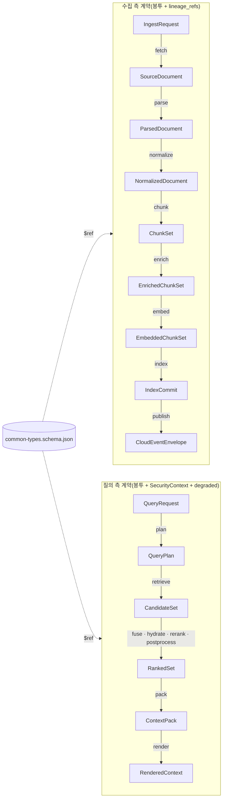
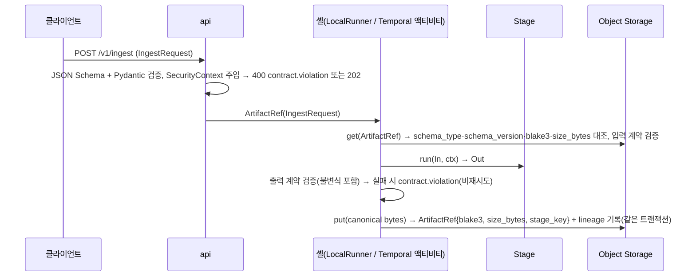

# 계약 개요와 공통 규약

## 목적

이 문서는 `03-contracts/` 16개 계약 문서의 **공통 규약**이자, 모든 계약이 참조하는 **공용 스키마(`schemas/common-types.schema.json`)의 소유 문서**다. 계약 철학, 계약 인벤토리와 소유 문서 배정, 공통 봉투(Envelope), 공용 타입, 명명 규약 요약, 해시 결합 규칙 `H()`, null·확장·직렬화 규칙, 산출물 저장 규약, 계약 검증 시점과 계약 테스트를 한 곳에 확정한다. 개별 계약 문서(01~16)는 이 문서의 규약을 **그대로** 따르며, 여기 정의된 타입을 `$ref`로 참조하고 재정의하지 않는다.

정본 우선순위는 설계 브리프 > 설계 바이블(Design Bible) > ADR > 개별 설계 문서다(브리프 §11, 바이블 §1.1). 이 문서의 모든 필드 표는 바이블 §5.2·§5.3·§5.4·§5.5의 표를 같은 철자·같은 필수 여부로 옮긴 것이며, 바이블에 없는 항목은 선택(N) 필드 또는 "## 미해결 이슈"의 제안으로만 존재한다.

## 범위

- 포함: 계약 철학(Contracts First, 순수 스테이지, 단일 좌표계·점수 원장, 3-텍스트 규칙), 계약 인벤토리와 소유 문서, 공통 봉투 필드와 `lineage_refs` 전파 규칙, 바이블 §5.3 공용 타입 전부의 필드 표, 바이블 §5.4·§5.5의 공용 하위 타입(`Block`, `NormalizedBlock`, `Chunk`, `Enrichment`, `VectorBundle`, `RankedResult`, `ContextItem`) 필드 표, 명명 규약 요약, `H()`·`canonical_json` 정의와 해시 키 표, null/미지정 규칙, 확장 필드 정책, 직렬화 규칙, 산출물 키 규약, 계약 검증 시점, 계약 테스트, 미디어 타입, `schemas/common-types.schema.json`의 `$defs` 목록.
- 제외: 개별 계약의 최상위 스키마와 예시(01~16 문서), 오류 코드 카탈로그의 의미 해설([13-error-model](13-error-model.md)), 버전 호환성 규칙의 세부([14-schema-versioning-and-compatibility](14-schema-versioning-and-compatibility.md)), API 표면([../05-api/01-api-design-guidelines.md](../05-api/01-api-design-guidelines.md)), 알고리즘 구현(04-pipelines).
- 이 문서가 소유하는 파일: `docs/03-contracts/00-contract-overview.md`, `schemas/common-types.schema.json`. 다른 문서는 `common-types.schema.json`을 수정하지 않는다.

## 1. 계약 철학

### 1.1 Contracts First

**결정:** 스테이지 간 계약(JSON Schema 2020-12 + Pydantic v2 모델)이 코드보다 먼저다. 스키마 파일 `schemas/{kebab-name}.schema.json`(`$id = urn:rag:schema:{kebab-name}:{major}`)이 게시되어야 스테이지 구현이 시작되고, 계약이 바뀌면 `schema_version`이 바뀌며 바이블 §1.2의 변경 절차(patch/minor/major)를 따른다. 모든 계약은 JSON Schema(게시·검증·코드젠)와 Pydantic v2 모델(런타임 강제)의 이중 표현을 가지며 두 표현의 동치성과 §5.7 열거 대조를 CI가 확인한다(브리프 원칙 1, D-05; [ADR-0030](../06-adr/0030-single-coordinate-system-and-score-ledger.md), [ADR-0036](../06-adr/0036-naming-and-identifier-conventions.md)).

### 1.2 순수 스테이지와 셸

**결정:** 스테이지는 `Stage[In, Out]` 순수 변환이다. I/O·시간·난수는 `StageContext`(`ctx.token_counter`, `ctx.analyzer`, `ctx.now()`, `ctx.lineage[...]`)로만 접근하고, 상태·재시도·타임아웃·계보 기록은 셸(`LocalRunner` 또는 Temporal 액티비티 래퍼)이 책임진다(브리프 원칙 3, D-17; [ADR-0003](../06-adr/0003-orchestrator-neutral-pipeline-and-non-durable-local-runner.md), [ADR-0032](../06-adr/0032-plugin-sdk-stage-protocol-and-conformance-kit.md)).

계약 관점에서 순수성은 세 가지를 뜻한다.

1. 오케스트레이터를 넘는 경계 페이로드는 `ArtifactRef` 하나다(Temporal 2MB 한계, 바이블 §4.1). 계약 인스턴스 본문은 오브젝트 스토리지에 콘텐츠 주소화로 저장된다.
2. 같은 입력 산출물(`input_ref.blake3`) + 같은 지문(`fingerprint`) + 같은 잡 스코프(`scope_key`)는 같은 `stage_key`를 낳고, 같은 산출물 경로를 재사용한다(멱등성 키 = 캐시 키 = 산출물 경로, K5; [ADR-0037](../06-adr/0037-artifact-cache-scope-and-stage-key-composition.md)).
3. 셸이 입력 로드 시와 출력 저장 전에 계약을 강제한다. 위반은 `contract.violation`(비재시도)이다(§10).

### 1.3 단일 좌표계와 점수 원장(ADR-0030)

**결정:** 모든 검색 단위는 `IndexRecord` 하나로 표현되고, payload의 `block_refs[]`(`BlockRef`)·`sentence_spans[]`로 원문에 역추적된다. `Chunk.block_refs`·`IndexRecord.block_refs`·`RankedResult.block_refs`는 같은 구조이며, `ContextItem.provenance[]`는 `block_refs`에서 결정적으로 생성된다(K1). 점수는 `CandidateSet`(채널 원점수·순위) → `RankedSet.score_breakdown`(불변식 Σ `contribution` = `fused`) → `ContextPack.confidence_tier`로 소실 없이 전달된다(K3). 근거: [ADR-0030](../06-adr/0030-single-coordinate-system-and-score-ledger.md), 바이블 §2.1.

이 문서는 그 좌표계의 원자 타입 `Provenance`, `BlockRef`, `ChannelScore`, `ScoreBreakdown`을 소유한다.

### 1.4 3-텍스트 규칙(ADR-0029)

**결정:** 청크는 `text`(표시 원문, 접두어 미포함) / `embed_text`(결정적 접두어 + 원문; dense·sparse 입력) / `index_text`(렉시컬 뷰 + 접두어; BM25 입력)를 분리 보관하고, `Enrichment.strip_offsets`로 `enrich → strip` 대칭을 계약으로 강제한다(K2; [ADR-0029](../06-adr/0029-three-text-rule-and-deterministic-context-prefix.md)). LLM에 전달되는 `ContextItem.text`는 항상 `text`이며 접두어는 `context_prefix`로 분리된다.

### 1.5 보안 삼중항과 품질 삼중항

브리프 D-09의 **보안 삼중항** `tenant_id`, `collection_id`, `acl`은 **모든 인덱스 레코드**(`IndexRecord.tenant_id`·`collection_id`·`acl_*`·`acl_hash`)에 대한 요구다. 계약 수준에서는 다음과 같이 나타난다([ADR-0027](../06-adr/0027-security-context-injection-and-acl-enforcement-points.md)): 모든 봉투는 `tenant_id`와 `collection_id`(수집 측) / `collection_ids`(질의 측)를 갖는다(바이블 §5.2); 문서 ACL은 **`SourceDocument.acl` 하나**이며(바이블 §10.1; `IngestRequest.acl`이 원천) 하류 수집 산출물(`ParsedDocument`~`IndexCommit`)은 `acl` 필드를 갖지 않고 `lineage_refs.source`로 도달하며 `index`가 `IndexRecord.acl_*`로 평탄화한다; 질의 측은 `QueryPlan.security_context`(`SecurityContext`)가 보안 주체를 나른다. **품질 삼중항**은 `quality`(수집 측), `warnings[]`, `degraded[]`(질의 측)다. 부분 실패는 문서 전체 실패로 확대하지 않는다(바이블 §4.1).



## 2. 계약 인벤토리와 소유 문서

바이블 §5.1 인벤토리 전체에 "소유 문서" 열을 더한 표다. 모든 계약의 초기 `schema_version`은 `"1.0.0"`이고 스키마 파일은 `schemas/{kebab-name}.schema.json`, `$id = urn:rag:schema:{kebab-name}:1`, 미디어 타입은 `application/vnd.rag.{kebab-name}+json`이다(바이블 §5, §6.4).

| 타입(PascalCase) | `schema_version` | 스키마 파일 | 생산 | 소비 | 인라인 한계 / 산출물 한계 | 소유 문서 |
|------------------|------------------|-------------|------|------|----------------------------|-----------|
| `IngestRequest` | 1.0.0 | `ingest-request.schema.json` | 클라이언트(`POST /v1/ingest`) | `fetch`, API | 64KB(본문), `metadata` 16KB | [01-ingest-request](01-ingest-request.md) |
| `SourceDocument` | 1.0.0 | `source-document.schema.json` | `fetch`(+`detect`) | `parse`, `index`(`requires_lineage`: acl·metadata) | 32KB / 원본 200MB(프로파일 `fetch.max_bytes`) | [02-source-document](02-source-document.md) |
| `ParsedDocument` | 1.0.0 | `parsed-document.schema.json` | `parse` | `normalize`, `get_document` | 참조만 / 256MB, 블록 200,000, 블록 텍스트 1MB | [03-parsed-document](03-parsed-document.md) |
| `NormalizedDocument` | 1.0.0 | `normalized-document.schema.json` | `normalize` | `chunk`, `get_document` | 참조만 / 256MB | [04-normalized-document](04-normalized-document.md) |
| `ChunkSet` | 1.0.0 | `chunk-set.schema.json` | `chunk`, `recount` | `enrich`, `index`(`requires_lineage`: 본문·좌표·부모 번들), `postprocess`(부모 텍스트) | 참조만 / 청크 50,000 | [05-chunk-set](05-chunk-set.md) |
| `EnrichedChunkSet` | 1.0.0 | `enriched-chunk-set.schema.json` | `enrich` | `embed`, `index`(`requires_lineage`: index_text·keywords·entities) | 참조만 / 청크 50,000 | [06-enriched-chunk-set](06-enriched-chunk-set.md) |
| `EmbeddedChunkSet` | 1.0.0 | `embedded-chunk-set.schema.json` | `embed` | `index` | 참조만 / 레코드 50,000 × ~6KB, upsert 배치 256 | [07-embedded-chunk-set-and-index-record](07-embedded-chunk-set-and-index-record.md) |
| `IndexRecord` | 1.0.0 | `index-record.schema.json` | `index`(어댑터 매핑) | 인덱스 백엔드, `retrieve`, `hydrate` | payload 32KB(`block_refs`·`sentence_spans` 포함), `text` 8,192 UTF-8 바이트 | [07-embedded-chunk-set-and-index-record](07-embedded-chunk-set-and-index-record.md) |
| `IndexCommit` | 1.0.0 | `index-commit.schema.json` | `index` 사가 | 관리 API, `EvalRun`, 재색인, 정합성 검사 | 16KB / 원장 행 | [08-index-commit](08-index-commit.md) |
| `QueryRequest` | 1.0.0 | `query-request.schema.json` | 클라이언트, MCP `search` | `plan` | 16KB, `query` 4,000자, `collection_ids` 20, `filters` 8KB | [09-query-request-and-query-plan](09-query-request-and-query-plan.md) |
| `QueryPlan` | 1.0.0 | `query-plan.schema.json` | `plan` | `retrieve`~`pack` | 32KB(인프로세스; `explain` 시 응답 포함) | [09-query-request-and-query-plan](09-query-request-and-query-plan.md) |
| `CandidateSet` | 1.0.0 | `candidate-set.schema.json` | `retrieve` | `fuse` | 채널 런당 300 × 1KB(`payload_slim`) | [10-candidate-set-and-ranked-set](10-candidate-set-and-ranked-set.md) |
| `RankedSet` | 1.0.0 | `ranked-set.schema.json` | `fuse`(+`hydrate`), `rerank`, `postprocess` | `pack`, 평가(TREC run) | 100 × 2KB(`hydrated=false`) / 100 × ~10KB(`hydrated=true`, 인프로세스만) | [10-candidate-set-and-ranked-set](10-candidate-set-and-ranked-set.md) |
| `ContextPack` | 1.0.0 | `context-pack.schema.json` | `pack` | `render`, MCP, 클라이언트, 평가 | 512KB, 항목 20, 24,000 토큰(초안) | [11-context-pack](11-context-pack.md) |
| `RenderedContext` | 1.0.0 | `rendered-context.schema.json` | `render` | 클라이언트, `answer` 레퍼런스 | 렌더러 한계(바이블 §9) | [11-context-pack](11-context-pack.md) |
| `JobStatus` | 1.0.0 | `job-status.schema.json` | API(원장 읽기 모델) | 클라이언트, SSE | 8KB | [12-jobs-events-and-status](12-jobs-events-and-status.md) |
| `CloudEventEnvelope` | 1.0.0 | `cloud-event-envelope.schema.json` | `publish`, API 감사 | 릴레이, 웹훅, SSE | 64KB, `data`에 콘텍스트 본문 금지 | [12-jobs-events-and-status](12-jobs-events-and-status.md)(`$defs`는 00) |
| `StageError` / `ProblemDetails` | 1.0.0 | `stage-error.schema.json`, `problem-details.schema.json` | 모든 스테이지 / API | 셸, 클라이언트 | 4KB | [13-error-model](13-error-model.md)(`$defs`는 00) |
| `CollectionSpec` | 1.0.0 | `collection-spec.schema.json` | 관리 API | `plan`, `index`, 프로파일 검증 | 32KB | [15-collection-profile-and-policy-contracts](15-collection-profile-and-policy-contracts.md) |
| `Profile` | 1.0.0 | `profile.schema.json` | 운영자(YAML) | 로더·검증기, 모든 스테이지 | 256KB | [15-collection-profile-and-policy-contracts](15-collection-profile-and-policy-contracts.md) |
| `PluginMeta` | 1.0.0 | `plugin-meta.schema.json` | 플러그인 `pyproject.toml` | 레지스트리, 라이선스 게이트 | 8KB | [15-collection-profile-and-policy-contracts](15-collection-profile-and-policy-contracts.md) |
| `ConvertRequest` / `ConvertResponse` | 1.0.0 | `convert-request.schema.json`, `convert-response.schema.json` | 워커 / 사이드카 | 사이드카 / 워커 | 16KB(본문은 `ArtifactRef`) | [16-eval-feedback-and-sidecar-contracts](16-eval-feedback-and-sidecar-contracts.md) |
| `EvalDataset` / `EvalRun` / `EvalReport` | 1.0.0 | `eval-dataset.schema.json`, `eval-run.schema.json`, `eval-report.schema.json` | 하네스 | 하네스, 게이트, 관리 API | 64KB / qrels·`answer_spans`는 산출물 | [16-eval-feedback-and-sidecar-contracts](16-eval-feedback-and-sidecar-contracts.md) |
| `UserDictEntry` | 1.0.0 | `user-dict-entry.schema.json` | 관리 API | `normalize`, 인덱스 분석기 생성 | 2KB/행 | [16-eval-feedback-and-sidecar-contracts](16-eval-feedback-and-sidecar-contracts.md) |
| `FeedbackEvent` | 1.0.0 | `feedback-event.schema.json` | 클라이언트(`POST /v1/feedback`) | 평가, 온라인 피드백 | 8KB | [16-eval-feedback-and-sidecar-contracts](16-eval-feedback-and-sidecar-contracts.md) |
| `Capabilities` / `IndexBackendCapabilities` | 1.0.0 | `capabilities.schema.json` | 플러그인 `capabilities()` | 프로파일 검증기(바이블 §7.4), `plan` | 4KB | [15-collection-profile-and-policy-contracts](15-collection-profile-and-policy-contracts.md)(`$defs`는 00) |
| `StagePolicy` | 1.0.0 | `stage-policy.schema.json` | 프로파일(바이블 §4.4) | 셸(`orchestration/context`) | 2KB | [15-collection-profile-and-policy-contracts](15-collection-profile-and-policy-contracts.md)(`$defs`는 00) |
| `TieringPolicy` | 1.0.0 | `tiering-policy.schema.json` | 프로파일 | E15 승격 잡, 컬렉션 검증 | 2KB | [15-collection-profile-and-policy-contracts](15-collection-profile-and-policy-contracts.md)(`$defs`는 00) |
| `EgressPolicy` | 1.0.0 | `egress-policy.schema.json` | 프로파일·테넌트 정책 | `fetch`, 릴레이(E16) | 4KB | [15-collection-profile-and-policy-contracts](15-collection-profile-and-policy-contracts.md)(`$defs`는 00) |
| 공용 타입(`ArtifactRef`, `Producer`, `Provenance`, `BlockRef`, `Acl`, `SecurityContext`, `Principal`, `TokenCounts`, `Warning`, `DegradedEntry`, `ChannelScore`, `ScoreBreakdown`, `FilterNode`, `Entity`, `Relation`, `TableData`, `TableCell`, `Block`, `NormalizedBlock`, `Chunk`, `Enrichment`, `VectorBundle`, `RankedResult`, `ContextItem`) 및 §5.7 열거 전부 | 1.0.0 | `common-types.schema.json`(`$defs`; 계약 전용 하위 타입은 해당 계약 스키마의 `$defs`) | — | 모든 계약 | — | **00(이 문서)** |

소유 규칙:

- "`$defs`는 00" 표기 행(`CloudEventEnvelope`, `StageError`, `ProblemDetails`, `Capabilities`, `IndexBackendCapabilities`, `StagePolicy`, `TieringPolicy`, `EgressPolicy`)은 바이블 §5.3 공용 타입이므로 **정의는 `common-types.schema.json`의 `$defs`에 있고**, 인벤토리에 명시된 독립 스키마 파일은 `{"$ref": "urn:rag:schema:common-types:1#/$defs/<TypeName>"}` 하나(와 `$schema`·`$id`·`title`·`description`)만 담는 래퍼로 해당 소유 문서가 게시한다. 필드·의미 해설과 예시는 소유 문서(12·13·15)가 쓰고, 필드 자체의 변경(추가·제약 변경)은 이 문서와 `common-types.schema.json`을 통해서만 한다. 소유 문서가 필요로 하는 선택(N) 필드는 이 문서가 `$defs`에 수용하고 "## 미해결 이슈"에 바이블 §5.3 반영 제안(minor)으로 기록한다.
- **정제 래퍼 예외(`cloud-event-envelope`):** §8.2가 이벤트별 `data` 정의를 12에 위임했으므로 `schemas/cloud-event-envelope.schema.json`은 위 `$ref` 래퍼에 **`oneOf`(`type` ↔ `data`·`subject` 바인딩)와 이벤트 `data` 타입 `$defs`만** 더한 정제 래퍼다(12 §5·결정 사항). 봉투 필드(`properties`·`required`·`additionalProperties`)는 재정의하지 않으며, 재정의가 있으면 §10.3 래퍼 게이트 실패다. 다른 7개 래퍼 파일에는 이 예외가 없다.
- **전환 완료(2026-09-22):** [13-error-model](13-error-model.md)이 초판에 완전한 정의로 게시했던 `schemas/stage-error.schema.json`·`schemas/problem-details.schema.json`은 위 `$ref` 래퍼로 전환되었고 자기 `$defs/ErrorCode`·`$defs/ErrorLocation`은 제거되었다(13 미해결 이슈 12). 두 타입의 유일한 정의는 이 문서의 `$defs/StageError`·`$defs/ErrorLocation`·`$defs/ProblemDetails`(§4.10·§4.11; 13 제안 선택 필드는 U-12로 수용)이며, §10.3 래퍼 게이트가 재분기를 막는다.
- **열거 등재 위치(바이블 §5.7·§6.4):** 바이블 §5.7 표의 **열거 타입**(PascalCase 고유 타입명)은 모두 `common-types.schema.json`의 `$defs/{EnumTypeName}`에 있으며, 개별 계약 스키마는 열거 필드를 `{"$ref": "urn:rag:schema:common-types:1#/$defs/<EnumTypeName>"}`로 참조하고 값 부분집합·고정값은 참조 옆에 `enum`/`const`로 좁힌다(좁힘을 자기 `$defs`에 이름 붙여 재사용해도 된다 — 예: 15 `$defs/RouteTerminal` = `$ref $defs/ErrorCodeCatalog` + `enum` 2개. 이런 **부분집합 별칭**은 새 열거 타입이 아니며 §10.3 (a)는 `enum ⊆ 참조 열거`만 검사한다). §5.7 표에 없는 중첩 객체의 **인라인 열거**는 `{Type}.{path}` 이름의 `$defs` 키로 등재하되(바이블 §5.7 서두는 파일을 특정하지 않는다) 등재 파일은 소유를 따른다: 공용 타입(`common-types` `$defs`) 내부의 인라인 열거는 `common-types`(§5), 계약 최상위·계약 전용 하위 타입 내부의 인라인 열거는 **소유 계약 스키마의 자기 `$defs`**. 계약 스키마의 `$defs`에 §5.7 밖의 PascalCase 열거 타입명을 새로 만들지 않는다(열거 타입명 고유성, 바이블 §6.4; 필요하면 §5.7 추가 ADR(minor) 후 `common-types`에 등재). 여러 계약이 같은 값 집합을 인라인 열거로 나눠 갖는 경우(§스키마 "인라인 열거 인벤토리"의 "사본" 표기)는 `common-types` 승격 전까지 값 집합이 동치여야 한다(§10.3 열거 대조; U-13). 계약 전용 하위 타입(예: `QueryPlan.channels[]`, `IndexCommit.backend_results[]`)은 해당 계약 스키마의 자기 `$defs`에 둔다.

## 3. 공통 봉투(Envelope)

### 3.1 봉투 필드(바이블 §5.2)

수집 측 산출물 계약(`SourceDocument`~`IndexCommit`)과 질의 측 계약(`QueryPlan`~`ContextPack`)이 공통으로 갖는 필드다. 각 계약 문서의 필드 표에서는 "봉투"로 줄여 쓴다. `IngestRequest`·`QueryRequest`는 클라이언트 입력이므로 봉투 필드 중 `schema_version`과 `collection_id`(`IngestRequest`) / `collection_ids`(`QueryRequest`)만 갖고, `schema_type`·`tenant_id`·`producer`·`quality`·`warnings`·`degraded`·`created_at`·`lineage_refs`는 없다(바이블 §5.4·§5.5). `tenant_id`는 본문에 **없다**(서버 `SecurityContext`에서 도출; 본문에 오면 422, E1).

| 필드 | 타입 | 필수 | 설명 | 예시 |
|------|------|------|------|------|
| `schema_version` | string(semver) | Y | 계약 버전. 초기 `"1.0.0"` | `"1.0.0"` |
| `schema_type` | string | Y | PascalCase 타입명. `ArtifactRef.schema_type`와 일치해야 로드 | `"ParsedDocument"` |
| `tenant_id` | string(ulid) | Y | 보안 삼중항 1 | `"01J9ZQ4K7X2M8N3P5R6S7T8V9W"` |
| `collection_id` / `collection_ids` | string(ulid) / array<string(ulid)> | Y | 수집 측 단수, 질의 측 복수 | `"01J9ZQ5A1B2C3D4E5F6G7H8J9K"` |
| `producer` | `Producer` | Y | 재현성 지문 | §4.2 |
| `quality` | enum(Quality) | Y(수집 측) | 품질 삼중항 1 | `"full"` |
| `warnings` | array<Warning> | Y(빈 배열 허용) | 품질 삼중항 2 | `[]` |
| `degraded` | array<DegradedEntry> | Y(질의 측) | 품질 삼중항 3(질의 측) | `[]` |
| `created_at` | string(date-time) | Y | RFC 3339 UTC | `"2026-09-22T09:00:00.000Z"` |
| `lineage_refs` | object<string, ArtifactRef> | Y(수집 측) | 상류 산출물 참조 `{source?, parsed?, normalized?, chunk_set?, enriched?, embedded?}`(자기 자신 제외). `IndexCommit.artifact_refs`와 같은 키. 셸이 `requires_lineage` 로드에 사용 | §3.2 |

스키마 표현: 봉투는 별도 `$defs`로 두지 않고 각 계약 최상위 스키마가 위 필드를 직접 선언한다(`additionalProperties: false`와 `allOf` 병합의 충돌 회피). `lineage_refs`는 `$defs/LineageRefs`(키 6개 고정)를 참조한다.

### 3.2 `lineage_refs` 전파 규칙

**결정:** 각 스테이지는 입력 봉투의 `lineage_refs`를 복사한 뒤 **자기 입력의 `ArtifactRef`를 해당 키로 추가**해 출력 봉투에 넣는다. 자기 자신의 출력은 포함하지 않는다(바이블 §5.2, §4.1). **예외:** 입력과 같은 `schema_type`을 출력하는 서브스테이지(`detect`: `SourceDocument`→`SourceDocument`, `recount`: `ChunkSet`→`ChunkSet`; 바이블 §4.2)는 입력 ref를 추가하지 않고 입력의 `lineage_refs`를 그대로 전파한다 — 추가하면 한 키가 같은 타입의 두 인스턴스를 뜻하게 되어 "자기 자신 제외"(§5.2)와 키↔`schema_type` 1:1 대응(I-7)이 깨진다. 이 관계(fetch 출력→detect 출력, chunk 출력→recount 출력)는 셸의 `lineage` 원장 행(바이블 §4.1 5-튜플)으로만 기록한다. 셸은 스테이지가 `requires_lineage`로 선언한 `schema_type`을 이 맵에서 찾아 `ctx.lineage[schema_type]`으로 제공한다.

| 스테이지 | 입력 계약 | 출력 봉투의 `lineage_refs` 키 | `requires_lineage` |
|----------|-----------|-------------------------------|--------------------|
| `fetch` | `IngestRequest` | `{}`(빈 객체; 원본 바이트는 `SourceDocument.artifact`) | — |
| `detect` | `SourceDocument`(fetch 출력) | `{}`(입력 그대로; 같은 `schema_type` 자기 참조 회피 — fetch 출력을 `source`에 넣지 않는다. `source` 키는 항상 **detect 출력**을 뜻한다; 02 §1.2·S-9, `source-document.schema.json`의 `lineage_refs` `maxProperties: 0`) | — |
| `parse` | `SourceDocument`(detect 출력) | `{source}` | — |
| `normalize` | `ParsedDocument` | `{source, parsed}` | — |
| `chunk` / `recount` | `NormalizedDocument` / `ChunkSet` | `{source, parsed, normalized}` / 입력 그대로(같은 `schema_type`) | — |
| `enrich` | `ChunkSet` | `{source, parsed, normalized, chunk_set}` | — |
| `embed` | `EnrichedChunkSet` | `{source, parsed, normalized, chunk_set, enriched}` | — |
| `index` | `EmbeddedChunkSet` | `{source, parsed, normalized, chunk_set, enriched, embedded}`(봉투 `lineage_refs`); `IndexCommit.artifact_refs`는 같은 키를 복제한다(바이블 §5.2·§5.4, 재적재 복구 1순위) | `EnrichedChunkSet`, `ChunkSet`, `SourceDocument` |

키 이름과 `schema_type`의 대응은 고정이다: `source`→`SourceDocument`(detect 출력; `media_type=application/vnd.rag.source-document+json`인 계약 산출물이며 원본 바이트가 아니다 — 원본 바이트는 `SourceDocument.artifact`·`ParsedDocument.source_ref`로만 참조), `parsed`→`ParsedDocument`, `normalized`→`NormalizedDocument`, `chunk_set`→`ChunkSet`, `enriched`→`EnrichedChunkSet`, `embedded`→`EmbeddedChunkSet`. 각 값의 `ArtifactRef.schema_type`은 이 대응과 일치해야 한다(불변식 I-7). 질의 측 계약은 `lineage_refs`를 갖지 않는다(인프로세스 실행, 산출물 미저장).

## 4. 공용 타입(바이블 §5.3)

타입 표기는 브리프 §9.5의 JSON Schema 용어를 따른다. "필수" 열의 `Y(nullable)`은 **키는 반드시 존재하되 값이 `null`일 수 있음**을, `조건`은 다른 필드 값에 따라 필수임을 뜻한다(§8.1).

### 4.1 `ArtifactRef`

| 필드 | 타입 | 필수 | 설명 | 예시 |
|------|------|------|------|------|
| `uri` | string(uri) | Y | `s3://…` 또는 `file://…`(§9.1 오브젝트 키) | `"s3://rag-artifacts/tenants/01J9…/artifacts/parsed-document/9a/9a0b….json"` |
| `blake3` | string(hex64) | Y | 산출물 바이트의 콘텐츠 해시(저장된 산출물 바이트 기준, 바이블 §5.3·§13.3) | `"7c1e9f3a…"` |
| `media_type` | string | Y | `application/vnd.rag.parsed-document+json` 등 자체 미디어 타입 또는 원본 MIME | `"application/vnd.rag.parsed-document+json"` |
| `schema_type` | string | 조건 | 계약 산출물이면 PascalCase 타입명(`schema_version`과 함께 존재) | `"ParsedDocument"` |
| `schema_version` | string(semver) | 조건 | 계약 산출물이면 계약 버전 | `"1.0.0"` |
| `size_bytes` | integer | Y | 크기(인라인 금지 검증·계량) | `1843200` |
| `stage_key` | string(hex64) | N | 생산 스테이지 멱등성 키(계보 자기 서술) | `"9a0b1c2d…"` |

### 4.2 `Producer`

| 필드 | 타입 | 필수 | 설명 | 예시 |
|------|------|------|------|------|
| `plugin_id` | string | Y | `{extension_point}.{implementation}`(§6.1) | `"parser.hwpx_python_hwpx"` |
| `plugin_version` | string(semver) | Y | 패키지 버전 | `"1.0.0"` |
| `config_hash` | string(hex64) | Y | `H("config", canonical_json(config))` | `"5d7e9f0a…"` |
| `image_digest` | string \| null | Y(nullable) | 사이드카·서빙 이미지 digest(`sha256:…`); 인프로세스는 `null` | `null` |
| `model_ids` | array<string> | N | `{model_id}@{revision}` 목록 | `["BAAI/bge-m3@5617a9f"]` |

지문 `fingerprint = H("producer", plugin_id, plugin_version, config_hash, image_digest or "", ",".join(model_ids))`(§7.2).

### 4.3 `Provenance`

원문 좌표([ADR-0002](../06-adr/0002-provenance-element-path-and-nullable-page-bbox.md)).

| 필드 | 타입 | 필수 | 설명 | 예시 |
|------|------|------|------|------|
| `element_path` | string | Y | 원본 요소 경로(OWPML 경로·Docling `self_ref`·HTML XPath·pdftext 블록 경로). 문서 내 유일 | `"/hp:sec[0]/hp:p[17]"` |
| `char_start` | integer | Y | 블록 `text` 기준 0-based 유니코드 코드포인트 오프셋 | `0` |
| `char_end` | integer | Y | 끝 미포함 | `143` |
| `page` | integer \| null | Y(nullable) | 1-based. 흐름 포맷(HWP/HWPX·DOCX·HTML·MD)은 `null` | `null` |
| `bbox` | array<number>[4] \| null | Y(nullable) | `[x0, y0, x1, y1]` 좌상단 원점·PDF 포인트(1/72 in). 흐름 포맷은 `null` | `[72.0, 96.5, 523.2, 140.8]` |
| `section_index` | integer \| null | N | HWPX 구역(`secPr`) 인덱스 | `0` |

### 4.4 `Acl`(문서 단위; 모든 레벨의 레코드와 부모 번들이 상속, 바이블 §10.1)

| 필드 | 타입 | 필수 | 설명 | 예시 |
|------|------|------|------|------|
| `allow_principals` | array<string> | Y | 주체 문자열(§6.1), ≤ 1,024 | `["group:mois_records"]` |
| `deny_principals` | array<string> | N | ≤ 1,024; 항상 우선 | `[]` |
| `visibility` | enum(Visibility) | Y | 기본 `tenant` | `"restricted"` |
| `classification` | enum(Classification) | N | 기본 `internal`(팩 `classification_max`로 전파) | `"internal"` |
| `embargo_until` | string(date-time) \| null | N | 이 시각 전 검색 불가 | `"2026-10-01T00:00:00.000Z"` |
| `expires_at` | string(date-time) \| null | N | 이 시각 후 검색 불가 | `null` |
| `source_acl_hash` | string(hex64) | N | 원천 ACL 변경 감지 | `"a6b7c8d9…"` |

### 4.5 `SecurityContext`(서버 주입·읽기 전용, 스키마 `readOnly: true`; 클라이언트가 보낸 보안 필드는 422, E1·E6)

| 필드 | 타입 | 필수 | 설명 | 예시 |
|------|------|------|------|------|
| `tenant_id` | string(ulid) | Y | | `"01J9ZQ4K7X2M8N3P5R6S7T8V9W"` |
| `principals` | array<string> | Y | 사용자 + 확장 그룹 + `tenant:*`, ≤ 1,024(초과 `auth.too_many_principals`) | `["user:kim.minsu@example.go.kr", "group:mois_records", "tenant:*"]` |
| `collection_ids` | array<string(ulid)> | Y | Cedar `allowed_collections` ∩ 요청 컬렉션 | `["01J9ZQ5A1B2C3D4E5F6G7H8J9K"]` |
| `as_of` | string(date-time) | Y | **서버 `now()`**. embargo/expiry 판정 시각. 클라이언트 입력 없음 | `"2026-09-22T09:00:00.000Z"` |
| `classification_max` | enum(Classification) | Y | 주체가 볼 수 있는 최고 등급(테넌트 정책 기본 `internal`) | `"confidential"` |
| `policy_version` | string | Y | Cedar 정책 버전 | `"2026-09-15.3"` |
| `auth_method` | enum(AuthMethod) | Y | | `"oidc"` |
| `visible_set` | array<enum(Visibility)> | Y | 필터 불변식 `:visible_set`(바이블 §10.2): 기본 `[public, tenant]`, `auth_method=api_key`이고 `service:` 주체만이면 `[public]` | `["public", "tenant"]` |

### 4.6 `Principal`(`PrincipalResolver` 출력, `SecurityContext.principals`의 원천; 주체 문자열 형식은 `$defs/PrincipalString`)

| 필드 | 타입 | 필수 | 설명 | 예시 |
|------|------|------|------|------|
| `subject` | string | Y | OIDC `sub` 또는 이메일, API 키 `client_id` | `"kim.minsu@example.go.kr"` |
| `groups` | array<string> | Y | 확장 전 그룹 ID | `["mois_records"]` |
| `tenant_id` | string(ulid) | Y | | `"01J9ZQ4K7X2M8N3P5R6S7T8V9W"` |
| `roles` | array<string> | Y | Cedar 역할 | `["reader"]` |
| `auth_method` | enum(AuthMethod) | Y | | `"oidc"` |
| `api_key_id` | string \| null | N | `auth_method=api_key`일 때 | `null` |

### 4.7 `TokenCounts`

| 필드 | 타입 | 필수 | 설명 | 예시 |
|------|------|------|------|------|
| `{tokenizer_id}` | integer | Y(1개 이상) | 키는 `tokenizer_id`(§6.1: `hf:…`, `tiktoken:…`, `anthropic:…`, `gemini:…`), 값은 토큰 수 | `{"hf:BAAI/bge-m3": 387, "tiktoken:o200k_base": 455}` |

### 4.8 `Warning`

| 필드 | 타입 | 필수 | 설명 | 예시 |
|------|------|------|------|------|
| `code` | enum(ErrorCodeCatalog) | Y | 바이블 §5.7 카탈로그에 등재된 코드(재시도 열 `—` 경고·폴백 코드 또는 `partial` 코드). 스키마가 `$defs/ErrorCodeCatalog`를 `$ref`하므로 카탈로그 밖 코드는 검증에서 거부된다(I-14) | `"chunk.block_oversized"` |
| `message` | string | Y | 콘텐츠 미포함 | `"block split at sentence boundary"` |
| `block_id` | string | N | 위치 | `"1a2b3c4d…"` |
| `chunk_id` | string | N | 위치 | `"c4d5e6f7…"` |
| `page` | integer | N | 위치 | `3` |

### 4.9 `DegradedEntry`

| 필드 | 타입 | 필수 | 설명 | 예시 |
|------|------|------|------|------|
| `component` | enum(DegradedComponent) | Y | `planner_llm`, `channel.dense`, `channel.sparse`, `channel.lexical`, `channel.graph`, `channel.tree`, `channel.visual`, `channel.late_interaction`, `fusion`, `hydrate`, `rerank`, `late_interaction_rerank`, `parent_expand`, `sentence_window`, `compress`, `token_count`, `acl_recheck`, `self_query_filter`, `multi_query`, `query_embedding` | `"channel.lexical"` |
| `reason` | enum(DegradedReason) | Y | | `"analyzer_mismatch"` |
| `detail` | string | N | 콘텐츠 미포함 | `"collection analyzer_id differs from plan"` |

### 4.10 `StageError`

| 필드 | 타입 | 필수 | 설명 | 예시 |
|------|------|------|------|------|
| `code` | enum(ErrorCodeCatalog) | Y | `stage.reason`(바이블 §5.7 카탈로그 등재 코드; 스키마 `$ref $defs/ErrorCodeCatalog`, I-14) | `"parse.document_encrypted"` |
| `type` | string(uri) | Y | `urn:rag:error:{code}` | `"urn:rag:error:parse.document_encrypted"` |
| `retryable` | boolean | Y | 재시도 여부는 카탈로그가 결정 | `false` |
| `stage` | string | Y | 발생 스테이지(`^[a-z][a-z0-9_]*$`, ≤ 32; 파이프라인 스테이지·서브스텝명 또는 비파이프라인 지점 `api`·`loader`·`relay`) | `"parse"` |
| `plugin_id` | string | N | `$defs/PluginId`, ≤ 128 | `"parser.hwp5_java_sidecar"` |
| `detail` | string | N | 인스턴스별 진단 문구(영문, 기계 지향), ≤ 1,024. 콘텐츠 미포함 | `"FileHeader encrypted flag set"` |
| `artifact_ref` | `ArtifactRef` | N | 실패 시점 입력 | §4.1 |
| `message` | string | N | 코드별 고정 영문 문구(카탈로그 `title_en`), ≤ 256. 지역화는 `ProblemDetails.title`에서만. **바이블 §5.3 미등재**(13 제안 수용, U-12) | `"Document is encrypted"` |
| `occurred_at` | string(date-time) | N | 발생 시각. **바이블 §5.3 미등재**(U-12) | `"2026-09-22T09:00:05.120Z"` |
| `attempt` | integer | N | 실패한 시도 번호(1-based; `StagePolicy.max_attempts` 대비). **바이블 §5.3 미등재**(U-12) | `1` |
| `location` | `ErrorLocation` | N | 오류 위치(아래 표). **바이블 §5.3 미등재**(U-12) | `{"page": 17}` |
| `cause` | `StageError` | N | 감싼 원인 오류(폴백 체인·보상). 중첩 깊이 ≤ 3(Pydantic 검증). **바이블 §5.3 미등재**(U-12) | — |

`ErrorLocation`(`$defs/ErrorLocation`; `StageError.location` 전용, 모든 필드 N, 식별자만 담고 ACL·주체·콘텐츠는 담지 않는다):

| 필드 | 타입 | 필수 | 설명 | 예시 |
|------|------|------|------|------|
| `pointer` | string(json-pointer) | N | RFC 6901 JSON Pointer(요청 본문 또는 산출물 내 위치), ≤ 256 | `"/metadata/doc_date"` |
| `page` | integer | N | 1-based 페이지(흐름 포맷은 생략) | `17` |
| `block_id` | string(hex32) | N | | `"1a2b3c4d…"` |
| `chunk_id` | string(hex64) | N | | `"c4d5e6f7…"` |
| `channel` | enum(Channel) | N | 질의 측 채널(`retrieve`·`hydrate` 오류) | `"lexical"` |
| `collection_id` | string(ulid) | N | 스코프 식별 | `"01J9ZQ5A1B2C3D4E5F6G7H8J9K"` |
| `document_id` | string(ulid) | N | 스코프 식별 | `"01J9ZQ6M0N1P2Q3R4S5T6V7W8X"` |

### 4.11 `ProblemDetails`(RFC 9457)

| 필드 | 타입 | 필수 | 설명 | 예시 |
|------|------|------|------|------|
| `type` | string(uri) | Y | `urn:rag:error:{code}` | `"urn:rag:error:contract.violation"` |
| `title` | string | Y | 코드별 고정 제목, ≤ 256. `Accept-Language`로 지역화되는 유일한 필드 | `"Contract violation"` |
| `status` | integer | Y | HTTP 상태 400..599(13 문서 HTTP 매핑 표) | `400` |
| `detail` | string | N | 인스턴스별 진단 문구(영문), ≤ 2,048. 콘텐츠 미포함 | `"IngestRequest failed schema validation"` |
| `instance` | string(uri-reference) | N | 발생 요청 경로 또는 관련 자원, ≤ 512. RFC 9457 §3.1.5의 URI-reference(상대 참조 허용). 바이블 §5.3 표기는 `string(uri)`이며 정정 제안은 U-12 | `"/v1/ingest"` |
| `code` | enum(ErrorCodeCatalog) | Y | `= StageError.code`(카탈로그 등재 코드; 스키마 `$ref $defs/ErrorCodeCatalog`, I-14) | `"contract.violation"` |
| `retryable` | boolean | Y | 카탈로그 값. `errors[]`가 있으면 `errors[].retryable`의 OR | `false` |
| `trace_id` | string | Y | W3C Trace Context trace-id(소문자 hex 32) | `"4bf92f3577b34da6a3ce929d0e0e4736"` |
| `errors` | array<StageError> | N | 다중 오류(요청 검증·채널 실패), 1..16. 초과분은 `detail`에 개수만 | 예시 7 |
| `retry_after` | integer | N | `Retry-After` 헤더 값(초)의 본문 사본, `status` 429·503에서만. **바이블 §5.3 미등재**(U-12) | `30` |
| `request_id` | string(ulid) | N | 요청 ID(바이블 §6.1). **바이블 §5.3 미등재**(U-12) | `"01J9ZQ7B8C9D0E1F2G3H4J5K6M"` |

### 4.12 `CloudEventEnvelope`(CloudEvents 1.0.2, [ADR-0017](../06-adr/0017-event-delivery-outbox-cloudevents-no-broker.md))

| 필드 | 타입 | 필수 | 설명 | 예시 |
|------|------|------|------|------|
| `specversion` | string | Y | `"1.0"`(스키마 `const`) | `"1.0"` |
| `id` | string(ulid) | Y | `event_id`(소비자 멱등 키) | `"01J9ZQ8N9P0Q1R2S3T4V5W6X7Y"` |
| `source` | string(uri) | Y | `urn:rag:{component}` | `"urn:rag:worker"` |
| `type` | string | Y | 바이블 §5.7 이벤트 카탈로그(`$defs/EventType`) | `"ingest.document.parsed"` |
| `time` | string(date-time) | Y | | `"2026-09-22T09:00:05.120Z"` |
| `subject` | string | Y | `tenant/{tenant_id}/{entity}/{id}` | `"tenant/01J9…/document/01J9…"` |
| `datacontenttype` | string | Y | `application/json` | `"application/json"` |
| `dataschema` | string(uri) | N | `urn:rag:schema:{name}:{major}`(`$defs/SchemaId`). **`data`가 그 계약의 완전한 인스턴스일 때만** 기재한다(14 §5.4). 12의 이벤트 24종은 모두 ID·해시·상태 투영(부분집합 `data`)이므로 **생략**한다(12 §5·I-15; `JobStatus`는 이벤트 `data`가 아니다) | 생략(예시 8) |
| `tenantid` | string(ulid) | Y | CloudEvents 확장 속성(릴레이 테넌트 스코프) | `"01J9ZQ4K7X2M8N3P5R6S7T8V9W"` |
| `data` | object | Y | ID·해시·상태만, **콘텍스트 본문 금지**(E12) | `{"job_id": "…", "document_id": "…"}` |

### 4.13 `ChannelScore`

| 필드 | 타입 | 필수 | 설명 | 예시 |
|------|------|------|------|------|
| `score` | number | Y | 채널 원점수(cosine / dot / BM25 / MaxSim) | `0.8312` |
| `rank` | integer | Y | 채널 내 1-based 순위 | `2` |
| `contribution` | number | Y | 융합 기여분(RRF `w/(k+rank)`) | `0.016129032258064516` |
| `variant_ids` | array<string(ulid)> | Y | 적중 질의 변형(`rewritten_queries[].variant_id`) | `["01J9ZQ9C0D1E2F3G4H5J6K7M8N"]` |

### 4.14 `ScoreBreakdown`

| 필드 | 타입 | 필수 | 설명 | 예시 |
|------|------|------|------|------|
| `dense`, `sparse`, `lexical`, `graph`, `tree`, `visual`, `late_interaction` | `ChannelScore` \| null | Y(nullable) | 미적중 채널은 `null` | 예시 5 |
| `fused` | number | Y | 융합 점수 = Σ non-null `contribution` | `0.03252247488101534` |
| `fused_rank` | integer | Y | | `1` |
| `rerank_raw` | number \| null | Y(nullable) | 리랭커 원점수 | `2.41` |
| `rerank_normalized` | number \| null | Y(nullable) | `normalization` 적용 값 | `0.9176` |
| `normalization` | enum(ScoreNormalization) | Y | | `"sigmoid"` |
| `boosts` | array<object> | N | `{kind: enum(BoostKind), delta: number}` | `[{"kind": "recency", "delta": 0.02}]` |

### 4.15 `FilterNode`(논리 결합 `and`/`or`/`not` 또는 리프 `field`·`op`·`value` 택1; 깊이 ≤ 3, 절 ≤ 32)

| 필드 | 타입 | 필수 | 설명 | 예시 |
|------|------|------|------|------|
| `and` | array<FilterNode> | 택1 | 1..32절 | 예시 4 |
| `or` | array<FilterNode> | 택1 | 1..32절 | |
| `not` | FilterNode | 택1 | | |
| `field` | enum(FilterableField) | 택1(리프) | 화이트리스트(바이블 §5.7) + `custom.{key}`(컬렉션 선언 키만) | `"doc_type"` |
| `op` | enum(FilterOp) | 리프 필수 | | `"eq"` |
| `value` | any | 리프 조건 | `in`/`not_in`/`contains_*`는 배열, `exists`는 boolean, 그 외 스칼라 | `"regulation"` |

### 4.16 `Entity`

| 필드 | 타입 | 필수 | 설명 | 예시 |
|------|------|------|------|------|
| `name` | string | Y | | `"행정안전부"` |
| `type` | string | Y | 추출기 라벨 | `"organization"` |
| `canonical_id` | string \| null | N | 정규 ID | `null` |
| `confidence` | number | Y | 0..1 | `0.93` |
| `span` | object \| null | N | `{chunk_id, char_start, char_end}` | `{"chunk_id": "c4d5…", "char_start": 12, "char_end": 17}` |
| `extractor` | enum(EntityExtractor) | Y | | `"gliner2"` |

### 4.17 `Relation`

| 필드 | 타입 | 필수 | 설명 | 예시 |
|------|------|------|------|------|
| `subject_id`, `predicate`, `object_id` | string | Y | 그래프 플러그인 슬롯 | `"org:mois"`, `"issued"`, `"doc:…"` |
| `weight` | number | Y | | `0.8` |
| `evidence_chunk_ids` | array<string> | Y | 근거 `chunk_id` | `["c4d5…"]` |

### 4.18 `BlockRef`(단일 좌표계의 원자 K1; `Chunk`·`IndexRecord`·`RankedResult`의 `block_refs`가 같은 구조)

| 필드 | 타입 | 필수 | 설명 | 예시 |
|------|------|------|------|------|
| `block_id` | string(hex32) | Y | | `"1a2b3c4d…"` |
| `element_path` | string | Y | `Block.provenance.element_path` 복사(문서 내 유일) | `"/hp:sec[0]/hp:p[17]"` |
| `char_start`, `char_end` | integer | Y | `Chunk.text`(display) 기준 코드포인트 오프셋(끝 미포함) | `0`, `143` |
| `original_char_start`, `original_char_end` | integer | Y | 원문 `Block.text` 기준(`offset_map` 사상 결과; `Provenance` 생성용 §6.2) | `0`, `145` |
| `page` | integer \| null | Y(nullable) | 블록 값 복사 | `null` |
| `bbox` | array<number>[4] \| null | Y(nullable) | 블록 값 복사. `page`가 `null`이면 `bbox`도 `null`(I-9; `Provenance`와 같은 규칙) | `null` |
| `section_index` | integer \| null | N | 블록 값 복사 | `0` |

### 4.19 `Capabilities`(모든 `Stage` 공통)

| 필드 | 타입 | 필수 | 설명 | 예시 |
|------|------|------|------|------|
| `isolation_modes` | array<enum(IsolationMode)> | Y | 지원 격리 모드 | `["in_process"]` |
| `supports_resumable` | boolean | Y | `heartbeat_details` 재개 지원 | `true` |
| `contracts_compat` | string | Y | 계약 호환 범위 | `">=1.0,<2.0"` |
| `input_formats` | array<string> | N | 파서 포맷 등 | `["hwpx"]` |
| `model_ids` | array<string> | N | 임베더 모델 등 | `["BAAI/bge-m3@5617a9f"]` |
| `requires_gpu` | boolean | N | | `false` |
| `extra` | object \| null | N | 확장 지점 전용 필드(`index_backend`는 `IndexBackendCapabilities`) | §4.20 |

### 4.20 `IndexBackendCapabilities`(`Capabilities.extra`, `index_backend` 전용)

| 필드 | 타입 | 필수 | 설명 | 예시 |
|------|------|------|------|------|
| `supports_server_bm25` | boolean | Y | Qdrant `false`, OpenSearch `true` | `false` |
| `korean_analyzer` | boolean | Y | `false` → 플랫폼 측 `korean_analyzer` 필수(lite) | `false` |
| `supports_server_fusion` | array<enum(FusionMethod)> | Y | | `["rrf"]` |
| `tenant_isolation` | array<enum(TenantIsolationTier)> | Y | | `["payload_filter", "shard_key", "index_per_tenant"]` |
| `supports_alias_swap` | boolean | Y | | `true` |
| `supports_multivector` | boolean | Y | `false` → `late_interaction` 자동 비활성 + `degraded` | `true` |
| `max_vector_dim` | integer \| null | Y(nullable) | `null` = 미공개 | `65536` |
| `max_multivector_elements` | integer \| null | Y(nullable) | | `null` |
| `supports_payload_only_points` | boolean \| null | Y(nullable) | 벡터 없는 포인트 허용(확인 필요 as of 2026-09) | `null` |

### 4.21 `StagePolicy`

| 필드 | 타입 | 필수 | 설명 | 예시 |
|------|------|------|------|------|
| `task_queue` | string | Y | 바이블 §4.4 표의 한 행 | `"ingest-cpu"` |
| `start_to_close` | string(duration) | Y | | `"15m"` |
| `heartbeat` | string(duration) \| null | Y(nullable) | | `"60s"` |
| `max_attempts` | integer | Y | | `3` |
| `backoff` | object | N | `{initial, max, coefficient}` 기본 `{1s, 5m, 2.0}` | `{"initial": "1s", "max": "5m", "coefficient": 2.0}` |
| `non_retryable_error_codes` | array<string> | Y | 오류 카탈로그(바이블 §5.7) 코드 | `["parse.document_encrypted"]` |
| `resumable` | boolean | Y | `heartbeat_details` 재개 | `true` |
| `isolation` | enum(IsolationMode) \| null | N | 격리 모드 강제 | `null` |

### 4.22 `TieringPolicy`

| 필드 | 타입 | 필수 | 설명 | 예시 |
|------|------|------|------|------|
| `shard_key_threshold_chunks` | integer | Y | E15 승격 조건 | `1000000` |
| `threshold_qps` | number \| null | N | | `null` |
| `index_per_tenant` | enum(IndexPerTenantMode) | Y | | `"opt_in"` |
| `promotion_window` | string(duration) | N | | `"24h"` |

### 4.23 `EgressPolicy`(프로파일 정책 AND 테넌트 정책, E16; [ADR-0038](../06-adr/0038-outbound-egress-policy-and-webhook-signing.md))

| 필드 | 타입 | 필수 | 설명 | 예시 |
|------|------|------|------|------|
| `allowed_schemes` | array<string> | Y | 기본 `[https, s3, gs, az]`(`file`은 개발 프로파일만, `http`는 테넌트 옵트인) | `["https", "s3", "gs", "az"]` |
| `allowed_hosts` | array<string> \| null | N | `null` = 제한 없음 | `null` |
| `deny_cidrs` | array<string(cidr)> | Y | 사설·루프백·링크로컬·클라우드 메타데이터 | `["10.0.0.0/8", "172.16.0.0/12", "192.168.0.0/16", "127.0.0.0/8", "169.254.0.0/16", "0.0.0.0/8", "::1/128", "fc00::/7", "fe80::/10"]` |
| `max_redirects` | integer | Y | 기본 3(리다이렉트마다 재검사) | `3` |
| `resolve_pin` | boolean | Y | DNS 해석 IP를 검사 후 고정 연결 | `true` |
| `max_bytes` | integer | N | 기본 `fetch.max_bytes` | `209715200` |
| `connect_timeout_ms` | integer | N | 기본 5,000 | `5000` |
| `allowed_ports` | array<integer> | N | 기본 `[443, 80(옵트인)]` | `[443]` |

## 5. 공용 문서·청크·결과 타입(바이블 §5.1·§5.4·§5.5)

다음 9개 타입은 여러 계약이 같은 구조를 공유하므로 `common-types.schema.json`의 `$defs`에 정의한다. 필드 표·의미 해설·불변식·예시의 정본은 소유 계약 문서에 있으며, 스키마는 바이블 표의 필드·필수·nullable을 그대로 옮기고 조건 필수는 `if/then`·`dependentRequired`·`anyOf`로 표현했다.

| `$defs` | 사용 위치 | 소유 문서 | 필수 필드(스키마 `required`; `(n)` = nullable) | 조건 필수(스키마 표현) |
|---------|-----------|-----------|--------------------------------------------------|------------------------|
| `TableData` / `TableCell` | `Block.table` | [03-parsed-document](03-parsed-document.md) | `n_rows, n_cols, cells, header_row_indices, header_inferred, role, quality{merged_cells_preserved, structure_source}` / `row, col, row_span, col_span, text, is_header, header_kind` | — |
| `Block` | `ParsedDocument.blocks[]` | 03 | `block_id, type, parent_block_id(n), ordinal, text, furniture, container, source, provenance` | `type=table → table`; `figure/formula/footnote/code/page_break → 동명 객체`; `type ∈ {heading, list_item} → level`; `list_item → ordered`; `source ∈ {ocr, vlm} → confidence non-null` |
| `NormalizedBlock` | `NormalizedDocument.blocks[]` | [04-normalized-document](04-normalized-document.md) | `block_id, display_text, lexical_text, offset_map, sentence_spans, lang, boilerplate, text_source, confidence(n)` | — |
| `Chunk` | `ChunkSet.chunks[]` | [05-chunk-set](05-chunk-set.md) | `chunk_id, span, item_kind, level, parent_chunk_id(n), ordinal, text, lexical_text, heading_path, block_refs, sentence_spans, token_counts, lang, context_prefix{deterministic, generated(n), generated_by(n)}, text_source, ocr_confidence_min(n), content_hash` | `item_kind ∈ {table, table_part} → table_ref`; `level ≥ 1 → child_chunk_ids`; `level ∈ {0, 1} → block_refs` 1개 이상(`level=2` 파생 항목은 U-11); `text_source ∈ {ocr, vlm} → ocr_confidence_min non-null`; `item_kind ↔ level` 대응(`parent ⇔ 1`, `summary·community_report·entity ⇔ 2`, 그 외 `⇔ 0`; 바이블 §5.7 `ChunkLevel`, 05 C-5, `IndexRecord`와 같은 `if/then` 4개) |
| `Enrichment` | `EnrichedChunkSet.enrichments[chunk_id]` | [06-enriched-chunk-set](06-enriched-chunk-set.md) | `embed_text, index_text, strip_offsets{text_start_in_embed, text_start_in_index}, keywords, entities, risk_flags, risk_score, pii_entity_counts, status` | — |
| `VectorBundle` | `EmbeddedChunkSet.vectors[chunk_id]` | [07-embedded-chunk-set-and-index-record](07-embedded-chunk-set-and-index-record.md) | `dense{name, dim, offset}, embed_text_hash, truncated` | `anyOf[sparse_learned(standard), sparse_bm25(lite)]` 하나 이상 |
| `RankedResult` | `RankedSet.results[]` | [10-candidate-set-and-ranked-set](10-candidate-set-and-ranked-set.md) | `record_id(n), chunk_id, collection_id, document_id, doc_version, item_kind, level, parent_chunk_id(n), final_rank, final_score, fused_score, fused_rank, score_breakdown, channels_hit, variant_ids, explain` | `rerank_raw_score`·`rerank_normalized_score`·`rerank_rank` 동반(`dependentRequired`); `hydrated=true` 조건 필드(`text`, `acl`, `block_refs`, `sentence_spans` 등 바이블 §5.5)는 `RankedSet` 스키마의 `if/then` |
| `ContextItem` | `ContextPack.items[]` | [11-context-pack](11-context-pack.md) | `cite_id, rank, position, record_id(n), chunk_id, collection_id, document_id, doc_version, item_kind, level, confidence_tier, header{title, section_path, numbering_path, source_uri, lang}, text, text_format, text_source, ocr_confidence_min(n), segments, provenance, acl{classification, checked, checked_at, source}, token_count` | `conflicts_with ≠ [] → header.doc_date·doc_version_label`; `level ∈ {0, 1} → provenance` 1개 이상(U-11); `text_source ∈ {ocr, vlm} → ocr_confidence_min non-null`; `scores`는 `explain=true`만 |

이 9개 공용 타입 내부의 인라인 열거는 바이블 §5.7 규칙에 따라 `{Type}.{path}` 이름의 `$defs`로 **`common-types`에** 등재했다: `Block.figure.kind`(`image, chart, ole, equation_image`), `Block.footnote.kind`(`footnote, endnote`), `TableCell.header_kind`(`column, row, section, none`), `TableData.quality.structure_source`(`native, tableformer, line_based, render_fallback`). 계약 최상위·계약 전용 하위 타입 내부의 인라인 열거는 소유 계약 스키마의 자기 `$defs`에 있다(§2 소유 규칙 "열거 등재 위치"; 현황은 §스키마 "인라인 열거 인벤토리").

## 6. 명명 규약 요약

정본은 바이블 §6과 [ADR-0036](../06-adr/0036-naming-and-identifier-conventions.md)이다.

### 6.1 식별자(바이블 §6.1)

| 대상 | 규약 | 예 |
|------|------|----|
| 발급형 ID(`request_id, document_id, job_id, commit_id, chunk_set_id, query_id, variant_id, plan_id, candidate_set_id, ranked_set_id, pack_id, event_id, collection_id, tenant_id, entry_id, feedback_id, dataset_id, run_id(EvalRun 전용)`) | ULID, 26자 Crockford base32 **대문자**, 서버 발급(`commit_id`·`event_id`는 워크플로우가 1회 생성) | `01J9ZQ4K7X2M8N3P5R6S7T8V9W` |
| 콘텍스트 파생 키(`block_id, chunk_id, record_id, stage_key, content_hash, doc_version, commit_hash, *_hash, embedding_space_id, embedding_profile_hash, profile_hash, dictionary_hash`) | BLAKE3 **소문자 hex**(결합식 §7). 기본 64자, `block_id`만 32자 절단 | `9f3a…` |
| `record_id`(물리 레코드) | `H("record", tenant_id, collection_id, document_id, str(index_generation), chunk_id)` — 스코프·세대 합성; OpenSearch `_id = record_id` | `5d7e…` |
| `point_id`(Qdrant) | `uuid5(NAMESPACE_RAG_CHUNK, record_id)`, `NAMESPACE_RAG_CHUNK = uuid5(NAMESPACE_URL, "urn:rag:chunk")` | — |
| `cite_id` | `d{rank}`(1-based 관련도순, 최종 항목 연속 `d1..dK`) | `d1`, `d17` |
| `channel_run_id` | `"{channel}:{collection_id}:{variant_id}"` | `lexical:01J9…:01J9…` |
| `variant_id` | ULID 서버 발급; `original` 변형은 `variant_id = query_id` | — |
| `workflow_run_id` | Temporal run id(`string(uuid)`; `LocalRunner`는 `null`). `run_id`는 `EvalRun`에서만 | — |
| `plugin_id` | `{extension_point}.{implementation}`(둘 다 snake_case) | `parser.hwpx_python_hwpx`, `fuser.rrf` |
| `analyzer_id` | `{engine}:{version}:{dictionary}` | `mecab-ko:1.3.7:ko-dic-2.1.1` |
| `tokenizer_id` | `hf:{repo}`, `tiktoken:{encoding}`, `anthropic:{model}`, `gemini:{model}` | `hf:BAAI/bge-m3` |
| `model_id` | `{repo}@{revision}`; 서빙 이미지는 `image_digest` 별도 | `BAAI/bge-m3@<sha>` |
| `profile_id` | kebab-case | `standard`, `korean-gov` |
| 주체(principal) | `user:{subject}`, `group:{group_id}`, `service:{client_id}`, `tenant:*` | `group:finance` |

스키마 원시 형식: `$defs/Ulid`(`^[0-9A-HJKMNP-TV-Z]{26}$`), `$defs/Hex64`(`^[0-9a-f]{64}$`), `$defs/Hex32`(`^[0-9a-f]{32}$`), `$defs/Uuid`, `$defs/PrincipalString`, `$defs/PluginId`, `$defs/TokenizerId`, `$defs/ModelId`, `$defs/CiteId`, `$defs/ChunkSpan`.

### 6.2 시간·언어·텍스트 오프셋(바이블 §6.3)

- 시각 필드는 `*_at`, RFC 3339 UTC, `Z` 접미, 밀리초 정밀도(`2026-09-22T09:00:00.000Z`). 날짜만은 `*_date`(`YYYY-MM-DD`). 스키마 `$defs/DateTime`은 `Z` 접미를 패턴으로 강제하고 소수부는 1..9자리를 허용한다(정본 표기는 3자리).
- 언어는 BCP 47, 기본 서브태그 소문자(`ko`, `en`, `ko-KR`). 필드명 `lang`(블록·청크·레코드·항목 `header.lang`) / `language`(문서·팩 힌트 `render_hints.language`).
- 문자 오프셋은 **유니코드 코드포인트**, 0-based, 끝 미포함. 기준 텍스트: `Provenance`는 원문 `Block.text`; `sentence_spans`·`segments`·`BlockRef.char_start/char_end`는 `display_text`/`Chunk.text`. `BlockRef.original_char_*`가 원문 기준 오프셋을 함께 가지므로 하류는 `offset_map` 없이 `block_refs → Provenance`를 생성한다.
- 표시 텍스트 NFC, 렉시컬 뷰 NFKC(혼용 금지).
- 기간(`string(duration)`)은 스키마 `$defs/Duration`이 ISO 8601(`PT5M`)과 바이블 표기(`5m`, `30s`, `24h`)를 모두 허용한다(미해결 이슈 U-1).

### 6.3 필드·열거·타입·스키마(바이블 §6.4)

- 타입 `PascalCase`, 필드·열거값 `snake_case`, 열거값은 문자열(`ChunkLevel`만 integer). 불리언은 `is_`/`has_`/`supports_` 접두 또는 형용사(`enabled`, `truncated`). 컬렉션 필드는 복수형. 참조 필드는 `*_ref`(단수 `ArtifactRef`)/`*_refs`.
- 열거 타입명은 `PascalCase` **고유**. 동명 이의 금지(`EmbeddingMode`/`RetrievalMode`). 스키마 `$defs` 키 = 열거 타입명. 중첩 객체의 인라인 열거는 `{Type}.{path}` 이름으로 등재.
- 식별자 이름은 의미당 하나: `run_id`는 `EvalRun`만, 채널 런은 `channel_run_id`, Temporal은 `workflow_run_id`, 질의 변형은 `variant_id`.
- 스키마 파일 `schemas/{kebab-name}.schema.json`, `$id = urn:rag:schema:{kebab-name}:{major}`, `schema_version` semver: 추가는 minor, 제거·의미 변경은 major. 플러그인은 `contracts_compat` 범위 선언.
- 미디어 타입 `application/vnd.rag.{kebab-name}+json`.

## 7. 해시 결합 규칙 `H()`와 `canonical_json`

### 7.1 정의(바이블 §6.2)

**결정:** `H(label, *parts) = blake3_hex(utf8(label) + 0x1F + 0x1F.join(utf8(part) for part in parts))`. 라벨은 해시 용도를 구분하는 도메인 접두어다. `canonical_json` = 키 정렬, 공백 없음, `ensure_ascii=false`, 부동소수 최단 표현. 근거: [ADR-0004](../06-adr/0004-deterministic-chunk-id-scoped-record-id-and-ulid-exception.md), [ADR-0037](../06-adr/0037-artifact-cache-scope-and-stage-key-composition.md).

부속 규칙(이 문서가 확정):

- `parts`는 모두 문자열이다. 정수는 `str(n)`, `None`은 `""`(바이블 표기 `image_digest or ""`), 리스트는 표에 명시된 구분자(`","`)로 결합한 뒤 한 part로 넣는다.
- part 안에 `0x1F`(U+001F)가 포함되면 `contract.violation`이다(결합 모호성 차단).
- `blake3_hex`는 기본 32바이트 출력(64 hex), `block_id`만 `[:32]` 절단. 라벨 없는 해시는 두 개뿐이다: 문서 `content_hash = blake3_hex(원본 바이트)`, 청크 `content_hash = blake3_hex(utf8(Chunk.text))`.
- `canonical_json`의 부동소수는 Python `repr(float)`(최단 왕복 표현)와 같아야 하며, `NaN`/`Infinity`는 금지한다.

참조 구현(Python):

```python
import json
from blake3 import blake3

SEP = b"\x1f"


def H(label: str, *parts: str) -> str:
    for p in parts:
        if "\x1f" in p:
            raise ValueError("contract.violation: 0x1F in hash part")
    data = label.encode("utf-8") + SEP + SEP.join(p.encode("utf-8") for p in parts)
    return blake3(data).hexdigest()


def canonical_json(obj: object) -> str:
    return json.dumps(obj, sort_keys=True, separators=(",", ":"), ensure_ascii=False, allow_nan=False)
```

### 7.2 해시 키 표(바이블 §6.2 전체)

| 키 | 식 |
|----|----|
| `content_hash`(문서) | `blake3_hex(원본 바이트)` — 라벨 없음 |
| `content_hash`(청크·`IndexRecord`) | `blake3_hex(utf8(Chunk.text))` — 라벨 없음 |
| `doc_version` | `= content_hash`(문서) — [ADR-0005](../06-adr/0005-doc-version-content-hash-only-and-acl-payload-update.md) |
| `block_id` | `H("block", doc_version, element_path)[:32]` |
| `chunk_id` | `H("chunk", doc_version, chunker_config_hash, str(level), span)`, `span = f"{first_block_id}:{char_start}-{last_block_id}:{char_end}"` |
| `config_hash` / `chunker_config_hash` | `H("config", canonical_json(config))` |
| `fingerprint`(Producer) | `H("producer", plugin_id, plugin_version, config_hash, image_digest or "", ",".join(model_ids))` |
| `stage_key` | `H("stage", stage_name, scope_key, input_ref.blake3, fingerprint)`, `scope_key = f"{tenant_id}/{collection_id}/{document_id}"`(`fetch`는 미적용) |
| `record_id` / `point_id` | `H("record", tenant_id, collection_id, document_id, str(index_generation), chunk_id)` / `uuid5(NAMESPACE_RAG_CHUNK, record_id)` |
| `parser_fingerprint_hash` | `H("parser", parser_id, parser_version, ",".join(model_ids), sidecar_image_digest or "", profile_option)` |
| `normalizer_fingerprint` | `H("normalizer", plugin_id, plugin_version, config_hash, analyzer_id, dictionary_hash, pii_policy, pii_detector_version)` |
| `enricher_fingerprint` | `H("enricher", *sorted(f"{plugin_id}@{plugin_version}:{config_hash}"), policy_hash)` |
| `embedder_fingerprint` | `H("embedder", plugin_id, plugin_version, config_hash, image_digest or "", embedding_profile_hash)` |
| `planner_fingerprint` | `H("planner", *sorted(f"{plugin_id}@{plugin_version}:{config_hash}" for transform in query.transform), profile_hash)` |
| `security_context_hash` | `H("sec", tenant_id, ",".join(sorted(principals)), ",".join(sorted(collection_ids)), as_of, classification_max, ",".join(visible_set))` |
| `filters.effective_hash` | `H("filters", canonical_json(백엔드 전송 필터 트리: security + strategy + user + self_query))` |
| `plan` 캐시 키 | `H("plan", normalized_query, ",".join(sorted(collection_ids)), filters.effective_hash, profile_hash, H("principals", *sorted(principals)))` |
| `lexical_profile_hash` | `H("lex", analyzer_id, dictionary_hash, mapping_version)` |
| `derived` 파생물 키 | `H("derived", content_hash, sidecar_image_digest)` — 봉투 없음, 테넌트 내 공유 |
| 청크 임베딩 캐시 / LLM 보강 캐시 | `H("embed", embedding_space_id, "document", embed_text)` / `H("llm-enrich", model_id, prompt_hash, embed_text)` |
| 웹훅 서명(E16) | `RAG-Signature: t={unix_ts},v1={hex(HMAC-SHA256(secret, f"{unix_ts}.{body}"))}` — `secret`은 `subscriptions.secret_ref`, 수신자는 5분 재생 창 검증 |
| `embedding_space_id` | `H("space", model_id, revision, str(dim), str(normalized), prompt_hash, quantization, vocab_id or "")` |
| `embedding_profile_hash` | `H("spaces", *sorted(f"{name}={space_id}"))` |
| `profile_hash` | `H("profile", canonical_json(extends 해소·기본값 채움 후의 프로파일))` |
| `commit_hash` | `H("commit", profile_hash, *sorted(f"{chunk_id}:{content_hash}:{embed_text_hash}"))` |
| `dictionary_hash` | `H("dict", *sorted(entry 정규화 행))` |
| `metadata_hash` / `acl_hash` | `H("meta", canonical_json(metadata))` / `H("acl", canonical_json(acl))` |
| `ContextPack.content_hash` | `H("pack", canonical_json(items))`(타임스탬프·`trace_id` 제외) |

## 8. null·미지정·확장·직렬화 규칙

### 8.1 null과 생략

**결정:** "필수 여부"와 "nullable"은 독립된 두 축이다.

| 표기 | 스키마 | 인스턴스 규칙 | Pydantic |
|------|--------|---------------|----------|
| `Y` | `required`에 포함, 타입에 `null` 없음 | 키 존재, 값 non-null | `field: T` |
| `Y(nullable)` | `required`에 포함, `"type": [T, "null"]` 또는 `oneOf[{$ref}, {null}]` | **키는 반드시 존재**, 값은 `null` 가능. 키 생략은 `contract.violation` | `field: T \| None`(기본값 없음) |
| `N` | `required` 미포함, 타입에 `null` 없음 | 모르면 **키를 생략**한다. `null`을 쓰면 위반 | `field: T \| None = None` + `exclude_none` 직렬화. 입력의 명시적 `null`은 `ContractModel`의 `before` 검증기가 `contract.violation`으로 거부한다 |
| `N`이면서 타입에 `\| null` 표기 | `required` 미포함, nullable | 생략도 `null`도 허용(의미 동일) | `field: T \| None = None` + 모델의 `_null_allowed_optional`에 필드명 등재(검증기 예외) |
| `조건` | `if/then` 또는 `dependentRequired` | 조건이 참이면 `Y`, 아니면 `N` | `model_validator` |

- 빈 배열은 값이다: `warnings: []`, `degraded: []`, `deny_principals: []`는 "없음"을 뜻하며 `null`로 대체하지 않는다. 빈 객체 `{}`는 `lineage_refs`(fetch·detect 출력, §3.2)처럼 표에 명시된 곳에서만 값이다.
- 직렬화기는 `Y(nullable)` 필드를 `exclude_none`으로 떨어뜨리면 안 된다. 레퍼런스 직렬화는 `model_dump(mode="json", exclude_unset=False, exclude_none=False)` 뒤 `N` 필드 중 `None`인 것만 제거한다(Pydantic 절 참조).

### 8.2 확장 필드 정책

**결정:** 모든 객체 스키마는 `additionalProperties`를 **명시**하고 기본값은 `false`다. 계약에 없는 키는 `contract.violation`이다. 열린 객체는 다음만이며 각각 스키마에 `additionalProperties: true` 또는 값 스키마를 선언한다.

| 열린 객체 | 값 제약 | 이유 |
|-----------|---------|------|
| `IngestRequest.metadata.custom`, `IndexRecord.custom` | `string \| number \| boolean` | 테넌트 정의 keyword 메타(컬렉션 `filterable_fields` 선언 키만 필터 가능) |
| `TokenCounts`; `Enrichment.pii_entity_counts`, `pii_report.entity_counts` | 값 integer(`TokenCounts` 키는 `tokenizer_id` 패턴) | 토크나이저 병기; 엔티티 타입 집계 |
| `Capabilities.extra` | 확장 지점별 스키마(`index_backend`는 `IndexBackendCapabilities`) | 플러그인 능력 선언 |
| `CloudEventEnvelope.data` | object(콘텐츠 본문 금지) | 이벤트별 페이로드는 소유 문서 12가 정의 |
| `IngestRequest.profile_overrides` | 컬렉션 프로파일의 허용 키만(그 외 422) | |
| `VectorBundle.page_multivector` 등 `visual-pages` 슬롯, `RankedResult.table_ref` | object | 07·10 문서에서 구체화 |

- 범용 `extensions`·`x-*` 필드는 v1 계약에 **없다**. 플러그인 고유 데이터는 `Capabilities.extra`(선언) 또는 `derived` 산출물(`ArtifactRef`)로 보내고, 계약 필드가 필요하면 소유 문서의 "## 미해결 이슈"에 제안한다(브리프 §11).
- 스키마 `readOnly`(`SecurityContext`)는 서버가 채우는 값을 표시하며, 요청 본문에 오면 422다(E1·E6).

### 8.3 직렬화

- 인코딩: JSON(RFC 8259), UTF-8, BOM 없음, `ensure_ascii=false`(한국어 원문 그대로). 키 순서는 의미가 없지만 해시 입력은 `canonical_json`을 쓴다(§7). 산출물 파일 하나 = 계약 인스턴스 하나(JSON 객체); JSON Lines는 평가 셋(`qrels`, `answer_spans`)에만 쓴다.
- 수: 정수 필드는 JSON 정수, 실수는 최단 왕복 표현, `NaN`/`Infinity` 금지, 64비트 초과 정수 없음. 시각·날짜·기간·언어는 §6.2 형식. `bbox`는 4원소 number 배열.
- 문자열: NFC/NFKC 규칙은 §6.2. 제어 문자는 `Block.text`(원문)에서만 허용되고 `display_text` 이후 뷰에서는 제거된다(04 문서). 이진 데이터는 인라인 금지(base64 포함), 항상 `ArtifactRef`.

### 8.4 크기 한계와 대형 데이터

**결정:** 바이블 §5.1 마지막 열의 한계가 정본이다. 인라인 한계를 넘는 본문은 `ArtifactRef`로 참조하고, "참조만" 표기 계약(`ParsedDocument`~`EmbeddedChunkSet`)은 API 응답·이벤트·로그에 본문을 넣지 않는다.

| 규칙 | 내용 | 위반 시 |
|------|------|---------|
| 경계 페이로드 | 오케스트레이터를 넘는 값은 `ArtifactRef` 1개(Temporal 2MB 한계) | `contract.violation` |
| `ArtifactRef.size_bytes` | 셸이 산출물 저장 시 기록하고 로드 시 대조; 산출물 한계(256MB 등) 초과는 생산 스테이지 오류 | 스테이지별 코드(`chunk.count_exceeded` 등) |
| 이벤트 | `CloudEventEnvelope` 64KB, `data`에 콘텍스트 본문 금지 | `contract.violation` |
| 벡터·부모 텍스트 | `EmbeddedChunkSet.vectors_ref`(npz/parquet)에 본문, 레코드는 오프셋만; 부모 텍스트는 `derived/parent_texts/{chunk_set_blake3}.json` | |
| 인덱스 payload / 팩 | 32KB, `text` 8,192 UTF-8 바이트(초과 시 문장 경계 절단 + `text_truncated`) / 512KB, 항목 20, 24,000 토큰(초안 목표) | 07 문서 / `pack.budget_overflow`(경고, `overflow_policy`) |

## 9. 산출물 저장 규약

### 9.1 오브젝트 키(바이블 §13.3)

| 대상 | 키 |
|------|----|
| 원본 | `tenants/{tenant_id}/sources/{blake3[:2]}/{blake3}` |
| 스테이지 산출물(계약 JSON) | `tenants/{tenant_id}/artifacts/{schema_type_kebab}/{stage_key[:2]}/{stage_key}.json` |
| 파생물(HWPX 변환본·페이지 이미지·표 HTML·벤더 JSON·벡터 npz·부모 텍스트 번들) | `tenants/{tenant_id}/derived/{kind}/{blake3[:2]}/{blake3}.{ext}`(봉투 없음, 테넌트 내 공유); 부모 번들은 `derived/parent_texts/{chunk_set_blake3}.json` |
| 평가 셋 | `eval/datasets/{dataset_id}/{qrels\|answer_spans}.jsonl` |
| 모델 미러 | `models/{repo}/{revision}/…` + `LICENSE` + `models.lock` |
| 스냅샷 | `snapshots/{backend_id}/{physical_name}/{timestamp}` |

`schema_type_kebab`은 `schema_type`의 kebab-case(`ParsedDocument` → `parsed-document`)로 스키마 파일명·미디어 타입과 같은 어간이다. 산출물 경로의 `stage_key`는 콘텐츠 주소 + 잡 스코프이고, `ArtifactRef.blake3`는 저장된 바이트의 해시다(둘은 다르다).

### 9.2 콘텐츠 해시와 저장 계층

- `ArtifactRef.blake3`는 **저장된 산출물 바이트**의 BLAKE3 콘텐츠 해시이고 `size_bytes`는 그 바이트 크기다(바이블 §5.3 `ArtifactRef` 행, §13.3 "`ArtifactRef.blake3`는 바이트 해시"). 셸은 `put` 직후 읽어(read-after-write) `blake3`·`size_bytes`를 재검증하고, 불일치는 `contract.violation`으로 잡을 실패시킨다(불변식 I-3).
- **미정(U-4):** 계약 JSON 산출물의 저장 계층 압축(알고리즘·임계 크기·오브젝트 메타데이터 표기)과, 압축 시 `blake3`·`size_bytes`가 압축 전 바이트를 가리키게 할지(그 경우 `ArtifactRef`에 `content_encoding`(N) 추가가 필요)는 브리프·바이블에 없다. [04-storage-architecture](../02-architecture/04-storage-architecture.md) 확정 후 ADR(minor)로 반영한다. 확정 전까지 셸은 압축 없이 저장하며 위 첫 항의 정의만 적용한다.

### 9.3 미디어 타입

| 대상 | 미디어 타입 |
|------|-------------|
| 계약 산출물 | `application/vnd.rag.{kebab-name}+json`(예 `application/vnd.rag.parsed-document+json`, `application/vnd.rag.chunk-set+json`) |
| 원본 | 시그니처 판정 MIME(`application/pdf` 등 IANA 등록 타입; HWPX·HWP는 IANA 미등록으로 `application/hwp+zip`(HWPX OCF 컨테이너 `mimetype` 항목) 또는 `application/vnd.hancom.hwpx`, HWP 5.0은 `application/x-hwp` — 확인 필요(as of 2026-09), 정본은 [02-source-document](02-source-document.md) `SourceDocument.media_type`에서 확정) |
| 파생물 | `text/html`, `image/png`, `application/x-npz`(확인 필요 as of 2026-09), `application/json` |
| API 응답 | `application/json`; 오류는 `application/problem+json`(RFC 9457) |
| 이벤트 | `application/cloudevents+json`(구조화 모드), `data`는 `application/json` |

`ArtifactRef.media_type`이 `application/vnd.rag.*+json`이면 `schema_type`·`schema_version`이 함께 존재해야 한다(불변식 I-2).

## 10. 계약 검증 시점과 계약 테스트

### 10.1 검증 지점



**결정:** 계약은 세 지점에서 강제한다(바이블 §4.1, §4.4).

| 지점 | 검증 내용 | 실패 코드·상태 |
|------|-----------|----------------|
| API 경계(입력) | 요청 본문의 JSON Schema + Pydantic 검증, `readOnly` 필드 존재 거부, 인라인 한계 | `contract.violation` 400(`ProblemDetails.errors[]`에 필드별 `StageError`), 보안 필드 존재는 422(E1) |
| 셸 입력 로드 | `ArtifactRef.schema_type/schema_version`이 스테이지 `In` 타입과 호환(`contracts_compat`), `blake3`·`size_bytes` 대조, 스키마 검증, `requires_lineage` 로드 | `contract.violation`(비재시도; 바이블 §4.4 `non_retryable_error_codes`) |
| 셸 출력 저장 전 | 스키마 검증 + 불변식(§불변식) + 인라인 한계 + 봉투 `tenant_id`·`collection_id`(수집) / `collection_ids`(질의) 존재 + (`SourceDocument`면 `acl`·`acl_hash` / 질의 측이면 `security_context`) 존재 | `contract.violation` 500(잡 실패, 재시도 없음) |

스테이지 코드는 계약 검증을 직접 호출하지 않는다. 검증은 셸의 책임이며 스테이지는 타입이 보장된 `In`을 받는다. 질의 측(인프로세스)도 **세 지점 규칙을 동일하게 적용**하며 산출물 저장만 생략한다 — `QueryPlan`·`CandidateSet`·`RankedSet`의 스키마 검증은 `explain` 여부와 무관하게 매 요청 수행한다(바이블 §4.1 "셸이 계약 강제"; `filters.security`·`filters.strategy`·`filters.relaxable_keys`·`security_context`의 스키마 검증은 E6·E7 보안 강제 수단이다). 검증 비용이 p95 예산을 위협하면 완화는 미해결 이슈 U-5의 절차로만 결정한다.

### 10.2 `contract.violation`

`contract.violation`은 카탈로그(바이블 §5.7)에서 비재시도이며 HTTP 400(클라이언트 입력) 또는 500(내부 산출물)이다. `StageError.detail`은 위반 경로와 규칙만 담고 콘텐츠를 담지 않는다(예 `"Chunk.block_refs: offsets do not reconstruct text"`). 의미 규칙 위반 중 카탈로그에 전용 코드가 있는 것(`plan.filter_field_forbidden` 422, `index.security_fields_missing`, `auth.too_many_principals` 422 등)은 전용 코드를 쓴다. 상세는 [13-error-model](13-error-model.md).

### 10.3 계약 테스트와 CI 게이트

| 게이트 | 내용 | 실패 = |
|--------|------|--------|
| 스키마 문법 | `schemas/*.schema.json`이 JSON Schema 2020-12 메타스키마를 통과하고 모든 `$ref`가 해소되며 모든 객체에 `additionalProperties`가 명시된다 | 빌드 실패 |
| 래퍼 게이트(§2 소유 규칙) | "`$defs`는 00" 표기 타입의 독립 스키마 파일(`stage-error`, `problem-details`, `capabilities`, `stage-policy`, `tiering-policy`, `egress-policy`)은 `$schema`·`$id`·`title`·`description`과 `{"$ref": "urn:rag:schema:common-types:1#/$defs/<TypeName>"}` 외의 키워드를 갖지 않는다. **정제 래퍼 예외**: `cloud-event-envelope`는 위 키워드에 더해 `oneOf`(`type` ↔ `data`·`subject` 바인딩)와 `$defs`(이벤트 `data` 타입)만 가질 수 있고, 최상위 `properties`·`required`·`additionalProperties`(봉투 필드 재정의)는 가질 수 없다(§2 "정제 래퍼 예외", 12 미해결 이슈 10). 13의 두 파일 전환은 완료되었으므로 이전 "전환 규칙"(완전 정의와 `$defs`의 동치 대조)은 폐지한다 | 빌드 실패 |
| 열거 대조(바이블 §1.2·§5.7) | 대상은 `common-types`와 바이블 §5.1 인벤토리의 계약 스키마 전체이며, 인벤토리 밖 도구 스키마(`schema-diff-report`, 14 미해결 이슈 15)는 제외한다. (a) PascalCase `$defs/{EnumTypeName}`(`$ref` 없이 `enum` 키워드를 직접 가진 정의) 값 집합 = 바이블 §5.7 표. §5.7 표의 열거는 `common-types`에만 있어야 하고, 계약 스키마에 §5.7 밖의 PascalCase 열거 키가 있으면 실패 — 단 §스키마 "인라인 열거 인벤토리"가 "알려진 예외"로 적은 키(현재 12 `AuditDecision`, U-14)는 보고만 하고 빌드를 막지 않는다. `$ref`로 §5.7 열거를 가리키면서 `enum`을 함께 가진 `$defs`(예: 15 `RouteTerminal`)는 **부분집합 별칭**으로 분류해 `enum ⊆ 참조 열거`만 검사한다; `$defs/EventType` = 이벤트 카탈로그; `$defs/ErrorCodeCatalog` = 오류 카탈로그; 메트릭 이름 = §6.5. (b) 인라인 열거 `{Type}.{path}` 키는 `common-types`와 **계약 스키마 `$defs`** 모두를 수집해 소유 문서 필드 표의 인라인 값과 대조하고, §스키마 "인라인 열거 인벤토리"에 "사본"으로 표기된 키들은 값 집합이 서로 동치여야 한다(U-13) | 빌드 실패 |
| 골든 예시 회귀 | 각 계약 문서 "## 예시"의 JSON을 문서 빌드가 추출해 해당 스키마로 검증한다(골든 인스턴스의 정본은 문서 자체) | 빌드 실패 |
| Pydantic 동치 | 모델 `model_json_schema()`에서 유도한 필수 집합·열거·nullable이 게시 스키마와 일치한다(제목·설명 제외) | 빌드 실패 |
| 불변식 테스트 | "## 불변식" 항목마다 위반 인스턴스가 `contract.violation`을 내는 단위 테스트 1개 이상 | 빌드 실패 |
| 해시 벡터 | `H()`·`canonical_json`·`block_id`·`chunk_id`·`record_id`·`point_id` 테스트 벡터(고정 입력 → 고정 출력) | 빌드 실패 |
| 적합성 키트 | 플러그인 `capabilities()`·`fingerprint()`·입출력 계약 준수(ADR-0032), E17 스코프 테스트 | 플러그인 등록 거부 |

## 11. LLM 소비자 관점의 공통 규약

최종 소비자는 사람이 아니라 LLM이다(브리프 원칙 10). 공용 타입 수준에서 다음을 보장한다.

| 관심사 | 공용 타입의 보장 | 관련 |
|--------|------------------|------|
| 인용 가능성 | `ContextItem.provenance[]`(`Provenance`)는 `block_refs[]`에서 결정적으로 생성되며 `element_path`·`page`·`bbox`·원문 오프셋을 갖는다. `segments[]`는 `text` 기준 문장·표 행 단위 오프셋이다. 렌더러는 `cite_id`(`d1..dK`, 관련도순 불변)와 `segments`로 공급자 인용 블록을 만든다 | K1, ADR-0030, ADR-0024 |
| 원문 순수성 | 3-텍스트 규칙으로 `ContextItem.text`에는 접두어·가상 질문·요약이 섞이지 않는다. 접두어는 `context_prefix`, 표는 `tables[]`로 분리된다 | K2, ADR-0029 |
| 신뢰도·텍스트 출처 | 원시 점수 대신 `confidence_tier`(high/medium/low)를 노출하고 `explain=true`일 때만 `scores`(`ScoreBreakdown`)를 붙인다. `text_source`(`text_layer`/`ocr`/`vlm`/`converted`)·`ocr_confidence_min`으로 OCR·변환 텍스트를 표시한다(렌더러 `[ocr]` 표기) | K3, 바이블 §9.3 |
| 보안 | 모든 항목은 `tenant_id`·`collection_id`·문서 ACL 상속 아래 있고, `ContextItem.acl.checked = true`·`checked_at = SecurityContext.as_of`로 반환 직전 재검증 증적을 남긴다. `SecurityContext`는 서버 주입이며 LLM·클라이언트가 만들 수 없다 | D-09, E9, ADR-0027 |
| 데이터 경계·예산 | 원문은 신뢰할 수 없는 데이터다: `render_hints.data_marking`, `Enrichment.risk_flags`·`risk_score`(인젝션 패턴)가 항목 제외(`omitted.reason=risk_flagged`)의 근거다. `TokenCounts`는 임베딩 토크나이저와 `tiktoken:o200k_base`를 병기하고 팩 예산은 대상 LLM 토크나이저로 재계산한다(이중 카운트) | 11 문서, O-09, ADR-0019 |

## 스키마

전문은 `schemas/common-types.schema.json`(`$defs` 152개, 바이블 1.3.0 반영: `TenantStatus`·공용 타입 승격 9종 `SecurityFilter`·`StrategyFilter`·`ChannelRunId`·`EmbeddingSpaceIds`·`TableRef`·`ProfileId`·`AnalyzerId`·`KebabName`·`ContractsCompat` 추가, AM-35)이며 이 문서만 수정한다. `"$schema": "https://json-schema.org/draft/2020-12/schema"`, `"$id": "urn:rag:schema:common-types:1"`, `"title": "CommonTypes"`. 다른 계약 스키마는 `{"$ref": "urn:rag:schema:common-types:1#/$defs/<Name>"}`로 참조한다.

### `$defs` 키 목록

| 분류 | 개수 | `$defs` 키 |
|------|------|------------|
| 원시 형식(패턴) | 23 | `Ulid`, `Hex64`, `Hex32`, `Uuid`, `Semver`, `Bcp47`, `DateTime`, `Date`, `Duration`, `Uri`, `Cidr`, `PrincipalString`, `PluginId`, `TokenizerId`, `ModelId`, `ImageDigest`, `ErrorCode`, `ErrorTypeUrn`, `SchemaId`, `SchemaTypeName`, `MediaType`, `CiteId`, `ChunkSpan` |
| 열거(바이블 §5.7) | 79 | `BlockType`, `BlockContainer`, `BlockSource`, `SourceFormat`, `SourceKind`, `Genre`, `Quality`, `PageStatus`, `FurnitureReason`, `TableRole`, `ItemKind`, `ChunkLevel`(integer), `TableSerialization`, `TableFormat`, `PiiPolicy`, `PiiTokenizeMode`, `DedupPolicy`, `SplitHint`, `Visibility`, `Classification`, `AuthMethod`, `VectorName`, `Pooling`, `EmbeddingMode`, `KeywordSource`, `EntityExtractor`, `EnrichStatus`, `Channel`, `ScoreKind`, `BoostKind`, `FusionMethod`, `RerankBackend`, `RerankResponseSchema`, `ScoreNormalization`, `Route`, `Complexity`, `Strategy`, `QueryRole`, `ChannelRunStatus`, `RankedStage`, `PostprocessStep`, `PackStep`, `ExplainCode`, `OrderingStrategy`, `ConfidenceTier`, `CountMethod`, `OverflowPolicy`, `OmitReason`, `SufficiencyStatus`, `SufficiencyMethod`, `ConflictKind`, `TextFormat`, `CitationStyle`, `DataMarking`, `AclCheckSource`, `Renderer`, `ResponseFormat`, `RetrievalVariant`, `RetrievalMode`, `CommitStatus`, `CommitKind`, `JobState`, `JobKind`, `IsolationMode`, `TenantIsolationTier`, `LicenseGrade`, `Linkage`, `IndexPerTenantMode`, `ExtensionPoint`, `ProfileTier`, `DegradedComponent`, `DegradedReason`, `JudgmentLevel`, `LabelProvenance`, `EvalRunStatus`, `DictSource`, `FeedbackKind`, `FilterOp`, `FilterableField`(고정값 `enum` + `custom.{key}` 패턴 `anyOf`) |
| 카탈로그 열거 | 2 | `EventType`(이벤트 24종), `ErrorCodeCatalog`(오류·경고 코드 68종) |
| 인라인 열거(`{Type}.{path}`) | 4 | `Block.figure.kind`, `Block.footnote.kind`, `TableCell.header_kind`, `TableData.quality.structure_source` |
| 공용 타입(바이블 §5.3) | 24 | `ArtifactRef`, `Producer`, `Provenance`, `Acl`, `SecurityContext`, `Principal`, `TokenCounts`, `Warning`, `DegradedEntry`, `StageError`, `ErrorLocation`(`StageError.location` 하위 타입, U-12), `ProblemDetails`, `CloudEventEnvelope`, `ChannelScore`, `ScoreBreakdown`, `FilterNode`, `Entity`, `Relation`, `BlockRef`, `Capabilities`, `IndexBackendCapabilities`, `StagePolicy`, `TieringPolicy`, `EgressPolicy` |
| 봉투 보조 | 1 | `LineageRefs` |
| 공용 문서·청크·결과 타입(바이블 §5.1·§5.4·§5.5) | 9 | `TableCell`, `TableData`, `Block`, `NormalizedBlock`, `Chunk`, `Enrichment`, `VectorBundle`, `RankedResult`, `ContextItem` |

합계 142. 모든 객체 스키마는 `additionalProperties`를 명시한다(기본 `false`; §8.2의 열린 객체만 `true` 또는 값 스키마).

### 인라인 열거 인벤토리(계약 스키마 `$defs`의 `{Type}.{path}`)

§2 "열거 등재 위치" 규칙에 따라 계약 최상위·계약 전용 하위 타입 내부의 인라인 열거는 소유 계약 스키마의 자기 `$defs`에 `{Type}.{path}` 이름으로 있다. 정본은 각 스키마 파일과 소유 문서의 필드 표이며 아래는 §10.3 열거 대조 (b)가 수집하는 키의 2026-09-22 스냅숏이다(참조용; CI가 자동 수집하므로 이 표의 누락이 게이트를 바꾸지 않는다). "사본"은 여러 계약이 같은 값 집합을 인라인 열거로 나눠 가진 것으로, `common-types` 승격(U-13) 전까지 값 집합 동치를 CI가 검사한다.

| 소유 스키마(문서) | `{Type}.{path}` 키 | 비고 |
|--------------------|---------------------|------|
| `parsed-document`(03) | `ParsedDocument.artifacts.kind`, `ParsedDocument.annotations.kind` | |
| `normalized-document`(04) | `NormalizedDocument.genre_source`, `NormalizedDocument.derived_meta.entities_normalized.kind`, `NormalizedDocument.annotations.pii_spans.operator` | |
| `index-commit`(08) | `IndexCommit.backend_results.status` | 08 미해결 이슈 7 해소(이 위치가 규칙에 부합) |
| `embedded-chunk-set`(07) | `EmbeddedChunkSet.vector_layout.format`, `EmbeddedChunkSet.vector_layout.dtype` | 초판의 PascalCase `VectorDtype`은 07이 `{Type}.{path}`로 개명 완료(U-14 해소). `IndexRecord`·`CollectionSpec` 등 여러 계약이 쓰게 되면 §5.7 `VectorDtype` 등재(minor) 후 `common-types` 승격(07 미해결 이슈 2) |
| `query-request`(09) | `QueryRequest.conversation.role`, `QueryRequest.target_model.provider` | `*.provider`는 **사본**(`anthropic, openai, google, local`) |
| `query-plan`(09) | `QueryPlan.postprocess.parent_expand.text_store`, `QueryPlan.pack.tokenizer.provider` | `*.provider` 사본; `*.text_store`는 15 `Profile.query.postprocess.parent_expand.text_store`와 사본 |
| `context-pack`(11) | `ContextPack.budget.tokenizer.provider`, `ContextPack.compression.granularity` | `*.provider` 사본 |
| `job-status`(12) | `JobStatus.progress.unit`, `JobStatus.from_stage` | |
| `cloud-event-envelope`(12) | `AuditDocumentAccessedData.view`, `CollectionProfileChangedData.change_kind` | `{Type}`이 12의 `$defs` 하위 타입. 같은 파일의 `$defs/AuditDecision`(`allow, deny`; 두 이벤트 `data` 타입이 공유)은 §5.7 밖 PascalCase 열거 타입명이라 규칙 위반 — §5.7 등재 ADR(minor) 대기(12 미해결 이슈 8), 그때까지 §10.3 (a) "알려진 예외"(U-14) |
| `collection-spec`(15) | `CollectionSpec.backends.role` | 15 `Profile.ingest.index.backends.role`과 사본 |
| `profile`(15) | `Profile.ingest.index.backends.role`, `Profile.runtime.orchestrator`, `Profile.ingest.index.commit.strategy`, `Profile.query.postprocess.parent_expand.text_store`, `Profile.query.pack.tokenizer.provider`, `Profile.security.rate_limit.store`, `Profile.security.rate_limit.fail_mode`, `Profile.observability.content_capture`, `Profile.eval.gates.correction` | `Profile.query.pack.tokenizer.provider`의 값 집합(`anthropic, gemini, hf, tiktoken`)은 09·11의 `*.provider`와 다르다 — U-13 통합 시 조정 대상. 같은 파일의 `$defs/RouteTerminal`은 `$ref $defs/ErrorCodeCatalog` + `enum` 2개(`parse.unsupported_format`, `parse.unsupported_variant`)로 §5.7 열거를 좁힌 **부분집합 별칭**이며 새 열거 타입이 아니다(§2 "열거 등재 위치"; §10.3 (a)는 부분집합 관계만 검사) |
| `eval-report`(16) | `EvalReport.gate_result.failed_gates.condition`, `EvalReport.gate_result.failed_gates.severity` | |
| `schema-diff-report`(14, 도구 스키마) | — | 바이블 §5.1 인벤토리 밖의 CI 도구 산출물 형식(14 미해결 이슈 15)이라 §10.3 열거 대조 (a)·(b) 대상이 아니다. `$defs/CompatLevel`·`SchemaChangeKind`는 14 §5.1 등재 결정 시 §5.7에 함께 추가 |

### 대표 `$defs` 1: `ArtifactRef`

```json
{
  "type": "object",
  "description": "오브젝트 스토리지 산출물 참조. 오케스트레이터 경계를 넘는 유일한 페이로드(바이블 §4.1, §5.3).",
  "properties": {
    "uri": { "$ref": "#/$defs/Uri", "description": "s3:// 또는 file:// URI(오브젝트 키 규약 §13.3)" },
    "blake3": { "$ref": "#/$defs/Hex64", "description": "산출물 바이트의 BLAKE3 콘텐츠 해시" },
    "media_type": { "$ref": "#/$defs/MediaType", "description": "application/vnd.rag.{kebab-name}+json 또는 원본 MIME" },
    "schema_type": { "$ref": "#/$defs/SchemaTypeName", "description": "계약 산출물이면 PascalCase 타입명. 봉투 schema_type과 일치해야 로드" },
    "schema_version": { "$ref": "#/$defs/Semver", "description": "계약 산출물이면 계약 버전" },
    "size_bytes": { "type": "integer", "minimum": 0, "description": "바이트 크기(인라인 금지 검증·계량)" },
    "stage_key": { "$ref": "#/$defs/Hex64", "description": "생산 스테이지 멱등성 키(계보 자기 서술)" }
  },
  "required": ["uri", "blake3", "media_type", "size_bytes"],
  "dependentRequired": {
    "schema_type": ["schema_version"],
    "schema_version": ["schema_type"]
  },
  "additionalProperties": false
}
```

### 대표 `$defs` 2: `Provenance`

```json
{
  "type": "object",
  "description": "원문 좌표(ADR-0002). char_*는 원문 Block.text 기준 0-based 유니코드 코드포인트, 끝 미포함.",
  "properties": {
    "element_path": { "type": "string", "minLength": 1, "description": "원본 요소 경로(OWPML 경로·Docling self_ref·HTML XPath·pdftext 블록 경로). 문서 내 유일" },
    "char_start": { "type": "integer", "minimum": 0 },
    "char_end": { "type": "integer", "minimum": 0 },
    "page": { "type": ["integer", "null"], "minimum": 1, "description": "1-based. 흐름 포맷(HWP/HWPX·DOCX·HTML·MD)은 null" },
    "bbox": {
      "type": ["array", "null"],
      "items": { "type": "number" },
      "minItems": 4,
      "maxItems": 4,
      "description": "[x0, y0, x1, y1] 좌상단 원점·PDF 포인트(1/72 in). 흐름 포맷은 null"
    },
    "section_index": { "type": ["integer", "null"], "minimum": 0, "description": "HWPX 구역(secPr) 인덱스" }
  },
  "required": ["element_path", "char_start", "char_end", "page", "bbox"],
  "additionalProperties": false
}
```

### 대표 `$defs` 3: `FilterNode`

```json
{
  "description": "사용자·self-query 필터 DSL. 논리 결합(and/or/not) 또는 리프(field, op, value) 택1. 깊이 ≤ 3, 절 ≤ 32(플래너 검증).",
  "oneOf": [
    {
      "type": "object",
      "properties": { "and": { "type": "array", "items": { "$ref": "#/$defs/FilterNode" }, "minItems": 1, "maxItems": 32 } },
      "required": ["and"],
      "additionalProperties": false
    },
    {
      "type": "object",
      "properties": { "or": { "type": "array", "items": { "$ref": "#/$defs/FilterNode" }, "minItems": 1, "maxItems": 32 } },
      "required": ["or"],
      "additionalProperties": false
    },
    {
      "type": "object",
      "properties": { "not": { "$ref": "#/$defs/FilterNode" } },
      "required": ["not"],
      "additionalProperties": false
    },
    {
      "type": "object",
      "properties": {
        "field": { "$ref": "#/$defs/FilterableField" },
        "op": { "$ref": "#/$defs/FilterOp" },
        "value": { "description": "op별 값. in/not_in/contains_*는 배열, exists는 boolean, 그 외 스칼라" }
      },
      "required": ["field", "op"],
      "additionalProperties": false,
      "allOf": [
        {
          "if": { "properties": { "op": { "enum": ["in", "not_in", "contains_any", "contains_all"] } } },
          "then": { "required": ["value"], "properties": { "value": { "type": "array", "minItems": 1, "items": { "type": ["string", "number", "boolean"] } } } }
        },
        {
          "if": { "properties": { "op": { "const": "exists" } } },
          "then": { "required": ["value"], "properties": { "value": { "type": "boolean" } } }
        },
        {
          "if": { "properties": { "op": { "enum": ["eq", "ne", "gt", "gte", "lt", "lte", "prefix"] } } },
          "then": { "required": ["value"], "properties": { "value": { "type": ["string", "number", "boolean"] } } }
        }
      ]
    }
  ]
}
```

## Pydantic v2 모델

레퍼런스 모델은 패키지 `rag_platform.contracts.common`에 두고, 열거는 스키마 `$defs`에서 생성한 `rag_platform.contracts.enums`(`StrEnum`; `ChunkLevel`은 `IntEnum`)를 임포트한다. 모든 모델은 `ConfigDict(extra="forbid")`이며, `Y(nullable)` 필드는 기본값이 없는 `T | None`으로 선언해 키 존재를 강제한다. 아래는 대표 모델이며 나머지 공용 타입(`Producer`, `Principal`, `TokenCounts`, `Warning`, `DegradedEntry`, `ProblemDetails`, `CloudEventEnvelope`, `Entity`, `Relation`, `Capabilities`, 정책 3종)은 같은 패턴으로 스키마 `$defs`와 1:1 대응한다. 원시 타입의 정규식은 스키마 `$defs`의 `pattern`을 **그대로 복사**한다(Pydantic 동치 게이트 §10.3).

```python
from __future__ import annotations

from datetime import datetime, timezone
from typing import Annotated, Any, ClassVar

from pydantic import BaseModel, ConfigDict, Field, field_validator, model_validator

from rag_platform.contracts.enums import AuthMethod, BoostKind, Channel, Classification, ErrorCodeCatalog, FilterOp, ScoreNormalization, Visibility

Ulid = Annotated[str, Field(pattern=r"^[0-9A-HJKMNP-TV-Z]{26}$")]
Hex64 = Annotated[str, Field(pattern=r"^[0-9a-f]{64}$")]
Hex32 = Annotated[str, Field(pattern=r"^[0-9a-f]{32}$")]
Semver = Annotated[str, Field(pattern=r"^(0|[1-9]\d*)\.(0|[1-9]\d*)\.(0|[1-9]\d*)(?:-((?:0|[1-9]\d*|\d*[a-zA-Z-][0-9a-zA-Z-]*)(?:\.(?:0|[1-9]\d*|\d*[a-zA-Z-][0-9a-zA-Z-]*))*))?(?:\+([0-9a-zA-Z-]+(?:\.[0-9a-zA-Z-]+)*))?$")]
PrincipalString = Annotated[str, Field(pattern=r"^(user:\S+|group:\S+|service:\S+|tenant:\*)$", max_length=512)]
PluginId = Annotated[str, Field(pattern=r"^[a-z][a-z0-9_]*\.[a-z][a-z0-9_]*$")]
ErrorCode = Annotated[str, Field(pattern=r"^(fetch|parse|normalize|chunk|enrich|embed|index|publish|plan|retrieve|fuse|hydrate|rerank|postprocess|pack|render|auth|api|profile|plugin|contract|outbox)\.[a-z][a-z0-9_]*$", max_length=64)]  # $defs/ErrorCode 원시 패턴. 코드 필드(Warning·StageError·ProblemDetails.code)는 ErrorCodeCatalog 열거를 쓴다(I-14)
FilterableField = Annotated[str, Field(pattern=r"^(document_id|doc_version|external_id|doc_date|doc_type|department|tags|lang|genre|item_kind|heading_path|entity_ids|page_start|page_end|page|custom\.[a-z0-9_]+)$")]


class ContractModel(BaseModel):
    """모든 계약 모델의 기반: 미지정 키 금지, 검증 후 불변, 별칭 허용(and/or/not), N 필드의 명시적 null 거부(§8.1)."""

    model_config = ConfigDict(extra="forbid", frozen=True, populate_by_name=True)

    # §8.1 4행: N이면서 `| null` 표기인 필드만 등재한다. 그 외 N 필드에 명시적 null이 오면 contract.violation.
    _null_allowed_optional: ClassVar[frozenset[str]] = frozenset()

    @model_validator(mode="before")
    @classmethod
    def _reject_null_on_optional(cls, data: Any) -> Any:
        if isinstance(data, dict):
            for name, info in cls.model_fields.items():
                key = info.alias or name
                if info.is_required() or name in cls._null_allowed_optional:
                    continue
                if key in data and data[key] is None:
                    raise ValueError(f"contract.violation: optional field {key!r} must be omitted, not null (§8.1)")
        return data


def _utc(value: datetime) -> datetime:
    if value.tzinfo is None or value.utcoffset() != timezone.utc.utcoffset(None):
        raise ValueError("contract.violation: datetime must be RFC 3339 UTC (Z)")
    return value


class ArtifactRef(ContractModel):
    uri: str = Field(description="s3:// 또는 file:// URI(바이블 §13.3)")
    blake3: Hex64 = Field(description="저장된 산출물 바이트의 BLAKE3 hex(바이블 §5.3·§13.3)")
    media_type: str = Field(description="application/vnd.rag.{kebab-name}+json 또는 원본 MIME")
    schema_type: str | None = Field(default=None, pattern=r"^[A-Z][A-Za-z0-9]*$", description="계약 산출물이면 PascalCase 타입명")
    schema_version: Semver | None = Field(default=None, description="계약 산출물이면 계약 버전")
    size_bytes: int = Field(ge=0, description="저장된 산출물 바이트 크기")
    stage_key: Hex64 | None = Field(default=None, description="생산 스테이지 멱등성 키")

    @model_validator(mode="after")
    def _schema_pair(self) -> "ArtifactRef":
        if (self.schema_type is None) != (self.schema_version is None):
            raise ValueError("contract.violation: schema_type and schema_version must appear together")
        if self.media_type.startswith("application/vnd.rag.") and self.schema_type is None:
            raise ValueError("contract.violation: rag media type requires schema_type")
        return self


class Provenance(ContractModel):
    _null_allowed_optional: ClassVar[frozenset[str]] = frozenset({"section_index"})

    element_path: str = Field(min_length=1, description="원본 요소 경로, 문서 내 유일")
    char_start: int = Field(ge=0, description="원문 Block.text 기준 코드포인트 오프셋")
    char_end: int = Field(ge=0, description="끝 미포함")
    page: int | None = Field(ge=1, description="Y(nullable): 1-based, 흐름 포맷은 None(키 유지)")
    bbox: list[float] | None = Field(min_length=4, max_length=4, description="[x0, y0, x1, y1] 좌상단 원점·PDF 포인트")
    section_index: int | None = Field(default=None, ge=0)

    @model_validator(mode="after")
    def _span(self) -> "Provenance":
        if self.char_end < self.char_start:
            raise ValueError("contract.violation: char_end < char_start")
        if self.page is None and self.bbox is not None:
            raise ValueError("contract.violation: bbox without page")
        return self


class BlockRef(ContractModel):
    _null_allowed_optional: ClassVar[frozenset[str]] = frozenset({"section_index"})

    block_id: Hex32
    element_path: str = Field(min_length=1, description="Block.provenance.element_path 복사")
    char_start: int = Field(ge=0, description="Chunk.text 기준")
    char_end: int = Field(ge=0)
    original_char_start: int = Field(ge=0, description="원문 Block.text 기준")
    original_char_end: int = Field(ge=0)
    page: int | None = Field(ge=1)
    bbox: list[float] | None = Field(min_length=4, max_length=4)
    section_index: int | None = Field(default=None, ge=0)

    @model_validator(mode="after")
    def _spans(self) -> "BlockRef":
        if self.char_end < self.char_start or self.original_char_end < self.original_char_start:
            raise ValueError("contract.violation: inverted span")
        if self.page is None and self.bbox is not None:
            raise ValueError("contract.violation: bbox without page")  # I-9, Provenance._span과 대칭
        return self

    def to_provenance(self) -> Provenance:
        """K1: block_refs → Provenance 결정적 변환(바이블 §6.3)."""
        return Provenance(element_path=self.element_path, char_start=self.original_char_start,
                          char_end=self.original_char_end, page=self.page, bbox=self.bbox,
                          section_index=self.section_index)


class Acl(ContractModel):
    _null_allowed_optional: ClassVar[frozenset[str]] = frozenset({"embargo_until", "expires_at"})

    allow_principals: list[PrincipalString] = Field(max_length=1024)
    deny_principals: list[PrincipalString] | None = Field(default=None, max_length=1024, description="항상 allow보다 우선")
    visibility: Visibility = Field(description="기본 tenant")
    classification: Classification | None = Field(default=None, description="기본 internal")
    embargo_until: datetime | None = None
    expires_at: datetime | None = None
    source_acl_hash: Hex64 | None = None

    @model_validator(mode="after")
    def _window(self) -> "Acl":
        for v in (self.embargo_until, self.expires_at):
            if v is not None:
                _utc(v)
        if self.embargo_until and self.expires_at and self.expires_at <= self.embargo_until:
            raise ValueError("contract.violation: expires_at <= embargo_until")
        return self


class SecurityContext(ContractModel):
    """서버 주입·읽기 전용. 요청 본문에 오면 422(E1·E6)."""

    tenant_id: Ulid
    principals: list[PrincipalString] = Field(min_length=1, max_length=1024)
    collection_ids: list[Ulid]
    as_of: datetime = Field(description="서버 now(); embargo/expiry 판정 시각")
    classification_max: Classification
    policy_version: str = Field(min_length=1)
    auth_method: AuthMethod
    visible_set: list[Visibility] = Field(min_length=1)

    _as_of_utc = field_validator("as_of")(_utc)

    @model_validator(mode="after")
    def _visible_set_rule(self) -> "SecurityContext":
        service_only = all(p.startswith("service:") for p in self.principals if p != "tenant:*")
        if self.auth_method == AuthMethod.api_key and service_only and Visibility.tenant in self.visible_set:
            raise ValueError("contract.violation: service-only api_key principal cannot see visibility=tenant")
        return self


class ErrorLocation(ContractModel):
    """StageError.location. 식별자만 담고 ACL·주체·콘텐츠는 담지 않는다(U-12)."""

    pointer: str | None = Field(default=None, max_length=256, description="RFC 6901 JSON Pointer")
    page: int | None = Field(default=None, ge=1)
    block_id: Hex32 | None = None
    chunk_id: Hex64 | None = None
    channel: Channel | None = None
    collection_id: Ulid | None = None
    document_id: Ulid | None = None


class StageError(ContractModel):
    code: ErrorCodeCatalog  # $defs/ErrorCodeCatalog(카탈로그 밖 코드는 검증 거부, I-14)
    type: str = Field(pattern=r"^urn:rag:error:(fetch|parse|normalize|chunk|enrich|embed|index|publish|plan|retrieve|fuse|hydrate|rerank|postprocess|pack|render|auth|api|profile|plugin|contract|outbox)\.[a-z][a-z0-9_]*$")
    retryable: bool = Field(description="카탈로그(바이블 §5.7)가 결정")
    stage: str = Field(pattern=r"^[a-z][a-z0-9_]*$", max_length=32)
    plugin_id: PluginId | None = Field(default=None, max_length=128)
    detail: str | None = Field(default=None, max_length=1024, description="콘텐츠 미포함")
    artifact_ref: ArtifactRef | None = None
    # 아래 5개는 바이블 §5.3 미등재 선택 필드(U-12)
    message: str | None = Field(default=None, max_length=256, description="카탈로그 title_en")
    occurred_at: datetime | None = None
    attempt: int | None = Field(default=None, ge=1)
    location: ErrorLocation | None = None
    cause: "StageError | None" = Field(default=None, description="원인 오류, 중첩 깊이 ≤ 3")

    @model_validator(mode="after")
    def _type_matches_code(self) -> "StageError":
        if self.type != f"urn:rag:error:{self.code}":
            raise ValueError("contract.violation: type must equal urn:rag:error:{code}")
        if self.occurred_at is not None:
            _utc(self.occurred_at)
        depth, node = 0, self.cause
        while node is not None:
            depth += 1
            if depth > 3:
                raise ValueError("contract.violation: StageError.cause nesting deeper than 3")
            node = node.cause
        return self


class ChannelScore(ContractModel):
    score: float
    rank: int = Field(ge=1)
    contribution: float = Field(description="RRF: w/(k+rank)")
    variant_ids: list[Ulid]


class Boost(ContractModel):
    kind: BoostKind
    delta: float


class ScoreBreakdown(ContractModel):
    """점수 원장(K3). 채널 7개는 Y(nullable): 키 필수, 미적중은 None."""

    dense: ChannelScore | None
    sparse: ChannelScore | None
    lexical: ChannelScore | None
    graph: ChannelScore | None
    tree: ChannelScore | None
    visual: ChannelScore | None
    late_interaction: ChannelScore | None
    fused: float
    fused_rank: int = Field(ge=1)
    rerank_raw: float | None
    rerank_normalized: float | None
    normalization: ScoreNormalization
    boosts: list[Boost] | None = Field(default=None, description="스키마의 닫힌 객체 {kind: BoostKind, delta: number}와 1:1")

    @model_validator(mode="after")
    def _ledger(self) -> "ScoreBreakdown":
        hit = [c for c in (self.dense, self.sparse, self.lexical, self.graph, self.tree, self.visual, self.late_interaction) if c]
        if not hit:
            raise ValueError("contract.violation: at least one channel must be non-null")
        if abs(sum(c.contribution for c in hit) - self.fused) > 1e-9:
            raise ValueError("contract.violation: sum(contribution) != fused (K3 score ledger)")
        return self


class FilterNode(ContractModel):
    and_: list["FilterNode"] | None = Field(default=None, alias="and", min_length=1, max_length=32)
    or_: list["FilterNode"] | None = Field(default=None, alias="or", min_length=1, max_length=32)
    not_: "FilterNode | None" = Field(default=None, alias="not")
    field: FilterableField | None = None
    op: FilterOp | None = None
    value: Any = None

    @model_validator(mode="after")
    def _shape(self) -> "FilterNode":
        if sum(x is not None for x in (self.and_, self.or_, self.not_, self.field)) != 1:
            raise ValueError("contract.violation: FilterNode must be exactly one of and/or/not/leaf")
        if self.field is None:
            if self.op is not None or self.value is not None:
                raise ValueError("contract.violation: op/value only on leaf")
            return self
        if self.op is None:
            raise ValueError("contract.violation: leaf requires op")
        if self.op in {FilterOp.in_, FilterOp.not_in, FilterOp.contains_any, FilterOp.contains_all}:
            if not isinstance(self.value, list) or not self.value:
                raise ValueError("contract.violation: array op requires non-empty array value")
        elif self.op == FilterOp.exists:
            if not isinstance(self.value, bool):
                raise ValueError("contract.violation: exists requires boolean value")
        elif not isinstance(self.value, (str, int, float, bool)):
            raise ValueError("contract.violation: scalar op requires scalar value")
        return self
```

깊이 ≤ 3·절 ≤ 32(I-19)는 트리 전체를 아는 플래너(`plan` 스테이지)가 순회로 검증한다. 직렬화 규약(§8.1): `model.model_dump(mode="json", by_alias=True)` 뒤 `N` 필드의 `None`만 제거한다. `Y(nullable)` 필드(`Producer.image_digest`, `Provenance.page` 등)는 `None`이어도 키를 유지한다. 입력 방향에서는 `ContractModel._reject_null_on_optional`이 `N` 필드의 명시적 `null`을 거부하므로(예 `"deny_principals": null`) 스키마(`type`에 `null` 없음)와 Pydantic의 판정이 같다; `N`이면서 `| null`인 필드(`Provenance.section_index`, `Acl.embargo_until`·`expires_at`, `Principal.api_key_id`, `Entity.canonical_id`·`span`, `Capabilities.extra`, `StagePolicy.isolation`, `TieringPolicy.threshold_qps`, `EgressPolicy.allowed_hosts`)만 각 모델의 `_null_allowed_optional`에 등재한다. `FilterNode`의 `and`/`or`/`not`/`field`/`op`/`value`는 모두 기본값 `None`인 선택 필드이므로 명시적 `null`은 거부되고, 존재 여부는 `_shape`가 판정한다.

## 예시

모든 예시는 `schemas/common-types.schema.json`의 해당 `$defs`를 통과한다(검증 방법은 §10.3). ID는 형식 규약을 지키는 플레이스홀더다. `StagePolicy`·`TieringPolicy`·`EgressPolicy`·`Capabilities`의 완전한 예시는 [15-collection-profile-and-policy-contracts](15-collection-profile-and-policy-contracts.md)에 있다.

### 예시 1: `ArtifactRef` — 행정안전부 HWPX 공문서의 `ParsedDocument` 산출물(`LineageRefs`에 실린 형태)

`ArtifactRef`는 단독 페이로드로 오가지 않고 봉투 `lineage_refs`(`$defs/LineageRefs`) 또는 `IndexCommit.artifact_refs`의 슬롯으로 실린다. 아래는 `normalize` 스테이지가 받는 `LineageRefs`(`source` + `parsed`)이며, 두 `ArtifactRef`는 계약 산출물이므로 `schema_type`과 `schema_version`을 함께 갖는다(`dependentRequired`). 검증 대상 `$defs`는 `LineageRefs`다.

```json
{
  "source": {
    "uri": "s3://rag-artifacts/tenants/01J9ZQ4K7X2M8N3P5R6S7T8V9W/artifacts/source-document/a3/a3f1c2e4d5b6978012345678abcdef90fedcba98765432100f1e2d3c4b5a6978.json",
    "blake3": "a3f1c2e4d5b6978012345678abcdef90fedcba98765432100f1e2d3c4b5a6978",
    "media_type": "application/vnd.rag.source-document+json",
    "schema_type": "SourceDocument",
    "schema_version": "1.0.0",
    "size_bytes": 4096
  },
  "parsed": {
    "uri": "s3://rag-artifacts/tenants/01J9ZQ4K7X2M8N3P5R6S7T8V9W/artifacts/parsed-document/9a/9a0b1c2d3e4f5a6b7c8d9e0f1a2b3c4d5e6f7a8b9c0d1e2f3a4b5c6d7e8f9a0b.json",
    "blake3": "7c1e9f3a5b2d8046a1c3e5f7092b4d6e8f0a1c2e3b4d5f60718293a4b5c6d7e8",
    "media_type": "application/vnd.rag.parsed-document+json",
    "schema_type": "ParsedDocument",
    "schema_version": "1.0.0",
    "size_bytes": 1843200,
    "stage_key": "9a0b1c2d3e4f5a6b7c8d9e0f1a2b3c4d5e6f7a8b9c0d1e2f3a4b5c6d7e8f9a0b"
  }
}
```

### 예시 2: `Acl` — 공공기관 내부 문서(부서 그룹 + 담당자, 공개 유예)

```json
{
  "allow_principals": ["group:mois_records", "user:kim.minsu@example.go.kr"],
  "deny_principals": [],
  "visibility": "restricted",
  "classification": "internal",
  "embargo_until": "2026-10-01T00:00:00.000Z",
  "expires_at": null,
  "source_acl_hash": "a6b7c8d9e0f1a2b3c4d5e6f7a8b9c0d1e2f3a4b5c6d7e8f9a0b1c2d3e4f5a6b7"
}
```

### 예시 3: `SecurityContext` — OIDC 사용자 질의

```json
{
  "tenant_id": "01J9ZQ4K7X2M8N3P5R6S7T8V9W",
  "principals": ["user:kim.minsu@example.go.kr", "group:mois_records", "tenant:*"],
  "collection_ids": ["01J9ZQ5A1B2C3D4E5F6G7H8J9K"],
  "as_of": "2026-09-22T09:00:00.000Z",
  "classification_max": "confidential",
  "policy_version": "2026-09-15.3",
  "auth_method": "oidc",
  "visible_set": ["public", "tenant"]
}
```

### 예시 4: `FilterNode` — 2025년 이후 행정안전부 규정 문서, 초안 태그 제외

```json
{
  "and": [
    { "field": "doc_type", "op": "eq", "value": "regulation" },
    { "field": "doc_date", "op": "gte", "value": "2025-01-01" },
    {
      "or": [
        { "field": "department", "op": "eq", "value": "행정안전부" },
        { "field": "custom.law_name", "op": "contains_any", "value": ["개인정보 보호법", "공공기록물 관리에 관한 법률"] }
      ]
    },
    { "not": { "field": "tags", "op": "contains_any", "value": ["draft"] } }
  ]
}
```

### 예시 5: `ScoreBreakdown` — dense·lexical 적중, RRF k=60, 리랭크 적용

```json
{
  "dense": {
    "score": 0.8312,
    "rank": 2,
    "contribution": 0.016129032258064516,
    "variant_ids": ["01J9ZQ9C0D1E2F3G4H5J6K7M8N"]
  },
  "sparse": null,
  "lexical": {
    "score": 14.2,
    "rank": 1,
    "contribution": 0.01639344262295082,
    "variant_ids": ["01J9ZQ9C0D1E2F3G4H5J6K7M8N"]
  },
  "graph": null,
  "tree": null,
  "visual": null,
  "late_interaction": null,
  "fused": 0.03252247488101534,
  "fused_rank": 1,
  "rerank_raw": 2.41,
  "rerank_normalized": 0.9176,
  "normalization": "sigmoid",
  "boosts": []
}
```

### 예시 6: `StageError` — 암호화된 HWP 5.0 문서(비재시도)

```json
{
  "code": "parse.document_encrypted",
  "type": "urn:rag:error:parse.document_encrypted",
  "retryable": false,
  "stage": "parse",
  "plugin_id": "parser.hwp5_java_sidecar",
  "detail": "HWP 5.0 FileHeader encrypted flag set and credentials_ref is absent",
  "artifact_ref": {
    "uri": "s3://rag-artifacts/tenants/01J9ZQ4K7X2M8N3P5R6S7T8V9W/sources/3e/3e5f7092b4d6e8f0a1c2e3b4d5f6071829a4b5c6d7e8f9a0b1c2d3e4f5a6b7c8",
    "blake3": "3e5f7092b4d6e8f0a1c2e3b4d5f6071829a4b5c6d7e8f9a0b1c2d3e4f5a6b7c8",
    "media_type": "application/x-hwp",
    "size_bytes": 4718592
  }
}
```

### 예시 7: `ProblemDetails` — `POST /v1/ingest` 계약 위반(400)

```json
{
  "type": "urn:rag:error:contract.violation",
  "title": "Contract violation",
  "status": 400,
  "detail": "IngestRequest failed schema validation (1 error)",
  "instance": "/v1/ingest",
  "code": "contract.violation",
  "retryable": false,
  "trace_id": "4bf92f3577b34da6a3ce929d0e0e4736",
  "errors": [
    {
      "code": "contract.violation",
      "type": "urn:rag:error:contract.violation",
      "retryable": false,
      "stage": "api",
      "detail": "acl.visibility: value is not one of Visibility [public, tenant, restricted]",
      "location": { "pointer": "/acl/visibility" }
    }
  ]
}
```

요청 검증(400 `contract.violation`)의 `errors[]` 항목은 `code=contract.violation`·`stage=api`·`location.pointer`(RFC 6901)를 모두 갖는다(13 H3·I9; 13의 `validate_problem_details`가 거부 기준).

### 예시 8: `CloudEventEnvelope` — `ingest.document.parsed`

```json
{
  "specversion": "1.0",
  "id": "01J9ZQ8N9P0Q1R2S3T4V5W6X7Y",
  "source": "urn:rag:worker",
  "type": "ingest.document.parsed",
  "time": "2026-09-22T09:00:05.120Z",
  "subject": "tenant/01J9ZQ4K7X2M8N3P5R6S7T8V9W/document/01J9ZQ6M0N1P2Q3R4S5T6V7W8X",
  "datacontenttype": "application/json",
  "tenantid": "01J9ZQ4K7X2M8N3P5R6S7T8V9W",
  "data": {
    "job_id": "01J9ZQ7B8C9D0E1F2G3H4J5K6M",
    "document_id": "01J9ZQ6M0N1P2Q3R4S5T6V7W8X",
    "doc_version": "3e5f7092b4d6e8f0a1c2e3b4d5f6071829a4b5c6d7e8f9a0b1c2d3e4f5a6b7c8",
    "stage": "parse",
    "quality": "full",
    "block_count": 412,
    "page_count": null,
    "artifact_blake3": "7c1e9f3a5b2d8046a1c3e5f7092b4d6e8f0a1c2e3b4d5f60718293a4b5c6d7e8",
    "stage_key": "9a0b1c2d3e4f5a6b7c8d9e0f1a2b3c4d5e6f7a8b9c0d1e2f3a4b5c6d7e8f9a0b"
  }
}
```

### 예시 9: `BlockRef`와 그로부터 생성된 `Provenance` — HWPX 본문 단락(흐름 포맷, 페이지·bbox 없음)

```json
{
  "block_id": "1a2b3c4d5e6f7a8b9c0d1e2f3a4b5c6d",
  "element_path": "/hp:sec[0]/hp:p[17]",
  "char_start": 0,
  "char_end": 143,
  "original_char_start": 0,
  "original_char_end": 145,
  "page": null,
  "bbox": null,
  "section_index": 0
}
```

```json
{
  "element_path": "/hp:sec[0]/hp:p[17]",
  "char_start": 0,
  "char_end": 145,
  "page": null,
  "bbox": null,
  "section_index": 0
}
```

## 불변식(Invariants)

위반 시 오류 코드는 별도 표기가 없으면 `contract.violation`이다(비재시도; [13-error-model](13-error-model.md)).

| # | 불변식 | 출처 |
|---|--------|------|
| I-1 | 봉투의 `schema_type`·`schema_version`은 `ArtifactRef.schema_type`·`schema_version`과 같다. 다르면 로드하지 않는다 | 바이블 §5.2 |
| I-2 | `ArtifactRef.media_type`이 `application/vnd.rag.*+json`이면 `schema_type`·`schema_version`이 함께 존재한다(`dependentRequired`) | 이 문서 |
| I-3 | `ArtifactRef.blake3`·`size_bytes`는 저장된 산출물 바이트의 BLAKE3 해시·크기와 일치한다(저장 직후·로드 시 재검증) | 바이블 §5.3, §13.3 |
| I-4 | 봉투는 `tenant_id`와 `collection_id`(수집) 또는 `collection_ids`(질의)를 갖는다. 문서 ACL은 `SourceDocument.acl`(+`acl_hash`) 하나이며 하류 수집 산출물은 `lineage_refs.source`로 도달하고 `IndexRecord.acl_*`·`acl_hash`로 평탄화된다(모든 인덱스 레코드에 `tenant_id`·`collection_id`·`acl_*` 필수); 질의 측은 `QueryPlan.security_context`(`SecurityContext`)를 갖는다 | 바이블 §5.2·§10.1, D-09(인덱스 레코드), E5 |
| I-5 | `warnings`·`degraded`는 필수이며 빈 배열로 "없음"을 표현한다(`null` 금지) | 바이블 §5.2 |
| I-6 | `Y(nullable)` 필드는 키가 반드시 존재한다; `N` 필드는 `null` 대신 생략한다 | §8.1 |
| I-7 | `lineage_refs`는 자기 자신을 포함하지 않고, 각 키의 `ArtifactRef.schema_type`은 키 대응표(§3.2)와 일치하며(`source`는 detect 출력 `SourceDocument` 계약 산출물, `media_type=application/vnd.rag.source-document+json`), 하류 봉투는 상류 봉투의 `lineage_refs` ⊇ 관계를 유지한다. 입력과 같은 `schema_type`을 출력하는 서브스테이지(`detect`·`recount`)는 입력 ref를 추가하지 않는다(`detect` 출력의 `lineage_refs = {}`) | 바이블 §5.2·§4.2, §3.2 |
| I-8 | 모든 객체는 계약에 없는 키를 갖지 않는다(§8.2 열린 객체 제외) | 이 문서 |
| I-9 | `Provenance.char_start ≤ char_end`, `BlockRef.char_start ≤ char_end`, `original_char_start ≤ original_char_end`; `page`가 `null`이면 `bbox`도 `null`; `Provenance.element_path`는 문서 내 유일하고 `BlockRef.element_path`는 대응 `Block.provenance.element_path`와 같다 | ADR-0002, 바이블 §5.3 |
| I-10 | `block_id = H("block", doc_version, element_path)[:32]`, `chunk_id = H("chunk", doc_version, chunker_config_hash, str(level), span)`, `record_id = H("record", tenant_id, collection_id, document_id, str(index_generation), chunk_id)` — 재계산 값과 같다 | ADR-0004 |
| I-11 | `H()`의 어떤 part에도 U+001F가 없다 | §7.1 |
| I-12 | `Acl.deny_principals`는 `allow_principals`보다 우선한다; `expires_at`이 있으면 `embargo_until < expires_at`; 주체 수 ≤ 1,024 | 바이블 §10.1 |
| I-13 | `SecurityContext`는 서버가 채우며 요청 본문에 존재하면 422; `as_of`는 서버 `now()`; `auth_method=api_key`이고 `service:` 주체만이면 `visible_set = [public]` | E1·E6, 바이블 §5.3 |
| I-14 | `StageError.type = "urn:rag:error:" + code`, `ProblemDetails.type = "urn:rag:error:" + code`; `code`는 `$defs/ErrorCodeCatalog`에 등재된 값이다(카탈로그 밖 코드는 ADR로 추가). `Warning.code`·`StageError.code`·`ProblemDetails.code`는 스키마가 `$defs/ErrorCodeCatalog`를 직접 `$ref`하므로 등재 여부는 스키마 검증이 거부하고(`StagePolicy.non_retryable_error_codes`·12 이벤트 `data.code`와 같은 엄격도), `type ↔ code` 일치는 계약 테스트·Pydantic이 검사한다 | 바이블 §4.1, §5.7 |
| I-15 | `StageError.retryable`은 카탈로그의 재시도 열과 같다(셸은 정책만 적용) | 바이블 §4.1 |
| I-16 | `Warning`·`DegradedEntry`·`StageError.detail`·`CloudEventEnvelope.data`에 문서·청크 본문 문자열이 없다(계약 테스트 "본문 문자열 미포함") | E12·E13 |
| I-17 | `CloudEventEnvelope.subject`의 `tenant/{tenant_id}`는 `tenantid`와 같다; `type`은 `$defs/EventType` 값이다; `dataschema`는 `data`가 완전한 계약 인스턴스일 때만 존재한다(12의 24종은 모두 생략) | 바이블 §6.5, 14 §5.4, 12 I-15 |
| I-18 | `ScoreBreakdown`: non-null 채널이 1개 이상이고 Σ `contribution` = `fused`(허용 오차 1e-9); `ChannelScore.rank ≥ 1` | K3, O-01 |
| I-19 | `FilterNode`는 `and`/`or`/`not`/리프 중 정확히 하나이고, 깊이 ≤ 3, 절 ≤ 32, `field`는 화이트리스트(금지 필드는 `plan.filter_field_forbidden` 422), `op`별 `value` 형태를 지킨다 | 바이블 §5.3, §5.7 |
| I-20 | `TokenCounts`는 키 1개 이상이며 키는 `tokenizer_id` 형식이다; `Producer.image_digest`는 `isolation=sidecar` 또는 외부 서빙이면 non-null, 인프로세스면 `null` | §6.1, 바이블 §4.1 |
| I-21 | `Block`: `type=table`이면 `table`, `figure`/`formula`/`footnote`/`code`/`page_break`도 각각 동명 객체 필수; `type ∈ {heading, list_item}`이면 `level` non-null; `list_item`이면 `ordered`; `source ∈ {ocr, vlm}`이면 `confidence` non-null | 바이블 §5.4 |
| I-22 | `Chunk`: `level ∈ {0, 1}`이면 `block_refs`는 1개 이상이고 오프셋 합집합 = `text`(표는 `table_ref.serialization`으로 재구성; `level=2` 파생 항목은 `text`가 생성물이라 면제, U-11); `level=0 → token_counts[primary_tokenizer_id] ≤ leaf_max_tokens`; `context_prefix.* ⊄ text`; `parent_chunk_id`는 같은 세트 내 존재; 부모는 임베딩하지 않는다; `item_kind ∈ {table, table_part}`면 `table_ref`; `item_kind = parent ⇔ level = 1`, `item_kind ∈ {summary, community_report, entity} ⇔ level = 2`, 그 외 `item_kind ⇔ level = 0`(05 C-5; 스키마 `allOf` `if/then` 4개, `IndexRecord`와 대칭); `level ≥ 1`이면 `child_chunk_ids`; `text_source ∈ {ocr, vlm}`이면 `ocr_confidence_min` non-null; `content_hash = blake3_hex(utf8(text))` | 바이블 §5.4 |
| I-23 | `NormalizedBlock.lexical_text`에 U+1100~U+11FF 잔존 없음; `pii_policy_applied ≠ keep`이면 원문 PII 문자열이 두 뷰에 없음(`normalize.nfd_residual`, `normalize.pii_policy_violation`) | 바이블 §5.4 |
| I-24 | `Enrichment`: `embed_text[strip_offsets.text_start_in_embed:] == Chunk.text`, `index_text[strip_offsets.text_start_in_index:]`는 `lexical_text`로 시작(`enrich → strip` 대칭); `hypothetical_questions`는 `embed_text`·`text`에 없음 | K2, ADR-0029 |
| I-25 | `VectorBundle`: `dense.name = "dense"`; `sparse_learned` 또는 `sparse_bm25` 중 하나 이상; `indices`·`values` 길이 동일 | 바이블 §5.4 |
| I-26 | `RankedResult`: `record_id = null ⇔ item_kind = parent`; `rerank_raw_score`·`rerank_normalized_score`·`rerank_rank`는 함께 존재; `hydrated=true`면 바이블 §5.5 `RankedSet` `results[]`의 조건 필드(`text`, `acl`, `block_refs`, `sentence_spans` 등) 존재 | 바이블 §5.5 |
| I-27 | `ContextItem`: `cite_id = "d" + str(rank)`, 팩 내 `cite_id`는 `d1..dK` 연속·유일; `position`은 `0..K-1` 유일; `provenance[i]`는 `block_refs[i]`의 `to_provenance()`; `conflicts_with ≠ []`면 `header.doc_date`·`header.doc_version_label` 존재; `acl.checked = true`, `acl.checked_at = SecurityContext.as_of`; `text`는 `level=0` ≤ 8,192 UTF-8 바이트 | 바이블 §5.5, §9.1 |
| I-28 | 시각은 RFC 3339 UTC `Z`, 오프셋은 코드포인트 0-based 끝 미포함, 언어는 BCP 47, ULID는 대문자 26자, 해시는 소문자 hex | 바이블 §6 |

## 버전 이력

이 표는 계약 `schema_version`(`urn:rag:schema:common-types:1`)의 이력이다. 문서 자체의 버전은 frontmatter `version`(0.1.2; 0.1.0 리뷰 1차 반영본 → 0.1.1 계약 일관성 감사 반영: §3.2 `detect` 행, §2 열거 등재 위치·전환 완료·정제 래퍼 예외, §4.12 `dataschema`, 예시 7 `location.pointer`, `BlockRef._spans` I-9 검사, U-13·U-14 → 0.1.2 감사 검증 반영: 인라인 열거 인벤토리를 스키마 실물에 맞춤(07 `VectorDtype` 개명 완료로 U-14 부분 해소, 12 `CollectionProfileChangedData.change_kind`·`AuditDecision`, 15 `RouteTerminal` 부분집합 별칭, 14 도구 스키마 제외), §2·§10.3 (a)에 부분집합 별칭 규칙과 대조 범위 명시)이며 둘은 독립적으로 움직인다. 스키마 파일은 바뀌지 않았다.

| `schema_version` | 날짜 | 내용 |
|------------------|------|------|
| 1.0.0 | 2026-09-22 | 초판. 바이블 v1.2.0 §5.2·§5.3·§5.4·§5.5·§5.7·§6 반영. `common-types.schema.json` `$defs` 142개(`StageError`·`ProblemDetails`에 13 제안 선택 필드 수용, `ErrorLocation` 추가; `ProblemDetails.instance`는 `uri-reference`; `Chunk.block_refs`·`ContextItem.provenance`의 `minItems`는 `level ∈ {0, 1}` 조건부) |
| 1.1.0 | 2026-09-22 | 계약 일관성 감사 반영(minor; 기존 불변식을 스키마로 승격한 것이므로 유효 인스턴스 집합은 변하지 않음). (a) `$defs/Chunk.allOf`에 `item_kind ↔ level` `if/then` 4개 추가(05 C-5, `IndexRecord` 스키마와 대칭; I-22). (b) `$defs/Enrichment.keywords[].weight`에 `minimum: 0`(06 §2.5·E-12). (c) `Warning.code`·`StageError.code`·`ProblemDetails.code`의 `$ref`를 `$defs/ErrorCode`(접두 패턴) → `$defs/ErrorCodeCatalog`(카탈로그 열거)로 전환(I-14; `StagePolicy.non_retryable_error_codes`·12 이벤트 `data.code`와 엄격도 통일). `$defs/ErrorCode`는 원시 형식으로 유지 |

호환성 규칙(정본은 [14-schema-versioning-and-compatibility](14-schema-versioning-and-compatibility.md), 바이블 §1.2):

- `common-types.schema.json`의 `$id` major(`:1`)는 계약 `schema_version` major와 같이 움직인다. 선택 필드·열거값 **추가**는 minor(가산만), 필드 제거·필수화·의미 변경·열거값 제거·개명·타입명 변경은 major. 이 파일의 `$defs`는 모든 계약이 공유하므로 minor 변경도 영향 계약 목록을 ADR에 첨부하고, 카탈로그 성격의 열거(`DegradedComponent`·`ExplainCode`·`ErrorCodeCatalog`·`EventType`)는 바이블 개정과 같은 PR에서 CI 열거 대조를 통과해야 한다.
- 소비자는 `Capabilities.contracts_compat`(`">=1.0,<2.0"`)로 수용 범위를 선언하고, 셸은 `ArtifactRef.schema_version`과 대조한다.

## 결정 사항 요약

- **결정:** 모든 계약은 JSON Schema 2020-12 + Pydantic v2 이중 표현이며 바이블 §5 표가 정본이다. 공용 타입과 바이블 §5.7 열거 타입은 `urn:rag:schema:common-types:1`의 `$defs`에만 정의하고 다른 스키마는 `$ref`한다; 계약 전용 하위 타입과 그 안의 인라인 열거(`{Type}.{path}`)는 소유 계약 스키마의 자기 `$defs`에 두며 §5.7 밖의 PascalCase 열거 타입명은 만들지 않는다(§5.7 열거를 `$ref`+`enum`으로 좁힌 부분집합 별칭은 열거 타입이 아니다; 잔존 예외 12 `AuditDecision`은 U-14)(ADR-0030, ADR-0036; §2 "열거 등재 위치").
- **결정:** 소유 문서 배정 — `RenderedContext`→11, `JobStatus`·`CloudEventEnvelope`→12, `StageError`·`ProblemDetails`→13, `CollectionSpec`·`Profile`·`PluginMeta`·`Capabilities`·`IndexBackendCapabilities`·`StagePolicy`·`TieringPolicy`·`EgressPolicy`→15, `EvalDataset`·`EvalRun`·`EvalReport`·`FeedbackEvent`·`UserDictEntry`·`ConvertRequest`·`ConvertResponse`→16, 공용 타입·열거→00. "`$defs`는 00" 표기 타입의 독립 스키마 파일 8개는 모두 `$ref` 래퍼다(13의 `stage-error`·`problem-details` 전환 완료, 13 미해결 이슈 12). `cloud-event-envelope`만 `oneOf`(`type`↔`data` 바인딩)·`$defs`를 더한 정제 래퍼로 허용하며 봉투 필드 재정의는 금지한다(§2 소유 규칙, §10.3 래퍼 게이트).
- **결정:** 봉투는 각 계약 스키마가 직접 선언하고 `lineage_refs`는 입력 ref를 더해 전파한다(§3.2 키 대응표 고정). 입력과 같은 `schema_type`을 출력하는 `detect`·`recount`는 입력 ref를 추가하지 않는다 — `detect` 출력의 `lineage_refs = {}`, `source` 키는 항상 detect 출력(02 §1.2 수용).
- **결정:** `H(label, *parts)`의 part는 문자열이며 U+001F를 포함할 수 없다; `canonical_json`은 `sort_keys`, 공백 없음, `ensure_ascii=false`, 최단 부동소수, `NaN` 금지(ADR-0004, ADR-0037).
- **결정:** `Y(nullable)`은 키 필수·값 null 허용, `N`은 생략(null 금지); `additionalProperties`는 명시·기본 `false`; 범용 `extensions` 필드 없음.
- **결정:** 계약 강제는 API 경계·셸 입력 로드·셸 출력 저장 전 세 지점이며 위반은 `contract.violation`(400/500, 비재시도)이다(ADR-0003, ADR-0032).
- **결정:** `ArtifactRef.blake3`·`size_bytes`는 저장된 산출물 바이트의 해시·크기다(바이블 §5.3·§13.3; 저장 계층 압축은 **미정(U-4)**). 미디어 타입은 `application/vnd.rag.{kebab-name}+json`. 오류 코드 필드(`Warning.code`·`StageError.code`·`ProblemDetails.code`)는 `$defs/ErrorCodeCatalog`(카탈로그 열거)를 `$ref`해 등재를 스키마에서 강제하고, `$defs/ErrorCode`(접두 패턴)는 원시 형식으로만 유지한다(`StagePolicy.non_retryable_error_codes`·12 이벤트 `data.code`와 같은 엄격도; 계약 일관성 감사 반영, 1.1.0).
- **결정:** 질의 측 계약(`QueryPlan`·`CandidateSet`·`RankedSet`·`ContextPack`)도 세 지점 규칙을 예외 없이 적용한다(산출물 저장만 생략). 보안 필드(`filters.security`·`filters.strategy`·`filters.relaxable_keys`·`security_context`)의 스키마 검증은 어떤 경우에도 생략·샘플링하지 않는다(E6·E7).

## 미해결 이슈

| # | 이슈 | 제안 |
|---|------|------|
| U-1 | `string(duration)`의 정본 표기가 바이블에서 두 가지다(§4.4·§5.3 `5m`, `30s` vs JSON Schema `format: duration` = ISO 8601). 스키마는 `anyOf`로 둘 다 허용한다 | 바이블 §6.3에 "계약 인스턴스는 ISO 8601(`PT5M`), 프로파일 YAML은 축약 표기 허용·로더가 정규화"를 명시하는 patch 제안 |
| U-2 | `Principal`(객체, §5.3)과 주체 문자열 형식이 같은 이름으로 불린다. 스키마는 문자열 패턴을 `PrincipalString`으로 분리했다 | 바이블 §6.1 주체 행에 타입명 `PrincipalString` 병기 제안 |
| U-3 | 오류 카탈로그에 API 일반 오류(404 `api.not_found`, 405, 413 `api.payload_too_large`, 415, 422 일반 검증)가 없다. 현재 404는 `ProblemDetails.code`를 채울 카탈로그 값이 없다 | §5.7 카탈로그에 `api.not_found`, `api.payload_too_large`, `api.unsupported_media_type`, `api.validation_failed`(비재시도) 추가 ADR 제안(13 문서와 공동) |
| U-4 | 계약 JSON 산출물의 저장 계층 압축(§9.2)은 브리프·바이블에 없다. 압축을 도입하면 `ArtifactRef.blake3`·`size_bytes`가 저장 바이트(현 정의)와 압축 전 바이트 중 무엇을 가리키는지 정해야 한다 | [04-storage-architecture](../02-architecture/04-storage-architecture.md)에서 실측 후 ADR(minor)로 확정; 압축 전 바이트를 택하면 `ArtifactRef`에 `content_encoding`(N) 추가 + 바이블 §5.3·§13.3 문구 개정 |
| U-5 | 질의 측 중간 계약의 스키마 검증이 p95 예산(바이블 §8.3)을 압박할 수 있다는 우려가 있으나 실측이 없다. §10.1은 완화 없이 매 요청 검증한다 | 04-pipelines/01에서 검증 비용 실측 후 완화가 필요하면 프로파일 키(`runtime.contract_validation_sampling`)를 ADR로 제안. 단 `filters.security`·`filters.strategy`·`filters.relaxable_keys`·`security_context`의 검사는 어떤 경우에도 샘플링 대상이 아니며(E6·E7), 수치는 실측 후 기입한다 |
| U-6 | `CloudEventEnvelope`에 분산 추적 확장 속성(`traceparent`, `tracestate`)이 없다 | 12 문서에서 선택(N) 확장 속성으로 추가 제안, 바이블 §5.3 행 갱신(minor) |
| U-7 | `Capabilities.extra`는 확장 지점별 스키마가 `index_backend`(`IndexBackendCapabilities`)만 정의되어 있다. 매트릭스가 요구한 `Embedder`(dense/sparse/multivector·`max_input_tokens`·`requires_instruction`)·`Reranker`(`response_schema`)·`Parser`(`can_parse`) 능력 선언이 없다 | 15 문서에서 `EmbedderCapabilities`·`RerankerCapabilities`·`ParserCapabilities` `$defs` 제안, 바이블 §5.3 추가(minor) |
| U-8 | `Block.parent_block_id`·`caption_block_ids`를 스키마에서 `Hex32`로 좁혔고, `Warning.block_id`/`chunk_id`, `Relation.evidence_chunk_ids`, `Chunk.parent_chunk_id`/`child_chunk_ids`도 `Hex32`/`Hex64`로 좁혔다(바이블 표기는 `string`) | 바이블 표기를 `string(hex32)`/`string(hex64)`로 정밀화하는 patch 제안 |
| U-9 | `FilterNode` 리프의 `value` 타입을 `op`별로 제한했다(배열 op는 비어 있지 않은 스칼라 배열, `exists`는 boolean). 바이블은 `any` | 바이블 §5.3 `FilterNode` 행에 `op`별 값 형태 명시 제안 |
| U-10 | `Bcp47` 패턴이 기본 서브태그만 소문자로 강제한다(`ko-KR` 허용). 바이블 §6.3 "BCP 47 소문자"와 예시 `ko-KR`이 상충한다 | §6.3 문구를 "기본 서브태그 소문자, 지역 서브태그는 BCP 47 관례(대문자) 허용"으로 정정 제안 |
| U-11 | 바이블 §5.4는 `level=2` 파생 항목(`summary`·`community_report`·`entity`; RAPTOR 요약 노드)의 `text`가 LLM 생성물이라 하면서 `block_refs`를 Y로 두고 불변식 (1) "오프셋 합집합 = `text`"에 예외를 두지 않는다. 생성 텍스트는 원문 오프셋으로 재구성할 수 없으므로 이 문서는 I-22(1)과 스키마 `minItems: 1`을 `level ∈ {0, 1}`로 한정했다 | 바이블 §5.4 `Chunk.block_refs` 행에 "`level=2`는 자식 리프 좌표의 합집합을 담되 재구성 불변식 면제(빈 배열 허용 여부 포함)"를 명시하는 patch 제안. `ContextItem.provenance`도 같은 규칙 |
| U-12 | **바이블 §5.3 반영 제안(minor, 13 문서 미해결 이슈 1과 공동)**: (a) `StageError.message`·`occurred_at`·`attempt`·`location`(`ErrorLocation`)·`cause`, `ProblemDetails.retry_after`·`request_id`를 선택(N)으로 추가 — 13 초판 파일과의 동치를 위해 이 문서의 `$defs`에 수용했고(§4.10·§4.11), 13은 두 파일을 `$ref` 래퍼로 전환 완료했다(13 미해결 이슈 12; §2 "전환 완료"). (b) `ProblemDetails.instance` 타입 표기를 `string(uri)`에서 `string(uri-reference)`로 정정(RFC 9457 §3.1.5; 예시 `/v1/ingest`가 절대 URI가 아님). (c) `ErrorLocation`을 §5.3 공용 타입 표에 등재 | ADR(minor) 발의 후 바이블 §5.3 갱신. 채택 전까지 이 선택 필드들은 바이블 §5 서문의 N 확장으로만 인정한다 |
| U-13 | 같은 값 집합 `anthropic, openai, google, local`이 인라인 열거 사본 3개(`QueryRequest.target_model.provider`·`QueryPlan.pack.tokenizer.provider`·`ContextPack.budget.tokenizer.provider`)로 정의되고, 15 `Profile.query.pack.tokenizer.provider`는 다른 값 집합(`anthropic, gemini, hf, tiktoken`)을 쓴다(§스키마 "인라인 열거 인벤토리"; 11 미해결 이슈 4). §5.7에 고유 타입명이 없어 이 문서가 `common-types`에 열거를 추가할 수 없다(열거 대조 게이트·바이블 §1.2 "열거값 추가 = ADR minor") | 바이블 §5.7에 `LlmProvider`(또는 `TokenizerProvider`) 열거 추가 ADR(minor; 09·11·15 소유자 공동) 후 `common-types` `$defs/LlmProvider`로 승격, 세 스키마는 `$ref`로 전환(인스턴스 불변). 15의 값 집합은 같은 ADR에서 `tokenizer_id` 접두(`hf`·`tiktoken`·`anthropic`·`gemini`, §6.1)와의 관계를 정리해 통합·분리 중 하나로 확정. 채택 전까지 세 사본은 §10.3 (b) 동치 검사 대상 |
| U-14 | 계약 스키마 `$defs`의 §5.7 밖 PascalCase 열거 타입명(§2 "열거 등재 위치"·§10.3 (a) 위반). (해소) 07 `VectorDtype`은 `EmbeddedChunkSet.vector_layout.dtype`로 개명 완료(인스턴스 불변). (잔존) 12 `cloud-event-envelope.schema.json`의 `$defs/AuditDecision`(`allow, deny`) — `AuditDocumentAccessedData`·`AuditAdminActionData`가 공유해 `{Type}.{path}` 한 이름으로 붙일 수 없고, §5.7에 고유 타입명이 없다(12 미해결 이슈 8) | 바이블 §5.7에 `AuditDecision` 추가 ADR(minor; 12 소유자 공동, `principal_hash`·`query_hash` 해시 등재와 같은 ADR) 후 `common-types` `$defs/AuditDecision`로 승격, 12는 `$ref`로 전환(인스턴스 불변). 채택 전까지 열거 대조 (a)는 이 키를 §스키마 "인라인 열거 인벤토리"의 알려진 예외로 보고만 하고 빌드를 막지 않는다. `VectorDtype`은 여러 계약이 쓰게 될 때 같은 절차로 §5.7 등재(07 미해결 이슈 2) |
| U-15 | 1.1.0에서 `Chunk`의 `item_kind ↔ level` 대응(05 C-5)을 스키마 `allOf`로 강제했으나 05의 Pydantic `Chunk._invariants`·`ChunkSet._invariants`에는 같은 검사가 없어 Pydantic 동치 게이트(§10.3) 관점에서 스키마와 모델의 판정이 다르다 | 05가 `Chunk._invariants`에 C-5 검사(`parent ⇔ 1`, `summary·community_report·entity ⇔ 2`, 그 외 `⇔ 0`)를 추가한다(05 소유; 스키마·`IndexRecord`는 이미 동일 규칙) |

## 참조

- [설계 브리프](../00-vision/00-design-brief.md) — §3 원칙, §4 D-05·D-06·D-09, §9 문서 규약, §9.5 타입 표기
- [설계 바이블](../02-architecture/00-design-bible.md) — §1.2 변경 절차·CI 게이트, §2.1 K1~K7, §4.1 공통 규약, §4.2~4.4 스테이지·정책, §5.1 인벤토리, §5.2 봉투, §5.3 공용 타입, §5.4·§5.5 하위 타입, §5.7 열거·이벤트·오류 카탈로그, §6 명명·해시, §10.1~10.3 ACL·강제 지점, §13.3 오브젝트 키
- [기술 지형 종합: 선정 매트릭스](../07-tech-landscape/00-summary-and-selection-matrix.md) — "계약(03-contracts) 제안 묶음", "어댑터·플러그인 공통 요구"
- 공용 스키마 파일: [schemas/common-types.schema.json](../../schemas/common-types.schema.json)
- 계약 문서: [01-ingest-request](01-ingest-request.md), [02-source-document](02-source-document.md), [03-parsed-document](03-parsed-document.md), [04-normalized-document](04-normalized-document.md), [05-chunk-set](05-chunk-set.md), [06-enriched-chunk-set](06-enriched-chunk-set.md), [07-embedded-chunk-set-and-index-record](07-embedded-chunk-set-and-index-record.md), [08-index-commit](08-index-commit.md), [09-query-request-and-query-plan](09-query-request-and-query-plan.md), [10-candidate-set-and-ranked-set](10-candidate-set-and-ranked-set.md), [11-context-pack](11-context-pack.md), [12-jobs-events-and-status](12-jobs-events-and-status.md), [13-error-model](13-error-model.md), [14-schema-versioning-and-compatibility](14-schema-versioning-and-compatibility.md), [15-collection-profile-and-policy-contracts](15-collection-profile-and-policy-contracts.md), [16-eval-feedback-and-sidecar-contracts](16-eval-feedback-and-sidecar-contracts.md)
- ADR: [0002](../06-adr/0002-provenance-element-path-and-nullable-page-bbox.md), [0003](../06-adr/0003-orchestrator-neutral-pipeline-and-non-durable-local-runner.md), [0004](../06-adr/0004-deterministic-chunk-id-scoped-record-id-and-ulid-exception.md), [0005](../06-adr/0005-doc-version-content-hash-only-and-acl-payload-update.md), [0017](../06-adr/0017-event-delivery-outbox-cloudevents-no-broker.md), [0018](../06-adr/0018-api-rest-sse-mcp-no-grpc-rfc9457.md), [0027](../06-adr/0027-security-context-injection-and-acl-enforcement-points.md), [0028](../06-adr/0028-tenant-isolation-tiering-policy.md), [0029](../06-adr/0029-three-text-rule-and-deterministic-context-prefix.md), [0030](../06-adr/0030-single-coordinate-system-and-score-ledger.md), [0032](../06-adr/0032-plugin-sdk-stage-protocol-and-conformance-kit.md), [0036](../06-adr/0036-naming-and-identifier-conventions.md), [0037](../06-adr/0037-artifact-cache-scope-and-stage-key-composition.md), [0038](../06-adr/0038-outbound-egress-policy-and-webhook-signing.md)
- 외부 규격: JSON Schema 2020-12, RFC 3339(시각), RFC 8259(JSON), RFC 9457(Problem Details), CloudEvents 1.0.2, BCP 47, ULID 명세, BLAKE3
