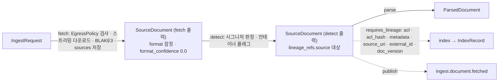

# SourceDocument 계약

## 목적

`SourceDocument`는 수집 파이프라인의 첫 산출물 계약이다. `fetch` 스테이지가 `IngestRequest`의 `source_uri`에서 원본 바이트를 내려받아 콘텐츠 주소화(content-addressed)로 저장하고, `detect` 서브스테이지가 포맷·컨테이너 플래그를 판정한 결과를 하나의 인스턴스로 확정한다. 이 문서는 설계 바이블(Design Bible) §5.4 `SourceDocument` 표를 같은 철자·같은 필수 여부로 옮기고, 문서 버전 규칙(`doc_version = content_hash`, [ADR-0005](../06-adr/0005-doc-version-content-hash-only-and-acl-payload-update.md)), 포맷 판별과 라우팅 힌트, 중복 감지와 파생물 공유, 원본 저장과 스트리밍 해시, fetch 진단, 암호화·배포용 문서 플래그, 언어 힌트를 확정한다. 정본 우선순위는 브리프 > 바이블 > ADR > 이 문서다(바이블 §1.1).

## 범위

- 포함: 필드 표(바이블 §5.4 전 필드 + 봉투 §5.2), 하위 객체(`container_flags`, `http_metadata`, `metadata`, `fetch_report`), 바이블 미등재 선택 하위 객체(`detect_report`, `dedup_report`), JSON Schema 2020-12 전문(`schemas/source-document.schema.json`), Pydantic v2 모델, 예시 2개, 불변식, 크기 한계, 저장 규약, LLM 소비 영향.
- 제외: 페처·판별기 구현 세부([04-pipelines/02](../04-pipelines/02-fetching-and-source-resolution.md), [04-pipelines/03](../04-pipelines/03-parsing-router-and-format-detection.md)), `IngestRequest` 필드 의미([01-ingest-request](01-ingest-request.md); `source_uri`·`metadata`·`credentials_ref`의 값 제약은 01 §2.1 `source_uri` 패턴·상한과 §2.2·§2.3·§8.3의 `$defs`를 공용 `$defs` 승격 전까지 그대로 복제한다, 미해결 이슈 8), 파서 출력([03-parsed-document](03-parsed-document.md)), 오류 코드 의미 해설([13-error-model](13-error-model.md)), 버전 호환 세부([14-schema-versioning-and-compatibility](14-schema-versioning-and-compatibility.md)).
- 소유 파일: `docs/03-contracts/02-source-document.md`, `schemas/source-document.schema.json`. `schemas/common-types.schema.json`은 수정하지 않는다.

## 1. 모델 개요

### 1.1 위치와 생산·소비



| 항목 | 내용 | 출처 |
|------|------|------|
| 생산 | `fetch`(확장 지점 `fetcher`, in_process, 큐 `ingest-io`) + `detect`(확장 지점 `parser`, role `format_detector`, in_process, 큐 `ingest-cpu`) | 바이블 §4.2, §4.4 |
| 소비 | `parse`(라우팅·복호화·디코딩 힌트), `index`(`requires_lineage`로 `acl`·`metadata` 평탄화), `IndexCommit.artifact_refs.source`(재적재 복구), `GET /v1/documents/{document_id}`(문서 메타·ACL) | 바이블 §5.1, §4.1, §14 |
| 한계·스키마·이벤트 | 인스턴스 32KB / 원본 200MB(프로파일 `ingest.fetch.max_bytes`); `urn:rag:schema:source-document:1`, `application/vnd.rag.source-document+json`; `ingest.document.fetched`(`data`는 ID·해시·상태만, [12-jobs-events-and-status](12-jobs-events-and-status.md)) | 바이블 §5.1, §6.4, §5.7 |

### 1.2 두 단계 인스턴스: fetch 출력과 detect 출력

**결정:** 바이블 §4.2는 `fetch`와 `detect`를 입력·출력·멱등성 키가 다른 두 행으로 둔다. 따라서 `SourceDocument`는 같은 스키마의 두 인스턴스로 존재하며, 하류(`parse`·`index`·`lineage_refs.source`·`IndexCommit.artifact_refs.source`)가 참조하는 것은 **detect 출력**이다. 두 인스턴스는 아래 행만 다르고 나머지 필드(`artifact.uri`·`artifact.blake3`·`artifact.size_bytes` 포함)는 그대로 복사한다.

| 항목 | fetch 출력 | detect 출력 |
|------|-----------|-------------|
| `producer.plugin_id` | `fetcher.*`(예 `fetcher.fsspec_httpx`) | `parser.*`(role `format_detector`, 예 `parser.format_detector_puremagic`) |
| `media_type` | 잠정값: HTTP `Content-Type`(파라미터 제거) 또는 `media_type_hint`, 없으면 `application/octet-stream` | 시그니처 판정 결과(§4.2 대응표) |
| `artifact.media_type` | `media_type`과 같은 잠정값(오브젝트 저장 시 `Content-Type`으로도 쓰임, §5·§11) | detect가 §4.2 대응표 값으로 **재작성**(= `media_type`, S-8). 오브젝트 스토리지의 `Content-Type`은 갱신하지 않는다(§11) |
| `format` / `format_confidence` | 힌트·확장자 기반 잠정값 또는 `unknown` / `0.0` | 판정값(`unknown`이면 산출물 없이 `parse.unsupported_format`) / `> 0` |
| `container_flags` / `detect_report` | `{encrypted: false, distribution: false, compressed: false}` **미판정 자리표**(필수 필드이므로 채우되 판정값이 아니다) / 없음 | 판정값(§4.1) / 있음(권고) |
| 산출물 경로 | `…/artifacts/source-document/{fetch_key[:2]}/{fetch_key}.json`, `ArtifactRef.stage_key` 생략(캐시 없음, §11) | `…/artifacts/source-document/{stage_key[:2]}/{stage_key}.json`, `stage_key = H("stage", "detect", scope_key, content_hash, fingerprint)` |

- 자리표 판별: 소비자는 `producer.plugin_id`의 확장 지점(`fetcher` = fetch 출력)과 `detect_report` 부재로 fetch 출력을 식별하며, fetch 출력의 `container_flags`·`format`·`media_type`을 판정값으로 읽어서는 안 된다(S-6). 바이블 §4.2 detect 행은 이 세 필드를 detect가 "채움"이라고만 적고 §5.4는 Y로 표기해 fetch 출력의 값을 규정하지 않으므로, 이 잠정값 규약은 이 문서의 결정이며 바이블 반영을 제안한다(미해결 이슈 13).
- `lineage_refs`: 00 §3.2의 일반 규칙("입력 봉투의 `lineage_refs`를 복사한 뒤 자기 입력의 `ArtifactRef`를 추가")을 detect에 그대로 적용하면 `source` 키에 fetch 출력이 들어가 `source`가 두 인스턴스를 뜻하게 된다. detect는 입력과 같은 `schema_type`을 출력하므로 **예외**로 `lineage_refs = {}`를 유지하고(`source` 키는 항상 detect 출력을 뜻한다, 00 §3.2 `parse` 행), fetch → detect 관계는 `lineage` 원장 행으로만 기록한다(§11, S-9). 00 §3.2 표에 `detect` 행 추가를 제안한다(미해결 이슈 14).

## 2. 필드 정의

### 2.1 최상위 필드(바이블 §5.4 표 전체; 타입 표기 브리프 §9.5, 필수 표기 00 §8.1)

| 필드 | 타입 | 필수 | 설명 | 예시 |
|------|------|------|------|------|
| `schema_version` | string(semver) | Y | 계약 버전. 초기 `"1.0.0"`, `MAJOR.MINOR.PATCH` 세 정수만 | `"1.0.0"` |
| `schema_type` | string | Y | 고정값 `"SourceDocument"`. `ArtifactRef.schema_type`와 일치해야 로드 | `"SourceDocument"` |
| `tenant_id` | string(ulid) | Y | 보안 삼중항 1. `artifact.uri`의 `tenants/{tenant_id}/` 접두와 같다 | `"01J9ZQ4K7X2M8N3P5R6S7T8V9W"` |
| `collection_id` | string(ulid) | Y | 보안 삼중항 2. `IngestRequest.collection_id` 복사 | `"01J9ZQ5A1B2C3D4E5F6G7H8J9K"` |
| `producer` | `Producer` | Y | 생산 플러그인 지문(§1.2) | 예시 1 |
| `quality` | enum(Quality) | Y | fetch·detect는 저하를 만들지 않으므로 v1에서는 `full` | `"full"` |
| `warnings` | array<Warning> | Y | 빈 배열 허용. 콘텐츠 미포함 | `[]` |
| `created_at` | string(date-time) | Y | 인스턴스 발급 시각(RFC 3339 UTC). `fetched_at` 이후 | `"2026-09-22T09:00:05.120Z"` |
| `lineage_refs` | object<string, ArtifactRef> | Y | fetch·detect 출력 모두 빈 객체 `{}`(00 §3.2 `fetch` 행; detect는 §1.2의 예외). 원본은 `artifact`로 참조 | `{}` |
| `document_id` | string(ulid) | Y | `(tenant_id, collection_id, external_id or source_uri)` 기준 재사용, 아니면 신규. **API 접수 시 확정**(`jobs.document_id`; 문서 단위 잡 직렬화 키, 바이블 §11.2) | `"01J9ZQ7D3E4F5G6H7J8K9M0N1P"` |
| `request_id` | string(ulid) | Y | `IngestRequest.request_id` 역참조 | `"01J9ZQ7B8C9D0E1F2G3H4J5K6M"` |
| `source_uri` | string(uri) | Y | `IngestRequest.source_uri` 그대로. 절대 URI, authority에 userinfo 금지, 공백 금지, ≤ 2,048자 — 01 §2.1 `source_uri` 패턴 `^[a-z][a-z0-9+.-]*://[^\s/@]*(/[^\s]*)?$`·`maxLength 2048`을 자구까지 복제(공용 `$defs` 승격 전까지, 미해결 이슈 8) | `"s3://mois-records/2026/09/foia.hwpx"` |
| `resolved_uri` | string(uri) | Y | 리다이렉트·프리사인 해소 결과. 서명·자격 증명 쿼리 제거(§7). `source_uri`와 같은 패턴·상한(userinfo·공백 금지, ≤ 2,048자; S-10) | `"https://www.nts.example.go.kr/press/2026/09/15/tax.pdf"` |
| `artifact` | `ArtifactRef` | Y | 원본 바이트(`tenants/{tenant_id}/sources/{blake3[:2]}/{blake3}`). 계약 산출물이 아니므로 `schema_type`·`schema_version`·`stage_key` 없음, `media_type`은 원본 MIME(fetch 출력은 잠정값, detect 출력은 §4.2 값으로 재작성, §1.2) | 예시 1 |
| `content_hash` | string(hex64) | Y | `blake3_hex(원본 바이트)` = `artifact.blake3`(라벨 없음, 바이블 §6.2) | `"9f8f5e87…"` |
| `doc_version` | string(hex64) | Y | **`= content_hash`**(콘텐츠만; ACL·메타 변경은 버전을 바꾸지 않는다, ADR-0005) | `"9f8f5e87…"` |
| `size_bytes` | integer | Y | 원본 바이트 크기 = `artifact.size_bytes`, ≤ `ingest.fetch.max_bytes` | `1843200` |
| `media_type` | string | Y | 시그니처 판정 결과(파라미터 없음). detect 출력은 §4.2 대응표와 일치 | `"application/hwp+zip"` |
| `format` | enum(SourceFormat) | Y | 파서 라우터 키(`parse.router`는 13값 전부를 커버, 바이블 §7.3·§7.4 (10)) | `"hwpx"` |
| `format_confidence` | number(0..1) | Y | 판별 신뢰도(§4.1). fetch 출력 `0.0`, detect 출력 `> 0` | `1.0` |
| `container_flags` | object | Y | §2.2. fetch 출력은 미판정 자리표(§1.2) | 예시 1 |
| `http_metadata` | object | N | §2.3. 조건부 재수집·원 인코딩 | 예시 2 |
| `metadata` | object | Y | `IngestRequest.metadata` 복사(§2.4) | 예시 1 |
| `metadata_hash` | string(hex64) | Y | `H("meta", canonical_json(metadata))`. 입력은 §3 정규형(값 없는 선택 필드·기본값과 같은 선택 필드 제거) | `"73f16425…"` |
| `acl` | `Acl` | Y | 문서 단위 ACL 정본(바이블 §10.1). 하류 수집 산출물은 `lineage_refs.source`로 도달 | 예시 1 |
| `acl_hash` | string(hex64) | Y | `H("acl", canonical_json(acl))`. 입력은 §3 정규형(값 없는 선택 필드·기본값과 같은 선택 필드 제거). `IndexRecord.acl_hash`·`aclrev` 회수 힌트 대조 키(E9) | `"142b6eb7…"` |
| `pii_policy` | enum(PiiPolicy) | Y | 확정값(요청 > 컬렉션 > 테넌트) | `"mask"` |
| `pii_tokenize_mode` | enum(PiiTokenizeMode) | 조건 | `pii_policy = tokenize`일 때 필수, 기본 `encrypt` | `"encrypt"` |
| `external_id` | string | N | 원천 시스템 문서 ID(갱신·삭제 조회 키) | `"MOIS-FOIA-2026-1187"` |
| `external_version` | string | N | 원천 버전 라벨(etag 등) | `"\"3d0f2b9c…\""` |
| `credentials_ref` | string(`CredentialsRef`) | N | `IngestRequest.credentials_ref` 그대로 전파. `{provider}:{path}` 형식(01 §8.3 `$defs/CredentialsRef` 패턴 `^[a-z][a-z0-9_]*:[^\s]{1,240}$`, 1..256자 복제; provider는 `RAG_SECRETS__PROVIDER` = `env`·`openbao`·`aws_kms`, 바이블 §6.6). **값(비밀) 미포함** | `"openbao:secret/data/tenants/01J9ZQ4K7X2M8N3P5R6S7T8V9W/sources/hwp-password"` |
| `fetched_at` | string(date-time) | Y | 다운로드 완료(또는 304 확인) 시각 | `"2026-09-22T09:00:04.512Z"` |
| `fetch_report` | object | N | §2.5 `{attempts, bytes_per_sec, redirects}` + 확장 키 | 예시 2 |
| `detect_report` | object | N | §2.6. **바이블 미등재**(미해결 이슈 3) | 예시 1 |
| `dedup_report` | object | N | §2.7. **바이블 미등재**(미해결 이슈 3) | 예시 2 |

### 2.2 `container_flags`(`$defs/ContainerFlags`)

| 필드 | 타입 | 필수 | 설명 | 예시 |
|------|------|------|------|------|
| `encrypted` | boolean | Y | HWP `FileHeader` 속성 비트 1(암호), HWPX `META-INF/manifest.xml` 암호화 항목, PDF 트레일러 `/Encrypt`, OLE `EncryptedPackage`(암호화 OOXML). 판정만 하고 오류는 `parse`가 결정(§8) | `false` |
| `distribution` | boolean | Y | HWP `FileHeader` 속성 비트 2(배포용, ViewText). 그 외 포맷은 `false` | `false` |
| `compressed` | boolean | Y | HWP `FileHeader` 속성 비트 0 또는 ZIP 컨테이너(hwpx·docx·odt는 `true`) | `true` |
| `hwp_version` | string \| null | N | `FileHeader` 버전 4바이트 `5.0.x.x`(`hwp3`는 `3.0.0.0`). `hwp5`·`hwp3` 외 포맷은 `null` 또는 생략 | `"5.0.3.0"` |

### 2.3 `http_metadata`(`$defs/HttpMetadata`)

| 필드 | 타입 | 필수 | 설명 | 예시 |
|------|------|------|------|------|
| `etag` | string | N | HTTP `ETag` 또는 S3 호환 `ETag` 원문(따옴표 포함) | `"W/\"68c7a1f0-300000\""` |
| `last_modified` | string | N | HTTP-date 원문(RFC 9110 §5.6.7) | `"Tue, 15 Sep 2026 01:20:00 GMT"` |
| `charset` | string | N | `Content-Type` charset 파라미터. TXT/HTML 디코딩 힌트(§9) | `"euc-kr"` |

### 2.4 `metadata`(`$defs/SourceMetadata`; `IngestRequest.metadata` 복사, 바이블 §5.4)

**결정:** `SourceMetadata`는 01 `$defs/IngestMetadata`·`$defs/CustomMetadata`(01 §2.2·§2.3·V10·IR-8)와 **자구까지 같은 제약**을 가진다. 01이 접수 시 정규화(NFC·trim·공백 축약·순서 보존 중복 제거, 01 §6)를 끝내므로 복사본은 검증만 한다. 공용 `$defs` 승격 전까지 01 값을 그대로 복제하며(미해결 이슈 8), 01이 값을 바꾸면 이 표·스키마·Pydantic을 같은 개정에서 함께 고친다.

| 필드 | 타입 | 필수 | 설명 | 예시 |
|------|------|------|------|------|
| `title` | string | N | 1..512자. `IndexRecord.title` 1순위 원천(바이블 §5.4 `IndexRecord`) | `"정보공개 청구 처리 지침(2026년 개정)"` |
| `authors` | array<string> | N | ≤ 64개, 각 1..256자 | `["행정안전부 정보공개정책과"]` |
| `doc_date` | string(date) | N | 팩 헤더·상충 판정·필터 | `"2026-09-15"` |
| `doc_type` | string | N | snake_case 패턴 `^[a-z][a-z0-9_]{0,63}$`. 예 `regulation`, `press_release`, `report` | `"regulation"` |
| `department` | string | N | 1..256자. 필터용 keyword | `"행정안전부 정보공개정책과"` |
| `language_hint` | string(bcp47) | N | 기본 `ko`(부재 시 `parse`가 적용). 파서·OCR 언어 힌트(§9) | `"ko"` |
| `tags` | array<string> | N | ≤ 64개, 각 1..128자, 중복 없음(`uniqueItems`). 필터용 keyword | `["정보공개", "지침"]` |
| `genre` | enum(Genre) | N | 청커 장르 라우팅. 생략 시 `unknown`(01 §2.2) | `"law_article"` |
| `custom` | object<string, string \| number \| boolean> | N | 열린 객체(00 §8.2). 키 `^[a-z][a-z0-9_]{0,63}$` ≤ 64개, 값은 `string`(≤ 1,024자) \| `number` \| `boolean`(객체·배열·`null` 금지). 컬렉션 `filterable_fields`에 선언된 키만 `custom.{key}` 필터 가능 | `{"doc_no": "정보공개정책과-2026-1187"}` |

### 2.5 `fetch_report`(`$defs/FetchReport`; 바이블 §5.4 `{attempts, bytes_per_sec, redirects}`)

| 필드 | 타입 | 필수 | 설명 | 예시 |
|------|------|------|------|------|
| `attempts` | integer(≥1) | Y | 성공까지의 시도 횟수(`StagePolicy.max_attempts` 5 대비) | `2` |
| `bytes_per_sec` | number(≥0) | Y | 전송 처리량. 304면 `0` | `12582912.0` |
| `redirects` | integer(≥0) | Y | 따라간 리다이렉트 수(`EgressPolicy.max_redirects` 이하) | `1` |
| `http_status` | integer(100..599) | N | 최종 응답 상태(http·https만). **바이블 미등재** | `200` |
| `conditional_request` | boolean | N | 검증자로 조건부 GET을 보냈는지. **바이블 미등재** | `true` |
| `not_modified` | boolean | N | 304 → 이전 원본 바이트 재사용. **바이블 미등재** | `false` |
| `duration_ms` | integer(≥0) | N | 연결 시작~저장 완료. **바이블 미등재** | `412` |

### 2.6 `detect_report`(`$defs/DetectReport`; 선택, 바이블 미등재)

detect 출력에만 존재하며 판별기의 지문(`plugin_id`·`plugin_version`·`config_hash`)은 봉투 `producer`가 이미 담으므로 여기서 반복하지 않는다.

| 필드 | 타입 | 필수 | 설명 | 예시 |
|------|------|------|------|------|
| `signals` | array<string>(1..32) | Y | 판정에 쓴 신호 이름. 컨테이너 항목 이름·시그니처 이름만, 콘텐츠 조각 금지 | `["zip:mimetype=application/hwp+zip"]` |
| `hint_media_type` | string \| null | N | `IngestRequest.media_type_hint` 원문 | `"application/hwp+zip"` |
| `hint_agrees` | boolean \| null | N | 힌트와 판정 일치 여부(힌트 없으면 `null`) | `true` |
| `candidates` | array<object> | N | `{format: enum(SourceFormat), confidence: number}` 내림차순. 첫 항목 = `format`·`format_confidence` | `[{"format": "hwpx", "confidence": 1.0}]` |

### 2.7 `dedup_report`(`$defs/DedupReport`; 선택, 바이블 미등재)

| 필드 | 타입 | 필수 | 설명 | 예시 |
|------|------|------|------|------|
| `policy` | enum(DedupPolicy) | Y | 확정 정책(요청 > 컬렉션; 기본 `skip_if_same_hash`) | `"skip_if_same_hash"` |
| `previous_doc_version` | string(hex64) \| null | Y(nullable) | 같은 `document_id`의 `documents.current_doc_version`(없으면 `null`) | `null` |
| `content_unchanged` | boolean | Y | `content_hash == previous_doc_version` | `false` |
| `source_bytes_reused` | boolean | Y | 같은 테넌트 `sources/`에 동일 `content_hash` 원본이 있어 바이트 저장을 생략했는지 | `false` |

## 3. 문서 버전 규칙

**결정:** `doc_version = content_hash = blake3_hex(원본 바이트)`(라벨 없는 해시, 바이블 §6.2). ACL·메타데이터는 문서 버전의 일부가 아니며, 그 변경은 인덱스 payload 갱신(`acl.update.v1`, E11; `PATCH /v1/documents/{document_id}/metadata`)으로 처리한다([ADR-0005](../06-adr/0005-doc-version-content-hash-only-and-acl-payload-update.md)). 근거: `block_id = H("block", doc_version, element_path)[:32]`와 `chunk_id`가 `doc_version`에서 파생되므로(바이블 §6.2, [ADR-0004](../06-adr/0004-deterministic-chunk-id-scoped-record-id-and-ulid-exception.md)) ACL 변경이 버전을 바꾸면 인용 좌표·골든셋 `answer_spans`·임베딩 캐시가 모두 무효가 된다.

| 변경 | `doc_version` | `acl_hash` / `metadata_hash` | 조치 | 근거 |
|------|---------------|------------------------------|------|------|
| 원본 바이트 변경(같은 `document_id`) | 새 값 | 재계산 | 새 수집 → 새 `index_generation` 세대 플립 | 바이블 §11.4, 14 §6.3 |
| 바이트 동일, ACL만 변경 | 불변 | `acl_hash` 변경 | payload만 갱신(`acl_*`·`acl_hash`), `aclrev` 회수 힌트, 재임베딩 없음 | E9·E11 |
| 바이트 동일, 메타데이터만 변경 | 불변 | `metadata_hash` 변경 | payload 갱신; 결정적 접두어(제목 등)에 영향이면 `reprocess {from_stage: enrich}` 제안 | 바이블 §14, 14 §6.3 |
| 동일 바이트를 다른 `document_id`(다른 URI·`external_id`)로 수집 | 같은 값 | 각자 계산 | 별도 문서·별도 `record_id`(§6) | E17 |

원장 `documents.current_doc_version`은 세대 플립이 `committed`가 된 뒤 갱신되며(바이블 §11.4) `SourceDocument` 발급 시점에는 바뀌지 않는다.

**결정(해시 입력 규약; `acl_hash`·`metadata_hash` 공통):** `canonical_json`의 입력은 `acl`·`metadata` 인스턴스 그대로가 아니라 아래 두 규칙으로 축약한 **정규형**이다. 바이블 §6.2 `metadata_hash / acl_hash` 행은 정규화 규약에 침묵하므로 이 규약은 이 문서의 결정이며(patch 제안, 미해결 이슈 9), 같은 해시를 계산·대조하는 01 IR-17(`fetch` 계산), 07 R-8(`IndexRecord.acl_hash`), 12 `aclrev` 회수 힌트(E9)는 이 규약을 공유한다.

| 규칙 | 내용 | 근거 |
|------|------|------|
| (1) 값 없는 선택 필드 제거 | 생략된 키와 명시적 `null`(`acl.embargo_until`·`acl.expires_at`·`acl.source_acl_hash`, `metadata.*` 등 모든 N 필드)을 모두 제거한다. 기본값이 없는 N 필드는 이 규칙만 적용된다 | 00 §8.1 "생략과 `null`은 의미 동일", 00 I-6 |
| (2) 기본값과 같은 선택 필드 제거 | 계약이 기본값을 정한 선택(N) 필드가 기본값과 **같은 값**을 가지면 제거한다. 대상은 다음 네 값으로 닫혀 있다 — `acl.classification = "internal"`(바이블 §5.3 `Acl` 행 "기본 `internal`"), `acl.deny_principals = []`(바이블 §5.3은 N만 적고 00 §8.1이 "`deny_principals: []`는 '없음'"이라 하므로 생략 = 거부 없음과 의미 동일), `metadata.language_hint = "ko"`, `metadata.genre = "unknown"`(§2.4, 01 §2.2). `acl.visibility`는 Y라 대상이 아니다 | 01 §6은 기본값을 채우지 않고 01 A8·07 §5는 `classification` 부재를 `internal`로 읽는다 → `{…}`와 `{…, "classification": "internal"}`은 같은 ACL이므로 같은 `acl_hash`를 내야 한다 |

이 정규형 덕분에 E9 `aclrev` 대조(07 §7)와 §6·01 §5.1의 "`acl_hash`(또는 `metadata_hash`)만 다르면 payload 갱신" 판정이 기본값 표기 여부만 다른 의미 동일 인스턴스를 변경으로 오판하지 않는다. 정규형은 해시 **입력**에만 쓰며 저장되는 `acl`·`metadata` 인스턴스는 받은 그대로다(예시 1은 `deny_principals: []`·`classification: "internal"`·`expires_at: null`·`language_hint: "ko"`를 인스턴스에 두지만 해시 입력에서는 모두 빠진다). 규칙 (2)의 기본값 집합을 바꾸면 저장된 모든 해시가 무효가 되므로 의미 변경(major, 14)으로 취급한다. 대안이었던 "기본값을 채운 뒤 해시"는 같은 동치류를 만들지만 01 §6 "기본값을 채워 넣지 않는다"와 방향이 달라 채택하지 않았다.

예시 2개의 해시 **입력**(정규형을 `canonical_json`한 문자열; 키는 중첩 객체까지 정렬)은 아래와 같다. 계약 테스트는 이 문자열에 `H("acl", ·)`·`H("meta", ·)`를 적용한 값이 인스턴스의 `acl_hash`·`metadata_hash`와 같은지 검사한다(Pydantic `_hash_input`; 예시의 hex 값은 ID와 같이 형식 규약을 지키는 플레이스홀더다).

| 예시 | 해시 | 제거된 키 | `canonical_json` 입력 |
|------|------|-----------|------------------------|
| 1 | `acl_hash` | `deny_principals: []`(2), `classification: "internal"`(2), `expires_at: null`(1) | `{"allow_principals":["group:mois_records","user:kim.minsu@example.go.kr"],"embargo_until":"2026-10-01T00:00:00.000Z","visibility":"restricted"}` |
| 1 | `metadata_hash` | `language_hint: "ko"`(2) | `{"authors":["행정안전부 정보공개정책과"],"custom":{"doc_no":"정보공개정책과-2026-1187","is_public_notice":false,"revision":3},"department":"행정안전부 정보공개정책과","doc_date":"2026-09-15","doc_type":"regulation","genre":"law_article","tags":["정보공개","지침","2026"],"title":"정보공개 청구 처리 지침(2026년 개정)"}` |
| 2 | `acl_hash` | 없음(`classification: "public"`은 기본값이 아니므로 유지; `deny_principals`·`embargo_until`·`expires_at`은 생략되어 있음) | `{"allow_principals":["tenant:*"],"classification":"public","visibility":"public"}` |
| 2 | `metadata_hash` | `language_hint: "ko"`(2) | `{"authors":["국세청 대변인실"],"custom":{"page_count_hint":12,"press_no":"2026-0915-03"},"department":"국세청 대변인실","doc_date":"2026-09-15","doc_type":"press_release","genre":"narrative","tags":["보도자료","세무일정"],"title":"2026년 하반기 세무 일정 안내"}` |

동치 확인: 예시 1의 `acl`에서 `deny_principals`·`classification`·`expires_at` 키를 아예 빼고 보낸 `IngestRequest`도 같은 `acl_hash`를 낸다. 반대로 예시 2의 `classification`을 `"internal"`로 바꾸면 의미가 바뀐 것이므로 입력에서 `classification` 키가 사라져 다른 해시가 되고, E9·§6 판정은 이를 올바르게 ACL 변경으로 읽는다.

## 4. 포맷 판별과 라우팅 힌트

### 4.1 판별 순서·신뢰도·컨테이너 플래그

**결정:** 시그니처(컨테이너 구조)가 `media_type_hint`·확장자·HTTP `Content-Type`보다 우선한다(바이블 §5.4 `media_type_hint` "힌트만"). 판별기 1차는 puremagic + 자체 ZIP/OLE 스니퍼(매트릭스 `format_detector`; 버전은 확인 필요 as of 2026-09). 신뢰도 수치는 **초안 목표**이며 04-pipelines/03의 골든 코퍼스로 확정한다(미해결 이슈 4).

| 순서 | 신호 | `format` | `format_confidence` |
|------|------|----------|---------------------|
| 1 | `%PDF-` 헤더 | `pdf` | 1.0 |
| 2 | OLE2 시그니처 + `FileHeader` 스트림 `HWP Document File` / + `WordDocument` 스트림 | `hwp5` / `doc` | 1.0 |
| 3 | OLE2 + `EncryptedPackage`·`EncryptionInfo` 스트림(암호화 OOXML) | `docx` | 0.7, `encrypted = true`(확인 필요 as of 2026-09) |
| 4 | ZIP + `mimetype` = `application/hwp+zip` 또는 `Contents/content.hpf` | `hwpx` | 1.0 |
| 5 | ZIP + `[Content_Types].xml` + `word/document.xml` | `docx` | 1.0 |
| 6 | ZIP + `mimetype` = `application/vnd.oasis.opendocument.text` | `odt` | 1.0 |
| 7 | `{\rtf` 헤더 | `rtf` | 1.0 |
| 8 | `HWP Document File V3.00` 헤더 | `hwp3` | 1.0(시그니처 확인 필요 as of 2026-09) |
| 9 | 텍스트로 디코딩 가능(UTF-8/CP949) + JSON 파싱 성공 | `json` | 0.9 |
| 10 | 텍스트 + HTML 루트 신호(`<!DOCTYPE html`, `<html`, `<body`) | `html` | 0.8 |
| 11 | 텍스트 + Markdown 신호(heading `#`, 목록, 링크 문법) / 그 외 텍스트 | `md` / `txt` | 0.6 |
| 12 | 시그니처 없음, 힌트·확장자만 존재 | 힌트 값 | 0.5 |
| 13 | 어느 것도 아님 | `unknown` | 0.0 → `parse.unsupported_format`(비재시도, 산출물 없음) |

- 텍스트 계열(9~11)에서 힌트가 판정과 일치하면 0.1을 더하고 1.0을 상한으로 한다(초안). `hint_agrees = false`는 `detect_report`에 남기되 경고 코드는 v1 카탈로그에 없다(미해결 이슈 7).
- ZIP/OLE 구조가 손상되어 항목 열람이 불가하면 `parse.corrupt_container`(비재시도). ZIP 안에 여러 문서가 있으면 판별하지 않고 `IngestRequest.split_hint = zip_members` 라우팅에 맡긴다.
- 컨테이너 플래그의 판정 근거는 §2.2 표와 같다. `encrypted`의 HWPX 매니페스트 판정은 hwpxlib 교차 검증 대상이다(확인 필요 as of 2026-09).

### 4.2 `SourceFormat` ↔ `media_type` 대응표

**결정:** detect 출력의 `media_type`(및 `artifact.media_type`)은 아래 값이다. HWP 계열은 IANA 미등록이므로 이 문서가 확정값을 정한다(00 §9.3이 위임; 미해결 이슈 4). `hwp3`와 `hwp5`는 같은 미디어 타입을 쓰고 `format`으로 구분한다.

| `format` | `media_type` | `format` | `media_type` |
|----------|--------------|----------|--------------|
| `hwpx` | `application/hwp+zip`(OCF `mimetype` 항목 값; `application/vnd.hancom.hwpx` 표기는 이 값으로 정규화) | `odt` | `application/vnd.oasis.opendocument.text` |
| `hwp5` | `application/x-hwp` | `html` | `text/html` |
| `hwp3` | `application/x-hwp` | `txt` | `text/plain` |
| `pdf` | `application/pdf` | `md` | `text/markdown` |
| `docx` | `application/vnd.openxmlformats-officedocument.wordprocessingml.document` | `json` | `application/json` |
| `doc` | `application/msword` | `unknown` | `application/octet-stream`(fetch 출력 자리표) |
| `rtf` | `application/rtf`(`text/rtf`는 이 값으로 정규화) | | |

### 4.3 `parse.router` 라우팅

`format`은 프로파일 `ingest.parse.router`의 키다(바이블 §7.3; 라우터는 13값을 모두 가져야 로딩을 통과, §7.4 (10)). `SourceDocument`는 라우팅 **키**만 제공하며 PDF의 `born_digital`/`scanned`/`mixed` 분기는 `parse`가 텍스트 레이어 프로브로 정하는 `ParsedDocument.source_kind`다.

| `format` | `standard` 라우팅(바이블 §7.3) | 비고 |
|----------|--------------------------------|------|
| `hwpx` | `parser.hwpx_python_hwpx` | `encrypted`면 `credentials_ref` 필요(§8) |
| `hwp5` | Java 사이드카 → unhwp(helper) → hwp-hwpx-parser | `distribution`이면 §8 판정(옵트인 + 사이드카 프로파일만 Tika 텍스트 전용) |
| `pdf` | `source_kind`별 `parser.pdf_docling_standard` / `page_route` | `encrypted`면 §8 |
| `docx` / `doc` / `rtf` / `odt` | Docling + docx2python / `lo-sidecar` → docx | `lo-sidecar` 미설치 시 `doc`은 `parse.unsupported_format` |
| `html` / `txt` / `md` / `json` | Trafilatura → Docling / charset-normalizer + markdown-it-py / `json`은 `split_hint = json_array`면 멤버 분할 후 `txt` | `http_metadata.charset`이 디코딩 힌트(§9) |
| `hwp3` / `unknown` | `parse.unsupported_variant` / `parse.unsupported_format` | 전 프로파일 미지원 / detect에서 이미 종료 |

## 5. 원본 저장과 스트리밍 해시

**결정:** 원본 바이트는 메모리에 전부 올리지 않고 스트리밍하며, BLAKE3는 증분 해시로 계산한다. 크기 상한은 스트림 도중 강제한다. 근거: 브리프 원칙 4(콘텐츠 주소화), 바이블 §5.1(200MB), E16.

| 단계 | 동작 | 실패 코드 |
|------|------|-----------|
| 1 | `EgressPolicy` 검사: 스킴 ∈ `allowed_schemes`, DNS 해석 IP ∉ `deny_cidrs`, `resolve_pin`으로 고정 연결, 포트 검사(프로파일 AND 테넌트 정책) | `fetch.scheme_unsupported`, `fetch.egress_denied` |
| 2 | `Content-Length`(또는 오브젝트 크기)가 `max_bytes`를 넘으면 다운로드 전에 종료 | `fetch.too_large` |
| 3 | 청크 스트리밍 → BLAKE3 증분 해시 + 워커 로컬 스풀 파일. 누적 바이트가 `max_bytes`를 넘으면 즉시 중단 | `fetch.too_large` |
| 4 | 완료 → `content_hash` 확정, `size_bytes` 기록 | — |
| 5 | `tenants/{tenant_id}/sources/{h[:2]}/{h}` 존재 확인. 있으면 저장 생략(`dedup_report.source_bytes_reused = true`), 없으면 fetch 시점 잠정 `media_type`을 `Content-Type`으로 달아 저장(참고용 메타데이터; 정본은 detect 출력의 `media_type`, §11. 오브젝트 사용자 메타데이터에 콘텐츠·URI 원문 금지) | 저장 계층 실패는 `StageError` 코드 없이 셸(액티비티) 재시도(`StagePolicy` fetch 5회)로 처리한다. `fetch.upstream_error`는 원천 5xx·네트워크 오류 전용(바이블 §5.7)이라 쓰지 않는다; 전용 코드는 미해결 이슈 7 |
| 6 | read-after-write로 `blake3`·`size_bytes` 재검증(00 I-3) | `contract.violation` |
| 7 | `artifact`(`ArtifactRef`) 작성: `uri`, `blake3 = content_hash`, `media_type`(잠정값; detect가 §4.2 값으로 재작성, §1.2), `size_bytes`; `schema_type`·`stage_key` 없음 | — |

`sources/` 오브젝트는 불변이다(같은 키 = 같은 바이트; 덮어쓰기는 no-op). 삭제는 같은 `content_hash`를 참조하는 다른 `document_id`가 없을 때만 한다(참조 판정은 원장 `documents`·`lineage`; 절차는 09-operations). 워커 디스크 사용량은 `max_bytes` 이하, 메모리는 청크 버퍼만이다. 오브젝트 스토리지 멀티파트 스테이징 키는 바이블 §13.3에 없다(미해결 이슈 2). `file://`은 개발 프로파일에서만 허용된다(`EgressPolicy.allowed_schemes` 기본 `[https, s3, gs, az]`, `http`는 테넌트 옵트인).

## 6. 중복 감지와 파생물 공유

**결정:** 중복의 단위는 `content_hash`이고 재사용 범위는 세 층으로 나뉜다([ADR-0037](../06-adr/0037-artifact-cache-scope-and-stage-key-composition.md), E17).

| 재사용 대상 | 키 | 공유 범위 | 규칙 |
|-------------|----|-----------|------|
| 원본 바이트 | `tenants/{tenant_id}/sources/{content_hash[:2]}/{content_hash}` | 테넌트 내 | 같은 바이트를 다른 URI·`document_id`·컬렉션이 수집해도 저장 1회. 다른 테넌트는 별도 저장(키가 `tenants/{tenant_id}/`로 시작) |
| 파생물(HWPX 변환본·페이지 이미지·표 HTML·벤더 JSON) | `H("derived", content_hash, sidecar_image_digest)` | 테넌트 내 | 봉투(ACL·메타)가 없으므로 컬렉션·문서를 넘어 공유. 다른 테넌트와는 공유하지 않는다 |
| 계약 산출물(`SourceDocument` 포함, detect 이후) | `stage_key = H("stage", …, scope_key, …)`, `scope_key = tenant/collection/document` | 잡 스코프(같은 문서) | 봉투를 품으므로 동일 바이트라도 다른 문서·컬렉션·테넌트는 재실행 |
| `fetch` 출력 | 없음 | 없음 | 항상 다운로드(검증자 304 재사용은 §7) |

`dedup_report`는 세 판정을 기록한다. (a) `previous_doc_version`: 같은 `document_id`의 현재 버전. (b) `content_unchanged = (content_hash == previous_doc_version)`. (c) `source_bytes_reused`: 테넌트 `sources/`에 이미 있었는지. 워크플로우는 `content_unchanged = true`이고 `policy = skip_if_same_hash`이면 `parse` 이하를 생략한다. **결정:**(01 §5.1과 동일) 이때 `acl_hash` 또는 `metadata_hash`만 달라졌으면(§3 정규형 기준 비교 — 기본값 명시 여부만 다른 인스턴스는 변경이 아니다) 재임베딩 없이 `acl.update.v1`과 동일 장치(`aclrev:` 회수 힌트 → `update_acl`/메타 payload 갱신 → `acl.document.updated`)로 payload를 갱신하고 `doc_version`은 불변, 잡은 `succeeded`다([ADR-0005](../06-adr/0005-doc-version-content-hash-only-and-acl-payload-update.md); 워크플로우 타입·어댑터 메서드 이름만 미정, 미해결 이슈 10). `policy = reindex_always`면 같은 `chunk_id` 집합이라도 새 `index_generation`으로 적재한다(바이블 §5.4 `dedup_policy`, §11.4). 동일 바이트가 두 테넌트(또는 두 컬렉션)에 수집되면 `record_id`가 스코프·세대를 합성하므로 레코드가 충돌하지 않는다(E17).

## 7. fetch 진단과 조건부 재수집

**결정:** 검증자(`http_metadata.etag` 또는 `last_modified`)가 있고 같은 `document_id`의 이전 `SourceDocument`가 있을 때만 조건부 GET을 보낸다. 검증자가 없으면 조건부 재수집은 금지되며 항상 전체를 내려받는다(바이블 §4.2 `fetch` 행, 리스크 #8).

| 항목 | 규칙 |
|------|------|
| 검증자 원천 | `documents.current_doc_version`에 대응하는 **커밋된** 세대의 `IndexCommit.artifact_refs.source`(detect 출력)의 `http_metadata`만. 커밋 전에 실패했거나 아직 플립되지 않은 잡의 산출물은 검증자로 쓰지 않는다 — 그래야 304가 곧 `content_hash = previous_doc_version`이 되어 S-13이 성립한다 |
| 조건부 요청 | `https`: `If-None-Match`(etag 우선) / `If-Modified-Since`; `s3`: GetObject `IfNoneMatch`; `gs`·`az`: 대응 조건 헤더(지원 여부 확인 필요 as of 2026-09, 미해결 이슈 11). `fetch_report.conditional_request = true` |
| 304 | 이전 `content_hash` 원본 바이트 재사용, **봉투는 새로 발급**(`request_id`·`fetched_at`·`created_at` 갱신). `fetch_report.not_modified = true`, `bytes_per_sec = 0`, `http_status = 304`; `dedup_report.content_unchanged = source_bytes_reused = true` |
| 리다이렉트·`resolved_uri` | 홉마다 `EgressPolicy` 재검사, `max_redirects`(기본 3) 초과는 `fetch.egress_denied`; `redirects`에 수만 기록하고 중간 URL은 기록하지 않는다. `resolved_uri`는 최종 URL에서 **자격 증명·서명을 제거한 값**이다(원칙, S-10). v1에서 제거하는 키는 공급자 고유 서명 파라미터로 한정한다: AWS SigV4 `X-Amz-Signature`·`X-Amz-Credential`·`X-Amz-Security-Token`, GCS `X-Goog-Signature`, Azure SAS `sig`(확인 필요 as of 2026-09). `token`·`signature` 같은 범용 키는 정당한 원천 URL을 거부할 수 있어 제거 대상에 넣지 않으며, 전체 목록의 정본은 `EgressPolicy` 파라미터 또는 04-pipelines/02로 이관한다(미해결 이슈 12). 프리사인 URL 대신 `credentials_ref` 사용을 권고한다 |

| 원천 응답 | 코드 | 재시도 |
|-----------|------|--------|
| 401·403, 서명 URL 만료, 버킷 정책 거부 | `fetch.access_denied` | no |
| 404·410, 객체 키 부재 | `fetch.not_found` | no |
| `Content-Length` 또는 누적 바이트 > `max_bytes` | `fetch.too_large` | no |
| 스킴 미허용·`fetcher` 플러그인 부재 | `fetch.scheme_unsupported` | no |
| 사설·루프백·메타데이터 CIDR, DNS 리바인딩, 리다이렉트 초과 | `fetch.egress_denied` | no |
| 연결·읽기 타임아웃 | `fetch.timeout` | yes(5회, 지수, 최대 간격 1m; `attempts`에 기록) |
| 5xx·네트워크 오류 | `fetch.upstream_error` | yes(동일) |

## 8. 암호화·배포용 문서

**결정:** `detect`는 `container_flags`를 **판정만** 하고, 오류 여부는 `parse`가 정책과 함께 결정한다(바이블 §4.2 `detect` 행; [ADR-0007](../06-adr/0007-hwp5-java-sidecar-first-pyhwp-demoted.md)). `SourceDocument.quality`는 이 판정으로 바뀌지 않는다.

| `encrypted` | `distribution` | `credentials_ref` | `allow_distribution_documents`(요청 AND 테넌트) | `parse` 결과 |
|-------------|----------------|-------------------|--------------------------------------------------|--------------|
| true | — | 없음 | — | `parse.document_encrypted`(비재시도) |
| true | — | 있음 | — | KeyProvider에서 비밀 조회 후 복호화 시도; 불일치·실패는 `parse.document_encrypted` |
| — | true | — | false | `parse.distribution_document`(비재시도) |
| — | true | — | true | JVM 사이드카(`parser-workers`)가 있는 프로파일(`standard`·`premium`·`korean-gov`)만 Tika `HwpV5Parser` 텍스트 전용, `quality = degraded`, `Block.source = converted`(팩 `[converted]` 표기). `lite` 등 사이드카 부재 프로파일은 플래그와 무관하게 `parse.distribution_document`(바이블 §7.1 HWP 5.0 행, ADR-0007 배포용 행; 프로파일 표기 차이는 미해결 이슈 16) |
| false | false | — | — | 정상 라우팅(§4.3) |

비밀번호는 어디에도 평문으로 실리지 않는다(`credentials_ref`만 전파, 바이블 §5.4 `IngestRequest`). 오류 `StageError.detail`은 "`container_flags.encrypted=true` and `credentials_ref` absent"처럼 필드 이름만 담는다([13 예시 4](13-error-model.md)).

## 9. 언어 힌트와 인코딩

- 언어 힌트는 `metadata.language_hint`(BCP 47, 바이블 §6.3)이며 `IngestRequest.metadata` 복사이므로 fetch·detect가 채우거나 바꾸지 않는다. 부재 시 `parse`가 기본 `ko`를 적용해 OCR 언어(`ocr.lang = [korean]`)·`ParsedDocument.language` 초기값으로 쓴다. `metadata_hash`는 복사본 그대로 계산한다.
- 인코딩 힌트는 `http_metadata.charset`이다. TXT/HTML 디코딩 순서는 WHATWG 스니핑 규칙(BOM > HTTP charset > `<meta>` 1024B > 자동감지 > UTF-8; `euc-kr`은 `cp949`로 디코딩, 매트릭스 `text_decoder`)이며 실제 사용한 인코딩은 `ParsedDocument.source_encoding`에 남는다.

## 10. 크기 한계·대형 데이터 처리

| 대상 | 한계(바이블 §5.1 값 또는 초안 목표) | 초과 시 |
|------|------|---------|
| `SourceDocument` JSON(직렬화) | 32KB(바이블 §5.1) | `contract.violation`(셸 출력 검증). ACL 주체 상한 1,024와의 긴장은 미해결 이슈 5 |
| 원본 바이트 | 프로파일 `ingest.fetch.max_bytes`(기본 209,715,200) | `fetch.too_large`(산출물 없음) |
| `metadata` | 16KB(`IngestRequest.metadata` 상속); `title` ≤ 512자, `authors` ≤ 64개 × 256자, `tags` ≤ 64개 × 128자, `custom` ≤ 64키 × string 1,024자(01 §2.2·§2.3·V10과 동일 값) | `contract.violation` |
| `acl` / `detect_report` | 주체 ≤ 1,024 × ≤ 512자(`Acl`) / `signals` ≤ 32, `candidates` ≤ 13 | `contract.violation` |

인라인 금지: 원본 바이트는 어떤 계약·이벤트·로그에도 인라인(base64 포함)하지 않고 `artifact`로만 참조한다(00 §8.3). `SourceDocument` 인스턴스도 이벤트 `data`·`StageError`에 넣지 않으며 `ArtifactRef`와 ID만 실린다(E12).

## 11. 산출물 저장 규약

| 항목 | 규약 |
|------|------|
| 원본 오브젝트 키 | `tenants/{tenant_id}/sources/{content_hash[:2]}/{content_hash}`(바이블 §13.3). 오브젝트 `Content-Type`은 fetch 시점의 잠정 `media_type`(참고용)이며, 오브젝트가 불변(중복 시 저장 생략)이므로 detect가 갱신하지 않는다. 미디어 타입의 **정본은 detect 출력의 `SourceDocument.media_type` = `artifact.media_type`**(§4.2, S-8)이고 소비자는 오브젝트 메타데이터를 읽지 않는다 |
| detect 출력 키 | `tenants/{tenant_id}/artifacts/source-document/{stage_key[:2]}/{stage_key}.json`, `stage_key = H("stage", "detect", scope_key, content_hash, fingerprint)`; `ArtifactRef.stage_key` 기록, 원장 `artifacts(tenant_id, stage_key)` 행 기록 |
| fetch 출력 키 | 같은 경로 형식에 `fetch_key = H("stage", "fetch", scope_key, request_id, fingerprint)`를 쓴다(`request_id`가 잡마다 유일하므로 적중 불가). `ArtifactRef.stage_key`는 생략하고 `artifacts` 행은 만들지 않는다(바이블 §4.2 "캐시 없음"). **바이블 §13.3 보완 제안**(미해결 이슈 2) |
| 콘텐츠 해시·압축·미디어 타입 | `ArtifactRef.blake3`·`size_bytes` = 저장된 JSON 바이트(UTF-8, `canonical_json`)의 값(00 §9.2). 압축은 미정(00 U-4)이며 32KB 인스턴스는 14 §13의 zstd 임계(1MB) 미만이라 압축 없이 저장. 미디어 타입 `application/vnd.rag.source-document+json`(`schema_type = "SourceDocument"`, `schema_version` 동반, 00 I-2) |
| 계보 | 바이블 §4.1 5-튜플 `lineage(child_ref, parent_ref, stage_key, job_id, produced_at)`로 `lineage(fetch 출력, IngestRequest 산출물, null, job_id, produced_at)`(fetch는 캐시 없음이라 `stage_key` null; `fetch_key` 채택(미해결 이슈 2) 전까지)과 `lineage(detect 출력, fetch 출력, detect stage_key, job_id, produced_at)`를 저장과 같은 트랜잭션에 기록한다. fetch → detect 관계는 이 원장 행으로만 표현되고 `lineage_refs`에는 넣지 않는다(§1.2) |

## 12. LLM 최종 소비에 미치는 영향

| 관심사 | 이 계약의 기여 | 관련 |
|--------|----------------|------|
| provenance의 뿌리 | `doc_version`이 `block_id`·`chunk_id`의 입력이므로 인용 좌표는 ACL·메타 변경에도 안정적이다. LLM이 받은 `cite_id → chunk_id → document_id/doc_version`은 재질의 후에도 같은 원문을 가리킨다 | K1, ADR-0004·0005 |
| 인용 헤더 원천·품질 표지 | `metadata.title`(1순위)·`doc_date`·`doc_type`이 `IndexRecord`를 거쳐 `ContextItem.header`로 전달된다. `source_uri`/`resolved_uri`가 헤더 `source_uri`의 원천이므로 서명·자격 증명이 없어야 한다(S-10; 원천 선택은 미해결 이슈 6). `container_flags.distribution` 옵트인 경로는 `Block.source = converted`·`quality = degraded`가 되어 팩 헤더에 `[converted]`가 붙고, `metadata.language_hint`는 OCR·형태소 분석기 선택을 통해 한국어 검색 품질을 좌우한다 | 바이블 §5.4 `IndexRecord`, §9.1·§9.3, 원칙 6 |
| 3-텍스트 규칙 | `SourceDocument`에는 본문 텍스트가 없다(바이트는 `artifact` 참조). 따라서 오류·이벤트·로그·`detect_report.signals`로 콘텍스트가 유출되는 경로가 없다 | K2, 00 I-16 |
| 보안 삼중항 | `tenant_id`·`collection_id`·`acl`(+`acl_hash`)의 정본이 여기다. `index`가 `IndexRecord.acl_*`로 평탄화하고(E5) `pack.acl_recheck`가 `acl_hash`로 회수 힌트를 대조한다(E9; §3 정규형이므로 기본값 표기 차이는 ACL 변경으로 읽히지 않는다). 렌더러는 ACL 값을 공급자 페이로드에 넣지 않는다(바이블 §9.3 공통 규칙 (1)) | D-09, ADR-0027 |

## 스키마

전문은 `schemas/source-document.schema.json`이며 아래와 동일하다.

```json
{
  "$schema": "https://json-schema.org/draft/2020-12/schema",
  "$id": "urn:rag:schema:source-document:1",
  "title": "SourceDocument",
  "description": "fetch(+detect) 출력. 원본 바이트의 콘텐츠 주소(ArtifactRef), 문서 버전(doc_version = content_hash, ADR-0005), 포맷 판별 결과(SourceFormat·format_confidence·container_flags), 문서 ACL(acl·acl_hash), 수집 메타데이터(metadata·metadata_hash)를 나르는 수집 측 첫 산출물 계약. 설계 바이블 §5.4 SourceDocument 표를 같은 철자·같은 필수 여부로 옮겼고, 바이블 미등재 필드(detect_report, dedup_report, fetch_report의 확장 키)는 선택으로만 추가했다. 소유 문서: docs/03-contracts/02-source-document.md",
  "$comment": "schema_version 1.0.0 (2026-09-22). 공용 타입·열거는 urn:rag:schema:common-types:1 $defs를 참조하고 재정의하지 않는다. 봉투 필드는 최상위에 직접 선언한다(00 §3.1).",
  "type": "object",
  "properties": {
    "schema_version": { "$ref": "urn:rag:schema:common-types:1#/$defs/Semver", "pattern": "^1\\.(0|[1-9]\\d*)\\.(0|[1-9]\\d*)$", "description": "계약 버전. 초기 \"1.0.0\"; MAJOR.MINOR.PATCH 세 정수만(14 불변식 1, S-1). 이 스키마($id major 1)는 1.x만 수용" },
    "schema_type": { "$ref": "urn:rag:schema:common-types:1#/$defs/SchemaTypeName", "const": "SourceDocument", "description": "고정값. ArtifactRef.schema_type와 일치해야 로드(00 I-1)" },
    "tenant_id": { "$ref": "urn:rag:schema:common-types:1#/$defs/Ulid", "description": "보안 삼중항 1. artifact.uri의 tenants/{tenant_id}/ 접두와 같다" },
    "collection_id": { "$ref": "urn:rag:schema:common-types:1#/$defs/Ulid", "description": "보안 삼중항 2. IngestRequest.collection_id 복사" },
    "producer": { "$ref": "urn:rag:schema:common-types:1#/$defs/Producer", "description": "fetch 출력은 fetcher.* 플러그인, detect 출력은 parser.*(role format_detector) 플러그인의 지문" },
    "quality": { "$ref": "urn:rag:schema:common-types:1#/$defs/Quality", "description": "fetch·detect는 저하를 만들지 않으므로 v1에서는 full" },
    "warnings": { "type": "array", "items": { "$ref": "urn:rag:schema:common-types:1#/$defs/Warning" }, "description": "빈 배열 허용(없음). 콘텐츠 미포함" },
    "created_at": { "$ref": "urn:rag:schema:common-types:1#/$defs/DateTime", "description": "이 인스턴스 발급 시각(RFC 3339 UTC). fetched_at 이후" },
    "lineage_refs": { "$ref": "urn:rag:schema:common-types:1#/$defs/LineageRefs", "maxProperties": 0, "description": "fetch·detect 출력 모두 빈 객체 {}. 원본 바이트는 artifact로 참조하고(00 §3.2 fetch 행), detect는 같은 schema_type을 출력하므로 fetch 출력을 source 키에 넣지 않는다(02 §1.2; fetch→detect 관계는 lineage 원장 행)" },
    "document_id": { "$ref": "urn:rag:schema:common-types:1#/$defs/Ulid", "description": "(tenant_id, collection_id, external_id or source_uri) 기준 재사용, 아니면 신규. API 접수 시 확정(jobs.document_id)" },
    "request_id": { "$ref": "urn:rag:schema:common-types:1#/$defs/Ulid", "description": "IngestRequest.request_id 역참조" },
    "source_uri": { "$ref": "urn:rag:schema:common-types:1#/$defs/Uri", "pattern": "^[a-z][a-z0-9+.-]*://[^\\s/@]*(/[^\\s]*)?$", "maxLength": 2048, "description": "IngestRequest.source_uri 그대로. 절대 URI, authority에 userinfo(user:pass@) 금지, 공백 금지, ≤ 2,048자 — urn:rag:schema:ingest-request:1 source_uri와 동일 패턴·상한(공용 $defs 승격 전까지 복제, 02 미해결 이슈 8)" },
    "resolved_uri": { "$ref": "urn:rag:schema:common-types:1#/$defs/Uri", "pattern": "^[a-z][a-z0-9+.-]*://[^\\s/@]*(/[^\\s]*)?$", "maxLength": 2048, "description": "리다이렉트·프리사인 해소 결과. 서명·자격 증명 쿼리 파라미터 제거(§7). source_uri와 같은 패턴·상한(S-10: userinfo·공백 금지, ≤ 2,048자)" },
    "artifact": { "allOf": [ { "$ref": "urn:rag:schema:common-types:1#/$defs/ArtifactRef" }, { "not": { "anyOf": [ { "required": ["schema_type"] }, { "required": ["schema_version"] }, { "required": ["stage_key"] } ] } } ], "description": "원본 바이트(tenants/{tenant_id}/sources/{blake3[:2]}/{blake3}). 계약 산출물이 아니므로 schema_type·schema_version·stage_key 없음; media_type은 원본 MIME(fetch 출력은 잠정값, detect 출력은 §4.2 대응표 값으로 재작성되어 최상위 media_type과 같다, S-8)" },
    "content_hash": { "$ref": "urn:rag:schema:common-types:1#/$defs/Hex64", "description": "blake3_hex(원본 바이트) = artifact.blake3(라벨 없음, 바이블 §6.2)" },
    "doc_version": { "$ref": "urn:rag:schema:common-types:1#/$defs/Hex64", "description": "= content_hash. 콘텐츠만; ACL·메타데이터 변경은 버전을 바꾸지 않는다(ADR-0005)" },
    "size_bytes": { "type": "integer", "minimum": 0, "description": "원본 바이트 크기 = artifact.size_bytes. 상한은 프로파일 ingest.fetch.max_bytes(기본 209,715,200)" },
    "media_type": { "$ref": "urn:rag:schema:common-types:1#/$defs/MediaType", "description": "시그니처 판정 결과(파라미터 없음). detect 출력은 format 대응표와 일치" },
    "format": { "$ref": "urn:rag:schema:common-types:1#/$defs/SourceFormat", "description": "파서 라우터 키(parse.router). fetch 출력은 힌트 기반 잠정값 또는 unknown" },
    "format_confidence": { "type": "number", "minimum": 0, "maximum": 1, "description": "판별 신뢰도. fetch 출력은 0.0, detect 출력은 0 초과" },
    "container_flags": { "$ref": "#/$defs/ContainerFlags", "description": "detect 출력은 판정값. fetch 출력은 미판정 자리표 {encrypted:false, distribution:false, compressed:false}(02 §1.2; producer.plugin_id가 fetcher.*이고 detect_report가 없으면 자리표)" },
    "http_metadata": { "$ref": "#/$defs/HttpMetadata" },
    "metadata": { "$ref": "#/$defs/SourceMetadata", "description": "IngestRequest.metadata 복사. 제약은 urn:rag:schema:ingest-request:1#/$defs/IngestMetadata·CustomMetadata와 자구까지 동일(공용 $defs 승격 전까지 복제, 02 미해결 이슈 8)" },
    "metadata_hash": { "$ref": "urn:rag:schema:common-types:1#/$defs/Hex64", "description": "H(\"meta\", canonical_json(metadata)). 입력은 02 §3 정규형: 값 없는 선택 필드(생략·null)와 기본값과 같은 선택 필드(language_hint=ko, genre=unknown)를 제거한 직렬화" },
    "acl": { "$ref": "urn:rag:schema:common-types:1#/$defs/Acl", "description": "문서 단위 ACL 정본(바이블 §10.1). 하류 수집 산출물은 lineage_refs.source로 도달" },
    "acl_hash": { "$ref": "urn:rag:schema:common-types:1#/$defs/Hex64", "description": "H(\"acl\", canonical_json(acl)). 입력은 02 §3 정규형: 값 없는 선택 필드(생략·null)와 기본값과 같은 선택 필드(deny_principals=[], classification=internal)를 제거한 직렬화. IndexRecord.acl_hash·aclrev 회수 힌트 대조 키(E9)" },
    "pii_policy": { "$ref": "urn:rag:schema:common-types:1#/$defs/PiiPolicy", "description": "확정값(요청 > 컬렉션 > 테넌트)" },
    "pii_tokenize_mode": { "$ref": "urn:rag:schema:common-types:1#/$defs/PiiTokenizeMode", "description": "pii_policy=tokenize일 때 필수, 기본 encrypt" },
    "external_id": { "type": "string", "minLength": 1, "maxLength": 512, "description": "원천 시스템 문서 ID(갱신·삭제 조회 키)" },
    "external_version": { "type": "string", "minLength": 1, "maxLength": 256, "description": "원천 버전 라벨(etag 등)" },
    "credentials_ref": { "type": "string", "pattern": "^[a-z][a-z0-9_]*:[^\\s]{1,240}$", "minLength": 1, "maxLength": 256, "description": "IngestRequest.credentials_ref 그대로 전파. {provider}:{path} — urn:rag:schema:ingest-request:1#/$defs/CredentialsRef와 동일 패턴·상한(공용 $defs 승격 전까지 복제, 02 미해결 이슈 8). provider 유효성(RAG_SECRETS__PROVIDER env|openbao|aws_kms, 바이블 §6.6)은 KeyProvider 해소 시 워커가 판정. 값(비밀) 미포함" },
    "fetched_at": { "$ref": "urn:rag:schema:common-types:1#/$defs/DateTime", "description": "다운로드 완료(또는 304 확인) 시각" },
    "fetch_report": { "$ref": "#/$defs/FetchReport" },
    "detect_report": { "$ref": "#/$defs/DetectReport" },
    "dedup_report": { "$ref": "#/$defs/DedupReport" }
  },
  "required": ["schema_version", "schema_type", "tenant_id", "collection_id", "producer", "quality", "warnings", "created_at", "lineage_refs", "document_id", "request_id", "source_uri", "resolved_uri", "artifact", "content_hash", "doc_version", "size_bytes", "media_type", "format", "format_confidence", "container_flags", "metadata", "metadata_hash", "acl", "acl_hash", "pii_policy", "fetched_at"],
  "additionalProperties": false,
  "allOf": [
    { "if": { "properties": { "pii_policy": { "const": "tokenize" } }, "required": ["pii_policy"] }, "then": { "required": ["pii_tokenize_mode"] }, "else": { "not": { "required": ["pii_tokenize_mode"] } } },
    { "if": { "not": { "properties": { "format": { "enum": ["hwp5", "hwp3"] } }, "required": ["format"] } }, "then": { "properties": { "container_flags": { "properties": { "hwp_version": { "type": "null" } } } } } }
  ],
  "$defs": {
    "ContainerFlags": {
      "type": "object", "description": "detect가 채우는 컨테이너 플래그(바이블 §5.4). 판정만 하며 오류(parse.document_encrypted, parse.distribution_document)는 parse가 결정한다.",
      "properties": {
        "encrypted": { "type": "boolean", "description": "HWP FileHeader 암호 비트·HWPX manifest 암호화·PDF /Encrypt" },
        "distribution": { "type": "boolean", "description": "HWP 배포용 문서 비트(ViewText)" },
        "compressed": { "type": "boolean", "description": "HWP FileHeader 압축 비트 또는 ZIP 컨테이너(hwpx·docx·odt)" },
        "hwp_version": { "type": ["string", "null"], "pattern": "^\\d+\\.\\d+\\.\\d+\\.\\d+$", "description": "HWP FileHeader 버전(5.0.x.x). hwp5·hwp3 외 포맷은 null 또는 생략" }
      },
      "required": ["encrypted", "distribution", "compressed"], "additionalProperties": false
    },
    "HttpMetadata": {
      "type": "object", "description": "원천이 준 검증자·인코딩(바이블 §5.4). 조건부 재수집(If-None-Match/If-Modified-Since)과 TXT/HTML 디코딩 힌트에 쓴다.",
      "properties": {
        "etag": { "type": "string", "minLength": 1, "maxLength": 256, "description": "HTTP ETag 또는 S3 호환 ETag(따옴표 포함 원문)" },
        "last_modified": { "type": "string", "minLength": 1, "maxLength": 64, "description": "HTTP-date 원문(RFC 9110 §5.6.7)" },
        "charset": { "type": "string", "minLength": 1, "maxLength": 64, "pattern": "^[A-Za-z0-9][A-Za-z0-9._:-]*$", "description": "Content-Type charset 파라미터(원 인코딩 힌트)" }
      },
      "additionalProperties": false
    },
    "SourceMetadata": {
      "type": "object", "description": "IngestRequest.metadata 복사(바이블 §5.4). 제약은 urn:rag:schema:ingest-request:1#/$defs/IngestMetadata와 자구까지 동일(01 §2.2·§2.3·V10; 공용 $defs 승격 전까지 복제). 모든 키 선택. 정규화(NFC·trim·중복 제거)는 01이 접수 시 수행했으므로 여기서는 검증만 한다. custom은 열린 객체(값 string ≤ 1,024 | number | boolean).",
      "properties": {
        "title": { "type": "string", "minLength": 1, "maxLength": 512, "description": "IndexRecord.title 1순위 원천" },
        "authors": { "type": "array", "items": { "type": "string", "minLength": 1, "maxLength": 256 }, "maxItems": 64, "description": "작성자·작성 기관" },
        "doc_date": { "$ref": "urn:rag:schema:common-types:1#/$defs/Date", "description": "팩 헤더·상충 판정·필터" },
        "doc_type": { "type": "string", "pattern": "^[a-z][a-z0-9_]{0,63}$", "description": "문서 종류 keyword(snake_case). 예 regulation, press_release, report" },
        "department": { "type": "string", "minLength": 1, "maxLength": 256, "description": "소관 부서·기관" },
        "language_hint": { "$ref": "urn:rag:schema:common-types:1#/$defs/Bcp47", "description": "기본 ko. 파서·OCR 언어 힌트" },
        "tags": { "type": "array", "items": { "type": "string", "minLength": 1, "maxLength": 128 }, "maxItems": 64, "uniqueItems": true, "description": "필터용 keyword(정확 일치, 중복 없음)" },
        "genre": { "$ref": "urn:rag:schema:common-types:1#/$defs/Genre", "description": "청커 장르 라우팅. 생략 시 unknown(01 §2.2)" },
        "custom": { "type": "object", "propertyNames": { "pattern": "^[a-z][a-z0-9_]{0,63}$" }, "additionalProperties": { "anyOf": [ { "type": "string", "maxLength": 1024 }, { "type": "number" }, { "type": "boolean" } ] }, "maxProperties": 64, "description": "테넌트 정의 keyword 메타(01 $defs/CustomMetadata와 동일). 컬렉션 filterable_fields에 선언된 키만 필터 가능(custom.{key})" }
      },
      "additionalProperties": false
    },
    "FetchReport": {
      "type": "object", "description": "fetch 진단(바이블 §5.4 {attempts, bytes_per_sec, redirects}). http_status·conditional_request·not_modified·duration_ms는 바이블 미등재 선택 키(02 미해결 이슈 3). URI·헤더 원문·콘텐츠는 담지 않는다.",
      "properties": {
        "attempts": { "type": "integer", "minimum": 1, "description": "성공까지의 시도 횟수(StagePolicy.max_attempts 대비)" },
        "bytes_per_sec": { "type": "number", "minimum": 0, "description": "전송 처리량. 304면 0" },
        "redirects": { "type": "integer", "minimum": 0, "description": "따라간 리다이렉트 수(EgressPolicy.max_redirects 이하)" },
        "http_status": { "type": "integer", "minimum": 100, "maximum": 599, "description": "최종 응답 상태(http·https만)" },
        "conditional_request": { "type": "boolean", "description": "검증자로 조건부 GET을 보냈는지" },
        "not_modified": { "type": "boolean", "description": "304 → 이전 원본 바이트 재사용" },
        "duration_ms": { "type": "integer", "minimum": 0, "description": "연결 시작~저장 완료" }
      },
      "required": ["attempts", "bytes_per_sec", "redirects"], "additionalProperties": false
    },
    "DetectReport": {
      "type": "object", "description": "포맷 판별 근거(바이블 미등재 선택 하위 타입, 02 미해결 이슈 3). detect 출력에만 존재한다. 판별기 지문은 봉투 producer가 담으므로 반복하지 않는다. 콘텐츠 미포함(시그니처 이름·컨테이너 항목 이름만).",
      "properties": {
        "signals": { "type": "array", "items": { "type": "string", "minLength": 1, "maxLength": 256 }, "minItems": 1, "maxItems": 32, "description": "판정에 쓴 신호 이름(예 zip:mimetype=application/hwp+zip, ole:FileHeader, pdf:header)" },
        "hint_media_type": { "type": ["string", "null"], "maxLength": 256, "description": "IngestRequest.media_type_hint 원문" },
        "hint_agrees": { "type": ["boolean", "null"], "description": "힌트와 판정이 일치하는지(힌트 없으면 null)" },
        "candidates": { "type": "array", "maxItems": 13, "items": { "type": "object", "properties": { "format": { "$ref": "urn:rag:schema:common-types:1#/$defs/SourceFormat" }, "confidence": { "type": "number", "minimum": 0, "maximum": 1 } }, "required": ["format", "confidence"], "additionalProperties": false }, "description": "후보 포맷과 신뢰도(내림차순). 첫 항목 = format·format_confidence" }
      },
      "required": ["signals"], "additionalProperties": false
    },
    "DedupReport": {
      "type": "object", "description": "중복 감지 결과(바이블 미등재 선택 하위 타입, 02 미해결 이슈 3). 워크플로우가 dedup_policy 판정에 쓴다.",
      "properties": {
        "policy": { "$ref": "urn:rag:schema:common-types:1#/$defs/DedupPolicy", "description": "확정 정책(요청 > 컬렉션 기본 skip_if_same_hash)" },
        "previous_doc_version": { "oneOf": [ { "$ref": "urn:rag:schema:common-types:1#/$defs/Hex64" }, { "type": "null" } ], "description": "같은 document_id의 documents.current_doc_version(없으면 null)" },
        "content_unchanged": { "type": "boolean", "description": "content_hash == previous_doc_version" },
        "source_bytes_reused": { "type": "boolean", "description": "tenants/{tenant_id}/sources/에 같은 content_hash 원본이 이미 있어 바이트 저장을 생략했는지" }
      },
      "required": ["policy", "previous_doc_version", "content_unchanged", "source_bytes_reused"], "additionalProperties": false
    }
  }
}
```

## Pydantic v2 모델

패키지 `rag_platform.contracts.source_document`. 기반 클래스·공용 타입·`H()`·`canonical_json`은 [00 § Pydantic](00-contract-overview.md)의 `rag_platform.contracts.common`, 열거는 `rag_platform.contracts.enums`에서 임포트한다. 공용 모듈에 없는 원시 타입은 스키마 `$defs` 패턴을 그대로 복사해 이 모듈에서만 정의한다: `Bcp47`(`common-types` `$defs/Bcp47`에 대응하지만 00 Pydantic 절에 없음 — 00 추가 제안, 미해결 이슈 15), `HwpVersion`(이 계약 전용), `SourceUri`·`CredentialsRef`·`DocType`·`Author`·`Tag`(01 타입 복제, 미해결 이슈 8). 모든 모델은 `ConfigDict(extra="forbid")`(기반 `ContractModel`)이다.

```python
from __future__ import annotations

import re
from datetime import date, datetime
from typing import Annotated, ClassVar, Literal
from urllib.parse import parse_qsl, urlsplit

from pydantic import Field, model_validator

from rag_platform.contracts.common import Acl, ArtifactRef, ContractModel, H, Hex64, LineageRefs, Producer, Semver, Ulid, Warning, canonical_json  # PluginId 등 공용 원시 타입은 여기서만 정의한다(재정의 금지)
from rag_platform.contracts.enums import DedupPolicy, Genre, PiiPolicy, PiiTokenizeMode, Quality, SourceFormat

Bcp47 = Annotated[str, Field(pattern=r"^[a-z]{2,3}(-[A-Za-z0-9]{2,8})*$")]          # common-types $defs/Bcp47 복사(00 Pydantic 절에 없음, 미해결 이슈 15)
HwpVersion = Annotated[str, Field(pattern=r"^\d+\.\d+\.\d+\.\d+$")]
# 01 타입 복제(공용 $defs 승격 전까지, 미해결 이슈 8) — 01이 바꾸면 같은 개정에서 함께 고친다.
SourceUri = Annotated[str, Field(pattern=r"^[a-z][a-z0-9+.-]*://[^\s/@]*(/[^\s]*)?$", max_length=2048)]  # 01 SourceUri(스키마 source_uri pattern·maxLength) 복제; resolved_uri에도 적용(S-10)
CredentialsRef = Annotated[str, Field(pattern=r"^[a-z][a-z0-9_]*:[^\s]{1,240}$", min_length=1, max_length=256)]
DocType = Annotated[str, Field(pattern=r"^[a-z][a-z0-9_]{0,63}$")]
Author = Annotated[str, Field(min_length=1, max_length=256)]
Tag = Annotated[str, Field(min_length=1, max_length=128)]
CustomValue = Annotated[str, Field(max_length=1024)] | int | float | bool
_META_KEY = re.compile(r"^[a-z][a-z0-9_]{0,63}$")
_SEMVER_1X = re.compile(r"^1\.(0|[1-9]\d*)\.(0|[1-9]\d*)$")                       # 스키마 schema_version pattern과 동일(S-1)
_ABS_URI = re.compile(r"^[a-z][a-z0-9+.-]*://")                                    # 원문 기준 소문자 스킴 검사(urlsplit은 스킴을 소문자로 정규화하므로 원문에 적용)
#: §7 공급자 고유 서명 파라미터만(확인 필요 as of 2026-09). 범용 키(token 등)와 전체 목록은 EgressPolicy/04-pipelines/02로 이관(미해결 이슈 12).
_PROVIDER_SIGNATURE_KEYS = frozenset({"x-amz-signature", "x-amz-credential", "x-amz-security-token", "x-goog-signature", "sig"})
#: §4.2 대응표. detect 출력의 media_type·artifact.media_type은 이 값과 같아야 한다(S-8).
FORMAT_MEDIA_TYPES: dict[SourceFormat, str] = {
    SourceFormat.hwpx: "application/hwp+zip", SourceFormat.hwp5: "application/x-hwp", SourceFormat.hwp3: "application/x-hwp", SourceFormat.pdf: "application/pdf",
    SourceFormat.docx: "application/vnd.openxmlformats-officedocument.wordprocessingml.document", SourceFormat.doc: "application/msword", SourceFormat.rtf: "application/rtf",
    SourceFormat.odt: "application/vnd.oasis.opendocument.text", SourceFormat.html: "text/html", SourceFormat.txt: "text/plain", SourceFormat.md: "text/markdown",
    SourceFormat.json: "application/json", SourceFormat.unknown: "application/octet-stream",
}

class ContainerFlags(ContractModel):
    _null_allowed_optional: ClassVar[frozenset[str]] = frozenset({"hwp_version"})
    encrypted: bool = Field(description="HWP 암호 비트·HWPX manifest 암호화·PDF /Encrypt. 판정만(오류는 parse)")
    distribution: bool = Field(description="HWP 배포용 문서 비트")
    compressed: bool = Field(description="HWP 압축 비트 또는 ZIP 컨테이너")
    hwp_version: HwpVersion | None = Field(default=None, description="5.0.x.x; hwp5·hwp3 외에는 None")

class HttpMetadata(ContractModel):
    etag: str | None = Field(default=None, min_length=1, max_length=256, description="ETag 원문(따옴표 포함)")
    last_modified: str | None = Field(default=None, min_length=1, max_length=64, description="HTTP-date 원문")
    charset: str | None = Field(default=None, pattern=r"^[A-Za-z0-9][A-Za-z0-9._:-]*$", max_length=64, description="원 인코딩 힌트")

class SourceMetadata(ContractModel):
    """IngestRequest.metadata 복사(바이블 §5.4). 제약은 01 IngestMetadata·CustomMetadata와 동일(정규화는 01이 접수 시 수행, 여기서는 검증만). 모든 필드 N."""
    title: str | None = Field(default=None, min_length=1, max_length=512, description="IndexRecord.title 1순위 원천")
    authors: list[Author] | None = Field(default=None, max_length=64)
    doc_date: date | None = Field(default=None, description="YYYY-MM-DD")
    doc_type: DocType | None = Field(default=None, description="snake_case keyword")
    department: str | None = Field(default=None, min_length=1, max_length=256)
    language_hint: Bcp47 | None = Field(default=None, description="기본 ko(parse가 적용)")
    tags: list[Tag] | None = Field(default=None, max_length=64, description="uniqueItems(아래 검증기)")
    genre: Genre | None = Field(default=None, description="청커 장르 라우팅; 생략 시 unknown(01 §2.2)")
    custom: dict[str, CustomValue] | None = Field(default=None, max_length=64, description="열린 객체(00 §8.2), 키 snake_case ≤ 64, string 값 ≤ 1,024")

    @model_validator(mode="after")
    def _ingest_metadata_parity(self) -> "SourceMetadata":
        # 01 스키마의 uniqueItems·propertyNames는 Annotated로 표현할 수 없어 여기서 검사한다.
        if self.tags is not None and len(set(self.tags)) != len(self.tags):
            raise ValueError("contract.violation: metadata.tags must be unique (01 IngestMetadata.tags uniqueItems)")
        if self.custom is not None and any(not _META_KEY.match(k) for k in self.custom):
            raise ValueError("contract.violation: metadata.custom keys must match ^[a-z][a-z0-9_]{0,63}$ (01 CustomMetadata)")
        return self

class FetchReport(ContractModel):
    attempts: int = Field(ge=1, description="성공까지의 시도 횟수")
    bytes_per_sec: float = Field(ge=0, description="304면 0")
    redirects: int = Field(ge=0, description="EgressPolicy.max_redirects 이하")
    http_status: int | None = Field(default=None, ge=100, le=599)
    conditional_request: bool | None = None
    not_modified: bool | None = None
    duration_ms: int | None = Field(default=None, ge=0)

class FormatCandidate(ContractModel):
    format: SourceFormat
    confidence: float = Field(ge=0, le=1)

class DetectReport(ContractModel):
    """detect 출력 전용. 판별기 지문은 봉투 producer(plugin_id·plugin_version·config_hash)가 담는다."""
    _null_allowed_optional: ClassVar[frozenset[str]] = frozenset({"hint_media_type", "hint_agrees"})
    signals: list[str] = Field(min_length=1, max_length=32, description="신호 이름만, 콘텐츠 조각 금지")
    hint_media_type: str | None = Field(default=None, max_length=256)
    hint_agrees: bool | None = None
    candidates: list[FormatCandidate] | None = Field(default=None, max_length=13, description="내림차순; [0] = (format, format_confidence)")

class DedupReport(ContractModel):
    policy: DedupPolicy
    previous_doc_version: Hex64 | None = Field(description="Y(nullable): 키 필수, 없으면 None")
    content_unchanged: bool
    source_bytes_reused: bool

#: §3 해시 입력 규약 (2): 계약이 기본값을 정한 선택 필드는 기본값과 같은 값이면 해시 입력에서 제거한다.
#: 닫힌 집합 — classification: 바이블 §5.3 Acl 행 "기본 internal"; deny_principals: 00 §8.1 "[] = 없음"(생략과 동치); language_hint·genre: §2.4·01 §2.2.
#: visibility는 Y라 대상 아님. embargo_until·expires_at·source_acl_hash 등 기본값 없는 N 필드는 규칙 (1)(exclude_none)만 적용된다.
#: 집합 변경은 저장된 해시를 무효화하므로 major(14).
_HASH_DEFAULTS: dict[type[ContractModel], dict[str, object]] = {
    Acl: {"deny_principals": [], "classification": "internal"},
    SourceMetadata: {"language_hint": "ko", "genre": "unknown"},
}

def _hash_input(model: ContractModel) -> str:
    # 해시 입력 규약(§3 정규형): (1) 값 없는 선택 필드(생략·null) 제거 → (2) 기본값과 같은 선택 필드 제거 → canonical_json.
    data = model.model_dump(mode="json", exclude_none=True)
    for key, default in _HASH_DEFAULTS.get(type(model), {}).items():
        if key in data and data[key] == default:
            del data[key]
    return canonical_json(data)

class SourceDocument(ContractModel):
    """fetch(+detect) 출력(바이블 §5.4). 봉투 + 원본 콘텍스트 주소 + 판별 + 문서 ACL·메타데이터."""
    schema_version: Semver
    schema_type: Literal["SourceDocument"]
    tenant_id: Ulid
    collection_id: Ulid
    producer: Producer
    quality: Quality
    warnings: list[Warning]
    created_at: datetime
    lineage_refs: LineageRefs = Field(description="fetch 출력은 {}")
    document_id: Ulid
    request_id: Ulid
    source_uri: SourceUri = Field(description="IngestRequest.source_uri 그대로(01 SourceUri 복제: userinfo·공백 금지, ≤ 2,048자)")
    resolved_uri: SourceUri = Field(description="서명·자격 증명 제거본(§7); source_uri와 같은 패턴·상한")
    artifact: ArtifactRef = Field(description="원본 바이트; 계약 산출물 아님")
    content_hash: Hex64
    doc_version: Hex64 = Field(description="= content_hash (ADR-0005)")
    size_bytes: int = Field(ge=0)
    media_type: str = Field(pattern=r"^[a-z]+/[A-Za-z0-9!#$&^_.+-]+$")
    format: SourceFormat
    format_confidence: float = Field(ge=0, le=1)
    container_flags: ContainerFlags
    http_metadata: HttpMetadata | None = None
    metadata: SourceMetadata
    metadata_hash: Hex64
    acl: Acl
    acl_hash: Hex64
    pii_policy: PiiPolicy
    pii_tokenize_mode: PiiTokenizeMode | None = None
    external_id: str | None = Field(default=None, min_length=1, max_length=512)
    external_version: str | None = Field(default=None, min_length=1, max_length=256)
    credentials_ref: CredentialsRef | None = Field(default=None, description="{provider}:{path} 참조만(01 CredentialsRef 복제), 값 미포함")
    fetched_at: datetime
    fetch_report: FetchReport | None = None
    detect_report: DetectReport | None = None
    dedup_report: DedupReport | None = None

    @model_validator(mode="after")
    def _envelope_and_content_addressing(self) -> "SourceDocument":
        if not _SEMVER_1X.match(self.schema_version):
            raise ValueError("contract.violation: schema_version must be 1.MINOR.PATCH (S-1)")
        if self.lineage_refs.model_dump(exclude_none=True):
            raise ValueError("contract.violation: SourceDocument.lineage_refs must be {} for fetch and detect output (S-9)")
        if not self.warnings and self.quality != Quality.full:
            raise ValueError("contract.violation: quality=degraded requires warnings (S-11)")
        for ts in (self.created_at, self.fetched_at):
            if ts.utcoffset() is None or ts.utcoffset().total_seconds() != 0:
                raise ValueError("contract.violation: timestamps must be RFC 3339 UTC (S-15)")
        if self.fetched_at > self.created_at:
            raise ValueError("contract.violation: fetched_at > created_at (S-15)")
        a = self.artifact
        if self.content_hash != a.blake3 or self.doc_version != self.content_hash or self.size_bytes != a.size_bytes:
            raise ValueError("contract.violation: content_hash == artifact.blake3 == doc_version, size_bytes == artifact.size_bytes (S-2)")
        if a.schema_type is not None or a.stage_key is not None:
            raise ValueError("contract.violation: source artifact is not a contract artifact (S-3)")
        if not a.uri.endswith(f"/tenants/{self.tenant_id}/sources/{self.content_hash[:2]}/{self.content_hash}"):
            raise ValueError("contract.violation: artifact.uri must follow bible §13.3 sources key (S-3)")
        return self

    @model_validator(mode="after")
    def _hashes_pii_format(self) -> "SourceDocument":
        if self.acl_hash != H("acl", _hash_input(self.acl)) or self.metadata_hash != H("meta", _hash_input(self.metadata)):
            raise ValueError("contract.violation: acl_hash/metadata_hash mismatch (S-4)")
        if (self.pii_policy == PiiPolicy.tokenize) != (self.pii_tokenize_mode is not None):
            raise ValueError("contract.violation: pii_tokenize_mode iff pii_policy=tokenize (S-5)")
        if self.container_flags.hwp_version is not None and self.format not in (SourceFormat.hwp5, SourceFormat.hwp3):
            raise ValueError("contract.violation: hwp_version only for hwp5/hwp3 (S-7)")
        extension_point = self.producer.plugin_id.split(".", 1)[0]
        if extension_point == "parser":  # detect 출력
            if self.format == SourceFormat.unknown or self.format_confidence <= 0:
                raise ValueError("contract.violation: detect output must have a known format (S-6)")
            # S-8: detect가 fetch 잠정값을 대응표 값으로 재작성한다(artifact.media_type 포함; 오브젝트 Content-Type은 갱신하지 않음, §11).
            if self.media_type != FORMAT_MEDIA_TYPES[self.format] or self.artifact.media_type != self.media_type:
                raise ValueError("contract.violation: media_type and artifact.media_type must match §4.2 table (S-8)")
            first = (self.detect_report.candidates or [None])[0] if self.detect_report else None
            if first is not None and (first.format != self.format or first.confidence != self.format_confidence):
                raise ValueError("contract.violation: candidates[0] != (format, format_confidence) (S-6)")
        elif extension_point == "fetcher" and self.format_confidence != 0.0:  # fetch 출력
            raise ValueError("contract.violation: fetch output must have format_confidence 0.0 (S-6)")
        return self

    @model_validator(mode="after")
    def _uris_and_dedup(self) -> "SourceDocument":
        for name, uri in (("source_uri", self.source_uri), ("resolved_uri", self.resolved_uri)):
            parts = urlsplit(uri)
            if not _ABS_URI.match(uri) or parts.username is not None or parts.password is not None:
                raise ValueError(f"contract.violation: {name} must be an absolute lowercase-scheme URI without userinfo (S-10)")
        if any(k.lower() in _PROVIDER_SIGNATURE_KEYS for k, _ in parse_qsl(urlsplit(self.resolved_uri).query, keep_blank_values=True)):
            raise ValueError("contract.violation: resolved_uri must not carry provider signature parameters (S-10, §7)")
        d, f = self.dedup_report, self.fetch_report
        if d and d.content_unchanged and d.previous_doc_version != self.content_hash:
            raise ValueError("contract.violation: content_unchanged requires previous_doc_version == content_hash (S-13)")
        # S-13 둘째 절은 검증자 원천이 커밋된 세대(documents.current_doc_version)의 detect 출력으로 한정되어야 성립한다(§7).
        if f and f.not_modified and not (d and d.content_unchanged and d.source_bytes_reused and f.bytes_per_sec == 0):
            raise ValueError("contract.violation: 304 requires dedup_report reuse flags and bytes_per_sec 0 (S-13)")
        return self
```

## 예시

### 예시 1 — 행정안전부 HWPX 공문(`s3://`, 제한 공개·공개 유예, 최초 수집; detect 출력, 스키마 유효, ID는 형식 규약을 지키는 플레이스홀더)

```json
{
  "schema_version": "1.0.0",
  "schema_type": "SourceDocument",
  "tenant_id": "01J9ZQ4K7X2M8N3P5R6S7T8V9W",
  "collection_id": "01J9ZQ5A1B2C3D4E5F6G7H8J9K",
  "producer": {"plugin_id": "parser.format_detector_puremagic", "plugin_version": "1.0.0", "config_hash": "1b41e45fc3b068edc65b50e4260430130d8ac379003700d27344876b5a85ad8d", "image_digest": null},
  "quality": "full",
  "warnings": [],
  "created_at": "2026-09-22T09:00:05.120Z",
  "lineage_refs": {},
  "document_id": "01J9ZQ7D3E4F5G6H7J8K9M0N1P",
  "request_id": "01J9ZQ7B8C9D0E1F2G3H4J5K6M",
  "source_uri": "s3://mois-records/2026/09/foia-handling-guideline-v3.hwpx",
  "resolved_uri": "s3://mois-records/2026/09/foia-handling-guideline-v3.hwpx",
  "artifact": {"uri": "s3://rag-artifacts/tenants/01J9ZQ4K7X2M8N3P5R6S7T8V9W/sources/9f/9f8f5e872d699a6378530d75c39a429381fb10d1a979dafc8d7facc671d6e85a",
               "blake3": "9f8f5e872d699a6378530d75c39a429381fb10d1a979dafc8d7facc671d6e85a", "media_type": "application/hwp+zip", "size_bytes": 1843200},
  "content_hash": "9f8f5e872d699a6378530d75c39a429381fb10d1a979dafc8d7facc671d6e85a",
  "doc_version": "9f8f5e872d699a6378530d75c39a429381fb10d1a979dafc8d7facc671d6e85a",
  "size_bytes": 1843200,
  "media_type": "application/hwp+zip",
  "format": "hwpx",
  "format_confidence": 1.0,
  "container_flags": {"encrypted": false, "distribution": false, "compressed": true},
  "http_metadata": {"etag": "\"3d0f2b9c8a7e6d5c4b3a291807f6e5d4\"", "last_modified": "Tue, 15 Sep 2026 00:12:41 GMT"},
  "metadata": {"title": "정보공개 청구 처리 지침(2026년 개정)", "authors": ["행정안전부 정보공개정책과"], "doc_date": "2026-09-15", "doc_type": "regulation", "department": "행정안전부 정보공개정책과",
               "language_hint": "ko", "tags": ["정보공개", "지침", "2026"], "genre": "law_article", "custom": {"doc_no": "정보공개정책과-2026-1187", "revision": 3, "is_public_notice": false}},
  "metadata_hash": "73f16425b0d6425f7f5b2cc43ee27de52bc25142f629808cc1680b4179a48854",
  "acl": {"allow_principals": ["group:mois_records", "user:kim.minsu@example.go.kr"], "deny_principals": [], "visibility": "restricted", "classification": "internal",
          "embargo_until": "2026-10-01T00:00:00.000Z", "expires_at": null},
  "acl_hash": "142b6eb77f251c867e0981c5018aa07ba5b0c5c0844235e55a66a38356fbcf3b",
  "pii_policy": "mask",
  "external_id": "MOIS-FOIA-2026-1187",
  "external_version": "\"3d0f2b9c8a7e6d5c4b3a291807f6e5d4\"",
  "fetched_at": "2026-09-22T09:00:04.512Z",
  "fetch_report": {"attempts": 1, "bytes_per_sec": 48512000.0, "redirects": 0, "conditional_request": false, "not_modified": false, "duration_ms": 38},
  "detect_report": {"signals": ["zip:local_file_header", "zip:mimetype=application/hwp+zip", "zip:entry=Contents/content.hpf", "owpml:entry=version.xml"],
                    "hint_media_type": "application/hwp+zip", "hint_agrees": true, "candidates": [{"format": "hwpx", "confidence": 1.0}]},
  "dedup_report": {"policy": "skip_if_same_hash", "previous_doc_version": null, "content_unchanged": false, "source_bytes_reused": false}
}
```

### 예시 2 — 국세청 보도자료 PDF(`https://`, 리다이렉트 1회, 조건부 GET 후 내용 변경, PII 토큰화; detect 출력, 스키마 유효)

```json
{
  "schema_version": "1.0.0",
  "schema_type": "SourceDocument",
  "tenant_id": "01J9ZQ4K7X2M8N3P5R6S7T8V9W",
  "collection_id": "01J9ZQ5C2D3E4F5G6H7J8K9M0N",
  "producer": {"plugin_id": "parser.format_detector_puremagic", "plugin_version": "1.0.0", "config_hash": "72002b8ec2397e798ef63169a73c85548c3d3e1d5f26dd127ef5ea7b60a1f0e4", "image_digest": null},
  "quality": "full",
  "warnings": [],
  "created_at": "2026-09-22T09:03:11.640Z",
  "lineage_refs": {},
  "document_id": "01J9ZQ8R2S3T4V5W6X7Y8Z9A0B",
  "request_id": "01J9ZQ8M1N2P3Q4R5S6T7V8W9X",
  "source_uri": "https://www.nts.example.go.kr/press/latest/tax-schedule-2026h2.pdf",
  "resolved_uri": "https://www.nts.example.go.kr/press/2026/09/15/tax-schedule-2026h2.pdf",
  "artifact": {"uri": "s3://rag-artifacts/tenants/01J9ZQ4K7X2M8N3P5R6S7T8V9W/sources/12/12ef37752cc4996419c282b5e691c4508ac6294a6a18eeade2219890653dba30",
               "blake3": "12ef37752cc4996419c282b5e691c4508ac6294a6a18eeade2219890653dba30", "media_type": "application/pdf", "size_bytes": 3145728},
  "content_hash": "12ef37752cc4996419c282b5e691c4508ac6294a6a18eeade2219890653dba30",
  "doc_version": "12ef37752cc4996419c282b5e691c4508ac6294a6a18eeade2219890653dba30",
  "size_bytes": 3145728,
  "media_type": "application/pdf",
  "format": "pdf",
  "format_confidence": 1.0,
  "container_flags": {"encrypted": false, "distribution": false, "compressed": false, "hwp_version": null},
  "http_metadata": {"etag": "W/\"68c7a1f0-300000\"", "last_modified": "Tue, 15 Sep 2026 01:20:00 GMT"},
  "metadata": {"title": "2026년 하반기 세무 일정 안내", "authors": ["국세청 대변인실"], "doc_date": "2026-09-15", "doc_type": "press_release", "department": "국세청 대변인실",
               "language_hint": "ko", "tags": ["보도자료", "세무일정"], "genre": "narrative", "custom": {"press_no": "2026-0915-03", "page_count_hint": 12}},
  "metadata_hash": "0e72e7bfd2098d98ccf52876dbbeb2d9aedd3a19488ecb72c4eaf6ed23a132b7",
  "acl": {"allow_principals": ["tenant:*"], "visibility": "public", "classification": "public"},
  "acl_hash": "e7b219f54219ad7b9ec8ac12d2aefc00bc171ef78545665c2ce36839e501c23c",
  "pii_policy": "tokenize",
  "pii_tokenize_mode": "encrypt",
  "external_id": "nts-press-2026-0915-03",
  "external_version": "W/\"68c7a1f0-300000\"",
  "fetched_at": "2026-09-22T09:03:11.207Z",
  "fetch_report": {"attempts": 2, "bytes_per_sec": 12582912.0, "redirects": 1, "http_status": 200, "conditional_request": true, "not_modified": false, "duration_ms": 412},
  "detect_report": {"signals": ["pdf:header=%PDF-1.7", "pdf:trailer=startxref", "pdf:encrypt=absent"],
                    "hint_media_type": null, "hint_agrees": null, "candidates": [{"format": "pdf", "confidence": 1.0}]},
  "dedup_report": {"policy": "skip_if_same_hash", "previous_doc_version": "b803834df454c7767db9932d9fe3040c5deabb9016c5b45bb3c394f058f61414", "content_unchanged": false, "source_bytes_reused": false}
}
```

## 불변식(Invariants)

위반 코드는 별도 표기가 없으면 `contract.violation`(비재시도, 셸 출력 검증 500; [13-error-model](13-error-model.md))이다. 00의 공용 불변식 I-1~I-28은 그대로 적용된다.

| # | 불변식 | 위반 코드 | 출처 |
|---|--------|-----------|------|
| S-1 | `schema_type = "SourceDocument"`, `schema_version`은 `1.MINOR.PATCH` 세 정수(스키마 `pattern`; `$id` major 1과 일치, 프리릴리스·빌드 메타 금지), `tenant_id`·`collection_id` 존재, `warnings`는 배열(`null` 금지) | `contract.violation` | 바이블 §5.2, 00 I-1·I-4·I-5, 14 불변식 1 |
| S-2 | `content_hash = artifact.blake3 = blake3_hex(원본 바이트)`(라벨 없음); `size_bytes = artifact.size_bytes`; `doc_version = content_hash`이며 ACL·메타데이터 변경은 `doc_version`을 바꾸지 않는다; 셸이 저장 직후·로드 시 재검증 | `contract.violation` | 바이블 §5.4·§6.2, 00 I-3, ADR-0005 |
| S-3 | `artifact`는 계약 산출물이 아니다: `schema_type`·`schema_version`·`stage_key` 없음; `uri`는 `…/tenants/{tenant_id}/sources/{content_hash[:2]}/{content_hash}`이고 `tenant_id`는 봉투와 같다 | `contract.violation` | 바이블 §13.3, E5 |
| S-4 | `acl_hash = H("acl", canonical_json(acl))`, `metadata_hash = H("meta", canonical_json(metadata))`; 해시 입력은 §3 정규형 — 값 없는 선택 필드(생략·`null`)와 기본값과 같은 선택 필드(`acl.deny_principals = []`, `acl.classification = internal`, `metadata.language_hint = ko`, `metadata.genre = unknown`)를 제거한 직렬화. 따라서 기본값 명시 여부만 다른 두 인스턴스는 같은 해시를 낸다 | `contract.violation` | 바이블 §6.2, 이 문서 §3 |
| S-5 | `pii_tokenize_mode`는 `pii_policy = tokenize`일 때만·그때 반드시 존재(스키마 `if/then/else`와 Pydantic이 동치로 강제; 01과 같은 조건) | `contract.violation` | 바이블 §5.4, 00 §8.1 "조건" |
| S-6 | fetch 출력(`producer.plugin_id` = `fetcher.*`, `detect_report` 없음): `format_confidence = 0.0`, `format`·`media_type`은 잠정값, `container_flags`는 미판정 자리표 `{false, false, false}` — 소비자는 판정값으로 읽지 않는다(§1.2). detect 출력(`parser.*`): `format ≠ unknown`, `format_confidence > 0`, `detect_report.candidates[0] = (format, format_confidence)`. `unknown` 판정은 산출물 없이 종료 | `contract.violation` / `parse.unsupported_format` | 바이블 §4.2, 이 문서 §1.2 |
| S-7 | `container_flags.hwp_version`이 non-null이면 `format ∈ {hwp5, hwp3}`이고 `^\d+\.\d+\.\d+\.\d+$` | `contract.violation` | 바이블 §5.4 |
| S-8 | detect 출력의 `media_type` = `artifact.media_type` = §4.2 대응표의 `format` 값(파라미터 없음). `artifact.media_type`은 detect가 fetch 잠정값을 대응표 값으로 재작성한 것이며 오브젝트 스토리지 `Content-Type`(fetch 잠정값, 참고용)은 갱신하지 않는다(§11) | `contract.violation` | 이 문서 §1.2·§4.2·§11 |
| S-9 | `lineage_refs = {}`(fetch·detect 출력 모두). detect는 같은 `schema_type`을 출력하므로 00 §3.2 일반 규칙의 예외이며 fetch → detect 관계는 `lineage` 원장 행으로만 기록한다(§1.2·§11) | `contract.violation` | 00 §3.2, 바이블 §4.1 계보 |
| S-10 | `source_uri`·`resolved_uri`는 절대 URI, 소문자 스킴(원문 기준), userinfo 없음, 공백 없음, ≤ 2,048자(01 `source_uri` 패턴·상한을 스키마 `pattern`·`maxLength`로 복제); `resolved_uri`에 자격 증명·서명 없음(원칙; v1 검사 대상은 §7의 공급자 고유 서명 파라미터만, 전체 목록은 `EgressPolicy`로 이관 예정); 스킴은 `EgressPolicy.allowed_schemes` 안(아니면 산출물 없이 실패) | `contract.violation` / `fetch.scheme_unsupported`·`fetch.egress_denied` | E16, ADR-0038 |
| S-11 | `warnings = []`이면 `quality = full`. v1의 fetch·detect는 경고 코드가 없어 항상 `full` | `contract.violation` | 바이블 §4.1, 13 §5 |
| S-12 | 본문에 비밀·콘텐츠 없음: `credentials_ref`는 참조만; `http_metadata`·`fetch_report`·`detect_report`에 URI 원문·헤더 원문·문서 바이트 조각 없음 | `contract.violation`(계약 테스트 "본문 문자열 미포함") | 00 I-16, 13 §11 |
| S-13 | `dedup_report.content_unchanged = true ⇒ previous_doc_version = content_hash`; `fetch_report.not_modified = true ⇒ dedup_report.content_unchanged = source_bytes_reused = true`, `bytes_per_sec = 0`. 둘째 절은 검증자 원천을 커밋된 세대(`documents.current_doc_version`)의 detect 출력으로 한정한 §7 규칙에 의존한다 | `contract.violation` | 바이블 §4.2 fetch 행, 이 문서 §7 |
| S-14 | `document_id`·`request_id`·`collection_id`는 API 접수 시 확정값(`jobs.document_id`·`request_id`, `IngestRequest.collection_id`)과 같다 | `contract.violation` | 바이블 §5.4·§11.2 |
| S-15 | `fetched_at ≤ created_at`, 둘 다 RFC 3339 UTC `Z` | `contract.violation` | 바이블 §6.3 |
| S-16 | `size_bytes ≤ ingest.fetch.max_bytes`(초과는 산출물 없이 실패); 직렬화 크기 ≤ 32KB | `fetch.too_large` / `contract.violation` | 바이블 §5.1 |

## 버전 이력

| `schema_version` | 날짜 | 내용 |
|------------------|------|------|
| 1.0.0 | 2026-09-22 | 초판. 바이블 v1.2.0 §5.4 `SourceDocument` 표 전 필드 + 봉투 §5.2. 선택 하위 타입 `DetectReport`·`DedupReport`, `FetchReport` 확장 키 4개(모두 N) 추가. 리뷰 1차 반영(2026-09-22): `SourceMetadata` 제약을 01 `IngestMetadata`·`CustomMetadata`와 동일하게(title 512, `doc_type` 패턴, `tags` `uniqueItems`, `custom` 키 패턴·string 1,024), `credentials_ref` 패턴(01 `CredentialsRef`), `schema_version` 1.x 패턴, `pii_tokenize_mode` iff(`else`), `DetectReport.detector_plugin_id`·`detector_version` 제거(지문은 `producer`); 계약 일관성 감사 반영(2026-09-22): `source_uri`·`resolved_uri`에 01 `source_uri` 패턴 `^[a-z][a-z0-9+.-]*://[^\s/@]*(/[^\s]*)?$`·`maxLength 2048` 복제(S-10) — 게시 전 개정이므로 `schema_version` 불변. 계약 일관성 감사 반영 2차(2026-09-22): §3 해시 입력 규약을 정규형(값 없는 선택 필드 제거 + 기본값과 같은 선택 필드 `acl.deny_principals=[]`·`acl.classification=internal`·`metadata.language_hint=ko`·`metadata.genre=unknown` 제거)으로 정밀화, S-4·Pydantic `_hash_input`·스키마 `acl_hash`·`metadata_hash`·`genre` 설명 정합 — 필드·형식 변경 없음, `schema_version` 불변. 감사 반영 3차(2026-09-22): §3 규칙 (2)의 근거를 값별로 분리(`classification` = 바이블 §5.3 "기본 `internal`", `deny_principals = []` = 00 §8.1 "빈 배열 = 없음"), 규칙 (1) 대상에 `source_acl_hash` 명시, 예시 1·2의 `acl_hash`·`metadata_hash` `canonical_json` 입력 문자열 표 추가(계약 테스트 기준), 미해결 이슈 9에 01 IR-17·07 R-8·12 공유 현황 기록 — 문서만 변경, 스키마 파일·`schema_version` 불변 |

호환성 규칙(정본 [14-schema-versioning-and-compatibility](14-schema-versioning-and-compatibility.md), 바이블 §1.2): 선택 필드·열거값 추가는 minor(가산만), 필드 제거·필수화·의미 변경(`doc_version` 결합식, `media_type` 대응표의 값 변경 포함)은 major. `urn:rag:schema:common-types:1`의 major가 오르면 이 계약도 major를 올린다(14 §2.5). 플랫폼 내부 소비자(`parse`·`index`)는 unknown 열거값·unknown 필드를 `contract.violation`으로 거부한다(14 §2.2 부류 A).

## 결정 사항 요약

- **결정:** `doc_version = content_hash = blake3_hex(원본 바이트)`. ACL·메타데이터 변경은 payload 갱신이며 버전을 바꾸지 않는다 — [ADR-0005](../06-adr/0005-doc-version-content-hash-only-and-acl-payload-update.md), [ADR-0004](../06-adr/0004-deterministic-chunk-id-scoped-record-id-and-ulid-exception.md).
- **결정:** `SourceDocument`는 fetch 출력·detect 출력 두 인스턴스로 존재하며 하류는 detect 출력을 참조한다. fetch 출력은 캐시 대상이 아니고(`stage_key` 없음) `format`·`media_type`·`container_flags`는 잠정값·미판정 자리표이며(`format_confidence = 0.0`, `detect_report` 없음으로 식별), detect 출력은 `H("stage", "detect", scope_key, content_hash, fingerprint)`로 주소화된다. 두 인스턴스 모두 `lineage_refs = {}`이고 fetch → detect 관계는 `lineage` 원장 행으로만 기록한다 — 바이블 §4.2·§4.1, 00 §3.2, [ADR-0037](../06-adr/0037-artifact-cache-scope-and-stage-key-composition.md).
- **결정:** 시그니처가 힌트보다 우선하고, detect 출력의 `media_type` = `artifact.media_type`은 §4.2 대응표 값이다(HWPX `application/hwp+zip`, HWP `application/x-hwp`; IANA 미등록, 확인 필요 as of 2026-09). 원본 오브젝트의 `Content-Type`은 fetch 시점 잠정값(참고용)으로 남고 정본은 detect 출력이다. `container_flags`는 판정만 하고 `parse.document_encrypted`·`parse.distribution_document`는 `parse`가 `credentials_ref`·`allow_distribution_documents`(요청 AND 테넌트)·사이드카 유무로 결정한다 — [ADR-0007](../06-adr/0007-hwp5-java-sidecar-first-pyhwp-demoted.md), [ADR-0036](../06-adr/0036-naming-and-identifier-conventions.md).
- **결정:** `source_uri`·`metadata`(`SourceMetadata`)·`credentials_ref`는 `IngestRequest`의 복사·전파이므로 값 제약을 01 `source_uri` 패턴·`maxLength 2048`·`$defs/IngestMetadata`·`CustomMetadata`·`CredentialsRef`와 자구까지 같게 복제한다(`resolved_uri`도 `source_uri`와 같은 패턴·상한; 공용 `$defs` 승격 전까지). 01에서 유효한 값이 이 계약에서 `contract.violation`이 되는 일은 없어야 한다 — 바이블 §5.4 `source_uri`·`metadata`·`credentials_ref` 행, 01 §2.1·§2.2·§2.3·§8.3.
- **결정:** 원본은 스트리밍 + BLAKE3 증분 해시로 `tenants/{tenant_id}/sources/`에 저장하고 크기 상한은 스트림 도중 강제한다; 재사용 범위는 원본(테넌트 내) > 파생물(테넌트 내, `H("derived", …)`) > 계약 산출물(잡 스코프) — 바이블 §4.1·§13.3, ADR-0037, E17.
- **결정:** 조건부 재수집은 검증자가 있을 때만(검증자 원천은 커밋된 세대의 detect 출력), 304는 바이트 재사용 + 봉투 재발급; 모든 아웃바운드 연결은 `EgressPolicy`(E16); `resolved_uri`는 자격 증명·서명이 없어야 하며 v1 검사 대상은 공급자 고유 서명 파라미터로 한정한다 — [ADR-0038](../06-adr/0038-outbound-egress-policy-and-webhook-signing.md).
- **결정:** 문서 ACL의 정본은 `SourceDocument.acl`(+`acl_hash`) 하나이며 `index`가 `requires_lineage`로 로드해 `IndexRecord.acl_*`로 평탄화한다 — [ADR-0027](../06-adr/0027-security-context-injection-and-acl-enforcement-points.md).
- **결정:** `acl_hash`·`metadata_hash`의 해시 입력은 §3 정규형이다 — 값 없는 선택 필드(생략·`null`)와 기본값과 같은 선택 필드(`acl.deny_principals = []`, `acl.classification = internal`, `metadata.language_hint = ko`, `metadata.genre = unknown`)를 제거한 뒤 `canonical_json`한다. 의미가 같은 ACL·메타데이터는 표기가 달라도 같은 해시를 내야 E9 `aclrev` 대조와 "해시만 다르면 payload 갱신" 판정이 오판하지 않는다. 01 IR-17·07 R-8·12 `aclrev`가 같은 규약을 공유하고 바이블 §6.2 patch를 제안한다(미해결 이슈 9).

## 미해결 이슈

| # | 이슈 | 제안 |
|---|------|------|
| 1 | detect의 `stage_key`가 `content_hash` 기반이라 같은 문서를 같은 바이트로 재수집하면(`reindex_always`) 캐시 적중된 detect 출력의 `request_id`·`fetched_at`·`fetch_report`가 이전 잡의 값이다. fetch 행은 304에 대해 "봉투 새로 발급"을 명시하지만 detect 행은 침묵한다 | 바이블 §4.2 detect 행에 "캐시 적중 시 셸이 fetch 시점 필드를 현재 fetch 출력에서 복사해 재발급"을 명시(patch) 또는 detect `stage_key` 입력을 fetch 출력 `ArtifactRef.blake3`로 바꾸는 ADR(minor) |
| 2 | fetch 출력 산출물의 경로 키(`stage_key` 미적용)와 스트리밍 저장의 멀티파트 스테이징 키가 바이블 §13.3에 없다 | `fetch_key = H("stage", "fetch", scope_key, request_id, fingerprint)`를 §13.3에 추가(minor); 04-pipelines/02가 멀티파트를 채택하면 `tenants/{tenant_id}/staging/{request_id}` 형식을 함께 제안 |
| 3 | **바이블 §5.4 반영 제안(minor)**: `detect_report`(`DetectReport`), `dedup_report`(`DedupReport`), `fetch_report`의 `http_status`·`conditional_request`·`not_modified`·`duration_ms`, 하위 타입명 `ContainerFlags`·`HttpMetadata`·`FetchReport`·`SourceMetadata` 등재 | ADR(minor) 발의 후 §5.4 표 갱신; 채택 전까지 모두 N |
| 4 | HWPX·HWP 미디어 타입이 IANA 미등록이고 `hwp3` 시그니처·암호화 HWPX 판별 근거는 확인 필요(as of 2026-09); §4.1 신뢰도 수치는 초안 목표다 | 04-pipelines/03 골든 코퍼스(HWPX·HWP·PDF·HTML)로 §4.1·§4.2 확정; 대응표 값 변경은 major |
| 5 | 인스턴스 32KB 한계(바이블 §5.1)와 `Acl` 주체 상한 1,024 × 512자가 양립하지 않는다 | 바이블 §5.1 `SourceDocument` 인라인 한계를 64KB로 올리거나 "ACL 제외 32KB"로 정밀화(minor) |
| 6 | `IndexRecord.source_uri`의 원천이 `source_uri`인지 `resolved_uri`인지 바이블 §5.4가 명시하지 않는다. `source_uri`는 프리사인 토큰을 품을 수 있다 | 07 문서와 공동으로 `resolved_uri`(서명 제거)를 원천으로 제안, 바이블 §5.4 `IndexRecord` 행 정정(patch) |
| 7 | fetch·detect에는 경고 코드(`—`)가 없어 `media_type_hint` 불일치·검증자 부재를 `warnings[]`에 남길 수 없다. 또 원본 바이트의 오브젝트 스토리지 저장 실패(§5 5단계)에 맞는 `fetch.*` 코드가 없다 — `fetch.upstream_error`는 원천 5xx·네트워크 전용이라 쓰지 않고 셸 재시도로만 처리한다 | `fetch.hint_mismatch`·`fetch.validator_missing`(재시도 `—`)과 `fetch.store_failed`(재시도 yes; 소진 시 잡 실패)를 13 §3.3 절차로 제안 |
| 8 | `source_uri`·`SourceMetadata`·`credentials_ref`는 `IngestRequest`의 복사·전파인데 01·02 두 스키마가 각자 제약(01 인라인 `source_uri` 패턴·`$defs/IngestMetadata`·`CustomMetadata`·`CredentialsRef` / 02 인라인 `source_uri`·`resolved_uri` 패턴·`SourceMetadata`·인라인 `credentials_ref`)을 가진다. **공용 `$defs` 승격 전까지 02는 01 제약을 자구까지 그대로 복제**하며(스키마·Pydantic·§2.1·§2.4·§10 표), 01이 값을 바꾸면 02를 같은 개정에서 함께 고친다 | 00 `common-types` `$defs/SourceUri`·`IngestMetadata`·`CustomMetadata`·`CredentialsRef`로 승격(00 소유, minor)하고 01·02·16(`ConvertRequest`)이 `$ref`(01 미해결 이슈 10·15와 공동; 00 미해결 이슈로 이관) |
| 9 | `acl_hash`·`metadata_hash`의 `canonical_json` 입력 정규화(생략·`null`의 처리, 기본값과 같은 값의 처리)를 바이블 §6.2가 정하지 않는다. 01 §6은 기본값을 채우지 않고 01 A8·07 §5는 `classification` 부재를 `internal`로 읽으므로, 규약이 없으면 `{…}`와 `{…, "classification": "internal"}`이 다른 `acl_hash`를 내어 E9 `aclrev` 대조(07 §7)·"`acl_hash`만 다르면 payload 갱신"(§6·01 §5.1) 판정이 의미 동일 ACL을 변경으로 오판한다. 이 문서는 §3 정규형(값 없는 선택 필드 제거 + 기본값과 같은 선택 필드 `acl.deny_principals=[]`·`acl.classification=internal`·`metadata.language_hint=ko`·`metadata.genre=unknown` 제거)으로 확정했다; 대안 "기본값을 채운 뒤 해시"는 동치류가 같지만 01 §6과 방향이 달라 채택하지 않았다. 공유 현황: 01 IR-17·§6 본문은 "02 §3 해시 입력 규약"을 정본으로 가리키지만 자구는 규칙 (1)만 적고 있다(01 소유, 규칙 (2) 문구 반영 필요); 07 R-8은 `IndexRecord.acl_hash`를 `SourceDocument.acl_hash`의 **복사**로 정의하므로 재계산 없이 규약을 승계하고 07 §7·12 `aclrev` 대조도 그 복사값을 쓴다 | 바이블 §6.2 `metadata_hash / acl_hash` 행에 정규형 규약과 기본값 집합 명시(patch); 01 IR-17·§6에 규칙 (2)(기본값과 같은 선택 필드 제거) 문구 추가(01 소유, patch); 07 R-8·12는 복사 관계라 변경 없음 |
| 10 | 재수집에서 `content_unchanged = true`이고 ACL·메타데이터만 달라진 경우의 처리는 01 §5.1이 **결정**했다(재임베딩 없이 `acl.update.v1`과 동일 장치, 잡 `succeeded`; §6이 인용). 남은 미정은 (a) 수집 워크플로우가 호출하는 자식 워크플로우 타입 이름(`acl.update.v1` 재사용 vs 메타 전용 타입), (b) 메타 payload 갱신용 `IndexBackend` 어댑터 메서드 이름(`update_acl`과 별도인지), (c) ADR-0005 결정 표의 "중립" 항 정리다 | 04-pipelines/02·19와 12에서 (a)·(b) 확정 후 바이블 §11.2 워크플로우 표에 등재(minor); ADR-0005 개정 여부는 (c) 확인 후 |
| 11 | `gs://`·`az://` 조건부 GET(검증자 헤더) 지원 여부 확인 필요(as of 2026-09) | 04-pipelines/02에서 fsspec 어댑터별로 확인; 미지원 스킴은 전체 다운로드 |
| 12 | `resolved_uri`에서 제거할 서명·자격 증명 쿼리 키 목록은 브리프·바이블 §5.4·ADR-0038에 없다. 이 문서는 원칙(S-10)만 계약에 두고 v1 검사 대상을 공급자 고유 서명 파라미터(`X-Amz-Signature`·`X-Amz-Credential`·`X-Amz-Security-Token`·`X-Goog-Signature`·Azure SAS `sig`; 확인 필요 as of 2026-09)로 한정했다. `token`·`signature` 같은 범용 키는 정당한 원천 URL을 거부할 수 있어 제외했다 | 목록의 정본을 `EgressPolicy.strip_query_keys`(N, 15 문서 소유) 또는 04-pipelines/02 표로 두고 계약 모델의 상수는 그 정본을 로드하도록 전환(minor) |
| 13 | fetch 출력의 잠정값 규약(`format = unknown` 또는 힌트값, `format_confidence = 0.0`, `media_type` 잠정값, `container_flags` 미판정 자리표 `{false, false, false}`)은 바이블에 없는 이 문서의 결정이다. 특히 `encrypted: false` 자리표는 판정 전인데 "암호화 아님"으로 오독될 수 있다 | 바이블 §4.2 detect 행·§5.4 `container_flags` 행에 fetch 출력 잠정값 규약 명시(patch); 대안으로 `container_flags`를 fetch 출력에서 생략 가능(조건 필수: `producer`가 `parser.*`일 때만 Y)으로 바꾸는 ADR(minor) 검토 |
| 14 | detect 출력의 `lineage_refs = {}`는 00 §3.2 일반 규칙("입력 `ArtifactRef`를 추가")의 예외인데 00 §3.2 표에 `detect` 행이 없다 | 00 §3.2 표에 `detect` 행(입력 `SourceDocument` → 출력 `{}`, "같은 `schema_type` 자기 참조 회피; 계보는 `lineage` 원장") 추가(patch; 00 소유) |
| 15 | `Bcp47`은 `common-types` `$defs`에 있지만 00 Pydantic 절의 `rag_platform.contracts.common`에는 대응 타입이 없어 01·02가 각자 같은 패턴을 재정의한다 | 00 Pydantic 절에 `Bcp47`(및 `MediaType`·`Date`) Annotated 타입 추가(patch; 00 소유) 후 01·02는 임포트로 전환 |
| 16 | 배포용 HWP의 Tika 텍스트 폴백 프로파일 조건: 바이블 §7.1 HWP 5.0 행은 Tika를 `korean-gov` 열에만 적고 `standard` 열에는 없다. ADR-0007 프로파일 표는 `standard`도 "테넌트 옵트인 시 Tika 텍스트(degraded)"이고 브리프 D-18은 프로파일 조건이 없다. 이 문서 §8은 "JVM 사이드카(`parser-workers`)가 있는 프로파일"로 조건화했다 | 바이블 §7.1 `standard` 열에 "배포용: 옵트인 시 Tika 텍스트(degraded)" 명시(patch) 또는 `korean-gov` 전용으로 확정 시 ADR-0007·이 문서 §8 개정 |

## 참조

- [설계 브리프](../00-vision/00-design-brief.md) — §2 R1, §3 원칙 4·9·10, §4 D-05·D-06·D-08·D-09·D-18, §9.5 타입 표기
- [설계 바이블](../02-architecture/00-design-bible.md) — §1 우선순위·변경 절차, §3.1 D-06·D-09·D-18, §3.2 O-07, §3.3 ADR-0005·0007·0037·0038, §4.1 공통 규약, §4.2 `fetch`·`detect` 행, §4.4 정책, §5.1 인벤토리, §5.2 봉투, §5.3 `ArtifactRef`·`Acl`·`EgressPolicy`, §5.4 `IngestRequest`·`SourceDocument`·`IndexRecord`, §5.7 `SourceFormat`·`PiiPolicy`·`DedupPolicy`·오류 카탈로그, §6.1~6.3 명명·해시, §7.3 `parse.router`·`fetch.max_bytes`, §10.1·§10.3 E5·E9·E11·E16·E17, §11.2 문서 단위 직렬화, §13.3 오브젝트 키
- [기술 지형 종합: 선정 매트릭스](../07-tech-landscape/00-summary-and-selection-matrix.md) — `uri_fetcher`, `format_detector`, `text_decoder`, "계약(03-contracts) 제안 묶음"
- [계약 개요와 공통 규약](00-contract-overview.md) — §3 봉투·§3.2 `lineage_refs` 전파 규칙, §4.1 `ArtifactRef`, §4.4 `Acl`, §7 `H()`, §8 null·확장·크기, §9 저장 규약, §10 검증 지점, Pydantic 절(`rag_platform.contracts.common`), 불변식 I-1~I-28
- [IngestRequest 계약](01-ingest-request.md) — §2.2 `IngestMetadata`, §2.3 `CustomMetadata`, §5.1 `dedup_policy` 결정 표, §6 정규화, §8.3 `CredentialsRef`, V10, 미해결 이슈 10·15
- 계약·파이프라인 문서: [03-parsed-document](03-parsed-document.md), [07-embedded-chunk-set-and-index-record](07-embedded-chunk-set-and-index-record.md), [12-jobs-events-and-status](12-jobs-events-and-status.md), [13-error-model](13-error-model.md), [14-schema-versioning-and-compatibility](14-schema-versioning-and-compatibility.md), [04-pipelines/02](../04-pipelines/02-fetching-and-source-resolution.md), [04-pipelines/03](../04-pipelines/03-parsing-router-and-format-detection.md), [04-pipelines/04](../04-pipelines/04-parser-hwpx-and-hwp.md)
- ADR: [0004](../06-adr/0004-deterministic-chunk-id-scoped-record-id-and-ulid-exception.md), [0005](../06-adr/0005-doc-version-content-hash-only-and-acl-payload-update.md), [0007](../06-adr/0007-hwp5-java-sidecar-first-pyhwp-demoted.md), [0027](../06-adr/0027-security-context-injection-and-acl-enforcement-points.md), [0036](../06-adr/0036-naming-and-identifier-conventions.md), [0037](../06-adr/0037-artifact-cache-scope-and-stage-key-composition.md), [0038](../06-adr/0038-outbound-egress-policy-and-webhook-signing.md)
- 스키마 파일: [schemas/source-document.schema.json](../../schemas/source-document.schema.json), [schemas/common-types.schema.json](../../schemas/common-types.schema.json)
- 외부 규격: JSON Schema 2020-12, RFC 3339, RFC 3986(URI), RFC 9110(HTTP 검증자·조건부 요청), BCP 47, BLAKE3, WHATWG Encoding(인코딩 스니핑)
