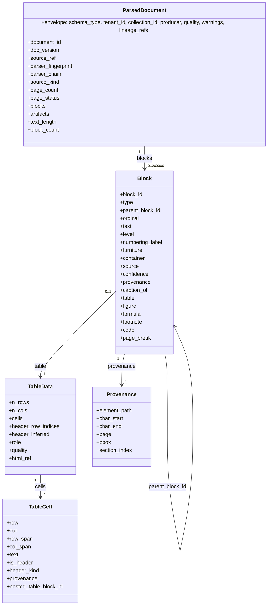

# ParsedDocument 계약 (표준 문서 모델)

## 목적

`ParsedDocument`는 이 플랫폼이 **자체 소유**하는 포맷 독립 표준 문서 모델(standard document model)이다(브리프 D-04, 바이블 §5.4). HWPX·HWP 5.0·PDF(디지털·스캔)·DOCX·HTML·TXT/MD 등 모든 입력은 파서 어댑터(parser adapter)가 이 모델로 변환하며, DoclingDocument·OWPML·pdftext·docx2python 같은 벤더 모델은 계약 경계를 넘지 않는다(브리프 원칙 2 Adapters over Forks). 이 문서는 `ParsedDocument`와 그 하위 타입 `Block`·`TableData`·`TableCell`·`Provenance`의 필드 의미, 출처(provenance) 규칙, 블록 평면 배열과 트리 복원, 읽기 순서, 표의 이중 표현, 어댑터 매핑, 크기 한계, 저장 규약, 불변식을 확정하고 `schemas/parsed-document.schema.json`을 게시한다.

정본 우선순위는 브리프 > 바이블 > ADR > 이 문서다(바이블 §1.1). 필드 표는 바이블 §5.4 `ParsedDocument`·`Block`·`TableData`/`TableCell` 표와 §5.3 `Provenance` 표를 같은 철자·같은 필수 여부로 옮긴 것이며, 바이블에 없는 항목은 선택(N) 또는 "## 미해결 이슈"의 제안으로만 존재한다.

## 범위

- 포함: `ParsedDocument` 최상위 필드 표와 계약 전용 하위 타입(`ParserFingerprint`, `PageStatusEntry`, `DocumentMetadata`, `WebMetadata`, `DerivedArtifact`, `Annotation`, `FormFieldEntry`, `Link`), 공용 하위 타입 `Block`·`TableData`·`TableCell`·`Provenance`의 상세 의미(정의는 [00-contract-overview](00-contract-overview.md)가 소유하는 `common-types.schema.json`), 출처 규칙(ADR-0002), 트리 복원 알고리즘, 읽기 순서, `source_kind`·`page_status`·`quality` 의미, 표 이중 표현, 그림·캡션·각주 연결, 어댑터 매핑 표 3개, 한계·분할, 저장 규약, JSON Schema 전문, Pydantic v2 모델, 예시 2개, 불변식, 버전 이력.
- 제외: 파서 라우팅·포맷 판별([../04-pipelines/03-parsing-router-and-format-detection.md](../04-pipelines/03-parsing-router-and-format-detection.md)), 포맷별 어댑터 구현 세부(04-pipelines/04~08), 정규화 뷰([04-normalized-document](04-normalized-document.md)), 청킹([05-chunk-set](05-chunk-set.md)), 입력 계약([02-source-document](02-source-document.md)), 오류 카탈로그 해설([13-error-model](13-error-model.md)).
- 이 문서가 소유하는 파일: `docs/03-contracts/03-parsed-document.md`, `schemas/parsed-document.schema.json`. `schemas/common-types.schema.json`은 수정하지 않는다.

## 1. 모델 개요

`parse` 스테이지(`SourceDocument → ParsedDocument`, 바이블 §4.2)가 생산하고 `normalize`와 `GET /v1/documents/{document_id}/content?view=parsed`(`get_document`, 바이블 §14)가 소비한다. 인라인 한계는 "참조만"이며 산출물 한계는 256MB·블록 200,000·블록 텍스트 1MB다(바이블 §5.1). 오케스트레이터 경계를 넘는 값은 `ArtifactRef` 하나다(바이블 §4.1).



세 축이 모델을 규정한다: (1) 평면 배열 + 트리(`parent_block_id`·`ordinal`, §4), (2) 원문 좌표(`element_path`·`char_*` 필수, `page`/`bbox` nullable, §3), (3) 결정성(`block_id = H("block", doc_version, element_path)[:32]`, 바이블 §6.2, [ADR-0004](../06-adr/0004-deterministic-chunk-id-scoped-record-id-and-ulid-exception.md)).

## 2. 필드 정의

타입 표기는 브리프 §9.5. "필수" 열의 `Y(nullable)`은 키 필수·값 `null` 허용, `N`은 모르면 키 생략(`null` 금지), `조건`은 다른 필드 값에 따라 필수(00 §8.1)다. 봉투 필드는 바이블 §5.2([00 §3](00-contract-overview.md)).

### 2.1 `ParsedDocument`(바이블 §5.4)

| 필드 | 타입 | 필수 | 설명 | 예시 |
|------|------|------|------|------|
| `schema_version` | string(semver) | Y | 계약 버전. 초판 `"1.0.0"`, `1.MINOR.PATCH` 세 정수만(스키마 `pattern`; `$id` major 1과 일치, 바이블 §6.4·14 §1.2) | `"1.0.0"` |
| `schema_type` | string | Y | 고정값 `"ParsedDocument"`(스키마 `const`) | `"ParsedDocument"` |
| `tenant_id` | string(ulid) | Y | 보안 삼중항 1 | `"01J9ZQ4K7X2M8N3P5R6S7T8V9W"` |
| `collection_id` | string(ulid) | Y | 보안 삼중항 2 | `"01J9ZQ5A1B2C3D4E5F6G7H8J9K"` |
| `producer` | `Producer` | Y | 실제 산출 파서 플러그인의 지문. `plugin_id = parser_fingerprint.parser_id`, 사이드카면 `image_digest = parser_fingerprint.sidecar_image_digest` | 예시 1 |
| `quality` | enum(Quality) | Y | `full` / `degraded`(§5.3) | `"full"` |
| `warnings` | array<Warning> | Y | 빈 배열 허용. 콘텐츠 미포함(00 I-16) | `[]` |
| `created_at` | string(date-time) | Y | RFC 3339 UTC | `"2026-09-22T09:00:05.120Z"` |
| `lineage_refs` | object<string, ArtifactRef> | Y | `parse` 출력은 정확히 `{source}`(`SourceDocument` 계약 산출물 참조, 00 §3.2) | 예시 1 |
| `document_id` | string(ulid) | Y | `SourceDocument.document_id` 복사 | `"01J9ZQ6M0N1P2Q3R4S5T6V7W8X"` |
| `doc_version` | string(hex64) | Y | `= SourceDocument.content_hash`([ADR-0005](../06-adr/0005-doc-version-content-hash-only-and-acl-payload-update.md)) | `"3e5f7092…"` |
| `source_ref` | `ArtifactRef` | Y | 입력 원본 바이트(`sources/`). `blake3 = doc_version`, `media_type` = 원본 MIME | 예시 1 |
| `parser_fingerprint` | `ParserFingerprint` | Y | §2.2 | |
| `parser_chain` | array<string> | Y | 실제 시도 순서(`plugin_id`). 마지막 원소 = 산출 파서 | `["parser.hwp5_java_sidecar", "parser.hwp5_unhwp"]` |
| `source_kind` | enum(SourceKind) | Y | `born_digital, scanned, mixed, pre_ocr, flow`; `flow` = HWP/HWPX/DOCX/HTML/MD/TXT(§5.1) | `"flow"` |
| `page_count` | integer \| null | Y(nullable) | 페이지 포맷은 ≥ 1, 흐름 포맷은 `null` | `null` |
| `page_status` | array<PageStatusEntry> | N | 페이지 단위 처리 결과(§2.3, §5.2). 흐름 포맷은 생략 | 예시 2 |
| `language` | string(bcp47) | Y | 문서 주 언어(파서 판정 또는 요청 힌트) | `"ko"` |
| `metadata` | `DocumentMetadata` | N | §2.4. 모든 하위 필드 선택 | 예시 1 |
| `blocks` | array<Block> | Y | **문서 순서 평탄 리스트**, 계층은 `parent_block_id`(§4). ≤ 200,000 | 예시 1 |
| `artifacts` | array<DerivedArtifact> | N | 파생 산출물 참조(§2.5) | 예시 2 |
| `annotations` | array<Annotation> | N | 메모·변경 추적·주석. 인덱싱 제외 기본 | 예시 1 |
| `fields` | array<FormFieldEntry> | N | HWPX 필드 메타 | 예시 1 |
| `links` | array<Link> | N | 하이퍼링크 어노테이션 | `[]` |
| `text_length` | integer | Y | `Σ len(blocks[].text)`, 유니코드 코드포인트 | `379` |
| `block_count` | integer | Y | `= len(blocks)` | `9` |
| `source_encoding` | string | N | TXT/HTML 원 인코딩(charset-normalizer 판정) | `"cp949"` |

### 2.2 `ParserFingerprint`(`parser_fingerprint`, 바이블 §5.4 `parser_fingerprint.*`)

| 필드 | 타입 | 필수 | 설명 | 예시 |
|------|------|------|------|------|
| `parser_id` | string | Y | `parser.{implementation}`(바이블 §6.1) | `"parser.pdf_docling_standard"` |
| `parser_version` | string | Y | 래핑 라이브러리 고정 버전 `{package}=={version}`(이 문서 규약, 미해결 이슈 4) | `"docling==2.129.0"` |
| `model_ids` | array<string> | N | 레이아웃·표·OCR 모델 `{repo}@{revision}`(바이블 §6.1). `revision`은 HF 커밋 SHA 또는 태그이며 **패키지 버전을 넣지 않는다**(패키지 버전은 `parser_version`). HF 밖 가중치(RapidOCR ONNX 등)의 리포·revision 표기는 확인 필요(as of 2026-09), 04-pipelines/05에서 확정(미해결 이슈 14) | `["docling-project/docling-layout-heron@7d1a4c9e2b8f0356a1d4e7c9b2f5a8d1c4e7b0a3"]` |
| `sidecar_image_digest` | string \| null | N | 사이드카 경로일 때만 non-null(`sha256:…`) | `null` |
| `profile_option` | string | Y | `hwpx_standard`, `pdf_standard`, `pdf_fast_cpu`, `pdf_scanned_gpu` 등(바이블 §7.1). `parser_fingerprint_hash`(바이블 §6.2)는 이 다섯 필드의 파생값이며 계약 필드가 아니다 | `"pdf_standard"` |

### 2.3 `PageStatusEntry`(`page_status[]`)

| 필드 | 타입 | 필수 | 설명 | 예시 |
|------|------|------|------|------|
| `page` | integer | Y | 1-based, ≤ `page_count`, 페이지당 최대 1항목 | `2` |
| `status` | enum(PageStatus) | Y | `ok, timeout, ocr_failed, skipped` | `"timeout"` |
| `ocr_confidence` | number \| null | N | 페이지 OCR 평균 신뢰도 0..1. OCR 미수행·실패는 `null` | `0.94` |

### 2.4 `DocumentMetadata`(`metadata`)와 `WebMetadata`(`metadata.web`)

| 필드 | 타입 | 필수 | 설명 | 예시 |
|------|------|------|------|------|
| `title` | string | N | `IngestRequest.metadata.title` 부재 시 `IndexRecord.title` 대체 원천 1순위 | `"정보시스템 보안관리 지침 개정 알림"` |
| `authors` | array<string> | N | | `["행정안전부 디지털안전정책과"]` |
| `created_at`, `modified_at` | string(date-time) | N | 원본 메타(HWPX `content.hpf`, PDF Info, OOXML core) | `"2026-09-15T01:30:00.000Z"` |
| `page_header_text`, `page_footer_text` | array<string> | N | 머리말·꼬리말 원문(정규화의 보일러플레이트 제거 근거). PDF는 `page_header`/`page_footer` 블록으로도 표현 | `["행정안전부"]` |
| `has_tracked_changes` | boolean | N | 변경 추적 존재. 기본 정책 `accept_all`(삽입 포함, 삭제 제외) | `false` |
| `navigation_text` | array<string> | N | HTML nav/aside 텍스트 | |
| `web` | `WebMetadata` | N | `canonical_url`(string(uri), N), `site_name`(string, N), `published_at`(string(date-time), N), `author`(string, N) | |
| `genre` | enum(Genre) | N | 요청 힌트 또는 파서 추론. 최종 장르는 `NormalizedDocument.genre` | `"outline_report"` |

### 2.5 `DerivedArtifact`(`artifacts[]`), `Annotation`(`annotations[]`), `FormFieldEntry`(`fields[]`), `Link`(`links[]`)

| 타입 | 필드 | 타입 | 필수 | 설명 |
|------|------|------|------|------|
| `DerivedArtifact` | `kind` | enum(ParsedDocument.artifacts.kind) | Y | `page_image, figure_crop, table_html, vendor_json, derived_source`(변환 원본: HWP→HWPX, DOC→DOCX) |
| | `ref` | `ArtifactRef` | Y | `derived/{kind}/…`(§10) |
| | `page`, `block_id` | integer / string(hex32) | N/N | `page_image`의 페이지; `figure_crop`·`table_html`의 대상 블록 |
| `Annotation` | `kind` | enum(ParsedDocument.annotations.kind) | Y | `memo, tracked_change, comment` |
| | `block_id`, `char_start`, `char_end`, `text` | string(hex32) / integer / integer / string | Y | 대상 블록 `text` 기준 코드포인트 구간·주석 본문. 인덱싱 제외 기본 |
| `FormFieldEntry` | `name`, `type`, `value`, `block_id` | string / string / string / string(hex32) | Y | HWPX `hp:fieldBegin` 이름·타입 원문(`CLICK_HERE`, `DATE` 등)·값. 값 텍스트는 본문 블록에도 포함 |
| `Link` | `block_id`, `char_start`, `char_end`, `href` | string(hex32) / integer / integer / string(uri-reference) | Y | 하이퍼링크 구간과 대상 |

### 2.6 `Block`(바이블 §5.4; 정의 `urn:rag:schema:common-types:1#/$defs/Block`)

| 필드 | 타입 | 필수 | 설명 | 예시 |
|------|------|------|------|------|
| `block_id` | string(hex32) | Y | `H("block", doc_version, element_path)[:32]` — 결정적 | `"029cab3717295f7202a7ae25c275e15c"` |
| `type` | enum(BlockType) | Y | `heading, paragraph, list_item, table, figure, caption, footnote, code, formula, page_break, page_header, page_footer, toc, form_field` | `"paragraph"` |
| `parent_block_id` | string \| null | Y(nullable) | 섹션 트리·중첩 표·글상자의 부모. 루트는 `null` | `null` |
| `ordinal` | integer | Y | 형제 내 순서(0-based, 연속) | `0` |
| `text` | string | Y | 원문(NFC 미적용, 제어 문자 허용). 표는 §6의 선형화 또는 `""`, 그림은 `alt_text` 또는 `""` | `"제3조(절차) ① …"` |
| `level` | integer \| null | 조건 | `heading` 0..6(0 = 문서 제목), `list_item` 깊이(0-based). 두 타입이면 non-null 필수 | `1` |
| `numbering_label` | string | N | `"제3조"`, `"1.1"`, `"가."`, `"○"` — 본문 `text`와 분리 보존 | `"가."` |
| `heading_inferred` | boolean | N | 스타일이 아닌 휴리스틱(폰트·번호 패턴)으로 판정한 heading | `false` |
| `ordered` | boolean | 조건 | `list_item`이면 필수 | `true` |
| `furniture` | boolean | Y | 머리말·꼬리말·nav·목차 등 본문 아님(기본 청킹 제외). `page_header`/`page_footer`/`toc`는 항상 `true` | `false` |
| `container` | enum(BlockContainer) | Y | `body, text_box, table_cell, footnote_body, page_header, page_footer`(§4.1) | `"body"` |
| `lang` | string(bcp47) | N | 블록 언어. **파서는 채우지 않고** `normalize`가 채운다 | |
| `source` | enum(BlockSource) | Y | `text_layer, ocr, vlm, converted`. 청크·항목의 `text_source`로 전파 | `"ocr"` |
| `confidence` | number \| null | 조건 | `source ∈ {ocr, vlm}`이면 non-null 필수(0..1) | `0.93` |
| `provenance` | `Provenance` | Y | 블록 전체 원문 구간(§2.9) | 예시 1 |
| `caption_of` | string \| null | N | `caption` → 대상 `block_id` | |
| `caption_block_ids` | array<string> | N | 대상(`table`/`figure`) → 캡션 블록들(역방향) | |
| `table` | `TableData` | 조건 | `type=table`이면 필수, 그 외 금지(§2.8) | 예시 1 |
| `figure` | object | 조건 | `type=figure`: `{artifact: ArtifactRef(Y), kind: enum(Block.figure.kind)(Y), alt_text: string \| null, caption_generated: boolean, caption_model: string \| null}`; `kind ∈ {image, chart, ole, equation_image}` | |
| `formula` | object | 조건 | `type=formula`: `{script: string(Y), latex: string \| null}` — 한컴 수식 `script` 원문 필수(PDF는 인식 문자열) | |
| `footnote` | object | 조건 | `type=footnote`: `{kind: enum(Block.footnote.kind)(Y), anchor_block_id: string \| null, anchor_char_offset: integer \| null, marker: string \| null}`; `kind ∈ {footnote, endnote}` | 예시 1 |
| `code` | object | 조건 | `type=code`: `{language: string \| null}` | |
| `page_break` | object | 조건 | `type=page_break`: `{page_no: integer \| null, section_index: integer \| null}` — 시작하는 페이지 번호 / HWPX 구역 인덱스 | 예시 2 |

### 2.7 `TableData`(`Block.table`, 바이블 §5.4)

| 필드 | 타입 | 필수 | 설명 | 예시 |
|------|------|------|------|------|
| `n_rows`, `n_cols` | integer | Y | 격자 크기 | `4`, `3` |
| `cells` | array<TableCell> | Y | **앵커 셀만**(병합 셀은 앵커 1개). 격자를 겹침 없이 덮는다 | 예시 1 |
| `header_row_indices` | array<integer> | Y | 헤더 행(0-based, 유일, `< n_rows`). 표 행 그룹 청킹 시 반복 | `[0]` |
| `header_inferred` | boolean | Y | 헤더 행을 휴리스틱으로 추정했는지 | `false` |
| `role` | enum(TableRole) | Y | `data, toc, form, layout`. `layout`은 청킹에서 문단으로 강등 | `"data"` |
| `quality.merged_cells_preserved` | boolean | Y | 병합 정보 보존 여부. 렌더 폴백·docx2python 경로는 `false` 가능 | `true` |
| `quality.structure_source` | enum(TableData.quality.structure_source) | Y | `native, tableformer, line_based, render_fallback` | `"native"` |
| `quality.structure_confidence` | number \| null | N | 구조 인식 신뢰도(모델 경로) | `0.86` |
| `html_ref` | `ArtifactRef` \| null | N | 파서 산출 HTML(무손실 1차, `derived/table_html/`) | 예시 1 |

### 2.8 `TableCell`(`TableData.cells[]`, 바이블 §5.4)

| 필드 | 타입 | 필수 | 설명 | 예시 |
|------|------|------|------|------|
| `row`, `col` | integer | Y | 앵커 좌표(0-based) | `2`, `0` |
| `row_span`, `col_span` | integer | Y | ≥ 1. HTML `rowspan/colspan` 재생성 | `2`, `1` |
| `text` | string | Y | 셀 내 문단 병합(줄바꿈 `\n`). 중첩 표는 `[table:{block_id}]` 플레이스홀더 | `"보안 점검"` |
| `is_header` | boolean | Y | `header_kind ≠ none`과 일치(P-13) | `true` |
| `header_kind` | enum(TableCell.header_kind) | Y | `column`(열 머리), `row`(행 머리), `section`(구간 제목 행), `none` | `"row"` |
| `provenance` | `Provenance` | N | 셀 bbox·오프셋. `char_*`는 **표 블록 `text`**(§6 선형화) 기준 | 예시 2 |
| `nested_table_block_id` | string \| null | N | 중첩 표 자식 블록(`container=table_cell`, 깊이 ≤ 3) | |

### 2.9 `Provenance`(바이블 §5.3; [ADR-0002](../06-adr/0002-provenance-element-path-and-nullable-page-bbox.md))

| 필드 | 타입 | 필수 | 설명 | 예시 |
|------|------|------|------|------|
| `element_path` | string | Y | 원본 요소 경로. 문서 내 유일(§3.1) | `"/hp:sec[0]/hp:p[17]"` |
| `char_start` | integer | Y | 블록 `text` 기준 0-based 유니코드 코드포인트 | `0` |
| `char_end` | integer | Y | 끝 미포함. 블록 provenance는 `= len(text)` | `35` |
| `page` | integer \| null | Y(nullable) | 1-based. 흐름 포맷 `null` | `null` |
| `bbox` | array<number>[4] \| null | Y(nullable) | `[x0, y0, x1, y1]` 좌상단 원점·PDF 포인트(1/72 in). 흐름 포맷 `null` | `[72.0, 96.5, 523.2, 140.8]` |
| `section_index` | integer \| null | N | HWPX 구역(`secPr`) 인덱스 | `0` |

## 3. 출처(provenance) 규칙

**결정:** `element_path`·`char_start/char_end`는 필수, `page`/`bbox`는 nullable이며 bbox는 좌상단 원점·PDF 포인트다(브리프 D-04 v1.1, [ADR-0002](../06-adr/0002-provenance-element-path-and-nullable-page-bbox.md)). 오프셋 단위는 유니코드 코드포인트(UTF-8 바이트·UTF-16 유닛 아님), 0-based, 끝 미포함이고 기준 텍스트는 **원문 `Block.text`**다(바이블 §6.3). 정규화 이후의 표시 텍스트 오프셋은 `NormalizedBlock.offset_map`과 `BlockRef.original_char_*`가 잇는다([ADR-0030](../06-adr/0030-single-coordinate-system-and-score-ledger.md)).

### 3.1 `element_path` 문법(어댑터별 권고; 정본은 04-pipelines 파서 문서)

| 포맷·경로 | 문법 | 예 |
|-----------|------|----|
| HWPX·HWP 5.0→HWPX(OWPML) | `/hp:sec[i]/hp:p[j]` + 컨트롤 하위 `/hp:tbl[k]`, `/hp:tr[r]/hp:tc[c]`, `/hp:ctrl[k]/hp:footNote[0]`, `/hp:caption[0]/hp:p[0]`, `/hp:subList/hp:p[m]`(셀·글상자 내부) — 인덱스는 부모 내 0-based 문서 순서 | `/hp:sec[0]/hp:p[8]/hp:tbl[0]` |
| Docling(PDF `pdf_standard`, DOCX, HTML 2차) | `self_ref` JSON Pointer: `#/texts/n`, `#/tables/n`, `#/pictures/n`, `#/groups/n`; 셀 `#/tables/n/data/table_cells/k`; 페이지 경계 `#/pages/p` | `#/tables/0` |
| pdftext(`pdf_fast_cpu`) | `/page[p]/block[b]`(0-based), 라인 병합 시 블록 단위 | `/page[3]/block[7]` |
| OCR 전용 페이지 | `/page[p]/ocr/block[b]` | `/page[0]/ocr/block[12]` |
| HTML(Trafilatura XML) | 추출 XML의 XPath `/doc/main/p[n]`, 표 `/doc/main/table[n]` | `/doc/main/p[5]` |
| Markdown | `/md/block[n]`(markdown-it-py 최상위 블록 토큰 순번) | `/md/block[17]` |
| TXT | `/txt/para[n]`(빈 줄 구분 문단 순번) | `/txt/para[3]` |
| docx2python 각주·미주 | `/footnotes/footnote[n]`, `/endnotes/endnote[n]` | `/footnotes/footnote[2]` |
| 분할 블록(§9) | 원 경로 + `/part[n]` | `/hp:sec[0]/hp:p[8]/part[1]` |

규칙: (a) 경로는 벤더 요소 경로에서 만들고 **텍스트 해시로 만들지 않는다**(같은 텍스트가 두 곳에 있어도 경로가 다르다). (b) 문서 내 유일하며, 유일성이 깨지는 포맷은 04-pipelines/08에서 합성 규칙을 정의한다(ADR-0002 재검토 조건 2). (c) 같은 문서를 다른 파서 경로로 파싱하면 경로가 달라 `block_id`가 바뀔 수 있다 — `parser_chain`·`parser_fingerprint`가 이를 감사 가능하게 하며, 파서 교체는 `stage_key` 변경 = 재처리다(바이블 §4.1).

### 3.2 좌표계 변환(어댑터 책임)

| 원천 | 변환 |
|------|------|
| Docling `ProvenanceItem(page_no, bbox(l, t, r, b, coord_origin=BOTTOMLEFT), charspan)` | `page = page_no`; `bbox = [l, page_height − t, r, page_height − b]`(포인트); `char_start/char_end = charspan`(블록 `text` 기준으로 재계산) |
| OCR 엔진 픽셀 좌표(RapidOCR·PaddleOCR·Tesseract) | 렌더 DPI로 포인트 환산 `pt = px × 72 / dpi`, 원점 좌상단 유지 |
| pdftext 블록 bbox / 회전·기울기 보정 페이지 | pypdfium2 좌표를 좌상단 원점 포인트로 정규화 / 보정 **후** 좌표(보정 각도는 `vendor_json` 파생물에) |
| 흐름 포맷(HWP/HWPX·DOCX·HTML·MD·TXT) | `page = null`, `bbox = null`. `page=1`·영 bbox 조작 금지(ADR-0002 A1 기각 사유), 렌더링 추정 페이지 채우기 금지(ADR-0002 A3 기각) |

`page`가 `null`이면 `bbox`도 `null`이다(00 I-9). `section_index`는 HWPX `hp:sec` 순번(0-based)이며 다른 포맷은 생략한다.

## 4. 블록 평면 배열과 트리 복원

### 4.1 구조 규칙

- `blocks[]`는 **읽기 순서**의 평탄 리스트다. 트리는 `parent_block_id`(부모)와 `ordinal`(형제 내 0-based 연속 순서)로 복원하고 루트는 `parent_block_id = null`. 부모는 항상 자식보다 앞에 오고(P-4) 형제 `ordinal`은 평면 순서와 같으므로, 소비자는 한 번의 순회로 트리를 만들고 스트리밍 소비자는 부모를 모른 채 자식을 만나지 않는다 — 이 보장은 P-4만으로 성립한다. 루트 레벨의 `page_header`·`page_footer`·`page_break`(페이지 가구, page furniture)를 **제외한** 블록 열은 트리를 `ordinal` 순으로 전위 순회(pre-order traversal)한 결과와 같다(P-5). 섹션이 페이지를 넘으면(예: `heading(level=1)`의 문단이 2쪽에 이어짐) 루트 형제인 페이지 가구가 섹션 서브트리 중간에 끼어들어 평면 순서 `[h0, h1, p1, footer, break, header, p2]`와 전위 순회 `[h0, h1, p1, p2, footer, break, header]`가 달라지므로, 페이지 가구의 위치는 전위 순회가 아니라 읽기 순서(§4.2 페이지 경계)로만 규정한다.
- 섹션 트리: `heading(level=k)`는 직전의 `heading(level < k)` 아래에 놓이고, 뒤따르는 본문 블록(`paragraph`, `list_item`, `table`, `figure`, `caption`, `code`, `formula`, `form_field`)은 가장 가까운 앞선 heading의 자식이다. `level=0` heading은 문서 제목이며 문서에 최대 1개다. heading이 없는 문서의 본문은 루트다.
- 목록: `list_item(level=d>0)`는 가장 가까운 앞선 `list_item(level<d)`의 자식이다. `level=0` 항목은 섹션 heading의 자식이다. `page_header`·`page_footer`·`page_break`는 루트 형제이며 페이지 경계에 놓인다(§4.2; 전위 순회 동치 P-5에서 제외).
- 컨테이너(`container`): `body`(본문), `text_box`(글상자 내부; 부모 = 앵커 블록), `table_cell`(중첩 표·셀 내부 그림/수식; 부모 = 바깥 `table` 블록), `footnote_body`(각주·미주 본문), `page_header`/`page_footer`(머리말·꼬리말 영역; `furniture=true`). 기본 청커는 `furniture=true`와 `container ∈ {page_header, page_footer}`를 제외한다(D-19). `footnote_body` 블록을 앵커 청크의 문맥으로 붙일지 독립 청크로 둘지는 이 문서가 정하지 않으며 [05-chunk-set](05-chunk-set.md)·04-pipelines/10에서 확정한다(제안: 앵커 청크 문맥 부착; 미해결 이슈 13).

### 4.2 읽기 순서

| 포맷 | 순서 규칙 |
|------|-----------|
| 흐름 포맷 | 원본 요소 순서(OWPML 문단 순서, OOXML 본문 순서, HTML DOM 순서, MD 토큰 순서). 글상자·각주는 앵커 직후 |
| 페이지 포맷 | 페이지 오름차순, 페이지 안에서는 레이아웃 모델의 읽기 순서(Docling reading order; pdftext는 y→x 정렬 + 다단 감지). 각 페이지는 `page_header`(있으면) → 본문 → `page_footer`(있으면) → 다음 페이지의 `page_break`. 페이지 가구 세 종류는 루트 형제이며 본문 블록의 `parent_block_id`는 페이지 경계와 무관하게 섹션 트리를 따른다(§4.1, P-5) |
| 표 | 셀 내용은 `TableData.cells`에 있고 블록으로 펼치지 않는다. 예외: 중첩 표·셀 안 그림·수식은 자식 블록(`container=table_cell`)으로 표 블록 직후에 온다 |
| 글상자(`text_box`) | 앵커 문단의 자식으로 앵커 직후. 글상자 안 표·그림도 같은 규칙으로 재귀 |
| 각주(`footnote.kind=footnote`) | 앵커 블록과 **같은 부모의 형제**로 앵커 직후(앵커에 자식 서브트리가 있으면 그 서브트리 뒤; P-5와 정합). 미주(`endnote`)는 문서 끝 루트 형제 |
| 캡션 | 대상(`table`/`figure`)과 같은 부모의 형제로, 원본 위치(위 또는 아래)를 유지 |

### 4.3 복원 알고리즘(의사코드)

```python
PAGE_FURNITURE = {"page_header", "page_footer", "page_break"}

def is_root_page_furniture(b: Block) -> bool:
    """루트 레벨 페이지 가구 — 페이지 경계에 놓이므로 전위 순회 동치(P-5)에서 제외한다(§4.1)."""
    return b.parent_block_id is None and b.type in PAGE_FURNITURE

def build_tree(doc: ParsedDocument) -> dict[str | None, list[Block]]:
    """blocks[] → children 맵. 검증 실패는 contract.violation."""
    index: dict[str, int] = {}
    children: dict[str | None, list[Block]] = {None: []}
    for i, b in enumerate(doc.blocks):
        assert b.block_id not in index                       # P-2 유일
        if b.parent_block_id is not None:
            assert index[b.parent_block_id] < i              # P-4 부모 선행
        index[b.block_id] = i
        children.setdefault(b.block_id, [])
        children.setdefault(b.parent_block_id, []).append(b)
    for sibs in children.values():
        assert [s.ordinal for s in sibs] == list(range(len(sibs)))   # P-4 ordinal 연속·평면 순서 일치
    preorder = []
    def walk(pid):                                            # P-5 전위 순회 = 평면 순서(루트 페이지 가구 제외)
        for c in children[pid]:
            if not is_root_page_furniture(c):
                preorder.append(c.block_id)
            walk(c.block_id)
    walk(None)
    assert preorder == [b.block_id for b in doc.blocks if not is_root_page_furniture(b)]
    return children
```

청커의 heading 경로(`context_prefix`)는 이 트리에서 부모 사슬을 따라 올라가며 `type=heading`인 조상의 `text`를 모은 것이다(05 문서).

## 5. `source_kind`·`page_status`·`quality` 의미

### 5.1 `source_kind`

| 값 | 판정(문서 수준, 초안 임계값은 기술 지형 02 §스캔/디지털 판별) | 블록 `source`·좌표 |
|----|------|------|
| `born_digital` | 텍스트 레이어 페이지 비율 ≥ 0.8 | `text_layer`; `page`·`bbox` non-null |
| `scanned` | 스캔(이미지 전용) 페이지 비율 ≥ 0.8 | 텍스트 블록은 `ocr`/`vlm` + `confidence` 필수; `page`·`bbox` non-null(P-9) |
| `mixed` | 그 외 페이지 포맷(디지털·스캔 혼재) | 페이지별로 다름; 각 블록의 `source`가 진실 |
| `pre_ocr` | 숨은 텍스트 레이어(기존 OCR)가 있는 스캔 PDF | 정책에 따라 `text_layer`(신뢰) 또는 `ocr`(재OCR) |
| `flow` | HWP/HWPX·DOCX·DOC/RTF/ODT(→DOCX)·HTML·MD·TXT | `page = null`, `bbox = null`, `page_count = null`, `page_status` 없음. HWP 5.0→HWPX·DOC→DOCX 변환 경로는 `source = converted` |

### 5.2 `page_status`

페이지 포맷에서 페이지 단위 처리 결과다(바이블 §4.2 `parse` 행: 페이지 타임아웃은 `page_status=timeout`으로 계속, `Resumable`). `ok` 외 상태의 페이지에는 그 페이지의 시작을 표시하는 `page_break`(§7)를 **제외한** 블록이 없고(본문·페이지 가구 모두 없음, P-10), 소비자에게는 "그 페이지의 청크가 없다"는 형태로만 나타난다(13 §12). `status=timeout`이면 `warnings[]`에 `parse.page_timeout`(page 지정)을 남긴다. `ocr_failed`·`skipped`의 전용 경고 코드는 카탈로그에 없어 `page_status`로만 기록한다(미해결 이슈 2). 모든 페이지가 `ok`가 아니면 저하가 아니라 실패로 본다(`parse.conversion_failed`) — 이는 **초안 규칙**이다([13-error-model](13-error-model.md) §5.1 C4·13 미해결 이슈 9; 스캔 PDF 전 페이지 OCR 실패를 빈 문서 저하로 둘지는 04-pipelines/05에서 확정).

### 5.3 `quality`

손실이 하나라도 있으면 `degraded`이며 하류는 되돌리지 않는다(13 §5.2). 이 계약의 손실 조건: (a) `page_status[].status ≠ ok`가 하나 이상, (b) 배포용 HWP 텍스트 전용 경로(Tika `HwpV5Parser`, `source=converted`, 표 구조 손실; 바이블 D-18), (c) `TableData.quality.structure_source = render_fallback` 또는 `merged_cells_preserved = false`인 표 존재, (d) 어댑터 화이트리스트 밖 요소를 버림(기술 지형 01 §실패 모드). `quality=full`이면 `page_status`는 전부 `ok`다(P-11).

**미정(제안):** (e) 폴백 체인으로 산출(`len(parser_chain) > 1`)한 경우도 손실이 없더라도 재현성 관점에서 `degraded`로 표시하는 안. 브리프 D-18·바이블 §3.2 O-07·§4.1 부분 성공 행은 `parser_chain[]` 기록만 요구하고 `degraded`는 Tika 텍스트 전용 경로(b)에만 적용하므로 (e)는 이 문서의 제안이며, 04-pipelines/03 확정 후 바이블 §4.1 부분 성공 행 개정(ADR minor)으로만 채택한다(미해결 이슈 5). 확정 전 P-11은 (a)~(d)만 적용하고 파서는 폴백 산출을 `degraded`로 표시하지 않는다.

## 6. 표의 이중 표현

**결정:** 표는 구조(`Block.table: TableData`)와 문자열(`Block.text` 선형화, `TableData.html_ref` HTML)의 이중 표현을 갖는다. 구조가 정본이고 문자열은 파생이다. 청커는 `TableData`에서 `table_ref.serialization`(`html, markdown, triplet, row_json`, 바이블 §5.7 `TableSerialization`)을 생성하고 헤더 행(`header_row_indices`)을 행 그룹마다 반복한다(D-19 표 행 그룹 256 토큰).

- **격자 무손실**: `cells`는 앵커 셀만 담고 `row_span/col_span ≥ 1`로 병합을 표현한다. 격자 `n_rows × n_cols`는 겹침 없이 덮인다(P-12). 병합 셀의 내용은 앵커 셀 하나에만 있다. 이 구조에서 HTML `rowspan/colspan`이 재생성된다.
- **헤더**: `header_row_indices`는 열 머리 행(`header_kind=column`)의 인덱스 목록이다. 행 머리 셀은 `header_kind=row`, 구간 제목 행(한 행 전체 병합)은 `section`. 원본에 헤더 정보가 없으면 첫 행을 헤더로 추정하고 `header_inferred=true`.
- **선형화 `text`(이 문서 규약, 미해결 이슈 1)**: 앵커 셀을 행 우선 순서로 나열하고 셀은 U+0009, 행은 U+000A로 구분한다(병합 셀은 앵커 위치에 한 번). `Block.provenance.char_end = len(text)`이고 `TableCell.provenance.char_*`는 이 문자열 안의 셀 텍스트 구간이다. 어댑터가 선형화를 생략하면 `text = ""`이며 셀 provenance의 `char_start = char_end = 0`이다. 선형화는 골든셋 `answer_spans`(D-12)와 렉시컬 색인이 표 안 텍스트를 가리킬 수 있게 한다. 선형화 `text`는 오프셋 기준·색인용 **파생 문자열**이며 비가역이다: 셀 `text` 내부의 문단 줄바꿈(U+000A)과 행 구분자는 구별되지 않으므로 소비자는 `text`를 U+000A로 분할해 행·셀 경계를 복원하지 않고, 경계 복원은 `TableData`(구조)와 `TableCell.provenance.char_*`(구간)로만 한다.
- **중첩 표**: 셀 안 표는 자식 `table` 블록(`container=table_cell`, `parent_block_id` = 바깥 표)으로 만들고 셀 `text`에는 `[table:{block_id}]`, `nested_table_block_id`에 그 ID를 둔다. 깊이 ≤ 3.
- **`role`·품질**: `data`(기본), `toc`(목차 표), `form`(서식·신청서), `layout`(레이아웃용; 청킹에서 문단으로 강등, 셀 텍스트를 읽기 순서로 이어 붙임). `structure_source`(`native` 원본 구조 / `tableformer` Docling 모델 / `line_based` 선 검출 / `render_fallback`)와 `merged_cells_preserved`는 청커·렌더러의 HTML 1차/Markdown 2차/JSON 3차 선택 근거다(바이블 §9.3).

## 7. 그림·캡션·각주·수식·코드·페이지 나눔 연결

| 연결 | 규칙 |
|------|------|
| 캡션 ↔ 대상 | `caption.caption_of = 대상.block_id`, `대상.caption_block_ids ∋ caption.block_id`(양방향, P-14). 캡션이 레이아웃상 누락되면 인접 문단의 `그림 N`/`표 N`/`Figure N`/`Table N` 패턴으로 보완하고 `heading_inferred`와 무관하게 `caption` 블록으로 만든다 |
| 그림 | `figure.artifact`는 `derived/figure_crop/`(PDF 크롭) 또는 BinData 원 바이트(HWPX)의 `ArtifactRef`. `text`는 원본 대체 텍스트(`alt_text`와 같음) 또는 `""`. 생성 캡션(VLM)은 `parse`가 아니라 `enrich`가 만들며 결과는 `Enrichment.figure_caption`(바이블 §5.4 `EnrichedChunkSet` 표)에 기록한다; 캡션 모델은 바이블 §7.1 `premium` 보강 행(LLM 접두어·캡션, Qwen3-VL-8B)에 따르고 플러그인 ID는 [06-enriched-chunk-set](06-enriched-chunk-set.md)·04-pipelines/11에서 확정한다. 파서는 `caption_generated`·`caption_model`을 생략한다(미해결 이슈 10) |
| 각주·미주 | 본문 블록의 참조 위치를 `footnote.anchor_block_id`·`anchor_char_offset`(앵커 `text` 안 마커 시작 오프셋)·`marker`(`"1)"`, `"※"`)로 기록. 마커 문자열은 원문이므로 앵커 `text`에 남긴다. DOCX는 docx2python 병합이 필수다(D-18); Docling `FOOTNOTE`는 앵커를 모르므로 `anchor_block_id = null` |
| 수식 | `formula.script`(한컴 수식 스크립트 원문 또는 PDF 인식 문자열) 필수, `latex`는 변환 가능할 때만. `text`는 `script`와 같다 |
| 코드 | `code.language`는 파서가 알 때만(MD fence info string). 그 외 `null` → `enrich` |
| 페이지 나눔 | `page_break.page_no` = 시작 페이지(1-based), HWPX 구역 경계는 `section_index`. 페이지 포맷은 첫 페이지를 제외한 모든 페이지 경계에 1개 — `status ≠ ok`인 페이지의 시작 경계에도 두며, 그 페이지에 허용되는 유일한 블록이다(§5.2, P-10). 흐름 포맷은 구역 경계에만 |

## 8. 어댑터 매핑 표

세 표의 BlockType 주석은 바이블 §5.7을 따른다: Docling `TITLE` → `heading` level 0, `DOCUMENT_INDEX` → `toc`, `KEY_VALUE_REGION`/`FORM` → `form_field`, `page_header`/`page_footer`/`toc`는 `furniture=true`. 벤더 라벨·요소명은 확인 필요(as of 2026-09)이며 정본은 04-pipelines 파서 문서다.

### 8.1 Docling `DocItemLabel` → `BlockType`(PDF `pdf_standard`, DOCX, HTML 2차; 기술 지형 02)

| Docling 라벨 | `type` | `level`·속성 | `furniture` / `container` | 비고 |
|--------------|--------|-------------|---------------------------|------|
| `TITLE` | `heading` | `level=0` | false / body | 문서에 1개. 둘 이상이면 첫 것만 0, 나머지 1 + `heading_inferred=true` |
| `SECTION_HEADER` | `heading` | `level = SectionHeaderItem.level`(1..6, 초과는 6) | false / body | |
| `TEXT`, `PARAGRAPH`, `REFERENCE` | `paragraph` | | false / body | |
| `LIST_ITEM` | `list_item` | `level` = 그룹 중첩 깊이(0-based), `ordered` = 마커가 숫자·문자 순번, `numbering_label` = 마커 | false / body | |
| `TABLE` | `table` | `TableData`(아래 셀 매핑), `html_ref` = `export_to_html()` 파생물 | false / body | |
| `PICTURE` | `figure` | `figure.kind`: `image`(기본), `chart`(분류가 차트), `equation_image`(수식 이미지) | false / body | 크롭은 `derived/figure_crop/` |
| `CAPTION` | `caption` | `caption_of` = `captions` 역참조 대상 | false / body | |
| `FOOTNOTE` | `footnote` | `footnote.kind=footnote`, `anchor_block_id=null`, `marker` = 선두 번호 | false / footnote_body | |
| `PAGE_HEADER` / `PAGE_FOOTER` | `page_header` / `page_footer` | | **true** / page_header·page_footer | |
| `FORMULA` | `formula` | `script` = 인식 문자열, `latex` = 있으면 | false / body | |
| `CODE` | `code` | `language=null` | false / body | |
| `DOCUMENT_INDEX` | `toc` | `text` = 항목 선형화 | **true** / body | |
| `KEY_VALUE_REGION`, `FORM` | `form_field` | `text` = 키: 값 | false / body | 바이블 §5.7 `BlockType` 주석 |
| `CHECKBOX_SELECTED`, `CHECKBOX_UNSELECTED` | `form_field` | `text` = 체크 상태 문자열 + 인접 라벨 | false / body | 이 문서의 확장, 확인 필요(as of 2026-09); 바이블 §5.7 주석 보강 제안(patch), 확정은 04-pipelines/05 |
| 페이지 경계 `pages[p]` | `page_break` | `page_no = p` | false / body | `bbox = null` |

Docling `TableCell` → `TableCell`: `start_row_offset_idx → row`, `end_row_offset_idx − start_row_offset_idx → row_span`, 열도 동일; `column_header → header_kind=column`, `row_header → row`, `row_section → section`; `bbox → provenance.bbox`(좌상단 변환); `TableData.num_rows/num_cols → n_rows/n_cols`; `structure_source = tableformer`.

### 8.2 HWPX OWPML 요소 → `BlockType`(HWP 5.0은 Java 사이드카가 HWPX로 변환 후 동일 어댑터; 기술 지형 01)

| OWPML 요소 | `type` | 속성 | 비고 |
|------------|--------|------|------|
| `hp:p`(본문 문단) | `paragraph` | `hp:run/hp:t` 연결 | 빈 문단은 블록 생성 없음 |
| `hp:p` + `hh:paraPr/hh:heading[@type="OUTLINE"]` | `heading` | `level = min(@level + 1, 6)`(OWPML `@level`은 0..6의 7단계이므로 7단계는 6으로 클램프; 클램프는 `heading_inferred`를 바꾸지 않음. 기술 지형 01 §표준 모델 매핑의 `@level + 1`에 P-7 상한 적용); 개요 번호 → `numbering_label` | 문서 제목(level 0)은 `제목`/`Title` 스타일 또는 `content.hpf` title과 일치하는 첫 문단 |
| `hp:p` + `hh:style/@name ∈ {개요 N, Outline N, 제목 N}` | `heading` | `level = N` | outline 정보 부재 시 2순위; 3순위 휴리스틱(번호 패턴·굵게·크기)은 `heading_inferred=true` |
| `hh:heading[@type="NUMBER"\|"BULLET"]` 문단 | `list_item` | `ordered`(NUMBER=true), `level` = 수준, `numbering_label` = `hh:numbering`/`hh:bullet` 문자 | 개조식 공문의 `□ ○ -` 글머리 포함 |
| `hp:tbl` | `table` | `rowCnt/colCnt → n_rows/n_cols`; `hp:tc/hp:cellAddr(rowAddr, colAddr) → row/col`, `hp:cellSpan(rowSpan, colSpan) → row_span/col_span`; `structure_source=native`, `merged_cells_preserved=true` | 헤더 행: `hp:tr`의 header 속성(확인 필요) 없으면 첫 행 + `header_inferred=true` |
| `hp:tc/hp:subList/hp:p` | 셀 `text` | 셀 안 문단 병합(`\n`) | 셀 안 `hp:tbl`은 자식 `table`(`container=table_cell`) + `[table:{block_id}]` |
| `hp:tbl/hp:caption`, `hp:pic/hp:caption` | `caption` | `caption_of` | |
| `hp:pic` + `hc:img/@binaryItemIDRef`; `hp:ole`, `hp:container` | `figure` | `kind=image`(`hp:pic`) / `kind=ole`; `artifact` = BinData 바이트 참조, `alt_text` 있으면 `text` | `content.hpf` 매니페스트로 href 해석; OLE는 바이너리 저장만 |
| `hp:ctrl/hp:footNote`, `hp:endNote` | `footnote` | `kind`, `anchor_block_id` = 참조 문단, `anchor_char_offset` = 참조 위치, `container=footnote_body` | 앵커 직후 형제(§4.2) |
| `hp:ctrl/hp:header`, `hp:footer` | 블록 아님 | `metadata.page_header_text` / `page_footer_text` | |
| `hp:equation/hp:script` | `formula` | `script` 원문 필수, `latex` 선택 | |
| `hp:rect`·`hp:ellipse`·… + `hp:drawText/hp:subList` | 내부 문단·표·그림 | `container=text_box`, 부모 = 앵커 문단 | 재귀 |
| `hp:fieldBegin[@type]` … `hp:fieldEnd` | 문단 텍스트 일부 | `fields[]{name, type, value, block_id}`; HYPERLINK는 `links[]` | |
| 변경 추적·`hp:memo` | 정책 적용 후 텍스트 / 블록 아님 | `metadata.has_tracked_changes`; `annotations[]{kind=tracked_change\|memo}` | 기본 `accept_all` |
| `hp:secPr` 구역 경계 | `page_break` | `section_index`, `page_no=null` | 실제 페이지 없음(`source_kind=flow`) |

### 8.3 DOCX·HTML(·MD·TXT) 요소 → `BlockType`(기술 지형 03)

| 소스 요소 | Docling DOCX(`MsWordDocumentBackend`) + docx2python | Trafilatura XML → Docling HTML | markdown-it-py / TXT | `type`·속성 |
|-----------|------|------|------|------|
| 제목 | `SectionHeaderItem(level)`; `Title` 스타일 → level 0 | `<head rend="hN">` / `<h1..h6>` | `heading_open` h1..h6 | `heading`, `level=N`(h1=1) |
| 단락 | `TextItem` | `<p>` | `paragraph_open`; TXT 빈 줄 구분 | `paragraph` |
| 목록 | `ListItem`(그룹 깊이) | `<list rend="ol\|ul"><item>` | `bullet_list`/`ordered_list` 중첩 | `list_item`, `ordered`, `level`, `numbering_label` |
| 표 | `TableItem`(병합 보존, `native`) | `<table><row><cell>`(병합 손실 시 `merged_cells_preserved=false`) | GFM table(병합 없음) | `table` |
| 그림 | `PictureItem` + 캡션 | `<graphic>` | `image` 인라인 → 독립 블록 | `figure(kind=image)` + `caption` |
| 각주·미주 | **docx2python `footnotes`/`endnotes` 병합 필수**(Docling 미처리) | `<sup>` 링크는 본문 유지 | footnote 플러그인 | `footnote{kind, anchor_block_id, marker}` |
| 코드 | `CodeItem` | `<code>` | `fence`/`code_block`(info → `language`) | `code` |
| 수식 | `FormulaItem`(LaTeX → `latex`, `script` = 원문) | — | math 플러그인(선택) | `formula` |
| 머리말·꼬리말 | 헤더/푸터 파트 → `metadata.page_header_text`/`page_footer_text` | `<footer>` 등 furniture → `metadata.navigation_text`(nav/aside) | 프론트매터 → `metadata` | 블록 아님 |
| 주석·웹 메타 | docx2python `comments` → `annotations[]` | `og:*`, `article:published_time`, JSON-LD → `metadata.web` | — | 블록 아님 |
| 페이지 | 없음(흐름) | 없음 | 없음 | `page=bbox=null`, `page_break` 없음 |

DOC/RTF/ODT는 `lo-sidecar`가 DOCX로 변환한 뒤 이 표를 따르며 `source=converted`, `artifacts[]`에 변환본을 둔다. TXT는 `source_encoding`을 반드시 채운다.

## 9. 크기 한계·대형 문서 분할

| 항목 | 한계(바이블 §5.1) | 파서 조치 | 초과 시 |
|------|------|-----------|---------|
| 산출물 JSON | 256MB | 페이지 이미지·표 HTML·벤더 JSON은 인라인하지 않고 `artifacts[]` 참조(이진·base64 인라인 금지, 00 §8.3) | 셸 출력 검증 `contract.violation`(비재시도) |
| `blocks` | 200,000 | 빈 문단 블록 생략, 셀 내용은 `TableData`에 유지(블록 아님). JSON 배열·ZIP 다중 문서는 `IngestRequest.split_hint`로 수집 단계에서 분할 | `contract.violation`(전용 코드 제안, 미해결 이슈 2) |
| `Block.text` | 1MB(UTF-8 바이트 — 이 문서 규약, 바이블 §5.1은 단위 미지정; JSON Schema는 바이트 길이를 표현할 수 없어 `maxLength: 1048576`은 코드포인트 상한 근사이고 정확 검사는 셸 불변식 P-6·Pydantic `MAX_BLOCK_TEXT_BYTES`가 한다, 미해결 이슈 12) | 초과 블록을 문장·줄 경계에서 연속 블록으로 분할, `element_path`에 `/part[n]` 접미, 같은 `parent_block_id`, 연속 `ordinal` | `contract.violation` |
| 표 중첩 깊이 / 원본 | ≤ 3 / 200MB(`fetch.max_bytes`) | 깊이 초과 표는 셀 텍스트로 평탄화 + `merged_cells_preserved=false` / — | `contract.violation` / `fetch.too_large` |

인라인 금지: API 응답·이벤트·로그에는 `ParsedDocument` 본문을 넣지 않고 `ArtifactRef`만 전달한다(바이블 §5.1 "참조만", 00 §8.4). `get_document`의 `?view=parsed`는 `blocks`를 커서 페이지네이션으로 나눠 반환한다(바이블 §14). 페이지 단위 처리 재개는 `heartbeat_details.page`(바이블 §4.4 `resumable`)로 하며, 부분 산출물은 계약 인스턴스가 아니라 파생물로만 저장한다.

## 10. 산출물 저장 규약

| 항목 | 규약 |
|------|------|
| 오브젝트 키 | `tenants/{tenant_id}/artifacts/parsed-document/{stage_key[:2]}/{stage_key}.json`(바이블 §13.3) |
| `stage_key` | `H("stage", "parse", scope_key, content_hash, parser_fingerprint)`, `scope_key = "{tenant_id}/{collection_id}/{document_id}"`(바이블 §4.2; 잡 스코프 안에서만 캐시 재사용, [ADR-0037](../06-adr/0037-artifact-cache-scope-and-stage-key-composition.md)). `parser_fingerprint`는 파서 플러그인의 `fingerprint()`(§4.1 `Producer` 지문)다(미해결 이슈 6) |
| 미디어 타입 | `application/vnd.rag.parsed-document+json`; `ArtifactRef.schema_type = "ParsedDocument"`, `schema_version = "1.0.0"` |
| 콘텐츠 해시·크기 | `ArtifactRef.blake3`·`size_bytes` = 저장된 산출물 바이트(UTF-8 JSON)의 BLAKE3·크기(00 §9.2). zstd 저장 계층 압축은 **미정(00 U-4)**이며 확정 전 셸은 압축 없이 저장한다; 14 §13의 초안(1MB 초과 zstd, `Content-Encoding` 메타데이터만)이 채택되면 해시·크기는 논리 바이트 기준으로 정정된다 |
| 파생물·계보 | `tenants/{tenant_id}/derived/{kind}/{blake3[:2]}/{blake3}.{ext}`(`page_image` png, `figure_crop` png, `table_html` html, `vendor_json` json, `derived_source` hwpx/docx). 봉투가 없어 테넌트 내 공유; 변환본 키는 `H("derived", content_hash, sidecar_image_digest)`(바이블 §6.2). `lineage(child_ref, parent_ref, stage_key, job_id, produced_at)`는 저장과 같은 트랜잭션에 기록하고 이벤트 `ingest.document.parsed`의 `data`는 ID·해시·`block_count`·`page_count`·`quality`만 담는다 |

## 11. LLM 최종 소비에 미치는 영향

- **인용 가능성(K1)**: `ContextItem.provenance[]`는 `Block.provenance`에서 시작한 좌표가 `offset_map`·`BlockRef.original_char_*`를 거쳐 그대로 돌아온 것이다. 흐름 문서도 `element_path`로 인용되고, 페이지 문서는 `page`·`bbox`로 하이라이트된다. 어댑터가 좌표를 조작하면(`page=1`, 영 bbox) 인용이 거짓이 된다.
- **3-텍스트 규칙(K2)**: `Block.text`는 접두어·요약·가상 질문이 없는 **원문**이다. `numbering_label`·heading 트리·캡션이 본문과 분리되어 있으므로 청커가 결정적 `context_prefix`를 만들고 `ContextItem.text`에는 원문만 남는다([ADR-0029](../06-adr/0029-three-text-rule-and-deterministic-context-prefix.md)).
- **텍스트 출처·신뢰도**: `Block.source`·`confidence`는 `text_source`·`ocr_confidence_min`으로 전파되어 렌더러가 `[ocr]`을 표기한다(바이블 §9.3). `quality=degraded`·`page_status`는 LLM 컨텍스트에 주입되지 않고 "그 페이지의 항목이 없다"로만 나타난다(13 §12).
- **보안 삼중항**: `tenant_id`·`collection_id`는 봉투에 있고 문서 ACL은 `lineage_refs.source`의 `SourceDocument.acl` 하나다(00 §1.5). `warnings[].message`·이벤트 `data`에 본문 문자열을 넣지 않는다(00 I-16). `annotations`(메모·변경 추적)는 기본 인덱싱 제외라 LLM에 도달하지 않는다.
- **표·그림·furniture**: `TableData`가 무손실이어야 렌더러가 HTML 1차(병합 셀 보존)/Markdown 2차/JSON 3차를 선택할 수 있고, `figure.alt_text`와 캡션 연결은 그림 항목의 유일한 텍스트 근거다. 머리말·꼬리말·목차는 `furniture=true`로 기본 청킹에서 제외되어 LLM 예산을 소모하지 않는다.

## 스키마

`schemas/parsed-document.schema.json`(`$id = urn:rag:schema:parsed-document:1`) 전문. 공용 타입·열거는 `urn:rag:schema:common-types:1#/$defs/*`를 참조하고 재정의하지 않는다. `blocks[]`의 `Block`·`TableData`·`TableCell`·`Provenance` 정의는 00 문서 소유다.

```json
{
  "$schema": "https://json-schema.org/draft/2020-12/schema",
  "$id": "urn:rag:schema:parsed-document:1",
  "title": "ParsedDocument",
  "description": "포맷 독립 표준 문서 모델(바이블 §5.4, D-04, ADR-0002). parse 스테이지가 생산하고 normalize·get_document가 소비한다. 블록은 문서 순서 평탄 리스트이며 계층은 parent_block_id·ordinal로 복원한다. 공용 타입·열거는 urn:rag:schema:common-types:1을 참조한다.",
  "type": "object",
  "properties": {
    "schema_version": { "$ref": "urn:rag:schema:common-types:1#/$defs/Semver", "pattern": "^1\\.(0|[1-9]\\d*)\\.(0|[1-9]\\d*)$", "description": "계약 버전. 초판 1.0.0; MAJOR.MINOR.PATCH 세 정수만(14 불변식 1, P-1). 이 스키마($id major 1)는 1.x만 수용" },
    "schema_type": { "type": "string", "const": "ParsedDocument" },
    "tenant_id": { "$ref": "urn:rag:schema:common-types:1#/$defs/Ulid", "description": "보안 삼중항 1" },
    "collection_id": { "$ref": "urn:rag:schema:common-types:1#/$defs/Ulid", "description": "보안 삼중항 2(수집 측 단수)" },
    "producer": { "$ref": "urn:rag:schema:common-types:1#/$defs/Producer", "description": "실제 산출 파서 플러그인의 재현성 지문. plugin_id = parser_fingerprint.parser_id" },
    "quality": { "$ref": "urn:rag:schema:common-types:1#/$defs/Quality", "description": "손실이 하나라도 있으면 degraded" },
    "warnings": { "type": "array", "items": { "$ref": "urn:rag:schema:common-types:1#/$defs/Warning" }, "description": "품질 삼중항 2. 빈 배열 허용, 콘텐츠 미포함" },
    "created_at": { "$ref": "urn:rag:schema:common-types:1#/$defs/DateTime" },
    "lineage_refs": {
      "$ref": "urn:rag:schema:common-types:1#/$defs/LineageRefs",
      "required": ["source"],
      "maxProperties": 1,
      "description": "parse 출력은 정확히 {source}(SourceDocument 계약 산출물 참조)"
    },
    "document_id": { "$ref": "urn:rag:schema:common-types:1#/$defs/Ulid" },
    "doc_version": { "$ref": "urn:rag:schema:common-types:1#/$defs/Hex64", "description": "= SourceDocument.content_hash = source_ref.blake3(ADR-0005)" },
    "source_ref": { "$ref": "urn:rag:schema:common-types:1#/$defs/ArtifactRef", "description": "입력 원본 바이트(sources/). blake3 = doc_version, media_type = 원본 MIME" },
    "parser_fingerprint": { "$ref": "#/$defs/ParserFingerprint" },
    "parser_chain": {
      "type": "array",
      "items": { "$ref": "urn:rag:schema:common-types:1#/$defs/PluginId" },
      "minItems": 1,
      "description": "실제 시도 순서. 마지막 원소가 산출 파서(= parser_fingerprint.parser_id)"
    },
    "source_kind": { "$ref": "urn:rag:schema:common-types:1#/$defs/SourceKind", "description": "flow = HWP/HWPX/DOCX/HTML/MD/TXT(페이지·bbox 없음)" },
    "page_count": { "type": ["integer", "null"], "minimum": 1, "description": "Y(nullable). 흐름 포맷은 null" },
    "page_status": {
      "type": "array",
      "items": { "$ref": "#/$defs/PageStatusEntry" },
      "description": "페이지 단위 처리 결과. 페이지 포맷만, 페이지당 최대 1항목. ok 외 상태가 있으면 quality=degraded"
    },
    "language": { "$ref": "urn:rag:schema:common-types:1#/$defs/Bcp47", "description": "문서 주 언어" },
    "metadata": { "$ref": "#/$defs/DocumentMetadata" },
    "blocks": {
      "type": "array",
      "items": {
        "$ref": "urn:rag:schema:common-types:1#/$defs/Block",
        "properties": { "text": { "type": "string", "maxLength": 1048576 } }
      },
      "maxItems": 200000,
      "description": "문서 순서(읽기 순서) 평탄 리스트. 계층은 parent_block_id, 형제 순서는 ordinal. 블록 텍스트 한계 1MB(UTF-8 바이트; maxLength는 코드포인트 근사)"
    },
    "artifacts": { "type": "array", "items": { "$ref": "#/$defs/DerivedArtifact" }, "description": "파생 산출물(페이지 이미지·그림 크롭·표 HTML·벤더 JSON·변환 원본) 참조" },
    "annotations": { "type": "array", "items": { "$ref": "#/$defs/Annotation" }, "description": "메모·변경 추적·주석. 인덱싱 제외 기본" },
    "fields": { "type": "array", "items": { "$ref": "#/$defs/FormFieldEntry" }, "description": "HWPX 필드(누름틀 등) 메타" },
    "links": { "type": "array", "items": { "$ref": "#/$defs/Link" }, "description": "하이퍼링크 어노테이션" },
    "text_length": { "type": "integer", "minimum": 0, "description": "Σ len(blocks[].text) (유니코드 코드포인트)" },
    "block_count": { "type": "integer", "minimum": 0, "maximum": 200000, "description": "= len(blocks)" },
    "source_encoding": { "type": "string", "minLength": 1, "description": "TXT/HTML 원 인코딩(예 cp949, utf-8)" }
  },
  "required": [
    "schema_version", "schema_type", "tenant_id", "collection_id", "producer", "quality", "warnings", "created_at", "lineage_refs",
    "document_id", "doc_version", "source_ref", "parser_fingerprint", "parser_chain", "source_kind", "page_count", "language",
    "blocks", "text_length", "block_count"
  ],
  "additionalProperties": false,
  "allOf": [
    {
      "if": { "properties": { "source_kind": { "const": "flow" } } },
      "then": {
        "properties": {
          "page_count": { "type": "null" },
          "blocks": { "items": { "properties": { "provenance": { "properties": { "page": { "type": "null" }, "bbox": { "type": "null" } } } } } }
        },
        "not": { "required": ["page_status"] }
      }
    },
    {
      "if": { "properties": { "source_kind": { "enum": ["born_digital", "scanned", "mixed", "pre_ocr"] } } },
      "then": {
        "properties": {
          "page_count": { "type": "integer" },
          "blocks": { "items": {
            "properties": { "provenance": { "properties": { "page": { "type": "integer" } } } },
            "if": { "properties": { "type": { "const": "page_break" } } },
            "else": { "properties": { "provenance": { "properties": { "bbox": { "type": "array" } } } } }
          } }
        }
      }
    },
    {
      "if": { "properties": { "source_kind": { "const": "scanned" } } },
      "then": { "properties": { "blocks": { "items": {
        "if": { "properties": { "text": { "minLength": 1 } } },
        "then": { "properties": { "source": { "enum": ["ocr", "vlm"] } } }
      } } } }
    }
  ],
  "$defs": {
    "ParserFingerprint": {
      "type": "object",
      "description": "파서 지문. parser_fingerprint_hash = H(\"parser\", parser_id, parser_version, \",\".join(model_ids), sidecar_image_digest or \"\", profile_option)(바이블 §6.2)",
      "properties": {
        "parser_id": { "$ref": "urn:rag:schema:common-types:1#/$defs/PluginId", "description": "예 parser.hwpx_python_hwpx, parser.pdf_docling_standard, parser.pdf_fast_pdftext" },
        "parser_version": { "type": "string", "minLength": 1, "description": "래핑 라이브러리 고정 버전 표기 {package}=={version}(예 python-hwpx==6.4.0)" },
        "model_ids": { "type": "array", "items": { "$ref": "urn:rag:schema:common-types:1#/$defs/ModelId" }, "description": "레이아웃·표·OCR 모델 {model_id}@{revision}" },
        "sidecar_image_digest": { "oneOf": [ { "$ref": "urn:rag:schema:common-types:1#/$defs/ImageDigest" }, { "type": "null" } ], "description": "사이드카 경로일 때만 non-null" },
        "profile_option": { "type": "string", "pattern": "^[a-z][a-z0-9_]*$", "description": "예 hwpx_standard, pdf_standard, pdf_fast_cpu, pdf_scanned_gpu" }
      },
      "required": ["parser_id", "parser_version", "profile_option"],
      "additionalProperties": false
    },
    "PageStatusEntry": {
      "type": "object",
      "properties": {
        "page": { "type": "integer", "minimum": 1, "description": "1-based" },
        "status": { "$ref": "urn:rag:schema:common-types:1#/$defs/PageStatus" },
        "ocr_confidence": { "type": ["number", "null"], "minimum": 0, "maximum": 1, "description": "페이지 OCR 평균 신뢰도. OCR 미수행·실패는 null" }
      },
      "required": ["page", "status"],
      "additionalProperties": false
    },
    "DocumentMetadata": {
      "type": "object",
      "description": "파서가 원본에서 읽은 문서 메타. 모든 필드 선택",
      "properties": {
        "title": { "type": "string", "description": "IngestRequest.metadata.title 부재 시 IndexRecord.title 대체 원천 1순위" },
        "authors": { "type": "array", "items": { "type": "string" } },
        "created_at": { "$ref": "urn:rag:schema:common-types:1#/$defs/DateTime" },
        "modified_at": { "$ref": "urn:rag:schema:common-types:1#/$defs/DateTime" },
        "page_header_text": { "type": "array", "items": { "type": "string" }, "description": "머리말 원문(보일러플레이트 제거 근거)" },
        "page_footer_text": { "type": "array", "items": { "type": "string" } },
        "has_tracked_changes": { "type": "boolean", "description": "변경 추적 존재. 기본 정책 accept_all" },
        "navigation_text": { "type": "array", "items": { "type": "string" }, "description": "HTML nav/aside 텍스트" },
        "web": { "$ref": "#/$defs/WebMetadata" },
        "genre": { "$ref": "urn:rag:schema:common-types:1#/$defs/Genre", "description": "요청 힌트 또는 파서 추론" }
      },
      "additionalProperties": false
    },
    "WebMetadata": {
      "type": "object",
      "properties": {
        "canonical_url": { "$ref": "urn:rag:schema:common-types:1#/$defs/Uri" },
        "site_name": { "type": "string" },
        "published_at": { "$ref": "urn:rag:schema:common-types:1#/$defs/DateTime" },
        "author": { "type": "string" }
      },
      "additionalProperties": false
    },
    "ParsedDocument.artifacts.kind": { "type": "string", "enum": ["page_image", "figure_crop", "table_html", "vendor_json", "derived_source"] },
    "DerivedArtifact": {
      "type": "object",
      "description": "derived/ 산출물 참조(봉투 없음, 테넌트 내 공유; 바이블 §13.3)",
      "properties": {
        "kind": { "$ref": "#/$defs/ParsedDocument.artifacts.kind" },
        "ref": { "$ref": "urn:rag:schema:common-types:1#/$defs/ArtifactRef" },
        "page": { "type": "integer", "minimum": 1, "description": "page_image의 대상 페이지" },
        "block_id": { "$ref": "urn:rag:schema:common-types:1#/$defs/Hex32", "description": "figure_crop·table_html의 대상 블록" }
      },
      "required": ["kind", "ref"],
      "additionalProperties": false
    },
    "ParsedDocument.annotations.kind": { "type": "string", "enum": ["memo", "tracked_change", "comment"] },
    "Annotation": {
      "type": "object",
      "description": "본문 외 어노테이션. char_*는 대상 Block.text 기준 코드포인트, 끝 미포함",
      "properties": {
        "kind": { "$ref": "#/$defs/ParsedDocument.annotations.kind" },
        "block_id": { "$ref": "urn:rag:schema:common-types:1#/$defs/Hex32" },
        "char_start": { "type": "integer", "minimum": 0 },
        "char_end": { "type": "integer", "minimum": 0 },
        "text": { "type": "string" }
      },
      "required": ["kind", "block_id", "char_start", "char_end", "text"],
      "additionalProperties": false
    },
    "FormFieldEntry": {
      "type": "object",
      "description": "HWPX 필드(hp:fieldBegin) 메타. 값 텍스트는 본문 블록에도 포함된다",
      "properties": {
        "name": { "type": "string" },
        "type": { "type": "string", "description": "필드 타입 원문(CLICK_HERE, DATE, HYPERLINK 등)" },
        "value": { "type": "string" },
        "block_id": { "$ref": "urn:rag:schema:common-types:1#/$defs/Hex32" }
      },
      "required": ["name", "type", "value", "block_id"],
      "additionalProperties": false
    },
    "Link": {
      "type": "object",
      "description": "하이퍼링크. char_*는 대상 Block.text 기준 코드포인트, 끝 미포함",
      "properties": {
        "block_id": { "$ref": "urn:rag:schema:common-types:1#/$defs/Hex32" },
        "char_start": { "type": "integer", "minimum": 0 },
        "char_end": { "type": "integer", "minimum": 0 },
        "href": { "type": "string", "format": "uri-reference", "minLength": 1 }
      },
      "required": ["block_id", "char_start", "char_end", "href"],
      "additionalProperties": false
    }
  }
}
```

## Pydantic v2 모델

패키지 `rag_platform.contracts.parsed_document`. `ContractModel`·`H`·원시 타입(`Ulid`·`Hex64`·`Hex32`·`Semver`·`PluginId`)·`ArtifactRef`·`Provenance`는 [00 § Pydantic](00-contract-overview.md) 게시 블록에서 임포트하고, `Producer`·`Warning`·`LineageRefs`는 같은 패키지의 `common-types` `$defs` 1:1 모델(00 § Pydantic 도입부 "나머지 공용 타입은 같은 패턴으로 스키마 `$defs`와 1:1")에서 임포트한다. 00 게시 블록이 싣지 않은 원시 별칭 `Bcp47`·`ImageDigest`·`ModelId`는 `common-types` `$defs`의 `pattern`을 그대로 복사해 이 블록에서 선언한다(00 블록에 명시 추가 제안, 미해결 이슈 11). `Block`·`TableData`·`TableCell`은 이 문서가 의미를 소유하므로 여기서 정의하며, 계약 전용 타입 8개(`ParserFingerprint`, `PageStatusEntry`, `DocumentMetadata`, `WebMetadata`, `DerivedArtifact`, `Annotation`, `FormFieldEntry`, `Link`)를 포함해 스키마 `$defs`와 1:1이다(00 §10.3 Pydantic 동치 게이트).

```python
from __future__ import annotations

import re
from collections import defaultdict
from datetime import datetime
from typing import Annotated, ClassVar, Literal

from pydantic import Field, model_validator

from rag_platform.contracts.common import (
    ArtifactRef, ContractModel, H, Hex32, Hex64, LineageRefs, PluginId, Producer, Provenance, Semver, Ulid, Warning,
)
from rag_platform.contracts.enums import (
    BlockContainer, BlockSource, BlockType, Genre, PageStatus, Quality, SourceKind, TableRole,
)

# common-types $defs의 pattern 복사(00 게시 블록 미포함; 미해결 이슈 11)
Bcp47 = Annotated[str, Field(pattern=r"^[a-z]{2,3}(-[A-Za-z0-9]{2,8})*$")]
ModelId = Annotated[str, Field(pattern=r"^[^@\s]+@[^@\s]+$")]
ImageDigest = Annotated[str, Field(pattern=r"^sha256:[0-9a-f]{64}$")]
_SEMVER_1X = re.compile(r"^1\.(0|[1-9]\d*)\.(0|[1-9]\d*)$")  # 스키마 schema_version pattern과 동일(P-1; $id major 1)

MAX_BLOCKS = 200_000
MAX_BLOCK_TEXT_BYTES = 1_048_576
FURNITURE_TYPES = frozenset({BlockType.page_header, BlockType.page_footer, BlockType.toc})
PAGE_FURNITURE_TYPES = frozenset({BlockType.page_header, BlockType.page_footer, BlockType.page_break})
OCR_SOURCES = frozenset({BlockSource.ocr, BlockSource.vlm})


def _cp(text: str) -> int:
    return len(text)  # 유니코드 코드포인트 길이(바이블 §6.3) = Python str 길이


def _is_root_page_furniture(b: "Block") -> bool:
    """루트 레벨 page_header/page_footer/page_break — 페이지 경계에 놓여 전위 순회 동치(P-5)에서 제외한다(§4.1)."""
    return b.parent_block_id is None and b.type in PAGE_FURNITURE_TYPES

class TableCell(ContractModel):
    _null_allowed_optional: ClassVar[frozenset[str]] = frozenset({"nested_table_block_id"})
    row: int = Field(ge=0, description="앵커 행(0-based)")
    col: int = Field(ge=0, description="앵커 열(0-based)")
    row_span: int = Field(ge=1)
    col_span: int = Field(ge=1)
    text: str = Field(description="셀 내 문단 병합. 중첩 표는 [table:{block_id}] 플레이스홀더")
    is_header: bool
    header_kind: Literal["column", "row", "section", "none"]
    provenance: Provenance | None = Field(default=None, description="셀 bbox·오프셋(오프셋은 표 블록 text 기준)")
    nested_table_block_id: str | None = None

    @model_validator(mode="after")
    def _header_agrees(self) -> "TableCell":
        if self.is_header != (self.header_kind != "none"):
            raise ValueError("contract.violation: TableCell.is_header must equal (header_kind != none)")
        return self

class TableQuality(ContractModel):
    _null_allowed_optional: ClassVar[frozenset[str]] = frozenset({"structure_confidence"})
    merged_cells_preserved: bool
    structure_source: Literal["native", "tableformer", "line_based", "render_fallback"]
    structure_confidence: float | None = Field(default=None, ge=0, le=1)

class TableData(ContractModel):
    _null_allowed_optional: ClassVar[frozenset[str]] = frozenset({"html_ref"})
    n_rows: int = Field(ge=0)
    n_cols: int = Field(ge=0)
    cells: list[TableCell] = Field(description="앵커 셀만(병합 셀은 앵커 1개)")
    header_row_indices: list[int] = Field(description="헤더 행(0-based). 행 그룹 청킹 시 반복")
    header_inferred: bool
    role: TableRole
    quality: TableQuality
    html_ref: ArtifactRef | None = Field(default=None, description="파서 산출 HTML(무손실 1차)")

    @model_validator(mode="after")
    def _grid(self) -> "TableData":
        covered: set[tuple[int, int]] = set()
        for c in self.cells:
            if c.row + c.row_span > self.n_rows or c.col + c.col_span > self.n_cols:
                raise ValueError("contract.violation: TableCell span exceeds n_rows/n_cols")
            for r in range(c.row, c.row + c.row_span):
                for k in range(c.col, c.col + c.col_span):
                    if (r, k) in covered:
                        raise ValueError("contract.violation: overlapping TableCell spans")
                    covered.add((r, k))
        if len(set(self.header_row_indices)) != len(self.header_row_indices) or any(i >= self.n_rows for i in self.header_row_indices):
            raise ValueError("contract.violation: header_row_indices out of range or duplicated")
        return self

class FigureInfo(ContractModel):
    _null_allowed_optional: ClassVar[frozenset[str]] = frozenset({"alt_text", "caption_model"})
    artifact: ArtifactRef = Field(description="figure_crop 또는 원 바이트 참조")
    kind: Literal["image", "chart", "ole", "equation_image"]
    alt_text: str | None = None
    caption_generated: bool | None = None
    caption_model: str | None = None

class FormulaInfo(ContractModel):
    _null_allowed_optional: ClassVar[frozenset[str]] = frozenset({"latex"})
    script: str = Field(description="한컴 수식 script 원문(필수) 또는 PDF 인식 문자열")
    latex: str | None = None

class FootnoteInfo(ContractModel):
    _null_allowed_optional: ClassVar[frozenset[str]] = frozenset({"anchor_block_id", "anchor_char_offset", "marker"})
    kind: Literal["footnote", "endnote"]
    anchor_block_id: str | None = None
    anchor_char_offset: int | None = Field(default=None, ge=0, description="앵커 text 안 마커 시작 오프셋")
    marker: str | None = None

class CodeInfo(ContractModel):
    _null_allowed_optional: ClassVar[frozenset[str]] = frozenset({"language"})
    language: str | None = None

class PageBreakInfo(ContractModel):
    _null_allowed_optional: ClassVar[frozenset[str]] = frozenset({"page_no", "section_index"})
    page_no: int | None = Field(default=None, ge=1, description="시작 페이지(1-based)")
    section_index: int | None = Field(default=None, ge=0, description="HWPX 구역 인덱스")

class Block(ContractModel):
    _null_allowed_optional: ClassVar[frozenset[str]] = frozenset({"level", "confidence", "caption_of"})
    block_id: Hex32 = Field(description='H("block", doc_version, element_path)[:32]')
    type: BlockType
    parent_block_id: Hex32 | None = Field(description="Y(nullable): 루트는 None(키 유지)")
    ordinal: int = Field(ge=0, description="형제 내 0-based 연속 순서")
    text: str = Field(description="원문(NFC 미적용). 표·그림은 빈 문자열 가능")
    level: int | None = Field(default=None, ge=0, description="heading 0..6(0 = 문서 제목), list_item 깊이")
    numbering_label: str | None = Field(default=None, description="본문과 분리된 번호·글머리")
    heading_inferred: bool | None = None
    ordered: bool | None = None
    furniture: bool = Field(description="본문 아님(기본 청킹 제외)")
    container: BlockContainer
    lang: Bcp47 | None = Field(default=None, description="normalize가 채움")
    source: BlockSource
    confidence: float | None = Field(default=None, ge=0, le=1)
    provenance: Provenance
    caption_of: str | None = None
    caption_block_ids: list[Hex32] | None = None
    table: TableData | None = None
    figure: FigureInfo | None = None
    formula: FormulaInfo | None = None
    footnote: FootnoteInfo | None = None
    code: CodeInfo | None = None
    page_break: PageBreakInfo | None = None

    @model_validator(mode="after")
    def _by_type(self) -> "Block":
        typed = {"table": self.table, "figure": self.figure, "formula": self.formula,
                 "footnote": self.footnote, "code": self.code, "page_break": self.page_break}
        for name, value in typed.items():
            if (self.type.value == name) != (value is not None):
                raise ValueError(f"contract.violation: Block.{name} is required iff type={name}")
        if self.type in (BlockType.heading, BlockType.list_item) and self.level is None:
            raise ValueError("contract.violation: heading/list_item require level")
        if self.type == BlockType.heading and self.level > 6:
            raise ValueError("contract.violation: heading level must be 0..6")
        if self.type == BlockType.list_item and self.ordered is None:
            raise ValueError("contract.violation: list_item requires ordered")
        if self.source in OCR_SOURCES and self.confidence is None:
            raise ValueError("contract.violation: ocr/vlm blocks require confidence")
        if self.type in FURNITURE_TYPES and not self.furniture:
            raise ValueError("contract.violation: page_header/page_footer/toc must be furniture")
        if not (0 <= self.provenance.char_start <= self.provenance.char_end <= _cp(self.text)):
            raise ValueError("contract.violation: provenance span outside Block.text")
        if len(self.text.encode("utf-8")) > MAX_BLOCK_TEXT_BYTES:
            raise ValueError("contract.violation: Block.text exceeds 1MB")
        return self

class ParserFingerprint(ContractModel):
    _null_allowed_optional: ClassVar[frozenset[str]] = frozenset({"sidecar_image_digest"})
    parser_id: PluginId
    parser_version: str = Field(min_length=1, description="{package}=={version}")
    model_ids: list[ModelId] | None = None
    sidecar_image_digest: ImageDigest | None = None
    profile_option: str = Field(pattern=r"^[a-z][a-z0-9_]*$")

class PageStatusEntry(ContractModel):
    _null_allowed_optional: ClassVar[frozenset[str]] = frozenset({"ocr_confidence"})
    page: int = Field(ge=1)
    status: PageStatus
    ocr_confidence: float | None = Field(default=None, ge=0, le=1)

class DerivedArtifact(ContractModel):
    kind: Literal["page_image", "figure_crop", "table_html", "vendor_json", "derived_source"]
    ref: ArtifactRef
    page: int | None = Field(default=None, ge=1)
    block_id: Hex32 | None = None

class Annotation(ContractModel):
    kind: Literal["memo", "tracked_change", "comment"]
    block_id: Hex32
    char_start: int = Field(ge=0)
    char_end: int = Field(ge=0)
    text: str

class WebMetadata(ContractModel):
    canonical_url: str | None = Field(default=None, min_length=1, description="string(uri)")
    site_name: str | None = None
    published_at: datetime | None = None
    author: str | None = None

class DocumentMetadata(ContractModel):
    title: str | None = Field(default=None, description="IngestRequest.metadata.title 부재 시 IndexRecord.title 대체 원천 1순위")
    authors: list[str] | None = None
    created_at: datetime | None = None
    modified_at: datetime | None = None
    page_header_text: list[str] | None = None
    page_footer_text: list[str] | None = None
    has_tracked_changes: bool | None = None
    navigation_text: list[str] | None = None
    web: WebMetadata | None = None
    genre: Genre | None = None

class FormFieldEntry(ContractModel):
    name: str
    type: str = Field(description="HWPX 필드 타입 원문(CLICK_HERE, DATE, HYPERLINK 등)")
    value: str
    block_id: Hex32

class Link(ContractModel):
    block_id: Hex32
    char_start: int = Field(ge=0)
    char_end: int = Field(ge=0)
    href: str = Field(min_length=1, description="string(uri-reference)")

class ParsedDocument(ContractModel):
    schema_version: Semver
    schema_type: Literal["ParsedDocument"]
    tenant_id: Ulid
    collection_id: Ulid
    producer: Producer
    quality: Quality
    warnings: list[Warning]
    created_at: datetime
    lineage_refs: LineageRefs
    document_id: Ulid
    doc_version: Hex64
    source_ref: ArtifactRef
    parser_fingerprint: ParserFingerprint
    parser_chain: list[PluginId] = Field(min_length=1)
    source_kind: SourceKind
    page_count: int | None = Field(ge=1, description="Y(nullable): 흐름 포맷은 None(키 유지)")
    page_status: list[PageStatusEntry] | None = None
    language: Bcp47
    metadata: DocumentMetadata | None = None
    blocks: list[Block] = Field(max_length=MAX_BLOCKS)
    artifacts: list[DerivedArtifact] | None = None
    annotations: list[Annotation] | None = None
    fields: list[FormFieldEntry] | None = None
    links: list[Link] | None = None
    text_length: int = Field(ge=0)
    block_count: int = Field(ge=0, le=MAX_BLOCKS)
    source_encoding: str | None = Field(default=None, min_length=1)

    @model_validator(mode="after")
    def _document(self) -> "ParsedDocument":
        if not _SEMVER_1X.match(self.schema_version):
            raise ValueError("contract.violation: schema_version must be 1.MINOR.PATCH (P-1)")
        fp = self.parser_fingerprint
        if self.producer.plugin_id != fp.parser_id or self.parser_chain[-1] != fp.parser_id:
            raise ValueError("contract.violation: producer.plugin_id and parser_chain[-1] must equal parser_id")
        if self.source_ref.blake3 != self.doc_version:
            raise ValueError("contract.violation: source_ref.blake3 != doc_version")
        src = self.lineage_refs.source
        if src is None or src.schema_type != "SourceDocument" or self.lineage_refs.model_fields_set - {"source"}:
            raise ValueError("contract.violation: lineage_refs must be exactly {source: SourceDocument}")
        if self.block_count != len(self.blocks) or self.text_length != sum(_cp(b.text) for b in self.blocks):
            raise ValueError("contract.violation: block_count/text_length mismatch")
        index: dict[str, int] = {}
        paths: set[str] = set()
        children: dict[str | None, list[Block]] = defaultdict(list)
        for i, b in enumerate(self.blocks):
            if b.block_id in index or b.provenance.element_path in paths:
                raise ValueError("contract.violation: duplicate block_id or element_path")
            if b.block_id != H("block", self.doc_version, b.provenance.element_path)[:32]:
                raise ValueError("contract.violation: block_id != H('block', doc_version, element_path)[:32]")
            if b.parent_block_id is not None and index.get(b.parent_block_id, i) >= i:
                raise ValueError("contract.violation: parent must exist and precede its child")
            index[b.block_id] = i
            paths.add(b.provenance.element_path)
            children[b.parent_block_id].append(b)
        preorder: list[str] = []

        def walk(parent: str | None) -> None:
            sibs = children.get(parent, [])
            if [s.ordinal for s in sibs] != list(range(len(sibs))):
                raise ValueError("contract.violation: sibling ordinals must be 0..n-1 in flat order")  # P-4
            for s in sibs:
                if not _is_root_page_furniture(s):
                    preorder.append(s.block_id)
                walk(s.block_id)

        walk(None)
        if preorder != [b.block_id for b in self.blocks if not _is_root_page_furniture(b)]:
            raise ValueError("contract.violation: blocks[] minus root page furniture must be the pre-order traversal of the tree")  # P-5
        self._check_pages()
        self._check_links(index)
        return self

    def _check_pages(self) -> None:
        flow = self.source_kind == SourceKind.flow
        if flow and (self.page_count is not None or self.page_status is not None):
            raise ValueError("contract.violation: flow documents have no page_count/page_status")
        if not flow and self.page_count is None:
            raise ValueError("contract.violation: page formats require page_count")
        for b in self.blocks:
            p = b.provenance
            if flow and (p.page is not None or p.bbox is not None):
                raise ValueError("contract.violation: flow blocks must have page=bbox=null")
            if not flow:
                if p.page is None or p.page > self.page_count:
                    raise ValueError("contract.violation: page formats require 1 <= page <= page_count")
                if p.bbox is None and b.type != BlockType.page_break:
                    raise ValueError("contract.violation: page formats require bbox (except page_break)")
                if self.source_kind == SourceKind.scanned and b.text and b.source not in OCR_SOURCES:
                    raise ValueError("contract.violation: scanned text blocks must come from ocr/vlm")
        if self.page_status:
            pages = [e.page for e in self.page_status]
            if len(set(pages)) != len(pages) or max(pages) > self.page_count:
                raise ValueError("contract.violation: page_status pages must be unique and <= page_count")
            if any(e.status != PageStatus.ok for e in self.page_status) and self.quality != Quality.degraded:
                raise ValueError("contract.violation: non-ok page_status requires quality=degraded")  # P-11
            bad_pages = {e.page for e in self.page_status if e.status != PageStatus.ok}
            if any(b.type != BlockType.page_break and b.provenance.page in bad_pages for b in self.blocks):
                raise ValueError("contract.violation: non-ok pages carry no blocks other than page_break")  # P-10

    def _check_links(self, index: dict[str, int]) -> None:
        blocks = self.blocks
        for b in blocks:
            if b.caption_of is not None:
                target = blocks[index[b.caption_of]] if b.caption_of in index else None
                if target is None or b.block_id not in (target.caption_block_ids or []):
                    raise ValueError("contract.violation: caption_of must point to a block listing this caption")
            for cid in b.caption_block_ids or []:
                if cid not in index or blocks[index[cid]].caption_of != b.block_id:
                    raise ValueError("contract.violation: caption_block_ids must be mirrored by caption_of")
            fn = b.footnote
            if fn is not None and fn.anchor_block_id is not None:
                if fn.anchor_block_id not in index:
                    raise ValueError("contract.violation: footnote anchor_block_id unknown")
                if fn.anchor_char_offset is not None and fn.anchor_char_offset > _cp(blocks[index[fn.anchor_block_id]].text):
                    raise ValueError("contract.violation: footnote anchor_char_offset outside anchor text")
        for item in [*(self.annotations or []), *(self.links or []), *(self.fields or []), *(self.artifacts or [])]:
            if item.block_id is not None and item.block_id not in index:
                raise ValueError("contract.violation: annotations/links/fields/artifacts block_id unknown")
            span = (getattr(item, "char_start", 0), getattr(item, "char_end", 0))
            if item.block_id is not None and not (0 <= span[0] <= span[1] <= _cp(blocks[index[item.block_id]].text)):
                raise ValueError("contract.violation: annotation/link span outside its block text")
```

## 예시

두 예시는 `schemas/parsed-document.schema.json`(+ `common-types`)을 통과한다(§10.3 골든 예시 회귀). ID·해시는 형식 규약을 지키는 플레이스홀더이며, `block_id`는 실제 배포에서 `H("block", doc_version, element_path)[:32]`로 재계산된다. 모든 `char_end`·`text_length`·`block_count`는 본문 코드포인트 길이에서 계산한 값이다.

### 예시 1 — 행정안전부 HWPX 공문(흐름 포맷: 제목·개조식 본문·병합 셀 표·캡션·각주·필드·메모)

`source_kind=flow`이므로 `page_count=null`, 모든 `page`·`bbox`가 `null`이고 `section_index=0`이다. 트리: 제목(level 0) → `1.`/`2.`(list_item level 0) → `가.`/`나.`(level 1, 부모 `2.`) → `○`(level 2, 부모 `가.`); 각주는 앵커 `○`의 형제(부모 `가.`, 앵커 직후)이고 `footnote.anchor_char_offset=33`은 앵커 `text` 안 마커 `1)`의 시작이다. 캡션·표는 `2.`의 자식이며, 표는 4×3 격자에서 `보안 점검` 셀이 `row_span=2`로 병합되어 앵커 셀 11개다. `fields`·`annotations`는 `나.` 항목을 가리킨다.

```json
{
  "schema_version": "1.0.0", "schema_type": "ParsedDocument", "tenant_id": "01J9ZQ4K7X2M8N3P5R6S7T8V9W",
  "collection_id": "01J9ZQ5A1B2C3D4E5F6G7H8J9K",
  "producer": {
    "plugin_id": "parser.hwpx_python_hwpx", "plugin_version": "1.0.0",
    "config_hash": "1ef90db8f43c5af7e81a6f7c1cf997d2c2873b7679b75fcc32b5b1a75bf83d2a", "image_digest": null
  },
  "quality": "full",
  "warnings": [],
  "created_at": "2026-09-22T09:00:05.120Z",
  "lineage_refs": {
    "source": {
      "uri": "s3://rag-artifacts/tenants/01J9ZQ4K7X2M8N3P5R6S7T8V9W/artifacts/source-document/ab/ab64fa0210edb51498d77678d8850f8baac48d9e21ce2415080d0f33282223c9.json",
      "blake3": "080015cc438210280a8b2571fc4e7e16ed5d8f268fd2da59ec366701ae80720f",
      "media_type": "application/vnd.rag.source-document+json", "schema_type": "SourceDocument",
      "schema_version": "1.0.0", "size_bytes": 6144
    }
  },
  "document_id": "01J9ZQ6M0N1P2Q3R4S5T6V7W8X",
  "doc_version": "3e5f7092b4d6e8f0a1c2e3b4d5f6071829a4b5c6d7e8f9a0b1c2d3e4f5a6b7c8",
  "source_ref": {
    "uri": "s3://rag-artifacts/tenants/01J9ZQ4K7X2M8N3P5R6S7T8V9W/sources/3e/3e5f7092b4d6e8f0a1c2e3b4d5f6071829a4b5c6d7e8f9a0b1c2d3e4f5a6b7c8",
    "blake3": "3e5f7092b4d6e8f0a1c2e3b4d5f6071829a4b5c6d7e8f9a0b1c2d3e4f5a6b7c8", "media_type": "application/hwp+zip",
    "size_bytes": 1245184
  },
  "parser_fingerprint": {
    "parser_id": "parser.hwpx_python_hwpx", "parser_version": "python-hwpx==6.4.0", "sidecar_image_digest": null,
    "profile_option": "hwpx_standard"
  },
  "parser_chain": ["parser.hwpx_python_hwpx"],
  "source_kind": "flow", "page_count": null, "language": "ko",
  "metadata": {
    "title": "정보시스템 보안관리 지침 개정 알림",
    "authors": ["행정안전부 디지털안전정책과"],
    "created_at": "2026-09-15T01:30:00.000Z", "modified_at": "2026-09-18T07:12:44.000Z",
    "page_header_text": ["행정안전부"],
    "page_footer_text": [],
    "has_tracked_changes": false, "genre": "outline_report"
  },
  "blocks": [
    {
      "block_id": "029cab3717295f7202a7ae25c275e15c", "type": "heading", "parent_block_id": null, "ordinal": 0,
      "text": "정보시스템 보안관리 지침 개정 알림", "level": 0, "heading_inferred": false, "furniture": false, "container": "body",
      "source": "text_layer", "confidence": null,
      "provenance": {"element_path":"/hp:sec[0]/hp:p[0]","char_start":0,"char_end":19,"page":null,"bbox":null,"section_index":0}
    },
    {
      "block_id": "fb53f6c3911290258d88a0dee170caf3", "type": "list_item",
      "parent_block_id": "029cab3717295f7202a7ae25c275e15c", "ordinal": 0,
      "text": "관련: 「정보시스템 보안관리 지침」(행정안전부 훈령 제312호, 2026. 3. 1.)", "level": 0, "numbering_label": "1.", "ordered": true,
      "furniture": false, "container": "body", "source": "text_layer", "confidence": null,
      "provenance": {"element_path":"/hp:sec[0]/hp:p[2]","char_start":0,"char_end":48,"page":null,"bbox":null,"section_index":0}
    },
    {
      "block_id": "fd1ad531ca6f2795ccbd7d3170d1a71e", "type": "list_item",
      "parent_block_id": "029cab3717295f7202a7ae25c275e15c", "ordinal": 1,
      "text": "위 호와 관련하여 「정보시스템 보안관리 지침」이 다음과 같이 개정되었음을 알려드리니, 각 기관은 소관 정보시스템에 대한 조치 계획을 수립·시행하여 주시기 바랍니다.", "level": 0,
      "numbering_label": "2.", "ordered": true, "furniture": false, "container": "body", "source": "text_layer",
      "confidence": null,
      "provenance": {"element_path":"/hp:sec[0]/hp:p[3]","char_start":0,"char_end":91,"page":null,"bbox":null,"section_index":0}
    },
    {
      "block_id": "8c1c20d1884258ad715175fa9a3c0f1d", "type": "list_item",
      "parent_block_id": "fd1ad531ca6f2795ccbd7d3170d1a71e", "ordinal": 0, "text": "개정 사항", "level": 1,
      "numbering_label": "가.", "ordered": true, "furniture": false, "container": "body", "source": "text_layer",
      "confidence": null,
      "provenance": {"element_path":"/hp:sec[0]/hp:p[4]","char_start":0,"char_end":5,"page":null,"bbox":null,"section_index":0}
    },
    {
      "block_id": "8d8def472794539da0cb5a95ce7d0563", "type": "list_item",
      "parent_block_id": "8c1c20d1884258ad715175fa9a3c0f1d", "ordinal": 0, "text": "보안 점검 주기를 반기 1회에서 분기 1회로 조정(제15조)1)",
      "level": 2, "numbering_label": "○", "ordered": false, "furniture": false, "container": "body",
      "source": "text_layer", "confidence": null,
      "provenance": {"element_path":"/hp:sec[0]/hp:p[6]","char_start":0,"char_end":35,"page":null,"bbox":null,"section_index":0}
    },
    {
      "block_id": "5c31be3fda9e482ec4216758a5536132", "type": "footnote",
      "parent_block_id": "8c1c20d1884258ad715175fa9a3c0f1d", "ordinal": 1,
      "text": "「정보시스템 보안관리 지침」 제15조(보안 점검) 제2항. 점검 결과는 분기 종료 후 15일 이내에 제출한다.", "furniture": false,
      "container": "footnote_body", "source": "text_layer", "confidence": null,
      "provenance": {
        "element_path": "/hp:sec[0]/hp:p[6]/hp:ctrl[0]/hp:footNote[0]", "char_start": 0, "char_end": 61, "page": null,
        "bbox": null, "section_index": 0
      },
      "footnote": {"kind":"footnote","anchor_block_id":"8d8def472794539da0cb5a95ce7d0563","anchor_char_offset":33,"marker":"1)"}
    },
    {
      "block_id": "25621801d10af5fd8d039f1a05eef207", "type": "list_item",
      "parent_block_id": "fd1ad531ca6f2795ccbd7d3170d1a71e", "ordinal": 1, "text": "시행일: 2026. 10. 1.", "level": 1,
      "numbering_label": "나.", "ordered": true, "furniture": false, "container": "body", "source": "text_layer",
      "confidence": null,
      "provenance": {"element_path":"/hp:sec[0]/hp:p[7]","char_start":0,"char_end":17,"page":null,"bbox":null,"section_index":0}
    },
    {
      "block_id": "35894f9ef35aedd1390169f0cdac30e7", "type": "caption",
      "parent_block_id": "fd1ad531ca6f2795ccbd7d3170d1a71e", "ordinal": 2, "text": "<표 1> 개정 전후 비교", "furniture": false,
      "container": "body", "source": "text_layer", "confidence": null,
      "provenance": {
        "element_path": "/hp:sec[0]/hp:p[8]/hp:tbl[0]/hp:caption[0]/hp:p[0]", "char_start": 0, "char_end": 14,
        "page": null, "bbox": null, "section_index": 0
      },
      "caption_of": "87060734265f22b7d42164875267947a"
    },
    {
      "block_id": "87060734265f22b7d42164875267947a", "type": "table",
      "parent_block_id": "fd1ad531ca6f2795ccbd7d3170d1a71e", "ordinal": 3,
      "text": "구분\t개정 전\t개정 후\n원격 접속 인증\t단일 인증\t이중 인증 의무화\n보안 점검\t주기: 반기 1회\t주기: 분기 1회\n대상: 주요 정보시스템\t대상: 전체 정보시스템",
      "furniture": false, "container": "body", "source": "text_layer", "confidence": null,
      "provenance": {
        "element_path": "/hp:sec[0]/hp:p[8]/hp:tbl[0]", "char_start": 0, "char_end": 89, "page": null, "bbox": null,
        "section_index": 0
      },
      "caption_block_ids": ["35894f9ef35aedd1390169f0cdac30e7"],
      "table": {
        "n_rows": 4, "n_cols": 3,
        "cells": [
          {"row":0,"col":0,"row_span":1,"col_span":1,"text":"구분","is_header":true,"header_kind":"column"},
          {"row":0,"col":1,"row_span":1,"col_span":1,"text":"개정 전","is_header":true,"header_kind":"column"},
          {"row":0,"col":2,"row_span":1,"col_span":1,"text":"개정 후","is_header":true,"header_kind":"column"},
          {"row":1,"col":0,"row_span":1,"col_span":1,"text":"원격 접속 인증","is_header":true,"header_kind":"row"},
          {"row":1,"col":1,"row_span":1,"col_span":1,"text":"단일 인증","is_header":false,"header_kind":"none"},
          {"row":1,"col":2,"row_span":1,"col_span":1,"text":"이중 인증 의무화","is_header":false,"header_kind":"none"},
          {"row":2,"col":0,"row_span":2,"col_span":1,"text":"보안 점검","is_header":true,"header_kind":"row"},
          {"row":2,"col":1,"row_span":1,"col_span":1,"text":"주기: 반기 1회","is_header":false,"header_kind":"none"},
          {"row":2,"col":2,"row_span":1,"col_span":1,"text":"주기: 분기 1회","is_header":false,"header_kind":"none"},
          {"row":3,"col":1,"row_span":1,"col_span":1,"text":"대상: 주요 정보시스템","is_header":false,"header_kind":"none"},
          {"row":3,"col":2,"row_span":1,"col_span":1,"text":"대상: 전체 정보시스템","is_header":false,"header_kind":"none"}
        ],
        "header_row_indices": [0],
        "header_inferred": false, "role": "data",
        "quality": {"merged_cells_preserved":true,"structure_source":"native","structure_confidence":null},
        "html_ref": {
          "uri": "s3://rag-artifacts/tenants/01J9ZQ4K7X2M8N3P5R6S7T8V9W/derived/table_html/3c/3c3bc259aa76309df4a94fbc81f3d8b6737cb3b01123022716a6017f56d4fe1f.html",
          "blake3": "3c3bc259aa76309df4a94fbc81f3d8b6737cb3b01123022716a6017f56d4fe1f", "media_type": "text/html",
          "size_bytes": 1362
        }
      }
    }
  ],
  "artifacts": [
    {
      "kind": "table_html",
      "ref": {
        "uri": "s3://rag-artifacts/tenants/01J9ZQ4K7X2M8N3P5R6S7T8V9W/derived/table_html/3c/3c3bc259aa76309df4a94fbc81f3d8b6737cb3b01123022716a6017f56d4fe1f.html",
        "blake3": "3c3bc259aa76309df4a94fbc81f3d8b6737cb3b01123022716a6017f56d4fe1f", "media_type": "text/html",
        "size_bytes": 1362
      },
      "block_id": "87060734265f22b7d42164875267947a"
    }
  ],
  "annotations": [{"kind":"memo","block_id":"25621801d10af5fd8d039f1a05eef207","char_start":0,"char_end":3,"text":"시행일 재확인 요청"}],
  "fields": [{"name":"시행일","type":"CLICK_HERE","value":"2026. 10. 1.","block_id":"25621801d10af5fd8d039f1a05eef207"}],
  "text_length": 379, "block_count": 9
}
```

### 예시 2 — 스캔 PDF 고시(페이지 포맷: OCR 블록·셀 bbox·페이지 타임아웃 저하)

`source_kind=scanned`, `page_count=2`. 1쪽은 RapidOCR(PP-OCRv5 korean mobile) 텍스트로 `source=ocr`·`confidence`·`bbox`(좌상단 원점, 포인트)를 갖고, 2쪽은 페이지 타임아웃으로 `page_status=timeout` → `quality=degraded`, `warnings[parse.page_timeout]`. 표 셀은 `provenance`에 셀 bbox와 표 블록 `text`(선형화) 기준 오프셋을 갖는다. `page_break`는 2쪽 시작을 표시하며 `bbox=null`이 허용되고, 타임아웃 페이지에 허용되는 유일한 블록이다(P-10). 루트 형제인 `page_header`·`page_footer`·`page_break`는 전위 순회 동치(P-5)에서 제외되므로 본문 트리(`heading 0 → heading 1 → 문단·캡션·표·문단`)만 전위 순회와 비교된다. `model_ids`의 revision은 HF 커밋 SHA 형식의 플레이스홀더다(§2.2; RapidOCR 가중치의 리포·revision 표기는 확인 필요 as of 2026-09, 미해결 이슈 14).

```json
{
  "schema_version": "1.0.0", "schema_type": "ParsedDocument", "tenant_id": "01J9ZQ4K7X2M8N3P5R6S7T8V9W",
  "collection_id": "01J9ZQ5A1B2C3D4E5F6G7H8J9K",
  "producer": {
    "plugin_id": "parser.pdf_docling_standard", "plugin_version": "1.0.0",
    "config_hash": "50aac20e9ff479cb00ed2ebb39a992a042a5c05b4abaeb5cf4a80d6cacaef337", "image_digest": null,
    "model_ids": [
      "docling-project/docling-layout-heron@7d1a4c9e2b8f0356a1d4e7c9b2f5a8d1c4e7b0a3",
      "RapidAI/RapidOCR@c3f9e2a1b7d4058e6a2f1c9d3b8e7a4f0c6d2b5e"
    ]
  },
  "quality": "degraded",
  "warnings": [{"code":"parse.page_timeout","message":"OCR page exceeded per-page timeout; page skipped","page":2}],
  "created_at": "2026-09-22T09:03:41.508Z",
  "lineage_refs": {
    "source": {
      "uri": "s3://rag-artifacts/tenants/01J9ZQ4K7X2M8N3P5R6S7T8V9W/artifacts/source-document/c2/c2058dcae47039ad7c701290453c358a67d2f2a12c7bce736f471edb34c93843.json",
      "blake3": "30156cad4fd8790bfa5984f326d3b9df917d25341acd18ea60e3f6048a52da8b",
      "media_type": "application/vnd.rag.source-document+json", "schema_type": "SourceDocument",
      "schema_version": "1.0.0", "size_bytes": 5890
    }
  },
  "document_id": "01J9ZQ9C0D1E2F3G4H5J6K7M8N",
  "doc_version": "bc4a6100c1979e004667fdf6621c3d168ae83a7bd09537d683213fa9016bdb6f",
  "source_ref": {
    "uri": "s3://rag-artifacts/tenants/01J9ZQ4K7X2M8N3P5R6S7T8V9W/sources/bc/bc4a6100c1979e004667fdf6621c3d168ae83a7bd09537d683213fa9016bdb6f",
    "blake3": "bc4a6100c1979e004667fdf6621c3d168ae83a7bd09537d683213fa9016bdb6f", "media_type": "application/pdf",
    "size_bytes": 2359296
  },
  "parser_fingerprint": {
    "parser_id": "parser.pdf_docling_standard", "parser_version": "docling==2.129.0",
    "model_ids": [
      "docling-project/docling-layout-heron@7d1a4c9e2b8f0356a1d4e7c9b2f5a8d1c4e7b0a3",
      "RapidAI/RapidOCR@c3f9e2a1b7d4058e6a2f1c9d3b8e7a4f0c6d2b5e"
    ],
    "sidecar_image_digest": null, "profile_option": "pdf_standard"
  },
  "parser_chain": ["parser.pdf_docling_standard"],
  "source_kind": "scanned", "page_count": 2,
  "page_status": [{"page":1,"status":"ok","ocr_confidence":0.94},{"page":2,"status":"timeout","ocr_confidence":null}],
  "language": "ko",
  "metadata": {"title":"서울특별시 고시 제2026-123호","genre":"law_article"},
  "blocks": [
    {
      "block_id": "caf1cfa7b93911ac036149e6e134a216", "type": "page_header", "parent_block_id": null, "ordinal": 0,
      "text": "서울특별시보 제4123호", "furniture": true, "container": "page_header", "source": "ocr", "confidence": 0.91,
      "provenance": {"element_path":"#/texts/0","char_start":0,"char_end":13,"page":1,"bbox":[56.7,28.3,262.1,42.6]}
    },
    {
      "block_id": "f25a3cef22dc9a613edaf5ed41c63ede", "type": "heading", "parent_block_id": null, "ordinal": 1,
      "text": "서울특별시 고시 제2026-123호", "level": 0, "heading_inferred": false, "furniture": false, "container": "body",
      "source": "ocr", "confidence": 0.97,
      "provenance": {"element_path":"#/texts/1","char_start":0,"char_end":19,"page":1,"bbox":[168.4,95.8,427,119.3]}
    },
    {
      "block_id": "6958bc94799cc39637d5838b75008d2d", "type": "heading",
      "parent_block_id": "f25a3cef22dc9a613edaf5ed41c63ede", "ordinal": 0, "text": "도로구역 결정(변경) 및 지형도면 고시", "level": 1,
      "heading_inferred": false, "furniture": false, "container": "body", "source": "ocr", "confidence": 0.95,
      "provenance": {"element_path":"#/texts/2","char_start":0,"char_end":21,"page":1,"bbox":[141.2,138,454.1,160.7]}
    },
    {
      "block_id": "84ecffd932b15bace348c21e692ea7fa", "type": "paragraph",
      "parent_block_id": "6958bc94799cc39637d5838b75008d2d", "ordinal": 0,
      "text": "「도로법」 제25조 및 같은 법 시행령 제24조에 따라 도로구역을 다음과 같이 결정(변경)하고, 「토지이용규제 기본법」 제8조에 따라 지형도면을 고시합니다.",
      "furniture": false, "container": "body", "source": "ocr", "confidence": 0.93,
      "provenance": {"element_path":"#/texts/3","char_start":0,"char_end":87,"page":1,"bbox":[56.7,182.4,538.6,228.9]}
    },
    {
      "block_id": "0c3db20dd89054747ccf9bebba872c80", "type": "caption",
      "parent_block_id": "6958bc94799cc39637d5838b75008d2d", "ordinal": 1, "text": "<표> 도로구역 결정(변경) 내역",
      "furniture": false, "container": "body", "source": "ocr", "confidence": 0.9,
      "provenance": {"element_path":"#/texts/6","char_start":0,"char_end":18,"page":1,"bbox":[212.6,302.5,382.7,318.1]},
      "caption_of": "da20d34ba0d6243f7fc6f01ffa21625f"
    },
    {
      "block_id": "da20d34ba0d6243f7fc6f01ffa21625f", "type": "table",
      "parent_block_id": "6958bc94799cc39637d5838b75008d2d", "ordinal": 2, "text": "구분\t연장(m)\n변경\t1,310",
      "furniture": false, "container": "body", "source": "ocr", "confidence": 0.89,
      "provenance": {"element_path":"#/tables/0","char_start":0,"char_end":17,"page":1,"bbox":[141.7,324,453.5,372.4]},
      "caption_block_ids": ["0c3db20dd89054747ccf9bebba872c80"],
      "table": {
        "n_rows": 2, "n_cols": 2,
        "cells": [
          {
            "row": 0, "col": 0, "row_span": 1, "col_span": 1, "text": "구분", "is_header": true, "header_kind": "column",
            "provenance": {
              "element_path": "#/tables/0/data/table_cells/0", "char_start": 0, "char_end": 2, "page": 1,
              "bbox": [141.7,324,297.6,348.2]
            }
          },
          {
            "row": 0, "col": 1, "row_span": 1, "col_span": 1, "text": "연장(m)", "is_header": true,
            "header_kind": "column",
            "provenance": {
              "element_path": "#/tables/0/data/table_cells/1", "char_start": 3, "char_end": 8, "page": 1,
              "bbox": [297.6,324,453.5,348.2]
            }
          },
          {
            "row": 1, "col": 0, "row_span": 1, "col_span": 1, "text": "변경", "is_header": true, "header_kind": "row",
            "provenance": {
              "element_path": "#/tables/0/data/table_cells/2", "char_start": 9, "char_end": 11, "page": 1,
              "bbox": [141.7,348.2,297.6,372.4]
            }
          },
          {
            "row": 1, "col": 1, "row_span": 1, "col_span": 1, "text": "1,310", "is_header": false, "header_kind": "none",
            "provenance": {
              "element_path": "#/tables/0/data/table_cells/3", "char_start": 12, "char_end": 17, "page": 1,
              "bbox": [297.6,348.2,453.5,372.4]
            }
          }
        ],
        "header_row_indices": [0],
        "header_inferred": true, "role": "data",
        "quality": {"merged_cells_preserved":true,"structure_source":"tableformer","structure_confidence":0.86},
        "html_ref": null
      }
    },
    {
      "block_id": "50b57876dacb026663ebd678e23f3558", "type": "paragraph",
      "parent_block_id": "6958bc94799cc39637d5838b75008d2d", "ordinal": 3, "text": "2026년 9월 22일  서울특별시장",
      "furniture": false, "container": "body", "source": "ocr", "confidence": 0.96,
      "provenance": {"element_path":"#/texts/7","char_start":0,"char_end":20,"page":1,"bbox":[226.8,430.2,368.5,446]}
    },
    {
      "block_id": "f070c9a95f5013117a5507351047239c", "type": "page_footer", "parent_block_id": null, "ordinal": 2,
      "text": "- 1 -", "furniture": true, "container": "page_footer", "source": "ocr", "confidence": 0.99,
      "provenance": {"element_path":"#/texts/8","char_start":0,"char_end":5,"page":1,"bbox":[283.5,799.4,311.8,812.1]}
    },
    {
      "block_id": "72763e306200a994f1de4ec48169391c", "type": "page_break", "parent_block_id": null, "ordinal": 3,
      "text": "", "furniture": false, "container": "body", "source": "text_layer", "confidence": null,
      "provenance": {"element_path":"#/pages/2","char_start":0,"char_end":0,"page":2,"bbox":null},
      "page_break": {"page_no":2,"section_index":null}
    }
  ],
  "artifacts": [
    {
      "kind": "page_image",
      "ref": {
        "uri": "s3://rag-artifacts/tenants/01J9ZQ4K7X2M8N3P5R6S7T8V9W/derived/page_image/33/332cc6edc128f0686579cad7ac5364a146a3de7eb3fa717269686ebc8d411d74.png",
        "blake3": "332cc6edc128f0686579cad7ac5364a146a3de7eb3fa717269686ebc8d411d74", "media_type": "image/png",
        "size_bytes": 412870
      },
      "page": 1
    }
  ],
  "text_length": 200, "block_count": 9
}
```

## 불변식(Invariants)

위반 시 오류 코드는 별도 표기가 없으면 `contract.violation`(비재시도, 셸 출력 저장 전 검증; [13-error-model](13-error-model.md) §7.1)이다. 00 문서의 I-1~I-28은 그대로 적용되며(특히 I-9 `Provenance`, I-10 `block_id`, I-21 `Block` 조건, I-16 콘텐츠 미포함), 아래는 이 계약에 특화한 항목이다.

| # | 불변식 | 출처 |
|---|--------|------|
| P-1 | `schema_type = "ParsedDocument"`, `schema_version`은 `1.MINOR.PATCH` 세 정수(스키마 `pattern`; `$id` major 1과 일치, 프리릴리스·빌드 메타 금지); `lineage_refs`는 정확히 `{source}`이고 `source.schema_type = "SourceDocument"`; `source_ref.blake3 = doc_version`; `producer.plugin_id = parser_fingerprint.parser_id = parser_chain[-1]`; 사이드카면 `producer.image_digest = parser_fingerprint.sidecar_image_digest` | 바이블 §5.2·§5.4·§6.4, ADR-0005, 14 §1.2 불변식 1; 이 문서 |
| P-2 | `block_id = H("block", doc_version, provenance.element_path)[:32]`이고 문서 내 유일; `element_path`도 문서 내 유일(텍스트 해시 금지) | 바이블 §6.2, ADR-0002·0004 |
| P-3 | `Block.provenance`: `0 ≤ char_start ≤ char_end ≤ len(text)`(코드포인트); 블록 전체 구간이므로 `char_start = 0`, `char_end = len(text)`가 기본; `page = null ⇒ bbox = null` | ADR-0002, 00 I-9 |
| P-4 | 트리 무결성: `parent_block_id`는 존재하는 블록이고 평면 순서에서 자식보다 앞에 있으며 순환이 없다; 각 부모의 자식 `ordinal`은 평면 순서대로 `0..n−1` 연속 | 바이블 §5.4 |
| P-5 | `blocks[]` 전체 순서 = 읽기 순서(§4.2); 루트 레벨 `page_header`/`page_footer`/`page_break`(페이지 가구)를 제외한 블록 열 = 트리의 `ordinal` 순 전위 순회. 페이지 가구의 위치는 페이지 경계(§4.2)로만 규정하고 전위 순회 동치에서 제외한다 | 이 문서 §4.1·§4.3 |
| P-6 | `block_count = len(blocks) ≤ 200,000`; `text_length = Σ len(blocks[].text)`; 각 `Block.text` ≤ 1MB(UTF-8) | 바이블 §5.1 |
| P-7 | `Block` 조건 필수: `type ∈ {table, figure, formula, footnote, code, page_break}`이면 동명 객체 필수·다른 타입에서는 금지; `type ∈ {heading, list_item}`이면 `level` non-null(heading은 0..6, `level=0`은 문서에 최대 1개); `list_item`이면 `ordered`; `source ∈ {ocr, vlm}`이면 `confidence` non-null; `type ∈ {page_header, page_footer, toc}`이면 `furniture = true` | 바이블 §5.4·§5.7, 00 I-21 |
| P-8 | `source_kind = flow ⇔ page_count = null`; `flow`이면 `page_status` 없음이고 모든 블록의 `page = bbox = null` | 바이블 §5.4, ADR-0002 |
| P-9 | 페이지 포맷(`born_digital, scanned, mixed, pre_ocr`)이면 모든 블록 `1 ≤ page ≤ page_count`, `bbox` non-null(`page_break` 제외); `scanned`이면 `text ≠ ""`인 블록의 `source ∈ {ocr, vlm}` | 이 문서 §5.1 |
| P-10 | `page_status[].page`는 유일하고 `≤ page_count`; `status ≠ ok`인 페이지에는 `page_break`를 제외한 블록이 없다(본문·페이지 가구 없음); 전 페이지 `≠ ok`는 저하가 아니라 `parse.conversion_failed`(**초안 규칙**, 13 §5.1 C4·13 미해결 이슈 9) | 바이블 §4.2, 이 문서 §5.2·§7, 13 §5.1 |
| P-11 | `page_status`에 `ok` 외 상태가 있거나 §5.3 손실 조건 (a)~(d)가 하나라도 참이면 `quality = degraded`((e) 폴백 체인 산출은 미정이며 확정 시 포함); `status = timeout`이면 `warnings[]`에 `parse.page_timeout`(해당 `page`) | 13 §5.2 |
| P-12 | `TableData`: 앵커 셀 `row + row_span ≤ n_rows`, `col + col_span ≤ n_cols`, span ≥ 1, 셀 구간은 서로 겹치지 않음; `header_row_indices`는 유일하고 `< n_rows`; 중첩 깊이 ≤ 3이고 `nested_table_block_id`는 `container = table_cell`인 자식 `table` 블록 | 바이블 §5.4 |
| P-13 | `TableCell.is_header = (header_kind ≠ none)`; `TableCell.provenance.char_*`는 표 블록 `text`(선형화) 구간 안에 있고 `text = ""`이면 `0, 0` | 이 문서 §6 |
| P-14 | 캡션 양방향: `caption_of = X ⇒ X.caption_block_ids ∋ 자신`, 역도 성립; `footnote.anchor_block_id`는 존재하는 블록이고 `anchor_char_offset ≤ len(anchor.text)`; `annotations[]`·`links[]` 구간은 대상 블록 `text` 안; `fields[]`·`artifacts[].block_id`는 존재하는 블록; `warnings[].code`는 카탈로그 값이고 `Annotation.text` 외 어떤 메타에도 본문 문자열이 없다; `Block.lang`은 파서가 채우지 않는다 | 이 문서 §7, 00 I-14·I-16 |

## 버전 이력

| `schema_version` | 날짜 | 내용 |
|------------------|------|------|
| 1.0.0 | 2026-09-22 | 초판. 바이블 v1.2.0 §5.4 `ParsedDocument`·`Block`·`TableData`/`TableCell`, §5.3 `Provenance`, §5.7 `BlockType`·`BlockContainer`·`BlockSource`·`SourceKind`·`PageStatus`·`TableRole`·`Quality`·`Genre` 반영. 계약 전용 `$defs` 8개(`ParserFingerprint`, `PageStatusEntry`, `DocumentMetadata`, `WebMetadata`, `DerivedArtifact`, `Annotation`, `FormFieldEntry`, `Link`)와 인라인 열거 2개(`ParsedDocument.artifacts.kind`, `ParsedDocument.annotations.kind`). 리뷰 1차 반영(2026-09-22, 스키마 파일 변경 없음): P-5를 루트 페이지 가구 제외 전위 순회로 완화, P-10에 `page_break` 예외 명시, §5.3 (e) 폴백 저하를 미정으로 전환, Pydantic에 `DocumentMetadata`·`WebMetadata`·`FormFieldEntry`·`Link` 추가와 P-5·P-10 검사 반영, 예시 파생물 키·`model_ids` 정정. 계약 일관성 감사 반영(2026-09-22, 게시 전 개정이므로 `schema_version` 불변): `schema_version`에 1.x `pattern` 추가(`$id` major 1과 일치, 바이블 §6.4·14 §1.2; 01 IR-1·02 S-1과 동일 형태), P-1·Pydantic `_SEMVER_1X` 검사 추가 |

호환성 규칙(정본 [14-schema-versioning-and-compatibility](14-schema-versioning-and-compatibility.md), 바이블 §1.2): 선택 필드·열거값 추가는 minor, 필드 제거·필수화·의미 변경(오프셋 단위·`block_id` 결합식·bbox 좌표계 포함)은 major. 소비자(`normalize`, `get_document`)는 `contracts_compat ">=1.0,<2.0"`로 수용 범위를 선언하고 상위 minor 산출물은 거부한다(14 §4.2). `common-types` major는 이 계약의 major를 동반한다(14 §2.5).

## 결정 사항 요약

- **결정:** `ParsedDocument`는 자체 소유 표준 모델이며 벤더 모델은 어댑터가 변환한다. `Provenance`는 `element_path`·`char_start/char_end` 필수, `page`/`bbox` nullable, bbox 좌상단 원점·PDF 포인트, 오프셋은 원문 `Block.text` 기준 코드포인트다([ADR-0002](../06-adr/0002-provenance-element-path-and-nullable-page-bbox.md), [ADR-0030](../06-adr/0030-single-coordinate-system-and-score-ledger.md)).
- **결정:** `blocks[]`는 읽기 순서 평탄 리스트이고 트리는 `parent_block_id`·`ordinal`로 복원하며, 루트 레벨 페이지 가구(`page_header`/`page_footer`/`page_break`)를 제외한 평면 순서는 전위 순회와 같다(P-5). `block_id = H("block", doc_version, element_path)[:32]`([ADR-0004](../06-adr/0004-deterministic-chunk-id-scoped-record-id-and-ulid-exception.md)), `doc_version = content_hash`([ADR-0005](../06-adr/0005-doc-version-content-hash-only-and-acl-payload-update.md)).
- **결정:** 표는 `TableData`(앵커 셀 + span, 헤더 행, `role`, 품질) 정본 + `Block.text` 선형화 + `html_ref` HTML의 이중 표현이다. 청크 직렬화(`TableSerialization`)는 청커가 생성한다.
- **결정:** 부분 실패는 `page_status[]`·`warnings[]`·`quality=degraded`로 기록하고 문서 전체 실패로 확대하지 않는다(바이블 §4.1, [ADR-0008](../06-adr/0008-ocr-default-rapidocr-ppocrv5-korean.md)); `status ≠ ok` 페이지에는 `page_break`만 남는다(P-10). 전 페이지 실패를 `parse.conversion_failed`로 보는 것은 13 §5.1 C4의 초안 규칙이다. 폴백 체인은 `parser_chain[]`에 기록한다([ADR-0007](../06-adr/0007-hwp5-java-sidecar-first-pyhwp-demoted.md)); 폴백 산출을 `degraded`로 볼지는 미정이다(§5.3 (e)).
- **결정:** 산출물은 `tenants/{tenant_id}/artifacts/parsed-document/{stage_key[:2]}/{stage_key}.json`, 미디어 타입 `application/vnd.rag.parsed-document+json`, 파생물은 `derived/{kind}/`에 콘텐츠 주소화한다([ADR-0037](../06-adr/0037-artifact-cache-scope-and-stage-key-composition.md)).

## 미해결 이슈

| # | 이슈 | 제안 |
|---|------|------|
| 1 | 표 블록 `Block.text`의 정본 선형화(앵커 셀 행 우선, U+0009/U+000A 구분)와 `TableCell.provenance.char_*`의 기준 텍스트가 바이블에 없다(§6) | 바이블 §5.4 `Block.text`·`TableCell.provenance` 행에 문구 추가(patch) |
| 2 | `page_status.status ∈ {ocr_failed, skipped}`, 블록 분할, 블록 수 초과의 전용 코드가 §5.7 카탈로그에 없다. 현재는 `page_status`만 기록 / `contract.violation` | `parse.page_ocr_failed`(—), `parse.page_skipped`(—), `parse.block_oversized`(—), `parse.block_limit_exceeded`(no) 추가 ADR(minor; 13 §3.3과 공동) |
| 3 | `element_path` 문법이 문서마다 다르다(바이블 §9.5 예시 `/hml/body/section[0]/p[37]` vs 00·ADR-0002 `/hp:sec[0]/hp:p[17]`) | §3.1 권고 문법으로 통일하고 바이블 §9.5 예시 정정(patch); 확정은 04-pipelines/04·05·06·07·08 |
| 4 | `parser_fingerprint.parser_version`의 형식(`string`)과 `page_status[].ocr_confidence`의 필수 여부·nullable이 바이블에 없다 | `{package}=={version}` 규약과 `ocr_confidence` N·nullable을 바이블 §5.4 행에 명시(patch) |
| 5 | 폴백 체인 산출(`len(parser_chain) > 1`)을 `degraded`로 볼지(§5.3 (e))는 이 문서의 **미정 제안**이다. 브리프 D-18·바이블 §3.2 O-07·§4.1은 `parser_chain[]` 기록만 요구하고 `degraded`는 Tika 텍스트 전용 경로에만 둔다 | 04-pipelines/03에서 확정 후 바이블 §4.1 부분 성공 행 개정(ADR minor); 확정 전 P-11은 (a)~(d)만 적용 |
| 6 | `stage_key` 식의 `parser_fingerprint`(바이블 §4.2)가 `Producer` 지문(§4.1 `fingerprint()`)인지 `parser_fingerprint_hash`(§6.2)인지 표기가 겹친다 | §4.2 행을 `fingerprint`로 통일(patch). 두 값의 입력 집합은 같으므로 의미 변경 없음 |
| 7 | 이 문서가 추가한 규칙·불변식이 바이블에 없다: 각주는 앵커와 같은 부모의 형제(앵커 직후)·미주는 문서 끝 루트 형제·`page_header`/`page_footer`/`page_break`는 루트 형제(§4.2); 루트 페이지 가구를 제외한 전위 순회 동치(P-5); `status ≠ ok` 페이지에는 `page_break`만(P-10); `producer.plugin_id = parser_fingerprint.parser_id = parser_chain[-1]`과 사이드카 `producer.image_digest = parser_fingerprint.sidecar_image_digest`(P-1); `TableCell.is_header = (header_kind ≠ none)`(P-13); 타입별 객체의 "다른 타입에서는 금지"(P-7); `level=0` heading 최대 1개 | 바이블 §5.4 `ParsedDocument`·`blocks` 행과 표 아래 불변식에 등재(patch) |
| 8 | `Block.caption_of`가 `string`으로 남아 있다(00 U-8은 `parent_block_id`·`caption_block_ids`만 `Hex32`로 좁힘) | 00 문서에서 `caption_of`도 `Hex32`로 좁히는 minor 정밀화 제안 |
| 9 | 구조가 없는 TXT·반복 키 JSON의 `element_path` 유일성(ADR-0002 재검토 조건 2) | §3.1의 `/txt/para[n]`·`/md/block[n]` 문법을 04-pipelines/08에서 확정 |
| 10 | 생성 캡션(`figure.caption_generated`, `caption_model`)은 `enrich`가 채우는데 필드는 `ParsedDocument`에 있다(바이블 §5.4). 캡션 보강기의 `plugin_id`는 바이블 §7.1에 없다 | 파서는 생략하고 `enrich`가 `Enrichment.figure_caption`에 기록하는 것으로 06 문서와 정리; 플러그인 ID는 06·04-pipelines/11에서 확정; 바이블 행 주석 보강(patch) |
| 11 | 00 § Pydantic 게시 블록이 `Bcp47`·`ImageDigest`·`ModelId` 원시 별칭과 `Producer`·`Warning`·`LineageRefs` 모델을 싣지 않아 이 문서의 임포트 근거가 00 도입부 문구("나머지 공용 타입은 `$defs`와 1:1")에만 있다. 이 문서는 세 원시 별칭을 `$defs` 패턴 복사로 임시 선언한다 | 00 Pydantic 절에 세 별칭과 세 모델을 명시 추가(스키마 `$defs`와 1:1, minor 정밀화) 후 이 블록의 임시 선언 제거 |
| 12 | `Block.text` 1MB의 단위가 바이블 §5.1에 없다. 이 문서는 UTF-8 바이트로 정하지만 JSON Schema `maxLength`는 코드포인트 단위라 한국어 본문에서 약 3배 느슨하고, 00 §10.3 Pydantic 동치 게이트에서 두 표현의 상한이 다르게 유도된다 | 바이블 §5.1 한계 행에 "UTF-8 바이트" 명시(patch); `maxLength: 1048576`은 상한 근사로 유지하고 정확 검사는 셸 불변식 P-6·Pydantic으로 한다는 주석을 00 §10.3 게이트 예외에 등재 |
| 13 | `footnote_body` 블록의 청킹 처리(앵커 청크 문맥 부착 vs 독립 청크)가 05-chunk-set·바이블 D-19에 없다(§4.1) | 05·04-pipelines/10에서 확정(제안: 앵커 청크의 문맥으로 부착, `furniture=false` 유지) |
| 14 | `parser_fingerprint.model_ids`·`producer.model_ids`의 `{repo}@{revision}`(바이블 §6.1)에서 HF 밖 가중치(RapidOCR ONNX, Tesseract traineddata)의 리포·revision 표기가 없다. 예시 2는 `RapidAI/RapidOCR@<sha>` 플레이스홀더를 쓴다(확인 필요 as of 2026-09) | 04-pipelines/05·ADR-0008 개정에서 식별자 표기 확정(예: 가중치 파일 BLAKE3 또는 미러 `models/{repo}/{revision}` 경로, 바이블 §13.3) |

## 참조

- [설계 브리프](../00-vision/00-design-brief.md) — §2 R1·R2, §3 원칙 2·4·10, §4 D-04·D-05·D-06·D-18·D-19, §9 문서 규약, §10 용어
- [설계 바이블](../02-architecture/00-design-bible.md) — §1 우선순위·변경 절차, §2.1 K1·K2, §3.1 D-04, §3.3 ADR-0002, §4.1 공통 규약, §4.2 `parse`, §5.1 인벤토리, §5.2 봉투, §5.3 `Provenance`·`BlockRef`, §5.4 `ParsedDocument`·`Block`·`TableData`/`TableCell`, §5.7 열거·오류 카탈로그, §6.1~6.3 명명·해시·오프셋, §7.1 파서 컴포넌트, §9.3 렌더러, §13.3 오브젝트 키, §14 API
- [기술 지형 종합: 선정 매트릭스](../07-tech-landscape/00-summary-and-selection-matrix.md) — 파서 역할 행, "계약 제안 묶음" `ParsedDocument` 행; [01 HWPX/HWP](../07-tech-landscape/01-document-parsing-hwpx-hwp.md) §표준 모델 매핑; [02 PDF](../07-tech-landscape/02-document-parsing-pdf-layout-ocr.md) §어댑터 계약·§DoclingDocument 매핑; [03 Office/HTML/Text](../07-tech-landscape/03-document-parsing-office-html-text.md) §표준 모델 매핑 포인트
- ADR: [0002](../06-adr/0002-provenance-element-path-and-nullable-page-bbox.md), [0004](../06-adr/0004-deterministic-chunk-id-scoped-record-id-and-ulid-exception.md), [0005](../06-adr/0005-doc-version-content-hash-only-and-acl-payload-update.md), [0006](../06-adr/0006-pdf-fast-path-pypdfium2-pdftext-replaces-pymupdf.md), [0007](../06-adr/0007-hwp5-java-sidecar-first-pyhwp-demoted.md), [0008](../06-adr/0008-ocr-default-rapidocr-ppocrv5-korean.md), [0029](../06-adr/0029-three-text-rule-and-deterministic-context-prefix.md), [0030](../06-adr/0030-single-coordinate-system-and-score-ledger.md), [0037](../06-adr/0037-artifact-cache-scope-and-stage-key-composition.md)
- 계약·파이프라인 문서: [00-contract-overview](00-contract-overview.md), [02-source-document](02-source-document.md), [04-normalized-document](04-normalized-document.md), [05-chunk-set](05-chunk-set.md), [11-context-pack](11-context-pack.md), [13-error-model](13-error-model.md), [14-schema-versioning-and-compatibility](14-schema-versioning-and-compatibility.md); [03-parsing-router-and-format-detection](../04-pipelines/03-parsing-router-and-format-detection.md), [04-parser-hwpx-and-hwp](../04-pipelines/04-parser-hwpx-and-hwp.md), [05-parser-pdf](../04-pipelines/05-parser-pdf.md), [06-parser-doc-and-docx](../04-pipelines/06-parser-doc-and-docx.md), [07-parser-html](../04-pipelines/07-parser-html.md), [08-parser-txt-md-and-others](../04-pipelines/08-parser-txt-md-and-others.md)
- 스키마 파일: [schemas/parsed-document.schema.json](../../schemas/parsed-document.schema.json), [schemas/common-types.schema.json](../../schemas/common-types.schema.json)
