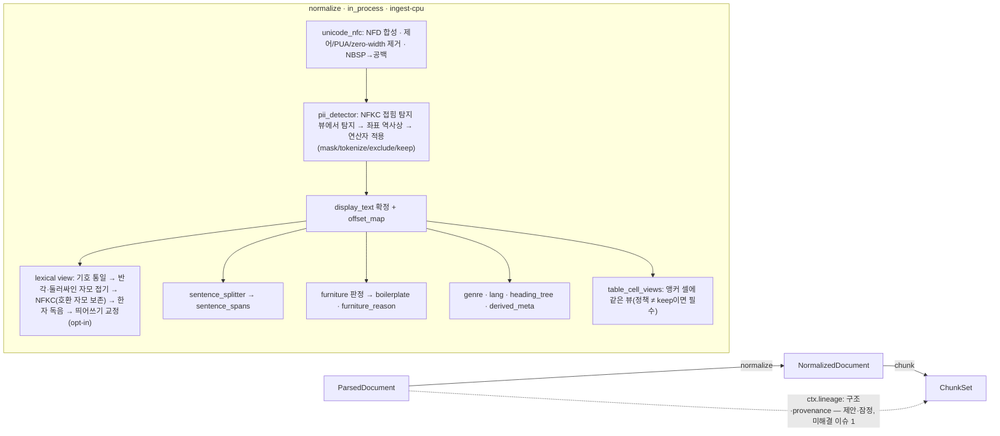

# NormalizedDocument 계약

## 목적

`normalize` 스테이지의 출력 계약 `NormalizedDocument`를 확정한다. 이 계약은 파서가 만든 [ParsedDocument](./03-parsed-document.md)의 블록 하나하나에 **텍스트 뷰 계층(text-view layer)** 을 덧씌운다 — 표시·인용용 `display_text`(NFC), 렉시컬 검색용 `lexical_text`(한글 호환 자모를 보존하는 NFKC), 두 뷰와 원문을 잇는 `offset_map`, 문장 구간, furniture(머리말·꼬리말·반복 요소) 판정, 장르·언어, PII(개인식별정보, Personally Identifiable Information) 정책 적용 기록, 표 셀 텍스트 뷰, 정규화 리포트다. 하류 `chunk`는 이 문서를 잘라 `ChunkSet`을 만들고 그 텍스트가 그대로 `ContextItem.text`가 되어 LLM에 전달되므로, 이 계약은 **LLM이 보는 본문의 형식과 인용 좌표의 정확성을 결정하는 마지막 지점**이다. 정본은 설계 바이블 §5.4 `NormalizedDocument`·`NormalizedBlock` 표, §4.2 `normalize` 행, §6.3(NFC/NFKC·`offset_map`), §5.7 열거(`FurnitureReason`, `Genre`, `PiiPolicy`, `PiiTokenizeMode`, `BlockSource`), §6.2(`normalizer_fingerprint`·`dictionary_hash`)이며, 이 문서는 그 표를 같은 철자·같은 필수 여부로 옮기고 의미·불변식·스키마·예시를 더한다.

## 범위

- 포함: 최상위 필드 표(바이블 §5.4 전부), 하위 객체 표(`heading_tree`, `derived_meta`, `annotations`, `pii_report`, `normalization_report`), 공용 타입 `NormalizedBlock`의 의미 해설(정의는 `common-types.schema.json` `$defs/NormalizedBlock`, [계약 개요](./00-contract-overview.md) §5), 3-텍스트 규칙에서 이 계약이 맡는 두 텍스트의 정의와 오프셋 기준, `offset_map` 정규형과 인용 복원 알고리즘, furniture 판정, 장르 감지와 청크 라우팅 힌트, 언어 판정, PII 정책 적용 기록, 사용자 사전(`analyzer_id`·`dictionary_hash`)의 영향, 통계, 불변식, 크기 한계, 산출물 저장 규약, JSON Schema 2020-12 전문(`schemas/normalized-document.schema.json`), Pydantic v2 모델, 예시 2개.
- 제외: 정규화 알고리즘 구현(형태소 분석기·문장 분리기·PII 탐지기 선택과 튠, [정규화·클리닝 파이프라인](../04-pipelines/09-normalization-and-cleaning.md)), 청킹 규칙([ChunkSet](./05-chunk-set.md), [청킹 전략](../04-pipelines/10-chunking-strategies.md)), `Block`·`TableData` 필드 정의([ParsedDocument](./03-parsed-document.md)), `UserDictEntry`([평가·피드백·사이드카 계약](./16-eval-feedback-and-sidecar-contracts.md)), 컬렉션 PII 정책 관리([컬렉션·프로파일·정책 계약](./15-collection-profile-and-policy-contracts.md)).
- 정본 관계: 필드·필수 여부·열거 철자는 바이블 §5.4·§5.7을 그대로 따른다. 바이블에 없는 필드(`genre_source`, `pii_report.tokenize_mode_applied`, `stats`, `pii_spans[].row`/`.col`)는 선택(N)으로, `table_cell_views`는 조건 필수(§2.9)로 두고 [미해결 이슈](#미해결-이슈)에 바이블 반영 제안으로 기록한다. [ParsedDocument](./03-parsed-document.md) §2.1(`ParsedDocument`)·§2.4(`DocumentMetadata`)·§2.6(`Block`)·§2.8(`TableCell`)과 대조 완료 — `Block.text`(NFC 미적용·제어 문자 허용), `Block.furniture`, `metadata.page_header_text`/`page_footer_text`(array<string>), `Block.source`·`confidence` 조건은 이 문서와 일치하며, `Block.lang`의 기록 위치는 §6에서 확정한다(미해결 이슈 12).

## 1. 모델 개요

**결정:** `NormalizedDocument`는 구조를 복제하지 않는 **텍스트 뷰 계층**이다. 블록의 종류·계층·좌표·표 격자(`Block.type`, `parent_block_id`, `level`, `provenance`, `table`)는 `parsed_ref`가 가리키는 `ParsedDocument`가 정본이고, 이 계약은 `block_id`로 1:1 대응하는 `NormalizedBlock`에 텍스트 뷰와 판정만 담는다. furniture 블록도 **물리적으로 제거하지 않고** `boilerplate=true`로 표시한다(바이블 §5.4 "`block_id`로 원 블록과 1:1"). 근거: 256MB 산출물 한계(바이블 §5.1) 안에서 텍스트를 두 벌 저장해야 하고, `GET /v1/documents/{document_id}/content?view=normalized`(바이블 §14)가 문서 전체를 돌려줘야 하며, 단일 좌표계(K1)에서 `block_id` 집합이 스테이지마다 달라지면 안 된다([ADR-0030](../06-adr/0030-single-coordinate-system-and-score-ledger.md), [ADR-0002](../06-adr/0002-provenance-element-path-and-nullable-page-bbox.md)).



| 항목 | 값 | 근거 |
|------|----|------|
| 생산 / 소비 | `normalize` / `chunk`, `get_document` | 바이블 §5.1 |
| 확장 지점 | `normalizer`(roles `korean_analyzer`, `sentence_splitter`, `pii_detector`) | 바이블 §3.1 D-10, §4.2 |
| 격리 모드·큐 | `in_process`(Kiwi 또는 mecab-ko, kss, Presidio), `ingest-cpu`, `start_to_close` 5m, 재시도 3 | 바이블 §4.2, §4.4 |
| 멱등성 키 | `stage_key = H("stage", "normalize", scope_key, parsed.blake3, fingerprint)`; `fingerprint`(§4.1 `Producer` 지문)의 `config_hash`는 `analyzer_id`·`dictionary_hash`·`pii_policy`·`pii_tokenize_mode`·`pii_detector_version`을 포함해야 한다(SDK 검증). 같은 입력·같은 지문은 **바이트 동일한 산출물**을 내야 하므로 `tokenize` 토큰도 결정적이어야 한다(§7, I-23) | 바이블 §4.1, §4.2, [ADR-0037](../06-adr/0037-artifact-cache-scope-and-stage-key-composition.md) |
| 실패 정책 | `normalize.nfd_residual`·`normalize.pii_policy_violation` 비재시도; `normalize.pii_detector_unavailable` 재시도(`keep` 폴백 금지, 소진 시 잡 실패); 문장 분리기 예외 → kss → 정규식 폴백 + `warnings[].code = normalize.segmenter_fallback` | 바이블 §4.2, §5.7, §10.3 E4; [에러 모델](./13-error-model.md) |
| 이벤트 / 크기 | `ingest.document.normalized`(`data`는 ID·해시·상태만) / 참조만, 256MB | 바이블 §5.7, §5.1 |
| 관측성 | 스팬 `rag.ingest.normalize`(속성 `rag.tenant_id_hash`·`rag.profile_hash`; 콘텐츠 캡처 기본 끔), 메트릭 `rag_ingest_stage_duration_seconds{stage="normalize"}`·`rag_pii_detector_errors_total`, 로그 필드 `event, level, tenant_id_hash, job_id, trace_id, stage, code`. 정규화 전용 메트릭·스팬 속성(분리기 폴백 수, PII 구간 수, `analyzer_id`·`pii_policy_applied`·`genre`)은 바이블 §6.5 정본 목록에 없으므로 미해결 이슈 15의 제안이며 등재 전 발생 금지 | 바이블 §6.5, [ADR-0022](../06-adr/0022-observability-genai-semconv-pin-and-license-boundary.md) |

블록 규칙: `blocks[i].block_id == ParsedDocument.blocks[i].block_id`(같은 순서·집합; 생성·병합·삭제 없음). 이 스테이지는 `ParsedDocument`를 수정하지 않으며 산출물은 `NormalizedDocument` 하나다 — 따라서 `Block.lang`(바이블 §5.4 `Block` N)은 저장된 `ParsedDocument`에 기록되지 않고 블록 언어의 유일한 기록 위치는 `NormalizedBlock.lang`이다(§6). `Block.text == ""`인 블록(`BlockType` 값 `table`·`figure`·`page_break` 등; 표는 03 §6 선형화 텍스트를 가질 수도 있다)이면 `display_text == lexical_text == ""`, `offset_map == [[0, 0, 0]]`, `sentence_spans == []`. `text_source`·`confidence`는 `Block.source`·`Block.confidence` 복사이며 청커가 포함 블록의 최저 신뢰 등급(`text_layer > converted > vlm > ocr`)과 최소 `confidence`로 `Chunk.text_source`·`ocr_confidence_min`을 계산한다. `chunk` 스테이지는 `BlockRef.element_path`·`page`·`bbox`, 표 행 그룹, heading 계층을 `NormalizedDocument`만으로 만들 수 없으므로 `parsed_ref`(= `lineage_refs.parsed`)가 가리키는 `ParsedDocument`를 함께 읽어야 한다. **제안(잠정):** 그 로드 경로로 이 문서와 [05 ChunkSet](./05-chunk-set.md) §1은 셸이 `requires_lineage`로 `ParsedDocument`를 `ctx.lineage["ParsedDocument"]`에 함께 로드하는 방식을 제안하지만, 이는 아직 정본이 아니다 — 바이블 §4.1은 `requires_lineage`를 `index`만 쓴다고 적고(`EnrichedChunkSet`·`ChunkSet`·`SourceDocument`; "그 외 스테이지는 없음"), §4.2 `chunk` 행의 입력은 `NormalizedDocument`만이며, 00 §3.2 `chunk` 행의 `requires_lineage`도 `—`다. 바이블 §4.1·§4.2·00 §3.2 patch(미해결 이슈 1; 05 미해결 이슈 12와 공동)가 확정될 때까지 `ctx.lineage["ParsedDocument"]`는 제안으로만 취급하고, 이 계약은 `parsed_ref`를 제공하는 것까지만 보장한다.

## 2. 필드 정의

타입 표기는 브리프 §9.5, "필수" 열의 `Y(nullable)`·`N`·`조건`의 의미는 [계약 개요](./00-contract-overview.md) §8.1을 따른다. "봉투"는 바이블 §5.2 공통 봉투 필드다.

### 2.1 `NormalizedDocument`(바이블 §5.4)

| 필드 | 타입 | 필수 | 설명 | 예시 |
|------|------|------|------|------|
| `schema_version` | string(semver) | Y | 봉투. 초기 `"1.0.0"` | `"1.0.0"` |
| `schema_type` | string | Y | 봉투. `"NormalizedDocument"`(스키마 `const`) | `"NormalizedDocument"` |
| `tenant_id` | string(ulid) | Y | 봉투. 보안 삼중항 1 | `"01J9ZQ4K7X2M8N3P5R6S7T8V9W"` |
| `collection_id` | string(ulid) | Y | 봉투. 보안 삼중항 2 | `"01J9ZQ5A1B2C3D4E5F6G7H8J9K"` |
| `producer` | `Producer` | Y | 봉투. `normalize` 플러그인 지문(인프로세스라 `image_digest`는 `null`) | 예시 1 |
| `quality` | enum(Quality) | Y | 봉투. 손실이 하나라도 있으면(`warnings ≠ []`) `degraded`이고 입력 `ParsedDocument`의 `degraded`를 상속한다(13 §5.2; 되돌리지 않음) | `"full"` |
| `warnings` | array<Warning> | Y | 봉투. 빈 배열 허용. 콘텐츠 미포함 | `[]` |
| `created_at` | string(date-time) | Y | 봉투 | `"2026-09-22T09:12:34.567Z"` |
| `lineage_refs` | object<string, ArtifactRef> | Y | 봉투. 정확히 `{source, parsed}`(00 §3.2); `parsed`는 `parsed_ref`와 같은 참조. 자기 자신(`normalized`)·하류 키(`chunk_set`, `enriched`, `embedded`) 미포함(스키마 `not`, Pydantic I-3; 00 I-7) | 예시 1 |
| `document_id` | string(ulid) | Y | `ParsedDocument.document_id` 복사 | `"01J9ZQ8D4N2P6R8T0V3W5X7Y9Z"` |
| `doc_version` | string(hex64) | Y | `= SourceDocument.content_hash`([ADR-0005](../06-adr/0005-doc-version-content-hash-only-and-acl-payload-update.md)) | `"7c1e9f3a…"`(64자) |
| `parsed_ref` | `ArtifactRef` | Y | 원 `ParsedDocument`(`schema_type = "ParsedDocument"`). 구조 계층의 정본 | 예시 1 |
| `normalizer_fingerprint` | string(hex64) | Y | `H("normalizer", plugin_id, plugin_version, config_hash, analyzer_id, dictionary_hash, pii_policy, pii_detector_version)`(바이블 §6.2). `IndexCommit`으로 전파 | `"d4e5f6a7…"` |
| `analyzer_id` | string | Y | `{engine}:{version}:{dictionary}`(바이블 §6.1). 공백기 기본 `mecab-ko:1.3.7:ko-dic-2.1.1`, `[kiwi]` extra `kiwi:0.24.0:cong`(확인 필요 as of 2026-09) | `"mecab-ko:1.3.7:ko-dic-2.1.1"` |
| `dictionary_hash` | string(hex64) | Y | 컬렉션 사용자 사전 해시 `H("dict", *sorted(entry 정규화 행))` | `"e5f6a7b8…"` |
| `language` | string(bcp47) | Y | 문서 주 언어. `ParsedDocument.language`와 같다(§6) | `"ko"` |
| `genre` | enum(Genre) | Y | 최종 장르(요청 힌트 > 파서 > 휴리스틱, §5). `ChunkSet.genre_route`의 원천 | `"law_article"` |
| `genre_source` | enum[request_hint, parser, heuristic] | N | **바이블 미등재.** `genre`를 결정한 원천(`$defs/NormalizedDocument.genre_source`) | `"request_hint"` |
| `blocks` | array<NormalizedBlock> | Y | `ParsedDocument.blocks`와 `block_id` 집합·순서 동일(1:1). ≤ 200,000 | §2.7 |
| `heading_tree` | array<HeadingNode> | Y | `{block_id, level, path}`; `boilerplate=false`인 heading 블록만, 문서 순서 | §2.2 |
| `derived_meta` | `DerivedMeta` | N | `{dates?, law_refs?, entities_normalized?}` 규칙 기반 파생 메타 | §2.3 |
| `annotations` | `Annotations` | Y | `{pii_spans(Y), content_risk(N)}` | §2.4 |
| `pii_report` | `PiiReport` | Y | `{policy_applied, entity_counts, detector_version, tokenize_mode_applied?}` | §2.5 |
| `normalization_report` | `NormalizationReport` | Y | `{removed_control_chars, nfd_composed, hanja_replaced, spacing_corrected, boilerplate_removed}` | §2.6 |
| `stats` | `NormalizationStats` | N | **바이블 미등재.** 문자·문장·형태소 토큰 통계(§9) | §2.8 |
| `table_cell_views` | array<TableCellView> | 조건 | **바이블 미등재.** `type=table` 블록 앵커 셀의 텍스트 뷰(§2.9). `pii_report.policy_applied ≠ keep`이면 **필수**(표가 없으면 `[]`)이고 모든 앵커 셀과 1:1; `keep`이면 N | 예시 1 |

### 2.2 `heading_tree[]` — `HeadingNode`

| 필드 | 타입 | 필수 | 설명 | 예시 |
|------|------|------|------|------|
| `block_id` | string(hex32) | Y | heading 블록(`Block.type = heading`, `heading_inferred` 포함) | `"0f1e2d3c…"` |
| `level` | integer(0..6) | Y | `Block.level` 복사. 0 = 문서 제목 | `0` |
| `path` | array<string>(1..7) | Y | 루트→현재의 조상 heading `display_text`; 마지막 원소 = 이 블록의 `display_text`; `len(path) ≤ level + 1`(단계 생략 허용). `Chunk.heading_path`와 결정적 접두어 `context_prefix.deterministic`의 원천이므로([ADR-0029](../06-adr/0029-three-text-rule-and-deterministic-context-prefix.md)) 표시 텍스트와 같은 정규화(NFC)만 쓴다. **`path[0]`은 level 0 heading(문서 제목)이 존재하고 이 블록이 그 아래에 있으면 문서 제목이다** — 청커는 이를 `context_prefix.deterministic`의 `{title}` 후보로 쓰고 `Chunk.heading_path`에서는 제외한다([ChunkSet](./05-chunk-set.md) §3.5·§9; 05 미해결 이슈 8에 대한 확정) | `["개인정보 처리 지침", "제1장 총칙"]` |

### 2.3 `derived_meta` — `DerivedMeta`(모든 필드 N)

| 필드 | 타입 | 필수 | 설명 | 예시 |
|------|------|------|------|------|
| `dates` | array<string(date)> | N | 원문 날짜 표기(`2026. 10. 1.`, `2026년 10월 1일`)를 ISO로 변환. **연도가 있는 패턴만**, 중복 제거·정렬 | `["2026-10-01", "2026-10-15"]` |
| `law_refs` | array<string> | N | `{법령명}/제n조[/제m항]` 경로, 중복 제거·정렬 | `["개인정보 보호법/제29조"]` |
| `entities_normalized[]` | `EntityNormalized` | N | `{block_id: hex32, kind: enum[date, law_article, unit, org], char_start, char_end, value}` — `kind`는 `$defs/NormalizedDocument.derived_meta.entities_normalized.kind`(바이블 §5.4 인라인 열거); `char_*`는 **`display_text` 기준** 코드포인트(끝 미포함, 비어 있지 않음); `value`는 `date` → `YYYY-MM-DD`, `law_article` → `{법령명}/제n조[/제m항]`, `unit` → SI 정규화 값, `org` → 정규 기관명(사용자 사전 `NNP` 항목 우선). LLM을 쓰지 않는 규칙 기반 파생물이며 `Enrichment.dates`·`law_refs`, 필터 `doc_date`·부스트(`recency`, `entity`)의 원천(바이블 §3.2 O-05, [ADR-0016](../06-adr/0016-llm-enrichment-default-off-and-budget-policy.md)) | `{"kind": "law_article", "char_start": 19, "char_end": 34, "value": "개인정보 보호법/제29조"}` |

### 2.4 `annotations` — `Annotations`

| 필드 | 타입 | 필수 | 설명 | 예시 |
|------|------|------|------|------|
| `pii_spans[]` | `PiiSpan` | Y | 탐지·적용된 PII 구간(빈 배열 허용). `{block_id: hex32, entity_type, start, end, score, operator}` | 예시 1 |
| `pii_spans[].entity_type` | string(`^[A-Z][A-Z0-9_]*$`) | Y | 탐지기 엔티티 타입. 프로파일 `recognizers`(바이블 §7.3: `KR_RRN, KR_PHONE, KR_BANK_ACCOUNT, KR_CARD, KR_PASSPORT`)와 탐지기 내장 타입(`EMAIL_ADDRESS` 등) | `"KR_PHONE"` |
| `pii_spans[].start`, `.end`, `.score` | integer / integer / number(0..1) | Y | **`display_text` 기준(치환 후 자리)**, 끝 미포함(`row`·`col`이 있으면 셀 뷰의 `display_text` 기준); `operator=exclude`면 `start == end`; 탐지 점수 | `46`, `56`, `0.85` |
| `pii_spans[].operator` | enum[mask, tokenize, exclude, keep] | Y | 적용 연산자(`$defs/NormalizedDocument.annotations.pii_spans.operator`). v1에서는 모든 구간이 `pii_report.policy_applied`와 같다 | `"mask"` |
| `pii_spans[].row`, `.col` | integer / integer | N | **바이블 미등재.** 둘 다 있으면 이 구간은 `table_cell_views[]`의 셀 `(block_id, row, col)` `display_text` 기준이고, 둘 다 없으면 `NormalizedBlock.display_text` 기준. 한쪽만 있으면 `contract.violation`(스키마 `dependentRequired`) | `1`, `1` |
| `content_risk[]` | `ContentRisk` | N | 인젠션 L1 규칙 판정 `{block_id, kind, score}`; `kind` 예 `injection_pattern`, `hidden_text`, `encoded_payload`; `Enrichment.risk_flags`·`risk_score`의 입력 | `[]` |

### 2.5 `pii_report` — `PiiReport`

| 필드 | 타입 | 필수 | 설명 | 예시 |
|------|------|------|------|------|
| `policy_applied` | enum(PiiPolicy) | Y | 실제 적용 정책 `= SourceDocument.pii_policy`(요청 > 컬렉션 > 테넌트 확정값). `ChunkSet.pii_policy_applied`·`IndexRecord.pii_policy_applied`로 전파 | `"mask"` |
| `entity_counts` | object<string, integer> | Y | 엔티티 타입별 구간 수(`pii_spans` 집계와 일치). 열린 객체(00 §8.2) | `{"KR_PHONE": 1}` |
| `detector_version` | string | Y | 탐지기 플러그인·모델 버전. `normalizer_fingerprint`의 `pii_detector_version` 입력 | `"presidio_ko:1.0.0;presidio-analyzer:2.2.364"` |
| `tokenize_mode_applied` | enum(PiiTokenizeMode) | N | **바이블 미등재.** `policy_applied=tokenize`일 때 적용 모드 `= SourceDocument.pii_tokenize_mode`(기록 권고) | `"encrypt"` |

### 2.6 `normalization_report` — `NormalizationReport`

| 필드 | 타입 | 필수 | 설명 | 예시 |
|------|------|------|------|------|
| `removed_control_chars` | integer | Y | 제거된 제어(`Cc`, 탭·줄바꿈 제외)·서식(`Cf`: zero-width U+200B~U+200D, BOM U+FEFF)·사용자 영역(`Co`, HWP PUA U+E000~U+F8FF) 코드포인트 수, 문서 합 | `1` |
| `nfd_composed` | integer | Y | NFC 합성으로 줄어든 코드포인트 수, 문서 합 | `0` |
| `hanja_replaced` | integer | Y | `lexical_text`에서 독음으로 치환된 한자 코드포인트 수 | `0` |
| `spacing_corrected` | boolean | Y | 띄어쓰기 교정(opt-in, `lexical_text`만) 적용 여부 | `false` |
| `boilerplate_removed` | array<string> | Y | `boilerplate=true` 블록의 `display_text`(중복 제거·코드포인트 순 정렬, ≤ 1,000개 × 512자). **512 코드포인트를 넘는 `display_text`는 `"h:" + blake3_hex(utf8(display_text))`(66자)로 대체 기록**하고(I-12), 서로 다른 항목이 1,000개를 넘으면 문서 순으로 앞 1,000개만 기록한다 — 블록의 `boilerplate=true` 표시는 그대로이므로 손실은 리포트에 한정된다. 산출물 안에만 존재하며 이벤트·로그로 나가지 않는다 | `["행정안전부 개인정보 처리 지침"]` |

### 2.7 `NormalizedBlock`(공용 타입, 바이블 §5.4; 정의 `urn:rag:schema:common-types:1#/$defs/NormalizedBlock`)

| 필드 | 타입 | 필수 | 설명 | 예시 |
|------|------|------|------|------|
| `block_id` | string(hex32) | Y | 원 `Block.block_id` | `"9e8d7c6b…"` |
| `display_text` | string | Y | **NFC**. 제어·PUA·zero-width 제거, NBSP→공백, PII 연산자 적용. 표시·인용 원문(§3.1) | 예시 1 |
| `lexical_text` | string | Y | **NFKC(호환 자모 보존)**. `display_text`에서 파생: 기호 통일 → 반각·둘러싸인 한글 자모 접기(`ﾡ`·`㉠` → `ㄱ`, `㈀` → `(ㄱ)`) → NFKC(한글 호환 자모 U+3131~U+318E 보존) → 한자 독음 → 띄어쓰기 교정(opt-in). BM25·키워드 입력. 인용 기준이 아니다(§3.2) | 예시 1·2 |
| `offset_map` | array<[integer, integer, integer]> | Y | `[display_start, original_start, length]` 구간 사상(display → 원문 `Block.text`). 정규형은 §3.3 | `[[0, 0, 13], [13, 13, 0], [13, 14, 33], [46, 47, 10], [56, 60, 0]]` |
| `sentence_spans` | array<object> | Y | `{start, end, sub_spans}`, `display_text` 기준, `0 ≤ start < end ≤ len`, 문장 순 정렬·비중첩(§3.5) | `[{"start": 0, "end": 37, "sub_spans": []}]` |
| `sentence_spans[].sub_spans` | array<[integer, integer]> | Y | 서브문장(Kiwi `Sentence.subs`; kss·정규식은 `[]`). `[start, end)` 안, 정렬·비중첩 | `[]` |
| `lang` | string(bcp47) | Y | 블록 언어(§6) | `"ko"` |
| `boilerplate` | boolean | Y | furniture 판정. `true`면 기본 청킹 제외(§4) | `false` |
| `furniture_reason` | enum(FurnitureReason) \| null | N | `repeated_header, nav, boilerplate`. `boilerplate=true`이면 non-null 필수, `false`면 생략 또는 `null` — 이 쌍조건은 바이블 §5.4(N)에 없는 이 문서 §4의 조건 필수다(미해결 이슈 3) | `"repeated_header"` |
| `text_source` | enum(BlockSource) | Y | 원 `Block.source` 복사(`text_layer, ocr, vlm, converted`) | `"text_layer"` |
| `confidence` | number \| null | Y(nullable) | 원 `Block.confidence` 복사. `text_source ∈ {ocr, vlm}`이면 non-null | `null` |

### 2.8 `stats` — `NormalizationStats`(N, 바이블 미등재)

| 필드 | 타입 | 필수 | 설명 | 예시 |
|------|------|------|------|------|
| `block_count`, `body_block_count`, `furniture_block_count` | integer | Y | 전체 / `boilerplate=false` / `boilerplate=true` 블록 수 | `5`, `4`, `1` |
| `display_chars`, `lexical_chars` | integer | Y | 두 뷰의 코드포인트 합 | `138`, `138` |
| `sentence_count`, `pii_span_count` | integer | Y | 문장 구간 수 / PII 구간 수 | `6`, `1` |
| `analyzer_token_count` | integer | N | `ctx.analyzer`(`analyzer_id`) 형태소 토큰 수. 임베딩 토크나이저 토큰 수는 `Chunk.token_counts`(`TokenCounts`, 바이블 §5.3·§5.4 `Chunk`)가 정본 | `41` |

### 2.9 `table_cell_views[]` — `TableCellView`(조건, 바이블 미등재)

`type=table` 블록의 `Block.text`는 `""`이거나 03 §6 선형화 텍스트이고(바이블 §5.4 `Block.text`) 표 본문의 정본은 `TableData.cells[].text`에 있으므로, `NormalizedBlock`만으로는 표 셀에 NFC·PII 정책이 적용되지 않는다. `TableCellView{block_id, row, col, display_text, lexical_text, offset_map}`은 **앵커 셀** 단위로 같은 뷰를 제공한다 — 셀 `text`에 §3.1·§3.2 규칙을 적용하되 셀 안 `LF`는 문단 병합 구분자(03 §2.8)이므로 유지하고, `offset_map`은 셀 `text` 기준 §3.3 정규형이다.

**결정:** `pii_report.policy_applied ≠ keep`이면 `table_cell_views`는 **필수**이며 문서의 모든 `type=table` 블록의 모든 앵커 셀과 `(block_id, row, col)`로 1:1이다(표가 없으면 `[]`). 이때 청커는 `TableData.cells[].text`를 직접 쓸 수 없고(쓰면 `contract.violation`, [ChunkSet](./05-chunk-set.md) §7) 셀 뷰의 `display_text`·`lexical_text`만 쓴다 — 담당자·연락처 표가 흔한 공문서에서 셀 안의 PII가 `Chunk.text`로 새는 것을 막는 유일한 경로다(I-11의 범위에 셀 뷰 포함, I-22). `policy_applied = keep`이면 N이고, 없으면 청커가 `TableData.cells[].text`에 §3.1·§3.2 규칙을 적용해 쓴다. 셀 안 PII 구간은 `pii_spans[]`에 `row`·`col`을 붙여 셀 뷰 좌표로 기록한다(§2.4). 스키마는 최상위 `if/then`(정책 ≠ `keep` ⇒ `required: [table_cell_views]`)으로 표현하고, 앵커 셀 1:1은 `ParsedDocument`가 필요한 교차 불변식이라 셸 출력 검증·적합성 키트가 검사한다. 바이블 §5.4 반영 제안은 미해결 이슈 2.

## 3. 3-텍스트 규칙과 오프셋 기준

**결정:** 청크의 세 텍스트 `text` / `embed_text` / `index_text` 가운데 이 계약은 앞의 둘의 **원료**를 만든다 — `display_text`(→ `Chunk.text` → `ContextItem.text`)와 `lexical_text`(→ `Chunk.lexical_text` → `Enrichment.index_text`). `embed_text`는 `enrich`가 `deterministic + "\n" + (generated + "\n")? + text`(선택적 LLM 접두어 항 포함)로 조립하므로 이 계약에 없다(바이블 §2.1 K2, §5.4 `Enrichment`, §6.3; [ADR-0029](../06-adr/0029-three-text-rule-and-deterministic-context-prefix.md) 결정 표). 표시 텍스트는 NFC, 렉시컬 뷰는 NFKC(호환 자모 보존, §3.2)이며 혼용은 금지다.

| 텍스트 | 필드 | 정규화 | 오프셋 기준으로 쓰는 필드 | 하류 |
|--------|------|--------|---------------------------|------|
| 원문 | `Block.text`(ParsedDocument) | 없음(제어 문자 허용) | `Provenance.char_start/char_end`, `BlockRef.original_char_*` | 인용 좌표의 종점([ADR-0002](../06-adr/0002-provenance-element-path-and-nullable-page-bbox.md)) |
| 표시 텍스트 | `NormalizedBlock.display_text` | NFC; 제어·PUA·zero-width·BOM 제거; NBSP→공백; PII 연산자 | `sentence_spans`, `pii_spans`, `entities_normalized`, `BlockRef.char_*`(`Chunk.text` 기준), `ContextItem.segments` | `Chunk.text` → `IndexRecord.text` → `ContextItem.text`(LLM이 보는 유일한 본문) |
| 렉시컬 뷰 | `NormalizedBlock.lexical_text` | `display_text`에서 파생: 기호 통일 → 반각·둘러싸인 한글 자모 접기 → NFKC(호환 자모 보존) → 한자 독음 → 띄어쓰기 교정(opt-in) | 없음(인용 불가; 형태소 토큰 오프셋은 `enrich` 내부) | `Chunk.lexical_text` → `Enrichment.index_text`(BM25), `lite`의 `sparse_bm25` |
| 임베딩 텍스트 | `Enrichment.embed_text`(이 계약 밖) | `deterministic + "\n" + (generated + "\n")? + text`(바이블 §5.4 `Enrichment`) | `Enrichment.strip_offsets` | dense·sparse 입력 |

### 3.1 `display_text` 규칙

1. 원문 `Block.text`에 NFC를 적용한다(NFD 조합형 한글 합성; `nfd_composed` 집계).
2. 일반 범주 `Cc`(탭 U+0009·줄바꿈 U+000A 제외)·`Cf`·`Co` 코드포인트를 제거한다(`removed_control_chars` 집계). CR LF는 LF 하나로 합친다.
3. NBSP(U+00A0)는 공백(U+0020)으로 1:1 치환한다. 그 밖의 문자(전각·원문자·호환 한자·기호)는 **바꾸지 않는다** — NFKC는 정보 손실이 있어 표시용에 적용하지 않는다([한국어 NLP](../07-tech-landscape/13-korean-nlp-tokenization-and-language-resources.md) §띄어쓰기 교정과 정규화 도구).
4. PII 연산자를 적용한다(§7). 탐지 입력은 1~3단계를 거친 텍스트의 **NFKC 접힘 뷰**이고 탐지 구간은 접힘 전 좌표로 역사상한다(전각 숫자·구분 기호 변형도 탐지, §7). `mask`는 `<{entity_type}>`, `tokenize`는 `<{entity_type}:{token}>`(토큰은 결정적, §7·I-23), `exclude`는 삭제, `keep`은 원문 유지(치환 형식은 초안, 미해결 이슈 7).
5. 결과가 NFC임을 검증한다(`unicodedata.is_normalized("NFC", display_text)`). 위반은 `normalize.nfd_residual`.

### 3.2 `lexical_text` 규칙

`display_text`에서만 파생한다(원문에서 직접 만들지 않는다 — PII 치환이 두 뷰에 동일하게 반영되는 근거). 순서:

1. **기호 통일** — 가운뎃점 `ㆍ`(U+318D)·`•`(U+2022) → `·`(U+00B7), 물결 `∼`(U+223C)·`～`(U+FF5E) → `~`, 대시류 → `-`; 법령명 괄호 `「」`·『』는 유지.
2. **반각·둘러싸인 한글 자모 접기**(`fold_jamo_variants`, Pydantic 절) — 세 범위의 문자를 대응 호환 자모로 사상한다: (a) 반각 한글 자모(Halfwidth Hangul, U+FFA0~U+FFDC) → U+3131~U+3164 1:1(`ﾡ` → `ㄱ`, 반각 채움 문자 `ﾠ` → `ㅤ` U+3164); (b) 원 한글 자음(Circled Hangul Letters, `㉠`~`㉭` U+3260~U+326D) → 홑자음 호환 자모 `ㄱ`~`ㅎ` 1:1(`㉠` → `ㄱ` U+3131, `㉡` → `ㄴ` U+3134, …, `㉭` → `ㅎ` U+314E); (c) 괄호 한글 자음(Parenthesized Hangul Letters, `㈀`~`㈍` U+3200~U+320D) → `(` + 호환 자모 + `)`(`㈀` → `(ㄱ)`, 1 → 3 코드포인트). 사상 표는 손으로 쓰지 않고 유도한다 — 호환 자모 U+3131~U+318E 각각의 NFKC 결과(단독 조합형 자모 1자, 94항 단사)의 역표 `CONJOINING_TO_COMPAT`을 만들어 두고, 세 범위의 각 문자를 NFKC한 결과에서 조합형 자모를 역표로 되돌린 문자열이 그 문자의 사상값이다. NFKC는 이 세 범위를 단독 조합형 자모(U+1100 등)로 보내므로 반드시 3단계 앞에 둔다. 호환 자모 자신을 제외하면 NFKC가 단독 조합형 자모를 남기는 문자는 유니코드 전 범위에서 이 세 범위가 전부다(UCD 전수 대조; Unicode 버전 갱신 시 재확인). 원 한글 음절 `㉮`~`㉻`(U+326E~U+327B)·`㉾`·괄호 한글 음절 `㈎`~`㈜`(U+320E~U+321E)는 NFKC가 완성 음절(`가`, `(주)`)로 합성하므로 대상이 아니다.
3. **NFKC(호환 자모 보존)** — 한글 호환 자모(Hangul Compatibility Jamo, U+3131~U+318E)를 경계로 문자열을 나눠 각 조각에 NFKC를 적용하고 호환 자모는 그대로 이어 붙인다(`nfkc_kr`, Pydantic 절). 전각 영숫자·원문자·단위 기호·`㈜` 등 호환 문자는 펼쳐진다.
4. **한자 → 한글 독음**(`hanja_replaced` 집계; kss `hanja2hangul` 또는 분석기 경로, `hanja` 패키지는 라이선스 검토 전 제외).
5. **띄어쓰기 교정** — 기본 끔, `text_source ∈ {ocr, converted}` 또는 HWP 5.0 변환본에서 프로파일 opt-in(`spacing_corrected`).

**결정:** 렉시컬 뷰는 **호환 자모를 보존하는 NFKC**이며, 렉시컬 뷰의 모든 한글 자모는 호환 자모로만 나타난다. 한글 호환 자모와 그 변형은 NFKC에서 조합형 자모(U+1100~U+11FF)로 바뀐다 — `ㅇ`(U+3147) → U+110B, `ㄱ`(U+3131) → U+1100, 반각 `ﾡ`(U+FFA1) → U+1100, 원 자음 `㉠`(U+3260) → U+1100, 괄호 자음 `㈀`(U+3200) → `(` U+1100 `)`, `ㆍ`(U+318D) → U+119E(이전 판의 U+1191은 오기). 한국 공문서 개조식의 표준 글머리 `ㅇ`과 `ㄱ. ㄴ.` 항목 표기가 그대로 NFKC를 거치면 핵심 대상 문서군(개조식 공문서·보도자료)의 모든 개조식 블록이 자모 잔존 불변식(I-6a)에 걸려 잡이 비재시도 실패하므로, 호환 자모는 NFKC의 대상에서 제외한다(3단계). 같은 실패 부류인 시험지·교재·법령 별표·서식의 표준 항목 기호 `㉠㉡㉢`·`㈀㈁`은 호환 자모가 아니라 NFKC가 단독 조합형 자모로 펼치는 호환 문자이므로 보호 범위로는 막을 수 없고, 한 블록에라도 있으면 문서 전체가 `normalize.nfd_residual`(비재시도)로 확정 실패한다 — 그래서 2단계가 반각 자모와 함께 이들을 NFKC 앞에서 호환 자모로 접는다. 호환 자모는 결합 부류 0의 시작 문자이고 어떤 문자와도 정규 합성하지 않으므로 조각별 NFKC는 호환 자모 이외의 모든 위치에서 전체 NFKC와 같은 결과를 낸다(부수 효과: 호환 자모끼리의 연쇄 `ㄱㅏ`는 전체 NFKC와 달리 `가`로 합성되지 않고 풀어쓰기 그대로 남는다 — 의도된 동작). 형태소 분석기(Kiwi `compatible_jamo=True`, Nori)도 호환 자모를 기대한다([한국어 NLP](../07-tech-landscape/13-korean-nlp-tokenization-and-language-resources.md) §띄어쓰기 교정과 정규화 도구). 이 규칙은 바이블 §6.3 "렉시컬 뷰 NFKC"와 §5.4 불변식 문구의 정밀화이며 patch를 미해결 이슈 16으로 제안한다.

결과 검증: `lexical_text == nfkc_kr(lexical_text)`(고정점 — 2단계에서 접히지 않은 반각·둘러싸인 자모가 남아 있으면 NFKC가 조합형 자모를 내므로 실패한다)이고 U+1100~U+11FF(조합형 자모)가 없어야 한다. 위반은 `normalize.nfd_residual`(바이블 §5.4 불변식, I-6a). `ㆍ`는 1단계에서 `·`로 통일되므로 3단계 보호 대상에 남지 않는다; 보호 없이 NFKC하면 U+119E가 되어 잔존 검사에 걸린다는 점이 기호 통일을 NFKC 앞에 두는 이유다. 적합성 키트 `contract_roundtrip`([ADR-0032](../06-adr/0032-plugin-sdk-stage-protocol-and-conformance-kit.md))은 `ㅇ`·`ㄱ.` 글머리, 반각 `ﾡ`, 원 자음 `㉠`, 괄호 자음 `㈀`, `ㆍ`가 든 블록으로 1~3단계와 I-6a 통과를 검사한다(예시 2 블록 `ab12…`·`e5f6…`). 원문에 이미 들어 있던 조합형 자모(옛한글 연쇄·단독 자모)는 2단계 대상이 아니어서 I-6a에 걸린다 — 미해결 이슈 18.

### 3.3 `offset_map` 정규형

**결정:** `offset_map`은 `display_text`의 코드포인트 위치를 원문 `Block.text`의 코드포인트 위치로 사상하는 구간 목록이며 다음 정규형을 따른다. 위반은 `contract.violation`([에러 모델](./13-error-model.md) §3.2).

| # | 규칙 |
|---|------|
| M1 | 원소는 `[display_start, original_start, length]`(모두 ≥ 0)이고 `(display_start, length)` 사전순으로 **엄격 증가**한다(같은 `display_start`에서는 길이 0 원소가 먼저). 동일 원소 중복 금지 |
| M2 | `length > 0`인 원소는 **사상 구간**이다. 사상 구간의 display 범위 `[display_start, display_start + length)`는 서로 겹치지 않고 합집합이 정확히 `[0, len(display_text))`다(완전 피복) |
| M3 | `length == 0`인 원소는 **경계 마커**다. 마지막 원소는 반드시 **종단 마커** `[len(display_text), original_end, 0]`이며 `original_end`는 마지막으로 사상된 원문 문자의 다음 위치다(`display_text`가 비어 있으면 `offset_map = [[0, 0, 0]]`) |
| M4 | `original_start`는 배열 순서로 **비감소**한다(단조성). 구간 `i`의 원문 끝 `orig_end(i)`는 배열에서 바로 다음 원소의 `original_start`다 |
| M5 | `orig_end(i) - original_start_i == length_i`인 구간은 **1:1 구간**(내부 위치 `p ↦ original_start + (p - display_start)`; NBSP→공백처럼 길이가 같은 치환 포함). 그렇지 않은 구간은 **불투명 구간**(NFD→NFC 합성 클러스터, CR LF→LF, PII 치환 토큰)이며 display 범위 전체가 원문 `[original_start, orig_end)`에 하나의 단위로 대응한다. 치환 결과가 원문과 같은 코드포인트 수인 PII 치환(`mask`·`tokenize`)은 이 인코딩상 1:1 구간과 구별되지 않으므로, `pii_spans` 구간과 겹치는 표시 범위는 §3.4의 스냅 규칙이 구간 경계로 확장하고 I-8은 `pii_spans` 범위를 텍스트 동일성 검사에서 제외한다(인코딩 확장 대안은 미해결 이슈 5) |
| M6 | 1:1 구간 뒤에서 원문 문자가 제거되면(zero-width·제어 문자·`exclude`) 그 자리에 경계 마커 `[display_start + length, original_start + length, 0]`를 둔다. 마커가 없으면 앞 구간이 불투명으로 해석되어 복원 구간이 제거 문자를 포함한다. **길이 0 원소의 `display_start`는 직전까지 피복된 위치(직전 사상 구간의 끝, 첫 원소면 0)와 같아야 한다** — 마커는 구간 끝에만 놓이며 1:1 구간 내부의 마커는 `to_original`이 앞 구간을 불투명으로 오판하게 하므로 `validate_offset_map`이 거부한다 |

### 3.4 인용 복원 알고리즘(`to_original`)

`display_text` 범위 `[a, b)`를 원문 `[A, B)`로 옮긴다. 청커는 이 함수로 `BlockRef.original_char_start/original_char_end`를 채우고, 하류(`hydrate`·`pack`)는 `offset_map` 없이 `block_refs → Provenance`를 만든다(바이블 §6.3).

- `A = start_of(a)`: `a`를 담는 사상 구간 `i`를 찾아, 1:1이면 `original_start_i + (a - display_start_i)`, 불투명이면 `original_start_i`.
- `B = end_of(b)`: `display_start == b`인 첫 원소(배열 순서상 마커가 먼저)가 있으면 그 `original_start`; 없으면 `b`를 담는 구간 `i`에서 1:1이면 `original_start_i + (b - display_start_i)`, 불투명이면 `orig_end(i)`.
- `a == b`(빈 범위)면 `A = B = end_of(a)`(`a > 0`), `a == 0`이면 첫 원소의 `original_start`.
- **PII 구간 스냅(`snap_to_pii_spans`):** 청커가 인용 범위 `[a, b)`를 옮기기 전에 그 블록(또는 셀 뷰)의 `pii_spans`(operator ∈ {mask, tokenize}) 구간 `[s, e)`와 겹치면 `a = min(a, s)`, `b = max(b, e)`로 먼저 확장한다. 치환 토큰의 일부만 인용하는 것은 의미가 없고, 원문과 코드포인트 수가 같은 치환이 1:1 구간으로 인코딩되어도(M5) 토큰 전체가 원문 PII 전체에 대응하게 된다.

예(예시 1 블록 `9e8d…`): 원문 `"제1조(목적) 이 지침은​ 행정안전부의 개인정보 처리 절차를 정한다. 담당자 연락처 010-1234-5678"`(60 코드포인트) → `display_text` `"제1조(목적) 이 지침은 행정안전부의 개인정보 처리 절차를 정한다. 담당자 연락처 <KR_PHONE>"`(56).

| `offset_map` 원소 | 종류 | 의미 |
|-------------------|------|------|
| `[0, 0, 13]` | 1:1 | display 0..12 ↔ 원문 0..12 |
| `[13, 13, 0]` | 경계 마커 | 원문 13(U+200B) 제거. 앞 구간의 원문 끝을 13으로 고정 |
| `[13, 14, 33]` | 1:1 | display 13..45 ↔ 원문 14..46 |
| `[46, 47, 10]` | 불투명 | `<KR_PHONE>`(display 46..55) ↔ 원문 47..59(`010-1234-5678`) |
| `[56, 60, 0]` | 종단 마커 | display 끝 56 ↔ 원문 끝 60 |

문장 1 `[0, 37)` → `start_of(0) = 0`, `end_of(37)`: 37을 담는 `[13, 14, 33]`은 1:1 → `14 + (37 - 13) = 38` → 원문 `[0, 38)`(마침표 포함). 문장 2 `[38, 56)` → `39`, 종단 마커 `60` → 원문 `[39, 60)`. 마스크 내부 `[50, 53)` → 불투명 구간 경계로 확장 → 원문 `[47, 60)`(전화번호 전체).

### 3.5 `sentence_spans`

`display_text` 기준 코드포인트 구간, 문장 순 정렬·비중첩, 비공백 문자는 정확히 하나의 문장 구간에 속한다(공백만 구간 밖에 남을 수 있다). 분리기 체인은 프로파일 `ingest.normalize.sentence_splitter`(기본 `normalizer.kss_punct`, 폴백 `normalizer.regex_sentences`; `[kiwi]` 설치 시 `normalizer.kiwi_sentences`)이며 폴백은 `warnings[].code = normalize.segmenter_fallback`으로 기록한다([ADR-0021](../06-adr/0021-korean-analyzer-kiwi-promotion-and-interim-mecab-kss.md)). 개조식 문단은 줄바꿈·글머리 기호를 경계로 강제 분리한다. `Chunk.sentence_spans`·`ContextItem.segments`·문장 윈도우의 원천이다.

## 4. furniture 판정과 `furniture_reason`

**결정:** furniture(머리말·꼬리말·목차·내비게이션·반복 보일러플레이트)는 **논리 제거**한다 — 블록은 유지하고 `boilerplate=true` + `furniture_reason`을 기록하며, `normalization_report.boilerplate_removed`에 그 `display_text`를 남긴다. 기본 청커는 `boilerplate=true` 블록을 청크에 넣지 않는다(바이블 §5.4 `Block.furniture` "기본 청킹 제외"). 정규화는 파서의 `Block.furniture=true` 판정을 뒤집지 않는다(추가만 가능). `heading_tree`는 `boilerplate=true`인 heading을 제외한다.

| 신호(입력) | 판정 | `furniture_reason` |
|------------|------|--------------------|
| `Block.furniture=true`, `Block.type ∈ {page_header, page_footer}`, `container ∈ {page_header, page_footer}`, `ParsedDocument.metadata.page_header_text/page_footer_text`와 일치 | `boilerplate=true` | `repeated_header` |
| `Block.type=toc`, HTML `nav`/`aside`(`metadata.navigation_text`와 일치), 사이트 메뉴·브레드크럼 | `boilerplate=true` | `nav` |
| 같은 정규화 문자열이 ≥ 3페이지 또는 ≥ 30%의 페이지에 반복(PDF·스캔; 초안 목표), 쪽 번호(`- 1 -`, `1 / 12`), 저작권·생성 도구 안내, 배포용 워터마크 문구 | `boilerplate=true` | 반복 머리말·꼬리말 위치면 `repeated_header`, 그 외 `boilerplate` |
| 그 외 | `boilerplate=false` | 생략 또는 `null` — 임계값(3페이지·30%)은 초안 목표이며 [정규화·클리닝 파이프라인](../04-pipelines/09-normalization-and-cleaning.md)이 골든셋으로 확정한다 |

## 5. 장르 감지와 청크 라우팅 힌트

**결정:** `genre`는 `Genre` 열거(`law_article, outline_report, narrative, web_article, form, manual, unknown`) 하나이며 우선순위는 요청 힌트(`IngestRequest.metadata.genre` → `SourceDocument.metadata`) > 파서 추론(`ParsedDocument.metadata.genre`) > 정규화 휴리스틱이다(바이블 §5.4). 결정 원천은 `genre_source`(N)에 기록한다. 청커는 `genre`를 `ChunkSet.genre_route`로 복사하고 프로파일 `ingest.chunk.genre_rules[genre]`(예 `law_article: {heading_regex: "^제\d+조", split_on: [항]}`, 바이블 §7.3)를 적용한다. `IndexRecord.genre`는 필터 가능 필드다(바이블 §5.7 `FilterableField`).

| 휴리스틱(초안; 04-pipelines/09가 확정) | `genre` |
|----------------------------------------|---------|
| `numbering_label`이 `^제\d+조`인 블록이 ≥ 3개 또는 본문 블록의 ≥ 10% | `law_article` |
| `1.`·`가.`·`(1)`·`□`·`○`·`ㅇ`(U+3147)·`-`·`·` 개조식 번호·글머리(`numbering_label` 또는 `display_text` 첫 토큰)가 본문 블록의 ≥ 40%이고 heading 깊이 ≤ 2 | `outline_report` |
| `SourceDocument.format = html`이고 `metadata.web`이 있음 | `web_article` |
| `form_field` 블록 또는 `TableData.role = form` 표가 본문의 ≥ 30% | `form` |
| 숫자 다단 번호(`1.2.3`) heading이 깊이 ≥ 3 | `manual` |
| 위에 해당 없음 / 본문 블록 없음 | `narrative` / `unknown` |

## 6. 언어 판정

- 문서 `language`는 `ParsedDocument.language`(요청 `language_hint` 기본 `ko` > 파서 판정)를 그대로 쓴다. 정규화는 문서 언어를 재판정하지 않는다(미해결 이슈 8).
- 블록 `lang`은 `display_text`의 문자 범주 `L*` 스크립트 비율로 판정한다(초안; 순서대로 첫 일치) — (1) 글자 수 < 4면 문서 `language` 상속 (2) 가나(U+3040~U+30FF) ≥ 1이고 가나 + 한자 우세면 `ja` (3) 한글(음절·조합형 자모·호환 자모) ≥ 1이고 한글 ≥ 한자면 `ko`(한자 병기 포함) (4) **한자 우세이고 한글 0이면 문서 `language`가 `zh`로 시작할 때만 `zh`, 그 외에는 문서 `language` 상속** — 한국 법령·오래된 공문서의 `大韓民國 憲法 第1條` 같은 블록은 한국어 문서의 한자 표기이며(§3.2가 같은 블록의 한자를 독음으로 바꾸는 것과 일관), `zh`로 판정하면 `Chunk.lang`·`IndexRecord.lang = zh`가 되어 `lang = ko` 필터에서 빠지고 청커가 인접 `ko` 블록과 합치지 않는다; `zh`는 문서 언어 또는 간체자 비율 같은 추가 신호가 있을 때로 한정한다(04-pipelines/09 §3.6 규칙 4와의 정합은 미해결 이슈 17) (5) 라틴 ≥ 80%면 `en`(초안; 라틴 계열 언어 구분은 `language_detector` 역할 제안) (6) 그 외(기호·숫자만, 스크립트 동수)는 문서 `language` 상속. BCP 47 기본 서브태그 소문자(바이블 §6.3). 표 블록은 셀 뷰 텍스트를 이어 계수한다.
- `lang`은 `Chunk.lang` → `IndexRecord.lang`(필터)으로 전파되고, 청커가 언어가 다른 블록을 한 청크에 합치지 않는 근거가 된다.
- **결정:** `Block.lang`(바이블 §5.4 `Block` N, "정규화에서 채움"; 03 §2.6 "파서는 채우지 않고 `normalize`가 채운다", P-14)은 **저장된 `ParsedDocument`에 기록되지 않는다.** `normalize`는 `ParsedDocument`를 수정하지 않고(§1, I-1) 산출물은 `NormalizedDocument`뿐이므로 블록 언어의 유일한 기록 위치는 `NormalizedBlock.lang`이다. 파서가 `Block.lang`을 채워 넘겨도 정규화는 이를 힌트로만 쓰고 `NormalizedBlock.lang`을 위 규칙으로 판정한다. 바이블 §5.4 `Block.lang` 행과 03 §2.6·P-14 문구를 "`NormalizedBlock.lang` 참조"로 정정하는 patch를 미해결 이슈 12로 제안한다.

## 7. PII 정책 적용 기록

**결정:** PII 탐지·적용은 `normalize` 단계에서 `display_text` 확정 전에 수행하며, 정책 확정값은 `SourceDocument.pii_policy`·`pii_tokenize_mode`(요청 > 컬렉션 > 테넌트)다. 워크플로우가 이 값을 `normalize` 스테이지 config(`pii.policy`, `pii.tokenize_mode`)로 주입하므로 `config_hash`·`stage_key`가 정책을 반영한다. `pii_report.policy_applied`는 실제 적용값이며 `SourceDocument.pii_policy`와 같아야 한다(계보 교차 검증). 바이블 §10.3 E4, [보안·PII](../07-tech-landscape/12-security-multitenancy-pii-and-licensing.md) §4, [ADR-0027](../06-adr/0027-security-context-injection-and-acl-enforcement-points.md).

**결정(탐지 입력):** 탐지기(`pii_detector`)의 입력은 §3.1 1~3단계를 거친 텍스트(및 표 앵커 셀 텍스트)의 **NFKC 접힘 뷰**(폭·호환 문자 접힘)이며, 탐지 구간은 접힘 오프셋 표(정규화기 내부, 계약 외)로 접힘 전 좌표로 역사상한 뒤 연산자를 적용한다. NFC는 전각 영숫자를 접지 않으므로(`０１０-１２３４-５６７８`는 NFC 불변, NFKC에서만 `010-1234-5678`) HWP/HWPX 공문서에 흔한 전각 숫자 전화번호·주민등록번호·계좌번호가 반각 `\d` 기반 `KR_*` 인식기([보안·PII](../07-tech-landscape/12-security-multitenancy-pii-and-licensing.md) §4)를 그대로 통과하는 것을 막는다. 적합성 키트 `contract_roundtrip`은 전각 숫자·구분 기호 변형 케이스로 이를 검사한다(예시 2 블록 `cd34…`).

| `policy_applied` | `display_text`·`lexical_text` | `pii_spans[].start/end` | 기록·오류 |
|------------------|-------------------------------|--------------------------|-----------|
| `mask` | `<{entity_type}>` 플레이스홀더로 치환 | 플레이스홀더 자리 | `entity_counts` |
| `tokenize` | `<{entity_type}:{token}>`. **토큰은 결정적이어야 한다**(I-23: 같은 `tenant_id`·`entity_type`·NFKC 접힘 평문 → 같은 토큰; 문자 집합 `[A-Za-z0-9_-]{8,128}`, 초안). `hash` = 테넌트 고정 salt 키드 해시(비가역), `encrypt` = 테넌트 DEK의 **결정적 AEAD**(AES-SIV, RFC 5297; 또는 DEK·평문에서 유도한 nonce; ACL 보유자만 복호). Presidio 기본 `encrypt` 연산자(AES, 임의 IV — 확인 필요 as of 2026-09)는 같은 평문에 매번 다른 암호문을 내므로 그대로 쓸 수 없고 `custom` 연산자로 감싼다 | 토큰 자리 | `tokenize_mode_applied`(권고) |
| `exclude` | 삭제 | `start == end`(빈 구간; 원문 범위는 경계 마커로 복원) | `entity_counts` |
| `keep` | 원문 유지 | 원문 자리 | 고유식별정보·계좌·카드(`KR_RRN, KR_FRN, KR_PASSPORT, KR_DRIVER_LICENSE, KR_BANK_ACCOUNT, KR_CARD`; 초안 목록)에는 적용 불가 → `normalize.pii_policy_violation` |
| `reject` | 탐지 0건일 때만 산출물 생성 | `[]` | 탐지 ≥ 1건이면 `normalize.pii_policy_violation`(비재시도, 잡 실패) |

- 탐지기 로딩·호출 실패는 `normalize.pii_detector_unavailable`(재시도)이며 `keep`으로 폴백하지 않는다(E4). 소진 시 잡 `failed`.
- `pii_spans`는 `display_text` 기준이므로 `to_original`로 원문 범위를 복원할 수 있다(감사 추적). `lexical_text`는 `display_text`에서 파생되므로 원문 PII 문자열이 두 뷰 어디에도 없고, 표 셀은 `table_cell_views`(정책 ≠ `keep`이면 필수, §2.9)가 같은 보장을 준다(`policy_applied ≠ keep`; 바이블 §5.4 불변식, I-11).
- 토큰이 비결정적이면 `display_text`가 재처리마다 달라져 `Chunk.content_hash`·`commit_hash`·`ChunkSet.document_hash`가 바뀌고 `reprocess {from_stage: normalize}`가 위양성 재색인을 일으킨다(브리프 §7 재현성, 바이블 §2.1 K5). 적합성 키트 `idempotency`([ADR-0032](../06-adr/0032-plugin-sdk-stage-protocol-and-conformance-kit.md))는 `tokenize` 정책에서 같은 입력을 두 번 정규화한 산출물의 `blake3`가 같음을 검사한다.
- `IndexRecord.pii_policy_applied`(CS 원천)·`Enrichment.pii_entity_counts`·`ContextPack.redaction_summary`가 이 기록을 이어받는다. LLM 보강(O-05)에는 정책 적용 후 텍스트만 전달된다.

## 8. 사용자 사전과 분석기의 영향

`analyzer_id`와 `dictionary_hash`는 색인·질의 토큰화 일관성의 열쇠다([ADR-0021](../06-adr/0021-korean-analyzer-kiwi-promotion-and-interim-mecab-kss.md)).

| 항목 | 영향 | 결과 |
|------|------|------|
| `analyzer_id` 변경(예 mecab-ko → Kiwi 승격) | 문장 분리(`kiwi_sentences`)·띄어쓰기 교정·`entities_normalized.org` 판정이 바뀔 수 있다 | `config_hash` → `fingerprint` → `stage_key` 변경 → 재정규화; `lexical_profile_hash` 변경 → 렉시컬 재색인 |
| `dictionary_hash` 변경(`PUT /v1/collections/{collection_id}/dictionary`) | 공백기 기본(mecab-ko + kss `punct`, 교정 끔)에서는 `display_text`·`sentence_spans`가 바뀌지 않는다. Kiwi + 교정 opt-in에서는 `lexical_text`(복합명사 띄어쓰기)와 `org` 엔티티가 바뀔 수 있다 | 지문에 포함되므로 항상 재정규화 대상(보수적); 렉시컬 재색인 제안(바이블 §14) |
| `UserDictEntry.pos = NNP` 항목 | `derived_meta.entities_normalized[].kind = org` 후보와 정규 기관명(`value`) | `Enrichment.keywords[].source = user_dict`, 부스트 `user_dictionary` |
| 지문 누락 | 낡은 `NormalizedDocument` 캐시 재사용(바이블 §15 리스크 #8) | SDK가 `fingerprint()` 구성요소 포함을 검증, 적합성 키트 `idempotency` |

## 9. 통계

`stats`(N)는 계량과 크기 검증용이다. `display_chars`·`lexical_chars`는 코드포인트 합, `analyzer_token_count`는 `ctx.analyzer` 형태소 토큰 수다. 임베딩 토크나이저 토큰 수(`hf:BAAI/bge-m3` 등)는 청킹 예산의 정본인 `Chunk.token_counts`(`TokenCounts`, 바이블 §5.3·§5.4 `Chunk`)에만 있다(바이블 §3.2 O-09). `stats`가 있으면 `blocks`·`sentence_spans`·`pii_spans`와 일치해야 한다(불변식 I-20).

## 10. 크기 한계와 대형 데이터 처리

| 항목 | 한계 | 근거 |
|------|------|------|
| 산출물 | 256MB, **참조만**(API 응답·이벤트·로그에 본문 인라인 금지, `ArtifactRef`로만 전달) | 바이블 §5.1, 00 §8.4 |
| `blocks` | ≤ 200,000(ParsedDocument 1:1) | 바이블 §5.1 |
| `display_text` / `lexical_text`(블록당) | 각 ≤ 2MB UTF-8(초안 목표: 원문 1MB 상한 × 2, PII 치환·NFKC 팽창 여유) | 이 문서(미해결 이슈 10) |
| `offset_map` 원소 수 | ≤ `len(display_text) + 1` | §3.3 정규형 |
| `boilerplate_removed` / `heading_tree` / `pii_spans`·`entities_normalized` | ≤ 1,000개 × 512자(초과 항목은 해시 대체, §2.6) / ≤ `len(blocks)`(I-13 `block_id` 유일) / 각 ≤ 100,000(초안 목표) | 스키마 `maxItems`(`boilerplate_removed` 1,000, `pii_spans`·`entities_normalized` 100,000) · I-13 · 이 문서 |

한계 초과는 생산 스테이지 오류(`contract.violation`, 산출물 500)다. `get_document?view=normalized`는 커서 페이지네이션으로 블록을 나눠 반환한다(바이블 §14).

## 11. 산출물 저장 규약

| 항목 | 값 |
|------|----|
| 오브젝트 키 | `tenants/{tenant_id}/artifacts/normalized-document/{stage_key[:2]}/{stage_key}.json`(바이블 §13.3) |
| `stage_key` | `H("stage", "normalize", "{tenant_id}/{collection_id}/{document_id}", parsed_ref.blake3, fingerprint)` — 잡 스코프 안에서만 재사용([ADR-0037](../06-adr/0037-artifact-cache-scope-and-stage-key-composition.md)) |
| `ArtifactRef` | `media_type = application/vnd.rag.normalized-document+json`, `schema_type = NormalizedDocument`, `schema_version = 1.0.0`, `blake3` = 저장 바이트 해시(read-after-write 검증), `size_bytes`, `stage_key` |
| 직렬화 | UTF-8, BOM 없음, `ensure_ascii=false`; 해시 입력은 `canonical_json`(00 §7·§8.3) |
| 압축 | 미정(00 §9.2 U-4; 후보 zstd). 확정 전 무압축 |
| 계보 | `lineage(child=normalized, parent=parsed, stage_key, job_id)`를 저장과 같은 트랜잭션에 기록; `ChunkSet.normalized_ref`·`document_hash = normalized_ref.blake3`·`IndexCommit.artifact_refs.normalized`가 이 참조를 잇는다 |

## 12. LLM 최종 소비에 미치는 영향

| 관심사 | 이 계약의 보장 |
|--------|----------------|
| 본문 순수성 | LLM이 보는 `ContextItem.text`는 `display_text` 조각이다: NFC, 비가시 문자 없음, 정책에 따라 PII 없음, 접두어·요약·`lexical_text` 미포함(3-텍스트 규칙) |
| 인용 가능성 | `sentence_spans`·`BlockRef.char_*`는 `display_text` 기준이고 `offset_map`(정규형·`to_original`)이 원문 `Block.text` 좌표로 결정적으로 복원되므로 `ContextItem.provenance`(`element_path`·`page`·`bbox`)가 정확하다(바이블 §15 리스크 #7 대응) |
| 잡음 제거·신뢰도 표시 | `boilerplate=true` 블록은 청크에 들어가지 않아 머리말·꼬리말·메뉴가 컨텍스트 예산을 잠식하지 않는다; `text_source`·`confidence`가 `Chunk.text_source`·`ocr_confidence_min` → 렌더러 `[ocr]` 표기로 전파된다 |
| 보안 삼중항·데이터 경계 | 봉투 `tenant_id`·`collection_id`; ACL은 `lineage_refs.source`의 `SourceDocument.acl` 하나를 모든 레벨이 상속한다(이 계약에 `acl` 필드는 없다, 00 §1.5). `pii_report.policy_applied`가 `IndexRecord`·`redaction_summary`까지 이어져 외부 LLM에도 정책 적용 텍스트만 나간다. `content_risk`는 `Enrichment.risk_flags`·`risk_score`의 입력이 되어 `omitted.reason = risk_flagged` 제외 근거가 된다 |

## 스키마

전문은 `schemas/normalized-document.schema.json`과 동일하다.

```json
{
  "$schema": "https://json-schema.org/draft/2020-12/schema",
  "$id": "urn:rag:schema:normalized-document:1",
  "title": "NormalizedDocument",
  "description": "normalize 스테이지 출력(설계 바이블 §5.4 NormalizedDocument·NormalizedBlock, §6.3). ParsedDocument 블록과 block_id로 1:1 대응하는 텍스트 뷰 계층 — display_text(NFC, 표시·인용 원문) / lexical_text(NFKC, BM25·키워드 입력) / offset_map(display → 원문 Block.text 코드포인트 사상) — 과 문장 구간, furniture 판정, 장르, 언어, PII 정책 적용 기록, 정규화 리포트를 담는다. 구조(type·parent_block_id·provenance·table)는 parsed_ref가 가리키는 ParsedDocument가 정본이다. 소유 문서: docs/03-contracts/04-normalized-document.md",
  "$comment": "schema_version 1.0.0 (2026-09-22, 리뷰 반영). 공용 타입·열거는 urn:rag:schema:common-types:1 $defs를 참조하고 재정의하지 않는다. 바이블 §5.4에 없는 필드: genre_source, pii_report.tokenize_mode_applied, stats, PiiSpan.row/col은 선택(N); table_cell_views는 조건 필수(pii_report.policy_applied != keep이면 required, 최상위 if/then). lineage_refs는 정확히 {source, parsed}이며 자기 자신(normalized)·하류 키(chunk_set, enriched, embedded)는 not으로 금지한다(00 I-7; 03·05·06·07과 같은 방식). lexical_text는 호환 자모(U+3131~U+318E)를 보존하는 NFKC이며 반각·둘러싸인 한글 자모(U+FFA0~U+FFDC, U+3200~U+320D, U+3260~U+326D)는 NFKC 앞에서 호환 자모로 접는다(문서 §3.2).",
  "type": "object",
  "properties": {
    "schema_version": {
      "$ref": "urn:rag:schema:common-types:1#/$defs/Semver",
      "description": "봉투. 계약 버전, 초기 \"1.0.0\"",
      "pattern": "^1.(0|[1-9]d*).(0|[1-9]d*)$"
    },
    "schema_type": {
      "$ref": "urn:rag:schema:common-types:1#/$defs/SchemaTypeName",
      "const": "NormalizedDocument",
      "description": "봉투. ArtifactRef.schema_type과 일치해야 로드"
    },
    "tenant_id": {
      "$ref": "urn:rag:schema:common-types:1#/$defs/Ulid",
      "description": "봉투. 보안 삼중항 1"
    },
    "collection_id": {
      "$ref": "urn:rag:schema:common-types:1#/$defs/Ulid",
      "description": "봉투. 보안 삼중항 2(수집 측 단수)"
    },
    "producer": {
      "$ref": "urn:rag:schema:common-types:1#/$defs/Producer",
      "description": "봉투. normalize 스테이지 플러그인 지문"
    },
    "quality": {
      "$ref": "urn:rag:schema:common-types:1#/$defs/Quality",
      "description": "봉투. 입력 ParsedDocument가 degraded이거나 warnings가 비어 있지 않으면 degraded"
    },
    "warnings": {
      "type": "array",
      "items": {
        "$ref": "urn:rag:schema:common-types:1#/$defs/Warning"
      },
      "description": "봉투. 경고 코드(normalize.segmenter_fallback 등), 콘텐츠 미포함, 빈 배열 허용"
    },
    "created_at": {
      "$ref": "urn:rag:schema:common-types:1#/$defs/DateTime",
      "description": "봉투. RFC 3339 UTC"
    },
    "lineage_refs": {
      "$ref": "urn:rag:schema:common-types:1#/$defs/LineageRefs",
      "required": [
        "source",
        "parsed"
      ],
      "not": {
        "anyOf": [
          {
            "required": [
              "normalized"
            ]
          },
          {
            "required": [
              "chunk_set"
            ]
          },
          {
            "required": [
              "enriched"
            ]
          },
          {
            "required": [
              "embedded"
            ]
          }
        ]
      },
      "description": "봉투. 정확히 {source, parsed}. parsed는 parsed_ref와 같은 참조. 자기 자신(normalized)과 하류 키(chunk_set, enriched, embedded) 미포함(I-3, 00 I-7)"
    },
    "document_id": {
      "$ref": "urn:rag:schema:common-types:1#/$defs/Ulid"
    },
    "doc_version": {
      "$ref": "urn:rag:schema:common-types:1#/$defs/Hex64",
      "description": "= SourceDocument.content_hash(ADR-0005). ParsedDocument.doc_version과 동일"
    },
    "parsed_ref": {
      "$ref": "urn:rag:schema:common-types:1#/$defs/ArtifactRef",
      "properties": {
        "schema_type": {
          "const": "ParsedDocument"
        }
      },
      "required": [
        "schema_type",
        "schema_version"
      ],
      "description": "원 ParsedDocument 산출물. 구조 계층의 정본"
    },
    "normalizer_fingerprint": {
      "$ref": "urn:rag:schema:common-types:1#/$defs/Hex64",
      "description": "H(\"normalizer\", plugin_id, plugin_version, config_hash, analyzer_id, dictionary_hash, pii_policy, pii_detector_version)(바이블 §6.2)"
    },
    "analyzer_id": {
      "$ref": "urn:rag:schema:common-types:1#/$defs/AnalyzerId"
    },
    "dictionary_hash": {
      "$ref": "urn:rag:schema:common-types:1#/$defs/Hex64",
      "description": "컬렉션 사용자 사전 해시 H(\"dict\", *sorted(entry 정규화 행))"
    },
    "language": {
      "$ref": "urn:rag:schema:common-types:1#/$defs/Bcp47",
      "description": "문서 주 언어(= ParsedDocument.language)"
    },
    "genre": {
      "$ref": "urn:rag:schema:common-types:1#/$defs/Genre",
      "description": "최종 장르(요청 힌트 > 파서 > 휴리스틱). ChunkSet.genre_route의 원천"
    },
    "genre_source": {
      "$ref": "#/$defs/NormalizedDocument.genre_source",
      "description": "N. genre를 결정한 원천"
    },
    "blocks": {
      "type": "array",
      "items": {
        "$ref": "urn:rag:schema:common-types:1#/$defs/NormalizedBlock"
      },
      "maxItems": 200000,
      "description": "ParsedDocument.blocks와 block_id 집합·순서가 같다(1:1). furniture는 제거하지 않고 boilerplate=true로 표시"
    },
    "heading_tree": {
      "type": "array",
      "items": {
        "$ref": "#/$defs/HeadingNode"
      },
      "description": "boilerplate=false인 heading 블록의 문서 순서 목록. 청커·결정적 접두어용 사전 계산"
    },
    "derived_meta": {
      "$ref": "#/$defs/DerivedMeta"
    },
    "annotations": {
      "$ref": "#/$defs/Annotations"
    },
    "pii_report": {
      "$ref": "#/$defs/PiiReport"
    },
    "normalization_report": {
      "$ref": "#/$defs/NormalizationReport"
    },
    "stats": {
      "$ref": "#/$defs/NormalizationStats"
    },
    "table_cell_views": {
      "type": "array",
      "items": {
        "$ref": "#/$defs/TableCellView"
      },
      "description": "조건. type=table 블록의 모든 앵커 셀 텍스트 뷰(TableData.cells[].text의 display/lexical/offset_map). pii_report.policy_applied != keep이면 필수(표가 없으면 [])이고 앵커 셀과 (block_id,row,col) 1:1(I-22); keep이면 선택. 셀 PII가 Chunk.text로 새는 것을 막는 경로(문서 §2.9)"
    }
  },
  "required": [
    "schema_version",
    "schema_type",
    "tenant_id",
    "collection_id",
    "producer",
    "quality",
    "warnings",
    "created_at",
    "lineage_refs",
    "document_id",
    "doc_version",
    "parsed_ref",
    "normalizer_fingerprint",
    "analyzer_id",
    "dictionary_hash",
    "language",
    "genre",
    "blocks",
    "heading_tree",
    "annotations",
    "pii_report",
    "normalization_report"
  ],
  "additionalProperties": false,
  "if": {
    "required": [
      "pii_report"
    ],
    "properties": {
      "pii_report": {
        "required": [
          "policy_applied"
        ],
        "properties": {
          "policy_applied": {
            "not": {
              "const": "keep"
            }
          }
        }
      }
    }
  },
  "then": {
    "required": [
      "table_cell_views"
    ]
  },
  "$defs": {
    "NormalizedDocument.genre_source": {
      "type": "string",
      "enum": [
        "request_hint",
        "parser",
        "heuristic"
      ],
      "description": "request_hint = IngestRequest.metadata.genre, parser = ParsedDocument.metadata.genre, heuristic = normalize 규칙"
    },
    "HeadingNode": {
      "type": "object",
      "description": "heading_tree[] 원소. path는 조상 heading의 display_text(루트→현재), 마지막 원소 = 이 블록의 display_text.",
      "properties": {
        "block_id": {
          "$ref": "urn:rag:schema:common-types:1#/$defs/Hex32"
        },
        "level": {
          "type": "integer",
          "minimum": 0,
          "maximum": 6,
          "description": "Block.level 복사(0 = 문서 제목)"
        },
        "path": {
          "type": "array",
          "items": {
            "type": "string"
          },
          "minItems": 1,
          "maxItems": 7
        }
      },
      "required": [
        "block_id",
        "level",
        "path"
      ],
      "additionalProperties": false
    },
    "DerivedMeta": {
      "type": "object",
      "description": "규칙 기반 파생 메타(LLM 미사용). 필터·부스트·법령 경로 원천. 모든 필드 N.",
      "properties": {
        "dates": {
          "type": "array",
          "items": {
            "$ref": "urn:rag:schema:common-types:1#/$defs/Date"
          },
          "description": "ISO 변환(연도 필수 패턴만), 중복 제거·정렬"
        },
        "law_refs": {
          "type": "array",
          "items": {
            "type": "string",
            "pattern": "^[^/\\s][^/]*(/제[0-9]+조(의[0-9]+)?)?(/제[0-9]+항)?$"
          },
          "description": "{법령명}/제n조/제m항 경로, 중복 제거·정렬"
        },
        "entities_normalized": {
          "type": "array",
          "items": {
            "$ref": "#/$defs/EntityNormalized"
          },
          "maxItems": 100000,
          "description": "규칙 기반 엔티티 구간. 상한 100,000(초안 목표)"
        }
      },
      "additionalProperties": false
    },
    "NormalizedDocument.derived_meta.entities_normalized.kind": {
      "type": "string",
      "enum": [
        "date",
        "law_article",
        "unit",
        "org"
      ]
    },
    "EntityNormalized": {
      "type": "object",
      "description": "display_text 기준 코드포인트 구간과 정규화 값.",
      "properties": {
        "block_id": {
          "$ref": "urn:rag:schema:common-types:1#/$defs/Hex32"
        },
        "kind": {
          "$ref": "#/$defs/NormalizedDocument.derived_meta.entities_normalized.kind"
        },
        "char_start": {
          "type": "integer",
          "minimum": 0
        },
        "char_end": {
          "type": "integer",
          "minimum": 0
        },
        "value": {
          "type": "string",
          "minLength": 1,
          "description": "date: YYYY-MM-DD, law_article: {법령명}/제n조[/제m항], unit: SI 정규화 값, org: 정규 기관명"
        }
      },
      "required": [
        "block_id",
        "kind",
        "char_start",
        "char_end",
        "value"
      ],
      "additionalProperties": false
    },
    "Annotations": {
      "type": "object",
      "properties": {
        "pii_spans": {
          "type": "array",
          "items": {
            "$ref": "#/$defs/PiiSpan"
          },
          "maxItems": 100000,
          "description": "Y. 탐지·적용된 PII 구간(빈 배열 허용). display_text 기준(치환 후 자리); row·col이 있으면 table_cell_views 셀 뷰 기준. 상한 100,000(초안 목표)"
        },
        "content_risk": {
          "type": "array",
          "items": {
            "$ref": "#/$defs/ContentRisk"
          },
          "description": "N. 인젠션 L1 규칙 판정"
        }
      },
      "required": [
        "pii_spans"
      ],
      "additionalProperties": false
    },
    "NormalizedDocument.annotations.pii_spans.operator": {
      "type": "string",
      "enum": [
        "mask",
        "tokenize",
        "exclude",
        "keep"
      ]
    },
    "PiiSpan": {
      "type": "object",
      "description": "display_text 기준 구간(row·col이 있으면 table_cell_views 셀 뷰의 display_text 기준). exclude는 start == end(빈 구간, 원문 범위는 offset_map 경계 마커로 복원). 바이블 §5.4 필드 + 선택 row/col(N, 둘 다 있거나 둘 다 없음).",
      "properties": {
        "block_id": {
          "$ref": "urn:rag:schema:common-types:1#/$defs/Hex32"
        },
        "row": {
          "type": "integer",
          "minimum": 0,
          "description": "N. 셀 뷰 좌표(TableCell.row). col과 함께만"
        },
        "col": {
          "type": "integer",
          "minimum": 0,
          "description": "N. 셀 뷰 좌표(TableCell.col). row와 함께만"
        },
        "entity_type": {
          "type": "string",
          "pattern": "^[A-Z][A-Z0-9_]*$",
          "maxLength": 64,
          "description": "탐지기 엔티티 타입(KR_RRN, KR_PHONE, EMAIL_ADDRESS 등)"
        },
        "start": {
          "type": "integer",
          "minimum": 0
        },
        "end": {
          "type": "integer",
          "minimum": 0
        },
        "score": {
          "type": "number",
          "minimum": 0,
          "maximum": 1
        },
        "operator": {
          "$ref": "#/$defs/NormalizedDocument.annotations.pii_spans.operator",
          "description": "v1에서는 pii_report.policy_applied와 같다"
        }
      },
      "required": [
        "block_id",
        "entity_type",
        "start",
        "end",
        "score",
        "operator"
      ],
      "dependentRequired": {
        "row": [
          "col"
        ],
        "col": [
          "row"
        ]
      },
      "additionalProperties": false
    },
    "ContentRisk": {
      "type": "object",
      "properties": {
        "block_id": {
          "$ref": "urn:rag:schema:common-types:1#/$defs/Hex32"
        },
        "kind": {
          "type": "string",
          "pattern": "^[a-z][a-z0-9_]*$",
          "maxLength": 64,
          "description": "예 injection_pattern, hidden_text, encoded_payload"
        },
        "score": {
          "type": "number",
          "minimum": 0,
          "maximum": 1
        }
      },
      "required": [
        "block_id",
        "kind",
        "score"
      ],
      "additionalProperties": false
    },
    "PiiReport": {
      "type": "object",
      "properties": {
        "policy_applied": {
          "$ref": "urn:rag:schema:common-types:1#/$defs/PiiPolicy",
          "description": "실제 적용 정책(= SourceDocument.pii_policy). ChunkSet·IndexRecord.pii_policy_applied로 전파"
        },
        "entity_counts": {
          "type": "object",
          "additionalProperties": {
            "type": "integer",
            "minimum": 0
          },
          "propertyNames": {
            "pattern": "^[A-Z][A-Z0-9_]*$"
          },
          "description": "엔티티 타입별 구간 수(= pii_spans 집계)"
        },
        "detector_version": {
          "type": "string",
          "minLength": 1,
          "maxLength": 256,
          "description": "탐지기 플러그인·모델 버전 문자열(normalizer_fingerprint 입력)"
        },
        "tokenize_mode_applied": {
          "$ref": "urn:rag:schema:common-types:1#/$defs/PiiTokenizeMode",
          "description": "N. policy_applied=tokenize일 때 적용된 모드(= SourceDocument.pii_tokenize_mode)"
        }
      },
      "required": [
        "policy_applied",
        "entity_counts",
        "detector_version"
      ],
      "additionalProperties": false
    },
    "NormalizationReport": {
      "type": "object",
      "description": "감사·재현성용 집계. 콘텐츠는 boilerplate_removed(정규화된 furniture 문자열)만.",
      "properties": {
        "removed_control_chars": {
          "type": "integer",
          "minimum": 0,
          "description": "제거된 제어·PUA·zero-width·BOM 코드포인트 수(문서 합)"
        },
        "nfd_composed": {
          "type": "integer",
          "minimum": 0,
          "description": "NFC 합성으로 줄어든 코드포인트 수(문서 합)"
        },
        "hanja_replaced": {
          "type": "integer",
          "minimum": 0,
          "description": "lexical_text에서 독음으로 치환된 한자 코드포인트 수"
        },
        "spacing_corrected": {
          "type": "boolean",
          "description": "띄어쓰기 교정(opt-in, lexical_text만) 적용 여부"
        },
        "boilerplate_removed": {
          "type": "array",
          "items": {
            "type": "string",
            "maxLength": 512
          },
          "maxItems": 1000,
          "description": "boilerplate=true 블록의 display_text(중복 제거·코드포인트 순 정렬). 512 코드포인트 초과 display_text는 \"h:\" + blake3_hex(utf8(display_text))로 대체 기록; 서로 다른 항목이 1,000개를 넘으면 문서 순 앞 1,000개만(I-12)"
        }
      },
      "required": [
        "removed_control_chars",
        "nfd_composed",
        "hanja_replaced",
        "spacing_corrected",
        "boilerplate_removed"
      ],
      "additionalProperties": false
    },
    "NormalizationStats": {
      "type": "object",
      "description": "N. 통계(계량·크기 검증). analyzer_token_count는 형태소 분석기 토큰 수이며 임베딩 토크나이저 토큰 수는 Chunk.token_counts(TokenCounts)가 정본.",
      "properties": {
        "block_count": {
          "type": "integer",
          "minimum": 0
        },
        "body_block_count": {
          "type": "integer",
          "minimum": 0,
          "description": "boilerplate=false 블록 수"
        },
        "furniture_block_count": {
          "type": "integer",
          "minimum": 0,
          "description": "boilerplate=true 블록 수"
        },
        "display_chars": {
          "type": "integer",
          "minimum": 0,
          "description": "display_text 코드포인트 합"
        },
        "lexical_chars": {
          "type": "integer",
          "minimum": 0,
          "description": "lexical_text 코드포인트 합"
        },
        "sentence_count": {
          "type": "integer",
          "minimum": 0
        },
        "pii_span_count": {
          "type": "integer",
          "minimum": 0
        },
        "analyzer_token_count": {
          "type": "integer",
          "minimum": 0,
          "description": "N. ctx.analyzer(analyzer_id) 형태소 토큰 수(lexical_text 합)"
        }
      },
      "required": [
        "block_count",
        "body_block_count",
        "furniture_block_count",
        "display_chars",
        "lexical_chars",
        "sentence_count",
        "pii_span_count"
      ],
      "additionalProperties": false
    },
    "TableCellView": {
      "type": "object",
      "description": "조건(policy_applied != keep이면 필수). TableData.cells[] 앵커 셀 text의 텍스트 뷰(display_text NFC + PII 연산자, lexical_text NFKC 호환 자모 보존). offset_map은 셀 text 기준(NormalizedBlock.offset_map과 같은 정규형).",
      "properties": {
        "block_id": {
          "$ref": "urn:rag:schema:common-types:1#/$defs/Hex32"
        },
        "row": {
          "type": "integer",
          "minimum": 0
        },
        "col": {
          "type": "integer",
          "minimum": 0
        },
        "display_text": {
          "type": "string"
        },
        "lexical_text": {
          "type": "string"
        },
        "offset_map": {
          "type": "array",
          "items": {
            "type": "array",
            "prefixItems": [
              {
                "type": "integer",
                "minimum": 0
              },
              {
                "type": "integer",
                "minimum": 0
              },
              {
                "type": "integer",
                "minimum": 0
              }
            ],
            "items": false,
            "minItems": 3
          },
          "minItems": 1
        }
      },
      "required": [
        "block_id",
        "row",
        "col",
        "display_text",
        "lexical_text",
        "offset_map"
      ],
      "additionalProperties": false
    }
  }
}
```

## Pydantic v2 모델

패키지 `rag_platform.contracts.normalized_document`. 기반 클래스 `ContractModel`(`ConfigDict(extra="forbid", frozen=True)`, N 필드의 명시적 `null` 거부)과 공용 모델·원시 타입(`Bcp47`, `Date`, `DateTime` 포함 — `common-types.schema.json` `$defs`의 패턴과 동일, 단일 정의)은 [계약 개요](./00-contract-overview.md) Pydantic 절의 `rag_platform.contracts.common`에서 임포트한다. `NormalizedBlock`은 공용 타입이지만 의미·불변식의 정본은 이 문서이므로 검증기를 여기서 정의한다. 이 문서 소유 원시 타입(`AnalyzerId` 등)의 정규식은 스키마 `pattern`을 그대로 복사한다.

```python
from __future__ import annotations

import unicodedata
from collections import Counter
from typing import Annotated, ClassVar, Literal

from blake3 import blake3
from pydantic import Field, model_validator

from rag_platform.contracts.common import ArtifactRef, Bcp47, ContractModel, Date, DateTime, Hex32, Hex64, LineageRefs, Producer, Semver, Ulid, Warning
from rag_platform.contracts.enums import BlockSource, FurnitureReason, Genre, PiiPolicy, PiiTokenizeMode, Quality

AnalyzerId = Annotated[str, Field(pattern=r"^[a-z][a-z0-9-]*:[^:\s]+:[^\s]+$", max_length=128)]
EntityType = Annotated[str, Field(pattern=r"^[A-Z][A-Z0-9_]*$", max_length=64)]
LawRef = Annotated[str, Field(pattern=r"^[^/\s][^/]*(/제[0-9]+조(의[0-9]+)?)?(/제[0-9]+항)?$")]
OffsetSegment = tuple[int, int, int]  # [display_start, original_start, length]
# 바이블 §10.3 E4 "keep 불가 항목: 고유식별정보·계좌·카드" — 타입 목록은 초안(미해결 이슈 7)
KEEP_FORBIDDEN_ENTITY_TYPES = frozenset({"KR_RRN", "KR_FRN", "KR_PASSPORT", "KR_DRIVER_LICENSE", "KR_BANK_ACCOUNT", "KR_CARD"})
COMPAT_JAMO = range(0x3131, 0x318F)  # 한글 호환 자모 U+3131~U+318E — §3.2 3단계 보존 대상
CONJOINING_JAMO = range(0x1100, 0x1200)  # 조합형 자모 U+1100~U+11FF — 바이블 §5.4 불변식 "잔존 없음"
# §3.2 2단계 대상: 반각 한글 자모 U+FFA0~U+FFDC, 괄호 한글 자음 ㈀~㈍ U+3200~U+320D, 원 한글 자음 ㉠~㉭ U+3260~U+326D.
# 호환 자모 자신을 제외하면 NFKC가 단독 조합형 자모를 남기는 문자는 유니코드 전 범위에서 이 세 범위가 전부다(UCD 전수 대조).
JAMO_VARIANT_SOURCES = (*range(0xFFA0, 0xFFDD), *range(0x3200, 0x320E), *range(0x3260, 0x326E))
CONJOINING_TO_COMPAT = {unicodedata.normalize("NFKC", chr(c)): chr(c) for c in COMPAT_JAMO}  # 조합형 자모 1자 → 호환 자모(94항, 단사)
JAMO_VARIANT_FOLD = str.maketrans({chr(c): "".join(CONJOINING_TO_COMPAT.get(ch, ch) for ch in unicodedata.normalize("NFKC", chr(c))) for c in JAMO_VARIANT_SOURCES})
BOILERPLATE_INLINE_MAX = 512  # §2.6: 초과 display_text는 "h:" + blake3 hex로 대체 기록


def H(label: str, *parts: str) -> str:
    """바이블 §6.2 결합식(00 §7 참조 구현과 동일). I-21 normalizer_fingerprint 재계산에 사용."""
    sep = b"\x1f"
    return blake3(label.encode("utf-8") + sep + sep.join(p.encode("utf-8") for p in parts)).hexdigest()


def fold_jamo_variants(text: str) -> str:
    """§3.2 2단계: 반각·괄호·원 한글 자모를 대응 호환 자모로 사상한다(ﾡ → ㄱ, ㉠ → ㄱ, ㈀ → (ㄱ), ﾠ → U+3164).
    사상 표는 각 문자의 NFKC 결과에 나오는 조합형 자모를 CONJOINING_TO_COMPAT 역표로 되돌려 유도한다. 반드시 nfkc_kr 앞에 적용한다."""
    return text.translate(JAMO_VARIANT_FOLD)


def nfkc_kr(text: str) -> str:
    """§3.2 3단계: 호환 자모(U+3131~U+318E)를 경계로 조각별 NFKC를 적용하고 호환 자모는 그대로 보존한다.
    호환 자모는 결합 부류 0의 시작 문자이고 정규 합성에 참여하지 않으므로 그 밖의 모든 위치에서 전체 NFKC와 결과가 같다.
    2단계(fold_jamo_variants)를 거치지 않은 반각·둘러싸인 자모는 여기서 조합형 자모가 되므로, 적합한 lexical_text는 이 함수의 고정점이다(I-6a)."""
    out: list[str] = []
    buf: list[str] = []
    for ch in text:
        if ord(ch) in COMPAT_JAMO:
            out.append(unicodedata.normalize("NFKC", "".join(buf)))
            buf.clear()
            out.append(ch)
        else:
            buf.append(ch)
    out.append(unicodedata.normalize("NFKC", "".join(buf)))
    return "".join(out)


def validate_offset_map(offset_map: list[OffsetSegment], display_len: int) -> None:
    """§3.3 정규형 M1~M4·M6. 위반은 contract.violation."""
    last_key, last_os, covered = (-1, -1), -1, 0
    for ds, os_, ln in offset_map:
        if min(ds, os_, ln) < 0 or (ds, ln) <= last_key:
            raise ValueError("contract.violation: offset_map not strictly sorted by (display_start, length)")  # M1
        if os_ < last_os:
            raise ValueError("contract.violation: original_start is not monotone")  # M4
        if ds != covered:
            raise ValueError("contract.violation: offset_map gap/overlap in display_text, or boundary marker not at a segment boundary")  # M2·M6
        covered = ds + ln
        last_key, last_os = (ds, ln), os_
    if not offset_map or covered != display_len or offset_map[-1][2] != 0:
        raise ValueError("contract.violation: offset_map must cover display_text and end with [len, original_end, 0]")  # M2·M3


def to_original(offset_map: list[OffsetSegment], start: int, end: int) -> tuple[int, int]:
    """§3.4: display_text [start, end) → 원문 Block.text [A, B). 청커가 BlockRef.original_char_* 계산에 사용."""
    if not 0 <= start <= end <= offset_map[-1][0]:
        raise ValueError("contract.violation: display range out of bounds")

    def locate(pos: int) -> int:  # M2 완전 피복이 보장하므로 항상 찾는다
        return next(i for i, (ds, _, ln) in enumerate(offset_map) if ln > 0 and ds <= pos < ds + ln)

    def one_to_one(i: int) -> bool:  # M5
        return offset_map[i + 1][1] - offset_map[i][1] == offset_map[i][2]

    def start_of(pos: int) -> int:
        i = locate(pos)
        return offset_map[i][1] + (pos - offset_map[i][0]) if one_to_one(i) else offset_map[i][1]

    def end_of(pos: int) -> int:
        for ds, os_, _ in offset_map:  # 같은 display_start면 경계 마커가 먼저 온다(M1)
            if ds == pos:
                return os_
        i = locate(pos)
        return offset_map[i][1] + (pos - offset_map[i][0]) if one_to_one(i) else offset_map[i + 1][1]

    if start == end:
        p = end_of(start) if start > 0 else offset_map[0][1]
        return p, p
    return start_of(start), end_of(end)


def snap_to_pii_spans(spans: list[tuple[int, int]], start: int, end: int) -> tuple[int, int]:
    """§3.4 PII 구간 스냅: 같은 블록(또는 셀 뷰)의 mask·tokenize 구간 [s, e)와 겹치는 인용 범위를 구간 경계로 확장한다.
    청커는 to_original 전에 호출한다 — 원문과 길이가 같은 치환이 1:1 구간으로 인코딩되어도(M5) 토큰 전체가 원문 PII 전체에 대응한다."""
    for s, e in spans:
        if s < end and start < e:
            start, end = min(start, s), max(end, e)
    return start, end


class SentenceSpan(ContractModel):
    start: int = Field(ge=0, description="display_text 기준 코드포인트")
    end: int = Field(ge=0, description="끝 미포함")
    sub_spans: list[tuple[int, int]] = Field(description="서브문장(Kiwi); kss·정규식은 []")

class NormalizedBlock(ContractModel):
    _null_allowed_optional: ClassVar[frozenset[str]] = frozenset({"furniture_reason"})

    block_id: Hex32 = Field(description="원 Block.block_id")
    display_text: str = Field(description="NFC. 제어·PUA·zero-width 제거, NBSP→공백, PII 연산자 적용. 표시·인용 원문")
    lexical_text: str = Field(description="NFKC(호환 자모 U+3131~U+318E 보존; 반각·둘러싸인 자모는 fold_jamo_variants로 호환 자모에 접음; nfkc_kr 고정점). display_text에서 파생. BM25·키워드 입력, 인용 기준 아님")
    offset_map: list[OffsetSegment] = Field(min_length=1, description="[display_start, original_start, length] 정규형(§3.3)")
    sentence_spans: list[SentenceSpan] = Field(description="display_text 기준, 정렬·비중첩")
    lang: Bcp47
    boilerplate: bool = Field(description="furniture 판정. true면 기본 청킹 제외")
    furniture_reason: FurnitureReason | None = Field(default=None, description="boilerplate=true이면 non-null 필수")
    text_source: BlockSource = Field(description="원 Block.source 복사")
    confidence: float | None = Field(ge=0, le=1, description="Y(nullable). 원 Block.confidence 복사")

    @model_validator(mode="after")
    def _block_invariants(self) -> "NormalizedBlock":
        if not unicodedata.is_normalized("NFC", self.display_text) or self.lexical_text != nfkc_kr(self.lexical_text) or any(ord(c) in CONJOINING_JAMO for c in self.lexical_text):
            raise ValueError("normalize.nfd_residual: display_text must be NFC; lexical_text must be an nfkc_kr fixed point without conjoining Hangul Jamo (U+1100~U+11FF)")  # I-6a
        if any(unicodedata.category(c) in {"Cc", "Cf", "Co"} and c not in "\n\t" for c in self.display_text):
            raise ValueError("contract.violation: control/format/private-use code point in display_text")  # I-6b
        n = len(self.display_text)
        validate_offset_map(self.offset_map, n)  # I-7
        prev_end = 0
        for s in self.sentence_spans:
            if not (prev_end <= s.start < s.end <= n):
                raise ValueError("contract.violation: sentence_spans must be non-empty, sorted, disjoint and inside display_text")  # I-10
            if self.display_text[prev_end:s.start].strip():
                raise ValueError("contract.violation: non-space character outside every sentence span")  # I-10 피복
            sub_prev = s.start
            for a, b in s.sub_spans:
                if not (sub_prev <= a < b <= s.end):
                    raise ValueError("contract.violation: sub_spans must be sorted, disjoint and inside the sentence")  # I-10
                sub_prev = b
            prev_end = s.end
        if self.display_text[prev_end:].strip():
            raise ValueError("contract.violation: non-space character outside every sentence span")  # I-10 피복
        if self.boilerplate != (self.furniture_reason is not None):
            raise ValueError("contract.violation: boilerplate=true iff furniture_reason is non-null")  # I-4
        if self.text_source in {BlockSource.ocr, BlockSource.vlm} and self.confidence is None:
            raise ValueError("contract.violation: confidence required when text_source is ocr/vlm")  # I-5
        return self

class HeadingNode(ContractModel):
    block_id: Hex32
    level: int = Field(ge=0, le=6)
    path: list[str] = Field(min_length=1, max_length=7, description="조상 heading display_text(루트→현재); len(path) <= level + 1")

class EntityNormalized(ContractModel):
    block_id: Hex32
    kind: Literal["date", "law_article", "unit", "org"]
    char_start: int = Field(ge=0, description="display_text 기준")
    char_end: int = Field(ge=0)
    value: str = Field(min_length=1)

class DerivedMeta(ContractModel):
    dates: list[Date] | None = None
    law_refs: list[LawRef] | None = None
    entities_normalized: list[EntityNormalized] | None = Field(default=None, max_length=100000)

class PiiSpan(ContractModel):
    block_id: Hex32
    row: int | None = Field(default=None, ge=0, description="N. 셀 뷰 좌표(TableCell.row); col과 함께만")
    col: int | None = Field(default=None, ge=0, description="N. 셀 뷰 좌표(TableCell.col); row와 함께만")
    entity_type: EntityType
    start: int = Field(ge=0, description="display_text 기준(치환 후 자리); row·col이 있으면 셀 뷰 display_text 기준")
    end: int = Field(ge=0)
    score: float = Field(ge=0, le=1)
    operator: Literal["mask", "tokenize", "exclude", "keep"]

    @model_validator(mode="after")
    def _cell_coordinates(self) -> "PiiSpan":
        if (self.row is None) != (self.col is None):
            raise ValueError("contract.violation: pii span row and col must be given together")  # §2.4
        return self

class ContentRisk(ContractModel):
    block_id: Hex32
    kind: Annotated[str, Field(pattern=r"^[a-z][a-z0-9_]*$", max_length=64)]
    score: float = Field(ge=0, le=1)

class Annotations(ContractModel):
    pii_spans: list[PiiSpan] = Field(max_length=100000)
    content_risk: list[ContentRisk] | None = None

class PiiReport(ContractModel):
    policy_applied: PiiPolicy = Field(description="= SourceDocument.pii_policy; ChunkSet·IndexRecord로 전파")
    entity_counts: dict[EntityType, int] = Field(description="pii_spans 집계")
    detector_version: str = Field(min_length=1, max_length=256)
    tokenize_mode_applied: PiiTokenizeMode | None = Field(default=None, description="N. policy_applied=tokenize일 때 기록 권고")

class NormalizationReport(ContractModel):
    removed_control_chars: int = Field(ge=0)
    nfd_composed: int = Field(ge=0)
    hanja_replaced: int = Field(ge=0)
    spacing_corrected: bool
    boilerplate_removed: list[Annotated[str, Field(max_length=512)]] = Field(max_length=1000)

class NormalizationStats(ContractModel):
    block_count: int = Field(ge=0)
    body_block_count: int = Field(ge=0)
    furniture_block_count: int = Field(ge=0)
    display_chars: int = Field(ge=0)
    lexical_chars: int = Field(ge=0)
    sentence_count: int = Field(ge=0)
    pii_span_count: int = Field(ge=0)
    analyzer_token_count: int | None = Field(default=None, ge=0)

class TableCellView(ContractModel):
    block_id: Hex32
    row: int = Field(ge=0)
    col: int = Field(ge=0)
    display_text: str
    lexical_text: str
    offset_map: list[OffsetSegment] = Field(min_length=1)

class NormalizedDocument(ContractModel):
    schema_version: Semver
    schema_type: Literal["NormalizedDocument"]
    tenant_id: Ulid
    collection_id: Ulid
    producer: Producer
    quality: Quality
    warnings: list[Warning]
    created_at: DateTime
    lineage_refs: LineageRefs
    document_id: Ulid
    doc_version: Hex64
    parsed_ref: ArtifactRef
    normalizer_fingerprint: Hex64
    analyzer_id: AnalyzerId
    dictionary_hash: Hex64
    language: Bcp47
    genre: Genre
    genre_source: Literal["request_hint", "parser", "heuristic"] | None = None
    blocks: list[NormalizedBlock] = Field(max_length=200000)
    heading_tree: list[HeadingNode]
    derived_meta: DerivedMeta | None = None
    annotations: Annotations
    pii_report: PiiReport
    normalization_report: NormalizationReport
    stats: NormalizationStats | None = None
    table_cell_views: list[TableCellView] | None = None

    @model_validator(mode="after")
    def _document_invariants(self) -> "NormalizedDocument":
        lr = self.lineage_refs
        if lr.source is None or lr.parsed != self.parsed_ref or self.parsed_ref.schema_type != "ParsedDocument":
            raise ValueError("contract.violation: lineage_refs must hold {source, parsed}, parsed == parsed_ref, parsed_ref is a ParsedDocument")  # I-3
        if lr.normalized is not None or lr.chunk_set is not None or lr.enriched is not None or lr.embedded is not None:
            raise ValueError("contract.violation: lineage_refs must not contain self (normalized) or downstream keys (chunk_set, enriched, embedded) (I-3, 00 I-7)")  # I-3
        by_id = {b.block_id: b for b in self.blocks}
        if len(by_id) != len(self.blocks):
            raise ValueError("contract.violation: duplicate block_id")  # I-1
        if self.warnings and self.quality != Quality.degraded:
            raise ValueError("contract.violation: warnings present but quality is not degraded")  # I-19
        seen_headings: set[str] = set()
        for h in self.heading_tree:
            b = by_id.get(h.block_id)
            if b is None or b.boilerplate or h.path[-1] != b.display_text or len(h.path) > h.level + 1 or h.block_id in seen_headings:
                raise ValueError("contract.violation: heading_tree entry must be a unique non-boilerplate heading with path[-1] == display_text and len(path) <= level + 1")  # I-13
            seen_headings.add(h.block_id)
        policy = self.pii_report.policy_applied
        if policy == PiiPolicy.reject and self.annotations.pii_spans:
            raise ValueError("normalize.pii_policy_violation: reject policy with detected PII")  # I-16
        if policy != PiiPolicy.keep and self.table_cell_views is None:
            raise ValueError("contract.violation: table_cell_views is required when pii_report.policy_applied != keep (use [] for a document without tables)")  # I-22
        cells = {(v.block_id, v.row, v.col): v for v in self.table_cell_views or []}
        if len(cells) != len(self.table_cell_views or []):
            raise ValueError("contract.violation: duplicate table_cell_views (block_id, row, col)")  # I-22
        for v in cells.values():
            if v.block_id not in by_id:
                raise ValueError("contract.violation: table_cell_views block_id unknown")  # I-22
            validate_offset_map(v.offset_map, len(v.display_text))  # I-22
        for s in self.annotations.pii_spans:
            target = cells.get((s.block_id, s.row, s.col)) if s.row is not None else by_id.get(s.block_id)
            if target is None or s.start > s.end or s.end > len(target.display_text) or (s.operator == "exclude") != (s.start == s.end):
                raise ValueError("contract.violation: pii span outside its block or cell view, inverted, or exclude/empty-span mismatch")  # I-14·I-15·I-22
            if s.operator != policy.value:
                raise ValueError("contract.violation: pii_spans[].operator must equal pii_report.policy_applied (v1)")  # I-15
            if s.operator == "keep" and s.entity_type in KEEP_FORBIDDEN_ENTITY_TYPES:
                raise ValueError("normalize.pii_policy_violation: keep is not allowed for unique identifiers, bank accounts or cards")  # I-17
        if {k: v for k, v in self.pii_report.entity_counts.items() if v} != dict(Counter(s.entity_type for s in self.annotations.pii_spans)):
            raise ValueError("contract.violation: pii_report.entity_counts must aggregate pii_spans")  # I-18
        for e in (self.derived_meta.entities_normalized if self.derived_meta and self.derived_meta.entities_normalized else []):
            b = by_id.get(e.block_id)
            if b is None or not (e.char_start < e.char_end <= len(b.display_text)):
                raise ValueError("contract.violation: entities_normalized span outside its block")  # I-14
        recorded = {b.display_text if len(b.display_text) <= BOILERPLATE_INLINE_MAX else "h:" + blake3(b.display_text.encode("utf-8")).hexdigest() for b in self.blocks if b.boilerplate}
        if not set(self.normalization_report.boilerplate_removed) <= recorded:
            raise ValueError("contract.violation: boilerplate_removed must be display_text (or h:blake3 for > 512 code points) of boilerplate blocks")  # I-12
        expected = H("normalizer", self.producer.plugin_id, self.producer.plugin_version, self.producer.config_hash, self.analyzer_id, self.dictionary_hash, policy.value, self.pii_report.detector_version)
        if self.normalizer_fingerprint != expected:
            raise ValueError("contract.violation: normalizer_fingerprint does not match H(\"normalizer\", ...) (바이블 §6.2)")  # I-21
        if self.stats is not None:
            expected_stats = (len(self.blocks), sum(not b.boilerplate for b in self.blocks), sum(b.boilerplate for b in self.blocks), sum(len(b.display_text) for b in self.blocks),
                              sum(len(b.lexical_text) for b in self.blocks), sum(len(b.sentence_spans) for b in self.blocks), len(self.annotations.pii_spans))
            actual = (self.stats.block_count, self.stats.body_block_count, self.stats.furniture_block_count, self.stats.display_chars, self.stats.lexical_chars, self.stats.sentence_count, self.stats.pii_span_count)
            if expected_stats != actual:
                raise ValueError("contract.violation: stats disagree with blocks/pii_spans")  # I-20
        return self
```

모델이 검사하지 않는 불변식과 검증 지점: (a) 입력 `ParsedDocument`가 필요한 교차 불변식 — I-1 집합·순서 동일, I-2 `doc_version` 동일, I-4 `Block.furniture=true ⇒ boilerplate=true`, I-5 `text_source`·`confidence` 복사, I-8 `offset_map` 왕복, I-19 후반(입력 `quality=degraded` 상속), I-22 후반(`type=table` 블록의 모든 앵커 셀과 `table_cell_views` 1:1) — 은 셸의 출력 검증(입력이 아직 메모리에 있음)과 적합성 키트 `contract_roundtrip`이 검사한다. (b) 계보의 `SourceDocument`가 필요한 I-18 후반(`policy_applied == SourceDocument.pii_policy`)은 셸이 `lineage_refs.source`로 검사한다. (c) 탐지기 재실행이 필요한 I-11(두 뷰·셀 뷰에 원문 PII 부재)과 재실행 비교가 필요한 I-23(`tokenize` 토큰 결정성 → 산출물 `blake3` 동일)은 계약 테스트와 적합성 키트 `idempotency`가 검사한다([ADR-0032](../06-adr/0032-plugin-sdk-stage-protocol-and-conformance-kit.md)). I-10 피복, I-13 `block_id` 유일, I-21 지문 재계산, I-22 전반(정책 ≠ `keep`이면 존재·좌표 유일·정규형)은 위 모델이 검사한다.

## 예시

두 예시의 ULID·해시·`stage_key`·PII 토큰 값은 형식을 보이기 위한 플레이스홀더다(I-21 지문 재계산·I-3 계보 대조는 실제 산출물에서만 성립한다). 그 밖의 값(코드포인트 길이, `offset_map`, `sentence_spans`, `stats`, 렉시컬 뷰)은 규칙대로 계산한 값이다. 예시 1(`document_id` `01J9ZQ8D4N2P6R8T0V3W5X7Y9Z`)과 예시 2는 [03 ParsedDocument](./03-parsed-document.md)·[05 ChunkSet](./05-chunk-set.md)의 예시와 **다른 문서**이며(계약마다 `document_id`가 다르다), I-1·I-2가 요구하는 `doc_version`·`lineage_refs.source`·`block_id` 대응은 각 예시 안에서만 성립한다 — 세 계약의 예시를 한 문서의 연쇄로 읽지 않는다.

### 예시 1 — 행정안전부 HWPX 지침(`law_article`, `mask`, zero-width 제거, 머리말 문단, 연락처 표 셀 뷰)

원문 블록 `9e8d…`의 `Block.text`는 `"제1조(목적) 이 지침은​ 행정안전부의 개인정보 처리 절차를 정한다. 담당자 연락처 010-1234-5678"`(60 코드포인트)이며 §3.4의 표가 `offset_map`을 해설한다. 블록 `2b3c…`의 `①`은 `display_text`에 남고 `lexical_text`에서 `1`이 된다. HWPX 머리말은 블록이 아니라 `metadata.page_header_text`로 오므로(03 §8.2) 본문 첫 문단 `a1b2…`(`type=paragraph`, `container=body`)가 `page_header_text`와 일치해 `repeated_header`로 논리 제거된다(§4 표 1행). 표 블록 `7a7b…`(`type=table`, `Block.text == ""`)의 연락처 표는 `table_cell_views`에 앵커 셀 4개로 나타나고, 셀 `(1, 1)`의 `02-1234-5678`(12)이 `<KR_PHONE>`(10)으로 마스킹되어 `pii_spans`에 `row`·`col`과 함께 기록된다 — 정책 `mask ≠ keep`이므로 `table_cell_views`는 필수다(§2.9).

```json
{
  "schema_version": "1.0.0", "schema_type": "NormalizedDocument",
  "tenant_id": "01J9ZQ4K7X2M8N3P5R6S7T8V9W", "collection_id": "01J9ZQ5A1B2C3D4E5F6G7H8J9K",
  "producer": {"plugin_id": "normalizer.korean_default", "plugin_version": "1.0.0", "config_hash": "f6a7b8c9d0e1f2a3b4c5d6e7f8a9b0c1d2e3f4a5b6c7d8e9f0a1b2c3d4e5f6a7", "image_digest": null},
  "quality": "full", "warnings": [], "created_at": "2026-09-22T09:12:34.567Z",
  "lineage_refs": {
    "source": {"uri": "s3://rag-artifacts/tenants/01J9ZQ4K7X2M8N3P5R6S7T8V9W/artifacts/source-document/a3/a3f1c2e4d5b6978012345678abcdef90fedcba98765432100f1e2d3c4b5a6978.json", "blake3": "a3f1c2e4d5b6978012345678abcdef90fedcba98765432100f1e2d3c4b5a6978", "media_type": "application/vnd.rag.source-document+json", "schema_type": "SourceDocument", "schema_version": "1.0.0", "size_bytes": 4096},
    "parsed": {"uri": "s3://rag-artifacts/tenants/01J9ZQ4K7X2M8N3P5R6S7T8V9W/artifacts/parsed-document/c1/c1d2e3f4a5b6c7d8e9f0a1b2c3d4e5f6a7b8c9d0e1f2a3b4c5d6e7f8a9b0c1d2.json", "blake3": "9a0b1c2d3e4f5a6b7c8d9e0f1a2b3c4d5e6f7a8b9c0d1e2f3a4b5c6d7e8f9a0b", "media_type": "application/vnd.rag.parsed-document+json", "schema_type": "ParsedDocument", "schema_version": "1.0.0", "size_bytes": 186532, "stage_key": "c1d2e3f4a5b6c7d8e9f0a1b2c3d4e5f6a7b8c9d0e1f2a3b4c5d6e7f8a9b0c1d2"}
  },
  "document_id": "01J9ZQ8D4N2P6R8T0V3W5X7Y9Z",
  "doc_version": "7c1e9f3a5b2d4e6f8a9b0c1d2e3f4a5b6c7d8e9f0a1b2c3d4e5f6a7b8c9d0e1f",
  "parsed_ref": {"uri": "s3://rag-artifacts/tenants/01J9ZQ4K7X2M8N3P5R6S7T8V9W/artifacts/parsed-document/c1/c1d2e3f4a5b6c7d8e9f0a1b2c3d4e5f6a7b8c9d0e1f2a3b4c5d6e7f8a9b0c1d2.json", "blake3": "9a0b1c2d3e4f5a6b7c8d9e0f1a2b3c4d5e6f7a8b9c0d1e2f3a4b5c6d7e8f9a0b", "media_type": "application/vnd.rag.parsed-document+json", "schema_type": "ParsedDocument", "schema_version": "1.0.0", "size_bytes": 186532, "stage_key": "c1d2e3f4a5b6c7d8e9f0a1b2c3d4e5f6a7b8c9d0e1f2a3b4c5d6e7f8a9b0c1d2"},
  "normalizer_fingerprint": "d4e5f6a7b8c9d0e1f2a3b4c5d6e7f8a9b0c1d2e3f4a5b6c7d8e9f0a1b2c3d4e5",
  "analyzer_id": "mecab-ko:1.3.7:ko-dic-2.1.1",
  "dictionary_hash": "e5f6a7b8c9d0e1f2a3b4c5d6e7f8a9b0c1d2e3f4a5b6c7d8e9f0a1b2c3d4e5f6",
  "language": "ko", "genre": "law_article", "genre_source": "request_hint",
  "blocks": [
    {"block_id": "a1b2c3d4e5f60718293a4b5c6d7e8f90", "display_text": "행정안전부 개인정보 처리 지침", "lexical_text": "행정안전부 개인정보 처리 지침", "offset_map": [[0, 0, 16], [16, 16, 0]],
     "sentence_spans": [{"start": 0, "end": 16, "sub_spans": []}], "lang": "ko", "boilerplate": true, "furniture_reason": "repeated_header", "text_source": "text_layer", "confidence": null},
    {"block_id": "0f1e2d3c4b5a69788796a5b4c3d2e1f0", "display_text": "개인정보 처리 지침", "lexical_text": "개인정보 처리 지침", "offset_map": [[0, 0, 10], [10, 10, 0]],
     "sentence_spans": [{"start": 0, "end": 10, "sub_spans": []}], "lang": "ko", "boilerplate": false, "text_source": "text_layer", "confidence": null},
    {"block_id": "5c6d7e8f9a0b1c2d3e4f5a6b7c8d9e0f", "display_text": "제1장 총칙", "lexical_text": "제1장 총칙", "offset_map": [[0, 0, 6], [6, 6, 0]],
     "sentence_spans": [{"start": 0, "end": 6, "sub_spans": []}], "lang": "ko", "boilerplate": false, "text_source": "text_layer", "confidence": null},
    {"block_id": "9e8d7c6b5a4f3e2d1c0b9a8f7e6d5c4b", "display_text": "제1조(목적) 이 지침은 행정안전부의 개인정보 처리 절차를 정한다. 담당자 연락처 <KR_PHONE>", "lexical_text": "제1조(목적) 이 지침은 행정안전부의 개인정보 처리 절차를 정한다. 담당자 연락처 <KR_PHONE>",
     "offset_map": [[0, 0, 13], [13, 13, 0], [13, 14, 33], [46, 47, 10], [56, 60, 0]], "sentence_spans": [{"start": 0, "end": 37, "sub_spans": []}, {"start": 38, "end": 56, "sub_spans": []}],
     "lang": "ko", "boilerplate": false, "furniture_reason": null, "text_source": "text_layer", "confidence": null},
    {"block_id": "2b3c4d5e6f708192a3b4c5d6e7f80913", "display_text": "제2조(적용 범위) ① 이 지침은 「개인정보 보호법」 제29조에 따른 안전조치에 적용한다.", "lexical_text": "제2조(적용 범위) 1 이 지침은 「개인정보 보호법」 제29조에 따른 안전조치에 적용한다.",
     "offset_map": [[0, 0, 50], [50, 50, 0]], "sentence_spans": [{"start": 0, "end": 50, "sub_spans": []}], "lang": "ko", "boilerplate": false, "text_source": "text_layer", "confidence": null},
    {"block_id": "7a7b7c7d7e7f80818283848586878889", "display_text": "", "lexical_text": "", "offset_map": [[0, 0, 0]], "sentence_spans": [], "lang": "ko", "boilerplate": false, "text_source": "text_layer", "confidence": null}
  ],
  "heading_tree": [{"block_id": "0f1e2d3c4b5a69788796a5b4c3d2e1f0", "level": 0, "path": ["개인정보 처리 지침"]}, {"block_id": "5c6d7e8f9a0b1c2d3e4f5a6b7c8d9e0f", "level": 1, "path": ["개인정보 처리 지침", "제1장 총칙"]}],
  "derived_meta": {"law_refs": ["개인정보 보호법/제29조"], "entities_normalized": [{"block_id": "2b3c4d5e6f708192a3b4c5d6e7f80913", "kind": "law_article", "char_start": 19, "char_end": 34, "value": "개인정보 보호법/제29조"}]},
  "annotations": {"pii_spans": [
    {"block_id": "9e8d7c6b5a4f3e2d1c0b9a8f7e6d5c4b", "entity_type": "KR_PHONE", "start": 46, "end": 56, "score": 0.85, "operator": "mask"},
    {"block_id": "7a7b7c7d7e7f80818283848586878889", "row": 1, "col": 1, "entity_type": "KR_PHONE", "start": 0, "end": 10, "score": 0.88, "operator": "mask"}
  ], "content_risk": []},
  "pii_report": {"policy_applied": "mask", "entity_counts": {"KR_PHONE": 2}, "detector_version": "presidio_ko:1.0.0;presidio-analyzer:2.2.364"},
  "normalization_report": {"removed_control_chars": 1, "nfd_composed": 0, "hanja_replaced": 0, "spacing_corrected": false, "boilerplate_removed": ["행정안전부 개인정보 처리 지침"]},
  "stats": {"block_count": 6, "body_block_count": 5, "furniture_block_count": 1, "display_chars": 138, "lexical_chars": 138, "sentence_count": 6, "pii_span_count": 2},
  "table_cell_views": [
    {"block_id": "7a7b7c7d7e7f80818283848586878889", "row": 0, "col": 0, "display_text": "담당 부서", "lexical_text": "담당 부서", "offset_map": [[0, 0, 5], [5, 5, 0]]},
    {"block_id": "7a7b7c7d7e7f80818283848586878889", "row": 0, "col": 1, "display_text": "연락처", "lexical_text": "연락처", "offset_map": [[0, 0, 3], [3, 3, 0]]},
    {"block_id": "7a7b7c7d7e7f80818283848586878889", "row": 1, "col": 0, "display_text": "개인정보보호팀", "lexical_text": "개인정보보호팀", "offset_map": [[0, 0, 7], [7, 7, 0]]},
    {"block_id": "7a7b7c7d7e7f80818283848586878889", "row": 1, "col": 1, "display_text": "<KR_PHONE>", "lexical_text": "<KR_PHONE>", "offset_map": [[0, 0, 10], [10, 12, 0]]}
  ]
}
```

### 예시 2 — 스캔 PDF 채용 공고(OCR, 개조식 `ㅇ` 글머리, 항목 기호 `㉠㉡㉢` 접기, `tokenize`/`encrypt`, 전각 전화번호 탐지, NFD 합성, 전각·한자 렉시컬 뷰, 분리기 폴백)

블록 `1234…`의 원문 `Block.text`는 `"지원자는 접수 기간(2026. 10. 1. ∼ 2026. 10. 15.) 내에 응모해야 한다."`(54 코드포인트)이며 `원`이 NFD 3 코드포인트(U+110B U+116F U+11AB)로 들어 있다. `display_text`에서는 `원`이 합성되어 불투명 구간 `[1, 1, 1]`(원문 `[1, 4)`)이 되고 NBSP가 공백으로 1:1 치환되며, `lexical_text`에서는 `∼`가 `~`로 통일된다. 블록 `c0ff…`의 전각 숫자·한자는 `display_text`에 남고 `lexical_text`에서 `2026년도 직원 채용 공고`가 된다. 개조식 블록 `ab12…`·`e5f6…`·`cd34…`는 공문서 표준 글머리 `ㅇ`(U+3147)으로 시작한다 — 호환 자모를 보존하는 NFKC(§3.2 3단계)라 `lexical_text`에 `ㅇ`이 그대로 남고 조합형 자모 잔존(I-6a)에 걸리지 않는다. 블록 `e5f6…`의 전형 단계 항목 기호 `㉠ ㉡ ㉢`(U+3260~U+3262)은 그대로 NFKC하면 단독 조합형 자모 U+1100·U+1102·U+1103이 되어 이 블록 하나로 문서 전체가 `normalize.nfd_residual`이 되지만, 2단계 `fold_jamo_variants`가 NFKC 앞에서 호환 자모 `ㄱ ㄴ ㄷ`(U+3131·U+3134·U+3137)으로 접으므로 `lexical_text`는 `"ㅇ 전형 단계: ㄱ 서류 심사 ㄴ 면접 ㄷ 신체검사"`(28; 1:1 사상이라 `display_text`와 길이가 같고 `lexical_chars`도 같다)이고 `nfkc_kr` 고정점이다. `display_text`에는 `㉠ ㉡ ㉢`이 그대로 남아 LLM과 인용에 원문 표기가 유지된다. 블록 `cd34…`의 원문 `"ㅇ 문의: 인사담당 ０２-１２３４-５６７８"`(23; 전각 숫자)은 NFC에서 변하지 않지만 탐지기는 NFKC 접힘 뷰 `02-1234-5678`에서 `KR_PHONE`을 찾아(§7) 접힘 전 좌표 `[11, 23)`에 결정적 토큰 `<KR_PHONE:e9b1c7a2f4d3>`(23; `encrypt` 결정적 AEAD, 값은 플레이스홀더)을 넣는다 — 불투명 구간 `[11, 11, 23]`(원문 `[11, 23)`). 파서가 본문 문단으로 낸 쪽 번호 `- 1 -`(`fedc…`, 페이지 끝 위치)는 `repeated_header`로 논리 제거된다(§4 표 3행). `genre`는 본문 블록 5개 중 개조식 3개(60% ≥ 40%)·heading 깊이 0으로 `outline_report`(§5 휴리스틱)다. 표가 없지만 정책 `tokenize ≠ keep`이므로 `table_cell_views`는 `[]`로 존재한다.

```json
{
  "schema_version": "1.0.0", "schema_type": "NormalizedDocument",
  "tenant_id": "01J9ZR0A2B3C4D5E6F7G8H9JKM", "collection_id": "01J9ZR1N2P3Q4R5S6T7V8W9XYZ",
  "producer": {"plugin_id": "normalizer.korean_default", "plugin_version": "1.0.0", "config_hash": "718293a4b5c6d7e8f90a1b2c3d4e5f60718293a4b5c6d7e8f90a1b2c3d4e5f60", "image_digest": null, "model_ids": ["spacy/ko_core_news_lg@3.8.0"]},
  "quality": "degraded",
  "warnings": [{"code": "normalize.segmenter_fallback", "message": "sentence splitter raised; regex boundaries used", "block_id": "1234567890abcdef1234567890abcdef"}],
  "created_at": "2026-09-22T10:01:02.003Z",
  "lineage_refs": {
    "source": {"uri": "s3://rag-artifacts/tenants/01J9ZR0A2B3C4D5E6F7G8H9JKM/artifacts/source-document/1b/1b2c3d4e5f60718293a4b5c6d7e8f90a1b2c3d4e5f60718293a4b5c6d7e8f90a.json", "blake3": "1b2c3d4e5f60718293a4b5c6d7e8f90a1b2c3d4e5f60718293a4b5c6d7e8f90a", "media_type": "application/vnd.rag.source-document+json", "schema_type": "SourceDocument", "schema_version": "1.0.0", "size_bytes": 3880},
    "parsed": {"uri": "s3://rag-artifacts/tenants/01J9ZR0A2B3C4D5E6F7G8H9JKM/artifacts/parsed-document/4e/4e5f60718293a4b5c6d7e8f90a1b2c3d4e5f60718293a4b5c6d7e8f90a1b2c3d.json", "blake3": "3d4e5f60718293a4b5c6d7e8f90a1b2c3d4e5f60718293a4b5c6d7e8f90a1b2c", "media_type": "application/vnd.rag.parsed-document+json", "schema_type": "ParsedDocument", "schema_version": "1.0.0", "size_bytes": 92110, "stage_key": "4e5f60718293a4b5c6d7e8f90a1b2c3d4e5f60718293a4b5c6d7e8f90a1b2c3d"}
  },
  "document_id": "01J9ZR2K3M4N5P6Q7R8S9TVWXY",
  "doc_version": "0a1b2c3d4e5f60718293a4b5c6d7e8f90a1b2c3d4e5f60718293a4b5c6d7e8f9",
  "parsed_ref": {"uri": "s3://rag-artifacts/tenants/01J9ZR0A2B3C4D5E6F7G8H9JKM/artifacts/parsed-document/4e/4e5f60718293a4b5c6d7e8f90a1b2c3d4e5f60718293a4b5c6d7e8f90a1b2c3d.json", "blake3": "3d4e5f60718293a4b5c6d7e8f90a1b2c3d4e5f60718293a4b5c6d7e8f90a1b2c", "media_type": "application/vnd.rag.parsed-document+json", "schema_type": "ParsedDocument", "schema_version": "1.0.0", "size_bytes": 92110, "stage_key": "4e5f60718293a4b5c6d7e8f90a1b2c3d4e5f60718293a4b5c6d7e8f90a1b2c3d"},
  "normalizer_fingerprint": "5f60718293a4b5c6d7e8f90a1b2c3d4e5f60718293a4b5c6d7e8f90a1b2c3d4e",
  "analyzer_id": "kiwi:0.24.0:cong",
  "dictionary_hash": "60718293a4b5c6d7e8f90a1b2c3d4e5f60718293a4b5c6d7e8f90a1b2c3d4e5f",
  "language": "ko", "genre": "outline_report", "genre_source": "heuristic",
  "blocks": [
    {"block_id": "c0ffee0123456789abcdef0123456789", "display_text": "２０２６년도 職員 채용 公告", "lexical_text": "2026년도 직원 채용 공고", "offset_map": [[0, 0, 15], [15, 15, 0]],
     "sentence_spans": [{"start": 0, "end": 15, "sub_spans": []}], "lang": "ko", "boilerplate": false, "text_source": "ocr", "confidence": 0.93},
    {"block_id": "1234567890abcdef1234567890abcdef", "display_text": "지원자는 접수 기간(2026. 10. 1. ∼ 2026. 10. 15.) 내에 응모해야 한다.", "lexical_text": "지원자는 접수 기간(2026. 10. 1. ~ 2026. 10. 15.) 내에 응모해야 한다.",
     "offset_map": [[0, 0, 1], [1, 1, 1], [2, 4, 50], [52, 54, 0]], "sentence_spans": [{"start": 0, "end": 52, "sub_spans": []}], "lang": "ko", "boilerplate": false, "text_source": "ocr", "confidence": 0.87},
    {"block_id": "ab12cd34ef5601728394a5b6c7d8e9f0", "display_text": "ㅇ 접수 방법: 채용 누리집 온라인 접수", "lexical_text": "ㅇ 접수 방법: 채용 누리집 온라인 접수", "offset_map": [[0, 0, 22], [22, 22, 0]],
     "sentence_spans": [{"start": 0, "end": 22, "sub_spans": []}], "lang": "ko", "boilerplate": false, "text_source": "ocr", "confidence": 0.9},
    {"block_id": "e5f6a7b8c9d0e1f2a3b4c5d6e7f8a9b0", "display_text": "ㅇ 전형 단계: ㉠ 서류 심사 ㉡ 면접 ㉢ 신체검사", "lexical_text": "ㅇ 전형 단계: ㄱ 서류 심사 ㄴ 면접 ㄷ 신체검사", "offset_map": [[0, 0, 28], [28, 28, 0]],
     "sentence_spans": [{"start": 0, "end": 28, "sub_spans": []}], "lang": "ko", "boilerplate": false, "text_source": "ocr", "confidence": 0.91},
    {"block_id": "cd34ef5601728394a5b6c7d8e9f0ab12", "display_text": "ㅇ 문의: 인사담당 <KR_PHONE:e9b1c7a2f4d3>", "lexical_text": "ㅇ 문의: 인사담당 <KR_PHONE:e9b1c7a2f4d3>", "offset_map": [[0, 0, 11], [11, 11, 23], [34, 23, 0]],
     "sentence_spans": [{"start": 0, "end": 34, "sub_spans": []}], "lang": "ko", "boilerplate": false, "text_source": "ocr", "confidence": 0.9},
    {"block_id": "fedcba0987654321fedcba0987654321", "display_text": "- 1 -", "lexical_text": "- 1 -", "offset_map": [[0, 0, 5], [5, 5, 0]],
     "sentence_spans": [{"start": 0, "end": 5, "sub_spans": []}], "lang": "ko", "boilerplate": true, "furniture_reason": "repeated_header", "text_source": "ocr", "confidence": 0.99}
  ],
  "heading_tree": [{"block_id": "c0ffee0123456789abcdef0123456789", "level": 0, "path": ["２０２６년도 職員 채용 公告"]}],
  "derived_meta": {"dates": ["2026-10-01", "2026-10-15"], "entities_normalized": [{"block_id": "1234567890abcdef1234567890abcdef", "kind": "date", "char_start": 11, "char_end": 23, "value": "2026-10-01"}, {"block_id": "1234567890abcdef1234567890abcdef", "kind": "date", "char_start": 26, "char_end": 39, "value": "2026-10-15"}]},
  "annotations": {"pii_spans": [{"block_id": "cd34ef5601728394a5b6c7d8e9f0ab12", "entity_type": "KR_PHONE", "start": 11, "end": 34, "score": 0.91, "operator": "tokenize"}]},
  "pii_report": {"policy_applied": "tokenize", "entity_counts": {"KR_PHONE": 1}, "detector_version": "presidio_ko:1.0.0;presidio-analyzer:2.2.364;spacy/ko_core_news_lg:3.8.0", "tokenize_mode_applied": "encrypt"},
  "normalization_report": {"removed_control_chars": 0, "nfd_composed": 2, "hanja_replaced": 4, "spacing_corrected": true, "boilerplate_removed": ["- 1 -"]},
  "stats": {"block_count": 6, "body_block_count": 5, "furniture_block_count": 1, "display_chars": 156, "lexical_chars": 156, "sentence_count": 6, "pii_span_count": 1, "analyzer_token_count": 70},
  "table_cell_views": []
}
```

## 불변식(Invariants)

위반 시 오류 코드는 별도 표기가 없으면 `contract.violation`(산출물 500, 비재시도; [에러 모델](./13-error-model.md) §3.2·§7.1)이다. "출처" 열의 바이블 불변식은 그대로 옮긴 것이고 나머지는 이 문서가 추가했다.

| # | 불변식 | 출처 |
|---|--------|------|
| I-1 | `blocks[].block_id`의 집합과 순서는 `ParsedDocument.blocks[].block_id`와 같다(1:1, 물리 제거·병합·생성 없음); `block_id`는 유일하다 | 바이블 §5.4 `blocks` |
| I-2 | `document_id`·`doc_version`은 `ParsedDocument`와 같고 `doc_version = SourceDocument.content_hash` | 바이블 §6.2, ADR-0005 |
| I-3 | `lineage_refs`는 `source`·`parsed`를 갖고 `normalized`(자기 자신)·`chunk_set`·`enriched`·`embedded`(하류)를 갖지 않으며(스키마 `not`, Pydantic 검사), `lineage_refs.parsed == parsed_ref`, `parsed_ref.schema_type == "ParsedDocument"`, `schema_type == "NormalizedDocument"` | 00 §3.2, 00 I-7 |
| I-4 | `Block.furniture == true ⇒ boilerplate == true`(바이블); `boilerplate == true ⇔ furniture_reason`이 non-null(이 문서가 추가한 조건 필수 — 바이블 §5.4는 `furniture_reason` N) | 바이블 §5.4 `Block.furniture` + 이 문서 §4(쌍조건) |
| I-5 | `text_source == Block.source`, `confidence == Block.confidence`; `text_source ∈ {ocr, vlm} ⇒ confidence` non-null | 바이블 §5.4 `NormalizedBlock` |
| I-6a | `display_text`는 NFC다. `lexical_text`는 `nfkc_kr`의 고정점(호환 자모 U+3131~U+318E 보존 NFKC, §3.2)이고 조합형 자모 U+1100~U+11FF가 없다 — 반각·괄호·원 한글 자모(`ﾡ`·`㈀`·`㉠`)는 2단계에서 호환 자모로 접혀 있어야 한다. 위반 코드 **`normalize.nfd_residual`** | 바이블 §5.4 불변식, §6.3 + 이 문서 §3.2(호환 자모 보존·자모 변형 접기) |
| I-6b | `display_text`는 `Cc`(탭·줄바꿈 제외)·`Cf`·`Co` 코드포인트를 포함하지 않는다 — 위반 코드 `contract.violation` | §3.1 |
| I-7 | `offset_map`은 §3.3 정규형(M1~M6): `(display_start, length)` 엄격 증가, 사상 구간이 `[0, len(display_text))`를 정확히 피복, `original_start` 비감소(단조), 길이 0 원소는 피복 경계에만, 종단 마커 `[len(display_text), original_end, 0]`로 끝남 | 바이블 §5.4 `offset_map`, 이 문서 |
| I-8 | 왕복: 모든 1:1 구간 `i`에 대해 `display_text[ds:ds+len]`은 `NFC(Block.text[os:os+len])`과 같거나 NBSP→공백만 다르고(단, `pii_spans`(operator ∈ {mask, tokenize}) 범위는 텍스트 동일성 검사에서 제외 — 원문과 길이가 같은 치환은 1:1로 인코딩된다, M5), `to_original(0, len(display_text))`의 원문 범위 밖에는 제거 대상 문자만 있다(입력 필요, 적합성 키트) | §3.4 |
| I-9 | `Block.text == ""`이면 `display_text == lexical_text == ""`, `offset_map == [[0, 0, 0]]`, `sentence_spans == []` | §1 |
| I-10 | `sentence_spans`는 정렬·비중첩·`[0, len(display_text)]` 안이며 비공백 문자는 정확히 하나의 문장에 속한다; `sub_spans`는 문장 안에서 정렬·비중첩 | §3.5 |
| I-11 | `pii_report.policy_applied ≠ keep ⇒` 탐지된 PII 원문 문자열이 `display_text`·`lexical_text`·`table_cell_views[].display_text`·`.lexical_text` 어디에도 없다(계약 테스트: 탐지기 재실행으로 0건 확인) | 바이블 §5.4 불변식 + 이 문서 §2.9(셀 뷰 범위) |
| I-12 | `normalization_report.boilerplate_removed`의 모든 원소는 `boilerplate == true`인 블록의 `display_text`(≤ 512 코드포인트)이거나 그 블록 `display_text`가 512 코드포인트를 넘을 때의 `"h:" + blake3_hex(utf8(display_text))`다; 원소는 유일하고 코드포인트 순 정렬 | §2.6 |
| I-13 | `heading_tree[]`의 `block_id`는 `boilerplate == false`인 heading 블록이고 **유일**하며(⇒ `len(heading_tree) ≤ len(blocks)`) `path[-1] == display_text`, `len(path) ≤ level + 1`, 문서 순서 | §2.2 |
| I-14 | `pii_spans[]`·`entities_normalized[]`의 구간은 해당 블록(`row`·`col`이 있으면 해당 셀 뷰) `display_text` 안(`0 ≤ start ≤ end ≤ len`); `entities_normalized`는 비어 있지 않다(`char_start < char_end`) | §2.3, §2.4 |
| I-15 | v1에서 `pii_spans[].operator == pii_report.policy_applied`(모든 구간); `operator == exclude ⇔ start == end`; `row`·`col`은 둘 다 있거나 둘 다 없다 | §7, §2.4 |
| I-16 | `policy_applied == reject ⇒ pii_spans == []`(탐지 시 산출물 없이 **`normalize.pii_policy_violation`**) | 바이블 §5.7, §10.3 E4 |
| I-17 | `operator == keep`인 구간의 `entity_type`은 keep 불가 집합(고유식별정보·계좌·카드)에 없다 — 위반 코드 **`normalize.pii_policy_violation`** | 바이블 §10.3 E4 |
| I-18 | `pii_report.entity_counts`(0인 항목 제외) == `pii_spans[].entity_type` 집계; `policy_applied == SourceDocument.pii_policy`(계보 교차 검증) | §2.5, §7 |
| I-19 | `warnings ≠ [] ⇒ quality == degraded`(손실이 하나라도 있으면 저하); 입력 `ParsedDocument.quality == degraded ⇒ quality == degraded`(상류 저하 상속, 되돌리지 않음) | 13 §5.2, 바이블 §4.1(부분 성공) + 이 문서 |
| I-20 | `stats`가 있으면 `blocks`·`sentence_spans`·`pii_spans`에서 계산한 값과 같다 | §9 |
| I-21 | `normalizer_fingerprint == H("normalizer", producer.plugin_id, producer.plugin_version, producer.config_hash, analyzer_id, dictionary_hash, pii_report.policy_applied, pii_report.detector_version)`(모델이 재계산) | 바이블 §6.2 |
| I-22 | `pii_report.policy_applied ≠ keep ⇒ table_cell_views` 존재(표가 없으면 `[]`); 있을 때 `table_cell_views[]`의 `block_id`는 `type == table`인 블록이고 `(block_id, row, col)`은 유일하며 문서의 모든 `TableData.cells[]` 앵커 셀과 1:1(정책 ≠ `keep`이면 누락 불가); 각 `offset_map`은 I-7 정규형; `row`·`col`을 가진 `pii_spans[]`는 존재하는 셀 뷰를 가리킨다 | §2.9, §2.4 |
| I-23 | `policy_applied == tokenize ⇒` 토큰은 결정적이다 — 같은 `(tenant_id, entity_type, NFKC 접힘 평문)`은 같은 토큰; 따라서 같은 입력·같은 지문으로 두 번 정규화한 산출물은 바이트 동일(`blake3` 일치, 적합성 키트 `idempotency`) | §7, 브리프 §7 재현성, 바이블 §2.1 K5, ADR-0032 |

## 버전 이력

| 버전 | 일자 | 변경 |
|------|------|------|
| 1.0.0 | 2026-09-22 | 초판. 바이블 §5.4 `NormalizedDocument`·`NormalizedBlock` 전 필드, `offset_map` 정규형(경계·종단 마커, 1:1·불투명 구간)과 `to_original`, furniture 논리 제거, 장르·언어·PII 기록, 선택 필드 `genre_source`·`pii_report.tokenize_mode_applied`·`stats`·`table_cell_views`. 리뷰 반영(게시 전 같은 버전): `lexical_text`를 호환 자모 보존 NFKC로 확정(`nfkc_kr`, I-6a/I-6b 분리), `table_cell_views` 조건 필수(정책 ≠ `keep`, 스키마 `if/then`) + `PiiSpan.row/col`(N), PII 탐지 입력 NFKC 접힘 뷰, `tokenize` 토큰 결정성(I-23), `boilerplate_removed` 512자 초과 해시 대체(I-12), `pii_spans`·`entities_normalized` `maxItems: 100000`, M6 마커 위치 검증, PII 구간 스냅(`snap_to_pii_spans`), `heading_tree.path[0]` 제목 규칙, 블록 `lang` `zh` 판정 축소, `Block.lang` 기록 위치 확정. 2차 리뷰 반영(같은 버전): §3.2 2단계를 반각·둘러싸인 한글 자모 접기(`fold_jamo_variants`; `㉠`~`㉭` U+3260~U+326D, `㈀`~`㈍` U+3200~U+320D 추가, 사상 표는 호환 자모 NFKC 역표에서 유도)로 확장, 예시 2에 `㉠㉡㉢` 블록 추가, 미해결 이슈 2·16 정정과 18 신설. 계약 일관성 감사 반영(같은 버전): `lineage_refs`에 자기 자신(`normalized`)·하류 키(`chunk_set`, `enriched`, `embedded`) 금지를 스키마 `not`으로 강제하고 Pydantic I-3 검사에 추가(00 I-7; 03·05·06·07과 정합); §1 본문·다이어그램·미해결 이슈 1의 `ctx.lineage["ParsedDocument"]` 로드를 제안(잠정)으로 표기(정본은 바이블 §4.1 "`requires_lineage`는 `index`만"); 예시 1의 `document_id`를 03·05 예시 1과 분리(`01J9ZQ8D4N2P6R8T0V3W5X7Y9Z`)해 서로 다른 `doc_version`·`lineage_refs.source`·`block_id`가 I-1·I-2를 위반하는 것처럼 읽히던 연쇄를 끊음 |

호환성 규칙([스키마 버전과 호환성](./14-schema-versioning-and-compatibility.md) §2, 바이블 §1.2·§6.4):

- minor: 선택(N) 필드 추가(`genre_source` 등), `Genre`·`FurnitureReason`·`PiiPolicy` 열거값 추가(`common-types` minor, 참조 문자열 불변), 제약 완화. 정규화 **규칙**(휴리스틱·임계값·기호 표) 변경은 계약 버전이 아니라 `config_hash`·`normalizer_fingerprint` 변경이며 `POST /v1/documents/{document_id}/reprocess {from_stage: normalize}`로 재처리한다.
- major: `offset_map` 정규형·사상 의미 변경, 오프셋 기준 텍스트 변경, `display_text`의 정규화 형식(NFC) 변경, `blocks` 1:1 규칙 변경, 필드 제거·개명·필수화, 열거값 제거·개명. 좌표·해시 의미 변경은 값 형식이 같아도 major다(14 §2.5).
- patch: 설명·예시 수정. 내부 소비자(`chunk`, `get_document`)는 unknown 열거값을 거부한다(14 §2.2 부류 A → `contract.violation`).

## 결정 사항 요약

- **결정:** `NormalizedDocument`는 구조를 복제하지 않는 텍스트 뷰 계층이며 `blocks`는 `ParsedDocument.blocks`와 `block_id` 1:1·순서 동일이다. furniture는 `boilerplate=true` + `furniture_reason`으로 논리 제거한다(바이블 §5.4; [ADR-0030](../06-adr/0030-single-coordinate-system-and-score-ledger.md), [ADR-0002](../06-adr/0002-provenance-element-path-and-nullable-page-bbox.md)).
- **결정:** `display_text`는 NFC(제어·PUA·zero-width 제거, NBSP→공백, PII 연산자), `lexical_text`는 `display_text`에서 파생한 **호환 자모(U+3131~U+318E) 보존 NFKC**(기호 통일 → 반각·둘러싸인 한글 자모 접기 `fold_jamo_variants`(U+FFA0~U+FFDC·U+3200~U+320D·U+3260~U+326D → 호환 자모) → `nfkc_kr` → 한자 독음 → 띄어쓰기 교정 opt-in)이며 혼용은 금지다. 개조식 글머리 `ㅇ`·`ㄱ.`과 항목 기호 `㉠`·`㈀`이 조합형 자모로 바뀌어 `normalize.nfd_residual`을 내는 것을 막는다(§3.2). 모든 비-provenance 오프셋은 `display_text` 기준이고 `embed_text = deterministic + "\n" + (generated + "\n")? + text`는 `enrich`가 만든다(바이블 §5.4 `Enrichment`, §6.3, K2; [ADR-0029](../06-adr/0029-three-text-rule-and-deterministic-context-prefix.md)).
- **결정:** `offset_map`은 §3.3 정규형(엄격 정렬, 완전 피복, 단조, 경계 마커는 피복 경계에만, 종단 마커, 1:1/불투명 구간)을 따르고 `to_original`(§3.4)이 인용 복원의 정본 알고리즘이며, 청커는 그 전에 `snap_to_pii_spans`로 `mask`·`tokenize` 구간과 겹치는 범위를 구간 경계로 확장한다(바이블 §5.4, §6.3; [ADR-0030](../06-adr/0030-single-coordinate-system-and-score-ledger.md)).
- **결정:** `heading_tree[].path[0]`은 level 0 heading(문서 제목)이 존재하면 문서 제목이며, 청커는 이를 `context_prefix.deterministic`의 `{title}` 후보로 쓰고 `Chunk.heading_path`에서 제외한다(§2.2; [05 ChunkSet](./05-chunk-set.md) §3.5 미해결 이슈 8 확정, [ADR-0029](../06-adr/0029-three-text-rule-and-deterministic-context-prefix.md)).
- **결정:** `genre`는 요청 힌트 > 파서 > 휴리스틱, `language`는 `ParsedDocument.language` 유지, 블록 `lang`은 스크립트 비율 판정이되 한자 우세 블록은 문서 `language`가 `zh*`일 때만 `zh`이고 그 외에는 문서 언어를 상속한다. `Block.lang`은 저장된 `ParsedDocument`에 기록되지 않으며 블록 언어의 유일한 기록 위치는 `NormalizedBlock.lang`이다(§6; 바이블 §5.4, §6.3).
- **결정:** PII는 `display_text` 확정 전에 적용하고 탐지 입력은 NFKC 접힘 뷰(전각 숫자·구분 기호 변형 탐지, 좌표 역사상)다. `pii_report.policy_applied == SourceDocument.pii_policy`, `keep` 폴백 금지, `reject`·keep 불가 항목은 `normalize.pii_policy_violation`, `tokenize` 토큰은 결정적(`hash` 고정 salt / `encrypt` 결정적 AEAD, I-23)이다(바이블 §4.2, §10.3 E4; [ADR-0027](../06-adr/0027-security-context-injection-and-acl-enforcement-points.md), [ADR-0032](../06-adr/0032-plugin-sdk-stage-protocol-and-conformance-kit.md)).
- **결정:** `pii_report.policy_applied ≠ keep`이면 `table_cell_views`는 필수이고 모든 `type=table` 앵커 셀과 1:1이며, 청커는 원 `TableData.cells[].text`를 쓸 수 없다(`contract.violation`). 셀 PII 구간은 `pii_spans[].row/col`로 기록한다(§2.9, I-11·I-22; 바이블 §5.4 불변식의 범위 확장). `boilerplate_removed`는 512 코드포인트 초과 항목을 `"h:" + blake3_hex`로 대체 기록한다(§2.6, I-12).
- **결정:** `analyzer_id`·`dictionary_hash`는 필수 기록이며 `normalize` 지문(`config_hash`)에 포함되어 변경 시 재정규화·렉시컬 재색인을 유발한다(바이블 §4.2, §6.2; [ADR-0021](../06-adr/0021-korean-analyzer-kiwi-promotion-and-interim-mecab-kss.md), [ADR-0037](../06-adr/0037-artifact-cache-scope-and-stage-key-composition.md)).

## 미해결 이슈

1. **`chunk`의 `ParsedDocument` 의존 — 제안(잠정).** 청커는 `type`·`parent_block_id`·`provenance`·`table`을 `ParsedDocument`에서 읽어야 하므로 §1과 05 §1은 셸이 `requires_lineage`로 `ParsedDocument`를 `ctx.lineage["ParsedDocument"]`에 로드하는 방식을 제안한다. 현행 정본은 `requires_lineage`를 `index`만 쓴다(바이블 §4.1 — `EnrichedChunkSet`·`ChunkSet`·`SourceDocument`, "그 외 스테이지는 없음"; §4.2 `chunk` 행의 입력은 `NormalizedDocument`만; 00 §3.2 `chunk` 행 `—`). 따라서 바이블 §4.1(`requires_lineage` 사용 스테이지에 `chunk` 추가)·§4.2 `chunk` 행(`requires_lineage: ParsedDocument` 명시)·00 §3.2 `chunk` 행(`ParsedDocument`) patch(minor)를 05 미해결 이슈 12와 공동으로 제안하고, 확정 전까지 §1 본문과 §1 다이어그램의 `ctx.lineage` 간선은 제안(잠정) 표기를 유지한다. 대안(`NormalizedBlock`에 구조 필드 복제)은 256MB 한계와 1:1 원칙 때문에 기각.
2. **표 셀 텍스트 뷰 `table_cell_views`(조건 필수).** 이 문서는 `pii_report.policy_applied ≠ keep`이면 필수·앵커 셀 1:1·`TableData.cells[].text` 폴백 금지로 확정했다(§2.9, I-22). [05-chunk-set](./05-chunk-set.md) §7은 폴백 금지("뷰가 없는 표는 `pii_policy_applied = keep`일 때만 `TableData.cells[].text`")를 채택했고, [04-pipelines/09](../04-pipelines/09-normalization-and-cleaning.md) §3.14는 "항상 생산, `pii.policy ≠ keep`이면 끌 수 없음"으로 같은 효과를 낸다. 다만 표기가 낡았다 — 09 §3.14 본문과 N14 행은 `table_cell_views`를 "계약 04 N 필드"로 부르고 "뷰가 없으면 `TableData.cells[].text`를 쓴다"를 정책 조건 없이 적고, 05 미해결 이슈 13도 04 §2.9를 "N"으로 서술한다. 09 §3.14·N14 행의 "N" 표기와 무조건 폴백 문장, 05 미해결 이슈 13의 "N" 표기를 "조건(정책 ≠ `keep`이면 필수; 폴백은 `keep`일 때만)"으로 정정하는 patch를 두 문서에 요청한다. 바이블 §5.4 `NormalizedDocument` 표에 `table_cell_views`(조건)와 불변식 범위("두 뷰와 셀 뷰에 원문 PII 없음")를 반영하는 ADR(minor)을 제안한다.
3. **바이블 미등재 항목의 §5.4 반영 제안(ADR minor).** 선택 필드 `genre_source`, `pii_report.tokenize_mode_applied`, `stats`, `annotations.pii_spans[].row/col`; 조건 필수 승격 `furniture_reason`(`boilerplate=true`일 때 non-null, I-4 — 바이블은 N); `normalization_report.boilerplate_removed`의 512 코드포인트 초과 항목 `"h:" + blake3_hex` 대체 기록과 1,000개 절단 규칙(§2.6, I-12).
4. **`AnalyzerId` 원시 형식**을 `common-types.schema.json` `$defs`에 추가 제안(00 소유). `ChunkSet`·`IndexRecord`·`IndexCommit`·`CollectionSpec`·`QueryPlan`이 같은 패턴을 공유해야 한다.
5. **`offset_map` 정규형**(경계·종단 마커, 불투명 구간, M6 마커 위치)은 이 문서가 확정했다. [05-chunk-set](./05-chunk-set.md)·[04-pipelines/09](../04-pipelines/09-normalization-and-cleaning.md)·[10](../04-pipelines/10-chunking-strategies.md)의 채택 확인과 바이블 §5.4 `offset_map` 의미 열 보강, `common-types` `$defs/NormalizedBlock.offset_map`의 `minItems: 1`(00, minor)을 제안한다. 원문과 코드포인트 수가 같은 PII 치환은 현 3원소 인코딩으로 불투명 구간을 표현할 수 없어 `snap_to_pii_spans`·I-8 예외로 처리한다(§3.4); 대안(4번째 원소 `kind` 플래그 또는 `opaque_segments[]` N 필드)은 `common-types` 변경(00 소유, major 가능성)이라 채택하지 않았다.
6. **`normalize` 스테이지 플러그인 ID**(`normalizer.korean_default`)는 예시 값이다. 정본은 04-pipelines/09(`normalizer.chain`)와 [15](./15-collection-profile-and-policy-contracts.md)가 확정한다.
7. **PII 치환 토큰 형식**(`<{entity_type}>`, `<{entity_type}:{token}>`, 토큰 문자 집합 `[A-Za-z0-9_-]{8,128}`)과 **keep 불가 `entity_type` 목록**은 초안이다. `tokenize` 결정성(I-23)의 구현 모드 — `encrypt`의 결정적 AEAD(AES-SIV RFC 5297 또는 유도 nonce; Presidio 기본 `encrypt` 연산자의 IV 생성 방식은 확인 필요 as of 2026-09) 또는 표시 텍스트에는 `hash` 토큰을 넣고 암호문은 사이드 테이블에 두는 방식 — 은 12 문서 §4·개인정보 보호법 시행령 확인 후 15 문서(정책 계약)에서 확정한다.
8. **문서 `language` 재판정 여부.** 현재 `ParsedDocument.language` 유지. 블록 다수가 다른 언어일 때 경고 코드(`normalize.language_mismatch`, 카탈로그 미등재 → 채택 전 발생 금지) 검토.
9. **엔티티별 연산자 오버라이드.** v1은 `operator == policy_applied`. 컬렉션 정책이 엔티티 타입별 연산자를 허용하면 I-15를 완화(major 여부 판단 필요).
10. **뷰 크기 한계** 블록당 2MB UTF-8, `pii_spans`·`entities_normalized` 100,000(스키마 `maxItems` 반영), 반복 판정 임계(3페이지·30%)는 초안 목표다. 04-pipelines/09 실측 후 확정.
11. **압축**은 00 §9.2 U-4(zstd 후보)를 따른다. 확정 시 `ArtifactRef.content_encoding`(N) 도입 여부와 함께 반영.
12. **`Block.lang`의 기록 위치 정정 제안(patch).** 바이블 §5.4 `Block.lang` 행("블록 언어(정규화에서 채움)")과 [03-parsed-document](./03-parsed-document.md) §2.6 `lang` 행("파서는 채우지 않고 `normalize`가 채운다")·P-14는 `normalize`가 `ParsedDocument`를 수정하지 않는 이 문서 §1·I-1과 어긋난다 — 두 문구를 "`NormalizedBlock.lang` 참조(파서는 채우지 않음; 저장된 `ParsedDocument`에는 기록되지 않음)"로 정정할 것을 제안한다(§6 결정). 03 §2.1·§2.4·§2.6·§2.8과의 나머지 대조는 완료했다(범위 절).
13. **`normalize.segmenter_fallback` 재시도 열**은 바이블 §5.7이 `yes`로 표기하지만 경고 코드다 — 13 문서 미해결 이슈 4와 공동 정정 제안.
14. **`lexical_text` ↔ `display_text` 오프셋 사상**은 없다(렉시컬 뷰는 인용 기준이 아님). 형태소 하이라이트가 필요해지면 `lexical_offset_map`(N) 제안.
15. **관측성 정본 목록 추가 제안(바이블 §6.5).** 메트릭 `rag_normalize_segmenter_fallback_total`, `rag_normalize_pii_spans_total{entity_type, operator}`(라벨은 저카디널리티 검토 필요 — §6.5 허용 라벨 목록 밖), `rag_normalize_furniture_ratio`; 스팬 `rag.ingest.normalize` 속성 `rag.analyzer_id`, `rag.pii_policy_applied`, `rag.genre`, `rag.block_count`. 04-pipelines/09 미해결 이슈 6과 공동. 등재 전 발생 금지(콘텐츠 미포함 원칙 유지).
16. **렉시컬 뷰 "NFKC" 문구의 정밀화 제안(patch).** 바이블 §6.3 "렉시컬 뷰 NFKC(혼용 금지)"·§5.4 `NormalizedBlock.lexical_text` 의미 열·불변식 "U+1100~U+11FF 잔존 없음"은 유지하되 "NFKC(한글 호환 자모 U+3131~U+318E 보존; 반각·둘러싸인 한글 자모 U+FFA0~U+FFDC·U+3200~U+320D·U+3260~U+326D는 NFKC 앞에서 호환 자모로 접기)"로 명시하는 patch를 제안한다(§3.2 결정; 근거 — 호환 자모는 NFKC에서 조합형 자모가 되어 개조식 `ㅇ` 글머리 문서가 전부 `normalize.nfd_residual`로 실패하고, 항목 기호 `㉠`·`㈀`은 NFKC가 단독 조합형 자모로 펼쳐 보호 범위만으로는 같은 실패를 막지 못함). 같은 문구로 `schemas/common-types.schema.json` `$defs/NormalizedBlock.lexical_text` description(현재 "NFKC(기호 통일, 한자 독음, 띄어쓰기 교정 opt-in; BM25·키워드 입력)")을 "NFKC(한글 호환 자모 U+3131~U+318E 보존, 반각·둘러싸인 자모 접기; 기호 통일, 한자 독음, 띄어쓰기 교정 opt-in; BM25·키워드 입력)"로 갱신하는 patch를 [00 계약 개요](./00-contract-overview.md)(00 소유)에 요청한다. [04-pipelines/09](../04-pipelines/09-normalization-and-cleaning.md) §3.11 S1~S3(반각·둘러싸인 자모 접기·호환 자모 보호 단계 추가)과 "U+1191" 표기(U+119E로 정정)의 정합도 함께 요청한다.
17. **블록 `lang` 규칙 정합.** 이 문서 §6 (4)(한자 우세·한글 0 블록은 문서 `language`가 `zh*`일 때만 `zh`)와 [04-pipelines/09](../04-pipelines/09-normalization-and-cleaning.md) §3.6 N6 규칙 4(무조건 `zh`)가 다르다 — 09 정합 요청. 한자 표기 한국 법령 블록이 `lang=zh`로 필터에서 빠지는 것을 막는 근거는 §6.
18. **원문 유래 조합형 자모(옛한글·단독 자모)와 I-6a.** §3.2 2단계는 NFKC가 만들어 내는 조합형 자모(반각·둘러싸인 자모)만 접고, 원문 `Block.text`에 이미 들어 있어 NFC가 음절로 합성하지 못하는 조합형 자모 — 옛한글 연쇄(`ᄒᆡ` 등 현대 음절표 밖의 L+V(+T)), 입력 오류의 단독 자모 — 는 `display_text`에 그대로 남고 `lexical_text`에서 I-6a(`normalize.nfd_residual`, 바이블 §4.2 "비재시도(버그)")에 걸린다. 국어 자료·고문서 컬렉션에는 정상 입력이므로 "버그" 분류와 맞지 않는다. 선택지: (a) 3단계 뒤에 `CONJOINING_TO_COMPAT` 역표로 잔존 조합형 자모를 호환 자모로 되돌리고(역표에 없는 옛 자모 U+1113 등은 남음) I-6a를 "역표에 없는 자모만 잔존 가능"으로 완화, (b) `warnings[].code`(카탈로그 미등재, 채택 전 발생 금지)로 강등하고 해당 블록의 `lexical_text`에서 자모를 제거. 바이블 §5.4 불변식·§4.2 실패 정책의 개정(minor)이 필요하므로 [04-pipelines/09](../04-pipelines/09-normalization-and-cleaning.md)의 골든셋 실측 후 ADR로 결정한다.

## 참조

- [설계 브리프](../00-vision/00-design-brief.md) §2 R5·R6, §3 원칙 1·4·6·9·10, §4 D-04·D-05·D-06·D-09·D-10·D-18·D-19, §9.5, §11
- [설계 바이블](../02-architecture/00-design-bible.md) §1, §2.1 K1·K2·K5, §3.1 D-04·D-10·D-15·D-19, §3.2 O-05·O-09, §3.3 0002·0021·0029·0030·0032·0037 행, §4.1, §4.2 `normalize`·`chunk` 행, §4.4, §5.1, §5.2, §5.3 `ArtifactRef`·`Producer`·`Provenance`·`BlockRef`·`TokenCounts`·`Warning`, §5.4 `ParsedDocument`·`Block`·`TableData`·`NormalizedDocument`·`NormalizedBlock`·`ChunkSet`·`Chunk`·`Enrichment`·`IndexRecord`, §5.6 `UserDictEntry`, §5.7 `BlockSource`·`Genre`·`FurnitureReason`·`PiiPolicy`·`PiiTokenizeMode`·`Quality`·이벤트·오류 카탈로그, §6.1~6.5, §7.2~7.3 `ingest.normalize`·`ingest.chunk.genre_rules`, §10.3 E4, §13.3, §14, §15 리스크 #7·#8, §16
- [기술 지형 종합: 선정 매트릭스](../07-tech-landscape/00-summary-and-selection-matrix.md) §계약 제안 묶음 `NormalizedDocument`, §어댑터·플러그인 공통 요구 6, `korean_tokenizer`·`sentence_splitter`·`text_decoder` 행; [한국어 NLP·토크나이징](../07-tech-landscape/13-korean-nlp-tokenization-and-language-resources.md) §띄어쓰기 교정과 정규화 도구, §한국어 정규화 파이프라인, §표준 모델 매핑; [보안·멀티테넌시·PII·라이선스](../07-tech-landscape/12-security-multitenancy-pii-and-licensing.md) §4 Presidio·한국형 인식기·연산자·정책 표, §계약 제안
- ADR: [0002](../06-adr/0002-provenance-element-path-and-nullable-page-bbox.md), [0004](../06-adr/0004-deterministic-chunk-id-scoped-record-id-and-ulid-exception.md), [0005](../06-adr/0005-doc-version-content-hash-only-and-acl-payload-update.md), [0016](../06-adr/0016-llm-enrichment-default-off-and-budget-policy.md), [0021](../06-adr/0021-korean-analyzer-kiwi-promotion-and-interim-mecab-kss.md), [0022](../06-adr/0022-observability-genai-semconv-pin-and-license-boundary.md), [0027](../06-adr/0027-security-context-injection-and-acl-enforcement-points.md), [0029](../06-adr/0029-three-text-rule-and-deterministic-context-prefix.md), [0030](../06-adr/0030-single-coordinate-system-and-score-ledger.md), [0032](../06-adr/0032-plugin-sdk-stage-protocol-and-conformance-kit.md), [0037](../06-adr/0037-artifact-cache-scope-and-stage-key-composition.md)
- 계약: [00 계약 개요](./00-contract-overview.md), [01 IngestRequest](./01-ingest-request.md), [02 SourceDocument](./02-source-document.md), [03 ParsedDocument](./03-parsed-document.md) §2.4·§2.6·§2.8·§8.2·P-14, [05 ChunkSet](./05-chunk-set.md) §1·§3.5·§7·§9·미해결 이슈 8·12, [06 EnrichedChunkSet](./06-enriched-chunk-set.md), [07 EmbeddedChunkSet·IndexRecord](./07-embedded-chunk-set-and-index-record.md), [13 에러 모델](./13-error-model.md) §3.2·§5.2, [14 스키마 버전·호환성](./14-schema-versioning-and-compatibility.md), [15 컬렉션·프로파일·정책](./15-collection-profile-and-policy-contracts.md), [16 평가·피드백·사이드카](./16-eval-feedback-and-sidecar-contracts.md)
- 파이프라인·API·운영: [정규화·클리닝](../04-pipelines/09-normalization-and-cleaning.md) §3.6·§3.11·§3.14·§4, [청킹 전략](../04-pipelines/10-chunking-strategies.md), [저장소 아키텍처](../02-architecture/04-storage-architecture.md); 문서 맵 경로(브리프 §8, 작성 예정): [관리 API](../05-api/04-management-api.md), [테스트 전략](../10-development/04-testing-strategy.md)
