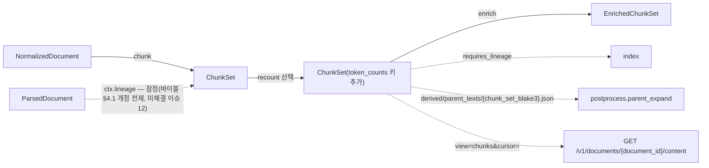
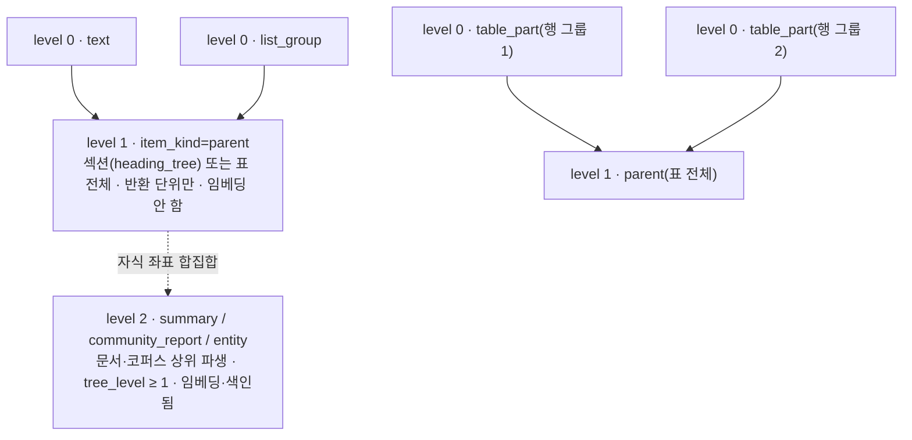
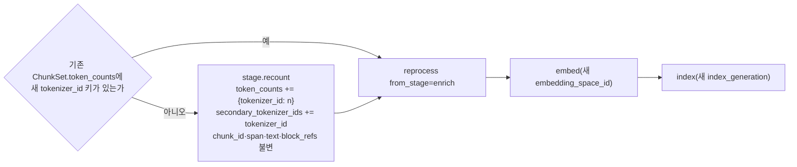

# ChunkSet 계약

## 목적

`ChunkSet`은 `chunk` 스테이지(및 선택 서브스테이지 `recount`)의 출력이자 `enrich`·`index`·`postprocess`·`get_document`의 입력이다(바이블 §4.2, §5.1). 한 문서 버전(`doc_version`)을 검색 단위인 청크(chunk)로 나눈 결과를 리프(level 0)·부모(level 1)·상위 파생 항목(level 2)까지 한 세트에 담고, 각 청크가 원문의 어느 블록·어느 문자 구간에서 왔는지(`block_refs`), 어떤 토크나이저로 몇 토큰인지(`token_counts`), 어떤 문맥 접두어를 갖는지(`context_prefix`)를 결정적으로 기록한다. 이 문서는 바이블 §5.4 `ChunkSet`·`Chunk` 표를 같은 철자·같은 필수 여부로 옮기고, `chunk_id` 결정식과 `span` 형식의 재현성, 좌표 기준, 표 청크·오버랩·부모/자식 불변식, `recount` 의미론, 크기 한계, 저장 규약을 확정한다. 스키마 파일 `schemas/chunk-set.schema.json`(`urn:rag:schema:chunk-set:1`)을 소유한다.

## 범위

- 포함: `ChunkSet` 최상위 필드(봉투 + 바이블 §5.4 표 전부), `Chunk`와 하위 객체(`context_prefix`, `table_ref`, `window`)의 의미 해설, `chunk_id`·`span`·`content_hash` 결정식, 오프셋 기준(§6.3), `token_counts`와 `recount`, 표 청크, 오버랩 표현, 부모/자식 불변식, 크기 한계·페이징, 산출물 저장 규약, LLM 소비 영향, JSON Schema 2020-12 전문, Pydantic v2 모델, 예시 2개, 불변식, 버전 이력.
- 제외: 청킹 알고리즘의 구현 세부와 폴백 라우팅 조건([04-pipelines/10 청킹 전략](../04-pipelines/10-chunking-strategies.md)), 접두어 조립과 `embed_text`·`index_text`([06-enriched-chunk-set](06-enriched-chunk-set.md)), `IndexRecord` 매핑([07](07-embedded-chunk-set-and-index-record.md)), 부모 확장·문장 윈도우 후처리([04-pipelines/17](../04-pipelines/17-post-processing-and-context-packing.md)), 프로파일 `ingest.chunk.*` 스키마([15](15-collection-profile-and-policy-contracts.md)).
- `Chunk`·`BlockRef`·`TokenCounts`·`ArtifactRef`·`Producer`·`Warning`·`LineageRefs`와 모든 열거(`ItemKind`, `ChunkLevel`, `TableSerialization`, `Genre`, `PiiPolicy`, `BlockSource`, `Quality`)의 스키마 정의는 `urn:rag:schema:common-types:1`의 `$defs`에 있고 [00-contract-overview](00-contract-overview.md)가 소유한다. 이 문서는 그 필드의 의미·불변식·예시의 정본이며 스키마는 `$ref`로 참조만 한다(00 §2 소유 규칙, §5).
- 상류 필드 정의는 [04-normalized-document](04-normalized-document.md) §2.1(`NormalizedDocument`)·§2.2(`HeadingNode.path`)·§2.7(`NormalizedBlock`)·§2.9(`table_cell_views`)·§3.3~§3.4(`offset_map` 정규형·`to_original`)를 따르며 바이블 §5.4 `NormalizedDocument`·`NormalizedBlock` 표와 대조했다. 청커가 구조 필드(`Block.type`·`numbering_label`·`provenance`·`table`·`caption_of`)를 읽는 `ParsedDocument`는 바이블 §5.4 `ParsedDocument`·`Block`·`TableData` 표를 정본으로 한다. 단, 청커가 `ParsedDocument`를 얻는 경로(`ctx.lineage["ParsedDocument"]`)는 바이블 §4.1 개정을 전제한 **잠정 제안**이며 확정 규약이 아니다(§1 생산 행, 미해결 이슈 12).

## 1. 파이프라인 위치와 생산·소비



| 역할 | 스테이지·소비자 | 무엇을 읽고 쓰는가 | 근거 |
|------|-----------------|--------------------|------|
| 생산 | `chunk`(`chunker` 확장 지점, in_process) | `NormalizedDocument`(입력 계약; 바이블 §4.2 `chunk` 행의 유일한 입력) → `ChunkSet`. 청커는 텍스트 뷰·`heading_tree`·`offset_map`·`table_cell_views`를 `NormalizedDocument`에서 읽는다. **잠정(바이블 §4.1 개정 전제):** 구조 필드 — `Block.type`·`numbering_label`·`provenance`(`element_path`·`page`·`bbox`·`section_index`)·`TableData`(`n_rows`·`n_cols`·`header_row_indices`·`role`·`html_ref`·`cells[].provenance`)·`caption_of` — 는 `NormalizedBlock`에 없으므로(04 §2.7) 이 문서는 청커가 `ctx.lineage["ParsedDocument"]`(셸이 입력 봉투의 `lineage_refs.parsed`에서 함께 로드)에서 읽는 것을 **제안**한다. 현행 정본은 `requires_lineage`를 `index`만 쓴다 — 바이블 §4.1("그 외 스테이지는 없음")·§4.2 `chunk` 행(입력 `NormalizedDocument`만)·00 §3.2 `chunk` 행(`requires_lineage` `—`). 따라서 이 경로는 00 §3.2 `chunk` 행 → 바이블 §4.1·§4.2 `chunk` 행 patch(미해결 이슈 12; 04 미해결 이슈 1과 공동)가 확정되기 전까지 계약상 확정 사실이 아니며, §4.3·§5 규칙 3·4·§7·C-11·C-12의 계보 검증도 같은 전제 위에 있다. 기본 플러그인 `chunker.structure_aware`, 폴백 `chunker.flat_text`, 2차 `chunker.docling_hybrid_adapter`(`[docling-chunker]` extra) | 바이블 §4.1, §4.2, §7.1; 00 §3.2; 04 §1·미해결 이슈 1; [ADR-0020](../06-adr/0020-default-chunker-structure-aware-and-dependency-locks.md) |
| 생산(선택) | `recount`(`chunker` role `token_counter`) | `ChunkSet` → `ChunkSet`. 임베더 교체로 `token_counts`에 새 `tokenizer_id`가 없을 때만, `reprocess.document.v1`에서만 실행(재청킹 아님) | 바이블 §4.2, §11.2, §14; [ADR-0019](../06-adr/0019-chunk-size-tokenizer-defaults-and-recount-stage.md) |
| 소비 | `enrich` | 모든 청크의 `text`·`lexical_text`·`context_prefix`로 `embed_text`·`index_text` 조립, 키워드·엔티티 추출. `EnrichedChunkSet.chunk_set_ref`로 본문을 참조(복제 없음) | 바이블 §4.2, §5.4 `EnrichedChunkSet` |
| 소비 | `index`(`requires_lineage`) | `IndexRecord`의 원천 CS 열(`chunk_id`, `item_kind`, `level`, `parent_chunk_id`, `ordinal`, `text`, `context_prefix`, `block_refs`, `sentence_spans`, `table_ref`, `heading_path`, `page_start/page_end`, `text_source`, `ocr_confidence_min`, `content_hash`, `token_count_primary`, `analyzer_id`, `dictionary_hash`, `pii_policy_applied`, `chunk_set_blake3`)과 부모 텍스트 번들 생성 | 바이블 §4.1, §5.4 `IndexRecord`, §13.2 |
| 소비 | `postprocess.parent_expand` | `ChunkSet` 자체가 아니라 `index`가 저장한 부모 번들 `derived/parent_texts/{chunk_set_blake3}.json`을 `ChunkTextStore`로 읽는다(PG·산출물 전체 로드 미의존) | 바이블 §8.2, §13.2; [ADR-0034](../06-adr/0034-retrieval-hot-path-postgres-independence-and-hydrate.md) |
| 소비 | `get_document`(`GET /v1/documents/{document_id}/content?view=chunks&cursor=`, MCP `get_document(view, cursor)`) | ACL 필터 뒤 `chunks[]`를 커서 페이징으로 노출(§10) | 바이블 §14 |
| 이벤트 | `chunk`(·`recount`) 래퍼 `commit_stage` | `ingest.document.chunked` — `data`는 `IngestStageEventData`(`stage=chunk`; `job_id, document_id, stage, doc_version, quality, artifact_blake3, stage_key` + `collection_id, size_bytes, warning_count`) + 스테이지 계수 `chunk_count, parent_count, chunker_config_hash, cache_hit`. `chunk_set_id`·`stats` 객체·`ArtifactRef`·본문은 들어가지 않는다(산출물은 `artifact_blake3`·`stage_key`로 가리킨다) | 바이블 §5.7 이벤트 카탈로그; [12](12-jobs-events-and-status.md) §6.1 이벤트 표·`$defs/IngestStageEventData` |

## 2. 계층 모델: level과 item_kind



| `level` | `item_kind` | 의미 | 임베딩·색인 | 직접 검색 후보 |
|---------|-------------|------|-------------|----------------|
| 0 | `text`, `list_group`, `code`, `table`, `table_part`, `figure`, `page_image` | 리프. 임베딩·색인 단위. `IndexRecord` 1개 = 리프 1개(세대별) | 예 | 기본 전략 필터 `item_kinds = [text, list_group, code, table, table_part, figure]`, `level_in=[0]`; `page_image`는 `visual_pages` 전략만 |
| 1 | `parent` | 부모. `heading_tree` 섹션(또는 표 전체) 단위. `parent_expand`(small-to-big)의 반환 단위 | **아니오**(불변식 (5)) | 아니오. 후처리로만 등장(`RankedResult.record_id = null ⇔ item_kind = parent`) |
| 2 | `summary`, `community_report`, `entity` | 문서·코퍼스 상위 파생 노드. RAPTOR 요약 노드는 `level=2`·`tree_level ≥ 1` | 예(색인 대상) | `tree_collapsed`(`level_in=[0, 2]` + `summary`), `graph_*`(`community_report`·`entity`)에서만 |

- 정본: 바이블 §5.4 `ChunkSet` 계층 서술, §5.7 `ItemKind`·`ChunkLevel`, §10.2 전략 필터. ACL은 **문서 단위**(`SourceDocument.acl` 하나)이며 모든 레벨이 상속하므로 부모 확장으로 권한이 상승하지 않는다(§10.1). `ChunkSet`에는 ACL 필드가 없고 `lineage_refs.source`로 도달한다(00 §1.5).
- **결정:** 표가 `table_row_group_tokens`를 넘어 둘 이상의 `table_part`로 나뉘면 청커는 표 전체 직렬화를 `text`로 갖는 `level=1`·`item_kind=parent` 청크(표 부모)를 만들고 조각들을 그 자식으로 둔다. 표 부모는 `table_ref`(데이터 행 전체 `row_range`·`col_range`, §3.7)를 가지며 `parent_expand`의 "표 전체 + 캡션"(바이블 §8.2)의 원천이다. 한 조각으로 끝나는 표는 `item_kind=table` 리프이고 섹션 부모의 자식이다([ADR-0020](../06-adr/0020-default-chunker-structure-aware-and-dependency-locks.md) 표 행 그룹 행); 이때 섹션 부모의 `text`에 표 직렬화가 들어가므로 재구성 검증은 §5 규칙 3·5의 자식별 규칙을 따른다. level 2 항목의 생산 주체와 `ChunkSet` 포함 시점은 바이블이 확정하지 않았으므로 스키마는 수용만 하고(`stats.summary_count`, `tree_level`) 규약은 미해결 이슈 2로 남긴다.

## 3. 필드 정의

타입 표기는 브리프 §9.5. "필수" 열의 `Y(nullable)`은 키 존재·값 null 허용, `N`은 생략(null 금지), `조건`은 `if/then`(00 §8.1).

### 3.1 봉투(바이블 §5.2; 스키마 최상위에 직접 선언)

| 필드 | 타입 | 필수 | 설명 | 예시 |
|------|------|------|------|------|
| `schema_version` | string(semver) | Y | 계약 버전. 초기 `"1.0.0"` | `"1.0.0"` |
| `schema_type` | string | Y | 스키마 `const "ChunkSet"`. `ArtifactRef.schema_type`와 일치해야 로드(I-1) | `"ChunkSet"` |
| `tenant_id` | string(ulid) | Y | 보안 삼중항 1 | `"01J9ZQ4K7X2M8N3P5R6S7T8V9W"` |
| `collection_id` | string(ulid) | Y | 보안 삼중항 2(수집 측 단수) | `"01J9ZQ5A1B2C3D4E5F6G7H8J9K"` |
| `producer` | `Producer` | Y | 이 산출물을 **마지막으로 쓴** 스테이지의 지문. `chunk` 출력은 청커 플러그인(`producer.config_hash == chunker_config_hash`, C-16), `recount` 출력은 `token_counter` 플러그인 | 예시 1·2 |
| `quality` | enum(Quality) | Y | **결정:** `degraded ⇔ 입력 NormalizedDocument.quality == degraded ∨ warnings ≠ []`. 즉 `chunk.block_oversized`가 하나라도 있으면 `degraded`다(바이블 §4.1 부분 성공 규약 "`quality: degraded` + `warnings[]`", 04 I-19와 같은 방향; C-18). 강제 분할 자체는 오류가 아니며 잡은 계속된다 | `"full"` |
| `warnings` | array<Warning> | Y(빈 배열 허용) | `chunk.block_oversized` 등(카탈로그의 경고 코드만). `recount`는 입력 경고를 바이트 동일하게 보존한다(C-15) | `[]` |
| `created_at` | string(date-time) | Y | RFC 3339 UTC | `"2026-09-22T09:12:34.567Z"` |
| `lineage_refs` | object<string, ArtifactRef> | Y | `{source, parsed, normalized}` 세 키 필수(00 §3.2 `chunk` 행). 자기 자신(`chunk_set`) 미포함. `recount` 출력은 입력 그대로 | 예시 1 |

### 3.2 `ChunkSet`(바이블 §5.4 표 전부)

| 필드 | 타입 | 필수 | 설명 | 예시 |
|------|------|------|------|------|
| `chunk_set_id` | string(ulid) | Y | 세트 발급형 ID(§6.1). `recount`는 보존한다(같은 논리 세트) | `"01J9ZR2A3B4C5D6E7F8G9HJKMN"` |
| `document_id` | string(ulid) | Y | 봉투 스코프 문서 ID(바이블 표기는 `string`; ULID 패턴으로 좁힘, 미해결 이슈 6) | `"01J9ZQ6M0N1P2Q3R4S5T6V7W8X"` |
| `doc_version` | string(hex64) | Y | `= content_hash(원본 바이트)`([ADR-0005](../06-adr/0005-doc-version-content-hash-only-and-acl-payload-update.md)). `chunk_id` 결합식의 첫 part | `"848819e2…"` |
| `normalized_ref` | `ArtifactRef` | Y | 입력 `NormalizedDocument`(`schema_type` `const "NormalizedDocument"`). `lineage_refs.normalized`와 같은 `blake3`(C-1) | 예시 1 |
| `document_hash` | string(hex64) | Y | `= normalized_ref.blake3`(C-1) | `"7e7145a5…"` |
| `chunker_id` | string | Y | `chunker` 확장 지점의 `plugin_id`(`^chunker\.[a-z][a-z0-9_]*$`). 코어 3종 `chunker.structure_aware`, `chunker.flat_text`, `chunker.docling_hybrid_adapter` | `"chunker.structure_aware"` |
| `chunker_config_hash` | string(hex64) | Y | `H("config", canonical_json(config))`(§6.2). `chunk_id` 결합식의 두 번째 part; 프로파일 `ingest.chunk.*` 값 하나라도 바뀌면 바뀐다 | `"9aab8954…"` |
| `primary_tokenizer_id` | string | Y | 예산 토크나이저(`tokenizer_id` 문법 §6.1). 기본 `hf:BAAI/bge-m3`. 불변식 (2)의 기준. `recount`도 바꾸지 않는다 | `"hf:BAAI/bge-m3"` |
| `secondary_tokenizer_ids` | array<string> | Y | 병기 토크나이저. 기본 `["tiktoken:o200k_base"]`. **결정:** `recount`가 추가한 `tokenizer_id`도 여기에 누적한다(§6) | `["tiktoken:o200k_base"]` |
| `genre_route` | enum(Genre) | Y | 적용된 장르 규칙(`genre_rules` 키). `korean-gov`는 `law_article` 라우팅 | `"law_article"` |
| `analyzer_id` | string | Y | `NormalizedDocument.analyzer_id` 전파(`{engine}:{version}:{dictionary}`). `dictionary_hash`·`language`·`pii_policy_applied`와 함께 전파하는 이유는 `index`가 256MB 정규화 문서를 다시 읽지 않고 `IndexRecord`를 채우기 위함(바이블 §5.4 "원천 CS") | `"mecab-ko:1.3.7:ko-dic-2.1.1"` |
| `dictionary_hash` | string(hex64) | Y | `NormalizedDocument.dictionary_hash` 전파 | `"e3d5c46d…"` |
| `language` | string(bcp47) | Y | `NormalizedDocument.language` 전파 | `"ko"` |
| `pii_policy_applied` | enum(PiiPolicy) | Y | `NormalizedDocument.pii_report.policy_applied` 전파 → `IndexRecord.pii_policy_applied` | `"mask"` |
| `stats` | object | Y | `ChunkSetStats`(§3.3) | 예시 1 |
| `token_budgets` | object | N | `TokenBudgets`(§3.4). **바이블 §5.4 미등재** 선택 필드(미해결 이슈 5) | 예시 1 |
| `chunks` | array<Chunk> | Y | 리프·부모·표·요약 모두. 세트 상한 50,000(`maxItems`) | 예시 1·2 |

### 3.3 `ChunkSetStats`(`stats`; 계약 전용 하위 타입, 자기 `$defs`)

| 필드 | 타입 | 필수 | 설명 | 예시 |
|------|------|------|------|------|
| `leaf_count` | integer | Y | `level=0` 청크 수 | `2` |
| `parent_count` | integer | Y | `level=1` 청크 수 | `1` |
| `table_part_count` | integer | Y | `item_kind=table_part` 청크 수 | `0` |
| `summary_count` | integer | Y | `item_kind=summary` 청크 수(level 2) | `0` |
| `oversized_blocks` | integer | Y | `leaf_max_tokens` 초과로 강제 분할된 블록 수 = `warnings[]`의 `chunk.block_oversized` 수 | `0` |

### 3.4 `TokenBudgets`(`token_budgets`; 선택, 계약 전용 하위 타입)

| 필드 | 타입 | 필수 | 설명 | 예시 |
|------|------|------|------|------|
| `leaf_max_tokens` | integer | Y | 리프 상한(`primary_tokenizer_id` 기준). 기본 512 | `512` |
| `parent_max_tokens` | integer | Y | 부모 상한. 기본 2048 | `2048` |
| `merge_min_tokens` | integer | Y | 동일 heading 병합 하한. 기본 64 | `64` |
| `table_row_group_tokens` | integer | Y | 표 행 그룹 예산. 기본 256 | `256` |
| `fallback_max_tokens` | integer | N | `ingest.chunk.fallback.max_tokens`(기본 384). `chunker_id = chunker.flat_text`이면 불변식 (2)의 리프 상한은 `leaf_max_tokens` 대신 이 값이다 | `384` |
| `fallback_overlap_ratio` | number(0..1) | N | `ingest.chunk.fallback_overlap_ratio`(기본 0.10). `flat_text` 오버랩(§8, C-8) | `0.10` |
| `sentence_window_n` | integer | N | `ingest.chunk.sentence_window_n`(기본 2). `window.before/after_chunk_ids` 길이 상한(§3.8, C-13) | `2` |

값은 프로파일 `ingest.chunk.*`(바이블 §7.2·§7.3)의 스냅숏이며 모두 **초안 목표**다([ADR-0019](../06-adr/0019-chunk-size-tokenizer-defaults-and-recount-stage.md) M2 그리드). 있으면 불변식 (2)와 C-6·C-13을 프로파일 없이 검증할 수 있다. `chunker.flat_text` 세트는 뒤의 세 선택 필드를 함께 채운다(없으면 폴백 세트의 예산 검증은 프로파일이 필요하다).

### 3.5 `Chunk`(바이블 §5.4 표 전부; 스키마 `common-types` `$defs/Chunk`)

| 필드 | 타입 | 필수 | 설명 | 예시 |
|------|------|------|------|------|
| `chunk_id` | string(hex64) | Y | `H("chunk", doc_version, chunker_config_hash, str(level), span)` — 결정적([ADR-0004](../06-adr/0004-deterministic-chunk-id-scoped-record-id-and-ulid-exception.md)). 세트 내 유일 | `"3dfcbaa5…"` |
| `span` | string | Y | `"{first_block_id}:{char_start}-{last_block_id}:{char_end}"` — `chunk_id` 재계산 입력. 오프셋 기준은 §4.1 | `"6a4754d2…:0-6a4754d2…:116"` |
| `item_kind` | enum(ItemKind) | Y | §2 표 | `"text"` |
| `level` | integer(0..2) | Y | enum(ChunkLevel). `summary`·`community_report`·`entity`는 2, `parent`는 1, 그 외 0 | `0` |
| `parent_chunk_id` | string \| null | Y(nullable) | 같은 세트 내 `level+1` 청크. 최상위는 `null` | `"aca99e47…"` |
| `child_chunk_ids` | array<string> | 조건 | `level ≥ 1`이면 필수. 자식 `ordinal` 순 | `["3dfcbaa5…", "be02bd34…"]` |
| `ordinal` | integer | Y | 형제 내 0-based 연속 순서(문서 순 = 첫 `block_ref`의 문서 순). **형제 = 같은 `level`과 같은 `parent_chunk_id`(`null` 포함)를 갖는 청크**. 따라서 `parent_chunk_id = null`인 level 1 부모들(섹션 부모·표 부모 혼합)은 서로 형제이고, 무부모 level 0 리프·level 2 항목은 각자 별도 형제 집합이다. 계약 인스턴스는 완전 세트이므로 최상위 청크가 하나면 `ordinal = 0`(C-3) | `0` |
| `text` | string | Y | `display_text` 조각(NFC), **접두어 미포함**(3-텍스트 규칙, [ADR-0029](../06-adr/0029-three-text-rule-and-deterministic-context-prefix.md)). 표는 `table_ref.serialization` 직렬화(§7; 셀 텍스트 원천은 `table_cell_views[].display_text`). `level ∈ {0, 1}`이면 비어 있지 않다(C-19) | 예시 1 |
| `lexical_text` | string | Y | `lexical_text` 조각(NFKC). BM25·sparse 입력 원료. 표는 `triplet` 직렬화(§7; 셀 텍스트 원천은 `table_cell_views[].lexical_text`) | 예시 1 |
| `heading_path` | array<string> | Y | 루트→현재 heading 텍스트. **결정:** 문서 제목(heading `level 0`)은 제외한다(제목은 `context_prefix`·`IndexRecord.title`이 따로 나른다). 유도식은 §9: 청크의 첫 블록을 포함하는 가장 안쪽 `heading_tree` 노드 `node`에 대해 `heading_path = node.path[1:]`(`heading_tree`에 `level 0` 노드 `T`가 있고 `node.path[0] == T.path[0]`일 때) 또는 `node.path`(그 외); 어떤 heading 아래에도 없으면 `[]`(04 §2.2 `HeadingNode.path`는 제목을 `path[0]`에 포함한다) | `["제2장 정보보호 관리", "제5조(위험평가)"]` |
| `numbering_path` | array<string> | N | heading 경로의 `Block.numbering_label` | `["제2장", "제5조"]` |
| `block_refs` | array<BlockRef> | Y | 오프셋은 `text`(display) 기준, 합집합이 `text`를 재구성(§5). `original_char_*`는 `offset_map` 사상 원문 오프셋. `level ∈ {0, 1}`은 1개 이상 | 예시 1 |
| `sentence_spans` | array<[integer, integer]> | Y | `text` 기준 문장 구간(끝 미포함). 인용 `segments`·문장 윈도우 원천. 표는 행 단위 줄 범위(§7) | `[[0, 116]]` |
| `token_counts` | `TokenCounts` | Y | `{tokenizer_id: integer}`. 키 집합 = `{primary_tokenizer_id} ∪ secondary_tokenizer_ids`(C-6) | `{"hf:BAAI/bge-m3": 72, "tiktoken:o200k_base": 119}` |
| `lang` | string(bcp47) | Y | 포함 블록 `NormalizedBlock.lang` 중 코드포인트 수 최다 언어(동률은 문서 `language`) | `"ko"` |
| `table_ref` | object | 조건 | `item_kind ∈ {table, table_part}`이면 필수(§3.7). 표 부모(level 1)는 선택적으로 가진다 | 예시 2 |
| `window` | object | N | `{before_chunk_ids[], after_chunk_ids[]}`(§3.8). `chunker.flat_text`만 채운다 | — |
| `context_prefix.deterministic` | string | Y | `"{title} › {heading_path 조인} › {caption?}"` 50~100토큰(초안 목표). `text`에 포함되지 않는다(불변식 (3)) | 예시 1 |
| `context_prefix.generated` | string \| null | Y(nullable) | LLM 문맥(O-05, 기본 null). **결정:** `chunk`·`recount`가 쓰는 `ChunkSet`에서는 항상 `null`(§9) | `null` |
| `context_prefix.generated_by` | string \| null | Y(nullable) | `{model_id}@{revision}`. `generated`와 함께 null 또는 함께 non-null(C-14) | `null` |
| `tree_level` | integer | N | RAPTOR 트리 깊이(리프 0). level 2 요약 노드는 ≥ 1 | — |
| `page_image_ref` | `ArtifactRef` | N | `visual-pages` 페이지 이미지(`item_kind=page_image`) | — |
| `text_source` | enum(BlockSource) | Y | 포함 블록 `text_source`의 최저 신뢰 등급(신뢰 순 `text_layer > converted > vlm > ocr`; OCR 블록이 하나라도 있으면 `ocr`) | `"text_layer"` |
| `ocr_confidence_min` | number \| null | Y(nullable) | 포함 블록 `confidence` 최소값. `text_source ∈ {ocr, vlm}`이면 non-null | `null` |
| `content_hash` | string(hex64) | Y | `blake3_hex(utf8(text))` — 라벨 없음(§6.2). 변경 감지·`dedup` 1차 키 | `"64f2d539…"` |

### 3.6 `BlockRef`(00 §4.18 소유; 이 문서는 사용 규칙만)

| 필드 | 타입 | 필수 | 설명 | 예시 |
|------|------|------|------|------|
| `block_id` | string(hex32) | Y | `NormalizedBlock.block_id` = `Block.block_id` | `"6a4754d2…"` |
| `element_path` | string | Y | `Block.provenance.element_path` 복사(문서 내 유일) | `"/hp:sec[0]/hp:p[41]"` |
| `char_start`, `char_end` | integer | Y | **`Chunk.text` 기준** 코드포인트, 끝 미포함 | `0`, `116` |
| `original_char_start`, `original_char_end` | integer | Y | **원문 `Block.text` 기준**(바이블 §5.3 `BlockRef` 행, §6.3; 모든 청크 종류 공통). 텍스트 ref는 `= to_original(display 구간)` — 조각의 display 구간(`NormalizedBlock.display_text` 좌표)을 04 §3.4 `to_original`로 사상한 값이며 `offset_map`은 04 §3.3 정규형(M1~M6)을 따른다. 표 청크(재직렬화 ref)는 `row_range`의 데이터 행이 원문 선형화 `Block.text`(03 §6)에서 차지하는 구간(§5 규칙 4); 어댑터가 선형화를 생략해 `Block.text == ""`인 표만 `0, 0`. `Provenance` 생성용 | `0`, `116` |
| `page`, `bbox` | integer \| null / array<number>[4] \| null | Y(nullable) | 블록 값 복사. 흐름 포맷(HWPX·DOCX·HTML·MD)은 `null` | `null`, `null` |
| `section_index` | integer \| null | N | HWPX 구역 인덱스 | `0` |

### 3.7 `Chunk.table_ref`

| 필드 | 타입 | 필수 | 설명 | 예시 |
|------|------|------|------|------|
| `table_block_id` | string(hex32) | Y | 표 `Block.block_id`(`type=table`) | `"0e8c82cd…"` |
| `header_row_indices` | array<integer> | Y | `TableData.header_row_indices` 복사. 모든 조각의 `text`에 반복된다 | `[0]` |
| `row_range` | [integer, integer] | Y | 청크가 담는 **데이터 행**의 `TableData` 격자 행 인덱스 `[start, end)`(0-based, 끝 미포함). **결정:** 의미는 `item_kind`와 무관하게 하나다 — `header_row_indices`의 행은 어떤 청크의 `row_range`에도 포함되지 않는다(헤더는 별도 필드로 나르고 `text`에 반복된다). 조각은 자기 데이터 행 구간, 단일 `table`·표 부모는 `[first_data_row, n_rows)`(`first_data_row` = 헤더가 아닌 첫 행; 헤더 없는 표는 `0`). `pack`이 HTML을 슬라이스할 때 조각·부모 모두 "헤더 행 + `row_range`"로 같은 규칙을 쓴다 | `[1, 4]` |
| `col_range` | [integer, integer] | Y | 열 범위 `[start, end)`. 기본 청커는 열 분할을 하지 않으므로 `[0, n_cols)` | `[0, 5]` |
| `serialization` | enum(TableSerialization) | Y | `text`의 직렬화. 기본 `markdown`(§7; ADR-0020의 표시 1차 `html`은 `html_ref`가 담당) | `"markdown"` |
| `html_ref` | `ArtifactRef` \| null | Y(nullable) | `TableData.html_ref` 복사(표 **전체** HTML 파생물; 팩 `tables[].html` 원천). 파서가 HTML을 내지 않으면 `null` | 예시 2 |

### 3.8 `Chunk.window`

| 필드 | 타입 | 필수 | 설명 | 예시 |
|------|------|------|------|------|
| `before_chunk_ids` | array<string> | Y | 문서 순으로 앞선 리프 `chunk_id`(가까운 순), 최대 `sentence_window_n` | `[]` |
| `after_chunk_ids` | array<string> | Y | 뒤따르는 리프 `chunk_id`, 최대 `sentence_window_n` | `[]` |

`window`는 `chunker.flat_text`(폴백; `sentence_window_n` 기본 2)가 채우고 `postprocess.sentence_window`가 인접 청크의 가장자리 문장을 붙일 때 쓴다(바이블 §8.2). 구조 청커는 heading 경계가 문맥 경계라 채우지 않는다. 참조 대상은 같은 세트의 `level=0` 청크여야 한다(C-13).

## 4. 식별자와 재현성

### 4.1 `chunk_id` 결정식과 `span`

**결정:** `chunk_id = H("chunk", doc_version, chunker_config_hash, str(level), span)`, `H(label, *parts) = blake3_hex(utf8(label) + 0x1F + 0x1F.join(utf8(part)))`, 소문자 hex 64자(바이블 §6.2; [ADR-0004](../06-adr/0004-deterministic-chunk-id-scoped-record-id-and-ulid-exception.md)). `span`은 `"{first_block_id}:{char_start}-{last_block_id}:{char_end}"`(스키마 `$defs/ChunkSpan`, `^[0-9a-f]{32}:[0-9]+-[0-9a-f]{32}:[0-9]+$`)이며 청크의 `block_refs`에서 다음 규칙으로 결정적으로 유도된다.

| 청크 종류 | `span` 유도 규칙 | 이유 |
|-----------|------------------|------|
| 일반 청크(`table_ref` 없음, `level ∈ {0, 1}`) | `block_refs`를 `char_start` 오름차순으로 정렬한 뒤 `first = block_refs[0]`, `last = block_refs[-1]`; `span = f"{first.block_id}:{first.original_char_start}-{last.block_id}:{last.original_char_end}"` | 오프셋은 **원문 `Block.text` 기준**(`original_char_*`)이다. `BlockRef.char_*`는 `Chunk.text` 상대 오프셋이라 한 블록을 셋으로 나눈 조각 2·3이 같은 `span`을 갖는 충돌이 생기고, display 기준 블록 내 오프셋은 `BlockRef`에 저장되지 않는다. 원문 기준은 `BlockRef`만으로 재계산 가능하고 정규화 규칙 변경에 불변이다 |
| 표 청크(`table_ref` 있음) | `n_cols = TableData.n_cols`(기본 청커는 열 분할을 하지 않으므로 `col_range[1]`과 같다); `start = row_range[0] * n_cols + col_range[0]`, `end = (row_range[1] - 1) * n_cols + col_range[1]`; `span = f"{table_block_id}:{start}-{table_block_id}:{end}"`. `row_range`는 §3.7의 격자 행 인덱스(헤더 행 제외)이므로 헤더 1행 표의 첫 조각·표 부모는 `start = n_cols`에서 시작한다 | 표 블록의 원문 `text`는 `""`일 수 있어 문자 오프셋으로는 행 그룹을 구분할 수 없다. 셀 격자의 선형 인덱스(행·열 반개구간)는 행 분할과 열 분할 모두에서 단사(injective)이며 `ChunkSpan` 패턴을 그대로 만족한다 |
| level 2 파생 항목 | 자식(또는 하위 리프) 좌표 합집합의 첫 블록·마지막 블록으로 일반 규칙을 적용한다. `text`가 생성물이라 재구성 불변식은 면제(00 U-11) | 규약은 미해결 이슈 2에서 확정 |

바이블 §6.2는 `span`의 오프셋 기준을 명시하지 않으므로 이 규칙은 바이블 patch 제안(미해결 이슈 1)이다. 라벨 문자열·`str(level)`·`span` 형식·`canonical_json` 규칙 중 하나라도 바뀌면 모든 `chunk_id`가 바뀌므로 바이블 §1.2 major 절차와 전면 재색인을 요구한다(ADR-0004 결과).

### 4.2 관련 해시

| 키 | 식(바이블 §6.2) | 이 계약에서의 위치·역할 |
|----|-----------------|------------------------|
| `doc_version` | `blake3_hex(원본 바이트)` | `ChunkSet.doc_version`; `chunk_id` part 1 |
| `block_id` | `H("block", doc_version, element_path)[:32]` | `BlockRef.block_id`, `table_ref.table_block_id`, `span` |
| `chunker_config_hash` | `H("config", canonical_json(config))` | `ChunkSet.chunker_config_hash`; `chunk_id` part 2; `chunk` 지문 구성 |
| `content_hash`(청크) | `blake3_hex(utf8(Chunk.text))` — 라벨 없음 | `Chunk.content_hash`; `dedup` 1차, `commit_hash` 입력, 정합성 검사 |
| `stage_key`(`chunk`) | `H("stage", "chunk", scope_key, normalized.blake3, fingerprint)`, `fingerprint`에 `chunker_config_hash`·`primary_tokenizer_id` 포함 | 산출물 경로(§11); 같은 문서·같은 입력·같은 지문이면 재실행 생략(`cache_hit`) |
| `stage_key`(`recount`) | `H("stage", "recount", scope_key, chunk_set.blake3, tokenizer_id)` | 같은 `tokenizer_id` 재실행은 캐시 적중 |
| `chunk_set_blake3` | `ArtifactRef.blake3`(저장 바이트) | 부모 번들 키 `derived/parent_texts/{chunk_set_blake3}.json`, Valkey `ptxt:{tenant_id}:{chunk_set_blake3}`, `IndexRecord.chunk_set_blake3` |
| `record_id` / `point_id` | `H("record", tenant_id, collection_id, document_id, str(index_generation), chunk_id)` / `uuid5(NAMESPACE_RAG_CHUNK, record_id)` | `index`가 계산. `ChunkSet`에는 없다(스코프·세대는 `index` 단계 정보) |

### 4.3 재현성과 테스트 벡터

- 같은 `NormalizedDocument` 바이트(따라서 같은 `lineage_refs.parsed`)·같은 `chunker_config_hash`·같은 `primary_tokenizer_id`는 `chunk_set_id`·`created_at`·`producer.plugin_version`을 제외하고 바이트 동일한 `ChunkSet`을 낸다(적합성 키트 `contract_roundtrip`·`idempotency`, ADR-0020). 청커는 `ctx.token_counter`·`ctx.analyzer`·`ctx.lineage["ParsedDocument"]`(잠정, §1)만 쓰고 I/O·시간·난수를 쓰지 않는다(바이블 §4.1; `ParsedDocument`는 `NormalizedDocument.parsed_ref`가 고정하므로 결정성을 해치지 않는다).
- `chunk_id`는 토큰 수·접두어·테넌트·컬렉션·세대에 독립이다. 임베더 교체(`recount`), 접두어 정책 변경(`enrich` 재실행), 재색인(새 `index_generation`)은 `chunk_id`를 바꾸지 않는다. 바뀌는 것은 `chunk.*` 프로파일 값 변경(`chunker_config_hash`) 또는 문서 바이트 변경(`doc_version`)뿐이다.
- ADR-0004의 고정 벡터(적합성 키트 `tests/contracts`)를 그대로 쓴다. 이 벡터는 일반 청크 규칙(§4.1)의 `original_char_start=0`, `original_char_end=120`인 리프에 해당한다.

| 항목 | 값 |
|------|----|
| `doc_version` | `4cf93d9ac740c93929421079b0ef91b9a703c978df6d7a637c8d2093c368565b` |
| `element_path` → `block_id` | `/body/sec[0]/p[3]` → `650f72efde5deeab20165112e8387e22` |
| `canonical_json(config)` → `chunker_config_hash` | `{"leaf_max_tokens":512,"merge_min_tokens":64,"parent_max_tokens":2048}` → `149c63fad1744e0bc73c8ac4562d8fdc59f4260a4650a726dd1ae086fb635c97` |
| `level`, `span` | `0`, `650f72efde5deeab20165112e8387e22:0-650f72efde5deeab20165112e8387e22:120` |
| `chunk_id` | `7694bf848e17bb681a9b737256cf4a824412fa1dac61e29003b46fb39cf43e0a` |

## 5. 좌표: `block_refs`·`sentence_spans`·오프셋 기준(바이블 §6.3)

| 필드 | 기준 문자열 | 단위 | 소비자 |
|------|-------------|------|--------|
| `BlockRef.char_start/char_end` | `Chunk.text`(display, NFC) | 유니코드 코드포인트, 0-based, 끝 미포함 | 재구성 검증, `IndexRecord.text` 절단 시 재계산, `ContextItem.segments` |
| `BlockRef.original_char_start/original_char_end` | 원문 `Block.text`(표 블록은 03 §6 선형화 문자열) | 동일 | `Provenance` 생성(`hydrate`·`pack`이 `offset_map` 없이 `block_refs → Provenance`), `answer_spans` 평가 |
| `sentence_spans[i]` | `Chunk.text` | 동일 | 인용 `segments`, `sentence_window`, 표 행 단위 인용 |
| `span` | 원문 `Block.text`(§4.1) | 동일 | `chunk_id` 재계산 |

**결정(재구성 규칙, 불변식 (1)의 기계적 정의):** `block_refs`를 `char_start` 오름차순으로 정렬했을 때,

1. 길이 0인 ref(`char_start == char_end`)는 좌표 전달용(그림·페이지 이미지 블록처럼 `text`가 없는 블록)이며 재구성에서 무시한다.
2. 길이가 있는 refs는 서로 겹치지 않고, 첫 ref는 `0`에서 시작하며 마지막 ref는 `len(text)`에서 끝난다. 연속한 두 ref 사이 간격은 정확히 코드포인트 1개이고 그 문자는 U+000A(블록 결합 구분자)다. 따라서 `text == "\n".join(text[r.char_start:r.char_end] for r in refs)`.
3. **텍스트 ref**(아래 4의 재직렬화 ref가 아닌 것): 조각 `text[r.char_start:r.char_end]`는 `NormalizedBlock(r.block_id).display_text`의 부분 문자열 `display_text[a:b]`이며 `[r.original_char_start, r.original_char_end) = to_original(offset_map, a, b)`다(04 §3.4; `offset_map`은 04 §3.3 정규형 M1~M6). 리프에서는 `table_ref`가 없는 모든 길이 있는 ref가 텍스트 ref다.
4. **재직렬화 ref**: 표 청크(`table_ref` 있음)는 `block_refs == [ref(table_block_id)]`, `char_start=0`, `char_end=len(text)`이고 `text == serialize(cells, table_ref)`(문자 슬라이스 아님; `cells`의 원천은 §7 "셀 텍스트 원천")로 검증한다. `[original_char_start, original_char_end)`의 기준은 텍스트 ref와 같은 **원문 `Block.text` 코드포인트**다(바이블 §5.3 `BlockRef` 행 "원문 `Block.text` 기준 오프셋", §6.3 `Provenance` 기준). 표 블록의 원문 `text`는 03 §6 선형화 문자열(앵커 셀 행 우선, 셀 U+0009·행 U+000A 구분; `Block.provenance = [0, len(text))`, `TableCell.provenance.char_*`는 그 안의 셀 구간 — 03 P-13)이므로, **표 청크의 `original_char_*`는 `row_range`의 데이터 행 × `col_range` 열에 속한 앵커 셀들이 그 문자열에서 차지하는 최소 포함 구간**이다: `original_char_start = min(cell.provenance.char_start)`, `original_char_end = max(cell.provenance.char_end)`. `TableCell.provenance`가 없으면(03 §2.8 N) 03 §6 규칙을 `TableData.cells[].text`에 적용해 같은 위치를 재계산한다(Pydantic 절 `table_original_range`). 어댑터가 선형화를 생략해 `Block.text == ""`인 표(셀 provenance `0, 0`, P-13)만 `0, 0`이며, 이 경우에 한해 ref는 좌표 전달용이고 `Provenance`는 `element_path`·`page`·`bbox`로 위치를 가리킨다. 헤더 행(`header_row_indices`)은 모든 조각의 `text`에 반복되지만 이 구간에는 넣지 않는다 — `span`(§4.1)과 같은 `row_range` 기준이며, 넣으면 같은 표의 조각들이 원문 구간을 공유해 C-8을 위반한다. 표 블록의 `NormalizedBlock.display_text`·`offset_map`은 이 선형화 문자열을 원문으로 하는 뷰이므로(04 §1) 이 값은 `to_original`이 내는 값과 같은 좌표계에 있고, `to_provenance()`는 텍스트 ref와 동일하게 03 셀 provenance·골든셋 `answer_spans`와 교차 가능한 `Provenance`를 만든다(K1). 열 분할 시 행 우선 선형화 때문에 구간이 다른 열의 셀을 포함할 수 있으나 기본 청커는 열을 나누지 않는다(`col_range = [0, n_cols)`).
5. 부모(`item_kind=parent`, `table_ref` 없음)의 `text`는 자식 리프 `text`를 `ordinal` 순으로 U+000A로 결합한 것이고 `block_refs`는 자식들의 refs를 부모 `text` 좌표로 재기준한 것이다(C-4). **자식별 검증 규칙을 상속한다**: 자식이 `table_ref`를 가지면 부모 안의 그 구간은 규칙 4(재직렬화; `original_char_*`는 자식 ref와 같은 원문 선형화 구간)로, 그 외 구간은 규칙 3으로 검증한다. 따라서 섹션 부모의 자식으로 온 단일 `table` 리프(§2 결정)는 부모 `text`에 markdown 직렬화로 들어가고, 표 블록의 `display_text`가 `""`이어도 불변식 (1)이 성립한다.
6. `level ∈ {0, 1}`인 청크의 `text`는 비어 있지 않다(`len(text) ≥ 1`, C-19). 캡션·`figure.alt_text`가 모두 없는 그림은 리프가 되지 않고 인접 텍스트 청크에 길이 0 ref(규칙 1)로만 좌표를 남긴다. 이 규칙이 있어야 규칙 2의 "간격 정확히 1"과 C-4의 U+000A 결합이 빈 `text`에서 `"\n\n"`을 만들지 않는다.

`Provenance`는 `BlockRef.to_provenance()`(00 Pydantic 절)로 생성한다: `element_path`, `char_start := original_char_start`, `char_end := original_char_end`, `page`, `bbox`, `section_index`. 흐름 포맷은 `page`·`bbox`가 `null`이며 키는 유지한다(I-6). 표 청크도 같은 식으로 변환되며 결과 `char_*`는 03 §6 선형화 `Block.text` 구간이다(규칙 4) — 03 §6이 선형화를 둔 목적(`answer_spans`·렉시컬 색인이 표 안 텍스트를 가리킴)과 정합한다.

## 6. 토큰 수와 `recount` 스테이지(ADR-0019)

| 항목 | 규약 |
|------|------|
| 예산 토크나이저 | `primary_tokenizer_id` = 프로파일 `ingest.chunk.tokenizer`(기본 `hf:BAAI/bge-m3`; `premium`은 프로파일 임베딩 모델 토크나이저). `leaf_max_tokens`·`merge_min_tokens`·`parent_max_tokens`·`table_row_group_tokens`는 모두 이 토크나이저로 판정한다(바이블 §3.2 O-09, §7.2) |
| 병기 | `secondary_tokenizer_ids`(기본 `["tiktoken:o200k_base"]`)의 카운트를 `token_counts`에 함께 기록해 OpenAI 계열 `exact_local` 팩 예산과 공급자 중립 근사치를 재계산 없이 제공한다 |
| 역할 분리 | 렉시컬 토큰화(`analyzer_id`, 형태소)는 카운터가 아니며 예산 판정에 쓰지 않는다. 리랭커 절단은 리랭커 토크나이저, 팩 예산은 대상 LLM 토크나이저가 별도로 재계산한다(이중 카운트, 바이블 §9.1) |
| `IndexRecord.token_count_primary` | `= token_counts[primary_tokenizer_id]`(패킹 사전 예산) |
| 캐시 | 토큰 카운트 Valkey `tok:{tokenizer_id}:{H(text)}` 7d(콘텐츠 해시 키, 테넌트 접두 예외; 바이블 §13.4) |

**결정(`recount` 의미론):** `recount`는 `ChunkSet → ChunkSet` 순수 변환이며 다음만 바꾼다. (a) 모든 청크의 `token_counts`에 요청한 `tokenizer_id` 키 하나를 추가한다. (b) `secondary_tokenizer_ids`에 그 `tokenizer_id`를 덧붙인다(이미 있으면 그대로) — 세트 헤더가 청크의 키 집합을 항상 서술하도록(C-6). (c) `producer`를 `token_counter` 플러그인 지문으로, `created_at`을 새 시각으로 바꾼다. (d) `chunk_set_id`·`lineage_refs`·`warnings`·`quality`·`stats`와 청크의 나머지 모든 필드는 바이트 동일하게 보존한다(C-15). `primary_tokenizer_id`와 불변식 (2)의 기준은 청킹 당시 토크나이저로 남는다(ADR-0019 결과 "부정" 둘째 항). ADR-0019는 (b)를 어느 쪽으로도 강제하지 않았으므로 이 결정은 바이블 §5.4 반영 제안(미해결 이슈 5)이다.



실패: 예산 토크나이저를 로드할 수 없으면 `chunk.tokenizer_missing`(비재시도, `chunk`·`recount` 공통; `StagePolicy.non_retryable_error_codes`). 카운트 결과는 저장 전에 셸이 검증하며 키 집합 위반은 `contract.violation`이다([13-error-model](13-error-model.md) §3.2).

## 7. 표 청크(`table`·`table_part`)

| 규칙 | 내용 | 근거 |
|------|------|------|
| 셀 텍스트 원천 | **결정:** 직렬화 입력 `cells[r][c]`는 `NormalizedDocument.table_cell_views[]`(04 §2.9; `(block_id, row, col)`이 앵커 셀과 1:1)의 `display_text`(→ `text`)·`lexical_text`(→ `lexical_text`)다. 뷰가 없는 표는 `pii_policy_applied = keep`일 때만 `TableData.cells[].text`에 NFC(→ `text`)·04 §3.2 렉시컬 규칙(→ `lexical_text`)을 적용해 쓸 수 있다. `pii_policy_applied ≠ keep`인데 뷰가 없으면 표 청크 `text`가 04 I-11(원문 PII 문자열 미포함)을 만족함을 보장할 수 없으므로 청커는 `contract.violation`으로 실패한다(셸 검증; 04 미해결 이슈 2 연계 — 미해결 이슈 13) | 04 §2.9·I-11·I-22; 바이블 §5.4 `NormalizedBlock` 불변식, `pii_report.policy_applied` 전파 |
| 분할 단위 | 데이터 행(`header_row_indices`에 없는 행)을 문서 순으로 묶되 그룹의 `token_counts[primary]`(헤더 행 포함)가 `table_row_group_tokens`(256, 초안 목표)를 넘지 않게 한다. 한 행이 예산을 넘으면 그 행 하나가 한 그룹이 되고 `chunk.block_oversized` 경고를 남긴다. 병합 셀은 앵커 행 기준으로 그룹에 속하며 그룹 경계에서 `row_span`이 잘리지 않도록 경계를 뒤로 민다 | D-19, 바이블 §7.2; ADR-0020 |
| 헤더 반복 | `header_row_indices`의 행을 모든 조각·단일 `table`·표 부모의 `text`·`lexical_text`(triplet의 열 헤더) 앞에 반복한다(초과 시에도 생략하지 않음). `row_range`는 데이터 행만 담으며 헤더 행 인덱스를 포함하지 않는다(§3.7, C-12) | 바이블 §5.4 `TableData.header_row_indices` |
| `item_kind` | 조각이 하나면 `table`, 둘 이상이면 각 조각은 `table_part`이고 표 부모(§2 결정)가 생긴다. `TableData.role=layout` 표는 문단으로 강등되어 `text` 청크가 된다 | 바이블 §5.7 `TableRole`; ADR-0020 (1) |
| `text` 직렬화 | `table_ref.serialization`으로 기록. **결정:** 기본 `markdown`(병합 셀은 앵커 셀 값 + 빈 셀). ADR-0020 표 행 그룹 행은 "색인 직렬화 `triplet`, 표시 `html`(1차)/`markdown`"이다 — 이 계약에서 표시 1차 HTML은 `html_ref`(무손실 표 전체 HTML → 팩 `tables[].html`, `table_format_preference`)가 담당하고, `Chunk.text`는 임베딩 입력·`IndexRecord.text`(8,192 UTF-8 바이트 한계)·행 단위 `sentence_spans`·HTML 불가 렌더러의 폴백을 겸하므로 `markdown`을 기본으로 한다. ADR-0020 문구에 이 역할 분담을 명시하는 patch는 미해결 이슈 14. 프로파일이 `html`·`row_json`을 택할 수 있다 | 바이블 §5.7 `TableSerialization`, §5.1 `IndexRecord` 한계, §7.2 `table_format_preference`; ADR-0020 표 행 그룹 행 |
| `lexical_text` 직렬화 | `triplet`: 데이터 행마다 `"{열 헤더}: {셀}"`을 `"; "`로 잇고 행은 U+000A로 구분(행 헤더가 있으면 `"{행 헤더} · {열 헤더}: {셀}"`), NFKC. 이 직렬화 종류는 계약에 기록되지 않으므로 미해결 이슈 9 | ADR-0020 "색인 직렬화 triplet" |
| `sentence_spans` | 직렬화와 무관하게 **헤더 행과 `row_range`의 각 데이터 행이 `text`에서 차지하는 구간**(행마다 하나, 문서 순). 산출 규칙: `markdown`은 각 표 줄(구분선 `\| --- \|` 줄 제외); `html`은 각 `<tr>…</tr>` 요소(태그 포함, `<table>`·`<thead>`·`<tbody>` 래퍼 제외); `row_json`은 최상위 배열의 각 원소 객체. 팩 `segments`·행 단위 인용의 원천 | 바이블 §8.2 `citation_align` "표 행을 segments[]로 확정" |
| `html_ref` | `TableData.html_ref` 복사(표 **전체**). 조각·부모의 HTML 슬라이스는 `pack`이 "헤더 행 + `row_range`"로 만든다([11](11-context-pack.md)) | 바이블 §5.4 `IndexRecord.html_ref` |
| `context_prefix` | 캡션(`caption_of` 블록 텍스트)을 `deterministic`의 마지막 요소로 붙인다 | 바이블 §5.4 `context_prefix.deterministic` |
| 세트 상한 | 조각 수가 세트 상한을 위협하면 행 그룹 예산을 확대해 재시도하고, 그래도 50,000을 넘으면 `chunk.count_exceeded`(최종 비재시도) | 바이블 §4.2 `chunk` 행 |

## 8. 오버랩과 문장 윈도우의 표현

**결정:** 오버랩은 별도 필드가 아니라 `block_refs`의 원문 구간 겹침으로 표현한다. `chunker.structure_aware`는 heading·단락·표 경계가 문맥 경계이므로 오버랩 0이며, 같은 세트의 두 `level=0` 청크가 같은 `block_id`에 대해 겹치는 `[original_char_start, original_char_end)` 구간을 갖지 않는다(C-8). 같은 표의 `table_part` 조각들도 이를 만족한다 — `original_char_*`가 각 조각의 `row_range` 데이터 행이 차지하는 선형화 구간만 담고 반복되는 헤더 행은 구간에 넣지 않기 때문이다(§5 규칙 4; 예시 2 `[32, 197)`·`[198, 337)`). `chunker.flat_text`(폴백)는 `fallback.overlap_ratio`(0.10, 초안 목표; 게이트 그리드 `{0, 0.10, 0.15}`)만큼 인접 청크의 원문 구간이 겹칠 수 있고, 겹친 텍스트는 두 청크의 `text`에 모두 나타난다. `dedup`(1차)은 `content_hash`가 다르므로 이를 중복으로 보지 않으며, 인용 좌표는 각 청크의 `block_refs`로 독립적으로 원문에 사상된다. 문장 윈도우 ±n은 `window`(§3.8)와 `sentence_spans`로 표현하고 `sentence_window` 후처리가 슬라이스한다(바이블 §3.2 O-09, §8.2).

## 9. `heading_path`·`numbering_path`·`context_prefix`와 3-텍스트 규칙

- **결정(`heading_path` 유도식):** `node` = `NormalizedDocument.heading_tree`에서 청크의 첫 블록(문서 순)을 포함하는 가장 안쪽 섹션의 `HeadingNode`(04 §2.2; `path` = 루트→현재 조상 heading `display_text`, 마지막 원소 = 그 heading, `len(path) ≤ level + 1`로 단계 생략 허용). `T` = `heading_tree`에서 `level == 0`인 첫 노드(문서 제목; 없을 수 있다). 그러면 `heading_path = node.path[1:] if (T가 있고 node.path[0] == T.path[0]) else node.path`; 청크가 어떤 heading 아래에도 없으면 `[]`; `node == T`이면 `[]`. 즉 제목 노드가 실제로 `path`의 첫 원소일 때만 제거하므로 04의 단계 생략과 제목 없는 문서에서도 결정적이다. 부모의 `heading_path`는 자식의 접두(prefix)이고(C-11), 모든 `heading_path`는 `heading_tree`의 어떤 `path`에 이 식을 적용한 결과와 같다(C-11, 계보가 있는 계약 테스트). 제외 결정은 [06](06-enriched-chunk-set.md)·[07](07-embedded-chunk-set-and-index-record.md)(`IndexRecord.heading_path` keyword 첫 2단, `FilterableField heading_path`)·ADR-0029가 제목을 `heading_path` 밖에 두는 전제와 정합한다. `numbering_path`는 같은 경로(제목 제외)의 `Block.numbering_label`이 있을 때만 채운다(`["제2장", "제5조"]`).
- `context_prefix.deterministic`은 `"{title} › {heading_path 조인} › {caption?}"`이다. `title`은 `IndexRecord.title` 대체 순서(`ParsedDocument.metadata.title` → 첫 heading `level 0` → `source_uri` 마지막 경로 요소)를 따르고 조인 구분자는 ` › `(U+203A)다. 50~100토큰 상한 초과 시의 결정적 축약 규칙(5단계)은 [06 §3](06-enriched-chunk-set.md)이 확정했고 청커가 그 규칙을 적용해 값을 만든다(`enrich`는 재계산하지 않는다; ADR-0029 위임 항목).
- 3-텍스트 규칙(K2, [ADR-0029](../06-adr/0029-three-text-rule-and-deterministic-context-prefix.md)): `Chunk.text`는 접두어·가상 질문·요약을 포함하지 않는 표시 원문이고, `embed_text = deterministic + "\n" + (generated + "\n")? + text`·`index_text = prefix(lexical) + "\n" + lexical_text`는 `enrich`가 `Enrichment`에 조립한다. 따라서 `context_prefix.*`는 `text`의 부분 문자열이 아니어야 하며(불변식 (3)), `content_hash`·`chunk_id`·좌표는 접두어와 무관하다.
- **결정:** `chunk`·`recount`는 LLM을 호출하지 않으므로 이 두 스테이지가 쓰는 `ChunkSet`의 `context_prefix.generated`·`generated_by`는 항상 `null`이다(C-14). LLM 생성 접두어(O-05, 기본 끔)는 [06 §2.4](06-enriched-chunk-set.md) `EnrichedChunkSet.generated_prefixes[chunk_id]`(N; `{generated, generated_by, cache_hit}`)에 기록되고 `Enrichment.embed_text`의 `generated` 구간이 정본이다(미해결 이슈 3). `chunker` 플러그인이 스스로 non-null 값을 쓰는 것을 스키마는 막지 않지만 코어 청커는 쓰지 않는다.

## 10. 크기 한계·대형 데이터·페이징

| 항목 | 한계 | 초과·위반 시 | 근거 |
|------|------|--------------|------|
| 인라인 | **참조만**. API 응답·이벤트·로그에 `ChunkSet` 본문을 넣지 않고 `ArtifactRef`로 가리킨다 | `contract.violation` | 바이블 §5.1, 00 §8.4 |
| 청크 수 | `chunks` ≤ 50,000(`maxItems`) | 행 그룹 확대 후 재시도, 최종 `chunk.count_exceeded`(비재시도) | 바이블 §5.1, §4.2 |
| 산출물 바이트 | 바이블은 청크 수만 정한다. 이 문서는 상류와 같은 256MB를 **초안 목표**로 제안한다(청크당 평균 3~5KB × 50,000 ≈ 150~250MB) | `ArtifactRef.size_bytes` 대조(I-3) | 미해결 이슈 7 |
| 리프 `text` | `ChunkSet`에는 상한이 없다(`leaf_max_tokens` 512가 실질 상한). `IndexRecord.text`는 8,192 UTF-8 바이트에서 문장 경계로 절단되고 정본은 `ChunkSet`이다 | 07 문서 `text_truncated` | 바이블 §5.4 `IndexRecord.text` |
| 부모 텍스트 | `parent_max_tokens` 2048(예산 토크나이저) + 바이트 안전 상한 32,768(팩) | 확장 취소 | 바이블 §9.1 |
| 경계 페이로드 | 오케스트레이터를 넘는 값은 `ArtifactRef` 1개(Temporal 2MB) | `contract.violation` | 바이블 §4.1 |
| 페이징 | 산출물 자체는 페이징하지 않는다(계약 인스턴스 1개 = JSON 객체 1개). `GET /v1/documents/{document_id}/content?view=chunks&cursor=`와 MCP `get_document(view="chunks", cursor)`는 `chunks[]`를 문서 순(`level`, `ordinal`)으로 불투명 커서 페이징해 노출하며 페이지 크기는 [05-api/04](../05-api/04-management-api.md)가 정한다. `index`는 세트 전체를 한 번에 로드하고(50,000 × ~5KB는 워커 메모리 내), `postprocess`는 부모 번들만 읽는다 | `api.cursor_invalid`(13 제안 코드, 채택 전 `contract.violation`) | 바이블 §14, [13](13-error-model.md) §3.3 |

빈 문서(`chunks: []`)는 스키마상 허용된다(모든 블록이 `furniture`·`boilerplate`인 경우). 이때 `quality`·`warnings`로 상태를 전달할 전용 경고 코드가 카탈로그에 없다(미해결 이슈 7).

## 11. 산출물 저장 규약

| 항목 | 규약 |
|------|------|
| 오브젝트 키 | `tenants/{tenant_id}/artifacts/chunk-set/{stage_key[:2]}/{stage_key}.json`(바이블 §13.3). `stage_key`는 §4.2의 `chunk` 또는 `recount` 식이며 잡 스코프(`tenant_id/collection_id/document_id`)를 포함한다([ADR-0037](../06-adr/0037-artifact-cache-scope-and-stage-key-composition.md)) |
| 콘텐츠 해시 | `ArtifactRef.blake3` = 저장된 산출물 바이트의 BLAKE3, `size_bytes` = 그 크기(00 §9.2, I-3). 이 값이 `chunk_set_blake3`로 부모 번들·Valkey `ptxt:`·`IndexRecord.chunk_set_blake3`의 키가 된다. 같은 `chunk_id` 집합이라도 `chunk_set_id`·`created_at`이 다르면 `blake3`가 달라지므로 캐시 판정은 경로(`stage_key`)로 한다 |
| 직렬화 | UTF-8, BOM 없음, `ensure_ascii=false`, `Y(nullable)` 키 유지, `N` 필드 중 `None`만 제거(00 §8.1·§8.3) |
| 압축 | 저장 계층 압축(zstd 등)은 **미정**(00 U-4). 확정 전 셸은 무압축으로 저장하며, 압축 도입 시 `ArtifactRef.content_encoding`(N) 추가와 함께 적용한다 |
| 미디어 타입 | `application/vnd.rag.chunk-set+json`(바이블 §6.4). `ArtifactRef.schema_type = "ChunkSet"`, `schema_version = "1.0.0"`이 함께 존재해야 한다(I-2) |
| 파생물 | 부모 텍스트 번들 `tenants/{tenant_id}/derived/parent_texts/{chunk_set_blake3}.json`은 `index`가 생성한다(`{parent_chunk_id: {text, heading_path, numbering_path, token_counts, block_refs, sentence_spans, text_source, ocr_confidence_min, page_start, page_end}}`, 바이블 §13.2). 번들에는 ACL이 없다 |
| 계보 | `lineage(child_ref, parent_ref, stage_key, job_id, produced_at)`를 산출물 저장과 같은 트랜잭션에 기록(바이블 §4.1) |

## 12. LLM 최종 소비에 미치는 영향

| 관심사 | `ChunkSet`이 보장하는 것 | 하류 |
|--------|--------------------------|------|
| provenance·인용 가능성(K1) | `block_refs`의 `original_char_*`·`element_path`·`page`·`bbox`가 `ContextItem.provenance[]`로 결정적으로 변환되고(표 청크는 03 §6 선형화 원문 구간, §5 규칙 4), `sentence_spans`가 문장·표 행 단위 `segments[]`가 된다. 인용 ID `d1..dK`는 이 좌표 위에서 렌더된다 | `hydrate` → `pack.citation_align` → 렌더러(`search_result`·`document` + `citations`) |
| 3-텍스트 규칙(K2) | `text`에 접두어·요약이 없으므로 LLM은 원문만 보고, 문맥은 `context_prefix`(헤더 `title › section_path`)로 한 번만 받는다. 표는 `text`(markdown)와 `html_ref`(무손실 HTML)로 분리되어 `table_format_preference`에 따라 렌더된다 | `enrich`, `pack`, 렌더러 |
| 신뢰도·텍스트 출처 | `text_source`·`ocr_confidence_min`이 항목 헤더 `[ocr]`/`[vlm]`/`[converted]` 표기의 원천이다. OCR 블록이 하나라도 섞이면 `ocr`로 표시된다 | 바이블 §9.1·§9.3 |
| small-to-big | 부모(level 1)는 임베딩되지 않고 자식 적중 비율로만 확장되므로 LLM이 받는 부모 텍스트는 항상 검색된 리프와 같은 문서 ACL 아래 있다 | `parent_expand`, `ChunkTextStore` |
| 보안 삼중항 | 봉투 `tenant_id`·`collection_id`가 모든 청크의 스코프이고, ACL은 `lineage_refs.source`(`SourceDocument.acl`) 하나를 모든 레벨이 상속한다. 청크 단위 ACL은 v1 미지원이라 한 세트 안에 권한이 다른 텍스트가 섞일 수 없다 | `index`(`acl_*` 평탄화), `pack.acl_recheck` |
| 토큰 예산 | `token_counts`의 primary(임베딩)·`tiktoken:o200k_base` 병기는 사전 예산(`token_count_primary`)이며, 최종 팩 예산은 대상 LLM 토크나이저로 재계산한다(이중 카운트). `leaf_max_tokens` 512는 한국어 약 900~1,000자(초안 목표) | `pack.budget_cut` |
| 데이터 경계 | `ChunkSet`은 인젠션 판정을 하지 않는다. `risk_flags`·`risk_score`는 `enrich`가 붙이고 `pack`이 `omitted.reason=risk_flagged`로 제외한다. `Warning.message`에는 본문이 들어가지 않는다(I-16) | `enrich`, `pack` |

## 스키마

`schemas/chunk-set.schema.json`과 동일하다.

```json
{
  "$schema": "https://json-schema.org/draft/2020-12/schema",
  "$id": "urn:rag:schema:chunk-set:1",
  "title": "ChunkSet",
  "description": "chunk·recount 스테이지의 출력(바이블 §5.4). 한 문서 버전의 리프(level 0)·부모(level 1)·상위 파생(level 2) 청크를 한 세트에 담는다. Chunk·BlockRef·TokenCounts·ArtifactRef·Producer·Warning·LineageRefs와 모든 열거는 urn:rag:schema:common-types:1의 $defs를 참조하며 재정의하지 않는다. 소유 문서: docs/03-contracts/05-chunk-set.md.",
  "type": "object",
  "properties": {
    "schema_version": {
      "$ref": "urn:rag:schema:common-types:1#/$defs/Semver",
      "description": "계약 버전. 초기 \"1.0.0\"",
      "pattern": "^1.(0|[1-9]d*).(0|[1-9]d*)$"
    },
    "schema_type": {
      "const": "ChunkSet",
      "description": "PascalCase 타입명. ArtifactRef.schema_type와 일치해야 로드"
    },
    "tenant_id": {
      "$ref": "urn:rag:schema:common-types:1#/$defs/Ulid",
      "description": "보안 삼중항 1"
    },
    "collection_id": {
      "$ref": "urn:rag:schema:common-types:1#/$defs/Ulid",
      "description": "보안 삼중항 2(수집 측 단수)"
    },
    "producer": {
      "$ref": "urn:rag:schema:common-types:1#/$defs/Producer",
      "description": "이 산출물을 마지막으로 쓴 스테이지의 재현성 지문(chunk 출력은 chunker 플러그인, recount 출력은 token_counter 플러그인)"
    },
    "quality": {
      "$ref": "urn:rag:schema:common-types:1#/$defs/Quality",
      "description": "품질 삼중항 1. degraded ⇔ 입력 NormalizedDocument.quality == degraded 또는 warnings가 비어 있지 않음(C-18; 바이블 §4.1 부분 성공 규약)"
    },
    "warnings": {
      "type": "array",
      "items": {
        "$ref": "urn:rag:schema:common-types:1#/$defs/Warning"
      },
      "description": "품질 삼중항 2. chunk.block_oversized 등 경고 코드(빈 배열 허용)"
    },
    "created_at": {
      "$ref": "urn:rag:schema:common-types:1#/$defs/DateTime",
      "description": "RFC 3339 UTC"
    },
    "lineage_refs": {
      "$ref": "urn:rag:schema:common-types:1#/$defs/LineageRefs",
      "required": [
        "source",
        "parsed",
        "normalized"
      ],
      "not": {
        "anyOf": [
          {
            "required": [
              "chunk_set"
            ]
          },
          {
            "required": [
              "enriched"
            ]
          },
          {
            "required": [
              "embedded"
            ]
          }
        ]
      },
      "description": "상류 산출물 참조 {source, parsed, normalized}. 자기 자신(chunk_set)과 하류 키(enriched, embedded) 미포함(C-1, 00 I-7); recount 출력은 입력 그대로"
    },
    "chunk_set_id": {
      "$ref": "urn:rag:schema:common-types:1#/$defs/Ulid",
      "description": "세트 발급형 ID. recount는 보존한다"
    },
    "document_id": {
      "$ref": "urn:rag:schema:common-types:1#/$defs/Ulid",
      "description": "문서 ID(봉투 스코프)"
    },
    "doc_version": {
      "$ref": "urn:rag:schema:common-types:1#/$defs/Hex64",
      "description": "= 원본 바이트 content_hash(ADR-0005). chunk_id 결합식의 첫 part"
    },
    "normalized_ref": {
      "$ref": "urn:rag:schema:common-types:1#/$defs/ArtifactRef",
      "properties": {
        "schema_type": {
          "const": "NormalizedDocument"
        }
      },
      "required": [
        "schema_type",
        "schema_version"
      ],
      "description": "입력 NormalizedDocument 산출물. lineage_refs.normalized와 같은 blake3"
    },
    "document_hash": {
      "$ref": "urn:rag:schema:common-types:1#/$defs/Hex64",
      "description": "= normalized_ref.blake3"
    },
    "chunker_id": {
      "$ref": "#/$defs/ChunkerId",
      "description": "청커 플러그인 ID(코어: chunker.structure_aware, chunker.flat_text, chunker.docling_hybrid_adapter)"
    },
    "chunker_config_hash": {
      "$ref": "urn:rag:schema:common-types:1#/$defs/Hex64",
      "description": "H(\"config\", canonical_json(config)). chunk_id 결합식의 두 번째 part"
    },
    "primary_tokenizer_id": {
      "$ref": "urn:rag:schema:common-types:1#/$defs/TokenizerId",
      "description": "예산 토크나이저(기본 hf:BAAI/bge-m3). 불변식 (2)의 기준"
    },
    "secondary_tokenizer_ids": {
      "type": "array",
      "items": {
        "$ref": "urn:rag:schema:common-types:1#/$defs/TokenizerId"
      },
      "uniqueItems": true,
      "description": "병기 토크나이저(기본 [tiktoken:o200k_base]). recount가 추가한 tokenizer_id도 여기에 누적된다"
    },
    "genre_route": {
      "$ref": "urn:rag:schema:common-types:1#/$defs/Genre",
      "description": "적용된 장르 규칙(genre_rules 키)"
    },
    "analyzer_id": {
      "$ref": "urn:rag:schema:common-types:1#/$defs/AnalyzerId",
      "description": "NormalizedDocument.analyzer_id 전파"
    },
    "dictionary_hash": {
      "$ref": "urn:rag:schema:common-types:1#/$defs/Hex64",
      "description": "NormalizedDocument.dictionary_hash 전파"
    },
    "language": {
      "$ref": "urn:rag:schema:common-types:1#/$defs/Bcp47",
      "description": "NormalizedDocument.language 전파(문서 주 언어)"
    },
    "pii_policy_applied": {
      "$ref": "urn:rag:schema:common-types:1#/$defs/PiiPolicy",
      "description": "NormalizedDocument.pii_report.policy_applied 전파"
    },
    "stats": {
      "$ref": "#/$defs/ChunkSetStats"
    },
    "token_budgets": {
      "$ref": "#/$defs/TokenBudgets",
      "description": "선택(N). 청킹에 적용된 토큰 예산 스냅숏(프로파일 ingest.chunk.*). 있으면 불변식 (2)·C-6을 프로파일 없이 검증할 수 있다. 바이블 §5.4 미등재(미해결 이슈 5)"
    },
    "chunks": {
      "type": "array",
      "items": {
        "$ref": "urn:rag:schema:common-types:1#/$defs/Chunk"
      },
      "maxItems": 50000,
      "description": "리프·부모·표·요약 모두. 세트 상한 50,000(초과는 chunk.count_exceeded)"
    }
  },
  "required": [
    "schema_version",
    "schema_type",
    "tenant_id",
    "collection_id",
    "producer",
    "quality",
    "warnings",
    "created_at",
    "lineage_refs",
    "chunk_set_id",
    "document_id",
    "doc_version",
    "normalized_ref",
    "document_hash",
    "chunker_id",
    "chunker_config_hash",
    "primary_tokenizer_id",
    "secondary_tokenizer_ids",
    "genre_route",
    "analyzer_id",
    "dictionary_hash",
    "language",
    "pii_policy_applied",
    "stats",
    "chunks"
  ],
  "additionalProperties": false,
  "$defs": {
    "ChunkerId": {
      "type": "string",
      "pattern": "^chunker\\.[a-z][a-z0-9_]*$",
      "description": "chunker 확장 지점의 plugin_id({extension_point}.{implementation}, 바이블 §6.1). 코어 구현 3종은 examples 참조",
      "examples": [
        "chunker.structure_aware",
        "chunker.flat_text",
        "chunker.docling_hybrid_adapter"
      ]
    },
    "ChunkSetStats": {
      "type": "object",
      "description": "세트 통계(바이블 §5.4 stats). 각 값은 chunks[]에서 재계산한 값과 같아야 한다(불변식 C-7)",
      "properties": {
        "leaf_count": {
          "type": "integer",
          "minimum": 0,
          "description": "level=0 청크 수"
        },
        "parent_count": {
          "type": "integer",
          "minimum": 0,
          "description": "level=1 청크 수"
        },
        "table_part_count": {
          "type": "integer",
          "minimum": 0,
          "description": "item_kind=table_part 청크 수"
        },
        "summary_count": {
          "type": "integer",
          "minimum": 0,
          "description": "item_kind=summary 청크 수(level 2)"
        },
        "oversized_blocks": {
          "type": "integer",
          "minimum": 0,
          "description": "leaf_max_tokens 초과로 강제 분할된 블록 수(= chunk.block_oversized 경고 수)"
        }
      },
      "required": [
        "leaf_count",
        "parent_count",
        "table_part_count",
        "summary_count",
        "oversized_blocks"
      ],
      "additionalProperties": false
    },
    "TokenBudgets": {
      "type": "object",
      "description": "청킹에 적용된 토큰 예산(primary_tokenizer_id 기준). 프로파일 ingest.chunk.* 값의 스냅숏",
      "properties": {
        "leaf_max_tokens": {
          "type": "integer",
          "minimum": 1,
          "description": "리프 상한(기본 512)"
        },
        "parent_max_tokens": {
          "type": "integer",
          "minimum": 1,
          "description": "부모 상한(기본 2048)"
        },
        "merge_min_tokens": {
          "type": "integer",
          "minimum": 0,
          "description": "동일 heading 병합 하한(기본 64)"
        },
        "table_row_group_tokens": {
          "type": "integer",
          "minimum": 1,
          "description": "표 행 그룹 예산(기본 256)"
        },
        "fallback_max_tokens": {
          "type": "integer",
          "minimum": 1,
          "description": "N. ingest.chunk.fallback.max_tokens(기본 384). chunker_id = chunker.flat_text이면 불변식 (2)의 리프 상한"
        },
        "fallback_overlap_ratio": {
          "type": "number",
          "minimum": 0,
          "maximum": 1,
          "description": "N. ingest.chunk.fallback_overlap_ratio(기본 0.10). flat_text 오버랩(§8)"
        },
        "sentence_window_n": {
          "type": "integer",
          "minimum": 0,
          "description": "N. ingest.chunk.sentence_window_n(기본 2). window.before/after_chunk_ids 길이 상한(C-13)"
        }
      },
      "required": [
        "leaf_max_tokens",
        "parent_max_tokens",
        "merge_min_tokens",
        "table_row_group_tokens"
      ],
      "additionalProperties": false
    }
  }
}
```

## Pydantic v2 모델

레퍼런스 모델은 `rag_platform.contracts.chunk_set`에 둔다. `Chunk`·`TableRef`·`ContextPrefix`·`ChunkWindow`는 **이 모듈이 정의**하고(`common-types` `$defs/Chunk`와 1:1) `rag_platform.contracts.common`이 공용 타입으로 **재노출**한다(00 Pydantic 절; 정의 위치는 이 모듈 하나다). 원시 타입(`Ulid`, `Hex64`, `Hex32`, `Semver`, `TokenizerId`, `Bcp47`, `ModelId`, `ChunkSpan` — 모두 `common-types` `$defs`, 00 소유)·`ArtifactRef`·`Producer`·`Warning`·`BlockRef`·`LineageRefs`·`ContractModel`은 00에서 임포트하고, 이 계약 전용 원시 타입은 `ChunkerId`와 `AnalyzerId`(`common-types` 등재 전 로컬, 미해결 이슈 6)만 로컬로 선언한다. 봉투 `created_at`은 `DateTime`(= `Annotated[datetime, AfterValidator(_utc)]`; 스키마 `$defs/DateTime`에 대응하는 `datetime` + UTC 검증)으로 선언해 06·07·08(`datetime` + UTC 검증기)·00(`_utc`)과 모델 타입을 맞춘다 — 00 Pydantic 절에 이 별칭이 아직 없어 로컬로 선언하며 00 등재 후 임포트로 교체한다(미해결 이슈 16). 모든 모델은 `ConfigDict(extra="forbid")`이고 `Y(nullable)` 필드는 기본값 없는 `T | None`이다. `blake3_hex`·`hash_of`(`H`)는 `rag_platform.sdk`의 단일 구현만 쓴다(ADR-0004 린트). 계보(`NormalizedDocument`·`ParsedDocument`)가 필요한 검증(§5 규칙 3·4의 텍스트·원문 구간 대조 — 표 청크는 `table_original_range`와 대조, C-11의 `heading_tree` 대조, C-12의 격자 범위·`header_row_indices` 대조)은 적합성 키트 `contract_roundtrip`에서 수행하고 아래 모델은 인스턴스 단독으로 검증 가능한 불변식만 검사한다.

```python
from __future__ import annotations

from datetime import datetime, timezone
from typing import Annotated, Literal

from pydantic import AfterValidator, Field, model_validator

from rag_platform.contracts.common import ArtifactRef, Bcp47, BlockRef, ChunkSpan, ContractModel, Hex32, Hex64, LineageRefs, ModelId, Producer, Semver, TableCell, TokenizerId, Ulid, Warning
from rag_platform.contracts.enums import BlockSource, ChunkLevel, Genre, ItemKind, PiiPolicy, Quality, TableSerialization
from rag_platform.sdk import blake3_hex, hash_of  # hash_of == H(label, *parts), 바이블 §6.2

AnalyzerId = Annotated[str, Field(pattern=r"^[a-z][a-z0-9-]*:[^:\s]+:[^\s]+$")]  # 이 계약 $defs/AnalyzerId(미해결 이슈 6)
ChunkerId = Annotated[str, Field(pattern=r"^chunker\.[a-z][a-z0-9_]*$")]  # 이 계약 $defs/ChunkerId


def _utc(value: datetime) -> datetime:
    """00 Pydantic 절 `_utc`와 동일 판정: RFC 3339 UTC(Z)만 수용(바이블 §6.3)."""
    if value.tzinfo is None or value.utcoffset() != timezone.utc.utcoffset(None):
        raise ValueError("contract.violation: datetime must be RFC 3339 UTC (Z)")
    return value


DateTime = Annotated[datetime, AfterValidator(_utc)]  # 스키마 $defs/DateTime 대응. 00 Pydantic 절 등재 전 로컬(미해결 이슈 16)


def table_original_range(block_text: str, cells: list[TableCell], row_range: tuple[int, int], col_range: tuple[int, int]) -> tuple[int, int]:
    """§5 규칙 4: row_range 데이터 행 × col_range 열의 앵커 셀이 원문 선형화 Block.text(03 §6)에서 차지하는 최소 포함 구간.

    block_text == ""(어댑터가 선형화 생략; 03 P-13)이면 (0, 0). TableCell.provenance가 모두 있으면 그 char_*(표 블록 text 기준)를 쓰고,
    없으면 03 §6 규칙(앵커 셀 행 우선, 셀 U+0009·행 U+000A — 구분자는 모두 코드포인트 1개)으로 위치를 재계산한다.
    적합성 키트 contract_roundtrip이 ParsedDocument 계보로 BlockRef.original_char_*와 대조한다.
    """
    if block_text == "":
        return (0, 0)
    sel = [c for c in cells if row_range[0] <= c.row < row_range[1] and col_range[0] <= c.col < col_range[1]]
    if not sel:
        return (0, 0)
    if all(c.provenance is not None for c in sel):
        return (min(c.provenance.char_start for c in sel), max(c.provenance.char_end for c in sel))
    pos: dict[tuple[int, int], tuple[int, int]] = {}
    cursor, first = 0, True
    for row, col, text in sorted((c.row, c.col, c.text) for c in cells):  # 행 우선(앵커 셀만)
        if not first:
            cursor += 1  # 같은 행이면 U+0009, 새 행이면 U+000A
        pos[(row, col)] = (cursor, cursor + len(text))  # len == 코드포인트 수
        cursor, first = cursor + len(text), False
    return (min(pos[(c.row, c.col)][0] for c in sel), max(pos[(c.row, c.col)][1] for c in sel))


class ContextPrefix(ContractModel):
    deterministic: str = Field(description='"{title} › {heading_path 조인} › {caption?}" 50~100토큰(초안 목표)')
    generated: str | None = Field(description="LLM 문맥(O-05). chunk·recount 출력은 항상 None")
    generated_by: ModelId | None = Field(description="{model_id}@{revision}; generated와 함께 None/non-None")

    @model_validator(mode="after")
    def _pair(self) -> "ContextPrefix":
        if (self.generated is None) != (self.generated_by is None):
            raise ValueError("contract.violation: context_prefix.generated and generated_by must be both null or both set (C-14)")
        return self


class TableRef(ContractModel):
    table_block_id: Hex32
    header_row_indices: list[Annotated[int, Field(ge=0)]] = Field(description="TableData.header_row_indices 복사")
    row_range: tuple[Annotated[int, Field(ge=0)], Annotated[int, Field(ge=0)]] = Field(description="데이터 행 [start, end), TableData 격자 행 인덱스(헤더 행 제외)")
    col_range: tuple[Annotated[int, Field(ge=0)], Annotated[int, Field(ge=0)]] = Field(description="열 [start, end)")
    serialization: TableSerialization = Field(description="text의 직렬화(기본 markdown)")
    html_ref: ArtifactRef | None = Field(description="TableData.html_ref 복사(표 전체 HTML) 또는 None")

    @model_validator(mode="after")
    def _ranges(self) -> "TableRef":
        if self.row_range[0] >= self.row_range[1] or self.col_range[0] >= self.col_range[1]:
            raise ValueError("contract.violation: table_ref ranges must be non-empty half-open intervals")
        if len(self.header_row_indices) != len(set(self.header_row_indices)):
            raise ValueError("contract.violation: header_row_indices must be unique (C-12)")
        if any(self.row_range[0] <= h < self.row_range[1] for h in self.header_row_indices):
            raise ValueError("contract.violation: row_range must not contain header rows (C-12)")
        return self

    def span(self, n_cols: int) -> str:
        """§4.1 표 청크 span: 셀 격자 선형 인덱스(행·열 반개구간)."""
        start = self.row_range[0] * n_cols + self.col_range[0]
        end = (self.row_range[1] - 1) * n_cols + self.col_range[1]
        return f"{self.table_block_id}:{start}-{self.table_block_id}:{end}"


class ChunkWindow(ContractModel):
    before_chunk_ids: list[Hex64]
    after_chunk_ids: list[Hex64]


class Chunk(ContractModel):
    chunk_id: Hex64 = Field(description='H("chunk", doc_version, chunker_config_hash, str(level), span)')
    span: ChunkSpan
    item_kind: ItemKind
    level: ChunkLevel
    parent_chunk_id: Hex64 | None = Field(description="Y(nullable): 같은 세트 내 level+1 청크")
    child_chunk_ids: list[Hex64] | None = Field(default=None, description="level ≥ 1이면 필수, 자식 ordinal 순")
    ordinal: int = Field(ge=0, description="형제(같은 level·같은 parent_chunk_id, null 포함) 내 0-based 연속 순서(§3.5, C-3)")
    text: str = Field(description="display_text 조각(NFC), 접두어 미포함")
    lexical_text: str = Field(description="lexical_text 조각(NFKC)")
    heading_path: list[str]
    numbering_path: list[str] | None = None
    block_refs: list[BlockRef]
    sentence_spans: list[tuple[Annotated[int, Field(ge=0)], Annotated[int, Field(ge=0)]]]
    token_counts: dict[TokenizerId, Annotated[int, Field(ge=0)]] = Field(min_length=1)
    lang: Bcp47
    table_ref: TableRef | None = None
    window: ChunkWindow | None = None
    context_prefix: ContextPrefix
    tree_level: int | None = Field(default=None, ge=0)
    page_image_ref: ArtifactRef | None = None
    text_source: BlockSource
    ocr_confidence_min: float | None = Field(ge=0.0, le=1.0, description="Y(nullable)")
    content_hash: Hex64

    @model_validator(mode="after")
    def _invariants(self) -> "Chunk":
        n = len(self.text)  # Python str 인덱스 = 코드포인트
        if self.item_kind in (ItemKind.table, ItemKind.table_part) and self.table_ref is None:
            raise ValueError("contract.violation: table/table_part requires table_ref")
        if self.level >= 1 and self.child_chunk_ids is None:
            raise ValueError("contract.violation: level >= 1 requires child_chunk_ids")
        if self.level <= 1 and not self.block_refs:
            raise ValueError("contract.violation: level 0/1 requires block_refs (I-22)")
        if self.level <= 1 and n == 0:
            raise ValueError("contract.violation: level 0/1 text must be non-empty (§5 규칙 6, C-19)")
        if self.text_source in (BlockSource.ocr, BlockSource.vlm) and self.ocr_confidence_min is None:
            raise ValueError("contract.violation: ocr/vlm chunk requires ocr_confidence_min")
        if self.context_prefix.deterministic and self.context_prefix.deterministic in self.text:
            raise ValueError("contract.violation: context_prefix.deterministic ⊄ text (불변식 (3))")
        if self.context_prefix.generated and self.context_prefix.generated in self.text:
            raise ValueError("contract.violation: context_prefix.generated ⊄ text (불변식 (3))")
        for s, e in self.sentence_spans:
            if not (0 <= s < e <= n):
                raise ValueError("contract.violation: sentence_spans out of text range")
        if self.content_hash != blake3_hex(self.text.encode("utf-8")):
            raise ValueError("contract.violation: content_hash != blake3_hex(utf8(text))")
        if self.level <= 1:
            self._check_reconstruction(n)
        return self

    def _check_reconstruction(self, n: int) -> None:
        """§5 재구성 규칙(불변식 (1))."""
        refs = sorted(self.block_refs, key=lambda r: r.char_start)
        if self.table_ref is not None:
            if len(refs) != 1 or refs[0].block_id != self.table_ref.table_block_id or refs[0].char_start != 0 or refs[0].char_end != n:
                raise ValueError("contract.violation: table chunk block_refs must be [ref(table_block_id)] covering text (C-12)")
            # text == serialize(cells, table_ref)와 (original_char_start, original_char_end) == table_original_range(Block.text, cells, row_range, col_range)
            # (§5 규칙 4; Block.text == ""이면 0, 0)는 ParsedDocument 계보가 있는 계약 테스트에서 검증. 인스턴스 단독으로는 BlockRef._spans(비반전)만 보장된다
            return
        sized = [r for r in refs if r.char_end > r.char_start]
        if not sized or sized[0].char_start != 0 or sized[-1].char_end != n:
            raise ValueError("contract.violation: block_refs do not cover text (불변식 (1))")
        for prev, cur in zip(sized, sized[1:]):
            if cur.char_start != prev.char_end + 1 or self.text[prev.char_end] != "\n":
                raise ValueError("contract.violation: block_refs must be contiguous with a single LF separator (불변식 (1))")
        # 규칙 3(display_text 부분 문자열·to_original)과 규칙 5의 자식별 상속은 lineage가 있는 계약 테스트에서 검증

    def derived_span(self, n_cols: int | None = None) -> str:
        """§4.1 span 유도. 표 청크는 n_cols(TableData.n_cols)가 필요하다."""
        if self.table_ref is not None:
            return self.table_ref.span(n_cols if n_cols is not None else self.table_ref.col_range[1])
        refs = sorted(self.block_refs, key=lambda r: r.char_start)
        return f"{refs[0].block_id}:{refs[0].original_char_start}-{refs[-1].block_id}:{refs[-1].original_char_end}"


class ChunkSetStats(ContractModel):
    leaf_count: int = Field(ge=0)
    parent_count: int = Field(ge=0)
    table_part_count: int = Field(ge=0)
    summary_count: int = Field(ge=0)
    oversized_blocks: int = Field(ge=0)


class TokenBudgets(ContractModel):
    leaf_max_tokens: int = Field(ge=1)
    parent_max_tokens: int = Field(ge=1)
    merge_min_tokens: int = Field(ge=0)
    table_row_group_tokens: int = Field(ge=1)
    fallback_max_tokens: int | None = Field(default=None, ge=1, description="N: flat_text 리프 상한(기본 384)")
    fallback_overlap_ratio: float | None = Field(default=None, ge=0.0, le=1.0, description="N: flat_text 오버랩(기본 0.10)")
    sentence_window_n: int | None = Field(default=None, ge=0, description="N: window 길이 상한(기본 2)")


class ChunkSet(ContractModel):
    schema_version: Semver = Field(description='초기 "1.0.0"')
    schema_type: Literal["ChunkSet"]
    tenant_id: Ulid
    collection_id: Ulid
    producer: Producer
    quality: Quality
    warnings: list[Warning]
    created_at: DateTime
    lineage_refs: LineageRefs
    chunk_set_id: Ulid
    document_id: Ulid
    doc_version: Hex64
    normalized_ref: ArtifactRef
    document_hash: Hex64
    chunker_id: ChunkerId
    chunker_config_hash: Hex64
    primary_tokenizer_id: TokenizerId
    secondary_tokenizer_ids: list[TokenizerId]
    genre_route: Genre
    analyzer_id: AnalyzerId
    dictionary_hash: Hex64
    language: Bcp47
    pii_policy_applied: PiiPolicy
    stats: ChunkSetStats
    token_budgets: TokenBudgets | None = None
    chunks: list[Chunk] = Field(max_length=50_000)

    @model_validator(mode="after")
    def _invariants(self) -> "ChunkSet":
        lr = self.lineage_refs
        if lr.source is None or lr.parsed is None or lr.normalized is None:
            raise ValueError("contract.violation: lineage_refs must contain source, parsed, normalized")
        if lr.chunk_set is not None or lr.enriched is not None or lr.embedded is not None:
            raise ValueError("contract.violation: lineage_refs must not contain self (chunk_set) or downstream keys (C-1, 00 I-7)")
        if self.normalized_ref.schema_type != "NormalizedDocument" or self.document_hash != self.normalized_ref.blake3 or lr.normalized.blake3 != self.normalized_ref.blake3:
            raise ValueError("contract.violation: document_hash/normalized_ref/lineage_refs.normalized mismatch (C-1)")
        if self.warnings and self.quality != Quality.degraded:
            raise ValueError("contract.violation: warnings present but quality is not degraded (C-18)")
        if self.producer.plugin_id == self.chunker_id and self.producer.config_hash != self.chunker_config_hash:
            raise ValueError("contract.violation: producer.config_hash must equal chunker_config_hash for chunk output (C-16)")
        if len(self.secondary_tokenizer_ids) != len(set(self.secondary_tokenizer_ids)) or self.primary_tokenizer_id in self.secondary_tokenizer_ids:
            raise ValueError("contract.violation: tokenizer ids must be unique and primary not in secondary")
        by_id = {c.chunk_id: c for c in self.chunks}
        if len(by_id) != len(self.chunks):
            raise ValueError("contract.violation: duplicate chunk_id (C-2)")
        keys = {self.primary_tokenizer_id, *self.secondary_tokenizer_ids}
        siblings: dict[tuple[int, str | None], list[int]] = {}
        for c in self.chunks:
            if set(c.token_counts) != keys:
                raise ValueError(f"contract.violation: token_counts keys must equal primary+secondary for {c.chunk_id[:8]} (C-6)")
            if self.token_budgets is not None:
                n = c.token_counts[self.primary_tokenizer_id]
                tb = self.token_budgets
                leaf_max = tb.fallback_max_tokens if (self.chunker_id == "chunker.flat_text" and tb.fallback_max_tokens is not None) else tb.leaf_max_tokens
                if (c.level == 0 and n > leaf_max) or (c.level == 1 and n > tb.parent_max_tokens):
                    raise ValueError(f"contract.violation: token budget exceeded for {c.chunk_id[:8]} (불변식 (2), C-6)")
                if c.window is not None and tb.sentence_window_n is not None and (len(c.window.before_chunk_ids) > tb.sentence_window_n or len(c.window.after_chunk_ids) > tb.sentence_window_n):
                    raise ValueError(f"contract.violation: window exceeds sentence_window_n for {c.chunk_id[:8]} (C-13)")
            expected = hash_of("chunk", self.doc_version, self.chunker_config_hash, str(int(c.level)), c.span)
            if c.chunk_id != expected:
                raise ValueError(f"contract.violation: chunk_id does not recompute for span {c.span} (I-10)")
            if c.table_ref is None and c.level <= 1 and c.derived_span() != c.span:
                raise ValueError(f"contract.violation: span not derived from block_refs for {c.chunk_id[:8]} (C-2)")
            if c.parent_chunk_id is not None:
                p = by_id.get(c.parent_chunk_id)
                if p is None or p.level != c.level + 1 or c.chunk_id not in (p.child_chunk_ids or []):
                    raise ValueError(f"contract.violation: parent/child mismatch for {c.chunk_id[:8]} (불변식 (4), C-3)")
                if p.heading_path != c.heading_path[: len(p.heading_path)]:
                    raise ValueError("contract.violation: parent.heading_path must prefix child.heading_path (C-11)")
            for cid in c.child_chunk_ids or []:
                ch = by_id.get(cid)
                if ch is None or ch.parent_chunk_id != c.chunk_id:
                    raise ValueError(f"contract.violation: child {cid[:8]} missing or not pointing back (C-3)")
            if c.item_kind == ItemKind.parent and c.table_ref is None:
                joined = "\n".join(by_id[cid].text for cid in sorted(c.child_chunk_ids or [], key=lambda i: by_id[i].ordinal))
                if joined != c.text:
                    raise ValueError("contract.violation: parent.text must be LF-join of children (C-4)")
            for wid in (c.window.before_chunk_ids + c.window.after_chunk_ids) if c.window else []:
                if wid not in by_id or by_id[wid].level != 0:
                    raise ValueError("contract.violation: window refs must be level-0 chunks in this set (C-13)")
            siblings.setdefault((int(c.level), c.parent_chunk_id), []).append(c.ordinal)
        for key, ords in siblings.items():  # 형제 = 같은 (level, parent_chunk_id); parent_chunk_id=None 그룹도 포함(§3.5)
            if sorted(ords) != list(range(len(ords))):
                raise ValueError(f"contract.violation: sibling ordinals must be contiguous 0..n-1 for group {key} (C-3)")
        st, ch = self.stats, self.chunks
        if (st.leaf_count, st.parent_count, st.table_part_count, st.summary_count) != (
            sum(c.level == 0 for c in ch), sum(c.level == 1 for c in ch),
            sum(c.item_kind == ItemKind.table_part for c in ch), sum(c.item_kind == ItemKind.summary for c in ch),
        ) or st.oversized_blocks != sum(w.code == "chunk.block_oversized" for w in self.warnings):
            raise ValueError("contract.violation: stats do not match chunks/warnings (C-7)")
        if self.chunker_id == "chunker.structure_aware":
            seen: dict[str, list[tuple[int, int]]] = {}
            for c in ch:
                if c.level != 0:
                    continue
                for r in c.block_refs:
                    for s, e in seen.get(r.block_id, []):
                        if r.original_char_start < e and s < r.original_char_end:
                            raise ValueError("contract.violation: structure_aware leaves must not overlap (C-8)")
                    seen.setdefault(r.block_id, []).append((r.original_char_start, r.original_char_end))
        return self
```

## 예시

두 예시는 `schemas/chunk-set.schema.json`(과 참조하는 `common-types` `$defs/Chunk`·`BlockRef`)과 위 Pydantic 모델(`hash_of`·`blake3_hex` 재계산 포함)로 검증했다. 파생 값은 모두 **실제값**이다: `block_id = H("block", doc_version, element_path)[:32]`, `span`(§4.1), `chunk_id = H("chunk", doc_version, chunker_config_hash, str(level), span)`, `content_hash = blake3_hex(utf8(text))`, 문자 오프셋·`sentence_spans`. 입력 측 값(`doc_version`, `chunker_config_hash`, `producer.config_hash`, `lineage_refs`·`normalized_ref`·`html_ref`의 `blake3`·`stage_key`, ULID, `dictionary_hash`)은 형식 규약을 지키는 플레이스홀더이고 토큰 수는 예시값이다. 따라서 두 예시는 적합성 키트 `contract_roundtrip`의 골든 인스턴스로 쓸 수 있다(ADR-0004 벡터와 같은 `H()` 구현으로 재계산 확인).

### 예시 1 — 공공기관 HWPX 훈령(흐름 포맷): `law_article` 라우팅, 리프 2개(제5조 ①·②) + 부모 1개(제5조)

`chunk` 스테이지 출력(`producer.plugin_id == chunker_id`). 흐름 포맷이라 `page`·`bbox`는 `null`(키 유지), `section_index`는 HWPX 구역 0. `①`·`②`는 NFC 표시 텍스트에 남고 NFKC 렉시컬 뷰에서는 `1`·`2`가 된다. 부모 `text`는 두 리프를 U+000A로 결합한 229코드포인트이고 두 번째 `BlockRef`의 `char_start`가 117(= 116 + 구분자 1)인 반면 `original_char_start`는 블록 기준 0이다. 부모의 `span`은 첫 블록 원문 0에서 마지막 블록 원문 112까지다. 세트의 최상위 청크(`parent_chunk_id = null`, level 1)는 부모 하나뿐이므로 `ordinal = 0`이다. `heading_path`는 `heading_tree`의 `path` `["행정안전부 정보보호 업무 지침", "제2장 정보보호 관리", "제5조(위험평가)"]`에서 제목(`level 0`)을 제거한 값이다(§9).

```json
{
  "schema_version": "1.0.0",
  "schema_type": "ChunkSet",
  "tenant_id": "01J9ZQ4K7X2M8N3P5R6S7T8V9W",
  "collection_id": "01J9ZQ5A1B2C3D4E5F6G7H8J9K",
  "producer": {"plugin_id": "chunker.structure_aware", "plugin_version": "1.0.0", "config_hash": "9aab89546da1c5f3bd877969694a04eea7dd362212f26eedd2ff235bce1c1ce4", "image_digest": null},
  "quality": "full",
  "warnings": [],
  "created_at": "2026-09-22T09:12:34.567Z",
  "lineage_refs": {
    "source": {"uri": "s3://rag-artifacts/tenants/01J9ZQ4K7X2M8N3P5R6S7T8V9W/artifacts/source-document/7a/7aadb15a0acfccefc6ae944cc1aabc864e3c594e1d3e0ef757e67dc0550685b7.json", "blake3": "9d07874136129486a2239a2e44b19ed67a35c395e445155e64e6aeceb6904969", "media_type": "application/vnd.rag.source-document+json", "schema_type": "SourceDocument", "schema_version": "1.0.0", "size_bytes": 3120, "stage_key": "7aadb15a0acfccefc6ae944cc1aabc864e3c594e1d3e0ef757e67dc0550685b7"},
    "parsed": {"uri": "s3://rag-artifacts/tenants/01J9ZQ4K7X2M8N3P5R6S7T8V9W/artifacts/parsed-document/de/de6c036dca81f605487edb6d70b6e03647a9dda83fb2d60ae44a2873145174df.json", "blake3": "d030ab99b5c202550dc3c82fbc11567988f879d6764a37dad1d851859eec9f71", "media_type": "application/vnd.rag.parsed-document+json", "schema_type": "ParsedDocument", "schema_version": "1.0.0", "size_bytes": 412880, "stage_key": "de6c036dca81f605487edb6d70b6e03647a9dda83fb2d60ae44a2873145174df"},
    "normalized": {"uri": "s3://rag-artifacts/tenants/01J9ZQ4K7X2M8N3P5R6S7T8V9W/artifacts/normalized-document/8f/8fda5501cef11004df7952774a9784a187e46d570f6d7349ddac6439748972be.json", "blake3": "7e7145a53694ca161252fed669a73f3c6ab7439f45ccb817e7cd09b238687a8d", "media_type": "application/vnd.rag.normalized-document+json", "schema_type": "NormalizedDocument", "schema_version": "1.0.0", "size_bytes": 508112, "stage_key": "8fda5501cef11004df7952774a9784a187e46d570f6d7349ddac6439748972be"}
  },
  "chunk_set_id": "01J9ZR2A3B4C5D6E7F8G9HJKMN",
  "document_id": "01J9ZQ6M0N1P2Q3R4S5T6V7W8X",
  "doc_version": "848819e2750ff7069d454bf1a01c2a25beee3c554f9392b481a0535360a6dace",
  "normalized_ref": {"uri": "s3://rag-artifacts/tenants/01J9ZQ4K7X2M8N3P5R6S7T8V9W/artifacts/normalized-document/8f/8fda5501cef11004df7952774a9784a187e46d570f6d7349ddac6439748972be.json", "blake3": "7e7145a53694ca161252fed669a73f3c6ab7439f45ccb817e7cd09b238687a8d", "media_type": "application/vnd.rag.normalized-document+json", "schema_type": "NormalizedDocument", "schema_version": "1.0.0", "size_bytes": 508112, "stage_key": "8fda5501cef11004df7952774a9784a187e46d570f6d7349ddac6439748972be"},
  "document_hash": "7e7145a53694ca161252fed669a73f3c6ab7439f45ccb817e7cd09b238687a8d",
  "chunker_id": "chunker.structure_aware",
  "chunker_config_hash": "9aab89546da1c5f3bd877969694a04eea7dd362212f26eedd2ff235bce1c1ce4",
  "primary_tokenizer_id": "hf:BAAI/bge-m3",
  "secondary_tokenizer_ids": ["tiktoken:o200k_base"],
  "genre_route": "law_article",
  "analyzer_id": "mecab-ko:1.3.7:ko-dic-2.1.1",
  "dictionary_hash": "e3d5c46ddafc1106adda1b62fe0678c8e019289452382e8341b692f1eb52d2d0",
  "language": "ko",
  "pii_policy_applied": "mask",
  "stats": {"leaf_count": 2, "parent_count": 1, "table_part_count": 0, "summary_count": 0, "oversized_blocks": 0},
  "token_budgets": {"leaf_max_tokens": 512, "parent_max_tokens": 2048, "merge_min_tokens": 64, "table_row_group_tokens": 256},
  "chunks": [
    {
      "chunk_id": "3dfcbaa5fbbad2cc7dd934f977f771e9f67f5ca3338cbe92db06cefbaef5e9ad",
      "span": "6a4754d238a1cd2b0eea2386dc5d2c06:0-6a4754d238a1cd2b0eea2386dc5d2c06:116",
      "item_kind": "text",
      "level": 0,
      "parent_chunk_id": "aca99e4765ff706d34b7d387e0f5937932a6111d094383d7c50fdcbcd6810ba4",
      "ordinal": 0,
      "text": "① 정보보호책임자는 매년 1회 이상 소관 정보시스템에 대하여 자산 식별, 위협 및 취약점 분석, 위험 수준 산정을 포함하는 위험평가를 실시하고, 그 결과를 다음 연도 1월 31일까지 장관에게 보고하여야 한다.",
      "lexical_text": "1 정보보호책임자는 매년 1회 이상 소관 정보시스템에 대하여 자산 식별, 위협 및 취약점 분석, 위험 수준 산정을 포함하는 위험평가를 실시하고, 그 결과를 다음 연도 1월 31일까지 장관에게 보고하여야 한다.",
      "heading_path": ["제2장 정보보호 관리", "제5조(위험평가)"],
      "numbering_path": ["제2장", "제5조"],
      "block_refs": [
        {"block_id": "6a4754d238a1cd2b0eea2386dc5d2c06", "element_path": "/hp:sec[0]/hp:p[41]", "char_start": 0, "char_end": 116, "original_char_start": 0, "original_char_end": 116, "page": null, "bbox": null, "section_index": 0}
      ],
      "sentence_spans": [[0,116]],
      "token_counts": {"hf:BAAI/bge-m3": 72, "tiktoken:o200k_base": 119},
      "lang": "ko",
      "context_prefix": {"deterministic": "행정안전부 정보보호 업무 지침 › 제2장 정보보호 관리 › 제5조(위험평가)", "generated": null, "generated_by": null},
      "text_source": "text_layer",
      "ocr_confidence_min": null,
      "content_hash": "64f2d539dda98577c6d672694aee9d93b331281db6fa686ef0d61b2f8ab66b23"
    },
    {
      "chunk_id": "be02bd3477bdc1295f95927b00880aa03054d2d601cb8a13a04b32145087e2c2",
      "span": "4876a421d067cbceecb24b17fbf5257f:0-4876a421d067cbceecb24b17fbf5257f:112",
      "item_kind": "text",
      "level": 0,
      "parent_chunk_id": "aca99e4765ff706d34b7d387e0f5937932a6111d094383d7c50fdcbcd6810ba4",
      "ordinal": 1,
      "text": "② 제1항에 따른 위험평가의 세부 절차와 평가 기준은 별표 1과 같으며, 정보보호책임자는 위험평가 결과 중 위험 수준이 '높음' 이상인 항목에 대하여 30일 이내에 보호대책 이행계획을 수립하여야 한다.",
      "lexical_text": "2 제1항에 따른 위험평가의 세부 절차와 평가 기준은 별표 1과 같으며, 정보보호책임자는 위험평가 결과 중 위험 수준이 '높음' 이상인 항목에 대하여 30일 이내에 보호대책 이행계획을 수립하여야 한다.",
      "heading_path": ["제2장 정보보호 관리", "제5조(위험평가)"],
      "numbering_path": ["제2장", "제5조"],
      "block_refs": [
        {"block_id": "4876a421d067cbceecb24b17fbf5257f", "element_path": "/hp:sec[0]/hp:p[42]", "char_start": 0, "char_end": 112, "original_char_start": 0, "original_char_end": 112, "page": null, "bbox": null, "section_index": 0}
      ],
      "sentence_spans": [[0,112]],
      "token_counts": {"hf:BAAI/bge-m3": 70, "tiktoken:o200k_base": 116},
      "lang": "ko",
      "context_prefix": {"deterministic": "행정안전부 정보보호 업무 지침 › 제2장 정보보호 관리 › 제5조(위험평가)", "generated": null, "generated_by": null},
      "text_source": "text_layer",
      "ocr_confidence_min": null,
      "content_hash": "b3c1f8977a9a640ff48e86b2a305be38f0f6e5b3e66eb06c6902d9e3c4a3bd18"
    },
    {
      "chunk_id": "aca99e4765ff706d34b7d387e0f5937932a6111d094383d7c50fdcbcd6810ba4",
      "span": "6a4754d238a1cd2b0eea2386dc5d2c06:0-4876a421d067cbceecb24b17fbf5257f:112",
      "item_kind": "parent",
      "level": 1,
      "parent_chunk_id": null,
      "child_chunk_ids": ["3dfcbaa5fbbad2cc7dd934f977f771e9f67f5ca3338cbe92db06cefbaef5e9ad", "be02bd3477bdc1295f95927b00880aa03054d2d601cb8a13a04b32145087e2c2"],
      "ordinal": 0,
      "text": "① 정보보호책임자는 매년 1회 이상 소관 정보시스템에 대하여 자산 식별, 위협 및 취약점 분석, 위험 수준 산정을 포함하는 위험평가를 실시하고, 그 결과를 다음 연도 1월 31일까지 장관에게 보고하여야 한다.\n② 제1항에 따른 위험평가의 세부 절차와 평가 기준은 별표 1과 같으며, 정보보호책임자는 위험평가 결과 중 위험 수준이 '높음' 이상인 항목에 대하여 30일 이내에 보호대책 이행계획을 수립하여야 한다.",
      "lexical_text": "1 정보보호책임자는 매년 1회 이상 소관 정보시스템에 대하여 자산 식별, 위협 및 취약점 분석, 위험 수준 산정을 포함하는 위험평가를 실시하고, 그 결과를 다음 연도 1월 31일까지 장관에게 보고하여야 한다.\n2 제1항에 따른 위험평가의 세부 절차와 평가 기준은 별표 1과 같으며, 정보보호책임자는 위험평가 결과 중 위험 수준이 '높음' 이상인 항목에 대하여 30일 이내에 보호대책 이행계획을 수립하여야 한다.",
      "heading_path": ["제2장 정보보호 관리", "제5조(위험평가)"],
      "numbering_path": ["제2장", "제5조"],
      "block_refs": [
        {"block_id": "6a4754d238a1cd2b0eea2386dc5d2c06", "element_path": "/hp:sec[0]/hp:p[41]", "char_start": 0, "char_end": 116, "original_char_start": 0, "original_char_end": 116, "page": null, "bbox": null, "section_index": 0},
        {"block_id": "4876a421d067cbceecb24b17fbf5257f", "element_path": "/hp:sec[0]/hp:p[42]", "char_start": 117, "char_end": 229, "original_char_start": 0, "original_char_end": 112, "page": null, "bbox": null, "section_index": 0}
      ],
      "sentence_spans": [[0,116], [117,229]],
      "token_counts": {"hf:BAAI/bge-m3": 143, "tiktoken:o200k_base": 236},
      "lang": "ko",
      "context_prefix": {"deterministic": "행정안전부 정보보호 업무 지침 › 제2장 정보보호 관리 › 제5조(위험평가)", "generated": null, "generated_by": null},
      "text_source": "text_layer",
      "ocr_confidence_min": null,
      "content_hash": "b12e32df32662cfe8043b69ef3a1dbab9ef55cfc1c8ea26f0d85d6a5c8d3ce2a"
    }
  ]
}
```

### 예시 2 — 디지털 PDF 예산 보고서의 표: `table_part` 2개 + 표 부모 1개, `recount` 출력

같은 표(`#/tables/0`, 헤더 1행 + 데이터 6행 × 5열, `table_cell_views` 있음)가 `table_row_group_tokens` 초과로 두 행 그룹(`row_range` `[1, 4)`·`[4, 7)`)으로 나뉘고, 헤더 행이 두 조각과 표 부모의 `text`에 반복된다. 표 부모의 `row_range`는 데이터 행 전체 `[1, 7)`(헤더 행 0 제외, §3.7)이다. `span`은 §4.1 표 규칙(선형 셀 인덱스, `n_cols=5`)으로 `5-20`, `20-35`, `5-35`다. `sentence_spans`는 헤더 행과 데이터 행의 줄 범위(markdown 구분선 제외)다. 표 블록의 원문 `Block.text`는 어댑터가 낸 03 §6 선형화 문자열(앵커 셀 행 우선, 셀 U+0009·행 U+000A; 셀 원문은 셀 뷰 `display_text`와 같다고 가정)로 337코드포인트이며 헤더 행 `[0, 31)`, 데이터 행 1~3 `[32, 197)`, 4~6 `[198, 337)`을 차지한다. 따라서 `original_char_*`는 §5 규칙 4대로 조각 1 `[32, 197)`, 조각 2 `[198, 337)`, 표 부모 `[32, 337)`이다 — 헤더 행은 세 청크의 `text`에 반복되지만 원문 구간에는 들어가지 않으므로 두 조각의 원문 구간이 겹치지 않는다(C-8). 이 값은 `span`(셀 격자 인덱스)·`chunk_id`·`content_hash`에 영향을 주지 않는다. 이 세트는 임베더를 `nlpai-lab/KURE-v1`로 교체한 뒤 `recount`가 쓴 것이어서 `producer`는 `token_counter` 플러그인, `secondary_tokenizer_ids`와 모든 `token_counts`에 `hf:nlpai-lab/KURE-v1` 키가 추가되었고(XLM-R 어휘가 같아 값은 bge-m3와 동일), `chunk_id`·`span`·`text`·`block_refs`·`chunk_set_id`·`lineage_refs`는 `chunk` 출력과 같다. PDF라 `page`·`bbox`가 있고 `section_index`는 생략(N)했다.

```json
{
  "schema_version": "1.0.0",
  "schema_type": "ChunkSet",
  "tenant_id": "01J9ZQ4K7X2M8N3P5R6S7T8V9W",
  "collection_id": "01J9ZQ5C0Q3N4P5R6S7T8V9WXY",
  "producer": {"plugin_id": "chunker.token_counter_hf", "plugin_version": "1.0.0", "config_hash": "ea57f6a21bd467dc16881af4938b382fb47c94b07c079500adb72b5699ccc689", "image_digest": null},
  "quality": "full",
  "warnings": [],
  "created_at": "2026-09-22T11:05:40.120Z",
  "lineage_refs": {
    "source": {"uri": "s3://rag-artifacts/tenants/01J9ZQ4K7X2M8N3P5R6S7T8V9W/artifacts/source-document/1a/1a7adedcd74edb7b268e36a90a9c69997e9f5693d37b4790431de3a1ef5a7dd7.json", "blake3": "dc07aa9b659913348a67cb0fb938efbd2e980bc00d1ea29362a52ca5881e3e6c", "media_type": "application/vnd.rag.source-document+json", "schema_type": "SourceDocument", "schema_version": "1.0.0", "size_bytes": 2980, "stage_key": "1a7adedcd74edb7b268e36a90a9c69997e9f5693d37b4790431de3a1ef5a7dd7"},
    "parsed": {"uri": "s3://rag-artifacts/tenants/01J9ZQ4K7X2M8N3P5R6S7T8V9W/artifacts/parsed-document/aa/aa6b4107b04a03f09e72035de6ca09867363b8e932a9a18161dd3752d76a272f.json", "blake3": "a8d15fd9d60b37a5d7ea37b823b39e8c1e79a25a6ed377afb70d094ff5db228c", "media_type": "application/vnd.rag.parsed-document+json", "schema_type": "ParsedDocument", "schema_version": "1.0.0", "size_bytes": 1306221, "stage_key": "aa6b4107b04a03f09e72035de6ca09867363b8e932a9a18161dd3752d76a272f"},
    "normalized": {"uri": "s3://rag-artifacts/tenants/01J9ZQ4K7X2M8N3P5R6S7T8V9W/artifacts/normalized-document/f2/f2578176234263ab21068cdd4159a9d85cfdcff79d7567b51db2d608ea7bd82b.json", "blake3": "2ee82fff955f2676b98c517d629ce774a4c79c330fa87afc68868a6664b27b11", "media_type": "application/vnd.rag.normalized-document+json", "schema_type": "NormalizedDocument", "schema_version": "1.0.0", "size_bytes": 1544090, "stage_key": "f2578176234263ab21068cdd4159a9d85cfdcff79d7567b51db2d608ea7bd82b"}
  },
  "chunk_set_id": "01J9ZR8C9D0E1F2G3H4J5K6M7N",
  "document_id": "01J9ZR7Q8S9T0V1W2X3Y4Z5A6B",
  "doc_version": "b9b15b7de020e717bc2432b2afaddd83864a54c476dbd0adb034b44d8cac316c",
  "normalized_ref": {"uri": "s3://rag-artifacts/tenants/01J9ZQ4K7X2M8N3P5R6S7T8V9W/artifacts/normalized-document/f2/f2578176234263ab21068cdd4159a9d85cfdcff79d7567b51db2d608ea7bd82b.json", "blake3": "2ee82fff955f2676b98c517d629ce774a4c79c330fa87afc68868a6664b27b11", "media_type": "application/vnd.rag.normalized-document+json", "schema_type": "NormalizedDocument", "schema_version": "1.0.0", "size_bytes": 1544090, "stage_key": "f2578176234263ab21068cdd4159a9d85cfdcff79d7567b51db2d608ea7bd82b"},
  "document_hash": "2ee82fff955f2676b98c517d629ce774a4c79c330fa87afc68868a6664b27b11",
  "chunker_id": "chunker.structure_aware",
  "chunker_config_hash": "2564a8c52df61925119742131d43eaa5685886a7561c8dfc32263eea0a760045",
  "primary_tokenizer_id": "hf:BAAI/bge-m3",
  "secondary_tokenizer_ids": ["tiktoken:o200k_base", "hf:nlpai-lab/KURE-v1"],
  "genre_route": "outline_report",
  "analyzer_id": "mecab-ko:1.3.7:ko-dic-2.1.1",
  "dictionary_hash": "8f36b6948fcc8f77bb02c9980990d5e20d3313dbe673ea2a95438ff525b190cb",
  "language": "ko",
  "pii_policy_applied": "mask",
  "stats": {"leaf_count": 2, "parent_count": 1, "table_part_count": 2, "summary_count": 0, "oversized_blocks": 0},
  "chunks": [
    {
      "chunk_id": "87c9e8466ca85bcf7b3d5ecea6cbb3301b16ee7c8aa6b91a15874608fc4acf3e",
      "span": "0e8c82cd9b265f6875db190ec883a78d:5-0e8c82cd9b265f6875db190ec883a78d:20",
      "item_kind": "table_part",
      "level": 0,
      "parent_chunk_id": "1020cf1ec40ed3072563d215863a09226b98a80484b143d0d2a9f50804b9b7eb",
      "ordinal": 0,
      "text": "| 사업명 | 예산액(백만원) | 집행액(백만원) | 집행률(%) | 비고 |\n| --- | --- | --- | --- | --- |\n| 디지털 민원 플랫폼 고도화 | 12,500 | 9,375 | 75.0 | 2단계 시스템 구축 완료, 3단계 착수 |\n| 공공데이터 개방 확대 | 8,200 | 5,330 | 65.0 | 개방 데이터셋 1,200종 추가 등록 |\n| 지방행정 정보시스템 클라우드 전환 | 21,000 | 12,600 | 60.0 | 1차 이관 대상 32개 시스템 전환 완료 |",
      "lexical_text": "사업명: 디지털 민원 플랫폼 고도화; 예산액(백만원): 12,500; 집행액(백만원): 9,375; 집행률(%): 75.0; 비고: 2단계 시스템 구축 완료, 3단계 착수\n사업명: 공공데이터 개방 확대; 예산액(백만원): 8,200; 집행액(백만원): 5,330; 집행률(%): 65.0; 비고: 개방 데이터셋 1,200종 추가 등록\n사업명: 지방행정 정보시스템 클라우드 전환; 예산액(백만원): 21,000; 집행액(백만원): 12,600; 집행률(%): 60.0; 비고: 1차 이관 대상 32개 시스템 전환 완료",
      "heading_path": ["Ⅱ. 사업별 집행 현황"],
      "numbering_path": ["Ⅱ"],
      "block_refs": [
        {"block_id": "0e8c82cd9b265f6875db190ec883a78d", "element_path": "#/tables/0", "char_start": 0, "char_end": 277, "original_char_start": 32, "original_char_end": 197, "page": 3, "bbox": [56.7, 120.4, 538.6, 402.9]}
      ],
      "sentence_spans": [[0,43], [76,142], [143,204], [205,277]],
      "token_counts": {"hf:BAAI/bge-m3": 168, "tiktoken:o200k_base": 231, "hf:nlpai-lab/KURE-v1": 168},
      "lang": "ko",
      "table_ref": {
        "table_block_id": "0e8c82cd9b265f6875db190ec883a78d",
        "header_row_indices": [0],
        "row_range": [1, 4],
        "col_range": [0, 5],
        "serialization": "markdown",
        "html_ref": {"uri": "s3://rag-artifacts/tenants/01J9ZQ4K7X2M8N3P5R6S7T8V9W/derived/table_html/a6/a6d3b377b251fba2a21020b2d1b0491104de93e95cce5255d85734bca455ab95.html", "blake3": "a6d3b377b251fba2a21020b2d1b0491104de93e95cce5255d85734bca455ab95", "media_type": "text/html", "size_bytes": 4210}
      },
      "context_prefix": {"deterministic": "2026년도 주요사업 예산 집행 현황 › Ⅱ. 사업별 집행 현황 › 표 1 사업별 예산 집행 현황(2026년 6월 말 기준)", "generated": null, "generated_by": null},
      "text_source": "text_layer",
      "ocr_confidence_min": null,
      "content_hash": "00c2dcf9235704cb47ed7008a99cbb7c88b0c0c8b7e0d009ba00d41b1dbdaedb"
    },
    {
      "chunk_id": "181d3ba689a666832795549a0ff033d07a116394f5da8b1c477203690e5721e9",
      "span": "0e8c82cd9b265f6875db190ec883a78d:20-0e8c82cd9b265f6875db190ec883a78d:35",
      "item_kind": "table_part",
      "level": 0,
      "parent_chunk_id": "1020cf1ec40ed3072563d215863a09226b98a80484b143d0d2a9f50804b9b7eb",
      "ordinal": 1,
      "text": "| 사업명 | 예산액(백만원) | 집행액(백만원) | 집행률(%) | 비고 |\n| --- | --- | --- | --- | --- |\n| 재난안전통신망 운영 | 15,300 | 13,005 | 85.0 | 기지국 유지보수 및 단말 보급 |\n| 주민등록 전산 고도화 | 6,400 | 4,480 | 70.0 | 본인확인 API 연계 완료 |\n| 정보보호 인프라 강화 | 9,800 | 6,860 | 70.0 | 망분리 장비 교체 및 보안관제 확대 |",
      "lexical_text": "사업명: 재난안전통신망 운영; 예산액(백만원): 15,300; 집행액(백만원): 13,005; 집행률(%): 85.0; 비고: 기지국 유지보수 및 단말 보급\n사업명: 주민등록 전산 고도화; 예산액(백만원): 6,400; 집행액(백만원): 4,480; 집행률(%): 70.0; 비고: 본인확인 API 연계 완료\n사업명: 정보보호 인프라 강화; 예산액(백만원): 9,800; 집행액(백만원): 6,860; 집행률(%): 70.0; 비고: 망분리 장비 교체 및 보안관제 확대",
      "heading_path": ["Ⅱ. 사업별 집행 현황"],
      "numbering_path": ["Ⅱ"],
      "block_refs": [
        {"block_id": "0e8c82cd9b265f6875db190ec883a78d", "element_path": "#/tables/0", "char_start": 0, "char_end": 251, "original_char_start": 198, "original_char_end": 337, "page": 3, "bbox": [56.7, 120.4, 538.6, 402.9]}
      ],
      "sentence_spans": [[0,43], [76,134], [135,190], [191,251]],
      "token_counts": {"hf:BAAI/bge-m3": 158, "tiktoken:o200k_base": 219, "hf:nlpai-lab/KURE-v1": 158},
      "lang": "ko",
      "table_ref": {
        "table_block_id": "0e8c82cd9b265f6875db190ec883a78d",
        "header_row_indices": [0],
        "row_range": [4, 7],
        "col_range": [0, 5],
        "serialization": "markdown",
        "html_ref": {"uri": "s3://rag-artifacts/tenants/01J9ZQ4K7X2M8N3P5R6S7T8V9W/derived/table_html/a6/a6d3b377b251fba2a21020b2d1b0491104de93e95cce5255d85734bca455ab95.html", "blake3": "a6d3b377b251fba2a21020b2d1b0491104de93e95cce5255d85734bca455ab95", "media_type": "text/html", "size_bytes": 4210}
      },
      "context_prefix": {"deterministic": "2026년도 주요사업 예산 집행 현황 › Ⅱ. 사업별 집행 현황 › 표 1 사업별 예산 집행 현황(2026년 6월 말 기준)", "generated": null, "generated_by": null},
      "text_source": "text_layer",
      "ocr_confidence_min": null,
      "content_hash": "48964c7f2649d4a049fc637eb3cd6e176faf290441b02c433d44ff3ebf683899"
    },
    {
      "chunk_id": "1020cf1ec40ed3072563d215863a09226b98a80484b143d0d2a9f50804b9b7eb",
      "span": "0e8c82cd9b265f6875db190ec883a78d:5-0e8c82cd9b265f6875db190ec883a78d:35",
      "item_kind": "parent",
      "level": 1,
      "parent_chunk_id": null,
      "child_chunk_ids": ["87c9e8466ca85bcf7b3d5ecea6cbb3301b16ee7c8aa6b91a15874608fc4acf3e", "181d3ba689a666832795549a0ff033d07a116394f5da8b1c477203690e5721e9"],
      "ordinal": 0,
      "text": "| 사업명 | 예산액(백만원) | 집행액(백만원) | 집행률(%) | 비고 |\n| --- | --- | --- | --- | --- |\n| 디지털 민원 플랫폼 고도화 | 12,500 | 9,375 | 75.0 | 2단계 시스템 구축 완료, 3단계 착수 |\n| 공공데이터 개방 확대 | 8,200 | 5,330 | 65.0 | 개방 데이터셋 1,200종 추가 등록 |\n| 지방행정 정보시스템 클라우드 전환 | 21,000 | 12,600 | 60.0 | 1차 이관 대상 32개 시스템 전환 완료 |\n| 재난안전통신망 운영 | 15,300 | 13,005 | 85.0 | 기지국 유지보수 및 단말 보급 |\n| 주민등록 전산 고도화 | 6,400 | 4,480 | 70.0 | 본인확인 API 연계 완료 |\n| 정보보호 인프라 강화 | 9,800 | 6,860 | 70.0 | 망분리 장비 교체 및 보안관제 확대 |",
      "lexical_text": "사업명: 디지털 민원 플랫폼 고도화; 예산액(백만원): 12,500; 집행액(백만원): 9,375; 집행률(%): 75.0; 비고: 2단계 시스템 구축 완료, 3단계 착수\n사업명: 공공데이터 개방 확대; 예산액(백만원): 8,200; 집행액(백만원): 5,330; 집행률(%): 65.0; 비고: 개방 데이터셋 1,200종 추가 등록\n사업명: 지방행정 정보시스템 클라우드 전환; 예산액(백만원): 21,000; 집행액(백만원): 12,600; 집행률(%): 60.0; 비고: 1차 이관 대상 32개 시스템 전환 완료\n사업명: 재난안전통신망 운영; 예산액(백만원): 15,300; 집행액(백만원): 13,005; 집행률(%): 85.0; 비고: 기지국 유지보수 및 단말 보급\n사업명: 주민등록 전산 고도화; 예산액(백만원): 6,400; 집행액(백만원): 4,480; 집행률(%): 70.0; 비고: 본인확인 API 연계 완료\n사업명: 정보보호 인프라 강화; 예산액(백만원): 9,800; 집행액(백만원): 6,860; 집행률(%): 70.0; 비고: 망분리 장비 교체 및 보안관제 확대",
      "heading_path": ["Ⅱ. 사업별 집행 현황"],
      "numbering_path": ["Ⅱ"],
      "block_refs": [
        {"block_id": "0e8c82cd9b265f6875db190ec883a78d", "element_path": "#/tables/0", "char_start": 0, "char_end": 453, "original_char_start": 32, "original_char_end": 337, "page": 3, "bbox": [56.7, 120.4, 538.6, 402.9]}
      ],
      "sentence_spans": [[0,43], [76,142], [143,204], [205,277], [278,336], [337,392], [393,453]],
      "token_counts": {"hf:BAAI/bge-m3": 301, "tiktoken:o200k_base": 412, "hf:nlpai-lab/KURE-v1": 301},
      "lang": "ko",
      "table_ref": {
        "table_block_id": "0e8c82cd9b265f6875db190ec883a78d",
        "header_row_indices": [0],
        "row_range": [1, 7],
        "col_range": [0, 5],
        "serialization": "markdown",
        "html_ref": {"uri": "s3://rag-artifacts/tenants/01J9ZQ4K7X2M8N3P5R6S7T8V9W/derived/table_html/a6/a6d3b377b251fba2a21020b2d1b0491104de93e95cce5255d85734bca455ab95.html", "blake3": "a6d3b377b251fba2a21020b2d1b0491104de93e95cce5255d85734bca455ab95", "media_type": "text/html", "size_bytes": 4210}
      },
      "context_prefix": {"deterministic": "2026년도 주요사업 예산 집행 현황 › Ⅱ. 사업별 집행 현황 › 표 1 사업별 예산 집행 현황(2026년 6월 말 기준)", "generated": null, "generated_by": null},
      "text_source": "text_layer",
      "ocr_confidence_min": null,
      "content_hash": "59602e2cc4e004598f74db9e288c14ea963c90c8168513eb6d09b22ab89f0898"
    }
  ]
}
```

## 불변식(Invariants)

위반 시 오류 코드는 별도 표기가 없으면 `contract.violation`(비재시도; 산출물 500)이며 셸이 출력 저장 전에 검사한다([13-error-model](13-error-model.md) §3.2, 00 §10). (1)~(5)는 바이블 §5.4 `Chunk` 표 아래 불변식 그대로이고 C-1 이하는 이 문서가 추가한 것이다.

| # | 불변식 | 출처·검증 |
|---|--------|-----------|
| (1) | `block_refs` 오프셋 합집합 = `text`(표는 `serialization`으로 재구성). 기계적 정의는 §5 재구성 규칙 1~6(텍스트 ref는 `display_text` 부분 문자열 + `to_original`, 재직렬화 ref는 `serialize(cells, table_ref)`, 부모는 자식별 규칙 상속). `level=2` 파생 항목은 면제(00 U-11) | 바이블 §5.4; 04 §3.3·§3.4; 00 I-22 |
| (2) | `level=0 → token_counts[primary_tokenizer_id] ≤ leaf_max_tokens`(값은 프로파일 `ingest.chunk.leaf_max_tokens` 또는 `token_budgets`에서) | 바이블 §5.4; ADR-0019 |
| (3) | `context_prefix.deterministic`·`generated`는 `text`의 부분 문자열이 아니다 | 바이블 §5.4; ADR-0029 |
| (4) | `parent_chunk_id`는 같은 세트 내에 존재하고 그 청크의 `level`은 `level + 1`이다 | 바이블 §5.4 |
| (5) | 부모(`level=1`)는 임베딩하지 않는다: `EmbeddedChunkSet.vectors`에 `level=1` `chunk_id`가 없다(07 문서 교차 검증). level 2 항목은 색인 대상이다 | 바이블 §5.4, §10.2 |
| C-1 | `normalized_ref.schema_type == "NormalizedDocument"`, `document_hash == normalized_ref.blake3 == lineage_refs.normalized.blake3`; `lineage_refs`는 `source`·`parsed`·`normalized`를 갖고 `chunk_set`(자기 자신)·`enriched`·`embedded`(하류)를 갖지 않는다(스키마 `not`, Pydantic 검사) | §3.2; 00 I-7 |
| C-2 | `chunk_id`는 세트 내 유일하고 `H("chunk", doc_version, chunker_config_hash, str(level), span)`으로 재계산되며, `span`은 §4.1 규칙으로 `block_refs`(표는 `table_ref`)에서 유도된다 | §4.1; 00 I-10; ADR-0004 |
| C-3 | 부모/자식 상호 참조: `c.parent_chunk_id = p ⇒ c.chunk_id ∈ p.child_chunk_ids`, 역도 성립, `p.level == c.level + 1`; `child_chunk_ids`는 자식 `ordinal` 순; 형제(같은 `level`·같은 `parent_chunk_id`, **`null` 그룹 포함**)의 `ordinal`은 `0..n-1` 연속·유일(문서 순) | §3.5 |
| C-4 | `item_kind=parent`이고 `table_ref`가 없으면 `text == "\n".join(자식 text, ordinal 순)`이고 `block_refs`는 자식 refs의 재기준 결합이며 구간별 검증 규칙(텍스트 ref / 재직렬화 ref)을 자식에서 상속한다(§5 규칙 5); 표 부모의 `text`는 표 전체 직렬화(헤더 1회) | §2, §5 |
| C-5 | `item_kind ∈ {summary, community_report, entity} ⇔ level = 2`; `item_kind = parent ⇔ level = 1`; 그 외 `item_kind ⇔ level = 0`. `tree_level ≥ 1`이면 `level = 2` | 바이블 §5.7 `ChunkLevel` |
| C-6 | 모든 청크의 `token_counts` 키 집합 = `{primary_tokenizer_id} ∪ secondary_tokenizer_ids`(세트 내 동일); `primary ∉ secondary`; `level=1 → token_counts[primary] ≤ parent_max_tokens`(표 부모 포함) | §6; ADR-0019; ADR-0020 (4) |
| C-7 | `stats.leaf_count`·`parent_count`·`table_part_count`·`summary_count`는 `chunks[]`에서 재계산한 값과 같고 `oversized_blocks`는 `warnings[]`의 `chunk.block_oversized` 수와 같다; `len(chunks) ≤ 50,000`(초과는 `chunk.count_exceeded`) | §3.3, §10 |
| C-8 | `chunker_id = chunker.structure_aware`이면 서로 다른 `level=0` 청크의 `block_refs`가 같은 `block_id`에서 겹치는 원문 구간을 갖지 않는다(오버랩 0). `chunker.flat_text`는 겹침을 허용한다 | §8; 바이블 §3.2 O-09 |
| C-9 | `text`는 NFC, `lexical_text`는 NFKC(혼용 금지); `content_hash = blake3_hex(utf8(text))`; `sentence_spans`는 `text` 범위 안의 오름차순 비중첩 구간 | 바이블 §6.2, §6.3 |
| C-10 | `text_source`는 포함 블록 `text_source`의 최저 신뢰 등급이고 `ocr_confidence_min`은 `text_source ∈ {ocr, vlm}`인 블록 `confidence`의 최소값(없으면 `null`) | 바이블 §5.4 |
| C-11 | 자식의 `heading_path`는 부모의 `heading_path`를 접두로 갖는다; 모든 `heading_path`는 `heading_tree`의 어떤 `HeadingNode.path`에 §9 유도식(`level 0` 제목 노드가 `path[0]`일 때만 제거)을 적용한 결과와 같다(계보 검증) | §9; 04 §2.2·I-13 |
| C-12 | `item_kind ∈ {table, table_part} ⇒ table_ref` 존재, `block_refs = [ref(table_block_id)]`, `char_start = 0`, `char_end = len(text)`, `[original_char_start, original_char_end) = table_original_range(Block.text, TableData.cells, row_range, col_range)`(§5 규칙 4 — `row_range` 데이터 행이 원문 선형화 `Block.text`에서 차지하는 최소 포함 구간; `Block.text == ""`이면 `0, 0`; 계보 검증); `row_range`·`col_range`는 비어 있지 않은 반개구간이고 `TableData` 격자 안에 있으며 `row_range ∩ header_row_indices = ∅`; `header_row_indices = TableData.header_row_indices`; `text == serialize(cells, table_ref)`·`lexical_text == triplet(cells, table_ref)`의 `cells`는 §7 "셀 텍스트 원천"이며 `pii_policy_applied ≠ keep`이면 두 문자열은 04 I-11(원문 PII 문자열 미포함)을 만족한다; `sentence_spans`는 헤더 행 + `row_range` 데이터 행마다 하나; `table_part`는 같은 `table_block_id`를 갖는 조각이 둘 이상일 때만, `table`은 하나일 때만 | §7; 04 §2.9·I-11 |
| C-13 | `window.before_chunk_ids`·`after_chunk_ids`의 대상은 같은 세트의 `level=0` 청크다 | §3.8 |
| C-14 | `context_prefix.generated`와 `generated_by`는 함께 `null`이거나 함께 non-null이다; `chunk`·`recount` 출력에서는 둘 다 `null` | §9 |
| C-15 | `recount` 출력은 입력과 비교해 `token_counts`(키 추가만), `secondary_tokenizer_ids`(추가만), `producer`, `created_at` 외의 모든 필드 — `warnings`·`quality`·`stats`·`chunk_set_id`·`lineage_refs`·청크의 나머지 필드 — 가 바이트 동일하다(적합성 키트 `recount_idempotency`). `recount`가 낼 수 있는 코드는 `chunk.tokenizer_missing`(오류)뿐이므로 경고를 덧붙일 사유가 없다 | §6 (d); ADR-0019 |
| C-16 | `producer.plugin_id == chunker_id`(`chunk` 출력)이면 `producer.config_hash == chunker_config_hash` | §3.1 |
| C-17 | `Warning.message`(및 `StageError.detail`·`DegradedEntry.detail`)에 청크 본문·접두어 문자열이 없다(콘텐츠 인라인 금지; `Warning`에는 `detail` 필드가 없다 — 바이블 §5.3) | 00 I-16; 13 §11 |
| C-18 | `warnings ≠ [] ⇒ quality == degraded`; 입력 `NormalizedDocument.quality == degraded ⇒ quality == degraded`(계보 검증) | §3.1; 바이블 §4.1; 04 I-19 |
| C-19 | `level ∈ {0, 1} ⇒ len(text) ≥ 1`(빈 리프·빈 부모 금지) | §5 규칙 6 |

## 버전 이력

이 표는 계약 `schema_version`(`urn:rag:schema:chunk-set:1`)의 이력이다. 문서 자체의 버전은 frontmatter `version`(0.3.0)이며 둘은 독립적이다.

| `schema_version` | 날짜 | 내용 |
|------------------|------|------|
| 1.0.0 | 2026-09-22 | 초판. 바이블 v1.2.0 §5.4 `ChunkSet`·`Chunk` 표 전부, 불변식 (1)~(5) + C-1~C-19, `span` 유도 규칙(원문 오프셋·표 셀 격자 선형 인덱스), `heading_path` 유도식(제목 제거), `recount` 의미론(`secondary_tokenizer_ids` 누적), `quality` 규칙(`warnings ≠ [] ⇒ degraded`), 표 셀 텍스트 원천(`table_cell_views`), `row_range` 단일 의미(헤더 행 제외), 선택 필드 `token_budgets`(+ `fallback_max_tokens`·`fallback_overlap_ratio`·`sentence_window_n`), `lineage_refs` 자기·하류 키 금지(`not`), 계약 전용 `$defs` `ChunkerId`·`AnalyzerId`·`ChunkSetStats`·`TokenBudgets`. 문서 v0.2.0 리뷰 반영과 v0.3.0 계약 일관성 감사 반영(표 청크 `original_char_*`를 상수 `0, 0`에서 원문 선형화 `Block.text` 구간으로 정정 — 바이블 §5.3·§6.3 정합, §5 규칙 4·C-12·예시 2; `ctx.lineage["ParsedDocument"]` 경로를 잠정 제안으로 표기; Pydantic `created_at: DateTime`)은 게시 전 초판에 흡수(계약 버전 불변; 스키마 파일 무변경) |

호환성 규칙(정본은 [14-schema-versioning-and-compatibility](14-schema-versioning-and-compatibility.md), 바이블 §1.2): 선택 필드·열거값 추가와 제약 완화는 minor(가산만), 필드 제거·필수화·타입 변경·제약 강화·의미 변경은 major. `span` 유도 규칙·`H()` 라벨·`canonical_json`·오프셋 기준의 변경은 값 형식이 같아도 **의미 변경**이므로 major이며 전면 재청킹·재색인을 동반한다. `common-types`(`Chunk`·`BlockRef`·열거)의 minor는 이 계약 버전을 바꾸지 않고, major는 `$ref`를 `:2`로 바꾸므로 이 계약도 major다(14 §2.5). 소비자는 `Capabilities.contracts_compat`(`">=1.0,<2.0"`)로 수용 범위를 선언한다. 플랫폼 내부 소비자(`enrich`·`index`)는 unknown 열거값·unknown 필드를 거부한다(14 §2.2 부류 A).

## 결정 사항 요약

- **결정:** `ChunkSet`은 바이블 §5.4 표를 그대로 따르는 `chunk`·`recount`의 출력이며, `Chunk`·`BlockRef`·`TokenCounts`와 열거는 `urn:rag:schema:common-types:1`을 `$ref`로 참조한다. 계약 전용 하위 타입은 `ChunkSetStats`·`TokenBudgets`(선택)·`ChunkerId`·`AnalyzerId`다(00 §2 소유 규칙).
- **결정:** `chunk_id = H("chunk", doc_version, chunker_config_hash, str(level), span)`이고 `span`은 일반 청크에서 `block_refs`의 **원문 오프셋**(`original_char_*`), 표 청크에서 **셀 격자 선형 인덱스**로 유도한다([ADR-0004](../06-adr/0004-deterministic-chunk-id-scoped-record-id-and-ulid-exception.md); 기준 명시는 바이블 patch 제안).
- **결정:** 불변식 (1)의 기계적 정의는 §5 재구성 규칙 1~6(U+000A 단일 구분자, 길이 0 ref 무시, 텍스트 ref는 `display_text` 부분 문자열 + 04 §3.4 `to_original`, 표는 재직렬화이며 `original_char_*`는 `row_range` 데이터 행이 원문 선형화 `Block.text`(03 §6)에서 차지하는 구간 — `Block.text == ""`인 표만 `0, 0`(바이블 §5.3 `BlockRef` 행·§6.3 원문 기준), 부모는 자식별 규칙 상속, `level ≤ 1`은 빈 `text` 금지)이다([ADR-0030](../06-adr/0030-single-coordinate-system-and-score-ledger.md); 04 §3.3·§3.4).
- **결정:** 청커의 계약상 입력은 `NormalizedDocument`(바이블 §4.2 `chunk` 행)이고, 구조 필드 원천 `ctx.lineage["ParsedDocument"]`는 00 §3.2 `chunk` 행·바이블 §4.1·§4.2 `chunk` 행 개정이 확정되기 전까지 **잠정 제안**(미해결 이슈 12)이며, 표 셀 텍스트 원천은 `NormalizedDocument.table_cell_views[]`(04 §2.9)이고 뷰가 없는 표는 `pii_policy_applied = keep`일 때만 `TableData.cells[].text`를 쓸 수 있다(04 I-11 보장; 바이블 §4.1·§4.2 `chunk` 행 개정은 미해결 이슈 12·13).
- **결정:** 표가 둘 이상의 `table_part`로 나뉘면 표 전체를 `text`로 갖는 `level=1` 표 부모를 만들고, `text` 직렬화 기본은 `markdown`(표시 1차 HTML은 `html_ref`가 담당 — ADR-0020 "표시 `html`(1차)/`markdown`"과의 역할 분담, 미해결 이슈 14), `lexical_text`는 `triplet`, 헤더 행은 모든 조각에 반복하며 `row_range`는 `item_kind`와 무관하게 헤더 행을 제외한 격자 데이터 행 인덱스다([ADR-0020](../06-adr/0020-default-chunker-structure-aware-and-dependency-locks.md)).
- **결정:** `recount`는 `token_counts`에 키를 추가하고 `secondary_tokenizer_ids`에 같은 `tokenizer_id`를 누적하며 `chunk_set_id`·`lineage_refs`·`warnings`·`quality`·`stats`·청크의 나머지 필드를 바이트 동일하게 보존한다; `primary_tokenizer_id`는 바뀌지 않는다([ADR-0019](../06-adr/0019-chunk-size-tokenizer-defaults-and-recount-stage.md)).
- **결정:** `quality`는 `warnings ≠ []`(`chunk.block_oversized` 포함)이거나 입력이 `degraded`이면 `degraded`다(바이블 §4.1 부분 성공 규약; 04 I-19와 동일 방향).
- **결정:** 오버랩은 별도 필드 없이 `block_refs` 원문 구간의 겹침으로 표현하고, `chunker.structure_aware`는 오버랩 0을 불변식(C-8)으로 갖는다(바이블 §3.2 O-09). `chunker.flat_text` 세트는 `token_budgets`의 선택 필드 `fallback_max_tokens`·`fallback_overlap_ratio`·`sentence_window_n`으로 폴백 예산을 스냅숏한다.
- **결정:** `heading_path`는 `heading_tree`의 `HeadingNode.path`에서 문서 제목(heading `level 0`)이 실제로 `path[0]`일 때만 제거한 값이고(§9 유도식, C-11), `ordinal`은 같은 `level`·같은 `parent_chunk_id`(`null` 포함) 형제 안의 `0..n-1` 연속 순서이며, `chunk`·`recount` 출력의 `context_prefix.generated`·`generated_by`는 항상 `null`이다([ADR-0029](../06-adr/0029-three-text-rule-and-deterministic-context-prefix.md); 04 §2.2).
- **결정:** `chunker_id`는 3값 열거가 아니라 `chunker` 확장 지점 `plugin_id` 패턴이며 코어 3종은 `examples`로 둔다(D-10 플러그인 확장과 ADR-0020 준수 확인 문구의 정합은 미해결 이슈 4).
- **결정:** 산출물은 `tenants/{tenant_id}/artifacts/chunk-set/{stage_key[:2]}/{stage_key}.json`, 미디어 타입 `application/vnd.rag.chunk-set+json`, 인라인 금지, 압축은 00 U-4 확정 전 무압축([ADR-0037](../06-adr/0037-artifact-cache-scope-and-stage-key-composition.md)).

## 미해결 이슈

| # | 이슈 | 제안 |
|---|------|------|
| 1 | 바이블 §6.2의 `span` 식은 `char_start/char_end`의 기준 문자열(원문 vs display, 블록 상대 vs 청크 상대)을 명시하지 않는다. 청크 상대 오프셋은 같은 블록의 조각 간 `chunk_id` 충돌을 일으킨다 | §4.1 규칙(일반 청크 = `original_char_*`, 표 = 셀 격자 선형 인덱스)을 바이블 §6.2 `chunk_id` 행에 patch로 명시. ADR-0004 테스트 벡터는 그대로 유효 |
| 2 | level 2 파생 항목(`summary`·`community_report`·`entity`)의 생산 주체(`chunker` vs `enricher`), `ChunkSet`에 포함되는 시점, `block_refs`·`span`·`text` 규약이 미확정이다(00 U-11 연계). `EnrichedChunkSet`은 `chunk_set_ref`로 본문을 참조만 하므로 `enrich`가 새 청크를 세트에 넣을 수 없다. **또한 현 계약은 RAPTOR를 표현할 수 없다**: 불변식 (4)·C-3(양방향 참조, `p.level == c.level + 1`, 단일 `parent_chunk_id`) 아래에서 level 2 노드의 자식은 level 1 부모만 가능하고, 리프 클러스터 직접 참조·`tree_level ≥ 2` 다중 부모는 리프의 `parent_chunk_id`가 이미 섹션 부모를 가리키므로 거부된다 | [ADR-0015](../06-adr/0015-graph-rag-external-plugin-raptor-core-option.md) 후속 ADR(minor)에서 비교: (a) level 2 항목은 별도 `ChunkSet`(같은 `document_id`, `chunker_id=enricher.*`); (b) `EnrichedChunkSet.derived_chunks[]`; (c) level 2의 `child_chunk_ids`를 단방향 참조로 두고 C-3 양방향 검사·`level + 1` 조건에서 면제(자식은 `parent_chunk_id`를 바꾸지 않음). 확정 전까지 코어는 level 2 항목을 생산하지 않는다 |
| 3 | `context_prefix.generated`·`generated_by`는 `Chunk` 필드이지만 생산자는 `enrich`(LLM)다. 이 문서는 `chunk`·`recount` 출력에서 항상 `null`로 확정했고, [06 §2.4](06-enriched-chunk-set.md)가 `EnrichedChunkSet.generated_prefixes[chunk_id]`(N)로 기록 위치를 해소했다 | 남은 것은 바이블 §5.4 반영(minor)만: `Chunk.context_prefix.generated`·`generated_by` 의미 열에 "`chunk` 산출 시 `null`" 주석 + `EnrichedChunkSet` 표에 `generated_prefixes`(N) 등재(06 미해결 이슈 6과 공동) |
| 4 | [ADR-0020](../06-adr/0020-default-chunker-structure-aware-and-dependency-locks.md) 준수 확인 표는 "`chunker_id`는 3값 enum"이라 하나 D-10의 `chunker` 확장 지점과 ADR 자신의 `semantic_experimental` 옵션(Chonkie)과 충돌한다. 이 문서는 `plugin_id` 패턴을 채택했다 | ADR-0020 준수 확인 문구를 "패턴 + 코어 3종 `examples`"로 정정(patch) |
| 5 | 바이블 §5.4 미등재 선택 필드 `token_budgets`(`leaf_max_tokens`·`parent_max_tokens`·`merge_min_tokens`·`table_row_group_tokens` + 선택 `fallback_max_tokens`·`fallback_overlap_ratio`·`sentence_window_n`)와, `recount`가 `secondary_tokenizer_ids`를 갱신한다는 규칙(ADR-0019 중립 항목)을 추가했다 | 바이블 §5.4 `ChunkSet` 표에 `token_budgets`(N) 추가와 `secondary_tokenizer_ids` 의미 열 보강(minor) |
| 6 | `document_id`를 `string(ulid)`, `doc_version`을 `string(hex64)`로 좁혔고(바이블 §5.4 `ChunkSet` 표기는 `string`), `analyzer_id` 형식 `$defs/AnalyzerId`를 이 스키마에 정의했다. `NormalizedDocument`·`IndexCommit`도 `analyzer_id`를 가지므로 정의가 분기할 수 있다 | 00 `common-types`에 `$defs/AnalyzerId` 추가 후 이 스키마의 로컬 정의를 `$ref`로 교체; 바이블 표기 정밀화(patch, 00 U-8과 동류) |
| 7 | `ChunkSet` 산출물 바이트 한계가 바이블 §5.1에 없고(청크 50,000만), 빈 문서(`chunks: []`)를 알리는 경고 코드가 카탈로그에 없다 | §5.1 `ChunkSet` 행에 256MB(초안 목표) 추가; `chunk.empty_document`(경고, `—`) 코드를 §5.7 카탈로그에 추가하는 ADR([13](13-error-model.md) §3.3 제안 절차) |
| 8 | [04 §2.2](04-normalized-document.md) `HeadingNode.path`는 문서 제목(`level 0`)을 `path[0]`에 **포함**하고(예 `["개인정보 처리 지침", "제1장 총칙"]`, I-13), 이 문서의 `heading_path`는 제목을 **제외**한다. 두 정의의 관계는 §9 유도식으로 이 문서에서 고정했다(04 개정 불필요) | 04 §2.2 `path` 의미 열에 "`Chunk.heading_path`는 05 §9 유도식으로 제목을 제거한 값"을 상호 참조로 명시(patch); 대안(04가 `path`에서 제목을 빼는 개정, minor)은 결정적 접두어 `title` 원천과 `len(path) ≤ level + 1` 규칙을 함께 바꿔야 하므로 권고하지 않음 |
| 9 | 표의 `lexical_text` 직렬화(`triplet`)는 계약에 기록되지 않고, `html_ref`는 표 전체 HTML이라 `table_part`의 HTML 조각은 `pack`이 "헤더 행 + `row_range`"로 잘라야 한다 | `table_ref.lexical_serialization`(N, enum(TableSerialization)) 추가 제안(00 `$defs/Chunk` 개정, minor); HTML 슬라이스 책임은 [11](11-context-pack.md)에 명시 |
| 10 | 저장 계층 압축(zstd)이 미정이라 `chunk_set_blake3`가 압축 전·후 어느 바이트를 가리키는지 확정되지 않았다 | 00 U-4와 [04-storage-architecture](../02-architecture/04-storage-architecture.md) 확정에 따름 |
| 11 | `window`의 채움 조건(`flat_text`만인지, 구조 청커도 옵션으로 채우는지)과 그림 리프의 `text` 원천 순서(캡션 → `figure.alt_text` → 리프 생략, §5 규칙 6)는 청킹 알고리즘 문서가 정해야 한다. `ordinal`의 형제 정의는 §3.5·C-3에서 고정했다 | [04-pipelines/10](../04-pipelines/10-chunking-strategies.md)에서 확정 후 §3.8·§5 갱신 |
| 12 | 이 계약이 청커에 요구하는 `BlockRef.element_path`·`page`·`bbox`·`section_index`, `numbering_path`, `TableData`(`n_cols`·`header_row_indices`·`role`·`html_ref`·`cells[].provenance`), `caption_of`는 `ParsedDocument`·`Block` 필드이고 `NormalizedBlock`에는 없다. 현행 정본은 `requires_lineage`를 `index`만 쓴다(바이블 §4.1 "그 외 스테이지는 없음", §4.2 `chunk` 행 입력 `NormalizedDocument`만, 00 §3.2 `chunk` 행 `—`)고 하므로 청커가 `ParsedDocument`를 얻는 계약상 경로가 없다. 이 문서(§1·§4.3·결정 사항 요약)와 04 §1은 `ctx.lineage["ParsedDocument"]`를 **잠정 제안**으로만 서술하며 확정 사실로 쓰지 않는다 | 00 §3.2 표 `chunk` 행의 `requires_lineage`를 `ParsedDocument`로 갱신(00이 05·04보다 우선 정본이므로 먼저) → 바이블 §4.1(`requires_lineage` 사용 스테이지에 `chunk` 추가; "그 외 스테이지는 없음" 정정)·§4.2 `chunk` 행에 `requires_lineage: ParsedDocument` 명시(minor; 04 미해결 이슈 1과 공동 제안). 확정 시 §1 생산 행·§4.3·결정 사항 요약의 "잠정" 표기를 제거한다. 대안 — `NormalizedBlock`에 `element_path`·`page`·`bbox`·구조 필드 복제 — 는 256MB 한계와 1:1 텍스트 뷰 원칙 때문에 04가 기각했다 |
| 13 | 표 셀 텍스트에 NFC·PII 정책을 적용한 `NormalizedDocument.table_cell_views[]`(04 §2.9, N, 바이블 미등재)를 이 문서가 표 청킹 입력으로 채택했다(§7 "셀 텍스트 원천"). 뷰가 없고 `pii_policy_applied ≠ keep`이면 표 청크가 04 I-11을 보장할 수 없어 `contract.violation`이 되므로, 실질적으로 `type=table` 블록이 있는 문서에서는 뷰가 필수다 | 04 미해결 이슈 2와 공동: 바이블 §5.4 `NormalizedDocument` 표에 `table_cell_views`(N → "`type=table` 블록이 있고 `pii_policy_applied ≠ keep`이면 필수" 조건) 등재(minor); 04 §2.9 필수 여부 열을 같은 조건으로 갱신 |
| 14 | [ADR-0020](../06-adr/0020-default-chunker-structure-aware-and-dependency-locks.md) 표 행 그룹 행의 "표시 `html`(1차)/`markdown`"은 `Chunk.text`의 직렬화를 특정하지 않는다. 이 문서는 `Chunk.text` 기본을 `markdown`으로, 표시 1차 HTML을 `html_ref`로 분담했다(근거: `IndexRecord.text` 8,192바이트 한계, 행 단위 `sentence_spans`, `lite` `table_format_preference=[markdown, json]`, HTML 불가 렌더러 폴백) | ADR-0020 표 행 그룹 행을 "색인 직렬화 `triplet`(`lexical_text`), `Chunk.text` `markdown`(임베딩·색인 본문·폴백 표시), 표시 1차 `html`은 `html_ref` → 팩 `tables[].html`"로 정정(patch) |
| 15 | 표 청크(재직렬화 ref)의 `original_char_*`는 바이블 §5.3 `BlockRef` 행·§6.3(원문 `Block.text` 기준)에 따라 `row_range` 데이터 행이 03 §6 선형화 `Block.text`에서 차지하는 구간으로 확정했다(§5 규칙 4; 이전 초안의 상수 `0, 0`은 정본 위반이라 폐기). 그러나 (a) 바이블 §5.3 `BlockRef` 행의 "`offset_map` 사상 결과" 문구는 `text`가 display 슬라이스인 텍스트 ref만 서술하고 재직렬화 ref의 산출 방법을 말하지 않으며, (b) 03 §2.8 `TableCell.provenance`가 N이라 청커가 선형화 위치를 재계산해야 할 수 있다(`table_original_range` 폴백; 어댑터 선형화와 재계산이 어긋나면 좌표가 틀어진다) | (a) 바이블 §5.3 `BlockRef` 행 patch: "원문 `Block.text` 기준 — 텍스트 ref는 `offset_map` 사상, 표 청크는 `row_range` 데이터 행의 선형화(03 §6) 구간(셀 provenance 최소 포함 구간; 선형화 생략 표만 `0, 0`)"; (b) 03 §2.8 `TableCell.provenance`를 "`Block.text ≠ ""`(선형화 있음)이면 필수" 조건 필수로 승격(03 미해결 이슈 1과 공동, minor) — 확정 시 `table_original_range`의 재계산 폴백을 제거하고 셀 provenance만 쓴다 |
| 16 | 봉투 `created_at`의 Pydantic 모델 타입이 문서마다 달랐다(이 문서 v0.2.0은 `str` + 패턴, 06·07·08은 `datetime` + UTC 검증기, 00은 `_utc` 헬퍼만 있고 별칭 없음). v0.3.0은 로컬 `DateTime = Annotated[datetime, AfterValidator(_utc)]`로 `created_at: DateTime`을 선언해 모델 타입을 `datetime`으로 맞췄다 | 00 Pydantic 절에 `DateTime`(스키마 `$defs/DateTime` 대응; `datetime` + `_utc` 검증)과 `Bcp47` 등 원시 별칭을 게시(03 미해결 이슈 11·02 미해결 이슈 15와 공동) → 05·06·07·08이 `from rag_platform.contracts.common import DateTime`으로 교체하고 로컬 선언·개별 `field_validator`를 제거 |

## 참조

- [설계 브리프](../00-vision/00-design-brief.md) — §2 R2·R6, §3 원칙 1·4·6·10, §4 D-04·D-05·D-06(개정 v1.2)·D-09·D-19(개정 v1.1), §5 O-09, §9.5 타입 표기, §10 용어 Chunk
- [설계 바이블](../02-architecture/00-design-bible.md) — §1.2 변경 절차, §3.2 O-05·O-09, §3.3 0004·0019·0020·0029 행, §4.1 공통 규약, §4.2 `chunk`·`recount`·`enrich`·`index` 행, §4.4 chunk/recount 정책, §5.1 인벤토리, §5.2 봉투, §5.3 `BlockRef`·`TokenCounts`·`ArtifactRef`·`Producer`·`Warning`, §5.4 `NormalizedDocument`·`NormalizedBlock`·`ChunkSet`·`Chunk`·`EnrichedChunkSet`·`IndexRecord`·`TableData`, §5.7 `ItemKind`·`ChunkLevel`·`TableSerialization`·`TableRole`·`Genre`·`PiiPolicy`·`BlockSource`·오류 카탈로그 `chunk.*`, §6.1~§6.4 명명·해시·오프셋, §7.2·§7.3 `ingest.chunk.*`, §8.2 후처리, §9.1·§9.3 패커·렌더러, §10.1·§10.2 ACL·전략 필터, §11.2 `reprocess.document.v1`, §13.2·§13.3·§13.4 저장, §14 API
- [기술 지형 종합: 선정 매트릭스](../07-tech-landscape/00-summary-and-selection-matrix.md) — `chunker_default`·`chunker_semantic`·`contextual_enricher`·`sentence_splitter` 행, "계약(03-contracts) 제안 묶음" `ChunkSet` 행, 어댑터·플러그인 공통 요구 2·4
- 계약 문서: [00 계약 개요](00-contract-overview.md)(§2 소유 규칙, §3 봉투, §4.7 `TokenCounts`, §4.18 `BlockRef`, §5 `Chunk`, §7 `H()`, §8 null·확장·크기, §9 저장, §10 검증, 불변식 I-1~I-28, U-4·U-8·U-11), [04 NormalizedDocument](04-normalized-document.md)(§2.1 필드, §2.2 `HeadingNode.path`, §2.7 `NormalizedBlock`, §2.9 `table_cell_views`, §3.3 `offset_map` 정규형 M1~M6, §3.4 `to_original`, 불변식 I-11·I-13·I-19·I-22, 미해결 이슈 1·2·5), [06 EnrichedChunkSet](06-enriched-chunk-set.md)(§2.4 `generated_prefixes`, §3 결정적 접두어 템플릿·축약 규칙, 미해결 이슈 6), [07 EmbeddedChunkSet·IndexRecord](07-embedded-chunk-set-and-index-record.md)(`heading_path` keyword 첫 2단, 부모 번들 `ParentEntry`), [11 ContextPack](11-context-pack.md)(표 HTML 슬라이스), [12 잡·이벤트](12-jobs-events-and-status.md)(§6.1 `ingest.document.chunked`, `$defs/IngestStageEventData`), [13 오류 모델](13-error-model.md)(§3.2 `chunk.*`·`contract.violation`, §11 콘텐츠 인라인 금지), [14 스키마 버전·호환성](14-schema-versioning-and-compatibility.md), [15 프로파일·정책](15-collection-profile-and-policy-contracts.md)
- ADR: [0004 결정적 chunk_id](../06-adr/0004-deterministic-chunk-id-scoped-record-id-and-ulid-exception.md), [0005 doc_version](../06-adr/0005-doc-version-content-hash-only-and-acl-payload-update.md), [0015 GraphRAG/RAPTOR](../06-adr/0015-graph-rag-external-plugin-raptor-core-option.md), [0016 LLM 보강 기본 끔](../06-adr/0016-llm-enrichment-default-off-and-budget-policy.md), [0019 청크 크기·토크나이저·recount](../06-adr/0019-chunk-size-tokenizer-defaults-and-recount-stage.md), [0020 기본 청커](../06-adr/0020-default-chunker-structure-aware-and-dependency-locks.md), [0029 3-텍스트 규칙](../06-adr/0029-three-text-rule-and-deterministic-context-prefix.md), [0030 단일 좌표계](../06-adr/0030-single-coordinate-system-and-score-ledger.md), [0034 hydrate·부모 텍스트](../06-adr/0034-retrieval-hot-path-postgres-independence-and-hydrate.md), [0037 산출물 캐시 스코프](../06-adr/0037-artifact-cache-scope-and-stage-key-composition.md)
- 파이프라인·API 문서: [04-pipelines/10 청킹 전략](../04-pipelines/10-chunking-strategies.md), [04-pipelines/11 보강](../04-pipelines/11-enrichment.md), [04-pipelines/17 후처리·패킹](../04-pipelines/17-post-processing-and-context-packing.md), [05-api/04 관리 API](../05-api/04-management-api.md)
- 스키마 파일: [schemas/chunk-set.schema.json](../../schemas/chunk-set.schema.json), [schemas/common-types.schema.json](../../schemas/common-types.schema.json)
