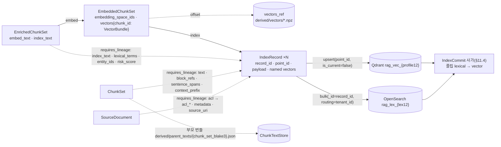

# EmbeddedChunkSet과 IndexRecord 계약

> 정본은 [설계 바이블](../02-architecture/00-design-bible.md) §5.4 `EmbeddedChunkSet`·`VectorBundle`·`IndexRecord` 표(원천 열 포함), §5.7 열거(`VectorName`·`Pooling`·`EmbeddingMode`·`ItemKind`·`Visibility`·`Classification`), §6.1~6.2 `record_id`·`point_id`·`embedding_space_id`·`embedding_profile_hash` 결합식, §10.2 필터 불변식, §13.2 `ChunkTextStore`, §13.4 Qdrant/OpenSearch 명명이다. 이 문서는 그 표를 필드·타입·필수·설명·예시로 풀고 백엔드 매핑·불변식·스키마·예시를 붙인다. 바이블에 없는 항목은 선택(N) 필드 또는 "## 미해결 이슈"의 제안으로만 둔다.

## 목적

`embed` 스테이지의 출력 계약 `EmbeddedChunkSet`과, `index` 스테이지가 그것을 상류 계보(`EnrichedChunkSet`·`ChunkSet`·`SourceDocument`)와 합쳐 인덱스 백엔드에 쓰는 논리 레코드 `IndexRecord`를 정의한다. 두 계약은 (1) 임베딩 공간(embedding space)을 `embedding_space_id`·`embedding_profile_hash`로 식별해 모델 변경이 곧 재색인임을 계약으로 드러내고, (2) 물리 키 `record_id`·`point_id`에 테넌트·컬렉션·문서·세대를 합성해 공유 컬렉션에서의 덮어쓰기와 세대 사가(saga) 붕괴를 막으며([ADR-0004](../06-adr/0004-deterministic-chunk-id-scoped-record-id-and-ulid-exception.md) v1.2, E17), (3) 보안 삼중항과 세대 필드가 모든 레코드에 존재함을 스키마로 강제하고(D-09, E5), (4) 검색 핫패스(hot path)가 PostgreSQL 없이 payload만 읽을 수 있게 인용 좌표·본문·ACL을 레코드에 자족적으로 담는다([ADR-0034](../06-adr/0034-retrieval-hot-path-postgres-independence-and-hydrate.md)).

## 범위

- 포함: `EmbeddedChunkSet` 최상위 필드(봉투 포함), 이 계약 전용 하위 타입 `EmbeddingSpaceIds`·`VectorLayout`·`EmbedStats`와 인라인 열거 `EmbeddedChunkSet.vector_layout.format`·`.dtype`(바이블 §5.7 `{Type}.{path}` 등재), 공용 타입 `VectorBundle`의 해설(정의는 [00-contract-overview](./00-contract-overview.md)의 `common-types` `$defs`), 임베딩 공간 결합식과 재색인 규칙, 벡터 본문(`vectors_ref`)의 dtype·정규화, `IndexRecord` 전 필드(원천 열 포함)와 하위 타입 `IndexRecordVectors`·`SparseVector`·`TableRef`·`EmbeddingSpaceIds`(사본 `$defs`), `record_id`/`point_id` 스코프·세대 합성, 보안 삼중항·세대 필드와 `index.security_fields_missing`, Qdrant·OpenSearch 매핑, `lite`의 `sparse_bm25`, payload 한계와 부모 텍스트 저장, 크기 한계, 저장 규약, 불변식, JSON Schema 2개, Pydantic v2 모델, 예시.
- 제외: 임베더·인덱스 어댑터 구현과 서빙 스택([04-pipelines/12-embedding](../04-pipelines/12-embedding.md), [04-pipelines/13-indexing](../04-pipelines/13-indexing.md)), 세대 사가의 상태 기계·보상 정본([08-index-commit](./08-index-commit.md), 바이블 §11.4), 검색 측 `hydrate`·`RankedResult`([10-candidate-set-and-ranked-set](./10-candidate-set-and-ranked-set.md)), 컬렉션 바인딩 필드 정본([15-collection-profile-and-policy-contracts](./15-collection-profile-and-policy-contracts.md)), 갱신·삭제·정리 잡([04-pipelines/19-update-delete-and-reindexing](../04-pipelines/19-update-delete-and-reindexing.md)).

## 1. 위치와 역할

| 항목 | `embed` → `EmbeddedChunkSet` | `index` → `IndexRecord`(→ `IndexCommit`) |
|------|------------------------------|-------------------------------------------|
| 확장 지점·격리 | `embedder`; 외부 HTTP(vLLM pooling·TEI) / `lite` in_process | `index_backend`; in_process 어댑터 → Qdrant(gRPC) / OpenSearch(HTTP) |
| 입력 | `EnrichedChunkSet`(`ArtifactRef` 1개) | `EmbeddedChunkSet` + `requires_lineage`: `EnrichedChunkSet`·`ChunkSet`·`SourceDocument`(셸이 `ctx.lineage[...]`로 로드, 바이블 §4.1) + 워크플로우 인자 `commit_id`·`index_generation` |
| 멱등성 키 | 세트 `stage_key = H("stage", "embed", scope_key, enriched.blake3, fingerprint)`(바이블 §4.1·§4.2 `embed` 행). `fingerprint`는 Stage `fingerprint()`가 돌려주는 Producer 지문 `H("producer", plugin_id, plugin_version, config_hash, image_digest or "", ",".join(model_ids))`(§6.2)이며 SDK가 `embedding_space_id` 포함을 검증한다(§4.1). `embedder_fingerprint = H("embedder", …)`(§2.1)는 `IndexCommit` 전파용 별개 필드로 `stage_key`에 쓰지 않는다(두 지문의 관계는 미해결 이슈 11); 청크 단위 캐시 `H("embed", embedding_space_id, "document", embed_text)`(봉투 없음, 테넌트 내 공유) | `record_id` 단위 upsert 멱등 — 같은 커밋의 재시도는 같은 `record_id`, 다른 세대는 다른 `record_id`; 같은 `commit_id`가 `committed`면 no-op |
| 인라인 한계 / 산출물 한계(§5.1) | 참조만 / 레코드 50,000 × 약 6KB, upsert 배치 256 | payload 32KB(`block_refs`·`sentence_spans` 포함), `text` 8,192 UTF-8 바이트 |
| 실패 정책([13-error-model](./13-error-model.md)) / 이벤트 | `embed.server_unavailable` 재시도(최대 간격 5m, 5회); `embed.token_overflow` truncate + 경고(`VectorBundle.truncated`, 세트 `quality=degraded` §2.1); `embed.space_mismatch`·`embed.tokenizer_missing` 비재시도 / `ingest.document.embedded` | `index.security_fields_missing` 배치 전체 거부(비재시도); `index.backend_unavailable` 재시도; `index.partial_commit` → 보상 후 실패; `index.generation_conflict` 비재시도 / `ingest.document.indexed`, `index.commit.published` |



## 2. `EmbeddedChunkSet` 필드 표

타입 표기는 브리프 §9.5. "필수" 열 `Y`/`N`/`Y(nullable)`/조건의 인스턴스 규칙은 00 §8.1을 따른다(N 필드는 `null` 대신 생략).

### 2.1 최상위(봉투 포함)

| 필드 | 타입 | 필수 | 설명 | 예시 |
|------|------|------|------|------|
| `schema_version` | string(semver) | Y | 계약 버전(봉투) | `"1.0.0"` |
| `schema_type` | string(const) | Y | `"EmbeddedChunkSet"` | `"EmbeddedChunkSet"` |
| `tenant_id` | string(ulid) | Y | 보안 삼중항 1(봉투) | `"01J9ZQ4K7X2M8N3P5R6S7T8V9W"` |
| `collection_id` | string(ulid) | Y | 보안 삼중항 2(봉투, 단수) | `"01J9ZQ5A1B2C3D4E5F6G7H8J9K"` |
| `producer` | `Producer` | Y | `plugin_id = embedder.{implementation}`(예 `embedder.vllm_pooling_bge_m3`), `model_ids`에 임베딩 모델 `{repo}@{revision}`; 외부 서빙이면 `image_digest` non-null, `lite` 인프로세스면 `null`(00 I-20) | §예시 1 |
| `quality` | enum(Quality) | Y | 입력 `EnrichedChunkSet.quality` 전파(되돌리지 않음). 절단(`VectorBundle.truncated=true`)이 1건 이상이면 `degraded` + `warnings[embed.token_overflow]` — 13 §5.2 "손실이 하나라도 있으면 `degraded`"·바이블 §4.1 부분 성공 규약을 따른 **초안**(바이블 §4.2 `embed` 행은 경고만 명시; 미해결 이슈 12) | `"full"` |
| `warnings` | array<Warning> | Y | `embed.token_overflow`(`chunk_id` 포함) 등. 콘텐츠 미포함 | `[]` |
| `created_at` | string(date-time) | Y | RFC 3339 UTC | `"2026-09-22T09:13:05.000Z"` |
| `lineage_refs` | `LineageRefs` | Y | `{source, parsed, normalized, chunk_set, enriched}` 정확히 5키(00 §3.2 `embed` 행). `embedded` 금지. `source`는 `detect` 출력 **`SourceDocument` 계약 산출물**(`schema_type="SourceDocument"`, `media_type="application/vnd.rag.source-document+json"`)이며 원본 바이트가 아니다(00 §3.2 대응표·I-7, 바이블 §5.2) — `index`가 `ctx.lineage["SourceDocument"]`로 로드해 `acl_*`·`acl_hash`·`title`·`source_uri`·`metadata` 원천(SRC)으로 쓴다; 원본 바이트는 `SourceDocument.artifact`로만 참조 | §예시 1 |
| `chunk_set_id` | string(ulid) | Y | 입력 `EnrichedChunkSet.chunk_set_id` 복사 | `"01JAB3C4D5E6F7G8H9JKMNPQST"` |
| `document_id` | string(ulid) | Y | 입력 복사 | `"01JAB3C4D5E6F7G8H9JKMNPQRS"` |
| `doc_version` | string(hex64) | Y | `= SourceDocument.content_hash`(ADR-0005) | hex64 |
| `enriched_ref` | `ArtifactRef` | Y | 입력 `EnrichedChunkSet` 산출물. `schema_type="EnrichedChunkSet"`, `blake3 = lineage_refs.enriched.blake3` | §예시 1 |
| `embedding_space_ids` | `EmbeddingSpaceIds` | Y | `{dense, sparse_learned?, sparse_bm25?, late_interaction?}` 각 `H("space", …)`(§3) | §2.2 |
| `embedding_profile_hash` | string(hex64) | Y | `H("spaces", *sorted(f"{name}={space_id}"))` — 컬렉션 바인딩 단위. `CollectionSpec.embedding_profile_hash`와 같아야 하며 Qdrant 물리 컬렉션 `rag_vec_{[:12]}`을 고른다 | hex64 |
| `embedder_fingerprint` | string(hex64) | Y | `H("embedder", plugin_id, plugin_version, config_hash, image_digest or "", embedding_profile_hash)` — 서빙 이미지 digest 포함. `IndexCommit.embedder_fingerprint`로 전파 | hex64 |
| `mode` | enum(EmbeddingMode) | Y | 항상 `document`(스키마 `const`). 질의 임베딩 `query`는 이 계약에 나타나지 않고 Valkey `qemb:{space}:{hash}`로만 존재 | `"document"` |
| `pooling` | enum(Pooling) | Y | `cls`(BGE-M3 dense 기본) / `mean` / `late`(late chunking; mean pooling 장문 모델 강제, D-19) | `"cls"` |
| `vectors_ref` | `ArtifactRef` | Y | 벡터 본문 파생물(npz 또는 parquet, §4). 봉투 없음·계약 산출물 아님(`schema_type` 없음) | §예시 1 |
| `vector_layout` | `VectorLayout` | N | **이 문서 추가.** `vectors_ref`의 물리 배치(형식·배열 키·dtype·정규화·shape). 어댑터가 dtype 가정을 검증할 수 있게 한다(미해결 이슈 2) | §2.3 |
| `vectors` | object<chunk_id, VectorBundle> | Y | 키 집합 = 입력 `ChunkSet`에서 `level ∈ {0, 2}`인 `chunk_id` 집합. 부모(`level=1`)는 임베딩하지 않으므로 없다(바이블 §5.4 `Chunk` 불변식 (5)) | §2.4 |
| `cache_hits` | integer(≥0) | Y | 청크 캐시 `H("embed", …)` 적중 수(비용 계량; 적중 청크는 서빙 호출 없음) | `0` |
| `stats` | `EmbedStats` | Y | `{vectors_total, bytes_dense, bytes_sparse, bytes_late_interaction}` → `rag_index_bytes_total{vector}`·`IndexCommit.stats` | §2.3 |

### 2.2 `embedding_space_ids`(`EmbeddingSpaceIds`, 이 계약 `$defs`)

키는 `VectorName` 철자, 값은 `embedding_space_id`(hex64). `dense`는 필수, `sparse_learned`(`standard`) 또는 `sparse_bm25`(`lite`) 중 하나 이상(D-07 3-way의 sparse·렉시컬 레그). `IndexRecord.embedding_space_ids`는 이 객체의 복사이며, `index-record` 스키마는 다른 계약 스키마의 `$defs`를 교차 `$ref`하지 않고(major 버전 결합 회피; 계약 공통 요구 (c)) 같은 정의의 **사본** `$defs/EmbeddingSpaceIds`를 둔다 — `TableRef`와 같은 방식이며 00 문서에 `common-types` `$defs/EmbeddingSpaceIds` 승격을 제안한다(미해결 이슈 4).

| 필드 | 타입 | 필수 | 설명 | 예시 |
|------|------|------|------|------|
| `dense` | string(hex64) | Y | dense 공간(BGE-M3 1024d) | hex64 |
| `sparse_learned` / `sparse_bm25` | string(hex64) | 조건(`standard`) / 조건(`lite`) | learned sparse 공간(`vocab_id` 예 `xlm-roberta-250k`) / 플랫폼 BM25 공간(`vocab_id = analyzer_id`, ADR-0012) | hex64 |
| `late_interaction` | string(hex64) | N | 별도 슬롯(기본 끔, ADR-0010) | 생략 |

### 2.3 `vector_layout`(`VectorLayout`, N)과 `stats`(`EmbedStats`), 이 계약 `$defs`

| 필드 | 타입 | 필수 | 설명 | 예시 |
|------|------|------|------|------|
| `vector_layout.format` | enum[npz, parquet] | Y | `vectors_ref` 컨테이너. 인라인 열거 `$defs/EmbeddedChunkSet.vector_layout.format`(바이블 §5.7 `{Type}.{path}` 등재 규칙) | `"npz"` |
| `vector_layout.dense` | object | Y | `{array_key, dtype: enum[float32, float16, bfloat16, int8], normalized: const true, shape: [rows, dim]}`; `dtype`는 인라인 열거 `$defs/EmbeddedChunkSet.vector_layout.dtype`(§5.7 규칙; `late_interaction.dtype`와 공유, PascalCase `VectorDtype` 등재는 미해결 이슈 2), `rows = stats.vectors_total`, 기본 dtype `float32`(초안) | `{"array_key": "dense", "dtype": "float32", "normalized": true, "shape": [2, 1024]}` |
| `vector_layout.late_interaction` | object | 조건(슬롯 존재 시) | `{array_key, dtype, shape: [total_tokens, dim]}`; `dtype`는 `dense.dtype`와 같은 인라인 열거, 번들의 `offset`·`count`가 행 구간 | 생략 |
| `stats.vectors_total` | integer(≥0) | Y | `= len(vectors)` | `2` |
| `stats.bytes_dense` / `bytes_sparse` / `bytes_late_interaction` | integer(≥0) | Y | dense 행렬 바이트(`rows × dim × sizeof(dtype)`) / `sparse_learned` + `sparse_bm25`의 `indices`(4B) + `values`(4B) 합 / 슬롯 없으면 `0` | `8192` / `176` / `0` |
| `stats.truncated_count` | integer(≥0) | N | **이 문서 추가.** `VectorBundle.truncated = true` 수(= `embed.token_overflow` 경고 수). 바이블 §5.4 `stats` 반영 제안은 미해결 이슈 2 | `0` |

### 2.4 `VectorBundle`(공용 타입, `urn:rag:schema:common-types:1#/$defs/VectorBundle`)

정의와 스키마는 00 문서가 소유한다. 이름별 항목은 `VectorName` 철자를 `name` 필드에 `const`로 갖는다. dense·late interaction은 **`vectors_ref` 안 오프셋만**, sparse는 인라인이다(바이블 §5.4 "레코드는 오프셋만").

| 필드 | 타입 | 필수 | 설명 | 예시 |
|------|------|------|------|------|
| `dense` | object | Y | `{name: "dense", dim, offset}` — `vectors_ref` `dense` 배열의 행 `offset`; L2 정규화, dim = 공간 차원(1024) | `{"name": "dense", "dim": 1024, "offset": 0}` |
| `sparse_learned` | object | 조건(`standard`) | `{name, vocab_id, indices[], values[]}` — BGE-M3 lexical weights(XLM-R 토큰 id, 값 > 0); 정규화 없음 | §예시 1 |
| `sparse_bm25` | object | 조건(`lite`) | `{name, vocab_id: analyzer_id, indices[], values[]}` — 클라이언트 TF 포화값(§8.3); 질의 시 `channel=lexical` | §8.3 |
| `late_interaction` | object | N | `{name, dim: 128, count, offset}` — `vectors_ref` `late_interaction` 배열의 행 `[offset, offset+count)` | 생략 |
| `page_multivector`, `pooled_page_multivector`, `page_dense` | object | N | `visual-pages` 슬롯(별도 컬렉션·인덱스 단계 필수, O-04). 열린 객체; 구체 필드는 미해결 이슈 3 | 생략 |
| `embed_text_hash` | string(hex64) | Y | `blake3_hex(utf8(Enrichment.embed_text))` — 캐시 키 재계산·`commit_hash` 입력 | hex64 |
| `truncated` | boolean | Y | 임베더 입력에서 토큰 초과 절단이 있었으면 `true`(`embed.token_overflow` 경고 동반, 세트 `quality=degraded` §2.1). `Enrichment.embed_text`·`strip_offsets`는 절단되지 않는다(06 §4 규칙 5) | `false` |

## 3. 임베딩 공간: `embedding_space_id`·`embedding_profile_hash`와 재색인 규칙

**결정:** 벡터의 정체성은 모델이 아니라 **공간**이다. `embedding_space_id = H("space", model_id, revision, str(dim), str(normalized), prompt_hash, quantization, vocab_id or "")`(바이블 §6.2)이며, 컬렉션은 정확히 하나의 `embedding_profile_hash = H("spaces", *sorted(f"{name}={space_id}"))`에 바인딩된다. 공간 입력 중 하나라도 바뀌면 다른 공간이고, 다른 공간의 벡터는 같은 컬렉션에 섞이지 않는다 — 즉 **모델 변경 = 컬렉션 blue/green 재색인**이며 세대 플립이 아니다(바이블 §3.2 O-02, §11.4 (5); [ADR-0009](../06-adr/0009-embedding-serving-vllm-pooling-tei-inprocess.md), [ADR-0010](../06-adr/0010-bge-m3-rationale-and-late-interaction-slot.md), [ADR-0014](../06-adr/0014-sparse-representation-bge-m3-lexical-leg-kept.md)).

`H("space", …)`의 입력(`standard` dense 예): `model_id`(HF 저장소, `BAAI/bge-m3`), `revision`(HF 커밋 SHA 또는 태그 — 바이블 §6.1 `model_id` 표기; `models.lock`으로 고정. 공간 식별에 SHA만 허용하는 강화는 미해결 이슈 7), `str(dim)`(출력 차원, MRL 절단 포함, `"1024"`), `str(normalized)`(`"true"`), `prompt_hash`(어댑터가 소유하는 문서/질의 지시 프롬프트 해시 `H("config", canonical_json(prompts))`; 프롬프트 없음이면 빈 객체의 해시), `quantization`(모델 출력 양자화 `"none"`·`"int8"` 등; 백엔드 저장 양자화는 제외), `vocab_id or ""`(sparse만: `xlm-roberta-250k`, `ax-encoder-50k`, `lite`는 `analyzer_id`).

| 변경 | `embedding_space_id` | `embedding_profile_hash` | `embedder_fingerprint` | 조치 |
|------|----------------------|--------------------------|------------------------|------|
| dense 모델·revision·dim·프롬프트·출력 양자화 변경; sparse 모델 교체(`sparse_learned`, 예 PIXIE-Splade) | 해당 공간 변경 | 변경 | 변경 | 새 물리 컬렉션 `rag_vec_{new12}`에 전체 재색인 후 alias `col_{collection_id}_vec` 교체(`reindex_collection` 잡, blue/green). 질의 임베딩 캐시 키도 자연히 분리 |
| 분석기·사전 변경(`lite` `sparse_bm25`) | `sparse_bm25` 변경(`vocab_id = analyzer_id`) | 변경 | 변경 | `lite`는 `embedding_profile_hash` 변경이므로 Qdrant 컬렉션 blue/green 재색인(dense는 청크 캐시 `H("embed", …)` 적중으로 재계산 없음, 재적재만; ADR-0012 "렉시컬 재색인만" 문구와의 정합은 미해결 이슈 13); `standard`는 `lexical_profile_hash` 변경 → 렉시컬 인덱스 재색인만 |
| 같은 모델의 서빙 스택 교체(vLLM ↔ TEI ↔ 인프로세스) | 불변 | 불변 | 변경(`image_digest`) | 재색인 없음 — 단, 코사인 ≥ 0.9999 동등성 게이트(D-16) 통과가 조건. 실패하면 새 공간으로 취급 |
| 임베더 설정(배치 크기 등) | 불변 | 불변 | 변경(`config_hash`) | 없음. 청크 캐시 `H("embed", space, "document", embed_text)`는 공간 키라 그대로 적중 |
| 문서 재수집·ACL 갱신 | 불변 | 불변 | 불변 | 세대 플립 / payload 갱신(E11). `embed_text`가 같은 청크는 캐시 적중 |

검증 지점: `embed`는 프로파일에서 재계산한 공간 id와 자기 `embedding_space_ids`를 대조하고(바이블 §7.4 (8)), `index`는 `EmbeddedChunkSet.embedding_profile_hash == CollectionSpec.embedding_profile_hash`를 대조한다. 불일치는 색인·질의 모두 `embed.space_mismatch`(비재시도)다(바이블 §3.2 O-02). 질의 측은 컬렉션 간 `embedding_profile_hash`가 다르면 공간별로 질의 임베딩을 계산하고 `convex_*` 융합을 `rrf`로 강등한다(§8.1 6단계) — 그 판정 입력이 `IndexRecord.embedding_profile_hash`다.

## 4. 벡터 본문(`vectors_ref`)·dtype·정규화

| 이름(`VectorName`) | 저장 위치 | dtype(초안 목표) | 정규화 | 청크당 크기(초안) |
|--------------------|-----------|------------------|--------|-------------------|
| `dense` | `vectors_ref` 행렬 `[rows, dim]`, 번들 `offset` = 행 | `float32`(`vector_layout.dense.dtype`) | L2 정규화 필수(‖v‖₂ = 1 ± 1e-4) → Qdrant cosine = dot | 4,096B(1024d) |
| `sparse_learned` | 번들 인라인 `indices[]`·`values[]` | 정수 id(< 어휘 크기) / float32 | 없음(양수 가중치) | 8B × nnz(약 10~60) |
| `sparse_bm25` | 번들 인라인 | 정수 id(형태소 토큰 안정 해시) / float32 | 없음(TF 포화값 > 0) | 8B × 형태소 종수 |
| `late_interaction` | `vectors_ref` 행렬 `[total_tokens, dim]`, 번들 `offset`·`count` | `float16`(초안; 저장량) 또는 `float32` | 토큰 벡터별 L2 정규화(MaxSim) | 2B × 128 × 토큰 수 |
| `page_multivector`, `pooled_page_multivector`, `page_dense` | 미확정(`visual-pages` 별도 컬렉션) | — | — | — |

규칙: (1) `vectors_ref`는 봉투 없는 파생물이며 키 `tenants/{tenant_id}/derived/vectors/{blake3[:2]}/{blake3}.npz`(§13.3 "벡터 npz")로 저장한다. 콘텐츠(`embed_text` × 공간)에서만 유도되므로 테넌트 내 공유가 안전하고, 스코프는 산출물 `EmbeddedChunkSet`의 `stage_key`가 담는다(ADR-0037). (2) 미디어 타입은 `application/x-npz`(확인 필요 as of 2026-09; 00 §9.3) 또는 `application/vnd.apache.parquet`. (3) `stats.bytes_*`는 `vector_layout`의 dtype으로 계산한 논리 바이트이며 npz 헤더·압축은 제외한다. (4) 백엔드 저장 양자화(Qdrant scalar/binary quantization)는 공간 id에 포함되지 않는 백엔드 설정이고, 공간 id의 `quantization`은 모델 출력 양자화(int8 ONNX 등)만 뜻한다. (5) `IndexRecord.vectors`는 `index`가 `vectors_ref`를 해소해 채운 **값 본문**이다(§5.1).

## 5. `IndexRecord` 필드 표(원천 열 포함)

리프 1개 = 레코드 1개(세대별). 봉투는 없다(바이블 §5.4 표에 봉투 행 없음) — `tenant_id`·`collection_id`는 레코드 자체의 필수 필드다. "원천" 열: EMB = `EmbeddedChunkSet`(입력), ENR = `EnrichedChunkSet`, CS = `ChunkSet`, SRC = `SourceDocument`(`lineage_refs.source`가 가리키는 `detect` 출력 계약 산출물; 이상 셋은 `requires_lineage`), IDX = `index` 스테이지·워크플로우 인자. "인덱싱" 열은 Qdrant payload 인덱스 / OpenSearch 매핑 타입(§8)이며 `—`는 저장만(비인덱스)이다.

| 필드 | 타입 | 필수 | 인덱싱 | 원천 | 설명 | 예시 |
|------|------|------|--------|------|------|------|
| `schema_version` | string(semver) | N | — | IDX | **이 문서 추가.** payload 기록 시점 계약 버전(`hydrate`의 unknown 열거 처리·업캐스트 판정 참고; 미해결 이슈 1) | `"1.0.0"` |
| `record_id` | string(hex64) | Y | PK(OpenSearch `_id`); payload 저장 | IDX | `H("record", tenant_id, collection_id, document_id, str(index_generation), chunk_id)`(§6) | §예시 2 |
| `point_id` | string(uuid) | Y | PK(Qdrant) | IDX | `uuid5(NAMESPACE_RAG_CHUNK, record_id)` 결정적 변환 | `"9d4e294b-2662-5607-a07d-2b2636fe5bd7"` |
| `chunk_id` | string(hex64) | Y | keyword | CS | 콘텐츠 주소 키(세대·스코프 무관): `exclude_ids`·`commit_hash`·평가 run·`duplicates_of` 기준 | hex64 |
| `tenant_id` | string(ulid) | Y | keyword(`is_tenant=true`) / keyword + `routing` | 봉투 | **필수 사전 필터**(보안 삼중항 1) | ULID |
| `collection_id` | string(ulid) | Y | keyword | 봉투 | **필수 사전 필터**(보안 삼중항 2); OpenSearch filtered alias 키 | ULID |
| `document_id` | string(ulid) | Y | keyword | 봉투 | 삭제·부모 확장·상충 판정; 세대 플립 단위 | ULID |
| `doc_version` | string(hex64) | Y | keyword | SRC | `= content_hash(문서)`; 상충 판정(`ConflictKind version`) | hex64 |
| `commit_id` | string(ulid) | Y | keyword | IDX | 사가 보상 키 `delete_by_filter(commit_id)`(§13.4 인덱스 목록 미등재 → 미해결 이슈 5) | ULID |
| `index_generation` | integer(≥1) | Y | integer | IDX | 문서 단위 세대(원장 `documents` 행 잠금 아래 할당) | `1` |
| `is_current` | boolean | Y | bool | IDX | 적재 시 `false` → 플립 시 `true` → 다음 세대 커밋 시 `false`; 보안 불변식 (a) 필수 사전 필터 | `true` |
| `item_kind` | enum(ItemKind) | Y | keyword | CS | 전략 필터 `item_kind IN :item_kinds` | `"text"` |
| `level` | integer(0..2) | Y | integer | CS | 전략 필터 `level IN :level_in`; `parent`는 1, `summary`·`community_report`·`entity`는 2, 그 외 0 | `0` |
| `parent_chunk_id` | string(hex64) \| null | Y(nullable) | keyword | CS | 같은 세트 내 `level+1` | hex64 |
| `ordinal` | integer(≥0) | Y | — | CS | 부모 내 순서(`document_order` 정렬 보조) | `0` |
| `tree_level` | integer \| null | N | integer | CS | RAPTOR(리프 0) | 생략 |
| `vectors` | `IndexRecordVectors` | Y | named vectors | EMB | `{dense, sparse_learned?, sparse_bm25?, late_interaction?}` 값 본문(§5.1). `level ∈ {0, 2}`는 `dense` + sparse 하나 이상; `parent`(`vector_payload` 저장 방식만)는 `{}` | §예시 2 |
| `index_text` | string | 조건(OpenSearch 대상) | text(`nori_index`/`nori_search`) | ENR | `Enrichment.index_text` — BM25 입력. `lite`는 `sparse_bm25` 계산 입력으로만 쓰고 Qdrant payload에 넣지 않는다 | §예시 2 |
| `lexical_terms` | array<string> | Y | keyword 배열 | ENR | `keywords[].term` 정렬·중복 제거(≤ 64 초안); Qdrant 한국어 키워드 필터·부스트(`BoostKind user_dictionary`) | `["개인정보", "정보보호"]` |
| `text` | string | Y | — (`_source`만) | CS | 표시 원문(`Chunk.text`) ≤ 8,192 UTF-8 바이트; 초과 시 §9 절단 규칙 | §예시 2 |
| `text_preview` | string | Y | — | CS | `text`의 앞 200 코드포인트(초안 규칙; MCP `concise`·디버그·`payload_slim`) | §예시 2 |
| `text_truncated` | boolean | Y | — | CS(`index` 계산) | `text`가 §9 절단본이면 `true`(마지막 `block_refs` 항목은 부분 ref일 수 있음, §9 규칙 2) | `false` |
| `context_prefix` | string | Y | text(boost 0.5) / — | CS | `Chunk.context_prefix.deterministic` — 리랭크 입력 `context_prefix + "\n" + text`, 팩 헤더 재생성 | §예시 2 |
| `block_refs` | array<BlockRef> | Y | — | CS | 인용 좌표(K1): `char_*`는 `text` 기준, `original_char_*`는 원문 `Block.text` 기준(바이블 §6.3)이며 절단(§9)에도 `Chunk` 값 그대로다; `level 0·1`은 1개 이상; `hydrate`가 읽어 `pack`이 `segments`·`provenance` 생성 | §예시 2 |
| `sentence_spans` | array<[integer, integer]> | Y | — | CS | `text` 기준 문장 구간 | `[[0, 44], [45, 106]]` |
| `table_ref` | `TableRef` \| null | 조건(`item_kind ∈ {table, table_part}`) | — | CS | `Chunk.table_ref` 복사(§5.3) | 생략 |
| `html_ref` | `ArtifactRef` \| null | 조건(같음) | — | CS | 표 전체 HTML 파생물(`= table_ref.html_ref`; `pack`이 `tables[].html` 로드) | 생략 |
| `title` | string(1..512) | Y | keyword | SRC(`metadata`) | 대체 순서: `IngestRequest.metadata.title` → `ParsedDocument.metadata.title` → 첫 `heading level 0` → `source_uri` 마지막 경로 요소(대체값이 512 코드포인트를 넘으면 앞 512로 절단). 제약은 01 `IngestMetadata.title`·02 `SourceMetadata.title`과 동일 | §예시 2 |
| `heading_path` | array<string> | Y | keyword(첫 2단) | CS | 루트→현재 heading(`FilterableField heading_path`) | `["Ⅲ. 정보보호 조직", "제5조(정보보호 책임자의 지정)"]` |
| `numbering_path` | array<string> | Y | — | CS | `Chunk.numbering_path`(없으면 `[]`) | `["Ⅲ", "제5조"]` |
| `source_uri` | string(uri) | Y | keyword | SRC | `SourceDocument.source_uri`(팩 헤더·`get_document` 유도) | §예시 2 |
| `external_id` | string \| null | N | keyword | SRC | `SourceDocument.external_id` | `"MOIS-NOTICE-2026-12"` |
| `doc_date` | string(date) | N | datetime / date | SRC(`metadata`) | self-query·recency 부스트·상충 표지 | `"2026-03-02"` |
| `doc_type`, `department`, `tags` | string(`^[a-z][a-z0-9_]{0,63}$`) / string(1..256) / array<string(1..128)>(≤ 64, 중복 없음) | N | keyword | SRC(`metadata`) | 사용자·self-query 필터. 제약은 01 `IngestMetadata`·02 `SourceMetadata`와 자구까지 동일(공용 `$defs` 승격 전까지 복제; 01 미해결 이슈 10·15, 02 미해결 이슈 8) | `"notice"` |
| `lang` | string(bcp47) | Y | keyword | CS | `Chunk.lang` | `"ko"` |
| `genre` | enum(Genre) | Y | keyword | CS | `ChunkSet.genre_route` | `"law_article"` |
| `custom` | object<string, string \| number \| boolean> | N | keyword(`custom.*` 선언 키) | SRC(`metadata.custom`) | 컬렉션 `filterable_fields` 선언 키만(원천의 부분집합; 00 §8.2 열린 객체). 키·값 제약은 01 `CustomMetadata`·02 `SourceMetadata.custom`과 동일 — 키 `^[a-z][a-z0-9_]{0,63}$` ≤ 64개, 값 string ≤ 1,024 \| number \| boolean | `{"notice_no": "2026-12"}` |
| `page_start`, `page_end` | integer \| null | Y(nullable) | integer | CS(`block_refs`) | `min/max(block_refs[].page)`; 흐름 포맷 `null`. 가상 필터 `page` → `page_start <= v <= page_end` | `null` |
| `text_source` | enum(BlockSource) | Y | keyword | CS | 청크 텍스트 출처 최저 등급(팩 `[ocr]` 표기) | `"text_layer"` |
| `ocr_confidence_min` | number \| null | Y(nullable) | float | CS | `text_source ∈ {ocr, vlm}`이면 non-null | `null` |
| `acl_allow` | array<string> | Y | keyword | SRC(`acl`) | `Acl.allow_principals` 평탄화(≤ 1,024). 보안 불변식 (a) | `["group:mois_records"]` |
| `acl_deny` | array<string> | N | keyword | SRC(`acl`) | `Acl.deny_principals`(항상 우선) | `[]` |
| `acl_visibility` | enum(Visibility) | Y | keyword | SRC(`acl`) | `acl_visibility IN :visible_set OR acl_allow ANY :principals` | `"tenant"` |
| `acl_classification` | enum(Classification) | Y | keyword | SRC(`acl`) | `Acl.classification`(부재 시 `internal`); `<= :classification_max` | `"internal"` |
| `acl_embargo_until`, `acl_expires_at` | string(date-time) \| null | N(`\| null`) | datetime | SRC(`acl`) | 계약 인스턴스는 생략·`null` 모두 허용(00 §8.1 4행, `_null_allowed_optional`); 백엔드 payload 직렬화 `to_payload(record)`에서만 **명시적 `null`**로 기록(`IS NULL` 조건, §7 규칙 3) | `null` |
| `acl_hash` | string(hex64) | Y | keyword(저장) | SRC | `SourceDocument.acl_hash`; E9 회수 힌트 대조 키; E5 필수 보안 필드 | hex64 |
| `entity_ids` | array<string> | N | keyword | ENR | `entities[].canonical_id`(non-null) 정렬·중복 제거; 부스트 | `["law:개인정보보호법"]` |
| `content_hash` | string(hex64) | Y | — | CS | `blake3_hex(utf8(Chunk.text))` — 절단과 무관한 원 청크 값(정합성 검사·`commit_hash`) | hex64 |
| `token_count_primary` | integer(≥0) | Y | — | CS | `token_counts[primary_tokenizer_id]`(패킹 사전 예산·`payload_slim`) | `61` |
| `risk_score` | number(0..1) | Y | float | ENR | `pack` `omitted.reason=risk_flagged` 근거 | `0` |
| `pii_policy_applied` | enum(PiiPolicy) | Y | keyword | CS | `ChunkSet.pii_policy_applied` | `"mask"` |
| `embedding_space_ids` | `EmbeddingSpaceIds`(사본 `$defs`) | Y | — | EMB | `EmbeddedChunkSet.embedding_space_ids` 복사; 질의 시 공간 불일치 감지 | §2.2 |
| `embedding_profile_hash` | string(hex64) | Y | — | EMB | 물리 컬렉션 선택·다중 컬렉션 융합 강등 판정 | hex64 |
| `analyzer_id` | string(`AnalyzerId`, 사본 `$defs`) | Y | keyword | CS | `ChunkSet.analyzer_id` 복사(R-10) — `{engine}:{version}:{dictionary}`(바이블 §6.1); 패턴 `^[a-z][a-z0-9-]*:[^:\s]+:[^\s]+$`·≤ 128자는 04·05·08·15 `$defs/AnalyzerId`와 동일; 질의 불일치 → `degraded{channel.lexical, analyzer_mismatch}` | `"mecab-ko:1.3.7:ko-dic-2.1.1"` |
| `dictionary_hash` | string(hex64) | Y | keyword | CS | 변경 시 렉시컬 재색인 | hex64 |
| `chunk_set_blake3` | string(hex64) | Y | — | CS(`ArtifactRef.blake3`) | 부모 텍스트 번들 키(§10) | hex64 |
| `updated_at` | string(date-time) | Y | datetime | IDX | 기록·payload 갱신(ACL·플립) 시각 | `"2026-09-22T09:13:40.000Z"` |

### 5.1 `vectors`(`IndexRecordVectors`, 이 계약 `$defs`)

`EmbeddedChunkSet.vectors[chunk_id]`(오프셋)와 달리 백엔드로 나가는 **값 본문**이다. 키는 `VectorName`.

| 필드 | 타입 | 필수 | 설명 | 예시 |
|------|------|------|------|------|
| `dense` | array<number> | 조건(`level ∈ {0, 2}`) | 길이 = 공간 dim, L2 정규화. Qdrant `dense`(cosine) | 1024원소 |
| `sparse_learned` | `SparseVector` | 조건(`standard`) | learned sparse 값 본문(§5.2). Qdrant `modifier: none`; `channel=sparse` | §예시 2 |
| `sparse_bm25` | `SparseVector` | 조건(`lite`) | 플랫폼 BM25 TF 포화값(§5.2). Qdrant `modifier: idf`; `channel=lexical`(§8.3) | §8.3의 `indices`·`values` |
| `late_interaction` | array<array<number>> | N | `[count, dim]` 토큰 벡터. Qdrant `MultiVectorConfig(MAX_SIM)` | 생략 |
| `page_multivector`, `pooled_page_multivector`, `page_dense` | object | N | `visual-pages` 슬롯(미확정) | 생략 |

### 5.2 `SparseVector`(이 계약 `$defs`)

`IndexRecordVectors.sparse_learned`·`sparse_bm25`의 값 본문이다. `VectorBundle`의 sparse 항목에서 `name`·`vocab_id`를 뗀 형태이며(`vocab_id`는 `embedding_space_ids`의 해당 공간이 함의), Qdrant `SparseVector{indices, values}`와 1:1이다.

| 필드 | 타입 | 필수 | 설명 | 예시 |
|------|------|------|------|------|
| `indices` | array<integer(≥0)> | Y | 어휘 id(`sparse_learned`: XLM-R 토큰 id < 어휘 크기; `sparse_bm25`: 형태소 토큰 안정 해시, §8.3). 오름차순·유일, 1개 이상, `values`와 길이 동일 | `[6, 1071, 5384]` |
| `values` | array<number(>0)> | Y | 가중치(`sparse_learned`: lexical weight; `sparse_bm25`: D-15 TF 포화값). 정규화 없음 | `[0.0412, 0.2231, 0.1876]` |

### 5.3 `table_ref`(`TableRef`, 이 계약 `$defs`)

`Chunk.table_ref`(05 §3.7)와 같은 구조다. `common-types`가 이를 `Chunk` 인라인으로만 정의하고 있어 이 스키마가 사본 `$defs/TableRef`를 두며, 00 문서에 `$defs/TableRef` 승격을 제안한다(미해결 이슈 4). `row_range`·`col_range`는 `[start, end)` 0-based다.

| 필드 | 타입 | 필수 | 설명 | 예시 |
|------|------|------|------|------|
| `table_block_id` | string(hex32) | Y | 원 표 블록 `block_id`(`H("block", …)[:32]`) | `"3f1c9b2e7a8d4c5b6e9f0a1b2c3d4e5f"` |
| `header_row_indices` | array<integer(≥0)> | Y | 헤더 행 인덱스(행 그룹 청크마다 반복되는 행; 없으면 `[]`) | `[0]` |
| `row_range` | [integer, integer] | Y | 이 청크가 담은 데이터 행 구간 `[start, end)` | `[1, 9]` |
| `col_range` | [integer, integer] | Y | 열 구간 `[start, end)`(열 분할이 없으면 `[0, ncols]`) | `[0, 5]` |
| `serialization` | enum(TableSerialization) | Y | `text`에 쓰인 직렬화(`html, markdown, triplet, row_json`) | `"markdown"` |
| `html_ref` | `ArtifactRef` \| null | Y(nullable) | 표 전체 HTML 파생물(`TableData.html_ref` 복사; `IndexRecord.html_ref`와 같은 값) | `null` |

## 6. 물리 키: `record_id`·`point_id`의 스코프·세대 합성(ADR-0004 v1.2, E17)

**결정:** 논리 정체성과 물리 정체성을 분리한다. `chunk_id = H("chunk", doc_version, chunker_config_hash, str(level), span)`는 콘텐츠 주소이고, 백엔드 키는 `record_id = H("record", tenant_id, collection_id, document_id, str(index_generation), chunk_id)`, Qdrant `point_id = uuid5(NAMESPACE_RAG_CHUNK, record_id)`(`NAMESPACE_RAG_CHUNK = uuid5(NAMESPACE_URL, "urn:rag:chunk") = 4198d3e2-bdc6-5334-b170-0d5490f26cc7`), OpenSearch `_id = record_id`다(브리프 D-06 개정 v1.2, 바이블 §3.1 D-06, §6.1~6.2, §10.3 E17; [ADR-0004](../06-adr/0004-deterministic-chunk-id-scoped-record-id-and-ulid-exception.md), [ADR-0026](../06-adr/0026-index-commit-generation-saga-and-ledger.md)).

`chunk_id`를 물리 키로 쓰면 안 되는 이유는 둘이다. (1) **교차 테넌트·교차 컬렉션 덮어쓰기**: `chunk_id`에는 스코프가 없다. 기본 격리 등급 `payload_filter`는 여러 테넌트가 물리 컬렉션 `rag_vec_{embedding_profile_hash[:12]}` 하나를 공유하므로, 동일 바이트 문서(공개 법령 PDF·표준 서식)를 두 테넌트(또는 한 테넌트의 두 컬렉션)가 같은 청커 설정으로 수집하면 `doc_version → block_id → chunk_id`가 모두 같아져 뒤 테넌트의 upsert가 앞 레코드의 `tenant_id`·`acl_*` payload를 덮어쓴다 — 보안 사고다. (2) **세대 사가 붕괴**: 청킹 전 단계가 같은 재색인(`from_stage=enrich|embed`, `dedup_policy=reindex_always`, 임베더·ACL 정책 변경)은 `chunk_id` 집합이 같아 새 세대가 이전 세대를 제자리에서 덮어쓰고, "`is_current=false` 선적재 → 플립 → 실패 시 이전 세대 복원"(§11.4)이 성립하지 않는다. 물리 키에 스코프·세대를 합성하면 세대 N과 N+1이 같은 `chunk_id`로도 다른 `record_id`를 가져 공존하고, `chunk_id`는 payload 필드로 남아 `exclude_ids`·`duplicates_of`·`commit_hash`·평가 run이 재색인 뒤에도 같은 값을 가리킨다.

| 항목 | 값(ADR-0004 고정 테스트 벡터; 적합성 키트 `contract_roundtrip`) |
|------|-------------------------------------------------------------------|
| `tenant_id` / `collection_id` / `document_id` | `01J9ZQ4K7X2M8N3P5R6S7T8V9W` / `01J9ZQ5C0Q3N4P5R6S7T8V9WXY` / `01J9ZQ6D1R4P5R6S7T8V9WXYZ0` |
| `chunk_id` | `7694bf848e17bb681a9b737256cf4a824412fa1dac61e29003b46fb39cf43e0a` |
| `record_id`(`index_generation = 1`) | `c1b52951c8dba53646f6a5f25dbd48f3efd9797370667faf17f333a3cce8914a` |
| `point_id` | `ff147912-719c-595e-9d30-587d329e856f` |
| `record_id`(`index_generation = 2`, 같은 `chunk_id`) / (다른 `collection_id`, 같은 `chunk_id`) | `ef61d0055c4d8877c0bf391e84a5279ed39adec8cbbbf601e176aaefd49c6b28`(세대 공존) / `2d6d27e543b4ca08dd3723234eba9e7b785ee21ab6db42e4e776522abb1dfee7`(교차 컬렉션 충돌 없음) |

세대 사가에서 레코드의 생애(바이블 §11.4, ADR-0026): `upsert(is_current=false, commit_id, index_generation=N+1)` → `lexical_written` → 렉시컬 플립(`update_by_query`: gen N+1 → `true`, gen ≤ N → `false`) → 벡터 플립(`set_payload`) → `committed`. 플립 전 실패는 `delete_by_filter(commit_id)`, 플립 후 실패는 `previous_commit_id` 세대를 `is_current=true`로 복원한 뒤 새 세대 삭제. 이전 세대의 물리 삭제는 `maintenance.cleanup.v1`(`cleanup_delay` 1h)이며 그 동안 문서당 레코드가 2배 공존한다. 사용자·self-query 필터에서 `record_id`·`index_generation`·`is_current`·`commit_id`·`tenant_id`·`collection_id`·`acl_*`·`level`은 금지되어 `plan.filter_field_forbidden`(422)이다(바이블 §5.7 `FilterableField`). `record_id`·`chunk_id`는 시간 정렬이 아니므로 페이지네이션 키로 쓰지 않는다(발급형 ULID만).

## 7. 보안 삼중항·세대 필드와 `index.security_fields_missing`

**결정:** 모든 인덱스 레코드는 보안 삼중항 `tenant_id`·`collection_id`·`acl_*`(+ `acl_hash`)과 세대 필드 `is_current`·`index_generation`을 갖고, 리트리벌은 이들을 **사전 필터**로 강제한다(브리프 D-09, 바이블 §10.2 (a), §10.3 E5·E17; [ADR-0027](../06-adr/0027-security-context-injection-and-acl-enforcement-points.md)). ACL은 문서 단위(`SourceDocument.acl` 하나)이며 모든 레벨의 레코드와 부모 번들이 같은 값을 상속하므로 small-to-big 확장으로 권한이 상승하지 않는다(§10.1).

| `Acl`(SRC) | `IndexRecord` | 필수 | 필터 불변식 (a)에서의 역할 |
|------------|---------------|------|-----------------------------|
| 봉투 `tenant_id` | `tenant_id` | Y | `tenant_id = :tenant_id`(Qdrant `is_tenant` 인덱스, OpenSearch `routing` + DLS `term tenant_id`) |
| 봉투 `collection_id` | `collection_id` | Y | `collection_id IN :collection_ids` |
| (세대, IDX) | `is_current`, `index_generation` | Y | `is_current = true`; `index_generation`은 보상·정합성 검사·`index_generations_seen` 관측 |
| `allow_principals` / `deny_principals` | `acl_allow` / `acl_deny` | Y / N(빈 배열은 값) | `(acl_visibility IN :visible_set OR acl_allow ANY :principals)` / `NOT (acl_deny ANY :principals)` — 거부가 항상 우선 |
| `visibility` | `acl_visibility` | Y | 위 OR의 왼쪽; `public`은 allow 검사만 생략(교차 테넌트 불가) |
| `classification` | `acl_classification` | Y(부재 시 `internal`) | `acl_classification <= :classification_max`(나열 순 = 등급 순) |
| `embargo_until` / `expires_at` | `acl_embargo_until` / `acl_expires_at` | N(`\| null`; payload는 명시적 `null`) | `(acl_embargo_until IS NULL OR <= :as_of)`, `(acl_expires_at IS NULL OR > :as_of)` |
| `SourceDocument.acl_hash` | `acl_hash` | Y | E9 회수 힌트 `aclrev:{tenant_id}:{document_id}` 대조·`pack.acl_recheck` 입력 |

강제 규칙:

1. **E5 배치 거부**: `index` 어댑터는 배치(≤ 256) 안에 `tenant_id`·`collection_id`·`acl_allow`·`acl_visibility`·`acl_hash` 중 하나라도 없는 레코드가 1건이라도 있으면 **배치 전체**를 백엔드에 보내지 않고 `index.security_fields_missing`(비재시도)으로 잡을 실패시킨다. 스키마 `required`가 1차 방어이고, 어댑터의 "백엔드로 나가는 요청에 필수 필드 존재" 계약 테스트가 2차 방어다(ADR-0004 준수 확인 E5 행).
2. **E17 키 합성 검증**: 어댑터는 `record_id`를 재계산해 대조하고 `point_id = uuid5(...)`를 확인한다. 불일치는 `contract.violation`(비재시도).
3. **null 표기(백엔드 payload 전용)**: 계약 인스턴스에서 `acl_embargo_until`·`acl_expires_at`은 N이면서 `| null` 표기이므로 생략도 `null`도 허용된다(00 §8.1 4행, `_null_allowed_optional`; I-6의 "N 필드는 `null` 대신 생략" 규칙은 `| null` 표기가 없는 N 필드에 적용된다). 백엔드로 나가는 payload를 만드는 어댑터 직렬화 함수 `to_payload(record)`에서만 값이 없어도 **명시적 `null`**로 기록한다 — 필터 (a)의 `IS NULL` 분기가 "키 부재"와 "null"을 구분하지 않게 하려는 어댑터 규약이다(Qdrant `is_null` vs `is_empty`). 같은 함수가 `acl_deny`를 빈 배열 `[]`로 기록한다(계약 인스턴스는 N, 생략 가능).
4. **ACL 갱신(E11)**: `PATCH /v1/documents/{document_id}/acl`은 재임베딩·`doc_version` 변경 없이 그 문서의 현재 세대 레코드 전부(모든 레벨)의 `acl_*`·`acl_hash`·`updated_at`만 갱신한다(`update_acl` payload 갱신; ADR-0005). 회수 힌트 기록이 백엔드 갱신보다 먼저다(E9).
5. **질의 측 서명**: `IndexBackend.search`는 필터에 `tenant_id`가 없으면 `retrieve.security_context_missing`을 던지고, `hydrate`·`ChunkTextStore`·`get_document`도 같은 (a) 조건으로 재조회한다(E7·E10).

## 8. 백엔드 매핑

### 8.1 Qdrant(벡터 백엔드; `standard`·`lite`)

| 항목 | 규약(바이블 §13.4, §10.4) |
|------|---------------------------|
| 물리 컬렉션 | `rag_vec_{embedding_profile_hash[:12]}`(공유; `payload_filter`·`shard_key`), `rag_vec_{hash12}_t_{tenant_id}`(`index_per_tenant`). 프로파일 변경은 새 물리 컬렉션 + alias 교체(blue/green) |
| alias / 포인트 ID | `col_{collection_id}_vec` → 물리 컬렉션 / `point_id`(UUID v5); `record_id`는 payload에 함께 저장 |
| 격리 | `payload_filter`: `tenant_id` 사전 필터 단일 방어(`is_tenant=true`, HNSW `m=0`, `payload_m=16`); `shard_key`: custom sharding `shard_key=tenant_id`(청크 > 100만 또는 QPS 임계); `index_per_tenant`: 전용 컬렉션 + Qdrant JWT RBAC 옵션(확인 필요 as of 2026-09) |
| payload 제외 | `vectors`(named vectors로 적재), `index_text`(OpenSearch 전용; `lite`는 계산 입력만). 나머지 §5 표 전 필드가 payload |

| named vector(`VectorName`) | Qdrant 설정 | 원천 | 프로파일 |
|----------------------------|-------------|------|----------|
| `dense` | dense, `size = dim`, `distance: Cosine`, HNSW `m=0` + `payload_m=16`(테넌트 파티셔닝), `on_disk` 프로파일 값 | `IndexRecordVectors.dense` | 전부 |
| `sparse_learned` | sparse, `modifier: none` | `.sparse_learned` | `standard` 이상(`lite`는 생산 가능 노드만) |
| `sparse_bm25` | sparse, `modifier: idf`(테넌트별 IDF) | `.sparse_bm25` | `lite` |
| `late_interaction` | dense `size = 128`, `multivector_config: {comparator: max_sim}`, HNSW `m=0` 옵션(리랭크 단계 전용 시); `page_multivector`·`pooled_page_multivector`·`page_dense`는 `visual-pages` 별도 컬렉션(미확정) | `.late_interaction` | `premium` 실험 슬롯(O-04) / `visual-pages` |

payload 인덱스(§13.4): keyword `tenant_id`(`is_tenant: true`)·`collection_id`·`document_id`·`chunk_id`·`item_kind`·`acl_allow`·`acl_deny`·`acl_visibility`·`acl_classification`·`doc_type`·`department`·`tags`·`lang`·`genre`·`lexical_terms`·`entity_ids`·`custom.*`(선언 키); bool `is_current`; integer `level`·`index_generation`·`page_start`·`page_end`; datetime `acl_embargo_until`·`acl_expires_at`·`doc_date`. 그 외 §5 표의 필드(`record_id`·`commit_id`·`text`·`block_refs`·`sentence_spans`·`acl_hash`·`chunk_set_blake3` 등)는 저장만 하며 `hydrate`가 `retrieve(record_ids, with_payload=[...])`로 읽는다(§4.3). `commit_id`(사가 `delete_by_filter`)·`heading_path`(`FilterableField`)가 §13.4 인덱스 목록에 없다는 점은 미해결 이슈 5다.

### 8.2 OpenSearch(렉시컬 백엔드; `standard` 이상)

물리 인덱스 `rag_lex_{lexical_profile_hash[:12]}`(`lexical_profile_hash = H("lex", analyzer_id, dictionary_hash, mapping_version)`, 테넌트 전용 `_t_{tenant_id}`), alias `col_{collection_id}_lex`(filtered alias `collection_id`)·`t_{tenant_id}_lex`, `_id = record_id`, `_routing = tenant_id`(바이블 §13.4). 이중 방어는 Security 플러그인 DLS `{"term": {"tenant_id": "${attr.jwt.tenant_id}"}}` + 요청별 단명 테넌트 JWT(TTL ≤ 60s; E8). `vectors`는 쓰지 않고(`unified-opensearch` 프로파일의 `rank_features` 옵션은 15 문서) `schema_version`은 `_source`만이다.

| 필드 | 매핑 | 비고 |
|------|------|------|
| `index_text` | `text`, `analyzer: nori_index`(`decompound_mode: mixed`, 사용자 사전, stoptags `J*`·`E*`·`S*`), `search_analyzer: nori_search`(`discard`); `copy_to: cjk_bigram` | BM25 주 필드 |
| `context_prefix` | `text`(같은 분석기), 질의 시 boost 0.5 | 접두어 가중 |
| `cjk_bigram` | `text`, `cjk_bigram` 필터 | 보조(boost 0.1) |
| `lexical_terms`, `heading_path`, `title`, `tags`, `entity_ids`, `acl_allow`, `acl_deny` | `keyword` 배열/단일 | `terms` boost 0.3·필터 |
| `tenant_id`, `collection_id`, `document_id`, `chunk_id`, `commit_id`, `record_id`, `doc_version`, `acl_hash`, `content_hash`, `chunk_set_blake3`, `embedding_profile_hash`, `dictionary_hash`, `analyzer_id`, `item_kind`, `acl_visibility`, `acl_classification`, `doc_type`, `department`, `lang`, `genre`, `text_source`, `pii_policy_applied`, `external_id`, `source_uri`, `parent_chunk_id` | `keyword` | 해시류는 `doc_values: false` 가능 |
| `index_generation`, `level`, `ordinal`, `page_start`, `page_end`, `token_count_primary`, `tree_level` | `integer` | |
| `is_current`, `text_truncated` | `boolean` | |
| `acl_embargo_until`, `acl_expires_at`, `updated_at`, `doc_date` | `date`(`strict_date_optional_time`) | |
| `ocr_confidence_min`, `risk_score` | `float` | |
| `text`, `text_preview` | `text`, `index: false` | `_source` 보존(`hydrate`는 Qdrant만 읽음) |
| `block_refs`, `sentence_spans`, `table_ref`, `html_ref`, `embedding_space_ids`, `custom`(미선언 키) | `object`, `enabled: false` | payload 미러 |
| `custom.{key}`(선언 키) | dynamic template → `keyword` | 컬렉션 `filterable_fields` |

### 8.3 `lite`(Qdrant 단독)와 `sparse_bm25`(ADR-0012)

**결정:** `lite`는 OpenSearch 없이 Qdrant 단독이다. Qdrant는 BM25를 계산하지 않으므로 플랫폼 측 `korean_analyzer`(공백기 `mecab-ko:1.3.7:ko-dic-2.1.1`, `[kiwi]` extra 시 Kiwi; ADR-0021)가 `index_text`를 토큰화하고 어댑터가 TF 포화값을 계산해 `sparse_bm25`로 적재하며, 서버는 `modifier: idf`로 테넌트별 IDF를 곱한다. 한국어 키워드 필터·부스트는 `lexical_terms` keyword payload로 한다(브리프 D-15 개정 v1.1, 바이블 §3.1 D-15; [ADR-0012](../06-adr/0012-lite-profile-qdrant-only-client-bm25.md)). 백엔드는 `IndexBackendCapabilities`(`supports_server_bm25`, `korean_analyzer`, `supports_server_fusion[]`, `tenant_isolation[]`, `supports_alias_swap`, `supports_multivector`, `max_vector_dim`, `max_multivector_elements`, `supports_payload_only_points`) 뒤에서 교체 가능하며, 서버 BM25를 가진 백엔드(Milvus·Solr·pg_textsearch)는 같은 `index_text`를 받아 서버 계산으로 대체할 수 있다(D-15; `supports_multivector=false`면 `late_interaction` 자동 비활성 + `degraded`).

| 요소 | 규약 |
|------|------|
| 포화식(D-15 고정) | `values[t] = tf(t) · (k1 + 1) / (tf(t) + k1 · (1 − b + b · dl / avgdl))`, `k1 = 1.2`, `b = 0.75`; `tf`·`dl`은 `index_text`의 형태소 토큰 기준. `tf`를 그대로 넣는 경로 금지(TF×IDF 퇴화, 리스크 #5); bm25s 참조 구현 일치 테스트(허용 오차 1e-6) |
| `avgdl` / `indices` | 컬렉션 통계 vs 프로파일 상수는 04-pipelines/13 실측 후 택1(재색인 단위로만 변경); `indices`는 형태소 토큰 → 정수 안정 해시(04-pipelines/12 확정), 오름차순·유일 |
| `vocab_id` / 공간 | `VectorBundle.sparse_bm25.vocab_id = analyzer_id`; `embedding_space_ids.sparse_bm25 = H("space", …, vocab_id)`; 색인·질의 동일 `analyzer_id`·`dictionary_hash`(불일치 → `degraded{channel.lexical, analyzer_mismatch}`, `vocab_id` 불일치 → `embed.space_mismatch`) |
| 채널·payload·융합·능력 | 항상 `channel=lexical`(`retriever.qdrant_sparse_bm25`, `fusion.weights.lexical`, `ScoreBreakdown.lexical`); `sparse`는 `sparse_learned`만. `index_text`는 payload에 넣지 않고 `lexical_terms`만 keyword 인덱스. 단일 컬렉션·`explain=false`만 Qdrant `Fusion.RRF(k=60 명시)` 위임 가능; `index_backend.qdrant`는 `supports_server_bm25=false`, `korean_analyzer=false` 선언 → 플랫폼 측 `korean_analyzer` 필수(§7.4 (2)·(9)) |

`lite`의 `VectorBundle` 인스턴스(`common-types` `$defs/VectorBundle` 통과; ADR-0012의 포화식 예시 값 `dl = 300`, `avgdl = 400`, `tf = [2, 1, 1]`):

```json
{
  "dense": {"name": "dense", "dim": 1024, "offset": 0},
  "sparse_bm25": {"name": "sparse_bm25", "vocab_id": "mecab-ko:1.3.7:ko-dic-2.1.1", "indices": [1046527, 2231093, 3401201], "values": [1.479, 1.1139, 1.1139]},
  "embed_text_hash": "a549224a0b89025dbbe4282caacca603548ed003663506fa364474af4acc0144",
  "truncated": false
}
```

## 9. payload 한계와 절단 규칙

**결정:** `IndexRecord.text`는 리랭커 입력 홉 제거를 위한 **비정규화 복제**이며 정본은 `ChunkSet` 산출물이다. payload는 32KB(`block_refs`·`sentence_spans` 포함), `text`는 8,192 UTF-8 바이트를 넘지 않는다(바이블 §5.1·§5.4; [ADR-0034](../06-adr/0034-retrieval-hot-path-postgres-independence-and-hydrate.md)).

절단은 두 좌표계를 섞지 않는다(바이블 §6.3): 절단 위치 `cut`은 `Chunk.text`(display) 코드포인트이고 `BlockRef.original_char_*`는 원문 `Block.text` 코드포인트다(예시 2의 두 번째 ref `char 45..106` ↔ `original 0..61`). display → 원문 사상에는 청커만 가진 `NormalizedBlock.offset_map`(04 §3.4 `to_original`)이 필요한데 `index`의 `requires_lineage`는 `EnrichedChunkSet`·`ChunkSet`·`SourceDocument`뿐이고(바이블 §4.1·§4.2, 00 §3.2) 하류(`index`·`hydrate`·`pack`)는 `offset_map` 없이 `block_refs → Provenance`를 만든다(§6.3). 따라서 `index`는 **`original_char_*`를 절대 재계산하지 않고**, 블록 경계에서 잘라 좌표 재계산 자체를 피한다.

| 단계 | 규칙(초안; 04-pipelines/13이 확정) |
|------|-------------------------------------|
| 1. 절단 위치 `cut` | `utf8(text) > 8,192`이면 **블록 경계 우선**: (a) 길이 있는 `block_refs[i].char_end` 중 `utf8(text[:char_end]) ≤ 8,192`인 마지막 값. 여기서 자르면 남는 ref는 모두 **통째로** 유지되어 좌표 재계산이 없다. (b) 첫 블록만으로 8,192를 넘어 (a)가 없으면 `sentence_spans` 끝 오프셋 중 8,192 이하인 마지막 값, 그것도 없으면 8,192 이하의 마지막 코드포인트 경계 — 이때 마지막 ref는 블록 중간에서 잘린 **부분 ref**다. `text = text[:cut]`, `text_truncated = true` |
| 2. 좌표 클리핑·미리보기 | `block_refs`는 `char_start < cut`인 항목(및 `char_start == char_end ≤ cut`인 길이 0 ref)만 남긴다. (a)에서는 남은 ref의 모든 필드가 `Chunk` 값 그대로다. (b)에서는 마지막 ref의 **`char_end := cut`만** 클리핑하고 `original_char_start`·`original_char_end`·`block_id`·`element_path`·`page`·`bbox`·`section_index`는 `Chunk` 값(원문 블록 전체 구간)을 그대로 둔다 — display 절단 위치를 원문 좌표에 대입하거나 길이 보존 근사(`original_char_start + (cut − char_start)`)를 쓰지 않는다(NFKC 등 정규화로 두 좌표계의 길이가 다르다, 04 §3.3). 규약: `text_truncated=true`인 레코드의 마지막 ref는 부분 ref일 수 있고, 그 `Provenance`(`BlockRef.to_provenance()`)는 표시된 접두 텍스트를 **포함하는** 원문 블록 전체 구간을 가리킨다(초과 범위이되 본문 밖은 아님; 정밀 사상은 미해결 이슈 14). `sentence_spans`는 끝 오프셋 ≤ `cut`인 구간만. `content_hash`·`chunk_id`·`token_count_primary`는 **원 청크 값** 유지. `text_preview = text[:200]`(코드포인트) |
| 3. payload 예산 | 절단 뒤에도 canonical JSON payload가 32KB를 넘으면 규칙 1의 순서(블록 경계 → 문장 경계)로 `text`를 더 줄이고(≥ 1문장), 그래도 넘으면(`block_refs`가 과다한 표·목록 청크) `contract.violation`(비재시도) — 청커 설정(`table_row_group_tokens` 하향)으로 해결 |
| 4. 전문 접근 | 절단된 리프의 전문은 `pack`이 `ChunkTextStore`(부모 번들) 또는 `get_document`로 얻는다; `ContextItem.text`는 `level=0`에서 8,192 바이트 이내(00 I-27) |

## 10. 부모 텍스트 저장(`ChunkTextStore`, 바이블 §13.2)

**결정:** 부모(`level=1`)는 임베딩·색인하지 않고 반환 단위로만 쓰므로, 기본 구현 `artifact_store`는 `index` 스테이지가 청크 세트당 부모 번들 `tenants/{tenant_id}/derived/parent_texts/{chunk_set_blake3}.json`을 **벡터 쓰기 전에** 저장하고, `parent_expand`는 후보 payload의 `chunk_set_blake3`로 번들을 로드한다(Valkey `ptxt:{tenant_id}:{chunk_set_blake3}` 24h). 키가 `doc_version`이 아닌 이유는 `parent_chunk_id`가 `chunker_config_hash`에 의존해 청커 설정이 다른 두 컬렉션(또는 blue/green)이 같은 문서를 넣으면 `doc_version` 키 번들이 덮어써지기 때문이다(ADR-0034 A3 기각). 번들에 ACL은 없다 — 부모는 문서 ACL을 상속하므로 후보의 `acl`이 그대로 적용된다(E10).

번들 값 `ParentEntry`(키 `parent_chunk_id`)는 `{text(한계 없음; 부모 ≤ 2,048토큰), context_prefix, heading_path, numbering_path, token_counts: TokenCounts, block_refs: array<BlockRef>, sentence_spans, text_source: enum(BlockSource), ocr_confidence_min: number | null, page_start, page_end: integer | null}`이며 모두 `Chunk`(level 1) 값이다(바이블 §13.2). `context_prefix`(`Chunk.context_prefix.deterministic`)는 **이 문서 추가**다 — 10 `HydratedRequired`가 부모 확장 항목에도 `context_prefix`를 요구하고(리랭크 입력 `context_prefix + "\n" + text`·팩 헤더 재생성) 부모의 결정적 접두어는 자식 값에서 유도할 수 없으므로 번들이 유일한 원천이다(바이블 §13.2 patch 제안, 미해결 이슈 15). 번들에 없는 문서 단위 필드(`title`·`source_uri`·`external_id`·`doc_date`·`doc_type`·`lang`·`chunk_set_blake3`·`acl`)는 `parent_expand`가 대표 자식(최상위 자식)의 값을 복사한다(문서 단위라 모든 자식이 같다; 10 §8이 `acl`만 적고 있어 함께 정정 대상). 부모 `text`는 05 C-4대로 자식 리프 `text`의 U+000A 결합이며 `block_refs`·`sentence_spans`는 자식 값의 재기준 결합이다(§예시 3).

대안 `vector_payload`(프로파일 `query.postprocess.parent_expand.text_store`): 부모를 벡터 없는 payload 전용 포인트로 적재한다. 이때 부모는 `item_kind=parent`·`level=1`·`vectors={}`인 `IndexRecord`가 되고(§예시 3), 전략 필터 `level IN [0]`이 직접 후보 노출을 막는다. Qdrant의 빈 named vectors 허용 여부(`supports_payload_only_points`)는 확인 필요(as of 2026-09)이며 04-pipelines/17 실측 후 택1한다. 이 변형에서는 부모 `text`도 8,192 바이트 한계를 받고(§9), 바이블 §5.5 "부모 확장 항목은 `record_id=null`"(00 I-26) 규칙과의 관계를 정해야 한다(미해결 이슈 6).

## 11. 크기 한계·대형 데이터 처리

바이블 §5.1 한계가 정본이며 그 외는 초안 목표다. 두 계약 모두 API 응답·이벤트·로그에 본문을 넣지 않는다(00 §8.4).

| 대상 | 한계 | 초과 시 |
|------|------|---------|
| 경계 페이로드 / upsert 배치 | `ArtifactRef` 1개(Temporal 2MB) / 256 레코드(§5.1) | `contract.violation` / 배치 분할(재시도는 `record_id` 멱등) |
| `EmbeddedChunkSet` 레코드 수 / 산출물 | 50,000(상류 `ChunkSet` 한계) / 레코드당 약 6KB → 약 300MB, dense 본문 `vectors_ref` 50,000 × 4KB = 200MB(초안 추정) | 상류 `chunk.count_exceeded`; 인라인 금지·`size_bytes` 계량 |
| 임베더 입력 / `embed` 배치 | 모델 최대 길이(BGE-M3 8,192토큰), 리프 512 + 접두어 ≤ 100토큰(초안 목표; 바이블 §5.4 `context_prefix.deterministic` 50~100토큰) / `ingest.embed.batch_max_tokens`(lite 8,192 / standard 32,768 / premium 65,536) | `embed.token_overflow` 절단 + 경고 + `truncated=true` / 배치 분할 |
| `IndexRecord` payload / `text` / `text_preview` | 32KB / 8,192 UTF-8 바이트 / 200 코드포인트 | §9 절단; 최종 `contract.violation` |
| `lexical_terms` / `entity_ids` / `acl_allow`·`acl_deny` | ≤ 64(초안) / ≤ 128(초안) / ≤ 1,024 | 생성 시점 절단(`weight`·`confidence` 내림차순) / `auth.too_many_principals` 상류 |
| `dense` 차원 / `late_interaction` 토큰 수 / 세대 공존 | `IndexBackendCapabilities.max_vector_dim` / `max_multivector_elements`(null = 미공개) / `cleanup_delay`(1h) 동안 문서당 2배 | 프로파일 로딩 거부 `plugin.capability_unsupported` / `rag_index_bytes_total{vector}` 계량, 04-pipelines/19 실측(바이블 미해결 이슈 17) |

## 12. 산출물 저장 규약

| 항목 | 규약 |
|------|------|
| `EmbeddedChunkSet` 오브젝트 키 | `tenants/{tenant_id}/artifacts/embedded-chunk-set/{stage_key[:2]}/{stage_key}.json`(바이블 §13.3) |
| 미디어 타입 / 콘텐츠 해시·크기 | `application/vnd.rag.embedded-chunk-set+json`(§6.4; `IndexRecord`는 백엔드 레코드이지만 계약 게시·테스트 픽스처용은 `application/vnd.rag.index-record+json`) / `ArtifactRef.blake3`·`size_bytes` = 저장된 산출물 바이트(canonical JSON, UTF-8)의 BLAKE3·크기, 셸 read-after-write 재검증(00 I-3) |
| 압축 | **미정(00 U-4)**: zstd(1MB 초과 시, 초안)는 오브젝트 메타데이터 `Content-Encoding: zstd`로만 표시하고 해시·크기·미디어 타입·`.json` 확장자에 영향 없음(14 §13). 확정 전 셸은 압축 없이 저장 |
| 파생물 | `vectors_ref` → `tenants/{tenant_id}/derived/vectors/{blake3[:2]}/{blake3}.npz`(봉투 없음, 테넌트 내 공유); 부모 번들 → `derived/parent_texts/{chunk_set_blake3}.json` |
| 원장·불변성 | `artifacts(tenant_id, stage_key)` + `lineage(child=이 산출물, parent=enriched_ref)` 같은 트랜잭션; `IndexCommit.artifact_refs.embedded`가 재적재(replay) 복구 1순위. 저장 후 재작성 불가 |

## 13. LLM 최종 소비에 영향을 주는 정보

| 관심사 | 이 계약의 보장 |
|--------|----------------|
| provenance·인용 가능성 | `IndexRecord.block_refs`·`sentence_spans`는 `Chunk`와 같은 구조·같은 좌표계(K1)라 `hydrate` → `pack`이 PostgreSQL 없이 `segments`·`provenance`를 결정적으로 생성한다. 절단(`text_truncated`)은 블록 경계 우선이라 남은 ref의 `original_char_*`가 그대로 유효하고, 블록 중간 절단(§9 규칙 1(b))에서도 `original_char_*`는 원문 블록 전체 구간을 유지해 `Provenance`가 표시 텍스트를 포함하는 범위를 가리킨다(본문 밖·다른 좌표계 대입 없음) |
| 3-텍스트 규칙 | payload의 `text`는 접두어·가상 질문 없는 표시 원문이고 `context_prefix`는 분리 필드다. `embed_text`·`index_text`는 LLM에 전달되지 않는다(리랭크 입력 `context_prefix + "\n" + text`도 검색 내부용). `lite`에서는 `index_text`가 payload에도 없다 |
| 보안 삼중항 | 모든 레코드에 `tenant_id`·`collection_id`·`acl_*`·`acl_hash`·`is_current`가 있어 사전 필터 (a)가 어떤 채널·백엔드에서도 같은 조건이며, `pack.acl_recheck`가 payload `acl_*`와 회수 힌트로 반환 직전 재검증한다(E9). 부모·표 조각도 같은 문서 ACL이라 확장으로 권한이 오르지 않는다 |
| 텍스트 신뢰도·데이터 경계 | `text_source`·`ocr_confidence_min`이 레코드에 있어 렌더러 `[ocr]` 표기와 `confidence_tier` 보정이 가능하다; `risk_score`는 `omitted.reason=risk_flagged`의 근거 |
| 결정성·세대 혼합 | 같은 `embed_text`·공간은 같은 벡터(캐시 적중), 같은 `record_id`는 같은 payload → 같은 질의에 같은 `ContextPack.content_hash`가 나와 프롬프트 캐시 접두어가 안정된다. 플립 중 수 초의 혼합 상태는 `index_generation`으로 관측되고(`ContextPack.diagnostics.index_generations_seen`) `hydrate` 누락은 `degraded{hydrate, partial_result}`로 드러난다 |

## 스키마

### `schemas/embedded-chunk-set.schema.json`

```json
{
  "$schema": "https://json-schema.org/draft/2020-12/schema",
  "$id": "urn:rag:schema:embedded-chunk-set:1",
  "title": "EmbeddedChunkSet",
  "description": "embed 스테이지 출력(바이블 §5.4). 청크 본문·보강은 enriched_ref로 참조하고, 벡터 본문은 vectors_ref(npz/parquet 파생물)에 두며 vectors(object<chunk_id, VectorBundle>)는 이름별 오프셋·sparse 항목만 담는다. 색인 대상(level 0·2)만 포함하고 부모(level 1)는 임베딩하지 않는다. mode는 항상 document(const). 공용 타입·열거는 urn:rag:schema:common-types:1 을 참조한다. 소유 문서: docs/03-contracts/07-embedded-chunk-set-and-index-record.md",
  "type": "object",
  "properties": {
    "schema_version": {
      "$ref": "urn:rag:schema:common-types:1#/$defs/Semver",
      "description": "계약 버전. 초기 \"1.0.0\"",
      "pattern": "^1.(0|[1-9]d*).(0|[1-9]d*)$"
    },
    "schema_type": {
      "type": "string",
      "const": "EmbeddedChunkSet",
      "description": "PascalCase 타입명. ArtifactRef.schema_type와 일치해야 로드"
    },
    "tenant_id": {
      "$ref": "urn:rag:schema:common-types:1#/$defs/Ulid",
      "description": "보안 삼중항 1"
    },
    "collection_id": {
      "$ref": "urn:rag:schema:common-types:1#/$defs/Ulid",
      "description": "보안 삼중항 2(수집 측 단수)"
    },
    "producer": {
      "$ref": "urn:rag:schema:common-types:1#/$defs/Producer",
      "description": "재현성 지문. plugin_id는 embedder.{implementation}, model_ids는 임베딩 모델 {repo}@{revision}, image_digest는 외부 서빙(vLLM/TEI)이면 non-null·인프로세스(lite)면 null"
    },
    "quality": {
      "$ref": "urn:rag:schema:common-types:1#/$defs/Quality",
      "description": "품질 삼중항 1. 입력 EnrichedChunkSet의 값을 전파(되돌리지 않음). VectorBundle.truncated=true가 1건 이상이면 degraded(13 §5.2; 초안, Pydantic 검증)"
    },
    "warnings": {
      "type": "array",
      "items": {
        "$ref": "urn:rag:schema:common-types:1#/$defs/Warning"
      },
      "description": "품질 삼중항 2. embed.token_overflow(chunk_id 포함) 등 콘텐츠 미포함"
    },
    "created_at": {
      "$ref": "urn:rag:schema:common-types:1#/$defs/DateTime"
    },
    "lineage_refs": {
      "$ref": "urn:rag:schema:common-types:1#/$defs/LineageRefs",
      "required": [
        "source",
        "parsed",
        "normalized",
        "chunk_set",
        "enriched"
      ],
      "not": {
        "required": [
          "embedded"
        ]
      },
      "properties": {
        "source": {
          "properties": {
            "schema_type": {
              "const": "SourceDocument"
            },
            "media_type": {
              "const": "application/vnd.rag.source-document+json"
            }
          },
          "required": [
            "schema_type",
            "schema_version"
          ],
          "description": "detect 출력 SourceDocument 계약 산출물(00 §3.2 대응표·I-7). 원본 바이트가 아니다 — index가 requires_lineage로 로드해 acl_*·acl_hash·title·source_uri·metadata를 조립한다"
        }
      },
      "description": "embed 출력의 상류 참조 {source, parsed, normalized, chunk_set, enriched}. 자기 자신(embedded) 금지. 각 키의 schema_type은 00 §3.2 대응표와 일치(I-7)"
    },
    "chunk_set_id": {
      "$ref": "urn:rag:schema:common-types:1#/$defs/Ulid",
      "description": "입력 EnrichedChunkSet.chunk_set_id 복사"
    },
    "document_id": {
      "$ref": "urn:rag:schema:common-types:1#/$defs/Ulid"
    },
    "doc_version": {
      "$ref": "urn:rag:schema:common-types:1#/$defs/Hex64",
      "description": "= SourceDocument.content_hash(ADR-0005)"
    },
    "enriched_ref": {
      "$ref": "urn:rag:schema:common-types:1#/$defs/ArtifactRef",
      "properties": {
        "schema_type": {
          "const": "EnrichedChunkSet"
        },
        "media_type": {
          "const": "application/vnd.rag.enriched-chunk-set+json"
        }
      },
      "required": [
        "schema_type",
        "schema_version"
      ],
      "description": "입력 EnrichedChunkSet 산출물. lineage_refs.enriched와 blake3 동일"
    },
    "embedding_space_ids": {
      "$ref": "urn:rag:schema:common-types:1#/$defs/EmbeddingSpaceIds"
    },
    "embedding_profile_hash": {
      "$ref": "urn:rag:schema:common-types:1#/$defs/Hex64",
      "description": "H(\"spaces\", *sorted(f\"{name}={space_id}\"))(바이블 §6.2) — 컬렉션 바인딩 단위. CollectionSpec.embedding_profile_hash와 같아야 한다"
    },
    "embedder_fingerprint": {
      "$ref": "urn:rag:schema:common-types:1#/$defs/Hex64",
      "description": "H(\"embedder\", plugin_id, plugin_version, config_hash, image_digest or \"\", embedding_profile_hash)(바이블 §6.2). 서빙 스택 이미지 digest 포함"
    },
    "mode": {
      "$ref": "urn:rag:schema:common-types:1#/$defs/EmbeddingMode",
      "const": "document",
      "description": "항상 document. 질의 측 임베딩(query)은 이 계약에 나타나지 않는다"
    },
    "pooling": {
      "$ref": "urn:rag:schema:common-types:1#/$defs/Pooling",
      "description": "cls(BGE-M3 dense 기본) / mean / late(late chunking; mean pooling 장문 모델 강제)"
    },
    "vectors_ref": {
      "$ref": "urn:rag:schema:common-types:1#/$defs/ArtifactRef",
      "description": "벡터 본문 파생물(npz 또는 parquet; 봉투 없음, tenants/{tenant_id}/derived/vectors/{blake3[:2]}/{blake3}.npz). dense·late_interaction 행렬을 담고 vectors[*].{dense,late_interaction}.offset이 행 인덱스다. 계약 산출물이 아니므로 schema_type 없음"
    },
    "vector_layout": {
      "$ref": "#/$defs/VectorLayout"
    },
    "vectors": {
      "type": "object",
      "propertyNames": {
        "type": "string",
        "pattern": "^[0-9a-f]{64}$"
      },
      "additionalProperties": {
        "$ref": "urn:rag:schema:common-types:1#/$defs/VectorBundle"
      },
      "description": "object<chunk_id, VectorBundle>. 키 집합 = 입력 ChunkSet에서 level ∈ {0, 2}인 chunk_id 집합(부모 level 1 제외)"
    },
    "cache_hits": {
      "type": "integer",
      "minimum": 0,
      "description": "청크 임베딩 캐시 H(\"embed\", embedding_space_id, \"document\", embed_text) 적중 수(비용 계량)"
    },
    "stats": {
      "$ref": "#/$defs/EmbedStats"
    }
  },
  "required": [
    "schema_version",
    "schema_type",
    "tenant_id",
    "collection_id",
    "producer",
    "quality",
    "warnings",
    "created_at",
    "lineage_refs",
    "chunk_set_id",
    "document_id",
    "doc_version",
    "enriched_ref",
    "embedding_space_ids",
    "embedding_profile_hash",
    "embedder_fingerprint",
    "mode",
    "pooling",
    "vectors_ref",
    "vectors",
    "cache_hits",
    "stats"
  ],
  "additionalProperties": false,
  "allOf": [
    {
      "if": {
        "properties": {
          "embedding_space_ids": {
            "required": [
              "sparse_learned"
            ]
          }
        }
      },
      "then": {
        "properties": {
          "vectors": {
            "additionalProperties": {
              "required": [
                "sparse_learned"
              ]
            }
          }
        }
      },
      "else": {
        "properties": {
          "vectors": {
            "additionalProperties": {
              "not": {
                "required": [
                  "sparse_learned"
                ]
              }
            }
          }
        }
      }
    },
    {
      "if": {
        "properties": {
          "embedding_space_ids": {
            "required": [
              "sparse_bm25"
            ]
          }
        }
      },
      "then": {
        "properties": {
          "vectors": {
            "additionalProperties": {
              "required": [
                "sparse_bm25"
              ]
            }
          }
        }
      },
      "else": {
        "properties": {
          "vectors": {
            "additionalProperties": {
              "not": {
                "required": [
                  "sparse_bm25"
                ]
              }
            }
          }
        }
      }
    },
    {
      "if": {
        "properties": {
          "embedding_space_ids": {
            "required": [
              "late_interaction"
            ]
          }
        }
      },
      "then": {
        "properties": {
          "vectors": {
            "additionalProperties": {
              "required": [
                "late_interaction"
              ]
            }
          }
        }
      },
      "else": {
        "properties": {
          "vectors": {
            "additionalProperties": {
              "not": {
                "required": [
                  "late_interaction"
                ]
              }
            }
          }
        }
      }
    }
  ],
  "$defs": {
    "EmbeddedChunkSet.vector_layout.format": {
      "type": "string",
      "enum": [
        "npz",
        "parquet"
      ],
      "description": "vectors_ref 컨테이너 형식 인라인 열거({Type}.{path} 등재 규칙, 바이블 §5.7). VectorLayout.format 전용"
    },
    "EmbeddedChunkSet.vector_layout.dtype": {
      "type": "string",
      "enum": [
        "float32",
        "float16",
        "bfloat16",
        "int8"
      ],
      "description": "vectors_ref 행렬 원소 자료형 인라인 열거({Type}.{path} 등재 규칙, 바이블 §5.7). VectorLayout.dense.dtype·late_interaction.dtype이 공유. 기본 float32. 여러 계약이 쓰게 되면 §5.7 VectorDtype 등재(minor) 후 common-types 승격(00 U-14, 미해결 이슈 2)"
    },
    "Shape2": {
      "type": "array",
      "prefixItems": [
        {
          "type": "integer",
          "minimum": 0
        },
        {
          "type": "integer",
          "minimum": 1
        }
      ],
      "items": false,
      "minItems": 2,
      "description": "2차원 배열 형상 [rows, dim]"
    },
    "VectorLayout": {
      "type": "object",
      "description": "선택(N). vectors_ref 파생물의 물리 배치. 소비자(index 어댑터)가 dtype·정규화 가정을 검증할 수 있게 한다",
      "properties": {
        "format": {
          "$ref": "#/$defs/EmbeddedChunkSet.vector_layout.format",
          "description": "vectors_ref 컨테이너 형식"
        },
        "dense": {
          "type": "object",
          "description": "dense 행렬 [rows, dim]; rows = stats.vectors_total; normalized는 항상 true(L2 정규화 완료, 바이블 §5.4)",
          "properties": {
            "array_key": {
              "type": "string",
              "minLength": 1
            },
            "dtype": {
              "$ref": "#/$defs/EmbeddedChunkSet.vector_layout.dtype"
            },
            "normalized": {
              "type": "boolean",
              "const": true
            },
            "shape": {
              "$ref": "#/$defs/Shape2"
            }
          },
          "required": [
            "array_key",
            "dtype",
            "normalized",
            "shape"
          ],
          "additionalProperties": false
        },
        "late_interaction": {
          "type": "object",
          "description": "토큰 벡터를 이어 붙인 [total_tokens, dim]; VectorBundle.late_interaction.offset·count가 행 구간",
          "properties": {
            "array_key": {
              "type": "string",
              "minLength": 1
            },
            "dtype": {
              "$ref": "#/$defs/EmbeddedChunkSet.vector_layout.dtype"
            },
            "shape": {
              "$ref": "#/$defs/Shape2"
            }
          },
          "required": [
            "array_key",
            "dtype",
            "shape"
          ],
          "additionalProperties": false
        }
      },
      "required": [
        "format",
        "dense"
      ],
      "additionalProperties": false
    },
    "EmbedStats": {
      "type": "object",
      "description": "바이블 §5.4 stats {vectors_total, bytes_dense, bytes_sparse, bytes_late_interaction} → rag_index_bytes_total{vector}·IndexCommit.stats",
      "properties": {
        "vectors_total": {
          "type": "integer",
          "minimum": 0,
          "description": "= vectors 키 수"
        },
        "bytes_dense": {
          "type": "integer",
          "minimum": 0,
          "description": "vectors_ref 내 dense 행렬 바이트(dtype 기준)"
        },
        "bytes_sparse": {
          "type": "integer",
          "minimum": 0,
          "description": "sparse_learned + sparse_bm25의 indices(4B)·values(4B) 합"
        },
        "bytes_late_interaction": {
          "type": "integer",
          "minimum": 0,
          "description": "late_interaction 행렬 바이트. 슬롯이 없으면 0"
        },
        "truncated_count": {
          "type": "integer",
          "minimum": 0,
          "description": "선택(N). VectorBundle.truncated=true 수(= embed.token_overflow 경고 수)"
        }
      },
      "required": [
        "vectors_total",
        "bytes_dense",
        "bytes_sparse",
        "bytes_late_interaction"
      ],
      "additionalProperties": false
    }
  }
}
```

### `schemas/index-record.schema.json`

```json
{
  "$schema": "https://json-schema.org/draft/2020-12/schema",
  "$id": "urn:rag:schema:index-record:1",
  "title": "IndexRecord",
  "description": "index 스테이지가 EmbeddedChunkSet(EMB) + requires_lineage(EnrichedChunkSet ENR, ChunkSet CS, SourceDocument SRC) + 워크플로우 인자(IDX)에서 조립해 인덱스 백엔드에 쓰는 논리 레코드(바이블 §5.4). 리프 1개 = 레코드 1개(세대별). 물리 키 record_id = H(\"record\", tenant_id, collection_id, document_id, str(index_generation), chunk_id), point_id = uuid5(NAMESPACE_RAG_CHUNK, record_id)(ADR-0004 v1.2, E17). payload는 필터·정렬·설명·리랭크 입력·인용 좌표·ACL 재검증에 필요한 것만 담고(32KB, text ≤ 8,192 UTF-8 바이트) 정본은 ChunkSet 산출물이다(ADR-0034). 봉투 없음. 공용 타입·열거는 urn:rag:schema:common-types:1 을 참조한다. 소유 문서: docs/03-contracts/07-embedded-chunk-set-and-index-record.md",
  "type": "object",
  "properties": {
    "schema_version": {
      "$ref": "urn:rag:schema:common-types:1#/$defs/Semver",
      "description": "선택(N). payload 기록 시점의 이 계약 버전(hydrate가 unknown 열거값 처리·업캐스트 판정에 참고; 바이블 §5.4 미등재, 미해결 이슈)",
      "pattern": "^1.(0|[1-9]d*).(0|[1-9]d*)$"
    },
    "record_id": {
      "$ref": "urn:rag:schema:common-types:1#/$defs/Hex64",
      "description": "H(\"record\", tenant_id, collection_id, document_id, str(index_generation), chunk_id) — 스코프·세대 합성 물리 키. OpenSearch _id. 원천 IDX"
    },
    "point_id": {
      "$ref": "urn:rag:schema:common-types:1#/$defs/Uuid",
      "description": "uuid5(NAMESPACE_RAG_CHUNK, record_id), NAMESPACE_RAG_CHUNK = uuid5(NAMESPACE_URL, \"urn:rag:chunk\") = 4198d3e2-bdc6-5334-b170-0d5490f26cc7. Qdrant 포인트 ID. 원천 IDX"
    },
    "chunk_id": {
      "$ref": "urn:rag:schema:common-types:1#/$defs/Hex64",
      "description": "콘텐츠 주소 키(세대·스코프 무관). exclude_ids·commit_hash·평가 run·duplicates_of 기준. 원천 CS"
    },
    "tenant_id": {
      "$ref": "urn:rag:schema:common-types:1#/$defs/Ulid",
      "description": "보안 삼중항 1. 필수 사전 필터(Qdrant is_tenant=true, OpenSearch routing). 원천 봉투"
    },
    "collection_id": {
      "$ref": "urn:rag:schema:common-types:1#/$defs/Ulid",
      "description": "보안 삼중항 2. 필수 사전 필터. 원천 봉투"
    },
    "document_id": {
      "$ref": "urn:rag:schema:common-types:1#/$defs/Ulid",
      "description": "삭제·부모 확장·상충 판정 키. 원천 봉투"
    },
    "doc_version": {
      "$ref": "urn:rag:schema:common-types:1#/$defs/Hex64",
      "description": "= SourceDocument.content_hash. 원천 SRC"
    },
    "commit_id": {
      "$ref": "urn:rag:schema:common-types:1#/$defs/Ulid",
      "description": "IndexCommit.commit_id — 사가 보상 키(delete_by_filter(commit_id)). 원천 IDX"
    },
    "index_generation": {
      "type": "integer",
      "minimum": 1,
      "description": "문서 단위 단조 증가 세대(원장 documents 행 잠금 아래 할당). 원천 IDX"
    },
    "is_current": {
      "type": "boolean",
      "description": "적재 시 false, 커밋 플립(렉시컬 → 벡터) 시 true, 다음 세대 커밋 시 false(바이블 §11.4). 보안 불변식 (a) 필수 사전 필터. 원천 IDX"
    },
    "item_kind": {
      "$ref": "urn:rag:schema:common-types:1#/$defs/ItemKind",
      "description": "전략 필터 item_kind IN :item_kinds. 원천 CS"
    },
    "level": {
      "$ref": "urn:rag:schema:common-types:1#/$defs/ChunkLevel",
      "description": "전략 필터 level IN :level_in. 원천 CS"
    },
    "parent_chunk_id": {
      "oneOf": [
        {
          "$ref": "urn:rag:schema:common-types:1#/$defs/Hex64"
        },
        {
          "type": "null"
        }
      ],
      "description": "Y(nullable). 같은 세트 내 level+1 청크. 원천 CS"
    },
    "ordinal": {
      "type": "integer",
      "minimum": 0,
      "description": "부모 내 순서(비인덱스). 원천 CS"
    },
    "tree_level": {
      "type": [
        "integer",
        "null"
      ],
      "minimum": 0,
      "description": "선택. RAPTOR 트리 레벨(리프 0). 원천 CS"
    },
    "vectors": {
      "$ref": "#/$defs/IndexRecordVectors"
    },
    "index_text": {
      "type": "string",
      "description": "조건(렉시컬 백엔드 대상이면 Y). Enrichment.index_text — BM25 입력(OpenSearch nori_index/nori_search). lite(Qdrant 단독)는 sparse_bm25 계산 입력으로만 쓰고 payload에 넣지 않는다. 원천 ENR"
    },
    "lexical_terms": {
      "type": "array",
      "items": {
        "type": "string",
        "minLength": 1
      },
      "uniqueItems": true,
      "description": "Enrichment.keywords[].term 정렬·중복 제거(keyword 배열; Qdrant 한국어 키워드 필터·부스트). 원천 ENR"
    },
    "text": {
      "type": "string",
      "maxLength": 8192,
      "description": "표시 원문(Chunk.text) ≤ 8,192 UTF-8 바이트(바이트 검사는 Pydantic; maxLength 8192 코드포인트는 필요조건). 초과 시 §9 절단(블록 경계 우선; 마지막 block_ref의 char_end만 클리핑, original_char_*는 Chunk 값 불변) + text_truncated=true. 전문은 ChunkSet·ChunkTextStore. 원천 CS"
    },
    "text_preview": {
      "type": "string",
      "maxLength": 200,
      "description": "≤ 200자(MCP concise·디버그·CandidateSet.payload_slim). 원천 CS"
    },
    "text_truncated": {
      "type": "boolean",
      "description": "text가 8,192 바이트 절단본이면 true(마지막 block_ref는 블록 중간에서 잘린 부분 ref일 수 있다, §9 규칙 2). 원천 CS(index 계산)"
    },
    "context_prefix": {
      "type": "string",
      "description": "Chunk.context_prefix.deterministic — 리랭크 입력(context_prefix + \"\\n\" + text)·팩 헤더 재생성. OpenSearch text(boost 0.5). 원천 CS"
    },
    "block_refs": {
      "type": "array",
      "items": {
        "$ref": "urn:rag:schema:common-types:1#/$defs/BlockRef"
      },
      "description": "인용 좌표(K1). char_*는 text 기준, original_char_*는 원문 Block.text 기준 코드포인트(바이블 §6.3)이며 절단(§9) 시에도 Chunk 값 그대로; 마지막 항목의 char_end == cp(text)(절단 여부 무관). hydrate가 읽어 pack이 segments·provenance 생성. level 0·1은 1개 이상. 원천 CS"
    },
    "sentence_spans": {
      "type": "array",
      "items": {
        "$ref": "#/$defs/Range2"
      },
      "description": "text 기준 문장 구간. 원천 CS"
    },
    "table_ref": {
      "oneOf": [
        {
          "$ref": "urn:rag:schema:common-types:1#/$defs/TableRef"
        },
        {
          "type": "null"
        }
      ],
      "description": "조건(item_kind ∈ {table, table_part}). Chunk.table_ref 복사. 원천 CS"
    },
    "html_ref": {
      "oneOf": [
        {
          "$ref": "urn:rag:schema:common-types:1#/$defs/ArtifactRef"
        },
        {
          "type": "null"
        }
      ],
      "description": "조건(item_kind ∈ {table, table_part}). 표 전체 HTML 파생물(= table_ref.html_ref; pack이 tables[].html 로드). 원천 CS"
    },
    "title": {
      "type": "string",
      "minLength": 1,
      "maxLength": 512,
      "description": "문서 제목. 대체 순서: IngestRequest.metadata.title → ParsedDocument.metadata.title → 첫 heading level 0 → source_uri 마지막 경로 요소(대체값이 512 코드포인트를 넘으면 앞 512로 절단). 제약은 01 IngestMetadata.title·02 SourceMetadata.title과 동일(minLength 1, maxLength 512; 공용 $defs 승격 전까지 복제). 원천 SRC(metadata)"
    },
    "heading_path": {
      "type": "array",
      "items": {
        "type": "string"
      },
      "description": "루트→현재 heading. keyword(첫 2단). 원천 CS"
    },
    "numbering_path": {
      "type": "array",
      "items": {
        "type": "string"
      },
      "description": "Chunk.numbering_path(없으면 빈 배열). 원천 CS"
    },
    "source_uri": {
      "$ref": "urn:rag:schema:common-types:1#/$defs/Uri",
      "description": "SourceDocument.source_uri. 원천 SRC"
    },
    "external_id": {
      "type": [
        "string",
        "null"
      ],
      "description": "선택. SourceDocument.external_id. 원천 SRC"
    },
    "doc_date": {
      "$ref": "urn:rag:schema:common-types:1#/$defs/Date",
      "description": "선택. metadata.doc_date(self-query·recency 부스트). 원천 SRC(metadata)"
    },
    "doc_type": {
      "type": "string",
      "pattern": "^[a-z][a-z0-9_]{0,63}$",
      "description": "선택. metadata.doc_type — snake_case keyword(01 IngestMetadata.doc_type·02 SourceMetadata.doc_type과 동일 패턴; 공용 $defs 승격 전까지 복제). 원천 SRC(metadata)"
    },
    "department": {
      "type": "string",
      "minLength": 1,
      "maxLength": 256,
      "description": "선택. metadata.department(01·02와 동일 제약 minLength 1, maxLength 256). 원천 SRC(metadata)"
    },
    "tags": {
      "type": "array",
      "items": {
        "type": "string",
        "minLength": 1,
        "maxLength": 128
      },
      "maxItems": 64,
      "uniqueItems": true,
      "description": "선택. metadata.tags — 정확 일치 keyword(01·02와 동일 제약: 항목 1..128자, ≤ 64개, 중복 없음; 01 정규화가 순서 보존 중복 제거를 수행한 값을 그대로 투영). 원천 SRC(metadata)"
    },
    "lang": {
      "$ref": "urn:rag:schema:common-types:1#/$defs/Bcp47",
      "description": "Chunk.lang. 원천 CS"
    },
    "genre": {
      "$ref": "urn:rag:schema:common-types:1#/$defs/Genre",
      "description": "ChunkSet.genre_route. 원천 CS"
    },
    "custom": {
      "type": "object",
      "propertyNames": {
        "type": "string",
        "pattern": "^[a-z][a-z0-9_]{0,63}$"
      },
      "additionalProperties": {
        "anyOf": [
          {
            "type": "string",
            "maxLength": 1024
          },
          {
            "type": "number"
          },
          {
            "type": "boolean"
          }
        ]
      },
      "maxProperties": 64,
      "description": "선택. 컬렉션 filterable_fields 선언 키만(FilterableField custom.{key}) — 원천의 부분집합. 키·값 제약은 01 CustomMetadata·02 SourceMetadata.custom과 동일(키 ^[a-z][a-z0-9_]{0,63}$ ≤ 64개, 값 string ≤ 1,024 | number | boolean; 00 §8.2 열린 객체; 공용 $defs 승격 전까지 복제). 원천 SRC(metadata.custom)"
    },
    "page_start": {
      "type": [
        "integer",
        "null"
      ],
      "minimum": 1,
      "description": "Y(nullable). min(block_refs[].page); 흐름 포맷은 null. 사용자 필터 page → page_start <= v <= page_end. 원천 CS(block_refs)"
    },
    "page_end": {
      "type": [
        "integer",
        "null"
      ],
      "minimum": 1,
      "description": "Y(nullable). max(block_refs[].page). 원천 CS(block_refs)"
    },
    "text_source": {
      "$ref": "urn:rag:schema:common-types:1#/$defs/BlockSource",
      "description": "청크 텍스트 출처 최저 등급(팩 [ocr] 표기). 원천 CS"
    },
    "ocr_confidence_min": {
      "type": [
        "number",
        "null"
      ],
      "minimum": 0,
      "maximum": 1,
      "description": "Y(nullable). text_source ∈ {ocr, vlm}이면 non-null. 원천 CS"
    },
    "acl_allow": {
      "type": "array",
      "items": {
        "$ref": "urn:rag:schema:common-types:1#/$defs/PrincipalString"
      },
      "maxItems": 1024,
      "description": "Acl.allow_principals 평탄화(문서 ACL, 모든 레벨 동일). 보안 불변식 (a). 원천 SRC(acl)"
    },
    "acl_deny": {
      "type": "array",
      "items": {
        "$ref": "urn:rag:schema:common-types:1#/$defs/PrincipalString"
      },
      "maxItems": 1024,
      "description": "선택. Acl.deny_principals 평탄화(항상 우선). 원천 SRC(acl)"
    },
    "acl_visibility": {
      "$ref": "urn:rag:schema:common-types:1#/$defs/Visibility",
      "description": "Acl.visibility. 원천 SRC(acl)"
    },
    "acl_classification": {
      "$ref": "urn:rag:schema:common-types:1#/$defs/Classification",
      "description": "Acl.classification(부재 시 기본 internal). acl_classification <= :classification_max. 원천 SRC(acl)"
    },
    "acl_embargo_until": {
      "oneOf": [
        {
          "$ref": "urn:rag:schema:common-types:1#/$defs/DateTime"
        },
        {
          "type": "null"
        }
      ],
      "description": "선택(N | null; 계약 인스턴스는 생략·null 모두 허용, 00 §8.1 4행). Acl.embargo_until. 백엔드 payload(to_payload)에서만 명시적 null로 기록한다(IS NULL 필터). 원천 SRC(acl)"
    },
    "acl_expires_at": {
      "oneOf": [
        {
          "$ref": "urn:rag:schema:common-types:1#/$defs/DateTime"
        },
        {
          "type": "null"
        }
      ],
      "description": "선택(N | null; 계약 인스턴스는 생략·null 모두 허용). Acl.expires_at. 백엔드 payload에서만 명시적 null. 원천 SRC(acl)"
    },
    "acl_hash": {
      "$ref": "urn:rag:schema:common-types:1#/$defs/Hex64",
      "description": "SourceDocument.acl_hash = H(\"acl\", canonical_json(acl)). E9 회수 힌트 대조 키; E5 필수 보안 필드. 원천 SRC"
    },
    "entity_ids": {
      "type": "array",
      "items": {
        "type": "string",
        "minLength": 1
      },
      "uniqueItems": true,
      "description": "선택. Enrichment.entities[].canonical_id(non-null) 정렬·중복 제거. 부스트(BoostKind entity). 원천 ENR"
    },
    "content_hash": {
      "$ref": "urn:rag:schema:common-types:1#/$defs/Hex64",
      "description": "Chunk.content_hash = blake3_hex(utf8(Chunk.text)) — 절단 여부와 무관하게 원 청크 값(정합성 검사·commit_hash). 원천 CS"
    },
    "token_count_primary": {
      "type": "integer",
      "minimum": 0,
      "description": "Chunk.token_counts[primary_tokenizer_id](패킹 사전 예산). 원천 CS"
    },
    "risk_score": {
      "type": "number",
      "minimum": 0,
      "maximum": 1,
      "description": "Enrichment.risk_score(pack omitted.reason=risk_flagged 근거). 원천 ENR"
    },
    "pii_policy_applied": {
      "$ref": "urn:rag:schema:common-types:1#/$defs/PiiPolicy",
      "description": "ChunkSet.pii_policy_applied. 원천 CS"
    },
    "embedding_space_ids": {
      "$ref": "urn:rag:schema:common-types:1#/$defs/EmbeddingSpaceIds",
      "description": "EmbeddedChunkSet.embedding_space_ids 복사(질의 시 공간 불일치 감지). 원천 EMB"
    },
    "embedding_profile_hash": {
      "$ref": "urn:rag:schema:common-types:1#/$defs/Hex64",
      "description": "EmbeddedChunkSet.embedding_profile_hash 복사 = Qdrant 물리 컬렉션 rag_vec_{[:12]} 선택 근거. 원천 EMB"
    },
    "analyzer_id": {
      "$ref": "urn:rag:schema:common-types:1#/$defs/AnalyzerId",
      "description": "ChunkSet.analyzer_id 복사(R-10) — {engine}:{version}:{dictionary}(바이블 §6.1). 질의 analyzer_id 불일치 → degraded{channel.lexical, analyzer_mismatch}. 원천 CS"
    },
    "dictionary_hash": {
      "$ref": "urn:rag:schema:common-types:1#/$defs/Hex64",
      "description": "ChunkSet.dictionary_hash(변경 시 렉시컬 재색인). 원천 CS"
    },
    "chunk_set_blake3": {
      "$ref": "urn:rag:schema:common-types:1#/$defs/Hex64",
      "description": "lineage_refs.chunk_set.blake3 — 부모 텍스트 번들 derived/parent_texts/{chunk_set_blake3}.json 키(§13.2). 원천 CS(ArtifactRef.blake3)"
    },
    "updated_at": {
      "$ref": "urn:rag:schema:common-types:1#/$defs/DateTime",
      "description": "레코드 기록·payload 갱신(ACL 갱신·플립) 시각. 원천 IDX"
    }
  },
  "required": [
    "record_id",
    "point_id",
    "chunk_id",
    "tenant_id",
    "collection_id",
    "document_id",
    "doc_version",
    "commit_id",
    "index_generation",
    "is_current",
    "item_kind",
    "level",
    "parent_chunk_id",
    "ordinal",
    "vectors",
    "lexical_terms",
    "text",
    "text_preview",
    "text_truncated",
    "context_prefix",
    "block_refs",
    "sentence_spans",
    "title",
    "heading_path",
    "numbering_path",
    "source_uri",
    "lang",
    "genre",
    "page_start",
    "page_end",
    "text_source",
    "ocr_confidence_min",
    "acl_allow",
    "acl_visibility",
    "acl_classification",
    "acl_hash",
    "content_hash",
    "token_count_primary",
    "risk_score",
    "pii_policy_applied",
    "embedding_space_ids",
    "embedding_profile_hash",
    "analyzer_id",
    "dictionary_hash",
    "chunk_set_blake3",
    "updated_at"
  ],
  "additionalProperties": false,
  "allOf": [
    {
      "if": {
        "properties": {
          "item_kind": {
            "enum": [
              "table",
              "table_part"
            ]
          }
        }
      },
      "then": {
        "required": [
          "table_ref",
          "html_ref"
        ],
        "properties": {
          "table_ref": {
            "$ref": "urn:rag:schema:common-types:1#/$defs/TableRef"
          }
        }
      }
    },
    {
      "if": {
        "properties": {
          "text_source": {
            "enum": [
              "ocr",
              "vlm"
            ]
          }
        }
      },
      "then": {
        "properties": {
          "ocr_confidence_min": {
            "type": "number"
          }
        }
      }
    },
    {
      "if": {
        "properties": {
          "level": {
            "enum": [
              0,
              2
            ]
          }
        }
      },
      "then": {
        "properties": {
          "vectors": {
            "required": [
              "dense"
            ],
            "anyOf": [
              {
                "required": [
                  "sparse_learned"
                ]
              },
              {
                "required": [
                  "sparse_bm25"
                ]
              }
            ]
          }
        }
      }
    },
    {
      "if": {
        "properties": {
          "level": {
            "const": 0
          }
        }
      },
      "then": {
        "properties": {
          "block_refs": {
            "minItems": 1
          }
        }
      }
    },
    {
      "if": {
        "properties": {
          "item_kind": {
            "const": "parent"
          }
        }
      },
      "then": {
        "properties": {
          "level": {
            "const": 1
          },
          "vectors": {
            "maxProperties": 0
          },
          "block_refs": {
            "minItems": 1
          },
          "parent_chunk_id": {
            "type": "null"
          }
        }
      }
    },
    {
      "if": {
        "properties": {
          "item_kind": {
            "enum": [
              "text",
              "list_group",
              "code",
              "table",
              "table_part",
              "figure",
              "page_image"
            ]
          }
        }
      },
      "then": {
        "properties": {
          "level": {
            "const": 0
          }
        }
      }
    },
    {
      "if": {
        "properties": {
          "item_kind": {
            "enum": [
              "summary",
              "community_report",
              "entity"
            ]
          }
        }
      },
      "then": {
        "properties": {
          "level": {
            "const": 2
          }
        }
      }
    },
    {
      "if": {
        "properties": {
          "level": {
            "const": 1
          }
        },
        "required": [
          "level"
        ]
      },
      "then": {
        "properties": {
          "item_kind": {
            "const": "parent"
          }
        }
      }
    }
  ],
  "$defs": {
    "Range2": {
      "type": "array",
      "prefixItems": [
        {
          "type": "integer",
          "minimum": 0
        },
        {
          "type": "integer",
          "minimum": 0
        }
      ],
      "items": false,
      "minItems": 2,
      "description": "[start, end) 0-based 정수 구간"
    },
    "SparseVector": {
      "type": "object",
      "description": "Qdrant sparse named vector 본문. indices·values 길이 동일, indices 오름차순·중복 없음. vocab_id는 embedding_space_ids의 공간이 함의한다",
      "properties": {
        "indices": {
          "type": "array",
          "items": {
            "type": "integer",
            "minimum": 0
          },
          "minItems": 1,
          "uniqueItems": true
        },
        "values": {
          "type": "array",
          "items": {
            "type": "number",
            "exclusiveMinimum": 0
          },
          "minItems": 1
        }
      },
      "required": [
        "indices",
        "values"
      ],
      "additionalProperties": false
    },
    "IndexRecordVectors": {
      "type": "object",
      "description": "바이블 §5.4 IndexRecord.vectors {dense, sparse_learned?, sparse_bm25?, late_interaction?} — 백엔드 named vectors(VectorName). EmbeddedChunkSet과 달리 오프셋이 아닌 값 본문이다. level ∈ {0, 2}는 dense 필수 + sparse 하나 이상, item_kind=parent(vector_payload 저장 방식만)는 빈 객체",
      "properties": {
        "dense": {
          "type": "array",
          "items": {
            "type": "number"
          },
          "minItems": 1,
          "description": "L2 정규화 float 벡터, 길이 = 공간 dim(BGE-M3 1024). Qdrant dense(cosine)"
        },
        "sparse_learned": {
          "$ref": "#/$defs/SparseVector",
          "description": "learned sparse(BGE-M3 lexical weights). Qdrant modifier none; channel=sparse"
        },
        "sparse_bm25": {
          "$ref": "#/$defs/SparseVector",
          "description": "lite. 플랫폼 계산 BM25 TF 포화값(k1=1.2, b=0.75). Qdrant modifier idf; channel=lexical(ADR-0012)"
        },
        "late_interaction": {
          "type": "array",
          "items": {
            "type": "array",
            "items": {
              "type": "number"
            },
            "minItems": 1
          },
          "minItems": 1,
          "description": "토큰 벡터 행렬 [count, dim](KURE-v2 128d 후보). Qdrant MultiVectorConfig(MAX_SIM), m=0 옵션"
        },
        "page_multivector": {
          "type": "object",
          "additionalProperties": true,
          "description": "visual-pages 슬롯(별도 컬렉션; 미확정)"
        },
        "pooled_page_multivector": {
          "type": "object",
          "additionalProperties": true,
          "description": "visual-pages 슬롯(미확정)"
        },
        "page_dense": {
          "type": "object",
          "additionalProperties": true,
          "description": "visual-pages 슬롯(미확정)"
        }
      },
      "additionalProperties": false
    }
  }
}
```

## Pydantic v2 모델

패키지 `rag_platform.contracts.embedded_chunk_set`·`rag_platform.contracts.index_record`. 공용 타입·열거는 00 문서의 `rag_platform.contracts.common`·`rag_platform.contracts.enums`에서 임포트하고 재정의하지 않는다. 해시는 SDK 단일 구현 `H`만 호출한다(ADR-0004 린트). 백엔드 payload 직렬화(`vectors`·`index_text` 제외, N 필드 중 `None` 생략, `acl_embargo_until`·`acl_expires_at` 명시 `null`, `acl_deny` `[]`, canonical JSON ≤ 32KB 검사)와 E5 배치 검사(`SECURITY_FIELDS` 중 하나라도 빠진 레코드가 있으면 배치 전체 `index.security_fields_missing`)는 어댑터 공용 함수 `to_payload(record)`·`check_security_fields(batch)`가 맡는다(§7 규칙 1·3, §9).

```python
from __future__ import annotations

import math
import uuid
from datetime import date, datetime
from typing import Annotated, Any, ClassVar, Literal

from pydantic import Field, field_validator, model_validator

from rag_platform.contracts.common import (
    ArtifactRef, Bcp47, BlockRef, ContractModel, Hex32, Hex64, LineageRefs, PrincipalString, Producer, Semver, Ulid, Uuid,
    VectorBundle, Warning,
)
from rag_platform.contracts.enums import (
    BlockSource, ChunkLevel, Classification, EmbeddingMode, Genre, ItemKind, PiiPolicy, Pooling, Quality, TableSerialization,
    Visibility,
)
from rag_platform.sdk.hashing import H  # 바이블 §6.2 H(label, *parts) 단일 구현

NAMESPACE_RAG_CHUNK = uuid.uuid5(uuid.NAMESPACE_URL, "urn:rag:chunk")  # 4198d3e2-bdc6-5334-b170-0d5490f26cc7
VECTOR_NAMES = ("dense", "sparse_learned", "sparse_bm25", "late_interaction")
TEXT_MAX_BYTES, PREVIEW_MAX_CP, DENSE_NORM_TOL = 8_192, 200, 1e-4
LEAF_KINDS = frozenset({"text", "list_group", "code", "table", "table_part", "figure", "page_image"})
DERIVED_KINDS = frozenset({"summary", "community_report", "entity"})
SECURITY_FIELDS = ("tenant_id", "collection_id", "acl_allow", "acl_visibility", "acl_hash")  # E5
# 인라인 열거 — 스키마 $defs/EmbeddedChunkSet.vector_layout.format·.dtype({Type}.{path} 등재 규칙, 바이블 §5.7)
VectorLayoutFormat = Literal["npz", "parquet"]
VectorLayoutDtype = Literal["float32", "float16", "bfloat16", "int8"]
# 이 계약 $defs/AnalyzerId 사본 — 04·05·08·15 스키마 패턴과 동일(common-types 승격 제안, 미해결 이슈 4)
AnalyzerId = Annotated[str, Field(pattern=r"^[a-z][a-z0-9-]*:[^:\s]+:[^\s]+$", max_length=128)]
# SRC(metadata) 원천 필드 제약 — 01 IngestMetadata·CustomMetadata(= 02 SourceMetadata) 스키마와 동일(공용 $defs 승격 전까지 복제)
DocType = Annotated[str, Field(pattern=r"^[a-z][a-z0-9_]{0,63}$")]
Tag = Annotated[str, Field(min_length=1, max_length=128)]
CustomKey = Annotated[str, Field(pattern=r"^[a-z][a-z0-9_]{0,63}$")]
CustomScalar = Annotated[str, Field(max_length=1024)] | int | float | bool


def record_id_of(tenant_id: str, collection_id: str, document_id: str, index_generation: int, chunk_id: str) -> str:
    return H("record", tenant_id, collection_id, document_id, str(index_generation), chunk_id)


def point_id_of(record_id: str) -> str:
    return str(uuid.uuid5(NAMESPACE_RAG_CHUNK, record_id))


class EmbeddingSpaceIds(ContractModel):
    dense: Hex64 = Field(description="H('space', model_id, revision, dim, normalized, prompt_hash, quantization, '')")
    sparse_learned: Hex64 | None = Field(default=None, description="standard: vocab_id 예 xlm-roberta-250k")
    sparse_bm25: Hex64 | None = Field(default=None, description="lite: vocab_id = analyzer_id")
    late_interaction: Hex64 | None = Field(default=None, description="선택 슬롯(ADR-0010)")

    @model_validator(mode="after")
    def _sparse_leg(self) -> "EmbeddingSpaceIds":
        if self.sparse_learned is None and self.sparse_bm25 is None:
            raise ValueError("contract.violation: sparse_learned(standard) or sparse_bm25(lite) required")
        return self

    def names(self) -> frozenset[str]:
        return frozenset(n for n in VECTOR_NAMES if getattr(self, n) is not None)


class ArrayLayout(ContractModel):
    array_key: str = Field(min_length=1, description="npz 배열 이름(parquet 열)")
    dtype: VectorLayoutDtype
    shape: tuple[int, int] = Field(description="[rows, dim]")


class DenseLayout(ArrayLayout):
    normalized: Literal[True] = Field(description="L2 정규화 완료(바이블 §5.4); 스키마 const true")


class VectorLayout(ContractModel):
    format: VectorLayoutFormat
    dense: DenseLayout
    late_interaction: ArrayLayout | None = None


class EmbedStats(ContractModel):
    vectors_total: int = Field(ge=0)
    bytes_dense: int = Field(ge=0)
    bytes_sparse: int = Field(ge=0)
    bytes_late_interaction: int = Field(ge=0)
    truncated_count: int | None = Field(default=None, ge=0)


class EmbeddedChunkSet(ContractModel):
    schema_version: Semver
    schema_type: Literal["EmbeddedChunkSet"]
    tenant_id: Ulid
    collection_id: Ulid
    producer: Producer
    quality: Quality
    warnings: list[Warning]
    created_at: datetime
    lineage_refs: LineageRefs
    chunk_set_id: Ulid
    document_id: Ulid
    doc_version: Hex64
    enriched_ref: ArtifactRef
    embedding_space_ids: EmbeddingSpaceIds
    embedding_profile_hash: Hex64
    embedder_fingerprint: Hex64
    mode: Literal[EmbeddingMode.document] = Field(description="항상 document(스키마 const)")
    pooling: Pooling
    vectors_ref: ArtifactRef = Field(description="벡터 본문 파생물(npz/parquet); 레코드는 오프셋만")
    vector_layout: VectorLayout | None = None
    vectors: dict[Hex64, VectorBundle] = Field(description="object<chunk_id, VectorBundle>; level 0·2만")
    cache_hits: int = Field(ge=0)
    stats: EmbedStats

    @model_validator(mode="after")
    def _invariants(self) -> "EmbeddedChunkSet":
        lr = self.lineage_refs
        if any(getattr(lr, k) is None for k in ("source", "parsed", "normalized", "chunk_set", "enriched")) or lr.embedded is not None:
            raise ValueError("contract.violation: lineage_refs must be exactly {source, parsed, normalized, chunk_set, enriched}")
        if self.enriched_ref.schema_type != "EnrichedChunkSet" or self.enriched_ref.blake3 != lr.enriched.blake3:
            raise ValueError("contract.violation: enriched_ref must reference lineage_refs.enriched")
        if lr.source.schema_type != "SourceDocument" or lr.source.media_type != "application/vnd.rag.source-document+json":
            raise ValueError("contract.violation: lineage_refs.source must be the SourceDocument contract artifact, not raw bytes (00 I-7)")
        names, dims = self.embedding_space_ids.names(), set()
        if H("spaces", *sorted(f"{n}={getattr(self.embedding_space_ids, n)}" for n in names)) != self.embedding_profile_hash:
            raise ValueError("contract.violation: embedding_profile_hash != H('spaces', sorted name=id)")
        for cid, bundle in self.vectors.items():
            present = frozenset(n for n in VECTOR_NAMES if getattr(bundle, n) is not None)
            if present != names:
                raise ValueError(f"contract.violation: vectors[{cid}] names {sorted(present)} != embedding_space_ids {sorted(names)}")
            dims.add(bundle.dense.dim)
        if len(dims) > 1:
            raise ValueError("contract.violation: dense.dim differs across bundles")
        if self.vector_layout is not None and dims and self.vector_layout.dense.shape != (len(self.vectors), next(iter(dims))):
            raise ValueError("contract.violation: vector_layout.dense.shape != [vectors_total, dim]")
        if self.stats.vectors_total != len(self.vectors):
            raise ValueError("contract.violation: stats.vectors_total != len(vectors)")
        truncated = sum(b.truncated for b in self.vectors.values())
        if self.stats.truncated_count is not None and self.stats.truncated_count != truncated:
            raise ValueError("contract.violation: stats.truncated_count != count(truncated)")
        if truncated and str(self.quality) != "degraded":  # 13 §5.2 손실 → degraded(초안, 미해결 이슈 12)
            raise ValueError("contract.violation: truncated bundle present but quality != degraded")
        return self


class SparseVector(ContractModel):
    indices: list[int] = Field(min_length=1)
    values: list[float] = Field(min_length=1)

    @model_validator(mode="after")
    def _aligned(self) -> "SparseVector":
        if len(self.indices) != len(self.values) or self.indices != sorted(set(self.indices)) or self.indices[0] < 0 or min(self.values) <= 0:
            raise ValueError("contract.violation: indices unique ascending non-negative, aligned with values, values > 0")
        return self


class IndexRecordVectors(ContractModel):
    dense: list[float] | None = Field(default=None, min_length=1)
    sparse_learned: SparseVector | None = None
    sparse_bm25: SparseVector | None = None
    late_interaction: list[list[float]] | None = Field(default=None, min_length=1)
    page_multivector: dict[str, Any] | None = None
    pooled_page_multivector: dict[str, Any] | None = None
    page_dense: dict[str, Any] | None = None

    def names(self) -> frozenset[str]:
        return frozenset(n for n in VECTOR_NAMES if getattr(self, n) is not None)

    @field_validator("dense")
    @classmethod
    def _unit_norm(cls, v: list[float] | None) -> list[float] | None:
        if v is not None and abs(math.sqrt(sum(x * x for x in v)) - 1.0) > DENSE_NORM_TOL:
            raise ValueError("contract.violation: dense must be L2-normalized (tolerance 1e-4)")
        return v


class TableRef(ContractModel):
    table_block_id: Hex32
    header_row_indices: list[int]
    row_range: tuple[int, int]
    col_range: tuple[int, int]
    serialization: TableSerialization
    html_ref: ArtifactRef | None


class IndexRecord(ContractModel):
    _null_allowed_optional: ClassVar[frozenset[str]] = frozenset({"tree_level", "external_id", "table_ref", "html_ref", "acl_embargo_until", "acl_expires_at"})

    schema_version: Semver | None = None
    record_id: Hex64
    point_id: Uuid
    chunk_id: Hex64
    tenant_id: Ulid
    collection_id: Ulid
    document_id: Ulid
    doc_version: Hex64
    commit_id: Ulid
    index_generation: int = Field(ge=1)
    is_current: bool
    item_kind: ItemKind
    level: ChunkLevel
    parent_chunk_id: Hex64 | None
    ordinal: int = Field(ge=0)
    tree_level: int | None = Field(default=None, ge=0)
    vectors: IndexRecordVectors
    index_text: str | None = Field(default=None, description="조건: 렉시컬 백엔드 대상")
    lexical_terms: list[str]
    text: str = Field(max_length=TEXT_MAX_BYTES, description="≤ 8,192 UTF-8 바이트(바이트 검사는 아래)")
    text_preview: str = Field(max_length=PREVIEW_MAX_CP)
    text_truncated: bool
    context_prefix: str
    block_refs: list[BlockRef]
    sentence_spans: list[tuple[int, int]]
    table_ref: TableRef | None = None
    html_ref: ArtifactRef | None = None
    title: str = Field(min_length=1, max_length=512, description="01 IngestMetadata.title 제약과 동일; 대체값(heading·source_uri)은 512 코드포인트로 절단")
    heading_path: list[str]
    numbering_path: list[str]
    source_uri: str = Field(min_length=1)
    external_id: str | None = None
    doc_date: date | None = None
    doc_type: DocType | None = None
    department: str | None = Field(default=None, min_length=1, max_length=256)
    tags: list[Tag] | None = Field(default=None, max_length=64, description="uniqueItems는 아래 검증기")
    lang: Bcp47
    genre: Genre
    custom: dict[CustomKey, CustomScalar] | None = Field(default=None, max_length=64, description="선언 키만 투영; 키·값 제약은 01 CustomMetadata와 동일")
    page_start: int | None = Field(ge=1)
    page_end: int | None = Field(ge=1)
    text_source: BlockSource
    ocr_confidence_min: float | None = Field(ge=0, le=1)
    acl_allow: list[PrincipalString] = Field(max_length=1024)
    acl_deny: list[PrincipalString] | None = Field(default=None, max_length=1024)
    acl_visibility: Visibility
    acl_classification: Classification
    acl_embargo_until: datetime | None = None
    acl_expires_at: datetime | None = None
    acl_hash: Hex64
    entity_ids: list[str] | None = None
    content_hash: Hex64
    token_count_primary: int = Field(ge=0)
    risk_score: float = Field(ge=0, le=1)
    pii_policy_applied: PiiPolicy
    embedding_space_ids: EmbeddingSpaceIds
    embedding_profile_hash: Hex64
    analyzer_id: AnalyzerId
    dictionary_hash: Hex64
    chunk_set_blake3: Hex64
    updated_at: datetime

    @model_validator(mode="after")
    def _keys_kinds_vectors(self) -> "IndexRecord":
        if self.record_id != record_id_of(self.tenant_id, self.collection_id, self.document_id, self.index_generation, self.chunk_id):
            raise ValueError("contract.violation: record_id != H('record', tenant, collection, document, generation, chunk_id) (E17)")
        if self.point_id != point_id_of(self.record_id):
            raise ValueError("contract.violation: point_id != uuid5(NAMESPACE_RAG_CHUNK, record_id)")
        kind, lvl, v = str(self.item_kind), int(self.level), self.vectors
        if kind == "parent" and (lvl != 1 or self.parent_chunk_id is not None or v.names()):
            raise ValueError("contract.violation: parent must be level 1, parent_chunk_id null, vectors {} (vector_payload only)")
        if (kind in LEAF_KINDS and lvl != 0) or (kind in DERIVED_KINDS and lvl != 2):
            raise ValueError("contract.violation: item_kind/level mismatch (바이블 §5.7 ChunkLevel)")
        if lvl in (0, 2) and (v.dense is None or (v.sparse_learned is None and v.sparse_bm25 is None) or v.names() != self.embedding_space_ids.names()):
            raise ValueError("contract.violation: indexed record needs dense + sparse leg, names == embedding_space_ids")
        if kind in ("table", "table_part") and self.table_ref is None:
            raise ValueError("contract.violation: table_ref required for table/table_part")
        n = len(self.text)
        if len(self.text.encode("utf-8")) > TEXT_MAX_BYTES:
            raise ValueError("contract.violation: text exceeds 8,192 UTF-8 bytes (truncate at sentence boundary)")
        if self.text_preview != self.text[:PREVIEW_MAX_CP]:
            raise ValueError("contract.violation: text_preview must be text[:200]")
        if lvl in (0, 1) and not self.block_refs:
            raise ValueError("contract.violation: level 0/1 needs block_refs")
        prev_end = 0
        for br in self.block_refs:
            if not (prev_end <= br.char_start <= br.char_end <= n):
                raise ValueError("contract.violation: block_refs must be ascending, non-overlapping, within text")
            prev_end = br.char_end
        if self.block_refs and lvl in (0, 1) and (self.block_refs[0].char_start != 0 or prev_end != n):
            # §9: 절단 위치 cut은 곧 마지막(클리핑된) ref의 char_end이므로 절단 여부와 무관하게 성립. original_char_*는 절단이 바꾸지 않는다
            raise ValueError("contract.violation: block_refs must span text exactly (last char_end == cp(text), also when truncated; §9)")
        if any(not (0 <= s <= e <= n) for s, e in self.sentence_spans):
            raise ValueError("contract.violation: sentence_spans outside text")
        pages = [br.page for br in self.block_refs if br.page is not None]
        if (self.page_start, self.page_end) != ((min(pages), max(pages)) if pages else (None, None)):
            raise ValueError("contract.violation: page_start/page_end != min/max(block_refs.page)")
        if str(self.text_source) in ("ocr", "vlm") and self.ocr_confidence_min is None:
            raise ValueError("contract.violation: ocr_confidence_min required for ocr/vlm")
        if self.acl_embargo_until is not None and self.acl_expires_at is not None and not self.acl_embargo_until < self.acl_expires_at:
            raise ValueError("contract.violation: acl_embargo_until must precede acl_expires_at")
        if self.lexical_terms != sorted(set(self.lexical_terms)):
            raise ValueError("contract.violation: lexical_terms must be sorted and unique")
        if self.entity_ids is not None and self.entity_ids != sorted(set(self.entity_ids)):
            raise ValueError("contract.violation: entity_ids must be sorted and unique")
        if self.tags is not None and len(set(self.tags)) != len(self.tags):
            raise ValueError("contract.violation: tags must be unique (schema uniqueItems; 01 정규화 결과 그대로 투영)")
        return self
```

## 예시

세 예시는 `schemas/embedded-chunk-set.schema.json`·`schemas/index-record.schema.json`(+ `common-types`)을 통과한다. ID·해시는 형식 규약을 지키는 플레이스홀더이고(ULID 26자 Crockford 대문자, hex64 소문자), `point_id`는 플레이스홀더 `record_id`에서 실제로 `uuid5(NAMESPACE_RAG_CHUNK, record_id)`로 계산한 값이며, 오프셋은 실제 코드포인트 수다. 세 예시는 [06-enriched-chunk-set](./06-enriched-chunk-set.md) 예시 1(행정안전부 HWPX 고시)의 청크 ID·`embed_text`·접두어를 그대로 잇는다. `lite`의 `sparse_bm25` 번들은 §8.3에 있다.

### 예시 1 — `EmbeddedChunkSet`: 행정안전부 HWPX 고시(`standard`, BGE-M3 dense + `sparse_learned`, vLLM pooling)

리프 2개(제5조 본문 `accd3831…`, 별표 1 표 `8c6a1852…`)만 벡터를 갖고 부모 `abba2acf…`는 없다. `dense`는 `vectors_ref` npz의 행 0·1(오프셋), `sparse_learned`는 인라인이다. 외부 서빙이라 `producer.image_digest`가 non-null이다. `lineage_refs.source`는 원본 HWPX 바이트가 아니라 `detect` 출력 `SourceDocument` 계약 산출물(`artifacts/source-document/{stage_key[:2]}/{stage_key}.json`, `schema_type="SourceDocument"`, `media_type="application/vnd.rag.source-document+json"`)이다 — `index`가 이 참조를 `ctx.lineage["SourceDocument"]`로 로드해 `acl_*`·`acl_hash`·`title`·`source_uri`·`metadata`를 조립한다(00 §3.2·I-7; 06 예시 1의 `lineage_refs.source`도 같은 형태로 정정되어야 한다). `doc_version`(= 원본 바이트의 `content_hash` `cf266a7a…`)은 이 산출물의 `blake3`와 다른 값이다.

```json
{
  "schema_version": "1.0.0",
  "schema_type": "EmbeddedChunkSet",
  "tenant_id": "01J9ZQ4K7X2M8N3P5R6S7T8V9W",
  "collection_id": "01J9ZQ5A1B2C3D4E5F6G7H8J9K",
  "producer": {"plugin_id": "embedder.vllm_pooling_bge_m3", "plugin_version": "1.0.0", "config_hash": "326eb6381f6a948652bb3418a39977bea40403ac96af6fe6995367db2ff31b18", "image_digest": "sha256:03e8d1917fe8c5b7323db73d443c16ab88d6005ee62dc5c595d4c62d3240c3b6", "model_ids": ["BAAI/bge-m3@5617a9f61b028d2c8b26b8d0ad4b4ae4b4e4c1f6"]},
  "quality": "full",
  "warnings": [],
  "created_at": "2026-09-22T09:13:05.000Z",
  "lineage_refs": {
    "source": {"uri": "s3://rag-artifacts/tenants/01J9ZQ4K7X2M8N3P5R6S7T8V9W/artifacts/source-document/5e/5e0b7c1d9a2f4e6b8c3d1f0a7e9b5c2d4f6a8b0c1e3d5f7a9b2c4d6e8f0a1b3c.json", "blake3": "1f3e5d7c9b2a4c6e8f0a1b3d5c7e9f2a4b6c8d0e1f3a5b7c9d2e4f6a8b0c1d3e", "media_type": "application/vnd.rag.source-document+json", "schema_type": "SourceDocument", "schema_version": "1.0.0", "size_bytes": 3264, "stage_key": "5e0b7c1d9a2f4e6b8c3d1f0a7e9b5c2d4f6a8b0c1e3d5f7a9b2c4d6e8f0a1b3c"},
    "parsed": {"uri": "s3://rag-artifacts/tenants/01J9ZQ4K7X2M8N3P5R6S7T8V9W/artifacts/parsed-document/29/29c704ed012770f91619e1efee115a28679ab1a8204f6a1f6f7dcc61c51a341c.json", "blake3": "6cb8cafdd02298a8b049ad58f954d89ec6805c5a2a89288a1a461fc050aa013d", "media_type": "application/vnd.rag.parsed-document+json", "schema_type": "ParsedDocument", "schema_version": "1.0.0", "size_bytes": 1843200, "stage_key": "29c704ed012770f91619e1efee115a28679ab1a8204f6a1f6f7dcc61c51a341c"},
    "normalized": {"uri": "s3://rag-artifacts/tenants/01J9ZQ4K7X2M8N3P5R6S7T8V9W/artifacts/normalized-document/cd/cd07a1b2aeb847ac2ac36e6f62c368c337cd1bdd5770ed7cc044a568b6178bfa.json", "blake3": "47bffc4a51c8952f36c971cd028c6f3e521b58fe82416b481479ad16cc0033db", "media_type": "application/vnd.rag.normalized-document+json", "schema_type": "NormalizedDocument", "schema_version": "1.0.0", "size_bytes": 1912004, "stage_key": "cd07a1b2aeb847ac2ac36e6f62c368c337cd1bdd5770ed7cc044a568b6178bfa"},
    "chunk_set": {"uri": "s3://rag-artifacts/tenants/01J9ZQ4K7X2M8N3P5R6S7T8V9W/artifacts/chunk-set/4c/4c4085d68adef58175a54fa7af053cff30fb67d3ffeb81e5a8898e1da0f93727.json", "blake3": "0c85e534d010f11da5e2f5ee712658297df1a73e4e25d73bb5f36e6262b63f9d", "media_type": "application/vnd.rag.chunk-set+json", "schema_type": "ChunkSet", "schema_version": "1.0.0", "size_bytes": 655360, "stage_key": "4c4085d68adef58175a54fa7af053cff30fb67d3ffeb81e5a8898e1da0f93727"},
    "enriched": {"uri": "s3://rag-artifacts/tenants/01J9ZQ4K7X2M8N3P5R6S7T8V9W/artifacts/enriched-chunk-set/aa/aa2e9caa6781f0094f6c274fd215d499760dc36a3612e379237ced0f2e890015.json", "blake3": "8871ce62323758a49120db08e67e782f657719a14d1a40f36d729381a1fcfcce", "media_type": "application/vnd.rag.enriched-chunk-set+json", "schema_type": "EnrichedChunkSet", "schema_version": "1.0.0", "size_bytes": 9216, "stage_key": "aa2e9caa6781f0094f6c274fd215d499760dc36a3612e379237ced0f2e890015"}
  },
  "chunk_set_id": "01JAB3C4D5E6F7G8H9JKMNPQST",
  "document_id": "01JAB3C4D5E6F7G8H9JKMNPQRS",
  "doc_version": "cf266a7a804b27e9ed1133df8e05ef4eec7ea1a28f1ca63f61a1cf838c7f0118",
  "enriched_ref": {"uri": "s3://rag-artifacts/tenants/01J9ZQ4K7X2M8N3P5R6S7T8V9W/artifacts/enriched-chunk-set/aa/aa2e9caa6781f0094f6c274fd215d499760dc36a3612e379237ced0f2e890015.json", "blake3": "8871ce62323758a49120db08e67e782f657719a14d1a40f36d729381a1fcfcce", "media_type": "application/vnd.rag.enriched-chunk-set+json", "schema_type": "EnrichedChunkSet", "schema_version": "1.0.0", "size_bytes": 9216, "stage_key": "aa2e9caa6781f0094f6c274fd215d499760dc36a3612e379237ced0f2e890015"},
  "embedding_space_ids": {
    "dense": "cd72859ad1bd275b6f0b592d7e0a4619f8757fddb1586b1a6b714fd0458cf8a3",
    "sparse_learned": "9b453733ce94d33fabdcdb3e8a762e9b01586ce89dcb959e24227c9571872706"
  },
  "embedding_profile_hash": "b9ff31b9802e4e0d7c9b40e929f07c0be24668eaff92ab3e14b7e24a9943dccf",
  "embedder_fingerprint": "755a703235d6245ec6f57898ef386582e648a5a6ea94744d96ece44ca4cf3da9",
  "mode": "document",
  "pooling": "cls",
  "vectors_ref": {"uri": "s3://rag-artifacts/tenants/01J9ZQ4K7X2M8N3P5R6S7T8V9W/derived/vectors/39/39f94868a15f00659890c86f46c10a113dc4b8aec3f0f8bb13195d13d92b8093.npz", "blake3": "39f94868a15f00659890c86f46c10a113dc4b8aec3f0f8bb13195d13d92b8093", "media_type": "application/x-npz", "size_bytes": 8704},
  "vector_layout": {
    "format": "npz",
    "dense": {"array_key": "dense", "dtype": "float32", "normalized": true, "shape": [2, 1024]}
  },
  "vectors": {
    "accd3831b9b08ad5da5cc41404a645a22e59f8775c60d99b72e073d8cb9cc445": {"dense": {"name": "dense", "dim": 1024, "offset": 0}, "sparse_learned": {"name": "sparse_learned", "vocab_id": "xlm-roberta-250k", "indices": [6, 1071, 5384, 14028, 21607, 29857, 36941, 45372, 61273, 91388, 130210, 213452], "values": [0.0412, 0.2231, 0.1876, 0.3319, 0.1544, 0.0987, 0.2765, 0.1203, 0.0891, 0.1658, 0.0734, 0.0512]}, "embed_text_hash": "5f264be72afef2442586b51940a831e9d66569112783d287e54ddccc3c9ca3d2", "truncated": false},
    "8c6a18523ac6d630b32b5221c01e7529feee0e376290a0d6a902200e9e83ce63": {"dense": {"name": "dense", "dim": 1024, "offset": 1}, "sparse_learned": {"name": "sparse_learned", "vocab_id": "xlm-roberta-250k", "indices": [6, 1071, 3120, 5384, 18342, 29857, 40211, 77605, 130210, 198734], "values": [0.0388, 0.2617, 0.1105, 0.1442, 0.2974, 0.1211, 0.0866, 0.1573, 0.0699, 0.0454]}, "embed_text_hash": "f6d51fa62f807595114c9367e9e42cc7755a43ad62b6abb60abc939e67dbff76", "truncated": false}
  },
  "cache_hits": 0,
  "stats": {"vectors_total": 2, "bytes_dense": 8192, "bytes_sparse": 176, "bytes_late_interaction": 0, "truncated_count": 0}
}
```

### 예시 2 — `IndexRecord`(리프): 제5조 본문 청크, 세대 1, 플립 완료(`is_current=true`)

`embed_text`의 접두어 68코드포인트 뒤가 `text`(106코드포인트, 262바이트)다. 흐름 포맷(HWPX)이라 `page_start`·`page_end`·`BlockRef.page`·`bbox`는 `null`(키 유지)이다. `dense`는 L2 정규화된 1024차원 값 본문이다.

```json
{
  "schema_version": "1.0.0",
  "record_id": "780a8392f4ab34370522203c388ce970ca00a9f6b6954535d855aee77dc51ee2",
  "point_id": "9d4e294b-2662-5607-a07d-2b2636fe5bd7",
  "chunk_id": "accd3831b9b08ad5da5cc41404a645a22e59f8775c60d99b72e073d8cb9cc445",
  "tenant_id": "01J9ZQ4K7X2M8N3P5R6S7T8V9W",
  "collection_id": "01J9ZQ5A1B2C3D4E5F6G7H8J9K",
  "document_id": "01JAB3C4D5E6F7G8H9JKMNPQRS",
  "doc_version": "cf266a7a804b27e9ed1133df8e05ef4eec7ea1a28f1ca63f61a1cf838c7f0118",
  "commit_id": "01JAB3D0E1F2G3H4J5K6M7N8P9",
  "index_generation": 1,
  "is_current": true,
  "item_kind": "text",
  "level": 0,
  "parent_chunk_id": "abba2acf57afc1cc41de4a1bb2d7d6a9df6f2768f7b8407ed386d57943ed521a",
  "ordinal": 0,
  "vectors": {
    "dense": [0.047407, -0.047961, 0.027037, -0.018153, -0.002829, -0.021773, -0.023274, 0.014762, -0.10492, 0.004586, -0.045907, -0.03255, -0.002952, 0.034451, -0.050018, 0.062994, -0.004009, -0.003125, -0.038371, -0.031987, -0.09786, 0.039954, -0.044039, 0.005792, -0.010926, -0.016006, -0.020474, 0.033097, 0.018094, 0.065372, 0.022227, -0.034006, 0.006526, 0.027524, -0.042805, 0.031006, 0.010518, 0.023827, 0.01152, -0.033242, 0.073834, 0.028575, 0.014554, -0.00445, -0.017414, 0.002073, -0.023586, -0.008674, -0.03284, 0.009114, 0.008778, -0.006579, -0.010218, -0.054291, 0.010587, -0.043402, -0.002481, -0.0577, 0.012704, -0.100183, -0.085292, -0.021106, 0.014364, -0.008843, 0.007019, -0.035647, -0.011834, -0.03039, 0.033691, 0.005046, -0.01747, 0.001558, 0.01947, -0.002728, 0.003404, 0.051787, -0.078133, 0.017722, 0.012261, -0.010962, 0.017876, 0.006477, -0.066671, 0.04207, 0.014009, -0.005644, 0.020574, 0.032146, 0.019912, 0.023693, 0.010806, 0.048994, 0.02448, -0.060057, 0.057091, -0.002958, 0.027222, 0.018399, 0.045821, -0.022692, -0.001123, -0.029891, -0.001386, -0.069199, -0.022152, 0.009143, -0.018927, 0.019594, -0.014012, 0.01165, 0.006666, 0.008569, -0.032391, -0.043099, 0.026669, -0.006084, -0.035504, 0.001277, -0.004324, -0.061708, -0.039933, -0.027201, -0.016231, -0.066644, -0.011273, 0.0254, -0.047366, 0.002247, 0.007363, -0.023362, -0.01621, 0.028723, -0.021521, 0.00733, 0.006385, 0.041561, 0.039831, 0.015387, -0.042212, -0.006935, -0.02837, 0.035758, -0.023355, 0.017135, -0.024138, -0.078346, 0.036279, 0.014922, 0.027817, -0.03276, -0.010317, 0.005768, 0.018771, 0.012488, 0.061791, -0.011906, 0.007931, 0.007463, 0.024569, -0.042599, 0.042395, 0.01355, -0.027848, -0.003869, 0.007256, 0.000531, 0.00896, 0.002046, 0.025242, 0.029435, 0.040264, -0.049386, 0.043881, -0.002653, -0.06897, 0.01887, 0.006013, -0.026839, 0.036376, 0.027433, 0.008533, -0.040923, -0.069442, -0.049996, 0.01005, -0.048014, 0.015466, 0.016917, 0.027176, 0.025549, -0.024259, 0.008328, -0.014326, -0.01169, -0.02342, -0.027878, -0.053061, 0.052483, -0.031372, 0.001552, 0.004943, 0.016073, 0.030743, -0.006841, -0.007055, -0.031798, -0.01916, 0.013878, -0.046141, -0.02356, -0.000963, -0.009962, 0.000419, -0.023534, -0.018514, -0.000445, 0.003971, 0.02777, 0.050791, -0.037104, -0.043228, -0.027341, 0.103674, 0.065404, 0.028291, 0.051842, 0.02086, 0.009534, -0.022671, -0.001663, -0.045488, 0.062336, 0.007882, -0.002089, 0.01484, -0.004618, -0.02051, 0.009893, 0.0693, 0.014347, 0.064588, 0.005136, -0.024509, 0.024694, -0.042708, -0.015458, -0.012237, -0.007719, 0.011013, 0.0485, 0.033987, -0.018362, -0.040008, 0.016186, 0.04215, 0.018092, -0.001857, -0.002462, -0.044281, -0.033216, 0.000501, -0.012878, 0.017168, -0.017889, -0.014283, 0.015441, 0.034638, 0.007075, -0.027378, 0.015943, -0.020803, 0.001783, 0.045079, -0.00607, 0.033419, -0.020108, 0.016493, 0.004838, -0.004445, 0.013513, -0.006669, 0.00114, 0.004151, 0.031799, -0.005657, 0.036365, -0.0147, -0.015054, 0.027578, -0.045944, -0.032794, -0.025444, -0.073969, 0.017212, 0.007744, -0.02299, 0.011517, 0.020641, -0.038496, -0.000595, 0.01492, -0.026795, 0.030673, -0.040766, 0.001921, -0.000961, 0.045386, 0.006255, 0.000074, 0.011803, 0.014009, -0.016488, 0.037112, 0.00562, -0.000354, 0.008212, -0.014373, 0.05467, 0.004066, -0.014826, 0.079421, -0.018163, -0.045261, 0.042554, 0.008512, -0.022886, -0.003816, -0.017479, -0.058059, -0.028601, -0.050417, -0.002296, 0.074303, -0.005641, -0.029787, -0.027074, -0.008386, 0.000667, -0.021372, -0.01515, 0.050541, -0.007782, -0.054427, 0.014144, 0.023631, 0.053902, -0.047905, 0.021945, 0.029429, -0.011823, -0.015788, 0.036994, -0.034439, -0.022176, -0.027948, 0.021394, 0.025734, -0.026546, -0.02283, 0.049352, -0.006681, 0.063808, -0.000137, 0.020967, 0.005438, 0.017173, -0.038415, -0.026261, -0.042569, -0.03927, -0.043157, 0.012689, 0.002517, -0.003143, -0.008359, 0.019918, 0.041822, -0.017771, -0.010924, 0.026929, -0.01401, 0.010882, 0.028284, 0.006845, 0.004884, -0.019383, 0.026736, 0.033032, 0.021004, -0.011406, -0.013348, -0.031507, -0.034842, -0.072954, 0.039032, 0.014742, 0.004468, -0.033718, 0.008965, -0.033752, -0.020772, 0.001635, 0.049101, -0.009902, 0.036555, -0.035847, 0.018968, -0.096366, -0.029356, -0.060818, 0.00594, 0.017287, -0.045179, 0.064518, -0.003703, 0.00425, -0.024337, -0.001134, -0.043033, -0.0503, 0.028466, -0.024023, 0.01573, -0.007077, 0.024619, 0.015023, 0.009474, -0.001236, -0.005027, -0.05379, -0.056805, 0.020123, 0.001496, 0.018908, -0.014436, 0.033326, -0.018345, 0.004052, -0.04582, 0.001738, 0.017598, -0.043395, 0.022173, -0.016416, 0.013689, 0.019319, -0.003675, -0.006866, 0.025966, 0.059328, -0.039679, 0.041332, 0.054188, -0.000149, 0.031353, 0.023683, 0.018817, 0.059191, 0.052329, 0.014489, -0.032509, -0.007045, -0.018204, 0.041344, 0.00123, -0.041151, 0.007811, -0.008922, -0.035728, 0.019519, -0.028383, 0.045667, 0.026249, 0.038296, 0.071404, -0.042617, -0.062126, 0.068205, -0.031188, 0.015187, 0.034928, 0.000995, 0.049602, -0.001845, -0.018893, 0.004038, -0.044843, 0.031045, 0.00084, 0.02172, -0.015082, 0.01431, -0.021636, 0.025274, 0.004708, -0.031263, 0.006753, -0.009435, -0.036553, -0.004795, -0.018825, -0.001903, -0.001457, 0.013047, 0.042147, 0.028494, 0.040069, 0.033673, 0.011478, 0.012448, 0.015417, 0.004262, -0.049763, 0.019924, 0.044449, 0.002123, -0.088132, -0.027226, 0.042182, -0.025489, -0.040121, 0.032743, -0.015279, 0.032972, -0.018464, -0.034404, 0.072882, 0.006887, 0.017972, 0.020311, -0.026107, 0.010062, 0.010225, -0.019251, -0.001935, 0.023468, -0.031248, -0.019205, -0.056659, -0.014106, 0.048489, 0.005107, 0.033251, 0.004591, 0.019378, 0.050863, 0.006037, -0.035298, 0.032834, 0.00262, -0.031402, 0.05762, 0.006823, -0.004582, 0.008872, 0.012059, 0.015334, -0.020099, -0.032669, -0.015279, 0.00999, -0.017279, -0.050815, 0.009441, 0.016152, 0.042149, 0.012907, 0.010823, 0.002149, -0.015646, 0.053399, 0.025192, -0.047181, -0.031345, 0.04564, -0.04268, -0.02227, 0.024558, -0.023783, -0.022407, 0.006825, 0.003327, -0.040898, -0.072359, 0.005355, -0.001677, -0.007233, 0.037389, 0.029813, -0.006258, -0.044291, -0.013054, -0.011261, 0.013581, -0.017799, -0.009666, 0.038063, 0.003394, -0.023277, -0.002838, 0.016299, -0.014555, 0.012695, 0.037253, -0.041754, -0.072923, -0.020167, -0.030783, -0.005384, 0.007325, -0.000816, 0.003623, 0.010863, -0.083821, 0.015951, -0.015559, 0.035668, 0.007178, -0.029117, 0.035436, 0.027493, 0.023174, -0.022064, -0.079057, -0.039421, -0.046493, 0.017993, -0.008495, -0.057985, -0.032881, -0.013175, 0.039596, -0.061853, -0.007823, 0.007711, 0.013113, -0.036649, -0.041644, -0.052001, -0.042457, 0.008418, -0.040487, 0.025096, 0.08381, -0.03602, 0.013388, -0.054308, 0.010501, -0.008377, -0.004366, -0.013181, 0.01238, 0.021713, 0.029775, -0.046676, -0.028761, -0.020579, 0.035238, -0.061255, -0.026372, 0.033834, -0.038084, -0.031807, 0.01016, -0.043542, 0.028996, 0.007236, 0.007975, 0.007033, 0.003131, -0.00261, 0.018551, -0.004042, 0.011878, -0.062774, -0.028522, 0.023624, 0.006895, 0.002552, 0.06408, -0.008689, -0.0504, 0.027462, 0.030925, -0.010818, 0.080972, -0.003036, 0.008262, -0.003454, 0.051366, 0.016057, 0.053257, 0.005947, 0.020266, 0.013417, -0.038942, 0.008023, -0.034469, 0.002148, -0.01861, -0.013774, -0.031061, -0.015961, 0.052711, 0.013586, -0.005105, -0.020398, 0.076558, -0.007912, 0.014561, -0.015757, 0.009909, -0.047565, 0.019451, 0.049118, -0.015794, -0.00699, 0.016651, 0.0058, 0.041597, -0.03628, 0.01464, -0.042, 0.000321, -0.051662, -0.054751, -0.041611, 0.048463, 0.010886, -0.025243, -0.013062, -0.023524, 0.038907, 0.020403, -0.050923, 0.030249, -0.003637, 0.00167, -0.045733, 0.01069, -0.026075, 0.018503, 0.045456, -0.037747, -0.019866, 0.038597, -0.010842, -0.012292, -0.014829, 0.022947, -0.016505, 0.009348, 0.029021, 0.046071, 0.017556, -0.020866, -0.001511, 0.030461, -0.001191, 0.019842, -0.012899, -0.014913, -0.001101, 0.003817, 0.027674, 0.028123, -0.033564, -0.002959, -0.01349, -0.001149, 0.018091, -0.031496, -0.012745, 0.101932, 0.03709, -0.02953, 0.035662, -0.015954, -0.006502, 0.010662, 0.032544, 0.025496, 0.008135, 0.021214, 0.042863, 0.023643, -0.009759, 0.055426, -0.022509, -0.042637, -0.041116, -0.00445, -0.01771, 0.016681, -0.036365, -0.007053, -0.003959, -0.005665, -0.054339, 0.025723, 0.012486, 0.036712, 0.018334, -0.034299, 0.04944, -0.01411, -0.024052, -0.029399, 0.023709, 0.023307, 0.003792, -0.03612, -0.012233, 0.079688, -0.000139, 0.028815, 0.017332, -0.009432, 0.028816, -0.060651, 0.019334, 0.014092, 0.014683, 0.027856, 0.025973, 0.009803, -0.009372, 0.03047, -0.016418, 0.044377, -0.039022, 0.06248, 0.017733, 0.014029, -0.003691, 0.005571, -0.016093, 0.00575, 0.026628, 0.021726, -0.005322, -0.000802, 0.034373, -0.011484, 0.021413, -0.045218, 0.030169, 0.029311, -0.022521, 0.010526, 0.035178, 0.01696, -0.012304, -0.020962, -0.021897, 0.051269, 0.027647, -0.00486, 0.027424, 0.032936, 0.013725, 0.038854, -0.024534, 0.024795, -0.012591, -0.003409, -0.018748, 0.014261, 0.009119, 0.034413, -0.021331, 0.032634, 0.01217, -0.024842, 0.001167, -0.009378, -0.033933, 0.005978, -0.045845, -0.015676, 0.02383, -0.003395, -0.02882, 0.018109, 0.004958, -0.005457, 0.069342, -0.020327, 0.070014, 0.012268, 0.029764, 0.012005, -0.023305, 0.028866, 0.000696, 0.012025, 0.008172, 0.013966, -0.016949, -0.021533, 0.034709, -0.013883, 0.020915, -0.025339, -0.048644, 0.009937, -0.031919, 0.012366, 0.046817, -0.046469, -0.029282, 0.007179, 0.010379, 0.016242, 0.015381, 0.011564, -0.05325, 0.039797, -0.034956, 0.020959, 0.037296, 0.005297, 0.017455, 0.004073, 0.024883, -0.056292, -0.03185, -0.043507, -0.046286, 0.032497, -0.031392, -0.001084, -0.01507, 0.008779, -0.026996, 0.017229, 0.036803, 0.034742, -0.002263, -0.009347, 0.022636, -0.010859, -0.044382, -0.04597, 0.016275, -0.027466, 0.033803, -0.009316, 0.012246, -0.017814, -0.02489, -0.022602, 0.020083, -0.007203, -0.026229, -0.044151, 0.029538, 0.029671, 0.018106, 0.043366, 0.041171, 0.060028, -0.009534, 0.024505, 0.012191, 0.002816, -0.029741, -0.036129, 0.018794, 0.04071, 0.013475, 0.02069, 0.020667, -0.049647, 0.008505, -0.05425, -0.00172, 0.040415, -0.032873, 0.066047, 0.008031, -0.020566, 0.0351, -0.002585, 0.041885, 0.049719, 0.005004, -0.004335, -0.00876, 0.040542, 0.054431, -0.039055, 0.005963, -0.064905, -0.015698, 0.026652, -0.024773, 0.033859, 0.014019, 0.019084, -0.077471, -0.009487, -0.0146, 0.001961, 0.001338, -0.021835, 0.013374, -0.010085, 0.021424, -0.045081, -0.035863, -0.019892, 0.026863, -0.033809, -0.011943, -0.000791, -0.002593, 0.030629, 0.057564, -0.010492, -0.084478, -0.035086, 0.035095, -0.035838],
    "sparse_learned": {"indices": [6, 1071, 5384, 14028, 21607, 29857, 36941, 45372, 61273, 91388, 130210, 213452], "values": [0.0412, 0.2231, 0.1876, 0.3319, 0.1544, 0.0987, 0.2765, 0.1203, 0.0891, 0.1658, 0.0734, 0.0512]}
  },
  "index_text": "공공기관 정보보호 업무 지침(행정안전부고시 제2026-12호) › III. 정보보호 조직 › 제5조(정보보호 책임자의 지정)\n1 공공기관의 장은 정보보호 업무를 총괄하는 정보보호 책임자를 지정하여야 한다.\n2 제1항에 따른 정보보호 책임자는 「개인정보 보호법」 제31조에 따른 개인정보 보호책임자를 겸임할 수 있다.",
  "lexical_terms": ["개인정보", "개인정보 보호법", "공공기관", "정보보호", "정보보호책임자", "지정", "책임자"],
  "text": "① 공공기관의 장은 정보보호 업무를 총괄하는 정보보호 책임자를 지정하여야 한다.\n② 제1항에 따른 정보보호 책임자는 「개인정보 보호법」 제31조에 따른 개인정보 보호책임자를 겸임할 수 있다.",
  "text_preview": "① 공공기관의 장은 정보보호 업무를 총괄하는 정보보호 책임자를 지정하여야 한다.\n② 제1항에 따른 정보보호 책임자는 「개인정보 보호법」 제31조에 따른 개인정보 보호책임자를 겸임할 수 있다.",
  "text_truncated": false,
  "context_prefix": "공공기관 정보보호 업무 지침(행정안전부고시 제2026-12호) › Ⅲ. 정보보호 조직 › 제5조(정보보호 책임자의 지정)",
  "block_refs": [{"block_id": "016587088098eea227b3dfa43199b8ff", "element_path": "/hp:sec[0]/hp:p[57]", "char_start": 0, "char_end": 44, "original_char_start": 0, "original_char_end": 44, "page": null, "bbox": null, "section_index": 0}, {"block_id": "cbfdcb052f6eede843b3e64a1d080583", "element_path": "/hp:sec[0]/hp:p[58]", "char_start": 45, "char_end": 106, "original_char_start": 0, "original_char_end": 61, "page": null, "bbox": null, "section_index": 0}],
  "sentence_spans": [[0, 44], [45, 106]],
  "heading_path": ["Ⅲ. 정보보호 조직", "제5조(정보보호 책임자의 지정)"],
  "numbering_path": ["Ⅲ", "제5조"],
  "title": "공공기관 정보보호 업무 지침(행정안전부고시 제2026-12호)",
  "source_uri": "s3://mois-records/notices/2026/mois-notice-2026-12.hwpx",
  "external_id": "MOIS-NOTICE-2026-12",
  "doc_date": "2026-03-02",
  "doc_type": "notice",
  "department": "정보보호정책과",
  "tags": ["정보보호", "고시", "공공기관"],
  "lang": "ko",
  "genre": "law_article",
  "custom": {"notice_no": "2026-12", "in_force": true},
  "page_start": null,
  "page_end": null,
  "text_source": "text_layer",
  "ocr_confidence_min": null,
  "acl_allow": ["group:mois_records", "group:mois_infosec"],
  "acl_deny": [],
  "acl_visibility": "tenant",
  "acl_classification": "internal",
  "acl_embargo_until": null,
  "acl_expires_at": null,
  "acl_hash": "e026bc4a2e0d31ee2d6a19a43420a77bd5abb7fbb69bba7c5fbeae7085fa5ac3",
  "entity_ids": ["law:개인정보보호법"],
  "content_hash": "c66d18a8f7b1533e2a306d0f2185322d164f7824a13b61d28a8aa6bdd3a3462b",
  "token_count_primary": 61,
  "risk_score": 0,
  "pii_policy_applied": "mask",
  "embedding_space_ids": {
    "dense": "cd72859ad1bd275b6f0b592d7e0a4619f8757fddb1586b1a6b714fd0458cf8a3",
    "sparse_learned": "9b453733ce94d33fabdcdb3e8a762e9b01586ce89dcb959e24227c9571872706"
  },
  "embedding_profile_hash": "b9ff31b9802e4e0d7c9b40e929f07c0be24668eaff92ab3e14b7e24a9943dccf",
  "analyzer_id": "mecab-ko:1.3.7:ko-dic-2.1.1",
  "dictionary_hash": "e3d5c46ddafc1106adda1b62fe0678c8e019289452382e8341b692f1eb52d2d0",
  "chunk_set_blake3": "0c85e534d010f11da5e2f5ee712658297df1a73e4e25d73bb5f36e6262b63f9d",
  "updated_at": "2026-09-22T09:13:40.000Z"
}
```

### 예시 3 — `IndexRecord`(부모, `vector_payload` 저장 방식): 제5조 섹션, 벡터 없음

`parent_expand.text_store = vector_payload`일 때만 존재하는 형태다(기본 `artifact_store`에서는 §10의 번들 `ParentEntry`로 저장되고 `IndexRecord`가 아니다). `item_kind=parent`·`level=1`·`vectors={}`이고 ACL은 리프와 동일(문서 단위 상속)하다. 전략 필터 `level IN [0]`이 직접 후보 노출을 막는다. 부모 `text`는 05 C-4·§5 규칙 5대로 자식 리프 `text`를 `ordinal` 순으로 U+000A 결합한 것이고 `block_refs`·`sentence_spans`는 자식 refs·구간의 재기준 결합이다 — heading 블록 텍스트(`제5조(정보보호 책임자의 지정)`)는 `heading_path`에만 있고 `text`에 들어가지 않는다(05 예시 1과 같은 형태). 이 예시의 부모는 자식이 예시 2의 리프 하나뿐이라 `text`·`block_refs`·`sentence_spans`·`token_count_primary`·`content_hash`(= `blake3_hex(utf8(text))`)가 자식과 같고 `chunk_id`만 `str(level)`이 달라 다르다. `index_text`는 06 규칙대로 부모 접두어(`heading_path` 1단, 48코드포인트 + U+000A) + `lexical_text`이며, 06 예시 1의 부모 항목 `embed_text`·`index_text`도 같은 형태(heading 줄 제거)로 정정되어야 한다.

```json
{
  "schema_version": "1.0.0",
  "record_id": "24f999b0094f7552f102528b4a0372f4022f74ffe4a672d4f6dd4a29f1dc830d",
  "point_id": "db1a3a90-3ecd-5149-ac82-e55092ceb0bf",
  "chunk_id": "abba2acf57afc1cc41de4a1bb2d7d6a9df6f2768f7b8407ed386d57943ed521a",
  "tenant_id": "01J9ZQ4K7X2M8N3P5R6S7T8V9W",
  "collection_id": "01J9ZQ5A1B2C3D4E5F6G7H8J9K",
  "document_id": "01JAB3C4D5E6F7G8H9JKMNPQRS",
  "doc_version": "cf266a7a804b27e9ed1133df8e05ef4eec7ea1a28f1ca63f61a1cf838c7f0118",
  "commit_id": "01JAB3D0E1F2G3H4J5K6M7N8P9",
  "index_generation": 1,
  "is_current": true,
  "item_kind": "parent",
  "level": 1,
  "parent_chunk_id": null,
  "ordinal": 2,
  "vectors": {},
  "index_text": "공공기관 정보보호 업무 지침(행정안전부고시 제2026-12호) › III. 정보보호 조직\n1 공공기관의 장은 정보보호 업무를 총괄하는 정보보호 책임자를 지정하여야 한다.\n2 제1항에 따른 정보보호 책임자는 「개인정보 보호법」 제31조에 따른 개인정보 보호책임자를 겸임할 수 있다.",
  "lexical_terms": ["개인정보", "정보보호", "책임자"],
  "text": "① 공공기관의 장은 정보보호 업무를 총괄하는 정보보호 책임자를 지정하여야 한다.\n② 제1항에 따른 정보보호 책임자는 「개인정보 보호법」 제31조에 따른 개인정보 보호책임자를 겸임할 수 있다.",
  "text_preview": "① 공공기관의 장은 정보보호 업무를 총괄하는 정보보호 책임자를 지정하여야 한다.\n② 제1항에 따른 정보보호 책임자는 「개인정보 보호법」 제31조에 따른 개인정보 보호책임자를 겸임할 수 있다.",
  "text_truncated": false,
  "context_prefix": "공공기관 정보보호 업무 지침(행정안전부고시 제2026-12호) › Ⅲ. 정보보호 조직",
  "block_refs": [{"block_id": "016587088098eea227b3dfa43199b8ff", "element_path": "/hp:sec[0]/hp:p[57]", "char_start": 0, "char_end": 44, "original_char_start": 0, "original_char_end": 44, "page": null, "bbox": null, "section_index": 0}, {"block_id": "cbfdcb052f6eede843b3e64a1d080583", "element_path": "/hp:sec[0]/hp:p[58]", "char_start": 45, "char_end": 106, "original_char_start": 0, "original_char_end": 61, "page": null, "bbox": null, "section_index": 0}],
  "sentence_spans": [[0, 44], [45, 106]],
  "heading_path": ["Ⅲ. 정보보호 조직"],
  "numbering_path": ["Ⅲ"],
  "title": "공공기관 정보보호 업무 지침(행정안전부고시 제2026-12호)",
  "source_uri": "s3://mois-records/notices/2026/mois-notice-2026-12.hwpx",
  "external_id": "MOIS-NOTICE-2026-12",
  "doc_date": "2026-03-02",
  "doc_type": "notice",
  "department": "정보보호정책과",
  "tags": ["정보보호", "고시", "공공기관"],
  "lang": "ko",
  "genre": "law_article",
  "custom": {"notice_no": "2026-12", "in_force": true},
  "page_start": null,
  "page_end": null,
  "text_source": "text_layer",
  "ocr_confidence_min": null,
  "acl_allow": ["group:mois_records", "group:mois_infosec"],
  "acl_deny": [],
  "acl_visibility": "tenant",
  "acl_classification": "internal",
  "acl_embargo_until": null,
  "acl_expires_at": null,
  "acl_hash": "e026bc4a2e0d31ee2d6a19a43420a77bd5abb7fbb69bba7c5fbeae7085fa5ac3",
  "content_hash": "c66d18a8f7b1533e2a306d0f2185322d164f7824a13b61d28a8aa6bdd3a3462b",
  "token_count_primary": 61,
  "risk_score": 0,
  "pii_policy_applied": "mask",
  "embedding_space_ids": {
    "dense": "cd72859ad1bd275b6f0b592d7e0a4619f8757fddb1586b1a6b714fd0458cf8a3",
    "sparse_learned": "9b453733ce94d33fabdcdb3e8a762e9b01586ce89dcb959e24227c9571872706"
  },
  "embedding_profile_hash": "b9ff31b9802e4e0d7c9b40e929f07c0be24668eaff92ab3e14b7e24a9943dccf",
  "analyzer_id": "mecab-ko:1.3.7:ko-dic-2.1.1",
  "dictionary_hash": "e3d5c46ddafc1106adda1b62fe0678c8e019289452382e8341b692f1eb52d2d0",
  "chunk_set_blake3": "0c85e534d010f11da5e2f5ee712658297df1a73e4e25d73bb5f36e6262b63f9d",
  "updated_at": "2026-09-22T09:13:40.000Z"
}
```

## 불변식(Invariants)

위반 시 오류 코드는 별도 표기가 없으면 `contract.violation`(비재시도; 산출물 500, [13-error-model](./13-error-model.md))이다. 00 문서의 공통 불변식 I-1~I-8(봉투·`ArtifactRef`·`lineage_refs`·null 규칙), I-9(`BlockRef` 오프셋), I-10(`record_id` 결합식), I-16(콘텐츠 미포함), I-20(`Producer.image_digest`), I-25(`VectorBundle`), I-28(형식)이 그대로 적용되며 아래는 이 문서가 더하는 것이다.

| # | 불변식 | 출처 |
|---|--------|------|
| V-1 | `EmbeddedChunkSet`: `schema_type == "EmbeddedChunkSet"`; `mode == document`; 봉투 `tenant_id`·`collection_id`·`chunk_set_id`·`document_id`·`doc_version`은 입력 `EnrichedChunkSet`과 같다 | 바이블 §5.2·§5.4 |
| V-2 | `lineage_refs` 키는 정확히 `{source, parsed, normalized, chunk_set, enriched}`; 각 키의 `schema_type`은 00 §3.2 대응표와 일치 — 특히 `lineage_refs.source.schema_type == "SourceDocument"`, `media_type == "application/vnd.rag.source-document+json"`(detect 출력 계약 산출물, 원본 바이트 아님; `index`가 SRC 원천으로 로드); `enriched_ref.schema_type == "EnrichedChunkSet"`, `enriched_ref.blake3 == lineage_refs.enriched.blake3` | 00 §3.2·I-7, 바이블 §5.2·§4.1 |
| V-3 | `embedding_profile_hash == H("spaces", *sorted(f"{name}={id}"))`; 각 `embedding_space_id`는 프로파일에서 재계산한 `H("space", …)`와 같다(불일치 → `embed.space_mismatch`) | 바이블 §6.2, §7.4 (8) |
| V-4 | `vectors` 키 집합 = 입력 `ChunkSet`의 `level ∈ {0, 2}` `chunk_id` 집합(부모 없음); 모든 번들의 이름 집합 = `embedding_space_ids` 키 집합; `dense.dim`은 번들 간 동일하고 `vector_layout.dense.shape == [vectors_total, dim]` | 바이블 §5.4, ADR-0010 |
| V-5 | `VectorBundle.embed_text_hash == blake3_hex(utf8(Enrichment.embed_text))`; `truncated == true ⇔ warnings에 해당 chunk_id의 embed.token_overflow`; `truncated == true`인 번들이 1건 이상이면 `quality == degraded`(13 §5.2 손실 규칙; 초안, 미해결 이슈 12); `stats.vectors_total == len(vectors)`, `stats.truncated_count`(있으면) `== count(truncated)` | 바이블 §4.1·§5.4, 13 §5.2, 06 §4 규칙 5 |
| V-6 | `sparse_*.indices`·`values` 길이 동일, `indices` 오름차순·유일·≥ 0, `values > 0`; `sparse_bm25.vocab_id == analyzer_id`이고 `values`는 D-15 포화식(bm25s 일치 테스트, 허용 오차 1e-6); 결정성: 같은 `enriched_ref.blake3`·Producer `fingerprint`(= 같은 `stage_key`)·`embedder_fingerprint`에서 `vectors`·`vectors_ref.blake3`는 동일(캐시 적중 여부 무관), 같은 공간의 서빙 스택 교체는 코사인 ≥ 0.9999 | ADR-0012, 브리프 §7, D-16 |
| R-1 | `IndexRecord.record_id == H("record", tenant_id, collection_id, document_id, str(index_generation), chunk_id)`; `point_id == uuid5(NAMESPACE_RAG_CHUNK, record_id)` (E17; 위반은 `contract.violation`) | ADR-0004 v1.2 |
| R-2 | 배치 내 어느 레코드든 `tenant_id`·`collection_id`·`acl_allow`·`acl_visibility`·`acl_hash` 중 하나가 없으면 배치 전체 `index.security_fields_missing`(비재시도) | 바이블 §10.3 E5 |
| R-3 | `is_current`는 적재 시 `false`; 한 문서에서 `is_current == true`인 레코드의 `index_generation`은 하나의 값(플립 혼합 상태 수 초 예외); `documents.current_generation ≥ index_generation`인 플립은 `index.generation_conflict` | 바이블 §11.4 |
| R-4 | `item_kind`와 `level`의 대응: `parent ⇔ 1`, `summary·community_report·entity ⇔ 2`, 그 외 `0`; `level ∈ {0, 2}`면 `vectors.dense` + (`sparse_learned` ∨ `sparse_bm25`) 존재하고 이름 집합 = `embedding_space_ids` 키; `parent`면 `vectors == {}`·`parent_chunk_id == null` | 바이블 §5.7 `ChunkLevel`, §13.2 |
| R-5 | `vectors.dense`는 길이 = 공간 dim, ‖·‖₂ = 1 ± 1e-4; `item_kind ∈ {table, table_part}`면 `table_ref` 존재(`html_ref` 키 존재, null 가능); `text_source ∈ {ocr, vlm}`면 `ocr_confidence_min` non-null | 바이블 §5.4 |
| R-6 | `utf8(text) ≤ 8,192`바이트; `text_preview == text[:200]`; `text_truncated == false`면 `text == Chunk.text`이고 `block_refs`·`sentence_spans`는 `Chunk` 값과 같다; `true`면 `text == Chunk.text[:cut]`(`cut`은 §9 규칙 1 — 블록 경계 우선, 없으면 문장 경계), `block_refs`는 `char_start < cut`인 `Chunk` ref만 남기되 마지막 ref의 `char_end`만 `cut`으로 클리핑될 수 있고 **모든 ref의 `original_char_start`·`original_char_end`·`block_id`·`element_path`·`page`·`bbox`·`section_index`는 `Chunk` 값과 같다**(display 절단 위치를 원문 좌표에 대입하지 않는다, 바이블 §6.3), `sentence_spans`는 끝 ≤ `cut`인 `Chunk` 구간만; `content_hash`는 절단과 무관하게 `blake3_hex(utf8(Chunk.text))` | 바이블 §5.4·§6.3, ADR-0034 |
| R-7 | `block_refs`는 `char_start` 오름차순·비중첩, `0 ≤ char_start ≤ char_end ≤ cp(text)`, `original_char_start ≤ original_char_end`(00 I-9), 첫 항목 `char_start == 0`, 마지막 항목 `char_end == cp(text)`(절단 여부 무관 — §9의 `cut`은 곧 마지막 ref의 끝이다); `level ∈ {0, 1}`은 1개 이상; `sentence_spans ⊆ [0, cp(text)]`; `page_start/page_end == min/max(block_refs[].page)`(페이지 없으면 둘 다 `null`) | K1, 00 I-9·I-22, 05 §5 규칙 2 |
| R-8 | `acl_*`·`acl_hash`는 같은 문서·같은 세대의 모든 레코드(모든 레벨)와 부모 번들에서 동일하며 `SourceDocument.acl`·`acl_hash`와 같다; `acl_embargo_until < acl_expires_at`(둘 다 있을 때); 계약 인스턴스에서 두 필드는 생략·`null` 모두 허용(00 §8.1 4행)이고 백엔드 payload(`to_payload`)에서는 명시적 `null`, `acl_deny`는 `[]`(§7 규칙 3) | 바이블 §10.1, 00 §8.1, E4·E10 |
| R-9 | `lexical_terms == sorted(set(Enrichment.keywords[].term))`; `entity_ids == sorted(set(non-null canonical_id))`; `risk_score ∈ [0, 1]` | 06 §11 |
| R-10 | `embedding_space_ids`·`embedding_profile_hash`는 `EmbeddedChunkSet`과 같고 `CollectionSpec.embedding_profile_hash`와 같다(불일치 → `embed.space_mismatch`); `analyzer_id`·`dictionary_hash`는 `ChunkSet` 값 | 바이블 §3.2 O-02, §7.4 |
| R-11 | canonical JSON payload(`vectors`·`index_text` 제외) ≤ 32KB; `custom` 키는 컬렉션 `filterable_fields` 선언 키만, 값은 `string \| number \| boolean` | 바이블 §5.1, 00 §8.2 |
| R-12 | `hydrate`가 `record_id`로 읽은 payload는 그 세대의 값이며, 누락은 후보 제외 + `degraded{hydrate, partial_result}`(오류 아님); `warnings[]`·`StageError.detail`에 `text`·`index_text`·`context_prefix`·`lexical_terms` 문자열을 넣지 않는다 | 바이블 §4.3, 00 I-16 |

## 버전 이력

이 표는 계약 `schema_version`(`urn:rag:schema:embedded-chunk-set:1`, `urn:rag:schema:index-record:1`)의 이력이다. 문서 자체의 버전은 frontmatter `version`(0.1.0)이며 둘은 독립적으로 움직인다.

| `schema_version` | 날짜 | 내용 |
|------------------|------|------|
| 1.0.0 | 2026-09-22 | 초판. 바이블 §5.4 `EmbeddedChunkSet`·`VectorBundle`·`IndexRecord` 표 전부 반영. `embedded-chunk-set` `$defs` `EmbeddingSpaceIds`·`Shape2`·`VectorLayout`(N)·`EmbedStats`(+ 선택 `truncated_count`)와 인라인 열거 `EmbeddedChunkSet.vector_layout.format`·`EmbeddedChunkSet.vector_layout.dtype`, 선택 최상위 `vector_layout`; `index-record` `$defs` `SparseVector`·`IndexRecordVectors`·`TableRef`·`EmbeddingSpaceIds`(사본)·`AnalyzerId`(사본), 선택 `schema_version`. `VectorBundle`·`BlockRef`·봉투 공용 타입은 `common-types` 1.0.0 참조; `EmbeddingSpaceIds`·`TableRef`·`AnalyzerId`는 각 스키마가 `$defs` 사본을 두고 계약 간 교차 `$ref`는 없다(`common-types` 승격 제안은 미해결 이슈 4). 계약 일관성 감사 반영(2026-09-22): `analyzer_id`를 `$defs/AnalyzerId` 사본(`^[a-z][a-z0-9-]*:[^:\s]+:[^\s]+$`, ≤ 128; 04·05·08·15와 동일)으로 정정하고 SRC(`metadata`) 원천 필드 제약을 01 `IngestMetadata`·`CustomMetadata`(= 02 `SourceMetadata`)와 동일하게(`title` ≤ 512, `doc_type` 패턴, `department` 1..256, `tags` 1..128·≤ 64·`uniqueItems`, `custom` 키 `{0,63}`·≤ 64개·string ≤ 1,024); `VectorLayout.format` 인라인 열거를 `$defs/EmbeddedChunkSet.vector_layout.format`으로 등재·`$ref`하고 §5.7에 없는 PascalCase 열거 `VectorDtype`를 `$defs/EmbeddedChunkSet.vector_layout.dtype`로 개명(바이블 §5.7 `{Type}.{path}` 규칙, 00 U-14; 인스턴스 불변) — 게시 전 개정이므로 `schema_version` 불변. 2차 감사 반영(2026-09-22): (1) 예시 1 `lineage_refs.source`를 원본 바이트에서 `SourceDocument` 계약 산출물 참조로 정정하고 `embedded-chunk-set` 스키마 `lineage_refs.source`에 `schema_type`·`media_type` const, V-2·Pydantic 검사 추가(00 §3.2·I-7, 바이블 §5.2·§4.1); (2) §9 절단 규칙을 블록 경계 우선·`original_char_*` 불변으로 정정(바이블 §6.3·§4.1; display 절단 위치의 원문 좌표 대입 제거)하고 R-6·R-7·Pydantic(마지막 ref `char_end == cp(text)` 항상)·`index-record` 스키마 description 정합; (3) 예시 3 부모를 05 C-4(자식 리프 U+000A 결합, heading 블록 미포함)에 맞게 정정; (4) §10 `ParentEntry`에 `context_prefix` 추가(바이블 §13.2 patch 제안) — 모두 게시 전 개정, `schema_version` 불변 |

호환성 규칙(정본은 [14-schema-versioning-and-compatibility](./14-schema-versioning-and-compatibility.md), 바이블 §1.2): 선택 필드·열거값 추가는 minor(가산만), 필드 제거·필수화·의미 변경·열거값 제거·개명은 major. `record_id`·`point_id`·`embedding_space_id`·`embedding_profile_hash` 결합식, `NAMESPACE_RAG_CHUNK`, `span`·`str(level)` 직렬화, 오프셋 기준(코드포인트), dense 정규화 규약의 변경은 값 형식이 같아도 **의미 변경 = major**이며 전면 재색인을 동반한다(ADR-0004 결과). payload 한계(`text` 8,192바이트, 32KB)의 완화는 minor, 강화는 major(14 §2.1). `IndexRecord`는 저장 산출물이 아니라 백엔드 레코드이므로 minor 변경 뒤에도 구 레코드가 남아 있다 — `hydrate`는 unknown 열거값 레코드를 제외 + `degraded{hydrate, partial_result}`로 처리하고(14 §2.2 A′) 선택 `schema_version`이 그 판정을 돕는다. `common-types` minor(예: `VectorName` 값 추가)는 이 계약의 버전을 바꾸지 않지만 내부 소비자(`index`·`retrieve`·`hydrate`)는 unknown 값을 거부하므로 소비자를 먼저 배포한다.

## 결정 사항 요약

- **결정:** `EmbeddedChunkSet`은 벡터 본문을 `vectors_ref`(npz/parquet 파생물)에 두고 `vectors{chunk_id: VectorBundle}`는 dense·late interaction 오프셋과 sparse 인라인만 담는다. 색인 대상(`level 0·2`)만 포함하고 `mode`는 항상 `document`다(바이블 §5.4; [ADR-0009](../06-adr/0009-embedding-serving-vllm-pooling-tei-inprocess.md)).
- **결정:** 벡터의 정체성은 공간이다 — `embedding_space_id = H("space", model_id, revision, dim, normalized, prompt_hash, quantization, vocab_id)`, `embedding_profile_hash = H("spaces", …)`; 컬렉션은 정확히 하나에 바인딩되고 공간 변경은 blue/green 컬렉션 재색인이다. 같은 공간의 서빙 교체는 코사인 ≥ 0.9999 게이트로만 허용된다([ADR-0010](../06-adr/0010-bge-m3-rationale-and-late-interaction-slot.md), [ADR-0014](../06-adr/0014-sparse-representation-bge-m3-lexical-leg-kept.md)).
- **결정:** 물리 키는 스코프·세대 합성 `record_id = H("record", tenant_id, collection_id, document_id, str(index_generation), chunk_id)`, `point_id = uuid5(NAMESPACE_RAG_CHUNK, record_id)`, OpenSearch `_id = record_id`; `chunk_id`는 콘텐츠 주소 payload 필드로 유지한다([ADR-0004](../06-adr/0004-deterministic-chunk-id-scoped-record-id-and-ulid-exception.md), [ADR-0026](../06-adr/0026-index-commit-generation-saga-and-ledger.md)).
- **결정:** 모든 레코드에 보안 삼중항 `tenant_id`·`collection_id`·`acl_*`·`acl_hash`와 세대 필드 `is_current`·`index_generation`이 필수이며, 누락 1건은 배치 전체 `index.security_fields_missing`이다. ACL은 문서 단위로 모든 레벨에 동일하고 갱신은 payload만 바꾼다([ADR-0027](../06-adr/0027-security-context-injection-and-acl-enforcement-points.md), [ADR-0005](../06-adr/0005-doc-version-content-hash-only-and-acl-payload-update.md)).
- **결정:** payload는 필터·정렬·설명·리랭크 입력·인용 좌표·ACL 재검증에 필요한 것만 담고 `text`(≤ 8,192 UTF-8 바이트; 블록 경계 우선 절단, 마지막 ref의 `char_end`만 클리핑하고 `original_char_*`는 원 값 유지)를 비정규화 복제한다. 부모 텍스트는 기본 `artifact_store` 번들 `derived/parent_texts/{chunk_set_blake3}.json`(ACL 없음, 문서 ACL 상속)이며 `vector_payload`는 실측 후 택1한다([ADR-0034](../06-adr/0034-retrieval-hot-path-postgres-independence-and-hydrate.md)).
- **결정:** `lite`는 Qdrant 단독이며 플랫폼이 형태소 토큰화 + BM25 TF 포화값(k1=1.2, b=0.75)을 계산한 `sparse_bm25`(`modifier: idf`, `vocab_id = analyzer_id`)를 `channel=lexical`로 적재하고 한국어 키워드 필터는 `lexical_terms` keyword payload를 쓴다. Qdrant named vectors·payload 인덱스, OpenSearch 매핑(`nori_index`/`nori_search`, `_id=record_id`, `routing=tenant_id`, DLS)은 바이블 §13.4 철자 그대로이며 `IndexBackendCapabilities` 뒤에서 교체 가능하다(D-15; [ADR-0012](../06-adr/0012-lite-profile-qdrant-only-client-bm25.md), [ADR-0021](../06-adr/0021-korean-analyzer-kiwi-promotion-and-interim-mecab-kss.md)).

## 미해결 이슈

| # | 이슈 | 제안 |
|---|------|------|
| 1 | **바이블 §5.4 반영 제안(minor):** `IndexRecord.schema_version`(N) — payload에 계약 버전 표지가 없어 `hydrate`가 구 세대 레코드의 unknown 열거값·필드 부재를 판정할 근거가 없다(14 §2.2 A′) | `IndexRecord` 표에 `schema_version`(N, semver) 추가 |
| 2 | **바이블 §5.4 반영 제안(minor):** (a) `EmbeddedChunkSet.vector_layout`(N)과 dtype 열거 — 바이블은 dense를 "L2 정규화"로만 정의하고 dtype·배열 키·shape가 없어 `index` 어댑터가 `vectors_ref`를 해석할 계약 근거가 없다. dtype·format 열거는 §5.7에 없으므로 현재 인라인 열거 `$defs/EmbeddedChunkSet.vector_layout.dtype`·`.format`(`{Type}.{path}` 규칙)으로만 등재했다(00 U-14); (b) `EmbeddedChunkSet.stats.truncated_count`(N, integer ≥ 0, `= count(VectorBundle.truncated)` = `embed.token_overflow` 경고 수) — §5.4 `stats` 정의 `{vectors_total, bytes_dense, bytes_sparse, bytes_late_interaction}`에 없다 | (a) `vector_layout` 표 등재 + `IndexRecord`·`CollectionSpec` 등 여러 계약이 쓰게 되면 §5.7에 `VectorDtype`(`float32, float16, bfloat16, int8`) 추가(minor) 후 `common-types` 승격; 그때까지 기본 `float32`·npz 배열 키 `dense`·`late_interaction`을 초안 규약으로 둔다. (b) §5.4 `stats`에 `truncated_count`(N) 추가(minor) |
| 3 | `visual-pages` 슬롯(`page_multivector`·`pooled_page_multivector`·`page_dense`)은 열린 객체이고 `dense` 필수 규칙과 충돌한다(`page_image` 청크는 dense 텍스트 벡터가 없을 수 있음) | O-04·`visual_page_retriever` 확정 후 `VectorBundle`·`EmbeddingSpaceIds`에 `visual-pages` 변형(`if item_kind=page_image`)을 minor로 추가; 별도 컬렉션 전제 유지 |
| 4 | `TableRef`가 `common-types`에 `Chunk` 인라인으로만 있어 이 스키마와 `RankedResult.table_ref`가 사본을 둔다. `EmbeddingSpaceIds`도 `EmbeddedChunkSet`·`IndexRecord`·`IndexCommit.embedding_space_ids` 세 계약이 같은 객체를 쓰는데 계약 스키마 간 `$defs` 교차 `$ref`는 major 버전 결합을 만들므로(계약 공통 요구 (c)) `index-record`가 사본 `$defs/EmbeddingSpaceIds`를 둔다. `AnalyzerId`(04·05·08·15·이 스키마가 같은 패턴의 사본 5개; 04 미해결 이슈 4·05 미해결 이슈 6)와 SRC(`metadata`) 원천 필드 제약(`title`·`doc_type`·`department`·`tags`·`custom` — 01 `IngestMetadata`·`CustomMetadata`·02 `SourceMetadata`·이 스키마가 복제; 01 미해결 이슈 10·15, 02 미해결 이슈 8)도 같은 사본 방식이다 | 00 문서에 `$defs/TableRef`·`$defs/EmbeddingSpaceIds`·`$defs/AnalyzerId`·메타데이터 원시 타입(`DocType`·`Tag`·`CustomMetadata`) 승격(`common-types` minor); `Chunk.table_ref`·`IndexRecord.table_ref`·`RankedResult.table_ref`와 세 계약의 `embedding_space_ids`, 다섯 계약의 `analyzer_id`, 01·02·07의 메타데이터 필드가 `common-types`를 `$ref`하도록 전환. 그때까지 CI가 사본 동치를 대조한다 |
| 5 | 바이블 §13.4 Qdrant payload 인덱스 목록에 `commit_id`(사가 `delete_by_filter(commit_id)` 대상)와 `heading_path`(`FilterableField`)가 없다 | §13.4 목록에 `commit_id`(keyword)·`heading_path`(keyword, 첫 2단) 추가(patch) |
| 6 | `vector_payload` 저장 방식이 채택되면 부모가 `IndexRecord`가 되어 바이블 §5.5 "부모 확장 항목은 `record_id=null`"(00 I-26)과 어긋나고 부모 `text`가 8,192바이트 한계를 받는다 | 04-pipelines/17 실측 후 택1; `vector_payload` 채택 시 ADR로 §5.5·I-26 개정과 부모 `text` 한계 예외를 함께 정한다 |
| 7 | 초안 수치·형식: `text_preview = text[:200]`, `lexical_terms ≤ 64`, `entity_ids ≤ 128`, dense 정규화 허용 오차 1e-4, npz 미디어 타입 `application/x-npz`, `analyzer_id` 정규식(`^[a-z][a-z0-9-]*:[^:\s]+:[^\s]+$`·≤ 128 — 04·05·08·15와 같은 사본이나 바이블 §6.1에는 형식 예시만 있음); `embedding_space_id`의 `prompt_hash`(프롬프트 없음일 때의 값)·`quantization` 어휘(`none`, `int8` 등)는 바이블 §6.2에 정의되어 있지 않다. 또 §6.1 `model_id` 표기는 `revision`에 HF SHA **또는 태그**를 허용하는데, 태그는 이동 가능해 같은 `embedding_space_id`가 다른 가중치를 가리킬 수 있다 | 04-pipelines/12·13 실측·확인 후 §1.2 절차로 확정; `analyzer_id` 정규식은 바이블 §6.1에, 두 공간 입력의 정본 값·형식은 §6.2 `embedding_space_id` 행에 병기(patch); `embedding_space_id`의 `revision` 입력은 `models.lock`이 해소한 커밋 SHA만 허용(태그는 `model_ids` 표기에만)하는 강화를 §6.2 patch로 제안 |
| 8 | `KeywordSource.sparse_top`(06 미해결 이슈 8)은 `embed` 이후에만 계산 가능하다. 이 문서는 `lexical_terms` 원천을 ENR `keywords[].term`으로만 두었다 | `VectorBundle.sparse_learned`에서 상위 k 토큰을 `index`가 `lexical_terms`에 합성하는 옵션을 04-pipelines/13에서 평가 후 minor로 제안 |
| 9 | `Entity.canonical_id`가 없는 엔티티는 `entity_ids`에 나가지 않는다(06 미해결 이슈 9의 폴백 `H("entity", type, NFKC(name))[:32]` 미채택); `dates`·`law_refs`(06 미해결 이슈 10)는 v1 payload에 없다 | 그래프 플러그인 요구 확정 시 재검토; `custom.{key}` 매핑 또는 `FilterableField` 추가(minor)를 09 문서와 공동 검토 |
| 10 | `avgdl` 정책(컬렉션 통계 vs 프로파일 상수)과 `sparse_bm25.indices` 해시 함수는 ADR-0012가 04-pipelines/12·13에 위임했다 | 실측 후 확정; `avgdl`을 컬렉션 통계로 두면 `IndexCommit`·`CollectionSpec`에 기록 필드(N) 추가 |
| 11 | **바이블 §4.1·§6.2 patch 제안:** `embed`의 `stage_key`는 Producer 지문 `fingerprint = H("producer", …)`를 쓰고(§4.1·§4.2), `EmbeddedChunkSet.embedder_fingerprint = H("embedder", …, embedding_profile_hash)`(§6.2)는 별개 키다. §4.1이 "SDK가 `embedding_space_id` 포함을 검증"한다고만 적어 Producer 지문에 공간 id가 어느 인자(`config_hash` 또는 `model_ids`)로 들어가는지, 그리고 `embedder.fingerprint()`가 두 지문 중 무엇을 돌려주는지가 명시되지 않았다. 구현마다 갈리면 캐시 적중·산출물 경로(§13.3 `{stage_key}.json`)가 달라진다 | §4.1 지문 행에 "`embedder`의 `config_hash` 입력(`canonical_json(config)`)에 `embedding_space_ids`·`embedding_profile_hash`를 포함하고 `fingerprint()`는 Producer 지문을 반환; `embedder_fingerprint`는 `IndexCommit` 재현성 조건용 파생 키"를 명시(patch); §6.2 `embedder_fingerprint` 행에 "`stage_key` 입력이 아님" 병기 |
| 12 | **바이블 §4.2 `embed` 행 patch 제안:** `embed.token_overflow` 절단이 있을 때 봉투 `quality`를 `degraded`로 낮추는지 §4.2는 "truncate + 경고"만 적고 §4.1 부분 성공 규약은 "`quality: degraded` + `warnings[]`"다(06 미해결 이슈 2와 같은 쟁점). 이 문서는 13 §5.2 "손실이 하나라도 있으면 `degraded`"를 따라 `truncated=true` 1건 이상 → `quality=degraded`를 **초안**으로 택했다(§2.1, V-5, Pydantic) | §4.2 `embed` 행에 "`truncated` 1건 이상이면 `quality=degraded`(경고 `chunk_id` 병기)"를 명시(patch); 반대로 "전파만"으로 확정되면 V-5·Pydantic 검증기 제거(이 계약 minor 아님, 검증 완화) |
| 13 | `lite`에서 분석기·사전 변경(`analyzer_id` 변경)은 `sparse_bm25` 공간 id(`vocab_id = analyzer_id`) → `embedding_profile_hash` 변경 → Qdrant 물리 컬렉션 `rag_vec_{new12}` blue/green 재적재를 뜻한다(§3 표 2행; dense는 청크 캐시 적중으로 재계산 없음). ADR-0012는 Kiwi 승격 등 `analyzer_id` 변경이 "렉시컬 재색인만 유발한다"고 서술해 `lite`의 운영 비용(컬렉션 단위 재적재)이 드러나지 않는다 | ADR-0012 문구를 "`standard`는 렉시컬 인덱스 재색인만, `lite`는 `embedding_profile_hash` 변경 = Qdrant 컬렉션 blue/green(dense 재적재, 임베딩 재계산 없음)"으로 정합(ADR patch); 04-pipelines/19 재색인 잡에 `lite` 분기 명시 |
| 14 | **바이블 §4.1·§6.3 patch 제안:** §9 규칙 1(b)의 블록 중간 절단에서 잘린 마지막 ref의 정확한 `original_char_end`는 `NormalizedBlock.offset_map` 사상(04 §3.4 `to_original`)이 필요한데, `index`는 `NormalizedDocument`를 `requires_lineage`로 받지 않고(§4.1: `EnrichedChunkSet`·`ChunkSet`·`SourceDocument`) 하류는 `offset_map` 없이 `block_refs → Provenance`를 만든다(§6.3). 이 문서는 `original_char_*`를 원문 블록 전체 구간으로 유지하는 "부분 ref" 규약을 택했다(표시 텍스트를 포함하는 초과 범위 인용; 길이 보존 근사는 NFKC 길이 변화로 틀릴 수 있어 기각) | 택1: (a) §4.1 `index` 행 `requires_lineage`에 `NormalizedDocument`를 추가해 `index`가 `to_original(offset_map, a, cut_in_block)`로 정밀 사상(patch; 셸 로드 비용 증가), (b) 청커가 `sentence_spans`별 원문 끝 오프셋을 함께 기록하는 `common-types` minor, (c) 부분 ref 규약 유지 + 바이블 §5.4 `IndexRecord.text_truncated` 행에 "마지막 ref는 부분일 수 있음" 명시(patch). 04-pipelines/13 실측(8,192바이트 초과 리프 비율; 리프 512토큰 목표라 드묾)으로 결정 |
| 15 | **바이블 §13.2 patch 제안:** `ParentEntry`에 `context_prefix`가 없어 10 `HydratedRequired`가 부모 확장 항목에 요구하는 `context_prefix`(리랭크·팩 헤더 입력)의 원천이 계약 어디에도 없었다. 이 문서는 §10에서 `context_prefix`를 번들 필드로 추가했고, 문서 단위 필드(`title`·`source_uri`·`external_id`·`doc_date`·`doc_type`·`lang`·`chunk_set_blake3`·`acl`)는 `parent_expand`가 대표 자식에서 복사한다고 적었다 | §13.2 `ParentEntry` 필드 집합에 `context_prefix` 추가(patch); 10 §8 `parent_expand` 행에 "`context_prefix`는 번들, 문서 단위 필드는 대표 자식 복사" 명시(10 정정); `vector_payload` 변형은 `IndexRecord.context_prefix`가 이미 있어 영향 없음 |

## 참조

- [설계 브리프](../00-vision/00-design-brief.md) §2 R3·R6, §3 원칙 4·5·9·10, §4 D-06(개정 v1.2)·D-07·D-09·D-14·D-15(개정 v1.1)·D-16(개정 v1.1)·D-19, §5 O-02·O-04, §7 재현성·보안, §9 문서 규약
- [설계 바이블](../02-architecture/00-design-bible.md) §1.2, §2.1 K1·K2·K5·K6, §3.1 D-06·D-09·D-15·D-16, §3.2 O-01·O-02·O-04, §3.3, §4.1, §4.2 `embed`·`index` 행, §4.3 `hydrate`, §4.4, §5.1, §5.2, §5.3 `ArtifactRef`·`Producer`·`Acl`·`BlockRef`·`IndexBackendCapabilities`, §5.4 `Chunk`·`Enrichment`·`EmbeddedChunkSet`·`VectorBundle`·`IndexRecord`·`IndexCommit`, §5.5 `RankedSet`, §5.7 `VectorName`·`Pooling`·`EmbeddingMode`·`ItemKind`·`ChunkLevel`·`Visibility`·`Classification`·`FilterableField`·오류 카탈로그 `embed.*`·`index.*`, §6.1~6.4, §7.1·§7.2 `ingest.embed.*`·`ingest.index.*`, §7.4, §8.1 6~10단계, §10.1~10.4, §11.4, §13.2~13.4, §15 #3·#5, 미해결 이슈 8·17
- [기술 지형 종합: 선정 매트릭스](../07-tech-landscape/00-summary-and-selection-matrix.md) §매트릭스 `dense_embedder`·`sparse_encoder`·`late_interaction_model`·`embedding_server`·`vector_index`·`lexical_index`·`korean_tokenizer`·`server_lexical_analyzer` 행, §계약(03-contracts) 제안 묶음 `EmbeddedChunkSet` / `IndexRecord`, §어댑터·플러그인 공통 요구 2·4~7
- 계약 문서: [00-contract-overview](./00-contract-overview.md)(§1.3~1.5, §3, §4.1·§4.2·§4.4·§4.18·§4.20, §5 `VectorBundle`, §8, §9, §10, §11, I-9·I-10·I-20·I-25·I-26), [05-chunk-set](./05-chunk-set.md), [06-enriched-chunk-set](./06-enriched-chunk-set.md), [08-index-commit](./08-index-commit.md), [09-query-request-and-query-plan](./09-query-request-and-query-plan.md), [10-candidate-set-and-ranked-set](./10-candidate-set-and-ranked-set.md), [11-context-pack](./11-context-pack.md), [13-error-model](./13-error-model.md), [14-schema-versioning-and-compatibility](./14-schema-versioning-and-compatibility.md), [15-collection-profile-and-policy-contracts](./15-collection-profile-and-policy-contracts.md); 파이프라인·운영 문서: [04-pipelines/12-embedding](../04-pipelines/12-embedding.md), [04-pipelines/13-indexing](../04-pipelines/13-indexing.md), [04-pipelines/17-post-processing-and-context-packing](../04-pipelines/17-post-processing-and-context-packing.md), [04-pipelines/19-update-delete-and-reindexing](../04-pipelines/19-update-delete-and-reindexing.md), [02-architecture/04-storage-architecture](../02-architecture/04-storage-architecture.md), [02-architecture/07-multi-tenancy-and-security-architecture](../02-architecture/07-multi-tenancy-and-security-architecture.md)
- 스키마 파일: [schemas/embedded-chunk-set.schema.json](../../schemas/embedded-chunk-set.schema.json), [schemas/index-record.schema.json](../../schemas/index-record.schema.json), [schemas/common-types.schema.json](../../schemas/common-types.schema.json); ADR: [0004](../06-adr/0004-deterministic-chunk-id-scoped-record-id-and-ulid-exception.md), [0005](../06-adr/0005-doc-version-content-hash-only-and-acl-payload-update.md), [0009](../06-adr/0009-embedding-serving-vllm-pooling-tei-inprocess.md), [0010](../06-adr/0010-bge-m3-rationale-and-late-interaction-slot.md), [0012](../06-adr/0012-lite-profile-qdrant-only-client-bm25.md), [0014](../06-adr/0014-sparse-representation-bge-m3-lexical-leg-kept.md), [0021](../06-adr/0021-korean-analyzer-kiwi-promotion-and-interim-mecab-kss.md), [0026](../06-adr/0026-index-commit-generation-saga-and-ledger.md), [0027](../06-adr/0027-security-context-injection-and-acl-enforcement-points.md), [0028](../06-adr/0028-tenant-isolation-tiering-policy.md), [0029](../06-adr/0029-three-text-rule-and-deterministic-context-prefix.md), [0030](../06-adr/0030-single-coordinate-system-and-score-ledger.md), [0034](../06-adr/0034-retrieval-hot-path-postgres-independence-and-hydrate.md), [0037](../06-adr/0037-artifact-cache-scope-and-stage-key-composition.md)
