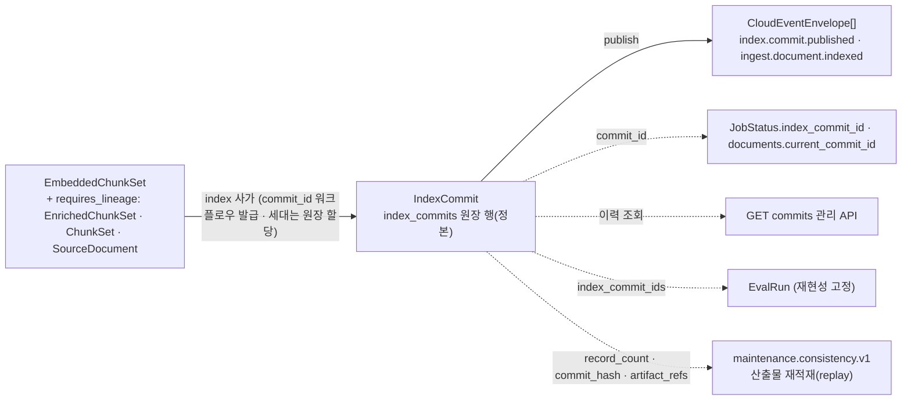
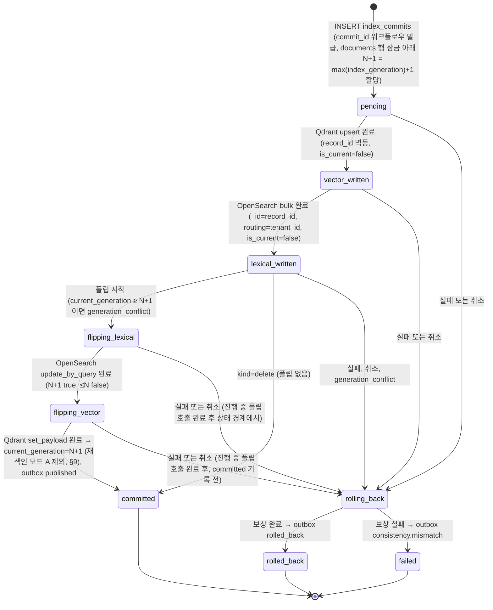

# IndexCommit 계약

> 정본은 [설계 바이블](../02-architecture/00-design-bible.md) §5.4 `IndexCommit` 표, §11.4 세대 사가, §5.7 `CommitStatus`·`CommitKind`, §6.2 `commit_hash`, §13.1 `index_commits` 원장이다. 이 문서는 그 표를 필드·타입·필수·설명·예시로 풀고 상태 기계·보상·세대 공존·재현성·재처리 판단·조회 API 사용·불변식·스키마·예시를 붙인다. 바이블에 없는 항목은 선택(N) 필드 또는 "## 미해결 이슈"의 제안으로만 둔다. `EmbeddedChunkSet`·`IndexRecord` 필드는 바이블 §5.4와 [07-embedded-chunk-set-and-index-record](./07-embedded-chunk-set-and-index-record.md)를 인용하고, `embedding_space_ids`의 타입 `EmbeddingSpaceIds`는 07 §2.2 정의와 같은 사본을 이 스키마의 `$defs`에 둔다(계약 간 교차 `$ref` 금지 — 00 §2 소유 규칙·15 결정; `index-record`·`collection-spec`과 같은 방식, CI 동치 대조). 바이블 §11.4 (6)이 정하지 않은 세대 번호의 원천과 재색인 모드 A(blue/green)의 원장 포인터 예외는 [02-architecture/06 §2.5·§3.2](../02-architecture/06-orchestration-and-workflows.md)·[02-architecture/03 §8.1·§9.2](../02-architecture/03-data-flow-and-document-lifecycle.md)의 결정을 그대로 따른다(§4·§9).

## 목적

`index` 사가의 출력 계약이자 PostgreSQL `index_commits` 원장(commit ledger)의 행 형식인 `IndexCommit`을 정의한다. 이 계약은 (1) 한 문서 세대(`index_generation`)의 색인 결과를 원자적 교체·롤백 단위로 기록하고, (2) 9단 `CommitStatus`와 `compensation`으로 두 백엔드(Qdrant·OpenSearch)에 걸친 부분 커밋의 실패 지점과 보상 결과를 원장에 남기며, (3) 재현성 지문 전부와 `commit_hash`로 "동일 `IngestRequest` + 동일 프로파일 → 동일 `IndexCommit` 해시"(브리프 §7)를 검증 가능하게 하고, (4) `artifact_refs`로 산출물 재적재(replay) 복구와 재처리 시작 스테이지(`from_stage`) 판단의 근거를 제공한다(바이블 §2.1 K6, [ADR-0026](../06-adr/0026-index-commit-generation-saga-and-ledger.md)).

## 범위

- 포함: `IndexCommit` 최상위 필드(봉투 포함), 이 계약 전용 하위 타입 `BackendResult`·`CommitArtifactRefs`·`CommitStats`·`Compensation`과 인라인 열거 `IndexCommit.backend_results.status`(`EmbeddingSpaceIds`는 07 §2.2 정의의 사본 `$defs`), 상태 기계와 전이 조건, 취소 시그널 수용 규칙, 보상 규칙(플립 전/후), `index_generation` 할당식·`is_current` 플립과 세대 공존·정리, `commit_hash`와 재현성, `artifact_refs`·계보와 `from_stage` 판단, `CommitKind` upsert/delete, `supersedes` 관계와 current 정의, 재색인 모드 A(blue/green)의 원장 포인터 예외와 alias의 관계, 조회 API·평가·정합성 검사에서의 사용, 크기 한계, 원장 저장 규약, 불변식, JSON Schema 전문, Pydantic v2 모델, 예시 3개.
- 제외: 백엔드 어댑터 구현과 upsert 배치 전략([04-pipelines/13-indexing](../04-pipelines/13-indexing.md)), 재색인·삭제 워크플로우의 액티비티 순서와 팬아웃([02-architecture/06 §2.3·§2.5·§2.7](../02-architecture/06-orchestration-and-workflows.md), [02-architecture/03 §7·§9](../02-architecture/03-data-flow-and-document-lifecycle.md); 파이프라인 상세는 [04-pipelines/19-update-delete-and-reindexing](../04-pipelines/19-update-delete-and-reindexing.md)(작성 예정)), `IndexRecord`·`EmbeddedChunkSet` 정본([07](./07-embedded-chunk-set-and-index-record.md)), 이벤트 `data` 필드([12-jobs-events-and-status](./12-jobs-events-and-status.md)), 관리 API 응답 봉투·커서·정렬([05-api/04-management-api](../05-api/04-management-api.md)(작성 예정)), 원장 물리 스키마·제약([02-architecture/04-storage-architecture](../02-architecture/04-storage-architecture.md)), `CollectionSpec`([15](./15-collection-profile-and-policy-contracts.md)).

## 1. 위치와 역할

| 항목 | 값(바이블 §4.2·§5.1·§11.4) |
|------|-----------------------------|
| 생산 | `index` 사가(확장 지점 `index_backend`; in_process 어댑터 → Qdrant gRPC / OpenSearch HTTP; 태스크 큐 `ingest-io`, `start_to_close` 10m, `heartbeat` 30s, `max_attempts` 5, 사가 보상·비재개) |
| 입력 | `EmbeddedChunkSet`(`ArtifactRef` 1개) + `requires_lineage`로 셸이 로드하는 `EnrichedChunkSet`·`ChunkSet`·`SourceDocument`(입력 `lineage_refs`의 `enriched`·`chunk_set`·`source`; `source`는 detect 출력 `SourceDocument` 산출물이며 `IndexRecord.acl_*`·`acl_hash`·`title`·`source_uri`의 원천, 바이블 §5.1·§5.2) |
| 소비 | 관리 API(`GET /v1/documents/{document_id}/commits`, `GET /v1/documents/{document_id}`), `publish`(outbox 이벤트), `JobStatus.index_commit_id`, `EvalRun.index_commit_ids`, 재색인(`reindex.collection.v1`·`reprocess.document.v1`의 `from_stage` 판단), `maintenance.consistency.v1`·`maintenance.cleanup.v1` |
| 멱등성 | `commit_id`(ULID)는 워크플로우가 1회 발급해 액티비티 인자로 전달(재시도 불변); `index_generation`은 원장 트랜잭션이 `documents` 행 잠금 아래 그 문서의 `max(index_commits.index_generation) + 1`로 할당하고 같은 `commit_id` 행이 이미 있으면 그 세대를 재사용(§4; 02-architecture/06 §3.2); `record_id = H("record", tenant_id, collection_id, document_id, str(index_generation), chunk_id)` 단위 upsert 멱등; 같은 `commit_id`가 `committed`면 no-op. `stage_key` 캐시는 적용하지 않는다(재실행은 항상 새 세대) |
| 인라인 한계 / 산출물 한계 | 16KB / 원장 행(§5.1). 오브젝트 스토리지 산출물이 아니다(§12) |
| 실패 정책 | `index.security_fields_missing` 배치 전체 거부(비재시도, E5); `index.backend_unavailable` 재시도; `index.partial_commit` → 보상 후 실패; `index.generation_conflict` 비재시도(안전망) — [13-error-model](./13-error-model.md) |



## 2. 필드 표

타입 표기는 브리프 §9.5. "필수" 열 `Y`/`N`/`Y(nullable)`/조건의 인스턴스 규칙은 [00 §8.1](./00-contract-overview.md)을 따른다(N 필드는 `null` 대신 생략; `superseded_by`·`compensation`·`error`는 바이블 §5.4 표기가 `… | null` N이라 00 §8.1 4행에 따라 생략·`null` 모두 허용하며 Pydantic `_null_allowed_optional`에 등재한다). 바이블 §5.4 표가 `string`으로만 적은 `document_id`·`doc_version`·`profile_hash`·`embedding_profile_hash`·`dictionary_hash`는 §6.1 식별자 규약에 따라 `string(ulid)`/`string(hex64)`로 정밀화했다(미해결 이슈 1).

### 2.1 `IndexCommit`

| 필드 | 타입 | 필수 | 설명 | 예시 |
|------|------|------|------|------|
| `schema_version` | string(semver) | Y | 계약 버전(봉투, 바이블 §5.2) | `"1.0.0"` |
| `schema_type` | string(const) | Y | `"IndexCommit"` | `"IndexCommit"` |
| `tenant_id` | string(ulid) | Y | 보안 삼중항 1(봉투). 잡·`EmbeddedChunkSet`의 값과 같다 | `"01J9ZQ4K7X2M8N3P5R6S7T8V9W"` |
| `collection_id` | string(ulid) | Y | 보안 삼중항 2(봉투, 수집 측 단수) | `"01J9ZQ5A1B2C3D4E5F6G7H8J9K"` |
| `producer` | `Producer` | Y | 사가 지문(봉투). `plugin_id`는 플랫폼 합성 `index_backend.pipeline`(06 문서와 같은 초안 규약, 미해결 이슈 2), `config_hash = H("config", canonical_json(ingest.index 설정))`, `image_digest = null`, `model_ids = []`. 백엔드 서버 버전은 `backend_results[].backend_version` | §예시 1 |
| `quality` | enum(Quality) | Y | 입력 `EmbeddedChunkSet.quality` 전파(봉투; 상류 `degraded`를 되돌리지 않음 — 바이블 §4.1 부분 성공 규약). `kind=delete`는 `full` | `"full"` |
| `warnings` | array<Warning> | Y | 봉투. 콘텐츠 미포함. v1 카탈로그에 `index.*` 경고·폴백 코드가 없어 보통 `[]`(재시도는 `ingest.document.retried` 이벤트로 남는다) | `[]` |
| `created_at` | string(date-time) | Y | 봉투. 원장 행 INSERT 시각으로 정의하며 `started_at`과 같다(미해결 이슈 3) | `"2026-09-22T09:14:02.000Z"` |
| `lineage_refs` | `LineageRefs` | Y | 봉투. `kind=upsert`면 `{source, parsed, normalized, chunk_set, enriched, embedded}` 6키 전부(00 §3.2 `index` 행), `kind=delete`면 `{}`. `artifact_refs`와 값이 같다 | §예시 1 |
| `commit_id` | string(ulid) | Y | 워크플로우가 `workflow.now()`·`workflow.random()`으로 1회 생성해 인자로 전달(액티비티 재시도에 불변, §11.4 (6)). `index_commits` PK | `"01JAB3E9F0G1H2J3K4M5N6P7Q8"` |
| `document_id` | string(ulid) | Y | 봉투 아닌 본문 필드. 입력 `EmbeddedChunkSet.document_id` | `"01JAB3C4D5E6F7G8H9JKMNPQRS"` |
| `doc_version` | string(hex64) | Y | `= SourceDocument.content_hash`([ADR-0005](../06-adr/0005-doc-version-content-hash-only-and-acl-payload-update.md)). `kind=delete`는 삭제 시점 `documents.current_doc_version` | hex64 |
| `job_id` | string(ulid) | Y | 이 커밋을 만든 잡. `jobs.index_commit_id`가 역참조 | `"01JAB3C0D1E2F3G4H5J6K7M8N9"` |
| `kind` | enum(CommitKind) | Y | `upsert`(새 세대 적재) / `delete`(tombstone, `record_count=0`, §7) | `"upsert"` |
| `previous_commit_id` | string(ulid) \| null | Y(nullable) | 세대 할당 시점 `documents.current_commit_id`(없으면 `null`). 플립 후 실패의 보상이 복원하는 세대의 커밋. 그 세대는 `index_generation - 1`이 아닐 수 있다(중간 세대가 롤백되었거나 재색인 모드 A의 전진하지 않은 green 세대가 있는 경우, §4·§9) | `"01JAA9Z8Y7X6W5V4T3S2R1Q0P9"` |
| `supersedes_commit_ids` | array<string(ulid)> | Y | 이 커밋이 current가 될 때 `is_current=false`로 전환되거나 `maintenance.cleanup.v1` 물리 삭제 대상이 되는 같은 문서의 이전 커밋. 정상 경로는 `[previous_commit_id]`, 보상 미완(`failed`)으로 잔존 레코드가 있는 이전 세대가 있으면 함께 포함. `null` 아닌 `previous_commit_id`를 항상 포함. 각 대상 행의 `superseded_by` 기록 시점은 `committed` 트랜잭션(일반 수집) 또는 `ledger.advance_pointers`(재색인 모드 A, §9) | `["01JAA9Z8Y7X6W5V4T3S2R1Q0P9"]` |
| `superseded_by` | string(ulid) \| null | N | 이 커밋을 대체한 다음 커밋. 다음 커밋의 `committed` 트랜잭션(재색인 모드 A는 alias 교체 직후 `ledger.advance_pointers`, §9)에서 기록되며 `status=committed` 행에만 값이 있다. 없으면 생략 또는 `null`(00 §8.1 4행) | 생략 |
| `status` | enum(CommitStatus) | Y | 사가 상태 9단(§3). `flipping_lexical`·`flipping_vector`가 플립 실패 지점을 원장에 남긴다 | `"committed"` |
| `index_generation` | integer(≥1) | Y | 문서 단위 단조 증가. `documents` 행 `FOR UPDATE` 잠금 아래 그 문서의 `max(index_commits.index_generation) + 1`로 할당한다(`current_generation + 1`이 아님 — 롤백된 세대·전진하지 않은 green 세대 번호를 재사용하지 않음, §4; 02-architecture/06 §2.5·§3.2). `record_id` 합성 요소 | `3` |
| `profile_id` | string(kebab) | Y | 컬렉션 프로파일 ID | `"standard"` |
| `profile_hash` | string(hex64) | Y | 커밋 시점 `CollectionSpec.profile_hash`. `commit_hash` 결합 요소 | hex64 |
| `parser_fingerprint_hash` | string(hex64) | Y | `H("parser", parser_id, parser_version, ",".join(model_ids), sidecar_image_digest or "", profile_option)`(바이블 §6.2 그대로) — `ParsedDocument`의 값 복사 | hex64 |
| `normalizer_fingerprint` | string(hex64) | Y | `H("normalizer", …, analyzer_id, dictionary_hash, pii_policy, pii_detector_version)` — `NormalizedDocument`의 값 복사 | hex64 |
| `chunker_config_hash` | string(hex64) | Y | `H("config", canonical_json(chunker config))` — `ChunkSet`의 값 복사; `chunk_id` 결합 요소 | hex64 |
| `enricher_fingerprint` | string(hex64) | Y | `= EnrichedChunkSet.enricher_fingerprint` | hex64 |
| `embedder_fingerprint` | string(hex64) | Y | `= EmbeddedChunkSet.embedder_fingerprint`(서빙 이미지 digest 포함) | hex64 |
| `embedding_space_ids` | `EmbeddingSpaceIds`(07 §2.2 정의의 사본, 이 계약 `$defs`) | Y | `= EmbeddedChunkSet.embedding_space_ids`. 스키마는 `#/$defs/EmbeddingSpaceIds`(07 정의와 동일한 사본, CI 동치)를 참조한다(§2.3) | `{"dense": hex64, "sparse_learned": hex64}` |
| `embedding_profile_hash` | string(hex64) | Y | `= EmbeddedChunkSet.embedding_profile_hash`; Qdrant 물리 컬렉션 `rag_vec_{[:12]}` 결정 | hex64 |
| `analyzer_id` | string | Y | `{engine}:{version}:{dictionary}`(§6.1). 변경 시 렉시컬 재색인 트리거(§6) | `"mecab-ko:1.3.7:ko-dic-2.1.1"` |
| `dictionary_hash` | string(hex64) | Y | `H("dict", *sorted(entry 정규화 행))`. 변경 시 렉시컬 재색인 트리거 | hex64 |
| `record_count` | integer(≥0) | Y | 이 커밋이 적재한 `IndexRecord` 수 = `EmbeddedChunkSet.vectors` 키 수(리프 + `level=2` 파생 항목; 부모 제외). `kind=delete`는 `0` | `2` |
| `commit_hash` | string(hex64) | Y | `H("commit", profile_hash, *sorted(f"{chunk_id}:{content_hash}:{embed_text_hash}"))`(§5). `commit_id`·세대·시각·테넌트와 무관 | hex64 |
| `backend_results` | array<BackendResult> | Y | 백엔드별 결과(§2.2). 사가 진행에 따라 항목이 추가되고 `backend_id`는 유일. ≤ 8(초안) | §예시 1 |
| `artifact_refs` | `CommitArtifactRefs` | Y | `{source, parsed, normalized, chunk_set, enriched, embedded}` — 재적재 복구 1순위(§2.4). `lineage_refs`와 같은 값 | §예시 1 |
| `stats` | `CommitStats` | Y | `{bytes_dense, bytes_sparse, bytes_lexical, bytes_late_interaction, leaf_count, parent_count, llm_tokens, wall_seconds}` → `usage_ledger`(§2.5) | §예시 1 |
| `compensation` | `Compensation` \| null | N | 보상 기록(§2.6). `status ∈ {rolled_back, failed}`에서만 non-null | §예시 2 |
| `error` | `StageError` \| null | N | 롤백·실패 사유(최종 인스턴스, `retryable=false`; 원인은 `cause`). `status ∈ {rolling_back, rolled_back, failed}`에서만 존재하며 취소로 인한 롤백은 없음. 콘텐츠 미포함 | §예시 2 |
| `events_emitted` | array<string(ulid)> | Y | 이 커밋의 상태 전이 트랜잭션에서 outbox에 기록한 `event_id`(워크플로우 발급): `committed` → `index.commit.published`, `rolled_back` → `index.commit.rolled_back`, `failed` → `index.consistency.mismatch`. 종결 전에는 `[]`. ≤ 32(초안) | `["01JAB3EA0B1C2D3E4F5G6H7J8K"]` |
| `started_at` | string(date-time) | Y | `pending` INSERT 시각 | `"2026-09-22T09:14:02.000Z"` |
| `committed_at` | string(date-time) | N | `status=committed`일 때만 존재 | `"2026-09-22T09:14:03.420Z"` |
| `updated_at` | string(date-time) | N | **이 문서 추가.** 마지막 상태 전이(또는 `superseded_by` 기록) 시각(미해결 이슈 3) | `"2026-09-22T09:14:03.420Z"` |

### 2.2 `backend_results[]`(`BackendResult`, 이 계약 `$defs`)

| 필드 | 타입 | 필수 | 설명 | 예시 |
|------|------|------|------|------|
| `backend_id` | string(plugin_id) | Y | `CollectionSpec.backends[].backend_id`(`{extension_point}.{implementation}`) | `"index_backend.qdrant"` |
| `backend_version` | string | Y | 서버 버전(어댑터 `capabilities()` 보고값) | `"1.19.0"` |
| `physical_name` | string | Y | 물리 컬렉션·인덱스(§13.4: `rag_vec_{embedding_profile_hash[:12]}`, `rag_lex_{lexical_profile_hash[:12]}`, 테넌트 전용 `_t_{tenant_id}`) | `"rag_vec_7091d8b9a8aa"` |
| `alias` | string | Y | 논리 alias(`col_{collection_id}_vec` / `_lex`). blue/green 채움 중에는 아직 이 물리명을 가리키지 않을 수 있다(§9) | `"col_01J9ZQ5A1B2C3D4E5F6G7H8J9K_vec"` |
| `upserted` | integer(≥0) | Y | upsert한 레코드 수. `kind=upsert`·`status=ok`면 `= record_count` | `2` |
| `deleted` | integer(≥0) | Y | 삭제한 레코드 수(`kind=delete`의 `delete_by_filter(document_id)` 또는 보상 삭제) | `0` |
| `duration_ms` | integer(≥0) | Y | 이 백엔드에 대한 쓰기·플립·보상 호출 시간 합 | `184` |
| `status` | enum[ok, failed, compensated] | Y | `$defs/IndexCommit.backend_results.status`(§5.7 인라인 열거 등재 규칙). `ok` 쓰기 성공·유지 / `failed` 이 백엔드의 쓰기 또는 보상 실패 / `compensated` 보상(삭제·복원) 완료 | `"ok"` |

### 2.3 `embedding_space_ids`(`EmbeddingSpaceIds`, [07 §2.2](./07-embedded-chunk-set-and-index-record.md) 정의의 사본 — 이 계약 `$defs`)

정본은 07 §2.2다: 키는 `VectorName` 철자, 값은 `embedding_space_id`(hex64, `H("space", model_id, revision, str(dim), str(normalized), prompt_hash, quantization, vocab_id or "")`, 바이블 §6.2); `dense` 필수, `sparse_learned`(`standard`) 또는 `sparse_bm25`(`lite`) 중 하나 이상, `late_interaction` 선택, 그 외 키 없음(`additionalProperties: false`). 이 계약은 `EmbeddedChunkSet.embedding_space_ids`를 그대로 복사하므로(IC-11) 의미를 재정의하지 않되, 스키마는 다른 계약 스키마의 `$defs`를 교차 `$ref`하지 않는다는 규칙(00 §2 소유 규칙 "계약 전용 하위 타입은 해당 계약 스키마의 자기 `$defs`", 바이블 §5.1 마지막 행; [15](./15-collection-profile-and-policy-contracts.md) 결정 — major 버전 결합 회피)에 따라 `index-record`·`collection-spec` 스키마와 같은 방식으로 **07 정의와 동일한 사본을 `#/$defs/EmbeddingSpaceIds`에 두고** CI가 네 사본(`embedded-chunk-set`·`index-record`·`collection-spec`·`index-commit`)의 동치를 대조한다. Pydantic도 같은 사본 모델을 이 모듈에 둔다(15와 같은 방식; 07 모델과 필드·검증이 같아야 한다). `visual-pages` 변형(`page_multivector`·`pooled_page_multivector`·`page_dense` 공간 키)은 07 미해결 이슈 3의 `EmbeddingSpaceIds` 변형이 확정되면 네 사본을 같은 minor로 함께 갱신한다. 네 계약이 같은 정의를 쓰므로 `common-types` 승격을 제안하며(미해결 이슈 8), 승격 시 사본을 `urn:rag:schema:common-types:1#/$defs/EmbeddingSpaceIds` 참조로 바꾼다(인스턴스 불변).

### 2.4 `artifact_refs`(`CommitArtifactRefs`, 이 계약 `$defs`)

| 키 | 값 | 필수 | `ArtifactRef.schema_type` |
|----|----|------|---------------------------|
| `source` | `ArtifactRef` | Y(upsert) | `SourceDocument` — `detect` 출력 계약 산출물(`media_type = application/vnd.rag.source-document+json`, `schema_version` 동반, `tenants/{tenant_id}/artifacts/source-document/{stage_key[:2]}/{stage_key}.json`; 00 §3.2 대응표, 바이블 §5.2·§4.1 `index`의 `requires_lineage`). **원본 바이트가 아니다** |
| `parsed` / `normalized` / `chunk_set` / `enriched` / `embedded` | `ArtifactRef` | Y(upsert) | `ParsedDocument` / `NormalizedDocument` / `ChunkSet` / `EnrichedChunkSet` / `EmbeddedChunkSet`(00 §3.2 대응표; 스키마 `const`) |

여섯 키 모두 계약 산출물이며 `schema_type`은 00 §3.2 대응표와 1:1이다(스키마 `const`, IC-12). 원본 바이트(`sources/{blake3}`, 원본 MIME)는 `artifact_refs`에 직접 들어가지 않고 `artifact_refs.source`가 가리키는 `SourceDocument.artifact`([02](./02-source-document.md)) 또는 `ParsedDocument.source_ref`([03](./03-parsed-document.md))를 통해 도달한다. `index`는 `source`(= `ctx.lineage["SourceDocument"]`)에서 `acl`·`metadata`(`title`·`source_uri`·`doc_date` 등)를 읽어 `IndexRecord.acl_*`·`acl_hash`·`title`·`source_uri`를 채우므로(D-09·E5, 07 §5 원천 열 `SRC`·§7) 이 키가 원본 바이트를 가리키면 `index.security_fields_missing`이 된다. `kind=delete`는 빈 객체다. 여섯 참조가 있으면 `reprocess.document.v1`은 어느 스테이지에서든 캐시 적중으로 재개할 수 있고(`stage_key`가 잡 스코프를 포함하므로 같은 문서만 적중), 정합성 검사는 `embedded`(+`chunk_set`)를 로드해 세대를 다시 적재한다(§6).

### 2.5 `stats`(`CommitStats`, 이 계약 `$defs`)

| 필드 | 타입 | 필수 | 설명 |
|------|------|------|------|
| `bytes_dense` / `bytes_sparse` / `bytes_lexical` / `bytes_late_interaction` | integer(≥0) | Y | 적재 바이트(dense는 레코드 수 × dim × 4 fp32 기준; lexical은 OpenSearch 적재분이라 `lite`는 0; late interaction 끔이면 0) → `rag_index_bytes_total{vector}`, `usage_ledger.bytes_indexed` |
| `leaf_count` / `parent_count` | integer(≥0) | Y | `level=0` 리프 수(색인) / `level=1` 부모 수(색인 안 함, `ChunkTextStore` 번들). `record_count ≥ leaf_count`(차이는 `level=2` 파생 항목) |
| `llm_tokens` | integer(≥0) | Y | `= EnrichedChunkSet.budget_used.llm_tokens_in + llm_tokens_out` → `usage_ledger.llm_tokens` |
| `wall_seconds` | number(≥0) | Y | `pending` → 종결 상태까지 벽시계 초 |

### 2.6 `compensation`(`Compensation`, 이 계약 `$defs`)

| 필드 | 타입 | 필수 | 설명 | 예시 |
|------|------|------|------|------|
| `reason` | string | Y | 롤백 사유. `error`가 있으면 그 최종 코드와 같다(`reason == error.code`; 비재시도 인스턴스, 예 `index.partial_commit` — 촉발 원인 코드는 `error.cause.code`), 취소 시그널이면 `job_cancelled`(`error` 없음). [ADR-0026](../06-adr/0026-index-commit-generation-saga-and-ledger.md) 예시 인스턴스와 같은 어휘. 12 `IndexCommitRolledBackData.code`는 `error.code`, `.reason`은 이 값의 투영. 콘텐츠 미포함(미해결 이슈 9) | `"index.partial_commit"` |
| `failed_at_status` | enum(CommitStatus) 부분집합 | Y | 실패 시점 상태: `pending, vector_written, lexical_written, flipping_lexical, flipping_vector` 중 하나(종결·`rolling_back` 불가). `reason = job_cancelled`도 다섯 상태 모두 가능하다 — 플립 구간의 취소는 진행 중인 플립 호출이 끝난 상태 경계에서 수용되어 플립 후 모드로 보상된다(§3 규칙 (6), §3.1) | `"flipping_vector"` |
| `deleted_counts` | object<backend_id, integer> | Y | 백엔드별 삭제한 새 세대 레코드 수(열린 객체, [14 §2.3](./14-schema-versioning-and-compatibility.md)). `backend_results[].deleted`와 일치 | `{"index_backend.qdrant": 2, "index_backend.opensearch": 2}` |
| `restored_generation` | integer \| null | Y(nullable) | 플립 후 실패에서 복원한 이전 세대(`previous_commit_id`의 `index_generation`). 플립 전 실패 또는 `previous_commit_id=null`이면 `null` | `4` |
| `completed_at` | string(date-time) | Y | 보상 절차 종료 시각(성공·실패 무관; 실패 여부는 `status`) | `"2026-09-22T10:43:20.150Z"` |

## 3. `CommitStatus` 상태 기계

**결정:** 커밋은 `pending → vector_written → lexical_written → flipping_lexical → flipping_vector → committed`의 정방향 6단과 `rolling_back → rolled_back | failed`의 보상 3단, 합계 9단 상태만 가지며, 새 세대는 `is_current=false`로 먼저 적재되고 플립 순서는 **렉시컬 → 벡터**로 고정된다(바이블 §11.4 (1)(2), §7.2 `ingest.index.commit.flip_order = [lexical, vector]`; [ADR-0026](../06-adr/0026-index-commit-generation-saga-and-ledger.md)).



| 현재 | 사건 | 다음 | 같은 트랜잭션에 기록되는 것 |
|------|------|------|------------------------------|
| — | `SELECT documents … FOR UPDATE` → `index_generation = max(index_commits.index_generation WHERE tenant_id, document_id) + 1`(없으면 1; 같은 `commit_id` 행이 있으면 그 세대 재사용) | `pending` | `INSERT index_commits(commit_id, N+1, previous_commit_id = current_commit_id, supersedes_commit_ids, status=pending, started_at)`; `jobs.index_commit_id` |
| `pending` | 벡터 백엔드 upsert 배치(256) 전부 성공 | `vector_written` | `backend_results += {qdrant, upserted, ok}` |
| `vector_written` | 렉시컬 백엔드 bulk 전부 성공 | `lexical_written` | `backend_results += {opensearch, upserted, ok}` |
| `lexical_written` | 플립 시작; `documents.current_generation ≥ N+1`이면 `index.generation_conflict` → `rolling_back` | `flipping_lexical` | 상태만(플립 실패 지점 표식) |
| `flipping_lexical` | `update_by_query(document_id)`: gen N+1 → `is_current=true`, gen ≤ N → `false`(`conflicts=proceed`, 재시도 3) | `flipping_vector` | 상태만 |
| `flipping_vector` | `set_payload(document_id)`: 같은 규칙 | `committed` | `committed_at`, outbox `index.commit.published`(→ `events_emitted`), 그리고 **일반 수집·재처리**는 같은 트랜잭션에 `documents.current_generation = N+1`, `current_commit_id = commit_id`, `supersedes_commit_ids`의 각 행에 `superseded_by = commit_id`. **재색인 모드 A(`reindex.mode = blue_green`) 자식 커밋**은 이 세 항목을 기록하지 않고 alias 교체 직후 `ledger.advance_pointers`가 기록한다(§9) |
| `pending`, `vector_written`, `lexical_written` | 비재시도 오류·재시도 소진·**취소 시그널**(진행 중 배치 완료 후 즉시) | `rolling_back` | `error`(취소는 없음) |
| `flipping_lexical`, `flipping_vector` | 비재시도 오류·재시도 소진·**취소 시그널**(진행 중인 `update_by_query`/`set_payload` 호출은 중단하지 않고 그 호출이 끝난 상태 경계에서 수용, `committed`는 기록하지 않음 — 규칙 (6)) | `rolling_back` | `error`(취소는 없음) |
| `rolling_back` | 보상 완료(§3.1) | `rolled_back` | `compensation`, `backend_results[].status = compensated`, outbox `index.commit.rolled_back` |
| `rolling_back` | 보상 실패 | `failed` | `compensation`(부분 결과) + `error`, `backend_results`에 `failed` 1개 이상, outbox `index.consistency.mismatch` |

규칙: (1) `committed`·`rolled_back`·`failed`는 종결 상태이며 이후 변경은 `superseded_by`·`updated_at` 기록만 허용된다. (2) 상태 전이는 위 표의 간선만 유효하고 위반은 `contract.violation`이다(Pydantic `assert_transition`). (3) `lite`(Qdrant 단독)처럼 백엔드가 없는 단계는 **즉시 통과**하되 상태는 그대로 원장에 기록해 상태 기계를 하나로 유지한다(`backend_results`는 1개; 미해결 이슈 10). (4) `kind=delete`는 `lexical_written → committed`로 플립 단계를 건너뛴다(§7). (5) `index.security_fields_missing`(E5)은 배치 전체를 거부하므로 항상 `pending`(벡터 첫 배치) 또는 `vector_written`(렉시컬 첫 배치)에서 `rolling_back`으로 간다. (6) **취소 시그널은 다섯 전종결 상태 모두에서 수용하며, 취소된 잡의 커밋은 항상 `rolled_back`이다.** 플립 전(`pending`~`lexical_written`)에는 진행 중 배치가 끝난 즉시 `rolling_back`으로 전이해 플립 전 모드로 보상한다. 플립 구간(`flipping_lexical`·`flipping_vector`)에 도착한 취소는 진행 중인 백엔드 플립 호출(`update_by_query`/`set_payload`)을 중단하지 않고 — 호출 중간 중단은 한 백엔드 안의 부분 플립을 만든다 — 그 호출이 끝난 상태 경계에서 수용해 `rolling_back`으로 전이하고(`committed`는 기록하지 않음) §3.1 플립 후 모드(이전 세대 복원 → 새 세대 삭제)로 보상한다. 이는 바이블 §11.5 잡 상태 기계가 `cancelling → cancelled`(보상 완료 전제)만 갖고 `cancelling → succeeded`가 없기 때문이다: 취소를 보류하고 `committed`까지 완주하면 잡은 `cancelled`인데 커밋이 current가 되거나(12 §13 "실패·롤백 뒤 이전 세대가 보인다"와 충돌) `cancelling`에 갇히는 표현 불가 상태가 된다([12 §3.2](./12-jobs-events-and-status.md) `ALLOWED_TRANSITIONS`, 12 I-8). [02-architecture/06 §5](../02-architecture/06-orchestration-and-workflows.md)의 "플립 이후 취소 보류 → `cancelling → succeeded`(경고 `index.late_cancel_ignored`)"는 바이블 §11.5 patch 제안(그 문서 미해결 6, 12 미해결 5)이며 채택 전까지 이 계약은 위 규칙을 따른다(미해결 이슈 16). 따라서 `compensation.reason = job_cancelled`는 `failed_at_status` 다섯 값 모두와 결합할 수 있고 `restored_generation`은 모드 규칙(IC-14)만 따른다. (7) 재색인 모드 A 자식 커밋의 `committed` 전이는 `documents.current_*`·이전 커밋 `superseded_by`를 기록하지 않는다(§9; 02-architecture/06 §2.5 결정, ADR-0026 개정 항목).

### 3.1 보상 규칙(플립 전/후)

**결정:** 보상은 실패 지점에 따라 둘이다. 플립 전은 새 세대 삭제만, 플립 후는 이전 세대 복원 후 새 세대 삭제이며 복원 실패는 `failed` + `index.consistency.mismatch`다(바이블 §11.4 (3), [ADR-0026](../06-adr/0026-index-commit-generation-saga-and-ledger.md)).

| `failed_at_status` | 모드 | 양 백엔드 동작(순서: 렉시컬 → 벡터, 플립 순서와 동일) | `compensation` |
|--------------------|------|--------------------------------------------------------|----------------|
| `pending`, `vector_written`, `lexical_written` | 플립 전 | `delete_by_filter(commit_id)` — 이전 세대는 `is_current=true`로 그대로 검색되므로 복원 불필요. 실패·취소(`reason = job_cancelled`) 모두 같은 절차 | `restored_generation = null`, `deleted_counts` = 실제 삭제 수(`pending`에서 실패하면 0일 수 있음) |
| `flipping_lexical`, `flipping_vector` | 플립 후 | `previous_commit_id` 세대(`documents.current_generation`이 가리키던 세대)를 `is_current=true`로 복원하고 gen N+1을 `false`로 되돌린 뒤 `delete_by_filter(commit_id)`. 실패와 취소(`reason = job_cancelled`, 진행 중 플립 호출 완료 후 상태 경계에서 수용, §3 규칙 (6)) 모두 같은 절차이며 복원은 멱등이라 아직 플립되지 않은 백엔드에는 no-op이다. 재색인 모드 A의 green 커밋은 green 물리 대상에 이전 세대 레코드가 없어 복원 단계가 no-op이며 blue의 서빙 세대는 건드리지 않는다(§9) | `restored_generation = previous_commit_id.index_generation`(모드 A도 같은 규칙으로 기록); `previous_commit_id = null`(첫 세대)이면 복원 대상이 없어 `null` |
| 보상 자체 실패 | — | 중단, `status=failed`, `backend_results`에 `failed` 표시 | 부분 `deleted_counts`, `completed_at` = 중단 시각. `maintenance.consistency.v1`이 세대별 `is_current=true` 수를 `record_count`와 대조해 잔존 레코드를 정리하고 필요하면 산출물 재적재로 복구 |

혼합 상태: `flipping_lexical` 완료 후 `flipping_vector` 완료 전 수 초 동안 렉시컬은 N+1, 벡터는 N을 현재로 본다. 이때 렉시컬 채널이 낸 N+1 `record_id`는 `hydrate`의 보안 필터(`is_current = true`)에 걸려 제외되고 `degraded{hydrate, partial_result}`로 관측된다(바이블 §4.3); `ContextPack.diagnostics.index_generations_seen`으로 혼합 창을 측정한다(바이블 미해결 이슈 8).

## 4. `index_generation`·`is_current` 플립과 세대 공존·롤백

**결정:** 물리 키 `record_id = H("record", tenant_id, collection_id, document_id, str(index_generation), chunk_id)`가 세대를 포함하므로 같은 `chunk_id` 집합의 재색인(`from_stage ∈ {enrich, embed, index}`, `dedup_policy=reindex_always`, ACL·임베더 정책 변경)도 이전 세대를 덮어쓰지 않고 공존하며, 검색 가시성은 `is_current` 플래그 하나로 바뀐다([ADR-0004](../06-adr/0004-deterministic-chunk-id-scoped-record-id-and-ulid-exception.md) v1.2, E17; [ADR-0026](../06-adr/0026-index-commit-generation-saga-and-ledger.md)).

| 시점 | 세대 N(이전) | 세대 N+1(새) | 원장 |
|------|--------------|--------------|------|
| 적재 중(`pending`~`lexical_written`) | `is_current=true`, 검색됨 | `is_current=false`, 검색 안 됨(공백·중복 없음) | `status` 진행, `documents.current_generation = N` |
| 플립(`flipping_lexical` → `flipping_vector`) | 백엔드별로 순차 `false` | 백엔드별로 순차 `true` | 중간 상태 기록 |
| `committed` | `false`(물리 잔존) | `true` | `current_generation = N+1`, `superseded_by` 기록(재색인 모드 A는 alias 교체 시점, §9) |
| `cleanup_delay`(1h, §7.2 초안 목표) 후 | `maintenance.cleanup.v1`이 `delete_by_filter(document_id, is_current=false, index_generation < current_generation)`로 물리 삭제 — `is_current=false` 조건 필수(blue/green 채움 중 다른 물리 대상의 서빙 세대를 지우지 않기 위함; [02-architecture/03 §5.1](../02-architecture/03-data-flow-and-document-lifecycle.md), [02-architecture/06 §2.7](../02-architecture/06-orchestration-and-workflows.md)) | 영향 없음(`record_id`가 세대별) | 커밋 행은 남는다(감사·재현) |
| 롤백 | 플립 전이면 그대로; 플립 후면 복원 | 삭제 | `rolled_back` + `compensation` |

**결정:** `index_generation`은 `documents` 행 `FOR UPDATE` 잠금 아래 **그 문서의 `max(index_commits.index_generation) + 1`**(없으면 1)로 할당하며 `documents.current_generation + 1`이 아니다([02-architecture/06 §2.5·§3.2](../02-architecture/06-orchestration-and-workflows.md), [02-architecture/03 §8.1·§9.2 (3)](../02-architecture/03-data-flow-and-document-lifecycle.md); [ADR-0026](../06-adr/0026-index-commit-generation-saga-and-ledger.md) 개정 항목). 이유: 세대 3이 롤백되면 `current_generation`은 2에 머물러 `current_generation + 1`이 3을 다시 발급하고, 재색인 모드 A의 green 커밋은 `committed`여도 포인터를 전진시키지 않아(§9) 같은 문서의 두 green 커밋이 같은 번호를 받는다. 두 경우 모두 원장 `UNIQUE(tenant_id, document_id, index_generation)`([02-architecture/04](../02-architecture/04-storage-architecture.md) I1)을 깨뜨리므로 번호는 롤백·폐기와 무관하게 재사용하지 않는다 — 원장·백엔드 어디에서도 같은 `(document_id, index_generation)`이 두 커밋을 가리키지 않는다(IC-2). 바이블 §11.4 (6)·시퀀스 다이어그램의 "N+1"은 잠금만 정하고 N의 원천을 정하지 않으므로 이 할당식은 정밀화이며 patch 제안을 미해결 이슈 14에 둔다(바이블 §13.1 `documents`에 `last_generation` 컬럼을 두는 대안 포함). 안전망 `index.generation_conflict`는 디스패처의 문서 단위 직렬화(§11.2)가 깨졌을 때만 발생한다. `cleanup_delay` 동안 세대별 레코드가 2배 공존하는 저장량 영향은 [04-pipelines/19](../04-pipelines/19-update-delete-and-reindexing.md)(작성 예정)가 측정한다(바이블 미해결 이슈 17).

## 5. `commit_hash`와 재현성

**결정:** `commit_hash = H("commit", profile_hash, *sorted(f"{chunk_id}:{content_hash}:{embed_text_hash}"))`이며 `commit_id`·`index_generation`·`job_id`·시각·`tenant_id`·`collection_id`를 포함하지 않는다(바이블 §6.2, 브리프 §7 "동일 `IngestRequest` + 동일 프로파일 → 동일 `IndexCommit` 해시").

| 결합 요소 | 원천 | 포착하는 변화 |
|-----------|------|---------------|
| `profile_hash` | `CollectionSpec.profile_hash` | 프로파일 값 변경(`version` 증가) |
| `chunk_id` | `ChunkSet.chunks[].chunk_id`(색인 대상 `level ∈ {0, 2}`) = `H("chunk", doc_version, chunker_config_hash, str(level), span)` | 원본 내용·청커 설정·블록 경계 |
| `content_hash` | `Chunk.content_hash = blake3_hex(utf8(text))` | 표시 원문 |
| `embed_text_hash` | `VectorBundle.embed_text_hash = blake3_hex(utf8(embed_text))` | 결정적 접두어(제목·heading 경로·캡션)·LLM 접두어(`generated`) — 3-텍스트 규칙(K2) |

따라서 (a) 같은 문서를 `reprocess from_stage=index`로 다시 적재한 세대는 `commit_hash`가 같고(정합성 검사의 재적재 검증 기준), (b) 메타데이터 제목 변경은 접두어를 통해 `embed_text_hash`를 바꾸므로 `commit_hash`가 달라지며(`PATCH metadata` 응답이 `from_stage=enrich`를 제안하는 이유), (c) ACL 변경은 `commit_hash`에 영향이 없고 커밋도 만들지 않는다(E11, [ADR-0005](../06-adr/0005-doc-version-content-hash-only-and-acl-payload-update.md)). 임베딩 벡터 값 자체는 결합에 들어가지 않으므로 같은 공간 안의 서빙 스택 교체(코사인 ≥ 0.9999 게이트, [ADR-0009](../06-adr/0009-embedding-serving-vllm-pooling-tei-inprocess.md))는 `embedder_fingerprint`만 바꾸고 `commit_hash`는 유지한다. `kind=delete`는 `H("commit", profile_hash)`다.

## 6. `artifact_refs`·계보와 재처리 판단(`from_stage`)

커밋 행은 `artifact_refs`로 여섯 상류 산출물을 가리키고 재현성 지문 다섯 개와 공간·분석기 식별자를 담으므로, 재색인·재처리 잡은 원장만 읽어 **어느 스테이지부터 다시 계산해야 하는지**를 문서별로 결정할 수 있다([14 §6.3](./14-schema-versioning-and-compatibility.md) 표의 커밋 필드 관점).

| 현재 커밋과 대상 프로파일·문서의 차이 | 최소 `from_stage` | 물리 교체 |
|----------------------------------------|-------------------|-----------|
| `doc_version` ≠ 원천의 새 `content_hash` | (새 수집 `POST /v1/ingest`) | 세대 플립 |
| `parser_fingerprint_hash` ≠ | `parse` | 세대 플립(블록 경계·`element_path` 변동 가능) |
| `normalizer_fingerprint` ≠ (`analyzer_id`·`dictionary_hash`·`pii_policy` 포함) | `normalize` | 렉시컬 물리 인덱스 blue/green(`lexical_profile_hash` 변경 시) + 세대 플립 |
| `chunker_config_hash` ≠ | `chunk` | 세대 플립(새 `chunk_id` 집합) |
| `enricher_fingerprint` ≠ 또는 `metadata_hash` 변경이 접두어에 영향 | `enrich` | 세대 플립(같은 `chunk_id`, 새 세대) |
| `embedding_profile_hash`·`embedding_space_ids` ≠ | `embed` | **컬렉션 blue/green**(Qdrant 물리 컬렉션이 달라짐, §9) |
| `embedder_fingerprint`만 ≠(공간 동일, 동등성 게이트 통과) | 없음 | 없음 |
| `profile_hash` ≠, 지문 전부 동일(`query.*`만 변경) | 없음 | 바인딩 교체만; `IndexCommit.profile_hash`는 다음 세대부터 바뀐다(14 §6.4) |
| `superseded_by` 없음 · `status ≠ committed` · 정합성 불일치 | `index`(재적재) | 같은 산출물로 새 세대 |

`from_stage` 이전 스테이지는 `stage_key`(잡 스코프 포함) 캐시 적중으로 생략되고 이후만 재실행되므로, 판단이 보수적(더 이른 스테이지)이어도 정확성은 유지되며 비용만 늘어난다. `artifact_refs`가 가리키는 산출물은 불변이므로(00 §9) 어느 시점에 읽어도 같은 바이트이고, `ArtifactRef.blake3`·`size_bytes` 대조가 손상을 잡는다.

## 7. `CommitKind`: `upsert`와 `delete`(tombstone)

| 항목 | `upsert` | `delete` |
|------|----------|----------|
| 트리거 | `ingest.document.v1`, `reprocess.document.v1`, `reindex.collection.v1` 자식 | `delete.document.v1`(`DELETE /v1/documents/{document_id}`) |
| 세대 | `max(index_generation) + 1` 할당(§4), 새 레코드 적재 후 플립 | 같은 식으로 할당(단조 증가 유지), 레코드 적재 없음 |
| 백엔드 동작 | upsert → 플립 | `aclrev:{tenant_id}:{document_id}` 삭제 힌트 기록(E9) → 양 백엔드 `delete_by_filter(document_id)`(벡터 → 렉시컬) |
| 상태 경로 | 9단 전부 | `pending → vector_written → lexical_written → committed`(플립 없음, §3 규칙 (4)) |
| `record_count` / `stats` | 적재 수 / 실제 값 | `0` / 바이트·개수 0, `wall_seconds`만 |
| `artifact_refs` / `lineage_refs` | 6키 | `{}`(파이프라인 산출물 없음) |
| 지문·공간·분석기 필드 | 상류 산출물 값 | `previous_commit_id` 커밋의 값 복사(무엇이 삭제되었는지 자기 서술) |
| `previous_commit_id` | `documents.current_commit_id` 또는 `null` | 반드시 non-null. current 커밋이 없는 문서의 삭제는 커밋 행을 만들지 않고 잡만 `succeeded`(`JobStatus.index_commit_id = null`, 미해결 이슈 5) |
| 실패 | 사가 보상(§3.1) | `delete_by_filter`는 멱등이라 재시도로 전진 복구; 소진 시 `failed` + `index.consistency.mismatch`, `compensation`은 복원이 아니라 남은 삭제를 정합성 검사가 완료(미해결 이슈 5) |
| 이벤트 | `index.commit.published`, `ingest.document.indexed` | `index.commit.published`, `ingest.document.deleted` |
| 이후 상태 | `documents.current_commit_id = commit_id` | `documents.current_commit_id = commit_id`(tombstone), `current_generation = N+1`; 어떤 레코드도 `is_current=true`가 아니며 재수집은 `N+2` |

## 8. `supersedes` 관계와 current 커밋

**결정:** 문서의 **current 커밋**은 `documents.current_commit_id`가 가리키는 커밋이며, 항상 `status = committed`이고 `superseded_by`가 없다. 한 `document_id`당 current 커밋은 최대 1개다(바이블 §13.1 `documents`, [ADR-0026](../06-adr/0026-index-commit-generation-saga-and-ledger.md)). 역은 성립하지 않는다: `committed ∧ superseded_by 없음`이면서 포인터가 가리키지 않는 커밋은 재색인 모드 A의 green 커밋(채움 중이거나 게이트 실패로 폐기된 것, §9)이며, 그 커밋은 alias가 가리키지 않는 물리 대상에만 존재하므로 **alias가 가리키는 물리 대상(`backend_results[].physical_name`) 안에서는 `committed ∧ superseded_by 없음`인 커밋이 문서당 ≤ 1**이다(IC-5).

관계 규칙(세대 1 → 2 → 3(롤백) → 4 → 5(삭제)의 예; 할당식 §4에 따라 롤백된 3은 재사용되지 않는다): `previous_commit_id`는 할당 시점의 current 커밋(없으면 `null`)이고 `supersedes_commit_ids`에 항상 포함된다; `supersedes_commit_ids`의 모든 커밋은 같은 문서·더 낮은 세대이며 이 커밋이 current가 될 때(`committed` 트랜잭션, 재색인 모드 A는 `ledger.advance_pointers`) `superseded_by`가 채워진다; 롤백된 세대 3은 아무것도 대체하지 않으므로 세대 2의 `superseded_by`는 비어 있다가 세대 4가 채우고, 세대 4의 `previous_commit_id`도 세대 2다; `failed` 커밋의 잔존 레코드는 다음 성공 커밋의 `supersedes_commit_ids`에 포함되어 정리 대상이 된다; 삭제 커밋(세대 5)은 세대 4를 대체하는 tombstone이다. `GET /v1/documents/{document_id}`의 "현재 커밋"은 이 정의를 쓴다.

## 9. 재색인(`reindex.collection.v1`)·alias와의 관계

**결정:** 컬렉션 단위 프로파일 변경은 세대 플립이 아니라 blue/green 물리 컬렉션 + alias 교체(렉시컬 → 벡터)이며, 재색인 자식 잡(`ingest.document.v1`)이 만드는 커밋은 일반 `upsert` 커밋과 같은 계약을 따른다(바이블 §11.2 `reindex.collection.v1`, §11.4 (5), [14 §6.4](./14-schema-versioning-and-compatibility.md)).

| 구분 | 문서 세대 플립(이 문서의 주 대상) | 컬렉션 blue/green |
|------|-----------------------------------|-------------------|
| 단위 | 문서 1개, `index_generation` | 컬렉션 1개, 물리 컬렉션·인덱스 |
| 가시성 스위치 | `is_current` payload | alias(`col_{collection_id}_vec`·`_lex`) 대상 물리명 |
| 원장 표현 | `IndexCommit.status`·`index_generation`·`previous_commit_id`; `committed` 트랜잭션이 `documents.current_*`·`superseded_by`를 기록 | 커밋마다 `backend_results[].physical_name`(green 물리명)·`alias`·새 `profile_hash`; `documents.current_*`·`superseded_by`는 alias 교체 직후 `ledger.advance_pointers`가 기록(아래 예외 결정); 교체 완료는 `collection.reindex.completed` + `CollectionSpec.profile_hash` 갱신 |
| 순서 | 렉시컬 → 벡터 플립 | 채움(자식 커밋 N건) → 하네스 게이트 → alias 교체 렉시컬 → 벡터 → 포인터 전진 |
| 실패 | 사가 보상(§3.1) | 게이트 실패·취소 시 green 물리 대상 폐기 예약; green 커밋은 `committed`를 그대로 두고(`rolled_back`은 `rolling_back` 보상 경로 전용, `index.commit.rolled_back` 미발행) 포인터가 전진하지 않았으므로 복원할 것이 없다(02-architecture/06 §2.5 A-6) |

**결정(재색인 모드 A 예외):** `IngestWorkflowInput.reindex.mode = blue_green`인 자식 잡의 커밋은 세대 사가를 정상 완주해 `committed`가 되고(`index.commit.published` 발행, green 물리 대상 안에서 `is_current=true`) 그 `committed` 트랜잭션은 `index_commits.status`·`committed_at`·`events_emitted`(과 `backend_results`)만 기록한다. `documents.current_commit_id`·`current_generation`과 `supersedes_commit_ids` 각 행의 `superseded_by`는 alias 교체(렉시컬 → 벡터) 직후 `ledger.advance_pointers`가 문서별 최신 green `committed` 커밋(`profile_hash = CollectionSpec.profile_hash'`, `backend_results[].physical_name` = green)으로 **한 번** 기록한다. 폐기된 green 커밋은 `committed`·`superseded_by` 없음으로 이력에 남고, 그 문서의 다음 커밋은 `supersedes_commit_ids`에 포함하지 않는다(alias 대상에 레코드가 없으므로 정리 대상이 아니다; 물리 대상 정리는 `maintenance.cleanup.v1` (3)). 채움 중 조회 API는 계속 blue 커밋(= `documents.current_commit_id`)을 현재 커밋으로 보고하며, alias 교체와 포인터 전진 사이의 짧은 창에서 "서빙 중" 판정은 `profile_hash == CollectionSpec.profile_hash ∧ backend_results[].physical_name = alias 대상`이다([02-architecture/06 §2.5](../02-architecture/06-orchestration-and-workflows.md) "모드 A의 원장 포인터에 대한 결정", [02-architecture/03 §9.2 (3)](../02-architecture/03-data-flow-and-document-lifecycle.md); 바이블 §11.4 사가의 예외이므로 [ADR-0026](../06-adr/0026-index-commit-generation-saga-and-ledger.md) 개정(minor) 항목, 미해결 이슈 6). 모드 B(같은 물리 대상 안의 롤링 세대 플립; 02-architecture/06 §2.5와 02-architecture/03 §9.1이 채택 여부를 다투는 항목)와 일반 수집·재처리는 바이블 §11.4 그대로 `committed` 트랜잭션에서 포인터를 전진시키며, 이 계약의 필드 의미는 두 모드에서 같다.

green 물리 컬렉션에는 gen ≤ N 레코드가 없으므로 자식 커밋의 플립은 자기 세대만 건드린다. 커밋이 `committed`여도 alias가 아직 blue를 가리키면 질의는 blue의 세대를 보며, 이 기간 `IndexCommit.profile_hash`(green)와 `QueryPlan.profile_hash`(blue)가 다른 것은 정상이다. 세대 번호는 §4의 할당식으로 blue·green 커밋이 한 수열을 공유하므로 blue에서 정상 수집(N+2)이 일어난 문서는 델타 패스가 green에 N+3으로 재적재한다(02-architecture/03 §9.2 (4)). `embedding_profile_hash`·`lexical_profile_hash`가 바뀌지 않은 재색인(청커·보강기 변경)은 물리 이름이 blue와 같아 green을 만들 수 없으므로 같은 물리 컬렉션 안에서 문서별 세대 플립으로 처리된다(14 §6.4 `GEN` 분기; 02-architecture/06 §2.5 모드 B — 채택 여부는 그 문서 미해결 15·02-architecture/03 미해결 11의 ADR로 확정하며, 어느 쪽이든 이 계약의 필드 의미는 바뀌지 않는다). `analyzer_id`·`dictionary_hash` 변경(`PUT /v1/collections/{collection_id}/dictionary`)은 렉시컬 물리 인덱스만 blue/green이고 벡터는 임베딩 캐시 적중으로 재계산 없이 새 세대에 복사된다.

## 10. 조회 API와 소비자

| 소비자 | 사용 | 규칙 |
|--------|------|------|
| `GET /v1/documents/{document_id}/commits` | `IndexCommit` 이력(바이블 §14) | 응답 항목은 이 계약 인스턴스 그대로(`schema_type`·`schema_version` 포함). 문서 ACL·Cedar 인가(E2·E10) 통과 주체만. `artifact_refs`·`lineage_refs`의 URI는 플랫폼 내부 오브젝트 키이며 클라이언트가 직접 접근할 수 없다. **제안([05-api/04](../05-api/04-management-api.md)(작성 예정)에서 확정, 미해결 이슈 15):** `index_generation` 내림차순, 불투명 커서, 종결 전 상태(`pending`~`rolling_back`)도 노출해 진행 중 사가를 관측, 재색인 모드 A의 폐기된 green 커밋 표시. 바이블 §14는 경로와 "`IndexCommit` 이력"만 정한다 |
| `GET /v1/documents/{document_id}` | 문서 메타·현재 커밋·ACL | 현재 커밋 = §8 정의(`documents.current_commit_id`); 재색인 모드 A 채움 중에는 blue 커밋 |
| `GET /v1/collections/{collection_id}/stats` | 레코드·바이트·세대 | current 커밋들의 `record_count`·`stats.bytes_*` 합, `index_generation` 분포 |
| `JobStatus.index_commit_id` | 잡 → 커밋 | `state ∈ {succeeded, partial}`면 `status=committed`, `failed`면 `rolled_back`/`failed`(보상 완료 후), `cancelled`면 **`rolled_back`만**(`compensation.reason = job_cancelled`; 바이블 §11.5 `cancelling → cancelled`는 보상 완료 전제, §3 규칙 (6), 12 I-8) |
| `EvalRun.index_commit_ids` | 평가 대상 고정 | `commit_hash`로 평가 코퍼스가 무엇이었는지 재현; 평가 중 새 세대가 커밋되면 `EvalReport`에 세대 불일치를 기록(08-evaluation) |
| `maintenance.consistency.v1` | 원장 ↔ 백엔드 대조 | 대조는 **커밋의 `backend_results[].physical_name` 기준 물리 대상별**이다(alias 기준 금지 — 재색인 채움 중 blue 레코드 수와 green 커밋 `record_count`를 비교하면 거짓 불일치; [02-architecture/06 §2.7](../02-architecture/06-orchestration-and-workflows.md), [02-architecture/03 §9.2 (4)](../02-architecture/03-data-flow-and-document-lifecycle.md)): blue는 `documents.current_commit_id` 커밋, 채움 중 green은 문서별 최신 green `committed` 커밋의 세대에 대해 `is_current=true` 레코드 수 = `record_count`; `content_hash` 집합은 `artifact_refs.chunk_set`에서 재계산; 불일치는 `index.consistency.mismatch` + 재적재(지문이 처음 달라지는 스테이지부터, 모두 같으면 `from_stage=index`) |
| 외부 소비자(unknown 열거) | [14 §2.2](./14-schema-versioning-and-compatibility.md) 부류 C | 조회 응답의 `IndexCommit`은 외부 소비자 계약이므로 unknown `CommitStatus`는 "종결 아님"으로 취급 |

`publish` 스테이지는 커밋 행을 `commit_id`로 읽는 로컬 액티비티다(바이블 §4.2). `IndexCommit`은 오브젝트 스토리지 산출물이 아니므로 `ArtifactRef`가 없으며, 바이블 §4.1 "경계 페이로드는 `ArtifactRef`만"의 예외로 기록한다(미해결 이슈 4). 검색 핫패스(`plan`~`render`)는 이 원장을 읽지 않는다([ADR-0034](../06-adr/0034-retrieval-hot-path-postgres-independence-and-hydrate.md)); 현재 세대는 api 프로세스 캐시로 제공된다.

## 11. 크기 한계·대형 데이터 처리

바이블 §5.1 한계(16KB / 원장 행)가 정본이며 그 외 수치는 초안 목표다. 인라인 본문은 없다 — 청크 본문·벡터·부모 텍스트는 `artifact_refs`가 가리키는 산출물에만 존재한다(00 §8.4).

| 대상 | 한계 | 초과 시 |
|------|------|---------|
| 인스턴스 직렬화(원장 `jsonb` 컬럼 합, API 응답 항목) | 16KB | `contract.violation`(산출물 500) |
| `backend_results` / `supersedes_commit_ids` / `events_emitted` / `warnings` | ≤ 8 / ≤ 64 / ≤ 32 / ≤ 64 항목 | 스키마 `maxItems`(초안; 미해결 이슈 11) |
| `artifact_refs` + `lineage_refs` | 6 + 6 `ArtifactRef`(약 5KB) | 값이 같으므로 원장은 `artifact_refs` 컬럼 하나만 저장하고 `lineage_refs`는 직렬화 시 복제(§12) |
| `error` | `StageError` ≤ 4KB(13 §11), `cause` 깊이 ≤ 3 | 13의 축약 순서 |
| 세대 공존 저장량 | 세대당 레코드 50,000 × ~6KB(§5.1)가 `cleanup_delay` 동안 2배(재색인 모드 A는 컬렉션 규모로 롤백 창 24h 초안 동안) | [04-pipelines/19](../04-pipelines/19-update-delete-and-reindexing.md)(작성 예정) 측정(바이블 미해결 이슈 17; 02-architecture/03 §5.4) |

## 12. 저장 규약(원장)

| 항목 | 규약 |
|------|------|
| 정본 | PostgreSQL `index_commits`(`commit_id` PK, `tenant_id` + RLS `FORCE`, `SET LOCAL app.tenant_id`; 컬럼 `status`, `index_generation`, `commit_hash`, `backend_results jsonb`, `artifact_refs jsonb`, `stats jsonb`, 그 외 필드 컬럼; 바이블 §13.1; `UNIQUE(tenant_id, document_id, index_generation)`과 INSERT 후 불변 컬럼 규칙은 [02-architecture/04](../02-architecture/04-storage-architecture.md) `index_commits` 행). `jobs.index_commit_id`·`outbox` 행은 상태 전이와 **같은 트랜잭션**에 갱신하고, `documents.current_generation`·`current_commit_id`·이전 커밋 `superseded_by`도 같은 트랜잭션이다(재색인 모드 A만 `ledger.advance_pointers` 트랜잭션, §9) |
| 산출물 여부 | **오브젝트 스토리지 산출물이 아니다.** `stage_key` 경로에 두면 같은 입력의 두 세대가 같은 키로 충돌해 불변성(00 §9)을 깨므로 저장하지 않는다(§5.1 "원장 행"). 따라서 콘텐츠 해시·zstd·`tenants/{tenant_id}/artifacts/…` 키 규약은 적용되지 않으며 `lineage` 표 대신 `artifact_refs`가 커밋의 계보다 |
| 미디어 타입 | `application/vnd.rag.index-commit+json`(§6.4) — 스키마 게시 `GET /v1/schemas/index-commit`과 조회 응답 항목에 사용. 이벤트 `index.commit.published`·`index.commit.rolled_back`·`index.consistency.mismatch`의 `data`는 이 계약의 완전한 인스턴스가 아니라 [12](./12-jobs-events-and-status.md) `$defs/IndexCommitPublishedData`·`IndexCommitRolledBackData`·`IndexConsistencyMismatchData` 투영이므로 `CloudEventEnvelope.dataschema`는 **생략**한다([14 §5.4](./14-schema-versioning-and-compatibility.md); 미해결 이슈 12) |
| 불변성 | 종결 상태 행은 `superseded_by`·`updated_at` 외 변경 불가; 행 삭제 없음(감사·재현; 문서 삭제도 tombstone 커밋으로 표현) |
| 백업·재현 | 원장은 PG 백업 대상([09-operations/07](../09-operations/07-backup-and-disaster-recovery.md)(작성 예정)). 백엔드 손실 시 `artifact_refs.embedded`(+ `chunk_set`·`enriched`·`source`)로 세대를 재적재(replay)하며 스냅샷 복원은 시간 단축용 2순위(바이블 §11.4 (4)). 산출물 보존 등급과 롤백 창은 [02-architecture/03 §5](../02-architecture/03-data-flow-and-document-lifecycle.md) |
| 계량 | `stats` → `usage_ledger(tenant_id, day, meter ∈ {bytes_indexed, llm_tokens})`, `rag_index_bytes_total{vector}`, `rag_ingest_stage_duration_seconds{stage="index"}`(라벨에 `tenant_id` 금지) |

## 13. LLM 최종 소비에 영향을 주는 정보

`IndexCommit`은 LLM에 전달되지 않지만 LLM이 보는 것을 결정한다.

| 관심사 | 이 계약의 보장 |
|--------|----------------|
| 가시성·일관성 | `is_current` 플립이 끝난 세대만 후보가 되므로(§10.2 보안 필터 `is_current = true`) 한 응답의 항목은 문서별로 한 세대에서만 나오고, 혼합 창의 누락은 `degraded{hydrate, partial_result}`로 드러난다. `ContextPack.diagnostics.index_generations_seen`이 세대를 기록한다 |
| provenance·인용 가능성 | 모든 `IndexRecord`가 `commit_id`·`index_generation`을 payload에 갖고 커밋 행이 `artifact_refs`를 갖으므로, 어떤 `cite_id`든 `record_id → commit_id → artifact_refs.chunk_set`으로 원문 좌표(`block_refs`·`Provenance`)와 정확한 산출물 바이트까지 역추적된다(K1). `commit_hash`가 "그때 색인된 텍스트 집합"을 고정한다 |
| 3-텍스트 규칙 | `commit_hash`의 `embed_text_hash`는 접두어(결정적·LLM)가 바뀌면 달라지므로, 접두어 정책 변경이 새 세대 없이 검색 결과를 바꾸는 일은 없다(K2, [ADR-0029](../06-adr/0029-three-text-rule-and-deterministic-context-prefix.md)) |
| 보안 삼중항 | 봉투 `tenant_id`·`collection_id`; 문서 ACL은 `artifact_refs.source`(`SourceDocument.acl`·`acl_hash`, §2.4)로 도달하고 레코드 `acl_*`로 평탄화된다. ACL 갱신은 커밋을 만들지 않고 payload만 바꾸므로(E11) 회수는 세대 플립을 기다리지 않는다. 커밋 행·오류·이벤트에는 본문·주체 문자열이 없다(00 I-16) |
| 결정성·프롬프트 캐시 | 같은 `commit_hash`의 두 세대는 같은 `text`·`context_prefix`를 내므로 팩 직렬화 바이트가 안정되어 프롬프트 캐시 접두어가 유지된다 |

## 스키마

`schemas/index-commit.schema.json`과 동일하다. 공용 타입·열거는 `urn:rag:schema:common-types:1`을 참조하고 재정의하지 않는다.

```json
{
  "$schema": "https://json-schema.org/draft/2020-12/schema",
  "$id": "urn:rag:schema:index-commit:1",
  "title": "IndexCommit",
  "description": "index 사가의 출력이자 PostgreSQL index_commits 원장 행(바이블 §5.4·§11.4·§13.1, ADR-0026). 한 문서 세대(index_generation)의 색인 결과 단위로 9단 CommitStatus, 세대 관계(previous_commit_id·supersedes_commit_ids·superseded_by), 재현성 지문, commit_hash, 백엔드별 결과, 재적재용 artifact_refs, 보상 기록을 담는다. 정본은 원장 행이며 오브젝트 스토리지 산출물이 아니다. 공용 타입·열거는 urn:rag:schema:common-types:1 을 참조한다. embedding_space_ids는 urn:rag:schema:embedded-chunk-set:1#/$defs/EmbeddingSpaceIds 와 같은 정의의 사본을 자기 $defs에 둔다(계약 간 교차 $ref 회피 — 00 §2·15 결정; CI가 두 정의의 동치를 대조한다). artifact_refs.source·lineage_refs.source는 detect 출력 SourceDocument 산출물 참조다(원본 바이트가 아님; 00 §3.2 대응표). 소유 문서: docs/03-contracts/08-index-commit.md",
  "type": "object",
  "properties": {
    "schema_version": {
      "$ref": "urn:rag:schema:common-types:1#/$defs/Semver",
      "description": "계약 버전. 초기 \"1.0.0\"",
      "pattern": "^1.(0|[1-9]d*).(0|[1-9]d*)$"
    },
    "schema_type": {
      "type": "string",
      "const": "IndexCommit",
      "description": "PascalCase 타입명"
    },
    "tenant_id": {
      "$ref": "urn:rag:schema:common-types:1#/$defs/Ulid",
      "description": "보안 삼중항 1"
    },
    "collection_id": {
      "$ref": "urn:rag:schema:common-types:1#/$defs/Ulid",
      "description": "보안 삼중항 2(수집 측 단수)"
    },
    "producer": {
      "$ref": "urn:rag:schema:common-types:1#/$defs/Producer",
      "description": "index 사가 지문. plugin_id는 플랫폼 합성 index_backend.pipeline, image_digest는 null. 백엔드 버전은 backend_results[].backend_version"
    },
    "quality": {
      "$ref": "urn:rag:schema:common-types:1#/$defs/Quality",
      "description": "입력 EmbeddedChunkSet.quality 전파(kind=delete는 full)"
    },
    "warnings": {
      "type": "array",
      "items": {
        "$ref": "urn:rag:schema:common-types:1#/$defs/Warning"
      },
      "maxItems": 64,
      "description": "품질 삼중항 2. 콘텐츠 미포함. v1 카탈로그에 index.* 경고 코드가 없어 보통 빈 배열"
    },
    "created_at": {
      "$ref": "urn:rag:schema:common-types:1#/$defs/DateTime",
      "description": "원장 행 INSERT 시각(= started_at)"
    },
    "lineage_refs": {
      "$ref": "urn:rag:schema:common-types:1#/$defs/LineageRefs",
      "description": "kind=upsert면 {source, parsed, normalized, chunk_set, enriched, embedded} 6키 전부, kind=delete면 빈 객체. artifact_refs와 같은 값"
    },
    "commit_id": {
      "$ref": "urn:rag:schema:common-types:1#/$defs/Ulid",
      "description": "워크플로우가 1회 발급(액티비티 재시도에 불변, 바이블 §11.4 (6))"
    },
    "document_id": {
      "$ref": "urn:rag:schema:common-types:1#/$defs/Ulid"
    },
    "doc_version": {
      "$ref": "urn:rag:schema:common-types:1#/$defs/Hex64",
      "description": "= SourceDocument.content_hash(ADR-0005). kind=delete면 삭제 시점 documents.current_doc_version"
    },
    "job_id": {
      "$ref": "urn:rag:schema:common-types:1#/$defs/Ulid",
      "description": "이 커밋을 만든 잡(jobs.index_commit_id 역참조)"
    },
    "kind": {
      "$ref": "urn:rag:schema:common-types:1#/$defs/CommitKind",
      "description": "upsert(새 세대 적재) / delete(tombstone, record_count=0)"
    },
    "previous_commit_id": {
      "oneOf": [
        {
          "$ref": "urn:rag:schema:common-types:1#/$defs/Ulid"
        },
        {
          "type": "null"
        }
      ],
      "description": "세대 할당 시점 documents.current_commit_id(없으면 null). 플립 후 보상이 복원하는 세대의 커밋"
    },
    "supersedes_commit_ids": {
      "type": "array",
      "items": {
        "$ref": "urn:rag:schema:common-types:1#/$defs/Ulid"
      },
      "uniqueItems": true,
      "maxItems": 64,
      "description": "이 커밋이 committed가 될 때 is_current=false로 전환되거나 물리 삭제 대상이 되는 같은 문서의 이전 커밋. previous_commit_id(non-null)를 포함"
    },
    "superseded_by": {
      "oneOf": [
        {
          "$ref": "urn:rag:schema:common-types:1#/$defs/Ulid"
        },
        {
          "type": "null"
        }
      ],
      "description": "선택(N, null 허용 — 바이블 §5.4 표기 string(ulid) | null, 00 §8.1 4행). 이 커밋을 대체한 다음 커밋. status=committed 행에만 값이 있으며 다음 커밋의 committed 트랜잭션(재색인 모드 A는 ledger.advance_pointers)에서 기록된다"
    },
    "status": {
      "$ref": "urn:rag:schema:common-types:1#/$defs/CommitStatus",
      "description": "사가 상태 9단(바이블 §11.4). flipping_lexical·flipping_vector가 플립 실패 지점을 남긴다"
    },
    "index_generation": {
      "type": "integer",
      "minimum": 1,
      "description": "문서 단위 단조 증가. documents 행 FOR UPDATE 잠금 아래 그 문서의 max(index_commits.index_generation) + 1로 할당(current_generation + 1 아님; 롤백·폐기된 세대 번호 재사용 없음, 02-architecture/06 §2.5·§3.2). record_id 합성 요소"
    },
    "profile_id": {
      "type": "string",
      "pattern": "^[a-z][a-z0-9]*(-[a-z0-9]+)*$",
      "maxLength": 64,
      "description": "kebab-case(바이블 §6.1)"
    },
    "profile_hash": {
      "$ref": "urn:rag:schema:common-types:1#/$defs/Hex64",
      "description": "H(\"profile\", canonical_json(해소된 프로파일)). 커밋 시점 CollectionSpec.profile_hash"
    },
    "parser_fingerprint_hash": {
      "$ref": "urn:rag:schema:common-types:1#/$defs/Hex64",
      "description": "H(\"parser\", parser_id, parser_version, \",\".join(model_ids), sidecar_image_digest or \"\", profile_option)(바이블 §6.2). 재현성 조건 1"
    },
    "normalizer_fingerprint": {
      "$ref": "urn:rag:schema:common-types:1#/$defs/Hex64",
      "description": "H(\"normalizer\", plugin_id, plugin_version, config_hash, analyzer_id, dictionary_hash, pii_policy, pii_detector_version)"
    },
    "chunker_config_hash": {
      "$ref": "urn:rag:schema:common-types:1#/$defs/Hex64",
      "description": "H(\"config\", canonical_json(chunker config)). chunk_id 결합 요소"
    },
    "enricher_fingerprint": {
      "$ref": "urn:rag:schema:common-types:1#/$defs/Hex64",
      "description": "= EnrichedChunkSet.enricher_fingerprint"
    },
    "embedder_fingerprint": {
      "$ref": "urn:rag:schema:common-types:1#/$defs/Hex64",
      "description": "= EmbeddedChunkSet.embedder_fingerprint(서빙 이미지 digest 포함)"
    },
    "embedding_space_ids": {
      "$ref": "urn:rag:schema:common-types:1#/$defs/EmbeddingSpaceIds",
      "description": "= EmbeddedChunkSet.embedding_space_ids 복사(07 §2.2 정본과 동일한 사본 $defs; index-record·collection-spec과 같은 방식, CI 동치 대조). {dense, sparse_learned | sparse_bm25, late_interaction?}"
    },
    "embedding_profile_hash": {
      "$ref": "urn:rag:schema:common-types:1#/$defs/Hex64",
      "description": "H(\"spaces\", sorted name=id). Qdrant 물리 컬렉션 rag_vec_{[:12]} 결정"
    },
    "analyzer_id": {
      "type": "string",
      "pattern": "^[a-z][a-z0-9-]*:[^:\\s]+:[^\\s]+$",
      "maxLength": 128,
      "description": "{engine}:{version}:{dictionary}(바이블 §6.1). 변경 시 렉시컬 재색인 트리거"
    },
    "dictionary_hash": {
      "$ref": "urn:rag:schema:common-types:1#/$defs/Hex64",
      "description": "H(\"dict\", sorted entries). 변경 시 렉시컬 재색인 트리거"
    },
    "record_count": {
      "type": "integer",
      "minimum": 0,
      "description": "이 커밋이 적재한 IndexRecord 수(리프 + level 2 파생 항목; 부모 제외). kind=delete는 0"
    },
    "commit_hash": {
      "$ref": "urn:rag:schema:common-types:1#/$defs/Hex64",
      "description": "H(\"commit\", profile_hash, *sorted(f\"{chunk_id}:{content_hash}:{embed_text_hash}\")). commit_id·세대·시각과 무관(브리프 §7 재현성)"
    },
    "backend_results": {
      "type": "array",
      "items": {
        "$ref": "#/$defs/BackendResult"
      },
      "maxItems": 8,
      "description": "백엔드별 결과. 사가 진행에 따라 항목이 추가되며 backend_id는 유일"
    },
    "artifact_refs": {
      "$ref": "#/$defs/CommitArtifactRefs"
    },
    "stats": {
      "$ref": "#/$defs/CommitStats"
    },
    "compensation": {
      "oneOf": [
        {
          "$ref": "#/$defs/Compensation"
        },
        {
          "type": "null"
        }
      ],
      "description": "선택(N, null 허용). status ∈ {rolled_back, failed}에서만 non-null"
    },
    "error": {
      "oneOf": [
        {
          "$ref": "urn:rag:schema:common-types:1#/$defs/StageError"
        },
        {
          "type": "null"
        }
      ],
      "description": "선택(N, null 허용). 롤백·실패 사유(최종 인스턴스, retryable=false). 취소로 인한 롤백은 없음"
    },
    "events_emitted": {
      "type": "array",
      "items": {
        "$ref": "urn:rag:schema:common-types:1#/$defs/Ulid"
      },
      "uniqueItems": true,
      "maxItems": 32,
      "description": "이 커밋의 상태 전이 트랜잭션에서 outbox에 기록한 event_id(index.commit.published / index.commit.rolled_back / index.consistency.mismatch)"
    },
    "started_at": {
      "$ref": "urn:rag:schema:common-types:1#/$defs/DateTime",
      "description": "pending INSERT 시각"
    },
    "committed_at": {
      "$ref": "urn:rag:schema:common-types:1#/$defs/DateTime",
      "description": "선택(N). status=committed일 때만 존재"
    },
    "updated_at": {
      "$ref": "urn:rag:schema:common-types:1#/$defs/DateTime",
      "description": "선택(N). 이 문서 추가. 마지막 상태 전이(또는 superseded_by 기록) 시각"
    }
  },
  "required": [
    "schema_version",
    "schema_type",
    "tenant_id",
    "collection_id",
    "producer",
    "quality",
    "warnings",
    "created_at",
    "lineage_refs",
    "commit_id",
    "document_id",
    "doc_version",
    "job_id",
    "kind",
    "previous_commit_id",
    "supersedes_commit_ids",
    "status",
    "index_generation",
    "profile_id",
    "profile_hash",
    "parser_fingerprint_hash",
    "normalizer_fingerprint",
    "chunker_config_hash",
    "enricher_fingerprint",
    "embedder_fingerprint",
    "embedding_space_ids",
    "embedding_profile_hash",
    "analyzer_id",
    "dictionary_hash",
    "record_count",
    "commit_hash",
    "backend_results",
    "artifact_refs",
    "stats",
    "events_emitted",
    "started_at"
  ],
  "additionalProperties": false,
  "allOf": [
    {
      "if": {
        "properties": {
          "status": {
            "const": "committed"
          }
        },
        "required": [
          "status"
        ]
      },
      "then": {
        "required": [
          "committed_at"
        ],
        "properties": {
          "events_emitted": {
            "minItems": 1
          },
          "backend_results": {
            "minItems": 1,
            "items": {
              "properties": {
                "status": {
                  "const": "ok"
                }
              }
            }
          },
          "compensation": {
            "type": "null"
          },
          "error": {
            "type": "null"
          }
        }
      }
    },
    {
      "if": {
        "properties": {
          "status": {
            "enum": [
              "rolled_back",
              "failed"
            ]
          }
        },
        "required": [
          "status"
        ]
      },
      "then": {
        "required": [
          "compensation"
        ],
        "properties": {
          "compensation": {
            "type": "object"
          },
          "events_emitted": {
            "minItems": 1
          },
          "backend_results": {
            "minItems": 1
          }
        }
      }
    },
    {
      "if": {
        "properties": {
          "status": {
            "const": "rolled_back"
          }
        },
        "required": [
          "status"
        ]
      },
      "then": {
        "properties": {
          "backend_results": {
            "items": {
              "properties": {
                "status": {
                  "const": "compensated"
                }
              }
            }
          }
        }
      }
    },
    {
      "if": {
        "properties": {
          "status": {
            "const": "failed"
          }
        },
        "required": [
          "status"
        ]
      },
      "then": {
        "required": [
          "error"
        ],
        "properties": {
          "error": {
            "type": "object"
          },
          "backend_results": {
            "contains": {
              "properties": {
                "status": {
                  "const": "failed"
                }
              }
            }
          }
        }
      }
    },
    {
      "if": {
        "properties": {
          "status": {
            "const": "rolled_back"
          },
          "compensation": {
            "properties": {
              "reason": {
                "not": {
                  "const": "job_cancelled"
                }
              }
            },
            "required": [
              "reason"
            ]
          }
        },
        "required": [
          "status",
          "compensation"
        ]
      },
      "then": {
        "required": [
          "error"
        ],
        "properties": {
          "error": {
            "type": "object"
          }
        }
      }
    },
    {
      "if": {
        "properties": {
          "status": {
            "not": {
              "const": "committed"
            }
          }
        },
        "required": [
          "status"
        ]
      },
      "then": {
        "not": {
          "required": [
            "committed_at"
          ]
        }
      }
    },
    {
      "if": {
        "properties": {
          "status": {
            "not": {
              "enum": [
                "rolled_back",
                "failed"
              ]
            }
          }
        },
        "required": [
          "status"
        ]
      },
      "then": {
        "properties": {
          "compensation": {
            "type": "null"
          }
        }
      }
    },
    {
      "if": {
        "properties": {
          "status": {
            "enum": [
              "pending",
              "vector_written",
              "lexical_written",
              "flipping_lexical",
              "flipping_vector"
            ]
          }
        },
        "required": [
          "status"
        ]
      },
      "then": {
        "properties": {
          "events_emitted": {
            "maxItems": 0
          },
          "error": {
            "type": "null"
          }
        }
      }
    },
    {
      "if": {
        "properties": {
          "status": {
            "const": "rolling_back"
          }
        },
        "required": [
          "status"
        ]
      },
      "then": {
        "properties": {
          "events_emitted": {
            "maxItems": 0
          }
        }
      }
    },
    {
      "if": {
        "properties": {
          "superseded_by": {
            "type": "string"
          }
        },
        "required": [
          "superseded_by"
        ]
      },
      "then": {
        "properties": {
          "status": {
            "const": "committed"
          }
        }
      }
    },
    {
      "if": {
        "properties": {
          "kind": {
            "const": "upsert"
          }
        },
        "required": [
          "kind"
        ]
      },
      "then": {
        "properties": {
          "artifact_refs": {
            "required": [
              "source",
              "parsed",
              "normalized",
              "chunk_set",
              "enriched",
              "embedded"
            ]
          },
          "lineage_refs": {
            "required": [
              "source",
              "parsed",
              "normalized",
              "chunk_set",
              "enriched",
              "embedded"
            ]
          }
        }
      }
    },
    {
      "if": {
        "properties": {
          "kind": {
            "const": "delete"
          }
        },
        "required": [
          "kind"
        ]
      },
      "then": {
        "properties": {
          "record_count": {
            "const": 0
          },
          "artifact_refs": {
            "maxProperties": 0
          },
          "lineage_refs": {
            "maxProperties": 0
          },
          "previous_commit_id": {
            "type": "string"
          },
          "backend_results": {
            "items": {
              "properties": {
                "upserted": {
                  "const": 0
                }
              }
            }
          },
          "stats": {
            "properties": {
              "bytes_dense": {
                "const": 0
              },
              "bytes_sparse": {
                "const": 0
              },
              "bytes_lexical": {
                "const": 0
              },
              "bytes_late_interaction": {
                "const": 0
              },
              "leaf_count": {
                "const": 0
              },
              "parent_count": {
                "const": 0
              },
              "llm_tokens": {
                "const": 0
              }
            }
          }
        }
      }
    }
  ],
  "$defs": {
    "IndexCommit.backend_results.status": {
      "type": "string",
      "enum": [
        "ok",
        "failed",
        "compensated"
      ],
      "description": "바이블 §5.4 backend_results[].status 인라인 열거({Type}.{path} 등재 규칙 §5.7). ok=쓰기 성공·유지, failed=이 백엔드의 쓰기 또는 보상 실패, compensated=보상(삭제·복원) 완료"
    },
    "BackendResult": {
      "type": "object",
      "description": "바이블 §5.4 backend_results[] 한 항목. backend_id는 CollectionSpec.backends[].backend_id(플러그인 ID)",
      "properties": {
        "backend_id": {
          "$ref": "urn:rag:schema:common-types:1#/$defs/PluginId",
          "description": "예 index_backend.qdrant, index_backend.opensearch"
        },
        "backend_version": {
          "type": "string",
          "minLength": 1,
          "maxLength": 64,
          "description": "서버 버전 문자열(capabilities 보고값)"
        },
        "physical_name": {
          "type": "string",
          "minLength": 1,
          "maxLength": 255,
          "description": "물리 컬렉션·인덱스 이름(바이블 §13.4: rag_vec_{hash12}, rag_lex_{hash12}, 테넌트 전용 _t_{tenant_id})"
        },
        "alias": {
          "type": "string",
          "minLength": 1,
          "maxLength": 255,
          "description": "논리 alias(col_{collection_id}_vec / col_{collection_id}_lex). blue/green 중에는 아직 이 물리명을 가리키지 않을 수 있다"
        },
        "upserted": {
          "type": "integer",
          "minimum": 0,
          "description": "이 커밋으로 upsert한 레코드 수(kind=upsert·status ok면 = record_count)"
        },
        "deleted": {
          "type": "integer",
          "minimum": 0,
          "description": "이 커밋이 삭제한 레코드 수(kind=delete의 delete_by_filter 또는 보상 삭제)"
        },
        "duration_ms": {
          "type": "integer",
          "minimum": 0,
          "description": "이 백엔드에 대한 쓰기·플립·보상 호출 시간 합"
        },
        "status": {
          "$ref": "#/$defs/IndexCommit.backend_results.status"
        }
      },
      "required": [
        "backend_id",
        "backend_version",
        "physical_name",
        "alias",
        "upserted",
        "deleted",
        "duration_ms",
        "status"
      ],
      "additionalProperties": false
    },
    "CommitArtifactRefs": {
      "type": "object",
      "description": "바이블 §5.4 artifact_refs {source, parsed, normalized, chunk_set, enriched, embedded} — 재적재(replay) 복구 1순위. lineage_refs와 같은 키·같은 값. 여섯 키 모두 계약 산출물이며 키별 schema_type은 00 §3.2 대응표와 1:1(const). 원본 바이트는 source가 가리키는 SourceDocument.artifact(02) 또는 ParsedDocument.source_ref(03)로 도달한다",
      "properties": {
        "source": {
          "$ref": "urn:rag:schema:common-types:1#/$defs/ArtifactRef",
          "properties": {
            "schema_type": {
              "const": "SourceDocument"
            }
          },
          "required": [
            "schema_type"
          ],
          "description": "detect 출력 SourceDocument 산출물(media_type application/vnd.rag.source-document+json, schema_version 동반; 바이블 §5.2·§4.1 index requires_lineage). index가 acl·metadata를 읽는 원천. 원본 바이트(sources/{blake3})가 아니다"
        },
        "parsed": {
          "$ref": "urn:rag:schema:common-types:1#/$defs/ArtifactRef",
          "properties": {
            "schema_type": {
              "const": "ParsedDocument"
            }
          },
          "required": [
            "schema_type"
          ]
        },
        "normalized": {
          "$ref": "urn:rag:schema:common-types:1#/$defs/ArtifactRef",
          "properties": {
            "schema_type": {
              "const": "NormalizedDocument"
            }
          },
          "required": [
            "schema_type"
          ]
        },
        "chunk_set": {
          "$ref": "urn:rag:schema:common-types:1#/$defs/ArtifactRef",
          "properties": {
            "schema_type": {
              "const": "ChunkSet"
            }
          },
          "required": [
            "schema_type"
          ]
        },
        "enriched": {
          "$ref": "urn:rag:schema:common-types:1#/$defs/ArtifactRef",
          "properties": {
            "schema_type": {
              "const": "EnrichedChunkSet"
            }
          },
          "required": [
            "schema_type"
          ]
        },
        "embedded": {
          "$ref": "urn:rag:schema:common-types:1#/$defs/ArtifactRef",
          "properties": {
            "schema_type": {
              "const": "EmbeddedChunkSet"
            }
          },
          "required": [
            "schema_type"
          ]
        }
      },
      "additionalProperties": false
    },
    "CommitStats": {
      "type": "object",
      "description": "바이블 §5.4 stats → usage_ledger(bytes_indexed, llm_tokens)·rag_index_bytes_total{vector}",
      "properties": {
        "bytes_dense": {
          "type": "integer",
          "minimum": 0,
          "description": "dense 벡터 바이트(레코드 수 × dim × 4, fp32 기준)"
        },
        "bytes_sparse": {
          "type": "integer",
          "minimum": 0,
          "description": "sparse_learned·sparse_bm25 바이트 합"
        },
        "bytes_lexical": {
          "type": "integer",
          "minimum": 0,
          "description": "index_text·context_prefix·lexical_terms 바이트(OpenSearch 적재분; lite는 0)"
        },
        "bytes_late_interaction": {
          "type": "integer",
          "minimum": 0,
          "description": "late_interaction 멀티벡터 바이트(끔이면 0)"
        },
        "leaf_count": {
          "type": "integer",
          "minimum": 0,
          "description": "level=0 리프 수(색인됨)"
        },
        "parent_count": {
          "type": "integer",
          "minimum": 0,
          "description": "level=1 부모 수(색인 안 됨; ChunkTextStore 번들)"
        },
        "llm_tokens": {
          "type": "integer",
          "minimum": 0,
          "description": "EnrichedChunkSet.budget_used.llm_tokens_in + llm_tokens_out"
        },
        "wall_seconds": {
          "type": "number",
          "minimum": 0,
          "description": "pending → 종결 상태까지 벽시계 초"
        }
      },
      "required": [
        "bytes_dense",
        "bytes_sparse",
        "bytes_lexical",
        "bytes_late_interaction",
        "leaf_count",
        "parent_count",
        "llm_tokens",
        "wall_seconds"
      ],
      "additionalProperties": false
    },
    "Compensation": {
      "type": "object",
      "description": "바이블 §5.4 compensation. 플립 전 실패(pending~lexical_written)는 새 세대 삭제만(restored_generation=null), 플립 후 실패(flipping_*)는 previous_commit_id 세대 복원 후 새 세대 삭제(restored_generation=이전 세대). 취소(reason=job_cancelled)는 다섯 전종결 상태 모두에서 가능하며 같은 모드 규칙을 따른다(§3 규칙 (6); 바이블 §11.5 cancelling → cancelled는 보상 완료 전제)",
      "properties": {
        "reason": {
          "type": "string",
          "pattern": "^[a-z][a-z0-9_]*(\\.[a-z][a-z0-9_]*)?$",
          "maxLength": 64,
          "description": "롤백 사유: 최종 error.code({stage}.{reason}, 13-error-model; 예 index.partial_commit — ADR-0026 예시와 같은 어휘) 또는 job_cancelled(취소 시그널, error 없음)"
        },
        "failed_at_status": {
          "$ref": "urn:rag:schema:common-types:1#/$defs/CommitStatus",
          "enum": [
            "pending",
            "vector_written",
            "lexical_written",
            "flipping_lexical",
            "flipping_vector"
          ],
          "description": "실패 시점 상태(종결·rolling_back 불가). reason=job_cancelled도 다섯 값 모두 가능(플립 구간 취소는 진행 중 플립 호출 완료 후 상태 경계에서 수용, 플립 후 모드 보상)"
        },
        "deleted_counts": {
          "type": "object",
          "propertyNames": {
            "$ref": "urn:rag:schema:common-types:1#/$defs/PluginId"
          },
          "additionalProperties": {
            "type": "integer",
            "minimum": 0
          },
          "description": "{backend_id: 삭제된 새 세대 레코드 수}(열린 객체, 14 §2.3)"
        },
        "restored_generation": {
          "type": [
            "integer",
            "null"
          ],
          "minimum": 1,
          "description": "복원한 이전 세대(플립 후 실패이고 previous_commit_id가 있을 때만 non-null)"
        },
        "completed_at": {
          "$ref": "urn:rag:schema:common-types:1#/$defs/DateTime",
          "description": "보상 절차 종료 시각(성공·실패 무관)"
        }
      },
      "required": [
        "reason",
        "failed_at_status",
        "deleted_counts",
        "restored_generation",
        "completed_at"
      ],
      "additionalProperties": false,
      "allOf": [
        {
          "if": {
            "properties": {
              "failed_at_status": {
                "enum": [
                  "pending",
                  "vector_written",
                  "lexical_written"
                ]
              }
            },
            "required": [
              "failed_at_status"
            ]
          },
          "then": {
            "properties": {
              "restored_generation": {
                "type": "null"
              }
            }
          }
        }
      ]
    }
  }
}
```

## Pydantic v2 모델

패키지 `rag_platform.contracts.index_commit`. 공용 타입·열거는 00 문서의 `rag_platform.contracts.common`·`rag_platform.contracts.enums`에서, `EmbeddingSpaceIds`는 스키마 `$defs` 사본과 대응하는 사본 모델을 이 모듈에 둔다(15와 같은 방식; 07 모델과 필드·검증이 같아야 하며 CI가 동치를 대조한다). 원시 타입 정규식은 스키마 `$defs`의 `pattern`을 그대로 쓴다(Pydantic 동치 게이트, 00 §10.3). `superseded_by`·`compensation`·`error`는 바이블 표기가 `| null` N이므로 `_null_allowed_optional`에 등재한다(00 §8.1 4행).

```python
from __future__ import annotations

from datetime import datetime
from enum import StrEnum
from typing import Annotated, ClassVar, Literal

from pydantic import Field, model_validator

from rag_platform.contracts.common import (
    ArtifactRef, ContractModel, H, Hex64, LineageRefs, PluginId, Producer, Semver, StageError, Ulid, Warning,
)
from rag_platform.contracts.enums import CommitKind, CommitStatus, Quality

ProfileId = Annotated[str, Field(pattern=r"^[a-z][a-z0-9]*(-[a-z0-9]+)*$", max_length=64)]
AnalyzerId = Annotated[str, Field(pattern=r"^[a-z][a-z0-9-]*:[^:\s]+:[^\s]+$", max_length=128)]
CompensationReason = Annotated[str, Field(pattern=r"^[a-z][a-z0-9_]*(\.[a-z][a-z0-9_]*)?$", max_length=64)]

REF_SCHEMA_TYPES = {"source": "SourceDocument", "parsed": "ParsedDocument", "normalized": "NormalizedDocument",
                    "chunk_set": "ChunkSet", "enriched": "EnrichedChunkSet", "embedded": "EmbeddedChunkSet"}  # 00 §3.2 대응표(6키 전부 계약 산출물)
PRE_FLIP = {CommitStatus.pending, CommitStatus.vector_written, CommitStatus.lexical_written}
POST_FLIP = {CommitStatus.flipping_lexical, CommitStatus.flipping_vector}
TERMINAL = {CommitStatus.committed, CommitStatus.rolled_back, CommitStatus.failed}
ALLOWED_TRANSITIONS: dict[CommitStatus, set[CommitStatus]] = {
    CommitStatus.pending: {CommitStatus.vector_written, CommitStatus.rolling_back},
    CommitStatus.vector_written: {CommitStatus.lexical_written, CommitStatus.rolling_back},
    CommitStatus.lexical_written: {CommitStatus.flipping_lexical, CommitStatus.committed, CommitStatus.rolling_back},
    CommitStatus.flipping_lexical: {CommitStatus.flipping_vector, CommitStatus.rolling_back},
    CommitStatus.flipping_vector: {CommitStatus.committed, CommitStatus.rolling_back},
    CommitStatus.rolling_back: {CommitStatus.rolled_back, CommitStatus.failed},
    CommitStatus.committed: set(), CommitStatus.rolled_back: set(), CommitStatus.failed: set(),
}


class BackendResultStatus(StrEnum):
    """$defs/IndexCommit.backend_results.status (이 계약 전용 인라인 열거)."""
    ok = "ok"
    failed = "failed"
    compensated = "compensated"


class EmbeddingSpaceIds(ContractModel):
    """07 §2.2 EmbeddingSpaceIds의 사본(스키마 $defs/EmbeddingSpaceIds 사본과 대응; 15와 같은 방식). 07 모델과 필드·검증이 같아야 한다(CI 동치)."""

    dense: Hex64
    sparse_learned: Hex64 | None = None
    sparse_bm25: Hex64 | None = None
    late_interaction: Hex64 | None = None

    @model_validator(mode="after")
    def _sparse_leg(self) -> "EmbeddingSpaceIds":
        if self.sparse_learned is None and self.sparse_bm25 is None:
            raise ValueError("contract.violation: sparse_learned(standard) or sparse_bm25(lite) required")
        return self


class BackendResult(ContractModel):
    backend_id: PluginId = Field(description="CollectionSpec.backends[].backend_id")
    backend_version: str = Field(min_length=1, max_length=64)
    physical_name: str = Field(min_length=1, max_length=255, description="rag_vec_{hash12} / rag_lex_{hash12}")
    alias: str = Field(min_length=1, max_length=255, description="col_{collection_id}_vec / _lex")
    upserted: int = Field(ge=0)
    deleted: int = Field(ge=0)
    duration_ms: int = Field(ge=0)
    status: BackendResultStatus


class CommitArtifactRefs(ContractModel):
    source: ArtifactRef | None = None
    parsed: ArtifactRef | None = None
    normalized: ArtifactRef | None = None
    chunk_set: ArtifactRef | None = None
    enriched: ArtifactRef | None = None
    embedded: ArtifactRef | None = None

    def items(self) -> dict[str, ArtifactRef]:
        return {k: v for k in REF_SCHEMA_TYPES if (v := getattr(self, k)) is not None}


class CommitStats(ContractModel):
    bytes_dense: int = Field(ge=0)
    bytes_sparse: int = Field(ge=0)
    bytes_lexical: int = Field(ge=0)
    bytes_late_interaction: int = Field(ge=0)
    leaf_count: int = Field(ge=0)
    parent_count: int = Field(ge=0)
    llm_tokens: int = Field(ge=0, description="budget_used.llm_tokens_in + llm_tokens_out")
    wall_seconds: float = Field(ge=0)


class Compensation(ContractModel):
    reason: CompensationReason = Field(description="최종 error.code(예 index.partial_commit) 또는 job_cancelled")
    failed_at_status: CommitStatus
    deleted_counts: dict[PluginId, Annotated[int, Field(ge=0)]] = Field(description="{backend_id: n}, n >= 0")
    restored_generation: int | None = Field(ge=1, description="플립 후 실패에서 복원한 이전 세대")
    completed_at: datetime

    @model_validator(mode="after")
    def _mode(self) -> "Compensation":
        if self.failed_at_status not in PRE_FLIP | POST_FLIP or (self.failed_at_status in PRE_FLIP and self.restored_generation is not None):
            raise ValueError("contract.violation: failed_at_status must be pre-terminal; pre-flip compensation restores nothing")  # IC-14
        # reason == "job_cancelled" 은 다섯 전종결 상태 모두와 결합할 수 있다(§3 규칙 (6); 바이블 §11.5 cancelling → cancelled 는 보상 완료 전제)
        return self


def compute_commit_hash(profile_hash: str, triples: list[tuple[str, str, str]]) -> str:
    """commit_hash = H("commit", profile_hash, *sorted(f"{chunk_id}:{content_hash}:{embed_text_hash}"))(바이블 §6.2)."""
    return H("commit", profile_hash, *sorted(f"{c}:{h}:{e}" for c, h, e in triples))


def assert_transition(current: CommitStatus, nxt: CommitStatus, kind: CommitKind) -> None:
    """상태 기계 간선 검사(§3). lexical_written → committed 는 kind=delete 에만 허용."""
    if nxt not in ALLOWED_TRANSITIONS[current]:
        raise ValueError(f"contract.violation: illegal CommitStatus transition {current} -> {nxt}")  # IC-4
    if current == CommitStatus.lexical_written and nxt == CommitStatus.committed and kind != CommitKind.delete:
        raise ValueError("contract.violation: upsert commits must flip before committed")  # IC-4


class IndexCommit(ContractModel):
    _null_allowed_optional: ClassVar[frozenset[str]] = frozenset({"superseded_by", "compensation", "error"})  # 00 §8.1 4행

    schema_version: Semver
    schema_type: Literal["IndexCommit"]
    tenant_id: Ulid
    collection_id: Ulid
    producer: Producer
    quality: Quality
    warnings: list[Warning] = Field(max_length=64)
    created_at: datetime = Field(description="원장 행 INSERT 시각(= started_at)")
    lineage_refs: LineageRefs
    commit_id: Ulid
    document_id: Ulid
    doc_version: Hex64
    job_id: Ulid
    kind: CommitKind
    previous_commit_id: Ulid | None = Field(description="Y(nullable): 할당 시점 documents.current_commit_id")
    supersedes_commit_ids: list[Ulid] = Field(max_length=64)
    superseded_by: Ulid | None = Field(default=None, description="N(null 허용): 대체한 다음 커밋(committed 행만)")
    status: CommitStatus
    index_generation: int = Field(ge=1, description="documents 행 잠금 아래 max(index_commits.index_generation) + 1")
    profile_id: ProfileId
    profile_hash: Hex64
    parser_fingerprint_hash: Hex64
    normalizer_fingerprint: Hex64
    chunker_config_hash: Hex64
    enricher_fingerprint: Hex64
    embedder_fingerprint: Hex64
    embedding_space_ids: EmbeddingSpaceIds
    embedding_profile_hash: Hex64
    analyzer_id: AnalyzerId
    dictionary_hash: Hex64
    record_count: int = Field(ge=0)
    commit_hash: Hex64
    backend_results: list[BackendResult] = Field(max_length=8)
    artifact_refs: CommitArtifactRefs
    stats: CommitStats
    compensation: Compensation | None = None
    error: StageError | None = None
    events_emitted: list[Ulid] = Field(max_length=32)
    started_at: datetime
    committed_at: datetime | None = None
    updated_at: datetime | None = None

    @property
    def is_current_candidate(self) -> bool:
        """§8: current 커밋의 필요조건. 충분조건은 documents.current_commit_id == commit_id (재색인 모드 A의 green 커밋은 여기서 참이어도 current가 아니다)."""
        return self.status == CommitStatus.committed and self.superseded_by is None

    @model_validator(mode="after")
    def _invariants(self) -> "IndexCommit":
        s, k, c, br = self.status, self.kind, self.compensation, self.backend_results
        for t in (self.created_at, self.started_at, self.committed_at, self.updated_at):
            if t is not None and (t.tzinfo is None or t.utcoffset().total_seconds() != 0):
                raise ValueError("contract.violation: timestamps must be RFC 3339 UTC")  # 00 I-28
        if self.created_at != self.started_at or (self.committed_at is not None) != (s == CommitStatus.committed) \
                or (self.committed_at is not None and self.committed_at < self.started_at):
            raise ValueError("contract.violation: created_at == started_at; committed_at present iff committed and >= started_at")  # IC-16
        if len(set(self.events_emitted)) != len(self.events_emitted):
            raise ValueError("contract.violation: events_emitted must be unique")  # IC-16 (스키마 uniqueItems 동치)
        if self.superseded_by is not None and (s != CommitStatus.committed or self.superseded_by == self.commit_id):
            raise ValueError("contract.violation: superseded_by only on committed rows and never self")  # IC-8
        sup = self.supersedes_commit_ids
        if self.commit_id in sup or len(set(sup)) != len(sup) or (self.previous_commit_id is not None and self.previous_commit_id not in sup):
            raise ValueError("contract.violation: supersedes_commit_ids must be unique, exclude self and include previous_commit_id")  # IC-6·7
        if len({b.backend_id for b in br}) != len(br):
            raise ValueError("contract.violation: backend_results.backend_id must be unique")  # IC-13
        if s == CommitStatus.committed:
            if not br or any(b.status != BackendResultStatus.ok for b in br) or (k == CommitKind.upsert and any(b.upserted != self.record_count for b in br)):
                raise ValueError("contract.violation: committed requires every backend ok and upserted == record_count")  # IC-9·13
            if c is not None or self.error is not None or not self.events_emitted:
                raise ValueError("contract.violation: committed has no compensation/error and emits >= 1 event")  # IC-14·15·16
        elif s in (CommitStatus.rolled_back, CommitStatus.failed):
            if c is None or not self.events_emitted or not br or c.completed_at < self.started_at:
                raise ValueError("contract.violation: rolled_back/failed require compensation(completed_at >= started_at), events, backend_results")  # IC-14
            if (c.failed_at_status in POST_FLIP and (self.previous_commit_id is None) != (c.restored_generation is None)) \
                    or (c.restored_generation is not None and c.restored_generation >= self.index_generation):
                raise ValueError("contract.violation: post-flip restores previous_commit_id generation (earlier than this one) iff it exists")  # IC-14
            if any(b.status == BackendResultStatus.compensated and c.deleted_counts.get(b.backend_id, 0) != b.deleted for b in br):
                raise ValueError("contract.violation: compensated backend deleted != compensation.deleted_counts")  # IC-13
            if (s == CommitStatus.rolled_back and any(b.status != BackendResultStatus.compensated for b in br)) \
                    or (s == CommitStatus.failed and not any(b.status == BackendResultStatus.failed for b in br)):
                raise ValueError("contract.violation: rolled_back => all compensated; failed => a failed backend result")  # IC-13
            if self.error is None and (s == CommitStatus.failed or c.reason != "job_cancelled"):
                raise ValueError("contract.violation: error required unless rollback was a cancellation")  # IC-15
            if self.error is not None and c.reason != self.error.code:
                raise ValueError("contract.violation: compensation.reason must equal the final error.code")  # IC-15
        elif c is not None or self.events_emitted:
            raise ValueError("contract.violation: compensation/events only in terminal states")  # IC-14·16
        if self.error is not None and (self.error.retryable or (s not in TERMINAL and s != CommitStatus.rolling_back)):
            raise ValueError("contract.violation: error is a final non-retryable instance in rolling_back/rolled_back/failed")  # IC-15
        refs, lin = self.artifact_refs.items(), {kk: v for kk, v in self.lineage_refs.model_dump().items() if v is not None}
        if k == CommitKind.upsert:
            if set(refs) != set(REF_SCHEMA_TYPES) or any(refs[kk].schema_type != REF_SCHEMA_TYPES[kk] for kk in REF_SCHEMA_TYPES):
                raise ValueError("contract.violation: upsert requires 6 artifact_refs with the §3.2 schema_type mapping")  # IC-12
        elif refs or lin or self.record_count or self.previous_commit_id is None or any(b.upserted for b in br) \
                or any(v for f, v in self.stats.model_dump().items() if f != "wall_seconds"):
            raise ValueError("contract.violation: delete commit has no refs/records/stats and needs previous_commit_id")  # IC-18
        if {kk: v.model_dump() for kk, v in refs.items()} != lin or self.record_count < self.stats.leaf_count:
            raise ValueError("contract.violation: artifact_refs must equal lineage_refs; record_count >= stats.leaf_count")  # IC-9·12
        return self


def verify_against_artifacts(ic: IndexCommit, embedded: "EmbeddedChunkSet", chunks: dict[str, "Chunk"]) -> None:
    """셸이 ctx.lineage 로 수행하는 교차 검사 IC-1·IC-9·IC-10·IC-11(kind=upsert). 위반은 contract.violation."""
    same = (ic.tenant_id, ic.collection_id, ic.document_id, ic.doc_version, ic.embedder_fingerprint, ic.embedding_profile_hash) == \
        (embedded.tenant_id, embedded.collection_id, embedded.document_id, embedded.doc_version, embedded.embedder_fingerprint, embedded.embedding_profile_hash)
    if not same or ic.record_count != len(embedded.vectors):
        raise ValueError("contract.violation: envelope/fingerprints/record_count differ from EmbeddedChunkSet")  # IC-1·9·11
    triples = [(cid, chunks[cid].content_hash, vb.embed_text_hash) for cid, vb in embedded.vectors.items()]
    if ic.commit_hash != compute_commit_hash(ic.profile_hash, triples):
        raise ValueError("contract.violation: commit_hash does not match recomputation")  # IC-10
```

## 예시

세 예시는 `schemas/index-commit.schema.json`(+ `common-types`)을 통과한다. ID·해시는 형식 규약을 지키는 플레이스홀더이며, 예시 1·3의 문서와 상류 참조는 [06-enriched-chunk-set](./06-enriched-chunk-set.md) 예시 1·[07](./07-embedded-chunk-set-and-index-record.md) 예시 1(행정안전부 HWPX 고시)과 같은 문서다 — `artifact_refs.enriched`, `embedding_space_ids`, `embedding_profile_hash`, `embedder_fingerprint`, Qdrant `physical_name`(`rag_vec_{embedding_profile_hash[:12]}`), `stats.bytes_dense`·`bytes_sparse`(07 예시 1 `EmbeddedChunkSet.stats`, 07 §2.3)는 07 예시 1의 값을, `dictionary_hash`는 같은 컬렉션(`01J9ZQ5A…`)의 07 예시 2·3·[05](./05-chunk-set.md) 예시 1 값을 그대로 쓴다(같은 컬렉션은 하나의 `embedding_profile_hash`·`dictionary_hash`에 바인딩되므로, 바이블 §5.6; IC-11). `artifact_refs.source`·`lineage_refs.source`는 §2.4대로 detect 출력 `SourceDocument` 산출물 참조(`artifacts/source-document/{stage_key[:2]}/{stage_key}.json`, `schema_type: SourceDocument`)이며, 06·07 예시가 같은 키에 적은 원본 바이트 참조(`sources/{blake3}`, 원본 MIME)는 정본이 아니라 그 문서들의 정정 대상이다. 예시 2는 06 예시 2(사내 PDF 보고서)와 같은 문서다.

### 예시 1 — 행정안전부 HWPX 고시, `standard`, 세대 3 `committed`

리프 2개(본문 조항 1개, 별표 표 1개)와 부모 1개인 문서다. 세대 2를 대체했고(`previous_commit_id` = `supersedes_commit_ids[0]`), 양 백엔드 모두 `ok`이며 `upserted`가 `record_count`와 같다. `bytes_dense`는 2 × 1024 × 4다.

```json
{
  "schema_version": "1.0.0", "schema_type": "IndexCommit", "tenant_id": "01J9ZQ4K7X2M8N3P5R6S7T8V9W", "collection_id": "01J9ZQ5A1B2C3D4E5F6G7H8J9K",
  "producer": {"plugin_id":"index_backend.pipeline","plugin_version":"1.0.0","config_hash":"569b180dc80a300402e4030e42049e7fd387825ca29302fb5079436406872e10","image_digest":null,"model_ids":[]},
  "quality": "full", "warnings": [], "created_at": "2026-09-22T09:14:02.000Z",
  "lineage_refs": {
    "source": {"uri":"s3://rag-artifacts/tenants/01J9ZQ4K7X2M8N3P5R6S7T8V9W/artifacts/source-document/cc/ccd7176dd18088eb911380e68c945a2321afcb9a3d267a3dd98ae907cf0d88da.json","blake3":"bcf567ffac7de73d208ab81b335ff204d0ca302699dd21173166d0a17fbdbab7","media_type":"application/vnd.rag.source-document+json","schema_type":"SourceDocument","schema_version":"1.0.0","size_bytes":3412,"stage_key":"ccd7176dd18088eb911380e68c945a2321afcb9a3d267a3dd98ae907cf0d88da"},
    "parsed": {"uri":"s3://rag-artifacts/tenants/01J9ZQ4K7X2M8N3P5R6S7T8V9W/artifacts/parsed-document/29/29c704ed012770f91619e1efee115a28679ab1a8204f6a1f6f7dcc61c51a341c.json","blake3":"6cb8cafdd02298a8b049ad58f954d89ec6805c5a2a89288a1a461fc050aa013d","media_type":"application/vnd.rag.parsed-document+json","schema_type":"ParsedDocument","schema_version":"1.0.0","size_bytes":1843200,"stage_key":"29c704ed012770f91619e1efee115a28679ab1a8204f6a1f6f7dcc61c51a341c"},
    "normalized": {"uri":"s3://rag-artifacts/tenants/01J9ZQ4K7X2M8N3P5R6S7T8V9W/artifacts/normalized-document/cd/cd07a1b2aeb847ac2ac36e6f62c368c337cd1bdd5770ed7cc044a568b6178bfa.json","blake3":"47bffc4a51c8952f36c971cd028c6f3e521b58fe82416b481479ad16cc0033db","media_type":"application/vnd.rag.normalized-document+json","schema_type":"NormalizedDocument","schema_version":"1.0.0","size_bytes":1912004,"stage_key":"cd07a1b2aeb847ac2ac36e6f62c368c337cd1bdd5770ed7cc044a568b6178bfa"},
    "chunk_set": {"uri":"s3://rag-artifacts/tenants/01J9ZQ4K7X2M8N3P5R6S7T8V9W/artifacts/chunk-set/4c/4c4085d68adef58175a54fa7af053cff30fb67d3ffeb81e5a8898e1da0f93727.json","blake3":"0c85e534d010f11da5e2f5ee712658297df1a73e4e25d73bb5f36e6262b63f9d","media_type":"application/vnd.rag.chunk-set+json","schema_type":"ChunkSet","schema_version":"1.0.0","size_bytes":655360,"stage_key":"4c4085d68adef58175a54fa7af053cff30fb67d3ffeb81e5a8898e1da0f93727"},
    "enriched": {"uri":"s3://rag-artifacts/tenants/01J9ZQ4K7X2M8N3P5R6S7T8V9W/artifacts/enriched-chunk-set/aa/aa2e9caa6781f0094f6c274fd215d499760dc36a3612e379237ced0f2e890015.json","blake3":"8871ce62323758a49120db08e67e782f657719a14d1a40f36d729381a1fcfcce","media_type":"application/vnd.rag.enriched-chunk-set+json","schema_type":"EnrichedChunkSet","schema_version":"1.0.0","size_bytes":9216,"stage_key":"aa2e9caa6781f0094f6c274fd215d499760dc36a3612e379237ced0f2e890015"},
    "embedded": {"uri":"s3://rag-artifacts/tenants/01J9ZQ4K7X2M8N3P5R6S7T8V9W/artifacts/embedded-chunk-set/11/117b5acd224fa32f6d90a1f428d9541b9416aecdc6f00c128dd7624d0dd6984a.json","blake3":"ba36d1cf9dad6faa19b1dd073249031c7f9f23edd9bdc10c851ace786e270a06","media_type":"application/vnd.rag.embedded-chunk-set+json","schema_type":"EmbeddedChunkSet","schema_version":"1.0.0","size_bytes":12288,"stage_key":"117b5acd224fa32f6d90a1f428d9541b9416aecdc6f00c128dd7624d0dd6984a"}
  },
  "commit_id": "01JAB3E9F0G1H2J3K4M5N6P7Q8", "document_id": "01JAB3C4D5E6F7G8H9JKMNPQRS", "doc_version": "cf266a7a804b27e9ed1133df8e05ef4eec7ea1a28f1ca63f61a1cf838c7f0118", "job_id": "01JAB3C0D1E2F3G4H5J6K7M8N9",
  "kind": "upsert", "previous_commit_id": "01JAA9Z8Y7X6W5V4T3S2R1Q0P9", "supersedes_commit_ids": ["01JAA9Z8Y7X6W5V4T3S2R1Q0P9"], "status": "committed", "index_generation": 3,
  "profile_id": "standard", "profile_hash": "48c116a18a2b3aacad3221f5439a839df1cacb0000c85c03c8a499208c2c70b2",
  "parser_fingerprint_hash": "9b4b46a4d2f2d3b11ce488e6fef406b5138687edae55ccca574f518623ec7bab", "normalizer_fingerprint": "645b83bf6c26fc74c6ae0b83438fbd1b85832c8fb705ab014d268db4f9081d03", "chunker_config_hash": "2fe596c7bc0b53338f84008612e6ecb7a97b19362183108b3b752bddf7f3dd11", "enricher_fingerprint": "4b06e250f79429847c96c7c69ab7761bc06efa22b48f704271faad00bb52c479", "embedder_fingerprint": "755a703235d6245ec6f57898ef386582e648a5a6ea94744d96ece44ca4cf3da9",
  "embedding_space_ids": {"dense":"cd72859ad1bd275b6f0b592d7e0a4619f8757fddb1586b1a6b714fd0458cf8a3","sparse_learned":"9b453733ce94d33fabdcdb3e8a762e9b01586ce89dcb959e24227c9571872706"}, "embedding_profile_hash": "b9ff31b9802e4e0d7c9b40e929f07c0be24668eaff92ab3e14b7e24a9943dccf",
  "analyzer_id": "mecab-ko:1.3.7:ko-dic-2.1.1", "dictionary_hash": "e3d5c46ddafc1106adda1b62fe0678c8e019289452382e8341b692f1eb52d2d0", "record_count": 2, "commit_hash": "4ac76a64e56e19ccb129349f1516da74259cdfd88bcfe086951e66f1d5a28bc2",
  "backend_results": [
    {"backend_id":"index_backend.qdrant","backend_version":"1.19.0","physical_name":"rag_vec_b9ff31b9802e","alias":"col_01J9ZQ5A1B2C3D4E5F6G7H8J9K_vec","upserted":2,"deleted":0,"duration_ms":184,"status":"ok"},
    {"backend_id":"index_backend.opensearch","backend_version":"3.8.0","physical_name":"rag_lex_e6df9c850d31","alias":"col_01J9ZQ5A1B2C3D4E5F6G7H8J9K_lex","upserted":2,"deleted":0,"duration_ms":233,"status":"ok"}
  ],
  "artifact_refs": {
    "source": {"uri":"s3://rag-artifacts/tenants/01J9ZQ4K7X2M8N3P5R6S7T8V9W/artifacts/source-document/cc/ccd7176dd18088eb911380e68c945a2321afcb9a3d267a3dd98ae907cf0d88da.json","blake3":"bcf567ffac7de73d208ab81b335ff204d0ca302699dd21173166d0a17fbdbab7","media_type":"application/vnd.rag.source-document+json","schema_type":"SourceDocument","schema_version":"1.0.0","size_bytes":3412,"stage_key":"ccd7176dd18088eb911380e68c945a2321afcb9a3d267a3dd98ae907cf0d88da"},
    "parsed": {"uri":"s3://rag-artifacts/tenants/01J9ZQ4K7X2M8N3P5R6S7T8V9W/artifacts/parsed-document/29/29c704ed012770f91619e1efee115a28679ab1a8204f6a1f6f7dcc61c51a341c.json","blake3":"6cb8cafdd02298a8b049ad58f954d89ec6805c5a2a89288a1a461fc050aa013d","media_type":"application/vnd.rag.parsed-document+json","schema_type":"ParsedDocument","schema_version":"1.0.0","size_bytes":1843200,"stage_key":"29c704ed012770f91619e1efee115a28679ab1a8204f6a1f6f7dcc61c51a341c"},
    "normalized": {"uri":"s3://rag-artifacts/tenants/01J9ZQ4K7X2M8N3P5R6S7T8V9W/artifacts/normalized-document/cd/cd07a1b2aeb847ac2ac36e6f62c368c337cd1bdd5770ed7cc044a568b6178bfa.json","blake3":"47bffc4a51c8952f36c971cd028c6f3e521b58fe82416b481479ad16cc0033db","media_type":"application/vnd.rag.normalized-document+json","schema_type":"NormalizedDocument","schema_version":"1.0.0","size_bytes":1912004,"stage_key":"cd07a1b2aeb847ac2ac36e6f62c368c337cd1bdd5770ed7cc044a568b6178bfa"},
    "chunk_set": {"uri":"s3://rag-artifacts/tenants/01J9ZQ4K7X2M8N3P5R6S7T8V9W/artifacts/chunk-set/4c/4c4085d68adef58175a54fa7af053cff30fb67d3ffeb81e5a8898e1da0f93727.json","blake3":"0c85e534d010f11da5e2f5ee712658297df1a73e4e25d73bb5f36e6262b63f9d","media_type":"application/vnd.rag.chunk-set+json","schema_type":"ChunkSet","schema_version":"1.0.0","size_bytes":655360,"stage_key":"4c4085d68adef58175a54fa7af053cff30fb67d3ffeb81e5a8898e1da0f93727"},
    "enriched": {"uri":"s3://rag-artifacts/tenants/01J9ZQ4K7X2M8N3P5R6S7T8V9W/artifacts/enriched-chunk-set/aa/aa2e9caa6781f0094f6c274fd215d499760dc36a3612e379237ced0f2e890015.json","blake3":"8871ce62323758a49120db08e67e782f657719a14d1a40f36d729381a1fcfcce","media_type":"application/vnd.rag.enriched-chunk-set+json","schema_type":"EnrichedChunkSet","schema_version":"1.0.0","size_bytes":9216,"stage_key":"aa2e9caa6781f0094f6c274fd215d499760dc36a3612e379237ced0f2e890015"},
    "embedded": {"uri":"s3://rag-artifacts/tenants/01J9ZQ4K7X2M8N3P5R6S7T8V9W/artifacts/embedded-chunk-set/11/117b5acd224fa32f6d90a1f428d9541b9416aecdc6f00c128dd7624d0dd6984a.json","blake3":"ba36d1cf9dad6faa19b1dd073249031c7f9f23edd9bdc10c851ace786e270a06","media_type":"application/vnd.rag.embedded-chunk-set+json","schema_type":"EmbeddedChunkSet","schema_version":"1.0.0","size_bytes":12288,"stage_key":"117b5acd224fa32f6d90a1f428d9541b9416aecdc6f00c128dd7624d0dd6984a"}
  },
  "stats": {"bytes_dense":8192,"bytes_sparse":176,"bytes_lexical":6210,"bytes_late_interaction":0,"leaf_count":2,"parent_count":1,"llm_tokens":0,"wall_seconds":1.42},
  "events_emitted": ["01JAB3EA0B1C2D3E4F5G6H7J8K"], "started_at": "2026-09-22T09:14:02.000Z", "committed_at": "2026-09-22T09:14:03.420Z", "updated_at": "2026-09-22T09:14:03.420Z"
}
```

### 예시 2 — 사내 PDF 보고서, `premium`, 세대 5 `rolled_back`(플립 후 보상)

렉시컬 플립이 끝난 뒤 Qdrant `set_payload`가 5회 재시도 후에도 실패해 `flipping_vector`에서 롤백되었다. 플립 후 실패이므로 `previous_commit_id` 세대 4를 양 백엔드에서 `is_current=true`로 복원한 뒤 세대 5 레코드 2건씩을 삭제했고(`deleted_counts` = `backend_results[].deleted`), `restored_generation`은 4다. `error`는 최종 인스턴스 `index.partial_commit`(비재시도)이고 `cause`가 재시도 가능했던 원인 `index.backend_unavailable`을 감싼다; `compensation.reason`은 그 최종 코드 `index.partial_commit`과 같다([ADR-0026](../06-adr/0026-index-commit-generation-saga-and-ledger.md) 예시와 동일 어휘, IC-15). LLM 보강이 켜진 컬렉션이라 `stats.llm_tokens`는 06 예시 2의 `budget_used` 합(`llm_tokens_in` 1,840 + `llm_tokens_out` 96 = 1,936)이다. `quality`는 06 예시 2(`status=partial`, 예산 소진)의 `degraded`를 07 `EmbeddedChunkSet`을 거쳐 그대로 전파한 값이며(§2.1; 바이블 §4.1 부분 성공 규약 — 하류는 상류 `degraded`를 되돌리지 않는다), `warnings`는 상류 경고를 복사하지 않으므로 `[]`다.

```json
{
  "schema_version": "1.0.0", "schema_type": "IndexCommit", "tenant_id": "01J9ZQ4K7X2M8N3P5R6S7T8V9W", "collection_id": "01JAC7D8E9F0G1H2J3K4M5N6P7",
  "producer": {"plugin_id":"index_backend.pipeline","plugin_version":"1.0.0","config_hash":"7e43608d2a9aece1d55f1ee5b673341f755e5fa38436f08d4e99f60c3f6ce483","image_digest":null,"model_ids":[]},
  "quality": "degraded", "warnings": [], "created_at": "2026-09-22T10:42:58.000Z",
  "lineage_refs": {
    "source": {"uri":"s3://rag-artifacts/tenants/01J9ZQ4K7X2M8N3P5R6S7T8V9W/artifacts/source-document/97/97b06d4ea42f05073b2a092f6eed6a7d356308bbc31c051a8f0040efa3ee79e0.json","blake3":"4bd92b567947e64d2a08cd4e8fd450a0df89ff6148652505ab8c8aa0dde4d878","media_type":"application/vnd.rag.source-document+json","schema_type":"SourceDocument","schema_version":"1.0.0","size_bytes":3688,"stage_key":"97b06d4ea42f05073b2a092f6eed6a7d356308bbc31c051a8f0040efa3ee79e0"},
    "parsed": {"uri":"s3://rag-artifacts/tenants/01J9ZQ4K7X2M8N3P5R6S7T8V9W/artifacts/parsed-document/d4/d43a1f43b4ff9bf4c1b2d042f117531add42e48e1a7873286d23693805f4dc12.json","blake3":"a8b95e117c944a03b1e5fefcaf7e60e1b5ad4335a388463dcb7f3a32ed614437","media_type":"application/vnd.rag.parsed-document+json","schema_type":"ParsedDocument","schema_version":"1.0.0","size_bytes":3120044,"stage_key":"d43a1f43b4ff9bf4c1b2d042f117531add42e48e1a7873286d23693805f4dc12"},
    "normalized": {"uri":"s3://rag-artifacts/tenants/01J9ZQ4K7X2M8N3P5R6S7T8V9W/artifacts/normalized-document/a3/a3a979f69e32b4c0e67c59d4979cf6c78df5c5ebe992ba2ddfe2c9c23970214a.json","blake3":"4f2ab7c97596d1af4b733b12e4828669533ead07b064ccc06aad0e1dddfff47e","media_type":"application/vnd.rag.normalized-document+json","schema_type":"NormalizedDocument","schema_version":"1.0.0","size_bytes":3201120,"stage_key":"a3a979f69e32b4c0e67c59d4979cf6c78df5c5ebe992ba2ddfe2c9c23970214a"},
    "chunk_set": {"uri":"s3://rag-artifacts/tenants/01J9ZQ4K7X2M8N3P5R6S7T8V9W/artifacts/chunk-set/eb/eb72850fea0d0a333c4363c4b0990ce90437730898b3a4d1dcbb6c9e7be21036.json","blake3":"c7a912f9d1b2bd01dfa9236917b6abba5a8d7aec4b7d0df6f181440714f6486f","media_type":"application/vnd.rag.chunk-set+json","schema_type":"ChunkSet","schema_version":"1.0.0","size_bytes":917504,"stage_key":"eb72850fea0d0a333c4363c4b0990ce90437730898b3a4d1dcbb6c9e7be21036"},
    "enriched": {"uri":"s3://rag-artifacts/tenants/01J9ZQ4K7X2M8N3P5R6S7T8V9W/artifacts/enriched-chunk-set/7b/7bd617794d9e648b335b7fb08aeba6e88baddec4993e0ace212bb9afd4385951.json","blake3":"f1c9b402e0f2c230e08ad5a0f3d4ce063fc511db20d6d8e24a0d848de1ce05ab","media_type":"application/vnd.rag.enriched-chunk-set+json","schema_type":"EnrichedChunkSet","schema_version":"1.0.0","size_bytes":31744,"stage_key":"7bd617794d9e648b335b7fb08aeba6e88baddec4993e0ace212bb9afd4385951"},
    "embedded": {"uri":"s3://rag-artifacts/tenants/01J9ZQ4K7X2M8N3P5R6S7T8V9W/artifacts/embedded-chunk-set/a6/a69fbd9e36c436026caa0df2a18f1b45e1987034f6786090d5698a0368093b2d.json","blake3":"4a484b578a6938a57a23cdcf58ae0af2f063cd8b55b144e3a8f791cd88147031","media_type":"application/vnd.rag.embedded-chunk-set+json","schema_type":"EmbeddedChunkSet","schema_version":"1.0.0","size_bytes":14336,"stage_key":"a69fbd9e36c436026caa0df2a18f1b45e1987034f6786090d5698a0368093b2d"}
  },
  "commit_id": "01JAC7F1G2H3J4K5M6N7P8Q9R0", "document_id": "01JAC7D8E9F0G1H2J3K4M5N6P8", "doc_version": "0e8ad5379bd2a65ff226b9a85397887bc04b3af51efe5a0ec0f85d372a3cbd90", "job_id": "01JAC7D9E0F1G2H3J4K5M6N7P8",
  "kind": "upsert", "previous_commit_id": "01JAC5B6C7D8E9F0G1H2J3K4M5", "supersedes_commit_ids": ["01JAC5B6C7D8E9F0G1H2J3K4M5"], "status": "rolled_back", "index_generation": 5,
  "profile_id": "premium", "profile_hash": "713f059e0fadb0938fb8faef9718b7bec7be2235a45db0917b3034259c2641db",
  "parser_fingerprint_hash": "bc3fc9916124ffb5fe071347802b0c0ba36adf2cf38603d4c1dc73c630ae9037", "normalizer_fingerprint": "54243312ae14bb265009058024026f87c1503a0caf9d83a91f5106ce12a7273d", "chunker_config_hash": "a53ac6a312f413c66d5c415c221a7ba564146028a272e8999b83efbecd2e5576", "enricher_fingerprint": "b5c246e65ad587e5c8741132528da1fa55ef04b06c1537062bc8df21d5c630ca", "embedder_fingerprint": "add27264ccb640e1373035df19cbe9af5222d7a89684cabb27258ab11e6d3a3a",
  "embedding_space_ids": {"dense":"7bc4f9cf4576f28b689beb66c371075ec28079fa55864e1acbef1bc9c7f5112b","sparse_learned":"e6a0dc6e05ba3aeb5819e77b972e8bc47f7365de778f0b3af0ef5de7bd9d6f50"}, "embedding_profile_hash": "7ea2aa9c13f602c514ae50800d6f3399fb9373e4aa5ed5e5d89ed8be8e6a2f1e",
  "analyzer_id": "mecab-ko:1.3.7:ko-dic-2.1.1", "dictionary_hash": "982d4df704a99b662ad04be262fc19c27506454b7ec76a474b68aa2e0c347b8d", "record_count": 2, "commit_hash": "4f1477aabbc6a7adc4e4d182838c1dd3e70abcd559f2e16e9f17dd33faf61822",
  "backend_results": [
    {"backend_id":"index_backend.qdrant","backend_version":"1.19.0","physical_name":"rag_vec_7ea2aa9c13f6","alias":"col_01JAC7D8E9F0G1H2J3K4M5N6P7_vec","upserted":2,"deleted":2,"duration_ms":9412,"status":"compensated"},
    {"backend_id":"index_backend.opensearch","backend_version":"3.8.0","physical_name":"rag_lex_61978f863bdd","alias":"col_01JAC7D8E9F0G1H2J3K4M5N6P7_lex","upserted":2,"deleted":2,"duration_ms":611,"status":"compensated"}
  ],
  "artifact_refs": {
    "source": {"uri":"s3://rag-artifacts/tenants/01J9ZQ4K7X2M8N3P5R6S7T8V9W/artifacts/source-document/97/97b06d4ea42f05073b2a092f6eed6a7d356308bbc31c051a8f0040efa3ee79e0.json","blake3":"4bd92b567947e64d2a08cd4e8fd450a0df89ff6148652505ab8c8aa0dde4d878","media_type":"application/vnd.rag.source-document+json","schema_type":"SourceDocument","schema_version":"1.0.0","size_bytes":3688,"stage_key":"97b06d4ea42f05073b2a092f6eed6a7d356308bbc31c051a8f0040efa3ee79e0"},
    "parsed": {"uri":"s3://rag-artifacts/tenants/01J9ZQ4K7X2M8N3P5R6S7T8V9W/artifacts/parsed-document/d4/d43a1f43b4ff9bf4c1b2d042f117531add42e48e1a7873286d23693805f4dc12.json","blake3":"a8b95e117c944a03b1e5fefcaf7e60e1b5ad4335a388463dcb7f3a32ed614437","media_type":"application/vnd.rag.parsed-document+json","schema_type":"ParsedDocument","schema_version":"1.0.0","size_bytes":3120044,"stage_key":"d43a1f43b4ff9bf4c1b2d042f117531add42e48e1a7873286d23693805f4dc12"},
    "normalized": {"uri":"s3://rag-artifacts/tenants/01J9ZQ4K7X2M8N3P5R6S7T8V9W/artifacts/normalized-document/a3/a3a979f69e32b4c0e67c59d4979cf6c78df5c5ebe992ba2ddfe2c9c23970214a.json","blake3":"4f2ab7c97596d1af4b733b12e4828669533ead07b064ccc06aad0e1dddfff47e","media_type":"application/vnd.rag.normalized-document+json","schema_type":"NormalizedDocument","schema_version":"1.0.0","size_bytes":3201120,"stage_key":"a3a979f69e32b4c0e67c59d4979cf6c78df5c5ebe992ba2ddfe2c9c23970214a"},
    "chunk_set": {"uri":"s3://rag-artifacts/tenants/01J9ZQ4K7X2M8N3P5R6S7T8V9W/artifacts/chunk-set/eb/eb72850fea0d0a333c4363c4b0990ce90437730898b3a4d1dcbb6c9e7be21036.json","blake3":"c7a912f9d1b2bd01dfa9236917b6abba5a8d7aec4b7d0df6f181440714f6486f","media_type":"application/vnd.rag.chunk-set+json","schema_type":"ChunkSet","schema_version":"1.0.0","size_bytes":917504,"stage_key":"eb72850fea0d0a333c4363c4b0990ce90437730898b3a4d1dcbb6c9e7be21036"},
    "enriched": {"uri":"s3://rag-artifacts/tenants/01J9ZQ4K7X2M8N3P5R6S7T8V9W/artifacts/enriched-chunk-set/7b/7bd617794d9e648b335b7fb08aeba6e88baddec4993e0ace212bb9afd4385951.json","blake3":"f1c9b402e0f2c230e08ad5a0f3d4ce063fc511db20d6d8e24a0d848de1ce05ab","media_type":"application/vnd.rag.enriched-chunk-set+json","schema_type":"EnrichedChunkSet","schema_version":"1.0.0","size_bytes":31744,"stage_key":"7bd617794d9e648b335b7fb08aeba6e88baddec4993e0ace212bb9afd4385951"},
    "embedded": {"uri":"s3://rag-artifacts/tenants/01J9ZQ4K7X2M8N3P5R6S7T8V9W/artifacts/embedded-chunk-set/a6/a69fbd9e36c436026caa0df2a18f1b45e1987034f6786090d5698a0368093b2d.json","blake3":"4a484b578a6938a57a23cdcf58ae0af2f063cd8b55b144e3a8f791cd88147031","media_type":"application/vnd.rag.embedded-chunk-set+json","schema_type":"EmbeddedChunkSet","schema_version":"1.0.0","size_bytes":14336,"stage_key":"a69fbd9e36c436026caa0df2a18f1b45e1987034f6786090d5698a0368093b2d"}
  },
  "stats": {"bytes_dense":8192,"bytes_sparse":3480,"bytes_lexical":7040,"bytes_late_interaction":0,"leaf_count":2,"parent_count":0,"llm_tokens":1936,"wall_seconds":22.15},
  "compensation": {"reason":"index.partial_commit","failed_at_status":"flipping_vector","deleted_counts":{"index_backend.qdrant":2,"index_backend.opensearch":2},"restored_generation":4,"completed_at":"2026-09-22T10:43:20.150Z"},
  "error": {
    "code": "index.partial_commit", "type": "urn:rag:error:index.partial_commit", "retryable": false, "stage": "index", "plugin_id": "index_backend.qdrant", "detail": "set_payload(is_current) failed after 5 attempts at flipping_vector; previous generation 4 restored on both backends", "message": "Partial commit", "occurred_at": "2026-09-22T10:43:20.150Z", "attempt": 5, "location": {"collection_id":"01JAC7D8E9F0G1H2J3K4M5N6P7","document_id":"01JAC7D8E9F0G1H2J3K4M5N6P8"},
    "cause": {"code":"index.backend_unavailable","type":"urn:rag:error:index.backend_unavailable","retryable":true,"stage":"index","plugin_id":"index_backend.qdrant","detail":"grpc UNAVAILABLE: connection refused","message":"Index backend unavailable","occurred_at":"2026-09-22T10:43:11.020Z","attempt":5}
  },
  "events_emitted": ["01JAC7F4A5B6C7D8E9F0G1H2J3"], "started_at": "2026-09-22T10:42:58.000Z", "updated_at": "2026-09-22T10:43:20.150Z"
}
```

### 예시 3 — 예시 1 문서의 삭제(`kind=delete`, 세대 4 `committed`)

`DELETE /v1/documents/{document_id}`가 만든 tombstone 커밋이다. 파이프라인 산출물이 없어 `lineage_refs`·`artifact_refs`가 빈 객체이고, 지문·공간·분석기 필드는 삭제된 세대 3 커밋(예시 1)의 값을 복사했다. 플립 없이 `lexical_written → committed`로 종결되었고 `backend_results[].deleted`가 세대 3 레코드 수다.

```json
{
  "schema_version": "1.0.0", "schema_type": "IndexCommit", "tenant_id": "01J9ZQ4K7X2M8N3P5R6S7T8V9W", "collection_id": "01J9ZQ5A1B2C3D4E5F6G7H8J9K",
  "producer": {"plugin_id":"index_backend.pipeline","plugin_version":"1.0.0","config_hash":"569b180dc80a300402e4030e42049e7fd387825ca29302fb5079436406872e10","image_digest":null,"model_ids":[]},
  "quality": "full", "warnings": [], "created_at": "2026-09-23T01:05:00.000Z",
  "lineage_refs": {},
  "commit_id": "01JAD1K2M3N4P5Q6R7S8T9V0W1", "document_id": "01JAB3C4D5E6F7G8H9JKMNPQRS", "doc_version": "cf266a7a804b27e9ed1133df8e05ef4eec7ea1a28f1ca63f61a1cf838c7f0118", "job_id": "01JAD1J0K1M2N3P4Q5R6S7T8V9",
  "kind": "delete", "previous_commit_id": "01JAB3E9F0G1H2J3K4M5N6P7Q8", "supersedes_commit_ids": ["01JAB3E9F0G1H2J3K4M5N6P7Q8"], "status": "committed", "index_generation": 4,
  "profile_id": "standard", "profile_hash": "48c116a18a2b3aacad3221f5439a839df1cacb0000c85c03c8a499208c2c70b2",
  "parser_fingerprint_hash": "9b4b46a4d2f2d3b11ce488e6fef406b5138687edae55ccca574f518623ec7bab", "normalizer_fingerprint": "645b83bf6c26fc74c6ae0b83438fbd1b85832c8fb705ab014d268db4f9081d03", "chunker_config_hash": "2fe596c7bc0b53338f84008612e6ecb7a97b19362183108b3b752bddf7f3dd11", "enricher_fingerprint": "4b06e250f79429847c96c7c69ab7761bc06efa22b48f704271faad00bb52c479", "embedder_fingerprint": "755a703235d6245ec6f57898ef386582e648a5a6ea94744d96ece44ca4cf3da9",
  "embedding_space_ids": {"dense":"cd72859ad1bd275b6f0b592d7e0a4619f8757fddb1586b1a6b714fd0458cf8a3","sparse_learned":"9b453733ce94d33fabdcdb3e8a762e9b01586ce89dcb959e24227c9571872706"}, "embedding_profile_hash": "b9ff31b9802e4e0d7c9b40e929f07c0be24668eaff92ab3e14b7e24a9943dccf",
  "analyzer_id": "mecab-ko:1.3.7:ko-dic-2.1.1", "dictionary_hash": "e3d5c46ddafc1106adda1b62fe0678c8e019289452382e8341b692f1eb52d2d0", "record_count": 0, "commit_hash": "19b5d1a1fa8c80b1f9fee43f1997305688d496b4c81c8c5c141f2fc63f7fdbe1",
  "backend_results": [
    {"backend_id":"index_backend.qdrant","backend_version":"1.19.0","physical_name":"rag_vec_b9ff31b9802e","alias":"col_01J9ZQ5A1B2C3D4E5F6G7H8J9K_vec","upserted":0,"deleted":2,"duration_ms":96,"status":"ok"},
    {"backend_id":"index_backend.opensearch","backend_version":"3.8.0","physical_name":"rag_lex_e6df9c850d31","alias":"col_01J9ZQ5A1B2C3D4E5F6G7H8J9K_lex","upserted":0,"deleted":2,"duration_ms":121,"status":"ok"}
  ],
  "artifact_refs": {},
  "stats": {"bytes_dense":0,"bytes_sparse":0,"bytes_lexical":0,"bytes_late_interaction":0,"leaf_count":0,"parent_count":0,"llm_tokens":0,"wall_seconds":0.31},
  "events_emitted": ["01JAD1K5X6Y7Z8A9B0C1D2E3F4"], "started_at": "2026-09-23T01:05:00.000Z", "committed_at": "2026-09-23T01:05:00.310Z", "updated_at": "2026-09-23T01:05:00.310Z"
}
```

## 불변식(Invariants)

위반 시 오류 코드는 별도 표기가 없으면 `contract.violation`(비재시도; 산출물 500, [13-error-model](./13-error-model.md))이다. 00 문서의 공통 불변식 I-1~I-8(봉투·`ArtifactRef`·`lineage_refs`·null 규칙), I-10(`record_id` 결합식), I-14·I-15(`StageError`), I-16(콘텐츠 미포함), I-28(형식)이 그대로 적용되며 아래는 이 계약이 더하는 것이다. IC-1·IC-9~IC-11의 교차 검사는 셸이 `ctx.lineage`를 로드해 수행한다(`verify_against_artifacts`).

| # | 불변식 | 출처 |
|---|--------|------|
| IC-1 | `schema_type == "IndexCommit"`; `tenant_id`·`collection_id`·`document_id`·`doc_version`은 입력 `EmbeddedChunkSet`(`kind=delete`는 `documents` 행)의 값과 같고 `job_id`는 생산 잡이며 `jobs.index_commit_id == commit_id` | 바이블 §5.2·§5.4·§13.1 |
| IC-2 | `commit_id`는 워크플로우가 1회 발급해 재시도에 불변이고 `index_generation`은 같은 `commit_id` 행이 있으면 재사용되어 함께 불변이다; 같은 `commit_id`가 `committed`면 재실행은 no-op이다; `(tenant_id, document_id, index_generation)`은 원장 `UNIQUE`이며 롤백·폐기된 번호는 재사용하지 않는다(할당식 IC-3) | 바이블 §4.2·§11.4 (6), 02-architecture/04 I1, 02-architecture/06 §3.2 |
| IC-3 | `index_generation`은 `documents` 행 `FOR UPDATE` 잠금 아래 그 문서의 `max(index_commits.index_generation) + 1`(없으면 1)로 할당된 문서 단위 단조 증가값이고(`current_generation + 1` 아님), 플립 시 `documents.current_generation ≥ index_generation`이면 `index.generation_conflict`(비재시도) | 바이블 §11.4 (6), §5.7; 02-architecture/06 §2.5·§3.2, 02-architecture/03 §8.1·§9.2 (3) |
| IC-4 | 상태 전이는 §3 표의 간선만 유효하다(`lexical_written → committed`는 `kind=delete`만); 종결 상태(`committed`·`rolled_back`·`failed`) 이후 변경은 `superseded_by`·`updated_at`만 | 바이블 §11.4, 이 문서 |
| IC-5 | current 커밋은 `documents.current_commit_id`가 가리키는 커밋이며 `committed ∧ superseded_by 없음`이다; alias가 가리키는 물리 대상(`backend_results[].physical_name`) 안에서 `committed ∧ superseded_by 없음`인 커밋은 `document_id`당 ≤ 1이다; 재색인 모드 A의 green 커밋은 채움 중 `committed ∧ superseded_by 없음`이지만 current가 아니다(§8·§9) | 바이블 §13.1, §11.4 (5); 02-architecture/06 §2.5 |
| IC-6 | `previous_commit_id`는 할당 시점 `documents.current_commit_id`(없으면 `null`)이며, non-null이면 같은 문서·`committed`·더 낮은 세대의 커밋이고 `supersedes_commit_ids`에 포함된다 | 바이블 §5.4 |
| IC-7 | `supersedes_commit_ids`는 유일·자기 제외·같은 문서·더 낮은 세대이며, 이 커밋이 current가 될 때 각 대상 행의 `superseded_by = commit_id`가 기록된다 — 일반 수집·재처리는 `committed` 트랜잭션, 재색인 모드 A는 alias 교체 직후 `ledger.advance_pointers` 트랜잭션(§9) | 바이블 §5.4; 02-architecture/06 §2.5 |
| IC-8 | `superseded_by`는 `status=committed` 행에만 값이 있고(없으면 생략 또는 `null`) 자기 자신이 아니며 더 높은 세대의 `committed` 커밋을 가리킨다; 기록 시점은 IC-7 | 바이블 §5.4, 00 §8.1 |
| IC-9 | `record_count = len(EmbeddedChunkSet.vectors)`(리프 + `level=2`) `≥ stats.leaf_count`; `kind=delete`면 0; `committed`인 `upsert`는 모든 `backend_results[].upserted == record_count`; 정합성 검사는 current 커밋의 `record_count`를 백엔드의 `is_current=true` 레코드 수와 대조한다 | 바이블 §5.4, §11.4 (4) |
| IC-10 | `commit_hash == H("commit", profile_hash, *sorted(f"{chunk_id}:{content_hash}:{embed_text_hash}"))`(색인 대상 청크 전체); `commit_id`·세대·시각·`tenant_id`·`collection_id`와 무관하다 — 같은 산출물의 재적재 세대는 같은 `commit_hash` | 바이블 §6.2, 브리프 §7 |
| IC-11 | `parser_fingerprint_hash`·`normalizer_fingerprint`·`chunker_config_hash`·`enricher_fingerprint`·`embedder_fingerprint`·`embedding_space_ids`·`embedding_profile_hash`·`analyzer_id`·`dictionary_hash`는 `artifact_refs`가 가리키는 상류 산출물·`CollectionSpec`의 값과 같다(`kind=delete`는 `previous_commit_id` 커밋의 값) | 바이블 §5.4, §6.2 |
| IC-12 | `artifact_refs`와 `lineage_refs`는 같은 키·같은 값이다; `kind=upsert`면 6키 전부이고 키별 `ArtifactRef.schema_type`은 00 §3.2 대응표와 **6키 모두** 일치한다(`source`→`SourceDocument`, `parsed`→`ParsedDocument`, `normalized`→`NormalizedDocument`, `chunk_set`→`ChunkSet`, `enriched`→`EnrichedChunkSet`, `embedded`→`EmbeddedChunkSet`; `source`는 detect 출력 계약 산출물이며 원본 바이트가 아니다, §2.4); `kind=delete`면 둘 다 `{}` | 바이블 §5.2·§5.4·§4.1 `index` `requires_lineage`, 00 §3.2·I-7 |
| IC-13 | `backend_results[].backend_id`는 유일하고 `CollectionSpec.backends[].backend_id`의 부분집합이다; `committed ⇒ 전부 ok`, `rolled_back ⇒ 전부 compensated`, `failed ⇒ failed 1개 이상`; `compensated` 항목의 `deleted == compensation.deleted_counts[backend_id]`; `kind=delete ⇒ upserted == 0` | 바이블 §5.4, 이 문서 |
| IC-14 | `compensation`은 `status ∈ {rolled_back, failed}`에서만 non-null이고 `failed_at_status`는 5개 전종결 상태 중 하나다; 플립 전(`pending`~`lexical_written`)이면 `restored_generation = null`, 플립 후(`flipping_*`)이면 `restored_generation = previous_commit_id.index_generation`(`previous_commit_id = null`이면 `null`)이며 `index_generation`보다 작다; `reason = job_cancelled`는 다섯 `failed_at_status` 값 모두와 결합할 수 있고(플립 구간 취소는 상태 경계에서 수용, §3 규칙 (6)) 취소된 잡(`JobState.cancelled`)의 커밋은 `rolled_back`이다; `deleted_counts` 값은 ≥ 0; `completed_at ≥ started_at` | 바이블 §11.4 (3), §11.5, §5.4; 12 §3.2·I-8 |
| IC-15 | `error`는 `status ∈ {rolling_back, rolled_back, failed}`에서만 존재하고 최종 인스턴스(`retryable=false`; 촉발 원인은 `cause`)다; `failed`는 반드시 `error`를 갖고, `rolled_back`은 `compensation.reason = job_cancelled`일 때만 `error`가 없다; `error`가 있으면 `compensation.reason == error.code`다; 콘텐츠·주체 문자열 미포함 | 13 I3·I5, 00 I-16, ADR-0026 예시 |
| IC-16 | `created_at == started_at`; `committed_at`은 `committed`일 때만 존재하고 `≥ started_at`; `events_emitted`는 유일하고 종결 전 `[]`, `committed ⇒ index.commit.published`, `rolled_back ⇒ index.commit.rolled_back`, `failed ⇒ index.consistency.mismatch`의 `event_id`를 포함하며 outbox 행과 같은 트랜잭션에 기록된다 | 바이블 §11.4, §5.7 이벤트 카탈로그 |
| IC-17 | `committed`이면 이 커밋의 모든 레코드가 그 물리 대상 안에서 `is_current=true`이고 같은 문서·같은 물리 대상의 더 낮은 세대 레코드는 `is_current=false`다(비원자 플립의 잔여는 정합성 검사가 수렴; 재색인 모드 A의 green 커밋은 green 물리 대상 안에서만 성립하고 blue의 서빙 세대에는 영향이 없다); 종결이 `rolled_back`이면 이 커밋의 레코드는 존재하지 않고 `previous_commit_id` 세대가 `is_current=true`다 | 바이블 §11.4 (1)(2)(4); 02-architecture/03 §9.2 |
| IC-18 | `kind=delete`: `previous_commit_id` non-null, `record_count = 0`, `artifact_refs = lineage_refs = {}`, `stats`의 바이트·개수·토큰 0, 커밋 후 문서의 어떤 레코드도 `is_current=true`가 아니다; current 커밋이 없는 문서의 삭제는 커밋을 만들지 않는다 | 바이블 §11.2 `delete.document.v1`, 이 문서 |
| IC-19 | 인스턴스 직렬화 ≤ 16KB; `warnings`·`error.detail`·`compensation.reason`·`backend_results[].physical_name`에 문서 본문·질의·주체 문자열이 없다 | 바이블 §5.1, 00 I-16 |
| IC-20 | `IndexCommit`은 ACL 필드를 갖지 않으며 ACL 갱신은 커밋을 만들지 않는다(payload만); 조회 응답은 문서 ACL·인가를 통과한 주체에게만 반환된다 | 바이블 §10.3 E10·E11, ADR-0005 |

## 버전 이력

이 표는 계약 `schema_version`(`urn:rag:schema:index-commit:1`)의 이력이다. 문서 자체의 버전은 frontmatter `version`(0.1.0)이며 둘은 독립적으로 움직인다.

| `schema_version` | 날짜 | 내용 |
|------------------|------|------|
| 1.0.0 | 2026-09-22 | 초판. 바이블 §5.4 `IndexCommit` 표 전부 반영. 이 계약 `$defs` `BackendResult`, `IndexCommit.backend_results.status`, `CommitArtifactRefs`, `CommitStats`, `Compensation`; 선택 최상위 필드 `updated_at`. 봉투·`ArtifactRef`·`StageError`·`LineageRefs`·`CommitStatus`·`CommitKind`는 `common-types` 1.0.0, `EmbeddingSpaceIds`는 `embedded-chunk-set` 1.0.0 `$defs` 정의와 동일한 사본(`#/$defs/EmbeddingSpaceIds`, CI 동치). 게시 전 리뷰 반영: `superseded_by` null 허용. 계약 일관성 감사 반영: `artifact_refs.source`·`lineage_refs.source`는 `SourceDocument` 산출물(`schema_type const`, 00 §3.2), `EmbeddingSpaceIds` 교차 `$ref` → 사본 `$defs`(00 §2·15 결정), 취소 시그널 수용을 다섯 전종결 상태 전체로 확장하고 `job_cancelled ⇒ 플립 전` 제약 제거(바이블 §11.5 정합) |

호환성 규칙(정본은 [14-schema-versioning-and-compatibility](./14-schema-versioning-and-compatibility.md), 바이블 §1.2): 선택 필드·열거값 추가는 minor(가산만), 필드 제거·필수화·의미 변경·열거값 제거·개명은 major. `CommitStatus` 값 추가(예: blue/green 폐기 표기)는 `common-types` minor이지만 내부 소비자(`publish`·정합성 검사)는 unknown 값을 거부하므로(14 §2.2 부류 A) 소비자를 먼저 배포하고, 조회 응답을 읽는 외부 소비자(부류 C)는 unknown 상태를 "종결 아님"으로 취급한다. `commit_hash`·`record_id` 결합식, 플립 순서, 보상 규칙의 변경은 값 형식이 같아도 **의미 변경 = major**다. `updated_at`이 바이블에 수용되면 필드 위치·이름을 유지한 채 필수 여부만 바뀔 수 있고, 필수화는 major다. 저장된 원장 행은 마이그레이션하지 않고 읽기 시 업캐스팅한다(14 §6).

## 결정 사항 요약

- **결정:** `IndexCommit`의 정본은 PostgreSQL `index_commits` 원장 행이며 오브젝트 스토리지 산출물이 아니다. 상태 전이·`documents`·`jobs`·outbox 갱신은 같은 트랜잭션이다(바이블 §13.1, §11.4; [ADR-0026](../06-adr/0026-index-commit-generation-saga-and-ledger.md), [ADR-0017](../06-adr/0017-event-delivery-outbox-cloudevents-no-broker.md)).
- **결정:** 9단 `CommitStatus`, 플립 순서 렉시컬 → 벡터, 중간 상태 `flipping_lexical`·`flipping_vector` 기록, 보상은 플립 전(새 세대 삭제) / 플립 후(이전 세대 복원 후 삭제) 둘이며 복원 실패는 `failed` + `index.consistency.mismatch`다. 취소 시그널은 다섯 전종결 상태 모두에서 수용하며 플립 구간에서는 진행 중 플립 호출이 끝난 상태 경계에서 수용해 플립 후 모드로 보상한다 — 취소된 잡의 커밋은 항상 `rolled_back`(`compensation.reason = job_cancelled`)이다(바이블 §11.5 `cancelling → cancelled`는 보상 완료 전제; [ADR-0026](../06-adr/0026-index-commit-generation-saga-and-ledger.md); 02-architecture/06 §5의 "플립 이후 취소 보류 → `cancelling → succeeded`"는 바이블 patch 채택 전까지 제안, 미해결 이슈 16).
- **결정:** `index_generation`은 `documents` 행 `FOR UPDATE` 잠금 아래 그 문서의 `max(index_commits.index_generation) + 1`로 할당하며 `current_generation + 1`이 아니다 — 롤백된 세대·전진하지 않은 green 세대의 번호를 재사용하지 않고 원장 `UNIQUE(tenant_id, document_id, index_generation)`이 이를 강제한다(02-architecture/06 §2.5·§3.2, 02-architecture/03 §8.1·§9.2 (3); 바이블 §11.4 (6) 정밀화 patch 제안은 미해결 이슈 14).
- **결정:** `record_id`가 세대를 포함하므로 같은 `chunk_id` 집합의 재색인도 이전 세대와 공존하고 `is_current`만 바뀐다; 이전 세대 물리 삭제는 `cleanup_delay`(1h, 초안) 뒤 `maintenance.cleanup.v1`이 `delete_by_filter(document_id, is_current=false, index_generation < current_generation)`로 한다(`is_current=false` 조건 필수)([ADR-0004](../06-adr/0004-deterministic-chunk-id-scoped-record-id-and-ulid-exception.md) v1.2, E17; 02-architecture/03 §5.1).
- **결정:** `commit_hash = H("commit", profile_hash, *sorted(chunk_id:content_hash:embed_text_hash))`는 `commit_id`·세대·시각·테넌트와 무관해 브리프 §7 재현성 목표의 검증 기준이 된다(바이블 §6.2; [ADR-0005](../06-adr/0005-doc-version-content-hash-only-and-acl-payload-update.md), [ADR-0029](../06-adr/0029-three-text-rule-and-deterministic-context-prefix.md)).
- **결정:** `artifact_refs`는 `lineage_refs`와 같은 6키를 복제해 재적재 복구 1순위와 `from_stage` 판단의 근거가 된다; 여섯 키 모두 계약 산출물이며 `source`는 detect 출력 `SourceDocument`(`index`가 `acl`·`metadata`를 읽는 원천; 원본 바이트는 `SourceDocument.artifact`·`ParsedDocument.source_ref`로 도달)다; `kind=delete`는 둘 다 `{}`이고 지문은 `previous_commit_id` 커밋의 값을 복사한다(바이블 §5.2·§5.4·§4.1; 00 §3.2; [ADR-0037](../06-adr/0037-artifact-cache-scope-and-stage-key-composition.md)).
- **결정:** current 커밋 = `documents.current_commit_id`가 가리키는 커밋(항상 `committed ∧ superseded_by` 없음); `previous_commit_id ∈ supersedes_commit_ids`; `superseded_by`는 다음 커밋이 current가 될 때 기록된다. 컬렉션 blue/green은 세대 플립이 아니라 alias 교체이며 재색인 자식 커밋은 같은 계약을 따른다. **재색인 모드 A 예외:** `reindex.mode = blue_green` 자식 커밋의 `committed` 트랜잭션은 `documents.current_*`·이전 커밋 `superseded_by`를 기록하지 않고 alias 교체 직후 `ledger.advance_pointers`가 문서별 최신 green `committed` 커밋으로 한 번 기록한다; 게이트 실패로 폐기된 green 커밋은 `committed` 그대로 남는다(바이블 §11.4 (5); 02-architecture/06 §2.5 결정; [ADR-0026](../06-adr/0026-index-commit-generation-saga-and-ledger.md) 개정 항목, 미해결 이슈 6).
- **결정:** `compensation.reason`은 최종 `error.code`(예 `index.partial_commit`) 또는 `job_cancelled`이며 `error`가 있으면 둘은 같다(ADR-0026 예시 인스턴스와 동일 어휘; 미해결 이슈 9). 이벤트 `data`는 12 문서의 투영 `$defs`이므로 `CloudEventEnvelope.dataschema`를 생략한다(14 §5.4).
- **결정:** `kind=delete` 커밋은 플립 단계를 건너뛰고(`lexical_written → committed`) 실패 시 복원이 아니라 전진 복구(멱등 삭제 재시도·정합성 검사)한다; `lite`처럼 백엔드가 없는 단계는 즉시 통과하되 상태는 기록한다(이 문서; 미해결 이슈 5·10).

## 미해결 이슈

| # | 이슈 | 제안 |
|---|------|------|
| 1 | 바이블 §5.4 `IndexCommit` 표는 `document_id`·`doc_version`·`profile_hash`·`embedding_profile_hash`·`dictionary_hash`·`profile_id`를 `string`으로만 적는다. 이 문서는 §6.1 규약대로 `string(ulid)`/`string(hex64)`/kebab 패턴을 스키마에 적용했다 | 바이블 표기를 정밀화하는 patch 제안(00 U-8과 같은 성격) |
| 2 | 다중 백엔드 사가의 봉투 `producer.plugin_id`가 §6.1 규약에서 어느 값인지 정의가 없다. 06 문서와 같은 초안 규약 `{extension_point}.pipeline` → `index_backend.pipeline`을 썼다 | 바이블 §4.1 `Producer` 행에 복수 플러그인 스테이지 규약 명시(patch; 06 미해결 이슈 1과 공동) |
| 3 | 봉투 `created_at`이 원장 행에서는 `started_at`과 중복이고 마지막 전이 시각을 담는 필드가 없다. 이 문서는 `created_at == started_at`으로 정의하고 `updated_at`(N)을 추가했다 | **바이블 §5.4 반영 제안(minor):** `updated_at`(N, date-time) 추가; §5.2에 "원장 기반 계약의 `created_at` = 행 생성 시각" 주석(patch) |
| 4 | `IndexCommit`은 원장 행이라 `ArtifactRef`가 없고 `publish`는 `commit_id`로 행을 읽는다. 바이블 §4.1 "경계 페이로드는 `ArtifactRef`만"과 §4.2 `publish`(로컬 액티비티) 행이 이 예외를 명시하지 않는다 | 바이블 §4.1 경계 페이로드 행에 "`IndexCommit`은 원장 행 참조(`commit_id`)" 예외 명시(patch); 대안으로 `tenants/{tenant_id}/artifacts/index-commit/{commit_id[:2]}/{commit_id}.json` 사본 저장은 §13.3 키 규약 개정이 필요 |
| 5 | `kind=delete`의 상태 경로(플립 생략)·실패 처리(복원 아닌 전진 복구)·current 커밋이 없는 문서의 삭제(커밋 미생성)는 바이블 §11.4가 다루지 않아 이 문서가 정했다 | 바이블 §11.4에 "삭제 커밋" 항 추가(patch); 삭제 실패 시 `compensation` 의미를 별도 정의할지 15·12 문서와 협의 |
| 6 | 재색인 모드 A(blue/green)의 원장 포인터 예외(§9): green 커밋의 `committed` 트랜잭션은 `documents.current_*`·이전 커밋 `superseded_by`를 기록하지 않고 `ledger.advance_pointers`가 alias 교체 직후 한 번 기록하며, 폐기된 green 커밋은 `committed`로 남는다. 이는 [02-architecture/06 §2.5](../02-architecture/06-orchestration-and-workflows.md)의 결정(그 문서 미해결 18, 02-architecture/03 미해결 20)이며 바이블 §11.4 사가("`committed` 시 `documents.current_generation=N+1`")의 예외다 | ADR-0026 개정(minor)으로 확정하고 바이블 §11.4에 예외 문구 추가. 폐기된 green 커밋을 관리 API가 어떻게 표시할지(`backend_results[].status`에 "물리 대상 폐기" 값 부재; `CommitStatus` 추가는 major 영향이라 비권장)는 05-api/04·04-storage(`collections.backends[]` 폐기 시각)와 합의 |
| 7 | `backend_results[].status` 인라인 열거를 §5.7 규칙대로 `IndexCommit.backend_results.status`로 등재했지만 위치가 `common-types`가 아니라 이 스키마의 `$defs`다 | 00 문서의 CI 열거 대조 범위에 계약 스키마 `$defs`의 `{Type}.{path}` 키를 포함하거나, 00이 `common-types`에 수용(minor) |
| 8 | `EmbeddingSpaceIds`는 07 `$defs`가 정본이며 이 스키마·`index-record`·`collection-spec`은 07 정의와 동일한 사본을 자기 `$defs`에 둔다(§2.3; 계약 간 교차 `$ref` 금지 — 00 §2 소유 규칙·15 결정). 네 계약이 공유하는 타입을 사본 4개로 유지하는 것은 CI 동치 대조에 의존하며, 바이블 §5.1 마지막 행("계약 전용 하위 타입은 해당 계약 스키마 `$defs`")이 말하는 "계약 전용"이 아니다 | 00 `common-types` `$defs/EmbeddingSpaceIds` 승격 제안(minor; 07·15 소유자와 공동, 15 미해결 13과 합류), 바이블 §5.3 등재. 승격 시 네 스키마가 같은 `$ref`를 쓰고 이 스키마는 사본을 참조로 바꾼다(인스턴스 불변) |
| 9 | `compensation.reason`의 값 어휘가 바이블 §5.4에 없다. 이 문서는 ADR-0026 예시 인스턴스(`reason: index.partial_commit` = 최종 `error.code`)와 같은 어휘 — 최종 `error.code` 또는 `job_cancelled` — 로 정했고 12 `IndexCommitRolledBackData.code`(= `error.code`)·`.reason`(= 이 값)과 대응시켰다 | 바이블 §5.4 `compensation` 행에 어휘 명시(patch); 취소 롤백에 대응하는 `index.*` 코드가 필요하면 13 §3.3 제안 절차. 촉발 원인 코드가 이벤트에 필요하면 12에 `cause_code`(N) 제안 |
| 10 | `lite`(Qdrant 단독)에서 `lexical_written`·`flipping_lexical`을 즉시 통과 기록하는 규칙은 이 문서의 결정이다. 상태를 건너뛰는 대안은 상태 기계를 프로파일별로 갈라 원장 해석을 복잡하게 한다 | 바이블 §11.4에 "백엔드 없는 단계는 no-op 전이" 명시(patch) |
| 11 | `backend_results` ≤ 8, `supersedes_commit_ids` ≤ 64, `events_emitted` ≤ 32, `warnings` ≤ 64, `alias`·`physical_name` ≤ 255, `analyzer_id` 패턴은 초안 목표다. `alias`를 갖지 않는 플러그인 백엔드(그래프)는 표현할 수 없고, `record_count = 0`인 `upsert`(리프 청크 0개 문서)의 허용 여부도 정해지지 않았다 | 04-pipelines/13 실측 후 §1.2 minor 절차로 확정; `alias`를 nullable로 바꾸는 것은 major이므로 15 문서 `CollectionSpec.backends[].alias`와 함께 지금 결정 필요; 빈 문서는 05 문서(`ChunkSet` 최소 청크 수)에서 확정 |
| 12 | 이벤트 `index.commit.published`·`index.commit.rolled_back`·`index.consistency.mismatch`의 `data`는 [12 §6.2](./12-jobs-events-and-status.md)가 투영 `$defs`(`IndexCommitPublishedData{commit_id, job_id, document_id, collection_id, doc_version, index_generation, status, commit_hash, record_count, kind?, previous_commit_id?}`, `IndexCommitRolledBackData{…, failed_at_status, restored_generation, doc_version?, code?, reason?}`, `IndexConsistencyMismatchData`)로 정의했고 `dataschema`는 생략한다(14 §5.4). 대응: `code = error.code`, `reason = compensation.reason`, `failed_at_status`·`restored_generation = compensation.*`, 나머지는 동명 필드 복사 | 12 게시본과 이 계약 필드의 대응을 대조 완료(위 표). 남은 것은 `index.consistency.mismatch`의 `expected_record_count`가 재색인 모드 A에서 어느 커밋(`current_commit_id` vs 최신 green)의 `record_count`인지 12·02-architecture/06 §2.7에 명시하는 것 |
| 13 | `ContextPack.diagnostics.index_generations_seen`과 `QueryPlan.channels[].index_generation_min`으로 혼합 창을 관측·차단하는 정책(바이블 미해결 이슈 8)과 `cleanup_delay` 동안의 저장량 2배(미해결 이슈 17)는 이 계약의 필드에 영향이 없다 | 04-pipelines/19(작성 예정) 실측 결과에 따라 `IndexCommit.stats`에 `flip_window_ms`(N) 추가 검토 |
| 14 | **바이블 §11.4 (6) 정밀화 제안(patch):** "`index_generation`은 원장 `documents` 행 잠금 아래 할당"은 N의 원천을 정하지 않는다. `current_generation + 1`은 롤백된 세대와 재색인 모드 A의 전진하지 않은 green 세대에서 번호를 재발급해 원장 `UNIQUE`를 깨뜨리므로 이 문서·02-architecture/06 §2.5·§3.2·02-architecture/03 §8.1은 `max(index_commits.index_generation) + 1`을 쓴다(§4) | §11.4 (6)과 시퀀스 다이어그램 첫 행에 "N = 그 문서의 `max(index_commits.index_generation)`(없으면 0)"을 명시(patch). 대안: 바이블 §13.1 `documents`에 `last_generation`(마지막 할당 번호) 컬럼을 추가해 `last_generation + 1`로 할당(minor; 02-architecture/03 §9.2 (3)의 `next_generation` 대안과 같은 성격) — 04-storage와 합의 |
| 15 | `GET /v1/documents/{document_id}/commits`의 정렬·커서·노출 범위(§10 표 1행의 **제안**: `index_generation` 내림차순, 불투명 커서, 종결 전 상태 노출, 폐기된 green 커밋 표시)는 바이블 §14가 정하지 않았고 05-api/04 소유다 | 05-api/04(작성 예정)에 위 항목을 제안으로 전달; 확정 전까지 이 계약은 응답 항목 형식(인스턴스 그대로)만 보장 |
| 16 | 취소 시그널 수용 규칙(§3 규칙 (6)): 이 계약은 바이블 §11.5(`cancelling → cancelled`만, 보상 완료 전제; `cancelling → succeeded` 없음)·12 §3.2 `ALLOWED_TRANSITIONS`·12 I-8에 맞춰 플립 구간의 취소도 진행 중 플립 호출이 끝난 상태 경계에서 수용해 플립 후 모드로 `rolled_back`한다. [02-architecture/06 §5](../02-architecture/06-orchestration-and-workflows.md)는 플립 이후 취소를 보류하고 `committed`까지 완주한 뒤 `cancelling → succeeded`(경고 `index.late_cancel_ignored`)로 끝내는 설계를 결정했으나 그 전이는 바이블 §11.5에 없어 현재 표현 불가다(잡은 `cancelled`인데 커밋이 current가 되거나 `cancelling`에 갇힌다) | 02-architecture/06 미해결 6의 바이블 §11.5 patch(`cancelling → succeeded` 전이 + 경고 코드 `index.late_cancel_ignored`, ADR)와 12 미해결 5가 채택되면 규칙 (6)을 "플립 구간 취소 보류"로 되돌리고 `job_cancelled ⇒ failed_at_status ∈ 플립 전` 제약을 스키마 `allOf`·IC-14·Pydantic에 다시 넣는다(제약 추가 = 이 스키마 major, 14 §2.3). 채택 전까지 02-architecture/06 §5의 보류 규칙은 제안으로 취급한다 |

## 참조

- [설계 브리프](../00-vision/00-design-brief.md) §2 R5, §3 원칙 3·4·8·9, §4 D-05·D-06(개정 v1.2)·D-08·D-09·D-14·D-15·D-17, §7 재현성·가용성, §9 문서 규약, §10 Index Commit 용어
- [설계 바이블](../02-architecture/00-design-bible.md) §1.2, §2.1 K5·K6, §3.1 D-06·D-08·D-09, §3.2 O-01·O-02, §3.3 ADR-0004·0005·0026·0034·0037, §4.1 공통 규약, §4.2 `index`·`publish` 행, §4.3 `hydrate`, §4.4 `index` 정책, §5.1, §5.2, §5.3 `ArtifactRef`·`Producer`·`Warning`·`StageError`, §5.4 `EmbeddedChunkSet`·`IndexRecord`·`IndexCommit`, §5.6 `JobStatus`·`CollectionSpec`·`EvalRun`, §5.7 `CommitStatus`·`CommitKind`·`JobKind`·이벤트 카탈로그·오류 카탈로그 `index.*`, §6.1~6.4, §7.2 `ingest.index.commit.*`, §10.2·§10.3 E5·E9·E10·E11·E17, §11.2 워크플로우, §11.3, §11.4 세대 사가, §11.5, §13.1 `documents`·`jobs`·`index_commits`·`outbox`, §13.3, §13.4, §14 API 표면, §15 리스크 5·8, 미해결 이슈 8·17
- [기술 지형 종합: 선정 매트릭스](../07-tech-landscape/00-summary-and-selection-matrix.md) §매트릭스 `vector_index`·`lexical_index`·`orchestrator`·`event_bus` 행, §계약(03-contracts) 제안 묶음 `IndexCommit / CollectionSpec`, §어댑터·플러그인 공통 요구 2·7
- 계약 문서: [00-contract-overview](./00-contract-overview.md)(§1.2, §1.5, §3, §4.1·§4.2·§4.10, §7, §8.1, §9, §10.3, §11, I-1~I-8·I-10·I-14~I-16·I-28), [02-source-document](./02-source-document.md), [05-chunk-set](./05-chunk-set.md), [06-enriched-chunk-set](./06-enriched-chunk-set.md), [07-embedded-chunk-set-and-index-record](./07-embedded-chunk-set-and-index-record.md)(§2.2 `EmbeddingSpaceIds`, 예시 1, 미해결 이슈 3), [12-jobs-events-and-status](./12-jobs-events-and-status.md)(§3.2, §6.2 `IndexCommitPublishedData`·`IndexCommitRolledBackData`·`IndexConsistencyMismatchData`), [13-error-model](./13-error-model.md), [14-schema-versioning-and-compatibility](./14-schema-versioning-and-compatibility.md)(§2.2, §2.3, §5.4, §6.3, §6.4), [15-collection-profile-and-policy-contracts](./15-collection-profile-and-policy-contracts.md), [16-eval-feedback-and-sidecar-contracts](./16-eval-feedback-and-sidecar-contracts.md)
- ADR: [0003](../06-adr/0003-orchestrator-neutral-pipeline-and-non-durable-local-runner.md), [0004](../06-adr/0004-deterministic-chunk-id-scoped-record-id-and-ulid-exception.md), [0005](../06-adr/0005-doc-version-content-hash-only-and-acl-payload-update.md), [0009](../06-adr/0009-embedding-serving-vllm-pooling-tei-inprocess.md), [0017](../06-adr/0017-event-delivery-outbox-cloudevents-no-broker.md), [0026](../06-adr/0026-index-commit-generation-saga-and-ledger.md)(결정 (1)~(6), 보상 표, 예시 인스턴스), [0027](../06-adr/0027-security-context-injection-and-acl-enforcement-points.md), [0029](../06-adr/0029-three-text-rule-and-deterministic-context-prefix.md), [0034](../06-adr/0034-retrieval-hot-path-postgres-independence-and-hydrate.md), [0037](../06-adr/0037-artifact-cache-scope-and-stage-key-composition.md)
- 아키텍처 문서: [02-architecture/03-data-flow-and-document-lifecycle](../02-architecture/03-data-flow-and-document-lifecycle.md)(§5.1·§5.4 보존·세대 정리, §7.1 삭제 흐름, §8.1 세대 할당, §9.1~§9.2 재색인, 미해결 이슈 11·20), [02-architecture/04-storage-architecture](../02-architecture/04-storage-architecture.md)(`index_commits` 컬럼·UNIQUE·불변 컬럼, I1), [02-architecture/06-orchestration-and-workflows](../02-architecture/06-orchestration-and-workflows.md)(§2.3 삭제 사가, §2.5 재색인 모드 A 포인터 결정, §2.7 정합성·정리, §3.2 멱등성, §5 취소 시그널, 미해결 이슈 6·18)
- 파이프라인·API·운영 문서: [04-pipelines/13-indexing](../04-pipelines/13-indexing.md)(§1 위치, §2 `IndexBackend` 포트), [04-pipelines/19-update-delete-and-reindexing](../04-pipelines/19-update-delete-and-reindexing.md)(작성 예정), [05-api/04-management-api](../05-api/04-management-api.md)(작성 예정), [09-operations/07-backup-and-disaster-recovery](../09-operations/07-backup-and-disaster-recovery.md)(작성 예정)
- 스키마 파일: [schemas/index-commit.schema.json](../../schemas/index-commit.schema.json), [schemas/common-types.schema.json](../../schemas/common-types.schema.json), [schemas/embedded-chunk-set.schema.json](../../schemas/embedded-chunk-set.schema.json)(`$defs/EmbeddingSpaceIds` — 이 스키마 사본의 원본, CI 동치 대조), [schemas/source-document.schema.json](../../schemas/source-document.schema.json)(`artifact_refs.source`의 `schema_type`)
