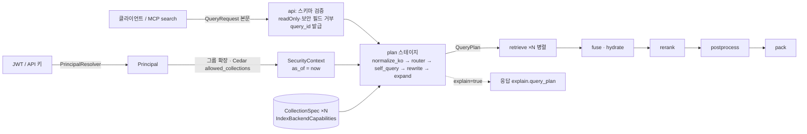

# QueryRequest와 QueryPlan 계약

> 정본은 [설계 바이블](../02-architecture/00-design-bible.md) §5.5 `QueryRequest`·`QueryPlan` 표, §5.3 `FilterNode`·`SecurityContext`·`Principal`, §5.7 열거, §6.1~6.2 식별자·해시 결합식, §8.1 플래너 단계, §10.2 필터 불변식, §14 `POST /v1/query`다. 이 문서는 그 표를 필드·타입·필수·설명·예시로 풀고 서버 주입 규칙·필터 DSL·3층 필터·캐시 키·불변식·스키마·예시를 붙인다. 바이블에 없는 항목은 선택(N) 필드 또는 "## 미해결 이슈"의 제안으로만 둔다. 작성 시점에 [07-embedded-chunk-set-and-index-record](./07-embedded-chunk-set-and-index-record.md)·[10-candidate-set-and-ranked-set](./10-candidate-set-and-ranked-set.md)은 동시 작성 중이었으므로 `IndexRecord` payload 필드·`CandidateSet.filters_applied`는 바이블 §5.4·§5.5를 정본으로 인용했다.

## 목적

리트리벌 경로의 첫 두 계약을 정의한다. `QueryRequest`는 클라이언트(`POST /v1/query`, MCP `search`)가 제출하는 질의 입력이고, `QueryPlan`은 `plan` 스테이지가 `QueryRequest` + 서버 주입 `SecurityContext`(보안 컨텍스트)로부터 만든 **질의 이해 결과**다. `QueryPlan`은 순수 데이터이며 `retrieve`·`fuse`(+`hydrate`)·`rerank`·`postprocess`·`pack`은 이를 재해석하지 않고 그대로 따른다(바이블 §5.5). 이 문서는 (1) 두 타입의 모든 필드, (2) `SecurityContext`가 요청 본문이 아니라 서버에서 도출되는 규칙([ADR-0027](../06-adr/0027-security-context-injection-and-acl-enforcement-points.md)), (3) 사용자 필터 DSL `FilterNode`의 한계와 화이트리스트, (4) 보안 ∧ 전략 ∧ 사용자 ∧ self-query 4묶음이 하나의 백엔드 사전 필터로 결합되는 3층 구조(바이블 §10.2), (5) 플랜 캐시 키·`planner_fingerprint`, (6) `explain` 응답 포함 규칙과 백엔드 필터 변환 원칙을 확정한다.

## 범위

- 포함: `QueryRequest` 최상위 필드(바이블 §5.5 전부)와 하위 타입 `ConversationTurn`·`TargetModel`·`RequestBudget`, 서버 주입 필드 거부 규칙, `SecurityContext` 도출(`Principal` → 주체 문자열 → `visible_set`·`classification_max`), `FilterNode` DSL(깊이·절 한계, `FilterOp`별 값 형태, `FilterableField` 화이트리스트, `custom.{key}`, `page` 가상 필드, 금지 필드), 필터 3층과 `filters.effective_hash`, `QueryPlan` 최상위 필드(바이블 §5.5 전부)와 하위 타입 14종, `QueryRequest → QueryPlan` 매핑(바이블 §8.1 1~6단계, 예산 해석·사전 저하 순서), 플랜 캐시 키·질의 임베딩 캐시 키·`planner_fingerprint`, `explain` 응답 규칙, 백엔드 필터 변환 원칙, 크기 한계, 저장 규약, LLM 소비 영향, JSON Schema 2개 전문, Pydantic v2 모델, 예시 3개, 불변식.
- 제외: 플래너 알고리즘 세부(형태소 분석기 교정·규칙 라우터·정규식 self-query·LLM 플래너 프롬프트; [04-pipelines/14-query-understanding](../04-pipelines/14-query-understanding.md), 작성 예정), Qdrant/OpenSearch 필터 JSON의 완전한 사양([04-pipelines/15-hybrid-search-and-fusion](../04-pipelines/15-hybrid-search-and-fusion.md)), `CandidateSet`·`RankedSet`·`ContextPack`·`RenderedContext` 정본([10](./10-candidate-set-and-ranked-set.md), [11](./11-context-pack.md)), 인증·인가 구현([../02-architecture/07-multi-tenancy-and-security-architecture.md](../02-architecture/07-multi-tenancy-and-security-architecture.md)), REST 응답 봉투·상태 코드 전수([../05-api/03-retrieval-api.md](../05-api/03-retrieval-api.md), 작성 예정), MCP 도구 시그니처([../05-api/05-mcp-server.md](../05-api/05-mcp-server.md), 작성 예정). 작성 예정 문서는 브리프 §8 문서 맵 경로로만 링크했고, 그때까지 해당 주제는 바이블 절을 정본으로 인용한다.
- 정본 관계: 필드·필수 여부·열거 철자는 바이블 §5.5·§5.7을 그대로 따른다. 공용 타입과 모든 열거는 [00-contract-overview](./00-contract-overview.md)가 소유하는 `urn:rag:schema:common-types:1`의 `$defs`를 참조하고 재정의하지 않는다. null·생략 규칙은 00 §8.1, 오류 코드는 [13-error-model](./13-error-model.md) §3.2, 버전 규칙은 [14-schema-versioning-and-compatibility](./14-schema-versioning-and-compatibility.md)를 따른다.

## 1. 위치와 역할

| 항목 | 값(바이블 §4.3·§5.1·§14) |
|------|--------------------------|
| 생산 | `QueryRequest`: 클라이언트(`POST /v1/query`), MCP `search`(`search(query, collection_ids?, top_k?, filters?, response_format?, cursor?)` 인자를 `QueryRequest`로 변환) / `QueryPlan`: `plan` 스테이지(확장 지점 `query_transformer`; 파이프 `normalize_ko → router → self_query → rewrite → expand`, `in_process`; `quality` 변형만 LLM 호출) |
| 소비 | `QueryRequest`: `plan` / `QueryPlan`: `retrieve`, `fuse`(+`hydrate`), `rerank`, `postprocess`, `pack` |
| 입력·실행 | `plan`은 `QueryRequest` + `SecurityContext`(서버 주입) + `CollectionSpec`(컬렉션마다) + `IndexBackendCapabilities`를 받는다. 리트리벌 경로는 인프로세스이며 오케스트레이터를 거치지 않고(D-17) 산출물 저장도 없다(§12) |
| 캐시 키 | 플랜 캐시 `H("plan", …)`(§8, Valkey `plan:{tenant}:{profile_hash}:{hash}` 5m), 질의 임베딩 `qemb:{embedding_space_id}:{hash}` 24h. `retrieve` 이후 결과 캐시는 ACL 시점성 때문에 금지(바이블 §4.3) |
| 인라인 한계 | `QueryRequest` 16KB, `query` 4,000자, `collection_ids` 20, `filters` 8KB / `QueryPlan` 32KB(인프로세스; `explain` 시 응답 포함) |
| 실패 정책 | `plan.security_context_missing` → 400; `plan.filter_field_forbidden` → 422; `plan.collection_forbidden` → 403; `plan.llm_failed` → 원 질의 + 형태소 키워드, `route=single`, `degraded{planner_llm, llm_failed}`(오류 아님); 0건 시 `filters.relaxable_keys` 순서로 완화 후 1회 재검색(보안·전략 필터 불변) |



`QueryRequest`는 봉투(Envelope)를 갖지 않는 클라이언트 입력 계약이다(00 §3.1). 봉투 필드 중 `schema_version`·`collection_ids`만 있고 `schema_type`·`tenant_id`·`producer`·`warnings`·`degraded`·`created_at`은 없다. `QueryPlan`은 질의 측 봉투(`schema_version`, `schema_type`, `tenant_id`, `collection_ids`, `producer`, `warnings`, `degraded`, `created_at`; `lineage_refs`·`quality`는 질의 측에 없음)를 갖는다.

## 2. `QueryRequest` 필드 표

타입 표기는 브리프 §9.5. "필수" 열 `Y`/`N`의 인스턴스 규칙은 00 §8.1을 따른다(N 필드는 값이 없으면 키를 생략, `null` 금지). `tenant_id`·`as_of`·`security_context`·`principals`는 본문에 **없다**(§2.3).

### 2.1 `QueryRequest`(바이블 §5.5)

| 필드 | 타입 | 필수 | 설명 | 예시 |
|------|------|------|------|------|
| `schema_version` | string(semver) | Y | 계약 버전. `1.x.y`만 수용(`$id` major 1) | `"1.0.0"` |
| `query_id` | string(ulid) | Y | **서버 발급**(접수 시). 스키마 `readOnly`; 클라이언트 본문에 있으면 400 `contract.violation`(pointer `/query_id`). `rewritten_queries[]`의 `original` 변형 `variant_id`와 같다(바이블 §6.1) | `"01JA0QRY0001A2B3C4D5E6F7G8"` |
| `query` | string | Y | 원 질의, 1..4,000 유니코드 코드포인트. 정규화(NFC·공백)는 플래너가 수행하고 원문은 `QueryPlan.original_query`에 보존 | `"정보공개 청구 처리 기한은?"` |
| `collection_ids` | array<string(ulid)> | Y | 1..20, 중복 없음. `SecurityContext.collection_ids`(Cedar `allowed_collections`)와 교집합; 빈 집합이면 403 `plan.collection_forbidden`. 컬렉션마다 채널 런이 분리되고 `embedding_profile_hash`가 서로 다르면 융합은 `rrf`로 강등(§6.6, §7.1 6단계; 바이블 §8.1 6단계). 컬렉션 수 × 프로파일 채널 수가 `QueryPlan` 32KB 한계에 닿는 조합은 §11 표 참조 | `["01J9ZQ5A1B2C3D4E5F6G7H8J9K"]` |
| `conversation` | array<ConversationTurn> | N | 1..10턴, 재작성 입력(§2.2). LLM 공급자에게 전달되지 않는다(§13) | §2.2 |
| `filters` | `FilterNode` | N | 사용자 필터(§4). 보안·전략 필터와 AND(§5). `canonical_json` ≤ 8,192바이트, 깊이 ≤ 3, 절 ≤ 32 | 예시 2 |
| `top_k` | integer(1..50) | N | 요청 항목 수 힌트. 기본 10. 팩 `k_max`와 **별개**의 필드다(바이블 §5.5) — 플래너는 이 값을 `pack.k_max`에 결합하지 **않고** `pack.k_max = 프로파일 query.pack.k_max`(standard 20)로 둔다(바이블 §7.2, §16 GL-08 "최종 K = `pack.k_max`"; §7.2, [11](./11-context-pack.md) §2.2 `budget.k_max`와 정합). `top_k`를 최종 K 상한으로 쓰는 결합(`k_max = min(top_k, 프로파일)`)은 바이블 §5.5 patch 채택 후에만 반영한다(미해결 이슈 1). 그때까지 플랜에 파생 필드가 없으므로 플랜 캐시 키 `request_options`에서도 제외한다(§8.1) | `10` |
| `mode` | enum(RetrievalMode) | N | 기본 `hybrid`. `dense`/`sparse`/`lexical`은 해당 채널만 `enabled=true`(§7.2) | `"hybrid"` |
| `retrieval_variant` | enum(RetrievalVariant) | N | 컬렉션 프로파일이 허용한 변형만(불허 → 400 `contract.violation`, pointer `/retrieval_variant`; 바이블 §5.7 카탈로그의 `contract.violation`은 400/500만 갖는다, 13 §7). `quality`는 LLM 플래너·multi-query·HyDE, `fast`는 리랭크 생략(`hydrate.top_n = pack.k_max × 2`) | `"default"` |
| `strategy_hint` | enum(Strategy) | N | 라우터 힌트(강제 아님). 컬렉션 능력이 허용하면 `QueryPlan.strategy`로 채택 | `"hybrid"` |
| `target_model` | `TargetModel` | N | 토큰 카운터·렌더러 선택(§2.2) | `{"provider": "anthropic", "model": "<target-model-id>"}` |
| `max_context_tokens` | integer | N | 프로파일 기본(standard 24,000) 이하로만. `budget.max_context_tokens`와 함께 오면 작은 값; 프로파일 상한 초과 요청은 상한으로 잘라 적용한다(초안 해석 — 바이블 §5.5는 거부·절단을 정하지 않음, 미해결 이슈 2) | `16000` |
| `renderer` | enum(Renderer) | N | 기본은 `target_model.provider`에서 유도(§7.2), 없으면 프로파일 `pack.renderer` | `"anthropic_search_result"` |
| `ordering_strategy` | enum(OrderingStrategy) | N | 기본 프로파일 `pack.ordering`(standard `litm_alternating`) | `"litm_alternating"` |
| `include_parents` | boolean | N | small-to-big(`parent_expand`) 강제 켬/끔. 생략 시 프로파일 | `true` |
| `response_format` | enum(ResponseFormat) | N | MCP 기본 `concise`, REST 기본 `detailed`. `pack_only`는 `rendered` 생략 | `"detailed"` |
| `session_id` | string(ulid) | N | 에이전트 반복 검색 세션. 이전 턴 팩은 재정렬하지 않고 **추가만** 한다(바이블 §9.4) | `"01JA0SESS0001ABCDEFGHJKMNP"` |
| `exclude_ids` | array<string(hex64)> | N | 이미 본 `chunk_id`(콘텐츠 주소; 세대·스코프 무관), 1..1,000, 중복 없음. 백엔드 `must_not`으로 전달(§10). 바이블 표기 `array<string>`을 `hex64`로 좁힘(미해결 이슈 9) | `["1f2e3d4c…"]` |
| `cursor` | string | N | MCP "더 보기" 불투명 핸들(Valkey `cursor:{tenant}:{ulid}`, 10m, 테넌트 바인딩; [ADR-0025](../06-adr/0025-mcp-cursor-pagination-and-tool-set.md)). 서버가 이전 요청 + 누적 `exclude_ids`로 해석한다(§7.4) | `"c_01JA0…"` |
| `budget` | `RequestBudget` | N | `{max_latency_ms, max_tool_calls, max_context_tokens}` 프로파일 상한 내(§2.2) | `{"max_latency_ms": 500}` |
| `experiment_id` | string | N | 인터리빙·A/B 실험 ID(≤ 128) | `"exp-ko-rerank-2026w38"` |
| `team_assignment` | string | N | A/B 팀(프로파일 변형 선택 키, ≤ 64) | `"control"` |
| `explain` | boolean | N | `true`면 응답 `explain`에 `QueryPlan` 전문·`RankedSet.score_breakdown`·팩 `explain` 포함(§9). MCP `search`는 항상 `false` | `true` |
| `requested_at` | string(date-time) | Y | 클라이언트 요청 시각(RFC 3339 UTC). embargo·expiry 판정에는 쓰지 않는다(서버 `as_of`) | `"2026-09-22T09:00:00.000Z"` |

### 2.2 하위 객체 `conversation[]`(`$defs/ConversationTurn`)·`target_model`(`$defs/TargetModel`)·`budget`(`$defs/RequestBudget`, 1개 이상 키)

| 객체.필드 | 타입 | 필수 | 설명 | 예시 |
|-----------|------|------|------|------|
| `conversation[].role` | enum[user, assistant] | Y | `$defs/QueryRequest.conversation.role`(바이블 §5.7 인라인 열거 등재 규칙) | `"user"` |
| `conversation[].text` | string | Y | 1..4,000 코드포인트. 재작성 입력만; 팩·렌더에 포함되지 않음 | `"처리 기한이 어떻게 되나요?"` |
| `target_model.provider` | enum[anthropic, openai, google, local] | Y | `$defs/QueryRequest.target_model.provider`. 렌더러 기본값·토큰 카운터 선택(§7.2) | `"anthropic"` |
| `target_model.model` | string | Y | 공급자 모델 식별자(플레이스홀더 허용). `pack.tokenizer.model`로 복사 | `"<target-model-id>"` |
| `budget.max_latency_ms` | integer(≥ 1) | N | 요청 지연 상한. 프로파일 `latency_budget_ms.total`보다 작으면 사전 저하 순서 적용(§7.3) | `500` |
| `budget.max_tool_calls` | integer(≥ 0) | N | 에이전트 루프 도구 호출 상한 → `QueryPlan.budget.max_tool_calls` | `3` |
| `budget.max_context_tokens` | integer(≥ 1) | N | 팩 토큰 예산 상한 → `pack.max_context_tokens = min(요청, 프로파일)` | `16000` |

### 2.3 서버 주입 필드와 거부 규칙

**결정:** `SecurityContext`는 요청 본문이 아니라 인증 토큰에서 서버가 도출하며(§3), `QueryRequest` 스키마는 `additionalProperties: false`로 그 밖의 키를 모두 거부한다([ADR-0027](../06-adr/0027-security-context-injection-and-acl-enforcement-points.md), 바이블 §5.5 "클라이언트가 보낸 보안 필드는 422로 거부", E1·E6).

본문에 `query_id`(readOnly)가 오면 400 `contract.violation`(`errors[].location.pointer = "/query_id"`). 보안 필드 `tenant_id`·`as_of`·`security_context`·`principals`·`visible_set`·`classification_max`가 오면 거부한다(E1) — 바이블 §5.5는 422이지만 카탈로그에 전용 코드가 없어 채택 전까지 400 `contract.violation`(pointer 명시)으로 응답하고, 13 §3.3 제안 코드 `auth.tenant_mismatch`(422) 채택을 공동 제안한다(미해결 이슈 6). 그 외 미지정 키도 400 `contract.violation`(00 §8.2). 접수 순서: (1) 보안·readOnly 키 존재 거부 → (2) `query_id` 발급·주입 → (3) JSON Schema + Pydantic 검증(불변식 Q-1~Q-9) → (4) `SecurityContext` 주입 후 `plan` 호출. 요청 본문은 저장하지 않는다(§12).

## 3. `SecurityContext` 서버 주입과 `Principal` 도출

바이블 §8.1 1단계, §10.1, §10.3 E1·E2·E6. 필드 정의는 00 §4.5(`SecurityContext`)·§4.6(`Principal`)이며 이 문서는 도출 규칙만 확정한다. 흐름: 토큰 → `PrincipalResolver` → `Principal` → 그룹 확장(Valkey `groups:{tenant}:{subject}`) → Cedar `allowed_collections` → `SecurityContext` → `plan`(위 §1 다이어그램).

| 단계 | 규칙 | 실패 시 |
|------|------|---------|
| 인증 | OIDC JWT(JWKS, Authlib) 또는 `api_key_id → tenant`; mTLS는 `auth_method=mtls`. 결과는 `Principal`(00 §4.6) | 401 `auth.unauthenticated` |
| 주체 문자열·그룹 확장 | 사용자 주체(`Principal.subject`가 사용자; OIDC 또는 사용자에게 위임 발급된 API 키): `principals = ["user:{subject}"] + ["group:{g}" for g in 확장 그룹] + ["tenant:*"]`(바이블 §10.1). 서비스 주체(API 키·M2M·mTLS 클라이언트, `Principal.subject`가 `service:{client_id}`): `principals = ["service:{client_id}"]`**만** — `tenant:*`를 붙이지 않으므로 `visible_set=[public]` 판정(바이블 §5.3 `SecurityContext.visible_set`, §10.2 "`auth_method=api_key`이고 주체가 `service:`만이면")이 성립하고 `visibility=tenant` 문서는 `acl_allow`에 `service:{client_id}`가 있을 때만 보인다. 중첩 그룹은 전이 폐쇄로 확장(캐시 5~15분). 형식은 `$defs/PrincipalString`, 정렬·중복 제거, 상한 1,024(초과는 축약하지 않고 실패, fail-closed) | 422 `auth.too_many_principals` |
| 인가 | Cedar `authorize(principal, action=query, resource=collection)`을 요청 컬렉션마다 평가 → `allowed_collections`; `SecurityContext.collection_ids = allowed ∩ QueryRequest.collection_ids`, 결정에 `policy_version` 기록. 교집합이 비면 403(존재 비노출). 부분 교집합은 허용된 컬렉션만으로 진행하며 제외 사실을 응답에 드러내지 않는다(미해결 이슈 7) | 403 `plan.collection_forbidden` |
| `as_of` | **서버 `now()`**(RFC 3339 UTC, ms). `QueryRequest.requested_at`은 쓰지 않는다. embargo·expiry 판정과 `pack.acl_recheck`(`items[].acl.checked_at`)가 같은 값을 쓴다 | — |
| `classification_max`·`visible_set` | 테넌트 정책 기본 `internal`; 역할·그룹 규칙(Cedar)으로 상향(사용자가 올릴 수 없다). `visible_set` 기본 `[public, tenant]`; `auth_method=api_key`이고 주체가 `service:`만이면 `[public]`(`visibility=tenant` 문서는 `acl_allow`로만 통과, 바이블 §10.2) | — |
| 주입 | `QueryPlan.security_context`에 그대로 복사(스키마 `readOnly`), `filters.security`를 §5.1 규칙으로 생성. `plan`은 `SecurityContext`가 없으면 즉시 실패 | 400 `plan.security_context_missing` |
| 서명 | `security_context_hash = H("sec", tenant_id, ",".join(sorted(principals)), ",".join(sorted(collection_ids)), as_of, classification_max, ",".join(visible_set))`(바이블 §6.2). `QueryPlan`은 이 값을 따로 담지 않고(도출 가능) `retrieve` 어댑터가 "백엔드 요청에 `tenant_id` 필터 포함"을 `CandidateSet.security_context_hash`로 서명한다(E7) | `retrieve.security_context_missing` |

MCP `search`도 같은 `PrincipalResolver`를 쓴다(E14; RFC 9728 PRM, `Authorization: Bearer`, audience 검증). `cursor` 핸들은 `tenant_id`에 바인딩되어 다른 테넌트가 제시하면 해석되지 않는다.

## 4. `FilterNode` DSL

`FilterNode`는 공용 타입(00 §4.15, `urn:rag:schema:common-types:1#/$defs/FilterNode`)이다. `QueryRequest.filters`(사용자)와 `QueryPlan.filters.user`·`filters.self_query`가 같은 타입을 쓴다. 이 절은 플래너가 강제하는 한계·화이트리스트·변환 규칙을 확정한다.

### 4.1 구조와 한계

| 항목 | 규칙 | 위반 시 |
|------|------|---------|
| 노드 형태 | `{and: [...]}` / `{or: [...]}` / `{not: {...}}` / 리프 `{field, op, value}` 중 **정확히 하나**(00 I-19) | 400 `contract.violation` |
| 깊이·절 수·크기 | 논리 결합 노드의 중첩 깊이 ≤ 3(리프만이면 0, `{and: [리프]}`는 1, `{and: [{or: [{not: 리프}]}]}`는 3); 트리 전체 리프 수 ≤ 32; `and`/`or` 원소 1..32; `canonical_json(filters)` ≤ 8,192바이트(바이블 §5.1) | 400 `contract.violation`(pointer는 초과 노드) |
| `field`·연산자 | `FilterableField` 화이트리스트(§4.3) 또는 `custom.{key}`(§4.4); §4.3 표의 허용 연산자만(예 `doc_date`에 `contains_any` 불가; 필드별 허용 `op`는 바이블 §5.3 `FilterNode`·§5.7 `FilterableField`에 없는 **이 문서의 초안 제약**이며 `plan.filter_field_forbidden` 사유 확장도 초안이다, 미해결 이슈 18). 금지 필드는 스키마 패턴 밖이지만 코드는 `plan.filter_field_forbidden`으로 통일한다(§4.6) | 422 `plan.filter_field_forbidden`(사유 `field forbidden` / `op not allowed for field`(초안)) |
| 값 형태 | `op`별(§4.2). 날짜 필드 값은 `YYYY-MM-DD`, 정수 필드 값은 integer | 400 `contract.violation` |

### 4.2 `FilterOp`와 값 형태(바이블 §5.7, 00 U-9)

`eq`/`ne`: 스칼라(string, number, boolean). `in`/`not_in`: 비어 있지 않은 스칼라 배열(≤ 256 원소, 초안). `gt`/`gte`/`lt`/`lte`: 스칼라(date는 `YYYY-MM-DD`, integer). `exists`: boolean. `prefix`: string(keyword 필드). `contains_any`/`contains_all`: 비어 있지 않은 스칼라 배열(배열 필드가 값 중 하나 이상 / 전부 포함). 스키마는 `op`별 `value` 형태를 `if/then`으로 강제한다(00 §4.15).

### 4.3 `FilterableField` 화이트리스트(바이블 §5.7)

payload 필드명은 `IndexRecord`(바이블 §5.4)와 같다. 유형 열은 바이블 §5.4 `IndexRecord` 표의 "인덱싱" 열(keyword·datetime·integer)이다 — `heading_path`·`external_id`·`doc_version`은 §5.4에서 keyword 인덱싱으로 표기되지만 바이블 §13.4 Qdrant payload 인덱스 목록에는 없으므로 §13.4 patch를 제안한다(미해결 이슈 23). "허용 `op`" 열은 **초안**이다: 바이블 §5.3 `FilterNode.op`는 `enum(FilterOp)` 전체를 허용하고 필드별 제약을 두지 않으므로, 이 열은 payload 유형상 의미가 없는 조합(예 날짜에 `contains_any`)을 미리 거부하는 이 문서의 제안이며 바이블 §5.7 `FilterableField` 행 병기를 제안한다(미해결 이슈 18).

| `field` | payload 유형 | 허용 `op`(초안) | 비고 |
|---------|--------------|-----------------|------|
| `document_id` | keyword(ulid) | `eq, ne, in, not_in, exists` | 특정 문서 안에서 검색 |
| `doc_version` | keyword(hex64) | `eq, ne, in, not_in` | 특정 버전 고정(`is_current`는 보안 필터가 강제) |
| `external_id` | keyword | `eq, ne, in, not_in, exists, prefix` | 원천 시스템 ID |
| `doc_date` | date(`YYYY-MM-DD`) | `eq, ne, gt, gte, lt, lte, exists` | self-query 주 대상 |
| `doc_type` | keyword(snake_case) | `eq, ne, in, not_in, exists` | 예 `regulation`, `press_release` |
| `department` | keyword | `eq, ne, in, not_in, exists, prefix` | |
| `tags` | array<keyword> | `contains_any, contains_all, exists` | |
| `lang` | keyword(bcp47) | `eq, ne, in, not_in` | |
| `genre` | enum(Genre) | `eq, ne, in, not_in` | 값은 §5.7 `Genre` 철자 |
| `item_kind` | enum(ItemKind) | `eq, in` | **전략 필터와 AND**(좁히기만 가능; 전략 밖 값은 0건) |
| `heading_path` | array<keyword>(첫 2단 인덱스) | `contains_any, contains_all, prefix` | `prefix`는 첫 원소 기준 |
| `entity_ids` | array<keyword> | `contains_any, contains_all, exists` | 그래프·엔티티 보강 결과 |
| `page_start` / `page_end` | integer \| null | `eq, gt, gte, lt, lte, exists` | 흐름 포맷은 null → `exists=false` |
| `page` | 가상 필드 | `eq, in` | §4.5 변환 |
| `custom.{key}` | keyword \| number \| boolean | `eq, ne, in, not_in, gt, gte, lt, lte, exists, prefix` | §4.4 |

### 4.4 `custom.{key}`

`field`가 `^custom\.[a-z0-9_]+$`이면 컬렉션의 `CollectionSpec.filterable_fields`(바이블 §5.6)에 선언된 키여야 한다. 요청의 **모든** 컬렉션이 선언한 키만 허용하며(다중 컬렉션에서 한 컬렉션이라도 미선언이면 422 `plan.filter_field_forbidden`, 사유 `custom key not declared in collection {collection_id}`), 값 유형은 `IndexRecord.custom` 값 제약(string \| number \| boolean, 00 §8.2)을 따른다. 키의 **실효 집합**은 `IngestRequest.metadata.custom` 키 규칙(`^[a-z][a-z0-9_]{0,63}$`, 01 IR-8)과 같다 — 컬렉션이 선언할 수 있는 키가 IR-8 키뿐이기 때문이며, 스키마 패턴 자체는 00 문서가 소유하는 `$defs/FilterableField`(`^custom\.[a-z0-9_]+$`; 선행 숫자·밑줄과 길이를 제한하지 않아 더 넓다)를 그대로 쓴다. 00 문서에 `custom\.[a-z][a-z0-9_]{0,63}` 정밀화를 제안한다(미해결 이슈 21).

### 4.5 `page` 가상 필드 변환

`page`는 payload에 없고 `page_start`·`page_end`만 있다(바이블 §5.7 `FilterableField`, §13.4). 필터 빌더가 `{field: page, op: eq, value: v}`를 `{and: [{field: page_start, op: lte, value: v}, {field: page_end, op: gte, value: v}]}`로, `{field: page, op: in, value: [v1, v2, …]}`를 `{or: [eq 변환(v1), eq 변환(v2), …]}`로 변환하고, 그 외 `op`는 422 `plan.filter_field_forbidden`(사유 `op not allowed for field`)이다. 플래너는 4단계(§7.1)에서 `page` 리프의 `op`만 검증하고, 변환 자체는 `retrieve`의 필터 빌더(§10)가 전송 직전에 적용한다 — 따라서 `QueryPlan.filters.user`와 `filters.effective_hash`는 변환 **전** 계획 트리 기준이고, 변환된 트리는 `CandidateSet.filters_applied.user`가 기록한다(§5.4). 변환으로 늘어난 절은 §4.1의 32절 한계에 포함되지 않는다(한계는 사용자 입력 기준). 흐름 포맷 문서(`page_start = null`)는 어떤 `page` 조건에도 걸리지 않는다.

### 4.6 금지 필드 → `plan.filter_field_forbidden`

`tenant_id, collection_id, acl_allow, acl_deny, acl_visibility, acl_classification, acl_embargo_until, acl_expires_at, acl_hash, is_current, index_generation, level, commit_id, record_id`(바이블 §5.7 "금지" 목록의 `acl_*` 전개)와 화이트리스트 밖의 모든 이름은 422 `plan.filter_field_forbidden`이다. 스키마 패턴이 먼저 걸러도 API는 `contract.violation`이 아니라 이 전용 코드로 응답하고(00 §10.2 "전용 코드 우선"), `errors[].location.pointer`에 리프 위치를 적는다. `filters.relaxable_keys`에 이 이름이 들어가면 스키마 위반(`$defs/FilterableField` 밖)이며 `contract.violation`(500, 플래너 결함)이다(E6).

## 5. 필터 3층: security ∧ strategy ∧ user ∧ self_query

**결정:** 모든 채널·모든 백엔드는 다음 조건을 **사전 필터**로 받는다(바이블 §10.2, [ADR-0027](../06-adr/0027-security-context-injection-and-acl-enforcement-points.md)). 네 묶음은 `QueryPlan.filters`의 네 필드에 구분 저장되고, `CandidateSet.filters_applied`에 같은 구분으로 기록된다.

```text
-- (a) 보안 불변식: QueryPlan.filters.security — 제거·완화 불가
tenant_id = :tenant_id
AND collection_id IN :collection_ids
AND is_current = true
AND (acl_visibility IN :visible_set OR acl_allow ANY :principals)
AND NOT (acl_deny ANY :principals)
AND (acl_embargo_until IS NULL OR acl_embargo_until <= :as_of)
AND (acl_expires_at IS NULL OR acl_expires_at > :as_of)
AND acl_classification <= :classification_max
-- (b) 전략 필터: QueryPlan.filters.strategy — 플래너가 strategy로 결정, 사용자 완화 불가
AND level IN :level_in
AND item_kind IN :item_kinds
-- (c) 사용자·self-query 필터 — filters.relaxable_keys 순서로만 완화
AND <filters.user> AND <filters.self_query>
-- (d) 제외 목록(N) — QueryRequest.exclude_ids
AND NOT (chunk_id IN :exclude_ids)
```

### 5.1 `filters.security`(`$defs/SecurityFilter`)

| 필드 | 타입 | 필수 | 설명 | 예시 |
|------|------|------|------|------|
| `tenant_id` | string(ulid) | Y | `= security_context.tenant_id = 봉투 tenant_id` | ULID |
| `collection_ids` | array<string(ulid)> | Y | `= 봉투 collection_ids`(교집합 결과), 1..20 | `["01J9ZQ5A…"]` |
| `principals` | array<string> | Y | `= security_context.principals`(`$defs/PrincipalString`), 1..1,024 | `["user:…", "group:…", "tenant:*"]` |
| `visible_set` | array<enum(Visibility)> | Y | `= security_context.visible_set` | `["public", "tenant"]` |
| `as_of` | string(date-time) | Y | `= security_context.as_of` | `"2026-09-22T09:05:12.184Z"` |
| `is_current` | boolean(`const true`) | Y | 세대 플립 후 이전 세대 제외 | `true` |
| `classification_max` | enum(Classification) | Y | `= security_context.classification_max`; 백엔드에는 등급 순서(`public < internal < confidential < secret`)상 이하인 값의 `IN` 목록으로 전송(§10) | `"confidential"` |

### 5.2 `filters.strategy`(`$defs/StrategyFilter`) — `strategy`별 고정값(바이블 §5.5·§5.7 `ItemKind`)

| `strategy` | `level_in` | `item_kinds` |
|------------|-----------|--------------|
| `hybrid`, `iterative` | `[0]` | `[text, list_group, code, table, table_part, figure]` |
| `tree_collapsed` | `[0, 2]` | `[text, list_group, code, table, table_part, figure, summary]` |
| `graph_local`, `graph_global` | `[0, 2]` | `[text, list_group, code, table, table_part, figure, community_report, entity]` |
| `visual_pages` | `[0]` | `[page_image]` |

스키마는 `strategy` 값별 `if/then`으로 두 배열을 `const`로 고정한다(E6 "스키마 테스트"). `parent`(level 1)는 어떤 전략에서도 직접 후보가 아니며 `postprocess.parent_expand`로만 나타난다. 사용자 `item_kind` 필터는 (b)와 AND이므로 좁힐 수만 있다.

### 5.3 `filters.user`·`filters.self_query`·`relaxable_keys`

| 항목 | 규칙 |
|------|------|
| `user` | `QueryRequest.filters`를 `page` 변환(§4.5) **전** 원형으로 보존(감사·`explain`·계획 해시 입력, §5.4). 변환·완화는 `retrieve`의 필터 빌더가 전송 직전에 적용하고 그 결과 트리는 `CandidateSet.filters_applied.user`가 기록한다(§5.4; [10](./10-candidate-set-and-ranked-set.md) §3.6). `null`이면 요청 필터 없음(키는 존재, Y(nullable)) |
| `self_query` | 플래너가 질의문에서 추출한 필터(정규식: 날짜·문서유형·부서; `quality`는 LLM). 화이트리스트·연산자 규칙은 사용자 필터와 동일. 추출 결과가 사용자 필터와 같은 필드를 다루면 사용자 값이 우선하고 self-query 절은 버린다(초안 규칙) |
| `relaxable_keys` | 0건일 때 제거 후보인 **사용자·self-query** 필드명(`$defs/FilterableField`; 보안·전략 키는 타입상 불가), 완화 우선순위 순. 기본 순서(초안): self-query 리프 필드(추출 순) → 사용자 필터 중 부정 절(`not`, `ne`, `not_in`)의 필드. 긍정 사용자 절은 기본적으로 완화하지 않는다(의도 변경). 항목은 `user`·`self_query` 리프에 실제로 존재하는 필드만 |
| 완화 절차 | **v1은 재검색 1회**(바이블 §8.1 4단계 "제거 후 1회 재검색"): 첫 검색 0건 → `relaxable_keys[0]` 필드를 갖는 리프를 트리에서 제거(빈 `and`/`or`는 함께 제거) → 재검색 1회 → 그래도 0건이면 종료(0건 팩). `relaxable_keys[1:]`은 v1에서 사용하지 않으며 키마다 제거→재검색을 반복하는 다회 완화(프로파일 옵션 후보)를 위한 순서 예약이다(미해결 이슈 15). 재검색은 `latency_budget_ms.retrieve` 잔여분 안에서만 수행하고 잔여분이 채널 `timeout_ms`보다 작으면 완화 없이 0건으로 진행한다(`degraded += {component: "self_query_filter", reason: "latency_budget", detail: "{source}:{field}"}`). 완화가 일어나면 `degraded += {component: "self_query_filter", reason: "filter_relaxed", detail: "{source}:{field}"}` — `detail`은 **필수**이며 `source`는 제거된 리프가 속한 묶음 `user` \| `self_query`, `field`는 제거된 필드명이다(예 `"self_query:doc_date"`, `"user:tags"`). 바이블 §5.7 `DegradedComponent`에 사용자 필터 전용 값이 없어 `self_query_filter`를 두 묶음 공용 component로 쓰므로, `detail`의 출처 접두가 없으면 사용자 필터 완화가 self-query 완화로 오독된다(`user_filter` component 추가 제안, 미해결 이슈 25). **기록 위치**: 완화는 `retrieve`에서 일어나므로 이 항목은 `CandidateSet` 봉투 `degraded`에 기록되어 팩 봉투로 전파되며, `QueryPlan`(`degraded`·`filters`)은 불변이다 — 완화된 트리는 `QueryPlan.filters`에 되쓰지 않고 `CandidateSet.filters_applied`가 기록한다(§5.4). 보안·전략 필터와 `exclude_ids`는 불변 |

### 5.4 `filters.effective_hash`

**결정:** `effective_hash = H("filters", canonical_json(T))`, `T`는 **계획 필터 트리** — `QueryPlan.filters`에 저장된 security + strategy + user + self_query 그대로(`page` 변환 전, 0건 완화 전; `exclude_ids` 제외) — 를 다음 정규형으로 직렬화한 것이다. 이 값은 `QueryPlan`과 함께 **불변**이다(§6.1 "순수 데이터", 00 `ContractModel(frozen=True)`, 플랜 캐시 키 P-13). 바이블 §5.5·§6.2의 "백엔드 전송 필터 트리"는 계획 시점에는 이 계획 트리이고, `retrieve`가 실제로 전송한 트리(`page` 변환·완화 반영)와 그 해시는 `CandidateSet.filters_applied`가 기록한다(아래 "실전송 트리" 행).

| 규칙 | 내용 |
|------|------|
| 형태 | `{"security": {…}, "strategy": {…}, "user": FilterNode \| null, "self_query": FilterNode \| null}`; 배열 값(`collection_ids`, `principals`, `visible_set`, `level_in`, `item_kinds`, `in` 값)은 정렬. `user`·`self_query`는 플랜에 저장된 `FilterNode` 그대로(`page` 리프 유지), `security.classification_max`는 열거값 그대로(백엔드 `IN` 목록 전개는 §10 매핑 세부이며 정규형에 나타나지 않는다) |
| `as_of` | 리터럴 대신 바인드 이름 문자열 `":as_of"`로 기록한다. **이 규칙은 바이블 §6.2 식(`H("filters", canonical_json(백엔드 전송 필터 트리))`)의 해석이다** — 바이블 §10.2가 `:as_of`를 바인드 파라미터로 표기하므로 "전송 필터 트리"를 바인드 파라미터 형태로 읽었다. 시각을 넣으면 해시가 매 요청 달라져 플랜 캐시(§8)가 무효가 되고, embargo·expiry 판정 시각은 `security_context.as_of`·`CandidateSet.security_context_hash`가 이미 담고 있다. 바이블 §6.2 `filters.effective_hash` 행에 "`as_of`는 바인드 이름으로 직렬화"를 추가하는 patch를 제안하며 그때까지 잠정 규칙이다(미해결 이슈 3(a)) |
| 실전송 트리 | `retrieve`의 필터 빌더(§10)가 실제 전송한 트리(`page` 변환·`relaxable_keys` 완화 반영)와 그 해시(같은 정규형·같은 `H("filters", …)` 식)는 **`CandidateSet.filters_applied`**(`user`·`self_query`·`effective_hash`; 생산자 [10](./10-candidate-set-and-ranked-set.md) §3.6)가 기록하고, `ContextPack.diagnostics.filters_applied`는 그 값을 복사한다([11](./11-context-pack.md) §2.8). `QueryPlan.filters`(`user`·`self_query`·`effective_hash`)는 재계산·갱신하지 않는다 — `page` 변환·완화가 없었으면 두 해시가 같고, 있었으면 다르다(차이 자체가 감사 신호). 완화 사실은 `CandidateSet` 봉투 `degraded{self_query_filter, filter_relaxed, detail: "{source}:{field}"}`로 기록된다(§5.3) |
| 용도 | 플랜 캐시 키 구성 요소(§8.1, P-13; 불변이므로 TTL 동안 안정), `explain`, `CandidateSet.filters_applied.effective_hash`와의 대조(변환·완화 유무 판정). 감사 이벤트 `audit.query.executed` `data.filters_effective_hash`는 **실전송 해시**(`CandidateSet.filters_applied.effective_hash`)를 담고, `retrieve`가 생략되는 `route=no_retrieval`(§7.5)에서만 계획 해시를 담는다([12](./12-jobs-events-and-status.md) §6.4 정합 대상, 미해결 이슈 25) |

## 6. `QueryPlan` 필드 표

### 6.1 `QueryPlan`(바이블 §5.5; 봉투는 00 §3.1)

| 필드 | 타입 | 필수 | 설명 | 예시 |
|------|------|------|------|------|
| `schema_version` | string(semver) | Y | `1.x.y` | `"1.0.0"` |
| `schema_type` | string(`const "QueryPlan"`) | Y | 봉투 | `"QueryPlan"` |
| `tenant_id` | string(ulid) | Y | 봉투. `= security_context.tenant_id` | ULID |
| `collection_ids` | array<string(ulid)> | Y | 봉투(질의 측 복수). 교집합 결과, 1..20 | `["01J9ZQ5A…"]` |
| `producer` | `Producer` | Y | 플래너 지문. `plugin_id = "query_transformer.pipeline"`(**초안** 합성 ID — 플래너는 `query_transformer` 변환기 여러 개의 파이프이므로 단일 구현체 ID가 없다; 바이블 §6.1 `plugin_id` 규약·§12 어댑터 목록에 `pipeline` 구현체는 없으며 §5.5 `QueryPlan` 봉투 행·§6.1 반영을 제안한다, 미해결 이슈 17), `config_hash = H("config", canonical_json(query.transform))`, `image_digest = null`, `model_ids`는 `quality` LLM 모델(없으면 `[]`) | 예시 3 |
| `warnings` | array<Warning> | Y | 빈 배열 허용. 플래너는 경고 코드가 없어 통상 `[]` | `[]` |
| `degraded` | array<DegradedEntry> | Y | `planner_llm/llm_failed`, `fusion/profile_mismatch`, `channel.lexical/analyzer_mismatch`, `channel.*/capability_unsupported`, `multi_query|rerank|hydrate|channel.*/latency_budget`, `query_embedding/unavailable`, `parent_expand/skipped_by_policy`(모두 바이블 §5.7 `DegradedComponent`·`DegradedReason` 값). `self_query_filter/filter_relaxed|latency_budget`은 `retrieve` 시점 판정이므로 플랜이 아니라 `CandidateSet` 봉투에 기록된다(§5.3; 플랜은 불변) | 예시 3 |
| `created_at` | string(date-time) | Y | 플랜 생성 시각(`= security_context.as_of`와 같거나 이후) | `"2026-09-22T09:05:12.190Z"` |
| `plan_id`, `query_id` | string(ulid) | Y | 서버 발급 / `= QueryRequest.query_id` | `"01JA0PN000002R5S6T7V8W9X0Y"`, `"01JA0QRY0002H9J0K1M2N3P4Q5"` |
| `security_context` | `SecurityContext` | Y | 서버 주입·읽기 전용(§3) | 00 §4.5 |
| `profile_id`, `profile_hash` | string(`$defs/ProfileId`) / string(hex64) | Y | kebab-case `^[a-z][a-z0-9]*(-[a-z0-9]+)*$`, ≤ 64(바이블 §6.1; collection-spec·profile 스키마 `$defs/ProfileId`와 동일 정의의 사본) / `H("profile", canonical_json(해소된 프로파일))` | `"standard"`, hex64 |
| `original_query`, `normalized_query` | string | Y | `= QueryRequest.query` / NFC·공백 정규화 + Kiwi 오타·띄어쓰기 교정(공백기 mecab-ko는 교정 생략, [ADR-0021](../06-adr/0021-korean-analyzer-kiwi-promotion-and-interim-mecab-kss.md)) | |
| `dense_query_text` | string | Y | **`original` 변형**의 벡터 런(`dense`·`sparse`, bge-m3 단일 패스) 임베딩 입력. `default`·`fast`는 `= normalized_query`; HyDE(`quality`, 변환기 `query_transformer.hyde`)는 가상 문서(바이블 §5.5) — 치환형 HyDE로서 원 질의 벡터 런의 임베딩을 가상 문서 임베딩으로 대체하며 별도 `hypothetical` 변형은 만들지 않는다(`lexical` 런은 `lexical_terms`·`normalized_query`를 쓰므로 영향 없음). 그 외 변형(`rewrite`·`abstraction`·`sub_query`·`hypothetical`)의 벡터 런은 `rewritten_queries[].text`를 임베딩하고 `retrieve`가 캐시 키를 §8.2 식으로 결정적으로 유도한다(플랜에 저장하지 않음; P-6) | |
| `analyzer_id`, `dictionary_hash` | string(`$defs/AnalyzerId`) / string(hex64) | Y | `{engine}:{version}:{dictionary}` `^[a-z][a-z0-9-]*:[^:\s]+:[^\s]+$`, ≤ 128(바이블 §6.1; chunk-set·normalized-document·collection-spec·index-record 스키마 `$defs/AnalyzerId`와 동일 정의의 사본이므로 `analyzer_mismatch` 비교 양변이 같은 값 집합을 갖는다); 컬렉션 값과 불일치 → `degraded{channel.lexical, analyzer_mismatch}` / `H("dict", …)`, 컬렉션 값 | `"mecab-ko:1.3.7:ko-dic-2.1.1"`, hex64 |
| `route` | enum(Route) | Y | 규칙 라우터(길이·의문사·명령형·인사); `quality`는 LLM 구조화 출력, 실패 시 `single`. `no_retrieval`일 때의 플랜 형태는 §7.5(P-17) | `"single"` |
| `complexity` | enum(Complexity) | N | Adaptive-RAG. 있으면 `route`와 대응(`no_retrieval↔no_retrieval`, `single_step↔single`, `multi_step↔multi`) | `"single_step"` |
| `strategy` | enum(Strategy) | Y | 기본 `hybrid`; `filters.strategy`를 결정(§5.2) | `"hybrid"` |
| `rewritten_queries` | array<RewrittenQuery> | Y | 1..16. `original`(weight 1.0, `variant_id = query_id`) 항상 포함, 변형은 `fusion.variant_query_weight`(§6.2) | §6.2 |
| `sub_queries` | array<SubQuery> | N | `route=multi`일 때 필수(1..16), 그 외 부재(§6.3) | §6.3 |
| `lexical_terms` | array<LexicalTerm> | Y | 0..128. Kiwi/mecab-ko NNG·NNP·SL·SN + 사용자 사전(가중 1.5) | §6.4 |
| `filters` | `PlanFilters` | Y | §5 | §5 |
| `channels` | array<ChannelPlan> | Y | **채널 × 컬렉션** 단위, 1..140(실효 상한은 32KB 한계가 정한다, §11). 질의 변형은 `rewritten_queries[].channels`로 결합되어 런(`channel_run_id = "{channel}:{collection_id}:{variant_id}"`)이 된다. `route=no_retrieval`이면 모든 항목 `enabled=false`(§7.5) | §6.5 |
| `fusion`, `hydrate` | `FusionPlan`, `HydratePlan` | Y | §6.6 | |
| `rerank` | `RerankPlan` | Y | §6.7 | |
| `late_interaction_rerank` | `LateInteractionRerankPlan` | N | O-04 실험 슬롯(§6.7) | |
| `postprocess` | `PostprocessPlan` | Y | §6.8 | |
| `pack` | `PackPlan` | Y | §6.9 | |
| `latency_budget_ms`, `budget`, `cache_keys` | `LatencyBudget`, `PlanBudget`, `CacheKeys` | Y | `{total, plan, retrieve, rerank, postprocess, pack}` 남은 예산 전파(바이블 §8.3); `{max_tool_calls, llm_calls_allowed}`; `{query_embedding, plan, self_query}`(§8) | §6.10 |
| `explain` | boolean | Y | `= QueryRequest.explain or false` | `true` |
| `planner_fingerprint` | string(hex64) | Y | §8.3 | hex64 |
| `session_id`, `exclude_ids`, `experiment_id`, `team_assignment` | string(ulid) / array<string(hex64)> / string / string | N | 요청 값 복사(`exclude_ids`는 `∪ cursor 누적`, 1..1,000; `retrieve`가 (d) `must_not`으로, `pack`이 최종 방어로 적용). **바이블 §5.5 미등재**(미해결 이슈 5) | 예시 3 |

### 6.2 `rewritten_queries[]`(`$defs/RewrittenQuery`)

| 필드 | 타입 | 필수 | 설명 | 예시 |
|------|------|------|------|------|
| `variant_id` | string(ulid) | Y | 서버 발급; `original`은 `= query_id`. `ChannelScore.variant_ids`·`channel_runs[].variant_id`의 원천 | ULID |
| `text` | string | Y | 1..8,000 코드포인트(HyDE 가상 문서 포함) | |
| `role` | enum(QueryRole) | Y | `original, rewrite, abstraction, hypothetical, sub_query` | `"rewrite"` |
| `weight` | number(0 < w ≤ 1) | Y | `original` 1.0, 그 외 `= fusion.variant_query_weight`(0.5). 융합 `w_run = channel_weight × weight` | `0.5` |
| `channels` | array<enum(Channel)> | Y | 이 변형을 실행할 채널(중복 없음) ⊆ `enabled=true` 채널 집합. `route ≠ no_retrieval`이면 1개 이상, `no_retrieval`이면 `[]`(§7.5). `hypothetical`(증강형 HyDE: 원 질의 임베딩을 유지한 채 가상 문서를 추가 변형으로 실행하는 프로파일 옵션)은 `[dense]`. 벡터 런의 임베딩 입력은 `original`이면 `dense_query_text`, 그 외는 이 항목의 `text`(§6.1, §8.2) | `["dense", "sparse", "lexical"]` |

### 6.3 `sub_queries[]`(`$defs/SubQuery`; `route=multi`만)

| 필드 | 타입 | 필수 | 설명 | 예시 |
|------|------|------|------|------|
| `sub_query_id` | string(ulid) | Y | `rewritten_queries[]` 중 `role=sub_query` 항목의 `variant_id`와 같다 | ULID |
| `text` | string | Y | 분해 질의 | |
| `depends_on` | array<string(ulid)> | Y | 선행 `sub_query_id`(빈 배열 허용). 순환 없음 | `[]` |

### 6.4 `lexical_terms[]`(`$defs/LexicalTerm`)

| 필드 | 타입 | 필수 | 설명 | 예시 |
|------|------|------|------|------|
| `term` | string | Y | 형태소 원형(NFKC 렉시컬 뷰) | `"정보공개"` |
| `weight` | number(> 0) | Y | 기본 1.0, 사용자 사전 1.5 | `1.5` |
| `tag` | string | Y | 분석기 품사 태그(`NNG`, `NNP`, `SL`, `SN`) 또는 `USER_DICT`(사용자 사전). 패턴 `^[A-Z][A-Z0-9_]{0,15}$`(값 집합은 미해결 이슈 11) | `"NNG"` |

### 6.5 `channels[]`(`$defs/ChannelPlan`) — 채널 × 컬렉션

| 필드 | 타입 | 필수 | 설명 | 예시 |
|------|------|------|------|------|
| `channel` | enum(Channel) | Y | `sparse_bm25` 벡터(lite)는 항상 `lexical`(바이블 §5.7) | `"dense"` |
| `collection_id` | string(ulid) | Y | ∈ 봉투 `collection_ids` | ULID |
| `retriever_id` | string(plugin_id) | Y | `retriever.qdrant_dense`, `retriever.qdrant_sparse`, `retriever.opensearch_bm25`, `retriever.qdrant_sparse_bm25`(lite) | `"retriever.qdrant_dense"` |
| `backend_id` | string(plugin_id) | Y | `index_backend.qdrant` / `index_backend.opensearch` / 플러그인 | `"index_backend.qdrant"` |
| `collection_alias` | string | Y | `col_{collection_id}_vec` / `col_{collection_id}_lex`(바이블 §13.4); blue/green 교체 단위 | |
| `embedding_profile_hash` | string(hex64) | Y | 컬렉션 값 복사(다중 컬렉션 융합 강등 판정) | hex64 |
| `index_generation_min` | integer(≥ 0) | Y | 컬렉션 커밋 원장의 최소 현재 세대(진단; `channel_runs[].index_generation_seen[]` 대조) | `1` |
| `top_k` | integer(≥ 1) | Y | 채널·컬렉션당 후보 수. **k 산정(초안 규칙)**: `max(프로파일 query.channels[channel].top_k(lite 50 / standard 100 / premium 150), pack.k_max)`; 불변식 `top_k ≥ pack.k_max`(= 프로파일 `query.pack.k_max`, §6.9). 지연 예산 저하 시 채널 축소는 `enabled=false`로만 표현하고 `top_k`는 줄이지 않는다(fused 상위 `hydrate.top_n` 절단이 비용을 통제); `fast` 변형도 채널 `top_k`는 그대로다 | `100` |
| `timeout_ms` | integer(≥ 1) | Y | 채널 타임아웃(standard 250). 초과 채널은 제외 + `degraded` | `250` |
| `weight` | number(≥ 0) | Y | `= fusion.weights[channel]` | `1.0` |
| `embedding_space_id` | string(hex64) | N | `dense`·`sparse`·`late_interaction`·`visual` 채널의 공간 ID(`CollectionSpec.embedding_space_ids`) | hex64 |
| `query_vector_ref` | string | N | 이 채널·공간의 **`original` 변형** 질의 벡터 캐시 키 `qemb:{embedding_space_id}:{blake3_hex(utf8(dense_query_text))}`(§8.2). 값은 `embedding_space_id`와 `dense_query_text`에서 결정적으로 유도되므로 **플래너는 기본으로 채우지 않는다**(`retrieve`가 §8.2 식으로 유도; 크기 근거 §11) — 캐시 키 형식이 다른 자체 벡터 공간을 쓰는 플러그인 채널(`graph`·`tree`·`visual`)만 채운다. 렉시컬 채널은 없음(의미는 미해결 이슈 10) | (기본 생략) |
| `enabled` | boolean | Y | `mode`·능력·지연 예산으로 비활성된 채널도 항목은 유지(`false`) | `true` |

### 6.6 `fusion`(`$defs/FusionPlan`; [ADR-0013](../06-adr/0013-fusion-rrf-k60-then-convex-combination-and-postprocess-order.md))·`hydrate`(`$defs/HydratePlan`; [ADR-0034](../06-adr/0034-retrieval-hot-path-postgres-independence-and-hydrate.md))

| 객체.필드 | 타입 | 필수 | 설명 | 예시 |
|-----------|------|------|------|------|
| `fusion.method` | enum(FusionMethod) | Y | 기본 `rrf`; 골든셋 ≥ 200 qrels 시 프로파일 `convex_minmax`. 다중 컬렉션에서 `embedding_profile_hash`·`analyzer_id`가 섞이면 `rrf`로 강등 + `degraded{fusion, profile_mismatch}` | `"rrf"` |
| `fusion.k` | integer(≥ 1) | Y | RRF 상수. **필수**(`fuse.k_missing`은 프로파일 로딩에서 차단) | `60` |
| `fusion.weights` | object<enum(Channel), number> | Y | 키 = `enabled=true` 채널 집합(`route=no_retrieval`이면 `{}`, 그 외 1개 이상), 값 ≥ 0. 기본 `dense:1, sparse:1, lexical:1` | `{"dense": 1.0, "sparse": 1.0, "lexical": 1.0}` |
| `fusion.variant_query_weight` | number(0 < w ≤ 1) | Y | 변형 질의 가중(0.5) | `0.5` |
| `hydrate.top_n` | integer(1..100) | Y | fused 상위 N의 payload 1회 배치 조회. 기본 `= rerank.top_n_in`(100), `fast`는 `pack.k_max × 2`; 불변식 `top_n ≥ max(rerank.top_n_in(enabled), pack.k_max)`(바이블 §7.4 (11)); 상한 100 = `RankedSet.results` `maxItems`(바이블 §5.1; [10](./10-candidate-set-and-ranked-set.md) RS-12 `candidates_out ≤ hydrate.top_n ≤ 100`) | `100` |
| `hydrate.backend_id` | string(plugin_id) | Y | 벡터 백엔드(`standard`·`lite` 모두 `index_backend.qdrant`) | `"index_backend.qdrant"` |
| `hydrate.with_vectors` | boolean | Y | `true`면 `dedup`의 벡터 재조회 생략 | `false` |

### 6.7 `rerank`(`$defs/RerankPlan`)와 `late_interaction_rerank`(`$defs/LateInteractionRerankPlan`)

| 필드 | 타입 | 필수 | 설명 | 예시 |
|------|------|------|------|------|
| `enabled` | boolean | Y | `fast` 변형·지연 예산 저하 시 `false`(그래도 나머지 필드는 프로파일 값 유지) | `true` |
| `plugin_id` | string(plugin_id) | Y | `reranker.tei_cross_encoder` 등 | |
| `model_id` | string(model_id) | Y | `{repo}@{revision}`(바이블 §6.1) | `"BAAI/bge-reranker-v2-m3@c1f8d7e2"` |
| `backend` | enum(RerankBackend) | Y | | `"tei"` |
| `response_schema` | enum(RerankResponseSchema) | Y | `tei`(`texts`/`score`) / `cohere`(`documents`/`relevance_score`) | `"tei"` |
| `top_n_in`, `top_n_out` | integer(≥ 1) | Y | standard 100→20; 불변식 `top_n_in ≥ top_n_out ≥ pack.k_max` | `100`, `20` |
| `max_tokens_per_text` | integer(≥ 1) | Y | 리랭커 토크나이저 기준 절단(512) | `512` |
| `timeout_ms` | integer(≥ 1) | Y | 초과 시 fused 순서 폴백(`rerank.timeout`, 오류 아님) | `300` |
| `normalization` | enum(ScoreNormalization) | Y | 기본 `sigmoid` | `"sigmoid"` |
| `instruction` | string | N | 지시형 리랭커(Qwen3-Reranker) 프롬프트 | |
| `late_interaction_rerank.enabled`, `.model_id`, `.top_n_in`, `.top_n_out` | boolean / string(model_id) / integer / integer | Y(객체가 있을 때) | 2단 리랭크 1단(MaxSim 300→100), `premium` 실험 슬롯([ADR-0010](../06-adr/0010-bge-m3-rationale-and-late-interaction-slot.md)) | |

### 6.8 `postprocess`(`$defs/PostprocessPlan`)

| 필드 | 타입 | 필수 | 설명 | 예시 |
|------|------|------|------|------|
| `order` | array<enum(PostprocessStep)> | Y | 고정 순서 `relevance_gate → dedup → mmr → parent_expand → dedup → sentence_window → compress`의 **부분열**(`dedup`은 두 번 가능). 순서 변경 불가(D-07 v1.2) | `["relevance_gate", "dedup", "mmr", "parent_expand", "dedup"]` |
| `relevance_gate` | object | Y | `{tau: number(0..1)}` standard 0.3 | `{"tau": 0.3}` |
| `dedup` | object | Y | `{cosine_threshold: number(0..1), minhash: {num_perm: integer, seed: integer, scheme: string, threshold: number}}` | `{"cosine_threshold": 0.95, "minhash": {"num_perm": 128, "seed": 42, "scheme": "affine32", "threshold": 0.8}}` |
| `mmr` | object | Y | `{lambda: number(0..1)}` 0.7; `order`에 `mmr`이 없으면 미적용 | `{"lambda": 0.7}` |
| `parent_expand` | object | Y | `{enabled, ratio_threshold: number(0..1), max_parent_tokens: integer, text_store: enum[artifact_store, vector_payload]}`(`$defs/QueryPlan.postprocess.parent_expand.text_store`). `QueryRequest.include_parents`가 `enabled`를 덮어쓴다 | `{"enabled": true, "ratio_threshold": 0.5, "max_parent_tokens": 2048, "text_store": "artifact_store"}` |
| `sentence_window` | object | Y | `{enabled, n: integer(≥ 0)}`(`flat_text` 청커만) | `{"enabled": false, "n": 2}` |
| `compress` | object | Y | `{enabled, method: string \| null}`; 비활성이면 `method = null` | `{"enabled": false, "method": null}` |

### 6.9 `pack`(`$defs/PackPlan`; 내부 순서 `acl_recheck → budget_cut → reorder → citation_align` 고정)

| 필드 | 타입 | 필수 | 설명 | 예시 |
|------|------|------|------|------|
| `k_max` | integer(1..20) | Y | `= 프로파일 query.pack.k_max`(standard 20, 바이블 §7.2). `QueryRequest.top_k`와 결합하지 **않는다**(바이블 §5.5 "별개", §16 GL-08 "최종 K = `pack.k_max`"; 결합은 바이블 §5.5 patch 후, 미해결 이슈 1). 상한 20 = `ContextPack.budget.k_max`·`items` `maxItems`(바이블 §5.1 초안 한계; [11](./11-context-pack.md) §2.2가 이 값을 `budget.k_max`로 그대로 복사하므로 같아야 한다) | `20` |
| `max_context_tokens` | integer(≥ 1) | Y | `min(요청 max_context_tokens, budget.max_context_tokens, 프로파일)` | `16000` |
| `reserved_answer_tokens` | integer(≥ 0) | Y | `< max_context_tokens` | `4000` |
| `tokenizer` | object | Y | `{provider: enum[anthropic, openai, google, local], model: string, name: string(tokenizer_id)}`(`$defs/QueryPlan.pack.tokenizer.provider`); `target_model`에서 유도 | `{"provider": "anthropic", "model": "<target-model-id>", "name": "anthropic:<target-model-id>"}` |
| `count_method` | enum(CountMethod) | Y | Anthropic `exact_api`(또는 `approximate` + `calibration_ratio`), OpenAI `exact_local`, 그 외 `exact_local`/`approximate`; 공급자·카운터 불일치는 `pack.tokenizer_mismatch`(구성 거부) | `"exact_api"` |
| `renderer` | enum(Renderer) | Y | 요청 `renderer` → `target_model.provider` 유도 → 프로파일 순 | `"anthropic_search_result"` |
| `ordering` | enum(OrderingStrategy) | Y | 요청 `ordering_strategy` → 프로파일 | `"litm_alternating"` |
| `table_format_preference` | array<enum(TableFormat)> | Y | 1..3, 중복 없음 | `["html", "markdown", "json"]` |
| `overflow_policy` | array<enum(OverflowPolicy)> | Y | 1..3, 중복 없음; 기본 `[downgrade_tables, truncate]` | |
| `expose_confidence` | boolean | Y | `ocr_confidence_min` 병기 여부 | `false` |
| `confidence_tiers` | object | Y | `{high: number(0..1), medium: number(0..1)}`, `high > medium` | `{"high": 0.7, "medium": 0.4}` |

### 6.10 `latency_budget_ms`(`$defs/LatencyBudget`)·`budget`(`$defs/PlanBudget`)·`cache_keys`(`$defs/CacheKeys`)

| 객체.필드 | 타입 | 필수 | 설명 | 예시 |
|-----------|------|------|------|------|
| `latency_budget_ms.total`, `.plan`, `.retrieve`, `.rerank`, `.postprocess`, `.pack` | integer(≥ 0) | Y | `total = min(QueryRequest.budget.max_latency_ms, 프로파일 total)`; 불변식 `plan + retrieve + rerank + postprocess + pack ≤ total`. 각 스테이지는 자기 예산으로 스스로 축소한다(바이블 §8.3) | `{"total": 500, "plan": 60, "retrieve": 120, "rerank": 125, "postprocess": 60, "pack": 40}` |
| `budget.max_tool_calls`, `.llm_calls_allowed` | integer(≥ 0) / boolean | Y | `min(요청, 프로파일)`; `retrieval_variant=quality` ∧ 테넌트·컬렉션 LLM 정책 허용일 때만 `true`(타입 해석은 미해결 이슈 8) | `3`, `false` |
| `cache_keys.query_embedding`, `.plan`, `.self_query` | string \| null / string / string \| null | Y(nullable)/Y/Y(nullable) | `qemb:{embedding_space_id}:{blake3_hex(utf8(dense_query_text))}`(`original` 변형, `enabled=true`인 첫 벡터 채널의 공간 기준; 다른 공간·변형의 키는 `retrieve`가 §8.2 식으로 유도) — 활성 벡터 채널이 없으면(`route=no_retrieval`, `mode=lexical`, 임베딩 서버 불가로 벡터 채널 비활성) `null`(P-8) / `plan:{tenant_id}:{profile_hash}:{H("plan", …)}`(§8.1) / LLM self-query 캐시 `sq:{tenant_id}:{H("self_query", model_id, prompt_hash, normalized_query)}`, 정규식 self-query(`default`)는 `null` | 예시 3 |

## 7. 플래너 단계와 `QueryRequest → QueryPlan` 매핑

### 7.1 단계(바이블 §8.1 1~6단계)

| # | 단계 | 입력 → 출력 필드 | 실패·저하 |
|---|------|------------------|-----------|
| 1 | 인증·인가 | 토큰 → `security_context`, `collection_ids`(교집합), `filters.security`(§3) | 401/403/422; `plan.security_context_missing` 400 |
| 2 | 정규화·키워드 | `query` → `original_query`, `normalized_query`(`ctx.analyzer`: Kiwi 교정 또는 mecab-ko 무교정), `lexical_terms`(NNG/NNP/SL/SN + 사용자 사전 1.5), `analyzer_id`·`dictionary_hash`(컬렉션 값) | 컬렉션 `analyzer_id` 불일치 → `degraded{channel.lexical, analyzer_mismatch}` |
| 3 | 라우터 | 규칙(길이·의문사·명령형·인사) + `strategy_hint` → `route`, `complexity`, `strategy`; `quality`는 LLM 구조화 출력 | LLM 실패 → `route=single` + `degraded{planner_llm, llm_failed}` |
| 4 | self-query | 정규식(날짜·문서유형·부서) → `filters.self_query`; 사용자 `filters` 검증(§4) → `filters.user`(원형); `relaxable_keys`; `page` 연산자·`custom` 선언 검증 → `filters.effective_hash`(계획 트리 해시, §5.4; `page` 변환 자체는 `retrieve` 필터 빌더가 수행) | 422 `plan.filter_field_forbidden` |
| 5 | 질의 임베딩 | `dense_query_text`(`original` 변형) → 활성 벡터 채널의 컬렉션 공간별 dense + sparse(bge-m3 단일 패스), Valkey 24h → `cache_keys.query_embedding`(첫 활성 벡터 채널 공간; 활성 벡터 채널이 없으면 `null`이고 임베딩을 생략). 다른 변형(`rewrite`·multi-query·`hypothetical`)의 임베딩은 6단계 뒤에 생기므로 `retrieve`가 §8.2 식 키로 캐시 우선 조회·계산한다 | 임베딩 서버 불가 → `degraded{query_embedding, unavailable}` + dense·sparse 채널 `enabled=false`(lexical 유지; `fusion.weights`에서도 제거, P-8), `cache_keys.query_embedding = null`. 이 저하는 요청마다 다시 판정하며 플랜 캐시 템플릿에는 남지 않는다(§8.1) |
| 6 | 채널 구성·예산 | 컬렉션마다 `CollectionSpec` ↔ `IndexBackendCapabilities` 대조 → `channels[]`(채널 × 컬렉션), `fusion`, `hydrate`, `rerank`, `postprocess`, `pack`, `latency_budget_ms`, `budget`, `rewritten_queries`(`rewrite`·multi-query·HyDE), `planner_fingerprint`, `cache_keys.plan` | `supports_multivector=false` → `late_interaction` 비활성 + `degraded{channel.late_interaction, capability_unsupported}`; 프로파일 혼합 → `rrf` 강등 + `degraded{fusion, profile_mismatch}`; 예산 부족 → §7.3 |

### 7.2 요청 필드 → 플랜 필드

| `QueryRequest` | `QueryPlan` | 규칙 |
|----------------|-------------|------|
| `query` | `original_query`, `normalized_query`, `dense_query_text`, `rewritten_queries[original].text` | `original.text = normalized_query` |
| `collection_ids` | 봉투 `collection_ids`, `filters.security.collection_ids`, `channels[].collection_id` | 교집합 결과(§3) |
| `conversation` | `rewritten_queries[role=rewrite]` | `standard` 이상: 규칙 기반 대화 재작성 1개(가중 0.5); `lite`는 없음 |
| `filters` | `filters.user`, `filters.effective_hash`, `filters.relaxable_keys` | §4·§5 |
| `top_k` | — (파생 플랜 필드 없음) | `pack.k_max = profile.query.pack.k_max`(standard 20)이며 `top_k`와 결합하지 않는다(바이블 §5.5 "기본 10(팩 `k_max`와 별개)", §16 GL-08 "최종 K = `pack.k_max`"; [11](./11-context-pack.md) §2.2 `budget.k_max` 정합). 결합(`min(top_k, 프로파일)`)은 바이블 §5.5 patch 후 반영(미해결 이슈 1). 채널 `top_k ≥ pack.k_max`(§6.5) |
| `mode` | `channels[].enabled` | `hybrid` 전 채널; `dense`/`sparse`/`lexical`은 그 채널만 `true`. `fusion.weights`는 `enabled` 채널만 |
| `retrieval_variant` | `rewritten_queries`(multi-query 3, HyDE), `route`(LLM), `filters.self_query`(LLM), `dense_query_text`, `rerank.enabled`, `hydrate.top_n`, `budget.llm_calls_allowed`, `latency_budget_ms.total`(premium `quality` 2,500) | `quality`: LLM 라우터·self-query·multi-query 3(가중 0.5, 벡터 런은 각 `text` 임베딩)·HyDE(치환형: `dense_query_text` = 가상 문서로 `original` 변형의 벡터 런을 대체, §6.1; 증강형 `hypothetical` 변형은 프로파일 옵션, §6.2) / `fast`: `rerank.enabled=false`, `hydrate.top_n = pack.k_max × 2`, 변형 없음 |
| `strategy_hint` | `strategy` | 컬렉션 백엔드 능력·프로파일이 허용하면 채택, 아니면 기본 `hybrid` 유지(강제 아님; 기록 수단은 미해결 이슈 12) |
| `target_model` | `pack.tokenizer{provider, model, name}`, `pack.count_method`, `pack.renderer`(요청 `renderer` 부재 시) | `anthropic → anthropic_search_result / exact_api / anthropic:{model}`, `openai → openai_messages / exact_local / tiktoken:o200k_base`, `google → gemini_messages / exact_local / gemini:{model}`, `local → xml_documents / exact_local / hf:{model}`. 불일치 구성은 `pack.tokenizer_mismatch` |
| `max_context_tokens`, `budget.max_context_tokens` | `pack.max_context_tokens` | `min(요청 두 값, 프로파일)`; 프로파일 초과 요청은 상한으로 잘라 적용(오류 아님) — 초안 해석(바이블 §5.5 "프로파일 기본 이하로만"은 절단·거부를 정하지 않음, 미해결 이슈 2) |
| `renderer`, `ordering_strategy` | `pack.renderer`(MCP는 항상 `mcp_tool_result`), `pack.ordering` | 요청 값 → 프로파일 순 |
| `include_parents` | `postprocess.parent_expand.enabled` | 프로파일 `order`에 `parent_expand`가 없으면(`lite`) `true`도 무시 + `degraded{parent_expand, skipped_by_policy}` |
| `response_format` | (플랜 밖) | API·MCP 응답 형태(`concise`는 `text_preview`, `pack_only`는 `rendered` 생략). `QueryPlan`은 나르지 않는다(미해결 이슈 4) |
| `session_id`, `exclude_ids`, `cursor` | `session_id`, `exclude_ids` | `cursor`는 §7.4로 해석해 `exclude_ids`에 합친다 |
| `budget.max_latency_ms`, `budget.max_tool_calls` | `latency_budget_ms.total` + 사전 저하(§7.3), `budget.max_tool_calls = min(요청, 프로파일)` | |
| `experiment_id`, `team_assignment`, `explain` | 같은 이름으로 복사; `team_assignment`는 `profile_id`·`profile_hash`(팀별 프로파일 변형)도 결정 | 실험 설정이 없는 팀 값은 기록만 |
| `requested_at` | — | 플랜에 없음(감사 이벤트만) |

### 7.3 예산 해석과 사전 저하 순서(바이블 §8.1 6단계, §8.3)

`latency_budget_ms.total = min(QueryRequest.budget.max_latency_ms, profile.total)`. 프로파일 예상 지연(§8.3 누적, standard 575ms)이 `total`을 넘는 동안 다음 순서로 **한 단계씩** 적용하고, 적용마다 `degraded += {component, reason: "latency_budget", detail}`을 기록한다.

| 순서 | 저하 | `QueryPlan` 변화 | `degraded.component` |
|------|------|------------------|---------------------|
| 1 | multi-query 끔 | `rewritten_queries`에서 `original`(+`rewrite`) 외 제거 | `multi_query` |
| 2 | 리랭크 입력 축소 | `rerank.top_n_in` 100→50, `hydrate.top_n` 100→50 | `rerank`, `hydrate` |
| 3 | 리랭크 끔 | `rerank.enabled=false`, `hydrate.top_n = pack.k_max × 2` | `rerank` |
| 4 | 채널 축소 | `sparse` → `dense` 순으로 `enabled=false`(**`lexical` 유지**는 바이블 §8.1 6단계 확정; `sparse` 먼저 끄는 순서는 **초안** — 04-pipelines/15 골든셋 측정 후 확정, 미해결 이슈 19), `fusion.weights`에서 제거 | `channel.sparse`, `channel.dense` |

`total`이 4단계 뒤에도 부족하면 그대로 진행한다(요청 실패 아님). 남은 예산은 `latency_budget_ms.{plan, retrieve, rerank, postprocess, pack}`로 전파되어 각 스테이지가 스스로 축소한다(`rerank` 남은 예산 < 120ms → 생략, `postprocess` 초과 위험 → `parent_expand` 생략, `pack` → 근사 카운트).

### 7.4 `cursor`·`session_id`·`exclude_ids`(D-13, [ADR-0025](../06-adr/0025-mcp-cursor-pagination-and-tool-set.md))

- 발급: MCP `search` 응답이 `truncated=true`이면 서버가 `cursor:{tenant_id}:{ulid}`(Valkey, 10m)에 `{query_request(cursor 제외), seen_chunk_ids[]}`를 저장하고 `next_cursor`를 돌려준다.
- 해석: 요청의 `cursor`를 테넌트 스코프로 조회 → 저장된 요청의 `query`·`collection_ids`·`filters`·`top_k`를 그대로 쓰고(본문의 다른 필드는 무시), `exclude_ids = 저장 seen_chunk_ids ∪ 요청 exclude_ids` → 새 `query_id`·`plan_id`로 플랜 생성. 만료·변조·테넌트 불일치는 400 `contract.violation`(pointer `/cursor`; 13 §3.3 `api.cursor_invalid` 채택 전).
- `exclude_ids` 적용: `retrieve`가 (d) `must_not chunk_id IN`으로 전송(`chunk_id`는 콘텍스트 주소이므로 컬렉션·세대를 넘어 같은 청크를 제외), `pack`이 최종 방어로 재검사. `FilterableField`에 `chunk_id`가 없으므로 사용자 필터로는 표현 불가한 플랜 전용 필드다.
- `session_id`: 팩에 그대로 전파(멀티턴 프롬프트 캐시: 이전 턴 팩은 재정렬 없이 추가만, 바이블 §9.4). 서버 상태를 만들지 않는다.

### 7.5 `route = no_retrieval` 플랜 형태(P-17)

**결정:** 라우터가 `no_retrieval`(인사·잡담·검색 불필요 판정; 바이블 §8.1 3단계)을 내면 플랜은 검색을 수행하지 않되 **완전한 `QueryPlan`** 으로 `pack`까지 흘러 `K = 0`·`sufficiency.status = not_needed`인 `ContextPack`을 만든다([11-context-pack](./11-context-pack.md) P-12 "`route = no_retrieval ⇔ sufficiency.status = not_needed`, `K == 0`"; 바이블 §9.1). 바이블 §5.5는 `Route`에 `no_retrieval`을 두지만 그때의 필드 값을 정하지 않으므로 아래는 이 문서의 확정이며 바이블 반영을 제안한다(미해결 이슈 24).

| 필드 | `no_retrieval`일 때 | 근거 |
|------|---------------------|------|
| `channels[]` | 프로파일 채널 × 컬렉션 항목을 그대로 두고 **모두 `enabled=false`**(감사·`explain`용; 항목 삭제 금지) | §6.5 "비활성 채널도 항목 유지" |
| `fusion.weights` | `{}`(키 = `enabled` 채널 집합 = ∅). `method`·`k`·`variant_query_weight`는 프로파일 값 유지 | P-8 |
| `rewritten_queries` | `original` 1개만, `channels = []`(실행 채널 없음), `weight = 1.0` | P-6 |
| `sub_queries`, `complexity` | 부재 / 있으면 `no_retrieval` | P-7 |
| `lexical_terms`, `dense_query_text` | 2단계 산출물을 그대로 둔다(`dense_query_text = normalized_query`); 임베딩은 생략 | §7.1 2·5단계 |
| `cache_keys.query_embedding` | `null`(활성 벡터 채널 없음) | §6.10 |
| `filters.*`, `hydrate`, `rerank`, `postprocess`, `pack`, `latency_budget_ms`, `budget` | 프로파일·요청에서 정상 계산한 값(스키마 필수; `filters.security`는 이때도 존재해 `pack.acl_recheck`가 빈 집합에 적용된다) | P-2 |
| 스테이지 실행 | `retrieve`·`fuse`(+`hydrate`)·`rerank`·`postprocess`는 **건너뛴다**(`CandidateSet`·`RankedSet`을 만들지 않는다). `pack`은 빈 입력으로 `items = []`, `K = 0`, `sufficiency.status = not_needed`, `cite_id` 없음, `content_hash = H("pack", canonical_json([]))`인 팩을 만들고 `render`·감사(`audit.query.executed`)는 정상 수행한다 | 11 P-12, 바이블 §8.1 13~14단계 |
| 플랜 캐시 | 캐시 대상(라우팅 결과가 핵심 산출물). `plan.llm_failed` 폴백으로 `single`이 된 플랜은 캐시하지 않는다(§8.1) | §8.1 |

## 8. 플랜 캐시 키·질의 임베딩 캐시·`planner_fingerprint`

### 8.1 플랜 캐시(바이블 §4.3, §6.2, §13.4)

| 항목 | 규칙 |
|------|------|
| 키 | `cache_keys.plan = "plan:{tenant_id}:{profile_hash}:" + H("plan", normalized_query, ",".join(sorted(collection_ids)), filters.effective_hash, profile_hash, H("principals", *sorted(principals)), request_options_hash)` — 앞 다섯 part는 바이블 §6.2 식 그대로이고 여섯째 part `request_options_hash = H("opts", canonical_json(request_options))`는 **이 문서가 더한 잠정 part**다(바이블 §6.2 patch 제안, 미해결 이슈 16). Valkey 키 패턴 `plan:{tenant}:{profile_hash}:{hash}`(바이블 §13.4)는 그대로다 |
| `request_options` | 플랜 템플릿을 바꾸는 `QueryRequest` 옵션만 모은 객체(없는 키는 생략, `canonical_json` 직렬화): `mode`, `retrieval_variant`, `strategy_hint`, `target_model`, `renderer`, `ordering_strategy`, `include_parents`, `max_context_tokens`, `budget.max_context_tokens`, `budget.max_tool_calls`, `conversation`. 이 값들은 `channels[].enabled`·`fusion.weights`·`rerank.enabled`·`hydrate.top_n`·`rewritten_queries`·`budget.llm_calls_allowed`·`pack.*`·`postprocess.parent_expand.enabled`·`strategy`에 그대로 파생되므로 키에 없으면 다른 옵션의 요청이 첫 요청의 플랜을 받는다. 제외: `explain`(템플릿 밖, 적중 시 재설정), `top_k`(플랜 파생 필드 없음 — `pack.k_max`와 결합하지 않으므로, §2.1·§7.2; 바이블 §5.5 patch로 결합이 생기면 포함), `budget.max_latency_ms`(재계산), `session_id`·`exclude_ids`·`cursor`(재부착), `experiment_id`(기록만), `team_assignment`(→ `profile_hash`로 이미 키에 포함), `response_format`(플랜 밖), `requested_at` |
| TTL | 5분(그룹 캐시 5~15분과 함께 주체 변경의 최대 지연을 한정) |
| 저장 내용 | 플랜 **템플릿**: `plan_id`·`query_id`·`created_at`·`security_context`·`filters.security.as_of`·`latency_budget_ms`·`explain`·`session_id`·`exclude_ids`·`experiment_id`·`team_assignment`·`cache_keys.plan`을 제외한 나머지. 템플릿은 **§7.1 5단계 가용성 저하(임베딩 서버 불가)와 §7.3 사전 저하를 적용하기 전**의 플랜이다 — 프로파일 기본값에 `mode`·`retrieval_variant`·능력 대조(6단계)만 반영한 상태이므로 `rerank.top_n_in`·`rerank.enabled`·`hydrate.top_n`·`channels[].enabled`·`fusion.weights`·`rewritten_queries`·`cache_keys.query_embedding`은 저하 전 값으로 저장되고, `degraded`에는 구조적 항목(`profile_mismatch`, `analyzer_mismatch`, `capability_unsupported`, `skipped_by_policy`)만 남는다(예산·가용성 항목 `latency_budget`·`unavailable`은 저하 자체가 템플릿에 없으므로 함께 없다). 플래너는 6단계에서 두 저하를 적용하기 직전의 플랜을 템플릿으로 저장하고, 응답용 플랜은 그 위에 저하를 적용해 만든다 |
| 적중 시 | 새 `plan_id`·`created_at` 발급, 요청의 `SecurityContext` 재주입(`as_of = now()`), `filters.security.as_of` 갱신, **§7.1 5단계 재수행**(질의 임베딩 캐시 조회·계산과 가용성 확인 — 임베딩 서버 불가면 템플릿의 dense·sparse 채널을 `enabled=false`로 바꾸고 `fusion.weights`에서 제거, `cache_keys.query_embedding = null`, `degraded += {query_embedding, unavailable}`), 요청 `budget.max_latency_ms`로 `latency_budget_ms` 재계산과 **§7.3 사전 저하를 템플릿에 다시 적용**(저하의 기준선은 템플릿에 저장된 저하 전 값), `explain = QueryRequest.explain or false` 재설정(P-16), `session_id`·`exclude_ids`·`experiment_id`·`team_assignment` 재부착, `cache_keys.plan` 기록. 결과는 정상 플랜과 구별되지 않아야 하며 **Q-1~Q-9·P-1~P-17 불변식과 스키마를 재검증**한다(P-13) |
| 무효화 | `collection.profile.changed` → `profile_hash` 변경으로 키 자체가 바뀜; `collspec:{collection_id}` 무효화 이벤트 시 해당 컬렉션을 포함한 플랜 키는 접두 스캔 없이 TTL 만료에 맡긴다(초안). ACL 변경은 플랜과 무관(필터 파라미터가 `retrieve` 시점에 평가) |
| 제외 | `retrieval_variant=quality`의 LLM 라우팅 결과는 캐시 대상이지만 `plan.llm_failed` 폴백 플랜은 캐시하지 않는다 |

### 8.2 질의 임베딩 캐시

키는 `qemb:{embedding_space_id}:{blake3_hex(utf8(embed_text))}`, 24h, 라벨 없는 콘텐츠 해시(`content_hash` 규약과 동일). `embed_text`는 런의 변형에 따라 결정된다: **`original` 변형은 `dense_query_text`**(`default`·`fast`에서는 `= normalized_query`이므로 바이블 §4.3의 `H(normalized_query)`와 같고, 치환형 HyDE에서는 가상 문서), **그 외 변형은 `rewritten_queries[].text`**. 컬렉션 간 `embedding_profile_hash`가 다르면 공간별로 각각 계산·캐시한다(`embedding_space_id`가 키에 들어 있다). 플랜에는 `cache_keys.query_embedding`(`original` 변형, 첫 활성 벡터 채널 공간)만 저장하고 나머지 키는 `retrieve`가 `channels[].embedding_space_id`와 변형 `text`에서 **결정적으로 유도**한다(런마다 다른 값이 필요하지 않으므로 `QueryPlan`에 채널 × 변형 키 행렬을 담지 않는다; §11 크기). `channels[].query_vector_ref`는 그 유도식으로 표현할 수 없는 플러그인 채널 전용이다(§6.5, 미해결 이슈 3(b)·10).

### 8.3 `planner_fingerprint`(바이블 §6.2)

`planner_fingerprint = H("planner", *sorted(f"{plugin_id}@{plugin_version}:{config_hash}" for transform in profile.query.transform), profile_hash)`. 플래너 파이프(`query_transformer.korean_normalize`, `query_transformer.rule_router`, `query_transformer.regex_self_query`; `quality`는 `llm_self_query`·`multi_query`·`hyde` 추가; 바이블 §12 `adapters/query/`)의 각 플러그인 ID·버전·구성 해시를 정렬 결합한다. `producer.config_hash`는 같은 구성의 `H("config", canonical_json(query.transform))`이며 두 값은 함께 움직인다(`producer.plugin_id`는 초안 합성 ID, §6.1). 같은 `planner_fingerprint` + 같은 `cache_keys.plan` 입력은 같은 플랜 템플릿을 낳는다(재현성, 평가 하네스 `EvalRun`이 기록).

## 9. `explain` 응답 포함 규칙

**결정:** `POST /v1/query` 응답은 `{context_pack, rendered?, explain?}`(바이블 §14)이며 `explain`은 `QueryRequest.explain=true`일 때만 존재한다.

| 항목 | 내용 |
|------|------|
| `explain.query_plan` | `QueryPlan` 전문(≤ 32KB). `security_context`는 요청 주체 자신의 것이므로 노출 문제가 없으나 그룹 목록이 드러나므로 `korean-gov` 프로파일은 `explain`을 역할(`reader` 이상)로 제한할 수 있다(운영 정책, 초안) |
| `explain.ranked`, `ContextPack.explain`, `items[].scores` | `RankedSet(stage=postprocessed)`의 `results[].score_breakdown`·`explain[]`(정본 [10](./10-candidate-set-and-ranked-set.md)); 상위 k `ScoreBreakdown`(정본 [11](./11-context-pack.md)) |
| `explain=false` | `QueryPlan`은 응답에 없다. 감사 이벤트 `audit.query.executed`의 `data`는 이벤트 소유 문서 [12-jobs-events-and-status](./12-jobs-events-and-status.md) §6.4(이벤트 카탈로그 — 감사)의 `AuditQueryExecutedData`를 따른다(`query_id`, `plan_id`, `pack_id`, `trace_id`, `auth_method`, `principal_hash`, `collection_ids[]`, `query_hash`, `filters_effective_hash`, `security_context_hash`, `profile_hash`, `returned{…}`, `omitted{…}`, `degraded[]`, `latency_ms`; 질의 원문 없음 — `query_hash`만; 바이블 §5.7 이벤트 카탈로그, E12). 이 문서가 정의하는 값 중 그 이벤트가 나르는 것은 `plan_id`·`profile_hash`·`security_context_hash`·`degraded[]`이고, `filters_effective_hash`는 **실전송 해시**(`CandidateSet.filters_applied.effective_hash`; `page` 변환·완화가 없었으면 `QueryPlan.filters.effective_hash`와 같고, `route=no_retrieval`에서는 계획 해시)다(§5.4; 12 정합 대상, 미해결 이슈 25). `planner_fingerprint`는 담기지 않는다(선택 필드 추가 제안, 미해결 이슈 22) |
| MCP | `search`는 `explain`을 노출하지 않는다(항상 `false`). 디버그는 REST |
| 크기 | `QueryPlan`이 32KB를 넘으면 `contract.violation`(500)이다 — 플래너가 상한을 지킨다(§11) |

## 10. 백엔드 필터 변환 원칙(상세는 [04-pipelines/15](../04-pipelines/15-hybrid-search-and-fusion.md))

**결정:** 필터 빌더(`retrieval/filters`, D-09)는 `QueryPlan.filters` + `exclude_ids`를 백엔드 네이티브 **사전 필터**로 1:1 변환하며 사후 필터는 금지한다(E7). 변환은 결정적이며 `QueryPlan.filters`의 계획 트리와 동일한 조건 집합을 낳는다(`page` 변환·0건 완화만 예외). 빌더가 실제 전송한 트리(`page` 변환·완화 반영)와 그 해시는 `CandidateSet.filters_applied`(`user`·`self_query`·`effective_hash`)에 기록하고 `QueryPlan.filters`는 갱신하지 않는다(§5.4; [10](./10-candidate-set-and-ranked-set.md) §3.6).

| 조건 | Qdrant `Filter`(payload 사전 필터) | OpenSearch `bool` |
|------|-------------------------------------|-------------------|
| `and` / `or` / `not` | `must` / 중첩 `Filter{should}` / `must_not` | `bool.filter` / `bool.should` + `minimum_should_match: 1` / `bool.must_not` |
| `tenant_id = :t`, `collection_id IN`, `is_current = true` | `must: [match tenant_id(is_tenant 인덱스), match_any collection_id, match is_current]` | `filter: [term tenant_id, terms collection_id, term is_current]` + `routing = tenant_id` + Security DLS `term tenant_id`(요청별 테넌트 JWT, E8) |
| `(acl_visibility IN :visible_set OR acl_allow ANY :principals)` | `must: [Filter{should: [match_any acl_visibility, match_any acl_allow]}]` | `filter: [bool{should: [terms acl_visibility, terms acl_allow], minimum_should_match: 1}]` |
| `NOT acl_deny ANY :principals` | `must_not: [match_any acl_deny]` | `must_not: [terms acl_deny]` |
| `acl_embargo_until IS NULL OR <= :as_of` | `must: [Filter{should: [is_null acl_embargo_until, datetime_range acl_embargo_until{lte: as_of}]}]` — Qdrant `is_null`은 **키가 존재하고 값이 `null`인 포인트만** 매치하고 키 부재는 `is_empty`만 매치한다. 이 매핑은 [07-embedded-chunk-set-and-index-record](./07-embedded-chunk-set-and-index-record.md) §7 규칙 3(어댑터 `to_payload`가 `acl_embargo_until`·`acl_expires_at`을 값이 없어도 **명시적 `null`로 기록**, 키 부재 금지; `acl_deny`는 `[]`)에 의존한다. 그 규약이 없는 백엔드·플러그인은 `is_empty`(null·부재 모두)를 써야 한다(공통 규칙 (5)) | `bool{should: [bool{must_not: exists}, range{lte}], minimum_should_match: 1}`(OpenSearch `exists`는 null·부재를 같게 본다) |
| `acl_expires_at IS NULL OR > :as_of` | 동일 구조, `gt`(07 §7 규칙 3 동일 의존) | 동일 구조, `gt` |
| `acl_classification <= :max` | `match_any acl_classification ∈ 등급 순서상 이하 값 목록` | `terms acl_classification [...]` |
| `level IN`, `item_kind IN` | `match_any level`, `match_any item_kind` | `terms level`, `terms item_kind` |
| `eq` / `ne` | `match` / `must_not match` | `term` / `must_not term` |
| `in` / `not_in` | `match_any` / `must_not match_any` | `terms` / `must_not terms` |
| `gt, gte, lt, lte` | `range`(integer) / `datetime_range`(`doc_date`; RFC 3339로 정규화) | `range` |
| `exists: true/false` | `must_not is_empty` / `is_empty`(null 포함) | `exists` / `must_not exists` |
| `prefix` | full-text 인덱스 `tokenizer=prefix` + `match_text`(확인 필요 as of 2026-09; 미지원 백엔드는 `capabilities`로 거부) | `prefix` |
| `contains_any` / `contains_all` | `match_any` / 값마다 `match` 조건을 `must`에 나열 | `terms` / 값마다 `term`을 `filter`에 나열 |
| `page` 가상 필드, `custom.{key}`, `exclude_ids` | §4.5 변환 후 `range page_start{lte}` + `range page_end{gte}`; payload 경로 `custom.{key}`; `must_not: [match_any chunk_id]` | 동일 `range` 2개; 필드 `custom.{key}`; `must_not: [terms chunk_id]` |

공통 규칙: (1) 어댑터는 최종 필터에 `tenant_id` 조건이 없으면 요청을 보내지 않고 `retrieve.security_context_missing`을 던진다. (2) lite의 `sparse_bm25` 질의도 같은 필터를 받는다(Qdrant 단일 백엔드). (3) 그래프·트리 채널 플러그인은 자기 저장소(PostgreSQL + Apache AGE)에 (a)·(b)를 동일 의미로 적용해야 하며 적합성 키트 `security_invariants`가 검사한다. (4) `hydrate`·`ChunkTextStore`·`get_document`는 (a)만으로 재조회한다(E10). (5) `IS NULL` 분기의 의미는 인덱스 어댑터의 payload 직렬화 규약(07 §7 규칙 3: `acl_embargo_until`·`acl_expires_at` 명시적 `null`, `acl_deny` `[]`)과 짝이므로, 어댑터 계약 테스트에 "embargo·expires 없는 문서가 payload에 `null` 키로 존재하고 (a) 필터를 통과한다"와 "키가 부재한 레코드는 색인 단계에서 거부된다(E5 `index.security_fields_missing`)" 항목을 둔다.

## 11. 크기 한계·대형 데이터 처리

바이블 §5.1 한계가 정본이며 그 외 수치는 초안 목표다. 두 계약은 산출물 스토리지에 저장되지 않으므로 `ArtifactRef` 참조가 없다(§12); 한계 초과는 요청 거부 또는 플래너 결함이다.

| 대상 | 한계 | 초과 시 |
|------|------|---------|
| `QueryRequest` 본문 | 16,384바이트(UTF-8) | 400 `contract.violation`(13 §3.3 `api.payload_too_large` 채택 전) |
| `query` / `collection_ids` / `conversation` / `cursor` | 1..4,000 코드포인트 / 1..20 / ≤ 10턴 × 4,000 코드포인트 / ≤ 512바이트 | 400 `contract.violation` |
| `filters` | `canonical_json` ≤ 8,192바이트, 깊이 ≤ 3, 절 ≤ 32 | 400 `contract.violation` |
| `exclude_ids` | ≤ 1,000(초안; MCP 커서 누적 포함) | 400 `contract.violation`; 커서 누적이 상한에 닿으면 `next_cursor = null`로 종료 |
| `QueryPlan` | 32,768바이트(`canonical_json`, UTF-8; 인프로세스, `explain` 응답 포함) | 플래너가 아래 산출 규칙으로 상한을 지킨다; 그래도 넘으면 500 `contract.violation`(플래너 결함) |
| `rewritten_queries` / `sub_queries` / `lexical_terms` / `channels` | ≤ 16 / ≤ 16 / ≤ 128(초안; 가중 내림차순 절단) / ≤ 140(7채널 × 20컬렉션 스키마 상한; **실효 상한은 아래 산출 표**) | 500 `contract.violation` |
| `security_context.principals` | ≤ 1,024 | 422 `auth.too_many_principals` |

**`QueryPlan` 32KB 산출 근거와 잠정 규칙.** 예시 3(`standard`, 1컬렉션 × 3채널, 변형 2, `lexical_terms` 11, 주체 4)의 `canonical_json`은 게재된 형태(`query_vector_ref` 생략) 기준 7,116바이트(키 정렬·공백 없음, 정수값 실수 `1.0`을 `1`로 직렬화; 최단 표현을 `1.0`으로 쓰는 직렬화기는 7,148)이고, `query_vector_ref`를 벡터 채널 2개에 채우면 7,428바이트다. `channels[]` 한 항목은 `query_vector_ref`를 채우면 dense 612 / sparse 614 / lexical 377바이트, 채우지 않으면 456 / 458 / 377바이트다(`collection_alias`·`embedding_profile_hash`·`embedding_space_id`가 채널마다 반복되는 것이 주 원인). 채널 밖 나머지는 5,821바이트다. 컬렉션이 늘면 `channels[]` 항목 외에 봉투 `collection_ids`·`security_context.collection_ids`·`filters.security.collection_ids` 세 배열도 컬렉션당 각 29바이트씩 커진다(20컬렉션 시 3 × 19 × 29 = 1,653바이트). 바이블 §5.5 `channels` 필드 구성(채널 × 컬렉션 항목에 컬렉션 상수 포함)을 그대로 두면 컬렉션 수에 따라 다음과 같다(초안 산출, 단위 바이트; 예시 3의 채널 항목을 컬렉션마다 복제하고 세 `collection_ids` 배열을 함께 늘린 값, 변형 텍스트·주체 수 증가분 제외; 7채널은 `graph`·`tree`·`visual`·`late_interaction` 항목을 dense 항목 크기로 가정).

| `collection_ids` 수 | 3채널(`standard`), `query_vector_ref` 생략 | 7채널(`premium` 최대), 생략 | 비고 |
|--------------------:|------------------------------------------:|----------------------------:|------|
| 5 | 12,640 | 21,865 | 여유 |
| 10 | 19,545 | 37,995 | 7채널은 초과 |
| 15 | 26,450 | 54,125 | |
| 19 | 31,974 | 67,029 | 3채널 실효 상한(예시 3 조건; 변형 1개만 더해도 초과) |
| 20 | 33,355 | 70,255 | 3채널도 32,768 초과 |

따라서 바이블 §5.1 상한과 §5.5 `channels` 구성은 `collection_ids` 20(바이블 §5.1)과 양립하지 않으며(3채널은 20컬렉션에서, 7채널은 10컬렉션부터 초과), 바이블 §5.1 `QueryPlan` 한계를 128KB로 올리는 patch 또는 `channels[]`의 컬렉션 상수를 `collections[]`로 정규화하는 ADR(major)을 제안한다(미해결 이슈 20). 그때까지의 **잠정 규칙(초안)**: (i) 플래너는 `channels[].query_vector_ref`를 채우지 않는다(§6.5; `retrieve`가 §8.2 식으로 유도). (ii) 플래너는 직렬화 크기를 검사해 32,768바이트를 넘으면 `rewritten_queries[].text`(변형; `original` 제외)를 각 1,000 코드포인트로 절단하고 `lexical_terms`를 가중 내림차순으로 절단한 뒤 재검사한다. (iii) 그래도 넘으면 요청을 400 `contract.violation`(pointer `/collection_ids`, `detail = "plan size limit: reduce collection_ids or narrow mode"`)로 거부한다 — 플래너 결함(500)이 아니라 요청 조합의 한계로 응답한다. `explain=true`의 `security_context.principals`·`filters.security.principals` 중복(최대 1,024 × 2)도 같은 한계에 걸리므로 미해결 이슈 20에 함께 기록했다.

본문이 필요한 데이터(질의 벡터, 후보 payload)는 두 계약에 담지 않는다: 질의 벡터는 Valkey 캐시 키(`cache_keys.query_embedding`, 런별 키는 §8.2 유도식)로 참조하고, 후보 본문은 `hydrate`가 `IndexRecord` payload에서 읽는다(바이블 §4.3).

## 12. 산출물 저장 규약

**결정:** 질의 측 계약은 인프로세스 값이며 오브젝트 스토리지에 저장하지 않는다(바이블 §4.3 "산출물 미저장", 00 §3.2 "질의 측 계약은 `lineage_refs`를 갖지 않는다"). 미디어 타입·키 규약은 직렬화가 필요한 세 경로에만 적용된다.

| 경로 | 규약 |
|------|------|
| 미디어 타입 | `application/vnd.rag.query-request+json`, `application/vnd.rag.query-plan+json`(바이블 §6.4). `ArtifactRef`로 참조될 때 `schema_type`·`schema_version` 동반(00 I-2) |
| 평가 하네스 재현(`rag eval`, `EvalRun`; 바이블 §12 CLI 목록 `rag up ingest query reprocess reindex eval profile plugin cache serve mcp` — 재현 서브커맨드 이름은 10-development에서 확정) | 선택 저장 `tenants/{tenant_id}/derived/query_plans/{blake3[:2]}/{blake3}.json`(초안; 바이블 §13.3 파생물 `kind` 추가 제안, 미해결 이슈 13). `blake3`는 저장 바이트 해시, 콘텐츠 주소화·불변. `security_context.principals`를 포함하므로 테넌트 접두 밖으로 나가지 않는다 |
| MCP 커서·플랜 캐시 | Valkey `cursor:{tenant_id}:{ulid}`(10m; `QueryRequest`(cursor 제외) + `seen_chunk_ids`), `plan:{tenant_id}:{profile_hash}:{hash}`(5m; §8.1 템플릿). 오브젝트 스토리지 아님 |
| 압축 | 미정(00 U-4). 도입 시 zstd 후보이며 저장 바이트 해시 규칙(00 §9.2)을 따른다 |
| 감사 | `audit.query.executed`의 `data`는 12 문서 `AuditQueryExecutedData`(ID·해시·집계만, §9)를 따른다. 질의문·필터 값은 이벤트·로그·트레이스에 넣지 않는다(E12·E13, `RAG_OTEL__CONTENT_CAPTURE=none`) |

## 13. LLM 최종 소비에 영향을 주는 정보

| 관심사 | 이 계약의 보장 |
|--------|----------------|
| 보안 삼중항 | `filters.security`가 모든 채널의 사전 필터이므로 어떤 후보도 `tenant_id`·`collection_id`·문서 ACL 밖에서 오지 않는다. `security_context.as_of`가 `pack.acl_recheck`의 `items[].acl.checked_at`이 되어 반환 직전 재검증과 같은 시각 기준을 쓴다(E6·E9). `SecurityContext`는 LLM·클라이언트가 만들 수 없다 |
| 3-텍스트 규칙 | `dense_query_text`·`rewritten_queries[].text`·`lexical_terms`는 검색 입력일 뿐 `ContextItem.text`에 섞이지 않는다. 리랭크 입력은 `context_prefix + "\n" + text`(hydrate 값)이며 원문 `text`는 접두어 없이 팩에 실린다([ADR-0029](../06-adr/0029-three-text-rule-and-deterministic-context-prefix.md)) |
| 인용 가능성 | `hydrate.top_n`·`with_vectors`가 `block_refs`·`sentence_spans`·`table_ref`·`html_ref`를 payload에서 채우는 범위를 정하고, `pack.k_max`·`ordering`은 `cite_id = d1..dK`(관련도순 불변)와 `position`(`litm_alternating`)을 결정한다([ADR-0024](../06-adr/0024-context-pack-ordering-and-anthropic-search-result-renderer.md)). `strategy`별 `item_kinds`는 인용 단위의 종류(원문 청크 vs 요약·엔티티)를 정한다 |
| 토큰 예산 | `pack.tokenizer`·`count_method`는 `target_model`에서 유도되어 팩 예산을 **대상 LLM 토크나이저**로 재계산한다(이중 카운트, [ADR-0019](../06-adr/0019-chunk-size-tokenizer-defaults-and-recount-stage.md)). `max_context_tokens − reserved_answer_tokens`가 실제 문맥 상한 |
| 대화 경계 | `conversation`은 재작성 입력이며 공급자 페이로드·팩·렌더 어디에도 전달되지 않는다. 원문은 신뢰할 수 없는 데이터이고 질의문도 그렇다: 플래너 LLM(`quality`)은 구조화 출력만 받고 자유 텍스트 지시를 실행하지 않는다 |
| 에이전트 루프 | `session_id`·`exclude_ids`·`cursor`가 멀티턴에서 이전 팩을 재정렬하지 않고 새 항목만 추가하게 하여 프롬프트 캐시 접두어를 보존한다(바이블 §9.4). `budget.max_tool_calls`·`llm_calls_allowed`가 루프 상한 |
| 설명 가능성·저하 표시 | `explain=true`일 때만 `QueryPlan`·`ScoreBreakdown`이 노출되고 기본 응답은 `confidence_tier`만 노출한다(원시 점수 숨김, 바이블 §9.1). `degraded[]`는 팩 봉투로 전파되어 소비자가 "리랭크 생략·채널 제외·필터 완화" 상태를 알 수 있다(`sufficiency.status=unknown` 판정 근거) |

## 스키마

두 파일 `schemas/query-request.schema.json`·`schemas/query-plan.schema.json`과 동일하다. 공용 타입·열거는 `urn:rag:schema:common-types:1`을 참조하고 재정의하지 않는다. 인라인 열거는 바이블 §5.7 규칙대로 `{Type}.{path}` 이름으로 자기 `$defs`에 등재했다.

### `schemas/query-request.schema.json`

```json
{
  "$schema": "https://json-schema.org/draft/2020-12/schema",
  "$id": "urn:rag:schema:query-request:1",
  "title": "QueryRequest",
  "description": "리트리벌 API 입력 계약(바이블 §5.5). 클라이언트가 POST /v1/query 또는 MCP search 로 제출한다. 봉투 없음: schema_version·collection_ids 만 갖고 tenant_id·as_of·security_context 는 본문에 없다(서버 SecurityContext 주입, ADR-0027; 본문에 있으면 거부). query_id 는 서버가 접수 시 발급한다(readOnly). filters 는 FilterNode DSL(공용 타입)이며 보안·전략 필터와 AND 로 결합된다. 공용 타입·열거는 urn:rag:schema:common-types:1 을 참조한다. 소비: plan. 소유 문서: docs/03-contracts/09-query-request-and-query-plan.md",
  "type": "object",
  "properties": {
    "schema_version": {"$ref": "urn:rag:schema:common-types:1#/$defs/Semver", "pattern": "^1\\.(0|[1-9]\\d*)\\.(0|[1-9]\\d*)$", "description": "계약 버전. 초기 \"1.0.0\"; 이 스키마($id major 1)는 1.x 만 수용"},
    "query_id": {"$ref": "urn:rag:schema:common-types:1#/$defs/Ulid", "readOnly": true, "description": "서버 발급(접수 시 ULID). 클라이언트 본문에 존재하면 400 contract.violation(pointer /query_id). rewritten_queries[] 의 original 변형 variant_id 와 같다"},
    "query": {"type": "string", "minLength": 1, "maxLength": 4000, "description": "원 질의(1..4,000 유니코드 코드포인트). 정규화는 플래너가 수행하고 원문은 QueryPlan.original_query 에 보존"},
    "collection_ids": {"type": "array", "items": {"$ref": "urn:rag:schema:common-types:1#/$defs/Ulid"}, "minItems": 1, "maxItems": 20, "uniqueItems": true, "description": "1..20. SecurityContext.collection_ids 와 교집합; 빈 집합이면 403 plan.collection_forbidden"},
    "conversation": {"type": "array", "items": {"$ref": "#/$defs/ConversationTurn"}, "minItems": 1, "maxItems": 10, "description": "대화 재작성 입력(≤ 10턴). LLM 공급자에게 전달되지 않는다"},
    "filters": {"$ref": "urn:rag:schema:common-types:1#/$defs/FilterNode", "description": "사용자 필터(FilterNode DSL, 바이블 §5.7). 보안·전략 필터와 AND. canonical_json ≤ 8,192바이트, 깊이 ≤ 3, 절 ≤ 32(플래너 검증). 금지 필드는 422 plan.filter_field_forbidden"},
    "top_k": {"type": "integer", "minimum": 1, "maximum": 50, "description": "요청 항목 수 힌트. 기본 10. 팩 k_max 와 별개(바이블 §5.5) — 플래너는 pack.k_max 에 결합하지 않는다(pack.k_max = 프로파일 query.pack.k_max; 바이블 §16 GL-08 최종 K = pack.k_max). 결합은 바이블 §5.5 patch 채택 후 반영(문서 미해결 이슈 1)"},
    "mode": {"$ref": "urn:rag:schema:common-types:1#/$defs/RetrievalMode", "description": "기본 hybrid. dense/sparse/lexical 은 해당 채널만 enabled"},
    "retrieval_variant": {"$ref": "urn:rag:schema:common-types:1#/$defs/RetrievalVariant", "description": "컬렉션 프로파일이 허용한 변형만. quality = LLM 플래너·multi-query·HyDE, fast = 리랭크 생략(hydrate.top_n = pack.k_max × 2)"},
    "strategy_hint": {"$ref": "urn:rag:schema:common-types:1#/$defs/Strategy", "description": "라우터 힌트(강제 아님)"},
    "target_model": {"$ref": "#/$defs/TargetModel"},
    "max_context_tokens": {"type": "integer", "minimum": 1, "description": "프로파일 기본(standard 24,000) 이하로만. budget.max_context_tokens 와 함께 오면 작은 값"},
    "renderer": {"$ref": "urn:rag:schema:common-types:1#/$defs/Renderer", "description": "기본은 target_model.provider 에서 유도(없으면 프로파일 pack.renderer)"},
    "ordering_strategy": {"$ref": "urn:rag:schema:common-types:1#/$defs/OrderingStrategy", "description": "기본 프로파일 pack.ordering"},
    "include_parents": {"type": "boolean", "description": "small-to-big(parent_expand) 강제 켬/끔. 생략 시 프로파일"},
    "response_format": {"$ref": "urn:rag:schema:common-types:1#/$defs/ResponseFormat", "description": "MCP 기본 concise, REST 기본 detailed. pack_only 는 rendered 생략"},
    "session_id": {"$ref": "urn:rag:schema:common-types:1#/$defs/Ulid", "description": "에이전트 반복 검색 세션. 이전 턴 팩은 재정렬하지 않고 추가만(바이블 §9.4)"},
    "exclude_ids": {"type": "array", "items": {"$ref": "urn:rag:schema:common-types:1#/$defs/Hex64"}, "minItems": 1, "maxItems": 1000, "uniqueItems": true, "description": "이미 본 chunk_id(콘텐츠 주소, 세대·스코프 무관). 백엔드 must_not 으로 전달"},
    "cursor": {"type": "string", "minLength": 1, "maxLength": 512, "description": "MCP \"더 보기\" 불투명 핸들(Valkey cursor:{tenant}:{ulid}, 10m, 테넌트 바인딩). 서버가 이전 요청 + 누적 exclude_ids 로 해석"},
    "budget": {"$ref": "#/$defs/RequestBudget"},
    "experiment_id": {"type": "string", "minLength": 1, "maxLength": 128, "description": "인터리빙·A/B 실험 ID"},
    "team_assignment": {"type": "string", "minLength": 1, "maxLength": 64, "description": "A/B 팀(프로파일 변형 선택 키)"},
    "explain": {"type": "boolean", "description": "true 면 응답 explain 에 QueryPlan 전문·RankedSet.score_breakdown·팩 explain 포함. MCP search 는 항상 false"},
    "requested_at": {"$ref": "urn:rag:schema:common-types:1#/$defs/DateTime", "description": "클라이언트 요청 시각(RFC 3339 UTC). embargo·expiry 판정에는 쓰지 않는다(서버 as_of)"}
  },
  "required": ["schema_version", "query_id", "query", "collection_ids", "requested_at"],
  "additionalProperties": false,
  "$defs": {
    "ConversationTurn": {"type": "object", "description": "대화 한 턴. 재작성 입력만이며 팩·렌더에 포함되지 않는다.", "properties": {"role": {"$ref": "#/$defs/QueryRequest.conversation.role"}, "text": {"type": "string", "minLength": 1, "maxLength": 4000}}, "required": ["role", "text"], "additionalProperties": false},
    "QueryRequest.conversation.role": {"type": "string", "enum": ["user", "assistant"], "description": "바이블 §5.5 conversation[].role 인라인 열거"},
    "TargetModel": {"type": "object", "description": "토큰 카운터·렌더러 선택(바이블 §5.5). pack.tokenizer{provider, model} 과 pack.renderer 기본값의 원천.", "properties": {"provider": {"$ref": "#/$defs/QueryRequest.target_model.provider"}, "model": {"type": "string", "minLength": 1, "maxLength": 128, "description": "공급자 모델 식별자(플레이스홀더 허용)"}}, "required": ["provider", "model"], "additionalProperties": false},
    "QueryRequest.target_model.provider": {"type": "string", "enum": ["anthropic", "openai", "google", "local"], "description": "바이블 §5.5 target_model.provider 인라인 열거"},
    "RequestBudget": {"type": "object", "description": "요청 예산(프로파일 상한 내). 1개 이상 키.", "properties": {"max_latency_ms": {"type": "integer", "minimum": 1, "description": "프로파일 latency_budget_ms.total 보다 작으면 사전 저하 순서 적용"}, "max_tool_calls": {"type": "integer", "minimum": 0, "description": "→ QueryPlan.budget.max_tool_calls"}, "max_context_tokens": {"type": "integer", "minimum": 1, "description": "→ pack.max_context_tokens = min(요청, 프로파일)"}}, "minProperties": 1, "additionalProperties": false}
  }
}
```

### `schemas/query-plan.schema.json`

```json
{
  "$schema": "https://json-schema.org/draft/2020-12/schema",
  "$id": "urn:rag:schema:query-plan:1",
  "title": "QueryPlan",
  "description": "plan 스테이지 출력(바이블 §5.5). QueryRequest + 서버 주입 SecurityContext 로부터 만든 질의 이해 결과이며 retrieve·fuse·hydrate·rerank·postprocess·pack 은 이를 재해석하지 않는다. 질의 측 봉투(schema_version, schema_type, tenant_id, collection_ids, producer, warnings, degraded, created_at). filters 는 security(제거·완화 불가) ∧ strategy(플래너 결정) ∧ user ∧ self_query(relaxable_keys 순서로만 완화) 4묶음(바이블 §10.2). 인프로세스 값이며 산출물로 저장하지 않는다(explain 시 응답 포함, ≤ 32KB). 공용 타입·열거는 urn:rag:schema:common-types:1 을 참조한다. 소유 문서: docs/03-contracts/09-query-request-and-query-plan.md",
  "type": "object",
  "properties": {
    "schema_version": {
      "$ref": "urn:rag:schema:common-types:1#/$defs/Semver",
      "pattern": "^1\\.(0|[1-9]\\d*)\\.(0|[1-9]\\d*)$",
      "description": "계약 버전. 1.x 만 수용"
    },
    "schema_type": {
      "type": "string",
      "const": "QueryPlan",
      "description": "봉투. PascalCase 타입명"
    },
    "tenant_id": {
      "$ref": "urn:rag:schema:common-types:1#/$defs/Ulid",
      "description": "봉투. = security_context.tenant_id"
    },
    "collection_ids": {
      "type": "array",
      "items": {
        "$ref": "urn:rag:schema:common-types:1#/$defs/Ulid"
      },
      "minItems": 1,
      "maxItems": 20,
      "uniqueItems": true,
      "description": "봉투(질의 측 복수). SecurityContext.collection_ids ∩ QueryRequest.collection_ids"
    },
    "producer": {
      "$ref": "urn:rag:schema:common-types:1#/$defs/Producer",
      "description": "플래너 지문. plugin_id = query_transformer.pipeline(초안 합성 ID — 바이블 §6.1 규약에 pipeline 구현체는 없음, 미해결 이슈 17), config_hash = H(\"config\", canonical_json(query.transform)), image_digest = null, model_ids 는 quality LLM 모델(없으면 빈 배열)"
    },
    "warnings": {
      "type": "array",
      "items": {
        "$ref": "urn:rag:schema:common-types:1#/$defs/Warning"
      },
      "description": "봉투. 빈 배열 허용"
    },
    "degraded": {
      "type": "array",
      "items": {
        "$ref": "urn:rag:schema:common-types:1#/$defs/DegradedEntry"
      },
      "description": "봉투(질의 측). planner_llm/llm_failed, fusion/profile_mismatch, channel.*/analyzer_mismatch|capability_unsupported|latency_budget, multi_query|rerank|hydrate/latency_budget, query_embedding/unavailable, parent_expand/skipped_by_policy. self_query_filter/filter_relaxed|latency_budget 는 retrieve 시점 판정이라 CandidateSet 봉투에 기록된다(플랜 불변, 문서 §5.3)"
    },
    "created_at": {
      "$ref": "urn:rag:schema:common-types:1#/$defs/DateTime",
      "description": "플랜 생성 시각(security_context.as_of 와 같거나 이후)"
    },
    "plan_id": {
      "$ref": "urn:rag:schema:common-types:1#/$defs/Ulid",
      "description": "서버 발급"
    },
    "query_id": {
      "$ref": "urn:rag:schema:common-types:1#/$defs/Ulid",
      "description": "= QueryRequest.query_id"
    },
    "security_context": {
      "$ref": "urn:rag:schema:common-types:1#/$defs/SecurityContext",
      "description": "서버 주입·읽기 전용(ADR-0027). filters.security 의 원천"
    },
    "profile_id": {
      "$ref": "urn:rag:schema:common-types:1#/$defs/ProfileId",
      "description": "kebab-case(바이블 §6.1). = 해소된 프로파일의 profile_id(team_assignment 반영)"
    },
    "profile_hash": {
      "$ref": "urn:rag:schema:common-types:1#/$defs/Hex64",
      "description": "H(\"profile\", canonical_json(해소된 프로파일))"
    },
    "original_query": {
      "type": "string",
      "minLength": 1,
      "maxLength": 4000,
      "description": "= QueryRequest.query"
    },
    "normalized_query": {
      "type": "string",
      "minLength": 1,
      "maxLength": 4000,
      "description": "NFC·공백 정규화 + Kiwi 오타·띄어쓰기 교정(mecab-ko 는 교정 생략)"
    },
    "dense_query_text": {
      "type": "string",
      "minLength": 1,
      "maxLength": 8000,
      "description": "original 변형의 벡터 런(dense·sparse) 임베딩 입력. default·fast 는 = normalized_query, 치환형 HyDE(quality)는 가상 문서(바이블 §5.5). 그 외 변형의 벡터 런은 rewritten_queries[].text 를 임베딩한다"
    },
    "analyzer_id": {
      "$ref": "urn:rag:schema:common-types:1#/$defs/AnalyzerId",
      "description": "{engine}:{version}:{dictionary}(바이블 §6.1). 컬렉션 값(CollectionSpec.analyzer_id = IndexRecord.analyzer_id)과 불일치 → degraded{channel.lexical, analyzer_mismatch}"
    },
    "dictionary_hash": {
      "$ref": "urn:rag:schema:common-types:1#/$defs/Hex64",
      "description": "H(\"dict\", *sorted(entry 정규화 행))(바이블 §6.2); 컬렉션 값"
    },
    "route": {
      "$ref": "urn:rag:schema:common-types:1#/$defs/Route"
    },
    "complexity": {
      "$ref": "urn:rag:schema:common-types:1#/$defs/Complexity",
      "description": "Adaptive-RAG. 있으면 route 와 대응(no_retrieval↔no_retrieval, single_step↔single, multi_step↔multi)"
    },
    "strategy": {
      "$ref": "urn:rag:schema:common-types:1#/$defs/Strategy",
      "description": "기본 hybrid; filters.strategy 를 결정"
    },
    "rewritten_queries": {
      "type": "array",
      "items": {
        "$ref": "#/$defs/RewrittenQuery"
      },
      "minItems": 1,
      "maxItems": 16,
      "description": "original(weight 1.0, variant_id = query_id) 항상 포함, 변형은 fusion.variant_query_weight"
    },
    "sub_queries": {
      "type": "array",
      "items": {
        "$ref": "#/$defs/SubQuery"
      },
      "minItems": 1,
      "maxItems": 16,
      "description": "route=multi 일 때 필수, 그 외 부재"
    },
    "lexical_terms": {
      "type": "array",
      "items": {
        "$ref": "#/$defs/LexicalTerm"
      },
      "maxItems": 128,
      "description": "Kiwi/mecab-ko NNG·NNP·SL·SN + 사용자 사전(가중 1.5). 빈 배열 허용"
    },
    "filters": {
      "$ref": "#/$defs/PlanFilters"
    },
    "channels": {
      "type": "array",
      "items": {
        "$ref": "#/$defs/ChannelPlan"
      },
      "minItems": 1,
      "maxItems": 140,
      "description": "채널 × 컬렉션 단위(항목은 enabled=false 여도 유지). 질의 변형은 rewritten_queries[].channels 로 결합되어 런이 된다. route=no_retrieval 이면 모든 항목 enabled=false(최상위 allOf). 실효 상한은 QueryPlan 32KB 한계가 정한다(문서 §11)"
    },
    "fusion": {
      "$ref": "#/$defs/FusionPlan"
    },
    "hydrate": {
      "$ref": "#/$defs/HydratePlan"
    },
    "rerank": {
      "$ref": "#/$defs/RerankPlan"
    },
    "late_interaction_rerank": {
      "$ref": "#/$defs/LateInteractionRerankPlan"
    },
    "postprocess": {
      "$ref": "#/$defs/PostprocessPlan"
    },
    "pack": {
      "$ref": "#/$defs/PackPlan"
    },
    "latency_budget_ms": {
      "$ref": "#/$defs/LatencyBudget"
    },
    "budget": {
      "$ref": "#/$defs/PlanBudget"
    },
    "cache_keys": {
      "$ref": "#/$defs/CacheKeys"
    },
    "explain": {
      "type": "boolean",
      "description": "= QueryRequest.explain or false"
    },
    "planner_fingerprint": {
      "$ref": "urn:rag:schema:common-types:1#/$defs/Hex64",
      "description": "H(\"planner\", *sorted(f\"{plugin_id}@{plugin_version}:{config_hash}\" for transform in query.transform), profile_hash)"
    },
    "session_id": {
      "$ref": "urn:rag:schema:common-types:1#/$defs/Ulid",
      "description": "선택(N). = QueryRequest.session_id. 바이블 §5.5 미등재(미해결 이슈 5)"
    },
    "exclude_ids": {
      "type": "array",
      "items": {
        "$ref": "urn:rag:schema:common-types:1#/$defs/Hex64"
      },
      "minItems": 1,
      "maxItems": 1000,
      "uniqueItems": true,
      "description": "선택(N). QueryRequest.exclude_ids ∪ cursor 누적. retrieve 가 must_not chunk_id 로 적용. 바이블 §5.5 미등재(미해결 이슈 5)"
    },
    "experiment_id": {
      "type": "string",
      "minLength": 1,
      "maxLength": 128,
      "description": "선택(N). 요청 값 복사. 바이블 §5.5 미등재(미해결 이슈 5)"
    },
    "team_assignment": {
      "type": "string",
      "minLength": 1,
      "maxLength": 64,
      "description": "선택(N). 요청 값 복사. 바이블 §5.5 미등재(미해결 이슈 5)"
    }
  },
  "required": [
    "schema_version",
    "schema_type",
    "tenant_id",
    "collection_ids",
    "producer",
    "warnings",
    "degraded",
    "created_at",
    "plan_id",
    "query_id",
    "security_context",
    "profile_id",
    "profile_hash",
    "original_query",
    "normalized_query",
    "dense_query_text",
    "analyzer_id",
    "dictionary_hash",
    "route",
    "strategy",
    "rewritten_queries",
    "lexical_terms",
    "filters",
    "channels",
    "fusion",
    "hydrate",
    "rerank",
    "postprocess",
    "pack",
    "latency_budget_ms",
    "budget",
    "cache_keys",
    "explain",
    "planner_fingerprint"
  ],
  "additionalProperties": false,
  "allOf": [
    {
      "if": {
        "properties": {
          "route": {
            "const": "multi"
          }
        }
      },
      "then": {
        "required": [
          "sub_queries"
        ]
      },
      "else": {
        "not": {
          "required": [
            "sub_queries"
          ]
        }
      }
    },
    {
      "if": {
        "properties": {
          "route": {
            "const": "no_retrieval"
          }
        }
      },
      "then": {
        "properties": {
          "channels": {
            "items": {
              "properties": {
                "enabled": {
                  "const": false
                }
              }
            }
          },
          "fusion": {
            "properties": {
              "weights": {
                "maxProperties": 0
              }
            }
          },
          "rewritten_queries": {
            "maxItems": 1,
            "items": {
              "properties": {
                "role": {
                  "const": "original"
                },
                "channels": {
                  "maxItems": 0
                }
              }
            }
          },
          "cache_keys": {
            "properties": {
              "query_embedding": {
                "type": "null"
              }
            }
          }
        }
      },
      "else": {
        "properties": {
          "fusion": {
            "properties": {
              "weights": {
                "minProperties": 1
              }
            }
          },
          "rewritten_queries": {
            "items": {
              "properties": {
                "channels": {
                  "minItems": 1
                }
              }
            }
          }
        }
      }
    },
    {
      "if": {
        "required": [
          "complexity"
        ],
        "properties": {
          "complexity": {
            "const": "no_retrieval"
          }
        }
      },
      "then": {
        "properties": {
          "route": {
            "const": "no_retrieval"
          }
        }
      }
    },
    {
      "if": {
        "required": [
          "complexity"
        ],
        "properties": {
          "complexity": {
            "const": "single_step"
          }
        }
      },
      "then": {
        "properties": {
          "route": {
            "const": "single"
          }
        }
      }
    },
    {
      "if": {
        "required": [
          "complexity"
        ],
        "properties": {
          "complexity": {
            "const": "multi_step"
          }
        }
      },
      "then": {
        "properties": {
          "route": {
            "const": "multi"
          }
        }
      }
    },
    {
      "if": {
        "properties": {
          "strategy": {
            "enum": [
              "hybrid",
              "iterative"
            ]
          }
        }
      },
      "then": {
        "properties": {
          "filters": {
            "properties": {
              "strategy": {
                "properties": {
                  "level_in": {
                    "const": [
                      0
                    ]
                  },
                  "item_kinds": {
                    "const": [
                      "text",
                      "list_group",
                      "code",
                      "table",
                      "table_part",
                      "figure"
                    ]
                  }
                }
              }
            }
          }
        }
      }
    },
    {
      "if": {
        "properties": {
          "strategy": {
            "const": "tree_collapsed"
          }
        }
      },
      "then": {
        "properties": {
          "filters": {
            "properties": {
              "strategy": {
                "properties": {
                  "level_in": {
                    "const": [
                      0,
                      2
                    ]
                  },
                  "item_kinds": {
                    "const": [
                      "text",
                      "list_group",
                      "code",
                      "table",
                      "table_part",
                      "figure",
                      "summary"
                    ]
                  }
                }
              }
            }
          }
        }
      }
    },
    {
      "if": {
        "properties": {
          "strategy": {
            "enum": [
              "graph_local",
              "graph_global"
            ]
          }
        }
      },
      "then": {
        "properties": {
          "filters": {
            "properties": {
              "strategy": {
                "properties": {
                  "level_in": {
                    "const": [
                      0,
                      2
                    ]
                  },
                  "item_kinds": {
                    "const": [
                      "text",
                      "list_group",
                      "code",
                      "table",
                      "table_part",
                      "figure",
                      "community_report",
                      "entity"
                    ]
                  }
                }
              }
            }
          }
        }
      }
    },
    {
      "if": {
        "properties": {
          "strategy": {
            "const": "visual_pages"
          }
        }
      },
      "then": {
        "properties": {
          "filters": {
            "properties": {
              "strategy": {
                "properties": {
                  "level_in": {
                    "const": [
                      0
                    ]
                  },
                  "item_kinds": {
                    "const": [
                      "page_image"
                    ]
                  }
                }
              }
            }
          }
        }
      }
    }
  ],
  "$defs": {
    "RewrittenQuery": {
      "type": "object",
      "description": "질의 변형. original 은 weight 1.0·variant_id = query_id; 변형은 fusion.variant_query_weight. channels ⊆ enabled 채널(route≠no_retrieval 이면 1개 이상, no_retrieval 이면 빈 배열 — 최상위 allOf). 벡터 런 임베딩 입력은 original 이면 QueryPlan.dense_query_text, 그 외는 text.",
      "properties": {
        "variant_id": {
          "$ref": "urn:rag:schema:common-types:1#/$defs/Ulid"
        },
        "text": {
          "type": "string",
          "minLength": 1,
          "maxLength": 8000
        },
        "role": {
          "$ref": "urn:rag:schema:common-types:1#/$defs/QueryRole"
        },
        "weight": {
          "type": "number",
          "exclusiveMinimum": 0,
          "maximum": 1
        },
        "channels": {
          "type": "array",
          "items": {
            "$ref": "urn:rag:schema:common-types:1#/$defs/Channel"
          },
          "uniqueItems": true
        }
      },
      "required": [
        "variant_id",
        "text",
        "role",
        "weight",
        "channels"
      ],
      "additionalProperties": false,
      "if": {
        "properties": {
          "role": {
            "const": "original"
          }
        }
      },
      "then": {
        "properties": {
          "weight": {
            "const": 1
          }
        }
      }
    },
    "SubQuery": {
      "type": "object",
      "description": "route=multi 분해 질의. sub_query_id 는 rewritten_queries[role=sub_query].variant_id 와 같다.",
      "properties": {
        "sub_query_id": {
          "$ref": "urn:rag:schema:common-types:1#/$defs/Ulid"
        },
        "text": {
          "type": "string",
          "minLength": 1,
          "maxLength": 4000
        },
        "depends_on": {
          "type": "array",
          "items": {
            "$ref": "urn:rag:schema:common-types:1#/$defs/Ulid"
          },
          "uniqueItems": true
        }
      },
      "required": [
        "sub_query_id",
        "text",
        "depends_on"
      ],
      "additionalProperties": false
    },
    "LexicalTerm": {
      "type": "object",
      "description": "형태소 키워드. 사용자 사전 가중 1.5.",
      "properties": {
        "term": {
          "type": "string",
          "minLength": 1,
          "maxLength": 128
        },
        "weight": {
          "type": "number",
          "exclusiveMinimum": 0
        },
        "tag": {
          "type": "string",
          "pattern": "^[A-Z][A-Z0-9_]{0,15}$",
          "description": "분석기 품사 태그(NNG, NNP, SL, SN) 또는 USER_DICT"
        }
      },
      "required": [
        "term",
        "weight",
        "tag"
      ],
      "additionalProperties": false
    },
    "PlanFilters": {
      "type": "object",
      "description": "필터 4묶음. security ∧ strategy ∧ user ∧ self_query. relaxable_keys 는 FilterableField 타입이므로 보안·전략 키를 담을 수 없다(E6).",
      "properties": {
        "security": {
          "$ref": "urn:rag:schema:common-types:1#/$defs/SecurityFilter"
        },
        "strategy": {
          "$ref": "urn:rag:schema:common-types:1#/$defs/StrategyFilter"
        },
        "user": {
          "oneOf": [
            {
              "$ref": "urn:rag:schema:common-types:1#/$defs/FilterNode"
            },
            {
              "type": "null"
            }
          ],
          "description": "Y(nullable). QueryRequest.filters 원형(page 변환 전·완화 전). 실전송 트리는 CandidateSet.filters_applied.user 가 기록"
        },
        "self_query": {
          "oneOf": [
            {
              "$ref": "urn:rag:schema:common-types:1#/$defs/FilterNode"
            },
            {
              "type": "null"
            }
          ],
          "description": "Y(nullable). 플래너 추출 필터(완화 전). 실전송 트리는 CandidateSet.filters_applied.self_query 가 기록"
        },
        "relaxable_keys": {
          "type": "array",
          "items": {
            "$ref": "urn:rag:schema:common-types:1#/$defs/FilterableField"
          },
          "maxItems": 32,
          "uniqueItems": true,
          "description": "0건 시 순서대로 제거할 사용자·self-query 필드. user·self_query 리프에 존재하는 필드만"
        },
        "effective_hash": {
          "$ref": "urn:rag:schema:common-types:1#/$defs/Hex64",
          "description": "H(\"filters\", canonical_json(계획 필터 트리: QueryPlan.filters 에 저장된 security + strategy + user + self_query 그대로, page 변환·완화 전))(바이블 §6.2 식의 계획 시점 값). QueryPlan 과 함께 불변이며 재계산·갱신하지 않는다; 실전송 트리(page 변환·완화 반영)의 해시는 CandidateSet.filters_applied.effective_hash 가 기록(문서 §5.4). as_of 는 바인드 이름 \":as_of\" 로 직렬화한다 — 바이블 §10.2 바인드 파라미터 표기에 근거한 잠정 해석(미해결 이슈 3(a))"
        }
      },
      "required": [
        "security",
        "strategy",
        "user",
        "self_query",
        "relaxable_keys",
        "effective_hash"
      ],
      "additionalProperties": false
    },
    "ChannelPlan": {
      "type": "object",
      "description": "채널 × 컬렉션 런 정의. enabled=false 항목도 유지(감사).",
      "properties": {
        "channel": {
          "$ref": "urn:rag:schema:common-types:1#/$defs/Channel"
        },
        "collection_id": {
          "$ref": "urn:rag:schema:common-types:1#/$defs/Ulid"
        },
        "retriever_id": {
          "$ref": "urn:rag:schema:common-types:1#/$defs/PluginId"
        },
        "backend_id": {
          "$ref": "urn:rag:schema:common-types:1#/$defs/PluginId"
        },
        "collection_alias": {
          "type": "string",
          "minLength": 1,
          "maxLength": 128,
          "description": "col_{collection_id}_vec | col_{collection_id}_lex(바이블 §13.4)"
        },
        "embedding_profile_hash": {
          "$ref": "urn:rag:schema:common-types:1#/$defs/Hex64"
        },
        "index_generation_min": {
          "type": "integer",
          "minimum": 0
        },
        "top_k": {
          "type": "integer",
          "minimum": 1,
          "description": "채널·컬렉션당 후보 수. ≥ pack.k_max"
        },
        "timeout_ms": {
          "type": "integer",
          "minimum": 1
        },
        "weight": {
          "type": "number",
          "minimum": 0,
          "description": "= fusion.weights[channel]"
        },
        "embedding_space_id": {
          "$ref": "urn:rag:schema:common-types:1#/$defs/Hex64",
          "description": "선택(N). 벡터 채널의 공간 ID"
        },
        "query_vector_ref": {
          "type": "string",
          "pattern": "^qemb:[0-9a-f]{64}:[0-9a-f]{64}$",
          "description": "선택(N). 이 채널·공간의 original 변형 질의 벡터 캐시 키. embedding_space_id 와 dense_query_text 에서 유도 가능하므로 플래너는 기본 생략(retrieve 가 유도; 문서 §8.2·§11); 유도식이 다른 플러그인 채널만 채운다"
        },
        "enabled": {
          "type": "boolean"
        }
      },
      "required": [
        "channel",
        "collection_id",
        "retriever_id",
        "backend_id",
        "collection_alias",
        "embedding_profile_hash",
        "index_generation_min",
        "top_k",
        "timeout_ms",
        "weight",
        "enabled"
      ],
      "additionalProperties": false
    },
    "FusionPlan": {
      "type": "object",
      "description": "융합 설정(ADR-0013). k 필수. weights 키 = enabled 채널 집합(route=no_retrieval 이면 빈 객체, 그 외 1개 이상 — 최상위 allOf).",
      "properties": {
        "method": {
          "$ref": "urn:rag:schema:common-types:1#/$defs/FusionMethod"
        },
        "k": {
          "type": "integer",
          "minimum": 1
        },
        "weights": {
          "type": "object",
          "propertyNames": {
            "$ref": "urn:rag:schema:common-types:1#/$defs/Channel"
          },
          "additionalProperties": {
            "type": "number",
            "minimum": 0
          }
        },
        "variant_query_weight": {
          "type": "number",
          "exclusiveMinimum": 0,
          "maximum": 1
        }
      },
      "required": [
        "method",
        "k",
        "weights",
        "variant_query_weight"
      ],
      "additionalProperties": false
    },
    "HydratePlan": {
      "type": "object",
      "description": "fuse 뒤 payload 1회 배치 조회(ADR-0034). top_n ≥ max(rerank.top_n_in, pack.k_max).",
      "properties": {
        "top_n": {
          "type": "integer",
          "minimum": 1,
          "maximum": 100,
          "description": "fused 상위 N. 상한 100 = RankedSet.results maxItems(바이블 §5.1; 10 RS-12 candidates_out ≤ hydrate.top_n ≤ 100)"
        },
        "backend_id": {
          "$ref": "urn:rag:schema:common-types:1#/$defs/PluginId"
        },
        "with_vectors": {
          "type": "boolean"
        }
      },
      "required": [
        "top_n",
        "backend_id",
        "with_vectors"
      ],
      "additionalProperties": false
    },
    "RerankPlan": {
      "type": "object",
      "description": "크로스인코더 리랭크. enabled=false 여도 프로파일 값은 유지된다.",
      "properties": {
        "enabled": {
          "type": "boolean"
        },
        "plugin_id": {
          "$ref": "urn:rag:schema:common-types:1#/$defs/PluginId"
        },
        "model_id": {
          "$ref": "urn:rag:schema:common-types:1#/$defs/ModelId"
        },
        "backend": {
          "$ref": "urn:rag:schema:common-types:1#/$defs/RerankBackend"
        },
        "response_schema": {
          "$ref": "urn:rag:schema:common-types:1#/$defs/RerankResponseSchema"
        },
        "top_n_in": {
          "type": "integer",
          "minimum": 1
        },
        "top_n_out": {
          "type": "integer",
          "minimum": 1
        },
        "max_tokens_per_text": {
          "type": "integer",
          "minimum": 1
        },
        "timeout_ms": {
          "type": "integer",
          "minimum": 1
        },
        "normalization": {
          "$ref": "urn:rag:schema:common-types:1#/$defs/ScoreNormalization"
        },
        "instruction": {
          "type": "string",
          "minLength": 1,
          "maxLength": 1024,
          "description": "선택(N). 지시형 리랭커 프롬프트"
        }
      },
      "required": [
        "enabled",
        "plugin_id",
        "model_id",
        "backend",
        "response_schema",
        "top_n_in",
        "top_n_out",
        "max_tokens_per_text",
        "timeout_ms",
        "normalization"
      ],
      "additionalProperties": false
    },
    "LateInteractionRerankPlan": {
      "type": "object",
      "description": "2단 리랭크 1단(MaxSim), O-04 실험 슬롯(ADR-0010).",
      "properties": {
        "enabled": {
          "type": "boolean"
        },
        "model_id": {
          "$ref": "urn:rag:schema:common-types:1#/$defs/ModelId"
        },
        "top_n_in": {
          "type": "integer",
          "minimum": 1
        },
        "top_n_out": {
          "type": "integer",
          "minimum": 1
        }
      },
      "required": [
        "enabled",
        "model_id",
        "top_n_in",
        "top_n_out"
      ],
      "additionalProperties": false
    },
    "PostprocessPlan": {
      "type": "object",
      "description": "후처리 설정. order 는 고정 순서 relevance_gate → dedup → mmr → parent_expand → dedup → sentence_window → compress 의 부분열(Pydantic 검증).",
      "properties": {
        "order": {
          "type": "array",
          "items": {
            "$ref": "urn:rag:schema:common-types:1#/$defs/PostprocessStep"
          },
          "minItems": 1,
          "maxItems": 7
        },
        "relevance_gate": {
          "type": "object",
          "properties": {
            "tau": {
              "type": "number",
              "minimum": 0,
              "maximum": 1
            }
          },
          "required": [
            "tau"
          ],
          "additionalProperties": false
        },
        "dedup": {
          "type": "object",
          "properties": {
            "cosine_threshold": {
              "type": "number",
              "minimum": 0,
              "maximum": 1
            },
            "minhash": {
              "type": "object",
              "properties": {
                "num_perm": {
                  "type": "integer",
                  "minimum": 1
                },
                "seed": {
                  "type": "integer"
                },
                "scheme": {
                  "type": "string",
                  "minLength": 1
                },
                "threshold": {
                  "type": "number",
                  "minimum": 0,
                  "maximum": 1
                }
              },
              "required": [
                "num_perm",
                "seed",
                "scheme",
                "threshold"
              ],
              "additionalProperties": false
            }
          },
          "required": [
            "cosine_threshold",
            "minhash"
          ],
          "additionalProperties": false
        },
        "mmr": {
          "type": "object",
          "properties": {
            "lambda": {
              "type": "number",
              "minimum": 0,
              "maximum": 1
            }
          },
          "required": [
            "lambda"
          ],
          "additionalProperties": false
        },
        "parent_expand": {
          "type": "object",
          "properties": {
            "enabled": {
              "type": "boolean"
            },
            "ratio_threshold": {
              "type": "number",
              "minimum": 0,
              "maximum": 1
            },
            "max_parent_tokens": {
              "type": "integer",
              "minimum": 1
            },
            "text_store": {
              "$ref": "#/$defs/QueryPlan.postprocess.parent_expand.text_store"
            }
          },
          "required": [
            "enabled",
            "ratio_threshold",
            "max_parent_tokens",
            "text_store"
          ],
          "additionalProperties": false
        },
        "sentence_window": {
          "type": "object",
          "properties": {
            "enabled": {
              "type": "boolean"
            },
            "n": {
              "type": "integer",
              "minimum": 0
            }
          },
          "required": [
            "enabled",
            "n"
          ],
          "additionalProperties": false
        },
        "compress": {
          "type": "object",
          "properties": {
            "enabled": {
              "type": "boolean"
            },
            "method": {
              "type": [
                "string",
                "null"
              ],
              "minLength": 1
            }
          },
          "required": [
            "enabled",
            "method"
          ],
          "additionalProperties": false
        }
      },
      "required": [
        "order",
        "relevance_gate",
        "dedup",
        "mmr",
        "parent_expand",
        "sentence_window",
        "compress"
      ],
      "additionalProperties": false
    },
    "QueryPlan.postprocess.parent_expand.text_store": {
      "type": "string",
      "enum": [
        "artifact_store",
        "vector_payload"
      ],
      "description": "바이블 §5.5 parent_expand.text_store 인라인 열거"
    },
    "PackPlan": {
      "type": "object",
      "description": "패킹 설정. 내부 순서 acl_recheck → budget_cut → reorder → citation_align 은 고정(바이블 §8.2).",
      "properties": {
        "k_max": {
          "type": "integer",
          "minimum": 1,
          "maximum": 20,
          "description": "최종 항목 수 상한 = 프로파일 query.pack.k_max(바이블 §7.2 standard 20). QueryRequest.top_k 와 결합하지 않는다(바이블 §5.5 별개·§16 GL-08; 문서 미해결 이슈 1). 상한 20 = ContextPack.budget.k_max·items maxItems(바이블 §5.1 초안 한계 20; 11 §2.2 가 이 값을 budget.k_max 로 복사)"
        },
        "max_context_tokens": {
          "type": "integer",
          "minimum": 1
        },
        "reserved_answer_tokens": {
          "type": "integer",
          "minimum": 0
        },
        "tokenizer": {
          "type": "object",
          "properties": {
            "provider": {
              "$ref": "#/$defs/QueryPlan.pack.tokenizer.provider"
            },
            "model": {
              "type": "string",
              "minLength": 1,
              "maxLength": 128
            },
            "name": {
              "$ref": "urn:rag:schema:common-types:1#/$defs/TokenizerId"
            }
          },
          "required": [
            "provider",
            "model",
            "name"
          ],
          "additionalProperties": false
        },
        "count_method": {
          "$ref": "urn:rag:schema:common-types:1#/$defs/CountMethod"
        },
        "renderer": {
          "$ref": "urn:rag:schema:common-types:1#/$defs/Renderer"
        },
        "ordering": {
          "$ref": "urn:rag:schema:common-types:1#/$defs/OrderingStrategy"
        },
        "table_format_preference": {
          "type": "array",
          "items": {
            "$ref": "urn:rag:schema:common-types:1#/$defs/TableFormat"
          },
          "minItems": 1,
          "maxItems": 3,
          "uniqueItems": true
        },
        "overflow_policy": {
          "type": "array",
          "items": {
            "$ref": "urn:rag:schema:common-types:1#/$defs/OverflowPolicy"
          },
          "minItems": 1,
          "maxItems": 3,
          "uniqueItems": true
        },
        "expose_confidence": {
          "type": "boolean"
        },
        "confidence_tiers": {
          "type": "object",
          "properties": {
            "high": {
              "type": "number",
              "minimum": 0,
              "maximum": 1
            },
            "medium": {
              "type": "number",
              "minimum": 0,
              "maximum": 1
            }
          },
          "required": [
            "high",
            "medium"
          ],
          "additionalProperties": false
        }
      },
      "required": [
        "k_max",
        "max_context_tokens",
        "reserved_answer_tokens",
        "tokenizer",
        "count_method",
        "renderer",
        "ordering",
        "table_format_preference",
        "overflow_policy",
        "expose_confidence",
        "confidence_tiers"
      ],
      "additionalProperties": false
    },
    "QueryPlan.pack.tokenizer.provider": {
      "type": "string",
      "enum": [
        "anthropic",
        "openai",
        "google",
        "local"
      ],
      "description": "바이블 §5.5 pack.tokenizer.provider 인라인 열거(= QueryRequest.target_model.provider 값 집합)"
    },
    "LatencyBudget": {
      "type": "object",
      "description": "남은 지연 예산(ms). plan + retrieve + rerank + postprocess + pack ≤ total.",
      "properties": {
        "total": {
          "type": "integer",
          "minimum": 0
        },
        "plan": {
          "type": "integer",
          "minimum": 0
        },
        "retrieve": {
          "type": "integer",
          "minimum": 0
        },
        "rerank": {
          "type": "integer",
          "minimum": 0
        },
        "postprocess": {
          "type": "integer",
          "minimum": 0
        },
        "pack": {
          "type": "integer",
          "minimum": 0
        }
      },
      "required": [
        "total",
        "plan",
        "retrieve",
        "rerank",
        "postprocess",
        "pack"
      ],
      "additionalProperties": false
    },
    "PlanBudget": {
      "type": "object",
      "properties": {
        "max_tool_calls": {
          "type": "integer",
          "minimum": 0
        },
        "llm_calls_allowed": {
          "type": "boolean"
        }
      },
      "required": [
        "max_tool_calls",
        "llm_calls_allowed"
      ],
      "additionalProperties": false
    },
    "CacheKeys": {
      "type": "object",
      "description": "Valkey 키(바이블 §13.4). query_embedding 은 original 변형·첫 활성 벡터 채널 공간 기준이며 활성 벡터 채널이 없으면(no_retrieval, mode=lexical, 임베딩 불가) null. self_query 는 정규식 self-query 면 null.",
      "properties": {
        "query_embedding": {
          "type": [
            "string",
            "null"
          ],
          "pattern": "^qemb:[0-9a-f]{64}:[0-9a-f]{64}$",
          "description": "Y(nullable). qemb:{embedding_space_id}:{blake3_hex(utf8(dense_query_text))}"
        },
        "plan": {
          "type": "string",
          "pattern": "^plan:[0-9A-HJKMNP-TV-Z]{26}:[0-9a-f]{64}:[0-9a-f]{64}$",
          "description": "plan:{tenant_id}:{profile_hash}:{H(\"plan\", normalized_query, sorted collection_ids, filters.effective_hash, profile_hash, H(\"principals\", *sorted(principals)), request_options_hash)}(문서 §8.1; 여섯째 part 는 잠정, 미해결 이슈 16)"
        },
        "self_query": {
          "type": [
            "string",
            "null"
          ],
          "pattern": "^sq:[0-9A-HJKMNP-TV-Z]{26}:[0-9a-f]{64}$"
        }
      },
      "required": [
        "query_embedding",
        "plan",
        "self_query"
      ],
      "additionalProperties": false
    }
  }
}
```

## Pydantic v2 모델

레퍼런스 모델은 `rag_platform.contracts.query_request`·`rag_platform.contracts.query_plan`(바이블 §12)에 두고, 기반 클래스·공용 타입은 `rag_platform.contracts.common`(00 Pydantic 절: `ContractModel`, `Ulid`, `Hex64`, `PrincipalString`, `PluginId`, `FilterNode`, `SecurityContext`, `Producer`, `Warning`, `DegradedEntry`, `_utc`), 열거는 `rag_platform.contracts.enums`에서 임포트한다. 모든 모델은 `ConfigDict(extra="forbid")`이며 `Y(nullable)` 필드는 기본값 없는 `T | None`이다. 스키마 `pattern`은 그대로 복사한다(00 §10.3 Pydantic 동치 게이트). 지면을 위해 필드 선언을 세미콜론으로 묶어 적었다(스키마 `$defs`와 1:1). 불변식 번호는 "## 불변식(Invariants)"과 같다.

```python
from __future__ import annotations

from datetime import datetime
from typing import Annotated, Any, Literal

from pydantic import Field, field_validator, model_validator

from rag_platform.contracts.common import (ContractModel, DegradedEntry, FilterNode, Hex64, PluginId,
                                           PrincipalString, Producer, SecurityContext, Ulid, Warning, _utc)
from rag_platform.contracts.enums import (Channel, ChunkLevel, Classification, Complexity, CountMethod, FusionMethod,
                                          ItemKind, OrderingStrategy, OverflowPolicy, PostprocessStep, QueryRole,
                                          Renderer, RerankBackend, RerankResponseSchema, ResponseFormat, RetrievalMode,
                                          RetrievalVariant, Route, ScoreNormalization, Strategy, TableFormat, Visibility)
from rag_platform.sdk import canonical_json, hash_of  # hash_of = H(label, *parts), 바이블 §6.2

SchemaVersion1 = Annotated[str, Field(pattern=r"^1\.(0|[1-9]\d*)\.(0|[1-9]\d*)$")]
ModelId = Annotated[str, Field(pattern=r"^[^@\s]+@[^@\s]+$")]
TokenizerId = Annotated[str, Field(pattern=r"^(hf|tiktoken|anthropic|gemini):\S+$")]
AnalyzerId = Annotated[str, Field(pattern=r"^[a-z][a-z0-9-]*:[^:\s]+:[^\s]+$", max_length=128)]  # $defs/AnalyzerId(chunk-set·collection-spec 사본)
ProfileId = Annotated[str, Field(pattern=r"^[a-z][a-z0-9]*(-[a-z0-9]+)*$", max_length=64)]  # $defs/ProfileId(collection-spec·profile 사본)
FilterableField = Annotated[str, Field(pattern=r"^(document_id|doc_version|external_id|doc_date|doc_type|department|tags|lang|genre|item_kind|heading_path|entity_ids|page_start|page_end|page|custom\.[a-z0-9_]+)$")]
QembKey = Annotated[str, Field(pattern=r"^qemb:[0-9a-f]{64}:[0-9a-f]{64}$")]
Provider = Literal["anthropic", "openai", "google", "local"]
SERVER_ONLY_KEYS = frozenset({"tenant_id", "as_of", "security_context", "principals", "visible_set", "classification_max"})
FORBIDDEN_FILTER_FIELDS = frozenset({"tenant_id", "collection_id", "acl_allow", "acl_deny", "acl_visibility", "acl_classification",
                                     "acl_embargo_until", "acl_expires_at", "acl_hash", "is_current", "index_generation", "level", "commit_id", "record_id"})
POSTPROCESS_ORDER = ("relevance_gate", "dedup", "mmr", "parent_expand", "dedup", "sentence_window", "compress")
BASE_KINDS = ["text", "list_group", "code", "table", "table_part", "figure"]
STRATEGY_FILTERS: dict[str, tuple[list[int], list[str]]] = {
    "hybrid": ([0], BASE_KINDS), "iterative": ([0], BASE_KINDS), "tree_collapsed": ([0, 2], [*BASE_KINDS, "summary"]),
    "graph_local": ([0, 2], [*BASE_KINDS, "community_report", "entity"]), "graph_global": ([0, 2], [*BASE_KINDS, "community_report", "entity"]),
    "visual_pages": ([0], ["page_image"]),
}
ROUTE_OF_COMPLEXITY = {"no_retrieval": "no_retrieval", "single_step": "single", "multi_step": "multi"}
REQUEST_OPTION_KEYS = ("mode", "retrieval_variant", "strategy_hint", "target_model", "renderer", "ordering_strategy",
                       "include_parents", "max_context_tokens", "conversation")  # §8.1 request_options(잠정, 미해결 이슈 16); top_k 는 플랜 파생 필드가 없어 제외

def request_options_hash(req: "QueryRequest") -> str:
    """H("opts", canonical_json(request_options)) — 플랜 템플릿을 바꾸는 요청 옵션만(§8.1). 없는 키는 생략, budget.max_latency_ms 는 제외."""
    dumped = req.model_dump(mode="json", exclude_none=True)
    opts: dict[str, Any] = {k: dumped[k] for k in REQUEST_OPTION_KEYS if k in dumped}
    if (budget := {k: v for k, v in dumped.get("budget", {}).items() if k != "max_latency_ms"}):
        opts["budget"] = budget
    return hash_of("opts", canonical_json(opts))

def filter_stats(node: FilterNode, depth: int = 0) -> tuple[int, int, set[str]]:
    """(논리 깊이, 리프 수, 리프 필드 집합) — §4.1. 리프는 깊이를 더하지 않는다."""
    if node.field is not None:
        return depth, 1, {node.field}
    stats = [filter_stats(c, depth + 1) for c in (node.and_ or node.or_ or [node.not_])]
    return max(d for d, _, _ in stats), sum(n for _, n, _ in stats), set().union(*(f for _, _, f in stats))

def validate_filter_tree(node: FilterNode, where: str) -> set[str]:
    depth, leaves, fields = filter_stats(node)
    if depth > 3 or leaves > 32 or len(canonical_json(node.model_dump(mode="json", by_alias=True, exclude_none=True)).encode()) > 8192:
        raise ValueError(f"contract.violation: {where} exceeds depth 3 / 32 clauses / 8192 bytes (Q-5)")
    if fields & FORBIDDEN_FILTER_FIELDS:
        raise ValueError(f"plan.filter_field_forbidden: {where} uses {sorted(fields & FORBIDDEN_FILTER_FIELDS)} (Q-6)")
    return fields

class ConversationTurn(ContractModel): role: Literal["user", "assistant"]; text: str = Field(min_length=1, max_length=4000)
class TargetModel(ContractModel): provider: Provider; model: str = Field(min_length=1, max_length=128)

class RequestBudget(ContractModel):
    max_latency_ms: int | None = Field(default=None, ge=1); max_tool_calls: int | None = Field(default=None, ge=0); max_context_tokens: int | None = Field(default=None, ge=1)

    @model_validator(mode="after")
    def _q7(self) -> "RequestBudget":
        if (self.max_latency_ms, self.max_tool_calls, self.max_context_tokens) == (None, None, None):
            raise ValueError("contract.violation: budget must have at least one key (Q-7)")
        return self

class QueryRequest(ContractModel):  # 바이블 §5.5. 봉투 없음; tenant_id·as_of·security_context 는 본문에 없고 query_id 는 서버 발급
    schema_version: SchemaVersion1
    query_id: Ulid = Field(json_schema_extra={"readOnly": True}, description="서버 발급; 본문에 오면 400")
    query: str = Field(min_length=1, max_length=4000); collection_ids: list[Ulid] = Field(min_length=1, max_length=20)
    conversation: list[ConversationTurn] | None = Field(default=None, min_length=1, max_length=10)
    filters: FilterNode | None = Field(default=None, description="사용자 필터(FilterNode DSL)")
    top_k: int | None = Field(default=None, ge=1, le=50, description="기본 10; 팩 k_max 와 별개 — pack.k_max 에 결합하지 않음(바이블 §5.5 patch 전, 미해결 이슈 1)")
    mode: RetrievalMode | None = None; retrieval_variant: RetrievalVariant | None = None; strategy_hint: Strategy | None = None
    target_model: TargetModel | None = None; max_context_tokens: int | None = Field(default=None, ge=1)
    renderer: Renderer | None = None; ordering_strategy: OrderingStrategy | None = None; include_parents: bool | None = None
    response_format: ResponseFormat | None = None; session_id: Ulid | None = None
    exclude_ids: list[Hex64] | None = Field(default=None, min_length=1, max_length=1000, description="이미 본 chunk_id")
    cursor: str | None = Field(default=None, min_length=1, max_length=512); budget: RequestBudget | None = None
    experiment_id: str | None = Field(default=None, min_length=1, max_length=128); team_assignment: str | None = Field(default=None, min_length=1, max_length=64)
    explain: bool | None = None
    requested_at: datetime = Field(description="클라이언트 요청 시각(RFC 3339 UTC); embargo 판정에는 쓰지 않음")

    _requested_utc = field_validator("requested_at")(_utc)

    @model_validator(mode="after")
    def _invariants(self) -> "QueryRequest":
        for name in ("collection_ids", "exclude_ids"):
            if (v := getattr(self, name)) is not None and len(set(v)) != len(v):
                raise ValueError(f"contract.violation: duplicate {name} (Q-3/Q-9)")
        if self.filters is not None:
            validate_filter_tree(self.filters, "filters")
        return self

    @classmethod
    def from_wire(cls, body: dict[str, Any], query_id: str) -> "QueryRequest":
        """API 경계(00 §10.1, §2.3): 서버 전용·readOnly 키 존재를 거부한 뒤 서버 발급 query_id 를 주입한다."""
        if present := (SERVER_ONLY_KEYS | {"query_id"}) & body.keys():
            raise ValueError(f"contract.violation: server-only field(s) {sorted(present)} in body (E1; Q-2)")
        return cls.model_validate({**body, "query_id": query_id})

class RewrittenQuery(ContractModel):
    variant_id: Ulid; text: str = Field(min_length=1, max_length=8000); role: QueryRole
    weight: float = Field(gt=0, le=1); channels: list[Channel] = Field(description="route≠no_retrieval 이면 1개 이상(QueryPlan P-6/P-17 에서 검사)")

    @model_validator(mode="after")
    def _p6(self) -> "RewrittenQuery":
        if (self.role == QueryRole.original and self.weight != 1.0) or len(set(self.channels)) != len(self.channels):
            raise ValueError("contract.violation: original weight must be 1.0; channels unique (P-6)")
        return self

class SubQuery(ContractModel): sub_query_id: Ulid; text: str = Field(min_length=1, max_length=4000); depends_on: list[Ulid]
class LexicalTerm(ContractModel): term: str = Field(min_length=1, max_length=128); weight: float = Field(gt=0); tag: str = Field(pattern=r"^[A-Z][A-Z0-9_]{0,15}$")
class StrategyFilter(ContractModel): level_in: list[ChunkLevel] = Field(min_length=1, max_length=3); item_kinds: list[ItemKind] = Field(min_length=1, max_length=11)

class SecurityFilter(ContractModel):
    tenant_id: Ulid; collection_ids: list[Ulid] = Field(min_length=1, max_length=20); principals: list[PrincipalString] = Field(min_length=1, max_length=1024)
    visible_set: list[Visibility] = Field(min_length=1, max_length=3); as_of: datetime; is_current: Literal[True]; classification_max: Classification
    _as_of_utc = field_validator("as_of")(_utc)

class PlanFilters(ContractModel):
    security: SecurityFilter; strategy: StrategyFilter
    user: FilterNode | None = Field(description="Y(nullable): 키 필수"); self_query: FilterNode | None = Field(description="Y(nullable): 키 필수")
    relaxable_keys: list[FilterableField] = Field(max_length=32); effective_hash: Hex64

    @model_validator(mode="after")
    def _p5(self) -> "PlanFilters":
        fields: set[str] = set()
        for name in ("user", "self_query"):
            if (node := getattr(self, name)) is not None:
                fields |= validate_filter_tree(node, f"filters.{name}")
        if set(self.relaxable_keys) - fields or len(set(self.relaxable_keys)) != len(self.relaxable_keys):
            raise ValueError("contract.violation: relaxable_keys must be distinct leaf fields of user/self_query (P-5)")
        return self

class ChannelPlan(ContractModel):
    channel: Channel; collection_id: Ulid; retriever_id: PluginId; backend_id: PluginId
    collection_alias: str = Field(min_length=1, max_length=128); embedding_profile_hash: Hex64; index_generation_min: int = Field(ge=0)
    top_k: int = Field(ge=1); timeout_ms: int = Field(ge=1); weight: float = Field(ge=0)
    embedding_space_id: Hex64 | None = None; query_vector_ref: QembKey | None = None; enabled: bool

class FusionPlan(ContractModel):
    method: FusionMethod; k: int = Field(ge=1, description="RRF 상수. 필수(fuse.k_missing 사전 차단)")
    weights: dict[Channel, Annotated[float, Field(ge=0)]] = Field(description="키 = enabled 채널 집합; no_retrieval 이면 빈 dict(P-8/P-17)"); variant_query_weight: float = Field(gt=0, le=1)

class HydratePlan(ContractModel): top_n: int = Field(ge=1, le=100, description="상한 100 = RankedSet.results maxItems(바이블 §5.1; 10 RS-12)"); backend_id: PluginId; with_vectors: bool
class LateInteractionRerankPlan(ContractModel): enabled: bool; model_id: ModelId; top_n_in: int = Field(ge=1); top_n_out: int = Field(ge=1)

class RerankPlan(ContractModel):
    enabled: bool; plugin_id: PluginId; model_id: ModelId; backend: RerankBackend; response_schema: RerankResponseSchema
    top_n_in: int = Field(ge=1); top_n_out: int = Field(ge=1); max_tokens_per_text: int = Field(ge=1); timeout_ms: int = Field(ge=1)
    normalization: ScoreNormalization; instruction: str | None = Field(default=None, min_length=1, max_length=1024)

class RelevanceGate(ContractModel): tau: float = Field(ge=0, le=1)
class MinHash(ContractModel): num_perm: int = Field(ge=1); seed: int; scheme: str = Field(min_length=1); threshold: float = Field(ge=0, le=1)
class Dedup(ContractModel): cosine_threshold: float = Field(ge=0, le=1); minhash: MinHash
class Mmr(ContractModel): lambda_: float = Field(alias="lambda", ge=0, le=1)
class ParentExpand(ContractModel): enabled: bool; ratio_threshold: float = Field(ge=0, le=1); max_parent_tokens: int = Field(ge=1); text_store: Literal["artifact_store", "vector_payload"]
class SentenceWindow(ContractModel): enabled: bool; n: int = Field(ge=0)
class Compress(ContractModel): enabled: bool; method: str | None = Field(min_length=1, description="Y(nullable): 비활성이면 None")

class PostprocessPlan(ContractModel):
    order: list[PostprocessStep] = Field(min_length=1, max_length=7)
    relevance_gate: RelevanceGate; dedup: Dedup; mmr: Mmr; parent_expand: ParentExpand; sentence_window: SentenceWindow; compress: Compress

    @field_validator("order")
    @classmethod
    def _p10(cls, value: list[PostprocessStep]) -> list[PostprocessStep]:
        fixed = iter(POSTPROCESS_ORDER)
        if not all(any(step.value == f for f in fixed) for step in value):
            raise ValueError("contract.violation: postprocess.order is not a subsequence of the fixed order (P-10)")
        return value

class PackTokenizer(ContractModel): provider: Provider; model: str = Field(min_length=1, max_length=128); name: TokenizerId
class ConfidenceTiers(ContractModel): high: float = Field(ge=0, le=1); medium: float = Field(ge=0, le=1)

class PackPlan(ContractModel):
    k_max: int = Field(ge=1, le=20, description="= 프로파일 query.pack.k_max(QueryRequest.top_k 와 결합하지 않음); 상한 20 = ContextPack.budget.k_max·items maxItems(바이블 §5.1)"); max_context_tokens: int = Field(ge=1); reserved_answer_tokens: int = Field(ge=0); tokenizer: PackTokenizer
    count_method: CountMethod; renderer: Renderer; ordering: OrderingStrategy
    table_format_preference: list[TableFormat] = Field(min_length=1, max_length=3); overflow_policy: list[OverflowPolicy] = Field(min_length=1, max_length=3)
    expose_confidence: bool; confidence_tiers: ConfidenceTiers

    @model_validator(mode="after")
    def _p11(self) -> "PackPlan":
        if self.reserved_answer_tokens >= self.max_context_tokens or self.confidence_tiers.high <= self.confidence_tiers.medium:
            raise ValueError("contract.violation: reserved_answer_tokens < max_context_tokens and high > medium required (P-11)")
        return self

class LatencyBudget(ContractModel):
    total: int = Field(ge=0); plan: int = Field(ge=0); retrieve: int = Field(ge=0); rerank: int = Field(ge=0); postprocess: int = Field(ge=0); pack: int = Field(ge=0)

    @model_validator(mode="after")
    def _p12(self) -> "LatencyBudget":
        if self.plan + self.retrieve + self.rerank + self.postprocess + self.pack > self.total:
            raise ValueError("contract.violation: stage budgets exceed total (P-12)")
        return self

class PlanBudget(ContractModel): max_tool_calls: int = Field(ge=0); llm_calls_allowed: bool

class CacheKeys(ContractModel):
    query_embedding: QembKey | None = Field(description="Y(nullable): 활성 벡터 채널이 없으면 None(P-8)")
    plan: str = Field(pattern=r"^plan:[0-9A-HJKMNP-TV-Z]{26}:[0-9a-f]{64}:[0-9a-f]{64}$")
    self_query: str | None = Field(pattern=r"^sq:[0-9A-HJKMNP-TV-Z]{26}:[0-9a-f]{64}$", description="Y(nullable)")

class QueryPlan(ContractModel):  # 바이블 §5.5. 질의 측 봉투 + 플래너 결과. 순수 데이터
    schema_version: SchemaVersion1; schema_type: Literal["QueryPlan"]; tenant_id: Ulid; collection_ids: list[Ulid] = Field(min_length=1, max_length=20)
    producer: Producer; warnings: list[Warning]; degraded: list[DegradedEntry]; created_at: datetime
    plan_id: Ulid; query_id: Ulid; security_context: SecurityContext
    profile_id: ProfileId; profile_hash: Hex64
    original_query: str = Field(min_length=1, max_length=4000); normalized_query: str = Field(min_length=1, max_length=4000)
    dense_query_text: str = Field(min_length=1, max_length=8000); analyzer_id: AnalyzerId; dictionary_hash: Hex64
    route: Route; complexity: Complexity | None = None; strategy: Strategy
    rewritten_queries: list[RewrittenQuery] = Field(min_length=1, max_length=16); sub_queries: list[SubQuery] | None = Field(default=None, min_length=1, max_length=16)
    lexical_terms: list[LexicalTerm] = Field(max_length=128); filters: PlanFilters; channels: list[ChannelPlan] = Field(min_length=1, max_length=140)
    fusion: FusionPlan; hydrate: HydratePlan; rerank: RerankPlan; late_interaction_rerank: LateInteractionRerankPlan | None = None
    postprocess: PostprocessPlan; pack: PackPlan; latency_budget_ms: LatencyBudget; budget: PlanBudget; cache_keys: CacheKeys
    explain: bool; planner_fingerprint: Hex64
    session_id: Ulid | None = None; exclude_ids: list[Hex64] | None = Field(default=None, min_length=1, max_length=1000)
    experiment_id: str | None = Field(default=None, min_length=1, max_length=128); team_assignment: str | None = Field(default=None, min_length=1, max_length=64)

    _created_utc = field_validator("created_at")(_utc)

    @model_validator(mode="after")
    def _invariants(self) -> "QueryPlan":
        sc, sec, k_max = self.security_context, self.filters.security, self.pack.k_max
        originals = [q for q in self.rewritten_queries if q.role == QueryRole.original]
        ids = [q.variant_id for q in self.rewritten_queries]
        enabled = {c.channel for c in self.channels if c.enabled}
        vector_channels = (Channel.dense, Channel.sparse, Channel.late_interaction, Channel.visual)
        no_retrieval = self.route == Route.no_retrieval
        checks: list[tuple[bool, str]] = [
            (self.tenant_id == sc.tenant_id == sec.tenant_id and sorted(self.collection_ids) == sorted(sec.collection_ids)
             and set(self.collection_ids) <= set(sc.collection_ids), "tenant/collection scope mismatch (P-1)"),
            ((sorted(sec.principals), sorted(sec.visible_set), sec.as_of, sec.classification_max)
             == (sorted(sc.principals), sorted(sc.visible_set), sc.as_of, sc.classification_max) and self.created_at >= sc.as_of,
             "filters.security must mirror security_context (P-2)"),
            (([int(x) for x in self.filters.strategy.level_in], [x.value for x in self.filters.strategy.item_kinds])
             == STRATEGY_FILTERS[self.strategy.value], "filters.strategy does not match strategy (P-3)"),
            (len(originals) == 1 and originals[0].variant_id == self.query_id and len(set(ids)) == len(ids)
             and all(q.weight == self.fusion.variant_query_weight for q in self.rewritten_queries if q.role != QueryRole.original)
             and all((len(q.channels) == 0) if no_retrieval else (len(q.channels) >= 1 and set(q.channels) <= enabled)
                     for q in self.rewritten_queries), "rewritten_queries (P-6)"),
            ((self.route == Route.multi) == (self.sub_queries is not None)
             and (self.complexity is None or ROUTE_OF_COMPLEXITY[self.complexity.value] == self.route.value)
             and (self.sub_queries is None or {s.sub_query_id for s in self.sub_queries}
                  == {q.variant_id for q in self.rewritten_queries if q.role == QueryRole.sub_query}), "route/sub_queries/complexity (P-7)"),
            ((not enabled if no_retrieval else bool(enabled)) and set(self.fusion.weights) == enabled
             and (self.cache_keys.query_embedding is None) == (not (enabled & set(vector_channels)))
             and len({(c.channel, c.collection_id) for c in self.channels}) == len(self.channels)
             and all(c.collection_id in self.collection_ids and c.top_k >= k_max
                     and (not c.enabled or (c.weight == self.fusion.weights[c.channel]
                                            and (c.channel not in vector_channels or c.embedding_space_id is not None))) for c in self.channels)
             and (not self.fusion.method.value.startswith("convex") or len({c.embedding_profile_hash for c in self.channels if c.enabled}) == 1),
             "channels/fusion/query_embedding consistency (P-8, P-17)"),
            (not no_retrieval or (len(self.rewritten_queries) == 1 and self.sub_queries is None), "no_retrieval plan shape (P-17)"),
            (self.hydrate.top_n >= max(self.rerank.top_n_in if self.rerank.enabled else 0, k_max)
             and (not self.rerank.enabled or self.rerank.top_n_in >= self.rerank.top_n_out >= k_max), "hydrate/rerank/k_max ordering (P-9)"),
            (self.cache_keys.plan.startswith(f"plan:{self.tenant_id}:{self.profile_hash}:"), "cache_keys.plan prefix (P-13)"),
            (len(canonical_json(self.model_dump(mode="json", by_alias=True, exclude_none=True)).encode()) <= 32768, "QueryPlan > 32768 bytes (P-14)"),
        ]
        for ok, msg in checks:
            if not ok:
                raise ValueError(f"contract.violation: {msg}")
        return self

    def plan_cache_key(self, request_options_hash: str) -> str:  # 바이블 §6.2 다섯 part + 잠정 여섯째 part(§8.1, 미해결 이슈 16)
        h = hash_of("plan", self.normalized_query, ",".join(sorted(self.collection_ids)), self.filters.effective_hash,
                    self.profile_hash, hash_of("principals", *sorted(self.security_context.principals)), request_options_hash)
        return f"plan:{self.tenant_id}:{self.profile_hash}:{h}"
```

## 예시

세 예시는 위 스키마와 정확히 일치한다(골든 예시 회귀, 00 §10.3). ID는 형식 규약을 지키는 플레이스홀더이며 모델 식별자는 `<target-model-id>`로 둔다. 시나리오: 행정안전부 정보공개 규정(HWPX 공문서) 컬렉션 `01J9ZQ5A1B2C3D4E5F6G7H8J9K`, OIDC 사용자 `kim.minsu@example.go.kr`(그룹 `mois_records`, `mois_all`), `standard` 프로파일.

### 예시 1 — `QueryRequest`(단순: 필수 + 대상 모델)

```json
{
  "schema_version": "1.0.0",
  "query_id": "01JA0QRY0001A2B3C4D5E6F7G8",
  "query": "정보공개 청구를 받은 공공기관은 며칠 이내에 공개 여부를 결정해야 하나요?",
  "collection_ids": ["01J9ZQ5A1B2C3D4E5F6G7H8J9K"],
  "top_k": 10,
  "target_model": {"provider": "anthropic", "model": "<target-model-id>"},
  "requested_at": "2026-09-22T09:00:00.000Z"
}
```

`query_id`는 서버가 주입한 뒤의 인스턴스다(클라이언트 본문에는 없음). `mode`·`retrieval_variant`·`renderer`는 생략되어 각각 `hybrid`·`default`·`anthropic_search_result`(`target_model.provider` 유도)로 계획된다.

### 예시 2 — `QueryRequest`(필터 + 대화 + 세션 + 예산 + explain)

```json
{
  "schema_version": "1.0.0",
  "query_id": "01JA0QRY0002H9J0K1M2N3P4Q5",
  "query": "2025년에 개정된 정보공개 처리 규정에서 비공개 결정 통지 기한과 이의신청 절차",
  "collection_ids": ["01J9ZQ5A1B2C3D4E5F6G7H8J9K"],
  "conversation": [{"role": "user", "text": "정보공개 청구 처리 기한이 어떻게 되나요?"}, {"role": "assistant", "text": "청구를 받은 날부터 10일 이내에 공개 여부를 결정해야 하며, 부득이한 경우 10일 연장할 수 있습니다."}],
  "filters": {"and": [{"field": "doc_type", "op": "eq", "value": "regulation"}, {"field": "department", "op": "in", "value": ["행정안전부", "행정안전부 정보공개정책과"]}, {"not": {"field": "tags", "op": "contains_any", "value": ["초안", "폐지"]}}]},
  "top_k": 8,
  "mode": "hybrid",
  "retrieval_variant": "default",
  "target_model": {"provider": "anthropic", "model": "<target-model-id>"},
  "max_context_tokens": 16000,
  "renderer": "anthropic_search_result",
  "ordering_strategy": "litm_alternating",
  "include_parents": true,
  "response_format": "detailed",
  "session_id": "01JA0SESS0001ABCDEFGHJKMNP",
  "exclude_ids": ["1f2e3d4c5b6a798877665544332211ffeeddccbbaa99887766554433221100ab", "ab12cd34ef56ab7890cd12ef34ab56cd78ef90ab12cd34ef56ab78cd90ef12ab"],
  "budget": {"max_latency_ms": 500, "max_tool_calls": 3, "max_context_tokens": 16000},
  "explain": true,
  "requested_at": "2026-09-22T09:05:12.000Z"
}
```

필터 깊이 2(`and` → `not`), 절 3. `department`는 `in`, `tags`는 `contains_any`를 `not`으로 감싸 제외한다. `budget.max_latency_ms=500`은 standard 프로파일 `total` 800보다 작아 §7.3 사전 저하가 적용된다(예시 3).

### 예시 3 — `QueryPlan`(예시 2의 계획 전문, `standard`, `mecab-ko` 공백기 분석기)

```json
{
  "schema_version": "1.0.0",
  "schema_type": "QueryPlan",
  "tenant_id": "01J9ZQ4K7X2M8N3P5R6S7T8V9W",
  "collection_ids": ["01J9ZQ5A1B2C3D4E5F6G7H8J9K"],
  "producer": {"plugin_id": "query_transformer.pipeline", "plugin_version": "1.0.0", "config_hash": "d4c3b2a1f0e9d8c7b6a594837261504938271605f4e3d2c1b0a9988776655443", "image_digest": null, "model_ids": []},
  "warnings": [],
  "degraded": [
    {"component": "rerank", "reason": "latency_budget", "detail": "budget.max_latency_ms=500 < profile total 800: rerank.top_n_in 100 -> 50"},
    {"component": "hydrate", "reason": "latency_budget", "detail": "hydrate.top_n 100 -> 50 (follows rerank.top_n_in)"}
  ],
  "created_at": "2026-09-22T09:05:12.190Z",
  "plan_id": "01JA0PN000002R5S6T7V8W9X0Y",
  "query_id": "01JA0QRY0002H9J0K1M2N3P4Q5",
  "security_context": {"tenant_id": "01J9ZQ4K7X2M8N3P5R6S7T8V9W", "principals": ["group:mois_all", "group:mois_records", "tenant:*", "user:kim.minsu@example.go.kr"], "collection_ids": ["01J9ZQ5A1B2C3D4E5F6G7H8J9K"], "as_of": "2026-09-22T09:05:12.184Z", "classification_max": "confidential", "policy_version": "2026-09-15.3", "auth_method": "oidc", "visible_set": ["public", "tenant"]},
  "profile_id": "standard",
  "profile_hash": "3f9c2a7e1b4d6f8a0c2e4b6d8f1a3c5e7b9d1f3a5c7e9b0d2f4a6c8e1b3d5f7a",
  "original_query": "2025년에 개정된 정보공개 처리 규정에서 비공개 결정 통지 기한과 이의신청 절차",
  "normalized_query": "2025년에 개정된 정보공개 처리 규정에서 비공개 결정 통지 기한과 이의신청 절차",
  "dense_query_text": "2025년에 개정된 정보공개 처리 규정에서 비공개 결정 통지 기한과 이의신청 절차",
  "analyzer_id": "mecab-ko:1.3.7:ko-dic-2.1.1",
  "dictionary_hash": "8d1c7e4a2f6b9c3e5a7d1f9b3c6e8a2d4f7b9e1c3a5d7f9b2e6c8a1d3f5b7e9c",
  "route": "single",
  "complexity": "single_step",
  "strategy": "hybrid",
  "rewritten_queries": [
    {"variant_id": "01JA0QRY0002H9J0K1M2N3P4Q5", "text": "2025년에 개정된 정보공개 처리 규정에서 비공개 결정 통지 기한과 이의신청 절차", "role": "original", "weight": 1.0, "channels": ["dense", "sparse", "lexical"]},
    {"variant_id": "01JA0VAR00002ABC1DEF2GHJ3K", "text": "정보공개 청구 처리 기한 10일 연장 비공개 결정 통지 이의신청 절차 2025년 개정 규정", "role": "rewrite", "weight": 0.5, "channels": ["dense", "sparse", "lexical"]}
  ],
  "lexical_terms": [
    {"term": "2025", "weight": 1.0, "tag": "SN"}, {"term": "개정", "weight": 1.0, "tag": "NNG"}, {"term": "정보공개", "weight": 1.5, "tag": "USER_DICT"},
    {"term": "처리", "weight": 1.0, "tag": "NNG"}, {"term": "규정", "weight": 1.0, "tag": "NNG"}, {"term": "비공개", "weight": 1.0, "tag": "NNG"},
    {"term": "결정", "weight": 1.0, "tag": "NNG"}, {"term": "통지", "weight": 1.0, "tag": "NNG"}, {"term": "기한", "weight": 1.0, "tag": "NNG"},
    {"term": "이의신청", "weight": 1.5, "tag": "USER_DICT"}, {"term": "절차", "weight": 1.0, "tag": "NNG"}
  ],
  "filters": {
    "security": {"tenant_id": "01J9ZQ4K7X2M8N3P5R6S7T8V9W", "collection_ids": ["01J9ZQ5A1B2C3D4E5F6G7H8J9K"], "principals": ["group:mois_all", "group:mois_records", "tenant:*", "user:kim.minsu@example.go.kr"], "visible_set": ["public", "tenant"], "as_of": "2026-09-22T09:05:12.184Z", "is_current": true, "classification_max": "confidential"},
    "strategy": {"level_in": [0], "item_kinds": ["text", "list_group", "code", "table", "table_part", "figure"]},
    "user": {"and": [{"field": "doc_type", "op": "eq", "value": "regulation"}, {"field": "department", "op": "in", "value": ["행정안전부", "행정안전부 정보공개정책과"]}, {"not": {"field": "tags", "op": "contains_any", "value": ["초안", "폐지"]}}]},
    "self_query": {"and": [{"field": "doc_date", "op": "gte", "value": "2025-01-01"}, {"field": "doc_date", "op": "lte", "value": "2025-12-31"}]},
    "relaxable_keys": ["doc_date", "tags"],
    "effective_hash": "c0ffee0123456789abcdef0123456789abcdef0123456789abcdef0123456789"
  },
  "channels": [
    {"channel": "dense", "collection_id": "01J9ZQ5A1B2C3D4E5F6G7H8J9K", "retriever_id": "retriever.qdrant_dense", "backend_id": "index_backend.qdrant", "collection_alias": "col_01J9ZQ5A1B2C3D4E5F6G7H8J9K_vec", "embedding_profile_hash": "a1b2c3d4e5f60718293a4b5c6d7e8f900f1e2d3c4b5a69788796a5b4c3d2e1f0", "index_generation_min": 1, "top_k": 100, "timeout_ms": 250, "weight": 1.0, "embedding_space_id": "5e6f708192a3b4c5d6e7f8091a2b3c4d5e6f708192a3b4c5d6e7f8091a2b3c4e", "enabled": true},
    {"channel": "sparse", "collection_id": "01J9ZQ5A1B2C3D4E5F6G7H8J9K", "retriever_id": "retriever.qdrant_sparse", "backend_id": "index_backend.qdrant", "collection_alias": "col_01J9ZQ5A1B2C3D4E5F6G7H8J9K_vec", "embedding_profile_hash": "a1b2c3d4e5f60718293a4b5c6d7e8f900f1e2d3c4b5a69788796a5b4c3d2e1f0", "index_generation_min": 1, "top_k": 100, "timeout_ms": 250, "weight": 1.0, "embedding_space_id": "b7c8d9e0f1a2b3c4d5e6f708192a3b4c5d6e7f8091a2b3c4d5e6f708192a3b4d", "enabled": true},
    {"channel": "lexical", "collection_id": "01J9ZQ5A1B2C3D4E5F6G7H8J9K", "retriever_id": "retriever.opensearch_bm25", "backend_id": "index_backend.opensearch", "collection_alias": "col_01J9ZQ5A1B2C3D4E5F6G7H8J9K_lex", "embedding_profile_hash": "a1b2c3d4e5f60718293a4b5c6d7e8f900f1e2d3c4b5a69788796a5b4c3d2e1f0", "index_generation_min": 1, "top_k": 100, "timeout_ms": 250, "weight": 1.0, "enabled": true}
  ],
  "fusion": {"method": "rrf", "k": 60, "weights": {"dense": 1.0, "sparse": 1.0, "lexical": 1.0}, "variant_query_weight": 0.5},
  "hydrate": {"top_n": 50, "backend_id": "index_backend.qdrant", "with_vectors": false},
  "rerank": {"enabled": true, "plugin_id": "reranker.tei_cross_encoder", "model_id": "BAAI/bge-reranker-v2-m3@c1f8d7e2", "backend": "tei", "response_schema": "tei", "top_n_in": 50, "top_n_out": 20, "max_tokens_per_text": 512, "timeout_ms": 300, "normalization": "sigmoid"},
  "postprocess": {
    "order": ["relevance_gate", "dedup", "mmr", "parent_expand", "dedup"],
    "relevance_gate": {"tau": 0.3},
    "dedup": {"cosine_threshold": 0.95, "minhash": {"num_perm": 128, "seed": 42, "scheme": "affine32", "threshold": 0.8}},
    "mmr": {"lambda": 0.7},
    "parent_expand": {"enabled": true, "ratio_threshold": 0.5, "max_parent_tokens": 2048, "text_store": "artifact_store"},
    "sentence_window": {"enabled": false, "n": 2},
    "compress": {"enabled": false, "method": null}
  },
  "pack": {
    "k_max": 20, "max_context_tokens": 16000, "reserved_answer_tokens": 4000,
    "tokenizer": {"provider": "anthropic", "model": "<target-model-id>", "name": "anthropic:<target-model-id>"},
    "count_method": "exact_api", "renderer": "anthropic_search_result", "ordering": "litm_alternating",
    "table_format_preference": ["html", "markdown", "json"], "overflow_policy": ["downgrade_tables", "truncate"],
    "expose_confidence": false, "confidence_tiers": {"high": 0.7, "medium": 0.4}
  },
  "latency_budget_ms": {"total": 500, "plan": 60, "retrieve": 120, "rerank": 125, "postprocess": 60, "pack": 40},
  "budget": {"max_tool_calls": 3, "llm_calls_allowed": false},
  "cache_keys": {
    "query_embedding": "qemb:5e6f708192a3b4c5d6e7f8091a2b3c4d5e6f708192a3b4c5d6e7f8091a2b3c4e:e3b0c44298fc1c149afbf4c8996fb92427ae41e4649b934ca495991b7852b855",
    "plan": "plan:01J9ZQ4K7X2M8N3P5R6S7T8V9W:3f9c2a7e1b4d6f8a0c2e4b6d8f1a3c5e7b9d1f3a5c7e9b0d2f4a6c8e1b3d5f7a:9b74c9897bac770ffd1b8a0e6a7b1e4d3c2b1a0f9e8d7c6b5a4f3e2d1c0b9a87",
    "self_query": null
  },
  "explain": true,
  "planner_fingerprint": "7a6b5c4d3e2f1a0b9c8d7e6f5a4b3c2d1e0f9a8b7c6d5e4f3a2b1c0d9e8f7a6b",
  "session_id": "01JA0SESS0001ABCDEFGHJKMNP",
  "exclude_ids": ["1f2e3d4c5b6a798877665544332211ffeeddccbbaa99887766554433221100ab", "ab12cd34ef56ab7890cd12ef34ab56cd78ef90ab12cd34ef56ab78cd90ef12ab"]
}
```

읽는 법: (1) `security_context`와 `filters.security`가 같은 값을 나르고 `as_of`는 서버 시각이다. (2) `strategy=hybrid`이므로 `filters.strategy`는 `[0]` + 기본 `item_kinds`로 고정되었다. (3) self-query가 "2025년"에서 `doc_date` 범위를 추출했고, 0건이면 `retrieve`가 `relaxable_keys[0] = doc_date` 리프를 제거해 1회 재검색한다(`tags`는 다회 완화 옵션용 예약, §5.3) — 완화된 트리와 그 해시는 `CandidateSet.filters_applied`에 기록되고 `degraded{self_query_filter, filter_relaxed, detail: "self_query:doc_date"}`는 `CandidateSet` 봉투에 남으며, 이 플랜(`filters.user`·`self_query`·`effective_hash`)은 그대로다(§5.4). (4) 예산 500ms로 리랭크 입력이 50으로 줄고 `hydrate.top_n`이 따라갔으며 두 저하가 `degraded[]`에 남았다 — 플랜 캐시 템플릿에는 저하 전 값(`top_n_in` 100, `hydrate.top_n` 100)이 저장되고 이 두 항목은 남지 않으므로, 같은 키로 예산 없는 요청이 오면 100·100 플랜을 받는다(§8.1). (5) `pack.k_max = 20`(프로파일 값; 요청 `top_k=8`은 결합하지 않는다, §7.2), `max_context_tokens = min(16000, 16000, 24000)`. (6) 대화 재작성 변형 1개가 가중 0.5로 세 채널에 함께 실행되어 런은 3채널 × 1컬렉션 × 2변형 = 6개다. `original` 변형의 dense·sparse 런은 `dense_query_text`를 임베딩하고(`cache_keys.query_embedding`은 dense 공간 키), `rewrite` 변형의 벡터 런은 그 `text`로 `retrieve`가 `qemb:{embedding_space_id}:{blake3(text)}` 키를 유도한다(§8.2). `channels[].query_vector_ref`는 기본 생략이다(§6.5). (7) `cache_keys.plan`의 해시에는 `mode=hybrid`·`target_model`·`include_parents`·`max_context_tokens` 등 요청 옵션 해시가 포함되어(§8.1) 같은 질의라도 옵션이 다르면 다른 템플릿을 받는다(`top_k=8`은 플랜 파생 필드가 없어 키에 들지 않는다).

## 불변식(Invariants)

위반 시 오류 코드는 별도 표기가 없으면 `contract.violation`(요청 400 / 플랜 500, 비재시도; [13-error-model](./13-error-model.md) §3.2)이다. 00 문서의 I-4·I-6·I-8·I-11·I-13·I-19·I-28은 두 계약에 그대로 적용된다.

| # | 불변식 | 출처 |
|---|--------|------|
| Q-1 | `QueryRequest.schema_version`은 `1.x.y`이며 `$id` `urn:rag:schema:query-request:1`과 함께 움직인다 | 바이블 §5, §6.4 |
| Q-2 | `query_id`는 서버 발급 ULID다. 본문에 `query_id`가 있으면 400; `tenant_id`·`as_of`·`security_context`·`principals`·`visible_set`·`classification_max`가 있으면 거부(바이블 422; 채택 전 400 `contract.violation`) | 바이블 §5.5, E1, 00 §8.2 |
| Q-3 | `collection_ids`는 1..20, 중복 없음; `SecurityContext.collection_ids`와의 교집합이 비면 403 `plan.collection_forbidden`(존재 비노출) | 바이블 §5.5, E2 |
| Q-4 | `query`는 1..4,000 코드포인트; `requested_at`은 RFC 3339 UTC `Z`; `conversation`은 1..10턴, 각 `text` 1..4,000; 본문 ≤ 16,384바이트; `additionalProperties: false` — 계약에 없는 키는 400 | 바이블 §5.1, §6.3, 00 §8.2 |
| Q-5 | `filters`는 `and`/`or`/`not`/리프 중 정확히 하나, 논리 깊이 ≤ 3, 리프 ≤ 32, `canonical_json` ≤ 8,192바이트, `op`별 `value` 형태 준수 | 바이블 §5.3, §5.1, 00 I-19 |
| Q-6 | 모든 리프 `field`는 `FilterableField` 화이트리스트 또는 요청의 **모든** 컬렉션이 선언한 `custom.{key}`이다. 금지 필드·미선언 키는 422 `plan.filter_field_forbidden`. 필드별 허용 `op`(§4.3 표)와 불허 연산자의 `plan.filter_field_forbidden` 처리는 **초안**(미해결 이슈 18) | 바이블 §5.7, §5.6; `op` 제약은 이 문서 §4.3 초안 |
| Q-7 | `top_k` 1..50; `budget`은 키 1개 이상; `max_context_tokens`·`budget.*`는 프로파일 상한으로 잘라 적용한다(초과는 오류가 아님 — **초안 해석**, 미해결 이슈 2) | 바이블 §5.5 |
| Q-8 | `retrieval_variant`는 요청의 모든 컬렉션 프로파일이 허용한 값이어야 한다(아니면 400 `contract.violation`, pointer `/retrieval_variant`) | 바이블 §5.5 |
| Q-9 | `exclude_ids`는 hex64 1..1,000 중복 없음; `cursor`는 같은 테넌트가 발급한 유효 핸들(만료·변조·불일치는 400) | 바이블 §5.5, §13.4, E14 |
| P-1 | `QueryPlan.tenant_id = security_context.tenant_id = filters.security.tenant_id`; `collection_ids = filters.security.collection_ids ⊆ security_context.collection_ids`; `query_id = QueryRequest.query_id` | 바이블 §5.2, §10.2, E6 |
| P-2 | `filters.security`는 항상 존재하며 `security_context`를 그대로 반영한다(`principals`·`visible_set`·`as_of`·`classification_max`, `is_current = true`). 백엔드 전송 필터에서 **최전방**(`must`/`filter` 첫 조건군)에 놓이고 제거·완화·재정렬되지 않는다. `created_at ≥ security_context.as_of`. 부재 시 `plan.security_context_missing`(400) / 어댑터 `retrieve.security_context_missing` | 바이블 §10.2 (a), E6·E7 |
| P-3 | `filters.strategy`는 `strategy`별 고정값(§5.2)과 정확히 같다(스키마 `const`) | 바이블 §5.5, §5.7 `ItemKind`, §10.2 (b) |
| P-4 | `filters.relaxable_keys`의 원소는 `FilterableField`만이며 보안·전략 키(`tenant_id`, `collection_id`, `acl_*`, `is_current`, `level` 등)를 담을 수 없다(타입 위반 = 스키마 위반) | 바이블 §5.5, E6, §7.4 (7) |
| P-5 | `relaxable_keys`는 `user`·`self_query` 리프에 실제로 존재하는 필드만, 중복 없음; 완화는 v1에서 `relaxable_keys[0]` 한 필드만 제거하고 재검색 **1회**(그래도 0건이면 종료; 나머지 순서는 다회 완화 옵션용 예약), 재검색은 `latency_budget_ms.retrieve` 잔여분 안에서만(§5.3). 완화 결과(트리·해시)는 `QueryPlan.filters`에 되쓰지 않고 `CandidateSet.filters_applied`가 기록하며, 완화 `degraded` 항목(`detail = "{source}:{field}"` 필수)은 `CandidateSet` 봉투에 남는다 — `QueryPlan`은 불변(§5.3·§5.4) | 바이블 §4.3, §5.5 "순수 데이터", §8.1 4단계 |
| P-6 | `rewritten_queries`에 `role=original`이 정확히 하나 있고 `variant_id = query_id`, `weight = 1.0`; 그 외 변형 `weight = fusion.variant_query_weight`; `variant_id` 유일(서버 발급 ULID); 각 변형 `channels`는 `enabled=true` 채널의 부분집합이며 `route ≠ no_retrieval`이면 1개 이상, `no_retrieval`이면 `[]`; 벡터 런의 임베딩 입력은 `original`이면 `dense_query_text`, 그 외는 그 변형의 `text`이고 캐시 키는 `qemb:{embedding_space_id}:{blake3_hex(utf8(입력))}`로 `retrieve`가 유도한다(§8.2) | 바이블 §5.5, §6.1, O-01 |
| P-7 | `sub_queries`는 `route = multi`일 때만 존재하고 `role=sub_query` 변형과 1:1(`sub_query_id = variant_id`), `depends_on`은 순환 없음; `complexity`가 있으면 `route`와 대응 | 바이블 §5.5 |
| P-8 | `channels`: (채널, 컬렉션) 쌍 유일, `collection_id ∈ collection_ids`, `route ≠ no_retrieval`이면 `enabled` 채널 ≥ 1(`no_retrieval`이면 0), `fusion.weights` 키 집합 = `enabled` 채널 집합(`no_retrieval`이면 `{}`), `channels[].weight = fusion.weights[channel]`, `channels[].top_k ≥ pack.k_max`(= 프로파일 `query.pack.k_max`), 활성 벡터 채널(`dense`·`sparse`·`late_interaction`·`visual`)은 `embedding_space_id` 보유, `cache_keys.query_embedding = null ⇔ 활성 벡터 채널 없음`, `fusion.method ∈ convex_*`이면 `enabled` 채널의 `embedding_profile_hash`가 단일(아니면 `rrf` + `degraded{fusion, profile_mismatch}`) | 바이블 §5.5, §8.1 6단계, O-01 |
| P-9 | `hydrate.top_n ≥ max(rerank.top_n_in(enabled일 때), pack.k_max)`이고 `hydrate.top_n ≤ 100`(`RankedSet.results` `maxItems`, 바이블 §5.1; 10 RS-12); `rerank.enabled`이면 `top_n_in ≥ top_n_out ≥ pack.k_max`; `retrieval_variant=fast`이면 `rerank.enabled=false`이고 `hydrate.top_n = pack.k_max × 2` | 바이블 §5.1, §5.5, §7.4 (11) |
| P-10 | `postprocess.order`는 고정 순서 `relevance_gate → dedup → mmr → parent_expand → dedup → sentence_window → compress`의 부분열이다 | D-07 v1.2, ADR-0013 |
| P-11 | `pack.k_max = 프로파일 query.pack.k_max`(1..20; `ContextPack.budget.k_max`·`items` 상한, 바이블 §5.1) — `QueryRequest.top_k`와 결합하지 않는다(바이블 §5.5 "팩 `k_max`와 별개", §16 GL-08 "최종 K = `pack.k_max`"; 결합은 바이블 §5.5 patch 후, 미해결 이슈 1); `reserved_answer_tokens < max_context_tokens ≤ 프로파일`; `confidence_tiers.high > medium`; `tokenizer.provider`·`count_method`·`renderer`는 §7.2 표와 정합(불일치는 `pack.tokenizer_mismatch`) | 바이블 §5.5, §7.2, §9.1, §16 GL-08 |
| P-12 | `latency_budget_ms.plan + retrieve + rerank + postprocess + pack ≤ total ≤ min(프로파일 total, QueryRequest.budget.max_latency_ms)`; 사전 저하는 §7.3 순서로만 적용되고 각 저하는 `degraded{…, latency_budget}`에 남는다 | 바이블 §8.1 6단계, §8.3 |
| P-13 | `cache_keys.plan = "plan:{tenant_id}:{profile_hash}:" + H("plan", normalized_query, sorted collection_ids, filters.effective_hash, profile_hash, H("principals", *sorted(principals)), H("opts", canonical_json(request_options)))` — 앞 다섯 part는 바이블 §6.2, 여섯째 `request_options` part(§8.1)는 잠정; `filters.effective_hash = H("filters", canonical_json(계획 트리))`(`QueryPlan.filters`에 저장된 트리 그대로; 플랜과 함께 불변이며 완화·`page` 변환으로 재계산·갱신하지 않는다 — 실전송 해시는 `CandidateSet.filters_applied.effective_hash`, §5.4)이며 `as_of`는 바인드 이름 `":as_of"`로 직렬화(바이블 §6.2 식의 해석, §10.2 바인드 표기 근거; 바이블 patch 전까지 잠정, 미해결 이슈 3(a)); `planner_fingerprint`·`producer.config_hash`는 §8.3 식으로 재계산 값과 같다. 플랜 캐시 **템플릿은 §7.1 5단계 가용성 저하·§7.3 사전 저하를 적용하기 전 상태**이며 적중 시 둘을 요청 기준으로 다시 적용한다(§8.1). **플랜 캐시 적중으로 만든 플랜도 Q-1~Q-9·P-1~P-17을 모두 다시 통과해야 한다**(특히 P-16 `explain`, P-2 `as_of`, P-8 `query_embedding` 가용성, P-9·P-12 예산 저하) | 바이블 §6.2; 여섯째 part·`:as_of`는 이 문서 §5.4·§8.1(미해결 이슈 3(a)·16) |
| P-14 | `QueryPlan` `canonical_json` ≤ 32,768바이트(바이블 §5.1) — 플래너는 §11 잠정 규칙((i) `query_vector_ref` 기본 생략 → (ii) 변형 텍스트·`lexical_terms` 절단 → (iii) 400 `contract.violation` pointer `/collection_ids`)으로 상한을 지키고, 그래도 초과한 플랜은 500; `channels` ≤ 140; `rewritten_queries`·`sub_queries` ≤ 16; `lexical_terms` ≤ 128 | 바이블 §5.1(32KB); 배열 상한과 잠정 규칙은 이 문서 §11 초안(미해결 이슈 20) |
| P-15 | `producer.plugin_id = "query_transformer.pipeline"`(초안 합성 ID, 미해결 이슈 17), `image_digest = null`; `warnings`·`degraded`는 빈 배열로 "없음"을 표현하고 콘텐츠(질의문·필터 값)를 담지 않는다 | 바이블 §4.1, 00 I-5·I-16; `plugin_id` 값은 이 문서 §6.1 초안 |
| P-16 | `explain = QueryRequest.explain or false`(플랜 캐시 적중 시에도 요청 값으로 재설정); `exclude_ids ⊇ QueryRequest.exclude_ids`(커서 누적 합집합); `session_id`·`experiment_id`·`team_assignment`는 요청 값과 같다 | 이 문서 §7·§8.1 |
| P-17 | `route = no_retrieval`이면: 모든 `channels[].enabled = false`, `fusion.weights = {}`, `rewritten_queries = [original]`이고 그 `channels = []`, `sub_queries` 부재, `cache_keys.query_embedding = null`; `retrieve`~`postprocess`는 생략되고 `pack`이 `K = 0`·`sufficiency.status = not_needed` 팩을 만든다 | 이 문서 §7.5; [11](./11-context-pack.md) P-12; 바이블 §5.7 `Route`, §9.1(미해결 이슈 24) |

## 버전 이력

두 계약 `schema_version`(`urn:rag:schema:query-request:1`, `urn:rag:schema:query-plan:1`)의 이력이다. 문서 자체의 버전은 frontmatter `version`(0.1.0)이며 둘은 독립적으로 움직인다.

| `schema_version` | 날짜 | 내용 |
|------------------|------|------|
| 1.0.0 | 2026-09-22 | 초판. 바이블 v1.2.0 §5.5·§5.7·§6.1~6.2·§8.1·§10.2 반영. `QueryRequest` `$defs` 5개(`ConversationTurn`, `TargetModel`, `RequestBudget`, 인라인 열거 2), `QueryPlan` `$defs` 20개(`RewrittenQuery`, `SubQuery`, `LexicalTerm`, `SecurityFilter`, `StrategyFilter`, `PlanFilters`, `ChannelPlan`, `FusionPlan`, `HydratePlan`, `RerankPlan`, `LateInteractionRerankPlan`, `PostprocessPlan`, `PackPlan`, `LatencyBudget`, `PlanBudget`, `CacheKeys`, 계약 간 사본 `ProfileId`·`AnalyzerId`, 인라인 열거 2). 바이블 미등재 선택 필드 `QueryPlan.session_id`·`exclude_ids`·`experiment_id`·`team_assignment`(미해결 이슈 5). 리뷰 1차 반영(같은 날, 게시 전이므로 버전 불변): `route=no_retrieval` 조건부 형태(최상위 `allOf`; `fusion.weights` 빈 객체·`rewritten_queries[].channels` 빈 배열 허용), `cache_keys.query_embedding` nullable, `channels[].query_vector_ref` 기본 생략, 플랜 캐시 키 여섯째 part. 리뷰 2차 반영(같은 날, 스키마 불변): 플랜 캐시 템플릿을 가용성·사전 저하 적용 전 상태로 확정(§8.1, P-13), §9 12 문서 절 번호 정정, §11 크기 산출을 `collection_ids` 배열 증가분 포함으로 재산출. 계약 일관성 감사 반영(같은 날, 게시 전이므로 버전 불변): `pack.k_max` 상한 50→20(`ContextPack.budget.k_max`·`items` 20, 바이블 §5.1), `hydrate.top_n` 상한 100 추가(`RankedSet.results` 100), `profile_id`·`analyzer_id`를 `$defs/ProfileId`·`$defs/AnalyzerId`(collection-spec·chunk-set 계열과 동일 패턴의 사본)로 정합; `pack.k_max = 프로파일 query.pack.k_max`로 되돌리고 `QueryRequest.top_k` 결합(`min(top_k, 프로파일)`) 철회(바이블 §5.5·§16 GL-08; §2.1·§6.9·§7.2·§8.1 `request_options`·P-11·예시 3 `k_max` 20); `filters.effective_hash`를 계획 트리의 불변 해시로 확정하고 §5.4 "완화 후 갱신" 삭제(실전송 트리·해시는 `CandidateSet.filters_applied`); 완화 `degraded.detail = "{source}:{field}"` 필수화(§5.3); 예시 3 크기 7,115→7,116 재산출 |

호환성 규칙(정본은 [14-schema-versioning-and-compatibility](./14-schema-versioning-and-compatibility.md), 바이블 §1.2):

- 선택 필드·열거값 **추가**는 minor(가산만), 필드 제거·필수화·의미 변경·열거값 제거·개명·`$defs` 타입명 변경은 major. `QueryRequest`는 클라이언트 입력이므로 minor 추가 필드는 항상 선택(N)이어야 하고 기본값이 기존 동작을 바꾸지 않아야 한다(소비자 선배포).
- `QueryPlan`은 인프로세스 계약이라 저장 마이그레이션이 없다. 그러나 `explain` 응답·평가 재현·SDK 코드젠이 스키마를 읽으므로 같은 규칙을 적용한다. `filters.strategy`의 `const` 표는 `Strategy`·`ItemKind` 열거 변경(바이블 §5.7 개정)과 같은 PR에서만 바뀐다.
- 공용 타입 변경(`FilterNode`·`SecurityContext`·`FilterableField` 등)은 00의 `common-types` 전파 규칙(14 §2.5)을 따르며 이 문서는 `$ref`만 유지한다.

## 결정 사항 요약

- **결정:** `SecurityContext`는 인증 토큰에서 서버가 도출·주입하고 `QueryRequest` 본문의 보안·readOnly 키는 거부한다. `QueryPlan.security_context`와 `filters.security`는 같은 값을 나르고, `filters.security`는 모든 채널·백엔드의 최전방 사전 필터로서 제거·완화·재정렬되지 않는다([ADR-0027](../06-adr/0027-security-context-injection-and-acl-enforcement-points.md), 바이블 §10.2·§10.3 E1·E6·E7).
- **결정:** 필터는 security ∧ strategy ∧ user ∧ self_query 4묶음으로 `QueryPlan.filters`에 구분 저장하며 `filters.strategy`는 `strategy`별 고정값을 스키마 `const`로 강제한다. 사용자 `item_kind` 필터는 전략 필터와 AND(좁히기만). 완화는 `relaxable_keys`(`FilterableField` 타입) 순서로 사용자·self-query 절만 대상이다(바이블 §5.5·§10.2). `QueryPlan.filters`는 계획 트리(`user` 원형·`self_query`·`effective_hash`)로 **불변**이며, `retrieve`가 실제 전송한 트리(`page` 변환·완화 반영)와 그 해시는 `CandidateSet.filters_applied`가 기록하고 `ContextPack.diagnostics`가 복사한다(§5.4). 완화 `degraded`는 `CandidateSet` 봉투에 `detail = "{source}:{field}"`(출처 `user`/`self_query` 필수)로 남긴다(§5.3).
- **결정:** `FilterNode` DSL은 논리 깊이 ≤ 3, 리프 ≤ 32, 8KB, `FilterableField` 화이트리스트 + 컬렉션 선언 `custom.{key}`, `page` 가상 필드 변환을 플래너가 강제하고 금지 필드는 422 `plan.filter_field_forbidden`이다(바이블 §5.3·§5.7, [ADR-0036](../06-adr/0036-naming-and-identifier-conventions.md)). 필드별 허용 `op`는 초안 제약이다(미해결 이슈 18).
- **결정:** `QueryPlan`은 채널 × 컬렉션 단위 `channels[]`와 변형 단위 `rewritten_queries[]`로 런을 정의하고, `fusion.k`는 필수, 다중 컬렉션 프로파일 혼합은 `rrf` 강등 + `degraded`다. 벡터 런의 임베딩 입력은 `original` 변형이면 `dense_query_text`(치환형 HyDE는 가상 문서), 그 외 변형이면 그 `text`이며 캐시 키는 `retrieve`가 `qemb:{embedding_space_id}:{blake3(입력)}`로 유도한다(`channels[].query_vector_ref`는 기본 생략). 후처리 순서는 고정 순서의 부분열이고 `reorder`·`citation_align`은 `pack` 내부에 있다([ADR-0013](../06-adr/0013-fusion-rrf-k60-then-convex-combination-and-postprocess-order.md), [ADR-0034](../06-adr/0034-retrieval-hot-path-postgres-independence-and-hydrate.md)).
- **결정:** `route = no_retrieval` 플랜은 모든 채널 `enabled=false`, `fusion.weights = {}`, `original` 변형만(`channels = []`), `cache_keys.query_embedding = null`인 완전한 `QueryPlan`이며 `retrieve`~`postprocess`를 건너뛰고 `pack`이 `K = 0`·`not_needed` 팩을 만든다(§7.5, [11](./11-context-pack.md) P-12).
- **결정:** 예산 해석은 `latency_budget_ms.total = min(요청, 프로파일)`이며 사전 저하는 multi-query 끔 → 리랭크 입력 축소 → 리랭크 끔 → 채널 축소(lexical 유지; `sparse` 우선 순서는 초안) 순서로만 적용하고 모두 `degraded{…, latency_budget}`에 기록한다(바이블 §8.1 6단계·§8.3). 필터 완화는 v1에서 `relaxable_keys[0]` 1회 재검색이다(바이블 §8.1 4단계).
- **결정:** 플랜 캐시 키는 바이블 §6.2 식 다섯 part에 요청 옵션 해시 `H("opts", canonical_json(request_options))`를 여섯째 part로 더한 것이다(잠정; 바이블 patch 제안, 미해결 이슈 16) — 옵션이 채널·리랭크·팩 설정을 파생하므로 키에 없으면 다른 옵션의 요청이 같은 템플릿을 받는다. `filters.effective_hash`는 계획 트리의 불변 해시이고(완화·`page` 변환으로 갱신하지 않음; 실전송 해시는 `CandidateSet.filters_applied.effective_hash`, §5.4) `as_of`를 바인드 이름으로 기록해(바이블 §6.2 식 해석, 미해결 이슈 3(a)) TTL 5분 동안 안정적이다. 템플릿은 가용성 저하(§7.1 5단계)·사전 저하(§7.3)를 적용하기 전 상태로 저장하고, 적중 시 `SecurityContext`·`as_of`·임베딩 가용성·예산·사전 저하·`explain`을 매 요청 재주입·재계산하고 불변식을 재검증한다. 질의 임베딩 캐시는 임베딩 입력 콘텐츠 해시 기준 24h([ADR-0037](../06-adr/0037-artifact-cache-scope-and-stage-key-composition.md) 캐시 스코프 원칙 준용).
- **결정:** `QueryPlan` 32KB 상한(바이블 §5.1)은 플래너가 §11 잠정 규칙(`query_vector_ref` 생략 → 변형 텍스트 절단 → 400 거부)으로 지킨다. `collection_ids` 20과 양립하지 않으므로(3채널 33,355바이트·7채널 70,255바이트, §11) 바이블 §5.1 128KB patch 또는 `channels[]` 정규화 ADR을 제안한다(미해결 이슈 20).
- **결정:** `explain=true`일 때만 `QueryPlan` 전문이 REST 응답 `explain.query_plan`으로 나가고 MCP `search`는 노출하지 않는다. MCP `cursor`는 서버가 이전 요청 + 누적 `exclude_ids`로 해석하며 `exclude_ids`는 플랜 전용 필드로 백엔드 `must_not chunk_id`가 된다. 질의 측 계약은 산출물로 저장하지 않고 감사 이벤트는 ID·해시만 담는다([ADR-0025](../06-adr/0025-mcp-cursor-pagination-and-tool-set.md), [ADR-0018](../06-adr/0018-api-rest-sse-mcp-no-grpc-rfc9457.md), 바이블 §4.3).
- **결정:** `target_model.provider`가 `pack.tokenizer`·`count_method`·`renderer` 기본값을 결정하고 팩 예산은 대상 LLM 토크나이저로 재계산한다([ADR-0019](../06-adr/0019-chunk-size-tokenizer-defaults-and-recount-stage.md), [ADR-0024](../06-adr/0024-context-pack-ordering-and-anthropic-search-result-renderer.md)).
- **결정:** `pack.k_max = 프로파일 query.pack.k_max`(standard 20, 1..20)이며 `QueryRequest.top_k`(기본 10)와 결합하지 않는다 — 바이블 §5.5 "팩 `k_max`와 별개", §16 GL-08 "최종 K = `pack.k_max`", §7.2 standard `k_max` 20이 정본이고 [11](./11-context-pack.md) §2.2 `budget.k_max = 프로파일 query.pack.k_max`와 정합한다. `top_k`를 최종 K 상한으로 쓰는 결합(`min(top_k, 프로파일)`)은 바이블 §5.5 patch 채택 후에만 반영하고, 그때까지 `top_k`는 플랜 파생 필드가 없어 플랜 캐시 `request_options`에도 넣지 않는다(§2.1·§7.2·§8.1, P-11, 미해결 이슈 1).

## 미해결 이슈

| # | 이슈 | 제안 |
|---|------|------|
| 1 | 바이블 §5.5 `top_k`("기본 10, 팩 `k_max`와 별개")와 `pack.k_max`(20)의 결합 규칙이 없다. 이 문서는 정본(§5.5 "별개", §16 GL-08 "최종 K = `pack.k_max`", §7.2 standard 20; 11 §2.2 `budget.k_max = 프로파일 query.pack.k_max`)에 따라 **결합하지 않고** `pack.k_max = 프로파일 query.pack.k_max`로 둔다(§2.1·§6.9·§7.2, P-11). 따라서 `top_k`는 수용만 되고 플랜 파생 필드가 없다(플랜 캐시 `request_options` 제외, §8.1). 초판의 `min(top_k, 프로파일 k_max)` 결합은 `top_k` 생략 시 최종 K를 10으로 반감시켜 바이블·11과 어긋났으므로 철회했다 | 바이블 §5.5 `top_k` 행에 결합식(예 `pack.k_max = min(top_k, 프로파일 k_max)`) 또는 "`top_k`는 MCP 호환 힌트이며 플랜에 쓰지 않음" 중 하나를 명시(patch); 결합이 채택되면 P-11·§7.2·`request_options`에 반영 |
| 2 | `QueryRequest.max_context_tokens`와 `budget.max_context_tokens`가 중복이다(둘 다 있으면 작은 값). 또한 바이블 §5.5 "프로파일 기본 이하로만"은 초과 요청을 거부(400)할지 절단할지 정하지 않으며 이 문서는 **절단(오류 아님)** 으로 해석했다(§7.2, Q-7) | 다음 minor에서 최상위 필드를 `Deprecation` 표기하고 `budget.max_context_tokens`로 통일하는 ADR 제안; 바이블 §5.5 `max_context_tokens` 행에 "초과 시 상한으로 절단" 또는 "400 `contract.violation`" 중 하나를 명시(patch) |
| 3 | (a) `filters.effective_hash`가 `as_of` 리터럴을 포함하면 플랜 캐시 키가 매 요청 달라진다 → 바이블 §6.2 식의 "전송 필터 트리"를 §10.2 바인드 파라미터 표기(`:as_of`)대로 읽어 `":as_of"` 문자열로 직렬화한다(잠정 해석, §5.4·P-13). 또한 `QueryPlan.filters.effective_hash`는 계획 트리(플랜 저장 값)의 불변 해시로 확정했고 실전송 트리·해시는 `CandidateSet.filters_applied`가 기록한다(§5.4; 초판의 "완화 후 재계산·갱신" 규칙은 §6.1 "순수 데이터"·`frozen=True`·플랜 캐시 키와 모순이라 철회). (b) 질의 임베딩 캐시 키를 바이블 §4.3은 `H(normalized_query)`로 쓰지만 `H()`는 라벨이 필요하고 임베딩 입력은 변형마다 다르다 → `blake3_hex(utf8(임베딩 입력))`(`original`은 `dense_query_text`, 그 외 변형은 `text`; §8.2). (c) `cache_keys.self_query`의 Valkey 키 `sq:{tenant}:{hash}`가 §13.4에 없다 | 바이블 §6.2 `filters.effective_hash` 행에 "`as_of`는 바인드 이름으로 직렬화" 추가(patch); §4.3 `qemb` 문구·§13.4 Valkey 키 표 정밀화(patch) |
| 4 | `response_format`은 `QueryPlan`에 없어 렌더러(`mcp_tool_result`의 `concise`)가 API 계층에서 별도로 받아야 한다 | `QueryPlan.pack.response_format`(N) 추가 ADR(minor) 또는 05-api에서 API 계층 전달로 확정 |
| 5 | **바이블 §5.5 반영 제안(minor):** `QueryPlan.session_id`·`exclude_ids`·`experiment_id`·`team_assignment`를 선택 필드로 추가했다. `exclude_ids`는 `chunk_id`가 `FilterableField`에 없어 사용자 필터로 표현할 수 없으므로 플랜 전용 (d) 묶음이 필요하다 | 바이블 §5.5 `QueryPlan` 표에 4개 N 행 추가, §10.2에 (d) `NOT chunk_id IN :exclude_ids` 추가 |
| 6 | 본문에 보안 필드가 오면 바이블 §5.5는 422라 하지만 카탈로그에 전용 코드가 없다(01 IR-2, 13 §3.3 `auth.tenant_mismatch` 제안과 동일 상황) | 13 §3.3 `auth.tenant_mismatch`(422) 채택 ADR에 `QueryRequest`도 포함; 채택 전 400 `contract.violation` |
| 7 | 요청 컬렉션 중 일부만 허용될 때(부분 교집합) 바이블 §5.5는 "교집합(빈 집합이면 403)"만 말한다. 이 문서는 허용 컬렉션만으로 진행하고 제외 사실을 드러내지 않는다 | 바이블 §5.5·E2에 "부분 교집합은 진행, 존재 비노출" 또는 "하나라도 불허면 403" 중 하나를 명시(patch) |
| 8 | `QueryPlan.budget.llm_calls_allowed`의 타입이 바이블에 없다(이름상 boolean으로 해석) | 바이블 §5.5 `budget` 행에 타입 병기(patch) |
| 9 | `exclude_ids`를 `array<string>`에서 `hex64`로, `filters.relaxable_keys`를 `array<string>`에서 `FilterableField`로, `filters.strategy.level_in`을 `array<integer>`에서 `array<enum(ChunkLevel)>`(0·1·2)로 좁혔다(00 U-8과 같은 방향) | 바이블 표기 정밀화(patch) |
| 10 | `channels[].query_vector_ref`의 의미·형식이 바이블에 없다. 이 문서는 `original` 변형의 채널·공간별 질의 벡터 캐시 키(`qemb:{embedding_space_id}:{blake3(dense_query_text)}`)로 정하고, 유도 가능하므로 플래너가 기본 생략하며(§6.5·§11), 다른 변형의 키는 `retrieve`가 `text`로 유도한다(§8.2). 대안으로 `RewrittenQuery.query_vector_refs`(N, `object<hex64 embedding_space_id, string>`)를 추가해 플랜에 명시하는 안이 있으나 크기(§11) 때문에 채택하지 않았다 | 바이블 §5.5 `channels` 행에 의미·기본 생략 명시(patch); `retrieve` 유도 규칙은 [10](./10-candidate-set-and-ranked-set.md)·04-pipelines/15에 반영 |
| 11 | `lexical_terms[].tag` 값 집합이 분석기별로 다르다(Kiwi·mecab-ko 품사 태그, 사용자 사전 `USER_DICT`). 스키마는 패턴만 강제한다 | [04-pipelines/14](../04-pipelines/14-query-understanding.md)에서 태그 집합 확정 후 필요 시 `$defs` 열거로 승격 |
| 12 | `strategy_hint`가 능력·프로파일 때문에 무시될 때 기록 수단(`DegradedComponent`·`ExplainCode`)이 없다 | `DegradedComponent`에 `strategy_router`(reason `skipped_by_policy`) 추가 ADR(minor) 검토 |
| 13 | 평가 재현용 `QueryPlan` 선택 저장 경로 `derived/query_plans/`가 바이블 §13.3 파생물 `kind`에 없다 | §13.3 파생물 행에 `query_plans` 추가(patch) 또는 `EvalRun` 산출물로 흡수(16 문서) |
| 14 | Qdrant의 `prefix` 연산자 지원 방식(`prefix` 토크나이저 full-text 인덱스 + `match_text`)은 확인 필요(as of 2026-09)이며 미지원이면 필터 능력 선언이 필요하다 | 04-pipelines/15 실측 후 `IndexBackendCapabilities.supported_filter_ops`(N) 제안(15 문서·00 U-7과 공동) |
| 15 | `relaxable_keys` 기본 순서(self-query → 사용자 부정 절)와 self-query·사용자 필터 충돌 시 사용자 우선 규칙은 이 문서의 초안 규칙이다. 완화는 v1에서 `relaxable_keys[0]` 1회 재검색으로 확정했고(바이블 §8.1 4단계 "1회 재검색"), 키마다 제거→재검색을 반복하는 다회 완화(`latency_budget_ms.retrieve` 내, 회당 `degraded` 기록)는 프로파일 옵션 후보다 | 04-pipelines/14에서 골든셋으로 검증 후 확정; 다회 완화는 프로파일 `query.relax.max_rounds`(N) 제안 ADR(minor) |
| 16 | **바이블 §6.2 patch 제안(플랜 캐시 키):** 정본 식 `H("plan", normalized_query, sorted collection_ids, filters.effective_hash, profile_hash, H("principals", …))`에는 `QueryRequest` 옵션(`mode`, `retrieval_variant`, `strategy_hint`, `target_model`, `renderer`, `ordering_strategy`, `include_parents`, `max_context_tokens`, `budget.max_context_tokens`, `budget.max_tool_calls`, `conversation`; `top_k`는 플랜 파생 필드가 없어 제외, 미해결 이슈 1)이 없어, 같은 질의·컬렉션·필터·프로파일·주체의 요청이 5분 안에 다른 옵션으로 오면 첫 요청의 `channels[].enabled`·`fusion.weights`·`rerank.enabled`·`hydrate.top_n`·`pack.*`·`rewritten_queries`를 그대로 받는다. 이 문서는 여섯째 part `H("opts", canonical_json(request_options))`를 더했다(§8.1, P-13; 잠정) | 바이블 §6.2 `plan` 캐시 키 행에 여섯째 part 추가(patch; Valkey 키 패턴 §13.4는 불변). 대안(b) "옵션 파생 필드를 템플릿에서 제외하고 적중 시 재계산"은 LLM 변형(`quality`)까지 재계산해야 해 캐시 효용이 사라지므로 기각 |
| 17 | `QueryPlan.producer.plugin_id`를 합성 ID `query_transformer.pipeline`으로 두었다(§6.1, P-15). 바이블 §6.1 규약은 `{extension_point}.{implementation}`이고 §12 어댑터 목록에 `pipeline` 구현체가 없으므로 앵커에 없는 결정이다 | 바이블 §5.5 `QueryPlan` 봉투 행·§6.1 `plugin_id` 행에 "파이프 스테이지(`plan`)의 `Producer.plugin_id`는 `{extension_point}.pipeline` 합성 ID, 구성원은 `planner_fingerprint`로 표현" 추가(patch). 대안: 첫 변환기 ID(`query_transformer.korean_normalize`) 사용 — 지문이 파이프 전체를 대표하지 못해 기각 |
| 18 | §4.3 "허용 `op`" 열(예 `tags`에 `eq` 불가, `item_kind`는 `eq, in`만)과 위반 시 `plan.filter_field_forbidden`(사유 `op not allowed for field`)은 바이블 §5.3 `FilterNode`(`op`는 `enum(FilterOp)` 전체)·§5.7 `FilterableField`에 없는 추가 제약이며 오류 코드 의미를 확장한다 | 바이블 §5.7 `FilterableField` 행에 필드별 허용 `op` 병기 + `plan.filter_field_forbidden` 사유 확장(또는 `plan.filter_op_unsupported`(422) 신설) 제안(minor); 채택 전까지 초안 표기 유지 |
| 19 | §7.3 사전 저하 4단계의 채널 축소 순서 `sparse` → `dense`는 바이블 §8.1 6단계("채널 축소(lexical 유지)")에 없는 결정이다 | 04-pipelines/15 골든셋에서 `dense`-only vs `sparse`-only 품질·지연을 측정해 확정; 바이블 §8.1 6단계에 순서 명시(patch) |
| 20 | **바이블 §5.1·§5.5 patch/ADR 제안(`QueryPlan` 크기):** 32KB 상한과 `channels[]` 구성(채널 × 컬렉션 항목마다 `collection_alias`·`embedding_profile_hash`·`embedding_space_id` 반복)은 `collection_ids` 20과 양립하지 않는다(§11 산출: 20컬렉션 × 3채널 33,355바이트, × 7채널 70,255바이트 — `collection_ids` 배열 3곳 증가분 포함; 3채널 실효 상한은 19컬렉션). `explain=true`의 `security_context.principals`·`filters.security.principals` 중복(최대 1,024 × 2)도 같은 한계에 걸린다. 이 문서는 잠정 규칙(`query_vector_ref` 생략 → 변형 텍스트 1,000 코드포인트 절단 → 400 `contract.violation` pointer `/collection_ids`)으로 상한을 지킨다 | (a) 바이블 §5.1 `QueryPlan` 한계 128KB(patch; `explain` 응답 한계는 별도) 또는 (b) `QueryPlan.collections[]`(`$defs/CollectionPlan`: `collection_id, collection_alias_vec, collection_alias_lex, embedding_profile_hash, index_generation_min, embedding_space_ids`)로 정규화하고 `channels[]`는 `{channel, collection_id, retriever_id, backend_id, top_k, timeout_ms, weight, enabled}`만 갖는 ADR(major). `filters.security.principals`는 `security_context.principals` 참조로 대체하는 안 병기 |
| 21 | `$defs/FilterableField`(00 문서 소유)의 `custom.{key}` 패턴 `^custom\.[a-z0-9_]+$`이 `IngestRequest.metadata.custom` 키 규칙(`^[a-z][a-z0-9_]{0,63}$`, 01 IR-8)보다 넓다(선행 숫자·밑줄·길이 무제한). 실효 집합은 컬렉션 선언 키로 같지만 스키마가 더 넓다(§4.4) | 00 문서 `common-types` `FilterableField` 패턴을 `^custom\.[a-z][a-z0-9_]{0,63}$`로 정밀화(minor; 00·01 공동) |
| 22 | `audit.query.executed`의 `data`(12 문서 `AuditQueryExecutedData`)에 `planner_fingerprint`가 없어 감사 로그만으로 플래너 구성을 재현할 수 없다. 또한 12 문서는 `pack_id`를 "`route=no_retrieval`이면 null"로 두지만 [11](./11-context-pack.md) P-12는 `no_retrieval`에서도 `K=0` 팩을 만들므로(§7.5) `pack_id`는 존재한다 | 12 문서 `AuditQueryExecutedData`에 `planner_fingerprint`(N, hex64) 추가 제안(minor); `pack_id` nullable 조건을 11 P-12에 맞춰 정합(12 문서 patch) |
| 23 | §4.3 화이트리스트의 `heading_path`·`external_id`·`doc_version`은 바이블 §5.4 `IndexRecord` 표에서 keyword 인덱싱으로 표기되지만 §13.4 Qdrant payload 인덱스 목록에는 없다 — patch 없이는 Qdrant에서 필터 인덱스가 없어 전수 스캔이 된다 | 바이블 §13.4 Qdrant payload 인덱스 목록에 `heading_path`(keyword, 첫 2단)·`external_id`·`doc_version` 추가(patch); 13 문서 어댑터가 인덱스 생성에 반영 |
| 24 | `route = no_retrieval`일 때의 `QueryPlan` 형태(모든 채널 `enabled=false`, `fusion.weights = {}`, `original` 변형 `channels = []`, `cache_keys.query_embedding = null`, `retrieve`~`postprocess` 생략, `pack` `K=0`)는 바이블 §5.5·§5.7 `Route`에 없어 이 문서가 확정했다(§7.5, P-17). `cache_keys.query_embedding`을 nullable로 둔 것(활성 벡터 채널 없음: `mode=lexical`·임베딩 불가 포함)도 바이블 §5.5 `cache_keys` 행 표기(`{query_embedding, plan, self_query}`)의 정밀화다 | 바이블 §5.5 `QueryPlan` 표 `channels`·`fusion`·`rewritten_queries`·`cache_keys` 행에 `no_retrieval`·벡터 채널 부재 시 값 명시(patch); §8.1 3단계에 "`no_retrieval`은 `pack`까지 진행(K=0)" 추가 |
| 25 | **계획 해시 vs 실전송 해시·완화 기록의 하류 정합(§5.3·§5.4):** (a) `QueryPlan.filters.effective_hash`는 계획 트리의 불변 해시, 실전송(`page` 변환·완화 반영) 트리·해시는 `CandidateSet.filters_applied`(10 §3.6)가 기록, `ContextPack.diagnostics.filters_applied`(11 §2.8)는 그 값을 복사한다. 10 §3.6 `FiltersApplied.effective_hash` 설명("= `QueryPlan.filters.effective_hash`, 완화 시 재계산 값")과 11 `PackFiltersApplied.effective_hash`("`QueryPlan.filters.effective_hash`")는 "실전송 해시(변환·완화가 없으면 계획 해시와 같음)"로, 12 `AuditQueryExecutedData.filters_effective_hash`는 "실전송 해시(`no_retrieval`은 계획 해시)"로 문구를 맞춰야 한다. (b) 사용자 필터 완화의 `degraded`가 `self_query_filter` component로 기록되어 self-query 완화로 오독될 수 있다 → `detail = "{source}:{field}"`(출처 필수)로 구분한다 | 10 §3.6·11 §2.8·12 §6.4 문구 정합(patch); 바이블 §5.5 `CandidateSet.filters_applied` 의미 열에 `effective_hash`(실전송) 병기·§6.2 `filters.effective_hash` 행에 "계획 해시(플랜)/실전송 해시(CandidateSet)" 구분 추가(patch); 바이블 §5.7 `DegradedComponent`에 `user_filter` 추가 제안(minor) — 채택되면 `detail` 접두는 유지하되 component로 구분 |

## 참조

- [설계 브리프](../00-vision/00-design-brief.md) — §2 R3·R6, §3 원칙 9·10, §4 D-05·D-07·D-09·D-13·D-20, §9 문서 규약
- [설계 바이블](../02-architecture/00-design-bible.md) — §1.2, §3.2 O-01·O-04, §3.3, §4.3, §5.1~5.3, §5.5, §5.6 `CollectionSpec`, §5.7, §6.1~6.2, §7.2~7.4, §8.1~8.3, §9.1·§9.4, §10.1~10.3, §13.3~13.4, §14
- [기술 지형 종합: 선정 매트릭스](../07-tech-landscape/00-summary-and-selection-matrix.md) — `korean_tokenizer`, `fusion_default`, `reranker`, `mcp_sdk`, `authz_policy`, `vector_index`, `lexical_index` 행; "계약(03-contracts) 제안 묶음" `QueryRequest`/`QueryPlan` 행
- 계약 문서: [계약 개요](./00-contract-overview.md)(§3 봉투, §4.5·§4.6·§4.15 공용 타입, §7 `H()`, §8~§11, `$defs` 목록), [IngestRequest](./01-ingest-request.md)(서버 발급 ID·보안 필드 거부 패턴 IR-2, `custom` 키 규칙 IR-8), [EmbeddedChunkSet·IndexRecord](./07-embedded-chunk-set-and-index-record.md)(§7 규칙 3 payload 명시적 `null` 규약), [CandidateSet·RankedSet](./10-candidate-set-and-ranked-set.md)(`channel_run_id`, `variant_id`, `ChannelScore` 병합), [ContextPack](./11-context-pack.md)(P-12 `no_retrieval` → `not_needed`·`K=0`), [잡·이벤트·상태](./12-jobs-events-and-status.md)(`AuditQueryExecutedData`), [에러 모델](./13-error-model.md)(§3.2 카탈로그, §3.3 제안 코드, §7 HTTP 매핑), [스키마 버전과 호환성](./14-schema-versioning-and-compatibility.md)(§2 호환성 규칙, §2.5 `common-types` 전파, §10 자동 테스트)
- 스키마 파일: [schemas/query-request.schema.json](../../schemas/query-request.schema.json), [schemas/query-plan.schema.json](../../schemas/query-plan.schema.json), [schemas/common-types.schema.json](../../schemas/common-types.schema.json)
- 관련 계약·파이프라인·API: [15-collection-profile-and-policy-contracts](./15-collection-profile-and-policy-contracts.md), [04-pipelines/14-query-understanding](../04-pipelines/14-query-understanding.md)(작성 예정), [04-pipelines/15-hybrid-search-and-fusion](../04-pipelines/15-hybrid-search-and-fusion.md), [05-api/03-retrieval-api](../05-api/03-retrieval-api.md)(작성 예정), [05-api/05-mcp-server](../05-api/05-mcp-server.md)(작성 예정)
- ADR: [0010](../06-adr/0010-bge-m3-rationale-and-late-interaction-slot.md), [0013](../06-adr/0013-fusion-rrf-k60-then-convex-combination-and-postprocess-order.md), [0018](../06-adr/0018-api-rest-sse-mcp-no-grpc-rfc9457.md), [0019](../06-adr/0019-chunk-size-tokenizer-defaults-and-recount-stage.md), [0021](../06-adr/0021-korean-analyzer-kiwi-promotion-and-interim-mecab-kss.md), [0024](../06-adr/0024-context-pack-ordering-and-anthropic-search-result-renderer.md), [0025](../06-adr/0025-mcp-cursor-pagination-and-tool-set.md), [0027](../06-adr/0027-security-context-injection-and-acl-enforcement-points.md), [0029](../06-adr/0029-three-text-rule-and-deterministic-context-prefix.md), [0030](../06-adr/0030-single-coordinate-system-and-score-ledger.md), [0034](../06-adr/0034-retrieval-hot-path-postgres-independence-and-hydrate.md), [0036](../06-adr/0036-naming-and-identifier-conventions.md), [0037](../06-adr/0037-artifact-cache-scope-and-stage-key-composition.md)
- 외부 규격: JSON Schema 2020-12, RFC 3339, RFC 9457, RFC 9728(PRM), Cedar 정책 언어, ULID 명세, BLAKE3
