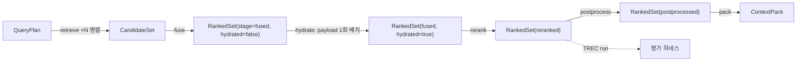

# CandidateSet과 RankedSet 계약

## 목적

검색 경로의 중간 계약 두 개를 확정한다. `CandidateSet`은 `retrieve` 스테이지가 채널(channel) × 컬렉션 × 질의 변형 단위로 모은 후보(candidate)와 채널 원점수·순위를 담고, `RankedSet`은 `fuse`(융합) → `hydrate`(payload 배치 조회) → `rerank`(리랭킹) → `postprocess`(후처리)가 같은 타입을 세 번 갱신하며 점수 원장(score ledger, K3)을 소실 없이 `pack`으로 전달한다. 이 문서는 바이블 §5.5의 `CandidateSet`·`RankedSet`·`RankedResult` 표를 같은 철자·같은 필수 여부로 옮기고, 융합 공식(RRF, Reciprocal Rank Fusion), `hydrate` 조건 필수 필드, 후처리 고정 순서와 보고, `omitted`·`explain` 규칙, 평가용 TREC run 변환 규칙, 한계와 저장 규약을 확정한다. 스키마 파일 `schemas/candidate-set.schema.json`·`schemas/ranked-set.schema.json`을 소유한다.

## 범위

- 포함: `retrieve`~`postprocess` 경계 정의, `CandidateSet`(채널 런·후보·`payload_slim`·`filters_applied`), `RankedSet`(`stage`·`hydrated`·`fusion`·`rerank`·`relevance_gate`·`postprocess_report`·`results[]`·`stats`), `RankedResult`·`ChannelScore`·`ScoreBreakdown`의 사용 규칙(정의는 [계약 개요](00-contract-overview.md) §4.13·§4.14·§5), RRF 기여 공식과 타이브레이크, `convex_*` 강등 규칙, `hydrate` 필드, 리랭크 점수 정규화, 후처리 단계별 `results` 변화, `omitted`(`OmitReason`)·`explain`(`ExplainCode`) 규칙, TREC run 변환, 크기 한계, 저장 규약, LLM 소비 영향, 스키마·Pydantic·예시·불변식.
- 제외: `QueryRequest`·`QueryPlan`의 필드 정의([09-query-request-and-query-plan](09-query-request-and-query-plan.md); `filters_applied.security`·`.strategy`는 09 §5.1·§5.2 `$defs/SecurityFilter`·`$defs/StrategyFilter`와 **동일 정의의 사본**을 이 스키마의 자기 `$defs`에 두고 CI 동치로 대조한다 — 계약 스키마 간 교차 `$ref`는 major 버전을 결합하므로 두지 않는다(00 §2 소유 규칙, 15 `EmbeddingSpaceIds`·11 `SecurityFilter` 사본과 같은 방식; `common-types` 승격 전 과도기, 미해결 이슈 17)), `ContextPack`·`ContextItem`([11-context-pack](11-context-pack.md)), 융합·리랭크·후처리 알고리즘의 구현 세부(문서 맵 `04-pipelines/15-hybrid-search-and-fusion`·`16-reranking`·`17-post-processing-and-context-packing`, 미게시 — 게시 전까지 [ADR-0013](../06-adr/0013-fusion-rrf-k60-then-convex-combination-and-postprocess-order.md)과 바이블 §8.1·§8.2가 정본), 인덱스 백엔드 어댑터 계약([07](07-embedded-chunk-set-and-index-record.md)), 컬렉션 백엔드 선언([15](15-collection-profile-and-policy-contracts.md) §2.2), 평가 하네스 계약([16](16-eval-feedback-and-sidecar-contracts.md)).
- 정본 관계: 필드·필수 여부·열거 철자는 바이블 §5.5·§5.3·§5.7을 그대로 따른다. 바이블에 없는 필드는 선택(N)으로만 두고 [미해결 이슈](#미해결-이슈)에 바이블 반영 제안으로 기록한다(`RankedSet.candidate_set_id`·`channel_runs`·`omitted`·`timings_ms`). 예외 하나: `FiltersApplied.effective_hash`는 바이블 §5.5 `filters_applied`가 "실제 전송 필터(**감사**)"이고 09 `QueryPlan.filters.effective_hash`(Y)와의 대조가 감사 체인의 유일한 연결이라 바이블 §5.5 patch(미해결 이슈 3)를 전제로 **Y**로 둔다. `common-types`가 소유한 타입(`PluginId`·`RankedResult`·`ScoreBreakdown`·열거)은 `$ref`하고 재정의하지 않으며, 09가 소유한 `SecurityFilter`·`StrategyFilter`는 정의를 바꾸지 않는 사본 `$defs`로 둔다(00 §2 소유 규칙, 바이블 §6.4 타입명 고유; §3.6).

## 1. 파이프라인 위치와 경계



| 스테이지 | 입력 | 출력 | `stage` / `hydrated` | 생산 플러그인(`producer.plugin_id`) | 실패 정책(바이블 §4.3) |
|----------|------|------|----------------------|------------------------------------|-------------------------|
| `retrieve` ×N | `QueryPlan.channels[i]` × `rewritten_queries[]` | `CandidateSet` | — | `retriever.*`(런별 `channel_runs[].retriever_id`); 봉투 `producer.plugin_id`는 팬아웃 코디네이터의 합성 값 `retriever.pipeline`(09 `QueryPlan.producer`의 `query_transformer.pipeline` 규약과 동일; 미해결 이슈 11) | 채널 실패는 제외 + `degraded{channel.*, timeout\|unavailable}` + `channel_runs[].error`; 전 채널 실패는 503 `retrieve.unavailable`; 백엔드 요청에 `tenant_id` 필터 부재는 `retrieve.security_context_missing` |
| `fuse` | `CandidateSet` | `RankedSet` | `fused` / `false` | `fuser.rrf`(기본), `fuser.convex_minmax` 등 | `fuse.k_missing`은 프로파일 로딩에서 차단; 출력은 `hydrate.top_n`으로 절단 |
| `hydrate`(fuse 내부 서브스텝) | `RankedSet(fused)` | `RankedSet` | `fused` / `true` | `fuser.*` 그대로(봉투 `producer`는 바뀌지 않는다). 조회는 `index_backend.*` 어댑터의 `retrieve(record_ids, with_payload)` 1회 호출이지만 어댑터는 경계 타입을 쓰지 않으므로 `producer`에 기록하지 않는다(§4.1) | `hydrate.backend_error` 1회 재시도 후 503 `retrieve.unavailable`; 누락 레코드는 `omitted(hydrate_missing)` + `degraded{hydrate, partial_result}` |
| `rerank` | `RankedSet(fused, hydrated)` | `RankedSet` | `reranked` / `true` | `reranker.*` | `rerank.timeout` → fused 순서 폴백 + `degraded{rerank, timeout}`; 리랭커 5xx·연결 실패 → 같은 폴백 + `degraded{rerank, unavailable}`; 둘 다 `rerank.applied=false`, `explain += rerank_skipped`(§7); `rerank.schema_mismatch`는 비재시도 |
| `postprocess` | `RankedSet(reranked)` | `RankedSet` | `postprocessed` / `true` | `postprocessor.*`(step 플러그인) | `postprocess.parent_text_miss` → 확장 생략 + `degraded{parent_expand, unavailable}` |

**결정:** 경계 타입은 두 개다. `hydrate`는 경계 타입을 추가하지 않는 서브스텝이며 `hydrated` 플래그로만 구분한다(바이블 §3.1 D-05, [ADR-0030](../06-adr/0030-single-coordinate-system-and-score-ledger.md), [ADR-0034](../06-adr/0034-retrieval-hot-path-postgres-independence-and-hydrate.md)). 따라서 `hydrate`는 봉투 `producer`도 갱신하지 않는다 — `RankedSet(stage=fused, hydrated=true)`의 `producer`는 `fuse`를 수행한 `fuser.*`이며, 조회에 쓰인 `index_backend.*` 어댑터의 지문은 `producer`·`stats`·`timings_ms`에 넣지 않는다(필요해지면 바이블 §5.5 patch로 별도 N 필드를 두거나 계속 생략한다; 미해결 이슈 20). 두 계약은 인프로세스에서만 흐르고 오케스트레이터를 거치지 않으므로 `lineage_refs`가 없고 산출물 저장은 선택이다(§12). 그러나 셸의 세 지점 검증(00 §10.1)은 예외 없이 적용되며 `filters_applied.security`·`security_context_hash`의 검증은 어떤 경우에도 생략하지 않는다(E6·E7).

## 2. 식별자와 단위

| 식별자 | 규약(바이블 §6.1·§6.2) | 이 문서에서의 역할 |
|--------|------------------------|--------------------|
| `channel_run_id` | `"{channel}:{collection_id}:{variant_id}"` | 런(run) = 채널 × 컬렉션 × 질의 변형. 후보는 정확히 하나의 컬렉션에 속하므로 컬렉션 차원은 RRF에 중복 기여하지 않는다(바이블 §3.2 O-01) |
| `variant_id` | ULID 서버 발급; `original` 변형은 `variant_id = query_id` | `ChannelScore.variant_ids`·`RankedResult.variant_ids`의 원소; 런 가중 `w_run` 결정(§5) |
| `record_id` | `H("record", tenant_id, collection_id, document_id, str(index_generation), chunk_id)` | 후보 식별자·`hydrate` 조회 키·RRF 타이브레이크 키. 같은 `chunk_id`가 두 컬렉션에 있으면 별개 후보(1차 `dedup`이 `content_hash`로 병합) |
| `chunk_id` | `H("chunk", doc_version, chunker_config_hash, str(level), span)` | 콘텐츠 주소. `exclude_ids`·`duplicates_of`·`expanded_from`의 기준. 평가의 청크 단위 판정은 `chunk_id`가 아니라 `block_refs` × `answer_spans`로 파생한다(§10) |
| `document_id` | ULID | TREC run의 `doc_id`(§10; ADR-0023 `doc_id` = 문서 ULID). 같은 문서의 여러 결과는 run에서 한 행으로 접힌다 |
| `candidate_set_id`, `ranked_set_id`, `plan_id`, `query_id` | ULID | `ranked_set_id`는 세 번 갱신되는 동안 유지된다 |

## 3. `CandidateSet` 필드 정의

### 3.1 봉투(질의 측; 바이블 §5.2, 스키마 최상위에 직접 선언)

| 필드 | 타입 | 필수 | 설명 | 예시 |
|------|------|------|------|------|
| `schema_version` | string(semver) | Y | 초기 `"1.0.0"`; `1.MINOR.PATCH` 세 정수만(스키마 `pattern`; `$id` major 1과 일치, 바이블 §6.4·14 §1.2) | `"1.0.0"` |
| `schema_type` | string | Y | `const "CandidateSet"` / `"RankedSet"` | `"CandidateSet"` |
| `tenant_id` | string(ulid) | Y | 보안 삼중항 1 = `SecurityContext.tenant_id` | `"01J9ZQ4K7X2M8N3P5R6S7T8V9W"` |
| `collection_ids` | array<string(ulid)> | Y | 질의 측 복수(1..20) = `QueryPlan.collection_ids` | `["01J9ZQ5A1B2C3D4E5F6G7H8J9K"]` |
| `producer` | `Producer` | Y | 마지막으로 쓴 스테이지의 지문 | 예시 2·3 |
| `warnings` | array<Warning> | Y | 빈 배열 허용 | `[]` |
| `degraded` | array<DegradedEntry> | Y | 품질 삼중항 3. 상류 `degraded`를 상속하고 자기 항목을 더한다 | `[{"component": "channel.lexical", "reason": "timeout"}]` |
| `created_at` | string(date-time) | Y | RFC 3339 UTC | `"2026-09-22T09:00:00.212Z"` |

### 3.2 `CandidateSet` 최상위(바이블 §5.5 표 전부)

| 필드 | 타입 | 필수 | 설명 | 예시 |
|------|------|------|------|------|
| `candidate_set_id`, `plan_id`, `query_id` | string(ulid) | Y | 발급형 ID; 입력 `QueryPlan.plan_id`; `QueryRequest.query_id` | 예시 2 |
| `channel_runs` | array<ChannelRun> | Y | 채널 × 컬렉션 × 질의 변형 단위(§3.3). 실패·비활성 런도 `status`로 남긴다 | 예시 2 |
| `filters_applied` | `FiltersApplied` | Y | 실제 전송된 필터(감사; `security`·`strategy`·`user`·`self_query` 구분, §3.6) | 예시 2 |
| `security_context_hash` | string(hex64) | Y | `H("sec", tenant_id, ",".join(sorted(principals)), ",".join(sorted(collection_ids)), as_of, classification_max, ",".join(visible_set))`(바이블 §6.2 `security_context_hash` 행 그대로; `visible_set`은 `SecurityContext` 순서 유지). 어댑터가 "필터에 `tenant_id` 포함"을 서명(E7) | hex64 |
| `total_unique` | integer | Y | 전 런의 서로 다른 `record_id` 수(= `fusion.candidates_in`) | `6` |
| `total_latency_ms` | integer | Y | 병렬 검색 전체 경과(≥ max `took_ms`) | `96` |

### 3.3 `ChannelRun`(`channel_runs[]`; 계약 전용 `$defs`)

| 필드 | 타입 | 필수 | 설명 | 예시 |
|------|------|------|------|------|
| `channel_run_id` | string | Y | `"{channel}:{collection_id}:{variant_id}"`(§2) | `"dense:01J9ZQ5A…:01JA0QRY…"` |
| `channel` | enum(Channel) | Y | `lite`의 `sparse_bm25` 벡터 질의는 `lexical`; `sparse`는 learned sparse만(바이블 §5.7) | `"dense"` |
| `collection_id` | string(ulid) | Y | 런의 컬렉션 | ULID |
| `variant_id` | string(ulid) | Y | `rewritten_queries[].variant_id` | `= query_id` |
| `retriever_id` | string(plugin_id) | Y | `= QueryPlan.channels[].retriever_id`, `retriever.{implementation}`(바이블 §6.1; 09 §6.5의 `retriever.qdrant_dense`·`retriever.qdrant_sparse`·`retriever.opensearch_bm25`·`retriever.qdrant_sparse_bm25`). 이 스키마는 `PluginId`를 `retriever.` 접두로 좁힌 `RetrieverId`로 검사한다 | `"retriever.opensearch_bm25"` |
| `backend_id` | string(plugin_id) | Y | `= QueryPlan.channels[].backend_id`(`index_backend.{implementation}`, 09 §6.5) = 컬렉션 `backends[].backend_id`(15 §2.2). `common-types` `$defs/PluginId` | `"index_backend.qdrant"` |
| `collection_alias` | string | Y | 물리 alias `col_{collection_id}_vec` / `_lex`(바이블 §13.4) | `"col_01J9ZQ5A…_lex"` |
| `embedding_profile_hash` | string(hex64) | Y | 컬렉션 값. `convex_*` 적격성(동일 프로파일) 판정 근거 | hex64 |
| `index_generation_seen` | array<integer> | Y | 후보가 속한 문서 세대 집합 → `ContextPack.diagnostics.index_generations_seen` | `[2, 3]` |
| `status` | enum(ChannelRunStatus) | Y | `ok, timeout, error, disabled` | `"ok"` |
| `took_ms` | integer | Y | | `61` |
| `returned` | integer | Y | `= candidates.length`(≤ 300) | `5` |
| `total_hits` | integer \| null | Y(nullable) | 필터 후 총량(recall 진단; 근사 허용, 미제공 시 `null`) | `5` |
| `truncated` | boolean | Y | `top_k` 또는 런당 상한 300으로 절단되었는가 | `false` |
| `error` | `StageError` \| null | N | 채널 제외 사유. `status ∈ {timeout, error}`면 필수(`retrieve.channel_timeout`, `retrieve.backend_error`, `embed.server_unavailable`) | [13](13-error-model.md) §5.3 |
| `candidates` | array<Candidate> | Y | 채널 원점수 내림차순, `rank` 1..n 연속. `status ≠ ok`면 빈 배열 | 예시 2 |

### 3.4 `Candidate`(`channel_runs[].candidates[]`)

| 필드 | 타입 | 필수 | 설명 | 예시 |
|------|------|------|------|------|
| `record_id` | string(hex64) | Y | `hydrate` 조회 키이자 융합 후 후보 식별자(§2) | hex64 |
| `chunk_id` | string(hex64) | Y | 콘텐츠 주소 | hex64 |
| `collection_id` | string(ulid) | Y | `= 소속 런의 collection_id`(CS-6) | ULID |
| `document_id` | string(ulid) | Y | | ULID |
| `doc_version` | string(hex64) | Y | `= content_hash(문서)` | hex64 |
| `item_kind` | enum(ItemKind) | Y | 전략 필터 `item_kinds` 안의 값. `parent`는 후보가 될 수 없다(후처리 전용) | `"text"` |
| `level` | integer(ChunkLevel) | Y | 전략 필터 `level_in` 안의 값 | `0` |
| `parent_chunk_id` | string(hex64) \| null | Y(nullable) | small-to-big 확장 키 | hex64 |
| `score` | number | Y | 채널 원점수(cosine / dot / BM25 / MaxSim). 채널 간 비교 불가 | `0.8312` |
| `rank` | integer | Y | 채널 내 1-based 순위 | `1` |
| `payload_slim` | `PayloadSlim` | Y | §3.5 | |
| `graph_path` | array<string> | N | 그래프 채널의 엔티티·관계 경로 설명 | `["행정안전부", "소관", "규정"]` |

### 3.5 `PayloadSlim`(`candidates[].payload_slim`; 런당 300 × 1KB 한계의 근거)

바이블 §5.5는 이 객체의 키만 나열한다. 필수 여부는 이 문서가 확정한다(모두 Y; 페이지·날짜는 nullable). 본문·인용 좌표·전체 ACL은 넣지 않는다 — `hydrate`가 채운다(§6).

| 필드 | 타입 | 필수 | 설명 | 예시 |
|------|------|------|------|------|
| `heading_path` | array<string> | Y | `IndexRecord.heading_path` | `["제3장 문서의 접수·처리", "제18조(문서의 접수·처리)"]` |
| `page_start`, `page_end` | integer \| null | Y(nullable) | 흐름 포맷(HWPX·DOCX·HTML)은 `null` | `null` / `45` |
| `doc_date` | string(date) \| null | Y(nullable) | | `"2025-03-04"` |
| `acl_classification` | enum(Classification) | Y | 등급(팩 `classification_max` 사전 계산) | `"internal"` |
| `acl_hash` | string(hex64) | Y | E9 회수 힌트 대조 키 | hex64 |
| `token_count_primary` | integer | Y | 임베딩 토크나이저 기준 토큰 수(패킹 사전 예산) | `71` |
| `text_preview` | string | Y | ≤ 200자(MCP `concise`·디버그). 본문 대체 불가, 인용 불가 | 예시 2 |
| `content_hash` | string(hex64) | Y | `blake3_hex(utf8(Chunk.text))`. 1차 `dedup` 키 | hex64 |
| `text_source` | enum(BlockSource) | Y | `text_layer, ocr, vlm, converted` | `"text_layer"` |

### 3.6 `FiltersApplied`(`filters_applied`)

| 필드 | 타입 | 필수 | 설명 | 예시 |
|------|------|------|------|------|
| `security` | `SecurityFilter`(09 §5.1) | Y | 보안 불변식 (a)(바이블 §10.2)의 바인딩 값 `{tenant_id, collection_ids[], principals[], visible_set[], as_of, is_current: true, classification_max}` = `QueryPlan.filters.security` 사본. 제거·완화 불가 | 예시 2 |
| `strategy` | `StrategyFilter`(09 §5.2) | Y | 전략 필터 (b) `{level_in[], item_kinds[]}` = `QueryPlan.filters.strategy` 사본; 플래너가 `strategy`로 결정 | `{"level_in": [0], "item_kinds": ["text", "list_group", "code", "table", "table_part", "figure"]}` |
| `user` | `FilterNode` \| null | Y(nullable) | 백엔드에 **실제 전송된** 사용자 필터 트리 — `page` 연산자 변환·0건 완화(09 §7 필터 빌더)를 반영한 뒤의 값. 변환·완화 전 원형은 `QueryPlan.filters.user`에 남고 갱신되지 않는다(09 §5.4) | `null` |
| `self_query` | `FilterNode` \| null | Y(nullable) | 백엔드에 **실제 전송된** 추출 필터 트리(완화 반영 후). 원형은 `QueryPlan.filters.self_query` | `null` |
| `effective_hash` | string(hex64) | Y | **실전송 해시** `H("filters", canonical_json(security + strategy + user + self_query))` — 이 객체의 네 필드(전송 트리)로 계산하며 `as_of`는 바인드 이름 `":as_of"`로 직렬화한다(09 §5.4의 잠정 해석, 바이블 §6.2 patch 대기). `page` 변환·완화가 없으면 `QueryPlan.filters.effective_hash`(계획 트리의 불변 해시)와 같고, 있으면 다르다 — 두 값의 대조가 변환·완화 유무 판정이다. 감사 이벤트 `audit.query.executed`(12 §6.4)와 `ContextPack.diagnostics.filters_applied`(11 §2.8)는 이 값을 복사한다. 바이블 §5.5 `filters_applied` 의미 열에는 미등재이나 "실제 전송 필터(감사)"의 감사 체인이 끊기지 않도록 §5.5 patch를 전제로 Y(미해결 이슈 3) | hex64 |

`security`·`strategy`는 09 §5.1·§5.2가 소유한 `urn:rag:schema:query-plan:1#/$defs/SecurityFilter`·`#/$defs/StrategyFilter`와 **동일 정의의 사본** `#/$defs/SecurityFilter`·`#/$defs/StrategyFilter`로 둔다. 계약 스키마 간 교차 `$ref`는 `$id` major를 결합하므로 두지 않고(00 §2 소유 규칙; 15 `EmbeddingSpaceIds`·11 `SecurityFilter`와 같은 사본 방식) 사본 동치는 CI(00 §10.3)가 대조하며, `common-types` 승격 뒤 `$ref`로 전환한다(미해결 이슈 17). 정의가 같으므로 09 §5.1의 `principals.uniqueItems`, `visible_set.maxItems: 3`, §5.2의 `level_in.maxItems: 3`, `item_kinds.maxItems: 11`이 그대로 적용되어 `QueryPlan`에서 거부되는 바인딩 값은 `CandidateSet`에서도 거부된다(E6). Pydantic은 사본 클래스를 만들지 않고 `rag_platform.contracts.query_plan`의 두 클래스를 임포트한다(같은 클래스이므로 동치가 자동 성립). `security`·`strategy`는 전송 트리에서도 계획 값과 동일하다(제거·완화·변환 불가, E6).

## 4. `RankedSet` 필드 정의

### 4.1 최상위(바이블 §5.5 표 전부 + 선택 추가 4개)

| 필드 | 타입 | 필수 | 설명 | 예시 |
|------|------|------|------|------|
| 봉투(질의 측) | — | Y | §3.1과 동일. `producer`는 마지막으로 쓴 스테이지(`fused`: `fuser.*`, `reranked`: `reranker.*`, `postprocessed`: `postprocessor.*`). `hydrate`는 서브스텝이라 `producer`를 바꾸지 않는다 — `stage=fused, hydrated=true`도 `fuser.*`이며 `index_backend.*` 어댑터 지문은 기록하지 않는다(§1 결정) | 예시 3 |
| `ranked_set_id`, `plan_id`, `query_id` | string(ulid) | Y | | 예시 3 |
| `stage` | enum(RankedStage) | Y | `fused, reranked, postprocessed` | `"reranked"` |
| `hydrated` | boolean | Y | `fuse` 직후 `false` → `hydrate` 후 `true`; `reranked` 이후 항상 `true` | `true` |
| `fusion` | `FusionReport` | Y | `{method, k, weights, variant_query_weight, candidates_in, candidates_out, downgraded_from?}` 실제 적용값(§4.2) | 예시 3 |
| `rerank` | `RerankReport` | 조건(`stage ∈ {reranked, postprocessed}`) | `{applied, plugin_id, model_id, backend, response_schema, normalization, top_n_in, top_n_out, took_ms, skipped_reason?}`(§4.3) | 예시 3 |
| `late_interaction_rerank` | `LateInteractionRerankReport` | N(조건 동일) | `{applied, model_id, top_n_in, top_n_out, took_ms}` O-04 실험 슬롯 | — |
| `relevance_gate` | `RelevanceGateReport` | 조건(`stage = postprocessed`) | `{tau, max_score, passed, retries}` | `{"tau": 0.3, "max_score": 0.9577, "passed": true, "retries": 0}` |
| `calibration_ref` | string \| null | N | 컬렉션별 리랭크 점수 분포(`calibrations` 표) 참조 | `"calib:01J9ZQ5A…:bge-reranker-v2-m3"` |
| `postprocess_report` | `PostprocessReport` | 조건(`stage = postprocessed`) | `{steps: [{step, removed, added, took_ms}]}`(§8) | §8 |
| `results` | array<RankedResult> | Y | `final_rank` 오름차순(1..n 연속), ≤ 100(§4.4) | 예시 3 |
| `stats` | `RankedSetStats` | Y | `{n_in, n_out, hydrated_n, gate_passed}`; `gate_passed`는 `postprocessed` 이전 `null` | `{"n_in": 6, "n_out": 6, "hydrated_n": 6, "gate_passed": null}` |
| `candidate_set_id` | string(ulid) | N | 입력 `CandidateSet.candidate_set_id`. **바이블 미등재**(미해결 이슈 2) | 예시 3 |
| `channel_runs` | array<ChannelRunSummary> | N | `CandidateSet.channel_runs[]`의 후보·오류 없는 요약 `{channel_run_id, channel, collection_id, variant_id, status, returned, total_hits, truncated, took_ms, index_generation_seen}`. `pack`의 `diagnostics.index_generations_seen`·`explain` 원천. **바이블 미등재**(미해결 이슈 2) | 예시 3 |
| `omitted` | array<RankedOmittedEntry> | N | `hydrate`·`postprocess`가 `results`에서 제거한 항목 `{chunk_id, collection_id, document_id, reason, step, related_chunk_id?, explain?}`(§9). 11의 `PackOmittedEntry`(`ContextPack.omitted[]`, 4필드)와 다른 형태라 이름을 구별했다. 플랫폼 `fuser`·`postprocessor` 구현은 항상 채운다(제거 항목이 없으면 `[]`). **바이블 미등재**(미해결 이슈 2) | `[]` |
| `timings_ms` | `TimingsMs` | N | `{retrieve?, fuse?, hydrate?, rerank?, postprocess?}` → `ContextPack.diagnostics.latency_ms`. **바이블 미등재**(미해결 이슈 2) | `{"retrieve": 96, "fuse": 2, "hydrate": 11, "rerank": 118}` |

### 4.2 `FusionReport`(`fusion`)

| 필드 | 타입 | 필수 | 설명 | 예시 |
|------|------|------|------|------|
| `method` | enum(FusionMethod) | Y | `rrf, convex_minmax, convex_zscore, dbsf, combmnz`; 기본 `rrf` | `"rrf"` |
| `k` | integer | Y | RRF `k`(기본 60). 프로파일 필수값 `fusion.k`의 사본(`fuse.k_missing` 사전 차단) | `60` |
| `weights` | object<Channel, number> | Y | 채널 가중, 키는 `Channel`로 닫힘. 기본 `dense:sparse:lexical = 1:1:1` | `{"dense": 1, "sparse": 1, "lexical": 1}` |
| `variant_query_weight` | number(0 < w ≤ 1) | Y | 변형 질의 런 가중(기본 0.5; `original`은 1.0) = `QueryPlan.fusion.variant_query_weight`(09 §6.6과 같은 범위) | `0.5` |
| `candidates_in` | integer | Y | `= CandidateSet.total_unique` | `6` |
| `candidates_out` | integer | Y | `hydrate.top_n` 절단 후 수(= `fused` 단계 `results.length`) | `6` |
| `downgraded_from` | enum(FusionMethod) | N | `convex_* → rrf` 강등 시 원 방식(`degraded{fusion, profile_mismatch}` 동반) | `"convex_minmax"` |

### 4.3 `RerankReport`(`rerank`)·`LateInteractionRerankReport`·`RelevanceGateReport`·`RankedSetStats`

| 타입 | 필드 | 타입 | 필수 | 설명 |
|------|------|------|------|------|
| `RerankReport` | `applied` | boolean | Y | `false`면 fused 순서 폴백, 모든 `results[].explain`에 `rerank_skipped` |
| | `plugin_id`, `model_id` | string(`reranker.*`) / string(`{repo}@{revision}`) | Y | 프로파일 `rerank.plugin_id`·`model_id` |
| | `backend`, `response_schema`, `normalization` | enum(RerankBackend) / enum(RerankResponseSchema) / enum(ScoreNormalization) | Y | `tei, vllm, sglang, llamacpp, in_process, qdrant_maxsim` / `tei, cohere` / `sigmoid, minmax, identity`(기본 `sigmoid`) |
| | `top_n_in`, `top_n_out`, `took_ms` | integer | Y | `standard` 100→20 |
| | `skipped_reason` | string | 조건(`applied=false`) | 카탈로그 코드(`rerank.timeout`; 타임아웃) 또는 `DegradedReason` 값(`unavailable`: 리랭커 5xx·연결 실패, `latency_budget`, `skipped_by_policy`). 동반 `degraded[].reason`과 같은 구분(§7) |
| `LateInteractionRerankReport` | `applied`, `model_id`, `top_n_in`, `top_n_out`, `took_ms` | boolean / string / integer ×3 | Y | 2단 리랭크 1단(MaxSim). 현재는 순서 필터(재융합 없음), `explain += late_interaction_pass` |
| `RelevanceGateReport` | `tau`, `max_score`, `passed`, `retries` | number(0..1) / number(0..1) / boolean / integer(0..1) | Y | `passed = (max_score ≥ tau)`; `retries`는 `quality` 변형의 재검색 횟수(최대 1) |
| `RankedSetStats` | `n_in`, `n_out`, `hydrated_n`, `gate_passed` | integer / integer / integer / boolean \| null | Y(`gate_passed` nullable) | `n_out = results.length`; `hydrated_n`은 `hydrate`가 채운 수(`hydrated=false`면 0); `gate_passed = relevance_gate.passed` |

### 4.4 `RankedResult`(`results[]`; 정의는 `common-types` `$defs/RankedResult`, 바이블 §5.5 표 전부)

| 필드 | 타입 | 필수 | 설명 | 예시 |
|------|------|------|------|------|
| `record_id` | string(hex64) \| null | Y(nullable) | 부모 확장 항목(`item_kind=parent`)은 인덱스 레코드가 없어 `null`(RS-5) | hex64 |
| `chunk_id`, `collection_id`, `document_id`, `doc_version` | string(hex64) / string(ulid) / string(ulid) / string(hex64) | Y | | 예시 3 |
| `item_kind`, `level`, `parent_chunk_id` | enum(ItemKind) / integer(ChunkLevel) / string(hex64) \| null | Y(`parent_chunk_id` nullable) | 부모 항목은 `item_kind=parent`, `level=1`, `parent_chunk_id=null`(RS-5) | `"text"`, `0` |
| `final_rank` | integer | Y | 현 스테이지 기준 1-based | `1` |
| `final_score` | number(0..1) | Y | `rerank.applied`면 `rerank_normalized_score`, 아니면 min-max `fused`(§7) | `0.9577…` |
| `fused_score`, `fused_rank` | number / integer | Y | 융합 점수·순위(= `score_breakdown.fused`·`.fused_rank`) | `0.0486…`, `1` |
| `rerank_raw_score`, `rerank_normalized_score`, `rerank_rank` | number / number / integer | 조건(`rerank.applied`) | 셋은 함께 존재(`dependentRequired`) | `3.12`, `0.9577…`, `1` |
| `score_breakdown` | `ScoreBreakdown` | Y | 점수 원장. 불변식 Σ `contribution` = `fused`(00 I-18) | 예시 3 |
| `channels_hit` | array<enum(Channel)> | Y | `score_breakdown`의 non-null 채널 집합과 같다(RS-7) | `["dense", "sparse", "lexical"]` |
| `variant_ids` | array<string(ulid)> | Y | 적중 질의 변형의 합집합 | `["01JA0QRY…"]` |
| `text`, `context_prefix`, `heading_path`, `numbering_path`, `title`, `source_uri`, `external_id`, `doc_date`, `doc_type`, `page_start`, `page_end`, `lang`, `text_source`, `ocr_confidence_min`, `chunk_set_blake3` | string / string / array<string> / array<string> / string / string(uri) / string \| null / string(date) \| null / string \| null / integer \| null / integer \| null / string(bcp47) / enum(BlockSource) / number \| null / string(hex64) | 조건(`hydrated=true`) | `hydrate`가 `IndexRecord` payload에서 채운다(§6); 부모 확장 후에는 `ChunkTextStore` 번들의 부모 값 | 예시 3 |
| `token_count_primary`, `ordinal`, `text_truncated`, `pii_policy_applied` | integer / integer / boolean / enum(PiiPolicy) | N(바이블 §5.5 1.3.0, AM-33) | `hydrate` 시 채움 — `Chunk.token_counts.primary`·`Chunk.ordinal` 복사, `text_truncated`는 `IndexRecord` payload 절단본(`embed.token_overflow`) 여부, `pii_policy_applied`는 `IndexRecord.payload.pii_policy_applied` 경로 원천 | `4096`, `0`, `false`, `"tokenize"` |
| `acl` | object | 조건(`hydrated=true`) | `{allow[], deny[], visibility, classification, embargo_until, expires_at, acl_hash}` — `IndexRecord.acl_*` 역평탄화; `pack.acl_recheck` 입력(D-09, E9) | 예시 3 |
| `block_refs`, `sentence_spans` | array<BlockRef> / array<[integer, integer]> | 조건(`hydrated=true`) | 인용 좌표(K1), `text` 기준 코드포인트. `text`를 바꾸는 단계(`parent_expand`·`sentence_window`·`compress`)는 둘을 함께 재계산 | 예시 3 |
| `table_ref`, `html_ref` | object \| null / `ArtifactRef` \| null | N | 표 청크(`pack`이 `tables[]`로 구체화). `table_ref`는 `common-types` `RankedResult`에서 열린 객체(00 §8.2)로 선언되지만 값은 `hydrate`가 `IndexRecord.table_ref`를 그대로 복사하므로 **07 §5.3 `TableRef`와 동일 구조** `{table_block_id, header_row_indices, row_range, col_range, serialization, html_ref}`다(= `Chunk.table_ref`, 05 §3.7; 11 §3.4가 `serialization`을 읽는다). `TableRef`의 `common-types` 승격(07 미해결 이슈 4) 뒤 `$ref`로 닫는다(미해결 이슈 18) | — |
| `expanded_from` | array<string(hex64)> | N(부모 항목은 Y) | 부모 확장 시 흡수된 자식 `chunk_id`(자식 `ordinal` 순) | — |
| `duplicates_of` | string(hex64) \| null | N | 대표 `chunk_id`. v1 기본 정책은 근중복을 `omitted(duplicate)`로 옮기므로 결과 항목에서는 생략된다(미해결 이슈 5) | — |
| `window_chunk_ids` | array<string(hex64)> | N | 문장 윈도우가 텍스트를 빌려온 이웃 청크 | — |
| `explain` | array<enum(ExplainCode)> | Y | §9 규칙. 빈 배열 허용 | `["multi_channel_hit"]` |

### 4.5 `ChannelScore`·`ScoreBreakdown`(정의 소유는 00 §4.13·§4.14, 바이블 §5.3; 아래 표는 같은 철자·필수 여부의 사본이며 이 문서는 사용 규칙만 더한다)

| `ChannelScore` 필드 | 타입 | 필수 | 이 문서에서의 의미 | 예시 |
|------|------|------|------|------|
| `score` | number | Y | 채널 원점수(`Candidate.score` 사본; cosine / dot / BM25 / MaxSim) | `0.8312` |
| `rank` | integer | Y | 채널 내 1-based 순위(`Candidate.rank` 사본) | `1` |
| `contribution` | number | Y | `w_run / (k + rank)`(§5.1); 변형 런이 여럿이면 합 | `0.01639344262295082` |
| `variant_ids` | array<string(ulid)> | Y | 그 채널에서 이 `record_id`를 적중한 변형 전부 | `["01JA0QRY…"]` |

| `ScoreBreakdown` 필드 | 타입 | 필수 | 이 문서에서의 의미 |
|------|------|------|------|
| `dense`, `sparse`, `lexical`, `graph`, `tree`, `visual`, `late_interaction` | `ChannelScore` \| null | Y(nullable) | 키는 항상 존재, 미적중은 `null`; non-null 집합 = `channels_hit`(RS-7) |
| `fused` | number | Y | `= RankedResult.fused_score` = Σ non-null `contribution`(00 I-18) |
| `fused_rank` | integer | Y | `= RankedResult.fused_rank` |
| `rerank_raw`, `rerank_normalized` | number \| null | Y(nullable) | `= rerank_raw_score`·`rerank_normalized_score`; `rerank.applied=false`·`stage=fused`면 `null` |
| `normalization` | enum(ScoreNormalization) | Y | `rerank.normalization`의 사본(미적용 시 프로파일 값 그대로) |
| `boosts` | array<object> | N | `{kind: enum(BoostKind), delta}` — `final_score`에 더한 조정, `fused`에 포함되지 않는다(§5.4) |

**결정:** 한 채널이 여러 변형 런에서 같은 `record_id`를 적중하면 `ChannelScore`는 채널당 하나로 합친다 — `score`·`rank`는 원 질의 런(`variant_id = query_id`) 우선, 없으면 최고 순위 런의 값; `contribution`은 그 채널 모든 런 기여의 합(Σ `contribution` = `fused_score` 불변식이 성립하는 유일한 방법); `variant_ids`는 적중 변형 전부([ADR-0013](../06-adr/0013-fusion-rrf-k60-then-convex-combination-and-postprocess-order.md) RRF 식, [ADR-0030](../06-adr/0030-single-coordinate-system-and-score-ledger.md) 점수 원장). 바이블 §5.3 `ChannelScore`는 이 병합 규칙을 적지 않으므로 의미 열 보강을 제안한다(미해결 이슈 14).

## 5. 융합 규칙

### 5.1 RRF 기여 공식(기본, [ADR-0013](../06-adr/0013-fusion-rrf-k60-then-convex-combination-and-postprocess-order.md))

**결정:** 런 `r`(채널 `c`, 변형 `v`)에서 순위 `rank`로 적중한 후보의 기여는 `contribution_r = w_run / (k + rank)`, `w_run = fusion.weights[c] × (1.0 if v.role = original else fusion.variant_query_weight)`이며 `fused_score = Σ_r contribution_r`이다(바이블 §3.2 O-01, §8.1 8단계). 기본값은 표와 같고 값은 프로파일 `query.fusion.*`(바이블 §7.2)의 사본이다.

| 파라미터 | 값 | 근거 |
|----------|----|------|
| `k` | 60 | 문헌 기본값; Qdrant 서버 기본 `k=2` 함정 때문에 프로파일 필수(매트릭스 `fusion_default`) |
| `weights` | `dense:sparse:lexical = 1:1:1` | D-07 |
| `variant_query_weight` | 0.5 | D-07 |
| 정렬 | `(-fused_score, record_id)` — 동점은 `record_id` 오름차순 | O-01 |
| 절단 | 상위 `hydrate.top_n`(기본 `rerank.top_n_in` = 100; `fast` 변형 `pack.k_max × 2`) | 바이블 §4.3 |

예: 원 질의 런 rank 1은 `1/61 = 0.01639344262295082`, 변형 질의 런 rank 1은 `0.5/61 = 0.00819672131147541`. 예시 1은 3채널 × 5후보의 전체 계산이다.

### 5.2 다중 컬렉션과 `convex_*` 강등

런은 채널 × 컬렉션 × 변형이고 후보는 한 컬렉션에만 속하므로 컬렉션은 RRF에 그대로 투입된다(컬렉션 차원은 중복 기여하지 않는다). `convex_minmax`·`convex_zscore`는 채널 런 안에서 원점수를 정규화(`min-max` 또는 `z-score`)한 값에 가중을 곱해 `contribution`으로 삼으며(Σ = `fused_score` 불변식 동일), 질의 내 모든 컬렉션이 같은 `embedding_profile_hash`·`analyzer_id`일 때만 허용된다. 플래너가 `rrf`로 강등했으면 `fusion.method = rrf`, `fusion.downgraded_from = convex_*`, `degraded += {fusion, profile_mismatch}`다. `lite` 단일 컬렉션 질의의 서버 융합(Qdrant `Fusion.RRF`, `k=60` 명시)은 채널 원점수를 돌려주지 않으므로 `ChannelScore.score`에 서버가 준 값이 없으면 `rank`만 신뢰하고 `score`는 백엔드가 반환한 융합 점수를 채널 모두에 복사하되 `explain`은 그대로 둔다(임시 규칙; 확정 장소는 미해결 이슈 6).

### 5.3 `fused` 단계의 순위와 점수

`fused_rank`는 정렬 후 1-based 위치(절단 전), `final_rank`는 절단 후 위치이며 절단은 머리를 남기므로 둘은 같다. `final_score`는 `rerank.applied=false`일 때의 규칙과 같이 `fused_score`의 min-max 정규화다: `n = 1` 또는 모두 같은 값이면 `1.0`, 아니면 `(fused − min)/(max − min)`(RS-9). **결정:** min-max의 기준 집합은 **현 스테이지의 `results` 집합**이다 — `hydrate`가 `hydrate_missing` 항목을 제거하면 남은 집합으로 `final_score`를 재계산하고(값이 바뀔 수 있음) `fused_score`·`fused_rank`는 원장으로 유지한다; 검증기(RS-9)도 현 집합으로 재계산해 대조한다.

### 5.4 부스트

`boosts[]`(`entity`, `recency`, `item_kind_penalty`, `user_dictionary`)는 프로파일이 켠 경우에만 존재하며 `final_score`에 `delta`를 더한 뒤 `[0, 1]`로 클램프한다. `fused`는 바꾸지 않는다(점수 원장 보존). `entity`·`recency` 부스트는 `explain += boost_entity | boost_recency`.

## 6. `hydrate` 조건 필수 필드

`fuse`가 절단한 상위 `hydrate.top_n`의 `record_id`로 벡터 백엔드(`standard`·`lite` 모두 Qdrant)에 `retrieve(with_payload=[…])`를 **1회 배치** 호출한다(바이블 §4.3·§8.1 9단계, ADR-0034; PostgreSQL 미의존). 조회는 §10.2 (a) 보안 필터를 다시 적용한다(E10).

| `RankedResult` 필드 | 원천(`IndexRecord` payload) | 비고 |
|--------------------|-----------------------------|------|
| `text` | `text`(≤ 8,192 UTF-8 바이트; `IndexRecord.text_truncated=true`면 절단본) | 리랭크 입력 `context_prefix + "\n" + text`. 절단 여부 플래그는 `RankedResult`(공용 타입, 바이블 §5.5)에 없어 `pack`이 `[truncated]` 표기(바이블 §9.1)를 직접 알 수 없다 — 미해결 이슈 12 |
| `context_prefix` | `context_prefix` | 3-텍스트 규칙: `text`에 포함되지 않는다 |
| `heading_path`, `numbering_path`, `title`, `source_uri`, `external_id`, `doc_date`, `doc_type`, `lang` | 동명 필드(`external_id`·`doc_date`·`doc_type`은 부재 시 `null`) | 헤더 재생성·상충 표지 입력 |
| `page_start`, `page_end` | 동명 필드 | 흐름 포맷 `null` |
| `text_source`, `ocr_confidence_min` | 동명 필드 | 렌더러 `[ocr]` 표기 원천 |
| `chunk_set_blake3` | `chunk_set_blake3` | 부모 번들 키(`ChunkTextStore`, 바이블 §13.2) |
| `acl` | `acl_allow → allow`, `acl_deny → deny`(부재 시 `[]`), `acl_visibility → visibility`, `acl_classification → classification`, `acl_embargo_until → embargo_until`(부재 시 `null`), `acl_expires_at → expires_at`(부재 시 `null`), `acl_hash` | 역평탄화(바이블 §10.1); `pack.acl_recheck` 입력 |
| `block_refs`, `sentence_spans` | 동명 필드 | 인용 좌표(K1) |
| `table_ref`, `html_ref` | 동명 필드(`item_kind ∈ {table, table_part}`); `table_ref`는 07 `TableRef` 구조 그대로 복사(§4.4) | N |

바이블 §4.3·§8.1 9단계의 `with_payload` 목록에는 `heading_path`·`numbering_path`·`page_start`·`page_end`가 없고 §5.5 `RankedSet` 조건 필수 목록에는 있다. 이 문서는 §5.5(계약 표)를 따르므로 `hydrate` 구현은 네 필드도 함께 조회해야 한다(바이블 내부 불일치는 미해결 이슈 13).

누락 레코드(세대 플립 경합, unknown 열거값 레코드 — [14](14-schema-versioning-and-compatibility.md) §2.2 A′)는 `results`에서 제거하고 `omitted += {reason: hydrate_missing, step: null, explain: [hydrate_missing]}`, `degraded += {hydrate, partial_result}`, `stats.hydrated_n`을 줄인다. 이때 `final_rank`를 1..n으로 다시 매기고 `final_score`(min-max)는 남은 집합 기준으로 재계산하되(§5.3) `fused_rank`·`fused_score`는 유지한다(원장 보존). `hydrate.with_vectors=true`면 `dedup`의 벡터 재조회를 생략한다(벡터는 계약 필드가 아니라 스테이지 컨텍스트에 머문다).

## 7. 리랭크 단계

**결정:** 입력은 hydrated 상위 `top_n_in`, 텍스트는 `context_prefix + "\n" + text`를 **리랭커 토크나이저**로 `max_tokens_per_text`(512) 절단, 응답은 `tei`(`texts`/`score`)·`cohere`(`documents`/`relevance_score`) 두 스키마를 파싱하고, `rerank_raw_score`를 `normalization`(기본 `sigmoid`, `1/(1+e^{-x})`)으로 `rerank_normalized_score ∈ [0, 1]`로 바꾼다(바이블 §8.1 10단계, 매트릭스 `reranker`). `reranked` 단계에서 `final_score = rerank_normalized_score`, `final_rank = rerank_rank`이며 `results`는 상위 `top_n_out`(20)으로 절단된다. 절단으로 빠진 fused 21..100위 항목은 `omitted`에 남지 않으며(`OmitReason`에 해당 값이 없다) `stats.n_in − n_out`으로만 계량된다 — 점수 원장(K3)은 남은 항목의 `score_breakdown`에 대해서만 보존된다(미해결 이슈 7). `rerank.timeout`(300ms) 또는 리랭커 5xx·연결 실패면 `applied=false`, `results`는 fused 순서·`final_score`(§5.3)를 유지하고 `explain += rerank_skipped`, `rag_rerank_fallback_total` 증가. 두 원인은 `DegradedReason`(바이블 §5.7)의 의미대로 구분해 기록한다 — 타임아웃: `skipped_reason="rerank.timeout"`, `degraded += {rerank, timeout}`; 5xx·연결 실패: `skipped_reason="unavailable"`, `degraded += {rerank, unavailable}`(5xx를 `timeout`으로 적지 않는다; 바이블 §4.3 `rerank` 행과 13 §3.2 `rerank.timeout` 행이 5xx를 `timeout`에 묶은 것은 patch 대상, 미해결 이슈 19). `fast` 변형·지연 예산 축소로 생략된 경우도 `stage=reranked, applied=false`로 출력한다(`skipped_reason = skipped_by_policy | latency_budget`). `late_interaction_rerank`가 적용되면 1단 MaxSim이 상위 `top_n_out`을 고르고(`explain += late_interaction_pass`, `score_breakdown.late_interaction` 기록) 크로스인코더가 그 안에서 재순위한다.

## 8. 후처리 고정 순서와 `postprocess_report`

**결정:** 순서는 `relevance_gate → dedup → mmr → parent_expand → dedup → sentence_window → compress`로 고정이며(`PostprocessStep`, D-07 v1.2, ADR-0013) `reorder`·`citation_align`은 `pack` 내부 `PackStep`이다. `postprocess_report.steps[]`는 실행한 단계를 이 순서의 부분 수열로 기록한다(생략된 옵션 단계는 없음; `dedup`은 두 번 나타날 수 있다). 파라미터는 프로파일 `query.postprocess.*`(바이블 §7.2·§8.2).

| 단계 | `results` 변화 | `omitted` / `explain` | `removed` / `added` |
|------|----------------|----------------------|---------------------|
| `relevance_gate` | `max(final_score) ≥ tau`(0.3)면 통과. `final_score < tau` 항목은 제거 | `omitted{below_threshold, step: relevance_gate, explain: [below_gate]}`; 실패 시 `quality`는 재작성·필터 완화 1회 재검색(`retries=1`), `default`는 빈 결과로 진행(`pack`이 `sufficiency.status=insufficient`) | 제거 수 / 0 |
| `dedup`(1차) | `content_hash` 동일 제거(다른 컬렉션의 같은 청크 포함) → 코사인 ≥ 0.95 근중복 제거(폴백 MinHash `{128, 42, affine32, 0.8}`). 대표는 상위 순위 | `omitted{duplicate, step: dedup, related_chunk_id: 대표 chunk_id, explain: [deduped]}` | 제거 수 / 0 |
| `mmr` | `argmax λ·rel_norm(d) − (1−λ)·max_{s∈S} cos(d, s)`(λ 0.7), `rel_norm` = `final_score`의 min-max. 재정렬만(`final_rank` 갱신) | 순위가 내려간 항목 `explain += mmr_demoted` | 0 / 0 |
| `parent_expand` | 같은 `parent_chunk_id` 자식 적중 비율 ≥ 0.5 또는 자식 합 토큰 ≥ 부모의 60%면 부모 항목 추가: `item_kind=parent`, `level=1`, `record_id=null`, `chunk_id=자식의 parent_chunk_id`, `parent_chunk_id=null`(level 1 위로는 확장하지 않는다), `expanded_from=[자식 chunk_id…]`, 점수 필드는 최상위 자식의 값 복사, `channels_hit`·`variant_ids`는 합집합, `text`·`block_refs`·`sentence_spans`·`text_source`·`heading_path`·`numbering_path`·`page_*`는 `ChunkTextStore` 번들(키 `chunk_set_blake3`), `acl`은 자식과 동일(문서 ACL). 부모 토큰 > 2048이면 확장 취소 | 부모 `explain += parent_of_n_hits`; `postprocess.parent_text_miss`면 생략 + `degraded{parent_expand, unavailable}` | 0 / 부모 수 |
| `dedup`(2차) | 부모에 흡수된 자식 제거, 부모 간 중복 제거 | `omitted{parent_merged, step: dedup, related_chunk_id: 부모 chunk_id}` | 제거 수 / 0 |
| `sentence_window`(옵션) | 적중 문장 ±n(2)을 `sentence_spans`로 슬라이스(`flat_text` 청커만); `block_refs`·`sentence_spans` 재계산 | `explain += window_added`, `window_chunk_ids` | 0 / 0 |
| `compress`(옵션, 기본 끔) | 문장 단위 보존형(EXIT)은 문장 삭제만 → 좌표 재계산; 토큰 단위(LLMLingua-2)는 바이블 §8.2 문구 그대로 "`text_format=plain` + `block_refs` 무효화(`provenance`는 블록 단위만 유지)" — `sentence_spans=[]`로 두고, 무효화된 `block_refs`의 표현(블록 단위 좌표 `char_start=0, char_end=len(text)`로 유지해 `pack.citation_align` 입력을 남기는 안)은 이 문서의 제안이다(미해결 이슈 15) | `degraded{compress, skipped_by_policy}`(예산 축소 시) | 0 / 0 |

`postprocessed` 단계의 `final_rank`는 위 순서를 모두 거친 뒤 1..n으로 다시 매긴 값이고 `final_score`는 `reranked` 값(부모는 최상위 자식 값)에 부스트를 더한 값이다. `stats.n_in`은 `rerank` 출력 수, `n_out`은 `results.length`, `gate_passed = relevance_gate.passed`.

## 9. `omitted`와 `explain` 규칙

| 발생 지점 | `explain`(결과 항목) | `omitted.reason`(제거 항목) | 규칙 |
|-----------|----------------------|-----------------------------|------|
| `fuse` | `dense_only_hit` / `sparse_only_hit` / `lexical_only_hit`(정확히 한 채널 적중) ; `multi_channel_hit`(둘 이상) ; `boost_entity` / `boost_recency` | — | `graph`·`tree`·`visual`·`late_interaction` 단일 적중은 전용 코드가 없어 코드를 붙이지 않는다(미해결 이슈 7) |
| `hydrate` | — | `hydrate_missing`(`step: null`, `explain: [hydrate_missing]`) | §6 |
| `rerank` | `rerank_skipped`(`applied=false`, 전 항목) ; `late_interaction_pass` | — | §7 |
| `postprocess` | `mmr_demoted`, `parent_of_n_hits`, `window_added` | `below_threshold`(`relevance_gate`, `explain: [below_gate]`), `duplicate`(`dedup`, `explain: [deduped]`), `parent_merged`(`dedup` 2차) | §8 |
| `pack`(참고) | `acl_revoked_hint` | `acl_denied`, `budget_exceeded`, `risk_flagged`, `item_kind_excluded` | `RankedSet`에는 나타나지 않는다. `pack`은 `RankedSet.omitted[]`(`RankedOmittedEntry`)를 11의 `PackOmittedEntry` 4필드 `{chunk_id, collection_id, document_id, reason}`로 투영해 `ContextPack.omitted`에 넣고(`step`·`related_chunk_id`·`explain`은 버린다) 자기 사유를 더한다(11 §2.4) |

**결정:** `RankedSet.omitted`는 계약상 N(바이블 §5.5 미등재)이지만, 플랫폼 `fuser`(`hydrate` 포함)·`postprocessor` 구현은 **항상** 채운다(제거 항목이 없으면 `[]`). `ContextPack.omitted`는 Y(바이블 §5.5)이고 `pack`이 `below_threshold`·`duplicate`·`parent_merged`·`hydrate_missing` 항목을 알 수 있는 유일한 경로가 이 필드이기 때문이다. 검증기는 N 규약대로 존재를 강제하지 않으며, 바이블 반영(Y, 빈 배열 허용)은 미해결 이슈 2다. 리랭크 절단(§7)으로 빠진 항목은 `OmitReason`이 없어 `omitted`에 기록되지 않는다(미해결 이슈 7).

`explain`은 스테이지를 거치며 **누적**되고(제거되지 않음) 중복 없이 유지된다. `omitted`의 항목은 `results`와 `chunk_id`·`collection_id`가 겹칠 수 없다(RS-11). `explain=false` 요청에서도 `RankedSet.results[].explain`·`score_breakdown`은 채운다(인프로세스 계약; 응답 노출은 `QueryRequest.explain`이 결정).

## 10. 평가용 TREC run 변환 규칙

**결정:** 평가 하네스(D-12, [ADR-0023](../06-adr/0023-evaluation-qrels-answer-spans-and-linear-ndcg.md))는 `RankedSet`을 TREC run 행 `query_id Q0 doc_id rank score run_tag`(16 §4.1 `EvalRun.run_ref`)로 변환한다(공백 구분, 한 줄 한 항목). qrels는 **문서 단위**(`QrelsRecord.doc_id = document_id`, 16 §2.1; ADR-0023 대안 B "청크 단위 qrels" 기각)이므로 run의 문서 ID도 `document_id`다. 청크 단위 판정은 저장하지 않고 `results[].block_refs[]{element_path, original_char_start, original_char_end}` × `answer_spans`의 교차로 파생 계산한다(`span_hit_rate@k`, 16 §4.2 `rag_platform.eval.span_hit`).

| 열 | 값 | 규칙 |
|----|----|------|
| `query_id` | `EvalDataset`의 질의 ID(`QrelsRecord.query_id`, 16 §2.1) | 하네스가 플랫폼 `query_id`(ULID)와 매핑한다; 데이터셋에 없는 질의는 행을 만들지 않는다 |
| `Q0` | 리터럴 | TREC 관례 열 |
| `doc_id` | `results[].document_id`(ULID) | 같은 `document_id`의 결과가 여럿이면(같은 문서의 여러 청크, 부모와 자식) **최상위 `final_rank` 한 항목으로 접는다(collapse)**; 부모 항목(`item_kind=parent`)은 `document_id`가 자식과 같으므로 별도 규칙 없이 접힌다 |
| `rank` | 접은 뒤 1..n 재부여 | 변환 대상 `stage`는 하네스 인자(`fused`, `reranked`(기본), `postprocessed`); `fused`는 `hydrate.top_n`(100) 문서까지 |
| `score` | 접은 항목의 `final_score`를 소수 9자리로 쓰고, 동점이면 `final_score − 1e-9 × (rank − 1)` | trec_eval·ranx는 `score` 내림차순(동점은 `doc_id`)으로 재정렬하므로 순위를 보존하려면 엄격 감소여야 한다 |
| `run_tag` | `EvalRun.run_id`(16 §4.1 `run_tag = run_id`) | 공백 없음; 프로파일·스테이지는 `EvalRun.profile_hash`·`metrics_requested`가 담는다 |
| `omitted` | 행을 만들지 않는다 | `duplicate`·`parent_merged`는 대표·부모의 문서가 대신한다; `hydrate_missing`·`below_threshold`는 회수 실패로 계량된다 |

같은 `query_id` 안에서 `doc_id`는 유일하다(접기 규칙). `EvalDataset.corpus_collection_id`가 단일 컬렉션이므로 `document_id`는 컬렉션 스코프 충돌이 없다(세대 필터 `is_current`). 접을 때 `score`를 최상위 항목의 `final_score`로 두는 규칙(합이 아닌 max)과 다중 컬렉션 데이터셋의 취급은 미해결 이슈 8에서 16·08-evaluation/02와 함께 확정한다.

## 11. 크기 한계·대형 데이터 처리

| 항목 | 한계(바이블 §5.1) | 초과·위반 시 |
|------|-------------------|--------------|
| `CandidateSet` 채널 런 | 후보 ≤ 300/런, 후보 ≤ 1KB(`payload_slim`) | `maxItems: 300`(어댑터가 `top_k`로 절단, `truncated=true`); `text_preview ≤ 200자` |
| `RankedSet.results` | ≤ 100 항목; `hydrated=false` 항목 ≤ 2KB, `hydrated=true` ≤ 약 10KB(`text` 8,192 UTF-8 바이트 + 좌표) | `maxItems: 100`; `hydrate.top_n ≤ 100`은 프로파일 로딩에서 검증 |
| 인라인 | 두 계약은 인프로세스 전용이며 API 응답에는 넣지 않는다. `explain=true` 응답에는 `QueryPlan`과 상위 k `score_breakdown`만 포함(`ContextPack.explain`) | `contract.violation` |
| 본문 | `payload_slim`에 본문·좌표·전체 ACL 금지; 부모 텍스트는 `ChunkTextStore` 번들(`ArtifactRef`, 32,768 바이트 안전 상한) | `contract.violation` / 확장 취소 |
| 경계 페이로드 | 산출물로 저장할 때만 `ArtifactRef`(§12) | — |

## 12. 산출물 저장 규약

기본은 저장하지 않는다(인프로세스, ACL 시점성 때문에 결과 캐시 금지 — 바이블 §4.3). `explain=true` 디버그 보존과 평가 하네스(`EvalRun`, CLI `rag eval`; ADR-0023)가 저장할 때는 다음을 따른다.

| 항목 | 규약 |
|------|------|
| 미디어 타입 | `application/vnd.rag.candidate-set+json`, `application/vnd.rag.ranked-set+json`(바이블 §6.4); `ArtifactRef.schema_type`·`schema_version` 동반(00 I-2) |
| 오브젝트 키 | 질의 측에는 `stage_key`가 없다. 제안: `tenants/{tenant_id}/artifacts/{candidate-set\|ranked-set}/{blake3[:2]}/{blake3}.json`(콘텐츠 주소만; 바이블 §13.3 미등재, 미해결 이슈 9). `RankedSet`은 `stage`별로 별개 산출물이다 |
| 콘텐츠 해시 | `ArtifactRef.blake3` = 저장된 바이트의 BLAKE3, `size_bytes` = 그 크기(00 §9.2) |
| 직렬화 | UTF-8, BOM 없음, `ensure_ascii=false`, `Y(nullable)` 키 유지, `N` 필드 중 `None`만 제거(00 §8.1·§8.3) |
| 압축 | 저장 계층 압축(zstd 등)은 **미정**(00 U-4). 확정 전 무압축 |
| 보안 | 산출물에는 `filters_applied.security.principals`·`acl`이 포함되므로 오브젝트 키는 반드시 `tenants/{tenant_id}/` 접두(E5), 보존 기간은 감사 정책을 따른다 |

## 13. LLM 최종 소비에 미치는 영향

| 관심사 | 이 계약이 보장하는 것 | 하류 |
|--------|----------------------|------|
| provenance·인용 가능성(K1) | `hydrate`가 채운 `block_refs`·`sentence_spans`가 `ContextItem.provenance[]`·`segments[]`의 유일한 원천이다. 텍스트를 바꾸는 후처리 단계는 두 좌표를 함께 재계산하므로 `pack.citation_align`은 좌표 재해석 없이 인용 블록을 만든다 | `pack`, 렌더러(`search_result` + `citations`) |
| 점수 원장(K3, ADR-0030) | 채널 원점수·순위·기여·리랭크 원점수/정규 점수가 `score_breakdown`에 남아 `confidence_tier`(high ≥ 0.7 / medium ≥ 0.4, 캘리브레이션 전 초안)와 `explain` 응답이 계산된다. LLM에는 원시 점수 대신 `confidence_tier`만 노출된다 | `pack`, 평가 |
| 3-텍스트 규칙(K2) | `text`는 표시 원문이고 `context_prefix`는 분리 필드다. 리랭커만 둘을 결합해 읽는다 | `pack`(`ContextItem.text`·`context_prefix`) |
| 보안 삼중항 | 모든 후보·결과는 `collection_id`와 문서 ACL(`payload_slim.acl_hash` → `acl`)을 나르고 `filters_applied.security`·`security_context_hash`가 사전 필터 적용을 증명한다. 부모 확장은 문서 ACL을 상속하므로 권한이 상승하지 않는다(E10) | `pack.acl_recheck`(E9) |
| 텍스트 출처 | `text_source`·`ocr_confidence_min`이 `[ocr]`/`[vlm]`/`[converted]` 표기의 원천 | 렌더러(바이블 §9.3) |
| 데이터 경계 | `payload_slim.text_preview`·`explain`·`degraded.detail`에 본문 문자열을 넣지 않는다(미리보기는 `text_preview`만, ≤ 200자). 인젝션 판정은 `enrich`의 `risk_flags`가 담당하고 `pack`이 `risk_flagged`로 제외한다 | `pack` |

## 스키마

두 파일은 아래 코드 블록과 **동일 내용**이다(`$schema` 2020-12, `$id` `urn:rag:schema:candidate-set:1`·`urn:rag:schema:ranked-set:1`). 봉투·공용 타입·열거는 `urn:rag:schema:common-types:1#/$defs/...`를 참조하고 재정의하지 않는다. 다른 **계약** 스키마의 `$defs`(09 `query-plan`의 `SecurityFilter`·`StrategyFilter`, `candidate-set`의 `ChannelRunId`)는 교차 `$ref`하지 않고 동일 정의의 사본을 자기 `$defs`에 두며 CI가 동치를 대조한다(00 §2; `common-types` 승격 전 과도기, 미해결 이슈 17). `RankedResult`는 `common-types`의 `$defs`이며 `RankedSet` 스키마는 `hydrated`·`stage`·`rerank.applied`·`item_kind=parent` 조건을 `if/then`으로 덧씌운다.

### `schemas/candidate-set.schema.json`

```json
{
  "$schema": "https://json-schema.org/draft/2020-12/schema",
  "$id": "urn:rag:schema:candidate-set:1",
  "title": "CandidateSet",
  "description": "retrieve 스테이지의 출력(바이블 §5.5). 채널 × 컬렉션 × 질의 변형 단위의 채널 런(channel_runs[])과 각 런의 후보(원점수·순위·payload_slim)를 담는다. 소비자는 fuse. 봉투(질의 측)·공용 타입·열거는 urn:rag:schema:common-types:1의 $defs를 참조하며 재정의하지 않는다. 소유 문서: docs/03-contracts/10-candidate-set-and-ranked-set.md.",
  "type": "object",
  "properties": {
    "schema_version": {
      "$ref": "urn:rag:schema:common-types:1#/$defs/Semver",
      "pattern": "^1\\.(0|[1-9]\\d*)\\.(0|[1-9]\\d*)$",
      "description": "계약 버전. 초기 \"1.0.0\"; 이 스키마($id major 1)는 1.x 만 수용(바이블 §6.4)"
    },
    "schema_type": {
      "const": "CandidateSet",
      "description": "PascalCase 타입명"
    },
    "tenant_id": {
      "$ref": "urn:rag:schema:common-types:1#/$defs/Ulid",
      "description": "보안 삼중항 1(SecurityContext.tenant_id와 동일)"
    },
    "collection_ids": {
      "type": "array",
      "items": {
        "$ref": "urn:rag:schema:common-types:1#/$defs/Ulid"
      },
      "minItems": 1,
      "maxItems": 20,
      "uniqueItems": true,
      "description": "질의 측 봉투(복수). QueryPlan.collection_ids와 동일"
    },
    "producer": {
      "$ref": "urn:rag:schema:common-types:1#/$defs/Producer",
      "description": "retrieve 팬아웃 코디네이터의 재현성 지문. plugin_id는 합성 값 retriever.pipeline(09 QueryPlan.producer의 query_transformer.pipeline 규약과 동일), 채널별 retriever는 channel_runs[].retriever_id"
    },
    "warnings": {
      "type": "array",
      "items": {
        "$ref": "urn:rag:schema:common-types:1#/$defs/Warning"
      },
      "description": "품질 삼중항 2(빈 배열 허용)"
    },
    "degraded": {
      "type": "array",
      "items": {
        "$ref": "urn:rag:schema:common-types:1#/$defs/DegradedEntry"
      },
      "description": "품질 삼중항 3. 채널 제외는 {channel.*, timeout|unavailable}"
    },
    "created_at": {
      "$ref": "urn:rag:schema:common-types:1#/$defs/DateTime",
      "description": "RFC 3339 UTC"
    },
    "candidate_set_id": {
      "$ref": "urn:rag:schema:common-types:1#/$defs/Ulid",
      "description": "발급형 ID"
    },
    "plan_id": {
      "$ref": "urn:rag:schema:common-types:1#/$defs/Ulid",
      "description": "입력 QueryPlan.plan_id"
    },
    "query_id": {
      "$ref": "urn:rag:schema:common-types:1#/$defs/Ulid",
      "description": "QueryRequest.query_id"
    },
    "channel_runs": {
      "type": "array",
      "items": {
        "$ref": "#/$defs/ChannelRun"
      },
      "minItems": 1,
      "description": "채널 × 컬렉션 × 질의 변형 단위. 실패·비활성 런도 status로 남긴다(최소 1개 ok, 불변식 CS-4)"
    },
    "filters_applied": {
      "$ref": "#/$defs/FiltersApplied",
      "description": "백엔드에 실제 전송된 필터(감사, 바이블 §5.5). security·strategy·user·self_query 구분 + 실전송 해시 effective_hash"
    },
    "security_context_hash": {
      "$ref": "urn:rag:schema:common-types:1#/$defs/Hex64",
      "description": "H(\"sec\", tenant_id, \",\".join(sorted(principals)), \",\".join(sorted(collection_ids)), as_of, classification_max, \",\".join(visible_set))(바이블 §6.2 그대로). 어댑터가 \"필터에 tenant_id 포함\"을 서명"
    },
    "total_unique": {
      "type": "integer",
      "minimum": 0,
      "description": "전 런의 서로 다른 record_id 수(= fusion.candidates_in)"
    },
    "total_latency_ms": {
      "type": "integer",
      "minimum": 0,
      "description": "병렬 검색 전체 경과(max(took_ms) 이상)"
    }
  },
  "required": [
    "schema_version",
    "schema_type",
    "tenant_id",
    "collection_ids",
    "producer",
    "warnings",
    "degraded",
    "created_at",
    "candidate_set_id",
    "plan_id",
    "query_id",
    "channel_runs",
    "filters_applied",
    "security_context_hash",
    "total_unique",
    "total_latency_ms"
  ],
  "additionalProperties": false,
  "$defs": {
    "RetrieverId": {
      "type": "string",
      "pattern": "^retriever\\.[a-z][a-z0-9_]*$",
      "description": "retriever 확장 지점의 plugin_id(바이블 §6.1). 예 retriever.qdrant_sparse_bm25"
    },
    "ChannelRun": {
      "type": "object",
      "description": "채널 런 하나(채널 × 컬렉션 × 변형). 후보는 정확히 하나의 컬렉션에 속한다",
      "properties": {
        "channel_run_id": {
          "$ref": "urn:rag:schema:common-types:1#/$defs/ChannelRunId"
        },
        "channel": {
          "$ref": "urn:rag:schema:common-types:1#/$defs/Channel",
          "description": "lite의 sparse_bm25 벡터 질의는 channel=lexical"
        },
        "collection_id": {
          "$ref": "urn:rag:schema:common-types:1#/$defs/Ulid"
        },
        "variant_id": {
          "$ref": "urn:rag:schema:common-types:1#/$defs/Ulid",
          "description": "QueryPlan.rewritten_queries[].variant_id(original은 query_id)"
        },
        "retriever_id": {
          "$ref": "#/$defs/RetrieverId",
          "description": "= QueryPlan.channels[].retriever_id(09 §6.5)"
        },
        "backend_id": {
          "$ref": "urn:rag:schema:common-types:1#/$defs/PluginId",
          "description": "= QueryPlan.channels[].backend_id(index_backend.{implementation}, 09 §6.5) = 컬렉션 backends[].backend_id(15 §2.2)"
        },
        "collection_alias": {
          "type": "string",
          "minLength": 1,
          "maxLength": 128,
          "description": "물리 alias(col_{collection_id}_vec | _lex, 바이블 §13.4)"
        },
        "embedding_profile_hash": {
          "$ref": "urn:rag:schema:common-types:1#/$defs/Hex64",
          "description": "컬렉션의 embedding_profile_hash(convex_* 적격성 판정 근거)"
        },
        "index_generation_seen": {
          "type": "array",
          "items": {
            "type": "integer",
            "minimum": 0
          },
          "uniqueItems": true,
          "description": "이 런의 후보가 속한 문서 세대 집합(ContextPack.diagnostics.index_generations_seen 원천)"
        },
        "status": {
          "$ref": "urn:rag:schema:common-types:1#/$defs/ChannelRunStatus"
        },
        "took_ms": {
          "type": "integer",
          "minimum": 0
        },
        "returned": {
          "type": "integer",
          "minimum": 0,
          "maximum": 300,
          "description": "= candidates.length"
        },
        "total_hits": {
          "type": [
            "integer",
            "null"
          ],
          "minimum": 0,
          "description": "필터 후 총량(recall 진단; 근사 허용, 백엔드 미제공 시 null)"
        },
        "truncated": {
          "type": "boolean",
          "description": "top_k 또는 런당 상한 300으로 절단되었는가"
        },
        "error": {
          "oneOf": [
            {
              "$ref": "urn:rag:schema:common-types:1#/$defs/StageError"
            },
            {
              "type": "null"
            }
          ],
          "description": "채널 제외 사유(retrieve.channel_timeout, retrieve.backend_error 등). status ∈ {timeout, error}면 필수"
        },
        "candidates": {
          "type": "array",
          "items": {
            "$ref": "#/$defs/Candidate"
          },
          "maxItems": 300,
          "description": "채널 원점수 내림차순, rank 1..n(런당 상한 300)"
        }
      },
      "required": [
        "channel_run_id",
        "channel",
        "collection_id",
        "variant_id",
        "retriever_id",
        "backend_id",
        "collection_alias",
        "embedding_profile_hash",
        "index_generation_seen",
        "status",
        "took_ms",
        "returned",
        "total_hits",
        "truncated",
        "candidates"
      ],
      "additionalProperties": false,
      "allOf": [
        {
          "if": {
            "properties": {
              "status": {
                "enum": [
                  "timeout",
                  "error"
                ]
              }
            }
          },
          "then": {
            "required": [
              "error"
            ],
            "properties": {
              "error": {
                "$ref": "urn:rag:schema:common-types:1#/$defs/StageError"
              }
            }
          }
        },
        {
          "if": {
            "properties": {
              "status": {
                "enum": [
                  "timeout",
                  "error",
                  "disabled"
                ]
              }
            }
          },
          "then": {
            "properties": {
              "candidates": {
                "maxItems": 0
              },
              "returned": {
                "const": 0
              }
            }
          }
        }
      ]
    },
    "Candidate": {
      "type": "object",
      "description": "개별 리트리버가 반환한 후보(브리프 §10 Candidate). 본문·인용 좌표·전체 ACL은 hydrate가 채운다",
      "properties": {
        "record_id": {
          "$ref": "urn:rag:schema:common-types:1#/$defs/Hex64",
          "description": "H(\"record\", tenant_id, collection_id, document_id, str(index_generation), chunk_id). hydrate 조회 키이자 융합 후 후보 식별자"
        },
        "chunk_id": {
          "$ref": "urn:rag:schema:common-types:1#/$defs/Hex64",
          "description": "콘텐츠 주소 청크 ID(세대·스코프 무관)"
        },
        "collection_id": {
          "$ref": "urn:rag:schema:common-types:1#/$defs/Ulid",
          "description": "= 소속 런의 collection_id"
        },
        "document_id": {
          "$ref": "urn:rag:schema:common-types:1#/$defs/Ulid"
        },
        "doc_version": {
          "$ref": "urn:rag:schema:common-types:1#/$defs/Hex64"
        },
        "item_kind": {
          "$ref": "urn:rag:schema:common-types:1#/$defs/ItemKind",
          "description": "전략 필터 item_kinds 안의 값(parent는 후보가 될 수 없다)"
        },
        "level": {
          "$ref": "urn:rag:schema:common-types:1#/$defs/ChunkLevel",
          "description": "전략 필터 level_in 안의 값"
        },
        "parent_chunk_id": {
          "oneOf": [
            {
              "$ref": "urn:rag:schema:common-types:1#/$defs/Hex64"
            },
            {
              "type": "null"
            }
          ],
          "description": "small-to-big 확장 키"
        },
        "score": {
          "type": "number",
          "description": "채널 원점수(cosine / dot / BM25 / MaxSim)"
        },
        "rank": {
          "type": "integer",
          "minimum": 1,
          "maximum": 300,
          "description": "채널 내 1-based 순위"
        },
        "payload_slim": {
          "$ref": "#/$defs/PayloadSlim"
        },
        "graph_path": {
          "type": "array",
          "items": {
            "type": "string"
          },
          "maxItems": 32,
          "description": "그래프 채널 설명(엔티티·관계 경로)"
        }
      },
      "required": [
        "record_id",
        "chunk_id",
        "collection_id",
        "document_id",
        "doc_version",
        "item_kind",
        "level",
        "parent_chunk_id",
        "score",
        "rank",
        "payload_slim"
      ],
      "additionalProperties": false
    },
    "PayloadSlim": {
      "type": "object",
      "description": "IndexRecord payload의 슬림 투영(≤ 1KB). 융합·설명·사전 예산에 필요한 값만",
      "properties": {
        "heading_path": {
          "type": "array",
          "items": {
            "type": "string"
          }
        },
        "page_start": {
          "type": [
            "integer",
            "null"
          ],
          "minimum": 1
        },
        "page_end": {
          "type": [
            "integer",
            "null"
          ],
          "minimum": 1
        },
        "doc_date": {
          "oneOf": [
            {
              "$ref": "urn:rag:schema:common-types:1#/$defs/Date"
            },
            {
              "type": "null"
            }
          ]
        },
        "acl_classification": {
          "$ref": "urn:rag:schema:common-types:1#/$defs/Classification"
        },
        "acl_hash": {
          "$ref": "urn:rag:schema:common-types:1#/$defs/Hex64",
          "description": "E9 회수 힌트 대조 키"
        },
        "token_count_primary": {
          "type": "integer",
          "minimum": 0,
          "description": "임베딩 토크나이저 기준 토큰 수(패킹 사전 예산)"
        },
        "text_preview": {
          "type": "string",
          "maxLength": 200,
          "description": "≤ 200자(MCP concise·디버그). 본문 대체 불가"
        },
        "content_hash": {
          "$ref": "urn:rag:schema:common-types:1#/$defs/Hex64",
          "description": "blake3_hex(utf8(Chunk.text)). 1차 dedup 키"
        },
        "text_source": {
          "$ref": "urn:rag:schema:common-types:1#/$defs/BlockSource"
        }
      },
      "required": [
        "heading_path",
        "page_start",
        "page_end",
        "doc_date",
        "acl_classification",
        "acl_hash",
        "token_count_primary",
        "text_preview",
        "content_hash",
        "text_source"
      ],
      "additionalProperties": false
    },
    "FiltersApplied": {
      "type": "object",
      "description": "백엔드에 실제 전송된 필터 트리(바이블 §5.5 filters_applied·§10.2 (a)(b)(c) 구분). security·strategy는 QueryPlan.filters와 동일(변경 불가), user·self_query는 page 변환·0건 완화를 반영한 전송 트리(원형은 QueryPlan.filters에 남음, 09 §5.4), effective_hash는 그 전송 트리의 해시. security·strategy 정의는 09 query-plan $defs의 사본(#/$defs/SecurityFilter·StrategyFilter)",
      "properties": {
        "security": {
          "$ref": "urn:rag:schema:common-types:1#/$defs/SecurityFilter",
          "description": "= QueryPlan.filters.security(보안 불변식 (a), 09 §5.1). 제거·완화·변환 불가"
        },
        "strategy": {
          "$ref": "urn:rag:schema:common-types:1#/$defs/StrategyFilter",
          "description": "= QueryPlan.filters.strategy(전략 필터 (b), 09 §5.2)"
        },
        "user": {
          "oneOf": [
            {
              "$ref": "urn:rag:schema:common-types:1#/$defs/FilterNode"
            },
            {
              "type": "null"
            }
          ],
          "description": "Y(nullable). 실제 전송된 사용자 필터 트리(page 변환·0건 완화 반영 후). 원형은 QueryPlan.filters.user"
        },
        "self_query": {
          "oneOf": [
            {
              "$ref": "urn:rag:schema:common-types:1#/$defs/FilterNode"
            },
            {
              "type": "null"
            }
          ],
          "description": "Y(nullable). 실제 전송된 추출 필터 트리(완화 반영 후). 원형은 QueryPlan.filters.self_query"
        },
        "effective_hash": {
          "$ref": "urn:rag:schema:common-types:1#/$defs/Hex64",
          "description": "실전송 해시 H(\"filters\", canonical_json(security + strategy + user + self_query; as_of는 바인드 이름 \":as_of\"))(바이블 §6.2, 09 §5.4 잠정 해석) — 이 객체의 네 필드로 계산. page 변환·완화가 없으면 QueryPlan.filters.effective_hash(계획 트리 해시)와 같고 있으면 다르다(대조로 변환·완화 유무 판정). audit.query.executed·ContextPack.diagnostics.filters_applied가 복사. Y(바이블 §5.5 patch 전제, 문서 미해결 이슈 3)"
        }
      },
      "required": [
        "security",
        "strategy",
        "user",
        "self_query",
        "effective_hash"
      ],
      "additionalProperties": false
    }
  }
}
```

### `schemas/ranked-set.schema.json`

```json
{
  "$schema": "https://json-schema.org/draft/2020-12/schema",
  "$id": "urn:rag:schema:ranked-set:1",
  "title": "RankedSet",
  "description": "fuse(fused) → hydrate(fused, hydrated=true) → rerank(reranked) → postprocess(postprocessed)가 갱신하는 질의 측 계약(바이블 §5.5). 같은 타입이 stage로 구분되며 단계별 조건 필수는 if/then으로 표현한다. results[]는 RankedResult(common-types $defs), 점수 원장은 ScoreBreakdown(Σ contribution = fused). 소비자는 pack과 평가(TREC run). 소유 문서: docs/03-contracts/10-candidate-set-and-ranked-set.md.",
  "type": "object",
  "properties": {
    "schema_version": {
      "$ref": "urn:rag:schema:common-types:1#/$defs/Semver",
      "pattern": "^1\\.(0|[1-9]\\d*)\\.(0|[1-9]\\d*)$",
      "description": "계약 버전. 초기 \"1.0.0\"; 이 스키마($id major 1)는 1.x 만 수용"
    },
    "schema_type": {
      "const": "RankedSet"
    },
    "tenant_id": {
      "$ref": "urn:rag:schema:common-types:1#/$defs/Ulid"
    },
    "collection_ids": {
      "type": "array",
      "items": {
        "$ref": "urn:rag:schema:common-types:1#/$defs/Ulid"
      },
      "minItems": 1,
      "maxItems": 20,
      "uniqueItems": true
    },
    "producer": {
      "$ref": "urn:rag:schema:common-types:1#/$defs/Producer",
      "description": "이 인스턴스를 마지막으로 쓴 스테이지의 플러그인(fused: fuser.*, reranked: reranker.*, postprocessed: postprocessor.*). hydrate는 서브스텝이라 producer를 바꾸지 않는다(stage=fused, hydrated=true도 fuser.*; index_backend.* 어댑터 지문은 기록하지 않음)"
    },
    "warnings": {
      "type": "array",
      "items": {
        "$ref": "urn:rag:schema:common-types:1#/$defs/Warning"
      }
    },
    "degraded": {
      "type": "array",
      "items": {
        "$ref": "urn:rag:schema:common-types:1#/$defs/DegradedEntry"
      },
      "description": "입력 CandidateSet.degraded를 상속하고 fusion·hydrate·rerank·postprocess 항목을 더한다"
    },
    "created_at": {
      "$ref": "urn:rag:schema:common-types:1#/$defs/DateTime"
    },
    "ranked_set_id": {
      "$ref": "urn:rag:schema:common-types:1#/$defs/Ulid",
      "description": "발급형 ID. 세 단계 갱신 동안 유지된다"
    },
    "plan_id": {
      "$ref": "urn:rag:schema:common-types:1#/$defs/Ulid"
    },
    "query_id": {
      "$ref": "urn:rag:schema:common-types:1#/$defs/Ulid"
    },
    "candidate_set_id": {
      "$ref": "urn:rag:schema:common-types:1#/$defs/Ulid",
      "description": "선택(N). 입력 CandidateSet.candidate_set_id(바이블 §5.5 미등재, 미해결 이슈 2)"
    },
    "stage": {
      "$ref": "urn:rag:schema:common-types:1#/$defs/RankedStage"
    },
    "hydrated": {
      "type": "boolean",
      "description": "hydrate 완료 여부. fuse 직후 false, hydrate 뒤 true, reranked 이후 항상 true"
    },
    "fusion": {
      "$ref": "#/$defs/FusionReport"
    },
    "rerank": {
      "$ref": "#/$defs/RerankReport",
      "description": "조건: stage ∈ {reranked, postprocessed}"
    },
    "late_interaction_rerank": {
      "$ref": "#/$defs/LateInteractionRerankReport",
      "description": "선택(N). O-04 실험 슬롯(stage ∈ {reranked, postprocessed})"
    },
    "relevance_gate": {
      "$ref": "#/$defs/RelevanceGateReport",
      "description": "조건: stage = postprocessed"
    },
    "calibration_ref": {
      "type": [
        "string",
        "null"
      ],
      "maxLength": 128,
      "description": "선택(N). 컬렉션별 리랭크 점수 분포(calibrations 표) 참조"
    },
    "postprocess_report": {
      "$ref": "#/$defs/PostprocessReport",
      "description": "조건: stage = postprocessed"
    },
    "channel_runs": {
      "type": "array",
      "items": {
        "$ref": "#/$defs/ChannelRunSummary"
      },
      "minItems": 1,
      "description": "선택(N). CandidateSet.channel_runs의 후보 없는 요약(pack diagnostics·explain 원천; 미해결 이슈 2)"
    },
    "results": {
      "type": "array",
      "items": {
        "allOf": [
          {
            "$ref": "urn:rag:schema:common-types:1#/$defs/RankedResult"
          },
          {
            "$ref": "#/$defs/ResultParentRule"
          }
        ]
      },
      "maxItems": 100,
      "description": "final_rank 오름차순(1..n 연속). 상한 100"
    },
    "omitted": {
      "type": "array",
      "items": {
        "$ref": "#/$defs/RankedOmittedEntry"
      },
      "description": "선택(N). hydrate·postprocess가 results에서 제거한 항목. 플랫폼 구현은 항상 채운다(없으면 []); pack이 11의 PackOmittedEntry{chunk_id, collection_id, document_id, reason}로 투영해 ContextPack.omitted에 넣는다(미해결 이슈 2)"
    },
    "stats": {
      "$ref": "#/$defs/RankedSetStats"
    },
    "timings_ms": {
      "$ref": "#/$defs/TimingsMs",
      "description": "선택(N). 스테이지별 경과(ContextPack.diagnostics.latency_ms 원천; 미해결 이슈 2)"
    }
  },
  "required": [
    "schema_version",
    "schema_type",
    "tenant_id",
    "collection_ids",
    "producer",
    "warnings",
    "degraded",
    "created_at",
    "ranked_set_id",
    "plan_id",
    "query_id",
    "stage",
    "hydrated",
    "fusion",
    "results",
    "stats"
  ],
  "additionalProperties": false,
  "allOf": [
    {
      "if": {
        "properties": {
          "stage": {
            "enum": [
              "reranked",
              "postprocessed"
            ]
          }
        }
      },
      "then": {
        "required": [
          "rerank"
        ],
        "properties": {
          "hydrated": {
            "const": true
          }
        }
      }
    },
    {
      "if": {
        "properties": {
          "stage": {
            "const": "postprocessed"
          }
        }
      },
      "then": {
        "required": [
          "relevance_gate",
          "postprocess_report"
        ]
      }
    },
    {
      "if": {
        "properties": {
          "hydrated": {
            "const": true
          }
        }
      },
      "then": {
        "properties": {
          "results": {
            "items": {
              "$ref": "#/$defs/HydratedRequired"
            }
          }
        }
      }
    },
    {
      "if": {
        "required": [
          "rerank"
        ],
        "properties": {
          "rerank": {
            "required": [
              "applied"
            ],
            "properties": {
              "applied": {
                "const": true
              }
            }
          }
        }
      },
      "then": {
        "properties": {
          "results": {
            "items": {
              "required": [
                "rerank_raw_score",
                "rerank_normalized_score",
                "rerank_rank"
              ]
            }
          }
        }
      }
    }
  ],
  "$defs": {
    "RerankerId": {
      "type": "string",
      "pattern": "^reranker\\.[a-z][a-z0-9_]*$",
      "description": "reranker 확장 지점의 plugin_id(바이블 §6.1)"
    },
    "FusionWeights": {
      "type": "object",
      "description": "채널 가중(키는 Channel 열거로 닫힘). 기본 dense:sparse:lexical = 1:1:1",
      "properties": {
        "dense": {
          "type": "number",
          "minimum": 0
        },
        "sparse": {
          "type": "number",
          "minimum": 0
        },
        "lexical": {
          "type": "number",
          "minimum": 0
        },
        "graph": {
          "type": "number",
          "minimum": 0
        },
        "tree": {
          "type": "number",
          "minimum": 0
        },
        "visual": {
          "type": "number",
          "minimum": 0
        },
        "late_interaction": {
          "type": "number",
          "minimum": 0
        }
      },
      "minProperties": 1,
      "additionalProperties": false
    },
    "FusionReport": {
      "type": "object",
      "description": "실제 적용된 융합 설정과 결과 수(바이블 §5.5 fusion)",
      "properties": {
        "method": {
          "$ref": "urn:rag:schema:common-types:1#/$defs/FusionMethod"
        },
        "k": {
          "type": "integer",
          "minimum": 1,
          "description": "RRF k(기본 60). 프로파일 필수값의 사본"
        },
        "weights": {
          "$ref": "#/$defs/FusionWeights"
        },
        "variant_query_weight": {
          "type": "number",
          "exclusiveMinimum": 0,
          "maximum": 1,
          "description": "변형 질의 런의 가중(기본 0.5; original은 1.0). = QueryPlan.fusion.variant_query_weight(09 §6.6과 같은 범위)"
        },
        "candidates_in": {
          "type": "integer",
          "minimum": 0,
          "description": "= CandidateSet.total_unique"
        },
        "candidates_out": {
          "type": "integer",
          "minimum": 0,
          "description": "hydrate.top_n 절단 후 수(= fused 단계 results.length)"
        },
        "downgraded_from": {
          "$ref": "urn:rag:schema:common-types:1#/$defs/FusionMethod",
          "description": "convex_* → rrf 강등 시 원 방식(degraded{fusion, profile_mismatch} 동반)"
        }
      },
      "required": [
        "method",
        "k",
        "weights",
        "variant_query_weight",
        "candidates_in",
        "candidates_out"
      ],
      "additionalProperties": false
    },
    "RerankReport": {
      "type": "object",
      "description": "리랭크 적용 보고(바이블 §5.5 rerank). applied=false면 fused 순서 폴백 + results[].explain에 rerank_skipped",
      "properties": {
        "applied": {
          "type": "boolean"
        },
        "plugin_id": {
          "$ref": "#/$defs/RerankerId"
        },
        "model_id": {
          "$ref": "urn:rag:schema:common-types:1#/$defs/ModelId"
        },
        "backend": {
          "$ref": "urn:rag:schema:common-types:1#/$defs/RerankBackend"
        },
        "response_schema": {
          "$ref": "urn:rag:schema:common-types:1#/$defs/RerankResponseSchema"
        },
        "normalization": {
          "$ref": "urn:rag:schema:common-types:1#/$defs/ScoreNormalization"
        },
        "top_n_in": {
          "type": "integer",
          "minimum": 1
        },
        "top_n_out": {
          "type": "integer",
          "minimum": 1
        },
        "took_ms": {
          "type": "integer",
          "minimum": 0
        },
        "skipped_reason": {
          "type": "string",
          "maxLength": 64,
          "description": "applied=false일 때 필수. 카탈로그 코드 rerank.timeout(타임아웃; degraded{rerank, timeout}) 또는 DegradedReason 값 unavailable(리랭커 5xx·연결 실패; degraded{rerank, unavailable}), latency_budget, skipped_by_policy(문서 §7)"
        }
      },
      "required": [
        "applied",
        "plugin_id",
        "model_id",
        "backend",
        "response_schema",
        "normalization",
        "top_n_in",
        "top_n_out",
        "took_ms"
      ],
      "additionalProperties": false,
      "if": {
        "properties": {
          "applied": {
            "const": false
          }
        }
      },
      "then": {
        "required": [
          "skipped_reason"
        ]
      }
    },
    "LateInteractionRerankReport": {
      "type": "object",
      "description": "2단 리랭크 1단(MaxSim) 보고. 현재는 순서 필터(재융합 없음)",
      "properties": {
        "applied": {
          "type": "boolean"
        },
        "model_id": {
          "$ref": "urn:rag:schema:common-types:1#/$defs/ModelId"
        },
        "top_n_in": {
          "type": "integer",
          "minimum": 1
        },
        "top_n_out": {
          "type": "integer",
          "minimum": 1
        },
        "took_ms": {
          "type": "integer",
          "minimum": 0
        }
      },
      "required": [
        "applied",
        "model_id",
        "top_n_in",
        "top_n_out",
        "took_ms"
      ],
      "additionalProperties": false
    },
    "RelevanceGateReport": {
      "type": "object",
      "description": "relevance_gate 결과. passed = (max_score >= tau)",
      "properties": {
        "tau": {
          "type": "number",
          "minimum": 0,
          "maximum": 1
        },
        "max_score": {
          "type": "number",
          "minimum": 0,
          "maximum": 1,
          "description": "게이트 평가 시점 max(final_score); 입력이 비었으면 0"
        },
        "passed": {
          "type": "boolean"
        },
        "retries": {
          "type": "integer",
          "minimum": 0,
          "maximum": 1,
          "description": "quality 변형의 재작성·필터 완화 재검색 횟수(최대 1)"
        }
      },
      "required": [
        "tau",
        "max_score",
        "passed",
        "retries"
      ],
      "additionalProperties": false
    },
    "PostprocessStepReport": {
      "type": "object",
      "properties": {
        "step": {
          "$ref": "urn:rag:schema:common-types:1#/$defs/PostprocessStep"
        },
        "removed": {
          "type": "integer",
          "minimum": 0,
          "description": "results에서 omitted로 옮긴 수"
        },
        "added": {
          "type": "integer",
          "minimum": 0,
          "description": "results에 추가된 수(parent_expand의 부모 항목)"
        },
        "took_ms": {
          "type": "integer",
          "minimum": 0
        }
      },
      "required": [
        "step",
        "removed",
        "added",
        "took_ms"
      ],
      "additionalProperties": false
    },
    "PostprocessReport": {
      "type": "object",
      "description": "실행된 단계 보고. 순서는 고정 순서 relevance_gate → dedup → mmr → parent_expand → dedup → sentence_window → compress의 부분 수열(생략된 옵션 단계는 기록하지 않음)",
      "properties": {
        "steps": {
          "type": "array",
          "items": {
            "$ref": "#/$defs/PostprocessStepReport"
          },
          "maxItems": 7
        }
      },
      "required": [
        "steps"
      ],
      "additionalProperties": false
    },
    "ChannelRunSummary": {
      "type": "object",
      "description": "CandidateSet.channel_runs[]의 후보·오류 없는 요약(선택 필드 channel_runs의 원소)",
      "properties": {
        "channel_run_id": {
          "$ref": "urn:rag:schema:common-types:1#/$defs/ChannelRunId"
        },
        "channel": {
          "$ref": "urn:rag:schema:common-types:1#/$defs/Channel"
        },
        "collection_id": {
          "$ref": "urn:rag:schema:common-types:1#/$defs/Ulid"
        },
        "variant_id": {
          "$ref": "urn:rag:schema:common-types:1#/$defs/Ulid"
        },
        "status": {
          "$ref": "urn:rag:schema:common-types:1#/$defs/ChannelRunStatus"
        },
        "returned": {
          "type": "integer",
          "minimum": 0,
          "maximum": 300
        },
        "total_hits": {
          "type": [
            "integer",
            "null"
          ],
          "minimum": 0
        },
        "truncated": {
          "type": "boolean"
        },
        "took_ms": {
          "type": "integer",
          "minimum": 0
        },
        "index_generation_seen": {
          "type": "array",
          "items": {
            "type": "integer",
            "minimum": 0
          },
          "uniqueItems": true
        }
      },
      "required": [
        "channel_run_id",
        "channel",
        "collection_id",
        "variant_id",
        "status",
        "returned",
        "total_hits",
        "truncated",
        "took_ms",
        "index_generation_seen"
      ],
      "additionalProperties": false
    },
    "RankedOmittedEntry": {
      "type": "object",
      "description": "hydrate·postprocess가 results에서 제거한 항목. reason은 OmitReason의 부분집합(below_threshold, duplicate, parent_merged, hydrate_missing). 11-context-pack의 PackOmittedEntry(4필드)와 형태가 달라 이름을 구별한다; pack이 4필드로 투영하고 acl_denied·budget_exceeded·risk_flagged·item_kind_excluded를 더해 ContextPack.omitted를 만든다",
      "properties": {
        "chunk_id": {
          "$ref": "urn:rag:schema:common-types:1#/$defs/Hex64"
        },
        "collection_id": {
          "$ref": "urn:rag:schema:common-types:1#/$defs/Ulid"
        },
        "document_id": {
          "$ref": "urn:rag:schema:common-types:1#/$defs/Ulid"
        },
        "reason": {
          "$ref": "urn:rag:schema:common-types:1#/$defs/OmitReason",
          "enum": [
            "below_threshold",
            "duplicate",
            "parent_merged",
            "hydrate_missing"
          ]
        },
        "step": {
          "oneOf": [
            {
              "$ref": "urn:rag:schema:common-types:1#/$defs/PostprocessStep"
            },
            {
              "type": "null"
            }
          ],
          "description": "제거한 후처리 단계. hydrate_missing은 null"
        },
        "related_chunk_id": {
          "$ref": "urn:rag:schema:common-types:1#/$defs/Hex64",
          "description": "duplicate면 대표 chunk_id, parent_merged면 부모 chunk_id"
        },
        "explain": {
          "type": "array",
          "items": {
            "$ref": "urn:rag:schema:common-types:1#/$defs/ExplainCode"
          },
          "description": "제거 시점의 explain 코드(hydrate_missing, below_gate, deduped 포함)"
        }
      },
      "required": [
        "chunk_id",
        "collection_id",
        "document_id",
        "reason",
        "step"
      ],
      "additionalProperties": false
    },
    "RankedSetStats": {
      "type": "object",
      "description": "바이블 §5.5 stats",
      "properties": {
        "n_in": {
          "type": "integer",
          "minimum": 0,
          "description": "이 스테이지 입력 항목 수(fused: candidates_in; reranked: hydrated_n; postprocessed: rerank 출력 수)"
        },
        "n_out": {
          "type": "integer",
          "minimum": 0,
          "maximum": 100,
          "description": "= results.length"
        },
        "hydrated_n": {
          "type": "integer",
          "minimum": 0,
          "description": "hydrate가 채운 항목 수(hydrated=false면 0)"
        },
        "gate_passed": {
          "type": [
            "boolean",
            "null"
          ],
          "description": "relevance_gate.passed의 사본. postprocessed 이전은 null"
        }
      },
      "required": [
        "n_in",
        "n_out",
        "hydrated_n",
        "gate_passed"
      ],
      "additionalProperties": false
    },
    "TimingsMs": {
      "type": "object",
      "description": "스테이지별 경과(ms). 값이 없는 스테이지는 키를 생략",
      "properties": {
        "retrieve": {
          "type": "integer",
          "minimum": 0
        },
        "fuse": {
          "type": "integer",
          "minimum": 0
        },
        "hydrate": {
          "type": "integer",
          "minimum": 0
        },
        "rerank": {
          "type": "integer",
          "minimum": 0
        },
        "postprocess": {
          "type": "integer",
          "minimum": 0
        }
      },
      "minProperties": 1,
      "additionalProperties": false
    },
    "ResultParentRule": {
      "description": "record_id = null ⇔ item_kind = parent(부모 확장 항목은 인덱스 레코드가 없다); 부모는 level 1, parent_chunk_id = null(level 1 위로는 확장하지 않는다)이고 expanded_from을 갖는다",
      "if": {
        "properties": {
          "item_kind": {
            "const": "parent"
          }
        },
        "required": [
          "item_kind"
        ]
      },
      "then": {
        "properties": {
          "record_id": {
            "type": "null"
          },
          "level": {
            "const": 1
          },
          "parent_chunk_id": {
            "type": "null"
          }
        },
        "required": [
          "expanded_from"
        ]
      },
      "else": {
        "properties": {
          "record_id": {
            "type": "string"
          }
        }
      }
    },
    "HydratedRequired": {
      "description": "hydrated=true일 때 results[] 조건 필수(바이블 §5.5; hydrate가 IndexRecord payload에서 채운다)",
      "required": [
        "text",
        "context_prefix",
        "heading_path",
        "numbering_path",
        "title",
        "source_uri",
        "external_id",
        "doc_date",
        "doc_type",
        "page_start",
        "page_end",
        "lang",
        "text_source",
        "ocr_confidence_min",
        "chunk_set_blake3",
        "acl",
        "block_refs",
        "sentence_spans"
      ]
    }
  }
}
```

## Pydantic v2 모델

레퍼런스 모델은 `rag_platform.contracts.candidate_set`·`rag_platform.contracts.ranked_set`에 둔다. `RankedResult`는 공용 타입이므로 아래 정의를 `rag_platform.contracts.common`이 재노출한다(00 Pydantic 절). 원시 타입·`ContractModel`·`PluginId`·`ChannelScore`·`ScoreBreakdown`·`BlockRef`·`StageError`·`FilterNode`·`Producer`·`Warning`·`DegradedEntry`·`_utc`는 00에서, `SecurityFilter`·`StrategyFilter`는 09(`rag_platform.contracts.query_plan`; 스키마는 사본 `$defs`, Python은 같은 클래스)에서 임포트하고, 정규식은 스키마 `pattern`을 그대로 복사한다(Pydantic 동치 게이트). 날짜·시각 필드는 00·07·09·11과 같은 규약으로 `datetime`(+ `_utc` 검증기, RFC 3339 UTC `Z`)·`date`를 쓰고 문자열 패턴 별칭을 두지 않는다. N 필드의 명시적 `null` 예외 목록은 00 `ContractModel` 패턴대로 `_null_allowed_optional: ClassVar[frozenset[str]]`로 선언한다(주석 없는 밑줄 속성은 Pydantic v2가 private attribute로 바꿔 00의 `mode="before"` 검증기가 읽지 못한다).

```python
from __future__ import annotations

from datetime import date, datetime
from typing import Annotated, ClassVar, Literal

from pydantic import Field, field_validator, model_validator

from rag_platform.contracts.common import (
    ArtifactRef, BlockRef, ContractModel, DegradedEntry, FilterNode, Hex64, PluginId, PrincipalString, Producer,
    ScoreBreakdown, StageError, Ulid, Warning, _utc,
)
from rag_platform.contracts.enums import (
    BlockSource, Channel, ChannelRunStatus, ChunkLevel, Classification, ExplainCode, FusionMethod, ItemKind,
    OmitReason, PostprocessStep, RankedStage, RerankBackend, RerankResponseSchema, ScoreNormalization, Visibility,
)
from rag_platform.contracts.query_plan import SecurityFilter, StrategyFilter  # 09 §5.1·§5.2 — 스키마는 사본 $defs, Python은 같은 클래스(재정의 금지)

ChannelRunId = Annotated[str, Field(pattern=r"^[a-z_]+:[0-9A-HJKMNP-TV-Z]{26}:[0-9A-HJKMNP-TV-Z]{26}$")]  # candidate-set·ranked-set 두 스키마의 $defs/ChannelRunId(사본) 공통. 채널 값 일치는 CS-1이 검사(Channel 열거 재기술 금지)
RetrieverId = Annotated[str, Field(pattern=r"^retriever\.[a-z][a-z0-9_]*$")]
RerankerId = Annotated[str, Field(pattern=r"^reranker\.[a-z][a-z0-9_]*$")]
SchemaVersion1 = Annotated[str, Field(pattern=r"^1\.(0|[1-9]\d*)\.(0|[1-9]\d*)$")]  # candidate-set·ranked-set 스키마 schema_version pattern과 동일($id major 1, 바이블 §6.4; 09 SchemaVersion1과 같은 형태)
# 아래 2개는 common-types $defs ModelId·Bcp47 의 pattern 사본이다. 00 Pydantic 절에 별칭이 추가되면(미해결 이슈 16) 임포트로 바꾸고 이 선언을 지운다.
# 날짜·시각은 문자열 별칭 대신 datetime(+_utc)·date 를 쓴다(00·07·09·11 규약).
ModelId = Annotated[str, Field(pattern=r"^[^@\s]+@[^@\s]+$")]
Bcp47 = Annotated[str, Field(pattern=r"^[a-z]{2,3}(-[A-Za-z0-9]{2,8})*$")]
Unit = Annotated[float, Field(ge=0.0, le=1.0)]
UnitOpen = Annotated[float, Field(gt=0.0, le=1.0)]
NonNeg = Annotated[int, Field(ge=0)]
Pos = Annotated[int, Field(ge=1)]
CHANNELS = ("dense", "sparse", "lexical", "graph", "tree", "visual", "late_interaction")
POSTPROCESS_ORDER = tuple(PostprocessStep(s) for s in ("relevance_gate", "dedup", "mmr", "parent_expand", "dedup", "sentence_window", "compress"))
HYDRATED_FIELDS = ("text", "context_prefix", "heading_path", "numbering_path", "title", "source_uri", "external_id", "doc_date", "doc_type",
                   "page_start", "page_end", "lang", "text_source", "ocr_confidence_min", "chunk_set_blake3", "acl", "block_refs", "sentence_spans")
NULLABLE_HYDRATED = frozenset({"external_id", "doc_date", "doc_type", "page_start", "page_end", "ocr_confidence_min"})


def minmax(values: list[float]) -> list[float]:
    """§5.3: n = 1 또는 모두 같으면 1.0, 아니면 (v − min)/(max − min)."""
    lo, hi = min(values), max(values)
    return [1.0] * len(values) if hi - lo <= 1e-12 else [(v - lo) / (hi - lo) for v in values]


class PayloadSlim(ContractModel):
    heading_path: list[str]
    page_start: Pos | None
    page_end: Pos | None
    doc_date: date | None
    acl_classification: Classification
    acl_hash: Hex64 = Field(description="E9 회수 힌트 대조 키")
    token_count_primary: NonNeg = Field(description="임베딩 토크나이저 기준 토큰 수(패킹 사전 예산)")
    text_preview: str = Field(max_length=200, description="≤ 200자. 본문·인용 좌표 대체 불가")
    content_hash: Hex64 = Field(description="blake3_hex(utf8(Chunk.text)); 1차 dedup 키")
    text_source: BlockSource


class Candidate(ContractModel):
    record_id: Hex64 = Field(description='H("record", tenant_id, collection_id, document_id, str(index_generation), chunk_id)')
    chunk_id: Hex64
    collection_id: Ulid
    document_id: Ulid
    doc_version: Hex64
    item_kind: ItemKind
    level: ChunkLevel
    parent_chunk_id: Hex64 | None
    score: float = Field(description="채널 원점수(cosine / dot / BM25 / MaxSim)")
    rank: int = Field(ge=1, le=300, description="채널 내 1-based 순위")
    payload_slim: PayloadSlim
    graph_path: list[str] | None = Field(default=None, max_length=32)

    @model_validator(mode="after")
    def _not_parent(self) -> "Candidate":
        if self.item_kind == ItemKind.parent:
            raise ValueError("contract.violation: parent is never a retrieval candidate (CS-7)")
        return self


class ChannelRun(ContractModel):
    channel_run_id: ChannelRunId
    channel: Channel
    collection_id: Ulid
    variant_id: Ulid
    retriever_id: RetrieverId = Field(description="= QueryPlan.channels[].retriever_id(09 §6.5)")
    backend_id: PluginId = Field(description="= QueryPlan.channels[].backend_id(index_backend.{implementation}, 09 §6.5)")
    collection_alias: Annotated[str, Field(min_length=1, max_length=128)]
    embedding_profile_hash: Hex64 = Field(description="convex_* 적격성(동일 프로파일) 판정 근거")
    index_generation_seen: list[NonNeg]
    status: ChannelRunStatus
    took_ms: NonNeg
    returned: Annotated[int, Field(ge=0, le=300)]
    total_hits: NonNeg | None
    truncated: bool
    error: StageError | None = None
    candidates: list[Candidate] = Field(max_length=300)
    _null_allowed_optional: ClassVar[frozenset[str]] = frozenset({"error"})

    @model_validator(mode="after")
    def _run_rules(self) -> "ChannelRun":
        c = self.candidates
        if self.channel_run_id != f"{self.channel.value}:{self.collection_id}:{self.variant_id}":
            raise ValueError("contract.violation: channel_run_id != '{channel}:{collection_id}:{variant_id}' (CS-1)")
        if self.returned != len(c) or len(set(self.index_generation_seen)) != len(self.index_generation_seen):
            raise ValueError("contract.violation: returned != len(candidates) or duplicate generations (CS-2)")
        if [x.rank for x in c] != list(range(1, len(c) + 1)) or any(a.score < b.score for a, b in zip(c, c[1:])):
            raise ValueError("contract.violation: ranks 1..n consecutive and score non-increasing (CS-3)")
        if (self.status in (ChannelRunStatus.timeout, ChannelRunStatus.error) and self.error is None) or (self.status != ChannelRunStatus.ok and c):
            raise ValueError("contract.violation: non-ok run needs error (timeout|error) and no candidates (CS-5)")
        if any(x.collection_id != self.collection_id for x in c) or len({x.record_id for x in c}) != len(c):
            raise ValueError("contract.violation: candidate collection_id = run collection_id; record_id unique per run (CS-6)")
        return self


class FiltersApplied(ContractModel):
    security: SecurityFilter = Field(description="= QueryPlan.filters.security(09 §5.1; 제거·완화·변환 불가)")
    strategy: StrategyFilter = Field(description="= QueryPlan.filters.strategy(09 §5.2)")
    user: FilterNode | None = Field(description="실제 전송된 사용자 필터 트리(page 변환·0건 완화 반영 후); 원형은 QueryPlan.filters.user")
    self_query: FilterNode | None = Field(description="실제 전송된 추출 필터 트리(완화 반영 후); 원형은 QueryPlan.filters.self_query")
    effective_hash: Hex64 = Field(description='실전송 해시 H("filters", canonical_json(security + strategy + user + self_query; as_of는 ":as_of")) — 이 객체의 네 필드로 계산. 변환·완화가 없으면 QueryPlan.filters.effective_hash와 같다. Y(바이블 §5.5 patch 전제, 미해결 이슈 3)')


class CandidateSet(ContractModel):
    schema_version: SchemaVersion1
    schema_type: Literal["CandidateSet"]
    tenant_id: Ulid
    collection_ids: list[Ulid] = Field(min_length=1, max_length=20)
    producer: Producer
    warnings: list[Warning]
    degraded: list[DegradedEntry]
    created_at: datetime
    candidate_set_id: Ulid
    plan_id: Ulid
    query_id: Ulid
    channel_runs: list[ChannelRun] = Field(min_length=1)
    filters_applied: FiltersApplied
    security_context_hash: Hex64 = Field(description='H("sec", tenant_id, ",".join(sorted(principals)), ",".join(sorted(collection_ids)), as_of, classification_max, ",".join(visible_set)) — 바이블 §6.2')
    total_unique: NonNeg
    total_latency_ms: NonNeg
    _created_utc = field_validator("created_at")(_utc)

    @model_validator(mode="after")
    def _set_rules(self) -> "CandidateSet":
        runs, sec = self.channel_runs, self.filters_applied.security
        if not any(r.status == ChannelRunStatus.ok for r in runs) or len({r.channel_run_id for r in runs}) != len(runs):
            raise ValueError("contract.violation: >= 1 ok run and unique channel_run_id (CS-1, CS-4)")
        if any(r.collection_id not in self.collection_ids for r in runs) or sec.tenant_id != self.tenant_id or set(sec.collection_ids) - set(self.collection_ids):
            raise ValueError("contract.violation: run/security scope must match envelope (CS-6, CS-8)")
        if self.total_unique != len({c.record_id for r in runs for c in r.candidates}) or self.total_latency_ms < max(r.took_ms for r in runs):
            raise ValueError("contract.violation: total_unique/total_latency_ms inconsistent (CS-2)")
        return self


class FusionReport(ContractModel):
    method: FusionMethod
    k: Pos = Field(description="RRF k(기본 60); 프로파일 필수값의 사본")
    weights: dict[Channel, Annotated[float, Field(ge=0)]] = Field(min_length=1, description="키는 Channel로 닫힘")
    variant_query_weight: UnitOpen = Field(description="0 < w ≤ 1 (= QueryPlan.fusion.variant_query_weight, 09 §6.6)")
    candidates_in: NonNeg
    candidates_out: NonNeg
    downgraded_from: FusionMethod | None = None


class RerankReport(ContractModel):
    applied: bool
    plugin_id: RerankerId
    model_id: ModelId
    backend: RerankBackend
    response_schema: RerankResponseSchema
    normalization: ScoreNormalization
    top_n_in: Pos
    top_n_out: Pos
    took_ms: NonNeg
    skipped_reason: Annotated[str, Field(max_length=64)] | None = Field(default=None, description="applied=false일 때 필수: rerank.timeout(타임아웃) | unavailable(5xx·연결 실패) | latency_budget | skipped_by_policy(§7)")

    @model_validator(mode="after")
    def _skipped(self) -> "RerankReport":
        if not self.applied and self.skipped_reason is None:
            raise ValueError("contract.violation: applied=false requires skipped_reason (RS-3)")
        return self


class LateInteractionRerankReport(ContractModel):
    applied: bool
    model_id: ModelId
    top_n_in: Pos
    top_n_out: Pos
    took_ms: NonNeg


class RelevanceGateReport(ContractModel):
    tau: Unit
    max_score: Unit
    passed: bool
    retries: Annotated[int, Field(ge=0, le=1)]

    @model_validator(mode="after")
    def _passed(self) -> "RelevanceGateReport":
        if self.passed != (self.max_score >= self.tau):
            raise ValueError("contract.violation: passed must equal (max_score >= tau) (RS-4)")
        return self


class PostprocessStepReport(ContractModel):
    step: PostprocessStep
    removed: NonNeg
    added: NonNeg
    took_ms: NonNeg


class PostprocessReport(ContractModel):
    steps: list[PostprocessStepReport] = Field(max_length=7)

    @model_validator(mode="after")
    def _order(self) -> "PostprocessReport":
        it = iter(POSTPROCESS_ORDER)
        if not all(any(s.step == o for o in it) for s in self.steps):
            raise ValueError("contract.violation: steps must be a subsequence of the fixed postprocess order (RS-4)")
        return self


class ChannelRunSummary(ContractModel):
    channel_run_id: ChannelRunId
    channel: Channel
    collection_id: Ulid
    variant_id: Ulid
    status: ChannelRunStatus
    returned: Annotated[int, Field(ge=0, le=300)]
    total_hits: NonNeg | None
    truncated: bool
    took_ms: NonNeg
    index_generation_seen: list[NonNeg]


class RankedOmittedEntry(ContractModel):
    """RankedSet.omitted[] 요소. 11-context-pack의 PackOmittedEntry(4필드)와 다른 형태라 이름을 구별한다."""

    chunk_id: Hex64
    collection_id: Ulid
    document_id: Ulid
    reason: Literal[OmitReason.below_threshold, OmitReason.duplicate, OmitReason.parent_merged, OmitReason.hydrate_missing]
    step: PostprocessStep | None = Field(description="제거한 후처리 단계; hydrate_missing은 None")
    related_chunk_id: Hex64 | None = Field(default=None, description="duplicate: 대표 chunk_id / parent_merged: 부모 chunk_id")
    explain: list[ExplainCode] | None = None


class RankedSetStats(ContractModel):
    n_in: NonNeg
    n_out: Annotated[int, Field(ge=0, le=100)]
    hydrated_n: NonNeg
    gate_passed: bool | None


class TimingsMs(ContractModel):
    retrieve: NonNeg | None = None
    fuse: NonNeg | None = None
    hydrate: NonNeg | None = None
    rerank: NonNeg | None = None
    postprocess: NonNeg | None = None

    @model_validator(mode="after")
    def _min_properties(self) -> "TimingsMs":
        if all(getattr(self, f) is None for f in ("retrieve", "fuse", "hydrate", "rerank", "postprocess")):
            raise ValueError("contract.violation: timings_ms needs at least one stage (schema minProperties 1)")
        return self


class RankedResultAcl(ContractModel):
    allow: list[PrincipalString]
    deny: list[PrincipalString]
    visibility: Visibility
    classification: Classification
    embargo_until: datetime | None
    expires_at: datetime | None
    acl_hash: Hex64

    @field_validator("embargo_until", "expires_at")
    @classmethod
    def _utc_or_none(cls, v: datetime | None) -> datetime | None:
        return None if v is None else _utc(v)


class RankedResult(ContractModel):
    """RankedSet.results[] 요소(공용 타입; rag_platform.contracts.common이 재노출). hydrated 조건 필수는 RankedSet이 검사한다."""

    record_id: Hex64 | None = Field(description="item_kind=parent면 None(인덱스 레코드 없음)")
    chunk_id: Hex64
    collection_id: Ulid
    document_id: Ulid
    doc_version: Hex64
    item_kind: ItemKind
    level: ChunkLevel
    parent_chunk_id: Hex64 | None
    final_rank: Pos
    final_score: Unit = Field(description="rerank.applied면 rerank_normalized_score, 아니면 minmax(fused_score)")
    fused_score: float
    fused_rank: Pos
    rerank_raw_score: float | None = None
    rerank_normalized_score: float | None = None
    rerank_rank: Pos | None = None
    score_breakdown: ScoreBreakdown
    channels_hit: list[Channel]
    variant_ids: list[Ulid]
    text: str | None = None
    context_prefix: str | None = None
    heading_path: list[str] | None = None
    numbering_path: list[str] | None = None
    title: str | None = None
    source_uri: str | None = None
    external_id: str | None = None
    doc_date: date | None = None
    doc_type: str | None = None
    page_start: Pos | None = None
    page_end: Pos | None = None
    lang: Bcp47 | None = None
    text_source: BlockSource | None = None
    ocr_confidence_min: Unit | None = None
    chunk_set_blake3: Hex64 | None = None
    acl: RankedResultAcl | None = None
    block_refs: list[BlockRef] | None = None
    sentence_spans: list[tuple[NonNeg, NonNeg]] | None = None
    table_ref: dict[str, object] | None = Field(default=None, description="07 §5.3 TableRef와 동일 구조(IndexRecord.table_ref 그대로 복사). common-types RankedResult가 열린 객체라 형태는 07 스키마·Pydantic TableRef로 CI 대조(§4.4, 미해결 이슈 18)")
    html_ref: ArtifactRef | None = None
    expanded_from: list[Hex64] | None = None
    duplicates_of: Hex64 | None = None
    window_chunk_ids: list[Hex64] | None = None
    explain: list[ExplainCode]
    _null_allowed_optional: ClassVar[frozenset[str]] = NULLABLE_HYDRATED | frozenset({"table_ref", "html_ref", "duplicates_of"})

    @model_validator(mode="after")
    def _result_rules(self) -> "RankedResult":
        sb, is_parent = self.score_breakdown, self.item_kind == ItemKind.parent
        if (self.record_id is None) != is_parent or (is_parent and (self.level != 1 or self.parent_chunk_id is not None or not self.expanded_from)):
            raise ValueError("contract.violation: record_id null iff parent; parent has level=1, parent_chunk_id=null and expanded_from (RS-5)")
        trio = (self.rerank_raw_score, self.rerank_normalized_score, self.rerank_rank)
        if any(v is None for v in trio) != all(v is None for v in trio):
            raise ValueError("contract.violation: rerank_raw_score, rerank_normalized_score, rerank_rank appear together (RS-6)")
        hit = sorted(c for c in CHANNELS if getattr(sb, c) is not None)
        if sorted(ch.value for ch in self.channels_hit) != hit or len(set(self.channels_hit)) != len(hit):
            raise ValueError("contract.violation: channels_hit = non-null channels of score_breakdown (RS-7)")
        if abs(sb.fused - self.fused_score) > 1e-9 or (sb.fused_rank, sb.rerank_raw, sb.rerank_normalized) != (self.fused_rank, self.rerank_raw_score, self.rerank_normalized_score):
            raise ValueError("contract.violation: score_breakdown must mirror fused/rerank fields (RS-7)")
        only = {"dense": ExplainCode.dense_only_hit, "sparse": ExplainCode.sparse_only_hit, "lexical": ExplainCode.lexical_only_hit}
        need = ExplainCode.multi_channel_hit if len(hit) >= 2 else (only.get(hit[0]) if hit else None)
        if len(self.explain) != len(set(self.explain)) or (need is not None and need not in self.explain):
            raise ValueError("contract.violation: explain unique and channel-hit code present (RS-10)")
        if self.text is not None:
            n, spans = len(self.text), self.sentence_spans or []
            bad_span = any(a > b or b > n for a, b in spans) or any(spans[i][1] > spans[i + 1][0] for i in range(len(spans) - 1))
            if bad_span or any(r.char_start > r.char_end or r.char_end > n for r in (self.block_refs or [])):
                raise ValueError("contract.violation: sentence_spans/block_refs must lie within text, ascending, non-overlapping (RS-8)")
        return self


class RankedSet(ContractModel):
    schema_version: SchemaVersion1
    schema_type: Literal["RankedSet"]
    tenant_id: Ulid
    collection_ids: list[Ulid] = Field(min_length=1, max_length=20)
    producer: Producer
    warnings: list[Warning]
    degraded: list[DegradedEntry]
    created_at: datetime
    ranked_set_id: Ulid
    plan_id: Ulid
    query_id: Ulid
    candidate_set_id: Ulid | None = Field(default=None, description="입력 CandidateSet(N, 바이블 미등재)")
    stage: RankedStage
    hydrated: bool
    fusion: FusionReport
    rerank: RerankReport | None = Field(default=None, description="stage ∈ {reranked, postprocessed}면 필수")
    late_interaction_rerank: LateInteractionRerankReport | None = None
    relevance_gate: RelevanceGateReport | None = Field(default=None, description="stage = postprocessed면 필수")
    calibration_ref: Annotated[str, Field(max_length=128)] | None = None
    postprocess_report: PostprocessReport | None = Field(default=None, description="stage = postprocessed면 필수")
    channel_runs: list[ChannelRunSummary] | None = Field(default=None, min_length=1)
    results: list[RankedResult] = Field(max_length=100, description="final_rank 오름차순")
    omitted: list[RankedOmittedEntry] | None = Field(default=None, description="N(바이블 미등재)이지만 플랫폼 구현은 항상 채운다(§9)")
    stats: RankedSetStats
    timings_ms: TimingsMs | None = None
    _null_allowed_optional: ClassVar[frozenset[str]] = frozenset({"calibration_ref"})
    _created_utc = field_validator("created_at")(_utc)

    @model_validator(mode="after")
    def _set_rules(self) -> "RankedSet":
        s, r, st = self.stage, self.results, self.stats
        if s != RankedStage.fused and (self.rerank is None or not self.hydrated):
            raise ValueError("contract.violation: reranked/postprocessed require rerank and hydrated=true (RS-1)")
        if s == RankedStage.postprocessed and (self.relevance_gate is None or self.postprocess_report is None):
            raise ValueError("contract.violation: postprocessed requires relevance_gate and postprocess_report (RS-1)")
        if [x.final_rank for x in r] != list(range(1, len(r) + 1)) or st.n_out != len(r) or (not self.hydrated and st.hydrated_n != 0):
            raise ValueError("contract.violation: final_rank 1..n, stats.n_out = len(results), hydrated_n = 0 when not hydrated (RS-2)")
        if self.hydrated and any(getattr(x, f) is None and f not in NULLABLE_HYDRATED for x in r for f in HYDRATED_FIELDS):
            raise ValueError("contract.violation: hydrated=true requires hydrate fields on every result (RS-2)")
        ids, keys = [x.record_id for x in r if x.record_id is not None], {(x.collection_id, x.chunk_id) for x in r}
        if len(ids) != len(set(ids)) or len(keys) != len(r) or any(x.collection_id not in self.collection_ids for x in r):
            raise ValueError("contract.violation: record_id and (collection_id, chunk_id) unique; collection in envelope (RS-2)")
        applied = self.rerank is not None and self.rerank.applied
        plain = [x for x in r if x.item_kind != ItemKind.parent and not x.score_breakdown.boosts]
        if applied and (any(x.rerank_rank is None for x in r) or any(abs(x.final_score - x.rerank_normalized_score) > 1e-9 for x in plain)
                        or (s == RankedStage.reranked and any(x.final_rank != x.rerank_rank for x in r))):
            raise ValueError("contract.violation: applied ⇒ rerank fields present, final_score = rerank_normalized_score, reranked ⇒ final_rank = rerank_rank (RS-3)")
        if not applied and r:
            off = any(abs(m - x.final_score) > 1e-9 for x, m in zip(r, minmax([x.fused_score for x in r])) if x in plain)
            if off or (self.rerank is not None and any(ExplainCode.rerank_skipped not in x.explain for x in r)):
                raise ValueError("contract.violation: without rerank final_score = minmax(fused_score) and rerank_skipped on every result (RS-3, RS-9)")
        if (self.relevance_gate.passed if self.relevance_gate else None) != st.gate_passed:
            raise ValueError("contract.violation: stats.gate_passed must mirror relevance_gate.passed (RS-4)")
        if any((o.collection_id, o.chunk_id) in keys or (o.reason == OmitReason.hydrate_missing) != (o.step is None) for o in (self.omitted or [])):
            raise ValueError("contract.violation: omitted disjoint from results; hydrate_missing ⇔ step null (RS-11)")
        return self
```

## 예시

세 예시는 하나의 시나리오다: 행정안전부 테넌트가 「행정 효율과 협업 촉진에 관한 규정」(HWPX, 흐름 포맷)과 「행정업무 운영 편람(2025)」(디지털 PDF)을 담은 훈령·예규 컬렉션에 "공문서의 접수 및 배부 절차"를 질의했다. 원 질의 변형 하나(`variant_id = query_id`), `standard` 프로파일(RRF `k=60`, 가중 1:1:1, `hydrate.top_n=100`, 리랭크 100→20, `sigmoid`). 모든 ID는 형식 규약을 지키는 플레이스홀더다(ULID 26자 Crockford 대문자, hex64 소문자; 실제 BLAKE3 값이 아니다).

### 예시 1 — 3채널 × 5후보 RRF 융합 계산표

후보 A·C·D·E는 규정(HWPX, 세대 3), B·F는 편람(PDF, 세대 2)의 리프 청크다. 각 셀은 `(채널 내 rank, contribution = 1/(60 + rank))`, `fused_score = Σ contribution`, 정렬은 `(-fused_score, record_id)`.

| 후보 | 문서 | dense (rank, contribution) | sparse (rank, contribution) | lexical (rank, contribution) | `fused_score` | `fused_rank` |
|---|---|---|---|---|---|---|
| A | 규정(HWPX) | 1, 0.01639344262295082 | 2, 0.016129032258064516 | 2, 0.016129032258064516 | 0.048651507139079855 | 1 |
| C | 규정(HWPX) | 3, 0.015873015873015872 | 3, 0.015873015873015872 | 1, 0.01639344262295082 | 0.04813947436898257 | 2 |
| B | 편람(PDF) | 2, 0.016129032258064516 | 1, 0.01639344262295082 | 5, 0.015384615384615385 | 0.047907090265630725 | 3 |
| F | 편람(PDF) | — | 4, 0.015625 | 3, 0.015873015873015872 | 0.03149801587301587 | 4 |
| D | 규정(HWPX) | 4, 0.015625 | 5, 0.015384615384615385 | — | 0.031009615384615385 | 5 |
| E | 규정(HWPX) | 5, 0.015384615384615385 | — | 4, 0.015625 | 0.031009615384615385 | 6 |

| 후보 | `fused_rank` | `rerank_raw_score` | `rerank_normalized_score` = sigmoid(raw) | `final_rank` | `final_score` |
|---|---|---|---|---|---|
| A | 1 | 3.12 | 0.9577102281579662 | 1 | 0.9577102281579662 |
| B | 3 | 2.47 | 0.9220117648706336 | 2 | 0.9220117648706336 |
| C | 2 | 2.05 | 0.8859476187202091 | 3 | 0.8859476187202091 |
| F | 4 | -0.38 | 0.4061268970658573 | 4 | 0.4061268970658573 |
| D | 5 | -1.21 | 0.22970105095339813 | 5 | 0.22970105095339813 |
| E | 6 | -1.64 | 0.1624650625806961 | 6 | 0.1624650625806961 |

D와 E는 `fused_score`가 같다(`1/64 + 1/65`). 타이브레이크는 `record_id` 오름차순이며 D의 `record_id`(`72b499b2…`)가 E(`8939f7fc…`)보다 작아 D가 5위다. 6개 모두 두 채널 이상 적중이라 `explain = ["multi_channel_hit"]`. 리랭크(두 번째 표)는 B와 C의 순서를 바꾸었고 `final_score = rerank_normalized_score = sigmoid(rerank_raw_score)`다.

### 예시 2 — `CandidateSet`(3채널 런, 원 질의 변형, 단일 컬렉션)

```json
{
  "schema_version": "1.0.0", "schema_type": "CandidateSet", "tenant_id": "01J9ZQ4K7X2M8N3P5R6S7T8V9W", "collection_ids": ["01J9ZQ5A1B2C3D4E5F6G7H8J9K"],
  "producer": {"plugin_id": "retriever.pipeline", "plugin_version": "1.0.0", "config_hash": "d2ce22b58e7485b2ffb7d6a6cd8384a28c5a5b87008b92db61b0d6b59cbaaa78", "image_digest": null}, "warnings": [], "degraded": [],
  "created_at": "2026-09-22T09:00:00.212Z", "candidate_set_id": "01JA0QCS9K1M3N5P7Q9R1S3T5V", "plan_id": "01JA0QPN4N6P8R0S2T4V6W8X0Y", "query_id": "01JA0QRY7M3N5P7R9S1T3V5W7X",
  "channel_runs": [
    {
      "channel_run_id": "dense:01J9ZQ5A1B2C3D4E5F6G7H8J9K:01JA0QRY7M3N5P7R9S1T3V5W7X", "channel": "dense", "collection_id": "01J9ZQ5A1B2C3D4E5F6G7H8J9K", "variant_id": "01JA0QRY7M3N5P7R9S1T3V5W7X",
      "retriever_id": "retriever.qdrant_dense", "backend_id": "index_backend.qdrant", "collection_alias": "col_01J9ZQ5A1B2C3D4E5F6G7H8J9K_vec",
      "embedding_profile_hash": "de7d4c05c207ffe91c292282ddb163d55a673013a1fdcac313ee2c12c586b47a", "index_generation_seen": [2, 3], "status": "ok", "took_ms": 61, "returned": 5, "total_hits": 5, "truncated": false,
      "candidates": [
        {
          "record_id": "a2695d15bdf0c6e0426f57d36cbe10fdd9604c50e0b20a0273528afa2c6d8eea", "chunk_id": "99b3c59bde72b6a0b0192424ac34ae4622b593a158cb7c25328e8237f3c5385d", "collection_id": "01J9ZQ5A1B2C3D4E5F6G7H8J9K",
          "document_id": "01J9ZQ6M0N1P2Q3R4S5T6V7W8X", "doc_version": "a1250dd7b7b14fa1657fa03e5fd9982d71dab3dc71ef15caa1e79a964631cc4f", "item_kind": "text", "level": 0,
          "parent_chunk_id": "f50fab3fa65259876ac96cd2fb2cd157c1e7f40a6d02fde6e8983a900c40ec73", "score": 0.8312, "rank": 1,
          "payload_slim": {
            "heading_path": ["제3장 문서의 접수·처리", "제18조(문서의 접수·처리)"], "page_start": null, "page_end": null, "doc_date": "2025-03-04", "acl_classification": "internal",
            "acl_hash": "d059434ec5580f3e2772b5279661b5ffc6cbf636b0671d340c92ebcf3d6c506b", "token_count_primary": 71,
            "text_preview": "문서는 처리과에서 접수하여야 하며, 접수한 문서에는 접수일시와 접수등록번호를 전자적으로 표시하여야 한다. 처리과는 접수한 문서를 지체 없이 처리담당자에게 배부한다.", "content_hash": "34bab037b637f29b8d6fff274f8df867862848651ce8dab899f3a8391bc89040",
            "text_source": "text_layer"
          }
        },
        {
          "record_id": "d36af022d40a7d1c3ae3b315b4290cffefd8cdf3942675cf672117824650f765", "chunk_id": "f3794b59c626e8cd730f3d85096bfe2df73474d11e41016fd66ebf6eb9bd6671", "collection_id": "01J9ZQ5A1B2C3D4E5F6G7H8J9K",
          "document_id": "01J9ZQ7D2F4G6H8J0K2M4N6P8Q", "doc_version": "6abf4fec5e440a6d9623a128c7d108275b99f7d49ef2658021baa3ef231b8261", "item_kind": "text", "level": 0,
          "parent_chunk_id": "0238b2d9fbbe0bd5196a9fe4f7b892422c6a388d0de5f831500fff5c4ac4bca9", "score": 0.8107, "rank": 2,
          "payload_slim": {
            "heading_path": ["제4장 문서의 접수", "4.2 접수 절차"], "page_start": 45, "page_end": 45, "doc_date": "2025-06-30", "acl_classification": "internal",
            "acl_hash": "e99ad153286918e090e10394f656df6eb0e275de5431840463a0b807ec00cf8c", "token_count_primary": 68,
            "text_preview": "접수 담당자는 문서관리시스템에서 문서를 접수하고 접수등록번호를 부여한다. 접수된 문서는 처리과 배부함으로 자동 배부되며, 처리과 담당자는 배부 목록을 확인한다.", "content_hash": "4f377be1881ec66e3f523ab7097ce6f5d839603ef3ed10a1c5f0c09a9454c861",
            "text_source": "text_layer"
          }
        },
        {
          "record_id": "bf4b1318da8e6eb0c227e466374a2cd2ff3e051ceba175d96e94e24601559c95", "chunk_id": "8357174596f358ddaf53909b0f4cb464eabaa7254d583faf328637eca689bb0d", "collection_id": "01J9ZQ5A1B2C3D4E5F6G7H8J9K",
          "document_id": "01J9ZQ6M0N1P2Q3R4S5T6V7W8X", "doc_version": "a1250dd7b7b14fa1657fa03e5fd9982d71dab3dc71ef15caa1e79a964631cc4f", "item_kind": "text", "level": 0,
          "parent_chunk_id": "f50fab3fa65259876ac96cd2fb2cd157c1e7f40a6d02fde6e8983a900c40ec73", "score": 0.7964, "rank": 3,
          "payload_slim": {
            "heading_path": ["제3장 문서의 접수·처리", "제18조(문서의 접수·처리)"], "page_start": null, "page_end": null, "doc_date": "2025-03-04", "acl_classification": "internal",
            "acl_hash": "d059434ec5580f3e2772b5279661b5ffc6cbf636b0671d340c92ebcf3d6c506b", "token_count_primary": 52, "text_preview": "처리담당자는 배부받은 문서를 검토하여 처리기한을 정하고, 공람이 필요한 문서는 관계 직원이 공람할 수 있도록 하여야 한다.",
            "content_hash": "740ebd29a89b95b570677f145bd144ad5a9f4f921902a6d270eb28127872b45c", "text_source": "text_layer"
          }
        },
        {
          "record_id": "72b499b28def7e6ecc900076bd16132f622e451bd0a198458b432dcda8d5004c", "chunk_id": "3ece32701125c43955fd020ddf3fa75e5a33eb8791e182df671a4f82362d3a30", "collection_id": "01J9ZQ5A1B2C3D4E5F6G7H8J9K",
          "document_id": "01J9ZQ6M0N1P2Q3R4S5T6V7W8X", "doc_version": "a1250dd7b7b14fa1657fa03e5fd9982d71dab3dc71ef15caa1e79a964631cc4f", "item_kind": "text", "level": 0,
          "parent_chunk_id": "7f8e26747f3408f164d41604c2bdbf13f9177b0c0e805f58b817f34d784fdddf", "score": 0.7421, "rank": 4,
          "payload_slim": {
            "heading_path": ["제3장 문서의 접수·처리", "제19조(문서의 반송 및 이송)"], "page_start": null, "page_end": null, "doc_date": "2025-03-04", "acl_classification": "internal",
            "acl_hash": "d059434ec5580f3e2772b5279661b5ffc6cbf636b0671d340c92ebcf3d6c506b", "token_count_primary": 74,
            "text_preview": "행정기관은 접수한 문서에 형식상의 흠이 있으면 그 문서를 발송한 행정기관에 반송할 수 있다. 접수한 문서가 다른 행정기관의 소관 사항인 경우에는 지체 없이 이송하여야 한다.", "content_hash": "c867726348b260802ac8c864f5a2c24ea46f7169aeb5627bae423c8b7c752e39",
            "text_source": "text_layer"
          }
        },
        {
          "record_id": "8939f7fc5963865747ee8a544e5971b69eea766d42b90abde71df15a694c92bb", "chunk_id": "d9ec3b981f97bf90300da2e8430130eab040fa1cc173596fe917bee8fb8c529b", "collection_id": "01J9ZQ5A1B2C3D4E5F6G7H8J9K",
          "document_id": "01J9ZQ6M0N1P2Q3R4S5T6V7W8X", "doc_version": "a1250dd7b7b14fa1657fa03e5fd9982d71dab3dc71ef15caa1e79a964631cc4f", "item_kind": "text", "level": 0,
          "parent_chunk_id": "8369686b0d3132a09237c249833e09733c9d83bc8e611ff674a0196146f1b9e8", "score": 0.7188, "rank": 5,
          "payload_slim": {
            "heading_path": ["제2장 문서의 작성 및 발송", "제17조(문서의 발송)"], "page_start": null, "page_end": null, "doc_date": "2025-03-04", "acl_classification": "internal",
            "acl_hash": "d059434ec5580f3e2772b5279661b5ffc6cbf636b0671d340c92ebcf3d6c506b", "token_count_primary": 46, "text_preview": "문서는 처리과에서 발송하되, 전자문서는 행정정보시스템 또는 업무관리시스템상에서 발송하여야 한다.",
            "content_hash": "160d5387bcaee47b2c29a27b3ef9e8b4cfc3a18b6c0f1d21d90d433de69d95f7", "text_source": "text_layer"
          }
        }
      ]
    },
    {
      "channel_run_id": "sparse:01J9ZQ5A1B2C3D4E5F6G7H8J9K:01JA0QRY7M3N5P7R9S1T3V5W7X", "channel": "sparse", "collection_id": "01J9ZQ5A1B2C3D4E5F6G7H8J9K", "variant_id": "01JA0QRY7M3N5P7R9S1T3V5W7X",
      "retriever_id": "retriever.qdrant_sparse", "backend_id": "index_backend.qdrant", "collection_alias": "col_01J9ZQ5A1B2C3D4E5F6G7H8J9K_vec",
      "embedding_profile_hash": "de7d4c05c207ffe91c292282ddb163d55a673013a1fdcac313ee2c12c586b47a", "index_generation_seen": [2, 3], "status": "ok", "took_ms": 58, "returned": 5, "total_hits": 5, "truncated": false,
      "candidates": [
        {
          "record_id": "d36af022d40a7d1c3ae3b315b4290cffefd8cdf3942675cf672117824650f765", "chunk_id": "f3794b59c626e8cd730f3d85096bfe2df73474d11e41016fd66ebf6eb9bd6671", "collection_id": "01J9ZQ5A1B2C3D4E5F6G7H8J9K",
          "document_id": "01J9ZQ7D2F4G6H8J0K2M4N6P8Q", "doc_version": "6abf4fec5e440a6d9623a128c7d108275b99f7d49ef2658021baa3ef231b8261", "item_kind": "text", "level": 0,
          "parent_chunk_id": "0238b2d9fbbe0bd5196a9fe4f7b892422c6a388d0de5f831500fff5c4ac4bca9", "score": 14.92, "rank": 1,
          "payload_slim": {
            "heading_path": ["제4장 문서의 접수", "4.2 접수 절차"], "page_start": 45, "page_end": 45, "doc_date": "2025-06-30", "acl_classification": "internal",
            "acl_hash": "e99ad153286918e090e10394f656df6eb0e275de5431840463a0b807ec00cf8c", "token_count_primary": 68,
            "text_preview": "접수 담당자는 문서관리시스템에서 문서를 접수하고 접수등록번호를 부여한다. 접수된 문서는 처리과 배부함으로 자동 배부되며, 처리과 담당자는 배부 목록을 확인한다.", "content_hash": "4f377be1881ec66e3f523ab7097ce6f5d839603ef3ed10a1c5f0c09a9454c861",
            "text_source": "text_layer"
          }
        },
        {
          "record_id": "a2695d15bdf0c6e0426f57d36cbe10fdd9604c50e0b20a0273528afa2c6d8eea", "chunk_id": "99b3c59bde72b6a0b0192424ac34ae4622b593a158cb7c25328e8237f3c5385d", "collection_id": "01J9ZQ5A1B2C3D4E5F6G7H8J9K",
          "document_id": "01J9ZQ6M0N1P2Q3R4S5T6V7W8X", "doc_version": "a1250dd7b7b14fa1657fa03e5fd9982d71dab3dc71ef15caa1e79a964631cc4f", "item_kind": "text", "level": 0,
          "parent_chunk_id": "f50fab3fa65259876ac96cd2fb2cd157c1e7f40a6d02fde6e8983a900c40ec73", "score": 14.37, "rank": 2,
          "payload_slim": {
            "heading_path": ["제3장 문서의 접수·처리", "제18조(문서의 접수·처리)"], "page_start": null, "page_end": null, "doc_date": "2025-03-04", "acl_classification": "internal",
            "acl_hash": "d059434ec5580f3e2772b5279661b5ffc6cbf636b0671d340c92ebcf3d6c506b", "token_count_primary": 71,
            "text_preview": "문서는 처리과에서 접수하여야 하며, 접수한 문서에는 접수일시와 접수등록번호를 전자적으로 표시하여야 한다. 처리과는 접수한 문서를 지체 없이 처리담당자에게 배부한다.", "content_hash": "34bab037b637f29b8d6fff274f8df867862848651ce8dab899f3a8391bc89040",
            "text_source": "text_layer"
          }
        },
        {
          "record_id": "bf4b1318da8e6eb0c227e466374a2cd2ff3e051ceba175d96e94e24601559c95", "chunk_id": "8357174596f358ddaf53909b0f4cb464eabaa7254d583faf328637eca689bb0d", "collection_id": "01J9ZQ5A1B2C3D4E5F6G7H8J9K",
          "document_id": "01J9ZQ6M0N1P2Q3R4S5T6V7W8X", "doc_version": "a1250dd7b7b14fa1657fa03e5fd9982d71dab3dc71ef15caa1e79a964631cc4f", "item_kind": "text", "level": 0,
          "parent_chunk_id": "f50fab3fa65259876ac96cd2fb2cd157c1e7f40a6d02fde6e8983a900c40ec73", "score": 13.05, "rank": 3,
          "payload_slim": {
            "heading_path": ["제3장 문서의 접수·처리", "제18조(문서의 접수·처리)"], "page_start": null, "page_end": null, "doc_date": "2025-03-04", "acl_classification": "internal",
            "acl_hash": "d059434ec5580f3e2772b5279661b5ffc6cbf636b0671d340c92ebcf3d6c506b", "token_count_primary": 52, "text_preview": "처리담당자는 배부받은 문서를 검토하여 처리기한을 정하고, 공람이 필요한 문서는 관계 직원이 공람할 수 있도록 하여야 한다.",
            "content_hash": "740ebd29a89b95b570677f145bd144ad5a9f4f921902a6d270eb28127872b45c", "text_source": "text_layer"
          }
        },
        {
          "record_id": "34a36f0746144d763292131eb8b501ec3f332dad47ec00bdfb792354073ebc91", "chunk_id": "a518fa9d29b6b226df63308e56556e235df2a5ceb32c74f6bf41590999bea1ef", "collection_id": "01J9ZQ5A1B2C3D4E5F6G7H8J9K",
          "document_id": "01J9ZQ7D2F4G6H8J0K2M4N6P8Q", "doc_version": "6abf4fec5e440a6d9623a128c7d108275b99f7d49ef2658021baa3ef231b8261", "item_kind": "text", "level": 0,
          "parent_chunk_id": "678b4d0774ed9d7934e416c17eaf07704146d6855dd79b8a1b079d560d22ec22", "score": 11.48, "rank": 4,
          "payload_slim": {
            "heading_path": ["제4장 문서의 접수", "4.3 배부 및 공람"], "page_start": 46, "page_end": 46, "doc_date": "2025-06-30", "acl_classification": "internal",
            "acl_hash": "e99ad153286918e090e10394f656df6eb0e275de5431840463a0b807ec00cf8c", "token_count_primary": 63, "text_preview": "배부받은 문서는 처리담당자가 지정된 후 공람 대상자를 설정하여 전자적으로 공람한다. 공람이 끝난 문서는 접수 문서 대장에 처리 결과를 기록한다.",
            "content_hash": "258bf1615e7b43fd30ae3b9ff7c6a262a1178b48934e7dd11bf31fc2907b1235", "text_source": "text_layer"
          }
        },
        {
          "record_id": "72b499b28def7e6ecc900076bd16132f622e451bd0a198458b432dcda8d5004c", "chunk_id": "3ece32701125c43955fd020ddf3fa75e5a33eb8791e182df671a4f82362d3a30", "collection_id": "01J9ZQ5A1B2C3D4E5F6G7H8J9K",
          "document_id": "01J9ZQ6M0N1P2Q3R4S5T6V7W8X", "doc_version": "a1250dd7b7b14fa1657fa03e5fd9982d71dab3dc71ef15caa1e79a964631cc4f", "item_kind": "text", "level": 0,
          "parent_chunk_id": "7f8e26747f3408f164d41604c2bdbf13f9177b0c0e805f58b817f34d784fdddf", "score": 10.91, "rank": 5,
          "payload_slim": {
            "heading_path": ["제3장 문서의 접수·처리", "제19조(문서의 반송 및 이송)"], "page_start": null, "page_end": null, "doc_date": "2025-03-04", "acl_classification": "internal",
            "acl_hash": "d059434ec5580f3e2772b5279661b5ffc6cbf636b0671d340c92ebcf3d6c506b", "token_count_primary": 74,
            "text_preview": "행정기관은 접수한 문서에 형식상의 흠이 있으면 그 문서를 발송한 행정기관에 반송할 수 있다. 접수한 문서가 다른 행정기관의 소관 사항인 경우에는 지체 없이 이송하여야 한다.", "content_hash": "c867726348b260802ac8c864f5a2c24ea46f7169aeb5627bae423c8b7c752e39",
            "text_source": "text_layer"
          }
        }
      ]
    },
    {
      "channel_run_id": "lexical:01J9ZQ5A1B2C3D4E5F6G7H8J9K:01JA0QRY7M3N5P7R9S1T3V5W7X", "channel": "lexical", "collection_id": "01J9ZQ5A1B2C3D4E5F6G7H8J9K", "variant_id": "01JA0QRY7M3N5P7R9S1T3V5W7X",
      "retriever_id": "retriever.opensearch_bm25", "backend_id": "index_backend.opensearch", "collection_alias": "col_01J9ZQ5A1B2C3D4E5F6G7H8J9K_lex",
      "embedding_profile_hash": "de7d4c05c207ffe91c292282ddb163d55a673013a1fdcac313ee2c12c586b47a", "index_generation_seen": [2, 3], "status": "ok", "took_ms": 96, "returned": 5, "total_hits": 5, "truncated": false,
      "candidates": [
        {
          "record_id": "bf4b1318da8e6eb0c227e466374a2cd2ff3e051ceba175d96e94e24601559c95", "chunk_id": "8357174596f358ddaf53909b0f4cb464eabaa7254d583faf328637eca689bb0d", "collection_id": "01J9ZQ5A1B2C3D4E5F6G7H8J9K",
          "document_id": "01J9ZQ6M0N1P2Q3R4S5T6V7W8X", "doc_version": "a1250dd7b7b14fa1657fa03e5fd9982d71dab3dc71ef15caa1e79a964631cc4f", "item_kind": "text", "level": 0,
          "parent_chunk_id": "f50fab3fa65259876ac96cd2fb2cd157c1e7f40a6d02fde6e8983a900c40ec73", "score": 21.73, "rank": 1,
          "payload_slim": {
            "heading_path": ["제3장 문서의 접수·처리", "제18조(문서의 접수·처리)"], "page_start": null, "page_end": null, "doc_date": "2025-03-04", "acl_classification": "internal",
            "acl_hash": "d059434ec5580f3e2772b5279661b5ffc6cbf636b0671d340c92ebcf3d6c506b", "token_count_primary": 52, "text_preview": "처리담당자는 배부받은 문서를 검토하여 처리기한을 정하고, 공람이 필요한 문서는 관계 직원이 공람할 수 있도록 하여야 한다.",
            "content_hash": "740ebd29a89b95b570677f145bd144ad5a9f4f921902a6d270eb28127872b45c", "text_source": "text_layer"
          }
        },
        {
          "record_id": "a2695d15bdf0c6e0426f57d36cbe10fdd9604c50e0b20a0273528afa2c6d8eea", "chunk_id": "99b3c59bde72b6a0b0192424ac34ae4622b593a158cb7c25328e8237f3c5385d", "collection_id": "01J9ZQ5A1B2C3D4E5F6G7H8J9K",
          "document_id": "01J9ZQ6M0N1P2Q3R4S5T6V7W8X", "doc_version": "a1250dd7b7b14fa1657fa03e5fd9982d71dab3dc71ef15caa1e79a964631cc4f", "item_kind": "text", "level": 0,
          "parent_chunk_id": "f50fab3fa65259876ac96cd2fb2cd157c1e7f40a6d02fde6e8983a900c40ec73", "score": 20.15, "rank": 2,
          "payload_slim": {
            "heading_path": ["제3장 문서의 접수·처리", "제18조(문서의 접수·처리)"], "page_start": null, "page_end": null, "doc_date": "2025-03-04", "acl_classification": "internal",
            "acl_hash": "d059434ec5580f3e2772b5279661b5ffc6cbf636b0671d340c92ebcf3d6c506b", "token_count_primary": 71,
            "text_preview": "문서는 처리과에서 접수하여야 하며, 접수한 문서에는 접수일시와 접수등록번호를 전자적으로 표시하여야 한다. 처리과는 접수한 문서를 지체 없이 처리담당자에게 배부한다.", "content_hash": "34bab037b637f29b8d6fff274f8df867862848651ce8dab899f3a8391bc89040",
            "text_source": "text_layer"
          }
        },
        {
          "record_id": "34a36f0746144d763292131eb8b501ec3f332dad47ec00bdfb792354073ebc91", "chunk_id": "a518fa9d29b6b226df63308e56556e235df2a5ceb32c74f6bf41590999bea1ef", "collection_id": "01J9ZQ5A1B2C3D4E5F6G7H8J9K",
          "document_id": "01J9ZQ7D2F4G6H8J0K2M4N6P8Q", "doc_version": "6abf4fec5e440a6d9623a128c7d108275b99f7d49ef2658021baa3ef231b8261", "item_kind": "text", "level": 0,
          "parent_chunk_id": "678b4d0774ed9d7934e416c17eaf07704146d6855dd79b8a1b079d560d22ec22", "score": 18.62, "rank": 3,
          "payload_slim": {
            "heading_path": ["제4장 문서의 접수", "4.3 배부 및 공람"], "page_start": 46, "page_end": 46, "doc_date": "2025-06-30", "acl_classification": "internal",
            "acl_hash": "e99ad153286918e090e10394f656df6eb0e275de5431840463a0b807ec00cf8c", "token_count_primary": 63, "text_preview": "배부받은 문서는 처리담당자가 지정된 후 공람 대상자를 설정하여 전자적으로 공람한다. 공람이 끝난 문서는 접수 문서 대장에 처리 결과를 기록한다.",
            "content_hash": "258bf1615e7b43fd30ae3b9ff7c6a262a1178b48934e7dd11bf31fc2907b1235", "text_source": "text_layer"
          }
        },
        {
          "record_id": "8939f7fc5963865747ee8a544e5971b69eea766d42b90abde71df15a694c92bb", "chunk_id": "d9ec3b981f97bf90300da2e8430130eab040fa1cc173596fe917bee8fb8c529b", "collection_id": "01J9ZQ5A1B2C3D4E5F6G7H8J9K",
          "document_id": "01J9ZQ6M0N1P2Q3R4S5T6V7W8X", "doc_version": "a1250dd7b7b14fa1657fa03e5fd9982d71dab3dc71ef15caa1e79a964631cc4f", "item_kind": "text", "level": 0,
          "parent_chunk_id": "8369686b0d3132a09237c249833e09733c9d83bc8e611ff674a0196146f1b9e8", "score": 17.04, "rank": 4,
          "payload_slim": {
            "heading_path": ["제2장 문서의 작성 및 발송", "제17조(문서의 발송)"], "page_start": null, "page_end": null, "doc_date": "2025-03-04", "acl_classification": "internal",
            "acl_hash": "d059434ec5580f3e2772b5279661b5ffc6cbf636b0671d340c92ebcf3d6c506b", "token_count_primary": 46, "text_preview": "문서는 처리과에서 발송하되, 전자문서는 행정정보시스템 또는 업무관리시스템상에서 발송하여야 한다.",
            "content_hash": "160d5387bcaee47b2c29a27b3ef9e8b4cfc3a18b6c0f1d21d90d433de69d95f7", "text_source": "text_layer"
          }
        },
        {
          "record_id": "d36af022d40a7d1c3ae3b315b4290cffefd8cdf3942675cf672117824650f765", "chunk_id": "f3794b59c626e8cd730f3d85096bfe2df73474d11e41016fd66ebf6eb9bd6671", "collection_id": "01J9ZQ5A1B2C3D4E5F6G7H8J9K",
          "document_id": "01J9ZQ7D2F4G6H8J0K2M4N6P8Q", "doc_version": "6abf4fec5e440a6d9623a128c7d108275b99f7d49ef2658021baa3ef231b8261", "item_kind": "text", "level": 0,
          "parent_chunk_id": "0238b2d9fbbe0bd5196a9fe4f7b892422c6a388d0de5f831500fff5c4ac4bca9", "score": 16.88, "rank": 5,
          "payload_slim": {
            "heading_path": ["제4장 문서의 접수", "4.2 접수 절차"], "page_start": 45, "page_end": 45, "doc_date": "2025-06-30", "acl_classification": "internal",
            "acl_hash": "e99ad153286918e090e10394f656df6eb0e275de5431840463a0b807ec00cf8c", "token_count_primary": 68,
            "text_preview": "접수 담당자는 문서관리시스템에서 문서를 접수하고 접수등록번호를 부여한다. 접수된 문서는 처리과 배부함으로 자동 배부되며, 처리과 담당자는 배부 목록을 확인한다.", "content_hash": "4f377be1881ec66e3f523ab7097ce6f5d839603ef3ed10a1c5f0c09a9454c861",
            "text_source": "text_layer"
          }
        }
      ]
    }
  ],
  "filters_applied": {
    "security": {
      "tenant_id": "01J9ZQ4K7X2M8N3P5R6S7T8V9W", "collection_ids": ["01J9ZQ5A1B2C3D4E5F6G7H8J9K"], "principals": ["user:kim.minsu@example.go.kr", "group:mois_records", "tenant:*"], "visible_set": ["public", "tenant"],
      "as_of": "2026-09-22T09:00:00.000Z", "is_current": true, "classification_max": "internal"
    },
    "strategy": {"level_in": [0], "item_kinds": ["text", "list_group", "code", "table", "table_part", "figure"]}, "user": null, "self_query": null,
    "effective_hash": "502f7c01076d09835c24189294516cb59e3865e5b938934a8a5c0eae27bb1079"
  },
  "security_context_hash": "363551659bec81e933be223986f0d3dfebfd8410f90f01e991ac0714372072ae", "total_unique": 6, "total_latency_ms": 96
}
```

### 예시 3 — `RankedSet(stage=reranked, hydrated=true)`

예시 2를 `fuse → hydrate → rerank`한 결과다. `numbering_path`·`page_*`·`bbox`·`section_index`가 HWPX(흐름 포맷, `page=null`)와 PDF(`page=45`, `bbox` 있음)에서 어떻게 다른지, `sentence_spans`가 `text`의 코드포인트 오프셋으로 문장 경계를 어떻게 표현하는지 보인다. 선택 필드 `candidate_set_id`·`channel_runs`·`omitted`·`timings_ms`(바이블 미등재, N)도 포함했다.

```json
{
  "schema_version": "1.0.0", "schema_type": "RankedSet", "tenant_id": "01J9ZQ4K7X2M8N3P5R6S7T8V9W", "collection_ids": ["01J9ZQ5A1B2C3D4E5F6G7H8J9K"],
  "producer": {
    "plugin_id": "reranker.tei_cross_encoder", "plugin_version": "1.0.0", "config_hash": "d16e00ceab33253ecc57f5affeb97976d08192950a2fde24c19082738ea51339",
    "image_digest": "sha256:21168b4da0a31ca1dc5cd0e3248b83f691cdcdfc3e382cace3615483e37ded56", "model_ids": ["BAAI/bge-reranker-v2-m3@953dc6f"]
  },
  "warnings": [], "degraded": [], "created_at": "2026-09-22T09:00:00.351Z", "ranked_set_id": "01JA0QRS2H4J6K8M0N2P4Q6R8S", "plan_id": "01JA0QPN4N6P8R0S2T4V6W8X0Y", "query_id": "01JA0QRY7M3N5P7R9S1T3V5W7X",
  "candidate_set_id": "01JA0QCS9K1M3N5P7Q9R1S3T5V", "stage": "reranked", "hydrated": true,
  "fusion": {"method": "rrf", "k": 60, "weights": {"dense": 1, "sparse": 1, "lexical": 1}, "variant_query_weight": 0.5, "candidates_in": 6, "candidates_out": 6},
  "rerank": {
    "applied": true, "plugin_id": "reranker.tei_cross_encoder", "model_id": "BAAI/bge-reranker-v2-m3@953dc6f", "backend": "tei", "response_schema": "tei", "normalization": "sigmoid", "top_n_in": 100, "top_n_out": 20,
    "took_ms": 118
  },
  "channel_runs": [
    {
      "channel_run_id": "dense:01J9ZQ5A1B2C3D4E5F6G7H8J9K:01JA0QRY7M3N5P7R9S1T3V5W7X", "channel": "dense", "collection_id": "01J9ZQ5A1B2C3D4E5F6G7H8J9K", "variant_id": "01JA0QRY7M3N5P7R9S1T3V5W7X", "status": "ok",
      "returned": 5, "total_hits": 5, "truncated": false, "took_ms": 61, "index_generation_seen": [2, 3]
    },
    {
      "channel_run_id": "sparse:01J9ZQ5A1B2C3D4E5F6G7H8J9K:01JA0QRY7M3N5P7R9S1T3V5W7X", "channel": "sparse", "collection_id": "01J9ZQ5A1B2C3D4E5F6G7H8J9K", "variant_id": "01JA0QRY7M3N5P7R9S1T3V5W7X", "status": "ok",
      "returned": 5, "total_hits": 5, "truncated": false, "took_ms": 58, "index_generation_seen": [2, 3]
    },
    {
      "channel_run_id": "lexical:01J9ZQ5A1B2C3D4E5F6G7H8J9K:01JA0QRY7M3N5P7R9S1T3V5W7X", "channel": "lexical", "collection_id": "01J9ZQ5A1B2C3D4E5F6G7H8J9K", "variant_id": "01JA0QRY7M3N5P7R9S1T3V5W7X", "status": "ok",
      "returned": 5, "total_hits": 5, "truncated": false, "took_ms": 96, "index_generation_seen": [2, 3]
    }
  ],
  "results": [
    {
      "record_id": "a2695d15bdf0c6e0426f57d36cbe10fdd9604c50e0b20a0273528afa2c6d8eea", "chunk_id": "99b3c59bde72b6a0b0192424ac34ae4622b593a158cb7c25328e8237f3c5385d", "collection_id": "01J9ZQ5A1B2C3D4E5F6G7H8J9K",
      "document_id": "01J9ZQ6M0N1P2Q3R4S5T6V7W8X", "doc_version": "a1250dd7b7b14fa1657fa03e5fd9982d71dab3dc71ef15caa1e79a964631cc4f", "item_kind": "text", "level": 0,
      "parent_chunk_id": "f50fab3fa65259876ac96cd2fb2cd157c1e7f40a6d02fde6e8983a900c40ec73", "final_rank": 1, "final_score": 0.9577102281579662, "fused_score": 0.048651507139079855, "fused_rank": 1,
      "rerank_raw_score": 3.12, "rerank_normalized_score": 0.9577102281579662, "rerank_rank": 1,
      "score_breakdown": {
        "dense": {"score": 0.8312, "rank": 1, "contribution": 0.01639344262295082, "variant_ids": ["01JA0QRY7M3N5P7R9S1T3V5W7X"]},
        "sparse": {"score": 14.37, "rank": 2, "contribution": 0.016129032258064516, "variant_ids": ["01JA0QRY7M3N5P7R9S1T3V5W7X"]},
        "lexical": {"score": 20.15, "rank": 2, "contribution": 0.016129032258064516, "variant_ids": ["01JA0QRY7M3N5P7R9S1T3V5W7X"]}, "graph": null, "tree": null, "visual": null, "late_interaction": null,
        "fused": 0.048651507139079855, "fused_rank": 1, "rerank_raw": 3.12, "rerank_normalized": 0.9577102281579662, "normalization": "sigmoid"
      },
      "channels_hit": ["dense", "sparse", "lexical"], "variant_ids": ["01JA0QRY7M3N5P7R9S1T3V5W7X"], "text": "문서는 처리과에서 접수하여야 하며, 접수한 문서에는 접수일시와 접수등록번호를 전자적으로 표시하여야 한다. 처리과는 접수한 문서를 지체 없이 처리담당자에게 배부한다.",
      "context_prefix": "행정 효율과 협업 촉진에 관한 규정 › 제3장 문서의 접수·처리 › 제18조(문서의 접수·처리)", "heading_path": ["제3장 문서의 접수·처리", "제18조(문서의 접수·처리)"], "numbering_path": ["3", "18"], "title": "행정 효율과 협업 촉진에 관한 규정",
      "source_uri": "s3://mois-records/regulations/2025/admin-efficiency-regulation.hwpx", "external_id": "MOIS-REG-2025-0031", "doc_date": "2025-03-04", "doc_type": "regulation", "page_start": null, "page_end": null,
      "lang": "ko", "text_source": "text_layer", "ocr_confidence_min": null, "chunk_set_blake3": "e7f2613f638695dec46062dbad3a1e9b16c91c7c7f679f75e944679eae9e2cd3",
      "acl": {
        "allow": ["group:mois_records"], "deny": [], "visibility": "tenant", "classification": "internal", "embargo_until": null, "expires_at": null,
        "acl_hash": "d059434ec5580f3e2772b5279661b5ffc6cbf636b0671d340c92ebcf3d6c506b"
      },
      "block_refs": [
        {
          "block_id": "1bd7501790562711b6d464064114b8e6", "element_path": "/hp:sec[0]/hp:p[182]", "char_start": 0, "char_end": 91, "original_char_start": 0, "original_char_end": 91, "page": null, "bbox": null,
          "section_index": 0
        }
      ],
      "sentence_spans": [[0, 58], [59, 91]], "explain": ["multi_channel_hit"]
    },
    {
      "record_id": "d36af022d40a7d1c3ae3b315b4290cffefd8cdf3942675cf672117824650f765", "chunk_id": "f3794b59c626e8cd730f3d85096bfe2df73474d11e41016fd66ebf6eb9bd6671", "collection_id": "01J9ZQ5A1B2C3D4E5F6G7H8J9K",
      "document_id": "01J9ZQ7D2F4G6H8J0K2M4N6P8Q", "doc_version": "6abf4fec5e440a6d9623a128c7d108275b99f7d49ef2658021baa3ef231b8261", "item_kind": "text", "level": 0,
      "parent_chunk_id": "0238b2d9fbbe0bd5196a9fe4f7b892422c6a388d0de5f831500fff5c4ac4bca9", "final_rank": 2, "final_score": 0.9220117648706336, "fused_score": 0.047907090265630725, "fused_rank": 3,
      "rerank_raw_score": 2.47, "rerank_normalized_score": 0.9220117648706336, "rerank_rank": 2,
      "score_breakdown": {
        "dense": {"score": 0.8107, "rank": 2, "contribution": 0.016129032258064516, "variant_ids": ["01JA0QRY7M3N5P7R9S1T3V5W7X"]},
        "sparse": {"score": 14.92, "rank": 1, "contribution": 0.01639344262295082, "variant_ids": ["01JA0QRY7M3N5P7R9S1T3V5W7X"]},
        "lexical": {"score": 16.88, "rank": 5, "contribution": 0.015384615384615385, "variant_ids": ["01JA0QRY7M3N5P7R9S1T3V5W7X"]}, "graph": null, "tree": null, "visual": null, "late_interaction": null,
        "fused": 0.047907090265630725, "fused_rank": 3, "rerank_raw": 2.47, "rerank_normalized": 0.9220117648706336, "normalization": "sigmoid"
      },
      "channels_hit": ["dense", "sparse", "lexical"], "variant_ids": ["01JA0QRY7M3N5P7R9S1T3V5W7X"], "text": "접수 담당자는 문서관리시스템에서 문서를 접수하고 접수등록번호를 부여한다. 접수된 문서는 처리과 배부함으로 자동 배부되며, 처리과 담당자는 배부 목록을 확인한다.",
      "context_prefix": "행정업무 운영 편람(2025) › 제4장 문서의 접수 › 4.2 접수 절차", "heading_path": ["제4장 문서의 접수", "4.2 접수 절차"], "numbering_path": ["4", "4.2"], "title": "행정업무 운영 편람(2025)",
      "source_uri": "s3://mois-records/manuals/2025/admin-operations-handbook.pdf", "external_id": null, "doc_date": "2025-06-30", "doc_type": "manual", "page_start": 45, "page_end": 45, "lang": "ko",
      "text_source": "text_layer", "ocr_confidence_min": null, "chunk_set_blake3": "bccfa6a62d58c57e80920fc23e5d3f363e360ce865171992b5d2a6841e3cb284",
      "acl": {
        "allow": ["group:mois_records"], "deny": [], "visibility": "tenant", "classification": "internal", "embargo_until": null, "expires_at": null,
        "acl_hash": "e99ad153286918e090e10394f656df6eb0e275de5431840463a0b807ec00cf8c"
      },
      "block_refs": [
        {
          "block_id": "ef6fdaeb081840f7efeba3318398d2c1", "element_path": "/page[45]/block[3]", "char_start": 0, "char_end": 89, "original_char_start": 0, "original_char_end": 89, "page": 45,
          "bbox": [72, 210.4, 523.2, 268.9]
        }
      ],
      "sentence_spans": [[0, 40], [41, 89]], "explain": ["multi_channel_hit"]
    },
    {
      "record_id": "bf4b1318da8e6eb0c227e466374a2cd2ff3e051ceba175d96e94e24601559c95", "chunk_id": "8357174596f358ddaf53909b0f4cb464eabaa7254d583faf328637eca689bb0d", "collection_id": "01J9ZQ5A1B2C3D4E5F6G7H8J9K",
      "document_id": "01J9ZQ6M0N1P2Q3R4S5T6V7W8X", "doc_version": "a1250dd7b7b14fa1657fa03e5fd9982d71dab3dc71ef15caa1e79a964631cc4f", "item_kind": "text", "level": 0,
      "parent_chunk_id": "f50fab3fa65259876ac96cd2fb2cd157c1e7f40a6d02fde6e8983a900c40ec73", "final_rank": 3, "final_score": 0.8859476187202091, "fused_score": 0.04813947436898257, "fused_rank": 2,
      "rerank_raw_score": 2.05, "rerank_normalized_score": 0.8859476187202091, "rerank_rank": 3,
      "score_breakdown": {
        "dense": {"score": 0.7964, "rank": 3, "contribution": 0.015873015873015872, "variant_ids": ["01JA0QRY7M3N5P7R9S1T3V5W7X"]},
        "sparse": {"score": 13.05, "rank": 3, "contribution": 0.015873015873015872, "variant_ids": ["01JA0QRY7M3N5P7R9S1T3V5W7X"]},
        "lexical": {"score": 21.73, "rank": 1, "contribution": 0.01639344262295082, "variant_ids": ["01JA0QRY7M3N5P7R9S1T3V5W7X"]}, "graph": null, "tree": null, "visual": null, "late_interaction": null,
        "fused": 0.04813947436898257, "fused_rank": 2, "rerank_raw": 2.05, "rerank_normalized": 0.8859476187202091, "normalization": "sigmoid"
      },
      "channels_hit": ["dense", "sparse", "lexical"], "variant_ids": ["01JA0QRY7M3N5P7R9S1T3V5W7X"], "text": "처리담당자는 배부받은 문서를 검토하여 처리기한을 정하고, 공람이 필요한 문서는 관계 직원이 공람할 수 있도록 하여야 한다.",
      "context_prefix": "행정 효율과 협업 촉진에 관한 규정 › 제3장 문서의 접수·처리 › 제18조(문서의 접수·처리)", "heading_path": ["제3장 문서의 접수·처리", "제18조(문서의 접수·처리)"], "numbering_path": ["3", "18"], "title": "행정 효율과 협업 촉진에 관한 규정",
      "source_uri": "s3://mois-records/regulations/2025/admin-efficiency-regulation.hwpx", "external_id": "MOIS-REG-2025-0031", "doc_date": "2025-03-04", "doc_type": "regulation", "page_start": null, "page_end": null,
      "lang": "ko", "text_source": "text_layer", "ocr_confidence_min": null, "chunk_set_blake3": "e7f2613f638695dec46062dbad3a1e9b16c91c7c7f679f75e944679eae9e2cd3",
      "acl": {
        "allow": ["group:mois_records"], "deny": [], "visibility": "tenant", "classification": "internal", "embargo_until": null, "expires_at": null,
        "acl_hash": "d059434ec5580f3e2772b5279661b5ffc6cbf636b0671d340c92ebcf3d6c506b"
      },
      "block_refs": [
        {
          "block_id": "ebb6ec35b531ca83e3c70c1843a0b660", "element_path": "/hp:sec[0]/hp:p[183]", "char_start": 0, "char_end": 68, "original_char_start": 0, "original_char_end": 68, "page": null, "bbox": null,
          "section_index": 0
        }
      ],
      "sentence_spans": [[0, 68]], "explain": ["multi_channel_hit"]
    },
    {
      "record_id": "34a36f0746144d763292131eb8b501ec3f332dad47ec00bdfb792354073ebc91", "chunk_id": "a518fa9d29b6b226df63308e56556e235df2a5ceb32c74f6bf41590999bea1ef", "collection_id": "01J9ZQ5A1B2C3D4E5F6G7H8J9K",
      "document_id": "01J9ZQ7D2F4G6H8J0K2M4N6P8Q", "doc_version": "6abf4fec5e440a6d9623a128c7d108275b99f7d49ef2658021baa3ef231b8261", "item_kind": "text", "level": 0,
      "parent_chunk_id": "678b4d0774ed9d7934e416c17eaf07704146d6855dd79b8a1b079d560d22ec22", "final_rank": 4, "final_score": 0.4061268970658573, "fused_score": 0.03149801587301587, "fused_rank": 4,
      "rerank_raw_score": -0.38, "rerank_normalized_score": 0.4061268970658573, "rerank_rank": 4,
      "score_breakdown": {
        "dense": null, "sparse": {"score": 11.48, "rank": 4, "contribution": 0.015625, "variant_ids": ["01JA0QRY7M3N5P7R9S1T3V5W7X"]},
        "lexical": {"score": 18.62, "rank": 3, "contribution": 0.015873015873015872, "variant_ids": ["01JA0QRY7M3N5P7R9S1T3V5W7X"]}, "graph": null, "tree": null, "visual": null, "late_interaction": null,
        "fused": 0.03149801587301587, "fused_rank": 4, "rerank_raw": -0.38, "rerank_normalized": 0.4061268970658573, "normalization": "sigmoid"
      },
      "channels_hit": ["sparse", "lexical"], "variant_ids": ["01JA0QRY7M3N5P7R9S1T3V5W7X"], "text": "배부받은 문서는 처리담당자가 지정된 후 공람 대상자를 설정하여 전자적으로 공람한다. 공람이 끝난 문서는 접수 문서 대장에 처리 결과를 기록한다.",
      "context_prefix": "행정업무 운영 편람(2025) › 제4장 문서의 접수 › 4.3 배부 및 공람", "heading_path": ["제4장 문서의 접수", "4.3 배부 및 공람"], "numbering_path": ["4", "4.3"], "title": "행정업무 운영 편람(2025)",
      "source_uri": "s3://mois-records/manuals/2025/admin-operations-handbook.pdf", "external_id": null, "doc_date": "2025-06-30", "doc_type": "manual", "page_start": 46, "page_end": 46, "lang": "ko",
      "text_source": "text_layer", "ocr_confidence_min": null, "chunk_set_blake3": "bccfa6a62d58c57e80920fc23e5d3f363e360ce865171992b5d2a6841e3cb284",
      "acl": {
        "allow": ["group:mois_records"], "deny": [], "visibility": "tenant", "classification": "internal", "embargo_until": null, "expires_at": null,
        "acl_hash": "e99ad153286918e090e10394f656df6eb0e275de5431840463a0b807ec00cf8c"
      },
      "block_refs": [
        {
          "block_id": "91fd533a722679f8bad88efb736ecf67", "element_path": "/page[46]/block[1]", "char_start": 0, "char_end": 80, "original_char_start": 0, "original_char_end": 80, "page": 46,
          "bbox": [72, 96.5, 523.2, 150.2]
        }
      ],
      "sentence_spans": [[0, 46], [47, 80]], "explain": ["multi_channel_hit"]
    },
    {
      "record_id": "72b499b28def7e6ecc900076bd16132f622e451bd0a198458b432dcda8d5004c", "chunk_id": "3ece32701125c43955fd020ddf3fa75e5a33eb8791e182df671a4f82362d3a30", "collection_id": "01J9ZQ5A1B2C3D4E5F6G7H8J9K",
      "document_id": "01J9ZQ6M0N1P2Q3R4S5T6V7W8X", "doc_version": "a1250dd7b7b14fa1657fa03e5fd9982d71dab3dc71ef15caa1e79a964631cc4f", "item_kind": "text", "level": 0,
      "parent_chunk_id": "7f8e26747f3408f164d41604c2bdbf13f9177b0c0e805f58b817f34d784fdddf", "final_rank": 5, "final_score": 0.22970105095339813, "fused_score": 0.031009615384615385, "fused_rank": 5,
      "rerank_raw_score": -1.21, "rerank_normalized_score": 0.22970105095339813, "rerank_rank": 5,
      "score_breakdown": {
        "dense": {"score": 0.7421, "rank": 4, "contribution": 0.015625, "variant_ids": ["01JA0QRY7M3N5P7R9S1T3V5W7X"]},
        "sparse": {"score": 10.91, "rank": 5, "contribution": 0.015384615384615385, "variant_ids": ["01JA0QRY7M3N5P7R9S1T3V5W7X"]}, "lexical": null, "graph": null, "tree": null, "visual": null, "late_interaction": null,
        "fused": 0.031009615384615385, "fused_rank": 5, "rerank_raw": -1.21, "rerank_normalized": 0.22970105095339813, "normalization": "sigmoid"
      },
      "channels_hit": ["dense", "sparse"], "variant_ids": ["01JA0QRY7M3N5P7R9S1T3V5W7X"], "text": "행정기관은 접수한 문서에 형식상의 흠이 있으면 그 문서를 발송한 행정기관에 반송할 수 있다. 접수한 문서가 다른 행정기관의 소관 사항인 경우에는 지체 없이 이송하여야 한다.",
      "context_prefix": "행정 효율과 협업 촉진에 관한 규정 › 제3장 문서의 접수·처리 › 제19조(문서의 반송 및 이송)", "heading_path": ["제3장 문서의 접수·처리", "제19조(문서의 반송 및 이송)"], "numbering_path": ["3", "19"], "title": "행정 효율과 협업 촉진에 관한 규정",
      "source_uri": "s3://mois-records/regulations/2025/admin-efficiency-regulation.hwpx", "external_id": "MOIS-REG-2025-0031", "doc_date": "2025-03-04", "doc_type": "regulation", "page_start": null, "page_end": null,
      "lang": "ko", "text_source": "text_layer", "ocr_confidence_min": null, "chunk_set_blake3": "e7f2613f638695dec46062dbad3a1e9b16c91c7c7f679f75e944679eae9e2cd3",
      "acl": {
        "allow": ["group:mois_records"], "deny": [], "visibility": "tenant", "classification": "internal", "embargo_until": null, "expires_at": null,
        "acl_hash": "d059434ec5580f3e2772b5279661b5ffc6cbf636b0671d340c92ebcf3d6c506b"
      },
      "block_refs": [
        {
          "block_id": "c0ffec70312d30819822944743dbbb1b", "element_path": "/hp:sec[0]/hp:p[191]", "char_start": 0, "char_end": 96, "original_char_start": 0, "original_char_end": 96, "page": null, "bbox": null,
          "section_index": 0
        }
      ],
      "sentence_spans": [[0, 51], [52, 96]], "explain": ["multi_channel_hit"]
    },
    {
      "record_id": "8939f7fc5963865747ee8a544e5971b69eea766d42b90abde71df15a694c92bb", "chunk_id": "d9ec3b981f97bf90300da2e8430130eab040fa1cc173596fe917bee8fb8c529b", "collection_id": "01J9ZQ5A1B2C3D4E5F6G7H8J9K",
      "document_id": "01J9ZQ6M0N1P2Q3R4S5T6V7W8X", "doc_version": "a1250dd7b7b14fa1657fa03e5fd9982d71dab3dc71ef15caa1e79a964631cc4f", "item_kind": "text", "level": 0,
      "parent_chunk_id": "8369686b0d3132a09237c249833e09733c9d83bc8e611ff674a0196146f1b9e8", "final_rank": 6, "final_score": 0.1624650625806961, "fused_score": 0.031009615384615385, "fused_rank": 6,
      "rerank_raw_score": -1.64, "rerank_normalized_score": 0.1624650625806961, "rerank_rank": 6,
      "score_breakdown": {
        "dense": {"score": 0.7188, "rank": 5, "contribution": 0.015384615384615385, "variant_ids": ["01JA0QRY7M3N5P7R9S1T3V5W7X"]}, "sparse": null,
        "lexical": {"score": 17.04, "rank": 4, "contribution": 0.015625, "variant_ids": ["01JA0QRY7M3N5P7R9S1T3V5W7X"]}, "graph": null, "tree": null, "visual": null, "late_interaction": null,
        "fused": 0.031009615384615385, "fused_rank": 6, "rerank_raw": -1.64, "rerank_normalized": 0.1624650625806961, "normalization": "sigmoid"
      },
      "channels_hit": ["dense", "lexical"], "variant_ids": ["01JA0QRY7M3N5P7R9S1T3V5W7X"], "text": "문서는 처리과에서 발송하되, 전자문서는 행정정보시스템 또는 업무관리시스템상에서 발송하여야 한다.",
      "context_prefix": "행정 효율과 협업 촉진에 관한 규정 › 제2장 문서의 작성 및 발송 › 제17조(문서의 발송)", "heading_path": ["제2장 문서의 작성 및 발송", "제17조(문서의 발송)"], "numbering_path": ["2", "17"], "title": "행정 효율과 협업 촉진에 관한 규정",
      "source_uri": "s3://mois-records/regulations/2025/admin-efficiency-regulation.hwpx", "external_id": "MOIS-REG-2025-0031", "doc_date": "2025-03-04", "doc_type": "regulation", "page_start": null, "page_end": null,
      "lang": "ko", "text_source": "text_layer", "ocr_confidence_min": null, "chunk_set_blake3": "e7f2613f638695dec46062dbad3a1e9b16c91c7c7f679f75e944679eae9e2cd3",
      "acl": {
        "allow": ["group:mois_records"], "deny": [], "visibility": "tenant", "classification": "internal", "embargo_until": null, "expires_at": null,
        "acl_hash": "d059434ec5580f3e2772b5279661b5ffc6cbf636b0671d340c92ebcf3d6c506b"
      },
      "block_refs": [
        {
          "block_id": "389174f1813f3154b04ad79cfb4789fd", "element_path": "/hp:sec[0]/hp:p[171]", "char_start": 0, "char_end": 53, "original_char_start": 0, "original_char_end": 53, "page": null, "bbox": null,
          "section_index": 0
        }
      ],
      "sentence_spans": [[0, 53]], "explain": ["multi_channel_hit"]
    }
  ],
  "omitted": [], "stats": {"n_in": 6, "n_out": 6, "hydrated_n": 6, "gate_passed": null}, "timings_ms": {"retrieve": 96, "fuse": 2, "hydrate": 11, "rerank": 118}
}
```

## 불변식(Invariants)

위반 시 오류 코드는 별도 표기가 없으면 `contract.violation`(비재시도; 질의 측 500, [13-error-model](13-error-model.md) §3.2, 00 §10.2)이며 셸이 스테이지 출력 직후 검사한다. 바이블 §5.5 표 아래의 불변식(Σ `contribution` = `fused_score`, `record_id` nullable 조건, `hydrated` 조건 필수, `final_rank` 오름차순)은 RS-2·RS-5·RS-7에 포함되고 CS-·RS- 나머지는 이 문서가 추가한 것이다.

| # | 불변식 | 출처·검증 |
|---|--------|-----------|
| CS-1 | `schema_type = "CandidateSet"`, `schema_version`은 `1.MINOR.PATCH` 세 정수(스키마 `pattern`; `$id` major 1과 일치, 프리릴리스·빌드 메타 금지); `channel_run_id = "{channel}:{collection_id}:{variant_id}"`이고 세트 내 유일하다 | 바이블 §6.1·§6.4; 14 §1.2; Pydantic |
| CS-2 | `returned = len(candidates) ≤ 300`; `total_unique` = 전 런의 서로 다른 `record_id` 수; `total_latency_ms ≥ max(took_ms)`; `index_generation_seen` 중복 없음 | 바이블 §5.1·§5.5 |
| CS-3 | 런 안에서 `rank`는 1..n 연속이고 `score`는 비증가 | 바이블 §5.5 `rank` |
| CS-4 | `status = ok`인 런이 1개 이상(전 채널 실패는 `CandidateSet`을 만들지 않고 503 `retrieve.unavailable`) | 바이블 §4.3 |
| CS-5 | `status ∈ {timeout, error}`면 `error`(`StageError`) 존재; `status ≠ ok`면 `candidates = []`, `returned = 0` | 바이블 §4.3; 13 §5.3 |
| CS-6 | 후보의 `collection_id` = 런의 `collection_id` ∈ 봉투 `collection_ids`; 런 안에서 `record_id` 유일 | 바이블 §3.2 O-01 |
| CS-7 | 후보의 `item_kind ∈ filters_applied.strategy.item_kinds`, `level ∈ level_in`(`parent`는 후보 불가) | 바이블 §10.2 (b) |
| CS-8 | `filters_applied.security.tenant_id = tenant_id`, `collection_ids ⊆ 봉투 collection_ids`, `is_current = true`; `security_context_hash`는 `H("sec", tenant_id, ",".join(sorted(principals)), ",".join(sorted(collection_ids)), as_of, classification_max, ",".join(visible_set))` 재계산 값과 같다. `filters_applied.effective_hash`는 `filters_applied`의 네 필드(실전송 트리, `as_of`는 `":as_of"`)로 재계산한 값과 같고, `page` 변환·0건 완화가 없었으면 `QueryPlan.filters.effective_hash`와도 같다(셸 검증기가 재계산; Pydantic은 존재·형식만). 백엔드 요청에 `tenant_id` 필터가 없으면 `retrieve.security_context_missing` | E6·E7; 바이블 §6.2·§5.5(감사) |
| CS-9 | `payload_slim.text_preview ≤ 200자`; `payload_slim`·`degraded.detail`·`error.detail`에 본문 문자열 없음(미리보기 제외) | 바이블 §5.1; 00 I-16 |
| RS-1 | `schema_type = "RankedSet"`, `schema_version`은 `1.MINOR.PATCH` 세 정수(스키마 `pattern`; `$id` major 1과 일치, 프리릴리스·빌드 메타 금지); `stage ∈ {reranked, postprocessed}` ⇒ `rerank` 존재·`hydrated = true`; `stage = postprocessed` ⇒ `relevance_gate`·`postprocess_report` 존재 | 바이블 §5.5(`if/then`)·§6.4; 14 §1.2; Pydantic |
| RS-2 | `results[].final_rank`는 1..n 연속(오름차순), `stats.n_out = len(results) ≤ 100`; non-null `record_id`와 `(collection_id, chunk_id)`는 유일; `collection_id ∈ 봉투`; `hydrated = true` ⇒ 모든 결과에 §6의 조건 필드 존재, `hydrated = false` ⇒ `hydrated_n = 0` | 바이블 §5.5 |
| RS-3 | `rerank.applied = true` ⇒ 모든 결과에 `rerank_raw_score`·`rerank_normalized_score`·`rerank_rank`, `final_score = rerank_normalized_score`(부스트·부모 제외), `stage = reranked`면 `final_rank = rerank_rank`; `applied = false` ⇒ `skipped_reason` 존재, 모든 결과 `explain ∋ rerank_skipped` | 바이블 §4.3·§8.1 |
| RS-4 | `postprocess_report.steps[].step`은 고정 순서의 부분 수열; `relevance_gate.passed = (max_score ≥ tau)`; `stats.gate_passed = relevance_gate.passed`(없으면 `null`) | D-07 v1.2; ADR-0013 |
| RS-5 | `record_id = null ⇔ item_kind = parent`; 부모는 `level = 1`, `parent_chunk_id = null`, `expanded_from` 1개 이상, `chunk_id = 자식의 parent_chunk_id`, `acl`은 자식과 동일 | 바이블 §5.5; E10 |
| RS-6 | `rerank_raw_score`·`rerank_normalized_score`·`rerank_rank`는 함께 존재한다(`dependentRequired`) | 바이블 §5.5 |
| RS-7 | `score_breakdown`: non-null 채널 ≥ 1, Σ `contribution` = `fused`(1e-9), `fused = fused_score`, `fused_rank`·`rerank_raw`·`rerank_normalized`가 결과 필드와 같다; `channels_hit` = non-null 채널 집합 | K3; 00 I-18 |
| RS-8 | `sentence_spans`는 `text` 범위 안의 오름차순 비중첩 구간, `block_refs[].char_*`는 `text` 범위 안(코드포인트); `text`를 바꾼 단계는 둘을 함께 재계산했다 | 바이블 §5.5·§6.3 |
| RS-9 | `rerank.applied = false`(또는 `stage = fused`) ⇒ `final_score = minmax(fused_score)`이며 min-max의 기준 집합은 현 스테이지의 `results`다(`hydrate_missing` 제거 후 재계산, §5.3) | 이 문서 |
| RS-10 | `explain`은 중복 없음; 두 채널 이상 적중 ⇒ `multi_channel_hit`; `dense`/`sparse`/`lexical` 단일 적중 ⇒ 해당 `*_only_hit`; `explain`은 스테이지 간 누적(제거 없음) | 바이블 §5.7 `ExplainCode` |
| RS-11 | `omitted[]`(`RankedOmittedEntry`)의 `(collection_id, chunk_id)`는 `results`와 겹치지 않고, `reason ∈ {below_threshold, duplicate, parent_merged, hydrate_missing}`, `hydrate_missing ⇔ step = null`; 플랫폼 구현은 필드를 항상 채운다(§9, 계약상 N) | 이 문서 |
| RS-12 | `fusion.candidates_in = CandidateSet.total_unique`, `candidates_out ≤ hydrate.top_n ≤ 100`; `fusion.k`는 프로파일 값(부재는 `fuse.k_missing`, 로딩 차단) | 바이블 §4.3·§7.4 |
| RS-13 | `results[]`·`omitted[]`·`degraded[].detail`에 `tenant_id`·주체 문자열을 제외한 보안 정보 유출 없음; `acl`은 `pack.acl_recheck` 입력으로만 쓰이고 공급자 페이로드에 나가지 않는다 | 바이블 §9.3; E9 |

## 버전 이력

이 표는 계약 `schema_version`(`urn:rag:schema:candidate-set:1`·`urn:rag:schema:ranked-set:1`)의 이력이다. 문서 자체의 버전은 frontmatter `version`(0.1.0)이며 둘은 독립적이다.

| `schema_version` | 날짜 | 내용 |
|------------------|------|------|
| 1.0.0 | 2026-09-22 | 초판. 바이블 v1.2.0 §5.5 `CandidateSet`·`RankedSet`·`RankedResult` 표 전부, RRF 공식·타이브레이크·`convex_*` 강등, `hydrate` 조건 필수, 후처리 고정 순서·보고, `omitted`·`explain` 규칙, TREC run 변환(문서 단위 `doc_id`, ADR-0023), 불변식 CS-1~9·RS-1~13. 계약 전용 `$defs`: `ChannelRunId`·`RetrieverId`·`ChannelRun`·`Candidate`·`PayloadSlim`·`FiltersApplied` / `RerankerId`·`FusionWeights`·`FusionReport`·`RerankReport`·`LateInteractionRerankReport`·`RelevanceGateReport`·`PostprocessStepReport`·`PostprocessReport`·`ChannelRunSummary`·`RankedOmittedEntry`·`RankedSetStats`·`TimingsMs`·`ResultParentRule`·`HydratedRequired`. 상류 참조: `filters_applied.security`·`.strategy` → `urn:rag:schema:query-plan:1#/$defs/SecurityFilter`·`StrategyFilter`(09), `channel_runs[].backend_id` → `common-types` `PluginId`. 선택 추가 필드(바이블 미등재): `RankedSet.candidate_set_id`·`channel_runs`·`omitted`·`timings_ms`, `FiltersApplied.effective_hash`. 계약 일관성 감사 반영(2026-09-22, 게시 전 개정이므로 `schema_version` 불변): `ranked-set` `schema_version`에 1.x `pattern` 추가(`$id` major 1과 일치, 바이블 §6.4·14 §1.2; 09 `query-plan`·01·02·03과 동일 형태), §3.1 행·RS-1·Pydantic `SchemaVersion1` 반영. 2차 감사 반영(같은 날, `schema_version` 불변): (1) `FiltersApplied.effective_hash` N → **Y**(실전송 해시; 바이블 §5.5 patch 전제, 미해결 이슈 3) + `user`·`self_query`를 "`page` 변환·완화 반영 전송 트리(원형은 `QueryPlan.filters`)"로 명시; (2) 계약 간 교차 `$ref` 제거 — `filters_applied.security`·`.strategy`는 09 `$defs`의 **사본** `#/$defs/SecurityFilter`·`StrategyFilter`, `ranked-set` `ChannelRunSummary.channel_run_id`는 사본 `#/$defs/ChannelRunId`(00 §2; CI 동치, 미해결 이슈 17); (3) `candidate-set` `schema_version`에도 1.x `pattern`(CS-1, Pydantic `SchemaVersion1`); (4) 11 교차 참조 이름 `OmittedEntry` → `PackOmittedEntry`; (5) `hydrate`는 `producer`를 바꾸지 않음(§1·§4.1·스키마 description, 미해결 이슈 20); (6) 리랭커 5xx는 `degraded{rerank, unavailable}`·`skipped_reason="unavailable"`로 타임아웃과 구분(§1·§4.3·§7, 미해결 이슈 19); (7) `RankedResult.table_ref` = 07 `TableRef` 동일 구조 명시(§4.4·§6, 미해결 이슈 18); (8) Pydantic `created_at`·`acl.embargo_until`·`acl.expires_at`을 `datetime`+`_utc`, `doc_date`를 `date`로 통일하고 `DateStr`·`DateTimeStr` 로컬 별칭 제거(미해결 이슈 16 축소). 3차 감사 반영(같은 날, `schema_version` 불변): 2차 항목 7건의 반영 상태를 스키마 파일·문서 블록 동치, 09 `SecurityFilter`·`StrategyFilter` 사본 동치, 11·07 교차 참조 이름(`PackOmittedEntry`·`FiltersApplied`·`TableRef`), 예시 스키마 검증(`tools/validate-contracts.mjs`)으로 재확인; 미해결 이슈 3의 11 교차 참조 이름 `PackFiltersApplied` → 11 `$defs/FiltersApplied`(10 §3.6 구조 사본) 정정 |

호환성 규칙(정본은 [14-schema-versioning-and-compatibility](14-schema-versioning-and-compatibility.md), 바이블 §1.2): 선택 필드·열거값 추가와 제약 완화는 minor(가산만), 필드 제거·필수화·타입 변경·제약 강화·의미 변경은 major. RRF 공식·타이브레이크 키·`final_score` 정의·`hydrate` 필드 집합·후처리 순서의 변경은 값 형식이 같아도 **의미 변경**이므로 major다. `common-types`(`RankedResult`·`ScoreBreakdown`·`ChannelScore`·`PluginId`·열거)의 minor는 이 계약 버전을 바꾸지 않고, major는 `$ref`를 `:2`로 바꾸므로 이 계약도 major다(14 §2.5). `query-plan`의 `SecurityFilter`·`StrategyFilter`(그리고 `ranked-set`이 갖는 `candidate-set`의 `ChannelRunId`)는 교차 `$ref`가 아닌 **사본**이므로 09의 변경이 자동으로 결합되지 않는다 — 09가 두 정의를 바꾸면 CI 동치 대조(00 §10.3)가 실패하고 이 계약이 사본을 따라 갱신하며, 그 갱신의 등급(제약 완화 minor / 강화·타입 변경 major)은 이 계약 기준으로 다시 판정한다. `common-types` 승격 뒤에는 위 `common-types` 규칙을 따른다. 두 계약은 플랫폼 내부 소비자(14 §2.2 부류 A)만 읽으므로 unknown 열거값·unknown 필드를 거부한다(`contract.violation` 500); `hydrate`가 읽는 `IndexRecord` payload의 unknown 값만 레코드 단위 제외(A′)다.

## 결정 사항 요약

- **결정:** 검색 경로의 경계 타입은 `CandidateSet`·`RankedSet` 둘이며 `hydrate`는 `hydrated` 플래그로 구분되는 서브스텝이다. 두 계약은 인프로세스 전용이고 `lineage_refs`가 없으며 산출물 저장은 선택이다([ADR-0030](../06-adr/0030-single-coordinate-system-and-score-ledger.md), [ADR-0034](../06-adr/0034-retrieval-hot-path-postgres-independence-and-hydrate.md)).
- **결정:** 융합은 플랫폼 `fuser`의 RRF(`k=60`, 가중 1:1:1, 변형 0.5), `contribution = w_run/(k + rank)`, Σ `contribution` = `fused_score`, 타이브레이크 `record_id` 오름차순, 상위 `hydrate.top_n` 절단. 컬렉션 차원은 중복 기여하지 않고 `convex_*`는 동일 `embedding_profile_hash`·`analyzer_id`일 때만, 아니면 `rrf` 강등 + `downgraded_from`([ADR-0013](../06-adr/0013-fusion-rrf-k60-then-convex-combination-and-postprocess-order.md)).
- **결정:** `filters_applied.security`·`.strategy`는 09 `$defs/SecurityFilter`·`StrategyFilter`와 동일 정의의 **사본**을 자기 `$defs`에 두고(계약 간 교차 `$ref` 금지, 00 §2; CI 동치 대조; `common-types` 승격 뒤 `$ref`), `ranked-set`의 `ChannelRunId`도 `candidate-set` 정의의 사본이다. `channel_runs[].backend_id`는 `common-types` `PluginId`를 `$ref`하며 이 계약은 상류 타입의 정의를 바꾸지 않는다. `CandidateSet.producer.plugin_id`는 합성 값 `retriever.pipeline`이다(09 규약과 동일; 미해결 이슈 11).
- **결정:** `filters_applied`는 백엔드에 **실제 전송된** 필터다 — `security`·`strategy`는 계획 값과 동일(변경 불가), `user`·`self_query`는 `page` 변환·0건 완화를 반영한 전송 트리(원형은 `QueryPlan.filters`에 남음), `effective_hash`는 그 전송 트리의 해시로 **Y**(바이블 §5.5 patch 전제)이며 `QueryPlan.filters.effective_hash`(계획 트리 불변 해시)와의 대조가 변환·완화 유무 판정이다. 감사 이벤트·`ContextPack.diagnostics`는 이 값을 복사한다.
- **결정:** `hydrate`는 봉투 `producer`를 갱신하지 않는다(`stage=fused, hydrated=true`의 `producer`는 `fuser.*`); `index_backend.*` 어댑터 지문은 `producer`·`stats`·`timings_ms`에 넣지 않는다. 리랭크 폴백은 원인별로 `degraded{rerank, timeout}`(`skipped_reason="rerank.timeout"`)과 `degraded{rerank, unavailable}`(5xx·연결 실패, `skipped_reason="unavailable"`)로 구분한다(바이블 §5.7 `DegradedReason`).
- **결정:** `final_score`는 `rerank.applied`면 `rerank_normalized_score`(기본 `sigmoid`), 아니면 `fused_score`의 min-max(단일·동일값은 1.0; 기준 집합은 현 스테이지 `results`). 부스트는 `final_score`에만 더하고 `fused`는 보존한다. 한 채널의 여러 변형 런 적중은 `ChannelScore` 하나로 합친다(원 질의 런 우선, `contribution`은 합).
- **결정:** `hydrate`는 벡터 백엔드 1회 배치 조회로 §6의 필드를 채우고 누락 레코드는 `omitted(hydrate_missing)` + `degraded{hydrate, partial_result}`로 제외한다; `fused_rank`·`fused_score`는 유지하고 `final_rank`·`final_score`(min-max)를 남은 집합으로 다시 매긴다.
- **결정:** 후처리는 고정 순서 `relevance_gate → dedup → mmr → parent_expand → dedup → sentence_window → compress`이며 제거된 항목은 `results`에서 빠져 `RankedSet.omitted`(계약상 선택 필드이나 플랫폼 구현은 항상 채움)로 이동하고 `pack`이 11의 `PackOmittedEntry`로 투영해 `ContextPack.omitted`에 넣는다. 부모 항목은 `record_id = null`, `item_kind = parent`, `level = 1`, `parent_chunk_id = null`, `expanded_from`을 갖고 최상위 자식의 점수를 물려받는다.
- **결정:** `explain`은 누적·중복 없음이며 채널 적중 코드(`*_only_hit`, `multi_channel_hit`)는 `fuse`가, `rerank_skipped`·`late_interaction_pass`는 `rerank`가, `mmr_demoted`·`parent_of_n_hits`·`window_added`는 `postprocess`가 붙인다.
- **결정:** TREC run은 `query_id Q0 doc_id rank score run_tag`이며 `doc_id = document_id`(문서 ULID), 같은 문서의 여러 결과는 최상위 `final_rank` 항목으로 접고 `rank`는 1..n 재부여, `score`는 접은 항목의 `final_score`(동점은 `1e-9` 감산으로 엄격 감소), `run_tag = EvalRun.run_id`. 청크 단위 판정은 `block_refs` × `answer_spans`로만 파생한다([ADR-0023](../06-adr/0023-evaluation-qrels-answer-spans-and-linear-ndcg.md); 16 §2.1·§4.1).
- **결정:** 한계는 런당 후보 300 × 1KB, `RankedSet.results` 100(×2KB / ×약 10KB); 미디어 타입 `application/vnd.rag.candidate-set+json`·`application/vnd.rag.ranked-set+json`; 압축은 00 U-4 확정 전 무압축.

## 미해결 이슈

| # | 이슈 | 제안 |
|---|------|------|
| 1 | [09](09-query-request-and-query-plan.md) 교차 검증 결과(반영 완료): `filters_applied.security`·`.strategy` → 09 `$defs`와 동일 정의(초판 교차 `$ref` → 감사 반영으로 사본 `$defs`, 미해결 이슈 17); `channel_runs[].retriever_id`·`.backend_id` → 09 §6.5 값 공간(`PluginId`); `fusion.variant_query_weight` 범위 `0 < w ≤ 1`(09 §6.6); `hydrate.top_n`·`with_vectors`(09 §6.6)와 §6 규칙 일치; `RerankReport` 필드 ⊇ 09 §6.7 `RerankPlan`의 보고 대상. 잔여 1건: 09 `RerankPlan.enabled=false`(`fast`·지연 예산)일 때도 `RankedSet.rerank`를 `applied=false, skipped_reason=skipped_by_policy \| latency_budget`으로 **필수** 출력하는 규칙(§7, RS-1)은 이 문서가 정했다 | 09 §6.7 `enabled` 의미 열에 "`enabled=false`여도 `RankedSet.rerank`(applied=false)는 생성된다"를 병기(patch) |
| 2 | `RankedSet`에 바이블 §5.5 미등재 선택 필드 4개를 추가했다: `candidate_set_id`(입력 연결), `channel_runs`(`ContextPack.diagnostics.index_generations_seen`·`explain`의 원천), `omitted`(후처리 제거 항목 — `pack`이 `ContextPack.omitted`(바이블 §5.5에서 Y)를 만들 유일한 경로), `timings_ms`(`diagnostics.latency_ms` 원천). 없으면 `pack`이 `CandidateSet`을 다시 읽어야 한다. 이 문서는 `omitted`를 플랫폼 구현이 항상 채우는 것으로 정했다(§9) | ADR(minor)로 바이블 §5.5 `RankedSet` 표에 4행 추가. `omitted`는 **Y(빈 배열 허용)**, `RankedOmittedEntry{chunk_id, collection_id, document_id, reason ∈ OmitReason 부분집합, step, related_chunk_id?, explain?}` 의미 열 포함; 나머지 3개는 N |
| 3 | `FiltersApplied.effective_hash`를 **Y**로 승격했다(감사 반영). 바이블 §5.5 `CandidateSet.filters_applied` 의미 열은 "실제 전송 필터(감사)"만 적고 `effective_hash`를 등재하지 않지만, 09 `QueryPlan.filters.effective_hash`(Y, 계획 트리 불변 해시)와 대조할 실전송 해시가 선택이면 감사 체인(`audit.query.executed`, `ContextPack.diagnostics.filters_applied`)이 끊길 수 있어 "바이블에 없는 필드는 N" 규칙의 예외로 두었다. 11 `$defs/FiltersApplied`(10 §3.6의 구조 사본; 11 Pydantic은 이 문서의 `FiltersApplied` 클래스를 임포트)의 `effective_hash`(11 스키마상 N)는 이 결정을 따라 Y로 정합해야 한다 — 임포트한 클래스는 이미 Y이므로 정합 전까지 11의 스키마와 Pydantic이 어긋난다 | 바이블 §5.5 `CandidateSet.filters_applied` 의미 열에 `effective_hash`(실전송 해시, `as_of` 바인드 이름 직렬화) 병기(patch); 그때까지 이 문서의 Y는 patch 전제의 선행 반영 |
| 4 | `payload_slim` 하위 필드의 필수 여부와 `text_preview` 200자, `RelevanceGateReport.retries ≤ 1`, `RankedSetStats.gate_passed` nullable, `RerankReport.skipped_reason` 값 공간은 바이블이 정하지 않아 이 문서가 확정했다 | 바이블 §5.5 의미 열 보강(patch) |
| 5 | 바이블 §8.2 "제거는 `duplicates_of`"의 위치가 불명확하다(제거된 항목은 `results`에 남지 않는다). 이 문서는 제거 항목을 `omitted(duplicate, related_chunk_id)`에 두고 `RankedResult.duplicates_of`·`ContextItem.duplicates_of`는 v1에서 생략되는 필드로 해석했다 | §8.2 `dedup` 행을 "제거 항목은 `omitted{duplicate, related_chunk_id}`"로 정정하거나, 보존형 dedup(표지만) 정책을 도입할 때 `duplicates_of` 사용 조건을 명시(patch 또는 minor) |
| 6 | `lite` 단일 컬렉션 서버 융합(Qdrant `Fusion.RRF`)은 채널 원점수·순위를 돌려주지 않아 `ChannelScore.score`·`rank`를 채울 수 없다. §5.2는 임시 규칙(`rank`만 신뢰)을 두었다 | 문서 맵 `04-pipelines/15-hybrid-search-and-fusion`(미게시)에서 "lite도 두 호출 + 플랫폼 RRF"로 통일할지, `ScoreBreakdown`에 `server_fused: boolean`(N)을 둘지 결정 후 ADR-0013 보강 |
| 7 | `ExplainCode`에 `graph`·`tree`·`visual`·`late_interaction` 단일 적중 코드가 없고, `OmitReason`에 리랭크 `top_n_out` 절단 사유가 없어 fused 21..100위는 `omitted`에 남지 않는다(§7) | 열거 minor 제안 2건: `ExplainCode.single_channel_hit`(채널은 `channels_hit`로 판독), `OmitReason.rerank_cut`(도입 시 `RankedOmittedEntry.step=null`, `related_chunk_id` 없음) |
| 8 | TREC run 문서 접기 규칙(§10): 같은 `document_id`의 결과가 여럿이면 최상위 `final_rank` 항목의 `final_score`를 쓴다(max). 청크 점수의 합·평균 등 다른 집계나 부모 항목 우선 규칙이 nDCG에 더 맞는지는 실측이 없다. 다중 컬렉션 데이터셋(`corpus_collection_id` 복수)은 16이 허용하지 않아 현재는 문제가 없다 | [16](16-eval-feedback-and-sidecar-contracts.md) §4.1 `run_ref`와 문서 맵 `08-evaluation/02-retrieval-metrics-and-harness`(미게시)에서 접기 집계 함수를 확정(초안 max); 다중 컬렉션 데이터셋 도입 시 `doc_id` 유일성 규칙을 함께 정한다 |
| 9 | 질의 측 산출물의 오브젝트 키가 바이블 §13.3에 없다(`stage_key` 부재). §12는 콘텐츠 주소 키를 제안했다 | [04-storage-architecture](../02-architecture/04-storage-architecture.md)·[16](16-eval-feedback-and-sidecar-contracts.md)에서 평가 산출물 키(`eval/runs/{run_id}/…`)와 함께 확정 후 §13.3 patch |
| 10 | `relevance_gate` 실패 시 `default` 변형의 진행 방식(빈 `results`로 `pack` 진입)과 바이블 §9.1 "임계값 컷"(패커 규칙으로 기술)의 책임 소재가 겹친다. 이 문서는 컷을 `postprocess`가 수행하고 `pack`은 복사만 하도록 확정했다 | 바이블 §9.1 "임계값 컷" 행을 "`RankedSet.omitted(below_threshold)` 전달"로 정정(patch) |
| 11 | `retrieve`는 N개 `retriever` 플러그인의 팬아웃이라 `CandidateSet.producer.plugin_id`에 넣을 단일 플러그인이 없다(D-10 확장 지점에 코디네이터가 없음). 이 문서는 09 `QueryPlan.producer`의 `query_transformer.pipeline`과 같은 방식으로 합성 값 `retriever.pipeline`(`config_hash = H("config", canonical_json(QueryPlan.channels))`, `image_digest = null`, `model_ids = []`)을 썼다 | 바이블 §5.2 `producer` 또는 §6.1 `plugin_id` 행에 "합성 스테이지의 `plugin_id`는 `{extension_point}.pipeline`" 규약을 추가(patch); ADR-0032 플러그인 SDK와 정합 확인 |
| 12 | `hydrate`가 채우는 `text`가 절단본인지(`IndexRecord.text_truncated`) `RankedResult`에 없어 `pack`이 바이블 §9.1 `[truncated]` 표기를 직접 알 수 없다(11 미해결 이슈 6과 동일 원인). `RankedResult`는 `common-types` 소유라 이 문서가 필드를 추가할 수 없다 | 바이블 §5.5 `RankedSet` 표에 `results[].text_truncated`(boolean, 조건 `hydrated=true`) 1행 추가(patch) → 00 `common-types` `RankedResult`에 반영(minor) → §6 `hydrate` 표 갱신 |
| 13 | 바이블 §4.3·§8.1 9단계의 `with_payload` 목록에 `heading_path`·`numbering_path`·`page_start`·`page_end`가 없는데 §5.5 `RankedSet` 조건 필수 목록에는 있다. 이 문서는 §5.5를 따른다(§6) | 바이블 §4.3 `hydrate` 행·§8.1 9단계 목록에 네 필드 추가(patch) |
| 14 | 한 채널이 여러 변형 런에서 같은 `record_id`를 적중할 때의 `ChannelScore` 병합 규칙(§4.5 결정: 원 질의 런 우선, `contribution` 합)은 바이블 §5.3에 없다 | 바이블 §5.3 `ChannelScore` 의미 열에 병합 규칙 병기(patch) |
| 15 | 토큰 단위 `compress`의 "`block_refs` 무효화"(바이블 §8.2)를 어떤 값으로 표현할지 미정. 이 문서는 블록 단위 좌표(`char_start=0, char_end=len(text)`) 유지를 제안했다(§8) | 바이블 §8.2 `compress` 행에 표현 방식 명시(patch); `pack.citation_align`의 입력 규약과 함께 11에서 확인 |
| 16 | `ModelId`·`Bcp47` Pydantic 별칭이 00 Pydantic 절에 없어 이 문서(와 09·11)가 `common-types` `pattern`을 로컬로 복사했다(`DateStr`·`DateTimeStr` 로컬 별칭은 감사 반영으로 제거하고 00·07·09·11 규약대로 `datetime`+`_utc`·`date`를 쓴다) | 00 Pydantic 절에 `ModelId`·`Bcp47`·`CiteId`·`TokenizerId`·`AnalyzerId` 별칭 추가(patch) 후 10·11이 임포트로 전환 |
| 17 | 계약 간 공유 하위 타입 `SecurityFilter`·`StrategyFilter`(09 소유)·`ChannelRunId`(이 문서 소유)를 초판은 교차 `$ref`했으나 `$id` major가 결합되어(07이 `EmbeddingSpaceIds`·`TableRef`에서 피한 이유와 같음) 감사 반영으로 **사본 `$defs`**(CI 동치 대조)로 바꿨다. 00 §2는 "공용 타입은 `common-types`, 계약 전용은 자기 `$defs`"만 정하고 계약 간 공유 타입의 취급은 명시하지 않는다 | 00 §2에 "계약 스키마 간 직접 `$ref` 금지, 공유 하위 타입은 `common-types` 승격" 규칙을 확정하고 `SecurityFilter`·`StrategyFilter`·`ChannelRunId`(및 07 `EmbeddingSpaceIds`·`TableRef`, 15 `ProfileId`·`AnalyzerId`)를 `common-types` `$defs`로 승격(minor); 승격 후 이 스키마·11·15의 사본을 `$ref`로 전환 |
| 18 | `RankedResult.table_ref`는 `common-types` 소유라 열린 객체(`dict[str, object]`)로 남아 있지만 값은 07 `TableRef` 구조 그대로다(§4.4·§6). 11 §3.4가 `table_ref.serialization`을 읽으므로 계약상 보장이 필요하다 | 이슈 17의 `TableRef` 승격 뒤 `common-types` `RankedResult.table_ref`·`IndexRecord.table_ref`·`Chunk.table_ref`를 `$ref`로 닫는다(00 minor) |
| 19 | 리랭커 5xx·연결 실패를 타임아웃과 구분해 `degraded{rerank, unavailable}`·`skipped_reason="unavailable"`로 기록하기로 했다(§7; 바이블 §5.7 `DegradedReason` 의미). 바이블 §4.3 `rerank` 행과 13 §3.2 `rerank.timeout` 행은 "300ms 초과·5xx → `degraded{rerank, timeout}`"으로 5xx를 `timeout`에 묶는다 | 바이블 §4.3·13 §3.2에 "5xx·연결 실패는 `degraded{rerank, unavailable}`" 병기(patch); `rerank.unavailable` 폴백 코드 신설 여부는 13에서 판단 |
| 20 | `hydrate`가 `producer`를 갱신하지 않으므로 `RankedSet(fused, hydrated=true)`에는 조회에 쓰인 `index_backend.*` 어댑터의 지문(플러그인·버전)이 남지 않는다(§1). 재현성 감사에 필요해지면 필드가 없다 | 필요 시 바이블 §5.5 `RankedSet` 표에 `hydrate_backend: {plugin_id, plugin_version}`(N) 1행 추가(patch); 그때까지 생략 |

## 참조

- [설계 브리프](../00-vision/00-design-brief.md) — §2 R3·R6, §3 원칙 5·8·10, §4 D-05·D-06·D-07(개정 v1.2)·D-09·D-12·D-15·D-16, §5 O-01·O-04, §9.5 타입 표기, §10 용어 Candidate·Ranked Result
- [설계 바이블](../02-architecture/00-design-bible.md) — §1.2 변경 절차, §2.1 K1·K3, §3.1 D-05·D-07·D-09, §3.2 O-01·O-02·O-04, §3.3 0013·0023·0030·0034, §4.3 검색 파이프라인, §5.1 인벤토리, §5.2 봉투, §5.3 `ChannelScore`·`ScoreBreakdown`·`DegradedEntry`·`StageError`·`BlockRef`, §5.4 `IndexRecord`, §5.5 `QueryRequest`·`QueryPlan`·`CandidateSet`·`RankedSet`·`ContextPack`, §5.7 `Channel`·`ScoreKind`·`BoostKind`·`FusionMethod`·`RerankBackend`·`RerankResponseSchema`·`ScoreNormalization`·`ChannelRunStatus`·`RankedStage`·`PostprocessStep`·`ExplainCode`·`OmitReason`·`DegradedComponent`·`DegradedReason`·오류 카탈로그 `retrieve.*`·`fuse.*`·`hydrate.*`·`rerank.*`·`postprocess.*`, §6.1~§6.3 명명·해시·오프셋, §7.2 `query.*` 파라미터, §8.1~§8.3 검색 경로·후처리·지연 예산, §9.1·§9.3 패커·렌더러, §10.1~§10.3 ACL·필터 불변식·강제 지점, §13.2~§13.4 저장, §14 API
- [기술 지형 종합: 선정 매트릭스](../07-tech-landscape/00-summary-and-selection-matrix.md) — `fusion_default`·`reranker`·`llm_reranker`·`late_interaction_model`·`postprocessor_compression`·`ir_metrics`·`vector_index`·`lexical_index` 행, 개방 결정 권고 O-01·O-04
- 계약 문서: [00 계약 개요](00-contract-overview.md)(§2 소유 규칙, §3 봉투, §4.9 `DegradedEntry`, §4.10 `StageError`, §4.13 `ChannelScore`, §4.14 `ScoreBreakdown`, §4.15 `FilterNode`, §4.18 `BlockRef`, §5 `RankedResult`, §7 `H()`, §8 null·확장·크기, §9 저장, §10 검증, §11 LLM 규약, Pydantic 절 `ContractModel`·`PluginId`, 불변식 I-16·I-18·I-26, U-4), [05 ChunkSet](05-chunk-set.md)(부모 번들·`chunk_id`), [07 EmbeddedChunkSet·IndexRecord](07-embedded-chunk-set-and-index-record.md)(`IndexRecord.text_truncated`·payload 필드), [09 QueryRequest·QueryPlan](09-query-request-and-query-plan.md)(§5.1 `SecurityFilter`, §5.2 `StrategyFilter`, §5.4 `effective_hash`, §6.5 `ChannelPlan`, §6.6 `FusionPlan`·`HydratePlan`, §6.7 `RerankPlan`, Pydantic 절), [11 ContextPack](11-context-pack.md)(§2.4 `PackOmittedEntry`, §2.8 `filters_applied` 복사, §3.4 `table_ref` 소비, §8 렌더러 `[truncated]`), [13 오류 모델](13-error-model.md)(§3.2 `retrieve`·`fuse`·`hydrate`·`rerank`·`postprocess` 코드, §4.4 질의 경로, §5.2·§5.3 저하 기록), [14 스키마 버전·호환성](14-schema-versioning-and-compatibility.md)(§2.2 부류 A·A′, §2.3, §2.5), [15 컬렉션 프로파일·정책](15-collection-profile-and-policy-contracts.md)(§2.2 `CollectionBackend.backend_id`), [16 평가·피드백·사이드카](16-eval-feedback-and-sidecar-contracts.md)(§2.1 `QrelsRecord`·`AnswerSpanRecord`, §4.1 `EvalRun.run_ref`, §4.2 `span_hit_rate@k`)
- ADR: [0004 결정적 chunk_id·record_id](../06-adr/0004-deterministic-chunk-id-scoped-record-id-and-ulid-exception.md), [0010 late_interaction 슬롯](../06-adr/0010-bge-m3-rationale-and-late-interaction-slot.md), [0013 융합·후처리 순서](../06-adr/0013-fusion-rrf-k60-then-convex-combination-and-postprocess-order.md), [0023 평가 하네스](../06-adr/0023-evaluation-qrels-answer-spans-and-linear-ndcg.md)(F1·F2, 대안 B 기각, `doc_id` = 문서 ULID), [0024 Context Pack 순서·렌더러](../06-adr/0024-context-pack-ordering-and-anthropic-search-result-renderer.md), [0027 SecurityContext·강제 지점](../06-adr/0027-security-context-injection-and-acl-enforcement-points.md), [0030 단일 좌표계·점수 원장](../06-adr/0030-single-coordinate-system-and-score-ledger.md), [0034 hydrate·PG 미의존](../06-adr/0034-retrieval-hot-path-postgres-independence-and-hydrate.md)
- 파이프라인·API·평가 문서(브리프 §8 문서 맵 경로, **미게시** — 게시 전까지 링크하지 않는다): `04-pipelines/15-hybrid-search-and-fusion`, `04-pipelines/16-reranking`, `04-pipelines/17-post-processing-and-context-packing`, `05-api/03-retrieval-api`, `08-evaluation/02-retrieval-metrics-and-harness`
- 스키마 파일: [schemas/candidate-set.schema.json](../../schemas/candidate-set.schema.json), [schemas/ranked-set.schema.json](../../schemas/ranked-set.schema.json), [schemas/common-types.schema.json](../../schemas/common-types.schema.json)
