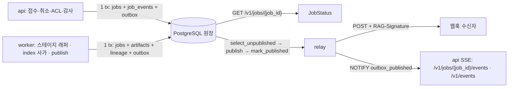
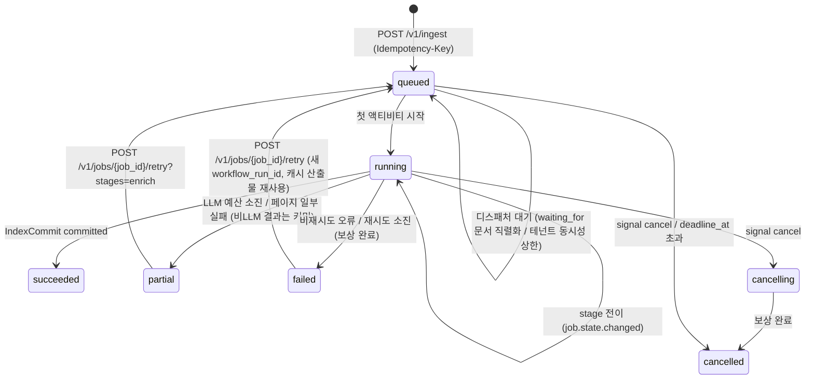

# Job·Event·Status 계약

> 정본은 [설계 바이블](../02-architecture/00-design-bible.md) §5.6 `JobStatus` 표, §5.3 `CloudEventEnvelope`·`StageError`·`DegradedEntry`, §5.7 `JobKind`·`JobState`와 이벤트 이름 카탈로그, §6.5 이벤트 규약, §6.2 웹훅 서명, §11.2 워크플로우·디스패처, §11.5 잡 상태 기계와 API 매핑, §13.1 `jobs`·`job_events`·`outbox`·`subscriptions`, §14 `jobs`·`events`·`subscriptions` 행이다. 이 문서는 그 표를 필드·타입·필수·설명·예시로 풀고, 이벤트별 `data` 페이로드(00 §8.2가 이 문서 소유로 위임)·아웃박스 릴레이·웹훅·SSE 규약·불변식·스키마·예시를 붙인다. 바이블에 없는 항목은 선택(N) 필드 또는 "## 미해결 이슈"의 제안으로만 둔다.

## 목적

비동기 수집(D-08)의 관측 계약을 정의한다. (1) `JobStatus`는 PostgreSQL `jobs` 원장(정본)의 읽기 모델로서 클라이언트·SSE가 보는 잡의 종류·상태·스테이지·진행률·비용·오류를 담고, (2) `CloudEventEnvelope`는 CloudEvents(CloudEvents 1.0.2) 봉투로 상태 전이·도메인 이벤트를 트랜잭셔널 아웃박스(transactional outbox)에 기록해 웹훅(webhook)·SSE(Server-Sent Events)로 전달하는 단일 형식이며([ADR-0017](../06-adr/0017-event-delivery-outbox-cloudevents-no-broker.md)), (3) 이벤트 `data`에는 ID·해시·상태만 실어 콘텍스트 본문이 이벤트 경로로 새지 않게 한다(바이블 §10.3 E12).

## 범위

- 포함: `JobStatus` 최상위 필드(바이블 §5.6 전부)와 하위 타입 `JobProgress`·`JobCost`, `JobKind`·`JobState` 상태 기계(§11.5 허용 전이, `partial`·`cancelling`·`waiting_for` 의미), `progress`·`cost`·`timings`·`attempts` 의미, `CloudEventEnvelope` 필드(§5.3 전부)와 `source`·`subject` 규약, 이벤트 카탈로그 24종의 발생 시점·`data` 스키마, 아웃박스·릴레이(at-least-once·순서·`event_id` 멱등), 웹훅 전달(`RAG-Signature`, 재시도, 재생 창), SSE(`/v1/jobs/{job_id}/events`, `/v1/events`, `Last-Event-ID`), 상태 조회 응답, 크기 한계, 저장 규약, 불변식, JSON Schema 전문 2개, Pydantic v2 모델, 예시 5개.
- 제외: 워크플로우·액티비티 내부 타입과 디스패처 승인 규칙([02-architecture/06](../02-architecture/06-orchestration-and-workflows.md)), `IngestRequest`·202 응답([01](./01-ingest-request.md)), `IndexCommit` 원장([08](./08-index-commit.md)), `StageError`·`ProblemDetails`·HTTP 매핑([13](./13-error-model.md)), 구독 등록 API 응답·SSE 프레임 세부·소비자 SDK 헬퍼([05-api/07-webhooks-and-events](../05-api/07-webhooks-and-events.md)), `EgressPolicy` 필드([15](./15-collection-profile-and-policy-contracts.md)), 감사 저장소·보존([09-operations/05](../09-operations/05-security-and-compliance.md)).

## 1. 위치와 역할

| 항목 | `JobStatus` | `CloudEventEnvelope` |
|------|-------------|----------------------|
| 생산(바이블 §5.1) | API(원장 `jobs` 읽기 모델; `GET /v1/jobs/{job_id}`, `GET /v1/jobs`) | `publish` 스테이지(로컬 액티비티), 스테이지 래퍼, `index` 사가, API(취소·감사·ACL 접수·피드백·컬렉션 변경), 디스패처, 평가 하네스 |
| 소비 | 클라이언트, SSE(`/v1/jobs/{job_id}/events`) | 릴레이(`orchestration/outbox/relay_core`), 웹훅 수신자, SSE 클라이언트, 감사 저장소 |
| 정본 저장소 | PostgreSQL `jobs`(+ `job_events` 이력); Temporal은 실행 엔진일 뿐 조회 정본이 아니다(D-08) | PostgreSQL `outbox(event_id PK, type, subject, envelope jsonb, published_at, attempts)` |
| 인라인 한계(§5.1) | 8KB | 64KB, `data`에 콘텍스트 본문 금지 |
| 미디어 타입(§6.4) | `application/vnd.rag.job-status+json` | `application/vnd.rag.cloud-event-envelope+json`(스키마 게시); 전송 미디어 타입과 CloudEvents HTTP 바인딩 모드는 05-api/07이 확정한다(§8 제안, ADR-0038 중립 절) |
| 스키마 | `schemas/job-status.schema.json`, `urn:rag:schema:job-status:1` | `schemas/cloud-event-envelope.schema.json`, `urn:rag:schema:cloud-event-envelope:1`(봉투는 `common-types` `$defs/CloudEventEnvelope`를 참조하고 이벤트별 `data`를 이 파일 `$defs`로 정제) |



상태 갱신과 이벤트 삽입은 항상 **같은 트랜잭션**이다(바이블 §3.2 O-06, [02-architecture/06 §6.1](../02-architecture/06-orchestration-and-workflows.md)). 따라서 `JobStatus`가 보여주는 상태와 릴레이가 전달하는 `job.state.changed`는 같은 원장 행에서 나오며 서로 어긋날 수 없다. 검색 경로(`plan`~`render`)는 원장을 읽지 않고 `audit.query.executed`만 아웃박스에 기록한다(바이블 §8.1 14단계, [ADR-0034](../06-adr/0034-retrieval-hot-path-postgres-independence-and-hydrate.md)).

## 2. `JobStatus` 필드 정의

타입 표기는 브리프 §9.5. "필수" 열의 `Y(nullable)`·`N`·조건의 인스턴스 규칙은 [00 §8.1](./00-contract-overview.md)을 따른다. 바이블 §5.6이 `string | null`로 N 표기한 `waiting_for`·`document_id`·`index_commit_id`·`from_stage`·`last_error`와 시각 필드 `started_at`·`finished_at`·`deadline_at`은 생략·`null` 모두 허용한다(00 §8.1 4행). 바이블이 `string`으로만 적은 `document_id`·`index_commit_id`는 §6.1 규약대로 `string(ulid)`로 정밀화했다(미해결 이슈 1).

### 2.1 최상위 필드(바이블 §5.6 표 전체)

| 필드 | 타입 | 필수 | 설명 | 예시 |
|------|------|------|------|------|
| `schema_version` | string(semver) | Y | 계약 버전. 초기 `"1.0.0"` | `"1.0.0"` |
| `schema_type` | string(const) | N | `"JobStatus"`. **바이블 §5.6 미등재**(`JobStatus`는 봉투 계약이 아님) — 조회 응답·`dataschema` 소비자 편의를 위한 선택 필드, 반영 제안(미해결 이슈 2) | `"JobStatus"` |
| `job_id` | string(ulid) | Y | 잡 ID = Temporal 워크플로우 ID(`ingest.document.v1` 등, `id_conflict_policy=USE_EXISTING`; 바이블 §11.2) | `"01JAB3C0D1E2F3G4H5J6K7M8N9"` |
| `tenant_id` | string(ulid) | Y | 보안 삼중항 1. `SecurityContext`에서 도출 | `"01J9ZQ4K7X2M8N3P5R6S7T8V9W"` |
| `collection_id` | string(ulid) | Y | 보안 삼중항 2. 테넌트 범위 잡(`tier_promotion`)은 대상 컬렉션마다 잡 하나(초안; 미해결 이슈 3) | `"01J9ZQ5A1B2C3D4E5F6G7H8J9K"` |
| `kind` | enum(JobKind) | Y | 워크플로우 타입과 1:1(§3.1 표) | `"ingest_document"` |
| `state` | enum(JobState) | Y | §3 상태 기계 | `"running"` |
| `stage` | string \| null | Y(nullable) | 현재(`running`) 또는 마지막(종결) 스테이지: `fetch, parse, normalize, chunk, recount, enrich, embed, index, publish`(수집; `detect`는 `parse` 내부 서브스테이지라 여기 나타나지 않고 그 오류는 `stage=parse`·`last_error.stage=detect`로 기록된다, 바이블 §4.2) 또는 워크플로우별 액티비티명. `queued`이고 시작 전이면 `null`; `retry`로 다시 `queued`가 되면 `from_stage` | `"parse"` |
| `progress` | `JobProgress` | Y | `{done, total, unit}`(§2.2, §4.1) | `{"done": 37, "total": 120, "unit": "page"}` |
| `attempts` | integer(≥0) | Y | 현재(마지막) 스테이지의 시도 번호. `queued`에서 0, 스테이지 첫 시도에 1, 실패 재시도마다 +1(`ingest.document.retried`와 같은 트랜잭션), 새 스테이지 시작 시 1로 재설정, `retry` 후 `queued`에서 0. `StageError.attempt`와 같은 척도([13 §4.2 R5](./13-error-model.md)) | `2` |
| `workflow_run_id` | string(uuid) \| null | Y(nullable) | Temporal run id(§6.1). 최상위 시작 경로는 디스패처가, 그 외는 첫 스테이지 래퍼가 `COALESCE` 기록; `LocalRunner`·시작 전 `queued`는 `null`. `retry`마다 새 값 | `"6f1d2c3b-4a5e-4f60-9b7c-8d9e0f1a2b3c"` |
| `workflow_id` | string \| null | Y(nullable) | Temporal 워크플로우 ID. 문서 잡은 `job_id`와 같고 재색인 부모는 `reindex:{collection_id}`(초안); `LocalRunner`는 `null` | `"01JAB3C0D1E2F3G4H5J6K7M8N9"` |
| `idempotency_key` | string | Y | 접수 `Idempotency-Key`(가시 ASCII 1..255, `(tenant_id, key)` 유일; [01 §4](./01-ingest-request.md)). 스케줄·내부 트리거 잡은 서버가 `internal:{workflow_type}:{ulid}`로 합성(초안; 미해결 이슈 4) | `"a3f1c9d2-7b4e-4c8a-9e1f-2d3c4b5a6f70"` |
| `request_id` | string(ulid) | N | 접수 요청 ID(`IngestRequest.request_id`; 배치는 건별). 내부 트리거 잡은 생략 | `"01J9ZQ7B8C9D0E1F2G3H4J5K6M"` |
| `waiting_for` | string(ulid) \| null | N | 문서 단위 직렬화로 대기 중인 앞 잡(체인 꼬리)의 `job_id`(바이블 §11.2 디스패처). `state=queued`에서만 non-null(불변식 I-6) | `"01JAB3BZ9Y8X7W6V5T4S3R2Q1P"` |
| `document_id` | string(ulid) \| null | N | 접수 시 확정된 문서 ID. `kind ∈ {ingest_document, reprocess_document, delete_document, acl_update}`면 non-null 필수(I-7) | `"01JAB3C4D5E6F7G8H9JKMNPQRS"` |
| `index_commit_id` | string(ulid) \| null | N | 이 잡이 만든(또는 만들고 있는) `IndexCommit.commit_id`. 문서 잡(`ingest_document`·`reprocess_document`·`delete_document`)이 `succeeded`·`partial`이면 필수(I-8); `failed`면 `rolled_back`/`failed` 커밋을 가리킬 수 있다. `delete_document`는 current 커밋 유무와 무관하게 항상 `kind=delete` tombstone 커밋(`record_count=0`)을 만들므로 `succeeded`에서 `null`이 될 수 없다(바이블 §11.2·§5.4; 미해결 이슈 19) | `"01JAB3E9F0G1H2J3K4M5N6P7Q8"` |
| `from_stage` | enum(JobStatus.from_stage) \| null | N | 재처리 시작 스테이지 `parse, normalize, chunk, recount, enrich, embed, index`(바이블 §14 `reprocess`)와 `retry?stages=` 값. 처음부터 실행이면 생략 | `"enrich"` |
| `last_error` | `StageError` \| null | N | 최근 실패 시도의 오류([13 §6.2 J2](./13-error-model.md)): `failed`면 종결 오류, `partial`이면 `partial`을 유발한 코드, `running`이면 직전 실패 시도(재시도 중임을 보임), `succeeded`·`queued`(`retry`로 돌아간 `queued` 포함; 이력은 `job_events.payload`, 13 J4)면 `null`. ≤ 4KB, 콘텐츠 미포함 | 예시 2 |
| `degraded` | array<DegradedEntry> | Y | 상류 스테이지 `DegradedEntry`의 합집합(`last_error`와 독립, J4). 빈 배열로 "없음". ≤ 64(초안) | `[]` |
| `cost` | `JobCost` | Y | `{llm_tokens_in, llm_tokens_out, cost_usd, gpu_seconds}` 누적(§2.3, §4.2) | `{"llm_tokens_in": 0, "llm_tokens_out": 0, "cost_usd": 0.0, "gpu_seconds": 42.5}` |
| `priority` | integer(0..9) | Y | 기본 5. `PATCH /v1/jobs/{job_id}` → `set_priority` 업데이트(§11.5); 디스패처 순서 `(priority DESC, job_id ASC)` | `5` |
| `status_url` | string(uri) | Y | `GET /v1/jobs/{job_id}` 절대 URL(202 응답 `status_url`과 동일) | `"https://rag.example.go.kr/v1/jobs/01JAB3C0D1E2F3G4H5J6K7M8N9"` |
| `events_url` | string(uri) | Y | `= status_url + "/events"`(I-9) | `"https://rag.example.go.kr/v1/jobs/01JAB3C0D1E2F3G4H5J6K7M8N9/events"` |
| `created_at` | string(date-time) | Y | 접수(`jobs INSERT`) 시각 | `"2026-09-22T09:00:00.000Z"` |
| `started_at` | string(date-time) \| null | N | 첫 액티비티 시작(`queued → running`) 시각. `running`·`cancelling`·종결(취소 제외)에서 non-null | `"2026-09-22T09:00:02.310Z"` |
| `updated_at` | string(date-time) | Y | 마지막 원장 갱신 시각(상태·스테이지·진행률·시도). 조정 틱이 `running` 정체 판정에 사용(§11.5) | `"2026-09-22T09:03:11.004Z"` |
| `finished_at` | string(date-time) \| null | N | 종결 시각. `succeeded, partial, failed, cancelled`에서 non-null(I-5) | `"2026-09-22T09:14:03.611Z"` |
| `deadline_at` | string(date-time) \| null | N | `IngestRequest.deadline_at`. `queued`가 이 시각을 넘기면 `cancelled`(시작된 잡은 영향 없음) | `"2026-09-22T18:00:00.000Z"` |

### 2.2 `progress`(`$defs/JobProgress`)

| 필드 | 타입 | 필수 | 설명 | 예시 |
|------|------|------|------|------|
| `done` | integer(≥0) | Y | 완료 단위 수. `done ≤ total`(I-10) | `37` |
| `total` | integer(≥0) | Y | 전체 단위 수. `unit=stage`면 파이프라인 스테이지 수(`ingest.document.v1`은 `publish` 포함 8, `recount` 포함 시 9; `detect`는 `parse` 내부라 세지 않는다) | `120` |
| `unit` | enum(JobStatus.progress.unit) | Y | `stage, page, chunk, document`(바이블 §5.6 인라인 열거, §5.7 규칙으로 `$defs` 등재) | `"page"` |

### 2.3 `cost`(`$defs/JobCost`)

| 필드 | 타입 | 필수 | 설명 | 예시 |
|------|------|------|------|------|
| `llm_tokens_in` / `llm_tokens_out` | integer(≥0) | Y | LLM 보강·판정·플래너 호출의 입력/출력 토큰 합(O-05 `enrichment_budget_tokens` 대조 대상). 비LLM 잡은 0 | `0` / `0` |
| `cost_usd` | number(≥0) | Y | LLM·외부 API 비용 추정(USD). 요율은 프로파일·테넌트 정책, 정산은 `usage_ledger` | `0.0` |
| `gpu_seconds` | number(≥0) | Y | GPU 큐(`ingest-gpu-ocr`·`ingest-gpu-embed`) 액티비티 실행 시간 합 | `42.5` |

## 3. `JobKind`·`JobState` 상태 기계

### 3.1 `JobKind`와 워크플로우(바이블 §5.7·§11.2)

| `kind` | 워크플로우 타입 | 트리거 | `progress.unit` 기본 | 종결 시 이벤트 |
|--------|-----------------|--------|----------------------|----------------|
| `ingest_document` | `ingest.document.v1` | `POST /v1/ingest`(`/batch`) | `stage`(OCR 중 `page`, enrich·embed 중 `chunk`) | `ingest.document.indexed \| failed` + `job.state.changed` |
| `reprocess_document` | `reprocess.document.v1` | `POST /v1/documents/{document_id}/reprocess {from_stage}` | `stage` | 동일 |
| `delete_document` | `delete.document.v1` | `DELETE /v1/documents/{document_id}` | `stage` | `index.commit.published`(`kind=delete`) + `ingest.document.deleted` + `job.state.changed`. 삭제 잡은 **항상** `kind=delete` tombstone 커밋(`record_count=0`)을 만든다(바이블 §11.2·§5.4) — current 커밋이 없는 문서도 예외가 아니다(미해결 이슈 19) |
| `acl_update` | `acl.update.v1` | `PATCH /v1/documents/{document_id}/acl` | `stage` | `acl.document.updated` + `job.state.changed` |
| `reindex_collection` | `reindex.collection.v1` | `POST /v1/collections/{collection_id}/reindex`, 프로파일 변경 | `document` | `collection.reindex.completed` + `job.state.changed` |
| `build_graph` | `build.graph.v1` | 컬렉션 정책(`graph` 플러그인) | `document` | `job.state.changed` |
| `evaluate` | `eval.run.v1` | `POST /v1/eval/runs`, 스케줄 | `stage` | `eval.run.completed` + `job.state.changed` |
| `consistency_check` | `maintenance.consistency.v1` | 스케줄(§7.2) | `document` | `index.consistency.mismatch`(불일치마다) + `job.state.changed` |
| `tier_promotion` | `tier.promotion.v1` | `TieringPolicy` 임계 초과(E15) | `document` | `job.state.changed` |

`maintenance.cleanup.v1`은 `JobKind`가 없는 내부 스케줄이라 `JobStatus`를 만들지 않는다(미해결 이슈 3).

### 3.2 `JobState` 전이(바이블 §11.5 그대로)



| 현재 | 사건 | 다음 | 기록 주체([02-architecture/06 §6.2](../02-architecture/06-orchestration-and-workflows.md)) | 이벤트 |
|------|------|------|------|--------|
| — | 접수 트랜잭션(`idempotency_keys` + `jobs INSERT` + `job_events` + `outbox`) | `queued`(`attempts=0`, `stage=null`, 같은 `document_id`의 활성 잡이 있으면 `waiting_for`) | API | `job.state.changed`(`from_state=null`; API 발급 `event_id`) — [ADR-0017](../06-adr/0017-event-delivery-outbox-cloudevents-no-broker.md) 결정 다이어그램·[02-architecture/03 §10](../02-architecture/03-data-flow-and-document-lifecycle.md)과 일치; 02-architecture/06 §6.2의 "이벤트 없음"은 정정 대상(미해결 이슈 14) |
| `queued` | 같은 `document_id`의 활성 잡(`queued\|running\|cancelling`) 존재 또는 `tenant_concurrent_jobs_max` 도달 | `queued`(`waiting_for` 갱신) | 디스패처 | 없음 |
| `queued` | 승인 → `start_workflow` → 첫 스테이지 래퍼 | `running`(`started_at`, `workflow_run_id`, `stage`) | 첫 스테이지 래퍼 | `job.state.changed` |
| `running` | 스테이지 종료·다음 스테이지 시작(`attempts=1` 재설정) | `running`(`stage`·`progress` 갱신) | 스테이지 래퍼 | `ingest.document.{stage}ed` + `job.state.changed` |
| `running` | 재시도 가능 오류, `attempt < max_attempts` | `running`(`attempts += 1`, `last_error`) | 래퍼 | `ingest.document.retried`(상태 전이 아님) |
| `running` | `IndexCommit.status=committed` → `publish` | `succeeded`(`finished_at`, `index_commit_id`, `last_error=null`) | `publish` | `ingest.document.indexed` + `job.state.changed` |
| `running` | `enrich.budget_exceeded`·`enrich.extractor_timeout`·`parse.page_timeout` 등 부분 실패, 비LLM 결과 커밋(바이블 §11.3 `partial`) | `partial`(`last_error` = 유발 코드, `index_commit_id`) | `publish` | `ingest.document.indexed`(`quality=degraded`) + `job.state.changed` |
| `running` | 비재시도 오류 또는 `max_attempts` 소진, 사가 보상 완료 | `failed`(`last_error`) | `publish` | `ingest.document.failed` + `job.state.changed` |
| `running` | `POST /v1/jobs/{job_id}/cancel` → API가 `cancelling` 커밋 후 `handle.signal(cancel)` | `cancelling` | API | `job.state.changed` + `audit.admin.action` |
| `cancelling` | 진행 액티비티 취소 + 보상(플립 전 세대 삭제) 완료 | `cancelled`(`finished_at`) | `publish` | `job.state.changed`(+ `index.commit.rolled_back`) |
| `queued` | `cancel` 또는 `deadline_at < now()`(워크플로우 미시작) | `cancelled` | 디스패처 | `job.state.changed` |
| `failed` | `POST /v1/jobs/{job_id}/retry` | `queued`(`attempts=0`, `workflow_run_id=null`, `last_error=null` — 이력은 `job_events.payload`(13 J2·J4), `stage=from_stage`) | API | `job.state.changed`(`error`에 직전 종결 오류 투영) |
| `partial` | `POST /v1/jobs/{job_id}/retry?stages=enrich` | `queued`(`from_stage=enrich`) | API | `job.state.changed` |

규칙: (1) 종결 상태는 `succeeded`·`partial`·`failed`·`cancelled`이며 그중 `failed`·`partial`만 `retry`로 `queued`에 돌아간다. `succeeded`·`cancelled`는 재개 불가 — 새 `IngestRequest`를 제출한다. (2) 위 표 밖의 전이는 `contract.violation`이다(Pydantic `assert_transition`). 바이블 §11.5에 없는 "플립 이후 늦은 취소 → `cancelling → succeeded`" 경로는 [02-architecture/06 §5](../02-architecture/06-orchestration-and-workflows.md)의 patch 제안이며 채택 전에는 이 문서도 허용하지 않는다(미해결 이슈 5). (3) `partial`은 실패가 아니다 — `IndexCommit`은 `committed`이고 검색에 보이며 `quality=degraded`·`warnings[]`가 원인을 설명한다. `retry?stages=enrich`는 `enrich` 이후만 재실행해 새 `index_generation`을 만든다. (4) `cancelling`은 보상이 끝나기 전까지의 중간 상태이며 디스패처의 활성 잡 판정(`queued|running|cancelling`)에 포함되어 같은 문서의 뒤 잡을 막는다. `cancelling`에서 Temporal 시그널 전송이 실패하면 503 + `Retry-After`, 조정 틱이 재전송한다. (5) `waiting_for`는 `queued`에서만 non-null이고 앞 잡이 `failed`·`cancelled`여도 뒤 잡은 시작한다([01 §10](./01-ingest-request.md)). 체인 상한(초안 8) 초과 접수는 `429 api.rate_limited`.

### 3.3 API 매핑(바이블 §11.5·§14)

| API | 응답 | Temporal 매핑 | 원장 |
|-----|------|---------------|------|
| `GET /v1/jobs/{job_id}` | 200 `JobStatus`(잡이 `failed`여도 200 + `last_error`; [13 H7](./13-error-model.md)) | `jobs` 읽기 모델; `running`인데 `updated_at`이 오래되면 `handle.query(get_status)`로 보정 | `jobs` |
| `GET /v1/jobs?collection_id=&state=&kind=&cursor=` | 200 `{items: array<JobStatus>, next_cursor}`(봉투·커서는 [05-api/04](../05-api/04-management-api.md)) | — | `jobs` |
| `GET /v1/jobs/{job_id}/events` | 200 `text/event-stream`(§9) | — | `outbox` |
| `POST /v1/jobs/{job_id}/cancel` | 202 `JobStatus`(`state=cancelling` 또는 `cancelled`) | `handle.signal(cancel)` | `job_events` |
| `POST /v1/jobs/{job_id}/retry[?stages=enrich]` | 202 `JobStatus`(`state=queued`) | 새 `start_workflow`(새 run) | `jobs` |
| `PATCH /v1/jobs/{job_id}` `{priority}` | 200 `JobStatus` | `handle.execute_update(set_priority)` | `jobs` |
| Temporal 불가 | 503 + `Retry-After: 30`(초안), 잡 `queued` 유지, 조정 스케줄이 미시작 워크플로우 재시작 | — | `jobs` |

종결 상태 잡의 `cancel`/`retry`, `partial`이 아닌 잡의 `retry?stages=`는 카탈로그에 전용 코드가 없어 채택 전까지 400 `contract.violation`이다(13 §3.3 `api.job_state_conflict` 제안).

## 4. `progress`·`cost`·`timings`·`attempts` 의미

### 4.1 `progress`

| 규칙 | 내용 |
|------|------|
| 기본 단위 | `unit=stage`, `total` = 워크플로우의 스테이지 수, `done` = 완료 스테이지 수. 스테이지 시작·종료 시 갱신 |
| 세분 단위 | 장시간 스테이지는 하트비트 시각 기준 30s 간격(초안)으로 `parse(OCR)`는 `page`(`heartbeat_details.page`), `enrich`·`embed`는 `chunk`(`chunk_offset`·`batch_offset`)로 보고하고, 스테이지 종료 시 `stage` 단위로 복귀한다. `reindex_collection`·`consistency_check`·`build_graph`·`tier_promotion`은 `document` |
| 단조성 | 같은 `unit` 안에서 `done`은 감소하지 않는다. 재시도로 재개(`Resumable`)하면 `heartbeat_details` 지점부터 이어진다. `unit`이 바뀌면 `done`·`total`은 새 척도다 |
| 캐시 적중 | `cache_hit=true` 스테이지도 `done`에 포함된다(실행 생략도 완료) |
| 종결 | `succeeded`·`partial`은 `done = total`(`unit=stage`); `failed`·`cancelled`는 실패 지점의 값을 유지한다 |
| SSE 노출 단위 | 이벤트로 나가는 진행률은 `job.state.changed.data.progress`(`to_state=running`이면 필수, I-20) — 즉 **스테이지 경계 단위**다. 하트비트 30s 세분 진행률(`page`·`chunk`)은 `jobs.progress`만 갱신하고 이벤트를 만들지 않으므로 `GET /v1/jobs/{job_id}` 폴링(§10)으로만 관측한다. 바이블 §14 "SSE(`job.state.changed`, 진행률)"의 v1 해석이며 세분 이벤트 추가는 미해결 이슈 15 |

### 4.2 `cost`

`cost`는 스테이지 래퍼가 `Enrichment.budget_used`·임베딩 서버 응답·GPU 액티비티 실행 시간을 스테이지 종료 트랜잭션에서 누적한 값이며, `usage_ledger(tenant_id, day, meter ∈ {llm_tokens, gpu_seconds})`의 원천이다(바이블 §13.1). `partial`(예산 소진)은 `llm_tokens_*`가 컬렉션 `enrichment_budget_tokens`에 도달했음을 뜻한다. 값은 추정치이며 정산 정본은 `usage_ledger`다.

### 4.3 `timings`와 파생 지표

| 구간 | 정의 | 용도 |
|------|------|------|
| 대기 | `started_at − created_at` | 디스패처 대기(`waiting_for`·동시성 상한)·Temporal 큐 대기. 메트릭 후보 `rag_job_queue_wait_seconds`(§6.5 미등재; [02-architecture/06 미해결 이슈 7](../02-architecture/06-orchestration-and-workflows.md)) |
| 실행 | `finished_at − started_at` | `rag_ingest_stage_duration_seconds{stage}` 합과 대조 |
| 정체 판정 | `now() − updated_at > max(start_to_close) + 백오프 합` | 조정 틱의 `describe_workflow` 보정 대상 |
| 기한 | `deadline_at` | `queued`만 취소. `running` 잡의 상한은 워크플로우 `execution_timeout`(24h 초안)이며 초과는 `failed` |

시각 순서 `created_at ≤ started_at ≤ updated_at`, `started_at ≤ finished_at ≤ updated_at`(I-11). 모두 RFC 3339 UTC `Z` 밀리초.

## 5. `CloudEventEnvelope` 필드 정의(바이블 §5.3 표 전체)

| 필드 | 타입 | 필수 | 설명 | 예시 |
|------|------|------|------|------|
| `specversion` | string(const) | Y | `"1.0"`(CloudEvents 1.0.2) | `"1.0"` |
| `id` | string(ulid) | Y | `event_id`. 소비자 멱등 키·SSE `id:`·`outbox` PK. 워크플로우가 1회 발급(재시도 불변, 바이블 §11.4 (6)); 워크플로우 밖(API·디스패처·래퍼 재시도 이벤트)은 기록 주체가 발급. ULID의 시각은 **발급** 시각이라 `outbox` 기록 시각(`time`)·발행 순서와 다를 수 있다 — 커서로 쓰지 않는다(§7·§9, I-18) | `"01JAB3EA0B1C2D3E4F5G6H7J8M"` |
| `source` | string(uri) | Y | `urn:rag:{component}`; `component`는 아웃박스 행을 기록한 **역할**(바이블 §2.3): `api`(접수·취소·재시도·ACL 접수·감사·피드백·컬렉션 변경·디스패처·검색 경로의 `audit.query.executed`), `worker`(스테이지 래퍼·`index` 사가·`publish`·유지보수 워크플로우·평가 하네스 실행 — `LocalRunner`가 api 프로세스 안에서 실행해도 역할은 `worker`). `relay`는 기록 주체가 아니라 값에 없다. 테넌트는 여기 넣지 않는다(§6.5; 미해결 이슈 6) | `"urn:rag:worker"` |
| `type` | enum(EventType) | Y | 바이블 §5.7 이벤트 카탈로그 24종(`domain.entity.action`, 과거형) | `"ingest.document.indexed"` |
| `time` | string(date-time) | Y | 아웃박스 행을 기록한 트랜잭션의 시각(전달 시각 아님) | `"2026-09-22T09:14:03.420Z"` |
| `subject` | string | Y | `tenant/{tenant_id}/{entity}/{id}`; `entity`는 §6 표(`document, job, collection, query, eval_run` 또는 관리 자원). `tenant_id`는 `tenantid`와 같다(I-13) | `"tenant/01J9ZQ4K7X2M8N3P5R6S7T8V9W/document/01JAB3C4D5E6F7G8H9JKMNPQRS"` |
| `datacontenttype` | string(const) | Y | `"application/json"` | `"application/json"` |
| `dataschema` | string(uri) | N | `urn:rag:schema:{name}:{major}`. **`data`가 그 계약의 완전한 인스턴스일 때만** 기재([14 §5.4](./14-schema-versioning-and-compatibility.md)). 이 문서의 24종은 모두 ID·해시·상태 투영이므로 생략한다 | 생략 |
| `tenantid` | string(ulid) | Y | CloudEvents 확장 속성. 릴레이 테넌트 스코프(E12): 이 테넌트의 구독·SSE 연결에만 전달 | `"01J9ZQ4K7X2M8N3P5R6S7T8V9W"` |
| `data` | object | Y | 이벤트별 페이로드(§6, `$defs`). ID·해시·상태·계수만, **콘텍스트 본문 금지**(`text`·`embed_text`·`index_text`·`context_prefix`·질의 문자열·`source_uri`·주체 문자열·비밀·PII 없음; I-14) | §예시 3~5 |

분산 추적 확장 속성(`traceparent`·`tracestate`)은 봉투에 없다(00 미해결 이슈 U-6; 이 문서 미해결 이슈 7).

## 6. 이벤트 카탈로그(바이블 §5.7 전체)와 `data` 스키마

`data` 타입은 `schemas/cloud-event-envelope.schema.json`의 `$defs`이며 봉투 `type`과 `oneOf`로 결합된다. 모든 `data`는 `additionalProperties: false`이고 값은 ID(ULID)·해시(hex64)·열거 상태·계수·시각만이다. 발생 지점의 기록 주체는 [02-architecture/06 §6.2](../02-architecture/06-orchestration-and-workflows.md)와 같다.

### 6.1 수집 도메인

| `type` | 발생 시점(기록 주체) | `subject` entity | `data`(`$defs`) — 필수 / 선택 |
|--------|----------------------|------------------|-------------------------------|
| `ingest.document.fetched` | `fetch` 래퍼 `commit_stage`(산출물·계보 저장 트랜잭션) | `document` | `IngestStageEventData`(`stage=fetch`) — `job_id, document_id, stage, doc_version, quality, artifact_blake3` / `collection_id, size_bytes, format, warning_count`(`stage_key` 없음 — `fetch`는 캐시 대상 아님) |
| `ingest.document.parsed` | `parse` 래퍼 | `document` | 동일(`stage=parse`) + `stage_key` / `block_count, page_count(null=흐름 포맷), cache_hit, warning_count` |
| `ingest.document.normalized` | `normalize` 래퍼 | `document` | 동일(`stage=normalize`) / `block_count, pii_policy_applied, cache_hit` |
| `ingest.document.chunked` | `chunk` 래퍼(`stage=chunk`) 또는 `recount` 래퍼(`stage=recount`; `reprocess`에서만 실행, 바이블 §4.2 — 카탈로그에 `recounted`가 없어 같은 `type`을 쓴다) | `document` | 동일(`stage ∈ {chunk, recount}`) / `chunk_count, parent_count, chunker_config_hash, cache_hit` |
| `ingest.document.enriched` | `enrich` 래퍼 | `document` | 동일(`stage=enrich`) / `enrich_status, llm_tokens_in, llm_tokens_out, cache_hit` |
| `ingest.document.embedded` | `embed` 래퍼 | `document` | 동일(`stage=embed`) / `record_count, embedding_profile_hash, cache_hit` |
| `ingest.document.indexed` | `publish`(종결 트랜잭션; `succeeded`·`partial`) | `document` | `IngestDocumentIndexedData` — `job_id, document_id, stage=index, doc_version, quality, commit_id, index_generation, commit_hash, record_count, job_state` / `collection_id` |
| `ingest.document.retried` | 래퍼(`attempt > 1`, `jobs.attempts += 1` 동일 트랜잭션) | `document` | `IngestFailureEventData` — `job_id, document_id, stage, code, retryable, attempt`([13 J3](./13-error-model.md) 투영) / `collection_id, next_attempt_at` |
| `ingest.document.failed` | `publish`(`failed` 종결) | `document` | `IngestFailureEventData` — 같은 투영(`detail`·`artifact_ref`·`location`·`cause` 없음) |
| `ingest.document.deleted` | `publish`(`delete.document.v1` 종결) | `document` | `IngestDocumentDeletedData` — `job_id, document_id, collection_id, commit_id, index_generation, deleted_counts{backend_id: n}`. `commit_id`·`index_generation`은 항상 존재하는 `kind=delete` tombstone 커밋(바이블 §11.2·§5.4 "삭제는 `record_count=0` 커밋")을 가리키므로 필수이며 nullable이 아니다; current 커밋이 없던 문서의 삭제도 같다(`deleted_counts`는 모두 0). 08 §7 "커밋 미생성·`index_commit_id=null`" 예외는 비정본(미해결 이슈 19) |

### 6.2 잡·인덱스

| `type` | 발생 시점 | entity | `data` |
|--------|-----------|--------|--------|
| `job.state.changed` | §3.2 표의 모든 상태 전이 — 접수(`null → queued`, API 기록) 포함, `queued → queued` 대기 제외, `running → running` 스테이지 전이 포함 | `job` | `JobStateChangedData` — `job_id, kind, collection_id, from_state(null=접수), to_state, stage(nullable), attempts` / `progress(to_state=running이면 필수 — SSE 진행률 단위, §4.1·I-20), document_id, index_commit_id, waiting_for, error{code, retryable, attempt}, reason(취소·기한 사유, ≤256)` |
| `index.commit.published` | `index` 사가 `committed` 전이 트랜잭션(`kind=delete` 포함). [08 예시 1](./08-index-commit.md)의 `events_emitted[0]`(`01JAB3EA0B1C2D3E4F5G6H7J8K`)이 이 이벤트다 | `document` | `IndexCommitPublishedData` — `commit_id, job_id, document_id, collection_id, doc_version, index_generation, status=committed, commit_hash, record_count` / `kind, previous_commit_id`([14 예시 4](./14-schema-versioning-and-compatibility.md)와 동일 필드; 08 미해결 이슈 12) |
| `index.commit.rolled_back` | 사가 `rolled_back` 전이(플립 전/후 보상 완료; 취소 포함) | `document` | `IndexCommitRolledBackData` — `IndexCommit.compensation`([08 §2.6](./08-index-commit.md)) 투영: `commit_id, job_id, document_id, collection_id, index_generation, status=rolled_back, failed_at_status(전종결 5값 pending, vector_written, lexical_written, flipping_lexical, flipping_vector), restored_generation(nullable), reason(= compensation.reason: 최종 error.code 또는 job_cancelled, ≤64)` / `doc_version, code(= 최종 IndexCommit.error.code — 촉발 원인은 error.cause.code이며 이벤트에 없음; reason=job_cancelled면 없음, 그 외는 reason과 같다, 08 IC-15)` |
| `index.consistency.mismatch` | 사가 보상 실패(`failed`) 또는 `maintenance.consistency.v1` 대조 불일치 | `document` | `IndexConsistencyMismatchData` — `job_id, document_id, collection_id, commit_id(nullable), index_generation(nullable), expected_record_count, observed_record_counts{backend_id: n}, content_hash_mismatch` / `repair_job_id` |

### 6.3 ACL·컬렉션

| `type` | 발생 시점 | entity | `data` |
|--------|-----------|--------|--------|
| `acl.document.updated` | `acl.update.v1`의 `publish`(양 백엔드 payload 갱신 완료 후; E11) | `document` | `AclDocumentUpdatedData` — `job_id, document_id, collection_id, acl_hash, previous_acl_hash(nullable), visibility, classification, backends_updated[], revocation_hint_recorded` / `propagation_ms`. `classification`은 필수이며 원천 `Acl.classification`(common-types, N·기본 `internal`)이 생략되었으면 기본값 `internal`을 채워 기록한다(`visibility`도 같은 규칙, 기본 `tenant`). 주체 목록(`allow/deny_principals`)은 넣지 않는다 |
| `collection.profile.changed` | `PATCH /v1/collections/{collection_id}`(프로파일·정책 변경 커밋), `PUT /v1/collections/{collection_id}/dictionary`(`dictionary_hash` 변경, [16 §6.2](./16-eval-feedback-and-sidecar-contracts.md)) 또는 재색인 alias 교체 | `collection` | `CollectionProfileChangedData` — `collection_id, change_kind(profile \| dictionary \| policy), profile_id, profile_hash, previous_profile_hash(nullable), embedding_profile_hash, analyzer_id, dictionary_hash, reindex_required` / `previous_dictionary_hash(nullable; change_kind=dictionary면 필수 — 16 API 응답 previous_dictionary_hash와 같은 값), previous_analyzer_id(분석기가 바뀐 경우만), reindex_job_id`. `change_kind`는 무엇이 바뀌었는지 밝힌다 — `dictionary`·`policy` 변경은 `profile_hash`가 불변이라 `previous_profile_hash == profile_hash`다(I-21). api 캐시 `collspec:` 무효화 트리거(바이블 §13.1) |
| `collection.reindex.completed` | `reindex.collection.v1` 종결(alias 교체 또는 게이트 실패) | `collection` | `CollectionReindexCompletedData` — `job_id, collection_id, profile_hash, document_count, succeeded_count, partial_count, failed_count, alias_swapped, gate_passed(nullable)` / `run_id`(게이트 평가 `EvalRun.run_id`; 바이블 §6.1·§6.4 "식별자 이름은 의미당 하나" — `eval_run_id`라는 새 이름을 만들지 않는다) |

### 6.4 감사(필드는 [02-architecture/07 §감사](../02-architecture/07-multi-tenancy-and-security-architecture.md) 제안을 채택)

| `type` | 발생 시점 | entity | `data` |
|--------|-----------|--------|--------|
| `audit.query.executed` | `render` 뒤(바이블 §8.1 14단계), MCP `search` 포함 — api가 아웃박스에 기록 | `query` | `AuditQueryExecutedData` — `query_id, plan_id, pack_id(nullable), trace_id, auth_method, principal_hash, collection_ids[], query_hash(= blake3_hex(utf8(normalized_query)), 라벨 없음 — 07 §8.2 hash_only 정책; 미해결 이슈 8), filters_effective_hash, security_context_hash, profile_hash, returned{document_ids[], chunk_count}, omitted{acl_denied, risk_flagged}, degraded[], latency_ms` / `actor_client_id`. 질의 원문 없음 |
| `audit.document.accessed` | `GET /v1/documents/{document_id}`(`/content`, `/commits`), MCP `get_document` | `document` | `AuditDocumentAccessedData` — `document_id, view, principal_hash, decision, acl_hash(nullable)` / `collection_id` |
| `audit.acl.changed` | `PATCH /v1/documents/{document_id}/acl` 접수 트랜잭션(도메인 이벤트 `acl.document.updated`와 별개) | `document` | `AuditAclChangedData` — `document_id, principal_hash, acl_hash_before(nullable), acl_hash_after, job_id` / `collection_id` |
| `audit.admin.action` | 컬렉션·테넌트 정책·구독·프로파일·삭제·재색인·취소 등 관리 행위(Cedar 결정 포함, 거부도 기록) | 관리 자원(`collection, subscription, tenant, profile, document, job, dictionary`) | `AuditAdminActionData` — `action, resource{type, id}, principal_hash, decision, policy_version, request_id` / `job_id` |

`principal_hash = H("principal", tenant_id, subject)`는 07 문서의 제안 결합식이며 바이블 §6.2 미등재다(미해결 이슈 8). 테넌트가 없는 플랫폼 범위 행위는 `tenantid`를 채울 수 없어 발행하지 않고 `audit_log` 표에만 기록한다(07 문서 미해결 이슈 6).

### 6.5 피드백·평가

| `type` | 발생 시점 | entity | `data` |
|--------|-----------|--------|--------|
| `feedback.query.cited` / `feedback.query.rated` | `POST /v1/feedback` 접수(`kind=cited` / `kind ∈ {rated, corrected}`; `corrected`는 `rated` 이벤트로 전달) | `query` | `FeedbackQueryEventData` — `feedback_id, query_id, pack_id, kind, cite_ids[]` / `rating(nullable)`. `comment`는 PII 정책 대상이라 넣지 않는다 |
| `eval.run.completed` | `eval.run.v1` 종결(`EvalReport` 저장 트랜잭션) | `eval_run` | `EvalRunCompletedData` — `run_id, dataset_id, profile_id, profile_hash, status, index_commit_ids[], gate_passed(nullable), metrics{name: number}` |

## 7. 아웃박스·릴레이([ADR-0017](../06-adr/0017-event-delivery-outbox-cloudevents-no-broker.md))

**결정:** v1은 브로커 없이 PostgreSQL 트랜잭셔널 아웃박스 + 릴레이로 전달한다. 제어(취소·우선순위·진행 조회)는 Temporal 시그널·업데이트·쿼리이고 도메인 이벤트는 아웃박스다(바이블 §3.2 O-06). 릴레이 코어는 순수 함수 3개 `select_unpublished(tx, limit) → publish(envelope, targets) → mark_published(tx, event_id)`이며 `standard` 이상은 Temporal 액티비티, `lite`는 Procrastinate 태스크가 감싼다.

| 속성 | 규약 | 근거 |
|------|------|------|
| 원자성 | 상태 갱신(`jobs`·`index_commits`·`documents`)·`job_events`·`outbox INSERT`는 한 트랜잭션. `INSERT … ON CONFLICT (event_id) DO NOTHING`으로 액티비티 재실행에도 행은 1개 | 바이블 §11.4 (6), [02-architecture/09 I-09](../02-architecture/09-failure-modes-and-resilience.md) |
| 전달 보증 | **at-least-once**. 같은 `id`(`event_id`)가 웹훅·SSE로 2회 이상 도달할 수 있고 소비자는 `id` 기준 멱등이어야 한다(재전달의 봉투 바이트는 동일, 서명 `t`만 다름) | 브리프 §7 "at-least-once + 멱등" |
| 순서 | `select_unpublished`는 `published_at IS NULL` 행을 `event_id` 오름차순으로 배치 선택하고 구독별 순차 전달한다 — 이는 **배치 내 정렬**이며 커서가 아니다(늦게 커밋된 행도 다음 배치에 포함된다). `event_id`는 워크플로우 **발급** 시각의 ULID라 `outbox` 기록·발행 순서와 다를 수 있으므로(예: `publish` 재시도로 늦게 커밋된 행) 어떤 소비 경로도 `event_id > 마지막 ID`를 커서로 쓰지 않는다(I-18; SSE 커서는 아래 행·§9). 재시도 중인 이벤트는 같은 구독의 후속 이벤트를 막고(구독 단위 FIFO), 재시도 소진 이벤트는 `published_at=NULL`로 남긴 채 다음으로 진행한다(포이즌 이벤트의 정체 전파 차단, 09 F-37). 소비자는 순서를 전제하지 말고 `time`·상태 기계 단조성으로 판정한다 | [02-architecture/06 §6.4](../02-architecture/06-orchestration-and-workflows.md), 09 F-37 |
| 발행 커서 | `mark_published`는 단일 릴레이 인스턴스(06 §6.4)가 발행 순서대로 실행하며 `published_at`을 **단조 비감소**로 부여한다(시계 역행 시 직전 값 유지). SSE 재생·폴링 보정의 커서는 발행 순 튜플 `(published_at, event_id)`(둘 다 바이블 §13.1 `outbox` 컬럼)이며, 전용 `published_seq` 컬럼은 미해결 이슈 16 제안 | 이 문서 |
| 테넌트 스코프 | 릴레이는 `tenantid`가 같은 테넌트의 `subscriptions`(`events[]` 필터)에만 전달한다(E12). `subject`의 `tenant/{tenant_id}` ≠ `tenantid`는 `contract.violation`으로 기록 자체를 거부한다 | 바이블 §10.3 E12 |
| 지연 SLO(초안 목표) | `rag_outbox_lag_seconds` p99: `lite` 30s / `standard`·`premium` 5s / `korean-gov` 2s(`Profile.runtime.outbox_lag_slo`) | 바이블 §7.2 |
| 실패 | 전송 5xx·타임아웃 `outbox.relay_failed`(재시도, `outbox.attempts += 1`), `EgressPolicy` 위반 `outbox.egress_denied`(비재시도, E16). 릴레이 실패는 잡 상태에 영향 없다 | 바이블 §5.7, [ADR-0038](../06-adr/0038-outbound-egress-policy-and-webhook-signing.md) |
| 보존·재생 창 | `published_at` 행은 7일(초안) 보존 후 `maintenance.cleanup.v1`이 정리하며 이 기간이 SSE `Last-Event-ID` 재생 창이다. `korean-gov` 감사 이벤트는 OpenSearch 감사 인덱스(2년)에 별도 적재. 소진 행(`published_at=NULL`)은 운영자 재발행(RB-08) 전까지 보존 | 미해결 이슈 9 |

## 8. 웹훅 전달

| 항목 | 규약 |
|------|------|
| 대상 | `subscriptions.webhook_url`(테넌트 등록, `events[]` 필터). `IngestRequest.callback.webhook_url`은 등록 구독과 일치해야 하며 그 잡의 이벤트만 좁힌다([01 §2.4](./01-ingest-request.md)). 등록·전송 시 `EgressPolicy`(스킴·CIDR·`resolve_pin`·리다이렉트 재검사) 통과 필수 |
| 요청 | `POST {webhook_url}`, `User-Agent: rag-platform-relay/{version}`. **제안(05-api/07 확정):** 본문 = `CloudEventEnvelope` JSON 1건(CloudEvents HTTP 구조화 모드, `Content-Type: application/cloudevents+json; charset=utf-8`), 배치 전송 없음 — [ADR-0038](../06-adr/0038-outbound-egress-policy-and-webhook-signing.md)은 바인딩 모드(구조화·바이너리) 선택을 05-api/07에 위임하며 서명은 모드와 무관하게 전송 바이트에 대해 계산된다(미해결 이슈 9) |
| 서명(바이블 §6.2, E16) | `RAG-Signature: t={unix_ts},v1={hex(HMAC-SHA256(secret, f"{unix_ts}.{body}"))}` — `secret`은 `subscriptions.secret_ref`가 가리키는 비밀(KeyProvider), `body`는 전송 바이트 그대로. 수신자는 (1) `t`가 현재 시각 ±300s 안인지(재생 창), (2) 같은 비밀로 계산한 `v1`이 상수 시간 비교로 일치하는지 확인하고 (3) `id`로 중복을 제거한다. 키 회전 중에는 `v1`을 쉼표로 병기할 수 있다(`v1=…,v1=…`; 초안) |
| 성공 판정 | 2xx 응답(본문 무시). 응답 대기 10s(초안) |
| 재시도 백오프(초안 목표) | 5xx·408·429·네트워크 오류·타임아웃 → `outbox.relay_failed`, 지수 백오프 `{initial 1s, max 5m, coefficient 2.0}`(`StagePolicy.backoff` 기본값과 동일) 최대 12회 시도(간격 11개 합 1+2+4+8+16+32+64+128+256+300+300 = 1,111s ≈ 18.5분) 후 소진. 그 외 4xx(408·429 제외)는 수신자 오류로 즉시 소진(재시도 없음). `410 Gone`은 구독을 `disabled`로 표시(제안, 05-api/07) |
| 소진 | `published_at=NULL` 유지 + `outbox.attempts` 포화 + 운영 알림(`rag_outbox_lag_seconds`). 수신자 복구 후 운영자 재발행(RB-08); 구독의 후속 이벤트는 계속 전달된다(§7 순서) |
| 페이로드 한계 | 봉투 64KB(바이블 §5.1). 초과는 기록 시 `contract.violation`이므로 전송 시점에는 없다 |

```python
import hmac, hashlib, time

def sign_webhook(secret: bytes, body: bytes, unix_ts: int | None = None) -> str:
    ts = unix_ts if unix_ts is not None else int(time.time())
    mac = hmac.new(secret, f"{ts}.".encode("ascii") + body, hashlib.sha256).hexdigest()
    return f"t={ts},v1={mac}"

def verify_webhook(secret: bytes, body: bytes, header: str, now: int | None = None, window_s: int = 300) -> bool:
    """형식 오류·t 부재·창 밖·불일치는 모두 False(예외 없음). v1은 키 회전 중 여러 개일 수 있다."""
    ts_text, sigs = None, []
    for token in header.split(","):
        key, sep, value = token.strip().partition("=")
        if not sep:
            return False
        if key == "t":
            ts_text = value.strip()
        elif key == "v1":
            sigs.append(value.strip())
    if ts_text is None or not ts_text.isdigit() or not sigs:
        return False
    ts = int(ts_text)
    if abs((now if now is not None else int(time.time())) - ts) > window_s:
        return False
    expected = hmac.new(secret, f"{ts}.".encode("ascii") + body, hashlib.sha256).hexdigest()
    return any(hmac.compare_digest(expected, sig) for sig in sigs)
```

## 9. SSE(`text/event-stream`)

| 항목 | `GET /v1/jobs/{job_id}/events` | `GET /v1/events` |
|------|-------------------------------|------------------|
| 범위 | `data.job_id = job_id`인 이벤트(`job.state.changed`, `ingest.document.*`, `index.commit.*`) — 잡의 테넌트·컬렉션 인가(E2) 필요. 진행률은 `job.state.changed.data.progress`의 스테이지 경계 단위(§4.1) | 요청 테넌트(`tenantid`)의 모든 이벤트; 쿼리 `types=`(쉼표 구분 `EventType`)·`collection_id=`로 필터(초안) |
| 프레임 | `id: {event_id}` · `event: {type}` · `data: {CloudEventEnvelope JSON 1행}` · 빈 줄. 주석 `: keepalive` 15s(초안). 첫 프레임 앞에 `retry: 3000` | 동일 |
| 재접속 | `Last-Event-ID: {event_id}` 헤더 → 서버는 그 행을 PK 조회해 발행 커서 `(published_at, event_id)`를 얻고, `published_at IS NOT NULL`이며 `(published_at, event_id) > 커서`인 행을 그 순서로 재생한 뒤 실시간으로 이어간다. 커서는 **발행 순**(§7 발행 커서)이며 `event_id`(발급 시각 ULID) 순이 아니다 — 늦게 커밋·발행된 행이 누락되지 않는다(I-18). 실시간 전달은 `NOTIFY outbox_published` payload의 `event_id`를 PK 조회해 쓰고, NOTIFY 유실은 5s 폴링(초안)이 같은 커서로 보정한다([02-architecture/06 §6.4](../02-architecture/06-orchestration-and-workflows.md)). 재생 창은 §7 보존(7일 초안); 창 밖 ID(행 없음)면 보존된 첫 행부터 재생하고 `event: gap`(제안)으로 알린다 | 동일 |
| 종료 | 종결 `job.state.changed`(`to_state ∈ {succeeded, partial, failed, cancelled}`)를 전달했고 그 잡(`data.job_id`)의 `published_at IS NULL` 행이 없을 때 서버가 스트림을 닫는다. 종결 트랜잭션의 결과 이벤트(`ingest.document.indexed \| failed \| deleted`)는 종결 `job.state.changed`보다 작은 `event_id`로 발급되므로(I-19) 같은 배치에서 먼저 전달된다. `retry`로 재개된 잡은 새 접속 | 클라이언트가 닫을 때까지 유지; api 재배포 시 드레이닝 ≤ 30s 후 종료(클라이언트는 `Last-Event-ID`로 재접속) |
| 전달 보증 | at-least-once(재접속 구간 중복 가능), `id` 멱등. 연결 수 상한·팬아웃 확장(Centrifugo)은 05-api/07 | 동일 |
| 오류 | 접속 자체의 실패만 `ProblemDetails`(401·403·400 `contract.violation`); 스트림 안의 잡 실패는 이벤트 `data` 투영([13 §6.4](./13-error-model.md)) | 동일 |

## 10. 상태 조회 응답

`GET /v1/jobs/{job_id}`의 200 본문은 `JobStatus` 인스턴스 그대로다(`schema_type`·`schema_version` 포함, `Content-Type: application/json`, 저하·실패도 200). 202 응답 `IngestAccepted.status_url`·`events_url`과 `JobStatus.status_url`·`events_url`은 같은 값이다. `state`가 unknown 열거값이면 외부 소비자는 "종결 아님"으로 폴링을 계속한다([14 §2.2 부류 C](./14-schema-versioning-and-compatibility.md)). 폴링 권장 간격은 `Retry-After`가 아닌 SSE 사용이며, 폴링 시 2s 이상(초안). `ETag`(= `updated_at` 기반)·`If-None-Match` 304는 05-api/04 제안.

## 11. 크기 한계·대형 데이터 처리

바이블 §5.1 한계(`JobStatus` 8KB, `CloudEventEnvelope` 64KB, `data` 콘텍스트 본문 금지)가 정본이고 그 외는 초안 목표다. 두 계약은 본문을 담지 않으므로 `ArtifactRef`가 없다 — 소비자는 `data`의 ID로 API(`GET /v1/jobs/{job_id}`, `GET /v1/documents/{document_id}/commits`)에서 전체 인스턴스를 조회한다.

| 대상 | 한계 | 초과 시 |
|------|------|---------|
| `JobStatus` 직렬화 | 8KB | `last_error` 축약([13 §11](./13-error-model.md) 순서) → `degraded` 앞 64개 → 그래도 초과면 `contract.violation`(500) |
| `last_error` / `degraded` | ≤ 4KB / ≤ 64항목 | 13 축약 / `maxItems` |
| `CloudEventEnvelope` 직렬화 | 64KB | 기록 트랜잭션에서 `contract.violation`(잡 실패 아님 — 이벤트 기록 실패는 결함) |
| `data` 배열 | `returned.document_ids` ≤ 100, `collection_ids` ≤ 20, `cite_ids` ≤ 20, `index_commit_ids` ≤ 1,000, `backends_updated` ≤ 8, `metrics` 키 ≤ 64(초안) | 스키마 `maxItems`·`maxProperties` |
| 웹훅 본문 | 봉투 1건 = 64KB 이하 | — |
| SSE 재생 | 한 재접속당 재생 ≤ 10,000행(초안), 초과는 다음 재접속으로 이어감 | — |

## 12. 저장 규약

| 항목 | 규약 |
|------|------|
| `JobStatus` | **산출물이 아니다.** 정본은 PostgreSQL `jobs`(`job_id` PK, `tenant_id` + RLS `FORCE`, `UNIQUE(tenant_id, idempotency_key)`, 부분 인덱스 `(document_id) WHERE state IN ('queued','running','cancelling')`; 바이블 §13.1)이며 `JobStatus`는 조회 시 행에서 투영한다. `job_events(event_id PK, job_id, from_state, to_state, stage, payload jsonb, created_at)`가 전이 이력이다. 오브젝트 키·콘텐츠 해시·zstd 규약(§13.3)은 적용되지 않는다 |
| `CloudEventEnvelope` | 정본은 `outbox(event_id PK, type, subject, envelope jsonb, published_at NULL, attempts)`; `envelope`는 이 계약 인스턴스 그대로(전송 바이트의 원천), `published_at`은 발행 순 커서(§7). 산출물 저장 없음. `korean-gov` 감사 이벤트는 릴레이가 OpenSearch 감사 인덱스에 추가 적재(2년). 스키마 게시는 `GET /v1/schemas/job-status`·`/cloud-event-envelope`(미디어 타입은 §1) |
| 불변성 | `outbox.envelope`는 기록 후 불변(재전송은 같은 바이트); `job_events`는 append-only; `jobs`는 상태 기계 전이만 허용 |
| 비밀 | `subscriptions.secret_ref`는 간접 참조만 저장, 값은 로그·트레이스·이벤트에 없음(바이블 §6.6) |

## 13. LLM 최종 소비에 영향을 주는 정보

두 계약은 LLM에 전달되지 않지만 LLM이 보게 될 것의 시점과 근거를 결정한다.

| 관심사 | 이 계약의 보장 |
|--------|----------------|
| 가시성 시점 | `job.state.changed(to_state=succeeded\|partial)`·`ingest.document.indexed`는 `IndexCommit.status=committed`(`is_current` 플립 완료) 뒤에만 발행되므로, 이 이벤트를 받은 뒤의 질의는 새 세대를 본다(`partial`은 `quality=degraded`로 일부 보강이 빠진 세대). 반대로 `failed`·`rolled_back` 뒤에는 이전 세대가 그대로 보인다 |
| provenance·인용 가능성 | `data.commit_id`·`index_generation`·`commit_hash`·`doc_version`으로 어떤 `cite_id`가 어느 색인 세대·어느 산출물에서 왔는지 `IndexCommit.artifact_refs`까지 역추적된다(K1). 이벤트·잡 상태에는 좌표·본문이 없고 ID만 있다 |
| 3-텍스트 규칙 | `data`·`last_error`·`degraded`·`progress` 어디에도 `text`·`embed_text`·`index_text`·`context_prefix`가 없다(I-14). 접두어 정책 변경은 새 세대(`commit_hash` 변경)로만 검색 결과를 바꾸며 `ingest.document.indexed`로 관측된다 |
| 보안 삼중항 | `tenantid`·`subject`·`data.collection_id`로 테넌트·컬렉션 스코프가 박혀 있고 릴레이는 테넌트 구독에만 전달한다(E12). `acl.document.updated`는 `acl_hash`만 담고 주체 문자열은 담지 않으며, 이 이벤트 이전에도 `aclrev:` 회수 힌트가 `pack.acl_recheck`(E9)를 통해 회수를 먼저 반영한다 — 즉 이벤트 지연이 노출 창을 만들지 않는다 |
| 저하 신호 | `JobStatus.degraded[]`·`partial`은 렌더러가 LLM 컨텍스트에 주입하지 않는다(13 §12). 운영자·클라이언트가 재처리(`retry?stages=enrich`) 여부를 판단하는 신호다 |

## 스키마

두 파일 `schemas/job-status.schema.json`·`schemas/cloud-event-envelope.schema.json`과 동일하다. 공용 타입·열거는 `urn:rag:schema:common-types:1`을 참조하고 재정의하지 않는다. `cloud-event-envelope`는 00 §10.3 "래퍼 게이트" 대상이지만 00 §8.2가 이벤트별 `data` 정의를 이 문서에 위임했으므로 `$ref` 래퍼에 `oneOf`(`type` ↔ `data`·`subject` 바인딩)와 `$defs`만 더한 **정제 래퍼**다(미해결 이슈 10).

### `schemas/job-status.schema.json`

```json
{
  "$schema": "https://json-schema.org/draft/2020-12/schema",
  "$id": "urn:rag:schema:job-status:1",
  "title": "JobStatus",
  "description": "PostgreSQL jobs 원장의 읽기 모델(바이블 §5.6·§11.5·§13.1, D-08, ADR-0017). 잡의 종류·상태·스테이지·진행률·시도·비용·오류·시각을 담는다. 봉투 계약이 아니며 산출물로 저장되지 않는다. 공용 타입·열거는 urn:rag:schema:common-types:1 을 참조한다. 소유 문서: docs/03-contracts/12-jobs-events-and-status.md",
  "type": "object",
  "properties": {
    "schema_version": {
      "$ref": "urn:rag:schema:common-types:1#/$defs/Semver",
      "description": "계약 버전. 초기 \"1.0.0\""
    },
    "schema_type": {
      "type": "string",
      "const": "JobStatus",
      "description": "선택(N). 바이블 §5.6 미등재 — 조회 응답·dataschema 소비자 편의"
    },
    "job_id": {
      "$ref": "urn:rag:schema:common-types:1#/$defs/Ulid",
      "description": "잡 ID = Temporal 워크플로우 ID"
    },
    "tenant_id": {
      "$ref": "urn:rag:schema:common-types:1#/$defs/Ulid",
      "description": "보안 삼중항 1"
    },
    "collection_id": {
      "$ref": "urn:rag:schema:common-types:1#/$defs/Ulid",
      "description": "보안 삼중항 2"
    },
    "kind": {
      "$ref": "urn:rag:schema:common-types:1#/$defs/JobKind"
    },
    "state": {
      "$ref": "urn:rag:schema:common-types:1#/$defs/JobState",
      "description": "바이블 §11.5 상태 기계"
    },
    "stage": {
      "oneOf": [
        {
          "type": "string",
          "pattern": "^[a-z][a-z0-9_]*$",
          "maxLength": 32
        },
        {
          "type": "null"
        }
      ],
      "description": "Y(nullable). 현재/마지막 스테이지. 시작 전 queued는 null"
    },
    "progress": {
      "$ref": "#/$defs/JobProgress"
    },
    "attempts": {
      "type": "integer",
      "minimum": 0,
      "description": "현재(마지막) 스테이지의 시도 번호. queued 0, 첫 시도 1, 재시도마다 +1, 새 스테이지 1로 재설정"
    },
    "workflow_run_id": {
      "oneOf": [
        {
          "$ref": "urn:rag:schema:common-types:1#/$defs/Uuid"
        },
        {
          "type": "null"
        }
      ],
      "description": "Y(nullable). Temporal run id. LocalRunner·시작 전은 null"
    },
    "workflow_id": {
      "oneOf": [
        {
          "type": "string",
          "minLength": 1,
          "maxLength": 255
        },
        {
          "type": "null"
        }
      ],
      "description": "Y(nullable). Temporal 워크플로우 ID(문서 잡 = job_id). LocalRunner는 null"
    },
    "idempotency_key": {
      "oneOf": [
        {
          "type": "string",
          "pattern": "^[!-~]{1,255}$"
        },
        {
          "type": "null"
        }
      ],
      "description": "Y(null 허용; 바이블 §1.2 1.3.0 제약 완화, AM-44). 접수 Idempotency-Key(가시 ASCII 1..255, (tenant_id, key) 유일). 배치 자식 잡은 null(배치 키는 idempotency_keys.job_ids 에만 저장); 내부 트리거 잡은 internal:{workflow_type}:{ulid}(초안)"
    },
    "request_id": {
      "$ref": "urn:rag:schema:common-types:1#/$defs/Ulid",
      "description": "선택(N). 접수 요청 ID"
    },
    "waiting_for": {
      "oneOf": [
        {
          "$ref": "urn:rag:schema:common-types:1#/$defs/Ulid"
        },
        {
          "type": "null"
        }
      ],
      "description": "선택(N, null 허용). 문서 단위 직렬화로 대기 중인 앞 job_id. state=queued에서만 non-null"
    },
    "document_id": {
      "oneOf": [
        {
          "$ref": "urn:rag:schema:common-types:1#/$defs/Ulid"
        },
        {
          "type": "null"
        }
      ],
      "description": "선택(N, null 허용). 문서 잡은 non-null 필수"
    },
    "index_commit_id": {
      "oneOf": [
        {
          "$ref": "urn:rag:schema:common-types:1#/$defs/Ulid"
        },
        {
          "type": "null"
        }
      ],
      "description": "선택(N, null 허용). 이 잡의 IndexCommit.commit_id"
    },
    "from_stage": {
      "oneOf": [
        {
          "$ref": "#/$defs/JobStatus.from_stage"
        },
        {
          "type": "null"
        }
      ],
      "description": "선택(N, null 허용). 재처리·retry 시작 스테이지(바이블 §14)"
    },
    "last_error": {
      "oneOf": [
        {
          "$ref": "urn:rag:schema:common-types:1#/$defs/StageError"
        },
        {
          "type": "null"
        }
      ],
      "description": "선택(N, null 허용). 최근 실패 시도의 오류(13 J2). 콘텐츠 미포함, ≤4KB"
    },
    "degraded": {
      "type": "array",
      "items": {
        "$ref": "urn:rag:schema:common-types:1#/$defs/DegradedEntry"
      },
      "maxItems": 64,
      "description": "상류 DegradedEntry 합집합. 빈 배열 허용"
    },
    "cost": {
      "$ref": "#/$defs/JobCost"
    },
    "priority": {
      "type": "integer",
      "minimum": 0,
      "maximum": 9,
      "description": "기본 5"
    },
    "status_url": {
      "$ref": "urn:rag:schema:common-types:1#/$defs/Uri",
      "description": "GET /v1/jobs/{job_id} 절대 URL"
    },
    "events_url": {
      "$ref": "urn:rag:schema:common-types:1#/$defs/Uri",
      "description": "= status_url + \"/events\""
    },
    "created_at": {
      "$ref": "urn:rag:schema:common-types:1#/$defs/DateTime",
      "description": "접수 시각"
    },
    "started_at": {
      "oneOf": [
        {
          "$ref": "urn:rag:schema:common-types:1#/$defs/DateTime"
        },
        {
          "type": "null"
        }
      ],
      "description": "선택(N, null 허용). 첫 액티비티 시작 시각"
    },
    "updated_at": {
      "$ref": "urn:rag:schema:common-types:1#/$defs/DateTime",
      "description": "마지막 원장 갱신 시각"
    },
    "finished_at": {
      "oneOf": [
        {
          "$ref": "urn:rag:schema:common-types:1#/$defs/DateTime"
        },
        {
          "type": "null"
        }
      ],
      "description": "선택(N, null 허용). 종결 시각. 종결 상태에서 non-null"
    },
    "deadline_at": {
      "oneOf": [
        {
          "$ref": "urn:rag:schema:common-types:1#/$defs/DateTime"
        },
        {
          "type": "null"
        }
      ],
      "description": "선택(N, null 허용). IngestRequest.deadline_at"
    }
  },
  "required": [
    "schema_version",
    "job_id",
    "tenant_id",
    "collection_id",
    "kind",
    "state",
    "stage",
    "progress",
    "attempts",
    "workflow_run_id",
    "workflow_id",
    "idempotency_key",
    "degraded",
    "cost",
    "priority",
    "status_url",
    "events_url",
    "created_at",
    "updated_at"
  ],
  "additionalProperties": false,
  "allOf": [
    {
      "if": {
        "properties": {
          "state": {
            "enum": [
              "succeeded",
              "partial",
              "failed",
              "cancelled"
            ]
          }
        }
      },
      "then": {
        "required": [
          "finished_at"
        ],
        "properties": {
          "finished_at": {
            "type": "string"
          },
          "waiting_for": {
            "type": "null"
          }
        }
      }
    },
    {
      "if": {
        "properties": {
          "state": {
            "enum": [
              "running",
              "cancelling"
            ]
          }
        }
      },
      "then": {
        "required": [
          "started_at"
        ],
        "properties": {
          "started_at": {
            "type": "string"
          },
          "stage": {
            "type": "string"
          },
          "waiting_for": {
            "type": "null"
          },
          "finished_at": {
            "type": "null"
          }
        }
      }
    },
    {
      "if": {
        "properties": {
          "state": {
            "const": "queued"
          }
        }
      },
      "then": {
        "properties": {
          "finished_at": {
            "type": "null"
          },
          "attempts": {
            "const": 0
          },
          "last_error": {
            "type": "null"
          }
        }
      }
    },
    {
      "if": {
        "properties": {
          "state": {
            "const": "succeeded"
          }
        }
      },
      "then": {
        "properties": {
          "last_error": {
            "type": "null"
          }
        }
      }
    },
    {
      "if": {
        "properties": {
          "state": {
            "const": "partial"
          }
        }
      },
      "then": {
        "required": [
          "last_error"
        ],
        "properties": {
          "last_error": {
            "not": {
              "type": "null"
            }
          }
        }
      }
    },
    {
      "if": {
        "properties": {
          "state": {
            "const": "failed"
          }
        }
      },
      "then": {
        "required": [
          "last_error"
        ]
      }
    },
    {
      "if": {
        "properties": {
          "kind": {
            "enum": [
              "ingest_document",
              "reprocess_document",
              "delete_document",
              "acl_update"
            ]
          }
        }
      },
      "then": {
        "required": [
          "document_id"
        ],
        "properties": {
          "document_id": {
            "type": "string"
          }
        }
      }
    },
    {
      "if": {
        "properties": {
          "kind": {
            "enum": [
              "ingest_document",
              "reprocess_document",
              "delete_document"
            ]
          },
          "state": {
            "enum": [
              "succeeded",
              "partial"
            ]
          }
        }
      },
      "then": {
        "required": [
          "index_commit_id"
        ],
        "properties": {
          "index_commit_id": {
            "type": "string"
          }
        }
      }
    }
  ],
  "$defs": {
    "JobProgress": {
      "type": "object",
      "description": "진행률 {done, total, unit}(바이블 §5.6). done ≤ total",
      "properties": {
        "done": {
          "type": "integer",
          "minimum": 0
        },
        "total": {
          "type": "integer",
          "minimum": 0
        },
        "unit": {
          "$ref": "#/$defs/JobStatus.progress.unit"
        }
      },
      "required": [
        "done",
        "total",
        "unit"
      ],
      "additionalProperties": false
    },
    "JobStatus.progress.unit": {
      "type": "string",
      "enum": [
        "stage",
        "page",
        "chunk",
        "document"
      ],
      "description": "바이블 §5.6 인라인 열거(§5.7 {Type}.{path} 규칙)"
    },
    "JobStatus.from_stage": {
      "type": "string",
      "enum": [
        "parse",
        "normalize",
        "chunk",
        "recount",
        "enrich",
        "embed",
        "index"
      ],
      "description": "바이블 §14 reprocess.from_stage 값"
    },
    "JobCost": {
      "type": "object",
      "description": "누적 비용(바이블 §5.6). usage_ledger의 원천",
      "properties": {
        "llm_tokens_in": {
          "type": "integer",
          "minimum": 0
        },
        "llm_tokens_out": {
          "type": "integer",
          "minimum": 0
        },
        "cost_usd": {
          "type": "number",
          "minimum": 0
        },
        "gpu_seconds": {
          "type": "number",
          "minimum": 0
        }
      },
      "required": [
        "llm_tokens_in",
        "llm_tokens_out",
        "cost_usd",
        "gpu_seconds"
      ],
      "additionalProperties": false
    }
  }
}
```

### `schemas/cloud-event-envelope.schema.json`

```json
{
  "$schema": "https://json-schema.org/draft/2020-12/schema",
  "$id": "urn:rag:schema:cloud-event-envelope:1",
  "title": "CloudEventEnvelope",
  "description": "CloudEvents 1.0.2 봉투(바이블 §5.3·§6.5, ADR-0017)의 정제 래퍼. 봉투 자체는 urn:rag:schema:common-types:1#/$defs/CloudEventEnvelope 을 참조하고, 이 파일은 바이블 §5.7 이벤트 카탈로그 24종의 type ↔ data·subject 바인딩(oneOf)과 이벤트별 data 타입($defs)만 더한다. data는 ID·해시·상태·계수만 담고 콘텍스트 본문을 담지 않는다(E12). 소유 문서: docs/03-contracts/12-jobs-events-and-status.md",
  "$ref": "urn:rag:schema:common-types:1#/$defs/CloudEventEnvelope",
  "oneOf": [
    {
      "properties": {
        "type": {
          "const": "ingest.document.fetched"
        },
        "subject": {
          "$ref": "#/$defs/DocumentSubject"
        },
        "data": {
          "allOf": [
            {
              "$ref": "#/$defs/IngestStageEventData"
            },
            {
              "properties": {
                "stage": {
                  "const": "fetch"
                }
              }
            }
          ]
        }
      }
    },
    {
      "properties": {
        "type": {
          "const": "ingest.document.parsed"
        },
        "subject": {
          "$ref": "#/$defs/DocumentSubject"
        },
        "data": {
          "allOf": [
            {
              "$ref": "#/$defs/IngestStageEventData"
            },
            {
              "properties": {
                "stage": {
                  "const": "parse"
                }
              },
              "required": [
                "stage_key"
              ]
            }
          ]
        }
      }
    },
    {
      "properties": {
        "type": {
          "const": "ingest.document.normalized"
        },
        "subject": {
          "$ref": "#/$defs/DocumentSubject"
        },
        "data": {
          "allOf": [
            {
              "$ref": "#/$defs/IngestStageEventData"
            },
            {
              "properties": {
                "stage": {
                  "const": "normalize"
                }
              },
              "required": [
                "stage_key"
              ]
            }
          ]
        }
      }
    },
    {
      "properties": {
        "type": {
          "const": "ingest.document.chunked"
        },
        "subject": {
          "$ref": "#/$defs/DocumentSubject"
        },
        "data": {
          "allOf": [
            {
              "$ref": "#/$defs/IngestStageEventData"
            },
            {
              "properties": {
                "stage": {
                  "enum": [
                    "chunk",
                    "recount"
                  ]
                }
              },
              "required": [
                "stage_key"
              ]
            }
          ]
        }
      }
    },
    {
      "properties": {
        "type": {
          "const": "ingest.document.enriched"
        },
        "subject": {
          "$ref": "#/$defs/DocumentSubject"
        },
        "data": {
          "allOf": [
            {
              "$ref": "#/$defs/IngestStageEventData"
            },
            {
              "properties": {
                "stage": {
                  "const": "enrich"
                }
              },
              "required": [
                "stage_key"
              ]
            }
          ]
        }
      }
    },
    {
      "properties": {
        "type": {
          "const": "ingest.document.embedded"
        },
        "subject": {
          "$ref": "#/$defs/DocumentSubject"
        },
        "data": {
          "allOf": [
            {
              "$ref": "#/$defs/IngestStageEventData"
            },
            {
              "properties": {
                "stage": {
                  "const": "embed"
                }
              },
              "required": [
                "stage_key"
              ]
            }
          ]
        }
      }
    },
    {
      "properties": {
        "type": {
          "const": "ingest.document.indexed"
        },
        "subject": {
          "$ref": "#/$defs/DocumentSubject"
        },
        "data": {
          "$ref": "#/$defs/IngestDocumentIndexedData"
        }
      }
    },
    {
      "properties": {
        "type": {
          "const": "ingest.document.retried"
        },
        "subject": {
          "$ref": "#/$defs/DocumentSubject"
        },
        "data": {
          "allOf": [
            {
              "$ref": "#/$defs/IngestFailureEventData"
            },
            {
              "properties": {
                "retryable": {
                  "const": true
                }
              }
            }
          ]
        }
      }
    },
    {
      "properties": {
        "type": {
          "const": "ingest.document.failed"
        },
        "subject": {
          "$ref": "#/$defs/DocumentSubject"
        },
        "data": {
          "$ref": "#/$defs/IngestFailureEventData"
        }
      }
    },
    {
      "properties": {
        "type": {
          "const": "ingest.document.deleted"
        },
        "subject": {
          "$ref": "#/$defs/DocumentSubject"
        },
        "data": {
          "$ref": "#/$defs/IngestDocumentDeletedData"
        }
      }
    },
    {
      "properties": {
        "type": {
          "const": "job.state.changed"
        },
        "subject": {
          "type": "string",
          "pattern": "^tenant/[0-9A-HJKMNP-TV-Z]{26}/job/[0-9A-HJKMNP-TV-Z]{26}$"
        },
        "data": {
          "$ref": "#/$defs/JobStateChangedData"
        }
      }
    },
    {
      "properties": {
        "type": {
          "const": "index.commit.published"
        },
        "subject": {
          "$ref": "#/$defs/DocumentSubject"
        },
        "data": {
          "$ref": "#/$defs/IndexCommitPublishedData"
        }
      }
    },
    {
      "properties": {
        "type": {
          "const": "index.commit.rolled_back"
        },
        "subject": {
          "$ref": "#/$defs/DocumentSubject"
        },
        "data": {
          "$ref": "#/$defs/IndexCommitRolledBackData"
        }
      }
    },
    {
      "properties": {
        "type": {
          "const": "index.consistency.mismatch"
        },
        "subject": {
          "$ref": "#/$defs/DocumentSubject"
        },
        "data": {
          "$ref": "#/$defs/IndexConsistencyMismatchData"
        }
      }
    },
    {
      "properties": {
        "type": {
          "const": "acl.document.updated"
        },
        "subject": {
          "$ref": "#/$defs/DocumentSubject"
        },
        "data": {
          "$ref": "#/$defs/AclDocumentUpdatedData"
        }
      }
    },
    {
      "properties": {
        "type": {
          "const": "collection.profile.changed"
        },
        "subject": {
          "$ref": "#/$defs/CollectionSubject"
        },
        "data": {
          "$ref": "#/$defs/CollectionProfileChangedData"
        }
      }
    },
    {
      "properties": {
        "type": {
          "const": "collection.reindex.completed"
        },
        "subject": {
          "$ref": "#/$defs/CollectionSubject"
        },
        "data": {
          "$ref": "#/$defs/CollectionReindexCompletedData"
        }
      }
    },
    {
      "properties": {
        "type": {
          "const": "audit.query.executed"
        },
        "subject": {
          "$ref": "#/$defs/QuerySubject"
        },
        "data": {
          "$ref": "#/$defs/AuditQueryExecutedData"
        }
      }
    },
    {
      "properties": {
        "type": {
          "const": "audit.document.accessed"
        },
        "subject": {
          "$ref": "#/$defs/DocumentSubject"
        },
        "data": {
          "$ref": "#/$defs/AuditDocumentAccessedData"
        }
      }
    },
    {
      "properties": {
        "type": {
          "const": "audit.acl.changed"
        },
        "subject": {
          "$ref": "#/$defs/DocumentSubject"
        },
        "data": {
          "$ref": "#/$defs/AuditAclChangedData"
        }
      }
    },
    {
      "properties": {
        "type": {
          "const": "audit.admin.action"
        },
        "data": {
          "$ref": "#/$defs/AuditAdminActionData"
        }
      }
    },
    {
      "properties": {
        "type": {
          "const": "feedback.query.cited"
        },
        "subject": {
          "$ref": "#/$defs/QuerySubject"
        },
        "data": {
          "allOf": [
            {
              "$ref": "#/$defs/FeedbackQueryEventData"
            },
            {
              "properties": {
                "kind": {
                  "const": "cited"
                }
              }
            }
          ]
        }
      }
    },
    {
      "properties": {
        "type": {
          "const": "feedback.query.rated"
        },
        "subject": {
          "$ref": "#/$defs/QuerySubject"
        },
        "data": {
          "allOf": [
            {
              "$ref": "#/$defs/FeedbackQueryEventData"
            },
            {
              "properties": {
                "kind": {
                  "enum": [
                    "rated",
                    "corrected"
                  ]
                }
              }
            }
          ]
        }
      }
    },
    {
      "properties": {
        "type": {
          "const": "eval.run.completed"
        },
        "subject": {
          "type": "string",
          "pattern": "^tenant/[0-9A-HJKMNP-TV-Z]{26}/eval_run/[0-9A-HJKMNP-TV-Z]{26}$"
        },
        "data": {
          "$ref": "#/$defs/EvalRunCompletedData"
        }
      }
    }
  ],
  "$defs": {
    "DocumentSubject": {
      "type": "string",
      "pattern": "^tenant/[0-9A-HJKMNP-TV-Z]{26}/document/[0-9A-HJKMNP-TV-Z]{26}$"
    },
    "CollectionSubject": {
      "type": "string",
      "pattern": "^tenant/[0-9A-HJKMNP-TV-Z]{26}/collection/[0-9A-HJKMNP-TV-Z]{26}$"
    },
    "QuerySubject": {
      "type": "string",
      "pattern": "^tenant/[0-9A-HJKMNP-TV-Z]{26}/query/[0-9A-HJKMNP-TV-Z]{26}$"
    },
    "StageName": {
      "type": "string",
      "pattern": "^[a-z][a-z0-9_]*$",
      "maxLength": 32
    },
    "CountMap": {
      "type": "object",
      "description": "{backend_id 또는 이름: 정수}",
      "additionalProperties": {
        "type": "integer",
        "minimum": 0
      },
      "maxProperties": 8
    },
    "IngestStageEventData": {
      "type": "object",
      "description": "ingest.document.{fetched, parsed, normalized, chunked, enriched, embedded}. 스테이지 래퍼 commit_stage가 산출물 저장 트랜잭션에서 기록. 스테이지별 선택 계수는 표 §6.1",
      "properties": {
        "job_id": {
          "$ref": "urn:rag:schema:common-types:1#/$defs/Ulid"
        },
        "document_id": {
          "$ref": "urn:rag:schema:common-types:1#/$defs/Ulid"
        },
        "collection_id": {
          "$ref": "urn:rag:schema:common-types:1#/$defs/Ulid"
        },
        "stage": {
          "$ref": "#/$defs/StageName"
        },
        "doc_version": {
          "$ref": "urn:rag:schema:common-types:1#/$defs/Hex64"
        },
        "quality": {
          "$ref": "urn:rag:schema:common-types:1#/$defs/Quality"
        },
        "artifact_blake3": {
          "$ref": "urn:rag:schema:common-types:1#/$defs/Hex64",
          "description": "산출물 바이트 해시(ArtifactRef.blake3)"
        },
        "stage_key": {
          "$ref": "urn:rag:schema:common-types:1#/$defs/Hex64",
          "description": "fetch 이후 스테이지 필수"
        },
        "cache_hit": {
          "type": "boolean"
        },
        "warning_count": {
          "type": "integer",
          "minimum": 0
        },
        "size_bytes": {
          "type": "integer",
          "minimum": 0
        },
        "format": {
          "$ref": "urn:rag:schema:common-types:1#/$defs/SourceFormat"
        },
        "block_count": {
          "type": "integer",
          "minimum": 0
        },
        "page_count": {
          "type": [
            "integer",
            "null"
          ],
          "minimum": 0,
          "description": "흐름 포맷은 null"
        },
        "pii_policy_applied": {
          "$ref": "urn:rag:schema:common-types:1#/$defs/PiiPolicy"
        },
        "chunk_count": {
          "type": "integer",
          "minimum": 0
        },
        "parent_count": {
          "type": "integer",
          "minimum": 0
        },
        "chunker_config_hash": {
          "$ref": "urn:rag:schema:common-types:1#/$defs/Hex64"
        },
        "enrich_status": {
          "$ref": "urn:rag:schema:common-types:1#/$defs/EnrichStatus"
        },
        "llm_tokens_in": {
          "type": "integer",
          "minimum": 0
        },
        "llm_tokens_out": {
          "type": "integer",
          "minimum": 0
        },
        "record_count": {
          "type": "integer",
          "minimum": 0
        },
        "embedding_profile_hash": {
          "$ref": "urn:rag:schema:common-types:1#/$defs/Hex64"
        }
      },
      "required": [
        "job_id",
        "document_id",
        "stage",
        "doc_version",
        "quality",
        "artifact_blake3"
      ],
      "additionalProperties": false
    },
    "IngestDocumentIndexedData": {
      "type": "object",
      "description": "ingest.document.indexed. publish가 succeeded·partial 종결 트랜잭션에서 기록",
      "properties": {
        "job_id": {
          "$ref": "urn:rag:schema:common-types:1#/$defs/Ulid"
        },
        "document_id": {
          "$ref": "urn:rag:schema:common-types:1#/$defs/Ulid"
        },
        "collection_id": {
          "$ref": "urn:rag:schema:common-types:1#/$defs/Ulid"
        },
        "stage": {
          "type": "string",
          "const": "index"
        },
        "doc_version": {
          "$ref": "urn:rag:schema:common-types:1#/$defs/Hex64"
        },
        "quality": {
          "$ref": "urn:rag:schema:common-types:1#/$defs/Quality"
        },
        "commit_id": {
          "$ref": "urn:rag:schema:common-types:1#/$defs/Ulid"
        },
        "index_generation": {
          "type": "integer",
          "minimum": 1
        },
        "commit_hash": {
          "$ref": "urn:rag:schema:common-types:1#/$defs/Hex64"
        },
        "record_count": {
          "type": "integer",
          "minimum": 0
        },
        "job_state": {
          "allOf": [
            {
              "$ref": "urn:rag:schema:common-types:1#/$defs/JobState"
            },
            {
              "enum": [
                "succeeded",
                "partial"
              ]
            }
          ],
          "description": "JobState 부분집합(바이블 §6.4)"
        }
      },
      "required": [
        "job_id",
        "document_id",
        "stage",
        "doc_version",
        "quality",
        "commit_id",
        "index_generation",
        "commit_hash",
        "record_count",
        "job_state"
      ],
      "additionalProperties": false
    },
    "IngestFailureEventData": {
      "type": "object",
      "description": "ingest.document.retried·failed. StageError 투영 {job_id, document_id, stage, code, retryable, attempt}(13 J3) — detail·artifact_ref·location·cause 없음",
      "properties": {
        "job_id": {
          "$ref": "urn:rag:schema:common-types:1#/$defs/Ulid"
        },
        "document_id": {
          "$ref": "urn:rag:schema:common-types:1#/$defs/Ulid"
        },
        "collection_id": {
          "$ref": "urn:rag:schema:common-types:1#/$defs/Ulid"
        },
        "stage": {
          "$ref": "#/$defs/StageName"
        },
        "code": {
          "$ref": "urn:rag:schema:common-types:1#/$defs/ErrorCodeCatalog"
        },
        "retryable": {
          "type": "boolean"
        },
        "attempt": {
          "type": "integer",
          "minimum": 1
        },
        "next_attempt_at": {
          "$ref": "urn:rag:schema:common-types:1#/$defs/DateTime"
        }
      },
      "required": [
        "job_id",
        "document_id",
        "stage",
        "code",
        "retryable",
        "attempt"
      ],
      "additionalProperties": false
    },
    "IngestDocumentDeletedData": {
      "type": "object",
      "description": "ingest.document.deleted. publish가 delete.document.v1 종결 트랜잭션에서 기록. 삭제 잡은 current 커밋 유무와 무관하게 항상 kind=delete tombstone 커밋(record_count=0)을 만들므로(바이블 §11.2·§5.4) commit_id·index_generation은 nullable이 아니다",
      "properties": {
        "job_id": {
          "$ref": "urn:rag:schema:common-types:1#/$defs/Ulid"
        },
        "document_id": {
          "$ref": "urn:rag:schema:common-types:1#/$defs/Ulid"
        },
        "collection_id": {
          "$ref": "urn:rag:schema:common-types:1#/$defs/Ulid"
        },
        "commit_id": {
          "$ref": "urn:rag:schema:common-types:1#/$defs/Ulid",
          "description": "kind=delete tombstone 커밋(항상 존재)"
        },
        "index_generation": {
          "type": "integer",
          "minimum": 1
        },
        "deleted_counts": {
          "$ref": "#/$defs/CountMap",
          "description": "백엔드별 삭제 레코드 수. current 커밋이 없던 문서는 모두 0"
        }
      },
      "required": [
        "job_id",
        "document_id",
        "collection_id",
        "commit_id",
        "index_generation",
        "deleted_counts"
      ],
      "additionalProperties": false
    },
    "JobStateChangedData": {
      "type": "object",
      "description": "job.state.changed. 바이블 §11.5 전이 1건(job_events 행의 투영)",
      "properties": {
        "job_id": {
          "$ref": "urn:rag:schema:common-types:1#/$defs/Ulid"
        },
        "kind": {
          "$ref": "urn:rag:schema:common-types:1#/$defs/JobKind"
        },
        "collection_id": {
          "$ref": "urn:rag:schema:common-types:1#/$defs/Ulid"
        },
        "from_state": {
          "oneOf": [
            {
              "$ref": "urn:rag:schema:common-types:1#/$defs/JobState"
            },
            {
              "type": "null"
            }
          ],
          "description": "접수(첫 queued)는 null"
        },
        "to_state": {
          "$ref": "urn:rag:schema:common-types:1#/$defs/JobState"
        },
        "stage": {
          "oneOf": [
            {
              "$ref": "#/$defs/StageName"
            },
            {
              "type": "null"
            }
          ]
        },
        "attempts": {
          "type": "integer",
          "minimum": 0
        },
        "progress": {
          "$ref": "urn:rag:schema:job-status:1#/$defs/JobProgress"
        },
        "document_id": {
          "$ref": "urn:rag:schema:common-types:1#/$defs/Ulid"
        },
        "index_commit_id": {
          "$ref": "urn:rag:schema:common-types:1#/$defs/Ulid"
        },
        "waiting_for": {
          "$ref": "urn:rag:schema:common-types:1#/$defs/Ulid"
        },
        "error": {
          "type": "object",
          "description": "StageError 투영(13 J3)",
          "properties": {
            "code": {
              "$ref": "urn:rag:schema:common-types:1#/$defs/ErrorCodeCatalog"
            },
            "retryable": {
              "type": "boolean"
            },
            "attempt": {
              "type": "integer",
              "minimum": 1
            }
          },
          "required": [
            "code",
            "retryable",
            "attempt"
          ],
          "additionalProperties": false
        },
        "reason": {
          "type": "string",
          "maxLength": 256,
          "description": "취소·기한 사유(영문, 콘텐츠 미포함)"
        }
      },
      "required": [
        "job_id",
        "kind",
        "collection_id",
        "from_state",
        "to_state",
        "stage",
        "attempts"
      ],
      "additionalProperties": false,
      "allOf": [
        {
          "if": {
            "properties": {
              "to_state": {
                "const": "running"
              }
            },
            "required": [
              "to_state"
            ]
          },
          "then": {
            "required": [
              "progress"
            ]
          }
        }
      ]
    },
    "IndexCommitPublishedData": {
      "type": "object",
      "description": "index.commit.published. IndexCommit 투영(08 문서 미해결 이슈 12, 14 예시 4)",
      "properties": {
        "commit_id": {
          "$ref": "urn:rag:schema:common-types:1#/$defs/Ulid"
        },
        "job_id": {
          "$ref": "urn:rag:schema:common-types:1#/$defs/Ulid"
        },
        "document_id": {
          "$ref": "urn:rag:schema:common-types:1#/$defs/Ulid"
        },
        "collection_id": {
          "$ref": "urn:rag:schema:common-types:1#/$defs/Ulid"
        },
        "doc_version": {
          "$ref": "urn:rag:schema:common-types:1#/$defs/Hex64"
        },
        "index_generation": {
          "type": "integer",
          "minimum": 1
        },
        "status": {
          "allOf": [
            {
              "$ref": "urn:rag:schema:common-types:1#/$defs/CommitStatus"
            },
            {
              "const": "committed"
            }
          ],
          "description": "CommitStatus 고정값(바이블 §6.4)"
        },
        "kind": {
          "$ref": "urn:rag:schema:common-types:1#/$defs/CommitKind"
        },
        "commit_hash": {
          "$ref": "urn:rag:schema:common-types:1#/$defs/Hex64"
        },
        "record_count": {
          "type": "integer",
          "minimum": 0
        },
        "previous_commit_id": {
          "oneOf": [
            {
              "$ref": "urn:rag:schema:common-types:1#/$defs/Ulid"
            },
            {
              "type": "null"
            }
          ]
        }
      },
      "required": [
        "commit_id",
        "job_id",
        "document_id",
        "collection_id",
        "doc_version",
        "index_generation",
        "status",
        "commit_hash",
        "record_count"
      ],
      "additionalProperties": false
    },
    "IndexCommitRolledBackData": {
      "type": "object",
      "description": "index.commit.rolled_back. IndexCommit.compensation(08 §2.6) 투영: failed_at_status·restored_generation·reason은 compensation의 같은 이름 필드와 값이 같고 code는 최종 IndexCommit.error.code다",
      "properties": {
        "commit_id": {
          "$ref": "urn:rag:schema:common-types:1#/$defs/Ulid"
        },
        "job_id": {
          "$ref": "urn:rag:schema:common-types:1#/$defs/Ulid"
        },
        "document_id": {
          "$ref": "urn:rag:schema:common-types:1#/$defs/Ulid"
        },
        "collection_id": {
          "$ref": "urn:rag:schema:common-types:1#/$defs/Ulid"
        },
        "doc_version": {
          "$ref": "urn:rag:schema:common-types:1#/$defs/Hex64"
        },
        "index_generation": {
          "type": "integer",
          "minimum": 1
        },
        "status": {
          "allOf": [
            {
              "$ref": "urn:rag:schema:common-types:1#/$defs/CommitStatus"
            },
            {
              "const": "rolled_back"
            }
          ],
          "description": "CommitStatus 고정값"
        },
        "failed_at_status": {
          "allOf": [
            {
              "$ref": "urn:rag:schema:common-types:1#/$defs/CommitStatus"
            },
            {
              "enum": [
                "pending",
                "vector_written",
                "lexical_written",
                "flipping_lexical",
                "flipping_vector"
              ]
            }
          ],
          "description": "CommitStatus 부분집합(바이블 §6.4) = IndexCommit.compensation.failed_at_status: 보상 시작 시점의 전종결 상태(종결·rolling_back 불가). pending~lexical_written = 플립 전 모드, flipping_* = 플립 후 모드"
        },
        "restored_generation": {
          "type": [
            "integer",
            "null"
          ],
          "minimum": 1,
          "description": "= compensation.restored_generation. 플립 후 보상이 복원한 세대. 플립 전·첫 세대는 null"
        },
        "code": {
          "$ref": "urn:rag:schema:common-types:1#/$defs/ErrorCodeCatalog",
          "description": "선택(N). 최종 IndexCommit.error.code(retryable=false; 촉발 원인은 error.cause.code이며 이벤트에 없음). reason=job_cancelled(취소, error 없음)면 없고 그 외는 reason과 같다(08 IC-15)"
        },
        "reason": {
          "type": "string",
          "pattern": "^[a-z][a-z0-9_]*(\\.[a-z][a-z0-9_]*)?$",
          "maxLength": 64,
          "description": "= IndexCommit.compensation.reason: 최종 error.code({stage}.{reason}) 또는 job_cancelled"
        }
      },
      "required": [
        "commit_id",
        "job_id",
        "document_id",
        "collection_id",
        "index_generation",
        "status",
        "failed_at_status",
        "restored_generation",
        "reason"
      ],
      "additionalProperties": false,
      "allOf": [
        {
          "if": {
            "properties": {
              "reason": {
                "const": "job_cancelled"
              }
            },
            "required": [
              "reason"
            ]
          },
          "then": {
            "not": {
              "required": [
                "code"
              ]
            }
          },
          "else": {
            "required": [
              "code"
            ]
          }
        },
        {
          "if": {
            "properties": {
              "failed_at_status": {
                "enum": [
                  "pending",
                  "vector_written",
                  "lexical_written"
                ]
              }
            },
            "required": [
              "failed_at_status"
            ]
          },
          "then": {
            "properties": {
              "restored_generation": {
                "type": "null"
              }
            }
          }
        }
      ]
    },
    "IndexConsistencyMismatchData": {
      "type": "object",
      "properties": {
        "job_id": {
          "$ref": "urn:rag:schema:common-types:1#/$defs/Ulid",
          "description": "보상 실패 잡 또는 consistency_check 잡"
        },
        "document_id": {
          "$ref": "urn:rag:schema:common-types:1#/$defs/Ulid"
        },
        "collection_id": {
          "$ref": "urn:rag:schema:common-types:1#/$defs/Ulid"
        },
        "commit_id": {
          "oneOf": [
            {
              "$ref": "urn:rag:schema:common-types:1#/$defs/Ulid"
            },
            {
              "type": "null"
            }
          ]
        },
        "index_generation": {
          "type": [
            "integer",
            "null"
          ],
          "minimum": 1
        },
        "expected_record_count": {
          "type": "integer",
          "minimum": 0
        },
        "observed_record_counts": {
          "$ref": "#/$defs/CountMap"
        },
        "content_hash_mismatch": {
          "type": "boolean"
        },
        "repair_job_id": {
          "$ref": "urn:rag:schema:common-types:1#/$defs/Ulid",
          "description": "재적재(from_stage=index) 잡"
        },
        "kind": {
          "type": "string",
          "enum": [
            "missing_records",
            "hash_mismatch",
            "stale_current",
            "orphan",
            "acl_hash_mismatch",
            "artifact_missing"
          ],
          "description": "N(바이블 §5.7 1.3.0, 04-pipelines/13 §10 불일치 종류; 요청 #172). 메트릭 rag_consistency_mismatch_total{outcome} 라벨과 같은 값 집합"
        },
        "observed_generations": {
          "type": "object",
          "additionalProperties": {
            "type": "array",
            "items": {
              "type": "integer",
              "minimum": 1
            },
            "minItems": 1,
            "uniqueItems": true
          },
          "description": "N(바이블 §5.7 1.3.0; 요청 #172). object(키 backend_id, 값 index_generation 배열) — 백엔드별로 관측된 세대 목록(stale_current 등 세대 분포 진단)"
        }
      },
      "required": [
        "job_id",
        "document_id",
        "collection_id",
        "commit_id",
        "index_generation",
        "expected_record_count",
        "observed_record_counts",
        "content_hash_mismatch"
      ],
      "additionalProperties": false
    },
    "AclDocumentUpdatedData": {
      "type": "object",
      "description": "acl.document.updated. 주체 문자열 없음(acl_hash·열거만)",
      "properties": {
        "job_id": {
          "$ref": "urn:rag:schema:common-types:1#/$defs/Ulid"
        },
        "document_id": {
          "$ref": "urn:rag:schema:common-types:1#/$defs/Ulid"
        },
        "collection_id": {
          "$ref": "urn:rag:schema:common-types:1#/$defs/Ulid"
        },
        "acl_hash": {
          "$ref": "urn:rag:schema:common-types:1#/$defs/Hex64"
        },
        "previous_acl_hash": {
          "oneOf": [
            {
              "$ref": "urn:rag:schema:common-types:1#/$defs/Hex64"
            },
            {
              "type": "null"
            }
          ]
        },
        "visibility": {
          "$ref": "urn:rag:schema:common-types:1#/$defs/Visibility",
          "description": "갱신 후 Acl.visibility(원천 생략 시 기본 tenant를 채워 기록)"
        },
        "classification": {
          "$ref": "urn:rag:schema:common-types:1#/$defs/Classification",
          "description": "갱신 후 Acl.classification. 원천(common-types Acl, N)이 생략되었으면 기본 internal을 채워 기록 — 이벤트에서는 항상 필수"
        },
        "backends_updated": {
          "type": "array",
          "items": {
            "$ref": "urn:rag:schema:common-types:1#/$defs/PluginId"
          },
          "minItems": 1,
          "maxItems": 8,
          "uniqueItems": true
        },
        "revocation_hint_recorded": {
          "type": "boolean",
          "description": "aclrev: 회수 힌트 기록 여부(E9)"
        },
        "propagation_ms": {
          "type": "integer",
          "minimum": 0,
          "description": "접수 → 백엔드 갱신 완료(rag_acl_propagation_seconds)"
        }
      },
      "required": [
        "job_id",
        "document_id",
        "collection_id",
        "acl_hash",
        "previous_acl_hash",
        "visibility",
        "classification",
        "backends_updated",
        "revocation_hint_recorded"
      ],
      "additionalProperties": false
    },
    "CollectionProfileChangedData": {
      "type": "object",
      "description": "collection.profile.changed. 프로파일(PATCH /v1/collections/{collection_id}·재색인 alias 교체)·사전(PUT /v1/collections/{collection_id}/dictionary, 16 §6.2 dictionary_hash 변경)·정책 변경 커밋의 투영. change_kind가 무엇이 바뀌었는지 밝힌다 — dictionary·policy 변경은 profile_hash가 불변이라 previous_profile_hash == profile_hash다(I-21)",
      "properties": {
        "collection_id": {
          "$ref": "urn:rag:schema:common-types:1#/$defs/Ulid"
        },
        "change_kind": {
          "$ref": "#/$defs/CollectionProfileChangedData.change_kind"
        },
        "profile_id": {
          "type": "string",
          "pattern": "^[a-z][a-z0-9]*(-[a-z0-9]+)*$",
          "maxLength": 64
        },
        "profile_hash": {
          "$ref": "urn:rag:schema:common-types:1#/$defs/Hex64",
          "description": "변경 후 프로파일 해시"
        },
        "previous_profile_hash": {
          "oneOf": [
            {
              "$ref": "urn:rag:schema:common-types:1#/$defs/Hex64"
            },
            {
              "type": "null"
            }
          ],
          "description": "변경 전 프로파일 해시(최초 지정은 null). change_kind ∈ {dictionary, policy}면 profile_hash와 같다"
        },
        "embedding_profile_hash": {
          "$ref": "urn:rag:schema:common-types:1#/$defs/Hex64"
        },
        "analyzer_id": {
          "type": "string",
          "pattern": "^[a-z][a-z0-9-]*:[^:\\s]+:[^\\s]+$",
          "maxLength": 128,
          "description": "변경 후 analyzer_id({engine}:{version}:{dictionary}, 바이블 §6.1)"
        },
        "previous_analyzer_id": {
          "type": "string",
          "pattern": "^[a-z][a-z0-9-]*:[^:\\s]+:[^\\s]+$",
          "maxLength": 128,
          "description": "선택(N). 분석기가 바뀐 경우만(변경 전 analyzer_id)"
        },
        "dictionary_hash": {
          "$ref": "urn:rag:schema:common-types:1#/$defs/Hex64",
          "description": "변경 후 dictionary_hash(16 EF-23)"
        },
        "previous_dictionary_hash": {
          "oneOf": [
            {
              "$ref": "urn:rag:schema:common-types:1#/$defs/Hex64"
            },
            {
              "type": "null"
            }
          ],
          "description": "선택(N, null 허용). 변경 전 dictionary_hash(사전이 없었으면 null). change_kind=dictionary면 필수 — 16 §6.2 API 응답 previous_dictionary_hash와 같은 값"
        },
        "reindex_required": {
          "type": "boolean",
          "description": "재색인이 필요한 변경인지(사전 변경은 16 §6.2 reindex_suggested와 같은 값)"
        },
        "reindex_job_id": {
          "$ref": "urn:rag:schema:common-types:1#/$defs/Ulid",
          "description": "선택(N). 함께 접수된 reindex_collection 잡"
        }
      },
      "required": [
        "collection_id",
        "change_kind",
        "profile_id",
        "profile_hash",
        "previous_profile_hash",
        "embedding_profile_hash",
        "analyzer_id",
        "dictionary_hash",
        "reindex_required"
      ],
      "additionalProperties": false,
      "allOf": [
        {
          "if": {
            "properties": {
              "change_kind": {
                "const": "dictionary"
              }
            },
            "required": [
              "change_kind"
            ]
          },
          "then": {
            "required": [
              "previous_dictionary_hash"
            ]
          }
        }
      ]
    },
    "CollectionProfileChangedData.change_kind": {
      "type": "string",
      "enum": [
        "profile",
        "dictionary",
        "policy"
      ],
      "description": "인라인 열거(§5.7 {Type}.{path} 규칙; 미해결 이슈 8). profile = 프로파일 지정·변경·재색인 alias 교체, dictionary = 사용자 사전 변경(dictionary_hash), policy = 컬렉션 정책(TieringPolicy·EgressPolicy 등) 변경"
    },
    "CollectionReindexCompletedData": {
      "type": "object",
      "properties": {
        "job_id": {
          "$ref": "urn:rag:schema:common-types:1#/$defs/Ulid"
        },
        "collection_id": {
          "$ref": "urn:rag:schema:common-types:1#/$defs/Ulid"
        },
        "profile_hash": {
          "$ref": "urn:rag:schema:common-types:1#/$defs/Hex64"
        },
        "document_count": {
          "type": "integer",
          "minimum": 0
        },
        "succeeded_count": {
          "type": "integer",
          "minimum": 0
        },
        "partial_count": {
          "type": "integer",
          "minimum": 0
        },
        "failed_count": {
          "type": "integer",
          "minimum": 0
        },
        "alias_swapped": {
          "type": "boolean"
        },
        "gate_passed": {
          "type": [
            "boolean",
            "null"
          ],
          "description": "게이트 미실행은 null"
        },
        "run_id": {
          "$ref": "urn:rag:schema:common-types:1#/$defs/Ulid",
          "description": "선택(N). 게이트 평가 EvalRun.run_id(바이블 §6.1; 게이트 미실행이면 생략)"
        }
      },
      "required": [
        "job_id",
        "collection_id",
        "profile_hash",
        "document_count",
        "succeeded_count",
        "partial_count",
        "failed_count",
        "alias_swapped",
        "gate_passed"
      ],
      "additionalProperties": false
    },
    "AuditDecision": {
      "type": "string",
      "enum": [
        "allow",
        "deny"
      ],
      "description": "Cedar 결정. 바이블 §5.7 미등재(미해결 이슈 8)"
    },
    "AuditQueryExecutedData": {
      "type": "object",
      "description": "audit.query.executed(바이블 §8.1 14단계). 질의 원문 없음 — query_hash만",
      "properties": {
        "query_id": {
          "$ref": "urn:rag:schema:common-types:1#/$defs/Ulid"
        },
        "plan_id": {
          "$ref": "urn:rag:schema:common-types:1#/$defs/Ulid"
        },
        "pack_id": {
          "oneOf": [
            {
              "$ref": "urn:rag:schema:common-types:1#/$defs/Ulid"
            },
            {
              "type": "null"
            }
          ],
          "description": "route=no_retrieval이면 null"
        },
        "trace_id": {
          "type": "string",
          "pattern": "^[0-9a-f]{32}$"
        },
        "auth_method": {
          "$ref": "urn:rag:schema:common-types:1#/$defs/AuthMethod"
        },
        "principal_hash": {
          "$ref": "urn:rag:schema:common-types:1#/$defs/Hex64",
          "description": "H(\"principal\", tenant_id, subject)(07 문서 제안)"
        },
        "actor_client_id": {
          "type": "string",
          "maxLength": 128
        },
        "collection_ids": {
          "type": "array",
          "items": {
            "$ref": "urn:rag:schema:common-types:1#/$defs/Ulid"
          },
          "minItems": 1,
          "maxItems": 20,
          "uniqueItems": true
        },
        "query_hash": {
          "$ref": "urn:rag:schema:common-types:1#/$defs/Hex64",
          "description": "blake3_hex(utf8(normalized_query)) — 07 §8.2 hash_only 정책(라벨 없음; 미해결 이슈 8)"
        },
        "filters_effective_hash": {
          "$ref": "urn:rag:schema:common-types:1#/$defs/Hex64"
        },
        "security_context_hash": {
          "$ref": "urn:rag:schema:common-types:1#/$defs/Hex64"
        },
        "profile_hash": {
          "$ref": "urn:rag:schema:common-types:1#/$defs/Hex64"
        },
        "returned": {
          "type": "object",
          "properties": {
            "document_ids": {
              "type": "array",
              "items": {
                "$ref": "urn:rag:schema:common-types:1#/$defs/Ulid"
              },
              "maxItems": 100,
              "uniqueItems": true
            },
            "chunk_count": {
              "type": "integer",
              "minimum": 0
            }
          },
          "required": [
            "document_ids",
            "chunk_count"
          ],
          "additionalProperties": false
        },
        "omitted": {
          "type": "object",
          "properties": {
            "acl_denied": {
              "type": "integer",
              "minimum": 0
            },
            "risk_flagged": {
              "type": "integer",
              "minimum": 0
            }
          },
          "required": [
            "acl_denied",
            "risk_flagged"
          ],
          "additionalProperties": false
        },
        "degraded": {
          "type": "array",
          "items": {
            "$ref": "urn:rag:schema:common-types:1#/$defs/DegradedEntry"
          },
          "maxItems": 64
        },
        "latency_ms": {
          "type": "integer",
          "minimum": 0
        }
      },
      "required": [
        "query_id",
        "plan_id",
        "pack_id",
        "trace_id",
        "auth_method",
        "principal_hash",
        "collection_ids",
        "query_hash",
        "filters_effective_hash",
        "security_context_hash",
        "profile_hash",
        "returned",
        "omitted",
        "degraded",
        "latency_ms"
      ],
      "additionalProperties": false
    },
    "AuditDocumentAccessedData": {
      "type": "object",
      "properties": {
        "document_id": {
          "$ref": "urn:rag:schema:common-types:1#/$defs/Ulid"
        },
        "collection_id": {
          "$ref": "urn:rag:schema:common-types:1#/$defs/Ulid"
        },
        "view": {
          "$ref": "#/$defs/AuditDocumentAccessedData.view"
        },
        "principal_hash": {
          "$ref": "urn:rag:schema:common-types:1#/$defs/Hex64"
        },
        "decision": {
          "$ref": "#/$defs/AuditDecision"
        },
        "acl_hash": {
          "oneOf": [
            {
              "$ref": "urn:rag:schema:common-types:1#/$defs/Hex64"
            },
            {
              "type": "null"
            }
          ],
          "description": "거부(존재 비노출)면 null"
        }
      },
      "required": [
        "document_id",
        "view",
        "principal_hash",
        "decision",
        "acl_hash"
      ],
      "additionalProperties": false
    },
    "AuditDocumentAccessedData.view": {
      "type": "string",
      "enum": [
        "metadata",
        "parsed",
        "normalized",
        "chunks",
        "commits"
      ],
      "description": "GET /v1/documents/{document_id}, /content?view=parsed|normalized|chunks, /commits, MCP get_document"
    },
    "AuditAclChangedData": {
      "type": "object",
      "properties": {
        "document_id": {
          "$ref": "urn:rag:schema:common-types:1#/$defs/Ulid"
        },
        "collection_id": {
          "$ref": "urn:rag:schema:common-types:1#/$defs/Ulid"
        },
        "principal_hash": {
          "$ref": "urn:rag:schema:common-types:1#/$defs/Hex64"
        },
        "acl_hash_before": {
          "oneOf": [
            {
              "$ref": "urn:rag:schema:common-types:1#/$defs/Hex64"
            },
            {
              "type": "null"
            }
          ]
        },
        "acl_hash_after": {
          "$ref": "urn:rag:schema:common-types:1#/$defs/Hex64"
        },
        "job_id": {
          "$ref": "urn:rag:schema:common-types:1#/$defs/Ulid",
          "description": "acl.update.v1 잡"
        }
      },
      "required": [
        "document_id",
        "principal_hash",
        "acl_hash_before",
        "acl_hash_after",
        "job_id"
      ],
      "additionalProperties": false
    },
    "AuditAdminActionData": {
      "type": "object",
      "properties": {
        "action": {
          "type": "string",
          "pattern": "^[a-z][a-z0-9_]*(\\.[a-z][a-z0-9_]*)*$",
          "maxLength": 64,
          "description": "Cedar 액션명(예 collection.update, job.cancel)"
        },
        "resource": {
          "type": "object",
          "properties": {
            "type": {
              "type": "string",
              "pattern": "^[a-z_]+$",
              "maxLength": 32
            },
            "id": {
              "type": "string",
              "minLength": 1,
              "maxLength": 128
            }
          },
          "required": [
            "type",
            "id"
          ],
          "additionalProperties": false
        },
        "principal_hash": {
          "$ref": "urn:rag:schema:common-types:1#/$defs/Hex64"
        },
        "decision": {
          "$ref": "#/$defs/AuditDecision"
        },
        "policy_version": {
          "type": "string",
          "minLength": 1,
          "maxLength": 64
        },
        "request_id": {
          "$ref": "urn:rag:schema:common-types:1#/$defs/Ulid"
        },
        "job_id": {
          "$ref": "urn:rag:schema:common-types:1#/$defs/Ulid"
        }
      },
      "required": [
        "action",
        "resource",
        "principal_hash",
        "decision",
        "policy_version",
        "request_id"
      ],
      "additionalProperties": false
    },
    "FeedbackQueryEventData": {
      "type": "object",
      "description": "feedback.query.cited·rated. comment 없음(PII)",
      "properties": {
        "feedback_id": {
          "$ref": "urn:rag:schema:common-types:1#/$defs/Ulid"
        },
        "query_id": {
          "$ref": "urn:rag:schema:common-types:1#/$defs/Ulid"
        },
        "pack_id": {
          "$ref": "urn:rag:schema:common-types:1#/$defs/Ulid"
        },
        "kind": {
          "$ref": "urn:rag:schema:common-types:1#/$defs/FeedbackKind"
        },
        "cite_ids": {
          "type": "array",
          "items": {
            "$ref": "urn:rag:schema:common-types:1#/$defs/CiteId"
          },
          "maxItems": 20,
          "uniqueItems": true
        },
        "rating": {
          "type": [
            "integer",
            "null"
          ],
          "minimum": 1,
          "maximum": 5
        }
      },
      "required": [
        "feedback_id",
        "query_id",
        "pack_id",
        "kind",
        "cite_ids"
      ],
      "additionalProperties": false
    },
    "EvalRunCompletedData": {
      "type": "object",
      "properties": {
        "run_id": {
          "$ref": "urn:rag:schema:common-types:1#/$defs/Ulid"
        },
        "dataset_id": {
          "$ref": "urn:rag:schema:common-types:1#/$defs/Ulid"
        },
        "profile_id": {
          "type": "string",
          "pattern": "^[a-z][a-z0-9]*(-[a-z0-9]+)*$",
          "maxLength": 64
        },
        "profile_hash": {
          "$ref": "urn:rag:schema:common-types:1#/$defs/Hex64"
        },
        "status": {
          "$ref": "urn:rag:schema:common-types:1#/$defs/EvalRunStatus"
        },
        "index_commit_ids": {
          "type": "array",
          "items": {
            "$ref": "urn:rag:schema:common-types:1#/$defs/Ulid"
          },
          "maxItems": 1000,
          "uniqueItems": true
        },
        "gate_passed": {
          "type": [
            "boolean",
            "null"
          ]
        },
        "metrics": {
          "type": "object",
          "additionalProperties": {
            "type": "number"
          },
          "maxProperties": 64,
          "description": "EvalReport.metrics 사본(ndcg@10, recall@20, mrr 등)"
        }
      },
      "required": [
        "run_id",
        "dataset_id",
        "profile_id",
        "profile_hash",
        "status",
        "index_commit_ids",
        "gate_passed",
        "metrics"
      ],
      "additionalProperties": false
    }
  }
}
```

## Pydantic v2 모델

패키지 `rag_platform.contracts.jobs`(바이블 §12 `jobs.py`) 하나에 `JobStatus`와 이벤트 `data` 모델·`EVENT_BINDINGS`·`validate_event`를 둔다(별도 `events.py`는 바이블 §12 모듈 맵 미등재 — 미해결 이슈 17). 공용 타입·열거는 00 문서의 `rag_platform.contracts.common`·`rag_platform.contracts.enums`에서 임포트하고 재정의하지 않는다(`CloudEventEnvelope` 모델은 `common`에 있다). 원시 타입 정규식은 스키마 `$defs`의 `pattern`을 그대로 쓴다(Pydantic 동치 게이트, 00 §10.3). N이면서 `| null` 표기인 필드는 `_null_allowed_optional`에 등재한다(00 §8.1 4행). `data` 모델은 필드 한 줄에 여러 개를 두어 스키마 `$defs`와 1:1로 읽히게 했다.

```python
from __future__ import annotations
from datetime import datetime
from enum import StrEnum
from typing import Annotated, ClassVar, Literal
from pydantic import Field, model_validator
from rag_platform.contracts.common import CloudEventEnvelope, ContractModel, DegradedEntry, Hex64, PluginId, Semver, StageError, Ulid
from rag_platform.contracts.enums import (AuthMethod, Classification, CommitKind, EnrichStatus, ErrorCodeCatalog,
    EvalRunStatus, EventType, FeedbackKind, JobKind, JobState, PiiPolicy, Quality, SourceFormat, Visibility)

Uuid = Annotated[str, Field(pattern=r"^[0-9a-f]{8}-[0-9a-f]{4}-[0-9a-f]{4}-[0-9a-f]{4}-[0-9a-f]{12}$")]
StageName = Annotated[str, Field(pattern=r"^[a-z][a-z0-9_]*$", max_length=32)]
IdempotencyKey = Annotated[str, Field(pattern=r"^[\x21-\x7E]{1,255}$")]
ProfileId = Annotated[str, Field(pattern=r"^[a-z][a-z0-9]*(-[a-z0-9]+)*$", max_length=64)]
AnalyzerId = Annotated[str, Field(pattern=r"^[a-z][a-z0-9-]*:[^:\s]+:[^\s]+$", max_length=128)]
TraceId = Annotated[str, Field(pattern=r"^[0-9a-f]{32}$")]
CiteId = Annotated[str, Field(pattern=r"^d[1-9][0-9]*$")]
NonNeg = Annotated[int, Field(ge=0)]
CountMap = Annotated[dict[str, NonNeg], Field(max_length=8)]

TERMINAL = {JobState.succeeded, JobState.partial, JobState.failed, JobState.cancelled}
DOCUMENT_KINDS = {JobKind.ingest_document, JobKind.reprocess_document, JobKind.delete_document, JobKind.acl_update}
COMMIT_KINDS = {JobKind.ingest_document, JobKind.reprocess_document, JobKind.delete_document}
ALLOWED_TRANSITIONS: dict[JobState | None, set[JobState]] = {  # 바이블 §11.5
    None: {JobState.queued},
    JobState.queued: {JobState.queued, JobState.running, JobState.cancelled},
    JobState.running: {JobState.running, JobState.succeeded, JobState.partial, JobState.failed, JobState.cancelling},
    JobState.cancelling: {JobState.cancelled}, JobState.failed: {JobState.queued}, JobState.partial: {JobState.queued},
    JobState.succeeded: set(), JobState.cancelled: set(),
}

def assert_transition(from_state: JobState | None, to_state: JobState) -> None:
    if to_state not in ALLOWED_TRANSITIONS[from_state]:
        raise ValueError(f"contract.violation: JobState transition {from_state} -> {to_state} not allowed (바이블 §11.5)")

class ProgressUnit(StrEnum):  # $defs/JobStatus.progress.unit
    stage = "stage"; page = "page"; chunk = "chunk"; document = "document"

class FromStage(StrEnum):  # $defs/JobStatus.from_stage(바이블 §14)
    parse = "parse"; normalize = "normalize"; chunk = "chunk"; recount = "recount"; enrich = "enrich"; embed = "embed"; index = "index"

class JobProgress(ContractModel):
    done: NonNeg = Field(description="완료 단위 수"); total: NonNeg = Field(description="전체 단위 수"); unit: ProgressUnit

    @model_validator(mode="after")
    def _bounded(self) -> "JobProgress":
        if self.done > self.total:
            raise ValueError("contract.violation: progress.done > total (I-10)")
        return self

class JobCost(ContractModel):
    llm_tokens_in: NonNeg; llm_tokens_out: NonNeg; cost_usd: float = Field(ge=0); gpu_seconds: float = Field(ge=0)

class JobStatus(ContractModel):
    _null_allowed_optional: ClassVar[frozenset[str]] = frozenset({"waiting_for", "document_id", "index_commit_id", "from_stage", "last_error", "started_at", "finished_at", "deadline_at"})

    schema_version: Semver = Field(description="계약 버전 1.0.0")
    schema_type: Literal["JobStatus"] | None = Field(default=None, description="선택(N), 바이블 §5.6 미등재")
    job_id: Ulid; tenant_id: Ulid; collection_id: Ulid; kind: JobKind; state: JobState
    stage: StageName | None = Field(description="Y(nullable): 현재/마지막 스테이지")
    progress: JobProgress
    attempts: NonNeg = Field(description="현재(마지막) 스테이지의 시도 번호; queued는 0")
    workflow_run_id: Uuid | None = Field(description="Y(nullable): Temporal run id, LocalRunner는 None")
    workflow_id: str | None = Field(min_length=1, max_length=255, description="Y(nullable): 문서 잡은 job_id")
    idempotency_key: IdempotencyKey
    request_id: Ulid | None = None; waiting_for: Ulid | None = None; document_id: Ulid | None = None
    index_commit_id: Ulid | None = None; from_stage: FromStage | None = None
    last_error: StageError | None = Field(default=None, description="최근 실패 시도(13 J2), 콘텐츠 미포함")
    degraded: list[DegradedEntry] = Field(max_length=64)
    cost: JobCost
    priority: int = Field(ge=0, le=9, description="기본 5")
    status_url: str = Field(min_length=1); events_url: str = Field(min_length=1)
    created_at: datetime; started_at: datetime | None = None; updated_at: datetime
    finished_at: datetime | None = None; deadline_at: datetime | None = None

    @model_validator(mode="after")
    def _invariants(self) -> "JobStatus":
        s, running = self.state, self.state in {JobState.running, JobState.cancelling}
        le = self.last_error
        same_stage = le is not None and getattr(le, "attempt", None) is not None and le.stage == self.stage  # I-3 비교 조건
        checks = [
            (self.events_url == self.status_url + "/events" and self.status_url.endswith(f"/v1/jobs/{self.job_id}"), "status_url/events_url form (I-9)"),
            (not (s in TERMINAL and self.finished_at is None), "terminal state requires finished_at (I-5)"),
            (not (running and (self.started_at is None or self.stage is None or self.finished_at is not None)), "running/cancelling needs started_at·stage, no finished_at (I-5)"),
            (not (s == JobState.queued and (self.finished_at is not None or self.attempts != 0)), "queued requires attempts=0 and no finished_at (I-3)"),
            (not (same_stage and running and le.attempt != self.attempts - 1), "running: last_error.attempt = attempts - 1 (I-3)"),
            (not (same_stage and s in {JobState.failed, JobState.partial} and le.attempt != self.attempts), "failed/partial: last_error.attempt = attempts (I-3)"),
            (s == JobState.queued or self.waiting_for is None, "waiting_for only in queued (I-6)"),
            (self.waiting_for != self.job_id, "waiting_for must differ from job_id (I-6)"),
            (not (s in {JobState.succeeded, JobState.queued} and le is not None), "succeeded/queued have no last_error (I-4)"),
            (not (s == JobState.partial and le is None), "partial requires last_error (I-4)"),
            (not (self.kind in DOCUMENT_KINDS and self.document_id is None), "document job requires document_id (I-7)"),
            (not (self.kind in COMMIT_KINDS and s in {JobState.succeeded, JobState.partial} and self.index_commit_id is None), "committed job requires index_commit_id (I-8)"),
            (all(a <= b for a, b in ((self.created_at, self.started_at), (self.started_at, self.finished_at), (self.created_at, self.updated_at), (self.finished_at, self.updated_at)) if a is not None and b is not None), "timings order (I-11)"),
        ]
        for ok, msg in checks:
            if not ok:
                raise ValueError("contract.violation: " + msg)
        return self

# ---- 이벤트 data(schemas/cloud-event-envelope.schema.json $defs), 필드 순서 = 스키마 ----
class IngestStageEventData(ContractModel):
    _null_allowed_optional: ClassVar[frozenset[str]] = frozenset({"page_count"})
    job_id: Ulid; document_id: Ulid; stage: StageName; doc_version: Hex64; quality: Quality; artifact_blake3: Hex64
    collection_id: Ulid | None = None; stage_key: Hex64 | None = None; cache_hit: bool | None = None; warning_count: NonNeg | None = None
    size_bytes: NonNeg | None = None; format: SourceFormat | None = None; block_count: NonNeg | None = None; page_count: NonNeg | None = None
    pii_policy_applied: PiiPolicy | None = None; chunk_count: NonNeg | None = None; parent_count: NonNeg | None = None
    chunker_config_hash: Hex64 | None = None; enrich_status: EnrichStatus | None = None; llm_tokens_in: NonNeg | None = None
    llm_tokens_out: NonNeg | None = None; record_count: NonNeg | None = None; embedding_profile_hash: Hex64 | None = None

    @model_validator(mode="after")
    def _stage_key(self) -> "IngestStageEventData":
        if self.stage != "fetch" and self.stage_key is None:
            raise ValueError("contract.violation: stage_key required after fetch")
        return self

class IngestDocumentIndexedData(ContractModel):
    job_id: Ulid; document_id: Ulid; stage: Literal["index"]; doc_version: Hex64; quality: Quality; commit_id: Ulid
    index_generation: int = Field(ge=1); commit_hash: Hex64; record_count: NonNeg; job_state: Literal["succeeded", "partial"]; collection_id: Ulid | None = None

class IngestFailureEventData(ContractModel):  # 13 J3 투영
    job_id: Ulid; document_id: Ulid; stage: StageName; code: ErrorCodeCatalog; retryable: bool; attempt: int = Field(ge=1)
    collection_id: Ulid | None = None; next_attempt_at: datetime | None = None

class IngestDocumentDeletedData(ContractModel):  # 삭제 잡은 항상 kind=delete tombstone 커밋을 만든다(바이블 §11.2·§5.4) — commit_id·index_generation은 nullable이 아님
    job_id: Ulid; document_id: Ulid; collection_id: Ulid; commit_id: Ulid; index_generation: int = Field(ge=1); deleted_counts: CountMap

class JobErrorProjection(ContractModel):
    code: ErrorCodeCatalog; retryable: bool; attempt: int = Field(ge=1)

class JobStateChangedData(ContractModel):
    job_id: Ulid; kind: JobKind; collection_id: Ulid; from_state: JobState | None; to_state: JobState; stage: StageName | None; attempts: NonNeg
    progress: JobProgress | None = None; document_id: Ulid | None = None; index_commit_id: Ulid | None = None; waiting_for: Ulid | None = None
    error: JobErrorProjection | None = None; reason: str | None = Field(default=None, max_length=256)

    @model_validator(mode="after")
    def _transition(self) -> "JobStateChangedData":
        assert_transition(self.from_state, self.to_state)
        if self.to_state == JobState.running and self.progress is None:
            raise ValueError("contract.violation: to_state=running requires progress (I-20)")
        return self

class IndexCommitPublishedData(ContractModel):
    _null_allowed_optional: ClassVar[frozenset[str]] = frozenset({"previous_commit_id"})
    commit_id: Ulid; job_id: Ulid; document_id: Ulid; collection_id: Ulid; doc_version: Hex64; index_generation: int = Field(ge=1)
    status: Literal["committed"]; commit_hash: Hex64; record_count: NonNeg; kind: CommitKind | None = None; previous_commit_id: Ulid | None = None

PRE_FLIP_COMMIT_STATUSES = {"pending", "vector_written", "lexical_written"}  # 08 §3.1 플립 전 모드(restored_generation=None)

class IndexCommitRolledBackData(ContractModel):  # IndexCommit.compensation(08 §2.6) 투영
    commit_id: Ulid; job_id: Ulid; document_id: Ulid; collection_id: Ulid; index_generation: int = Field(ge=1); status: Literal["rolled_back"]
    failed_at_status: Literal["pending", "vector_written", "lexical_written", "flipping_lexical", "flipping_vector"]  # CommitStatus 전종결 부분집합
    restored_generation: int | None = Field(ge=1); reason: str = Field(pattern=r"^[a-z][a-z0-9_]*(\.[a-z][a-z0-9_]*)?$", max_length=64)  # = compensation.reason
    doc_version: Hex64 | None = None; code: ErrorCodeCatalog | None = None  # code = 최종 IndexCommit.error.code(촉발 원인 cause는 이벤트에 없음)

    @model_validator(mode="after")
    def _compensation_projection(self) -> "IndexCommitRolledBackData":
        if (self.code is None) != (self.reason == "job_cancelled"):
            raise ValueError("contract.violation: code is absent iff reason=job_cancelled (08 IC-15)")
        if self.code is not None and self.reason != str(self.code):
            raise ValueError("contract.violation: reason must equal the final error.code (08 IC-15)")
        if self.failed_at_status in PRE_FLIP_COMMIT_STATUSES and self.restored_generation is not None:
            raise ValueError("contract.violation: pre-flip compensation restores nothing (08 IC-14)")
        return self

class IndexConsistencyMismatchData(ContractModel):
    job_id: Ulid; document_id: Ulid; collection_id: Ulid; commit_id: Ulid | None; index_generation: int | None = Field(ge=1)
    expected_record_count: NonNeg; observed_record_counts: CountMap; content_hash_mismatch: bool; repair_job_id: Ulid | None = None

class AclDocumentUpdatedData(ContractModel):  # 주체 문자열 없음
    job_id: Ulid; document_id: Ulid; collection_id: Ulid; acl_hash: Hex64; previous_acl_hash: Hex64 | None
    visibility: Visibility  # 원천 Acl.visibility 생략 시 기본 tenant를 채워 기록
    classification: Classification  # 원천 Acl.classification(N) 생략 시 기본 internal을 채워 기록 — 이벤트에서는 항상 필수
    backends_updated: list[PluginId] = Field(min_length=1, max_length=8); revocation_hint_recorded: bool
    propagation_ms: NonNeg | None = None

class ChangeKind(StrEnum):  # $defs/CollectionProfileChangedData.change_kind
    profile = "profile"; dictionary = "dictionary"; policy = "policy"

class CollectionProfileChangedData(ContractModel):
    _null_allowed_optional: ClassVar[frozenset[str]] = frozenset({"previous_dictionary_hash"})
    collection_id: Ulid; change_kind: ChangeKind; profile_id: ProfileId; profile_hash: Hex64; previous_profile_hash: Hex64 | None; embedding_profile_hash: Hex64
    analyzer_id: AnalyzerId; previous_analyzer_id: AnalyzerId | None = None; dictionary_hash: Hex64; previous_dictionary_hash: Hex64 | None = None
    reindex_required: bool; reindex_job_id: Ulid | None = None

    @model_validator(mode="after")
    def _change_kind(self) -> "CollectionProfileChangedData":
        if self.change_kind == ChangeKind.dictionary and "previous_dictionary_hash" not in self.model_fields_set:
            raise ValueError("contract.violation: change_kind=dictionary requires previous_dictionary_hash (I-21)")
        if self.change_kind != ChangeKind.profile and self.previous_profile_hash != self.profile_hash:
            raise ValueError("contract.violation: dictionary/policy change keeps profile_hash (I-21)")
        return self

class CollectionReindexCompletedData(ContractModel):
    job_id: Ulid; collection_id: Ulid; profile_hash: Hex64; document_count: NonNeg; succeeded_count: NonNeg; partial_count: NonNeg
    failed_count: NonNeg; alias_swapped: bool; gate_passed: bool | None; run_id: Ulid | None = None  # 게이트 평가 EvalRun.run_id(바이블 §6.1)

class AuditDecision(StrEnum):
    allow = "allow"; deny = "deny"

class AuditView(StrEnum):  # $defs/AuditDocumentAccessedData.view
    metadata = "metadata"; parsed = "parsed"; normalized = "normalized"; chunks = "chunks"; commits = "commits"

class ReturnedSummary(ContractModel):
    document_ids: list[Ulid] = Field(max_length=100); chunk_count: NonNeg

class OmittedSummary(ContractModel):
    acl_denied: NonNeg; risk_flagged: NonNeg

class AuditQueryExecutedData(ContractModel):  # 질의 원문 없음
    query_id: Ulid; plan_id: Ulid; pack_id: Ulid | None; trace_id: TraceId; auth_method: AuthMethod; principal_hash: Hex64
    collection_ids: list[Ulid] = Field(min_length=1, max_length=20); query_hash: Hex64; filters_effective_hash: Hex64; security_context_hash: Hex64
    profile_hash: Hex64; returned: ReturnedSummary; omitted: OmittedSummary; degraded: list[DegradedEntry] = Field(max_length=64); latency_ms: NonNeg
    actor_client_id: str | None = Field(default=None, max_length=128)

class AuditDocumentAccessedData(ContractModel):
    document_id: Ulid; view: AuditView; principal_hash: Hex64; decision: AuditDecision; acl_hash: Hex64 | None; collection_id: Ulid | None = None

class AuditAclChangedData(ContractModel):
    document_id: Ulid; principal_hash: Hex64; acl_hash_before: Hex64 | None; acl_hash_after: Hex64; job_id: Ulid; collection_id: Ulid | None = None

class AuditResource(ContractModel):
    type: str = Field(pattern=r"^[a-z_]+$", max_length=32); id: str = Field(min_length=1, max_length=128)

class AuditAdminActionData(ContractModel):
    action: str = Field(pattern=r"^[a-z][a-z0-9_]*(\.[a-z][a-z0-9_]*)*$", max_length=64); resource: AuditResource; principal_hash: Hex64
    decision: AuditDecision; policy_version: str = Field(min_length=1, max_length=64); request_id: Ulid; job_id: Ulid | None = None

class FeedbackQueryEventData(ContractModel):  # comment 없음(PII)
    _null_allowed_optional: ClassVar[frozenset[str]] = frozenset({"rating"})
    feedback_id: Ulid; query_id: Ulid; pack_id: Ulid; kind: FeedbackKind; cite_ids: list[CiteId] = Field(max_length=20)
    rating: int | None = Field(default=None, ge=1, le=5)

class EvalRunCompletedData(ContractModel):
    run_id: Ulid; dataset_id: Ulid; profile_id: ProfileId; profile_hash: Hex64; status: EvalRunStatus
    index_commit_ids: list[Ulid] = Field(max_length=1000); gate_passed: bool | None; metrics: Annotated[dict[str, float], Field(max_length=64)]

# type → (data 모델, subject entity, data.stage 허용값). 바이블 §5.7 카탈로그 24종 전부.
_STAGES: dict[str, tuple[str, ...]] = {"fetched": ("fetch",), "parsed": ("parse",), "normalized": ("normalize",), "chunked": ("chunk", "recount"), "enriched": ("enrich",), "embedded": ("embed",)}
EVENT_BINDINGS: dict[EventType, tuple[type[ContractModel], str | None, tuple[str, ...] | None]] = {
    **{EventType(f"ingest.document.{k}"): (IngestStageEventData, "document", v) for k, v in _STAGES.items()},
    EventType.ingest_document_indexed: (IngestDocumentIndexedData, "document", ("index",)),
    EventType.ingest_document_retried: (IngestFailureEventData, "document", None), EventType.ingest_document_failed: (IngestFailureEventData, "document", None),
    EventType.ingest_document_deleted: (IngestDocumentDeletedData, "document", None), EventType.job_state_changed: (JobStateChangedData, "job", None),
    EventType.index_commit_published: (IndexCommitPublishedData, "document", None), EventType.index_commit_rolled_back: (IndexCommitRolledBackData, "document", None),
    EventType.index_consistency_mismatch: (IndexConsistencyMismatchData, "document", None), EventType.acl_document_updated: (AclDocumentUpdatedData, "document", None),
    EventType.collection_profile_changed: (CollectionProfileChangedData, "collection", None), EventType.collection_reindex_completed: (CollectionReindexCompletedData, "collection", None),
    EventType.audit_query_executed: (AuditQueryExecutedData, "query", None), EventType.audit_document_accessed: (AuditDocumentAccessedData, "document", None),
    EventType.audit_acl_changed: (AuditAclChangedData, "document", None), EventType.audit_admin_action: (AuditAdminActionData, None, None),
    EventType.feedback_query_cited: (FeedbackQueryEventData, "query", None), EventType.feedback_query_rated: (FeedbackQueryEventData, "query", None),
    EventType.eval_run_completed: (EvalRunCompletedData, "eval_run", None),
}

def validate_event(envelope: CloudEventEnvelope) -> ContractModel:
    """봉투(common) 위에 이 문서의 바인딩을 강제한다: subject ↔ tenantid(I-13), entity, data 모델, 고정값(I-15)."""
    model, entity, stages = EVENT_BINDINGS[envelope.type]
    _, tenant_id, subject_entity, _ = envelope.subject.split("/", 3)
    if tenant_id != envelope.tenantid or (entity is not None and subject_entity != entity):
        raise ValueError(f"contract.violation: subject {envelope.subject} does not match tenantid/entity for {envelope.type} (I-13)")
    data = model.model_validate(envelope.data)
    if (stages is not None and data.stage not in stages) \
            or (envelope.type == EventType.ingest_document_retried and not data.retryable) \
            or (envelope.type == EventType.feedback_query_cited and data.kind != FeedbackKind.cited):
        raise ValueError(f"contract.violation: data does not satisfy binding for {envelope.type} (I-15)")
    return data
```

## 예시

모든 ID는 형식 규약(ULID 26자 Crockford 대문자, BLAKE3 소문자 hex64)을 지키는 플레이스홀더다. 예시 1·2는 `urn:rag:schema:job-status:1`, 예시 3~5는 `urn:rag:schema:cloud-event-envelope:1`에 유효하다.

### 예시 1 — `JobStatus` `running`: 조달청 스캔 PDF 입찰공고, `premium` GPU OCR, 페이지 진행률, 직전 시도 실패(`parse.sidecar_unavailable`) 후 재시도 중

```json
{
  "schema_version": "1.0.0",
  "schema_type": "JobStatus",
  "job_id": "01JAB5K0M1N2P3Q4R5S6T7V8W9",
  "tenant_id": "01J9ZQ4K7X2M8N3P5R6S7T8V9W",
  "collection_id": "01J9ZQ5CB7H2K4M6N8P0R2S4T6",
  "kind": "ingest_document",
  "state": "running",
  "stage": "parse",
  "progress": {"done": 37, "total": 120, "unit": "page"},
  "attempts": 2,
  "workflow_run_id": "3f9c1a2e-7b4d-4e8f-9a0b-1c2d3e4f5a6b",
  "workflow_id": "01JAB5K0M1N2P3Q4R5S6T7V8W9",
  "idempotency_key": "a3f1c9d2-7b4e-4c8a-9e1f-2d3c4b5a6f70",
  "request_id": "01JAB5JZ0A1B2C3D4E5F6G7H8J",
  "document_id": "01JAB5J9Z8Y7X6W5V4T3S2R1Q0",
  "last_error": {
    "code": "parse.sidecar_unavailable", "type": "urn:rag:error:parse.sidecar_unavailable", "retryable": true, "stage": "parse",
    "plugin_id": "parser.pdf_docling_standard", "detail": "ocr-gpu sidecar /healthz returned 503 (model warming up)",
    "message": "Parser sidecar unavailable", "occurred_at": "2026-09-22T09:01:12.480Z", "attempt": 1,
    "location": {"collection_id": "01J9ZQ5CB7H2K4M6N8P0R2S4T6", "document_id": "01JAB5J9Z8Y7X6W5V4T3S2R1Q0", "page": 1}
  },
  "degraded": [],
  "cost": {"llm_tokens_in": 0, "llm_tokens_out": 0, "cost_usd": 0, "gpu_seconds": 42.5},
  "priority": 5,
  "status_url": "https://rag.example.go.kr/v1/jobs/01JAB5K0M1N2P3Q4R5S6T7V8W9",
  "events_url": "https://rag.example.go.kr/v1/jobs/01JAB5K0M1N2P3Q4R5S6T7V8W9/events",
  "created_at": "2026-09-22T09:00:00.000Z",
  "started_at": "2026-09-22T09:00:02.310Z",
  "updated_at": "2026-09-22T09:03:11.004Z",
  "finished_at": null,
  "deadline_at": "2026-09-22T18:00:00.000Z"
}
```

### 예시 2 — `JobStatus` `failed`: 지방자치단체 배포 HWPX 공문서가 암호화되어 `credentials_ref` 없이 즉시 실패([13 예시 4](./13-error-model.md)와 같은 오류)

```json
{
  "schema_version": "1.0.0",
  "schema_type": "JobStatus",
  "job_id": "01J9ZQ7C9D0E1F2G3H4J5K6M7N",
  "tenant_id": "01J9ZQ4K7X2M8N3P5R6S7T8V9W",
  "collection_id": "01J9ZQ5A1B2C3D4E5F6G7H8J9K",
  "kind": "ingest_document",
  "state": "failed",
  "stage": "parse",
  "progress": {"done": 1, "total": 8, "unit": "stage"},
  "attempts": 1,
  "workflow_run_id": "8c2d4e6f-1a3b-4c5d-8e9f-0a1b2c3d4e5f",
  "workflow_id": "01J9ZQ7C9D0E1F2G3H4J5K6M7N",
  "idempotency_key": "9f1e2d3c-4b5a-4968-8776-5a4b3c2d1e0f",
  "request_id": "01J9ZQ7B8C9D0E1F2G3H4J5K6M",
  "document_id": "01J9ZQ7D3E4F5G6H7J8K9M0N1P",
  "last_error": {
    "code": "parse.document_encrypted", "type": "urn:rag:error:parse.document_encrypted", "retryable": false, "stage": "parse",
    "plugin_id": "parser.hwpx_python_hwpx",
    "detail": "OWPML package is encrypted (container_flags.encrypted=true) and IngestRequest.credentials_ref is absent",
    "artifact_ref": {
      "uri": "s3://rag-artifacts/tenants/01J9ZQ4K7X2M8N3P5R6S7T8V9W/artifacts/source-document/3f/3f8a9c1e5b7d2f4a6c8e0b1d3f5a7c9e2b4d6f8a0c1e3b5d7f9a2c4e6b8d0f1a.json",
      "blake3": "9e2b4d6f8a0c1e3b5d7f9a2c4e6b8d0f1a3f8a9c1e5b7d2f4a6c8e0b1d3f5a7c", "media_type": "application/vnd.rag.source-document+json",
      "schema_type": "SourceDocument", "schema_version": "1.0.0", "size_bytes": 2314,
      "stage_key": "3f8a9c1e5b7d2f4a6c8e0b1d3f5a7c9e2b4d6f8a0c1e3b5d7f9a2c4e6b8d0f1a"
    },
    "message": "Document is encrypted", "occurred_at": "2026-09-22T09:12:33.412Z", "attempt": 1,
    "location": {"collection_id": "01J9ZQ5A1B2C3D4E5F6G7H8J9K", "document_id": "01J9ZQ7D3E4F5G6H7J8K9M0N1P"}
  },
  "degraded": [],
  "cost": {"llm_tokens_in": 0, "llm_tokens_out": 0, "cost_usd": 0, "gpu_seconds": 0},
  "priority": 5,
  "status_url": "https://rag.example.go.kr/v1/jobs/01J9ZQ7C9D0E1F2G3H4J5K6M7N",
  "events_url": "https://rag.example.go.kr/v1/jobs/01J9ZQ7C9D0E1F2G3H4J5K6M7N/events",
  "created_at": "2026-09-22T09:12:30.000Z",
  "started_at": "2026-09-22T09:12:31.105Z",
  "updated_at": "2026-09-22T09:12:33.900Z",
  "finished_at": "2026-09-22T09:12:33.900Z"
}
```

### 예시 3 — `ingest.document.indexed`: 행정안전부 HWPX 고시(`standard`), 세대 3 커밋 완료([08 예시 1](./08-index-commit.md)의 커밋 `01JAB3E9F0G1H2J3K4M5N6P7Q8`과 같은 `doc_version`·`commit_hash`·`record_count`)

`publish` 종결 트랜잭션은 사가 커밋 트랜잭션(08 예시 1 `committed_at` 09:14:03.420Z, `index.commit.published` `…7J8K`) 뒤에 실행되므로 `time`이 그보다 늦고, `id`는 `…7J8K`보다 크고 같은 트랜잭션의 종결 `job.state.changed`(예시 4 `…7J8N`)보다 작다(I-19).

```json
{
  "specversion": "1.0",
  "id": "01JAB3EA0B1C2D3E4F5G6H7J8M",
  "source": "urn:rag:worker",
  "type": "ingest.document.indexed",
  "time": "2026-09-22T09:14:03.611Z",
  "subject": "tenant/01J9ZQ4K7X2M8N3P5R6S7T8V9W/document/01JAB3C4D5E6F7G8H9JKMNPQRS",
  "datacontenttype": "application/json",
  "tenantid": "01J9ZQ4K7X2M8N3P5R6S7T8V9W",
  "data": {
    "job_id": "01JAB3C0D1E2F3G4H5J6K7M8N9", "document_id": "01JAB3C4D5E6F7G8H9JKMNPQRS", "collection_id": "01J9ZQ5A1B2C3D4E5F6G7H8J9K",
    "stage": "index", "doc_version": "cf266a7a804b27e9ed1133df8e05ef4eec7ea1a28f1ca63f61a1cf838c7f0118", "quality": "full",
    "commit_id": "01JAB3E9F0G1H2J3K4M5N6P7Q8", "index_generation": 3,
    "commit_hash": "4ac76a64e56e19ccb129349f1516da74259cdfd88bcfe086951e66f1d5a28bc2", "record_count": 2, "job_state": "succeeded"
  }
}
```

### 예시 4 — `job.state.changed`: 예시 3과 같은 트랜잭션에서 기록된 `running → succeeded`(`publish` 스테이지; 이 잡의 마지막 `event_id`)

```json
{
  "specversion": "1.0",
  "id": "01JAB3EA0B1C2D3E4F5G6H7J8N",
  "source": "urn:rag:worker",
  "type": "job.state.changed",
  "time": "2026-09-22T09:14:03.611Z",
  "subject": "tenant/01J9ZQ4K7X2M8N3P5R6S7T8V9W/job/01JAB3C0D1E2F3G4H5J6K7M8N9",
  "datacontenttype": "application/json",
  "tenantid": "01J9ZQ4K7X2M8N3P5R6S7T8V9W",
  "data": {
    "job_id": "01JAB3C0D1E2F3G4H5J6K7M8N9", "kind": "ingest_document", "collection_id": "01J9ZQ5A1B2C3D4E5F6G7H8J9K", "from_state": "running",
    "to_state": "succeeded", "stage": "publish", "attempts": 1, "progress": {"done": 8, "total": 8, "unit": "stage"},
    "document_id": "01JAB3C4D5E6F7G8H9JKMNPQRS", "index_commit_id": "01JAB3E9F0G1H2J3K4M5N6P7Q8"
  }
}
```

### 예시 5 — `acl.document.updated`: 같은 고시 문서에 담당 부서 그룹을 추가한 ACL 갱신(`acl.update.v1`)이 양 백엔드 payload 갱신을 마친 뒤

```json
{
  "specversion": "1.0",
  "id": "01JAB4F2A3B4C5D6E7F8G9H0J1",
  "source": "urn:rag:worker",
  "type": "acl.document.updated",
  "time": "2026-09-22T10:02:41.007Z",
  "subject": "tenant/01J9ZQ4K7X2M8N3P5R6S7T8V9W/document/01JAB3C4D5E6F7G8H9JKMNPQRS",
  "datacontenttype": "application/json",
  "tenantid": "01J9ZQ4K7X2M8N3P5R6S7T8V9W",
  "data": {
    "job_id": "01JAB4F0G1H2J3K4M5N6P7Q8R9", "document_id": "01JAB3C4D5E6F7G8H9JKMNPQRS", "collection_id": "01J9ZQ5A1B2C3D4E5F6G7H8J9K",
    "acl_hash": "5d7e9f3a4c1e7b0a5d7e9f3a4c1e7b0a5d7e9f3a4c1e7b0a5d7e9f3a4c1e7b0a",
    "previous_acl_hash": "9f3a4c1e7b0a5d7e9f3a4c1e7b0a5d7e9f3a4c1e7b0a5d7e9f3a4c1e7b0a5d7e", "visibility": "restricted", "classification": "internal",
    "backends_updated": ["index_backend.qdrant", "index_backend.opensearch"], "revocation_hint_recorded": true, "propagation_ms": 1840
  }
}
```

## 불변식(Invariants)

위반 시 오류 코드는 별도 표기가 없으면 `contract.violation`(비재시도; [13-error-model](./13-error-model.md))이다. 공용 타입 불변식(00 I-1~I-28, 특히 I-14~I-17)은 그대로 적용된다.

| # | 불변식 | 출처 |
|---|--------|------|
| I-1 | `JobStatus.state`·`JobStateChangedData.from_state → to_state`는 §3.2 표의 간선만 유효하다(`assert_transition`). `job_events` 이력과 `job.state.changed` 이벤트는 접수 행 `from_state=null, to_state=queued`(API 기록, ADR-0017)부터 연속 간선을 이룬다 | 바이블 §11.5, ADR-0017 |
| I-2 | `kind`는 §3.1 표의 워크플로우 타입과 1:1이고 `workflow_id`는 그 규약(문서 잡 = `job_id`)을 따른다; `LocalRunner`는 `workflow_run_id = workflow_id = null` | 바이블 §11.2, §6.1 |
| I-3 | `attempts`는 `queued`에서 0, 그 외 ≥ 1. `last_error.attempt`(N)가 있고 `last_error.stage = stage`이면 `running`·`cancelling`에서 `last_error.attempt = attempts − 1`(직전 실패 시도, 예시 1), `failed`·`partial`에서 `last_error.attempt = attempts`(13 §4.2 R5). 스테이지가 다르면(앞 스테이지 오류가 남은 채 다음 스테이지 진행, `partial`의 `enrich` 오류와 `stage=publish`, `detect` 서브스테이지 오류와 `stage=parse`) 척도가 달라 비교하지 않는다. `failed`이고 `last_error.retryable=true`면 `attempts ≥ StagePolicy.max_attempts`(재시도 소진) | 13 §4.2 R5, §4.3 |
| I-4 | `last_error`: `succeeded`·`queued`(접수 직후와 `retry` 이후 모두)면 `null`/생략 — 이력은 `job_events.payload`(13 J4); `partial`이면 non-null(유발 코드), `failed`면 키 존재(`LocalRunner` 크래시·타임아웃 매핑 공백만 `null` 허용, 13 §4.3), `running`이면 직전 실패 시도 | 13 J2, I12 |
| I-5 | `state ∈ {succeeded, partial, failed, cancelled}` ⇔ `finished_at` non-null; `running`·`cancelling`은 `started_at` non-null·`stage` non-null·`finished_at` 없음 | 이 문서 |
| I-6 | `waiting_for`는 `state=queued`에서만 non-null이고 `≠ job_id`이며 같은 `document_id`의 앞 잡을 가리킨다 | 바이블 §11.2 |
| I-7 | `kind ∈ {ingest_document, reprocess_document, delete_document, acl_update}` → `document_id` non-null | 바이블 §11.2 |
| I-8 | `kind ∈ {ingest_document, reprocess_document, delete_document}` ∧ `state ∈ {succeeded, partial}` → `index_commit_id` non-null이고 그 `IndexCommit.status = committed`; `failed`면 `rolled_back`/`failed`. `delete_document`는 current 커밋 유무와 무관하게 항상 `kind=delete` tombstone 커밋(`record_count=0`)을 만들므로 예외가 없고, `ingest.document.deleted.data.commit_id`·`index_generation`은 그 커밋을 가리킨다(바이블 §11.2·§5.4; 08 §7 "커밋 미생성" 예외는 비정본 — 미해결 이슈 19) | 바이블 §11.2·§5.4, 08 §10 |
| I-9 | `status_url`은 `/v1/jobs/{job_id}`로 끝나고 `events_url = status_url + "/events"`; 202 `IngestAccepted`의 값과 같다 | 01 §3.1 |
| I-10 | `progress.done ≤ total`; 같은 `unit` 안에서 `done` 비감소; `succeeded`·`partial`이면 `unit=stage`, `done=total` | 이 문서 |
| I-11 | `created_at ≤ started_at ≤ finished_at ≤ updated_at`, `created_at ≤ updated_at`(존재하는 값 사이) | 바이블 §6.3 |
| I-12 | `CloudEventEnvelope`: `specversion="1.0"`, `datacontenttype="application/json"`, `id`는 ULID이자 `outbox` PK, `type ∈ EventType`, `source = urn:rag:{component}` | 바이블 §5.3, 00 I-17 |
| I-13 | `subject`의 `tenant/{tenant_id}` = `tenantid`; `{entity}`는 §6 표(`document, job, collection, query, eval_run`; `audit.admin.action`은 관리 자원) | 바이블 §6.5, 00 I-17 |
| I-14 | `data`·`last_error`·`degraded`에 문서·청크 본문, 질의 문자열, `context_prefix`, `source_uri`, ACL 주체 문자열, 비밀, PII가 없다(계약 테스트 "본문 문자열 미포함"); 봉투 ≤ 64KB, `JobStatus` ≤ 8KB | E12·E13, 00 I-16 |
| I-15 | `data`는 `type`에 바인딩된 `$defs` 타입에 유효하다(`additionalProperties: false`); `ingest.document.{stage}ed`의 `data.stage`는 바인딩 허용값(`chunked`만 `chunk \| recount`, 나머지는 고정값), `retried`는 `retryable=true`, `feedback.query.cited`는 `kind=cited`; `dataschema`는 `data`가 완전한 계약 인스턴스일 때만 존재한다 | 이 문서, 14 §5.4 |
| I-16 | `event_id`는 발급 1회·재시도 불변(워크플로우 발급 또는 기록 주체 발급)이며 `outbox`에 정확히 1행(`ON CONFLICT DO NOTHING`); 상태 갱신·`job_events`·`outbox`는 동일 트랜잭션 | 바이블 §11.4 (6), ADR-0017 |
| I-17 | 릴레이는 `tenantid`와 같은 테넌트의 구독·SSE에만 전달하고, 모든 웹훅 요청에 `RAG-Signature`(`t` 5분 창)를 붙이며, 대상 URL은 `EgressPolicy`를 통과한다(`outbox.egress_denied` 비재시도) | E12·E16, ADR-0038 |
| I-18 | `event_id`는 발급 시각의 ULID이며 `outbox` 기록·발행 순서를 나타내지 않는다 — 어떤 소비 경로도 `event_id`를 커서로 쓰지 않는다. 웹훅 릴레이는 `published_at IS NULL` 행을 배치 내 `event_id` 오름차순으로 전달하고 소진 이벤트만 건너뛴다; `published_at`은 단일 릴레이가 발행 순으로 단조 부여하며 SSE `id:` = `event_id`, `Last-Event-ID` 재생·폴링 커서는 `(published_at, event_id)`(§7·§9) | 02-architecture/06 §6.4, 09 F-37, 이 문서 |
| I-19 | 종결 트랜잭션(`stage.publish`)에서 함께 기록되는 이벤트의 `event_id`는 `ingest.document.indexed \| failed \| deleted` < 종결 `job.state.changed`이고, 종결 `job.state.changed`의 `event_id`는 같은 워크플로우 실행이 발급한 그 잡의 모든 `event_id` 중 사전순 최대다(워크플로우 `event_ids`는 단조 ULID로 `stage_event`·`commit_*` 먼저, `state_changed` 마지막 순서로 발급; 예시 3·4, 08 예시 1 `…7J8K` < `…7J8M` < `…7J8N`). SSE 잡 스트림은 이 이벤트를 전달한 뒤 그 잡의 미발행 행이 없을 때 닫는다(§9) | 이 문서; 02-architecture/06 §3.2 `_event_ids`(미해결 이슈 14) |
| I-20 | `job.state.changed`의 `data.progress`는 `to_state=running`이면 필수(스테이지 경계 진행률; 스키마 `if/then`, Pydantic `_transition`)이고 `progress.done ≤ total`(I-10)을 만족한다. 하트비트 세분 진행률은 이벤트로 나가지 않는다(§4.1) | 이 문서, 바이블 §14 |
| I-21 | `index.commit.rolled_back.data`는 `IndexCommit.compensation`의 투영이다: `failed_at_status ∈ {pending, vector_written, lexical_written, flipping_lexical, flipping_vector}`, 플립 전 3값이면 `restored_generation = null`, `reason = compensation.reason`, `code`는 `reason = job_cancelled`일 때만 없고 그 외는 `reason`과 같다(08 IC-14·IC-15). `collection.profile.changed.data`는 `change_kind`로 변경 종류를 밝힌다: `change_kind = dictionary`면 `previous_dictionary_hash` 키 존재(16 §6.2 API 응답과 같은 값), `change_kind ∈ {dictionary, policy}`면 `previous_profile_hash = profile_hash`. `acl.document.updated.data.classification`·`visibility`는 원천 `Acl`이 생략했으면 기본값(`internal`·`tenant`)을 채운 값이다 | 08 §2.6·§3.1, 16 §6.2, common-types `Acl` |

## 버전 이력

이 표는 두 계약 `schema_version`(`urn:rag:schema:job-status:1`, `urn:rag:schema:cloud-event-envelope:1`)의 이력이다. 문서 자체의 버전은 frontmatter `version`(0.1.0)이며 둘은 독립적으로 움직인다.

| `schema_version` | 날짜 | 내용 |
|------------------|------|------|
| 1.0.0 | 2026-09-22 | 초판. 바이블 §5.6 `JobStatus` 표 전부, §5.3 `CloudEventEnvelope`(`common-types` 참조), §5.7 이벤트 24종의 `data` 타입 17개(`IngestStageEventData`, `IngestDocumentIndexedData`, `IngestFailureEventData`, `IngestDocumentDeletedData`, `JobStateChangedData`, `IndexCommitPublishedData`, `IndexCommitRolledBackData`, `IndexConsistencyMismatchData`, `AclDocumentUpdatedData`, `CollectionProfileChangedData`, `CollectionReindexCompletedData`, `AuditQueryExecutedData`, `AuditDocumentAccessedData`, `AuditAclChangedData`, `AuditAdminActionData`, `FeedbackQueryEventData`, `EvalRunCompletedData`), 하위 타입 `JobProgress`·`JobCost`, 인라인 열거 `JobStatus.progress.unit`·`JobStatus.from_stage`·`AuditDocumentAccessedData.view`·`CollectionProfileChangedData.change_kind`, 계약 전용 열거 `AuditDecision`; 선택 필드 `JobStatus.schema_type`. 게시 전 리뷰 정정(같은 날, 버전 불변): `queued` 분기 `last_error=null`, `partial` 분기 `not null`, `job_state`·`status`를 `JobState`·`CommitStatus` `$ref` + 부분집합/고정값으로, `chunked`의 `stage ∈ {chunk, recount}`, `to_state=running`이면 `progress` 필수. 계약 일관성 감사 정정(같은 날, 버전 불변): `IndexCommitRolledBackData`를 08 `Compensation` 투영으로 정합(`failed_at_status` 전종결 5값 부분집합, `reason` 필수·08 패턴·≤64, `code` = 최종 `error.code`이며 `reason=job_cancelled`일 때만 없음), `CollectionReindexCompletedData.eval_run_id → run_id`, `CollectionProfileChangedData`에 `change_kind`(Y)·`previous_dictionary_hash`(N, nullable)·`previous_analyzer_id`(N) 추가, `AclDocumentUpdatedData.classification`·`visibility` 기본값 채움 명시, 삭제 잡 tombstone 커밋 전제 명시(I-8·`IngestDocumentDeletedData`), I-21 추가 |

호환성 규칙(정본은 [14-schema-versioning-and-compatibility](./14-schema-versioning-and-compatibility.md), 바이블 §1.2): 선택 필드·`data` 선택 필드·이벤트 이름 추가는 minor(가산만; 이벤트 이름은 바이블 §5.7 개정 + `common-types` `EventType` 갱신과 같은 PR), 필드 제거·필수화·의미 변경·열거값 제거·개명은 major. `JobStatus`·`CloudEventEnvelope`는 외부 소비자 계약(14 §2.2 부류 C)이므로 소비자는 unknown `JobState`를 "종결 아님"으로, unknown `type`은 무시·ack로 처리한다. `data` 필드의 필수화·상태 기계 간선 제거·`subject` 형식 변경은 값 형식이 같아도 **의미 변경 = major**다. 저장된 `outbox.envelope`·`jobs` 행은 마이그레이션하지 않고 읽기 시 업캐스팅한다(14 §6).

## 결정 사항 요약

- **결정:** 잡 상태의 유일한 조회 정본은 PostgreSQL `jobs`이고 `JobStatus`는 그 읽기 모델이다. Temporal은 실행 엔진이며 불일치 시에만 `handle.query(get_status)`로 보정한다(D-08, 바이블 §11.5; [ADR-0017](../06-adr/0017-event-delivery-outbox-cloudevents-no-broker.md), [ADR-0003](../06-adr/0003-orchestrator-neutral-pipeline-and-non-durable-local-runner.md)).
- **결정:** `JobState` 7값·전이는 바이블 §11.5 그대로이며 `partial`은 커밋된 저하 성공, `cancelling`은 보상 중 활성 상태, `waiting_for`는 문서 단위 직렬화 대기다. `failed`·`partial`만 `retry`로 `queued`에 돌아가며 그때 `last_error=null`(13 J2·I12). 접수(`null → queued`)도 API가 같은 트랜잭션에서 `job.state.changed`로 기록한다([ADR-0017](../06-adr/0017-event-delivery-outbox-cloudevents-no-broker.md) 결정 다이어그램; [ADR-0026](../06-adr/0026-index-commit-generation-saga-and-ledger.md)).
- **결정:** 도메인 이벤트는 CloudEvents 1.0.2 `CloudEventEnvelope` + 트랜잭셔널 아웃박스 + 릴레이(웹훅·SSE), at-least-once, 소비자 `event_id` 멱등, 구독별 `event_id` 순서·소진 건너뛰기, v1 브로커 없음(O-06; [ADR-0017](../06-adr/0017-event-delivery-outbox-cloudevents-no-broker.md)).
- **결정:** 이벤트별 `data`는 이 문서의 `$defs` 17개로 고정하고 ID·해시·열거·계수만 담는다. 오류는 `{code, retryable, attempt}` 투영, ACL은 `acl_hash`·열거만(`classification`·`visibility`는 원천 생략 시 기본값 `internal`·`tenant`를 채운 값), 감사는 `principal_hash`·`query_hash`만이며 `dataschema`는 생략한다(E12; 13 J3; 14 §5.4). `index.commit.rolled_back`은 08 `IndexCommit.compensation`의 투영(`failed_at_status` 전종결 5값, `reason` = `compensation.reason`, `code` = 최종 `error.code`)이고, `collection.profile.changed`는 `change_kind`(`profile | dictionary | policy`)로 변경 종류를 밝히며 사전 변경(16 §6.2)은 `previous_dictionary_hash`를 싣는다(I-21).
- **결정:** 삭제 잡(`delete_document`)은 current 커밋 유무와 무관하게 항상 `kind=delete` tombstone 커밋(`record_count=0`)을 만든다(바이블 §11.2·§5.4). 따라서 `JobStatus.index_commit_id`(I-8)·`IngestDocumentDeletedData.commit_id`·`index_generation`은 nullable이 아니며, 08 §7의 "current 커밋 없으면 커밋 미생성·`index_commit_id=null`" 예외는 채택하지 않는다(미해결 이슈 19).
- **결정:** 웹훅은 `RAG-Signature: t={ts},v1=HMAC-SHA256(secret, "{ts}.{body}")`, 5분 재생 창, `EgressPolicy` 통과, 지수 백오프 `{1s, 5m, 2.0}` 최대 12회(초안; 간격 합 약 18.5분) 후 소진·운영 재발행([ADR-0038](../06-adr/0038-outbound-egress-policy-and-webhook-signing.md)). HTTP 바인딩 모드·배치 전송은 05-api/07이 확정한다.
- **결정:** SSE는 `id: {event_id}`이지만 재생·실시간 커서는 `event_id`(발급 시각)가 아니라 발행 순 `(published_at, event_id)`다(창 7일 초안). 잡 스트림은 종결 `job.state.changed`(그 잡의 최대 `event_id`, I-19) 전달 후 미발행 행이 없을 때 닫힌다. 이벤트 진행률은 스테이지 경계 단위이고 세분 진행률은 폴링이다([ADR-0018](../06-adr/0018-api-rest-sse-mcp-no-grpc-rfc9457.md); 프레임 세부는 05-api/07).
- **결정:** `cloud-event-envelope.schema.json`은 `common-types` 봉투를 `$ref`하는 정제 래퍼(`oneOf` 바인딩 + `$defs`)이며 봉투 필드를 재정의하지 않는다([ADR-0036](../06-adr/0036-naming-and-identifier-conventions.md)).

## 미해결 이슈

| # | 이슈 | 제안 |
|---|------|------|
| 1 | 바이블 §5.6은 `document_id`·`index_commit_id`·`from_stage`를 `string \| null`로만 적는다. 이 문서는 `string(ulid)`·`enum(JobStatus.from_stage)`로 정밀화했다 | 바이블 §5.6 표기 정밀화 patch(00 U-8과 같은 성격) |
| 2 | `JobStatus.schema_type`(N, `"JobStatus"`)은 바이블 §5.6 미등재다 | **바이블 §5.6 반영 제안(minor):** 조회 응답 자기 서술을 위해 `schema_type` 추가; 수용되면 필수화는 major |
| 3 | 테넌트 범위 잡(`tier_promotion`)과 컬렉션 없는 유지보수(`maintenance.cleanup.v1`)에 `collection_id`(Y)·`JobKind`가 맞지 않는다 | `collection_id`를 `Y(nullable)`로 바꾸는 major 대신 v1은 "대상 컬렉션마다 잡 하나" 초안 규칙; `cleanup`은 `JobStatus` 없음. 02-architecture/06과 합의 후 §5.6·§5.7 patch |
| 4 | 스케줄·내부 트리거 잡의 `idempotency_key`(Y) 합성 규약 `internal:{workflow_type}:{ulid}`은 이 문서 초안이다 | 바이블 §13.1 `jobs` 행에 명시(patch) 또는 `Y(nullable)`(major) 택1 |
| 5 | 플립 이후 늦은 취소의 `cancelling → succeeded` 전이(02-architecture/06 §5)는 바이블 §11.5에 없어 이 문서 상태 기계도 거부한다 | 바이블 §11.5 patch 채택 시 `ALLOWED_TRANSITIONS`·스키마 갱신(minor) |
| 6 | `source` 컴포넌트 집합(`api, worker`; 기록 주체가 아닌 `relay`와 독립 값 `eval`은 제외)은 이 문서 규약이다. 14 예시 4는 `urn:rag:index`를 쓴다(00 예시 8 `urn:rag:worker`는 일치) | 바이블 §6.5에 컴포넌트 열거 명시(patch) + `common-types` `source` 패턴을 `^urn:rag:(api\|worker)$`로 좁힘(minor); 14 예시 4 정정 요청. 평가 하네스를 독립 값 `eval`로 둘지는 08-evaluation 게시 후 재검토 |
| 7 | 분산 추적 확장 속성 `traceparent`·`tracestate`가 봉투에 없다(00 U-6) | `CloudEventEnvelope`에 선택(N) 확장 속성 추가 ADR(minor); 그 전까지 감사 이벤트는 `data.trace_id`로 대체 |
| 8 | `principal_hash = H("principal", tenant_id, subject)`(07 문서 제안)와 계약 전용 열거 `AuditDecision`, 인라인 열거 `AuditDocumentAccessedData.view`·`CollectionProfileChangedData.change_kind`(§5.7 `{Type}.{path}` 규칙으로 이 스키마 `$defs`에 등재)는 바이블 §6.2·§5.7 미등재다. `query_hash`는 [07 §8.2](../02-architecture/07-multi-tenancy-and-security-architecture.md)가 `blake3_hex(utf8(normalized_query))`(라벨 없음)로 정의했고 이 문서는 그 정의를 인용하지만, 바이블 §6.2 `H()` 라벨 규약을 따르면 `H("query", normalized_query)`가 되어 두 결합식이 병존한다 | 바이블 §6.2 해시 표에 `principal_hash`·`query_hash` 등재 ADR(minor) — `query_hash`는 07 §8.2 정의와 `H()` 라벨 규약 중 택1(라벨 규약 채택 시 07 §8.2 정정); §5.7 열거 표 추가; 00 CI 열거 대조에 계약 스키마 `$defs` 열거 포함(08 미해결 이슈 7과 공동) |
| 9 | 아웃박스 보존(7일)·SSE 재생 창·릴레이 최대 12회·응답 대기 10s·keepalive 15s·폴링 5s·`Retry-After 30`은 초안 목표다. 웹훅의 CloudEvents HTTP 바인딩 모드(구조화·바이너리)와 배치 전송 정책은 ADR-0038이 05-api/07에 위임했으므로 §8 "구조화 모드 1건"은 제안이다 | `Profile.runtime`에 `outbox_retention`·`relay{max_attempts, timeout_ms}` 키 제안(03-contracts/15, minor); 부하 테스트 후 값 확정. 바인딩 모드·배치 전송은 05-api/07에서 확정 후 §8·§1 미디어 타입 행 갱신 |
| 10 | `cloud-event-envelope.schema.json`이 00 §10.3 래퍼 게이트의 "`$ref` 외 키워드 없음"을 어긴다(`oneOf`·`$defs` 추가) | 00 게이트에 "래퍼 + `data` 바인딩 정제 허용(봉투 `properties` 재정의 금지)" 예외 명시(patch). 대안은 이벤트 데이터 스키마를 §5.1 인벤토리에 추가(14 미해결 이슈 17) |
| 11 | 종결 잡 `cancel`/`retry`, Temporal 불가 503, 아웃박스 재발행 트리거의 오류·API 코드(`api.job_state_conflict`, `api.orchestrator_unavailable`)가 카탈로그에 없다 | 13 §3.3 제안 채택 ADR(minor); 재발행은 `POST /v1/subscriptions/{subscription_id}/redeliver`(제안, 05-api/07) |
| 12 | `job.state.changed`를 접수와 `running → running` 스테이지 전이마다 발행하면 문서당 약 9건이다. 대량 재색인에서 아웃박스·웹훅 부하가 될 수 있다 | `subscriptions.events[]` 필터로 완화; 필요 시 `runtime.emit_stage_transitions` 옵션(초안) — 02-architecture/06·09-operations/04 실측 후 |
| 13 | 스테이지별 `ingest.document.*` 이벤트 `data`의 선택 계수(`block_count` 등)는 이 문서 초안이며 04-pipelines 각 문서의 산출물 통계 필드와 대조가 필요하다 | 04-pipelines/01 게시 후 필드명 정합 patch |
| 14 | [02-architecture/06](../02-architecture/06-orchestration-and-workflows.md)과의 정합 묶음: (a) §6.2 `queued 생성` 행이 "이벤트 없음"인데 ADR-0017 결정 다이어그램·03-data-flow §10·이 문서는 접수 트랜잭션에 `job_events` + `outbox(job.state.changed)`를 둔다, (b) §3.2 `_event_ids` 발급에 I-19의 순서(단조 ULID, `state_changed` 마지막)가 없다, (c) `recount` 래퍼의 `stage_event` 타입(`ingest.document.chunked`, `stage=recount`)이 미명시다 | 06 문서 §6.2·§3.2 patch 제안(06 미해결 이슈 17 대조 항목에 병기). 접수 이벤트를 두지 않는 반대 방향을 택하면 ADR-0017 다이어그램 정정 + 이 문서 `from_state` non-null화(major)가 필요하므로 채택하지 않는다 |
| 15 | 진행률 SSE 공백: 바이블 §14 "SSE(`job.state.changed`, 진행률)"과 03-data-flow §10 `job.state.changed{progress}`는 세분 진행률로 읽힐 수 있으나 이 문서는 스테이지 경계 진행률만 이벤트로 내고(§4.1, I-20) 하트비트 30s 진행률(`page`·`chunk`)은 폴링 전용이다 | (a) 바이블 §14 문구를 "스테이지 경계 진행률" 로 patch 제안, 또는 (b) `job.progress.updated`(제안) 이벤트를 §5.7 카탈로그에 추가(minor; `subscriptions.events[]`·SSE `types=` 필터로 부하 제어, 하트비트 30s 간격 상한) — 09-operations/04 실측 후 택1 |
| 16 | `outbox` 발행 순 커서: `event_id`는 발급 시각 ULID라 커서로 쓸 수 없고(§7·§9, I-18), v1 커서 `(published_at, event_id)`는 릴레이 시계 역행에 "직전 값 유지" 규약으로만 대응한다. 또 SSE 전달이 릴레이 `mark_published` 뒤에만 일어나므로 웹훅 소진 행(`published_at=NULL`)은 SSE에도 도달하지 않는다 | 바이블 §13.1 `outbox`에 `published_seq bigint`(단일 릴레이가 발행 순으로 부여) 컬럼 추가 제안(minor; 04-storage와 합의) → 커서를 `published_seq`로 교체. 웹훅 전달 상태와 SSE 가시성(`published_at`)의 분리는 05-api/07·06 문서와 함께 결정 |
| 17 | Pydantic 모듈 위치: 바이블 §12 `contracts/`에는 `jobs.py(JobStatus)`만 있어 이벤트 `data` 모델·`EVENT_BINDINGS`·`validate_event`도 `jobs.py`에 둔다 | 바이블 §12에 `events.py(이벤트 data 모델·EVENT_BINDINGS·validate_event)` 추가 제안(patch) |
| 18 | 분량: 이 문서는 약 1,200행으로 브리프 §9.11 상한(설계 문서 250~900행; 계약 문서는 스키마 전체 포함)을 넘는다. 스키마 2개(`$defs` 17개)·Pydantic 동치 모델·예시 5개가 원인이며, Pydantic `data` 모델 축약은 00 §10.3 Pydantic 동치 게이트와 상충한다 | Pydantic `data` 모델을 별도 부록(10-development/03 또는 `schemas/` 코드젠 산출물)으로 옮기는 안을 00 문서 규약과 함께 결정; 그 전에는 `required` 배열 한 줄 압축 등 형식 압축만 적용 |
| 19 | 삭제 잡의 종결 표현이 [08 §7·미해결 이슈 5](./08-index-commit.md)와 모순: 08은 "current 커밋이 없는 문서의 삭제는 커밋 행을 만들지 않고 잡만 `succeeded`(`JobStatus.index_commit_id = null`)"라 정했으나, 그 경우 이 문서의 `JobStatus`(스키마 `allOf` `delete_document ∧ succeeded → index_commit_id` 필수, I-8)와 `ingest.document.deleted`(`commit_id`·`index_generation` 필수)는 유효 인스턴스를 만들 수 없다. 바이블 §11.2 `delete.document.v1`·§5.4 `IndexCommit.kind`("삭제는 `record_count=0` 커밋")가 정본이므로 이 문서는 "삭제 잡은 항상 tombstone 커밋을 만든다"를 유지한다 | **08 정합 요청(patch):** 08 §7 `previous_commit_id` 행의 "커밋 미생성" 예외를 제거하고 (a) current 커밋이 없어도 `previous_commit_id = null`인 tombstone 커밋을 만들거나(`deleted_counts` 전부 0; 08 `previous_commit_id` "반드시 non-null" 완화) (b) 삭제 접수를 400(`contract.violation` 또는 13 §3.3 제안 코드)으로 거부하는 것 중 택1. 08 예외를 유지하는 반대 방향은 이 문서 `allOf`에서 `delete_document` 제외 + `IngestDocumentDeletedData.commit_id`·`index_generation` nullable화 + I-8 갱신(major)이 필요하므로 채택하지 않는다 |

## 참조

- [설계 브리프](../00-vision/00-design-brief.md) — §3 원칙 3·4·9·10, §4 D-08·D-09·D-14·D-17, §5 O-06, §7 가용성·보안, §9.5·§9.9
- [설계 바이블](../02-architecture/00-design-bible.md) — §1.2, §2.3(`api`·`worker`·`relay`), §3.2 O-06, §3.3 0017·0038, §4.2 `publish`, §4.4, §5.1 `JobStatus`·`CloudEventEnvelope` 행, §5.3 `CloudEventEnvelope`·`StageError`·`DegradedEntry`, §5.6 `JobStatus`, §5.7 `JobKind`·`JobState`·이벤트 카탈로그·오류 코드, §6.1·§6.2(웹훅 서명)·§6.5, §7.2 `outbox_lag_slo`, §8.1 14단계, §10.3 E9·E11·E12·E16, §11.2~§11.5, §13.1 `jobs`·`job_events`·`outbox`·`subscriptions`, §13.4, §14
- [기술 지형 종합: 선정 매트릭스](../07-tech-landscape/00-summary-and-selection-matrix.md) — `event_bus`·`task_queue_light`·`api_framework` 행, O-06 권고; [오케스트레이션·메시징·API 프레임워크](../07-tech-landscape/08-orchestration-messaging-and-api-frameworks.md) — CloudEvents 매핑·SDK 2.x, 트랜잭셔널 아웃박스, 잡 상태 기계, sse-starlette
- 계약: [00 계약 개요](./00-contract-overview.md) §4.9~4.12·§8·§9·§10·예시 8·I-16·I-17·U-6, [01 IngestRequest](./01-ingest-request.md) §2.4·§3.1·§4·§10, [08 IndexCommit](./08-index-commit.md) §2.1 `events_emitted`·§3·§10·예시 1·미해결 이슈 12, [13 오류 모델](./13-error-model.md) §3.3·§4.2 R5·§6.2 J2·J4·§6.4·§7·§11·I12, [14 스키마 버전 관리](./14-schema-versioning-and-compatibility.md) §2.2·§5.4·예시 4
- 아키텍처: [03 데이터 흐름과 문서 생애주기](../02-architecture/03-data-flow-and-document-lifecycle.md) §10(이벤트 표), [06 오케스트레이션과 워크플로우](../02-architecture/06-orchestration-and-workflows.md) §3.2·§5·§6·§8.2·§10, [07 멀티테넌시·보안](../02-architecture/07-multi-tenancy-and-security-architecture.md) §8.2 `query_hash`·감사 이벤트 절, [09 실패 모드와 복원력](../02-architecture/09-failure-modes-and-resilience.md) F-18·F-19·F-37·RB-08
- ADR: [0017 이벤트 전달](../06-adr/0017-event-delivery-outbox-cloudevents-no-broker.md), [0038 egress·웹훅 서명](../06-adr/0038-outbound-egress-policy-and-webhook-signing.md), [0018 API 규약](../06-adr/0018-api-rest-sse-mcp-no-grpc-rfc9457.md), [0026 세대 사가](../06-adr/0026-index-commit-generation-saga-and-ledger.md), [0027 강제 지점](../06-adr/0027-security-context-injection-and-acl-enforcement-points.md), [0036 명명 규약](../06-adr/0036-naming-and-identifier-conventions.md)
- 하류(문서 맵): [05-api/02 수집 API](../05-api/02-ingestion-api.md), [05-api/04 관리 API](../05-api/04-management-api.md), [05-api/07 웹훅과 이벤트](../05-api/07-webhooks-and-events.md), [09-operations/03 관측성](../09-operations/03-observability.md), [09-operations/06 런북](../09-operations/06-runbooks.md)
