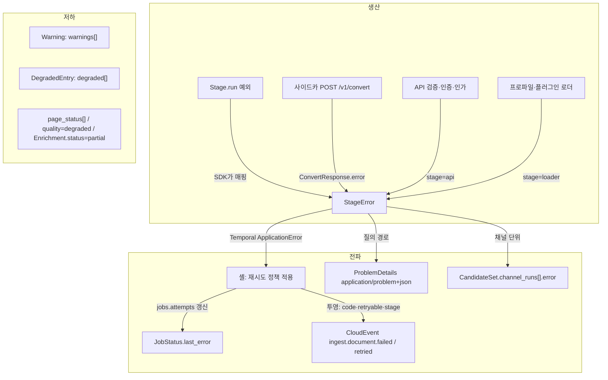
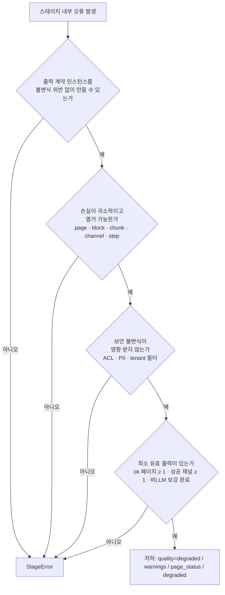
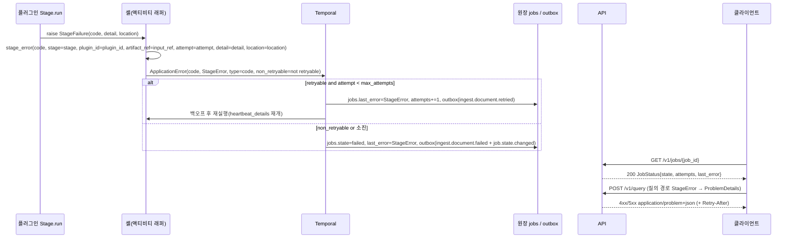

# 에러 모델

## 목적

플랫폼의 모든 실패를 **하나의 오류 모델**로 표현한다. 스테이지·셸·사이드카·API·MCP가 같은 `StageError`를 만들고, HTTP 경계에서는 그것을 RFC 9457 `ProblemDetails`로 감싼다(바이블 §3.2 O-10 "오류 모델 1개(`StageError` ↔ RFC 9457 `type` URN 1:1)"). 두 타입은 바이블 §5.3 공용 타입이므로 필드 정본은 바이블 §5.3이고 스키마 정의는 `schemas/common-types.schema.json`의 `$defs/StageError`·`$defs/ProblemDetails`([계약 개요](./00-contract-overview.md) §2 소유 규칙·§4.10·§4.11)에 있다. 이 문서는 그 위에서 필드 의미 해설, 오류 코드 카탈로그 해설(바이블 §5.7; 기계 판독 정본은 `$defs/ErrorCodeCatalog`), 재시도 분류(바이블 §11.3), 부분 실패(저하) 의미론(바이블 §4.1), 변환 규칙, HTTP 매핑, 관측 라벨, 지역화 정책, 클라이언트 처리 지침을 확정하고, 인벤토리의 독립 스키마 파일 두 개(`$ref` 래퍼)와 Pydantic v2 모델을 게시한다.

## 범위

- 포함: `StageError`, `ProblemDetails`의 필드 해설(바이블 §5.3 미등재 선택 필드 7개와 하위 타입 `ErrorLocation` 포함 — [계약 개요](./00-contract-overview.md) U-12로 `common-types.schema.json` `$defs`에 수용됨, 바이블 반영은 ADR 제안), 오류 코드 카탈로그(바이블 §5.7 전체 68개)와 제안 코드, `retryable`과 `StagePolicy.non_retryable_error_codes`의 관계, 실패와 저하의 판정 기준(`page_status`, `quality=degraded`, `warnings[]`, `DegradedEntry`), `StageError → JobStatus.last_error → ProblemDetails` 변환, HTTP 상태·`Retry-After` 매핑, 로그·메트릭·스팬 라벨, 메시지 지역화, 클라이언트·SDK 처리 지침, 크기 한계·저장 규약.
- 제외: `Warning`·`DegradedEntry`·`ArtifactRef`의 필드 정의(공용 타입, [계약 개요](./00-contract-overview.md)), `JobStatus`·`CloudEventEnvelope`의 필드 정의([잡·이벤트·상태](./12-jobs-events-and-status.md)), 스키마 버전 규칙의 일반론([스키마 버전과 호환성](./14-schema-versioning-and-compatibility.md)), `StagePolicy` 필드 정의([컬렉션·프로파일·정책 계약](./15-collection-profile-and-policy-contracts.md)), API 경로별 상태 코드 전수([API 설계 가이드라인](../05-api/01-api-design-guidelines.md)), 사가 보상 절차([오케스트레이션과 워크플로우](../02-architecture/06-orchestration-and-workflows.md)).
- 정본 관계: 필드·필수 여부·코드 철자는 바이블 §5.3·§5.7을 그대로 따른다. 스키마 정의는 [계약 개요](./00-contract-overview.md) §2 소유 규칙에 따라 `common-types.schema.json`(00 소유)에만 있고 이 문서는 필드 자체를 바꾸지 않는다. null·생략 규칙은 00 §8.1, 크기 한계는 00 §8.4(바이블 §5.1), `contract.violation`의 의미는 00 §10.2, CI 게이트(`$defs/ErrorCodeCatalog` 대조·골든 예시 회귀·Pydantic 동치)는 00 §10.3을 따른다. 바이블에 없는 필드는 선택(N)으로만 둘 수 있고(바이블 §5 서문 "추가 필드는 선택(N)으로만") 00이 `$defs`에 수용한 뒤에만 스키마·Pydantic·예시에 나타난다 — 현재 7개 필드와 `ErrorLocation`이 그 상태다(00 U-12; §2.2). 바이블에 없는 코드는 "제안 코드" 표(§3.3)로만 두고 채택 전에는 발생시키지 않는다. 둘 다 [미해결 이슈](#미해결-이슈)에 바이블 반영 제안으로 기록한다.

## 1. 모델 개요

**결정:** 오류 표현은 세 종류만 존재한다 — 실패는 `StageError`, 품질 손실은 `Warning`(수집 측 `warnings[]`)과 `DegradedEntry`(질의 측 `degraded[]`). `StageError`는 스테이지 출력이 **만들어지지 않았음**을 뜻하고, `Warning`·`DegradedEntry`는 출력이 **유효한 계약 인스턴스로 존재하되 손실이 기록됨**을 뜻한다(바이블 §4.1 "부분 성공", ADR [0018](../06-adr/0018-api-rest-sse-mcp-no-grpc-rfc9457.md), [0030](../06-adr/0030-single-coordinate-system-and-score-ledger.md)). 세 표현이 겹치는 경우는 하나뿐이다: **`partial` 코드**(`enrich.budget_exceeded`, `parse.page_timeout`, `enrich.extractor_timeout`; 바이블 §4.2·§11.3)는 출력이 존재하고 커밋되되 잡을 `partial`로 종료시키므로, 유발 코드가 `JobStatus.last_error`(`StageError`)와 `warnings[].code`에 **함께** 기록된다(§5.3, §6.2 J2). 그 외 `—` 코드는 `StageError`로 존재하지 않고(§6.1 G5), `yes`·`no` 코드는 `Warning`으로 존재하지 않는다.



| 표현 | 타입 | 위치 | 의미 | 코드 공간 |
|------|------|------|------|-----------|
| 실패 | `StageError` | 셸 예외, `JobStatus.last_error`, `ConvertResponse.error`, `channel_runs[].error`, `ProblemDetails.errors[]` | 출력 계약 인스턴스가 없다(`partial` 코드만 예외: 출력은 커밋되고 잡이 `partial`) | 카탈로그 재시도 열 `yes`·`no`(`partial` 코드 포함) |
| 경고 | `Warning{code, message, block_id?, chunk_id?, page?}` | 수집 측 봉투 `warnings[]`(바이블 §5.2) | 출력은 있고 국소 손실이 기록됨 | 카탈로그 재시도 열 `—` 중 "(경고)" ∪ `partial` 코드(`enrich.budget_exceeded`, `parse.page_timeout`, `enrich.extractor_timeout`) |
| 저하 | `DegradedEntry{component, reason, detail?}` | 질의 측 봉투 `degraded[]`, `JobStatus.degraded` | 컴포넌트가 폴백·생략됨 | `enum(DegradedComponent)` × `enum(DegradedReason)`; 유발 코드는 `detail`에 기록 |

## 2. 필드 정의

타입 표기는 브리프 §9.5. "필수" 열은 바이블 §5.3([계약 개요](./00-contract-overview.md) §4.10·§4.11과 동일)의 Y/N을 그대로 쓴다. 선택(N) 필드는 값이 없으면 **키를 생략**한다(`null` 금지, 00 §8.1; `JobStatus.last_error`·`channel_runs[].error`처럼 다른 계약이 `StageError | null`로 참조하는 경우는 그 계약의 nullable이다). 스키마가 표현하지 않는 제약(직렬화 크기·카탈로그 일치·콘텐츠 금지 등)은 이 문서의 불변식이며 계약 테스트(00 §10.3)가 강제한다. 바이블 §5.3에 없는 필드는 "필수" 열을 `N(U-12)`로 표기한다 — 00이 `$defs`에 선택 필드로 수용했고(00 §4.10·§4.11, 미해결 이슈 U-12) 바이블 §5.3 반영은 ADR(minor) 제안 상태다(§2.2, 미해결 이슈 1).

### 2.1 `StageError`(바이블 §5.3, `urn:rag:schema:common-types:1#/$defs/StageError`)

| 필드 | 타입 | 필수 | 설명 | 예시 |
|------|------|------|------|------|
| `code` | string (`$defs/ErrorCode` 접두 패턴 `^{prefix}\.[a-z][a-z0-9_]*$`, ≤64; 값은 `$defs/ErrorCodeCatalog`) | Y | 오류 코드 `{stage}.{reason}`(바이블 §5.7 카탈로그). 접두는 §3.1 22종 | `"parse.document_encrypted"` |
| `type` | string(uri) (`$defs/ErrorTypeUrn`) | Y | RFC 9457 `type`. 항상 `urn:rag:error:{code}` | `"urn:rag:error:parse.document_encrypted"` |
| `retryable` | boolean | Y | 셸이 같은 입력으로 자동 재시도할 수 있는가. **카탈로그가 결정**(바이블 §4.1), 생산자가 바꿀 수 없다 | `false` |
| `stage` | string (`^[a-z][a-z0-9_]*$`, ≤32) | Y | 발생 스테이지(바이블 §5.3). 파이프라인 스테이지명(바이블 §4.2·§4.3; 서브스테이지 `detect`·`recount`·`hydrate` 포함) 또는 비파이프라인 지점 `api`·`loader`·`relay`(00 §4.10·`$defs/StageError.stage`에 등재; 바이블 §5.3 의미 열에는 없어 반영 제안, 미해결 이슈 1) | `"parse"` |
| `plugin_id` | string (`$defs/PluginId`, `{extension_point}.{implementation}`, ≤128) | N | 오류를 낸 플러그인(바이블 §6.1). 플랫폼 코드가 낸 오류는 생략 | `"parser.hwpx_python_hwpx"` |
| `detail` | string (≤1,024) | N | 인스턴스별 진단 문구. 영문·기계 지향. **콘텐츠 미포함**(§11). 위치는 `detail`이 아니라 `location`에 적는다 | `"OWPML package is encrypted and credentials_ref is absent"` |
| `artifact_ref` | `ArtifactRef`(00 §4.1) | N | 실패 시점의 **입력** 산출물 참조(재현·`rag debug replay`). 오류를 위해 새 산출물을 만들지 않는다 | §예시 4 |
| `message` | string (≤256) | N(U-12) | 코드별 고정 영문 문구(카탈로그 `title_en`과 동일). 로그·CLI 표시용. 지역화하지 않는다 | `"Document is encrypted"` |
| `occurred_at` | string(date-time) (`$defs/DateTime`) | N(U-12) | 발생 시각(RFC 3339 UTC, ms; 바이블 §6.3) | `"2026-09-22T09:12:33.412Z"` |
| `attempt` | integer (≥1) | N(U-12) | 실패한 시도 번호(1-based). `JobStatus.attempts`와 같은 척도 | `2` |
| `location` | `ErrorLocation`(§2.2) | N(U-12) | 오류 위치(요청 필드 포인터·페이지·블록·청크·채널·스코프 ID) | `{"pointer": "/collection_id"}` |
| `cause` | `StageError` | N(U-12) | 감싼 원인 오류(폴백 체인·보상). 중첩 깊이 ≤3(Pydantic 검증) | §예시 5 |

### 2.2 바이블 §5.3 미등재 선택 필드의 지위와 `ErrorLocation`(00 U-12, 미해결 이슈 1)

`StageError.message`·`occurred_at`·`attempt`·`location`·`cause`, `ProblemDetails.retry_after`·`request_id`, 하위 타입 `ErrorLocation`, `ProblemDetails.instance`의 `uri-reference` 표기는 이 문서가 제안하고 [계약 개요](./00-contract-overview.md)가 `common-types.schema.json` `$defs`에 선택(N) 필드로 수용한 것이다(00 §2 소유 규칙 "소유 문서가 필요로 하는 선택(N) 필드는 이 문서가 `$defs`에 수용하고 바이블 §5.3 반영 제안으로 기록", 00 U-12). 바이블 §1.1·§1.2에 따라 **바이블 §5.3 표 자체는 아직 바뀌지 않았으므로** 이 문서는 해당 필드를 `N(U-12)`로 표기하고, 바이블 반영 ADR(minor, 00 U-12와 공동)을 미해결 이슈 1로 유지한다. 소비자 규칙: 이 필드들은 없을 수 있다 — 클라이언트·셸은 `message`가 없으면 카탈로그를 `code`로 조회하고(`title_en`), `attempt`가 없으면 `JobStatus.attempts`를, `retry_after`가 없으면 `Retry-After` 헤더를 쓴다.

`ErrorLocation`(`urn:rag:schema:common-types:1#/$defs/ErrorLocation`, `StageError.location` 전용; 모든 필드 N, `additionalProperties: false`; 식별자만 담고 ACL·주체·콘텐츠는 담지 않는다):

| 필드 | 타입 | 필수 | 설명 | 예시 |
|------|------|------|------|------|
| `pointer` | string(json-pointer, ≤256) | N | RFC 6901 JSON Pointer. 요청 본문(400) 또는 산출물(500) 내 위치 | `"/metadata/doc_date"` |
| `page` | integer (≥1) | N | 1-based 페이지. 흐름 포맷(HWPX·DOCX·HTML·MD)은 생략 | `17` |
| `block_id` | string(hex32) | N | `H("block", doc_version, element_path)[:32]`(바이블 §6.2) | `"a1b2c3d4e5f60718293a4b5c6d7e8f90"` |
| `chunk_id` | string(hex64) | N | 콘텐츠 주소 청크 ID(바이블 §6.2) | hex64 |
| `channel` | enum(Channel) | N | 질의 측 채널(`retrieve`·`hydrate` 오류) | `"lexical"` |
| `collection_id` | string(ulid) | N | 스코프 식별(보안 삼중항 중 ID만; ACL·주체는 절대 넣지 않음) | ULID |
| `document_id` | string(ulid) | N | 스코프 식별 | ULID |

### 2.3 `ProblemDetails`(RFC 9457; 바이블 §5.3, `urn:rag:schema:common-types:1#/$defs/ProblemDetails`)

| 필드 | 타입 | 필수 | 설명 | 예시 |
|------|------|------|------|------|
| `type` | string(uri) (`$defs/ErrorTypeUrn`) | Y | `urn:rag:error:{code}`. RFC 9457 `about:blank`는 쓰지 않는다 | `"urn:rag:error:auth.forbidden"` |
| `title` | string (1..256) | Y | 코드별 고정 제목. **지역화되는 유일한 필드**(`Accept-Language` `ko`·`en`, §9) | `"Forbidden"` / `"권한 없음"` |
| `status` | integer (400..599) | Y | HTTP 상태(§7 매핑 표) | `403` |
| `detail` | string (≤2,048) | N | 인스턴스별 진단 문구(영문). 콘텐츠 미포함 | `"principal lacks action document:update_acl"` |
| `instance` | string(uri-reference) (≤512; 바이블 §5.3 표기 `string(uri)` — RFC 9457 §3.1.5 URI reference로 정정 제안, 00 U-12(b)·미해결 이슈 1) | N | 발생 요청 경로 또는 관련 자원(`/v1/jobs/{job_id}`) | `"/v1/query"` |
| `code` | string (`$defs/ErrorCode`; 값은 `$defs/ErrorCodeCatalog`) | Y | `type`의 코드 부분(`= StageError.code`). 클라이언트 분기는 `code`로 한다 | `"auth.forbidden"` |
| `retryable` | boolean | Y | 카탈로그 값. `errors[]`가 있으면 `errors[].retryable`의 OR | `false` |
| `trace_id` | string(hex32) | Y | 현재 스팬의 W3C Trace Context `trace-id`(소문자 hex 32). 지원 요청 시 인용 | `"4bf92f3577b34da6a3ce929d0e0e4736"` |
| `errors` | array<StageError> (1..16) | N | 다중 오류: 요청 검증(필드별), 전 채널 실패(채널별) | §예시 1·3 |
| `retry_after` | integer (≥0) | N(U-12) | `Retry-After` 헤더 값(초)의 본문 사본(MCP 등 헤더가 없는 경로용). `status` 429·503에서만, 헤더와 같은 값(I8) | `5` |
| `request_id` | string(ulid) | N(U-12) | 요청 ID(바이블 §6.1 발급형 ID). 지원 요청 시 `trace_id`와 함께 인용 | ULID |

## 3. 오류 코드 규약과 카탈로그

### 3.1 코드 형식

- 형식 `{stage}.{reason}`, 모두 snake_case. 접두 22종(바이블 §5.7): `fetch, parse, normalize, chunk, enrich, embed, index, publish, plan, retrieve, fuse, hydrate, rerank, postprocess, pack, render, auth, api, profile, plugin, contract, outbox`. 접두는 **의미 영역**이며 `StageError.stage`와 같을 필요는 없다(`detect` 스테이지는 `parse.*`를, 모든 스테이지는 `contract.violation`을 낼 수 있다).
- `type = urn:rag:error:{code}`. URN에는 버전이 없다 — 코드의 의미는 major 버전 안에서 불변이고 개명은 major다(§버전 이력).
- 재시도 열: `yes`(셸 자동 재시도), `no`(즉시 실패), `—`(오류가 아닌 경고·폴백 코드; `Warning.code` 또는 `DegradedEntry.detail`로만 기록되고 `StageError`로 발생하지 않는다), `yes → no(…)`(재시도·폴백·보상을 거친 최종 인스턴스는 `retryable=false`), `no(→ partial)`(잡을 실패시키지 않고 `partial`로 종료).
- HTTP 열: `—`는 비동기 수집 경로 코드로 HTTP 상태를 갖지 않으며 `JobStatus.last_error`로만 노출된다. `200`은 응답이 성공하되 `degraded[]`·`warnings[]`에 기록되는 코드다. 바이블 §5.7이 상태를 명시한 코드(`auth.*`, `api.*`, `contract.violation`, `retrieve.unavailable`), §4.3 실패 정책에 근거가 있는 코드(`plan.*`, `render.*`), 채택된 ADR [0033](../06-adr/0033-sidecar-convert-contract-and-isolation-ladder.md)·[16](./16-eval-feedback-and-sidecar-contracts.md) §7.3(EF-28) 사이드카 전송 계약이 정한 `parse.sidecar_unavailable`(503, 사이드카 자체 응답)만 확정값이고, 그 외는 `(초안)`으로 표기한 이 문서의 제안이다(미해결 이슈 13). 확정값은 `ERROR_CATALOG[code].http_statuses`에 그대로 실려 I7 검사의 대상이 되고, `(초안)`·`미정`·`—`·`200`은 빈 집합이다. `미정`은 앵커 문구와 상충해 확정하지 못한 값이다(미해결 이슈 5).
- 설명 열의 형식은 "`title_en` · 한국어 제목 — 부가 설명"(구분자 ` — ` 필수)이며 두 제목이 §9 지역화 사전의 정본이다. 제목에는 백틱 식별자·E-번호·인스턴스 값을 넣지 않는다(§9). 전 행의 구분자 존재와 제목 형식은 CI 대조 항목이다.

### 3.2 카탈로그(바이블 §5.7 전체, 같은 철자)

**정본 관계:** 오류 코드 집합의 **기계 판독 정본은 `urn:rag:schema:common-types:1#/$defs/ErrorCodeCatalog`**(68개 열거, 00 소유)이고 바이블 §5.7 표가 그 사람 판독 정본이다. 아래 표는 그 의미 해설(HTTP 상태·스테이지·제목·복구 지침)이며, 코드 사본 `rag_platform.contracts.errors.ERROR_CATALOG`(Pydantic 절)는 이 표를 복제한다. CI(00 §10.3 열거 대조, 바이블 §1.2)는 `$defs/ErrorCodeCatalog` = 바이블 §5.7 = 이 표 = `ERROR_CATALOG`의 코드 집합을 대조하고, `retryable` 열·`title_en`·`title_ko`도 표와 코드 사이에서 대조한다. 코드 추가는 바이블 §5.7과 `$defs/ErrorCodeCatalog`를 같은 ADR(minor)로 개정하는 절차(§3.3)로만 한다.

**fetch**

| 코드 | HTTP | 재시도 | 스테이지 | 설명 | 복구 지침 |
|------|------|--------|----------|------|-----------|
| `fetch.access_denied` | — | no | `fetch` | `Source access denied` · 원천 접근 거부 — 원천 401/403, 서명 URL 만료, 버킷 정책 | `credentials_ref`·원천 권한을 고친 뒤 새 `IngestRequest` 제출 |
| `fetch.not_found` | — | no | `fetch` | `Source not found` · 원천 없음 — 원천 404, 객체 키 부재 | URI 확인 후 재제출 |
| `fetch.too_large` | — | no | `fetch` | `Source too large` · 원본 크기 초과 — 프로파일 `fetch.max_bytes`(기본 200MB, 바이블 §5.1) 초과 | 문서 분할 또는 `split_hint`, 프로파일 상향 |
| `fetch.scheme_unsupported` | — | no | `fetch` | `URI scheme unsupported` · 미지원 스킴 — `EgressPolicy.allowed_schemes` 밖 또는 `fetcher` 플러그인 부재 | 허용 스킴으로 재제출, 플러그인 설치 |
| `fetch.egress_denied` | — | no | `fetch` | `Outbound egress denied` · 아웃바운드 차단 — E16(사설·루프백·메타데이터 CIDR, 리다이렉트 초과, DNS 리바인딩) | 원천 호스트를 허용 정책에 맞춤(`deny_cidrs`는 축소 불가) |
| `fetch.timeout` | — | yes | `fetch` | `Source fetch timed out` · 원천 시간 초과 — 연결·읽기 타임아웃 | 자동 재시도(5회, 지수); 소진 시 원천 가용성 확인 후 `POST /v1/jobs/{job_id}/retry` |
| `fetch.upstream_error` | — | yes | `fetch` | `Upstream source error` · 원천 오류 — 원천 5xx, 네트워크 오류 | 동일 |

**parse**

| 코드 | HTTP | 재시도 | 스테이지 | 설명 | 복구 지침 |
|------|------|--------|----------|------|-----------|
| `parse.unsupported_format` | — | no | `detect` | `Unsupported format` · 미지원 포맷 — `SourceFormat=unknown` 또는 `parse.router`에 파서 없음 | 지원 포맷으로 변환해 재제출; 프로파일 `parse.router` 확인 |
| `parse.unsupported_variant` | — | no | `parse` | `Unsupported format variant` · 미지원 변형 — HWP 3.0, 미지원 OWPML 확장 등 | 변환본 제공 후 재제출 |
| `parse.corrupt_container` | — | no | `detect`·`parse` | `Corrupt container` · 손상 컨테이너 — ZIP/OLE 손상, OWPML 필수 파트 누락 | 원본 복구 후 재제출 |
| `parse.document_encrypted` | — | no | `parse` | `Document is encrypted` · 암호화 문서 — `credentials_ref` 부재 또는 불일치 | `credentials_ref` 제공 후 재제출 |
| `parse.distribution_document` | — | no | `parse` | `Distribution-only document` · 배포용 문서 — 테넌트 `allow_distribution_documents=false` | 테넌트 옵트인(텍스트 전용, `quality=degraded`) 또는 원본 요청 |
| `parse.sidecar_unavailable` | 503(사이드카 자체 응답; ADR-0033 확정) | yes | `parse` | `Parser sidecar unavailable` · 사이드카 불가 — Java·LibreOffice·OCR 사이드카 연결 실패·미준비 | 자동 재시도 후 폴백 체인; 지속 시 사이드카 배포 점검(`rag_parser_sidecar_unavailable_total`) |
| `parse.conversion_failed` | — | yes → no(폴백 소진) | `parse` | `Conversion failed` · 변환·파싱 실패 — 어댑터 예외; 폴백 체인 소진 시 비재시도 | `parser_chain` 확인; 다른 파서 프로파일로 `reprocess {from_stage: parse}` |
| `parse.page_timeout` | — | yes(→ `page_status`) | `parse` | `Page processing timed out` · 페이지 시간 초과 — OCR CPU 60s/GPU 20s; 페이지는 `timeout`, 문서는 계속 | GPU OCR 프로파일 또는 `reprocess {from_stage: parse}` |

**normalize**

| 코드 | HTTP | 재시도 | 스테이지 | 설명 | 복구 지침 |
|------|------|--------|----------|------|-----------|
| `normalize.nfd_residual` | — | no | `normalize` | `NFD residual after normalization` · NFD 잔존 — 정규화기 버그 | 플러그인 버그 리포트·버전 갱신 |
| `normalize.pii_policy_violation` | — | no | `normalize` | `PII policy violation` · PII 정책 위반 — `pii_policy=reject` 검출, 또는 `keep` 불가 항목(고유식별정보·계좌·카드)에 `keep` | 정책을 `mask`/`tokenize`로 변경 후 `reprocess {from_stage: normalize}` |
| `normalize.pii_detector_unavailable` | — | yes | `normalize` | `PII detector unavailable` · PII 탐지기 불가 — 모델 로딩·호출 실패; `keep` 폴백 금지(E4) | 자동 재시도; 소진 시 잡 `failed` → 탐지기 복구 후 retry |
| `normalize.segmenter_fallback` | — | —(경고; 바이블 §5.7 열도 `—` — 1.2.1 정정, 미해결 이슈 4(a) 해소) | `normalize` | `Sentence segmenter fell back` · 문장 분리기 폴백 — 예외 → kss → 정규식 | `warnings[]` 확인; 문장 윈도우 품질 점검 |

**chunk**

| 코드 | HTTP | 재시도 | 스테이지 | 설명 | 복구 지침 |
|------|------|--------|----------|------|-----------|
| `chunk.tokenizer_missing` | — | no | `chunk`·`recount` | `Budget tokenizer missing` · 토크나이저 부재 — 예산 토크나이저(`hf:BAAI/bge-m3`) 로드 불가 | 모델 미러·프로파일 `chunk.tokenizer` 확인 |
| `chunk.count_exceeded` | — | no(최종) | `chunk` | `Chunk count exceeded` · 청크 수 초과 — 50,000 초과; 행 그룹 확대 재시도 후 최종 | 문서 분할(`split_hint`) 또는 표 행 그룹 상향 |
| `chunk.block_oversized` | — | —(경고) | `chunk` | `Block exceeds chunk budget` · 블록 초과 — 강제 분할 | `warnings[]` 확인 |

**enrich**

| 코드 | HTTP | 재시도 | 스테이지 | 설명 | 복구 지침 |
|------|------|--------|----------|------|-----------|
| `enrich.content_policy_violation` | — | no | `enrich` | `Content policy violation` · 콘텐츠 정책 거부 — 외부 LLM 거부 | 해당 청크 LLM 보강 제외 정책 검토 |
| `enrich.llm_policy_denied` | — | no | `enrich` | `LLM enrichment not allowed` · LLM 보강 불허 — 테넌트 `llm_enrichment_allowed=false` | 테넌트·컬렉션 정책 옵트인 |
| `enrich.budget_exceeded` | — | no(→ `partial`) | `enrich` | `Enrichment budget exceeded` · 보강 예산 소진 — `enrichment_budget_tokens`·코퍼스 1.5배 상한 | 비LLM 결과는 커밋됨; 예산 상향 후 `retry?stages=enrich` |
| `enrich.extractor_timeout` | — | yes(→ `partial`) | `enrich` | `Extractor timed out` · 추출기 시간 초과 — 빈 배열 + `Enrichment.status=partial` | 기록만; 재추출은 `reprocess {from_stage: enrich}` |
| `enrich.llm_unavailable` | — | yes | `enrich` | `Enrichment LLM unavailable` · 보강 LLM 불가 — 5xx·연결 실패 | 자동 재시도(최대 간격 5m) |

**embed**

| 코드 | HTTP | 재시도 | 스테이지 | 설명 | 복구 지침 |
|------|------|--------|----------|------|-----------|
| `embed.space_mismatch` | — | no | `embed` | `Embedding space mismatch` · 임베딩 공간 불일치 — `embedding_space_id`·`vocab_id`가 컬렉션과 다름 | 프로파일·`CollectionSpec.embedding_space_ids` 대조; blue/green 재색인 |
| `embed.tokenizer_missing` | — | no | `embed` | `Embedder tokenizer missing` · 임베더 토크나이저 부재 — `token_counts`에 `tokenizer_id` 없음 | `reprocess {from_stage: recount}` |
| `embed.server_unavailable` | — | yes | `embed` | `Embedding server unavailable` · 임베딩 서버 불가 — vLLM/TEI 5xx·연결 실패 | 자동 재시도(최대 간격 5m); 소진 시 서빙 점검 후 retry |
| `embed.token_overflow` | — | —(경고; 바이블 §5.7 열도 `—` — 1.2.1 정정, 미해결 이슈 4(a) 해소) | `embed` | `Input exceeds model length` · 토큰 초과 — truncate + 경고 | 청크 예산·모델 최대 길이 점검 |

**index**

| 코드 | HTTP | 재시도 | 스테이지 | 설명 | 복구 지침 |
|------|------|--------|----------|------|-----------|
| `index.security_fields_missing` | — | no | `index` | `Security fields missing` · 보안 필드 누락 — `tenant_id`·`collection_id`·`acl_allow`·`acl_visibility`·`acl_hash` 누락 레코드 1건이라도 있으면 배치 전체 거부(E5) | 어댑터·계보 산출물 점검(결함) |
| `index.generation_conflict` | — | no | `index` | `Index generation conflict` · 세대 충돌 — 플립 시 `documents.current_generation ≥ N+1` | 디스패처 직렬화 상태 확인 후 재제출 |
| `index.backend_unavailable` | — | yes | `index` | `Index backend unavailable` · 백엔드 불가 — Qdrant/OpenSearch 연결 실패·5xx | 자동 재시도; 소진 시 사가 보상 후 `failed` |
| `index.partial_commit` | — | yes → no(보상 후) | `index` | `Partial commit` · 부분 커밋 — 한 백엔드만 기록; 보상(바이블 §11.4) 후 실패 | `IndexCommit.compensation` 확인 후 retry |

**publish · outbox**

| 코드 | HTTP | 재시도 | 스테이지 | 설명 | 복구 지침 |
|------|------|--------|----------|------|-----------|
| `outbox.egress_denied` | — | no | `relay`(§2.1) | `Webhook egress denied` · 웹훅 차단 — 구독 URL이 `EgressPolicy` 위반(E16) | 구독 URL 수정 |
| `outbox.relay_failed` | — | yes | `relay`(§2.1) | `Event relay failed` · 릴레이 실패 — 웹훅 5xx·시간 초과 | 릴레이 자동 재시도; `rag_outbox_lag_seconds` 감시 |

**plan**

| 코드 | HTTP | 재시도 | 스테이지 | 설명 | 복구 지침 |
|------|------|--------|----------|------|-----------|
| `plan.security_context_missing` | 400 | no | `plan` | `Security context missing` · 보안 컨텍스트 누락 — 서버 주입 실패(E6) | 서버 구성 오류; 클라이언트 재시도 무의미 |
| `plan.filter_field_forbidden` | 422 | no | `plan` | `Filter field forbidden` · 금지 필터 필드 — `tenant_id`·`collection_id`·`acl_*`·`is_current`·`index_generation`·`level`·`commit_id`·`record_id` 또는 미선언 `custom.*` | 필터를 `FilterableField`·컬렉션 `filterable_fields`로 수정 |
| `plan.collection_forbidden` | 403 | no | `plan` | `Collection forbidden` · 컬렉션 접근 불가 — `allowed_collections` 밖(존재 여부 비노출) | 권한 요청; `collection_ids` 확인 |
| `plan.llm_failed` | 200 | —(폴백) | `plan` | `Planner LLM failed` · 플래너 LLM 실패 — 원 질의 + 형태소 키워드, `route=single` | `degraded[]{planner_llm, llm_failed}` 확인 |

**retrieve · fuse · hydrate**

| 코드 | HTTP | 재시도 | 스테이지 | 설명 | 복구 지침 |
|------|------|--------|----------|------|-----------|
| `retrieve.security_context_missing` | 미정(초안 500; 바이블 §10.3 E7 "요청 실패(**500 아닌** 계약 위반)"과 상충 — 미해결 이슈 5) | no | `retrieve` | `Tenant filter missing in backend request` · 백엔드 테넌트 필터 누락 — 백엔드 요청에 `tenant_id` 필터 부재(E7); 요청은 실패한다 | 어댑터 결함; 배포 롤백 |
| `fuse.k_missing` | 500(초안) | no | `fuse` | `Fusion k missing` · 융합 k 미설정 — `fusion.k` 미설정; 로딩 검증이 차단하므로 런타임 발생은 결함 | `rag profile validate` |
| `retrieve.channel_timeout` | 200 | yes(폴백) | `retrieve` | `Retrieval channel timed out` · 채널 시간 초과 — 채널 제외 | `degraded[]{channel.*, timeout}`; 지연 예산 점검 |
| `retrieve.backend_error` | 200 | yes(폴백) | `retrieve` | `Retrieval backend error` · 채널 백엔드 오류 — 5xx·연결 실패, 채널 제외 | `degraded[]{channel.*, unavailable}` |
| `retrieve.unavailable` | 503 | yes | `retrieve` | `Retrieval unavailable` · 검색 불가 — 전 채널 실패(최소 1채널 성공 요건 미충족) 또는 `hydrate` 재시도 소진 | `Retry-After` 뒤 재시도 |
| `hydrate.backend_error` | 200 또는 503 | yes(1회) | `hydrate` | `Hydrate lookup failed` · payload 배치 조회 실패 — 1회 재시도 후 503 `retrieve.unavailable`; 누락 레코드는 `degraded[]{hydrate, partial_result}` | 벡터 백엔드 점검 |

**rerank · postprocess · pack · render**

| 코드 | HTTP | 재시도 | 스테이지 | 설명 | 복구 지침 |
|------|------|--------|----------|------|-----------|
| `rerank.schema_mismatch` | 500(초안, 미해결 이슈 8) | no | `rerank` | `Reranker response schema mismatch` · 리랭커 응답 스키마 불일치 — `tei`·`cohere` 어느 쪽도 아님(구성 결함) | `rerank.response_schema` 수정 |
| `rerank.timeout` | 200 | —(폴백) | `rerank` | `Rerank timed out` · 리랭크 시간 초과 — 300ms 초과·5xx → fused 순서 | `degraded[]{rerank, timeout}`, `rag_rerank_fallback_total` |
| `postprocess.parent_text_miss` | 200 | —(폴백) | `postprocess` | `Parent text missing` · 부모 텍스트 미스 — 확장 생략 | `degraded[]{parent_expand, unavailable}`; 번들 정합성 검사 |
| `pack.tokenizer_mismatch` | 422 또는 500(초안) | no | `pack` | `Tokenizer mismatch` · 토크나이저 불일치 — 대상 LLM 토크나이저 ↔ 카운터 불일치(구성 거부) | 요청 `renderer`·대상 모델 또는 프로파일 수정 |
| `pack.count_api_failed` | 200 | —(폴백) | `pack` | `Token count API failed` · 카운트 API 실패 — `approximate` + `calibration_ratio` | `degraded[]{token_count, approximate_count}` |
| `pack.budget_overflow` | 200 | —(경고) | `pack` | `Token budget overflow` · 예산 초과 — `overflow_policy` 순서 적용 후 정상 종료 | `warnings[]`·`budget.used_tokens` 확인 |
| `pack.conflict_unlabeled` | 200 | —(경고) | `pack` | `Conflict label omitted` · 충돌 표지 생략 — `conflicts_with`가 있으나 `doc_date`·`doc_version_label` 없음 | 문서 메타데이터 보완 |
| `pack.acl_hint_unavailable` | 200 | —(폴백) | `pack` | `ACL revocation hint unavailable` · 회수 힌트 불가 — payload ACL로 판정 | `degraded[]{acl_recheck, unavailable}` |
| `render.mixed_blocks` | 400 | no | `render` | `Mixed block types` · 혼합 블록 — 렌더러가 `search_result`·`document` 혼합 불가 | 렌더러 옵션 수정 |
| `render.citations_with_structured_output` | 400 | no | `render` | `Citations incompatible with structured output` · 인용·구조화 출력 병용 — Anthropic `citations` + `output_config.format` | `bracket_id` 인용 또는 2단계 호출 |
| `render.empty_pack` | 400 | no | `render` | `Empty context pack` · 빈 팩 — `items` 0개 렌더 요청 | `sufficiency.status` 확인; `no_retrieval` 처리 |

**auth · api · contract · profile · plugin**

| 코드 | HTTP | 재시도 | 스테이지 | 설명 | 복구 지침 |
|------|------|--------|----------|------|-----------|
| `auth.unauthenticated` | 401 | no | `api` | `Unauthenticated` · 미인증 — 토큰 부재·만료·서명·audience 불일치(E1) | 토큰 갱신 후 1회 재시도 |
| `auth.forbidden` | 403 | no | `api` | `Forbidden` · 권한 없음 — Cedar deny, fail-closed(E2) | 권한 요청; 재시도 금지 |
| `auth.too_many_principals` | 422 | no | `api` | `Too many principals` · 주체 초과 — 1,024 초과 | 그룹 정리 |
| `api.idempotency_conflict` | 409 | no | `api` | `Idempotency key in use` · 멱등 키 충돌 — 같은 키의 요청이 처리 중(draft-07) | `instance`(`/v1/jobs/{job_id}`) 조회 후 대기 |
| `api.idempotency_payload_mismatch` | 422 | no | `api` | `Idempotency payload mismatch` · 멱등 본문 불일치 — 같은 키, 다른 본문 | 새 `Idempotency-Key`로 재전송 |
| `api.rate_limited` | 429 | no | `api` | `Rate limited` · 한도 초과 — 테넌트·API 키 한도(E3) | `RateLimit`·`Retry-After` 뒤 재전송(§10) |
| `contract.violation` | 400 또는 500 | no | 모든 스테이지·`api` | `Contract violation` · 계약 위반 — 요청(400) 또는 산출물(500)이 스키마·불변식 위반(00 §10.2) | 400: `errors[].location.pointer`로 요청 수정; 500: 결함 리포트 |
| `profile.invalid` | 422 또는 500(초안) | no | `loader`(§2.1) | `Profile invalid` · 프로파일 무효 — 바이블 §7.4 규칙 위반 | `rag profile validate` |
| `plugin.license_denied` | 422(초안) | no | `loader`(§2.1) | `Plugin license denied` · 라이선스 거부 — `license_grade > max_grade`, `territory`, B+`static_bundled`, D 미승인 | `license_policy`·`optIn`·`model_license_ack` |
| `plugin.capability_unsupported` | 422(초안) | no | `loader`(§2.1) | `Plugin capability unsupported` · 능력 불일치 — 요구 능력 ↔ `capabilities()` 불일치(자동 비활성 불가 항목) | 플러그인 교체·프로파일 수정 |

### 3.3 제안 코드(바이블 §5.7 미등재 — 채택 전 사용 금지)

다음은 API 표면(바이블 §14)과 §11.5를 구현하면 필요해지는 코드다. 채택 절차는 바이블 §1.2 "열거값 추가"(ADR minor)이며, 같은 ADR에서 바이블 §5.7 표와 `common-types.schema.json` `$defs/ErrorCodeCatalog`(00 소유)를 함께 개정하고 CI 열거 대조(00 §10.3)를 통과해야 한다. 채택 전까지 `StageError.code`로 발생시키지 않으며(불변식 I1; 스키마는 `$defs/ErrorCodeCatalog` 밖 값을 거부한다), 대안 열의 기존 코드를 쓴다. 이 표는 [계약 개요](./00-contract-overview.md) 미해결 이슈 U-3(`api.not_found`, `api.payload_too_large`, `api.unsupported_media_type`, `api.validation_failed`)과 **공동 제안**이다 — 단, U-3의 `api.validation_failed`는 00 §10.1과 본 문서 H3가 요청 검증을 `contract.violation`(400) + `errors[]`로 확정했으므로 채택하지 않는다(미해결 이슈 3).

| 코드(제안) | HTTP | 재시도 | 스테이지 | 설명 | 채택 전 대안 |
|------------|------|--------|----------|------|--------------|
| `api.not_found` | 404 | no | `api` | 경로 자원(`job_id`·`document_id`·`subscription_id`·`run_id`) 없음. 컬렉션은 존재 비노출을 위해 항상 403 `plan.collection_forbidden` | `contract.violation`(400) |
| `api.payload_too_large` / `api.unsupported_media_type` | 413 / 415 | no | `api` | 인라인 한계 초과(`IngestRequest` 64KB, `QueryRequest` 16KB, batch 100건) / `Content-Type`이 `application/json`이 아님 | `contract.violation`(400) |
| `api.idempotency_key_required` | 400 | no | `api` | `POST /v1/ingest`에 `Idempotency-Key` 부재(D-08) | `contract.violation`(400, pointer 없음) |
| `api.cursor_invalid` | 400 | no | `api` | 불투명 커서 만료·변조·테넌트 불일치(MCP `cursor` 포함) | `contract.violation`(400) |
| `api.job_state_conflict` | 409 | no | `api` | 종료 상태 잡의 `cancel`/`retry`, `partial`이 아닌 잡의 `retry?stages=` | `api.idempotency_conflict` 오용 금지; `contract.violation`(400) |
| `api.orchestrator_unavailable` | 503 | yes | `api` | Temporal 불가(바이블 §11.5) — 잡은 `queued` 유지, 조정 스케줄이 재시작 | `retrieve.unavailable` 오용 금지; 503 + `contract.violation`은 부적절 → 조기 채택 필요 |
| `api.dependency_unavailable` | 503 | yes | `api` | PostgreSQL·Valkey·오브젝트 스토리지 등 필수 의존 불가(레이트리밋 fail-closed 포함) | 동일 |
| `api.internal_error` | 500 | no | 모든 스테이지·`api` | 분류되지 않은 예외(결함). `contract.violation`(500)은 검증 실패에 한정 | `contract.violation`(500) |
| `auth.tenant_mismatch` | 422 | no | `api` | 본문에 `tenant_id`가 오거나(E1) 경로·본문 테넌트가 토큰과 불일치 | `contract.violation`(400) |
| `contract.version_unsupported` | 400 또는 500 | no | 모든 스테이지 | `schema_version`이 `contracts_compat` 범위 밖([14](./14-schema-versioning-and-compatibility.md)) | `contract.violation` |
| `{stage}.timeout` 계열(`parse.timeout`, `normalize.timeout`, `chunk.timeout`, `enrich.timeout`, `embed.timeout`, `index.timeout`) | — | yes | 해당 스테이지 | 액티비티 `start_to_close`·heartbeat 초과를 워크플로우 측 `TemporalContext.run`이 합성(`fetch.timeout`·`rerank.timeout`·`parse.page_timeout`·`enrich.extractor_timeout` 외 스테이지) | §4.3 임시 매핑(`normalize`·`chunk`는 의미가 맞는 기존 코드가 없어 **매핑 없음** → 조기 채택 필요) |
| `parse.helper_crashed` | — | yes | `parse` | `helper_process`(unhwp) 비정상 종료 → 폴백 체인 | `parse.conversion_failed` |

## 4. 재시도 분류

### 4.1 네 분류(바이블 §11.3)와 `retryable`

| 분류 | 조건 | `StageError.retryable` | 셸 동작 | 잡 상태 |
|------|------|------------------------|---------|---------|
| `retryable` | 일시 장애: `*.unavailable`, `*.timeout`, `*.upstream_error`, `*.backend_error`, HTTP 5xx, 네트워크 | `true` | `StagePolicy.max_attempts`까지 지수 백오프(`backoff{initial 1s, max 5m, coefficient 2.0}`), `heartbeat_details` 기반 `Resumable` 재개 | 재시도 중 `running`(`ingest.document.retried`), 소진 시 `failed` |
| `non_retryable` | 계약 위반, 미지원 포맷·변형, 암호화, 배포용(정책 불허), 접근 거부, 보안 필드 누락, 공간 불일치, 정책 거부 | `false` | 즉시 실패, 보상(사가) | `failed`(`ingest.document.failed`) |
| `partial` | 페이지 단위 실패(`page_status`), 추출기 타임아웃, LLM 예산 소진 | 코드별(`enrich.budget_exceeded`는 `false`, `enrich.extractor_timeout`·`parse.page_timeout`은 `true`이나 단위 재시도 후 기록) | 계속 진행, `quality=degraded` / `Enrichment.status=partial`, 비LLM 결과 커밋 | `partial`(`retry?stages=enrich` 가능) |
| `fallback` | 사이드카 불가·변환 실패 → 폴백 체인; 리랭크·카운트 API·부모 텍스트·ACL 힌트 실패 → 저하 | 폴백 코드는 `—`(오류 아님); 체인 소진 시 최종 인스턴스 `false` | 다음 어댑터 시도, `parser_chain`/`degraded[]` 기록 | 성공(`degraded`) 또는 체인 소진 시 `failed` |

`retryable`의 뜻은 정확히 하나다 — **셸이 같은 입력을 같은 스테이지에 다시 넣으면 성공할 가능성이 있는가**. 클라이언트가 요청을 재전송해도 되는지(§10)와 다르다(`api.rate_limited`는 `retryable=false`지만 `Retry-After` 뒤 재전송이 허용된다).

### 4.2 `StagePolicy.non_retryable_error_codes`와의 관계

**결정:** 재시도 가능 여부의 정본은 카탈로그이고, `StagePolicy.non_retryable_error_codes`(바이블 §4.4·§5.3)는 그 부분집합을 스테이지별로 **투영**한 선언이다(ADR [0003](../06-adr/0003-orchestrator-neutral-pipeline-and-non-durable-local-runner.md), [0032](../06-adr/0032-plugin-sdk-stage-protocol-and-conformance-kit.md)).

| 규칙 | 내용 | 위반 시 |
|------|------|---------|
| R1 존재 | 목록의 모든 코드는 카탈로그에 존재해야 한다 | `profile.invalid`(로딩) |
| R2 방향 | 목록에는 카탈로그 재시도 열이 `no`(또는 `yes → no`의 최종)인 코드만 올 수 있다. 카탈로그 `yes` 코드를 넣어 비재시도로 조이거나, 목록에서 빼서 재시도로 풀 수 없다 — 변경은 카탈로그 ADR로만 | `profile.invalid`(로딩) |
| R3 효과 집합 | 셸이 적용하는 비재시도 집합 = 카탈로그 `no` 코드 전체 ∪ 목록. 따라서 목록은 문서화·Temporal 투영이며 누락이 재시도를 만들지 않는다 | — |
| R4 공통 코드 | `contract.violation`, `plugin.license_denied`, `plugin.capability_unsupported`는 모든 스테이지에서 비재시도이며 목록에 적지 않아도 R3에 포함된다 | — |
| R5 잡 정책 | `max_attempts` 소진은 코드와 무관하게 `failed`다. 마지막 `StageError`(`retryable=true`, `attempt=max_attempts`)가 `JobStatus.last_error`가 되고 `JobStatus.attempts = max_attempts`다 | — |

### 4.3 Temporal·LocalRunner 매핑과 재시도 소진(poison)

- 셸(액티비티 래퍼)은 `StageError`를 `ApplicationError(code, stage_error.model_dump(mode="json"), type=code, non_retryable=not retryable)`로 던진다(`temporalio` `ApplicationError(message, *details, type=None, non_retryable=False, next_retry_delay=None)` — `details`는 가변 위치 인자; 확인 필요 as of 2026-09). 워크플로우 측 `TemporalContext.run`(바이블 §11.1; [선정 매트릭스](../07-tech-landscape/00-summary-and-selection-matrix.md) J-6, 08 문서 `TemporalContext`)은 `RetryPolicy(maximum_attempts=max_attempts, initial_interval=backoff.initial, maximum_interval=backoff.max, backoff_coefficient=backoff.coefficient, non_retryable_error_types=효과 집합)`을 액티비티에 건다.
- Temporal 타임아웃(`StartToClose`·`Heartbeat`)은 액티비티 코드가 이미 취소·중단된 뒤 워크플로우가 `ActivityError(cause=TimeoutError)`를 받으므로 **셸이 아니라 워크플로우 측 `TemporalContext.run`이** `StageError`로 합성한다(`LocalRunner`는 `LocalContext.run`이 `asyncio.TimeoutError`를 같은 규칙으로 합성). 임시 매핑(초안, §3.3 `{stage}.timeout` 채택 시 대체): `fetch → fetch.timeout`, `parse → parse.page_timeout`(`heartbeat_details.page` 있음) 또는 `parse.conversion_failed`, `enrich → enrich.extractor_timeout`, `embed → embed.server_unavailable`, `index → index.backend_unavailable`. `normalize`·`chunk`는 의미가 맞는 기존 코드가 없어 **매핑 없음**이다 — `contract.violation`은 스키마·불변식 위반에 한정되므로(00 §10.2) 쓰지 않는다. 채택 전까지 두 스테이지의 타임아웃은 잡을 `failed`로 종료하되 `last_error`를 채우지 못하는 예외 경로다(불변식 I12 예외; 미해결 이슈 3 조기 채택 근거).
- `LocalRunner`(비내구)는 같은 분류·백오프를 인프로세스로 적용하되 프로세스 크래시 시 `failed` + `last_error` 없음이 허용된다(바이블 §11.1 "크래시 시 failed"; 불변식 I12의 명시 예외).
- **재시도 소진(poison) 상태**는 별도 코드가 아니다. `JobStatus.state=failed`이고 `last_error.retryable=true`이며 `attempts ≥ StagePolicy.max_attempts`이면 "일시 장애가 지속되어 소진"으로 읽는다. 운영자는 의존 서비스 복구 후 `POST /v1/jobs/{job_id}/retry`(새 `workflow_run_id`, 캐시 산출물 재사용)로 재개한다. `last_error.retryable=false`면 입력·정책을 고쳐 새 `IngestRequest`를 제출한다.
- 플러그인이 분류되지 않은 예외를 던지면 SDK는 `contract.violation`(`retryable=false`, `detail="unhandled {ExceptionType}"`)로 매핑한다. 일시 장애를 `*.unavailable`·`*.timeout`으로 매핑하는 것은 플러그인의 책임이며 적합성 키트가 검사한다.

### 4.4 질의 경로

검색 경로는 오케스트레이터를 거치지 않으므로 `StagePolicy`가 없다(바이블 §4.3). 재시도는 코드별 고정이다: `hydrate.backend_error` 1회, 그 외 0회. 채널 실패는 채널 제외 + `degraded[]`(최소 1채널 성공), 전 채널 실패는 503 `retrieve.unavailable` + `Retry-After`. `retryable=true`인 채널 오류가 `channel_runs[].error`에 남는 것은 정보 제공용이며 서버가 다시 시도했다는 뜻이 아니다.

## 5. 부분 실패(저하) 의미론

### 5.1 실패와 저하의 판정 기준

**결정:** 다음 네 조건을 모두 만족하면 실패가 아닌 **저하**로 다룬다. 하나라도 어긋나면 `StageError`다(바이블 §4.1 "문서 전체 실패로 확대하지 않는다").



| 조건 | 설명 | 예 |
|------|------|----|
| C1 유효 출력 | 출력이 스키마와 불변식을 모두 만족한다. 좌표(`block_refs`·`sentence_spans`)와 provenance는 손실 부분을 제외하고 완전하다 | 타임아웃 페이지를 뺀 `ParsedDocument` |
| C2 국소성 | 손실 단위가 `page`·`block`·`chunk`·`channel`·후처리 `step`·팩 항목으로 열거된다 | `page_status[]`, `channel_runs[].status` |
| C3 보안 불변 | ACL·PII·테넌트 필터는 저하 대상이 아니다 — PII 탐지기 불가는 실패(`keep` 폴백 금지, E4), ACL 재검증 불가는 payload ACL로 **보수적** 판정, 재검증 실패 항목은 `omitted(acl_denied)`로 제외 | `normalize.pii_detector_unavailable`은 실패 |
| C4 최소 유효 | `ok` 페이지 ≥ 1, 성공 채널 ≥ 1, 비LLM 보강 완료. 0이면 실패 — 전 페이지 실패는 `parse.conversion_failed`(초안 규칙, 미해결 이슈 9), 전 채널 실패는 `retrieve.unavailable` | |

### 5.2 저하 기록 장치

| 장치 | 위치 | 값 | 채우는 스테이지 |
|------|------|----|-----------------|
| `quality` | 수집 측 봉투(바이블 §5.2), enum(Quality) `full, degraded` | 손실이 하나라도 있으면 `degraded`; 하류 스테이지는 상류 `degraded`를 **상속**(되돌리지 않음) | 모든 수집 스테이지 |
| `warnings[]` | 수집 측 봉투, `Warning{code, message, block_id?, chunk_id?, page?}` | `code`는 카탈로그 `—(경고)` 코드 또는 `partial` 코드; `message`는 `title_en`; 콘텐츠 미포함 | 모든 수집 스테이지 |
| `page_status[]` | `ParsedDocument.page_status[]{page, status: enum(PageStatus), ocr_confidence}` | `ok, timeout, ocr_failed, skipped`; `ok` 외 페이지는 `quality=degraded` + `warnings[parse.page_timeout]`(timeout) | `parse` |
| `Enrichment.status`·`EnrichedChunkSet.status` | enum(EnrichStatus) `complete, partial` | 추출기 타임아웃·예산 소진 | `enrich` |
| `channel_runs[].status`·`.error` | `CandidateSet`, enum(ChannelRunStatus) `ok, timeout, error, disabled` | `error`는 `StageError`(`retrieve.*`, `embed.server_unavailable` 등) | `retrieve` |
| `degraded[]` | 질의 측 봉투, `DegradedEntry{component: enum(DegradedComponent), reason: enum(DegradedReason), detail?}` | `detail`에 유발 코드를 적는다(`"retrieve.channel_timeout"`), 콘텐츠 미포함 | `plan`~`pack` |
| `omitted[]` | `ContextPack.omitted[]{reason: enum(OmitReason)}` | 항목 제외 사유(`acl_denied`, `hydrate_missing`, `budget_exceeded`); 오류·저하가 아니다 | `pack` |
| `JobStatus.state=partial`, `JobStatus.degraded` | 잡 읽기 모델 | 페이지 일부 실패·LLM 예산 소진(바이블 §11.5) | 워크플로우 |

### 5.3 저하·경고 기록 매핑(`—` 코드와 `partial`·폴백 코드)

재시도 열이 `—`인 코드는 `Warning`·`DegradedEntry`로만 존재한다(I4). 재시도 열이 `yes`·`no`인데도 이 표에 있는 코드는 `StageError`로 존재하면서(`JobStatus.last_error`, `channel_runs[].error`) 저하 기록도 남기는 `partial`·채널 폴백 코드다.

| 코드 | 재시도 열 | `StageError` 존재 | 기록 | `component` | `reason` | 부수 효과 |
|------|-----------|-------------------|------|-------------|----------|-----------|
| `parse.page_timeout` | yes(→ `page_status`) | `JobStatus.last_error`(잡 `partial`) | `page_status[].status=timeout`, `warnings[]` | — | — | `quality=degraded`, 잡 `partial` |
| `normalize.segmenter_fallback` / `chunk.block_oversized` / `embed.token_overflow` | —(경고) | 없음 | `warnings[]` | — | — | 정규식 문장 경계 / 강제 분할 / truncate |
| `enrich.extractor_timeout` | yes(→ `partial`) | `JobStatus.last_error`(잡 `partial`) | `warnings[]`, `Enrichment.status=partial` | — | — | 빈 `entities`/`keywords` |
| `enrich.budget_exceeded` | no(→ `partial`) | `JobStatus.last_error`(잡 `partial`) | `warnings[]`, `EnrichedChunkSet.status=partial` | — | — | 잡 `partial` |
| `plan.llm_failed` | —(폴백) | 없음 | `degraded[]` | `planner_llm` | `llm_failed` | `route=single`, 형태소 키워드 |
| `retrieve.channel_timeout` | yes(폴백) | `channel_runs[].error` | `degraded[]`, `channel_runs[].status=timeout` | `channel.{dense,sparse,lexical,graph,tree,visual,late_interaction}` | `timeout` | 채널 제외 |
| `retrieve.backend_error` | yes(폴백) | `channel_runs[].error` | `degraded[]`, `channel_runs[].status=error` | `channel.*` | `unavailable` | 채널 제외 |
| `hydrate.backend_error`(누락) | yes(1회) | 없음(누락 시; 재시도 소진은 503 `retrieve.unavailable`) | `degraded[]`, `explain += hydrate_missing` | `hydrate` | `partial_result` | 후보 제외, `rag_hydrate_missing_total` |
| `rerank.timeout` | —(폴백) | 없음 | `degraded[]`, `rerank.applied=false`, `explain += rerank_skipped` | `rerank` | `timeout` | fused 순서, `rag_rerank_fallback_total` |
| `postprocess.parent_text_miss` | —(폴백) | 없음 | `degraded[]` | `parent_expand` | `unavailable` | 확장 생략 |
| `pack.count_api_failed` | —(폴백) | 없음 | `degraded[]`, `budget.count_method=approximate` | `token_count` | `approximate_count` | `calibration_ratio` 필수 |
| `pack.acl_hint_unavailable` | —(폴백) | 없음 | `degraded[]`, `items[].acl.source=payload` | `acl_recheck` | `unavailable` | payload ACL 판정 |
| `pack.budget_overflow` | —(경고) | 없음 | `warnings[]` | — | — | `overflow_policy` 적용 |
| `pack.conflict_unlabeled` | —(경고) | 없음 | `warnings[]` | — | — | 충돌 표지 생략 |

코드 없이 `DegradedEntry`만으로 기록하는 저하도 있다: 융합 방식 강등 `{fusion, profile_mismatch}`, 멀티벡터 미지원 `{channel.late_interaction, capability_unsupported}`, 지연 예산 축소 `{compress | sentence_window, latency_budget | skipped_by_policy}`, 필터 완화 `{self_query_filter | multi_query, filter_relaxed}`, 질의 임베딩 실패 `{query_embedding, unavailable}`(+ `channel.dense`·`channel.sparse` 제외, `channel_runs[].error.code=embed.server_unavailable`).

## 6. 변환 규칙



### 6.1 생성 규칙

| # | 규칙 |
|---|------|
| G1 | `code`는 카탈로그에서 고르고 `type`·`retryable`·`message`(`title_en`)는 SDK 팩토리 `stage_error(code, …)`(Pydantic 절)가 카탈로그에서 채운다. 플러그인은 `retryable`을 넘길 수 없다 |
| G2 | `stage`·`artifact_ref`(**입력** `ArtifactRef`, `stage_key` 포함)·`attempt`(= 이번 시도 번호, `jobs.attempts`와 같은 척도)·`occurred_at`(`ctx.now()`)은 셸이 채운다. `plugin_id`는 `Producer.plugin_id`와 같은 값. `location`은 플러그인이 알 때만 넘긴다(ID·포인터·페이지·채널만). 오류 때문에 산출물을 새로 저장하지 않는다 |
| G3 | `detail`은 팩토리 `stage_error`가 **생성 전에** 콘텐츠 금지 규칙(§11)으로 검사한다: 길이 ≤1,024, 제어문자 없음, `source_uri`·주체 문자열·비밀 패턴 없음. 위반 시 `detail`을 버리고 `"detail redacted"`로 대체하며 로그에 `code=contract.violation`을 남긴다. 팩토리를 거치지 않은 인스턴스는 검증기 `validate_stage_error`가 대체 없이 거부한다(`contract.violation`) |
| G4 | 폴백 체인은 마지막 실패를 `cause`로 감싼다(깊이 ≤3, 모델 검증). 예: `parse.conversion_failed{cause: parse.sidecar_unavailable}`. 시도 순서의 정본은 `ParsedDocument.parser_chain[]`이다 |
| G5 | `—` 코드는 `StageError`로 만들 수 없다(`stage_error`·`validate_stage_error`가 거부). `Warning` 또는 `DegradedEntry.detail`로만 기록한다 |

### 6.2 `StageError → JobStatus.last_error → 이벤트`

| # | 규칙 |
|---|------|
| J1 | `jobs.last_error`(jsonb)에는 `StageError` 전문을 저장한다(≤4KB). 매 실패 시도마다 덮어쓰며 `jobs.attempts`와 함께 갱신한다 |
| J2 | `JobStatus.last_error`는 최근 실패 시도의 오류다: `failed`면 종결 오류, `partial`이면 `partial`을 유발한 코드(`enrich.budget_exceeded` 등), `running`이면 직전 실패 시도(재시도 중임을 보임), `succeeded`·`queued`면 `null` |
| J3 | 이벤트 `ingest.document.failed`·`ingest.document.retried`·`job.state.changed`의 `data`에는 **투영**만 넣는다: `{job_id, document_id, stage, code, retryable, attempt}`. `detail`·`artifact_ref`·`location`·`cause`는 넣지 않는다(바이블 §5.3 `CloudEventEnvelope.data` 콘텐츠 금지, E12). 필드 정의는 [12](./12-jobs-events-and-status.md) |
| J4 | `job_events.payload`에는 전문을 남긴다(테넌트 RLS, 감사). `JobStatus.degraded[]`는 상류 `DegradedEntry`의 합집합이며 `last_error`와 독립이다 |

### 6.3 `StageError → ProblemDetails`

| # | 규칙 |
|---|------|
| H1 | `type`·`code`·`retryable`은 `StageError`에서 복사한다. `status`는 §7 표, `title`은 §9 사전(`Accept-Language`), `trace_id`는 현재 스팬의 W3C trace-id, `instance`는 요청 경로(URI reference; 잡 관련은 `/v1/jobs/{job_id}`), `request_id`는 요청 ID(U-12) |
| H2 | `detail`은 `StageError.detail`을 그대로 쓰거나, 다중 오류면 요약(`"3 retrieval channels failed"`)을 쓴다. 최상위 `detail`에도 콘텐츠 금지 |
| H3 | 다중 오류는 `errors[]`(1..16)에 `StageError` 전문을 담는다. 요청 검증: 항목마다 `code=contract.violation`, `stage=api`, `location.pointer`(RFC 6901). 전 채널 실패: 채널별 `retrieve.*`·`location.channel`·`location.collection_id`. 최상위 `code`는 검증이면 `contract.violation`, 채널 실패면 `retrieve.unavailable` |
| H4 | 최상위 `retryable` = `errors[].retryable`의 OR(없으면 코드 값) |
| H5 | 응답 `Content-Type: application/problem+json; charset=utf-8`, `Content-Language: ko` 또는 `en`. `status` 429·503에는 `Retry-After`(초) 헤더 + 같은 값의 `retry_after` 본문 사본(U-12) |
| H6 | 성공 응답(2xx)은 `ProblemDetails`를 절대 담지 않는다. 저하는 봉투 `degraded[]`·`warnings[]`·`quality`로 표현한다 |
| H7 | 잡 조회(`GET /v1/jobs/{job_id}`)는 잡이 실패해도 **200 + `JobStatus.last_error`** 다. `ProblemDetails`는 그 요청 자체의 실패(401·403, 그리고 §7.1 404 행의 임시 응답)에만 쓴다 |

### 6.4 사이드카·MCP·SSE

- 사이드카 `POST /v1/convert`(바이블 §14, ADR [0033](../06-adr/0033-sidecar-convert-contract-and-isolation-ladder.md)): 변환 실패는 **200 + `ConvertResponse{output: null, error: StageError}`** 다(`stage=parse`, `plugin_id`는 사이드카 어댑터). `ProblemDetails`는 전송·검증 오류에만 쓴다 — 400 `contract.violation`(요청 본문), 503 `parse.sidecar_unavailable` + `Retry-After`(미준비·과부하, `/healthz` 실패). 워커는 연결 실패·503을 같은 코드 `parse.sidecar_unavailable`로 합성한다.
- MCP(`/mcp`, D-13): 도구 실패는 `isError: true`, `content[0].text = "{code}: {title}"`, `structuredContent = ProblemDetails`(HTTP 헤더가 없으므로 `retry_after` 본문 사본이 유일한 대기 시간 신호; 제안, 미해결 이슈 11). 401·403은 HTTP 계층에서 `ProblemDetails`로 응답한다(E14).
- SSE(`/v1/jobs/{job_id}/events`, `/v1/events`): 스트림 안의 실패는 이벤트 `data` 투영(J3)이다. 스트림 연결 자체의 실패만 `ProblemDetails`다.

## 7. HTTP 매핑

### 7.1 상태 코드 표

| 상태 | 의미 | 코드 | 필수 헤더 |
|------|------|------|-----------|
| 400 | 요청 계약 위반·렌더 사전 검증 | `contract.violation`(요청), `plan.security_context_missing`, `render.mixed_blocks`, `render.citations_with_structured_output`, `render.empty_pack` | — |
| 401 | 미인증 | `auth.unauthenticated` | `WWW-Authenticate: Bearer` |
| 403 | 인가 거부(fail-closed, 존재 비노출) | `auth.forbidden`, `plan.collection_forbidden` | — |
| 404 | 경로 자원 부재(`job_id`·`document_id`·`subscription_id`·`run_id`) | **채택 코드 없음** — §3.3 `api.not_found` 채택 전까지는 상태 404를 내지 않고 `contract.violation`(400) + `detail="{경로 파라미터 포인터}: resource not found"`로 응답한다(초안; 컬렉션은 항상 403 `plan.collection_forbidden`). 00 U-3·[14](./14-schema-versioning-and-compatibility.md) 미해결 이슈 4와 공동 제안(미해결 이슈 3) | — |
| 409 | 멱등 충돌 | `api.idempotency_conflict` | — (`instance`에 기존 잡) |
| 422 | 의미 검증 실패 | `auth.too_many_principals`, `api.idempotency_payload_mismatch`, `plan.filter_field_forbidden`, `profile.invalid`(`/v1/profiles/validate`, `/v1/collections`; 초안), `plugin.license_denied`(초안), `plugin.capability_unsupported`(초안), `pack.tokenizer_mismatch`(요청 유도; 초안) | — |
| 429 | 한도 초과 | `api.rate_limited` | `RateLimit`, `RateLimit-Policy`, `Retry-After` |
| 500 | 서버 결함·내부 계약 위반 | `contract.violation`(산출물), `fuse.k_missing`(초안), `rerank.schema_mismatch`(초안, 미해결 이슈 8), `profile.invalid`·`pack.tokenizer_mismatch`(런타임 구성; 초안) | — |
| 503 | 일시 불가 | `retrieve.unavailable`, `parse.sidecar_unavailable`(사이드카 자체 응답; ADR-0033 확정 — 워커가 합성한 인스턴스는 `JobStatus.last_error`로만 노출) | `Retry-After` |

상태 미정 코드: `retrieve.security_context_missing`은 바이블 §10.3 E7이 "요청 실패(500 아닌 계약 위반)"이라고 명시해 이 표의 500 행에 넣지 않았다(초안 500; 바이블 소유자 확인 후 확정, 미해결 이슈 5). `(초안)` 표기는 바이블 §5.7 카탈로그에 HTTP 상태가 없는 코드에 이 문서가 정한 값이다(미해결 이슈 13).

`status`가 같은 코드가 여럿이므로 클라이언트 분기는 **`code`로** 한다. 4xx·5xx 응답 본문은 항상 `ProblemDetails`이며 HTML·평문 오류 페이지를 내지 않는다(인그레스 오류 페이지도 `application/problem+json`으로 맞춘다 — 확인 필요, [배포 가이드](../09-operations/01-deployment-guide.md)).

### 7.2 `Retry-After`·`RateLimit`

| 상황 | `Retry-After`(초) | 근거 |
|------|--------------------|------|
| 429 `api.rate_limited` | 윈도 리셋까지 남은 초(`RateLimit` 헤더 `r`·`t`와 일치) | draft-ietf-httpapi-ratelimit-headers-11(매트릭스 `api_framework`) |
| 503 `retrieve.unavailable` | 5(초안 목표) | 채널 백엔드 헬스 체크 주기 가정 |
| 503 `parse.sidecar_unavailable` | 10(초안 목표) | 사이드카 모델·JVM 워밍업 |
| 503 오케스트레이터·의존 불가(제안 코드) | 30(초안 목표) | 조정 스케줄 주기(바이블 §11.5) |

값은 정수 초만 쓴다(HTTP-date 형식 미사용). 헤더가 정본이고 본문 사본 `retry_after`(U-12)는 헤더와 같은 값이다(I8); 헤더가 없는 경로(MCP)만 본문 사본을 읽는다.

## 8. 로그·메트릭·스팬 라벨

| 채널 | 필드·라벨 | 규칙 |
|------|-----------|------|
| 로그(structlog JSON, 바이블 §6.5) | `event, level, tenant_id_hash, job_id, trace_id, stage, code` | `code`는 카탈로그 값 그대로. `detail`은 `level=debug`에서만, `message`(= `title_en`)는 `info` 이상. 원문 `tenant_id`·주체·본문·질의 금지. 추가 필드 `retryable`, `attempt`, `plugin_id`, `outcome`은 제안 |
| 메트릭(Prometheus) | 라벨 허용 집합 `stage, channel, backend_id, profile_id, outcome, renderer, queue`(바이블 §6.5) | **`tenant_id` 라벨 금지**(해시도 금지 — 카디널리티). `code` 라벨은 바이블 목록에 없어 제안(≤100값, 저카디널리티). `detail`·`plugin_id`·`document_id`는 라벨 금지 |
| 메트릭 `outcome` 값(초안) | `ok, degraded, partial, error, fallback, cache_hit` | `rag_ingest_stage_duration_seconds{stage, outcome}`, `rag_query_latency_seconds{outcome}` |
| 기존 카운터 ↔ 코드 | `rag_egress_denied_total{component}` ← `fetch.egress_denied`·`outbox.egress_denied`; `rag_parser_sidecar_unavailable_total` ← `parse.sidecar_unavailable`; `rag_pii_detector_errors_total` ← `normalize.pii_detector_unavailable`; `rag_authz_errors_total` ← `auth.*`; `rag_rerank_fallback_total` ← `rerank.timeout`; `rag_hydrate_missing_total` ← `hydrate.backend_error`(누락); `rag_acl_recheck_denied_total` ← `omitted(acl_denied)`; `rag_consistency_mismatch_total` ← `index.partial_commit` 보상 실패 | 이름은 바이블 §6.5 정본. 제안 카운터 `rag_stage_errors_total{stage, code}`, `rag_api_problems_total{code, status}`는 §6.5 목록 추가 필요(미해결 이슈 6) |
| 스팬(OTel) | 상태 `ERROR`, `exception.type = code`, `exception.message = message`(= `title_en`); 속성 `rag.error.code`, `rag.error.retryable`(제안), 기존 `rag.degraded_count` | 콘텐츠 캡처 기본 끔(E13); `detail`은 스팬에 넣지 않는다 |

## 9. 메시지 지역화 정책

**결정:** 코드는 고정이고 사람이 읽는 문구만 지역화한다. 지역화 대상은 `ProblemDetails.title` 하나다(ADR [0018](../06-adr/0018-api-rest-sse-mcp-no-grpc-rfc9457.md)).

| 필드 | 언어 | 규칙 |
|------|------|------|
| `code`, `type` | — | 불변. 클라이언트 분기 키 |
| `ProblemDetails.title` | `ko`·`en` | `Accept-Language` 협상(`ko`, `ko-KR` → `ko`; 그 외·부재 → `en`). 응답 `Content-Language`. 정본은 §3.2 설명 열(`title_en` · 한국어 제목)이며 코드 사전(`rag_platform.contracts.errors.ERROR_CATALOG`)이 이를 복제하고 CI가 대조한다 |
| `StageError.message`(U-12) | `en` 고정 | `title_en`과 동일. 로그·CLI·이벤트용. 지역화하지 않는다. 없으면 소비자가 `code`로 카탈로그를 조회한다 |
| `detail` | `en` 고정 | 기계 지향 진단 문구. 지역화하지 않으며 **콘텐츠·PII·비밀·`source_uri`·주체 문자열 미포함**. 허용: ID·해시·크기·한계값·열거값·필드 포인터·개수·HTTP 상태 |
| `Warning.message`, MCP `content[0].text` | `en` 고정 / 요청 `Accept-Language` | `title_en` / `"{code}: {title}"` |

한국어 제목은 공문서 어투를 피하고 명사구로 끝낸다("권한 없음", "암호화 문서"). 제목에 인스턴스 값(ID·숫자)을 넣지 않는다(RFC 9457 §3.1.2 — `title`은 발생마다 바뀌지 않아야 한다).

## 10. 클라이언트 처리 지침

| 신호 | 클라이언트 동작 |
|------|-----------------|
| `retryable=true` + `Retry-After` | 헤더 값(초)만큼 대기 후 **같은 요청** 재전송. 수집은 같은 `Idempotency-Key` |
| `retryable=true`, 헤더 없음(비동기 잡의 `last_error`) | `POST /v1/jobs/{job_id}/retry`. 클라이언트 측 자동 재시도는 지수 백오프(초안: 1s × 2^n, 상한 60s, 지터 ±20%, 최대 5회) |
| `retryable=false` | 재전송 금지. `errors[].location.pointer`로 요청을 고치거나 정책·권한을 바꾼 뒤 **새 요청** |
| 429 | `retryable=false`지만 `Retry-After`·`RateLimit` 뒤 같은 요청 재전송 허용(한도 정책이 재시도 정책에 우선) |
| 409 `api.idempotency_conflict` | `instance`의 잡을 `GET`으로 조회·폴링. 새 키로 재전송하지 않는다(중복 수집) |
| 422 `api.idempotency_payload_mismatch` | 본문이 달라진 것이므로 새 `Idempotency-Key`로 재전송 |
| 401 / 403 | 401은 토큰 갱신 후 1회 재시도, 반복 시 중단. 403은 재시도 금지 — 컬렉션 403은 존재 여부를 알려주지 않으므로 ID 오타도 의심 |
| 503 `retrieve.unavailable` | `Retry-After` 뒤 재시도. 두 번째 실패부터 서킷 오픈(초안 30s) |
| 200 + `degraded[]` 비어 있지 않음 / `quality=degraded` | 오류가 아니다. `degraded[].component`로 품질 표지(UI 배지·로그)만 남긴다. 재질의는 `retrieval_variant=default`로 한 번만 |
| `JobStatus.state=failed` | `last_error.retryable=true`면 의존 서비스 복구 대기 후 `retry`; `false`면 `last_error.code`별 복구 지침(§3.2) 적용 후 새 `IngestRequest` |
| `JobStatus.state=partial` | `POST /v1/jobs/{job_id}/retry?stages=enrich`. 인덱스는 이미 검색 가능(비LLM 결과 커밋) |

SDK(Python·TypeScript, [클라이언트 SDK](../05-api/06-client-sdks.md))는 `ProblemDetails`를 `RagError{code, status, retryable, retry_after, trace_id, problem}` 예외로 올리고(`retry_after`는 `Retry-After` 헤더 우선, 없으면 본문 사본), 자동 재시도는 (a) `retryable=true`이고 (b) 멱등한 요청(`GET`, `POST /v1/query`, `POST /v1/render`, 같은 `Idempotency-Key`의 `POST /v1/ingest`)에만 적용한다. `trace_id`·`request_id`는 지원 요청에 인용한다.

## 11. 크기 한계와 저장 규약

| 항목 | 한계 | 초과 시 |
|------|------|---------|
| `StageError` 직렬화 | ≤4,096 바이트(바이블 §5.1, 00 §8.4) | 축약 순서: `cause` 제거(원인 코드는 `detail` 끝에 `"; caused by {code}"`로 남김) → `location`·`artifact_ref` 유지(짧다) → `detail` 절단(끝에 `[truncated]`) |
| `ProblemDetails` 직렬화 | ≤4,096 바이트 | `errors[]` 앞 16개 유지 + `detail`에 `"and N more"` → 각 `errors[]`에 `StageError` 축약 순서 적용 → 최상위 `detail` 절단 |
| `detail` / `errors[]` / `cause` 중첩 | 1,024자(`StageError`)·2,048자(`ProblemDetails`) / 1..16 / ≤3 | 절단 / 초과분 개수만 기록 / 4번째부터 제거 |

**콘텐츠 인라인 금지**: 오류에는 문서 본문(`text`·`embed_text`·`index_text`의 어떤 조각도, 3-텍스트 규칙 K2), 질의 문자열, `text_preview`, `context_prefix`, PII, 비밀(`credentials_ref`가 가리키는 값), `source_uri`, ACL 주체 문자열을 넣지 않는다. 대신 `artifact_ref`(플랫폼 내부 오브젝트 키)와 `location`(ID·포인터·페이지·채널)으로 가리킨다. 이 규칙은 `detail`·`message`·`Warning.message`·`DegradedEntry.detail`·이벤트 `data`·로그·스팬에 같이 적용된다(00 I-16).

저장 규약: `StageError`·`ProblemDetails`는 **산출물(artifact)이 아니다** — 오브젝트 스토리지에 저장하지 않고 `jobs.last_error`·`job_events.payload`(PostgreSQL jsonb, 테넌트 RLS), `ConvertResponse.error`, `channel_runs[].error`, HTTP 본문에 인라인으로만 존재한다. 따라서 콘텐츠 해시·zstd·오브젝트 키 규약(바이블 §13.3)이 적용되지 않는다. 미디어 타입은 예약한다: HTTP 응답은 RFC 9457 표준 `application/problem+json`, 스키마 게시(`GET /v1/schemas/stage-error`, `/v1/schemas/problem-details`)와 다른 계약에 포함될 때의 자체 타입은 `application/vnd.rag.stage-error+json`·`application/vnd.rag.problem-details+json`(바이블 §6.4). `artifact_ref`가 가리키는 입력 산출물은 그 계약의 규약(`tenants/{tenant_id}/artifacts/{schema_type_kebab}/{stage_key[:2]}/{stage_key}.json`, BLAKE3, 자체 미디어 타입)을 따른다. 사이드카 stderr 같은 진단 덤프를 남기고 싶으면 파생물(`tenants/{tenant_id}/derived/error_dump/…`)로 저장하고 참조 필드는 미해결 이슈 2의 `diagnostics_ref` 채택 후에 붙인다.

## 12. LLM 소비에 미치는 영향

- 오류는 LLM에 도달하지 않는다. `ContextPack`이 만들어지지 않으면 클라이언트가 `ProblemDetails`를 받고, 만들어지면 오류가 아니다. 렌더러는 `degraded[]`·`warnings[]`를 LLM 컨텍스트에 **주입하지 않는다**(프롬프트 오염 방지). 클라이언트가 필요하면 시스템 프롬프트에 자기 문구로 옮긴다.
- 저하가 있어도 **provenance와 인용 가능성은 완전하다**(K1). `hydrate` 누락·ACL 거부 항목은 `omitted[]`로 빠지며(`cite_id` 없음) 남은 항목의 `segments`·`provenance`·`cite_id`(`d1..dK` 연속)는 저하 없는 팩과 같은 규칙을 만족한다. 부분 좌표를 가진 항목은 존재하지 않는다.
- 품질 표지는 항목 단위로 LLM에 전달된다: `text_source=ocr`·`ocr_confidence_min`(렌더러 `[ocr]` 표기, 바이블 §9.3), `confidence_tier`, `render_hints.expose_confidence`. 페이지 실패(`page_status`)는 해당 페이지 청크가 없다는 형태로만 나타난다.
- 3-텍스트 규칙(K2): 오류·경고·저하 어디에도 `text`·`embed_text`·`index_text`가 없으므로 오류 경로로 콘텐츠가 유출되지 않는다.
- 보안 삼중항(`tenant_id`·`collection_id`·`acl`): 오류는 `location.collection_id`·`document_id`만 담고 ACL·주체는 담지 않는다. 컬렉션 접근 실패는 존재 여부를 숨긴 403이며, `acl_recheck` 불가는 보수적 판정(제외)으로만 나타난다 — LLM이 보지 못할 문서를 오류 메시지로 알게 되는 경로는 없다.

## 스키마

**결정:** `StageError`·`ProblemDetails`는 바이블 §5.3 공용 타입이므로 정의는 `schemas/common-types.schema.json`의 `$defs/StageError`·`$defs/ErrorLocation`·`$defs/ProblemDetails`에만 있고 이 문서는 그것을 수정하지 않는다([계약 개요](./00-contract-overview.md) §2 소유 규칙 "정의는 `common-types.schema.json`의 `$defs`에 있고, 독립 스키마 파일은 `$schema`·`$id`·`title`·`description`과 `$ref` 하나만 담는 래퍼"; §10.3 래퍼 게이트). 인벤토리(바이블 §5.1)의 독립 파일 두 개는 그 래퍼이며 `schemas/`에 저장된 파일과 아래 본문이 동일하다: [`schemas/stage-error.schema.json`](../../schemas/stage-error.schema.json), [`schemas/problem-details.schema.json`](../../schemas/problem-details.schema.json). `GET /v1/schemas/stage-error`·`/v1/schemas/problem-details`(바이블 §14)는 이 래퍼를 게시한다. `code`·`type`은 00의 `$defs/ErrorCode`(접두 패턴)·`$defs/ErrorTypeUrn`을 참조하고 카탈로그 등재는 `$defs/ErrorCodeCatalog`와 계약 테스트로 강제한다(00 결정 사항 요약·I-14). 이 문서는 자체 `$defs`를 두지 않는다(초판의 `$defs/ErrorCode`·`$defs/ErrorLocation`은 제거, 미해결 이슈 12).

### `schemas/stage-error.schema.json`(래퍼)

```json
{
  "$schema": "https://json-schema.org/draft/2020-12/schema",
  "$id": "urn:rag:schema:stage-error:1",
  "title": "StageError",
  "description": "스테이지·셸·API가 생성하는 단일 오류 객체(바이블 §4.1·§5.3). 정의는 urn:rag:schema:common-types:1#/$defs/StageError(03-contracts/00 소유)이며 이 파일은 인벤토리 게시용 $ref 래퍼다. 필드 해설·카탈로그·불변식은 03-contracts/13-error-model.",
  "$ref": "urn:rag:schema:common-types:1#/$defs/StageError"
}
```

### `schemas/problem-details.schema.json`(래퍼)

```json
{
  "$schema": "https://json-schema.org/draft/2020-12/schema",
  "$id": "urn:rag:schema:problem-details:1",
  "title": "ProblemDetails",
  "description": "RFC 9457 Problem Details 응답 본문(application/problem+json). 정의는 urn:rag:schema:common-types:1#/$defs/ProblemDetails(03-contracts/00 소유)이며 이 파일은 인벤토리 게시용 $ref 래퍼다. HTTP 매핑·지역화·불변식은 03-contracts/13-error-model.",
  "$ref": "urn:rag:schema:common-types:1#/$defs/ProblemDetails"
}
```

### 참조 정의 발췌(정본: `schemas/common-types.schema.json`, 00 소유 — 이 문서에서 수정하지 않음)

`$defs/StageError`(바이블 §5.3 7필드 + U-12 선택 5필드, `additionalProperties: false`; `code → $defs/ErrorCode`, `type → $defs/ErrorTypeUrn`, `plugin_id → $defs/PluginId`, `artifact_ref → $defs/ArtifactRef`, `location → $defs/ErrorLocation`, `cause → $defs/StageError`):

```json
{
  "type": "object",
  "description": "스테이지 오류. RFC 9457 type = urn:rag:error:{code} 1:1(바이블 §4.1). 재시도 여부는 카탈로그가 결정. message·occurred_at·attempt·location·cause는 바이블 §5.3 미등재 선택 필드(13-error-model 제안, 00 미해결 이슈 U-12).",
  "properties": {
    "code": {
      "$ref": "#/$defs/ErrorCode"
    },
    "type": {
      "$ref": "#/$defs/ErrorTypeUrn"
    },
    "retryable": {
      "type": "boolean"
    },
    "stage": {
      "type": "string",
      "pattern": "^[a-z][a-z0-9_]*$",
      "maxLength": 32,
      "description": "발생 스테이지(fetch, detect, parse, normalize, chunk, recount, enrich, embed, index, publish, plan, retrieve, fuse, hydrate, rerank, postprocess, pack, render) 또는 비파이프라인 지점(api, loader, relay)"
    },
    "plugin_id": {
      "$ref": "#/$defs/PluginId",
      "maxLength": 128
    },
    "detail": {
      "type": "string",
      "maxLength": 1024,
      "description": "인스턴스별 진단 문구(영문, 기계 지향). 콘텐츠 미포함"
    },
    "artifact_ref": {
      "$ref": "#/$defs/ArtifactRef",
      "description": "실패 시점 입력"
    },
    "message": {
      "type": "string",
      "maxLength": 256,
      "description": "코드별 고정 영문 문구(카탈로그 title_en). 지역화는 ProblemDetails.title에서만"
    },
    "occurred_at": {
      "$ref": "#/$defs/DateTime",
      "description": "발생 시각"
    },
    "attempt": {
      "type": "integer",
      "minimum": 1,
      "description": "실패한 시도 번호(1-based; StagePolicy.max_attempts 대비)"
    },
    "location": {
      "$ref": "#/$defs/ErrorLocation",
      "description": "오류 위치(요청 필드·페이지·블록·청크·채널·스코프 ID)"
    },
    "cause": {
      "$ref": "#/$defs/StageError",
      "description": "원인 오류(폴백 체인·보상에서 감싼 하위 오류). 중첩 깊이 3 이하(Pydantic 검증)"
    }
  },
  "required": [
    "code",
    "type",
    "retryable",
    "stage"
  ],
  "additionalProperties": false
}
```

`$defs/ErrorLocation`(`StageError.location` 전용, 모든 필드 N):

```json
{
  "type": "object",
  "description": "StageError.location. 오류 위치 식별자만 담고 ACL·주체·콘텐츠는 담지 않는다(13-error-model §2.2 제안 하위 타입).",
  "properties": {
    "pointer": {
      "type": "string",
      "format": "json-pointer",
      "maxLength": 256,
      "description": "RFC 6901 JSON Pointer(요청 본문 또는 산출물 내 위치)"
    },
    "page": {
      "type": "integer",
      "minimum": 1,
      "description": "1-based 페이지(흐름 포맷은 생략)"
    },
    "block_id": {
      "$ref": "#/$defs/Hex32"
    },
    "chunk_id": {
      "$ref": "#/$defs/Hex64"
    },
    "channel": {
      "$ref": "#/$defs/Channel",
      "description": "질의 측 채널(retrieve·hydrate 오류)"
    },
    "collection_id": {
      "$ref": "#/$defs/Ulid"
    },
    "document_id": {
      "$ref": "#/$defs/Ulid"
    }
  },
  "additionalProperties": false
}
```

`$defs/ProblemDetails`(바이블 §5.3 9필드 + U-12 선택 2필드, `additionalProperties: false`; `instance`는 `format: uri-reference`, `errors[] → $defs/StageError`):

```json
{
  "type": "object",
  "description": "RFC 9457 Problem Details + 확장 멤버(code, retryable, trace_id, errors). retry_after·request_id는 바이블 §5.3 미등재 선택 필드(13-error-model 제안, 00 미해결 이슈 U-12).",
  "properties": {
    "type": {
      "$ref": "#/$defs/ErrorTypeUrn"
    },
    "title": {
      "type": "string",
      "minLength": 1,
      "maxLength": 256,
      "description": "코드별 고정 제목. Accept-Language로 지역화되는 유일한 필드"
    },
    "status": {
      "type": "integer",
      "minimum": 400,
      "maximum": 599,
      "description": "HTTP 상태(13-error-model HTTP 매핑 표)"
    },
    "detail": {
      "type": "string",
      "maxLength": 2048,
      "description": "인스턴스별 진단 문구(영문). 콘텐츠 미포함"
    },
    "instance": {
      "type": "string",
      "format": "uri-reference",
      "minLength": 1,
      "maxLength": 512,
      "description": "발생 요청 경로 또는 관련 자원(/v1/jobs/{job_id}). RFC 9457 §3.1.5 URI-reference(상대 참조 허용)"
    },
    "code": {
      "$ref": "#/$defs/ErrorCode"
    },
    "retryable": {
      "type": "boolean",
      "description": "카탈로그 값. errors[]가 있으면 errors[].retryable의 OR"
    },
    "trace_id": {
      "type": "string",
      "pattern": "^[0-9a-f]{32}$",
      "description": "W3C Trace Context trace-id(소문자 hex 32)"
    },
    "errors": {
      "type": "array",
      "items": {
        "$ref": "#/$defs/StageError"
      },
      "minItems": 1,
      "maxItems": 16,
      "description": "다중 오류(요청 검증·채널 실패). 16개 초과분은 detail에 개수만 남긴다"
    },
    "retry_after": {
      "type": "integer",
      "minimum": 0,
      "description": "Retry-After 헤더 값(초)의 본문 사본. status 429·503에서만"
    },
    "request_id": {
      "$ref": "#/$defs/Ulid",
      "description": "요청 ID(바이블 §6.1)"
    }
  },
  "required": [
    "type",
    "title",
    "status",
    "code",
    "retryable",
    "trace_id"
  ],
  "additionalProperties": false
}
```

스키마가 표현하지 않고 이 문서의 불변식·검증기(Pydantic 절)가 강제하는 제약: 직렬화 ≤4,096바이트(I6), `cause` 깊이 ≤3(I6, 모델 검증), `retryable`의 카탈로그 일치(I3), `—` 코드 금지(I4), `retry_after` ↔ `status` 429·503(I8), 콘텐츠 금지(I5, §11), §7.1 코드별 상태 일치(I7).

## Pydantic v2 모델

모듈 배치는 바이블 §12를 따른다: `StageError`·`ErrorLocation`·`ProblemDetails` 모델은 **`rag_platform.contracts.common`**(00 소유 모듈; 00 Pydantic 절과 같은 `ContractModel` 패턴으로 스키마 `$defs`와 1:1 — 아래 첫 블록은 00 Pydantic 절의 `ErrorLocation`·`StageError`를 그대로 옮긴 발췌에 `ProblemDetails`를 같은 패턴으로 더한 것)에 있고 열거(`Channel`)는 `rag_platform.contracts.enums`다. 카탈로그 사본·팩토리·검증기는 이 문서가 소유하는 **`rag_platform.contracts.errors`**에 둔다(바이블 §12 `contracts/` 목록에 `errors.py(CatalogEntry ERROR_CATALOG stage_error validate_stage_error validate_problem_details effective_non_retryable)` 추가 제안, 미해결 이슈 10). `ERROR_CATALOG`는 §3.2 표를 코드로 복제한 것이며(발췌) CI가 `$defs/ErrorCodeCatalog`·바이블 §5.7·§3.2 표와 대조한다. 모델은 스키마와 동치(00 §10.3 "Pydantic 동치": 필수 집합·열거·nullable)이고, 스키마가 표현하지 않는 이 문서의 불변식(직렬화 크기·카탈로그 `retryable`·`—` 코드 금지·`retry_after` 조건·콘텐츠 금지)은 검증기 함수가 강제한다 — 셸 출력 검증(00 §10.1)과 API 응답 직렬화 직전, 계약 테스트가 호출하며 위반은 `contract.violation`이다.

```python
# rag_platform/contracts/common.py — 발췌. ContractModel·Ulid·Hex32·Hex64·ErrorCode·PluginId·ArtifactRef·_utc는 00 Pydantic 절의 정의(같은 모듈).
from __future__ import annotations

from datetime import datetime

from pydantic import Field, model_validator

from rag_platform.contracts.enums import Channel


class ErrorLocation(ContractModel):
    """StageError.location. 식별자만 담고 ACL·주체·콘텐츠는 담지 않는다(U-12)."""

    pointer: str | None = Field(default=None, max_length=256, description="RFC 6901 JSON Pointer")
    page: int | None = Field(default=None, ge=1)
    block_id: Hex32 | None = None
    chunk_id: Hex64 | None = None
    channel: Channel | None = None
    collection_id: Ulid | None = None
    document_id: Ulid | None = None


class StageError(ContractModel):
    code: ErrorCode
    type: str = Field(pattern=r"^urn:rag:error:(fetch|parse|normalize|chunk|enrich|embed|index|publish|plan|retrieve|fuse|hydrate|rerank|postprocess|pack|render|auth|api|profile|plugin|contract|outbox)\.[a-z][a-z0-9_]*$")
    retryable: bool = Field(description="카탈로그(바이블 §5.7)가 결정")
    stage: str = Field(pattern=r"^[a-z][a-z0-9_]*$", max_length=32)
    plugin_id: PluginId | None = Field(default=None, max_length=128)
    detail: str | None = Field(default=None, max_length=1024, description="콘텐츠 미포함")
    artifact_ref: ArtifactRef | None = None
    # 아래 5개는 바이블 §5.3 미등재 선택 필드(U-12)
    message: str | None = Field(default=None, max_length=256, description="카탈로그 title_en")
    occurred_at: datetime | None = None
    attempt: int | None = Field(default=None, ge=1)
    location: ErrorLocation | None = None
    cause: "StageError | None" = Field(default=None, description="원인 오류, 중첩 깊이 ≤ 3")

    @model_validator(mode="after")
    def _type_matches_code(self) -> "StageError":
        if self.type != f"urn:rag:error:{self.code}":
            raise ValueError("contract.violation: type must equal urn:rag:error:{code}")
        if self.occurred_at is not None:
            _utc(self.occurred_at)
        depth, node = 0, self.cause
        while node is not None:
            depth += 1
            if depth > 3:
                raise ValueError("contract.violation: StageError.cause nesting deeper than 3")
            node = node.cause
        return self


class ProblemDetails(ContractModel):
    """RFC 9457 본문 = common-types $defs/ProblemDetails. 확장 멤버는 code·retryable·trace_id·errors·retry_after·request_id만(extra='forbid')."""

    type: str = Field(pattern=r"^urn:rag:error:(fetch|parse|normalize|chunk|enrich|embed|index|publish|plan|retrieve|fuse|hydrate|rerank|postprocess|pack|render|auth|api|profile|plugin|contract|outbox)\.[a-z][a-z0-9_]*$")
    title: str = Field(min_length=1, max_length=256, description="Accept-Language(ko, en)로 지역화되는 유일한 필드")
    status: int = Field(ge=400, le=599)
    detail: str | None = Field(default=None, max_length=2048, description="콘텐츠 미포함")
    instance: str | None = Field(default=None, min_length=1, max_length=512, description="URI reference(RFC 9457 §3.1.5)")
    code: ErrorCode
    retryable: bool
    trace_id: str = Field(pattern=r"^[0-9a-f]{32}$", description="W3C Trace Context trace-id")
    errors: list[StageError] | None = Field(default=None, min_length=1, max_length=16)
    # 아래 2개는 바이블 §5.3 미등재 선택 필드(U-12)
    retry_after: int | None = Field(default=None, ge=0, description="Retry-After 헤더 값(초)의 본문 사본")
    request_id: Ulid | None = None

    @model_validator(mode="after")
    def _type_matches_code(self) -> "ProblemDetails":
        if self.type != f"urn:rag:error:{self.code}":
            raise ValueError("contract.violation: type must equal urn:rag:error:{code}")
        return self
```

```python
# rag_platform/contracts/errors.py — 이 문서 소유(바이블 §12 추가 제안). 카탈로그 사본·팩토리·검증기.
from __future__ import annotations

import re
from datetime import datetime
from typing import Literal

from pydantic import BaseModel, ConfigDict, Field

from rag_platform.contracts.common import ArtifactRef, ErrorLocation, ProblemDetails, StageError

ERROR_PREFIXES: tuple[str, ...] = (
    "fetch", "parse", "normalize", "chunk", "enrich", "embed", "index", "publish",
    "plan", "retrieve", "fuse", "hydrate", "rerank", "postprocess", "pack", "render",
    "auth", "api", "profile", "plugin", "contract", "outbox",
)
CODE_PATTERN = rf"^({'|'.join(ERROR_PREFIXES)})\.[a-z][a-z0-9_]*$"
ERROR_TYPE_PREFIX = "urn:rag:error:"
MAX_INLINE_BYTES = 4096  # 바이블 §5.1 4KB
MAX_STAGE_DETAIL = 1024
MAX_PROBLEM_DETAIL = 2048
RETRY_AFTER_STATUSES = frozenset({429, 503})
_CONTROL_CHARS = re.compile(r"[\x00-\x08\x0b\x0c\x0e-\x1f]")
_PRINCIPAL_OR_SOURCE_URI = re.compile(r"(?i)\b(user|group|service):\S+|tenant:\*|\b(s3|gs|az|file|https?|smb)://\S+")


class CatalogEntry(BaseModel):
    """§3.2 카탈로그 한 행. retry='none'은 재시도 열 '—'(경고·폴백; StageError로 발생 불가)."""

    model_config = ConfigDict(frozen=True, extra="forbid")
    code: str = Field(pattern=CODE_PATTERN, max_length=64)
    retry: Literal["yes", "no", "yes_then_no", "none"]
    http_statuses: frozenset[int] = Field(default=frozenset(), description="§7.1 확정값만; 빈 집합은 비동기 경로·200(저하)·초안·미정")
    title_en: str = Field(max_length=256)
    title_ko: str = Field(max_length=256)

    def allowed_retryable(self) -> frozenset[bool]:
        return {"yes": frozenset({True}), "no": frozenset({False}),
                "yes_then_no": frozenset({True, False}), "none": frozenset()}[self.retry]


# §3.2 표의 코드 사본(발췌; 전체 68개는 표와 1:1이며 CI가 $defs/ErrorCodeCatalog·바이블 §5.7과 대조한다).
ERROR_CATALOG: dict[str, CatalogEntry] = {
    e.code: e
    for e in (
        CatalogEntry(code="contract.violation", retry="no", http_statuses=frozenset({400, 500}), title_en="Contract violation", title_ko="계약 위반"),
        CatalogEntry(code="auth.forbidden", retry="no", http_statuses=frozenset({403}), title_en="Forbidden", title_ko="권한 없음"),
        CatalogEntry(code="parse.document_encrypted", retry="no", title_en="Document is encrypted", title_ko="암호화 문서"),
        # 503은 사이드카 자체 응답(§6.4·§7.1, ADR-0033 확정). 워커가 합성한 인스턴스는 JobStatus.last_error로만 노출되므로 다른 상태는 없다.
        CatalogEntry(code="parse.sidecar_unavailable", retry="yes", http_statuses=frozenset({503}), title_en="Parser sidecar unavailable", title_ko="사이드카 불가"),
        CatalogEntry(code="parse.conversion_failed", retry="yes_then_no", title_en="Conversion failed", title_ko="변환·파싱 실패"),
        CatalogEntry(code="retrieve.channel_timeout", retry="yes", title_en="Retrieval channel timed out", title_ko="채널 시간 초과"),
        CatalogEntry(code="retrieve.backend_error", retry="yes", title_en="Retrieval backend error", title_ko="채널 백엔드 오류"),
        CatalogEntry(code="retrieve.unavailable", retry="yes", http_statuses=frozenset({503}), title_en="Retrieval unavailable", title_ko="검색 불가"),
        CatalogEntry(code="pack.budget_overflow", retry="none", title_en="Token budget overflow", title_ko="예산 초과"),
        # 아래 둘은 경고 코드(재시도 열 '—'; 바이블 §5.7 1.2.1이 yes 열에서 — 열로 정정, 미해결 이슈 4(a) 해소). StageError로 발생하지 않는다(G5·I4).
        CatalogEntry(code="normalize.segmenter_fallback", retry="none", title_en="Sentence segmenter fell back", title_ko="문장 분리기 폴백"),
        CatalogEntry(code="embed.token_overflow", retry="none", title_en="Input exceeds model length", title_ko="토큰 초과"),
    )
}


def _detail_is_clean(detail: str, limit: int) -> bool:
    """§11 콘텐츠 금지 규칙의 기계 검사: 길이, 제어문자, 주체 문자열, 원천 URI. 본문 문자열 검사는 계약 테스트(00 I-16)가 보강한다."""
    return len(detail) <= limit and not _CONTROL_CHARS.search(detail) and not _PRINCIPAL_OR_SOURCE_URI.search(detail)


def _inline_bytes(model: BaseModel) -> int:
    return len(model.model_dump_json(exclude_none=True).encode("utf-8"))


def stage_error(code: str, *, stage: str, plugin_id: str | None = None, detail: str | None = None,
                artifact_ref: ArtifactRef | None = None, attempt: int | None = None, occurred_at: datetime | None = None,
                location: ErrorLocation | None = None, cause: StageError | None = None,
                retryable: bool | None = None) -> StageError:
    """G1~G4 팩토리. type·retryable·message는 카탈로그에서 채우고 detail은 생성 전에 검사·대체한다. 미등록 코드는 KeyError(I1)."""
    entry = ERROR_CATALOG[code]
    allowed = entry.allowed_retryable()
    if not allowed:
        raise ValueError(f"contract.violation: {code} is recorded as Warning/DegradedEntry, not StageError")  # G5
    if retryable is None:
        retryable = True if allowed == {True, False} else next(iter(allowed))
    if retryable not in allowed:
        raise ValueError(f"contract.violation: retryable for {code} is fixed to {sorted(allowed)} by the catalog")  # I3
    if detail is not None and not _detail_is_clean(detail, MAX_STAGE_DETAIL):
        detail = "detail redacted"  # G3 — 호출자(셸)는 code=contract.violation 로그를 남긴다
    err = StageError(code=code, type=f"{ERROR_TYPE_PREFIX}{code}", retryable=retryable, stage=stage,
                     plugin_id=plugin_id, detail=detail, artifact_ref=artifact_ref, message=entry.title_en,
                     occurred_at=occurred_at, attempt=attempt, location=location, cause=cause)
    validate_stage_error(err)
    return err


def validate_stage_error(err: StageError) -> None:
    """불변식 I1·I3·I4·I5(기계 검사 부분)·I6. 셸 출력 검증·계약 테스트가 호출한다. 위반은 contract.violation."""
    node: StageError | None = err
    while node is not None:  # cause 체인 전체에 같은 규칙(깊이는 모델이 검증)
        entry = ERROR_CATALOG.get(node.code)
        if entry is None:
            raise ValueError(f"contract.violation: {node.code} is not in the error catalog")  # I1
        allowed = entry.allowed_retryable()
        if not allowed:
            raise ValueError(f"contract.violation: {node.code} is a warning/fallback code and cannot be a StageError")  # I4
        if node.retryable not in allowed:
            raise ValueError(f"contract.violation: retryable for {node.code} must be in {sorted(allowed)}")  # I3
        if node.message is not None and node.message != entry.title_en:
            raise ValueError(f"contract.violation: message for {node.code} must equal the catalog title_en")  # G1
        if node.detail is not None and not _detail_is_clean(node.detail, MAX_STAGE_DETAIL):
            raise ValueError("contract.violation: detail violates the no-content rule (§11)")  # I5
        node = node.cause
    if _inline_bytes(err) > MAX_INLINE_BYTES:
        raise ValueError("contract.violation: StageError exceeds 4096 bytes; apply the §11 shrink order")  # I6


def validate_problem_details(problem: ProblemDetails, *, retry_after_header: int | None = None) -> None:
    """불변식 I1·I5·I6·I7·I8·I9. API 응답 직렬화 직전과 계약 테스트가 호출한다."""
    entry = ERROR_CATALOG.get(problem.code)
    if entry is None:
        raise ValueError(f"contract.violation: {problem.code} is not in the error catalog")  # I1
    if entry.http_statuses and problem.status not in entry.http_statuses:
        raise ValueError(f"contract.violation: status {problem.status} is not in the §7.1 mapping for {problem.code}")  # I7
    wants_retry_after = problem.status in RETRY_AFTER_STATUSES
    if wants_retry_after != (retry_after_header is not None) or wants_retry_after != (problem.retry_after is not None):
        raise ValueError("contract.violation: 429/503 need Retry-After header and retry_after body copy; other statuses must have neither")  # I8
    if wants_retry_after and problem.retry_after != retry_after_header:
        raise ValueError("contract.violation: retry_after must equal the Retry-After header")  # I8
    if problem.errors is not None:
        for item in problem.errors:
            validate_stage_error(item)
        if problem.retryable != any(e.retryable for e in problem.errors):
            raise ValueError("contract.violation: retryable must be the OR of errors[].retryable")  # I9
        if problem.code == "contract.violation" and problem.status == 400:
            for item in problem.errors:
                if item.code != "contract.violation" or item.stage != "api" or item.location is None or item.location.pointer is None:
                    raise ValueError("contract.violation: request-validation errors[] need code=contract.violation, stage=api, location.pointer")  # I9·H3
    if problem.detail is not None and not _detail_is_clean(problem.detail, MAX_PROBLEM_DETAIL):
        raise ValueError("contract.violation: detail violates the no-content rule (§11)")  # I5
    if _inline_bytes(problem) > MAX_INLINE_BYTES:
        raise ValueError("contract.violation: ProblemDetails exceeds 4096 bytes; apply the §11 shrink order")  # I6


def effective_non_retryable(stage_prefixes: set[str], declared: list[str]) -> set[str]:
    """§4.2 R1~R4: 카탈로그 'no' 코드 ∪ StagePolicy.non_retryable_error_codes. 위반은 profile.invalid."""
    for code in declared:
        entry = ERROR_CATALOG.get(code)
        if entry is None or entry.retry not in ("no", "yes_then_no"):
            raise ValueError(f"profile.invalid: {code} is unknown or retryable in the catalog")
    prefixes = stage_prefixes | {"contract", "plugin"}
    return {c for c, e in ERROR_CATALOG.items() if e.retry == "no" and c.split(".")[0] in prefixes} | set(declared)
```

## 예시

모든 예시는 `common-types.schema.json`의 `$defs/StageError`·`$defs/ProblemDetails`로 검증되는 골든 인스턴스다(00 §10.3 골든 예시 회귀). ID는 형식 규약을 지키는 플레이스홀더다(ULID 26자 Crockford 대문자, BLAKE3 hex64 소문자, W3C trace-id hex32). `plugin_id`는 바이블 §6.1 형식·§7.2 표준 프로파일 채널 정본(`retriever.qdrant_dense`, `retriever.qdrant_sparse`, `retriever.opensearch_bm25`)이고, `instance`는 요청 경로(URI reference)다. `message`·`attempt`·`occurred_at`·`location`·`cause`·`retry_after`·`request_id`는 `N(U-12)` 필드다(§2.2).

### 예시 1 — 400 `contract.violation` + `errors[]`(요청 검증, `POST /v1/ingest`)

```json
{
  "type": "urn:rag:error:contract.violation",
  "title": "Contract violation",
  "status": 400,
  "detail": "2 field(s) of the request body violate urn:rag:schema:ingest-request:1; see errors[].location.pointer",
  "instance": "/v1/ingest",
  "code": "contract.violation",
  "retryable": false,
  "trace_id": "4bf92f3577b34da6a3ce929d0e0e4736",
  "request_id": "01J9ZQ8R2S3T4V5W6X7Y8Z9A0B",
  "errors": [
    {
      "code": "contract.violation",
      "type": "urn:rag:error:contract.violation",
      "retryable": false,
      "stage": "api",
      "detail": "string does not match pattern ^[0-9A-HJKMNP-TV-Z]{26}$",
      "message": "Contract violation",
      "location": {"pointer": "/collection_id"}
    },
    {
      "code": "contract.violation",
      "type": "urn:rag:error:contract.violation",
      "retryable": false,
      "stage": "api",
      "detail": "value is not a YYYY-MM-DD date",
      "message": "Contract violation",
      "location": {"pointer": "/metadata/doc_date"}
    }
  ]
}
```

### 예시 2 — 403 `auth.forbidden`(`Accept-Language: ko`, `PATCH /v1/documents/{document_id}/acl`)

```json
{
  "type": "urn:rag:error:auth.forbidden",
  "title": "권한 없음",
  "status": 403,
  "detail": "principal is not authorized for action document:update_acl (policy_version 2026-09-01.3)",
  "instance": "/v1/documents/01J9ZQ7D3E4F5G6H7J8K9M0N1P/acl",
  "code": "auth.forbidden",
  "retryable": false,
  "trace_id": "0af7651916cd43dd8448eb211c80319c",
  "request_id": "01J9ZQ9J0B1C2D3E4F5G6H7J8K"
}
```

### 예시 3 — 503 `retrieve.unavailable` + `Retry-After`(`POST /v1/query`, 전 채널 실패)

응답 헤더: `HTTP/1.1 503 Service Unavailable`, `Content-Type: application/problem+json; charset=utf-8`, `Content-Language: en`, `Retry-After: 5`(본문 `retry_after`와 같은 값, I8).

```json
{
  "type": "urn:rag:error:retrieve.unavailable",
  "title": "Retrieval unavailable",
  "status": 503,
  "detail": "all 3 retrieval channels failed for 1 collection; minimum of 1 successful channel not met",
  "instance": "/v1/query",
  "code": "retrieve.unavailable",
  "retryable": true,
  "trace_id": "c3f1a2b4d5e6f70819a2b3c4d5e6f708",
  "request_id": "01J9ZQ4K7X2M8N3P5R6S7T8V9W",
  "retry_after": 5,
  "errors": [
    {
      "code": "retrieve.channel_timeout",
      "type": "urn:rag:error:retrieve.channel_timeout",
      "retryable": true,
      "stage": "retrieve",
      "plugin_id": "retriever.qdrant_dense",
      "detail": "channel latency budget of 250 ms exceeded",
      "message": "Retrieval channel timed out",
      "location": {"channel": "dense", "collection_id": "01J9ZQ5A1B2C3D4E5F6G7H8J9K"}
    },
    {
      "code": "retrieve.channel_timeout",
      "type": "urn:rag:error:retrieve.channel_timeout",
      "retryable": true,
      "stage": "retrieve",
      "plugin_id": "retriever.qdrant_sparse",
      "detail": "channel latency budget of 250 ms exceeded",
      "message": "Retrieval channel timed out",
      "location": {"channel": "sparse", "collection_id": "01J9ZQ5A1B2C3D4E5F6G7H8J9K"}
    },
    {
      "code": "retrieve.backend_error",
      "type": "urn:rag:error:retrieve.backend_error",
      "retryable": true,
      "stage": "retrieve",
      "plugin_id": "retriever.opensearch_bm25",
      "detail": "lexical backend returned HTTP 503 (cluster_block_exception)",
      "message": "Retrieval backend error",
      "location": {"channel": "lexical", "collection_id": "01J9ZQ5A1B2C3D4E5F6G7H8J9K"}
    }
  ]
}
```

### 예시 4 — `StageError`: 공공기관 HWPX 암호화 문서(`parse.document_encrypted`, `JobStatus.last_error`)

한 지방자치단체가 배포한 HWPX 공문서가 암호로 보호되어 있고 `IngestRequest.credentials_ref`가 없어 파싱이 즉시 실패한 경우다(바이블 §3.2 O-07). `artifact_ref`는 입력 `SourceDocument` 산출물을 가리킨다.

```json
{
  "code": "parse.document_encrypted",
  "type": "urn:rag:error:parse.document_encrypted",
  "retryable": false,
  "stage": "parse",
  "plugin_id": "parser.hwpx_python_hwpx",
  "detail": "OWPML package is encrypted (container_flags.encrypted=true) and IngestRequest.credentials_ref is absent",
  "artifact_ref": {
    "uri": "s3://rag-artifacts/tenants/01J9ZQ4K7X2M8N3P5R6S7T8V9W/artifacts/source-document/3f/3f8a9c1e5b7d2f4a6c8e0b1d3f5a7c9e2b4d6f8a0c1e3b5d7f9a2c4e6b8d0f1a.json",
    "blake3": "9e2b4d6f8a0c1e3b5d7f9a2c4e6b8d0f1a3f8a9c1e5b7d2f4a6c8e0b1d3f5a7c",
    "media_type": "application/vnd.rag.source-document+json",
    "schema_type": "SourceDocument",
    "schema_version": "1.0.0",
    "size_bytes": 2314,
    "stage_key": "3f8a9c1e5b7d2f4a6c8e0b1d3f5a7c9e2b4d6f8a0c1e3b5d7f9a2c4e6b8d0f1a"
  },
  "message": "Document is encrypted",
  "occurred_at": "2026-09-22T09:12:33.412Z",
  "attempt": 1,
  "location": {"collection_id": "01J9ZQ5A1B2C3D4E5F6G7H8J9K", "document_id": "01J9ZQ7D3E4F5G6H7J8K9M0N1P"}
}
```

### 예시 5 — `StageError`: HWP 5.0 폴백 체인 소진(`parse.conversion_failed` + `cause`)

Java 사이드카가 불가하고 unhwp·hwp-hwpx-parser도 실패해 체인이 소진된 최종 인스턴스다(`yes → no`의 최종, `retryable=false`). `cause`는 마지막 어댑터의 오류 하나만 감싸며(G4), 안쪽 오류는 재시도 가능(`retryable=true`) 코드가 어떻게 기록되는지 보여준다. 시도 순서의 정본은 `ParsedDocument.parser_chain[]`이다.

```json
{
  "code": "parse.conversion_failed",
  "type": "urn:rag:error:parse.conversion_failed",
  "retryable": false,
  "stage": "parse",
  "plugin_id": "parser.hwp5_hwp_hwpx_parser",
  "detail": "parser chain exhausted after 3 adapters (parser.hwp5_java_sidecar, parser.hwp5_unhwp, parser.hwp5_hwp_hwpx_parser)",
  "message": "Conversion failed",
  "occurred_at": "2026-09-22T10:03:51.120Z",
  "attempt": 3,
  "location": {"collection_id": "01J9ZQ5A1B2C3D4E5F6G7H8J9K", "document_id": "01J9ZQ7D3E4F5G6H7J8K9M0N1P"},
  "cause": {
    "code": "parse.sidecar_unavailable",
    "type": "urn:rag:error:parse.sidecar_unavailable",
    "retryable": true,
    "stage": "parse",
    "plugin_id": "parser.hwp5_java_sidecar",
    "detail": "GET /healthz on parser-workers returned HTTP 503 for 3 consecutive probes",
    "message": "Parser sidecar unavailable",
    "occurred_at": "2026-09-22T10:02:44.008Z",
    "attempt": 3
  }
}
```


## 불변식(Invariants)

위반 시 오류 코드는 별도 표기가 없으면 `contract.violation`이다(요청 400, 산출물 500).

| # | 불변식 | 출처 |
|---|--------|------|
| I1 | `code`는 `^{prefix}\.[a-z][a-z0-9_]*$`(`$defs/ErrorCode`)이고 접두는 §3.1 22종 중 하나다. 값은 `urn:rag:schema:common-types:1#/$defs/ErrorCodeCatalog`(기계 판독 정본) = 바이블 §5.7 = §3.2 표 = `ERROR_CATALOG`에 존재해야 한다(CI 열거 대조 00 §10.3, `validate_stage_error`). 제안 코드(§3.3)는 채택 전 발생 금지 | 바이블 §5.7, 00 I-14 |
| I2 | `type == "urn:rag:error:" + code` (`StageError`·`ProblemDetails` 모두) | 바이블 §4.1·§5.3 |
| I3 | `retryable`은 카탈로그 값과 같다. `yes → no` 코드만 최종 인스턴스에서 `false`가 허용된다. 생산자·셸·프로파일은 이를 바꾸지 못한다 | 바이블 §4.1 |
| I4 | 재시도 열 `—` 코드는 `StageError`로 존재하지 않는다(`Warning.code`·`DegradedEntry.detail`로만) | §1, §5.3 |
| I5 | `StageError`·`ProblemDetails`·`Warning.message`·`DegradedEntry.detail`·이벤트 `data`에는 문서 본문·질의·`text_preview`·`context_prefix`·PII·비밀·`source_uri`·ACL 주체 문자열이 없다 | 바이블 §5.3 "콘텐츠 미포함", E12·E13 |
| I6 | 직렬화 크기 ≤4,096바이트(바이블 §5.1, 00 §8.4); `detail` ≤1,024(`StageError`)/≤2,048(`ProblemDetails`); `errors` 1..16; `cause` 깊이 ≤3. 직렬화 크기는 스키마가 표현하지 않으므로 `validate_stage_error`·`validate_problem_details`와 계약 테스트가 강제한다 | 바이블 §5.1 |
| I7 | `ProblemDetails.status ∈ [400, 599]`이고 §7.1 표의 확정 코드 매핑(= `ERROR_CATALOG[code].http_statuses`, §3.1; `parse.sidecar_unavailable` 503 포함)과 일치한다(`미정`·`(초안)` 코드는 빈 집합이라 확정 전까지 검사·계약 테스트에서 제외). 2xx 응답 본문에 `ProblemDetails`가 나타나지 않는다 | §6.3 H6 |
| I8 | `status ∈ {429, 503}`이면 `Retry-After` 헤더(정수 초)와 `retry_after` 필드가 있고 값이 같다. 그 외 상태에는 둘 다 없다 | §7.2 |
| I9 | `errors[]`가 있으면 최상위 `retryable == OR(errors[].retryable)`이며, 요청 검증(400 `contract.violation`)이면 모든 항목이 `code=contract.violation`·`stage=api`·`location.pointer`를 갖는다 | §6.3 H3·H4 |
| I10 | `trace_id`는 `^[0-9a-f]{32}$`(W3C), `request_id`·`location.collection_id`·`location.document_id`는 ULID, `location.block_id`는 hex32, `location.chunk_id`는 hex64, `stage`는 `^[a-z][a-z0-9_]*$` ≤32 | 바이블 §6.1 |
| I11 | `StagePolicy.non_retryable_error_codes`의 모든 코드는 카탈로그에 존재하고(`profile.invalid`) 재시도 열이 `no` 또는 `yes → no`다(`profile.invalid`) | §4.2 R1·R2 |
| I12 | `JobStatus.last_error`는 `state ∈ {failed, partial}`이면 non-null, `state ∈ {queued, succeeded}`이면 null이다. 명시 예외: `LocalRunner` 프로세스 크래시(§4.3)와 `{stage}.timeout` 채택 전의 `normalize`·`chunk` 타임아웃(§4.3)은 `failed` + null이 허용된다 | §6.2 J2; [12](./12-jobs-events-and-status.md)에 반영 제안(`JobStatus` 소유 문서) |
| I13 | `channel_runs[].status ∈ {timeout, error}`이면 `channel_runs[].error`가 있고 `error.location.channel == channel_runs[].channel`이다 | 바이블 §5.5(`channel_runs[].error`는 N); [10](./10-candidate-set-and-ranked-set.md)에 반영 제안(`CandidateSet` 소유 문서) |
| I14 | 저하가 있는 출력도 좌표·provenance·`cite_id` 불변식을 모두 만족한다. 부분 좌표 항목은 존재하지 않는다 | §5.1 C1, 바이블 K1 |
| I15 | 보안 불변식은 저하 대상이 아니다: PII 탐지기 불가 → 실패, ACL 재검증 불가 → 보수적 제외, 백엔드 요청에 `tenant_id` 필터 부재 → `retrieve.security_context_missing` | 바이블 §10.3 E4·E7·E9 |
| I16 | `title`은 코드별 고정 문구이며 인스턴스 값을 포함하지 않는다. 지역화는 `title`에만 적용된다 | RFC 9457 §3.1.2, §9 |

## 버전 이력

| 버전 | 일자 | 변경 |
|------|------|------|
| 1.0.0 | 2026-09-22 | 초판. `stage-error`·`problem-details` 파일은 `common-types.schema.json` `$defs/StageError`(바이블 §5.3 7필드 + 00 U-12 선택 5필드)·`$defs/ProblemDetails`(9 + 2)를 `$ref`하는 래퍼(초판 게시분의 독립 정의·자체 `$defs/ErrorCode`·`$defs/ErrorLocation`은 00 전환 규칙에 따라 제거), 카탈로그 68코드(바이블 §5.7 v1.2.0 = `$defs/ErrorCodeCatalog`), 제안 코드 13개. 문서 0.1.1 계약 일관성 감사 반영(같은 1.0.0; 스키마 변경 없음): `ERROR_CATALOG["parse.sidecar_unavailable"].http_statuses = {503}`으로 §6.4·§7.1·ADR-0033과 일치시켜 I7 검사가 적용되게 하고, §3.1·미해결 이슈 13에서 그 503을 `(초안)`이 아닌 확정값으로 분류; `normalize.segmenter_fallback`·`embed.token_overflow`의 재시도 열 `—`(경고) 해석은 바이블 §5.7 서두 정의를 정본으로 확인하고 바이블 열 값 patch 제안(미해결 이슈 4)을 유지. 문서 0.1.2(같은 1.0.0; 스키마 변경 없음): 바이블 1.2.1이 §5.7 두 행(`normalize.segmenter_fallback`·`embed.token_overflow`)의 재시도 열을 `yes`에서 `—`로 정정한 것을 확인해 §3.2 두 행·`ERROR_CATALOG` 주석·결정 사항 요약·미해결 이슈 4(a)의 "바이블 열은 yes — 정정 제안" 병기를 "바이블과 일치(해소)"로 갱신; `ERROR_CATALOG["parse.sidecar_unavailable"].http_statuses = {503}`이 §3.1·§6.4·§7.1·I7과 일치함을 재확인(값 변경 없음) |

호환성 규칙([스키마 버전과 호환성](./14-schema-versioning-and-compatibility.md), 바이블 §1.2·§6.4):

- 코드 **추가**, 선택 필드 추가, HTTP 상태 추가 매핑 = minor(카탈로그·스키마 `$id` major 불변). 클라이언트는 미지 코드를 접두로 분류하고 `retryable`로 처리한다.
- 코드 **개명·제거**, `retryable` 값 변경, 필드 필수화·제거·의미 변경, HTTP 상태 변경 = major. URN에는 버전이 없으므로 개명은 `urn:rag:schema:common-types:2`(정의 소유)·`urn:rag:schema:stage-error:2`(래퍼)와 함께 이전 코드를 `Deprecation`·`Sunset` 헤더 기간 동안 `errors[]`에 병기한다.
- `title` 문구 수정·`detail` 문구 변경 = patch(클라이언트는 문구에 의존하지 않는다).
- `ProblemDetails`는 `additionalProperties: false`이므로 새 확장 멤버(§2.2 제안 필드 포함)는 00의 `$defs` minor 개정으로만 추가되고, 클라이언트는 RFC 9457 §3.2에 따라 미지 멤버를 무시해야 한다.

## 결정 사항 요약

- **결정:** 오류 모델은 하나다 — `StageError`와 RFC 9457 `ProblemDetails`가 `type = urn:rag:error:{code}`로 1:1 대응한다(바이블 §3.2 O-10, ADR [0018](../06-adr/0018-api-rest-sse-mcp-no-grpc-rfc9457.md)).
- **결정:** `StageError`·`ProblemDetails`의 스키마 정의는 `common-types.schema.json`의 `$defs`(00 소유)이고 `stage-error.schema.json`·`problem-details.schema.json`은 `$ref` 래퍼다. 바이블 §5.3에 없는 필드(`message`, `occurred_at`, `attempt`, `location`, `cause`, `retry_after`, `request_id`)와 하위 타입 `ErrorLocation`은 00이 `$defs`에 선택(N) 필드로 수용한 상태(U-12)로 쓰되 `N(U-12)`로 표기하고, 바이블 §5.3 반영은 ADR(minor) 제안으로 남긴다([계약 개요](./00-contract-overview.md) §2 소유 규칙·U-12, 바이블 §1.1·§1.2·§5 서문).
- **결정:** 실패(`StageError`)·경고(`Warning`)·저하(`DegradedEntry`)는 `partial` 코드(유발 코드가 `last_error`와 `warnings[]`에 함께 기록)를 제외하고 겹치지 않으며, 카탈로그 재시도 열 `—` 코드는 `StageError`로 발생하지 않는다(바이블 §4.1·§11.3, ADR [0030](../06-adr/0030-single-coordinate-system-and-score-ledger.md)). `normalize.segmenter_fallback`·`embed.token_overflow`도 바이블 §5.7 표 서두 정의(`—` = 경고·폴백 코드)와 "(경고)" 부기에 따라 여기에 속한다 — 바이블 1.2.1(2026-09-22)이 두 행의 재시도 열 값을 `yes`에서 `—`로 정정해 표와 이 해석이 일치한다(미해결 이슈 4(a) 해소).
- **결정:** 오류 코드 집합의 기계 판독 정본은 `urn:rag:schema:common-types:1#/$defs/ErrorCodeCatalog`(00 소유)이고 §3.2 표는 의미 해설, `ERROR_CATALOG`는 코드 사본이다. 셋의 대조는 CI 열거 대조(00 §10.3, 바이블 §1.2)가 한다.
- **결정:** `retryable`은 카탈로그가 결정하고 `StagePolicy.non_retryable_error_codes`는 그 부분집합의 투영이다. 카탈로그 `yes` 코드를 프로파일로 조이거나 `no` 코드를 풀 수 없다(ADR [0003](../06-adr/0003-orchestrator-neutral-pipeline-and-non-durable-local-runner.md), [0032](../06-adr/0032-plugin-sdk-stage-protocol-and-conformance-kit.md)).
- **결정:** 저하 판정 4조건(유효 출력·국소성·보안 불변·최소 유효)을 모두 만족할 때만 저하이며, 보안 불변식은 저하 대상이 아니다(ADR [0027](../06-adr/0027-security-context-injection-and-acl-enforcement-points.md)).
- **결정:** 오류에는 콘텐츠·PII·비밀·`source_uri`·주체 문자열을 넣지 않고 `artifact_ref`·`location`(ID·JSON Pointer·페이지·채널)으로 가리킨다. 오류는 산출물이 아니며 인라인 4KB로만 존재한다(ADR [0022](../06-adr/0022-observability-genai-semconv-pin-and-license-boundary.md), [0038](../06-adr/0038-outbound-egress-policy-and-webhook-signing.md)).
- **결정:** HTTP 응답은 `application/problem+json`, 클라이언트 분기는 `code`, 지역화는 `title`에만(`ko`·`en`, 기본 `en`), 429·503은 `Retry-After` 헤더 필수. 잡 실패는 200 + `JobStatus.last_error`로 노출한다. 바이블에 상태가 없는 코드의 상태는 채택 ADR이 정한 경우(`parse.sidecar_unavailable` 503, ADR-0033)만 확정값이고 그 외는 `(초안)`, 앵커와 상충하는 값은 `미정`으로 표기하고 확정하지 않는다(ADR [0017](../06-adr/0017-event-delivery-outbox-cloudevents-no-broker.md)).
- **결정:** 사이드카 변환 실패는 200 + `ConvertResponse.error`, 전송 오류만 `ProblemDetails`(ADR [0033](../06-adr/0033-sidecar-convert-contract-and-isolation-ladder.md)). 메트릭에 `tenant_id` 라벨(해시 포함)을 쓰지 않으며 `code` 라벨은 저카디널리티 조건으로 제안한다(바이블 §6.5).

## 미해결 이슈

1. **바이블 §5.3 반영 제안(ADR minor; [계약 개요](./00-contract-overview.md) U-12와 공동)**: (a) `StageError.message`, `occurred_at`, `attempt`, `location(ErrorLocation)`, `cause`; `ProblemDetails.retry_after`, `request_id`를 선택(N)으로 §5.3 표에 추가 — 00이 `common-types.schema.json` `$defs`에 이미 수용했으므로(§4.10·§4.11) 스키마·모델·예시는 현재 값이고 남은 절차는 바이블 표 갱신이다. (b) `ErrorLocation`을 §5.3 공용 타입 표에 등재(00 U-12(c)). (c) `StageError.stage` 값 집합을 §5.3 의미 열에 "파이프라인 스테이지명(§4.2·§4.3) + 비파이프라인 지점 `api`, `loader`, `relay`"로 명시(patch; 00 §4.10은 이미 그렇게 적었다). (d) `ProblemDetails.instance` 표기를 `string(uri)`에서 `string(uri-reference)`로 정정(RFC 9457 §3.1.5; 00 U-12(b); common-types는 이미 `format: uri-reference`). ADR 채택 전 바이블 §5.3만 읽는 소비자를 위해 이 필드들은 없을 수 있는 것으로 다룬다(§2.2 소비자 규칙).
2. `StageError.diagnostics_ref`(사이드카 stderr·벤더 예외 덤프의 파생물 참조) 채택 여부. 채택 전에는 덤프를 남기지 않는다.
3. **바이블 §5.7·`$defs/ErrorCodeCatalog` 반영 제안(코드; ADR minor, 바이블 표와 00 스키마를 같은 PR에서 개정)**: §3.3의 13개(`api.not_found`, `api.payload_too_large`, `api.unsupported_media_type`, `api.idempotency_key_required`, `api.cursor_invalid`, `api.job_state_conflict`, `api.orchestrator_unavailable`, `api.dependency_unavailable`, `api.internal_error`, `auth.tenant_mismatch`, `contract.version_unsupported`, `{stage}.timeout` 계열, `parse.helper_crashed`). [계약 개요](./00-contract-overview.md) 미해결 이슈 U-3(`api.not_found`, `api.payload_too_large`, `api.unsupported_media_type`, `api.validation_failed`)·[14](./14-schema-versioning-and-compatibility.md) 미해결 이슈 4(`GET /v1/schemas/{name}` 404)와 **공동 ADR 제안**이다. U-3의 `api.validation_failed`는 00 §10.1·본 문서 H3에 따라 `contract.violation`(400) + `errors[]`로 대체하므로 채택하지 않으며 00에 U-3 정정을 요청한다. 조기 채택이 필요한 셋: `api.orchestrator_unavailable`(바이블 §11.5 "Temporal 불가 시 503"에 코드 없음), `api.not_found`(§7.1 404 행이 임시 400으로 응답), `normalize.timeout`·`chunk.timeout`(§4.3 타임아웃 매핑 없음 → I12 예외 경로).
4. 바이블 §5.7 표 정정 제안 둘: (a) **해소(바이블 1.2.1, 2026-09-22)** — `normalize.segmenter_fallback`(경고)·`embed.token_overflow`(경고)가 재시도 `yes` 열에 있던 것을 계약 일관성 감사가 표 서두의 `—` 정의(경고·폴백 코드)와 "(경고)" 부기를 정본으로 판정해 바이블 §5.7 두 행의 열 값을 `—`로 옮겼다(바이블 변경 이력 1.2.1). 이 문서의 §3.2 표·`ERROR_CATALOG`(`retry="none"`)·§5.3·G5·I4는 그 값과 일치하며 두 코드는 `StageError`로 발생하지 않는다. 종전의 "바이블 열은 yes — 정정 제안" 병기는 제거했고 남은 절차는 없다. (b) `api.rate_limited`의 `retryable=false` 유지 여부 — 값을 유지하고 §10에서 `Retry-After` 우선 규칙으로 보완했으며, `true`로 바꾸면 "셸 자동 재시도"라는 정의와 충돌하므로 유지를 권고한다.
5. `retrieve.security_context_missing`의 HTTP 상태: 바이블 §10.3 E7 "실패 시" 열은 "요청 실패(**500 아닌** 계약 위반)"이다. 계약 위반 계열은 `contract.violation`(400/500)인데 E7이 500을 배제하므로 400을 뜻하는지, 혹은 별도 상태·코드를 의도한 것인지 바이블 소유자 확인이 필요하다. 어댑터 결함(서버 측)이라는 성격상 본 문서 초안은 500이었으나 앵커와 상충하므로 §3.2·§7.1에 `미정`으로 두었다. 확정 시 §3.2 행·§7.1 표·I15·`ERROR_CATALOG[...].http_statuses`를 함께 갱신한다.
6. **바이블 §6.5 반영 제안(관측)**: 메트릭 라벨 `code`, 카운터 `rag_stage_errors_total{stage, code}`·`rag_api_problems_total{code, status}`, `outcome` 값 집합(`ok, degraded, partial, error, fallback, cache_hit`), 스팬 속성 `rag.error.code`·`rag.error.retryable`, 로그 필드 `retryable`·`attempt`·`plugin_id`·`outcome`.
7. 지역화 기본 언어를 `en`으로 정했다. 1차 시장이 한국이므로 `ko` 기본을 원하면 [API 설계 가이드라인](../05-api/01-api-design-guidelines.md)에서 결정한다. 지원 언어 확장(`ja`, `zh`)은 title 사전 파일 형식과 함께 결정.
8. `rerank.schema_mismatch`를 500으로 두었다(구성 결함). 가용성을 위해 `rerank.timeout`처럼 fused 순서 폴백 + `degraded`로 바꾸려면 바이블 §4.3·§5.7 개정이 필요하다.
9. 전 페이지 실패(`ok` 페이지 0)를 `parse.conversion_failed`로 실패 처리하는 규칙(§5.1 C4)은 초안이다. 스캔 PDF 전 페이지 OCR 실패를 저하(빈 문서)로 둘지 [PDF 파서](../04-pipelines/05-parser-pdf.md)에서 확정. Temporal 타임아웃 → 코드 임시 매핑(§4.3)도 `{stage}.timeout` 채택 시 제거한다.
10. 카탈로그 기계 판독 정본은 `urn:rag:schema:common-types:1#/$defs/ErrorCodeCatalog`(00 소유)로 확정했고 `ERROR_CATALOG`는 코드 사본이다(§3.2 서두). 남은 항목: (a) `ERROR_CATALOG`가 `$defs/ErrorCodeCatalog`에 없는 열(`retry`, `http_statuses`, `title_en`, `title_ko`)을 갖는데 이 열의 기계 판독 정본은 §3.2 표(문서 빌드가 추출)로 두고 CI가 표 ↔ 코드를 대조한다 — 대조 스크립트는 [CI/CD](../10-development/05-ci-cd.md). (b) 바이블 §12 `contracts/` 목록에 `errors.py(CatalogEntry ERROR_CATALOG stage_error validate_stage_error validate_problem_details effective_non_retryable)` 추가 제안(patch; `StageError`·`ProblemDetails` 모델은 §12대로 `common.py`에 둔다).
11. 다른 문서에서 확정할 항목: MCP 도구 오류의 `structuredContent = ProblemDetails` 게시 여부와 `isError` 텍스트 형식(대기 시간 신호는 `structuredContent.retry_after`, [MCP 서버](../05-api/05-mcp-server.md)); 인그레스·게이트웨이가 내는 4xx·5xx(본문이 `ProblemDetails`가 아닌 경우)의 통일 방법([배포 가이드](../09-operations/01-deployment-guide.md), 확인 필요).
12. **00 §2 소유 규칙과의 조정 결과(전환 완료)**: 초판은 `stage-error.schema.json`·`problem-details.schema.json`을 독립 전문 스키마(자체 `$defs/ErrorCode`·`$defs/ErrorLocation` 포함)로 게시했다. [계약 개요](./00-contract-overview.md) §2 소유 규칙("`$defs`는 00" 행은 `common-types.schema.json` `$defs`가 정의, 독립 파일은 `$ref` 래퍼)과 00 §2 "전환 상태"·§10.3 "래퍼 게이트" 전환 규칙에 따라, 00이 두 파일의 필드 집합을 `$defs/StageError`·`$defs/ErrorLocation`·`$defs/ProblemDetails`에 동치로 수용(U-12)한 것을 확인하고 이 문서는 두 파일을 래퍼로 전환하고 자체 `$defs`를 제거했다. `code`·`type`은 00의 `$defs/ErrorCode`·`$defs/ErrorTypeUrn`·`$defs/ErrorCodeCatalog`를 쓴다. `JobStatus.last_error`·`CandidateSet.channel_runs[].error`·`ConvertResponse.error`가 참조하는 정의와 이 문서의 예시가 같은 스키마로 검증된다. 00에 요청: §2 "전환 상태" 문단과 §10.3 전환 규칙을 전환 완료로 갱신(patch).
13. **바이블 §5.7 카탈로그 HTTP 열 추가 제안(patch·설명 보강)**: 바이블은 `auth.*`·`api.*`·`contract.violation`·`retrieve.unavailable`에만 상태를 명시하고 `plan.*`·`render.*`는 §4.3에 근거가 있다. 다음은 본 문서가 정한 `(초안)` 값이다 — `profile.invalid` 422(`/v1/profiles/validate`·`/v1/collections`)/500(런타임), `plugin.license_denied` 422, `plugin.capability_unsupported` 422, `pack.tokenizer_mismatch` 422(요청 유도)/500(구성), `fuse.k_missing` 500, `rerank.schema_mismatch` 500(이슈 8), `plan.collection_forbidden` 403(E2 fail-closed 준용). `parse.sidecar_unavailable` 503(사이드카 자체 응답)은 채택된 ADR-0033·[16](./16-eval-feedback-and-sidecar-contracts.md) EF-28이 정한 값이라 `(초안)`이 아니며(§3.1) `ERROR_CATALOG`에 `http_statuses={503}`으로 실려 I7 검사를 받는다 — HTTP 열 추가 시 그대로 등재한다. 바이블 §5.7 표에 HTTP 열을 추가하거나 §14에 코드별 상태 표를 두는 개정을 제안한다.

## 참조

- [설계 브리프](../00-vision/00-design-brief.md) §4 D-08·D-11, §9.5
- [설계 바이블](../02-architecture/00-design-bible.md) §1.1·§1.2(우선순위·변경 절차·CI 게이트), §3.2 O-10, §3.3, §4.1~§4.4, §5.1~§5.3, §5.5 `CandidateSet`, §5.6 `JobStatus`, §5.7(열거·오류 코드), §6.1·§6.4·§6.5, §10.3(E1~E17), §11.1·§11.3·§11.5, §12, §13.1·§13.3, §14
- [오케스트레이션·메시징·API 프레임워크](../07-tech-landscape/08-orchestration-messaging-and-api-frameworks.md) `TemporalContext`·`RetryPolicy` 인자(확인 필요 as of 2026-09)
- [기술 지형 종합: 선정 매트릭스](../07-tech-landscape/00-summary-and-selection-matrix.md) `api_framework`(RFC 9457, `Idempotency-Key`, `RateLimit`), J-6
- [계약 개요](./00-contract-overview.md) §2 소유 규칙, §4.1 `ArtifactRef`, §4.8~§4.11 `Warning`·`DegradedEntry`·`StageError`·`ProblemDetails`, §8.1 null·생략, §8.4 크기 한계, §10.1~§10.3 검증 지점·`contract.violation`·CI 게이트, 스키마 절(`$defs` 142개), 미해결 이슈 U-3·U-12
- [잡·이벤트·상태](./12-jobs-events-and-status.md), [후보 집합과 순위 집합](./10-candidate-set-and-ranked-set.md), [스키마 버전과 호환성](./14-schema-versioning-and-compatibility.md), [컬렉션·프로파일·정책 계약](./15-collection-profile-and-policy-contracts.md), [평가·피드백·사이드카 계약](./16-eval-feedback-and-sidecar-contracts.md)
- [파이프라인 프레임워크](../04-pipelines/01-pipeline-framework.md), [실패 모드와 회복력](../02-architecture/09-failure-modes-and-resilience.md), [오케스트레이션과 워크플로우](../02-architecture/06-orchestration-and-workflows.md)
- [API 설계 가이드라인](../05-api/01-api-design-guidelines.md), [웹훅과 이벤트](../05-api/07-webhooks-and-events.md), [MCP 서버](../05-api/05-mcp-server.md), [클라이언트 SDK](../05-api/06-client-sdks.md), [관측성](../09-operations/03-observability.md)
- ADR [0003](../06-adr/0003-orchestrator-neutral-pipeline-and-non-durable-local-runner.md), [0017](../06-adr/0017-event-delivery-outbox-cloudevents-no-broker.md), [0018](../06-adr/0018-api-rest-sse-mcp-no-grpc-rfc9457.md), [0022](../06-adr/0022-observability-genai-semconv-pin-and-license-boundary.md), [0027](../06-adr/0027-security-context-injection-and-acl-enforcement-points.md), [0030](../06-adr/0030-single-coordinate-system-and-score-ledger.md), [0032](../06-adr/0032-plugin-sdk-stage-protocol-and-conformance-kit.md), [0033](../06-adr/0033-sidecar-convert-contract-and-isolation-ladder.md), [0038](../06-adr/0038-outbound-egress-policy-and-webhook-signing.md)
- RFC 9457 Problem Details for HTTP APIs; RFC 6901 JSON Pointer; W3C Trace Context; draft-ietf-httpapi-ratelimit-headers-11; draft-ietf-httpapi-idempotency-key-header-07
