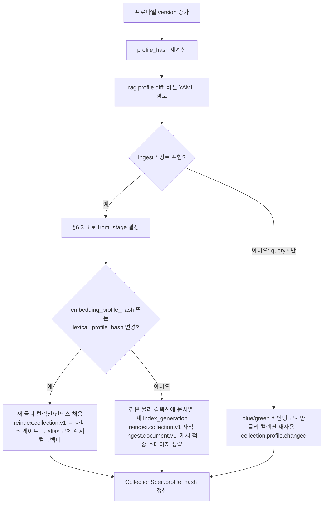

# 스키마 버전 관리와 호환성

## 목적

브리프 원칙 1 "Contracts First — 계약이 바뀌면 `schema_version`이 바뀐다"를 실행 규칙으로 옮긴다. 이 문서는 (1) 모든 계약이 공유하는 버전 식별자(`schema_version`, `$id`, 미디어 타입, `dataschema`)의 의미, (2) 어떤 변경이 patch·minor·major인지와 그에 따르는 절차(바이블 §1.2), (3) 생산자와 소비자가 버전이 다를 때 로드 시점에 내리는 판정, (4) 스키마 레지스트리(`schemas/` + `GET /v1/schemas/{name}`), (5) 저장 산출물의 마이그레이션과 재처리 트리거, (6) 폐기(deprecation) 정책, (7) 프로파일 버전·플러그인·클라이언트 SDK와의 정합, (8) CI가 강제하는 자동 호환성 테스트를 정한다. 다른 03-contracts 문서는 자기 타입의 필드를 정의하고, 버전 규칙은 이 문서를 참조한다.

## 범위

- 포함: 바이블 §5.1 인벤토리의 모든 계약(공용 타입 `common-types` 포함)과 `Profile`·`PluginMeta`·`Capabilities`, 저장 산출물(`ArtifactRef`가 가리키는 계약 JSON), API 요청·응답 계약, CloudEvents `dataschema`, 클라이언트 SDK, 플러그인 `contracts_compat`.
- 제외: 개별 계약의 필드 정의(각 03-contracts 문서), OpenAPI 전문(05-api/openapi.yaml), 데이터베이스 스키마 마이그레이션(09-operations/08), 인덱스 백엔드 매핑 버전의 물리 절차(04-pipelines/19). **이 문서는 바이블 §5.1 인벤토리의 계약 스키마를 만들지 않는다** — `## 스키마` 절의 JSON Schema(`SchemaDiffReport`)는 규칙의 기계 표현과 CI 도구 산출물 형식이며, CI 도구와 문서 빌드가 같은 파일을 읽도록 도구 스키마로서 `schemas/schema-diff-report.schema.json`에 저장하되 §5.1 인벤토리·`GET /v1/schemas/{name}`·저장 산출물(`ArtifactRef`) 대상은 아니다(등재 여부는 미해결 이슈 15).
- 정본: 바이블 §1.2(변경 절차), §5.1(인벤토리·`schema_version` 열), §5.2(봉투), §5.3(`ArtifactRef`, `Capabilities.contracts_compat`), §6.4(스키마·미디어 타입 명명), §7(프로파일 `version`·`profile_hash`), §11.4(세대 사가·blue/green), §14(`GET /v1/schemas/{name}`); 계약 공통 규약은 [00-contract-overview](00-contract-overview.md)(§3.1 봉투 표현, §8.1 null·직렬화, §8.2 확장 필드, §10 검증 지점·CI 게이트), 오류 코드·HTTP 매핑은 [13-error-model](13-error-model.md)(§3·§7.1). 여기 적힌 규칙이 바이블과 어긋나면 바이블이 옳다. 이 문서의 절 번호는 `§n`, 바이블의 절 번호는 항상 `바이블 §n`으로 쓴다.
- 표기: 앵커(브리프·바이블·ADR)가 뒷받침하는 규칙만 `**결정:**`으로 쓴다. 이 문서가 새로 도입하는 규칙(배포 순서, 관용 읽기, 업캐스팅, 폐기 기간 등)은 `**제안:**`으로 표기하고 "## 미해결 이슈"에 필요한 바이블 개정·신규 ADR을 기록한다. 제안은 채택 전까지 CI·셸의 기본 동작이 아니다.

## 1. 버전 식별자

### 1.1 한 시스템에 공존하는 버전들

| 식별자 | 위치 | 형식 | 무엇이 바뀌면 바뀌는가 | 정본 |
|--------|------|------|------------------------|------|
| `schema_version` | 모든 봉투 계약 인스턴스(바이블 §5.2), `ArtifactRef.schema_version`, 요청·응답 계약 | semver `MAJOR.MINOR.PATCH`, 계약별 독립, 초기 `"1.0.0"`; 스키마 타입은 공용 `Semver`(00 § 스키마 `$defs`) | 해당 계약의 JSON Schema 구조(§2.1 분류) | 바이블 §5.1·§6.4 |
| `$id` | `schemas/{kebab-name}.schema.json` | `urn:rag:schema:{kebab-name}:{major}` | 계약 major만 | 바이블 §6.4 |
| 미디어 타입 | `ArtifactRef.media_type`, HTTP `Content-Type` | `application/vnd.rag.{kebab-name}+json` | 바뀌지 않는다(버전은 `ArtifactRef.schema_version`이 운반) | 바이블 §6.4 |
| `dataschema` | `CloudEventEnvelope.dataschema` | `urn:rag:schema:{name}:{major}` | `data`가 따르는 계약의 major | 바이블 §5.3 |
| `Profile.schema_version` / `Profile.version` / `profile_hash` | 프로파일 YAML·`profiles` 테이블 | semver / semver / hex64 | 프로파일 **스키마** 구조 / 프로파일 **내용** / 상속 해소 결과 전체 | 바이블 §5.6·§6.2·§7 |
| `contracts_compat` | `Capabilities.contracts_compat`, `PluginMeta.contracts_compat` | `">=1.0,<2.0"` (major.minor 범위) | 플러그인(`PluginMeta.version` = `Producer.plugin_version`으로 별도 버전)이 지원하는 계약 버전 범위 | 바이블 §5.3·§5.6 |
| API 경로 버전 | `/v1` | 정수 | 요청·응답 계약의 major(§4.4) | 바이블 §14 |

### 1.2 `schema_version` 규칙

- **계약별 독립**: `ParsedDocument`가 `1.2.0`이어도 `ChunkSet`은 `1.0.0`일 수 있다. 플랫폼 릴리스 버전과도 독립이다. 한 릴리스에서 바뀐 계약만 버전을 올린다.
- **생산자가 기록**: 인스턴스의 `schema_version`은 생산자가 링크한 계약 패키지(`rag_platform.contracts`)의 해당 계약 버전을 그대로 쓴다. patch까지 기록하되, 호환 판정(§4)은 major·minor만 본다.
- **사전 릴리스·빌드 메타데이터 금지**: `schema_version`(봉투·`ArtifactRef`)은 `MAJOR.MINOR.PATCH` 세 정수만 쓴다. 공용 `Semver` 패턴(00 § 스키마 `$defs/Semver`)은 SemVer 2.0.0 전체(`1.0.0-rc1+build`)를 허용하므로 이 제한은 스키마가 아니라 **불변식 1**로 강제한다(`SchemaVersion.parse`가 `contract.violation`). `plugin_version`·`tool_version`에는 적용하지 않는다. 계약 버전 전용 원시 형식(`SchemaVersion`) 분리는 미해결 이슈 5의 00 제안이다.
- **게시 이전에는 올리지 않는다**: 바이블 §범위의 규칙대로 03-contracts·`schemas/`가 첫 릴리스 태그로 게시되기 전의 개정은 모두 `1.0.0` 안에서 흡수한다. 게시 = 릴리스 태그 + `GET /v1/schemas/{name}` 노출 시점.
- **`$id`의 major는 `schema_version`의 major와 같다**. 스키마 파일 하나가 한 major의 최신 minor·patch를 담는다. 이전 minor의 스키마는 파일로 남기지 않고 git 태그와 골든 예시(§10.1)로 보존한다.

### 1.3 `$id`, kebab 이름, 공용 타입 참조

- kebab 이름은 PascalCase 타입명의 대문자 경계를 하이픈으로 바꾼 소문자다: `IndexRecord → index-record`, `EmbeddedChunkSet → embedded-chunk-set`, `ProblemDetails → problem-details`. 공용 타입 파일은 `common-types`.
- 공용 타입·원시 형식(`Semver`, `SchemaId`, `SchemaTypeName`, `MediaType` 등 00 § 스키마 `$defs` 키 목록)과 바이블 §5.7 열거는 `{"$ref": "urn:rag:schema:common-types:1#/$defs/{TypeName}"}`로 참조하고 재정의하지 않는다(00 §1 공통 요구). 이 문서의 `SchemaDiffReport` 스키마도 `schema_version`·`base_version`·`head_version`·`tool_version`을 `Semver`로, `schema_id`를 `SchemaId`로, `type_name`을 `SchemaTypeName`으로 참조한다. 참조는 major를 고정하므로 **`common-types`의 major가 오르면 그것을 참조하는 모든 계약의 major가 함께 오른다**(§2.5 전파 규칙). 열거값 추가처럼 minor로 끝나는 변경은 참조 문자열을 바꾸지 않는다.
- 봉투 필드(`schema_version`·`schema_type` 등)는 별도 `$defs`로 두지 않고 각 계약 최상위 스키마가 직접 선언한다(00 §3.1 결정: `additionalProperties: false`와 `allOf` 병합의 충돌 회피). 따라서 이 문서는 봉투 믹스인 `$defs`를 제안하지 않는다.
- `$schema`는 `https://json-schema.org/draft/2020-12/schema`로 고정한다. 드래프트 변경은 모든 계약의 major 변경으로 취급한다.

### 1.4 현재 인벤토리 버전

바이블 §5.1 인벤토리의 모든 스키마 파일은 `1.0.0`(`$id` major `1`)이다.

| 그룹 | 스키마 파일(kebab-name) | 현재 |
|------|--------------------------|------|
| 수집 측 | `ingest-request`, `source-document`, `parsed-document`, `normalized-document`, `chunk-set`, `enriched-chunk-set`, `embedded-chunk-set`, `index-record`, `index-commit` | 1.0.0 |
| 질의 측 | `query-request`, `query-plan`, `candidate-set`, `ranked-set`, `context-pack`, `rendered-context` | 1.0.0 |
| 잡·이벤트·오류·운영 | `job-status`, `cloud-event-envelope`, `stage-error`, `problem-details`, `collection-spec`, `profile`, `plugin-meta`, `convert-request`, `convert-response`, `user-dict-entry`, `feedback-event`, `capabilities`, `stage-policy`, `tiering-policy`, `egress-policy` | 1.0.0 |
| 평가 | `eval-dataset`, `eval-run`, `eval-report` | 1.0.0 |
| 공용 | `common-types`(`$defs` 142개, 00 § 스키마: 원시 형식 23 — `Ulid`·`Hex64`·`Semver`·`SchemaId`·`SchemaTypeName`·`MediaType` 등; 바이블 §5.7 열거 79 + 카탈로그 열거 `EventType`·`ErrorCodeCatalog` + 인라인 열거 4; 바이블 §5.3 공용 타입 24(`StageError.location` 하위 타입 `ErrorLocation` 포함, 00 U-12); `LineageRefs`; 문서·청크·결과 타입 9 — `TableCell`·`TableData`·`Block`·`NormalizedBlock`·`Chunk`·`Enrichment`·`VectorBundle`·`RankedResult`·`ContextItem`(바이블 §5.1 마지막 행)) | 1.0.0 |

## 2. 호환성 규칙

### 2.1 변경 분류

바이블 §1.2·§6.4의 원칙("추가는 minor(가산만), 제거·의미 변경·필수화는 major")을 JSON Schema 키워드 수준으로 내린 표다. 가산의 기계적 기준은 **"같은 major 안에서 유효 인스턴스 집합은 늘어날 수만 있다"**(§10.1 G1이 검증)이며, 이 기준 하나가 요청·산출물·응답 계약에 동일하게 적용된다. §10.2의 diff 분류기가 이 표를 기계적으로 적용한다.

| 분류 | 변경 | 근거 | 소비자에게 요구되는 것 |
|------|------|------|------------------------|
| **patch** | `title`·`description`·`examples`·`$comment` 변경, 골든 예시 추가, 문서 오탈자 | 바이블 §1.2 1행 | 없음 |
| **minor** | 선택 속성 추가(`required` 미포함), 열거값 추가, `default` 변경(프로파일은 §8 주의) | 바이블 §1.2 2행 그대로 | 소비자 계약 패키지를 생산자보다 먼저 minor 이상으로 올린다(§4.2 행 7: 상위 minor 산출물은 거부). 코드 변경은 새 값·필드를 쓰려는 경우에만 |
| **minor**(이 문서의 정밀화 — 유효 인스턴스 집합이 늘어나는 변경) | `additionalProperties: false → true`(또는 값 스키마), `deprecated: true` 부착, 기존 필수 속성의 선택화(`required`에서 제거), 제약 완화(`maxLength`·`maximum`·`maxItems` 증가, `minLength`·`minimum`·`minItems` 감소, `pattern` 완화, `format` 제거) | 바이블 §1.2에 미열거. 이전 minor의 모든 인스턴스가 새 스키마에 유효하므로(G1) 저장 산출물·기존 요청을 깨지 않는다. 바이블 §1.2 minor 행에 명시 추가를 제안(미해결 이슈 3) | 위와 같음 |
| **major** | 속성 제거·개명(= 제거 + 추가), 타입 변경, nullable 추가·제거(`type: string ↔ ["string", "null"]`), 기존 선택 속성의 필수화, 필수 속성 추가, 열거값 제거·개명, `const` 값 변경, `$ref` 대상 변경, `additionalProperties: true → false`, **제약 강화**(`maxLength` 감소, `pattern` 강화, `format` 추가, 열거 부분집합화), `$defs` 열거 타입명 변경, 오프셋·해시·ID 결합식 등 **의미 변경**(값의 형식은 같아도 해석이 달라지는 것), `$id`·`$schema` 변경 | 바이블 §1.2 3행 + 유효 인스턴스 집합이 줄어드는 변경(저장된 이전 minor 산출물 또는 기존 유효 요청이 새 스키마에서 무효가 된다) | ADR + 영향 문서 개정 + 업캐스터(§6.2 제안) |

- **제약 강화가 모든 계약에서 major인 이유**: 요청 계약(`IngestRequest`, `QueryRequest`, `FeedbackEvent`, `CollectionSpec` 생성 본문, `UserDictEntry`, `EvalDataset`·`EvalRun` 생성 본문)에서는 기존 유효 요청을 깨고, 산출물 계약에서는 신 소비자가 **저장된** 이전 minor 산출물(§13)을 읽지 못하게 되며, 두 경우 모두 §10.1 G1이 실패한다. "소비자는 더 좁은 값을 받을 뿐"이라는 이유로 산출물 계약의 강화를 minor로 두는 해석은 저장 산출물을 무시하므로 채택하지 않는다.
- **크기 한계도 스키마의 일부**다. 바이블 §5.1 인라인 한계(`QueryRequest.query` 4,000자, `IndexRecord.text` 8,192바이트 등)는 `maxLength`·`maxItems`로 표현되므로 완화는 minor, 강화는 major다(00 §8.4가 정본인 값을 바꾸는 것이므로 바이블 §5.1 표 개정을 동반한다).
- 열거값 추가가 minor로 안전한 것은 unknown 열거값을 만난 소비자가 §2.2의 부류 규칙대로 행동할 때만이다. 배포 순서(§2.4)는 제안이며, 채택 전에는 §4.2 행 7의 거부가 유일한 안전장치다.

### 2.2 unknown 열거값 정책

열거값 추가가 minor인 것은 "알 수 없는 값을 만난 소비자가 안전하게 행동한다"는 전제 위에서만 성립한다. 소비자를 세 부류로 나눈다.

| 부류 | 소비자 | unknown 열거값 | 근거 |
|------|--------|----------------|------|
| A. 플랫폼 내부 | 스테이지·셸이 읽는 수집 측 산출물(`SourceDocument`~`IndexCommit`), 질의 측 내부 계약(`QueryPlan`, `CandidateSet`, `RankedSet`), 운영 계약(`Profile`, `CollectionSpec`, `PluginMeta`, `Capabilities`, `StagePolicy`, `TieringPolicy`, `EgressPolicy`), 사이드카 왕복(`ConvertRequest`/`ConvertResponse`) | **거부** → `contract.violation`(수집 측은 잡 실패·비재시도, 질의 측은 500; [13-error-model](13-error-model.md) §7.1, 00 §10.2) | 내부 열거는 분기·필터·보안 판정의 입력(`ItemKind`, `Visibility`, `CommitStatus`, `PiiPolicy`)이라 침묵 허용은 오류 은폐다. 새 열거값을 담은 산출물은 상위 minor이므로 구 소비자에서는 §4.2 행 7로 이미 거부되며, §2.4 제안이 채택되면 배포 순서로도 발생을 막는다 |
| A′. `hydrate`가 읽는 `IndexRecord` payload | `fuse` 내부 `hydrate` 서브스텝 | 해당 **레코드만 제외** + `degraded{component: hydrate, reason: partial_result}` + `explain += hydrate_missing` | 질의 전체를 실패시키지 않는다(세대 플립 경합의 누락 레코드와 같은 취급, 바이블 §4.3) |
| B. 요청 계약의 서버 측 | `IngestRequest`, `QueryRequest`, `FeedbackEvent`, `CollectionSpec` 생성·갱신, `UserDictEntry`, `EvalDataset`·`EvalRun` 생성, MCP 도구 입력 | **거부** → 400 `contract.violation`(`ProblemDetails.errors[].location.pointer`에 경로; 상태 코드는 [13-error-model](13-error-model.md) §7.1 — 요청 측 `contract.violation`은 400, 422는 의미 검증 코드 전용) | 클라이언트는 서버보다 새 열거값을 알 수 없다(§9) |
| C. 외부 소비자 | 클라이언트 SDK·웹훅·SSE·MCP 호스트·리포트 리더가 읽는 `ContextPack`, `RenderedContext`, `JobStatus`, `CloudEventEnvelope`, `ProblemDetails`, `EvalReport`, 조회 응답의 `IndexCommit`·`CollectionSpec` | **허용** — 불투명 문자열로 보존·전달하고 분기에서는 기본 분기 | 서버가 클라이언트보다 먼저 배포된다 |

부류 C의 fail-closed 규칙: `Classification` unknown은 나열 순 = 등급 순(바이블 §5.7)이므로 `secret`보다 높은 등급으로, `Visibility` unknown은 `restricted`로 취급한다. `JobState` unknown은 "종결 아님"으로 보고 폴링을 계속한다. `CloudEventEnvelope.type` unknown은 무시하고 ack한다. `ConfidenceTier` unknown은 `low`로 렌더한다.

### 2.3 unknown 필드 정책(`additionalProperties`)

기본은 모든 객체 `additionalProperties: false`이며 모든 객체 스키마가 이를 명시한다(00 §8.2 결정, 00 §10.3 스키마 문법 게이트). 계약에 없는 키는 `contract.violation`이다. **정본은 00 §8.2와 각 계약 스키마다.** 아래 표는 00 §8.2 목록과, 바이블 §5 표가 맵(`object<K, V>`) 또는 필드 미열거 object로 정의한 필드를 스키마 파일별로 재배열한 것이며 근거 열이 출처를 밝힌다. 열린 객체에 새 키를 넣는 것은 스키마 변경이 아니므로 버전을 올리지 않는다. 00 §8.2에 없는 열린 객체가 더 필요하면 이 표가 아니라 미해결 이슈 6(00 §8.2 보완 제안)에 적는다.

| 스키마 파일 | 최상위 | 열린 객체(`true` 또는 값 스키마) | 근거 |
|-------------|--------|-----------------------------------|------|
| `ingest-request` | false | `metadata.custom`(값 `string \| number \| boolean`; 필터 가능 여부는 컬렉션 `filterable_fields`), `profile_overrides`(컬렉션 프로파일의 허용 키만, 그 외 422) | 00 §8.2; 바이블 §5.4 `IngestRequest` |
| `source-document` | false | `metadata.custom`(`IngestRequest.metadata` 복사이므로 같은 값 제약) | 바이블 §5.4 `SourceDocument.metadata`(복사); 02 문서에서 확인 |
| `parsed-document` | false | — | — |
| `normalized-document` | false | `pii_report.entity_counts`(값 integer) | 00 §8.2; 바이블 §5.4 `NormalizedDocument` |
| `chunk-set` | false | `TokenCounts`(키 `tokenizer_id` 패턴, 값 integer) | 00 §8.2; `common-types` `$defs/TokenCounts` |
| `enriched-chunk-set` | false | `enrichments`(`object<chunk_id, Enrichment>` 맵), `Enrichment.pii_entity_counts`(값 integer) | 바이블 §5.4 맵 정의 / 00 §8.2 |
| `embedded-chunk-set` | false | `vectors`(`object<chunk_id, VectorBundle>` 맵); `VectorBundle.page_multivector`·`pooled_page_multivector`·`page_dense`(`visual-pages` 슬롯, 07 문서에서 구체화) | 바이블 §5.4 맵 정의 / 00 §8.2; `common-types` `$defs/VectorBundle` |
| `index-record` | false | `custom`(컬렉션 `filterable_fields` 선언 키만; 값 `string \| number \| boolean` — 배열값 없음) | 00 §8.2 |
| `index-commit` | false | `compensation.deleted_counts`(`{backend_id: n}`, 값 integer) | 바이블 §5.4 `IndexCommit.compensation` 맵 정의(00 §8.2 미열거 → 미해결 이슈 6) |
| `query-request`, `query-plan`, `candidate-set` | false | —(`FilterNode.value`는 `op`별로 스칼라·스칼라 배열·boolean으로 제한된 값이며 열린 객체가 아니다; `fusion.weights`는 키가 `Channel` 열거로 닫힌다) | 00 §4.15(U-9); 바이블 §5.5 |
| `ranked-set` | false | `RankedResult.table_ref`(object; `Chunk.table_ref` 복사, 10 문서에서 구체화) | 00 §8.2; `common-types` `$defs/RankedResult` |
| `context-pack` | false | `explain`(`object<cite_id, ScoreBreakdown> \| null` 맵) | 바이블 §5.5 `ContextPack.explain` 맵 정의(00 §8.2 미열거 → 미해결 이슈 6) |
| `rendered-context` | false | `provider_payload`·`stable_prefix`·`volatile_suffix`(`object \| string`; 공급자 네이티브라 필드를 열거하지 않는다) | 바이블 §5.5 `RenderedContext` 타입 정의(00 §8.2 미열거 → 11 문서에서 확정, 미해결 이슈 6) |
| `cloud-event-envelope` | **false** | `data`만(`additionalProperties: true`; 이벤트별 필드는 [12-jobs-events-and-status](12-jobs-events-and-status.md)). 확장 속성은 `tenantid` 하나가 명시 필드이고 그 외 확장 속성은 닫힘(`traceparent`·`tracestate`는 00 U-6 제안) | 00 §8.2; `common-types` `$defs/CloudEventEnvelope`(`additionalProperties: false`); 바이블 §5.3 |
| `stage-error`, `problem-details` | false | —(RFC 9457 확장 멤버는 `code`·`retryable`·`trace_id`·`errors[]`·`retry_after`·`request_id`로 열거되어 있다) | `common-types` `$defs/StageError`·`$defs/ProblemDetails`(`additionalProperties: false`; 00 소유). 13의 `schemas/stage-error.schema.json`·`schemas/problem-details.schema.json`은 그 `$defs`를 가리키는 `$ref` 래퍼라 닫힘 선언은 `common-types`에 있다 |
| `profile` | false | 스테이지 값 객체(`ingest.*`, `query.channels[]`, `query.rerank` 등)의 플러그인 `config_schema` 필드 — 로딩 시 각 플러그인의 `config_schema`(바이블 §4.1 `Stage` 프로토콜)로 2차 검증; `runtime.queues`(`object<string, string>`) | 바이블 §5.6 `Profile.ingest`("…플러그인 config_schema 필드")·`runtime` 정의(00 §8.2 미열거 → 15 문서에서 확정, 미해결 이슈 6) |
| `plugin-meta`, `capabilities` | false | `Capabilities.extra`(확장 지점별 스키마; `index_backend`는 `IndexBackendCapabilities`, false) | 00 §8.2; `common-types` `$defs/Capabilities` |
| `convert-request`, `convert-response` | false | `ConvertRequest.options`(object, 사이드카 전용) | 바이블 §5.6 `ConvertRequest` 타입 정의(00 §8.2 미열거 → 16 문서에서 확정, 미해결 이슈 6) |
| `eval-dataset`, `eval-run`, `eval-report` | false | `EvalReport.metrics`, `comparison.deltas`, `comparison.p_values`(`object<string, number>`) | 바이블 §5.6 `EvalReport` 맵 정의(00 §8.2 미열거 → 16 문서에서 확정, 미해결 이슈 6) |
| `job-status`, `collection-spec`, `user-dict-entry`, `feedback-event`, `stage-policy`, `tiering-policy`, `egress-policy` | false | — | — |
| `common-types` | 각 `$defs` false | 열림: `TokenCounts`(값 integer), `Enrichment.pii_entity_counts`(값 integer), `CloudEventEnvelope.data`(true), `Capabilities.extra`(true), `VectorBundle` visual-pages 슬롯(true), `RankedResult.table_ref`(true). 닫힘: `Entity.span`(`{chunk_id, char_start, char_end}`) 등 나머지 전부 | `common-types.schema.json` |

Pydantic 모델은 `ConfigDict(extra='forbid')`다(00 § Pydantic `ContractModel`). 스키마가 `true`인 곳만 `dict[str, Any]` 필드로, 값 스키마 맵은 `dict[str, T]`로 받는다.

### 2.4 배포 순서(소비자 선배포) — 제안

**제안(미해결 이슈 2):** 열거값 추가와 선택 필드 추가를 무중단으로 배포하려면 "스키마·소비자를 먼저 배포하고, 생산은 다음 릴리스부터"라는 **두 릴리스 규칙**이 필요하다. 릴리스 N은 `schemas/`·Pydantic·모든 소비자 분기에 새 값을 추가하고 생산자는 아직 내보내지 않는다. 릴리스 N+1부터 생산한다. 이 규칙은 바이블 §1.2와 어느 ADR에도 없으므로 결정이 아니다. 채택하려면 바이블 §1.2 minor 행에 배포 순서를 덧붙이는 개정과 신규 ADR("계약 변경 배포 순서")이 필요하며, 바이블 §3.3 목록에는 그 슬롯이 없다.

채택 전의 동작: §4.2 행 7(상위 minor 산출물 거부)이 유일한 기술적 안전장치다. 롤링 배포 편차(구 워커가 신 산출물을 읽는 경우)는 `contract.violation`(비재시도)으로 드러나고, 배포를 바로잡은 뒤 `POST /v1/jobs/{job_id}/retry`(바이블 §14)로 복구한다. 계약 패키지를 이전 minor로 **롤백**할 때는 그 사이 생산된 산출물이 같은 이유로 거부되므로 원장 `artifacts.schema_type` + `artifact_ref.schema_version`으로 사전 점검한다(§6.1).

### 2.5 `common-types` 전파 규칙

- `common-types` minor(열거값 추가, 공용 타입 선택 필드 추가)는 참조하는 계약의 버전을 바꾸지 않는다. 다만 참조하는 계약의 소비자는 `common-types`의 그 minor 이상을 링크해야 새 값을 읽을 수 있으므로(§4.2 행 7의 판정은 `common-types` 버전에도 적용), 새 값이 인스턴스에 나타나는 시점은 §2.4 제안의 배포 순서를 따르는 것이 안전하다.
- `common-types` major는 참조 문자열(`…:1#/$defs/…`)을 `:2`로 바꾸므로 참조하는 **모든** 계약이 major를 올린다. 따라서 공용 타입의 파괴적 변경은 ADR에 영향 계약 전체 목록과 업캐스터 계획(§6.2 제안)을 첨부한다. 좌표 의미(`BlockRef`·`Provenance`의 코드포인트 오프셋, 바이블 §6.3), 해시 결합식(바이블 §6.2), ID 형식(바이블 §6.1)은 값 형식이 같아도 해석이 바뀌면 major다.

## 3. 변경 절차

### 3.1 절차 표(바이블 §1.2 그대로 + 산출물 열)

앞 네 열은 바이블 §1.2 표를 그대로 옮긴 것이고(**결정**), 마지막 열 "이 문서가 요구하는 산출물"은 이 문서의 **제안**이다(CI 도구·업캐스터·배포 순서는 채택 전).

| 변경 종류 | 절차 | 바이블 버전 | 계약 `schema_version` | 이 문서가 요구하는 산출물(제안) |
|-----------|------|-------------|------------------------|---------------------------|
| 오탈자·설명 보강·예시 추가 | 소유자(architecture) 직접 수정 | patch | 불변 | 골든 예시 추가 시 §10.1 회귀 통과; `SchemaDiffReport.computed_level = patch` |
| 필드 추가(선택), 열거값 추가, 기본 파라미터 값 변경 | ADR 발의 → 게이트 근거(바이블 §7.4) 첨부 → 바이블 표 갱신 | minor | minor(가산만) | `SchemaDiffReport.declared_level ≥ computed_level`, 배포 순서 계획(§2.4), 열거 대조(§10.3) 통과, 영향 문서 `## 버전 이력` 갱신 |
| 필드 제거·의미 변경·필수화, 열거값 제거·개명, 타입명·스테이지 경계 변경, 명명 규약 변경 | ADR 발의 → 영향 문서 목록 첨부 → 바이블 major → 영향 문서 일괄 개정 | major | major | 업캐스터 `N.x → N+1.0`(§6.2) + 이전 major 골든 예시 업캐스팅 테스트, 재처리 계획(§6.3), 폐기 일정(§7), `common-types`면 §2.5 영향 목록 |
| 브리프 확정 결정(D-xx) 개정 | ADR 발의 → 바이블 §3 `amended` → 브리프 §4 행 갱신(v1.x) | minor | 해당 계약 규칙 | 개정이 건드리는 계약마다 위 세 행 중 하나를 적용; ADR에 "계약 영향" 절(§3.3) |

### 3.2 절차 흐름

변경 제안(`schemas/` + Pydantic + 03-contracts 문서) → `rag schema diff`(제안)가 `computed_level`을 계산 → 등급별 절차(§3.1 행) → CI(00 §10.3 게이트 + §10의 추가 게이트; `declared_level < computed_level`이면 빌드 실패) → 바이블 표 갱신 → 릴리스 태그 → `GET /v1/schemas/{name}` 게시 → 소비자 배포 → 생산자 배포(§2.4 제안 채택 시 다음 릴리스부터 생산).

### 3.3 ADR "계약 영향" 절의 필수 항목

**제안:** 변경 종류가 minor 이상인 ADR은 다음을 적는다: (1) 바뀌는 스키마 파일과 `declared_level`, (2) `SchemaDiffReport` 요약, (3) 생산 스테이지와 소비 스테이지(바이블 §4.2·§4.3 표 기준), (4) 저장 산출물 영향(§6.3 표의 행), (5) 외부 소비자 영향(SDK·웹훅·MCP), (6) 프로파일 `profile_hash` 영향(§8), (7) 폐기 일정(§7). ADR 번호·slug는 바이블 §3.3 표를 따른다. MADR 템플릿에 이 절을 추가하는 것은 06-adr/README의 결정 사항이다.

## 4. 생산자·소비자 호환 매트릭스

### 4.1 판정 입력

셸(액티비티 래퍼·API 핸들러·SDK 로더)은 계약 인스턴스를 로드하기 전에 다음 네 값을 대조한다.

| 입력 | 출처 |
|------|------|
| 산출물 타입 `ArtifactRef.schema_type` | 생산 셸이 기록(바이블 §5.3 "계약 산출물이면 조건 필수"); 봉투 `schema_type`과 일치해야 한다(바이블 §5.2) |
| 산출물 버전 `ArtifactRef.schema_version` | 생산자의 계약 패키지 버전 |
| 소비자 모델 타입·버전 | `rag_platform.contracts`의 해당 클래스와 그 계약 버전(`versioning.py`가 보유) |
| 소비자 범위 `Capabilities.contracts_compat` | 플러그인 선언(`PluginMeta.contracts_compat`와 동일 문자열); 플랫폼 내장 스테이지는 `">={major}.0,<{major+1}.0"` |

`ArtifactRef`에 `schema_type`·`schema_version`이 없는 참조(원본 바이트 `sources/`, 파생물 `derived/`)는 계약 로드 대상이 아니며 판정을 거치지 않는다.

### 4.2 매트릭스

00 §10.1 "셸 입력 로드" 행(`ArtifactRef.schema_type/schema_version`이 스테이지 `In` 타입과 호환(`contracts_compat`)인지 대조하고 실패는 `contract.violation` 비재시도)을 조건별로 펼친 표다. 행 1·2·4·6·7·8은 00 §10.1·§8.2의 규칙을 그대로 조건화한 것이고(**결정**의 정밀화), 행 3(`upcast`)은 이 문서의 **제안**(§6.2, 미해결 이슈 4)이며 채택 전에는 행 4와 같이 `reject`다. 모든 `contract.violation`의 `StageError.detail`은 위반 경로·규칙만 담는다(00 §10.2).

| # | 조건(산출물 P, 소비자 C) | 판정 | 동작 |
|---|--------------------------|------|------|
| 1 | `P.schema_type ≠ C.type` | `reject` | `contract.violation`(`detail: "schema_type mismatch"`); 셸 버그 또는 `lineage_refs` 키 오배치(00 I-7) |
| 2 | `P.major > C.major` | `reject` | `contract.violation`(`detail: "schema_version major ahead of consumer"`); 소비자가 구버전(배포 순서 위반). 비재시도, 배포 수정 후 `POST /v1/jobs/{job_id}/retry` |
| 3 | `P.major < C.major`, 업캐스터 체인 존재 | `upcast`(제안) | 셸이 §6.2 체인을 메모리에서 적용해 `C.major.0.0` 형태로 만든 뒤 로드; `lineage_refs`는 원 산출물을 가리킨다. 채택 전에는 행 4 |
| 4 | `P.major < C.major`, 체인 없음 | `reject` | `contract.violation`(`detail: "schema_version major behind consumer; reprocess required"`) + 재처리 제안(`from_stage` = P의 생산 스테이지, 바이블 §5.1 생산 열) |
| 5 | `P.major = C.major`, `P` ∉ `contracts_compat` | `reject` | `contract.violation`(`detail: "schema_version outside contracts_compat"`; [13-error-model](13-error-model.md) §3.3의 `contract.version_unsupported` 채택 후 그 코드). `plugin.capability_unsupported`(422, 로더 전용)는 §4.3의 프로파일 로딩 사전 차단에만 쓴다 |
| 6 | `P.major = C.major`, `P.minor ≤ C.minor` | `load` | 그대로 로드. minor는 가산만이므로(§2.1) 소비자 스키마가 P의 모든 인스턴스를 받아들인다 |
| 7 | `P.major = C.major`, `P.minor > C.minor` | `reject` | `contract.violation`(`detail: "schema_version minor ahead of consumer"`). 소비자 스키마에 없는 키·열거값이 있을 수 있고 00 §8.2는 계약에 없는 키를 위반으로 정한다. 복구는 행 2와 같다. 관용 읽기(`load_tolerant`)로 바꾸는 것은 제안이다(아래) |
| 8 | `P.schema_version` 형식 위반(공용 `Semver` 불일치 또는 §1.2 사전 릴리스 금지 위반) | `reject` | `contract.violation`(`detail: "schema_version format"`) |

**제안(미해결 이슈 4) — 관용 읽기(`load_tolerant`)**: 행 7을 "소비자 스키마에 없는 선택 속성만 제거(`prune_unknown`, JSON 수준) 후 `extra='forbid'` 모델로 로드; unknown 열거값은 §2.2 부류 규칙(내부는 거부)"으로 바꾸면 롤링 배포 편차를 흡수할 수 있다. 관용 읽기는 정보를 잃고(제거된 선택 속성은 그 스테이지의 출력에 전파되지 않는다), 00 §8.2("계약에 없는 키는 `contract.violation`")·§10.1(스키마 검증 실패 = 비재시도 위반)과 어긋나므로 00 두 절의 개정과 신규 ADR 없이는 채택할 수 없다. 채택 시 발생 사실은 구조화 로그(`event=contract.skew`, `stage`, `dropped_paths`)로 남기고 경고 코드·메트릭 신설(미해결 이슈 8)을 함께 결정한다. `## Pydantic 모델`의 `judge_compat(tolerant_minor=False)`와 `prune_unknown`은 이 제안의 구현 골격이며 기본값은 행 7의 거부다.

### 4.3 `contracts_compat` 문법과 평가 범위

- 문법: 쉼표로 이은 비교절, 각 절은 `(>=|<=|==|<|>)MAJOR.MINOR`. 예 `">=1.0,<2.0"`, `">=1.2,<2.0"`. patch는 비교에 참여하지 않는다. 정규식은 `## 스키마`의 `ContractsCompat`.
- 평가 범위: 범위는 플러그인 확장 지점의 **경계 계약 전부**에 적용된다 — 바이블 §4.2·§4.3 표의 입력·출력 계약에 더해 `index_backend`는 `requires_lineage` 상류 산출물(`EnrichedChunkSet`, `ChunkSet`, `SourceDocument`)과 `IndexRecord`·`IndexCommit`, `parser`는 사이드카 `ConvertRequest`/`ConvertResponse`, `packer`의 `renderer` 역할은 `RenderedContext`, 모든 플러그인은 `Capabilities`·`StagePolicy`·`common-types`를 포함한다. 프로파일 로딩 시 플랫폼의 현재 계약 버전이 하나라도 범위를 벗어나면 `plugin.capability_unsupported`(422, 로더; 바이블 §7.4 (2), 13-error-model §7.1)로 프로파일 로딩을 거부한다. 이것이 사전 차단이고, 로드 시점의 §4.2 행 5는 사전 차단을 통과한 뒤에도 남는 산출물 편차(캐시 적중한 옛 산출물 등)에 대한 안전망이다.
- 상한과 minor: `contracts_compat`의 상한(`<2.0`)은 major 경계를 뜻한다. 플러그인이 `<2.0`을 선언해도 실제로 읽을 수 있는 상한 minor는 링크한 계약 패키지의 minor이며(§4.2 행 7), 범위 문법이 이를 표현하지 않는 것은 미해결 이슈 7과 같은 뿌리다.

특정 입력 계약의 더 높은 minor를 요구하는 플러그인(예: `ParsedDocument ≥ 1.2`의 선택 필드 의존)은 현재 문법으로 표현할 수 없다(미해결 이슈 7).

한 수집 잡의 산출물은 스테이지별 계약 버전이 다를 수 있다(캐시 적중한 `ParsedDocument 1.0.0` + 새로 생산한 `ChunkSet 1.1.0`). `IndexCommit.artifact_refs`의 각 `ArtifactRef.schema_version`이 그 사실을 기록하며, `index` 스테이지는 `requires_lineage`로 로드하는 상류 산출물 각각에 위 매트릭스를 독립 적용한다. 계약 버전은 `commit_hash` 입력이 아니므로 같은 내용을 다른 minor로 직렬화해도 `commit_hash`는 같다(브리프 §7 재현성).

### 4.4 API 요청·응답 계약과 경로 버전

**결정:** REST 경로는 `/v1/{plural-kebab}`이며(바이블 §6.7·§14, [ADR-0018](../06-adr/0018-api-rest-sse-mcp-no-grpc-rfc9457.md)), `/v1`이 노출하는 요청·응답 계약(`IngestRequest`, `QueryRequest`, `ContextPack`, `RenderedContext`, `JobStatus`, `ProblemDetails`, `FeedbackEvent`, `CollectionSpec`, `EvalDataset`·`EvalRun`·`EvalReport`, `UserDictEntry`)은 모두 `schema_version` major 1이다(바이블 §5.1). 응답에는 항상 봉투 `schema_version`이 들어 있으므로 클라이언트는 minor를 응답 본문에서 읽는다. 내부 계약(`ParsedDocument` 등)의 major는 API 경로와 무관하다.

**제안(미해결 이슈 9):** 요청·응답 계약의 major를 API 경로 major에 잠근다 — 이 계약 중 하나라도 major 2가 되면 `/v2`를 열고 `/v1`은 §7의 폐기 일정에 들어가며, `/v1`은 어떤 major 2 계약도 노출하지 않는다. 바이블 §6.7은 `/v1` 경로 규약만 정하고 경로 major의 증가 조건은 정하지 않으므로 05-api/01에서 확정하고 ADR-0018 개정으로 기록한다.

## 5. 스키마 레지스트리

### 5.1 `schemas/` 디렉터리

| 항목 | 규약 |
|------|------|
| 위치·이름 | 저장소 루트 `schemas/{kebab-name}.schema.json`(바이블 §12); 계약 문서 하나가 파일 하나를 소유(브리프 §8) |
| 도구 스키마 | `schema-diff-report.schema.json`(이 문서 `## 스키마`)은 바이블 §5.1 인벤토리 밖의 CI 도구 산출물 형식이다. 같은 디렉터리·같은 파일 규약(`$schema`·`$id`·`title`·`description`·`additionalProperties` 명시)을 따르되 `GET /v1/schemas/{name}` 노출·저장 산출물(`ArtifactRef`) 대상이 아니다(미해결 이슈 15) |
| 필수 키 | `$schema`(2020-12), `$id`(`urn:rag:schema:{kebab}:{major}`), `title`(PascalCase 타입명), `description` |
| 열거·원시 형식 | `common-types.schema.json`의 `$defs/{EnumTypeName}`·원시 형식(`Semver`, `SchemaId`, `SchemaTypeName` 등)만; 계약 스키마는 `$ref`(00 §2 소유 규칙). 중첩 객체의 인라인 열거는 `{Type}.{path}` 이름으로 `$defs` 등재(바이블 §5.7) |
| 정본 관계 | 손으로 쓴 `schemas/*.schema.json`이 정본. Pydantic 모델은 `model_json_schema()`에서 유도한 필수 집합·열거·nullable이 게시 스키마와 일치해야 한다(00 §10.3 "Pydantic 동치"; 바이블 §12 "CI export diff"). `rag schema export`(제안)는 이를 URN `$ref` 매핑까지 확장한 **의미 비교**(구조 키워드 엄격, `description`·`examples` 차이는 경고)다. `const` 필드(`schema_type`)는 Pydantic에서도 기본값 없는 `Literal`로 선언해 `required` 집합이 일치하게 한다 |
| 버전 표기·골든 예시 | 파일에는 major만(`$id`); minor·patch는 `rag_platform.contracts.versioning`의 버전 표와 git 태그 `schemas/{kebab}@{semver}`(제안)로 추적. 골든 예시의 **정본은 각 03-contracts 문서의 `## 예시`**이며 문서 빌드가 추출해 검증한다(00 §10.3). 이전 minor의 예시는 문서에서 사라지므로 `tests/contracts/golden/{kebab}/{schema_version}/*.json`(제안; 10-development/04에서 확정)에 파일로 보존해 §10.1 G1·G2의 입력으로 쓴다 |

### 5.2 `GET /v1/schemas/{name}`

바이블 §14 "JSON Schema 게시"의 정밀화다.

| 항목 | 규약 |
|------|------|
| `{name}` | kebab-name(`parsed-document`, `common-types`). PascalCase는 404 |
| 200 본문 | 배포된 빌드의 `schemas/{name}.schema.json` 바이트 그대로(현재 major의 최신 minor·patch) |
| 헤더 | `Content-Type: application/schema+json`; `ETag`(본문 BLAKE3 소문자 hex 앞 16자, 강한 검증자; `If-None-Match` → 304); `Cache-Control: public, max-age=3600`(초안 목표; §12 표, 05-api/01에서 확정); `Last-Modified`; 폐기된 major면 `Deprecation`·`Sunset`·`Link: <…>; rel="deprecation"`(§7.2) |
| 404·인증 | `ProblemDetails`. 404 코드 `api.not_found`는 카탈로그(바이블 §5.7)에 없어 [13-error-model](13-error-model.md) §3.3과 00 U-3이 **공동 제안** 중이며, 채택 전 대안은 13 §3.3대로 `contract.violation`(400)이다(미해결 이슈 10). 테넌트 데이터가 없으므로 인증 없이 공개 게시를 **제안**(05-api/01에서 확정) |
| 제안 | 폐기 창 동안 이전 major를 `?major={n}`으로 게시(창 종료 후 404); 목록 `GET /v1/schemas` → `[{name, schema_id, schema_version, media_type, deprecated, sunset}]`(미해결 이슈 10) |

### 5.3 URN 해석

`$ref`의 URN은 URL이 아니다. 리졸버는 (1) 프로세스 내 번들(`rag_platform.contracts`가 패키지 데이터로 포함하는 `schemas/`), (2) 파일 시스템 `schemas/{kebab}.schema.json`, (3) `GET /v1/schemas/{kebab}` 순으로 `urn:rag:schema:{kebab}:{major}`를 찾는다. major가 리졸버가 가진 것과 다르면 실패다(§4.2 `reject`). 클라이언트 SDK는 (3)만 쓴다.

### 5.4 CloudEvents `dataschema`

`CloudEventEnvelope.dataschema`(선택, `SchemaId` 형식 `urn:rag:schema:{name}:{major}`; 바이블 §5.3)는 CloudEvents 1.0 정의대로 **`data`가 준수하는 스키마**를 가리킨다. 따라서 `dataschema`가 있으면 `data`는 그 스키마에 **유효한 완전한 인스턴스**여야 하며, 이 문서의 불변식 1·2와 §4.2 판정이 `data`에 그대로 적용된다. 규칙은 셋이다.

- `data`가 인벤토리 계약의 완전한 인스턴스일 때만 그 계약의 `$id`를 `dataschema`로 쓴다. `IndexCommit`(16KB 원장 행, 본문 없음)처럼 콘텍스트 본문 금지 규칙(바이블 §5.3)을 만족하는 작은 계약만 해당된다.
- ID·해시·상태 **부분집합**만 보내는 이벤트는 `dataschema`를 생략하고, `data`에 `schema_type`·`schema_version`을 넣지 않는다. 소비자는 `data`의 ID(`commit_id`, `job_id` 등)로 API(`GET /v1/documents/{document_id}/commits`, `GET /v1/jobs/{job_id}`; 바이블 §14)에서 전체 인스턴스를 조회한다. 이벤트별 `data` 필드 집합은 [12-jobs-events-and-status](12-jobs-events-and-status.md)가 정의한다(예시 4).
- 부분집합에도 스키마를 붙이려면 12 문서가 이벤트 데이터 스키마(예 `index-commit-published-event`)를 정의하고 바이블 §5.1 인벤토리에 추가해야 한다 — 이 문서는 인벤토리를 늘리지 않으므로 제안으로만 둔다(미해결 이슈 17). `dataschema`의 major 판정은 §4.2와 같고, `data`의 minor는 `dataschema`가 있을 때만 `data.schema_version`으로 읽는다.

## 6. 저장 산출물 마이그레이션

### 6.1 원칙

**결정:** 산출물 키는 `stage_key`(콘텐츠 주소 + 잡 스코프)이고 `ArtifactRef.blake3`·`size_bytes`는 저장된 논리 바이트의 값이며 셸은 로드 시 이를 대조한다(바이블 §4.1·§13.3, 00 §9.1·§9.2·§10.1, [ADR-0037](../06-adr/0037-artifact-cache-scope-and-stage-key-composition.md)). 따라서 저장 산출물의 바이트를 제자리에서 바꾸면 원장·`lineage_refs`·`IndexCommit.artifact_refs`가 든 `blake3`와 어긋나 로드가 `contract.violation`으로 실패한다 — **저장 산출물은 재작성할 수 없다**(브리프 원칙 4).

**제안(미해결 이슈 4):** 스키마 major 변경 뒤 이전 major 산출물을 다루는 방식은 아래 둘만 둔다. 재생산은 바이블 §14 `reprocess`·§11.4 세대 사가를 그대로 쓰는 것이므로 새 결정이 아니고, lazy 업캐스팅(§6.2)은 신규 ADR이 필요하다.

| 방식 | 언제 | 어떻게 |
|------|------|--------|
| lazy 업캐스팅(제안) | 이전 major 산출물을 신 소비자가 읽을 때 | 셸이 메모리에서 업캐스터 체인(§6.2) 적용, 저장하지 않음. `lineage_refs`·`IndexCommit.artifact_refs`는 원 산출물을 계속 가리킨다. 채택 전에는 §4.2 행 4(`reject` + 재처리 제안) |
| 재생산 | 업캐스터가 없거나(채택 전에는 항상), 이전 major 지원 창(§7.1)이 끝났거나, 의미 변경으로 값 자체를 다시 계산해야 할 때 | `POST /v1/documents/{document_id}/reprocess {from_stage}` → 새 `stage_key`·새 `index_generation`(문서, 바이블 §11.4) 또는 `reindex.collection.v1`(컬렉션) |

이전 major 산출물의 인벤토리는 원장 `artifacts(schema_type, artifact_ref.schema_version)`로 조회한다(`rag schema check-artifacts --older-than-major {n}`, 제안). 지원 창 종료 전 남아 있는 문서는 재생산 잡을 스케줄한다.

### 6.2 업캐스팅 함수 체인(제안)

이 절 전체는 §6.1의 lazy 업캐스팅 제안(미해결 이슈 4)의 규격이다.

- 업캐스터는 **major 경계마다 정확히 하나** `upcast_{type}_{N}_to_{N+1}(payload: dict) -> dict`이며 순수 함수다. minor 내부는 변환하지 않는다(가산만이므로 소비자 minor ≥ 생산자 minor이면 그대로 로드된다, §4.2 행 6).
- 체인은 `payload.schema_version.major`에서 소비자 major까지 순서대로 적용하고 마지막에 `schema_version`을 `{C.major}.0.0`으로 쓴다. 체인 길이 = 지원 major 수 − 1 ≤ 2(§12).
- 업캐스터는 (a) 제거된 필드를 버리고, (b) 새 필수 필드를 **결정적으로** 계산할 수 있을 때만 채우며(예: `doc_version = content_hash`), 계산할 수 없으면 `contract.violation(detail: "upcast requires reprocess")`을 던져 §6.1 재생산으로 넘긴다. LLM·모델 호출·네트워크는 금지한다.
- 테스트: 이전 major의 모든 골든 예시를 업캐스팅한 결과가 신 스키마에 유효해야 한다(§10.1).
- 등록: `rag_platform/contracts/versioning.py`의 `UpcasterRegistry`(`## Pydantic 모델`). 미등록 major 조합은 로드 시 `reject`.

### 6.3 재처리 트리거와 `from_stage` 결정

**결정:** 재처리는 스키마 버전이 아니라 **지문(`Producer.fingerprint`, 바이블 §6.2 결합식)이 바뀌었을 때** 일어난다(바이블 §4.1 `stage_key`, §7.4, §11.4; [ADR-0026](../06-adr/0026-index-commit-generation-saga-and-ledger.md)·[ADR-0019](../06-adr/0019-chunk-size-tokenizer-defaults-and-recount-stage.md)). 지문이 바뀌면 `stage_key`가 바뀌어 캐시가 빗나가므로, 아래 표는 "무엇이 바뀌면 어느 스테이지부터 다시 계산되고, 물리 인덱스는 어떻게 교체되는가"를 정한다. `from_stage` 값은 `POST /v1/documents/{document_id}/reprocess`의 열거 `{parse, normalize, chunk, recount, enrich, embed, index}`(바이블 §14)다.

| 변경 | 바뀌는 지문·키 | `from_stage` | 물리 교체 단위 | 스케줄 정책 |
|------|----------------|--------------|----------------|-------------|
| 원본 콘텐츠 변경 | `content_hash = doc_version` | (새 수집 `POST /v1/ingest`) | 문서 세대 플립(바이블 §11.4) | 원천 시스템이 트리거 |
| 파서 플러그인 **major** 변경, 파서 설정·모델·사이드카 이미지 변경 | `parser_fingerprint_hash` | `parse` | 문서 세대 플립; 컬렉션 전체면 `reindex.collection.v1` | 운영자 스케줄(블록 경계·`element_path`가 바뀔 수 있어 재처리 권고). 파서 minor·patch(계약 코퍼스 동등성 CI 통과, pin-and-bump)는 지문만 바뀌고 스케줄하지 않는다 — 다음 재처리 때 자연 재계산 |
| `analyzer_id`·`dictionary_hash`·`pii_policy`·PII 검출기 버전 | `normalizer_fingerprint`; `dictionary_hash`·`analyzer_id`는 `lexical_profile_hash`도 변경 | `normalize` | 렉시컬 물리 인덱스 blue/green(`rag_lex_{lexical_profile_hash[:12]}`); 벡터는 `embed_text` 불변 청크의 임베딩 캐시 적중 | `PUT /v1/collections/{collection_id}/dictionary` 응답이 재색인 제안(바이블 §14) |
| 청커 플러그인·설정·`primary_tokenizer_id` | `chunker_config_hash` → 모든 `chunk_id` | `chunk` | 문서 세대 플립(새 `chunk_id` 집합) | 프로파일 `version` 증가(§6.4) |
| 임베더 교체로 `token_counts`에 새 `tokenizer_id` 필요(청킹 불변) | — | `recount` | 세대 플립(레코드 `token_count_primary` 갱신) | [ADR-0019](../06-adr/0019-chunk-size-tokenizer-defaults-and-recount-stage.md) |
| 보강기 집합·정책(`policy_hash`), 결정적 접두어 규칙 | `enricher_fingerprint` | `enrich` | 세대 플립(같은 `chunk_id`, 새 `index_generation` — 이전 세대를 덮어쓰지 않음, 바이블 §11.4 (1)) | 프로파일 `version` 증가 |
| 메타데이터 갱신이 결정적 접두어(제목 등)에 영향 | `metadata_hash` | `enrich` | 세대 플립 | `PATCH /v1/documents/{document_id}/metadata` 응답이 제안 |
| 임베딩 모델·revision·차원·정규화·프롬프트·양자화·`vocab_id` | `embedding_space_id` → `embedding_profile_hash`, `embedder_fingerprint` | `embed` | **컬렉션 blue/green**(Qdrant 물리 컬렉션 `rag_vec_{embedding_profile_hash[:12]}`가 달라짐) → 게이트 → alias 교체 | 프로파일 `version` 증가; [ADR-0014](../06-adr/0014-sparse-representation-bge-m3-lexical-leg-kept.md) |
| 같은 공간 안의 서빙 스택 교체(코사인 ≥ 0.9999 동등성 게이트 통과) | `embedder_fingerprint`(`image_digest`)만; `embedding_space_id` 불변 | (스케줄 없음) | — | [ADR-0009](../06-adr/0009-embedding-serving-vllm-pooling-tei-inprocess.md); 게이트 실패면 위 행 |
| 인덱스 매핑·분석기 설정(`mapping_version`), 백엔드 교체 | `lexical_profile_hash` / 백엔드 물리명 | `index` | 물리 인덱스 blue/green + alias 교체(렉시컬 → 벡터) | 프로파일 `version` 증가 |
| ACL·메타데이터(접두어 무영향) | `acl_hash` / `metadata_hash` | (재처리 없음) | payload만 갱신(`acl.update.v1`, E11) | [ADR-0005](../06-adr/0005-doc-version-content-hash-only-and-acl-payload-update.md) |
| 계약 스키마 minor | 없음 | (재처리 없음) | — | 소비자를 먼저 올린다(§2.4); 저장 산출물은 그대로 유효(§2.1 가산성) |
| 계약 스키마 major, 업캐스터 있음(§6.2 제안 채택 시) | 없음 | (재처리 없음) | — | lazy 업캐스팅 |
| 계약 스키마 major, 업캐스터 없음(채택 전에는 항상) 또는 지원 창 종료 | — | 해당 계약의 **생산 스테이지**(바이블 §5.1 생산 열) | 세대 플립 | `rag schema check-artifacts`(제안) 결과로 스케줄 |

### 6.4 프로파일 `version` → `profile_hash` → blue/green

바이블 §7.4: "프로파일 값 변경 = `version` 증가 = `profile_hash` 변경 = 컬렉션 blue/green 재색인". 물리 재색인의 **범위**는 §6.3 표가 정한다.



`query.*`만 바뀐 프로파일은 재색인 0건의 blue/green이다: 새 `profile_hash`가 `QueryPlan`·`ContextPack`에 즉시 기록되고 `IndexCommit.profile_hash`는 다음 세대부터 바뀐다. 이 불일치는 정상이며 `EvalRun.profile_hash`가 평가 시점의 질의 프로파일을 고정한다.

## 7. 폐기(deprecation) 정책

### 7.1 기간

**제안:** 모두 초안 목표이며 첫 major 변경 ADR에서 재확정한다(미해결 이슈 16). 바이블은 폐기 헤더 이름(§6.7)만 정하고 기간은 정하지 않는다.

| 대상 | 폐기 표기 시점 | 최소 유지 기간 | 종료 시 동작 |
|------|----------------|----------------|--------------|
| 계약 major N−1(저장 산출물 읽기·업캐스팅·`?major=` 게시) | major N 게시 릴리스 | 180일 또는 2 minor 릴리스 중 긴 것 | 남은 N−1 산출물 재생산(§6.1), `GET /v1/schemas/{name}?major=N-1` 404 |
| API 경로 `/v{n}` | `/v{n+1}` 게시 릴리스 | 180일 | 410 Gone + `ProblemDetails` |
| 필드(`deprecated: true`) | 마킹 릴리스(minor) | 다음 major까지; 마킹 후 최소 1 minor 릴리스 동안 생산 유지 | major에서 제거 |
| 열거값 | `description`에 `deprecated:` 접두 표기(minor) | 다음 major까지; 생산은 마킹 직후 중단 가능, 소비는 유지 | major에서 제거 |
| 렌더러 지시문 템플릿 `{id}@{n}`(`rag-answer-ko@1`) / 플러그인 `contracts_compat` 상한 미달 | `@{n+1}` 게시 / 플랫폼 major 릴리스 | 90일 병존 / 1 minor 릴리스 동안 로딩 경고 | 옛 `instructions_template_id`는 400 `contract.violation`(`errors[].location.pointer = /render_hints/instructions_template_id`; 바이블 §5.7의 `render.*` 사전 검증 코드는 `mixed_blocks`·`citations_with_structured_output`·`empty_pack` 셋뿐이라 전용 코드가 없다, 미해결 이슈 8) / `plugin.capability_unsupported`(422) |

### 7.2 `Deprecation`·`Sunset` 헤더

폐기 대상 엔드포인트·스키마 응답에 붙인다(바이블 §6.7 헤더 목록; 형식은 07-tech-landscape 매트릭스 `api_framework` 행의 RFC 9745·RFC 8594).

| 헤더 | 형식 | 예 |
|------|------|----|
| `Deprecation` | RFC 9745, `@` + Unix 초(폐기 표기 시각) | `Deprecation: @1790812800`(= 2026-10-01T00:00:00Z) |
| `Sunset` | RFC 8594, HTTP-date(종료 시각; §7.1 최소 유지 기간 이후) | `Sunset: Tue, 30 Mar 2027 00:00:00 GMT`(= `@1806364800`, 폐기 표기 + 180일) |
| `Link` | `rel="deprecation"` 안내 문서, `rel="successor-version"` 후속 경로 | `Link: </v2/query>; rel="successor-version"` |

SDK는 두 헤더를 읽어 경고 로그를 낸다(§9). `Sunset` 이후에도 `Deprecation`은 유지된다.

### 7.3 스키마 안의 폐기 표기

JSON Schema 2020-12 `deprecated: true` 주석 키워드를 필드 스키마에 붙이고 `description`에 대체 필드와 제거 예정 major를 적는다. Pydantic은 `Field(deprecated=True)`(Pydantic 2.7+; 매트릭스 기준 2.13 사용)로 접근 시 `DeprecationWarning`을 낸다. `rag schema diff`는 `deprecated_added`를 minor로, `deprecated` 필드의 제거를 major로 분류한다. 폐기 필드는 골든 예시에서 제거하지 않는다(구 소비자 회귀 유지).

## 8. 프로파일 버전과 계약 버전의 관계

| 버전 | 바뀌는 조건 | 영향 |
|------|-------------|------|
| `Profile.schema_version`(계약 버전) | `profile.schema.json` 구조 변경(§2.1) | 로더가 §4.2로 판정; 이전 major YAML은 업캐스터로 읽거나 `profile.invalid` |
| `Profile.version`(내용 버전) | 운영자가 값을 바꿀 때(게이트 통과 후, 바이블 §7.4) | `profile_hash` 변경 → §6.4 |
| `profile_hash` | `H("profile", canonical_json(extends 해소·기본값 채움 후))` 입력 변화 | `IndexCommit`·`QueryPlan`·`ContextPack`·`CollectionSpec`에 기록; 컬렉션 바인딩 단위 |

두 규칙이 따른다.

1. **스키마 minor가 프로파일 해시를 흔들 수 있다.** 계약 minor로 추가한 선택 키에 `default`가 있으면 "기본값 채움 후" 입력이 바뀌어 모든 컬렉션의 `profile_hash`가 바뀐다. 따라서 `profile.schema.json`에 선택 키를 추가할 때는 `default`를 두지 않고 "부재 = 기존 동작"으로 정의하며, `default`가 꼭 필요하면 ADR "계약 영향" 절에 `profile_hash` 변경과 `from_stage` 없음(바인딩만 교체, §6.4)을 명시한다. 해시 입력에서 스키마 기본값 채움을 제외하는 바이블 §6.2 식 개정은 미해결 이슈 11이다.
2. **프로파일 키 이름은 계약이다.** `ingest.chunk.leaf_max_tokens`처럼 바이블 §7.2 표에 있는 YAML 경로의 개명·제거는 `profile.schema.json` major이며, 프로파일 `version`과 무관하게 §3.1 세 번째 행을 따른다. 플러그인 `config_schema` 필드(스테이지 값 객체 안, §2.3)는 플러그인 자신의 `PluginMeta.version`으로 버전한다 — 플러그인 설정 키 변경은 `config_hash`를 바꿔 `stage_key` 캐시를 빗나가게 하지만 계약 버전은 건드리지 않는다.

## 9. 클라이언트 SDK 버전 정합

| 항목 | Python SDK(`sdk/python`) | TypeScript SDK(`sdk/typescript`) |
|------|--------------------------|----------------------------------|
| 계약 소스 | `rag_platform.contracts` 모델 재사용(바이블 §12) — 단 **관용 모드**로 생성: `extra='ignore'`, 응답 열거는 `str`(알려진 값 집합 별도) | `schemas/`에서 코드젠(도구는 05-api/06·10-development/06에서 확정) |
| SDK major | = 요청·응답 계약 major = API 경로 major(§4.4) | 동일 |
| SDK minor | 서버 minor와 독립. 서버가 모르는 선택 필드를 **요청에 넣지 않는다**(기능 게이트: 시작 시 또는 최초 사용 시 `GET /v1/schemas/{name}`의 `properties`로 판정; 캐시 수명은 §5.2 `Cache-Control`의 초안 목표 3,600초를 따르며 05-api/06에서 확정) | 동일 |
| unknown 열거값·필드 / 폐기 헤더 | §2.2 부류 C(허용, fail-closed 규칙); `Deprecation`·`Sunset` → 경고 로그 1회/프로세스 | 동일 |
| 검증·호환 선언 | 요청은 로컬 검증 후 전송, 응답은 검증하지 않는다(서버 신뢰); 패키지 메타데이터의 `contracts_compat`(§4.3 문법) 밖 서버 `schema_version`이면 경고 | 동일 |

MCP 호스트는 SDK가 아니지만 `structuredContent`(슬림 `ContextPack`)의 소비자이므로 부류 C 규칙이 적용되며, 도구 입력 스키마의 변경은 `QueryRequest` 변경 규칙을 따른다([ADR-0025](../06-adr/0025-mcp-cursor-pagination-and-tool-set.md)).

## 10. 자동 호환성 테스트

### 10.1 골든 예시 회귀

골든 예시의 정본은 각 03-contracts 문서의 `## 예시`이며 문서 빌드가 추출해 현재 스키마로 검증한다(00 §10.3 **결정**). 아래 G1~G4는 이 문서의 **제안**이다(G1·G2는 이전 버전 예시 파일 `tests/contracts/golden/{kebab}/{schema_version}/`(제안, §5.1)을 입력으로 쓴다).

- 규칙 G1: **같은 major의 모든 이전 minor 골든 예시는 현재 스키마에 유효**해야 한다(§2.1 가산성 — 유효 인스턴스 집합 단조 증가 — 의 증명). 위반 = major를 minor로 선언한 것 → 빌드 실패.
- 규칙 G2: 이전 major 골든 예시는 업캐스터 체인을 거친 뒤 현재 스키마에 유효해야 한다(§6.2 채택 시).
- 규칙 G3: 현재 minor의 골든 예시는 Pydantic 모델로 로드한 뒤 00 §8.1의 레퍼런스 직렬화(`model_dump(mode="json", exclude_unset=False, exclude_none=False)` 뒤 `N` 필드 중 `None`인 것만 제거; `Y(nullable)` 필드의 `null`은 유지)를 거친 `canonical_json`(바이블 §6.2)이 원본 JSON의 `canonical_json`과 바이트 동일해야 한다(적합성 키트 `contract_roundtrip`, 바이블 §12). 선택 필드를 생략한 예시에 `null` 키가 생기지 않는 것은 00 §8.1의 `N` 규칙이 보장한다.
- 규칙 G4: 한국어 공문서 시나리오(HWPX 공문, 스캔 PDF 고시, 법령 조문) 골든 예시가 `ParsedDocument`·`ChunkSet`·`ContextPack`에 각 1개 이상 존재한다.

### 10.2 JSON Schema diff 분류 규칙

`rag schema diff --base {git-ref} --head .`(제안)는 두 스키마를 `$ref` 해소 없이 JSON Pointer 단위로 비교하고 `## 스키마`의 `SchemaChangeKind`로 분류한다. 등급 열은 §2.1 표를 그대로 기계화한 것이다.

| `SchemaChangeKind` | 감지 조건 | 분류 |
|--------------------|-----------|------|
| `annotation_changed` | `title`·`description`·`examples`·`$comment`만 변경 | patch |
| `property_added_optional` | `properties`에 키 추가, `required`에 없음 | minor |
| `property_added_required` | `properties`에 키 추가 + `required`에 있음 | major |
| `property_removed` | `properties`에서 키 제거(개명은 제거 + 추가로 두 항목) | major |
| `property_required_added` / `property_required_removed` | 기존 키가 `required`에 새로 등재(필수화) / `required`에서 빠짐(선택화) | major / minor |
| `type_changed` | `type` 값 집합 변경(nullable 제외) | major |
| `nullable_added` / `nullable_removed` | `type`에 `"null"` 추가 / 제거 | major |
| `enum_value_added` / `enum_value_removed` | `enum` 배열에 값 추가 / 제거(개명은 제거 + 추가) | minor / major |
| `const_changed`, `ref_target_changed` | `const` 값 변경, `$ref` 문자열 변경 | major |
| `constraint_relaxed` / `constraint_tightened` | `maxLength`·`maximum`·`maxItems` 증가, `minLength`·`minimum`·`minItems` 감소, `pattern` 완화(정규식 포함 관계는 도구가 판정 불가 → 사람이 `--pattern-relaxed` 플래그로 선언), `format` 제거 / 반대 방향과 `format` 추가 | minor / major(모든 계약, §2.1) |
| `additional_properties_opened` / `additional_properties_closed` | `false → true`(또는 값 스키마) / `true`·값 스키마 `→ false` | minor / major |
| `deprecated_added`, `default_changed` | `deprecated: true` 부착, `default` 변경 | minor(프로파일 `default`는 §8 규칙 1) |
| `defs_renamed`, `id_changed` | `$defs` 키 변경(열거 타입명 포함), `$id`·`$schema` 변경 | major |

`computed_level = max(level)`이며 `declared_level`(버전 증분에서 계산)이 그보다 낮으면 `passed=false`다. 과대 선언(minor 변경을 major로)은 허용한다.

### 10.3 CI 열거 대조(바이블 §1.2)

- `schemas/common-types.schema.json`의 `$defs/{EnumTypeName}.enum`을 바이블 §5.7 표(마크다운 파싱)와 집합 비교한다. 누락·초과·철자 차이 = 빌드 실패. 인라인 열거 `{Type}.{path}`도 같은 방식.
- 이벤트 이름(`CloudEventEnvelope.type` 카탈로그), 오류 코드(`StageError.code`·`Warning.code`·`StagePolicy.non_retryable_error_codes` 값), 메트릭 이름을 각각 바이블 §5.7·§6.5 표와 대조한다(00 §10.3 `$defs/EventType`·`$defs/ErrorCodeCatalog`). 이 문서가 새 코드·경고·메트릭을 쓰지 않는 이유가 이것이다(미해결 이슈 8).
- Pydantic `enums.py`(바이블 §12 "열거 단일 소스")는 `common-types.schema.json`에서 생성하거나 export diff로 일치를 검증한다(00 § Pydantic).

### 10.4 그 밖의 게이트

export diff(`rag schema export`의 Pydantic → JSON Schema, URN `$ref` 매핑 ↔ `schemas/` 의미 비교), 내장 플러그인 `contracts_compat`가 현재 계약 버전을 포함하는지, 지원 창 안의 모든 `(schema_type, major)` 조합에 업캐스터 체인이 있는지, 스키마 파일 크기(§12), 03-contracts 문서 `## 버전 이력` 최신 항목 = `versioning.py` 버전 표.

## 11. LLM 최종 소비에 대한 영향

LLM은 `ContextPack`을 렌더한 결과를 읽으므로, 버전 변경이 인용·출처·보안에 미치는 영향을 계약 수준에서 통제한다.

- **동결 목록(freeze list)**: 다음 필드의 이름·의미는 major에서도 ADR에 "LLM 소비 영향 평가"(렌더러 인용 라운드트립 `renderer_citation_roundtrip`, `litm_order` 적합성 키트 통과)를 첨부해야 바꿀 수 있다 — 봉투(`schema_version`, `schema_type`, `tenant_id`, `collection_id`/`collection_ids`), 보안 삼중항(`tenant_id`, `collection_id`, `acl`·`acl_*`·`acl_hash`), 좌표(`BlockRef`, `Provenance`, `ContextItem.segments`, `ContextItem.provenance`, `RenderedContext.citation_map`), 인용(`cite_id`, `rank`, `position`), 3-텍스트 규칙(`Chunk.text`, `Enrichment.embed_text`, `Enrichment.index_text`, `strip_offsets`), 출처 표기(`text_source`, `ocr_confidence_min`, `quality`), 등급(`classification_max`, `ContextItem.acl`).
- **인용 가능성**: `cite_id`는 최종 항목 연속 `d1..dK`이며 렌더 위치와 분리된다(바이블 §5.5·§8.2). 어떤 버전에서도 `omitted[]`에 `cite_id`를 부여하지 않으며, `citation_map`의 `segment_range`는 `segments[].index` 기준이다. 오프셋 기준(코드포인트, 끝 미포함, 바이블 §6.3)의 변경은 `common-types` major다.
- **3-텍스트 규칙**: `text`(표시)·`embed_text`·`index_text`의 분리와 `strip_offsets` 대칭은 골든 예시 불변식 테스트에 포함되어 minor 변경이 접두어를 본문에 섞는 회귀를 막는다([ADR-0029](../06-adr/0029-three-text-rule-and-deterministic-context-prefix.md)).
- **보안 삼중항과 fail-closed**: 공급자 페이로드에는 `tenant_id`·주체·`acl_*`·`record_id`를 넣지 않는다(바이블 §9.3 공통 규칙 (1)); 이 규칙은 `RenderedContext`의 어떤 버전에서도 유지된다. 외부 소비자의 unknown `Classification`은 최고 등급으로 취급한다(§2.2).
- **결정성과 프롬프트 캐시**: `ContextPack.content_hash = H("pack", canonical_json(items))`이므로 `ContextItem`에 선택 필드를 추가하는 minor는 같은 검색 결과에 다른 `content_hash`를 만들고 프롬프트 캐시 접두어를 무효화한다. 정확성 문제는 아니지만 릴리스 노트에 "캐시 재구성"을 표기한다.
- **지시문 템플릿**: `render_hints.instructions_template_id`(`rag-answer-ko@1`)는 `{id}@{n}` 형식이며 프롬프트의 의미 변경마다 `n`을 올린다. 템플릿 변경은 스키마 변경이 아니지만 LLM 행동을 바꾸므로 §7.1 병존 기간과 `EvalRun` 재실행을 요구한다([ADR-0024](../06-adr/0024-context-pack-ordering-and-anthropic-search-result-renderer.md)).

## 12. 크기 한계·대형 데이터 처리

모두 초안 목표다.

| 대상 | 한계 | 초과 시 |
|------|------|---------|
| `schemas/{kebab}.schema.json` 단일 파일 = `GET /v1/schemas/{name}` 응답 | ≤ 256KB(전송 압축 gzip 또는 zstd) | CI 실패(`$defs` 분리 검토) |
| 업캐스터 체인·메모리(§6.2 제안) | 체인 길이 ≤ 2(지원 major 수 − 1); 산출물은 바이블 §5.1 한계 이내 인메모리(`ParsedDocument`·`NormalizedDocument` 256MB 포함) | 스트리밍 업캐스트는 제공하지 않음 → 재생산 우선 |
| `SchemaDiffReport` / 골든 예시 파일 | ≤ 64KB, `changes` ≤ 500 / 각 ≤ 1MB | 초과 `changes`는 절단하고 `detail`에 총 개수 기록 / 대형 계약은 필수 필드 전부를 포함한 축약 예시 |
| `GET /v1/schemas/{name}` 캐시 | `Cache-Control: public, max-age=3600`; SDK 기능 게이트 캐시 수명 동일 | 05-api/01·06에서 확정 |
| `Deprecation`/`Sunset` 대상 수 | 동시에 폐기 중인 major ≤ 1 | 다음 major 전 종료 |

인라인 금지 규칙은 버전 관리로 바뀌지 않는다: 스테이지 경계는 항상 `ArtifactRef` 1개이고(바이블 §4.1), 업캐스팅은 `ArtifactRef`를 해소한 뒤 셸 안에서만 일어난다.

## 13. 산출물 저장 규약

| 항목 | 규약 |
|------|------|
| 오브젝트 키 | `tenants/{tenant_id}/artifacts/{schema_type_kebab}/{stage_key[:2]}/{stage_key}.json`(바이블 §13.3). 키에 `schema_version`은 없다 — 같은 `stage_key`는 같은 생산자 지문을 뜻하므로 같은 계약 버전을 함의한다 |
| 콘텐츠 해시·압축·미디어 타입 | `ArtifactRef.blake3`·`size_bytes` = 논리 바이트(압축 전 JSON UTF-8)의 값(00 §9.2). zstd 압축(1MB 초과 시, 초안 규약 00 U-4)은 오브젝트 메타데이터 `Content-Encoding: zstd`로만 표시되어 해시·크기·`media_type`·키 확장자 `.json`에 영향을 주지 않는다. 미디어 타입은 `application/vnd.rag.{kebab}+json`으로 버전 무관(§1.1, 00 §9.3; `; version=` 매개변수는 미해결 이슈 12) |
| 불변성·보존 | 저장 후 재작성 불가(§6.1 결정); 업캐스트 결과(제안)는 저장하지 않는다. 이전 major 산출물은 §7.1 창 동안 읽기 지원, 창이 끝나도 삭제하지 않고(감사·재현) 재생산 잡이 새 세대를 만든다 |
| 원장 | `artifacts(tenant_id, stage_key)` 행의 `schema_type`·`artifact_ref.schema_version`이 버전 인벤토리 조회 키; `lineage`는 버전과 무관하게 `blake3` 쌍으로 잇는다 |

## 스키마

아래 스키마는 **이 문서의 규칙을 기계적으로 표현한 것과 CI 도구 `rag schema diff`(제안)의 산출물 형식**이다. 바이블 §5.1 인벤토리에는 없지만 CI 도구와 문서 빌드가 같은 파일을 읽도록 `schemas/schema-diff-report.schema.json`에 저장한다(범위 절; 인벤토리 등재·`GET /v1/schemas/{name}` 노출 여부는 미해결 이슈 15). 저장 산출물(`ArtifactRef`)로 쓰이지 않으므로 봉투의 `tenant_id`·`producer` 등은 없다. 원시 형식 `Semver`·`SchemaId`·`SchemaTypeName`은 `common-types.schema.json`(00 § 스키마)을 `$ref`하고 재정의하지 않으며, 봉투 필드 `schema_version`·`schema_type`은 00 §3.1대로 최상위에 직접 선언한다. 자기 `$defs`에는 00에 없는 `KebabName`·`ContractsCompat`(승격 제안은 미해결 이슈 1)과 이 문서 전용 하위 타입만 둔다. 모든 객체는 `additionalProperties`를 명시한다(00 §10.3).

```json
{
  "$schema": "https://json-schema.org/draft/2020-12/schema",
  "$id": "urn:rag:schema:schema-diff-report:1",
  "title": "SchemaDiffReport",
  "description": "두 버전의 계약 JSON Schema를 비교해 변경을 분류하고 선언된 버전 증분(declared_level)이 계산된 등급(computed_level) 이상인지, 이전 minor 골든 예시가 새 스키마에 유효한지, 열거가 바이블 §5.7과 일치하는지를 기록하는 CI 도구 산출물. schemas/ 인벤토리에 속하지 않는다.",
  "type": "object",
  "additionalProperties": false,
  "required": [
    "schema_version",
    "schema_type",
    "contract",
    "schema_id",
    "base_version",
    "head_version",
    "declared_level",
    "computed_level",
    "passed",
    "changes",
    "golden_examples",
    "enum_check",
    "generated_at",
    "tool_version"
  ],
  "properties": {
    "schema_version": {
      "$ref": "urn:rag:schema:common-types:1#/$defs/Semver",
      "description": "이 리포트 형식의 버전. 1.0.0. 사전 릴리스·빌드 메타데이터 없음(§1.2, 불변식 1)"
    },
    "schema_type": {
      "type": "string",
      "const": "SchemaDiffReport"
    },
    "contract": {
      "$ref": "urn:rag:schema:common-types:1#/$defs/KebabName",
      "description": "비교 대상 스키마 파일 이름(kebab-name)"
    },
    "schema_id": {
      "$ref": "urn:rag:schema:common-types:1#/$defs/SchemaId",
      "description": "head 스키마의 $id"
    },
    "base_version": {
      "$ref": "urn:rag:schema:common-types:1#/$defs/Semver",
      "description": "비교 기준(배포된 최신) 계약 버전"
    },
    "head_version": {
      "$ref": "urn:rag:schema:common-types:1#/$defs/Semver",
      "description": "제안 계약 버전"
    },
    "declared_level": {
      "$ref": "#/$defs/CompatLevel",
      "description": "base→head 버전 증분에서 계산한 선언 등급"
    },
    "computed_level": {
      "$ref": "#/$defs/CompatLevel",
      "description": "changes[].level의 최댓값"
    },
    "passed": {
      "type": "boolean",
      "description": "declared_level ≥ computed_level AND golden_examples.failed = [] AND enum_check.passed"
    },
    "changes": {
      "type": "array",
      "maxItems": 500,
      "items": {
        "$ref": "#/$defs/SchemaChange"
      }
    },
    "golden_examples": {
      "$ref": "#/$defs/GoldenExampleResult"
    },
    "enum_check": {
      "$ref": "#/$defs/EnumCheckResult"
    },
    "generated_at": {
      "$ref": "urn:rag:schema:common-types:1#/$defs/DateTime"
    },
    "tool_version": {
      "$ref": "urn:rag:schema:common-types:1#/$defs/Semver",
      "description": "rag schema diff 도구 버전(사전 릴리스 허용)"
    }
  },
  "$defs": {
    "CompatLevel": {
      "type": "string",
      "enum": [
        "patch",
        "minor",
        "major"
      ]
    },
    "SchemaChangeKind": {
      "type": "string",
      "enum": [
        "annotation_changed",
        "property_added_optional",
        "property_added_required",
        "property_removed",
        "property_required_added",
        "property_required_removed",
        "type_changed",
        "nullable_added",
        "nullable_removed",
        "enum_value_added",
        "enum_value_removed",
        "const_changed",
        "constraint_relaxed",
        "constraint_tightened",
        "additional_properties_opened",
        "additional_properties_closed",
        "ref_target_changed",
        "deprecated_added",
        "default_changed",
        "defs_renamed",
        "id_changed"
      ]
    },
    "SchemaChange": {
      "type": "object",
      "additionalProperties": false,
      "required": [
        "kind",
        "level",
        "path"
      ],
      "properties": {
        "kind": {
          "$ref": "#/$defs/SchemaChangeKind"
        },
        "level": {
          "$ref": "#/$defs/CompatLevel"
        },
        "path": {
          "type": "string",
          "pattern": "^(/[^/]*)*$",
          "description": "head 스키마 내 위치(JSON Pointer, RFC 6901); 제거는 base 기준 경로"
        },
        "detail": {
          "type": [
            "string",
            "null"
          ],
          "description": "사람이 읽는 설명(콘텐츠 미포함)"
        },
        "before": {
          "description": "base 값(선택; 임의 JSON)"
        },
        "after": {
          "description": "head 값(선택; 임의 JSON)"
        }
      }
    },
    "GoldenExampleResult": {
      "type": "object",
      "additionalProperties": false,
      "required": [
        "checked",
        "passed",
        "failed"
      ],
      "properties": {
        "checked": {
          "type": "integer",
          "minimum": 0
        },
        "passed": {
          "type": "integer",
          "minimum": 0
        },
        "failed": {
          "type": "array",
          "items": {
            "type": "string"
          },
          "description": "새 스키마에 유효하지 않은 이전 minor(또는 업캐스팅된 이전 major) 골든 예시 경로"
        }
      }
    },
    "EnumMismatch": {
      "type": "object",
      "additionalProperties": false,
      "required": [
        "type_name",
        "missing_in_schema",
        "missing_in_bible"
      ],
      "properties": {
        "type_name": {
          "$ref": "urn:rag:schema:common-types:1#/$defs/SchemaTypeName",
          "description": "열거 타입명(바이블 §5.7 첫 열)"
        },
        "missing_in_schema": {
          "type": "array",
          "items": {
            "type": "string"
          }
        },
        "missing_in_bible": {
          "type": "array",
          "items": {
            "type": "string"
          }
        }
      }
    },
    "EnumCheckResult": {
      "type": "object",
      "additionalProperties": false,
      "required": [
        "passed",
        "mismatches"
      ],
      "properties": {
        "passed": {
          "type": "boolean"
        },
        "mismatches": {
          "type": "array",
          "items": {
            "$ref": "#/$defs/EnumMismatch"
          }
        }
      }
    }
  }
}
```

## Pydantic 모델

`rag_platform/contracts/versioning.py`(바이블 §12 "schema_version 호환 규칙")의 골격이다. `VersionedEnvelope`는 **코드 수준** 베이스 클래스이며(스키마 `$defs`가 아니다 — 00 §3.1; 00 § Pydantic의 `ContractModel`과 같은 `extra="forbid"` 규약), 셸은 `judge_compat`·`UpcasterRegistry`를 호출한다. `judge_compat`의 기본값은 §4.2 표의 현행 판정(행 3·7 `reject`)이고, `tolerant_minor=True`와 등록된 업캐스터는 각각 관용 읽기·lazy 업캐스팅 **제안**(미해결 이슈 4)을 켠다. 원시 형식 정규식은 `common-types.schema.json`의 정본 패턴을 그대로 쓴다(00 § Pydantic `Semver`).

```python
"""rag_platform.contracts.versioning — schema_version 호환 규칙(03-contracts/14)."""
from __future__ import annotations

import re
from collections.abc import Callable
from dataclasses import dataclass
from datetime import datetime
from typing import Any, Literal

from pydantic import BaseModel, ConfigDict, Field, model_validator

# common-types.schema.json $defs/Semver·SchemaTypeName·SchemaId와 동일한 정본 패턴(00 § Pydantic)
SEMVER_RE = r"^(0|[1-9]\d*)\.(0|[1-9]\d*)\.(0|[1-9]\d*)(?:-[0-9A-Za-z.-]+)?(?:\+[0-9A-Za-z.-]+)?$"
RELEASE_SEMVER_RE = r"^(0|[1-9]\d*)\.(0|[1-9]\d*)\.(0|[1-9]\d*)$"  # §1.2: schema_version은 사전 릴리스·빌드 메타데이터 금지
SCHEMA_TYPE_RE = r"^[A-Z][A-Za-z0-9]*$"
SCHEMA_ID_RE = r"^urn:rag:schema:[a-z0-9]+(-[a-z0-9]+)*:[0-9]+$"
# 이 문서 전용(common-types 승격 제안, 미해결 이슈 1)
KEBAB_RE = r"^[a-z0-9]+(-[a-z0-9]+)*$"
COMPAT_RE = r"^(>=|<=|==|<|>)(0|[1-9][0-9]*)\.(0|[1-9][0-9]*)(,(>=|<=|==|<|>)(0|[1-9][0-9]*)\.(0|[1-9][0-9]*))*$"
CompatLevel = Literal["patch", "minor", "major"]
CompatDecision = Literal["load", "load_tolerant", "upcast", "reject"]
SchemaChangeKind = Literal[
    "annotation_changed", "property_added_optional", "property_added_required", "property_removed",
    "property_required_added", "property_required_removed", "type_changed", "nullable_added", "nullable_removed",
    "enum_value_added", "enum_value_removed", "const_changed", "constraint_relaxed", "constraint_tightened",
    "additional_properties_opened", "additional_properties_closed", "ref_target_changed", "deprecated_added",
    "default_changed", "defs_renamed", "id_changed",
]
_ORDER = {"patch": 0, "minor": 1, "major": 2}
_OPS: dict[str, Callable[[tuple[int, int], tuple[int, int]], bool]] = {
    ">=": lambda a, b: a >= b, "<=": lambda a, b: a <= b, "==": lambda a, b: a == b, "<": lambda a, b: a < b, ">": lambda a, b: a > b,
}

@dataclass(frozen=True, order=True)
class SchemaVersion:
    """계약 버전. 호환 판정은 major·minor만 본다(§1.2)."""
    major: int
    minor: int
    patch: int

    @classmethod
    def parse(cls, text: str) -> SchemaVersion:
        """공용 Semver 형식 검사 뒤 §1.2 규칙(사전 릴리스·빌드 메타데이터 금지)을 불변식 1로 강제한다."""
        if not re.fullmatch(SEMVER_RE, text):
            raise ValueError(f"schema_version 형식 위반(contract.violation: schema_version format): {text!r}")
        if not re.fullmatch(RELEASE_SEMVER_RE, text):
            raise ValueError(f"schema_version에 사전 릴리스·빌드 메타데이터 금지(contract.violation, §1.2): {text!r}")
        return cls(*(int(p) for p in text.split(".")))

def compat_matcher(spec: str) -> Callable[[SchemaVersion], bool]:
    """contracts_compat(">=1.0,<2.0")을 술어로 바꾼다(§4.3). patch는 비교하지 않는다."""
    if not re.fullmatch(COMPAT_RE, spec):
        raise ValueError(f"contracts_compat 형식 위반: {spec!r}")
    clauses = [(m.group(1), (int(m.group(2)), int(m.group(3))))
               for m in (re.fullmatch(r"(>=|<=|==|<|>)(\d+)\.(\d+)", p) for p in spec.split(",")) if m]
    return lambda v: all(_OPS[op]((v.major, v.minor), bound) for op, bound in clauses)

class VersionedEnvelope(BaseModel):
    """봉투 계약(바이블 §5.2)의 코드 수준 베이스(스키마 $defs 아님, 00 §3.1). schema_type은 클래스명과 같아야 로드된다."""
    model_config = ConfigDict(extra="forbid")
    schema_version: str = Field(pattern=SEMVER_RE, description="계약 버전(공용 Semver, 계약별 독립). 초기 1.0.0")
    schema_type: str = Field(pattern=SCHEMA_TYPE_RE, description="PascalCase 타입명. ArtifactRef.schema_type와 일치")

    @model_validator(mode="after")
    def _envelope_invariants(self) -> VersionedEnvelope:
        SchemaVersion.parse(self.schema_version)  # 불변식 1: 사전 릴리스·빌드 메타데이터 금지(§1.2)
        if type(self) is not VersionedEnvelope and self.schema_type != type(self).__name__:
            raise ValueError(f"schema_type {self.schema_type!r} != {type(self).__name__!r} (contract.violation)")
        return self

Upcaster = Callable[[dict[str, Any]], dict[str, Any]]

class UpcasterRegistry:
    """major 경계마다 순수 함수 1개 `N.x -> N+1.0.0`(§6.2). minor 내부는 변환하지 않는다."""
    def __init__(self) -> None:
        self._steps: dict[tuple[str, int], Upcaster] = {}

    def register(self, schema_type: str, from_major: int) -> Callable[[Upcaster], Upcaster]:
        def deco(fn: Upcaster) -> Upcaster:
            if (schema_type, from_major) in self._steps:
                raise ValueError(f"업캐스터 중복 등록: {(schema_type, from_major)}")
            self._steps[(schema_type, from_major)] = fn
            return fn
        return deco

    def has_path(self, schema_type: str, src: SchemaVersion, dst: SchemaVersion) -> bool:
        return all((schema_type, m) in self._steps for m in range(src.major, dst.major))

    def upcast(self, payload: dict[str, Any], target: SchemaVersion) -> dict[str, Any]:
        cur = SchemaVersion.parse(payload["schema_version"])
        for m in range(cur.major, target.major):
            payload = self._steps[(payload["schema_type"], m)](dict(payload))
            payload["schema_version"] = f"{m + 1}.0.0"
        return payload

def judge_compat(ref_type: str, ref_version: str, consumer_type: str, consumer_version: SchemaVersion,
                 contracts_compat: str, registry: UpcasterRegistry, *, tolerant_minor: bool = False) -> CompatDecision:
    """§4.2 매트릭스. ArtifactRef.schema_type/schema_version ↔ 소비자 모델·contracts_compat.

    기본값은 현행 판정이다: 행 3(업캐스터 미등록)·행 7(상위 minor)은 reject. 등록된 업캐스터와 tolerant_minor=True는
    각각 lazy 업캐스팅·관용 읽기 제안(미해결 이슈 4)을 켠다. 호출 셸은 reject마다 §4.2의 detail 문구로 contract.violation을 낸다.
    """
    if ref_type != consumer_type or not re.fullmatch(RELEASE_SEMVER_RE, ref_version):
        return "reject"  # 행 1·8
    v = SchemaVersion.parse(ref_version)
    if v.major > consumer_version.major:
        return "reject"  # 행 2
    if v.major < consumer_version.major:
        return "upcast" if registry.has_path(consumer_type, v, consumer_version) else "reject"  # 행 3(제안) / 행 4
    if not compat_matcher(contracts_compat)(v):
        return "reject"  # 행 5
    if v.minor <= consumer_version.minor:
        return "load"  # 행 6
    return "load_tolerant" if tolerant_minor else "reject"  # 행 7(제안 / 현행)

def prune_unknown(payload: Any, schema: dict[str, Any], defs: dict[str, dict[str, Any]], dropped: list[str], path: str = "") -> Any:
    """관용 읽기 제안(§4.2, 미해결 이슈 4)의 구현 골격 — 기본 동작이 아니다. 소비자 스키마에 없는 선택 속성만 제거하고 열거값·타입·필수 속성은 건드리지 않는다."""
    if "$ref" in schema:
        return prune_unknown(payload, defs[schema["$ref"].rsplit("/", 1)[-1]], defs, dropped, path)
    if isinstance(payload, dict) and "properties" in schema:
        out: dict[str, Any] = {}
        for key, value in payload.items():
            if key in schema["properties"]:
                out[key] = prune_unknown(value, schema["properties"][key], defs, dropped, f"{path}/{key}")
            elif schema.get("additionalProperties", False) is False:
                dropped.append(f"{path}/{key}")
            else:
                out[key] = value
        return out
    if isinstance(payload, list) and "items" in schema:
        return [prune_unknown(x, schema["items"], defs, dropped, f"{path}/{i}") for i, x in enumerate(payload)]
    return payload

class SchemaChange(BaseModel):
    model_config = ConfigDict(extra="forbid")
    kind: SchemaChangeKind
    level: CompatLevel
    path: str = Field(pattern=r"^(/[^/]*)*$", description="JSON Pointer(RFC 6901)")
    detail: str | None = Field(default=None, description="콘텐츠 미포함 설명")
    before: Any = None
    after: Any = None

class GoldenExampleResult(BaseModel):
    model_config = ConfigDict(extra="forbid")
    checked: int = Field(ge=0)
    passed: int = Field(ge=0)
    failed: list[str]

    @model_validator(mode="after")
    def _counts(self) -> GoldenExampleResult:
        if self.checked != self.passed + len(self.failed):
            raise ValueError("checked = passed + len(failed) 위반")
        return self

class EnumMismatch(BaseModel):
    model_config = ConfigDict(extra="forbid")
    type_name: str = Field(pattern=SCHEMA_TYPE_RE)
    missing_in_schema: list[str]
    missing_in_bible: list[str]

class EnumCheckResult(BaseModel):
    model_config = ConfigDict(extra="forbid")
    passed: bool
    mismatches: list[EnumMismatch]

class SchemaDiffReport(VersionedEnvelope):
    """`rag schema diff` 산출물(§10.2). schemas/ 인벤토리 외."""
    schema_type: Literal["SchemaDiffReport"]  # 기본값 없음: JSON Schema의 required·const와 필수 집합을 일치(§5.1 정본 관계)
    contract: str = Field(pattern=KEBAB_RE)
    schema_id: str = Field(pattern=SCHEMA_ID_RE)
    base_version: str = Field(pattern=RELEASE_SEMVER_RE)
    head_version: str = Field(pattern=RELEASE_SEMVER_RE)
    declared_level: CompatLevel
    computed_level: CompatLevel
    passed: bool
    changes: list[SchemaChange] = Field(max_length=500)
    golden_examples: GoldenExampleResult
    enum_check: EnumCheckResult
    generated_at: datetime
    tool_version: str = Field(pattern=SEMVER_RE)

    @model_validator(mode="after")
    def _invariants(self) -> SchemaDiffReport:
        base, head = SchemaVersion.parse(self.base_version), SchemaVersion.parse(self.head_version)
        if head <= base:
            raise ValueError("head_version은 base_version보다 커야 한다")
        declared = "major" if head.major != base.major else "minor" if head.minor != base.minor else "patch"
        computed = max((_ORDER[c.level] for c in self.changes), default=0)
        if self.declared_level != declared or _ORDER[self.computed_level] != computed:
            raise ValueError("declared_level(버전 증분)·computed_level(max changes[].level) 불일치")
        if not self.schema_id.endswith(f":{head.major}"):
            raise ValueError("schema_id의 major는 head_version.major와 같아야 한다")
        if self.passed != (_ORDER[self.declared_level] >= computed and not self.golden_examples.failed and self.enum_check.passed):
            raise ValueError("passed 판정 불일치")
        return self
```

## 예시

### 예시 1 — `SchemaDiffReport`: 한국어 공문서 골든 예시가 있는 `parsed-document` minor 변경(통과)

행정안전부 HWPX 공문(문서번호·시행일이 있는 공고문)을 파싱한 골든 예시 `1.0.0` 여섯 건이 새 스키마 `1.1.0`(선택 필드 `metadata.document_number` 추가 가정)에 모두 유효하다.

```json
{
  "schema_version": "1.0.0",
  "schema_type": "SchemaDiffReport",
  "contract": "parsed-document",
  "schema_id": "urn:rag:schema:parsed-document:1",
  "base_version": "1.0.0",
  "head_version": "1.1.0",
  "declared_level": "minor",
  "computed_level": "minor",
  "passed": true,
  "changes": [
    {"kind": "property_added_optional", "level": "minor", "path": "/properties/metadata/properties/document_number", "detail": "공문서 문서번호(선택, string). 필터·헤더 표기용 제안 필드", "before": null, "after": {"type": "string", "maxLength": 64}},
    {"kind": "annotation_changed", "level": "patch", "path": "/properties/parser_chain/description", "detail": "설명 보강: 실제 시도 순서임을 명시", "before": "실제 시도 순서", "after": "실제 시도 순서(폴백 체인에서 실제로 실행된 파서 plugin_id를 순서대로)"}
  ],
  "golden_examples": {"checked": 6, "passed": 6, "failed": []},
  "enum_check": {"passed": true, "mismatches": []},
  "generated_at": "2026-09-22T09:00:00.000Z",
  "tool_version": "0.1.0"
}
```

### 예시 2 — `SchemaDiffReport`: minor로 선언했으나 파괴적 변경인 `chunk-set` 제안(실패)

`secondary_tokenizer_ids`를 `tokenizer_ids`로 개명·필수화하고 `chunks.maxItems`를 줄이려는 제안. 분류기는 개명을 제거 + 필수 추가로, 제약 강화를 major로 판정하고(§2.1), `1.0.0` 골든 예시 네 건이 모두 새 스키마에서 실패한다.

```json
{
  "schema_version": "1.0.0",
  "schema_type": "SchemaDiffReport",
  "contract": "chunk-set",
  "schema_id": "urn:rag:schema:chunk-set:1",
  "base_version": "1.0.0",
  "head_version": "1.1.0",
  "declared_level": "minor",
  "computed_level": "major",
  "passed": false,
  "changes": [
    {"kind": "property_removed", "level": "major", "path": "/properties/secondary_tokenizer_ids", "detail": "개명 제안(secondary_tokenizer_ids → tokenizer_ids)은 제거 + 추가로 분류된다", "before": {"type": "array", "items": {"type": "string"}}, "after": null},
    {"kind": "property_added_required", "level": "major", "path": "/properties/tokenizer_ids", "detail": "새 필수 속성", "before": null, "after": {"type": "array", "items": {"type": "string"}, "minItems": 1}},
    {"kind": "constraint_tightened", "level": "major", "path": "/properties/chunks/maxItems", "detail": "제약 강화는 모든 계약에서 major: 저장된 1.0.0 산출물(청크 20,000 초과)이 새 스키마에서 무효가 된다(§2.1)", "before": 50000, "after": 20000}
  ],
  "golden_examples": {"checked": 4, "passed": 0, "failed": ["tests/contracts/golden/chunk-set/1.0.0/mois-official-notice-hwpx.json", "tests/contracts/golden/chunk-set/1.0.0/law-article-hwpx.json", "tests/contracts/golden/chunk-set/1.0.0/scanned-gazette-pdf.json", "tests/contracts/golden/chunk-set/1.0.0/press-release-html.json"]},
  "enum_check": {"passed": true, "mismatches": []},
  "generated_at": "2026-09-22T09:05:00.000Z",
  "tool_version": "0.1.0"
}
```

### 예시 3 — `LineageRefs`에 실린 `ArtifactRef`(바이블 §5.3)의 버전 정보

`normalize` 스테이지가 입력으로 받는 `lineage_refs`(`common-types` `$defs/LineageRefs`). `parsed` 슬롯은 `parse` 스테이지가 저장한 HWPX 공문의 `ParsedDocument` 참조이며, 소비자 `normalize`(계약 `ParsedDocument 1.1.0`, `contracts_compat ">=1.0,<2.0"`)는 그 `schema_type`·`schema_version`(`1.0.0`)을 읽어 §4.2 표에서 `load`로 판정한다. `ArtifactRef`는 단독 페이로드로 오가지 않으므로(바이블 §4.1) 컨테이너와 함께 보인다.

```json
{
  "source": {
    "uri": "s3://rag-artifacts/tenants/01J9ZQ4K7X2M8N3P5R6S7T8V9W/artifacts/source-document/a3/a3f1c2e4d5b6978012345678abcdef90fedcba98765432100f1e2d3c4b5a6978.json",
    "blake3": "a3f1c2e4d5b6978012345678abcdef90fedcba98765432100f1e2d3c4b5a6978",
    "media_type": "application/vnd.rag.source-document+json",
    "schema_type": "SourceDocument",
    "schema_version": "1.0.0",
    "size_bytes": 4096
  },
  "parsed": {
    "uri": "s3://rag-artifacts/tenants/01J9ZQ4K7X2M8N3P5R6S7T8V9W/artifacts/parsed-document/7c/7c8d9e0f1a2b3c4d5e6f708192a3b4c5d6e7f8091a2b3c4d5e6f708192a3b4c5.json",
    "blake3": "3f9c1e7a2b4d6f80915a3c5e7d9b1f2a4c6e8d0b2f4a6c8e0d1f3b5a7c9e1d2f",
    "media_type": "application/vnd.rag.parsed-document+json",
    "schema_type": "ParsedDocument",
    "schema_version": "1.0.0",
    "size_bytes": 1843200,
    "stage_key": "7c8d9e0f1a2b3c4d5e6f708192a3b4c5d6e7f8091a2b3c4d5e6f708192a3b4c5"
  }
}
```

### 예시 4 — `CloudEventEnvelope`(바이블 §5.3)의 `dataschema` 생략

`index.commit.published` 이벤트. `data`는 `IndexCommit`의 ID·해시·상태 **부분집합**만 담으므로(바이블 §5.3 콘텍스트 본문 금지) §5.4 두 번째 규칙대로 `dataschema`(선택)를 생략하고 `data`에 `schema_type`·`schema_version`을 넣지 않는다. 소비자는 `commit_id`로 `GET /v1/documents/{document_id}/commits`에서 전체 `IndexCommit`을 조회한다. `data`의 정확한 필드 집합은 12-jobs-events-and-status가 정본이다. `source`는 아웃박스 행을 기록한 **역할**(`urn:rag:api` 또는 `urn:rag:worker`; 12 §5, 바이블 §2.3 컨테이너 표)이며 `index` 사가는 `worker`가 기록하므로 `urn:rag:worker`다 — 스테이지 이름은 `source`에 쓰지 않는다. 봉투는 `common-types` `$defs/CloudEventEnvelope`에 유효하다(`additionalProperties: false`, 확장 속성은 `tenantid`만).

```json
{
  "specversion": "1.0",
  "id": "01JA0E1F2G3H4J5K6M7N8P9Q0R",
  "source": "urn:rag:worker",
  "type": "index.commit.published",
  "time": "2026-09-22T09:10:00.000Z",
  "subject": "tenant/01J9ZQ4K7X2M8N3P5R6S7T8V9W/document/01JA0DZ3K8Q2W7XR5V9T4M6N1P",
  "datacontenttype": "application/json",
  "tenantid": "01J9ZQ4K7X2M8N3P5R6S7T8V9W",
  "data": {"commit_id": "01JA0C0MM1TB2C3D4E5F6G7H8J", "job_id": "01JA0J0BQ9R8S7T6V5W4X3Y2Z1", "document_id": "01JA0DZ3K8Q2W7XR5V9T4M6N1P", "collection_id": "01J9ZQ5CB7H2K4M6N8P0R2S4T6", "doc_version": "a1b2c3d4e5f60718293a4b5c6d7e8f900f1e2d3c4b5a69788796a5b4c3d2e1f0", "index_generation": 3, "status": "committed", "commit_hash": "e4d3c2b1a0f9e8d7c6b5a4f3e2d1c0b9a8f7e6d5c4b3a2f1e0d9c8b7a6f5e4d3", "record_count": 412}
}
```

## 불변식(Invariants)

위반 시 오류 코드는 바이블 §5.7 카탈로그의 철자를 쓴다([13-error-model](13-error-model.md)). 제안 절(§2.4, §4.2 행 3·7 대안, §6.2, §7, §10 G1~G4)에 기대는 항목은 "(제안)"으로 표시했으며 채택 전에는 테스트 대상이 아니다.

1. 모든 봉투 계약 인스턴스는 `schema_version`·`schema_type`(PascalCase)을 가지며 `schema_type`은 자기 타입명과 같다(바이블 §5.2, 00 §3.1). `schema_version`은 공용 `Semver`에 유효하고 사전 릴리스·빌드 메타데이터가 없다(§1.2) — 위반 `contract.violation`.
2. `ArtifactRef.schema_type`·`schema_version`은 가리키는 산출물 봉투의 값과 같고, `media_type`이 `application/vnd.rag.*+json`이면 둘이 함께 존재한다 — 위반 `contract.violation`(바이블 §5.3, 00 I-2).
3. `$id`의 major = 그 파일이 표현하는 `schema_version`의 major; 한 파일은 한 major만 담는다(§1.2).
4. (제안) 같은 major 안에서 스키마는 **가산적**이다: 이전 minor의 모든 골든 예시는 현재 minor 스키마에 유효하다(§10.1 G1) — CI 실패.
5. 같은 major 안에서 유효 인스턴스 집합은 늘어날 수만 있다: `required` 집합은 줄어들 수만, `enum` 집합은 늘어날 수만, 제약(`maxLength`·`pattern` 등)은 완화만, `additionalProperties`는 `false → true` 방향만, `properties` 키는 사라지지 않는다(§2.1; 바이블 §1.2 "가산만"의 기계적 해석).
6. `common-types` major 변경은 그것을 참조하는 모든 계약의 major 변경을 동반한다(§2.5).
7. 소비자는 자기 계약 minor보다 높은 minor의 산출물을 로드하지 않는다(§4.2 행 7) — 위반 `contract.violation`. 생산 시점을 배포 순서로 묶는 규칙은 §2.4 제안이다.
8. 내부 소비자(부류 A)의 unknown 열거값·unknown 키는 `contract.violation`(00 §8.2), `hydrate`는 레코드 제외 + `degraded{hydrate, partial_result}`, 요청 계약(부류 B)은 400 `contract.violation`, 외부 소비자(부류 C)는 fail-closed로 허용한다(§2.2).
9. (제안) 업캐스터는 순수 함수이며 major 경계마다 정확히 하나, 목적 버전은 `N+1.0.0`, 결정적으로 계산할 수 없는 필수 필드가 있으면 `contract.violation`을 던진다(§6.2).
10. 저장 산출물은 재작성되지 않는다(§6.1 결정); 업캐스트 결과(제안)는 저장하지 않는다(§13).
11. `IndexCommit.artifact_refs`의 각 참조는 서로 다른 `schema_version`을 가질 수 있으며 `commit_hash`는 계약 버전에 의존하지 않는다(§4.3).
12. 플러그인의 `Capabilities.contracts_compat` = `PluginMeta.contracts_compat`이고, 경계 계약 전부가 범위 안이어야 로딩된다 — 위반 `plugin.capability_unsupported`(422, 로더; §4.3). 로드 시점에 범위 밖 산출물을 만나면 `contract.violation`(§4.2 행 5).
13. `/v1`이 노출하는 요청·응답 계약의 major는 1이다(§4.4 결정). 경로 major와 계약 major를 잠그는 일반 규칙은 §4.4 제안이다.
14. `SchemaDiffReport`: `declared_level`은 버전 증분에서 계산되고, `computed_level = max(changes[].level)`, `passed ⇔ declared ≥ computed ∧ failed = [] ∧ enum_check.passed`, `golden_examples.checked = passed + len(failed)`, `schema_id`의 major = `head_version.major`(`## Pydantic 모델` 검증기).
15. (제안) 폐기된 major는 동시에 하나만 존재하고(§12), `Deprecation` 없이 `Sunset`을 보내지 않으며 `Sunset`은 `Deprecation` + §7.1 최소 유지 기간 이후다(§7.2).
16. 동결 목록 필드(§11)의 의미 변경은 렌더러 인용 라운드트립·`litm_order` 적합성 키트 통과를 ADR에 첨부해야 한다.
17. `CloudEventEnvelope.dataschema`가 있으면 `data`는 그 스키마의 완전한 유효 인스턴스다; 부분집합 `data`에는 `dataschema`·`schema_type`·`schema_version`을 넣지 않는다(§5.4).

## 버전 이력

| 버전 | 일자 | 변경 |
|------|------|------|
| 1.0.0 | 2026-09-22 | 초판. 버전 식별자(§1), 변경 분류·unknown 정책(§2), 절차(§3), 호환 매트릭스(§4), 레지스트리(§5), 마이그레이션·재처리 트리거(§6), 폐기(§7), 프로파일·SDK 정합(§8·§9), 자동 테스트(§10). 이 문서 자체의 호환성 규칙: §2.1 분류표·§4.2 매트릭스·§6.3 재처리 표의 행 추가는 minor, 판정 결과를 바꾸는 행 수정·삭제는 major로 취급하고 §3.1 절차를 따른다 |
| 1.0.0(리뷰 1차 반영) | 2026-09-22 | 게시 전 개정이라 버전 유지(§1.2). 앵커 없는 규칙을 `**제안:**`으로 강등(두 릴리스 규칙·관용 읽기·lazy 업캐스팅·`/v2` 규칙·폐기 기간·CI 도구); §4.2 행 7을 상위 minor 거부로, 행 5 코드를 `contract.violation`으로 정정; §2.1을 "유효 인스턴스 집합 단조 증가"로 재정의(제약 강화 major); §2.2 부류 B 400; §2.3을 00 §8.2·`common-types`와 1:1 대조; 스키마 원시 형식을 `common-types` `$ref`로 전환하고 `VersionedEnvelope` `$defs` 삭제; G3를 00 §8.1 직렬화로; §5.4 `dataschema` 의미 정정과 예시 4 수정; `Sunset` 예시 180일 정합; 바이블 절 인용에 접두어 통일 |
| 1.0.0(정합성 수리) | 2026-09-22 | 게시 전 개정이라 버전 유지(§1.2). `## 스키마`의 `SchemaDiffReport`를 `schemas/schema-diff-report.schema.json`으로 저장(§5.1 도구 스키마 행, 범위 절, 미해결 이슈 15; 인벤토리·`GET /v1/schemas/{name}` 대상은 아님). 예시 3을 `LineageRefs` 컨테이너에 실린 `ArtifactRef`로 바꿔 골든 회귀가 `common-types` `$defs/LineageRefs`로 검증하게 함. |
| 1.0.0(계약 일관성 감사 반영) | 2026-09-22 | 게시 전 개정이라 버전 유지(§1.2). 예시 4 `CloudEventEnvelope.source`를 `urn:rag:index` → `urn:rag:worker`로 정정(12 §5 기록 주체 역할 `api`·`worker`; 바이블 §2.3 컨테이너 표에 `index` 없음, 12 미해결 이슈 6). §1.4 `common-types` 수치를 00 § 스키마와 일치시킴(`$defs` 142개, 공용 타입 24 — `ErrorLocation` 포함). §2.3 `stage-error`·`problem-details` 행과 미해결 이슈 6(c)의 근거를 `common-types` `$defs/StageError`·`$defs/ProblemDetails`(`additionalProperties: false`)로 바꿈 — 13의 스키마 파일은 `$ref` 래퍼다 |

## 결정 사항 요약

- **결정:** `schema_version`은 계약별 독립 semver(초기 `1.0.0`), `$id`는 `urn:rag:schema:{kebab}:{major}`, 미디어 타입은 버전 무관이며 버전은 `ArtifactRef.schema_version`이 운반한다(바이블 §5.1·§6.4, [ADR-0036](../06-adr/0036-naming-and-identifier-conventions.md)). 원시 형식은 `common-types`의 `Semver`·`SchemaId`·`SchemaTypeName`을 `$ref`하고 재정의하지 않으며, 봉투 필드는 각 계약이 직접 선언한다(00 §1·§3.1).
- **결정:** 변경 절차는 바이블 §1.2 표 그대로다(§3.1). minor는 가산만이며 §2.1 표가 이를 "같은 major 안에서 유효 인스턴스 집합은 늘어날 수만 있다"로 기계화한다 — 제약 강화·필수화는 모든 계약에서 major다(바이블 §1.2 미열거 항목의 분류는 이 문서의 정밀화, 미해결 이슈 3).
- **결정:** 로드 시 판정은 00 §10.1 셸 입력 로드 규칙(`ArtifactRef.schema_type/schema_version` ↔ 소비자 모델·`contracts_compat`)의 조건별 전개인 §4.2 매트릭스로 한다 — 타입 불일치·major 차이·범위 밖·상위 minor·형식 위반은 모두 `contract.violation`(비재시도)이며 같은 major의 하위·동일 minor만 로드한다. 내부 소비자는 unknown 열거값·키를 거부하고(00 §8.2), 요청 계약 위반은 400, 외부 소비자는 fail-closed로 허용한다(§2.2, [13-error-model](13-error-model.md) §7.1).
- **결정:** 열린 객체(`additionalProperties: true` 또는 값 스키마)는 00 §8.2 목록과 바이블 §5 표의 맵 정의만이며 §2.3 표는 그것의 스키마 파일별 재배열이다. `CloudEventEnvelope` 최상위·`ProblemDetails`는 닫힘, `IndexRecord.custom` 값은 `string | number | boolean`이다.
- **결정:** REST 경로는 `/v1`이며 노출하는 요청·응답 계약은 모두 major 1이다(바이블 §6.7·§14, [ADR-0018](../06-adr/0018-api-rest-sse-mcp-no-grpc-rfc9457.md)).
- **결정:** 저장 산출물은 `stage_key`(콘텐츠 주소 + 잡 스코프)·`blake3`로 주소화되어 재작성할 수 없다(바이블 §4.1·§13.3, 00 §9, [ADR-0037](../06-adr/0037-artifact-cache-scope-and-stage-key-composition.md), 브리프 원칙 4). 재처리 트리거는 지문 변경이며 `from_stage`는 §6.3 표로 결정한다(바이블 §7.4·§11.4·§14, [ADR-0026](../06-adr/0026-index-commit-generation-saga-and-ledger.md), [ADR-0019](../06-adr/0019-chunk-size-tokenizer-defaults-and-recount-stage.md)).
- **결정:** 프로파일 `version` 증가는 항상 `profile_hash`를 바꾸고 blue/green 절차를 거치되 물리 재색인 범위는 §6.3 표(`embedding_profile_hash`·`lexical_profile_hash` 변경만 물리 컬렉션 교체)로 정한다(바이블 §7.4, [ADR-0031](../06-adr/0031-profile-schema-extends-and-quality-gates.md)).
- **결정:** 폐기 표기는 `Deprecation`(RFC 9745)·`Sunset`(RFC 8594) 헤더로 한다(바이블 §6.7, 매트릭스 `api_framework`).
- **결정:** CI는 00 §10.3 게이트(스키마 문법·`additionalProperties` 명시, 바이블 §1.2 열거·이벤트·오류·메트릭 대조, 문서 `## 예시` 골든 회귀, Pydantic 동치, 불변식 테스트)를 이 문서의 규칙에도 적용한다(바이블 §1.2·§12).
- **제안(신규 ADR·바이블/00 개정 필요; 미해결 이슈 2·4·9·13·15·16):** 두 릴리스 배포 순서(§2.4), 관용 읽기·lazy 업캐스팅(§4.2 행 3·7 대안, §6.1~§6.2), 요청·응답 계약 major ↔ API 경로 major 잠금(§4.4), 폐기 기간(§7.1), `rag schema diff` 분류기·`SchemaDiffReport`·G1~G4·업캐스터 완전성 게이트(§10), ADR "계약 영향" 절(§3.3). 채택 전에는 §4.2의 `reject`와 00 §10.3 게이트가 기본 동작이다.

## 미해결 이슈

1. `common-types` 승격 제안(03-contracts/00 소유자 판단): 00에 없는 `KebabName`·`ContractsCompat`를 `$defs`에 추가하고, `$defs/Capabilities.contracts_compat`(현재 `minLength: 1`)에 `ContractsCompat` 패턴을 적용한다(요청 계약이 아닌 플러그인 메타이므로 제약 강화는 major — 첫 게시 전에만 무비용). `Semver`·`SchemaId`·`SchemaTypeName`은 이미 00에 있어 이 문서는 참조로 전환했다. 초판의 봉투 믹스인 `$defs`(`VersionedEnvelope`) 제안은 00 §3.1 결정(봉투는 각 계약이 직접 선언)에 따라 철회한다.
2. **두 릴리스 규칙(소비자 선배포, §2.4) 채택 여부** — 바이블 §1.2 minor 행에 배포 순서 규칙 추가 + 신규 ADR("계약 변경 배포 순서") 필요(바이블 §3.3 목록에 슬롯 없음). 채택 전에는 §4.2 행 7의 거부가 유일한 안전장치다.
3. **바이블 §1.2 minor/major 행 정밀화 제안(§2.1)** — minor 행에 "필수→선택화, 제약 완화(유효 인스턴스 집합 증가)", major 행에 "제약 강화(`maxLength` 감소·`pattern` 강화·`format` 추가)"를 명시. 이 문서는 그 해석을 적용하되 바이블이 열거하지 않은 항목임을 §2.1에 표기했다. 산출물 계약의 제약 강화를 minor로 보는 초판 해석은 저장 산출물·G1과 충돌해 철회했다.
4. **로드 시 판정 제안(관용 읽기 `load_tolerant`, lazy 업캐스팅 `upcast`; §4.2 행 3·7 대안, §6.1~§6.2)** — 00 §8.2("계약에 없는 키는 `contract.violation`")·§10.1(셸 입력 로드 스키마 검증 실패 = 비재시도 위반) 개정 + 신규 ADR 필요. ADR-0032(플러그인 SDK)·ADR-0037(캐시 스코프)은 이를 다루지 않는다. 채택 전 두 행은 `reject`이고 `judge_compat` 기본값·미등록 업캐스터가 그 상태다.
5. 계약 버전 전용 원시 형식 `SchemaVersion`(사전 릴리스·빌드 메타데이터 없는 `MAJOR.MINOR.PATCH`)을 00 `$defs`에 추가하고 봉투 `schema_version`·`ArtifactRef.schema_version`이 그것을 참조하도록 하는 제안 — 참조 전환은 제약 강화(major)이므로 첫 게시 전에만 무비용. 채택 전에는 §1.2 규칙을 불변식 1(`SchemaVersion.parse`)로 강제한다.
6. **00 §8.2 보완 제안 목록(§2.3)**: (a) 바이블 §5 표가 맵으로 정의했으나 00 §8.2에 없는 것 — `IndexCommit.compensation.deleted_counts`, `ContextPack.explain`, `EnrichedChunkSet.enrichments`, `EmbeddedChunkSet.vectors`, `EvalReport.metrics`·`comparison.deltas`·`comparison.p_values`, `Profile.runtime.queues`, `SourceDocument.metadata.custom`(복사); (b) 필드 미열거 object — `RenderedContext.provider_payload`·`stable_prefix`·`volatile_suffix`, `ConvertRequest.options`, `Profile` 스테이지 값 객체의 플러그인 `config_schema` 필드; (c) 초판에 적었으나 정본과 어긋나 철회한 것 — `CloudEventEnvelope` 최상위 확장 속성 허용(`common-types`는 `false`), `ProblemDetails` RFC 9457 확장 멤버 허용(`common-types` `$defs/ProblemDetails`는 `false`; 13의 `problem-details.schema.json`은 `$ref` 래퍼), `IndexRecord.custom` 배열값. (a)·(b)는 소유 문서(07·08·11·15·16)가 스키마를 게시할 때 00과 함께 확정한다.
7. `contracts_compat` 단일 범위는 특정 입력 계약의 더 높은 minor 요구를 표현하지 못하고(§4.3), 상한 `<2.0`이 실제 로드 가능 상한 minor(링크한 계약 패키지)를 뜻하지 않는다. `Capabilities.extra.contracts_required: object<SchemaTypeName, ContractsCompat>`(선택) 제안 — 바이블 §5.3 `Capabilities` 표 개정 대상.
8. **코드·관측 제안**: 버전 불일치 세부 코드는 [13-error-model](13-error-model.md) §3.3의 철자 `contract.version_unsupported`(400/500)를 따르고, `contract.schema_type_mismatch`·`contract.upcast_failed`·`render.template_unsupported`(§7.1)는 13 §3.3 제안 표에 추가를 요청한다 — 채택 전에는 모두 `contract.violation` + `detail`. 관용 읽기 채택 시 `contract.skew` 경고 코드·메트릭 `rag_contract_skew_total{stage}`는 바이블 §5.7·§6.5 개정.
9. **`/v2` 개방 규칙(§4.4 제안)** — 요청·응답 계약 major 2 → 경로 major 증가 + `/v1` 폐기 진입. 05-api/01에서 확정, ADR-0018 개정으로 기록.
10. `GET /v1/schemas`(목록), `GET /v1/schemas/{name}?major=`(폐기 창의 이전 major), 404 코드(`api.not_found` — 13 §3.3·00 U-3 공동 제안, 채택 전 `contract.violation` 400), 인증 여부, `Cache-Control` 값은 05-api/01·04에서 확정. 바이블 §14에는 `GET /v1/schemas/{name}`만 있다.
11. `profile_hash = H("profile", canonical_json(extends 해소·기본값 채움 후))`에서 스키마 `default` 채움을 입력에서 제외할지(계약 minor가 모든 컬렉션의 해시를 흔드는 문제, §8 규칙 1) — 바이블 §6.2 식 개정 제안, ADR-0031 범위.
12. 미디어 타입에 버전 매개변수(`application/vnd.rag.parsed-document+json; version=2`)를 붙일지 — 현재는 `ArtifactRef.schema_version`으로 충분하다고 보아 도입하지 않는다(00 §9.3과 일치).
13. CLI `rag schema export|diff|check-artifacts`, git 태그 `schemas/{kebab}@{semver}`, 이전 버전 골든 예시 파일 경로 `tests/contracts/golden/{kebab}/{schema_version}/`는 제안이며 10-development/01·04·05에서 확정. 골든 예시의 정본이 문서 `## 예시`라는 것은 00 §10.3 결정이다. 바이블 §12 CLI 목록에 `schema` 서브커맨드가 없다.
14. Temporal 롤링 배포 편차를 워커 버전 지정(Worker Versioning, Build ID)으로 줄일 수 있는지 — 확인 필요(as of 2026-09), 02-architecture/06에서 검토. 확인 전까지 §4.2 행 7의 거부와 §2.4 제안이 장치다.
15. `SchemaDiffReport`를 바이블 §5.1 인벤토리에 등재할지(등재 시 `CompatLevel`·`SchemaChangeKind`를 §5.7에 추가) — 현재는 CI 도구 산출물 형식으로만 두며, 파일은 `schemas/schema-diff-report.schema.json`에 있지만 인벤토리·`GET /v1/schemas/{name}`에는 올리지 않는다. `pattern` 완화·강화 판정은 정규식 포함 관계 판정이 일반적으로 불가능하므로 사람이 플래그로 선언하며(§10.2), 제한 문법(문자 클래스·길이)의 자동 판정 도구 도입 여부도 미정.
16. 폐기 기간(180일·90일·1 minor)은 초안 목표다. 첫 major 변경 ADR에서 실제 소비자 수·재생산 비용으로 재확정한다.
17. **`dataschema` 의미 정밀화(§5.4)** — 바이블 §5.3 `CloudEventEnvelope.dataschema` 의미 열에 "`data`는 이 스키마의 완전한 유효 인스턴스"를 명시하고, 부분집합 `data`용 이벤트 데이터 스키마(예 `index-commit-published-event`)를 바이블 §5.1 인벤토리에 추가할지는 12 문서에서 결정.

## 참조

- [설계 브리프](../00-vision/00-design-brief.md) — 원칙 1(Contracts First), D-05, §7 재현성, §9 문서 규약
- [설계 바이블](../02-architecture/00-design-bible.md) — §1.2 변경 절차·CI 게이트, §4.1 지문·`stage_key`·`config_schema`, §5.1 인벤토리, §5.2 봉투, §5.3 `ArtifactRef`·`Capabilities`·`CloudEventEnvelope`, §5.6 `PluginMeta`·`Profile`, §5.7 열거·오류 카탈로그, §6.1~6.4 명명·해시, §6.7 헤더·경로, §7.3~7.4 프로파일, §11.2·§11.4 재처리·세대 사가, §12 패키지 맵, §13.1·§13.3 원장·오브젝트 키, §14 API 표면
- [기술 지형 종합: 선정 매트릭스](../07-tech-landscape/00-summary-and-selection-matrix.md) — `api_framework`(RFC 9457·9745·8594), 어댑터·플러그인 공통 요구 2·3(결정성·pin-and-bump), 계약 제안 묶음
- [계약 개요](00-contract-overview.md), [오류 모델](13-error-model.md), [잡·이벤트·상태](12-jobs-events-and-status.md), [컬렉션·프로파일·정책 계약](15-collection-profile-and-policy-contracts.md)
- [파이프라인 프레임워크](../04-pipelines/01-pipeline-framework.md), [갱신·삭제·재색인](../04-pipelines/19-update-delete-and-reindexing.md), [API 설계 가이드라인](../05-api/01-api-design-guidelines.md), [관리 API](../05-api/04-management-api.md), [클라이언트 SDK](../05-api/06-client-sdks.md), [업그레이드와 마이그레이션](../09-operations/08-upgrade-and-migration.md), [CI/CD](../10-development/05-ci-cd.md), [플러그인 개발 가이드](../10-development/06-plugin-development-guide.md)
- ADR: [0018](../06-adr/0018-api-rest-sse-mcp-no-grpc-rfc9457.md), [0019](../06-adr/0019-chunk-size-tokenizer-defaults-and-recount-stage.md), [0026](../06-adr/0026-index-commit-generation-saga-and-ledger.md), [0031](../06-adr/0031-profile-schema-extends-and-quality-gates.md), [0032](../06-adr/0032-plugin-sdk-stage-protocol-and-conformance-kit.md), [0036](../06-adr/0036-naming-and-identifier-conventions.md), [0037](../06-adr/0037-artifact-cache-scope-and-stage-key-composition.md)
