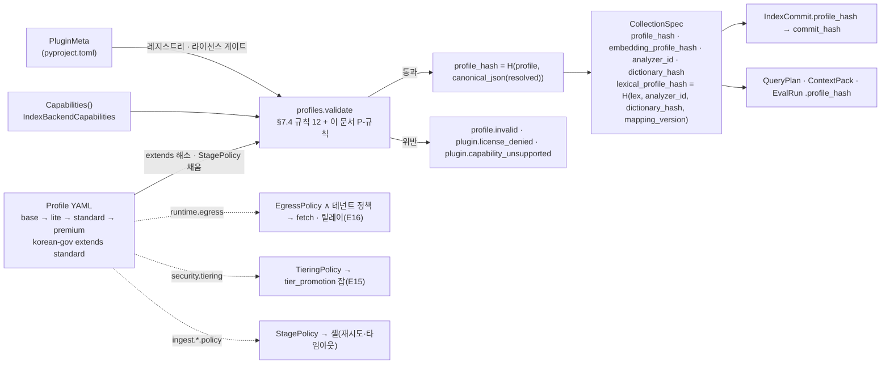

# 컬렉션·프로파일·정책 계약 (CollectionSpec·Profile·PluginMeta·Capabilities·StagePolicy·TieringPolicy·EgressPolicy)

> 이 문서는 바이블 §5.1 인벤토리의 운영·설정 계약 7종을 소유한다. 필드 표는 바이블 §5.6(`CollectionSpec`·`PluginMeta`·`Profile`)과 §5.3(`Capabilities`·`IndexBackendCapabilities`·`StagePolicy`·`TieringPolicy`·`EgressPolicy`) 표를 그대로 옮기고, 열거는 §5.7, 명명·해시는 §6, 프로파일 정본은 §7, 격리·egress는 §10.3·§10.4를 따른다. 바이블에 없는 필드는 선택(N)으로만 추가하고 "## 미해결 이슈"에 기록한다.

## 목적

플랫폼이 "어떤 설정으로 색인·검색했는가"를 재현 가능하게 기록하고(브리프 §7 재현성), 컬렉션 생성 전에 잘못된 조합을 걸러내는 계약을 정의한다. 컬렉션(Collection)은 정확히 하나의 프로파일 해시에 바인딩되는 인덱스 논리 단위이고, 프로파일(Profile)은 `extends` 단일 상속으로 조립되는 버전드 프리셋이며, 플러그인 메타데이터(PluginMeta)·능력 선언(Capabilities)·정책 3종(StagePolicy·TieringPolicy·EgressPolicy)은 프로파일 로더가 한 번에 검증하는 1급 개념이다(바이블 §2.1 K7, §7.4).

## 범위

- 포함: 7 타입의 필드 표·JSON Schema 2020-12 전문·Pydantic v2 모델·예시·불변식, 프로파일 상속 해소와 `profile_hash`, 로딩 검증 규칙 12개와 이 문서가 더한 규칙, `EgressPolicy`의 프로파일 AND 테넌트 합성 규칙, 4 내장 프로파일의 차이 요약.
- 제외: 내장 프로파일 YAML 전문(정본은 바이블 §7.3, 운영 전문은 [09-operations/02](../09-operations/02-configuration-reference.md)), 관리 API 응답 형식([05-api/04](../05-api/04-management-api.md)), 승격 잡·재색인 절차([04-pipelines/19](../04-pipelines/19-update-delete-and-reindexing.md)), 플러그인 개발 절차([10-development/06](../10-development/06-plugin-development-guide.md)).
- 공용 타입 5종(`Capabilities`·`IndexBackendCapabilities`·`StagePolicy`·`TieringPolicy`·`EgressPolicy`)의 **정의**는 [00-contract-overview](./00-contract-overview.md)가 소유하는 `common-types.schema.json`의 `$defs`에 있다. 이 문서는 해설·예시·불변식을 쓰고 인벤토리 파일은 `$ref` 래퍼로 게시한다(00 §2 소유 규칙).

## 1. 위치와 관계



| 타입 | 생산 | 소비 | 인라인 한계(바이블 §5.1) | 저장 위치 |
|------|------|------|---------------------------|-----------|
| `CollectionSpec` | 관리 API(`POST /v1/collections`, `PATCH`) | `plan`, `index`, 프로파일 검증 | 32KB | PostgreSQL `collections`; 검색 경로는 Valkey `collspec:{collection_id}` 캐시(ADR-0034) |
| `Profile` | 운영자 YAML | 로더·검증기, 모든 스테이지 | 256KB | `profiles(profile_id, version)` 원장(`yaml`, `resolved jsonb`) |
| `PluginMeta` | 플러그인 `pyproject.toml` `[tool.rag_platform.plugin]` | 레지스트리, 라이선스 게이트, 프로파일 검증 | 8KB | 패키지 메타데이터(런타임 레지스트리 메모리) |
| `Capabilities` / `IndexBackendCapabilities` | 플러그인 `capabilities()` | 프로파일 검증기(§7.4 (2)), `plan`(§8.1 6단계) | 4KB | `PluginMeta.capabilities` 정적 사본 + 런타임 호출 |
| `StagePolicy` | 프로파일(§4.4) | 셸(`orchestration/context`) | 2KB | 해소된 프로파일 안 |
| `TieringPolicy` | 프로파일 `security.tiering` | E15 승격 잡, 컬렉션 검증 | 2KB | 해소된 프로파일 안 |
| `EgressPolicy` | 프로파일 `runtime.egress`, 테넌트 `policies.egress_policy` | `fetch`, 릴레이, 구독 등록(E16) | 4KB | 해소된 프로파일 안 / `tenants.policies` |

## 2. `CollectionSpec`

### 2.1 최상위 필드(바이블 §5.6)

| 필드 | 타입 | 필수 | 설명 | 예시 |
|------|------|------|------|------|
| `schema_version` | string(semver) | Y | 계약 버전 | `"1.0.0"` |
| `schema_type` | string(const `CollectionSpec`) | N | **이 문서 추가.** API 응답·산출물 식별용 | `"CollectionSpec"` |
| `collection_id` | string(ulid) | Y | 발급형 ID(§6.1). 보안 삼중항 2 | `"01JADQ3G5R7T9V2X4Z6B8D0F2H"` |
| `tenant_id` | string(ulid) | Y | 소유 테넌트. 보안 삼중항 1 | `"01J9ZQ4K7X2M8N3P5R6S7T8V9W"` |
| `name` | string | Y | 테넌트 내 표시 이름(1..128자 — 길이 상한은 초안, 이 문서 추가; §9) | `"행정안전부 훈령·예규 2026"` |
| `profile_id` | string(kebab) | Y | 바인딩된 프로파일 ID | `"korean-gov"` |
| `profile_hash` | string(hex64) | Y | `H("profile", canonical_json(해소된 프로파일))`(§6.2). 컬렉션은 정확히 하나에 바인딩 | hex64 |
| `embedding_space_ids` | `EmbeddingSpaceIds` | Y | `{dense, sparse_learned?, sparse_bm25?, late_interaction?}`; 정의는 [07](./07-embedded-chunk-set-and-index-record.md) §2.2와 같고 이 스키마는 교차 `$ref` 대신 같은 정의의 사본 `$defs/EmbeddingSpaceIds`를 둔다(07 §2.2와 같은 방식; 미해결 이슈 13) | §예시 1 |
| `embedding_profile_hash` | string(hex64) | Y | `H("spaces", *sorted(f"{name}={space_id}"))`. Qdrant 물리 컬렉션 `rag_vec_{[:12]}` 결정 | hex64 |
| `analyzer_id` | string | Y | `{engine}:{version}:{dictionary}`(§6.1) | `"mecab-ko:1.3.7:ko-dic-2.1.1"` |
| `dictionary_hash` | string(hex64) | Y | `H("dict", *sorted(entry 정규화 행))`. 변경 → 렉시컬 재색인 제안 | hex64 |
| `dictionary_ref` | string(uri) | Y | 사용자 사전 스냅샷 산출물 URI(파생물 키 `derived/dictionaries/`) | `"s3://.../derived/dictionaries/d4/d4e5....json"` |
| `mapping_version` | string | N | **이 문서 추가(바이블 §5.6 minor 제안, 미해결 이슈 3).** 렉시컬 인덱스 매핑·분석기 설정 버전(04-pipelines/13 §5.1 템플릿 `_meta.mapping_version`; 십진 문자열). `lexical_profile_hash`의 세 번째 입력. `role=lexical` 백엔드가 있으면 존재 | `"1"` |
| `lexical_profile_hash` | string(hex64) | N | **이 문서 추가(바이블 §5.6 minor 제안, 미해결 이슈 3).** `H("lex", analyzer_id, dictionary_hash, mapping_version)`(§6.2). OpenSearch 물리 인덱스 `rag_lex_{[:12]}`(§13.4; 08 `backend_results[].physical_name`)와 재색인 범위 판정(14 §6.3, 16 §6.2)의 입력. `role=lexical` 백엔드가 있으면 존재(`mapping_version`과 함께), `lite`(Qdrant 단독)는 둘 다 생략 | hex64 |
| `tenant_isolation_tier` | enum(TenantIsolationTier) | Y | 현재 물리 배치 등급(§10.4) | `"index_per_tenant"` |
| `backends` | array<CollectionBackend> | Y | 1..8(상한은 초안, 이 문서 추가), `backend_id` 유일, `role=vector` 정확히 1개, `role=lexical` ≤ 1 | §2.2 |
| `policies` | `CollectionPolicies` | Y | 컬렉션 정책(테넌트 정책과 AND) | §2.2 |
| `filterable_fields` | array<string> | Y | `custom.*` 키 화이트리스트(§5.7 `FilterableField`), ≤ 64(초안, 이 문서 추가) | `["custom.ministry_code"]` |
| `license_policy` | `LicensePolicy` | Y | `{max_grade(X 불가), territory}` | `{"max_grade": "B", "territory": ["KR"]}` |
| `calibration_ref` | string \| null | N | `calibrations` 행 참조(`confidence_tier`·`tau` 보정) | `null` |
| `stats` | `CollectionStats` | Y | 현재 세대 집계 | §2.2 |
| `created_at`, `updated_at` | string(date-time) | Y | RFC 3339 UTC | `"2026-09-22T09:00:00.000Z"` |

### 2.2 중첩 객체

| 객체 | 필드 | 타입 | 필수 | 설명 | 예시 |
|------|------|------|------|------|------|
| `CollectionBackend` | `backend_id` | string(plugin_id) | Y | `index_backend.{implementation}`; `IndexCommit.backend_results[].backend_id`의 원천 | `"index_backend.qdrant"` |
| | `role` | enum(CollectionSpec.backends.role) | Y | `vector, lexical, graph`(§5.6 인라인 열거) | `"vector"` |
| | `physical_name` | string | Y | §13.4 물리명. 소문자(`_t_{tenant_id}` 접미는 ULID를 소문자로) | `"rag_vec_c0d1e2f3a4b5_t_01j9zq..."` |
| | `alias` | string | Y | `col_{collection_id}_{vec\|lex}`; blue/green 교체 단위 | `"col_01JADQ..._vec"` |
| `CollectionPolicies` | `pii_policy` | enum(PiiPolicy) | Y | 컬렉션 기본 PII 정책 | `"tokenize"` |
| | `pii_tokenize_mode` | enum(PiiTokenizeMode) | Y | `hash` / `encrypt`(OpenBao DEK) | `"encrypt"` |
| | `llm_enrichment_allowed` | boolean | Y | O-05 옵트인(테넌트 정책과 AND) | `false` |
| | `allow_distribution_documents` | boolean | Y | 배포용 HWP 텍스트 전용 파싱(O-07) | `true` |
| | `enrichment_budget_tokens` | integer(≥0) | Y | 문서당 LLM 보강 예산(ADR-0016) | `0` |
| | `corpus_multiplier_max` | number(≥1) | Y | 코퍼스 대비 생성 상한 배수 | `1.5` |
| `LicensePolicy` | `max_grade` | enum(LicenseGrade) 부분집합 `A,B,C,D` | Y | §5.7 나열 순 비교. `X`는 상한 불가 | `"B"` |
| | `territory` | array<string> | Y | ISO 3166-1 alpha-2, 1개 이상 | `["KR"]` |
| `CollectionStats` | `document_count`, `leaf_count`, `parent_count` | integer(≥0) | Y | 문서·리프(level 0)·부모(level 1) 수. `leaf_count` 테넌트 합산이 E15 판정 입력 | `1284`, `96520`, `11834` |
| | `bytes_dense`, `bytes_sparse`, `bytes_lexical` | integer(≥0) | Y | 저장 바이트(`rag_index_bytes_total{vector}`와 대응); `lite`는 `bytes_lexical = 0` | `395345920` |

### 2.3 프로파일 해시 바인딩과 blue/green

**결정:** 컬렉션은 `profile_hash`·`embedding_profile_hash`·`analyzer_id`·`dictionary_hash` 넷에 동시에 바인딩되고, 어느 것이든 바뀌면 `PATCH /v1/collections/{collection_id}` → `collection.profile.changed` 이벤트 → 재색인 범위 판정([14 §6.3~6.4](./14-schema-versioning-and-compatibility.md))으로만 갱신된다([ADR-0031](../06-adr/0031-profile-schema-extends-and-quality-gates.md), [ADR-0026](../06-adr/0026-index-commit-generation-saga-and-ledger.md)). `embedding_profile_hash` 또는 `lexical_profile_hash = H("lex", analyzer_id, dictionary_hash, mapping_version)`(둘 다 `CollectionSpec` 필드; `lexical_profile_hash`·`mapping_version`은 렉시컬 백엔드가 있는 컬렉션만, §2.1·C-7)가 바뀌면 새 물리 컬렉션·인덱스를 채우고 alias를 `flip_order`(렉시컬 → 벡터) 순으로 교체하며, `query.*`만 바뀐 프로파일은 재색인 0건의 바인딩 교체다. `mapping_version`은 인덱스 템플릿(04-pipelines/13 §5.1)의 값을 관리 API가 컬렉션 생성·매핑 갱신 시 기록하므로 `analyzer_id`·`dictionary_hash`가 그대로여도 매핑 변경만으로 렉시컬 blue/green이 일어난다(14 §6.3). 검색 핫패스는 PostgreSQL을 읽지 않고 캐시 사본(`collspec:{collection_id}`)을 쓰며 이벤트로 무효화한다(ADR-0034).

## 3. `Profile`

### 3.1 최상위 필드(바이블 §5.6, §7.3)

| 필드 | 타입 | 필수 | 설명 | 예시 |
|------|------|------|------|------|
| `schema_version` | string(semver) | Y | 계약 버전(`profile.schema.json` 구조 버전) | `"1.0.0"` |
| `schema_type` | string(const `Profile`) | N | **이 문서 추가.** 해소 결과 응답 식별용 | `"Profile"` |
| `profile_id` | string(kebab) | Y | 내장 `base, lite, standard, premium, korean-gov` | `"standard"` |
| `version` | string(semver) | Y | 내용 버전. 변경 → `profile_hash` 변경 → blue/green | `"1.0.0"` |
| `profile_hash` | string(hex64) | N(readOnly; 바이블 §6.2·§5.6 1.3.0, AM-34) | `H("profile", canonical_json(resolved))`(§3.8). 로더가 계산해 채우는 파생값 — YAML 원본에는 없고 해소 결과에만 존재 | hex64 |
| `description` | string | N | **이 문서 추가.** 운영자 설명(≤ 1,024자) | |
| `extends` | string(kebab) \| null | Y(nullable) | 단일 부모. `null`은 조상 전용(`base`) | `"lite"` |
| `tier` | enum(ProfileTier) | Y | `lite, standard, premium, korean-gov` | `"standard"` |
| `license_policy` | `LicensePolicy` | Y | §2.2와 같은 정의의 사본(`profile` `$defs/LicensePolicy`; 계약 간 교차 `$ref` 없음, CI 동치 대조) | `{"max_grade": "B", "territory": ["KR"]}` |
| `runtime` | `RuntimeConfig` | Y | §3.3 | |
| `ingest` | `IngestConfig` | Y | §3.4 | |
| `query` | `QueryConfig` | Y | §3.5 | |
| `security` | `SecurityConfig` | Y | §3.6 | |
| `observability` | `ObservabilityConfig` | Y | §3.6 | |
| `eval` | `EvalConfig` | Y | §3.6 | |

### 3.2 `extends` 해소와 깊은 병합

**결정:** 상속 체인은 `base → lite → standard → premium`, `korean-gov extends standard`. 로더는 `base`부터 자식까지 객체를 키 단위로 재귀 병합하고 스칼라와 **배열은 자식 값으로 교체**한다. 키 삭제·배열 요소 병합 연산자는 없다. `extends: null`인 프로파일(`base`)은 완전한 프로파일이되 컬렉션에 바인딩할 수 없고, `base`의 `tier`는 `lite`다([ADR-0031](../06-adr/0031-profile-schema-extends-and-quality-gates.md) 대안 A·E 기각). 순환·미존재 부모는 `profile.invalid`.

| 값 종류 | 병합 규칙 | 예 |
|---------|-----------|----|
| 객체 | 키 단위 재귀 병합 | `standard.ingest.chunk`가 `lite.ingest.chunk`의 키를 덮어쓰고 나머지는 상속 |
| 스칼라 | 자식 값 | `tenant_concurrent_jobs_max: 4 → 32` |
| 배열 | **전체 교체** | `korean-gov`가 `enrich.deterministic[]`에 한 항목을 더하려면 배열 전체를 다시 적는다 |
| `null` | 자식이 `null`을 주면 `null`로 교체(키 삭제 아님) | `heartbeat: null` |

### 3.3 `runtime`

| 필드 | 타입 | 필수 | 설명 | 예시 |
|------|------|------|------|------|
| `orchestrator` | enum(Profile.runtime.orchestrator) | Y | `local`(LocalRunner) / `temporal`(§5.6 인라인 열거) | `"temporal"` |
| `queues` | object<string, string> | Y | 스테이지 → task_queue(kebab). 필수 키 `fetch, parse, normalize, chunk, enrich, embed, index`, 선택 `detect, ocr, enrich_llm, recount`(부재 시 폴백 규칙은 §3.4). `publish`는 로컬 액티비티라 큐 키가 없다(§6) | `{"embed": "ingest-gpu-embed"}` |
| `tenant_concurrent_jobs_max` | integer(≥1) | Y | 디스패처 강제(§11.2) | `32` |
| `acl_propagation_slo`, `outbox_lag_slo` | string(duration) | Y | E11·아웃박스 SLO(§7.2) | `"5m"`, `"5s"` |
| `egress` | `EgressPolicy` | Y | E16(§8). `deny_cidrs ⊇` 기본 9개 | §예시 8 |
| `consistency_check` | object `{sample_every?, full_every}` | N | **이 문서 추가.** §7.2 주기 | `{"sample_every": "1h", "full_every": "24h"}` |
| `snapshot` | object `{every, replicate_region?}` | N | **이 문서 추가.** §7.2 주기 | `{"every": "6h", "replicate_region": false}` |

### 3.4 `ingest`

`ingest`는 `{fetch, parse{router, options}, normalize, chunk, recount?, enrich, embed, index}`이고 각 스테이지 값은 `{plugin, policy: StagePolicy, …플러그인 config_schema 필드}`다(바이블 §5.6). 스테이지 값 객체는 **열린 객체**(`additionalProperties: true`)이며 아래 표의 필드 외 키는 해당 플러그인의 `config_schema`가 로딩 시 검증한다(ADR-0032). `policy`는 부분 `StagePolicy`(`$defs/StagePolicyPartial`)이고 로더가 §4.4 표의 기본값(`task_queue = runtime.queues[stage]`, `non_retryable_error_codes` 스테이지 기본, `resumable = capabilities.supports_resumable`, `backoff {1s, 5m, 2.0}`)을 채워 완전한 `StagePolicy`로 만든다. 바이블 §4.4의 11행 중 프로파일 키가 없는 두 행은 다음과 같이 다룬다: `detect` 행(`ingest-cpu`, 1m, —, 3, `parse.unsupported_format`·`parse.corrupt_container`, no)은 `parse.policy_detect`(N, `StagePolicyPartial`; 02 §1.1의 detect는 `parser` 확장 지점 role `format_detector`, 큐 `ingest-cpu`이므로 `parse` 아래에 둔다)로 재정의하고 생략 시 §4.4 detect 행 그대로다; `publish` 행(로컬 액티비티, 10s, —, 10)은 **플랫폼 고정 정책**이며 프로파일로 바꿀 수 없다(§6). 선택 큐 키가 없을 때의 `task_queue` 폴백은 다음과 같다(바이블 §4.4: detect/chunk/recount는 `ingest-cpu` 공유, parse(OCR) `standard`는 `ingest-cpu`): `queues.detect` 부재 → `queues.parse`; `queues.recount` 부재 → `queues.chunk`; `queues.ocr` 부재 → `queues.parse`; `queues.enrich_llm` 부재 → LLM 보강(`enrich.generated_prefix.enabled`·`contextual_doc_summary.enabled`)이 모두 `false`면 무시, 하나라도 `true`면 `profile.invalid`(비용 격리 큐 `ingest-llm`는 다른 큐로 대체하지 않는다, ADR-0016). 컬렉션 `policies.llm_enrichment_allowed = true`인데 바인딩 프로파일에 `queues.enrich_llm`이 없으면 컬렉션 생성·변경이 `profile.invalid`다(C-6).

| 스테이지 | 필수 키 | 선택 키(계약 정의) | 비고 |
|----------|---------|-------------------|------|
| `fetch` | `plugin`, `max_bytes` | `policy` | `max_bytes`는 `EgressPolicy.max_bytes` 기본값 |
| `parse` | `router`, `options{ocr}` | `options.pdf`, `options.page_timeout`, `policy`, `policy_ocr`, `policy_detect` | 닫힌 객체. `router`는 `SourceFormat` 13값 전부(규칙 10); 각 값은 체인 `array<plugin_id \| RouteStep>` / 종결 코드 `parse.unsupported_format\|unsupported_variant` / `PdfRoute{born_digital, scanned, mixed}` / `SplitRoute{split, then}`. `policy`·`policy_ocr`·`policy_detect`는 §4.4의 parse(텍스트)·parse(OCR)·detect 행 |
| `normalize` | `analyzer{plugin}`, `sentence_splitter{plugin}`, `pii{plugin, policy}` | `*.fallback`, `pii.tokenize_mode`, `pii.recognizers`, `pii.reject_entities`(N, 바이블 §7.3 1.3.0 AM-43; `policy` 값과 무관하게 이 목록의 엔티티 타입은 reject, `policy=reject`와 병용 시 `profile.invalid`), `policy` | `analyzer`는 role `korean_analyzer`(`lite` 필수, 규칙 9) |
| `chunk` | `plugin`, `tokenizer`, `leaf_max_tokens`, `parent_max_tokens`, `merge_min_tokens` | `secondary_tokenizers`, `fallback{plugin, max_tokens, overlap_ratio?, sentence_window_n?}`, `table_row_group_tokens`, `genre_rules`, `policy` | `leaf_max_tokens`·`overlap_ratio`는 게이트 보유 값 가능 |
| `recount` | `plugin` | `policy` | role `token_counter`. 임베더 교체 시에만 실행(O-09) |
| `enrich` | `deterministic[]`, `generated_prefix{enabled}`, `budget{enrichment_budget_tokens, corpus_multiplier_max}` | `generated_prefix.plugin/gate`, `contextual_doc_summary{enabled, plugin?}`, `budget.queue`, `policy`, `policy_llm` | LLM 보강은 모든 프로파일 `enabled: false`(O-05) |
| `embed` | `dense{plugin, model_id, revision, dim, normalized}`, `late_interaction{enabled}`, `equivalence_gate{cosine_min, sample}` + (`sparse{plugin, vocab_id}` 또는 `sparse_bm25{plugin, k1, b}`) | `dense.dtype/quantization`, `batch_max_tokens`, `policy` | 3-way 하이브리드(D-07): sparse 레그 하나 이상 |
| `index` | `backends[]{plugin, role}`, `commit{strategy, flip_order, cleanup_delay}` | `backends[].named_vectors/tenant_isolation`, `policy` | `tiering` 키는 **거부**(`false` 스키마) — 정본 경로는 `security.tiering` |

### 3.5 `query`

| 필드 | 타입 | 필수 | 설명 | 예시 |
|------|------|------|------|------|
| `transform` | array<string(plugin_id)> | Y | `query_transformer` 파이프 순서(`normalize_ko → router → self_query → rewrite → expand`) | `["query_transformer.korean_normalize"]` |
| `channels[]` | `ChannelConfig{channel, retriever, top_k, timeout_ms, weight?}` | Y | `channel` 유일(1..7). `top_k` 1..300(바이블 §5.1 `CandidateSet` 채널 런당 300이 상한). `sparse_bm25`는 `channel=lexical` + `retriever.qdrant_sparse_bm25` | §예시 2 |
| `fusion` | `FusionConfig{method, k, weights, variant_query_weight, gate?}` | Y | `k` 필수(규칙 3). `weights` 키 = `channels[].channel` 집합 | `{"method": "rrf", "k": 60, ...}` |
| `hydrate` | `HydrateConfig{top_n, backend, with_vectors}` | Y | `top_n ≥ max(rerank.top_n_in, pack.k_max)`(규칙 11) | `{"top_n": 100, "backend": "index_backend.qdrant", "with_vectors": false}` |
| `rerank` | `RerankConfig` | Y | `enabled: false`면 나머지 선택(`lite` 생략), 아니면 `plugin, model_id, response_schema, backend, top_n_in, top_n_out, max_tokens_per_text, timeout_ms, normalization` 필수 | §예시 2 |
| `postprocess` | `PostprocessConfig{order, relevance_gate, dedup, mmr?, parent_expand?, sentence_window?, compress?}` | Y | `order`는 고정 순서 `PostprocessStep`의 부분 수열(D-07) | §예시 2 |
| `pack` | `PackConfig{k_max, max_context_tokens, reserved_answer_tokens, ordering, renderer, tokenizer, table_format_preference, overflow_policy, confidence_tiers, instructions_template_id?, data_marking?, citation_style?}` | Y | `k_max` 1..20(바이블 §5.1 `ContextPack` 항목 20이 상한; 11 `Budget.k_max`·16 `FeedbackEvent.cite_ids ≤ 20`과 같은 값). `tokenizer{provider, model, count_method, calibration_ratio, safety_margin}`; `count_method=exact_api`는 `provider ∈ {anthropic, gemini}` | §예시 2 |
| `latency_budget_ms` | `LatencyBudget{total, plan?, retrieve?, rerank?, postprocess?, pack?}` | Y | 부분 합 ≤ `total`(초안 목표 §8.3) | `{"total": 800, ...}` |

### 3.6 `security` · `observability` · `eval`

| 객체 | 필드 | 타입 | 필수 | 설명 | 예시 |
|------|------|------|------|------|------|
| `security` | `authn` | enum(AuthMethod) | Y | 기본 인증(E1) | `"oidc"` |
| | `authz` | object `{plugin, policy_version}` | Y | `cedar` / `static_roles`(플랫폼 인프라, 확장 지점 아님). 닫힌 객체 | `{"plugin": "cedar", "policy_version": "2026-09"}` |
| | `rate_limit` | object `{store: enum[valkey, memory], fail_mode: enum[open, closed]}` | Y | E3; 운영 `closed`; `memory`는 `orchestrator=local` 전용. 닫힌 객체 | `{"store": "valkey", "fail_mode": "closed"}` |
| | `tenant_isolation_tier` | enum(TenantIsolationTier) | Y | 새 컬렉션 기본 등급(§7.2) | `"payload_filter"` |
| | `tiering` | `TieringPolicy` | Y | E15(§7) | §예시 7 |
| `observability` | `content_capture` | enum(Profile.observability.content_capture) | Y | `none`(전 프로파일 기본, E13) / `span_only` / `event_only` / `span_and_event` — OTel GenAI 캡처 모드 대응은 확인 필요(as of 2026-09) | `"none"` |
| | `tenant_id_hash` | boolean | Y | 스팬에 `rag.tenant_id_hash`만 | `true` |
| | `content_capture_locked` | boolean | N | **이 문서 추가.** `korean-gov` `NO_CONTENT` 잠금(환경 변수 재정의 불가) | `true` |
| `eval` | `datasets` | array<string> | Y | 기본 평가 데이터셋 — 항목은 `EvalDataset.name`(16 §2.1; 최신 행으로 해소, 16 EF-1). `GateSpec.dataset` 생략 시 `[0]` | `["ko-public-v1", "allganize-ko"]` |
| | `gates` | object<MetricKey, EvalGate{min?, max?, max_regression?, p?, correction?, warn_below?}> | Y | 프로파일 회귀 게이트(D-12). 키는 16 `MetricKey`(`{metric}[@{k}]`, `k ≥ 1`, 선행 0 금지; `$defs/MetricKey` 사본)이며 `EvalReport.gate_result.failed_gates[].metric`과 같은 형식 | `{"ndcg@10": {"min": 0.80, "max_regression": 0.01, "p": 0.05, "correction": "holm"}}` |

### 3.7 게이트 값 형식

**결정:** 품질 기본값은 `{value, gate}`(`$defs/GatedValue`)로 적고, `enabled` 토글·`fusion`·`rerank`처럼 값이 객체인 곳은 그 객체에 `gate` 키를 붙인다. `GateSpec = {metric?, dataset?, grid?, min_delta?, min_delta_pt?, min_qrels?, candidate?, max_cost_per_doc_usd?, promote_to?, tool?}`이며 `grid | min_delta | min_delta_pt | min_qrels | candidate | promote_to` 중 하나 이상이 있어야 한다. `metric`은 16 `MetricKey` 형식(`^[a-z][a-z0-9_]*(@[1-9][0-9]*)?$`, ≤ 64자; `eval.gates` 키와 같은 `$defs/MetricKey` 사본)이고 `dataset`은 `EvalDataset.name`(16 §2.1)이다. `metric` 생략은 `ndcg@10`, `dataset` 생략은 `eval.datasets[0]`으로 해석한다(ADR-0031이 이 문서에 위임한 세부 키 정식화). 게이트가 붙은 값은 `EvalReport.gate_result.passed = true`와 ADR 없이 바꿀 수 없고, 바꾸면 `version` 증가다(바이블 §7.4).

### 3.8 `profile_hash`

`profile_hash = H("profile", canonical_json(resolved))`(§6.2). `resolved`는 로더의 고정된 3단계 결과다: (1) `extends` 해소(§3.2 깊은 병합) → (2) `StagePolicyPartial` 완성(§3.4 기본값·큐 폴백) → (3) 모든 `string(duration)` 값의 ISO 8601 정규화(`15m` → `PT15M`, §6). `profile.schema.json`은 `default` 키워드를 갖지 않으므로 "기본값 채움"은 (2)만이며 세 단계 모두 결정적이라 해시 입력도 결정적이다(14 §8 규칙 1). 기록 지점: `CollectionSpec.profile_hash`, `IndexCommit.profile_hash`(→ `commit_hash`), `QueryPlan`·`ContextPack`·`EvalRun.profile_hash`, `profiles.profile_hash`, 스팬 `rag.profile_hash`. YAML 키 순서·서식·상속 경로가 달라도 같은 파이프라인은 같은 해시다.

### 3.9 로딩 검증 규칙

`rag profile validate`, `POST /v1/profiles/validate`, `POST /v1/collections`·`PATCH /v1/collections/{collection_id}`는 같은 검증기를 호출한다. 위반은 [13-error-model](./13-error-model.md)의 `profile.invalid`(422/500) · `plugin.license_denied`(422) · `plugin.capability_unsupported`(422)이며 `ProblemDetails.errors[]`의 `StageError{stage: "loader", location.pointer}`가 해소된 프로파일 안의 JSON 포인터를 가리킨다.

| # | 규칙(바이블 §7.4) | 코드 |
|---|-------------------|------|
| 1 | 모든 `plugin` 값은 등록된 entry point; `PluginMeta.license_grade ≤ license_policy.max_grade`(C/D/X는 `optIn` 명시, D 모델은 `model_license_ack: true`); `territory` 대조; `license_grade=B ∧ linkage=static_bundled` 거부 | `plugin.license_denied` |
| 2 | 요구 능력 ↔ `capabilities()`(`IndexBackendCapabilities` 포함) 대조; `supports_multivector=false` → `late_interaction` 자동 비활성 + `degraded{channel.late_interaction, capability_unsupported}`; `korean_analyzer=false` 백엔드 단독이면 플랫폼 측 `korean_analyzer` 필수 | `plugin.capability_unsupported` |
| 3 | `query.fusion.k` 필수 | `profile.invalid` |
| 4 | `ingest.chunk.tokenizer` = 임베딩 모델 토크나이저; `query.pack.tokenizer.provider`와 카운터 일치 | `profile.invalid` |
| 5 | late chunking ↔ mean pooling 모델 | `profile.invalid` |
| 6 | `parse.options.ocr.{plugin, lang, version, model}` 필수 | `profile.invalid` |
| 7 | `filters.relaxable_keys`에 보안·전략 키 금지 | `profile.invalid` |
| 8 | `embedding_space_ids` 재계산 일치(`H("space", …)`, `H("spaces", …)`) | `profile.invalid` |
| 9 | `tier=lite`는 플랫폼 측 `korean_analyzer` 필수 | `profile.invalid` |
| 10 | `parse.router`는 `SourceFormat` 13값 전부를 키로 가짐 | `profile.invalid` |
| 11 | `query.hydrate.top_n ≥ max(rerank.top_n_in, pack.k_max)` | `profile.invalid` |
| 12 | `runtime.egress.deny_cidrs ⊇` 기본 9개 CIDR(축소 불가) | `profile.invalid` |

이 문서가 더하는 규칙(불변식 P-1~P-13 참조): `extends` 체인 비순환·`base`만 `null`, 배열 교체 뒤 `postprocess.order` 부분 수열 검사, `channels[].channel` 유일·`fusion.weights` 키 일치, `hydrate.backend ∈ backends[role=vector].plugin`, `security.tenant_isolation_tier ∈ ∩ backends[].tenant_isolation[]`, `tiering.index_per_tenant=disabled`면 `index_per_tenant` 컬렉션 생성 거부, `file` 스킴과 `rate_limit.store=memory`는 `runtime.orchestrator=local`에서만, `korean-gov`는 `content_capture=none`·`content_capture_locked=true`, `StagePolicy.non_retryable_error_codes`는 카탈로그 `no` 코드만(13 §4.2 R1·R2), 선택 큐 폴백 불가(§3.4)와 `EgressPolicy` 합성 결과 공집합(§8, E-1)은 `profile.invalid`, `egress.allowed_hosts` 항목은 소문자 호스트명(IP 리터럴 불가, E-1), 바이블 §5.1 한계를 프로파일 상한으로 강제(`query.pack.k_max ≤ 20`, `query.channels[].top_k ≤ 300`; 스키마 `maximum`, P-13).

### 3.10 4 프로파일 차이 요약

전문 YAML은 바이블 §7.3(`standard`)과 [09-operations/02](../09-operations/02-configuration-reference.md)에 위임한다. 아래는 상속 해소 후 `rag profile diff`가 보여줄 차이의 요약이다(값은 바이블 §7.1·§7.2 초안 목표).

| 항목 | `lite` | `standard` | `premium` | `korean-gov` |
|------|--------|------------|-----------|--------------|
| `extends` / `tier` | `base` / `lite` | `lite` / `standard` | `standard` / `premium` | `standard` / `korean-gov` |
| `runtime.orchestrator` / 큐 | `local`(개발) 또는 Temporal 단일 바이너리; `ingest`+`maintenance` | `temporal`; `ingest-io/cpu/gpu-embed` | + `ingest-gpu-ocr`, `ingest-llm` | standard + 등급별 네임스페이스 |
| `ingest.index.backends` | Qdrant 단독(`dense`+`sparse_bm25`) | Qdrant + OpenSearch(Nori) | + Qdrant multivector | standard + 감사 인덱스 |
| `ingest.embed` | bge-m3 dense ONNX int8 인프로세스 + `sparse_bm25` | bge-m3 dense+sparse @ vLLM pooling | `ko-quality` / `quality-max`, `late_interaction` KURE-v2(M2) | standard, 가중치 자체 미러 |
| `query.channels[*].top_k / timeout_ms` | 50 / 400 | 100 / 250 | 150 / 250 | 100 / 250 |
| `query.rerank` | gte-multilingual @ TEI CPU 30→10 또는 `enabled: false` | bge-reranker-v2-m3 @ TEI GPU 100→20 | Qwen3-Reranker-4B 50→20(+ MaxSim 300→100) | standard + dragonkue A/B |
| `query.postprocess.order` | `[relevance_gate, dedup]` | 5단계 | 5단계 + `compress` 옵션 | 5단계 |
| `query.pack` | `k_max 10`, 12k, `xml_documents`, 표 `[markdown, json]` | `k_max 20`, 24k, `anthropic_search_result`, `[html, markdown, json]` | 20, 32k | `document_order`, `xml_documents`, `data_marking: datamark`, `classification_max` 전달 |
| `security.tenant_isolation_tier` / `tiering` | `payload_filter` | `payload_filter` → 100만 청크 초과 `shard_key` | 동일 | `index_per_tenant` 선택(OpenBao DEK) |
| `runtime.egress.allowed_schemes` | `[https, s3, gs, az]`(+ `file`은 `orchestrator=local`만) | `[https, s3, gs, az]` | 동일 | 동일 + 테넌트 `allowed_hosts` 권장 |
| `runtime.acl_propagation_slo` / `outbox_lag_slo` | 15m / 30s | 5m / 5s | 5m / 5s | 1m / 2s |
| `observability.content_capture` | `none` | `none` | `none` | `none` + `content_capture_locked: true` |
| `eval.gates.ndcg@10.min` / `recall@20.min` | 0.70 / 0.85 | 0.80 / 0.92 | 0.80 / 0.92 | 0.80 / 0.92 |

## 4. `PluginMeta`(바이블 §5.6)

| 필드 | 타입 | 필수 | 설명 | 예시 |
|------|------|------|------|------|
| `plugin_id` | string | Y | `{extension_point}.{implementation}`(§6.1). `Producer.plugin_id`와 동일 | `"parser.hwpx_python_hwpx"` |
| `extension_point` | enum(ExtensionPoint) | Y | D-10 14종. `plugin_id` 접두와 일치 | `"parser"` |
| `role` | string \| null | N | 서브 역할(`korean_analyzer`, `sentence_splitter`, `pii_detector`, `format_detector`, `token_counter`, `renderer` …). 확장 지점 수를 늘리지 않는 축(ADR-0032) | `null` |
| `version` | string(semver) | Y | 패키지 버전(`Producer.plugin_version`) | `"0.1.0"` |
| `license` | string(SPDX) | Y | 배포 wheel 메타데이터 기준 | `"Apache-2.0"` |
| `license_grade` | enum(LicenseGrade) | Y | `A, B, C, D, X`(D-02) | `"A"` |
| `territory` | array<string> | Y | ISO 3166-1 alpha-2. 빈 배열 = 제한 없음; `license_policy.territory` 전부를 포함해야 로딩 | `[]` |
| `linkage` | enum(Linkage) | Y | 플러그인 **자기 배포물**에 번들된 네이티브 코드 형태(`pure_python, dynamic, static_bundled`). A 등급 의존성의 네이티브 확장은 등급을 바꾸지 않는다 | `"pure_python"` |
| `isolation_supported` | array<enum(IsolationMode)> | Y | = `capabilities.isolation_modes`(집합 동치). C 등급은 `[sidecar]`만 | `["in_process"]` |
| `model_ids` | array<string(model_id)> | N | `{repo}@{revision}`; `models.lock` 행과 대응 | `[]` |
| `model_license_ack_required` | boolean | N | D 등급 모델 포함 시 `true` | `false` |
| `sidecar_image` | string \| null | N | `sidecar` 격리 시 이미지 참조(태그까지; digest는 런타임) | `null` |
| `contracts_compat` | string | Y | 수용 계약 범위. 문법·평가는 14 §4.3 — 쉼표로 이은 비교절, 각 절은 비교 연산자(`>=`, `<=`, `==`, `<`, `>`) + `MAJOR.MINOR`(선행 0 금지); patch 불참, `~=` 없음. 스키마 `$defs/ContractsCompat`는 `schema-diff-report`의 동일 사본이며 M-2로 `capabilities.contracts_compat`에도 강제된다 | `">=1.0,<2.0"` |
| `capabilities` | `Capabilities` | Y | `capabilities()` 정적 사본. `index_backend`는 `extra = IndexBackendCapabilities`(스키마 `if/then`) | §예시 3·4 |

## 5. `Capabilities` · `IndexBackendCapabilities`(바이블 §5.3)

| 타입 | 필드 | 타입 | 필수 | 설명 | 예시 |
|------|------|------|------|------|------|
| `Capabilities` | `isolation_modes` | array<enum(IsolationMode)> | Y | 지원 격리 모드(1개 이상) | `["in_process"]` |
| | `supports_resumable` | boolean | Y | `heartbeat_details` 재개(§4.4 `resumable`) | `true` |
| | `contracts_compat` | string | Y | 계약 호환 범위(= `PluginMeta.contracts_compat`, 문법 14 §4.3). `common-types`는 `minLength 1`만 두므로 문법은 `PluginMeta` `$defs/ContractsCompat` 패턴 + M-2 동치로 강제된다(`common-types` `$defs/ContractsCompat` 승격 후 `$ref` — 14 미해결 이슈 1) | `">=1.0,<2.0"` |
| | `input_formats` | array<string> | N | 파서 포맷(`SourceFormat` 값) 등 | `["hwpx"]` |
| | `model_ids` | array<string(model_id)> | N | 임베더·리랭커 모델 | `["BAAI/bge-m3@5617a9f6..."]` |
| | `requires_gpu` | boolean | N | | `true` |
| | `extra` | object \| null | N | 확장 지점 전용(`index_backend` = `IndexBackendCapabilities`; 그 외 확장 지점 스키마는 미해결 이슈 5) | §예시 4 |
| `IndexBackendCapabilities` | `supports_server_bm25` | boolean | Y | Qdrant `false`, OpenSearch `true` | `false` |
| | `korean_analyzer` | boolean | Y | `false` → 플랫폼 측 `korean_analyzer` 필수(규칙 2·9) | `false` |
| | `supports_server_fusion` | array<enum(FusionMethod)> | Y | 서버 융합 위임 가능 방법(`lite` 단일 컬렉션만) | `["rrf", "dbsf"]` |
| | `tenant_isolation` | array<enum(TenantIsolationTier)> | Y | 지원 등급(1개 이상). `security.tenant_isolation_tier`·승격 목표와 대조 | `["payload_filter", "shard_key", "index_per_tenant"]` |
| | `supports_alias_swap` | boolean | Y | blue/green 필수 조건 | `true` |
| | `supports_multivector` | boolean | Y | `false` → `late_interaction` 자동 비활성 + `degraded` | `true` |
| | `max_vector_dim`, `max_multivector_elements` | integer \| null | Y(nullable) | `null` = 미공개. `dense.dim` 초과 → `plugin.capability_unsupported` | `65536`, `null` |
| | `supports_payload_only_points` | boolean \| null | Y(nullable) | `ChunkTextStore` `vector_payload` 구현 조건(확인 필요 as of 2026-09) | `null` |

## 6. `StagePolicy`(바이블 §5.3, §4.4)

| 필드 | 타입 | 필수 | 설명 | 예시 |
|------|------|------|------|------|
| `task_queue` | string(kebab) | Y | §4.4 표의 큐(`runtime.queues`에서 채움) | `"ingest-cpu"` |
| `start_to_close` | string(duration) | Y | 액티비티 상한 | `"15m"` |
| `heartbeat` | string(duration) \| null | Y(nullable) | 하트비트 간격; 없는 스테이지는 `null` | `"60s"` |
| `max_attempts` | integer(≥1) | Y | | `3` |
| `backoff` | object `{initial, max, coefficient}` | N | 기본 `{1s, 5m, 2.0}` | `{"initial": "1s", "max": "5m", "coefficient": 2.0}` |
| `non_retryable_error_codes` | array<string(error_code)> | Y | 카탈로그 `no` 코드만(13 §4.2 R1~R4); `contract.violation`·`plugin.*`은 암묵 포함 | `["parse.document_encrypted", ...]`은 §예시 6 |
| `resumable` | boolean | Y | `heartbeat_details` 재개(`page`, `chunk_offset`, `batch_offset`) | `true` |
| `isolation` | enum(IsolationMode) \| null | N | 격리 모드 강제. `PluginMeta.isolation_supported`에 있어야 한다 | `"in_process"` |

`string(duration)`은 ISO 8601(`PT15M`)과 바이블 축약 표기(`15m`) 둘 다 허용하고 로더가 ISO 8601로 정규화한다(00 U-1). 정규화는 `resolved`의 3단계(§3.8)이므로 `profile_hash` 입력은 항상 정규화 후 값이며, 같은 정책을 `15m`으로 적든 `PT15M`으로 적든 해시가 같다.

**결정(§4.4 11행의 프로파일 대응):** 바이블 §4.4 표의 행은 프로파일 키와 다음처럼 대응한다 — fetch → `ingest.fetch.policy`, detect → `ingest.parse.policy_detect`(N; 생략 시 §4.4 detect 행 `{task_queue: queues.detect ?? queues.parse, start_to_close: 1m, heartbeat: null, max_attempts: 3, non_retryable_error_codes: [parse.unsupported_format, parse.corrupt_container], resumable: false}`), parse(텍스트) → `ingest.parse.policy`, parse(OCR) → `ingest.parse.policy_ocr`, normalize → `ingest.normalize.policy`, chunk / recount → `ingest.chunk.policy` / `ingest.recount.policy`, enrich(결정적) → `ingest.enrich.policy`, enrich(LLM) → `ingest.enrich.policy_llm`, embed → `ingest.embed.policy`, index → `ingest.index.policy`. **`publish` 행(로컬 액티비티, `start_to_close` 10s, `heartbeat` —, `max_attempts` 10)은 플랫폼 고정 정책이다**: 로컬 액티비티는 `task_queue`가 없어 `StagePolicy`(`task_queue` 필수)로 표현할 수 없고 셸(`orchestration/context`)이 상수로 갖는다. 프로파일에 `publish` 키는 없으며(`IngestConfig` 닫힌 객체) `runtime.queues.publish`도 두지 않는다. 바이블 §5.1 `StagePolicy` 행 "생산: 프로파일(§4.4)"은 이 두 행을 제외한 9행에 적용된다(미해결 이슈 16).

## 7. `TieringPolicy`(바이블 §5.3, §10.3 E15)

| 필드 | 타입 | 필수 | 설명 | 예시 |
|------|------|------|------|------|
| `shard_key_threshold_chunks` | integer(≥1) | Y | 테넌트 리프 청크 합(`CollectionSpec.stats.leaf_count` 테넌트 합산) 초과 → `shard_key` 승격 조건. 기본 `1000000`(초안) | `1000000` |
| `threshold_qps` | number \| null | N | 테넌트 QPS 임계(`usage_ledger.queries`); `null`이면 청크 수만 | `null` |
| `index_per_tenant` | enum(IndexPerTenantMode) | Y | `opt_in`(테넌트·컬렉션 선택) / `auto`(임계 초과 시 자동) / `disabled`(금지) | `"opt_in"` |
| `promotion_window` | string(duration) | N | 임계 관측 창. 기본 `24h` | `"24h"` |

**결정:** 정본 경로는 `Profile.security.tiering`이다(바이블 §5.6 타입 표). 바이블 §7.3 YAML의 `ingest.index.tiering` 표기는 이 스키마에서 거부(`false`)하며 §7.3 patch를 제안한다(미해결 이슈 2). 승격은 `JobKind.tier_promotion` 잡(`tier.promotion.v1`)의 blue/green + alias 교체로만 일어나고, 목표 등급은 모든 `backends[]`의 `tenant_isolation[]`에 있어야 한다([ADR-0028](../06-adr/0028-tenant-isolation-tiering-policy.md)).

## 8. `EgressPolicy`(바이블 §5.3, §10.3 E16)

| 필드 | 타입 | 필수 | 설명 | 예시 |
|------|------|------|------|------|
| `allowed_schemes` | array<string> | Y | 기본 `[https, s3, gs, az]`. `file`은 `runtime.orchestrator=local`에서만, `http`는 프로파일이 열고 테넌트가 옵트인 | `["https", "s3"]` |
| `allowed_hosts` | array<string> \| null | N | `null` = 제한 없음. 항목이 `.`로 시작하면 접미 일치(`.go.kr` ↔ `www.mois.go.kr`), 아니면 소문자 정확 일치. IP 리터럴 불가 | `[".go.kr"]` |
| `deny_cidrs` | array<string(cidr)> | Y | 기본 9개(사설·루프백·링크로컬·메타데이터·`0.0.0.0/8`·IPv6 3종) ⊆ 항상 | §예시 8 |
| `max_redirects` | integer(≥0) | Y | 홉마다 전 규칙 재검사. 기본 3 | `2` |
| `resolve_pin` | boolean | Y | 해석된 **모든** A/AAAA를 검사하고 그 IP로 고정 연결(SNI·`Host`는 원 호스트) | `true` |
| `max_bytes` | integer(≥1) | N | 기본 `ingest.fetch.max_bytes` | `104857600` |
| `connect_timeout_ms` | integer(≥1) | N | 기본 5,000 | `3000` |
| `allowed_ports` | array<integer 1..65535> | N | 기본 `[443]`; `80`은 옵트인 | `[443]` |
| `strip_query_keys` | array<string> | N(바이블 §5.3 1.3.0, AM-30) | 서명 쿼리 파라미터 키(로그·감사 이벤트 기록 전 제거). 정본 목록은 04-pipelines/02 §3.6 표 | `["X-Amz-Signature", "sig"]` |

**결정:** 프로파일 정책 AND 테넌트 정책의 합성은 다음과 같다([ADR-0038](../06-adr/0038-outbound-egress-policy-and-webhook-signing.md)이 이 문서에 위임; "테넌트 정책은 더 좁힐 수만 있다"). 테넌트 정책이 없으면 §5.3 기본값을 테넌트 정책으로 본다. 레퍼런스 구현은 Pydantic 절의 `compose_egress`·`host_allowed`이며 이 표와 코드가 어긋나면 이 표가 정본이다.

| 필드 | 합성 | 결과 |
|------|------|------|
| `allowed_schemes` | 교집합 | 프로파일은 천장, 테넌트는 좁히기만. 정본 `standard`는 `http`를 포함하지 않으므로 `http` 옵트인은 프로파일 `version` 증가가 선행한다 |
| `allowed_ports` | 부재 측을 기본 `[443]`으로 본 뒤 교집합(둘 다 부재 → `[443]`) | 프로파일 `[443, 80]` ∧ 테넌트 부재 → `[443]`: 포트 `80`은 프로파일이 열고 테넌트가 명시 옵트인해야 한다(§5.3 "80(옵트인)") |
| `allowed_hosts` | 둘 다 `null` → `null`; 하나만 → 그 값; 둘 다 있으면 **접미 인식 교집합** — 양쪽 목록이 모두 "덮는" 항목만 남긴다. 접미 항목 `.go.kr`은 자기 자신과 그 아래 항목(`.mois.go.kr`, `www.mois.go.kr`)을 덮고, 정확 항목은 자기 자신만 덮는다 | 프로파일 `[".go.kr"]` ∧ 테넌트 `["www.mois.go.kr"]` → `["www.mois.go.kr"]`; `[".go.kr"]` ∧ `[".mois.go.kr"]` → `[".mois.go.kr"]`(더 좁은 쪽) |
| `deny_cidrs` | 합집합 | 기본 9개는 규칙 12로 프로파일에서 보장 |
| `strip_query_keys` | 합집합 | 둘 중 하나에서만 지정해도 로그·감사 이벤트 기록 전 제거 대상(AM-30) |
| `max_redirects`, `max_bytes`, `connect_timeout_ms` | 최솟값(둘 중 하나만 있으면 그 값) | |
| `resolve_pin` | OR(하나라도 `true`면 `true`) | 프로파일 기본 `true` |
| 공집합 | 합성 결과의 `allowed_schemes`·`allowed_ports`·`allowed_hosts`(양쪽 지정 시) 중 하나라도 비면 합성 자체를 거부 | `profile.invalid`(테넌트 정책 등록 `PATCH /v1/tenants/{tenant_id}/policies`·컬렉션 생성·변경 시 422, 13 §7.1 초안). `common-types` `EgressPolicy.allowed_schemes`는 `minItems: 1`이므로 빈 정책은 계약상 존재할 수 없다(E-1) |

판정 순서는 스킴 → 호스트 → 포트 → DNS 해석 IP × `deny_cidrs` → 고정 연결 → 3xx마다 반복(≤ `max_redirects`) → 크기·시간 상한이며, 위반은 `fetch.egress_denied` / `outbox.egress_denied`(비재시도) + `rag_egress_denied_total{component}`다. `allowed_hosts` 항목은 소문자 호스트명(선택적 선행 `.`)만 허용하고 IP 리터럴은 거부한다 — `common-types` 스키마에 항목 `pattern`이 없으므로(00 제안, 미해결 이슈 13) 그때까지 프로파일 로더와 `compose_egress`가 검사한다.

## 9. 크기 한계·대형 데이터 처리

| 대상 | 바이트 한계(바이블 §5.1) | 항목 수·길이 상한(초안, 이 문서 추가) | 초과 시 |
|------|---------------------------|--------------------------------------|---------|
| `CollectionSpec` | 32KB | `name` 1..128자, `backends ≤ 8`, `filterable_fields ≤ 64`(항목 ≤ 64자) | 400 `contract.violation`(관리 API 경계, 00 §10.1; 13 §7.1) |
| `Profile` | 256KB(YAML·해소 결과 모두). **바이블 §5.1 한계가 프로파일 상한을 정하는 값(이 문서 초안 아님):** `query.pack.k_max ≤ 20`(`ContextPack` 항목 20), `query.channels[].top_k ≤ 300`(`CandidateSet` 채널 런당 300) | `channels ≤ 7`, `ingest.index.backends ≤ 8`; `parse.router` 체인 길이는 스키마 제한 없음 | 422 `profile.invalid` |
| `PluginMeta` | 8KB | `role`·`license` 등 문자열 상한은 스키마 `maxLength` | 레지스트리 등록 거부(`contract.violation`) |
| `Capabilities` / `StagePolicy` / `TieringPolicy` / `EgressPolicy` | 4KB / 2KB / 2KB / 4KB | `deny_cidrs`·`allowed_hosts` 각 ≤ 256 항목(로더 검사; `common-types` 스키마에는 없음) | `profile.invalid` |

항목 수·길이 상한은 바이블 §5.1에 없는 이 문서의 초안 값이며 바이블 §5.6 반영 제안에 포함한다(미해결 이슈 3).

이 타입들은 본문(문서·청크 텍스트)을 담지 않으므로 `ArtifactRef` 참조 규칙의 대상이 아니다. 사용자 사전 본문은 `dictionary_ref`(파생물)로만 참조하고 `CollectionSpec`에 인라인하지 않는다.

## 10. 산출물 저장 규약

| 항목 | 규약 |
|------|------|
| `CollectionSpec` | PostgreSQL `collections` 행(RLS `FORCE`) + Valkey `collspec:{collection_id}`(이벤트 무효화). 미디어 타입 `application/vnd.rag.collection-spec+json` |
| `Profile` | `profiles(profile_id, version)` 원장에 `yaml` 원문과 `resolved jsonb`; `GET /v1/profiles/{profile_id}`는 해소 결과를 `application/vnd.rag.profile+json`으로 반환. 오브젝트 스토리지 산출물이 아니다(§13.3 키 없음; 평가 재현용 스냅샷은 미해결 이슈 6) |
| `PluginMeta` | `pyproject.toml` 테이블; 게시·픽스처 미디어 타입 `application/vnd.rag.plugin-meta+json` |
| 정책 4종 | 해소된 프로파일의 일부로만 저장. 독립 게시 미디어 타입 `application/vnd.rag.{capabilities\|stage-policy\|tiering-policy\|egress-policy}+json` |
| 콘텐츠 해시·압축 | `profile_hash`는 저장 바이트 해시가 아니라 `canonical_json` 해시다(§3.8). 산출물 압축(zstd)은 00 U-4 미정이며 이 타입들은 대상이 아니다 |

## 11. LLM 최종 소비에 영향을 주는 정보

| 관심사 | 이 계약의 보장 |
|--------|----------------|
| provenance·인용 가능성 | `profile_hash`가 `ContextPack`에 기록되어 "어느 청킹·임베딩·팩 규칙으로 만든 컨텍스트인가"를 재구성할 수 있다; `query.pack.citation_style`·`renderer`·`instructions_template_id`가 인용 블록 형식을 고정한다 |
| 3-텍스트 규칙 | `ingest.enrich.generated_prefix.enabled=false`(전 프로파일)와 `CollectionSpec.policies.llm_enrichment_allowed`의 AND가 LLM 생성 접두어의 존재를 결정하며, 어느 경우에도 `ContextItem.text`에는 섞이지 않는다(ADR-0029) |
| 보안 삼중항 | `CollectionSpec.tenant_id`·`collection_id`·`tenant_isolation_tier`와 `security.*`가 사전 필터·재검증의 입력이고, `policies.pii_policy`·`pii_tokenize_mode`가 LLM이 볼 수 있는 PII 형태(마스킹·토큰화)를 정한다; `pack.data_marking`(korean-gov `datamark`)이 원문을 데이터로 표시한다 |
| 예산·순서 | `pack.k_max`·`max_context_tokens`·`reserved_answer_tokens`·`tokenizer{provider, count_method}`·`ordering`이 토큰 예산과 lost-in-the-middle 대응을 결정한다(O-09 이중 카운트) |
| 라이선스·지역 | `license_policy`·`PluginMeta.license_grade/territory`가 한국 배포에서 사용 비허가 모델(HunyuanOCR 등 D/X)을 기계적으로 차단한다 |
| 관측 | `observability.content_capture=none`이 기본이라 LLM 입력 본문은 트레이스에 남지 않는다(E13) |

## 스키마

### `schemas/collection-spec.schema.json`

```json
{
  "$schema": "https://json-schema.org/draft/2020-12/schema",
  "$id": "urn:rag:schema:collection-spec:1",
  "title": "CollectionSpec",
  "description": "컬렉션 레지스트리 행(바이블 §5.6). 관리 API가 생산하고 plan·index·프로파일 검증기가 소비한다. 컬렉션은 정확히 하나의 profile_hash·embedding_profile_hash·analyzer_id·dictionary_hash에 바인딩되며 값 변경은 blue/green 재색인이다. 렉시컬 백엔드가 있으면 lexical_profile_hash = H(\"lex\", analyzer_id, dictionary_hash, mapping_version)(§6.2)와 그 입력 mapping_version 을 함께 기록한다(선택 N, 이 문서 추가). 봉투 없음. 공용 타입·열거는 urn:rag:schema:common-types:1 을 참조하고, embedding_space_ids는 urn:rag:schema:embedded-chunk-set:1#/$defs/EmbeddingSpaceIds 와 같은 정의의 사본을 자기 $defs에 둔다(계약 간 교차 $ref 회피; CI가 두 정의의 동치를 대조한다). 소유 문서: docs/03-contracts/15-collection-profile-and-policy-contracts.md",
  "type": "object",
  "properties": {
    "schema_version": {
      "$ref": "urn:rag:schema:common-types:1#/$defs/Semver",
      "description": "계약 버전. 초기 \"1.0.0\""
    },
    "schema_type": {
      "type": "string",
      "const": "CollectionSpec",
      "description": "선택(N, 이 문서 추가). API 응답·산출물 식별용 PascalCase 타입명"
    },
    "collection_id": {
      "$ref": "urn:rag:schema:common-types:1#/$defs/Ulid",
      "description": "발급형 ID(§6.1). 보안 삼중항 2"
    },
    "tenant_id": {
      "$ref": "urn:rag:schema:common-types:1#/$defs/Ulid",
      "description": "소유 테넌트. 보안 삼중항 1"
    },
    "name": {
      "type": "string",
      "minLength": 1,
      "maxLength": 128,
      "description": "테넌트 내 표시 이름(유일성은 테넌트 스코프, 관리 API가 강제)"
    },
    "profile_id": {
      "$ref": "urn:rag:schema:common-types:1#/$defs/ProfileId",
      "description": "바인딩된 프로파일 ID(kebab-case, §6.1)"
    },
    "profile_hash": {
      "$ref": "urn:rag:schema:common-types:1#/$defs/Hex64",
      "description": "H(\"profile\", canonical_json(해소된 프로파일)). 컬렉션은 정확히 하나의 프로파일 해시에 바인딩(§5.6)"
    },
    "embedding_space_ids": {
      "$ref": "urn:rag:schema:common-types:1#/$defs/EmbeddingSpaceIds",
      "description": "{dense, sparse_learned?, sparse_bm25?, late_interaction?} 각 값은 H(\"space\", model_id, revision, str(dim), str(normalized), prompt_hash, quantization, vocab_id or \"\")(라벨 제외 입력 7개, §6.2). EmbeddedChunkSet·IndexRecord와 동일 값"
    },
    "embedding_profile_hash": {
      "$ref": "urn:rag:schema:common-types:1#/$defs/Hex64",
      "description": "H(\"spaces\", *sorted(name=space_id)). Qdrant 물리 컬렉션 rag_vec_{[:12]} 결정(§13.4)"
    },
    "analyzer_id": {
      "$ref": "urn:rag:schema:common-types:1#/$defs/AnalyzerId",
      "description": "{engine}:{version}:{dictionary}(§6.1). 색인·질의 동일 값이어야 BM25 자기 일관"
    },
    "dictionary_hash": {
      "$ref": "urn:rag:schema:common-types:1#/$defs/Hex64",
      "description": "H(\"dict\", *sorted(UserDictEntry 정규화 행)). 변경 → 렉시컬 재색인 제안(§14 dictionary)"
    },
    "dictionary_ref": {
      "$ref": "urn:rag:schema:common-types:1#/$defs/Uri",
      "description": "사용자 사전 스냅샷 산출물 URI(tenants/{tenant_id}/derived/dictionaries/{blake3[:2]}/{blake3}.json). 바이블 §5.6 타입 string"
    },
    "mapping_version": {
      "$ref": "#/$defs/MappingVersion",
      "description": "선택(N, 이 문서 추가; 바이블 §5.6 minor 제안). 렉시컬 인덱스 매핑·분석기 설정 버전(04-pipelines/13 §5.1 인덱스 템플릿 _meta.mapping_version). lexical_profile_hash 의 세 번째 입력. role=lexical 백엔드가 있으면 lexical_profile_hash 와 함께 존재(C-7)"
    },
    "lexical_profile_hash": {
      "$ref": "urn:rag:schema:common-types:1#/$defs/Hex64",
      "description": "선택(N, 이 문서 추가; 바이블 §5.6 minor 제안). H(\"lex\", analyzer_id, dictionary_hash, mapping_version)(§6.2). OpenSearch 물리 인덱스 rag_lex_{[:12]}(§13.4; IndexCommit.backend_results[].physical_name)와 재색인 범위 판정(14 §6.3, 16 §6.2)의 입력. role=lexical 백엔드가 있으면 mapping_version 과 함께 존재하고 lite(Qdrant 단독)는 둘 다 생략(C-7)"
    },
    "tenant_isolation_tier": {
      "$ref": "urn:rag:schema:common-types:1#/$defs/TenantIsolationTier",
      "description": "현재 물리 배치 등급(§10.4). 승격은 tier_promotion 잡(E15)"
    },
    "backends": {
      "type": "array",
      "items": {
        "$ref": "#/$defs/CollectionBackend"
      },
      "minItems": 1,
      "maxItems": 8,
      "description": "백엔드별 물리명·alias. backend_id 유일, role=vector 정확히 1개"
    },
    "policies": {
      "$ref": "#/$defs/CollectionPolicies",
      "description": "컬렉션 정책(테넌트 정책과 AND: llm_enrichment_allowed·allow_distribution_documents는 둘 다 참일 때만 유효)"
    },
    "filterable_fields": {
      "type": "array",
      "items": {
        "type": "string",
        "pattern": "^custom\\.[a-z0-9_]+$",
        "maxLength": 64
      },
      "uniqueItems": true,
      "maxItems": 64,
      "description": "FilterNode.field 로 허용되는 custom.* 키 화이트리스트(§5.7 FilterableField). 고정 필드는 항상 허용"
    },
    "license_policy": {
      "$ref": "#/$defs/LicensePolicy",
      "description": "이 컬렉션에서 로딩 가능한 플러그인·모델의 라이선스 상한(ADR-0001)"
    },
    "calibration_ref": {
      "type": [
        "string",
        "null"
      ],
      "maxLength": 128,
      "description": "calibrations 행 참조(confidence_tier·tau 보정). 미보정이면 null 또는 생략"
    },
    "stats": {
      "$ref": "#/$defs/CollectionStats",
      "description": "현재 세대 기준 집계(consistency_check·tier_promotion 판정 입력)"
    },
    "created_at": {
      "$ref": "urn:rag:schema:common-types:1#/$defs/DateTime"
    },
    "updated_at": {
      "$ref": "urn:rag:schema:common-types:1#/$defs/DateTime"
    }
  },
  "required": [
    "schema_version",
    "collection_id",
    "tenant_id",
    "name",
    "profile_id",
    "profile_hash",
    "embedding_space_ids",
    "embedding_profile_hash",
    "analyzer_id",
    "dictionary_hash",
    "dictionary_ref",
    "tenant_isolation_tier",
    "backends",
    "policies",
    "filterable_fields",
    "license_policy",
    "stats",
    "created_at",
    "updated_at"
  ],
  "dependentRequired": {
    "lexical_profile_hash": [
      "mapping_version"
    ],
    "mapping_version": [
      "lexical_profile_hash"
    ]
  },
  "additionalProperties": false,
  "$defs": {
    "MappingVersion": {
      "type": "string",
      "pattern": "^[1-9][0-9]*$",
      "maxLength": 16,
      "description": "렉시컬 인덱스 매핑 버전(04-pipelines/13 §5.1 템플릿 _meta.mapping_version; 십진 문자열, 선행 0 금지). 매핑·분석기 설정 변경마다 증가하며 lexical_profile_hash 를 바꾼다(14 §6.3). 예 \"1\""
    },
    "CollectionSpec.backends.role": {
      "type": "string",
      "enum": [
        "vector",
        "lexical",
        "graph"
      ],
      "description": "바이블 §5.6 backends[].role 인라인 열거({Type}.{path} 등재 규칙 §5.7). profile.schema.json 의 Profile.ingest.index.backends.role 과 값 집합이 같다(CI 동치 대조)"
    },
    "CollectionBackend": {
      "type": "object",
      "description": "바이블 §5.6 backends[] 한 항목. IndexCommit.backend_results[].backend_id·physical_name·alias의 원천",
      "properties": {
        "backend_id": {
          "$ref": "urn:rag:schema:common-types:1#/$defs/PluginId",
          "description": "index_backend.{implementation}. 예 index_backend.qdrant"
        },
        "role": {
          "$ref": "#/$defs/CollectionSpec.backends.role"
        },
        "physical_name": {
          "type": "string",
          "pattern": "^[a-z][a-z0-9_]*$",
          "maxLength": 255,
          "description": "물리 컬렉션·인덱스 이름(§13.4: rag_vec_{hash12}, rag_lex_{hash12}, 테넌트 전용 _t_{tenant_id} 접미)"
        },
        "alias": {
          "type": "string",
          "pattern": "^col_[0-9A-HJKMNP-TV-Z]{26}_[a-z]+$",
          "maxLength": 255,
          "description": "논리 alias col_{collection_id}_{vec|lex}(§13.4). blue/green 교체 단위"
        }
      },
      "required": [
        "backend_id",
        "role",
        "physical_name",
        "alias"
      ],
      "additionalProperties": false
    },
    "CollectionPolicies": {
      "type": "object",
      "description": "바이블 §5.6 policies. tenants.policies와 AND로 판정",
      "properties": {
        "pii_policy": {
          "$ref": "urn:rag:schema:common-types:1#/$defs/PiiPolicy",
          "description": "normalize 기본 정책. IngestRequest.pii_policy가 있으면 더 엄격한 쪽"
        },
        "pii_tokenize_mode": {
          "$ref": "urn:rag:schema:common-types:1#/$defs/PiiTokenizeMode",
          "description": "pii_policy=tokenize일 때 hash | encrypt(OpenBao DEK)"
        },
        "llm_enrichment_allowed": {
          "type": "boolean",
          "description": "LLM 보강 허용(O-05). 테넌트 정책과 AND"
        },
        "allow_distribution_documents": {
          "type": "boolean",
          "description": "배포용 HWP 텍스트 전용 파싱 허용(quality=degraded, O-07). 테넌트 정책과 AND"
        },
        "enrichment_budget_tokens": {
          "type": "integer",
          "minimum": 0,
          "description": "문서당 LLM 보강 토큰 예산(ADR-0016). 0 = LLM 보강 없음"
        },
        "corpus_multiplier_max": {
          "type": "number",
          "minimum": 1,
          "description": "코퍼스 대비 LLM 보강 생성 토큰 상한 배수(초과 시 잡 partial, ADR-0016)"
        }
      },
      "required": [
        "pii_policy",
        "pii_tokenize_mode",
        "llm_enrichment_allowed",
        "allow_distribution_documents",
        "enrichment_budget_tokens",
        "corpus_multiplier_max"
      ],
      "additionalProperties": false
    },
    "LicensePolicy": {
      "type": "object",
      "description": "바이블 §5.6 CollectionSpec.license_policy·Profile.license_policy. max_grade는 §5.7 나열 순 비교(A<B<C<D), X(사용 비허가)는 상한이 될 수 없다",
      "properties": {
        "max_grade": {
          "$ref": "urn:rag:schema:common-types:1#/$defs/LicenseGrade",
          "enum": [
            "A",
            "B",
            "C",
            "D"
          ],
          "description": "허용 최고 등급. PluginMeta.license_grade <= max_grade"
        },
        "territory": {
          "type": "array",
          "items": {
            "type": "string",
            "pattern": "^[A-Z]{2}$"
          },
          "uniqueItems": true,
          "minItems": 1,
          "description": "배포 지역 ISO 3166-1 alpha-2. PluginMeta.territory가 비어 있지 않으면 이 값 전부를 포함해야 한다(ADR-0001)"
        }
      },
      "required": [
        "max_grade",
        "territory"
      ],
      "additionalProperties": false
    },
    "CollectionStats": {
      "type": "object",
      "description": "바이블 §5.6 stats. 현재 세대(is_current=true) 기준",
      "properties": {
        "document_count": {
          "type": "integer",
          "minimum": 0
        },
        "leaf_count": {
          "type": "integer",
          "minimum": 0,
          "description": "level=0 레코드 수. TieringPolicy.shard_key_threshold_chunks 판정 입력(테넌트 합산)"
        },
        "parent_count": {
          "type": "integer",
          "minimum": 0,
          "description": "level=1 부모 수(ChunkTextStore 번들 항목)"
        },
        "bytes_dense": {
          "type": "integer",
          "minimum": 0
        },
        "bytes_sparse": {
          "type": "integer",
          "minimum": 0
        },
        "bytes_lexical": {
          "type": "integer",
          "minimum": 0,
          "description": "렉시컬 백엔드 저장 바이트. lite(Qdrant 단독)는 0"
        }
      },
      "required": [
        "document_count",
        "leaf_count",
        "parent_count",
        "bytes_dense",
        "bytes_sparse",
        "bytes_lexical"
      ],
      "additionalProperties": false
    }
  }
}
```

### `schemas/profile.schema.json`

```json
{
  "$schema": "https://json-schema.org/draft/2020-12/schema",
  "$id": "urn:rag:schema:profile:1",
  "title": "Profile",
  "description": "파이프라인 구성 프리셋(바이블 §5.6 최상위 키, §7.3 YAML 정본). 운영자가 YAML로 생산하고 로더·검증기(§7.4)와 모든 스테이지가 소비한다. extends 단일 상속·깊은 병합(배열 교체)을 해소하고 StagePolicy 기본값을 채운 결과의 canonical_json BLAKE3가 profile_hash다. 이 스키마는 YAML 원본과 해소 결과 양쪽에 적용되며 default 키워드를 갖지 않는다(14 §8). 스테이지 값 객체는 {plugin, policy, 플러그인 config_schema 필드}라 열린 객체(additionalProperties: true)이고 나머지 필드는 플러그인 config_schema가 로딩 시 검증한다. ProfileId·LicensePolicy·Profile.ingest.index.backends.role 은 collection-spec 스키마의 같은 정의의 사본이다(계약 간 교차 $ref 회피; CI 동치 대조). 소유 문서: docs/03-contracts/15-collection-profile-and-policy-contracts.md",
  "type": "object",
  "properties": {
    "schema_version": {
      "$ref": "urn:rag:schema:common-types:1#/$defs/Semver",
      "description": "계약 버전. 초기 \"1.0.0\""
    },
    "schema_type": {
      "type": "string",
      "const": "Profile",
      "description": "선택(N, 이 문서 추가). 해소 결과(GET /v1/profiles/{profile_id}) 식별용"
    },
    "profile_id": {
      "$ref": "#/$defs/ProfileId",
      "description": "kebab-case(§6.1). 내장 base, lite, standard, premium, korean-gov"
    },
    "version": {
      "$ref": "urn:rag:schema:common-types:1#/$defs/Semver",
      "description": "내용 버전. 값 변경 = version 증가 = profile_hash 변경 = 컬렉션 blue/green(§7.4)"
    },
    "description": {
      "type": "string",
      "maxLength": 1024,
      "description": "선택(N). 운영자 설명"
    },
    "extends": {
      "anyOf": [
        {
          "$ref": "#/$defs/ProfileId"
        },
        {
          "type": "null"
        }
      ],
      "description": "단일 부모. null은 조상 전용 프로파일(base)이며 컬렉션에 바인딩할 수 없다. 배열은 자식 값으로 교체된다(ADR-0031)"
    },
    "tier": {
      "$ref": "urn:rag:schema:common-types:1#/$defs/ProfileTier",
      "description": "인프라 등급. 내장 프로파일은 profile_id와 같고 base는 lite"
    },
    "license_policy": {
      "$ref": "#/$defs/LicensePolicy",
      "description": "로딩 검증 (1)의 상한(ADR-0001)"
    },
    "runtime": {
      "$ref": "#/$defs/RuntimeConfig"
    },
    "ingest": {
      "$ref": "#/$defs/IngestConfig"
    },
    "query": {
      "$ref": "#/$defs/QueryConfig"
    },
    "security": {
      "$ref": "#/$defs/SecurityConfig"
    },
    "observability": {
      "$ref": "#/$defs/ObservabilityConfig"
    },
    "eval": {
      "$ref": "#/$defs/EvalConfig"
    },
    "profile_hash": {
      "$ref": "urn:rag:schema:common-types:1#/$defs/Hex64",
      "readOnly": true,
      "description": "N(바이블 §6.2·§5.6 1.3.0, AM-34 완전성 #12). H(\"profile\", canonical_json(resolved))(§3.8). 로더가 계산해 채우는 파생값 — 프로파일 작성자가 직접 쓰지 않는다(readOnly). CollectionSpec.profile_hash·IndexCommit·QueryPlan·ContextPack·EvalRun.profile_hash 기록 지점의 정본 계산식"
    }
  },
  "required": [
    "schema_version",
    "profile_id",
    "version",
    "extends",
    "tier",
    "license_policy",
    "runtime",
    "ingest",
    "query",
    "security",
    "observability",
    "eval"
  ],
  "additionalProperties": false,
  "$defs": {
    "ProfileId": {
      "type": "string",
      "pattern": "^[a-z][a-z0-9]*(-[a-z0-9]+)*$",
      "maxLength": 64,
      "description": "프로파일 ID kebab-case(바이블 §6.1). urn:rag:schema:collection-spec:1#/$defs/ProfileId 의 사본"
    },
    "LicensePolicy": {
      "type": "object",
      "description": "바이블 §5.6 Profile.license_policy. urn:rag:schema:collection-spec:1#/$defs/LicensePolicy 의 사본. max_grade는 §5.7 나열 순 비교(A<B<C<D), X(사용 비허가)는 상한이 될 수 없다",
      "properties": {
        "max_grade": {
          "$ref": "urn:rag:schema:common-types:1#/$defs/LicenseGrade",
          "enum": [
            "A",
            "B",
            "C",
            "D"
          ],
          "description": "허용 최고 등급. PluginMeta.license_grade <= max_grade"
        },
        "territory": {
          "type": "array",
          "items": {
            "type": "string",
            "pattern": "^[A-Z]{2}$"
          },
          "uniqueItems": true,
          "minItems": 1,
          "description": "배포 지역 ISO 3166-1 alpha-2. PluginMeta.territory가 비어 있지 않으면 이 값 전부를 포함해야 한다(ADR-0001)"
        }
      },
      "required": [
        "max_grade",
        "territory"
      ],
      "additionalProperties": false
    },
    "Profile.ingest.index.backends.role": {
      "type": "string",
      "enum": [
        "vector",
        "lexical",
        "graph"
      ],
      "description": "백엔드 역할 인라인 열거({Type}.{path} 등재 규칙 §5.7). collection-spec 의 CollectionSpec.backends.role 과 값 집합이 같다. commit.flip_order[] 항목도 이 역할 값이다"
    },
    "MetricKey": {
      "type": "string",
      "pattern": "^[a-z][a-z0-9_]*(@[1-9][0-9]*)?$",
      "maxLength": 64,
      "description": "메트릭 키 {metric}[@{k}](k >= 1, 선행 0 금지). urn:rag:schema:eval-run:1#/$defs/MetricKey 의 사본(계약 간 교차 $ref 회피; CI 동치 대조). GateSpec.metric·eval.gates 키가 참조하며 16 GateOutcome.metric 으로 그대로 표현된다"
    },
    "GateSpec": {
      "type": "object",
      "description": "품질 게이트(바이블 §5.6 게이트 값 행, §7.4). metric 생략 = eval.gates의 ndcg@10, dataset 생략 = eval.datasets[0]. grid | min_delta | min_delta_pt | min_qrels | candidate | promote_to 중 하나 이상. 게이트가 붙은 값은 EvalReport.gate_result.passed와 ADR 없이 바꿀 수 없다",
      "properties": {
        "metric": {
          "$ref": "#/$defs/MetricKey",
          "description": "EvalReport.metrics 키(ndcg@10, recall@20, mrr, span_hit_rate@10). GateOutcome.metric(16)과 같은 MetricKey 형식"
        },
        "dataset": {
          "type": "string",
          "pattern": "^[a-z0-9][a-z0-9-]*$",
          "maxLength": 64,
          "description": "EvalDataset.name(16 §2.1; 최신 행으로 해소). 생략 = eval.datasets[0]"
        },
        "grid": {
          "type": "array",
          "items": {
            "type": "number"
          },
          "minItems": 2,
          "uniqueItems": true,
          "description": "탐색 격자(value가 그 원소)"
        },
        "min_delta": {
          "type": "number",
          "exclusiveMinimum": 0,
          "description": "후보 채택 최소 개선(지표 단위)"
        },
        "min_delta_pt": {
          "type": "number",
          "exclusiveMinimum": 0,
          "description": "후보 채택 최소 개선(퍼센트 포인트)"
        },
        "min_qrels": {
          "type": "integer",
          "minimum": 1,
          "description": "전환 전 필요한 사람 라벨 qrels 수"
        },
        "candidate": {
          "type": "string",
          "minLength": 1,
          "maxLength": 256,
          "description": "비교 대상 후보(모델 ID 등)"
        },
        "max_cost_per_doc_usd": {
          "type": "number",
          "minimum": 0,
          "description": "문서당 비용 상한(LLM 보강)"
        },
        "promote_to": {
          "$ref": "urn:rag:schema:common-types:1#/$defs/FusionMethod",
          "description": "융합 전환 목표(O-01)"
        },
        "tool": {
          "type": "string",
          "minLength": 1,
          "maxLength": 128,
          "description": "판정 도구(ranx.optimize_fusion 등)"
        }
      },
      "anyOf": [
        {
          "required": [
            "grid"
          ]
        },
        {
          "required": [
            "min_delta"
          ]
        },
        {
          "required": [
            "min_delta_pt"
          ]
        },
        {
          "required": [
            "min_qrels"
          ]
        },
        {
          "required": [
            "candidate"
          ]
        },
        {
          "required": [
            "promote_to"
          ]
        }
      ],
      "additionalProperties": false
    },
    "GatedValue": {
      "type": "object",
      "description": "게이트 보유 값 {value, gate}(바이블 §5.6)",
      "properties": {
        "value": {
          "type": [
            "integer",
            "number",
            "string",
            "boolean"
          ]
        },
        "gate": {
          "$ref": "#/$defs/GateSpec"
        }
      },
      "required": [
        "value",
        "gate"
      ],
      "additionalProperties": false
    },
    "StagePolicyPartial": {
      "type": "object",
      "description": "프로파일 YAML 안의 부분 StagePolicy. 로더가 task_queue(runtime.queues[stage])·non_retryable_error_codes(§4.4 기본)·resumable(capabilities)·backoff{1s,5m,2.0}를 채워 완전한 StagePolicy(urn:rag:schema:common-types:1#/$defs/StagePolicy)로 만든다. 해소 결과는 그 스키마를 통과해야 한다",
      "properties": {
        "task_queue": {
          "type": "string",
          "pattern": "^[a-z][a-z0-9-]*$"
        },
        "start_to_close": {
          "$ref": "urn:rag:schema:common-types:1#/$defs/Duration"
        },
        "heartbeat": {
          "anyOf": [
            {
              "$ref": "urn:rag:schema:common-types:1#/$defs/Duration"
            },
            {
              "type": "null"
            }
          ]
        },
        "max_attempts": {
          "type": "integer",
          "minimum": 1
        },
        "backoff": {
          "type": "object",
          "properties": {
            "initial": {
              "$ref": "urn:rag:schema:common-types:1#/$defs/Duration"
            },
            "max": {
              "$ref": "urn:rag:schema:common-types:1#/$defs/Duration"
            },
            "coefficient": {
              "type": "number",
              "minimum": 1
            }
          },
          "required": [
            "initial",
            "max",
            "coefficient"
          ],
          "additionalProperties": false
        },
        "non_retryable_error_codes": {
          "type": "array",
          "items": {
            "$ref": "urn:rag:schema:common-types:1#/$defs/ErrorCodeCatalog"
          },
          "uniqueItems": true
        },
        "resumable": {
          "type": "boolean"
        },
        "isolation": {
          "anyOf": [
            {
              "$ref": "urn:rag:schema:common-types:1#/$defs/IsolationMode"
            },
            {
              "type": "null"
            }
          ]
        }
      },
      "additionalProperties": false
    },
    "PluginRef": {
      "type": "object",
      "description": "플러그인 지정 + 폴백 + 플러그인 config_schema 필드(열린 객체)",
      "properties": {
        "plugin": {
          "$ref": "urn:rag:schema:common-types:1#/$defs/PluginId"
        },
        "fallback": {
          "$ref": "urn:rag:schema:common-types:1#/$defs/PluginId",
          "description": "예외 시 폴백 플러그인(같은 확장 지점·역할)"
        }
      },
      "required": [
        "plugin"
      ],
      "additionalProperties": true
    },
    "Profile.runtime.orchestrator": {
      "type": "string",
      "enum": [
        "local",
        "temporal"
      ],
      "description": "바이블 §5.6 runtime.orchestrator 인라인 열거. local = LocalRunner(개발·CI·하네스)"
    },
    "RuntimeConfig": {
      "type": "object",
      "description": "바이블 §5.6 runtime",
      "properties": {
        "orchestrator": {
          "$ref": "#/$defs/Profile.runtime.orchestrator"
        },
        "queues": {
          "type": "object",
          "propertyNames": {
            "pattern": "^[a-z][a-z0-9_]*$"
          },
          "additionalProperties": {
            "type": "string",
            "pattern": "^[a-z][a-z0-9-]*$"
          },
          "required": [
            "fetch",
            "parse",
            "normalize",
            "chunk",
            "enrich",
            "embed",
            "index"
          ],
          "description": "스테이지 → Temporal task_queue(kebab). StagePolicy.task_queue 기본값의 원천. 선택 키 detect, ocr, enrich_llm, recount(폴백 detect·ocr → parse, recount → chunk). publish 는 로컬 액티비티라 키가 없다"
        },
        "tenant_concurrent_jobs_max": {
          "type": "integer",
          "minimum": 1,
          "description": "디스패처가 jobs.running 수로 강제(§11.2)"
        },
        "acl_propagation_slo": {
          "$ref": "urn:rag:schema:common-types:1#/$defs/Duration",
          "description": "E11 회수 전파 SLO(rag_acl_propagation_seconds)"
        },
        "outbox_lag_slo": {
          "$ref": "urn:rag:schema:common-types:1#/$defs/Duration",
          "description": "아웃박스 릴레이 지연 SLO(rag_outbox_lag_seconds)"
        },
        "egress": {
          "$ref": "urn:rag:schema:common-types:1#/$defs/EgressPolicy",
          "description": "E16. deny_cidrs는 기본 9개 CIDR을 포함해야 한다(검증 규칙 12). file 스킴은 orchestrator=local일 때만"
        },
        "consistency_check": {
          "type": "object",
          "properties": {
            "sample_every": {
              "$ref": "urn:rag:schema:common-types:1#/$defs/Duration"
            },
            "full_every": {
              "$ref": "urn:rag:schema:common-types:1#/$defs/Duration"
            }
          },
          "required": [
            "full_every"
          ],
          "additionalProperties": false,
          "description": "선택(N). §7.2 consistency_check 주기"
        },
        "snapshot": {
          "type": "object",
          "properties": {
            "every": {
              "$ref": "urn:rag:schema:common-types:1#/$defs/Duration"
            },
            "replicate_region": {
              "type": "boolean"
            }
          },
          "required": [
            "every"
          ],
          "additionalProperties": false,
          "description": "선택(N). §7.2 snapshot 주기"
        }
      },
      "required": [
        "orchestrator",
        "queues",
        "tenant_concurrent_jobs_max",
        "acl_propagation_slo",
        "outbox_lag_slo",
        "egress"
      ],
      "additionalProperties": false
    },
    "RouteStep": {
      "type": "object",
      "description": "parse.router 폴백 체인의 한 단계(§7.3). then = 변환 뒤 재라우팅할 SourceFormat",
      "properties": {
        "plugin": {
          "$ref": "urn:rag:schema:common-types:1#/$defs/PluginId"
        },
        "isolation": {
          "$ref": "urn:rag:schema:common-types:1#/$defs/IsolationMode"
        },
        "image": {
          "type": "string",
          "pattern": "^[a-z][a-z0-9-]*$",
          "description": "사이드카 이미지 이름(parser-workers, lo-sidecar, ocr-gpu). digest는 런타임 Producer.image_digest"
        },
        "then": {
          "$ref": "urn:rag:schema:common-types:1#/$defs/SourceFormat"
        }
      },
      "required": [
        "plugin"
      ],
      "additionalProperties": false
    },
    "RouteChain": {
      "type": "array",
      "items": {
        "anyOf": [
          {
            "$ref": "urn:rag:schema:common-types:1#/$defs/PluginId"
          },
          {
            "$ref": "#/$defs/RouteStep"
          }
        ]
      },
      "minItems": 1,
      "description": "시도 순서대로의 파서 체인. ParsedDocument.parser_chain[]에 실제 시도 순서가 기록된다"
    },
    "RouteTerminal": {
      "$ref": "urn:rag:schema:common-types:1#/$defs/ErrorCodeCatalog",
      "enum": [
        "parse.unsupported_format",
        "parse.unsupported_variant"
      ],
      "description": "해당 포맷을 즉시 비재시도 오류로 종료(§7.3 hwp3·unknown). 카탈로그 부분집합(00 §2 열거 규칙)"
    },
    "PdfRoute": {
      "type": "object",
      "description": "PDF는 source_kind별 라우팅. mixed=page_route 는 페이지 단위로 born_digital/scanned 경로를 섞는다",
      "properties": {
        "born_digital": {
          "$ref": "urn:rag:schema:common-types:1#/$defs/PluginId"
        },
        "scanned": {
          "$ref": "urn:rag:schema:common-types:1#/$defs/PluginId"
        },
        "mixed": {
          "anyOf": [
            {
              "$ref": "urn:rag:schema:common-types:1#/$defs/PluginId"
            },
            {
              "type": "string",
              "const": "page_route"
            }
          ]
        }
      },
      "required": [
        "born_digital",
        "scanned",
        "mixed"
      ],
      "additionalProperties": false
    },
    "SplitRoute": {
      "type": "object",
      "description": "컨테이너 분할 후 재라우팅(§7.3 json: split_hint=json_array 이면 멤버 분할 후 then 포맷으로)",
      "properties": {
        "split": {
          "$ref": "urn:rag:schema:common-types:1#/$defs/SplitHint"
        },
        "then": {
          "$ref": "urn:rag:schema:common-types:1#/$defs/SourceFormat"
        }
      },
      "required": [
        "split",
        "then"
      ],
      "additionalProperties": false
    },
    "RouteEntry": {
      "anyOf": [
        {
          "$ref": "#/$defs/RouteChain"
        },
        {
          "$ref": "#/$defs/RouteTerminal"
        },
        {
          "$ref": "#/$defs/PdfRoute"
        },
        {
          "$ref": "#/$defs/SplitRoute"
        }
      ]
    },
    "ParseRouter": {
      "type": "object",
      "description": "SourceFormat 13값 전부를 키로 가진다(검증 규칙 10; 누락 → profile.invalid)",
      "properties": {
        "hwpx": {
          "$ref": "#/$defs/RouteEntry"
        },
        "hwp5": {
          "$ref": "#/$defs/RouteEntry"
        },
        "hwp3": {
          "$ref": "#/$defs/RouteEntry"
        },
        "pdf": {
          "$ref": "#/$defs/RouteEntry"
        },
        "docx": {
          "$ref": "#/$defs/RouteEntry"
        },
        "doc": {
          "$ref": "#/$defs/RouteEntry"
        },
        "rtf": {
          "$ref": "#/$defs/RouteEntry"
        },
        "odt": {
          "$ref": "#/$defs/RouteEntry"
        },
        "html": {
          "$ref": "#/$defs/RouteEntry"
        },
        "txt": {
          "$ref": "#/$defs/RouteEntry"
        },
        "md": {
          "$ref": "#/$defs/RouteEntry"
        },
        "json": {
          "$ref": "#/$defs/RouteEntry"
        },
        "unknown": {
          "$ref": "#/$defs/RouteEntry"
        }
      },
      "required": [
        "hwpx",
        "hwp5",
        "hwp3",
        "pdf",
        "docx",
        "doc",
        "rtf",
        "odt",
        "html",
        "txt",
        "md",
        "json",
        "unknown"
      ],
      "additionalProperties": false
    },
    "OcrOptions": {
      "type": "object",
      "description": "검증 규칙 6: plugin·lang·version·model 필수(O-08; RapidOCR 기본 PP-OCRv6 차단)",
      "properties": {
        "plugin": {
          "type": "string",
          "pattern": "^[a-z][a-z0-9_]*$",
          "description": "OCR 엔진 이름(PDF 파서 플러그인 내부 옵션; entry point 아님). rapidocr, paddleocr, tesseract, surya"
        },
        "lang": {
          "type": "array",
          "items": {
            "type": "string",
            "minLength": 1
          },
          "minItems": 1,
          "uniqueItems": true
        },
        "version": {
          "type": "string",
          "minLength": 1
        },
        "model": {
          "type": "string",
          "minLength": 1
        }
      },
      "required": [
        "plugin",
        "lang",
        "version",
        "model"
      ],
      "additionalProperties": true
    },
    "ParseOptions": {
      "type": "object",
      "description": "파서 공통 옵션. pdf·page_timeout 외 키는 포맷별 파서 config_schema",
      "properties": {
        "pdf": {
          "type": "object",
          "additionalProperties": true,
          "description": "PDF 파서 옵션(layout_model, table_model, threads). 열린 객체: 키·값은 PDF 파서 플러그인 config_schema가 검증"
        },
        "ocr": {
          "$ref": "#/$defs/OcrOptions"
        },
        "page_timeout": {
          "type": "object",
          "properties": {
            "cpu": {
              "$ref": "urn:rag:schema:common-types:1#/$defs/Duration"
            },
            "gpu": {
              "$ref": "urn:rag:schema:common-types:1#/$defs/Duration"
            }
          },
          "required": [
            "cpu",
            "gpu"
          ],
          "additionalProperties": false,
          "description": "페이지 단위 하트비트 타임아웃(O-08: CPU 60s / GPU 20s)"
        }
      },
      "required": [
        "ocr"
      ],
      "additionalProperties": true
    },
    "FetchConfig": {
      "type": "object",
      "properties": {
        "plugin": {
          "$ref": "urn:rag:schema:common-types:1#/$defs/PluginId"
        },
        "max_bytes": {
          "type": "integer",
          "minimum": 1,
          "description": "원본 상한(§5.1 SourceDocument 200MB). EgressPolicy.max_bytes 기본값"
        },
        "policy": {
          "$ref": "#/$defs/StagePolicyPartial"
        }
      },
      "required": [
        "plugin",
        "max_bytes"
      ],
      "additionalProperties": true
    },
    "ParseConfig": {
      "type": "object",
      "properties": {
        "router": {
          "$ref": "#/$defs/ParseRouter"
        },
        "options": {
          "$ref": "#/$defs/ParseOptions"
        },
        "policy": {
          "$ref": "#/$defs/StagePolicyPartial",
          "description": "parse(텍스트) 행(§4.4)"
        },
        "policy_ocr": {
          "$ref": "#/$defs/StagePolicyPartial",
          "description": "parse(OCR) 행(§4.4). 생략 시 policy 상속 + queues.ocr"
        },
        "policy_detect": {
          "$ref": "#/$defs/StagePolicyPartial",
          "description": "선택(N, 이 문서 추가). detect 행(§4.4: ingest-cpu, 1m, heartbeat 없음, 3회, parse.unsupported_format·parse.corrupt_container, resumable=false). detect 는 parser 확장 지점 role=format_detector 이므로 parse 아래에 둔다. 생략 시 §4.4 detect 행 그대로, task_queue 는 queues.detect ?? queues.parse"
        }
      },
      "required": [
        "router",
        "options"
      ],
      "additionalProperties": false
    },
    "PiiConfig": {
      "type": "object",
      "properties": {
        "plugin": {
          "$ref": "urn:rag:schema:common-types:1#/$defs/PluginId"
        },
        "policy": {
          "$ref": "urn:rag:schema:common-types:1#/$defs/PiiPolicy",
          "description": "프로파일 기본. CollectionSpec.policies.pii_policy·IngestRequest.pii_policy 중 가장 엄격한 값 적용"
        },
        "tokenize_mode": {
          "$ref": "urn:rag:schema:common-types:1#/$defs/PiiTokenizeMode"
        },
        "recognizers": {
          "type": "array",
          "items": {
            "type": "string",
            "pattern": "^[A-Z][A-Z0-9_]*$"
          },
          "uniqueItems": true,
          "description": "명시 활성 인식기(KR_RRN, KR_PHONE, KR_BANK_ACCOUNT, KR_CARD, KR_PASSPORT)"
        },
        "reject_entities": {
          "type": "array",
          "items": {
            "type": "string",
            "pattern": "^[A-Z][A-Z0-9_]*$"
          },
          "uniqueItems": true,
          "description": "N(바이블 §7.3 1.3.0, AM-43). 이 목록의 엔티티 타입이 탐지되면 policy 값과 무관하게 문서를 reject(korean-gov 기본값 예 [\"KR_RRN\"]). policy=reject 와 함께 오면 중복 지정이므로 profile.invalid"
        }
      },
      "required": [
        "plugin",
        "policy"
      ],
      "additionalProperties": true
    },
    "NormalizeConfig": {
      "type": "object",
      "properties": {
        "analyzer": {
          "$ref": "#/$defs/PluginRef",
          "description": "role=korean_analyzer(ADR-0021). lite 필수(검증 규칙 9)"
        },
        "sentence_splitter": {
          "$ref": "#/$defs/PluginRef",
          "description": "role=sentence_splitter"
        },
        "pii": {
          "$ref": "#/$defs/PiiConfig",
          "description": "role=pii_detector. 로딩 실패 시 keep 폴백 금지(E4)"
        },
        "policy": {
          "$ref": "#/$defs/StagePolicyPartial"
        }
      },
      "required": [
        "analyzer",
        "sentence_splitter",
        "pii"
      ],
      "additionalProperties": true
    },
    "ChunkConfig": {
      "type": "object",
      "properties": {
        "plugin": {
          "$ref": "urn:rag:schema:common-types:1#/$defs/PluginId"
        },
        "tokenizer": {
          "$ref": "urn:rag:schema:common-types:1#/$defs/TokenizerId",
          "description": "예산 토크나이저 = 임베딩 모델 토크나이저(검증 규칙 4, O-09)"
        },
        "secondary_tokenizers": {
          "type": "array",
          "items": {
            "$ref": "urn:rag:schema:common-types:1#/$defs/TokenizerId"
          },
          "uniqueItems": true,
          "description": "token_counts 병기(tiktoken:o200k_base)"
        },
        "leaf_max_tokens": {
          "anyOf": [
            {
              "type": "integer",
              "minimum": 1
            },
            {
              "$ref": "#/$defs/GatedValue"
            }
          ],
          "description": "리프 상한(게이트 보유 값, O-09 그리드)"
        },
        "parent_max_tokens": {
          "type": "integer",
          "minimum": 1
        },
        "merge_min_tokens": {
          "type": "integer",
          "minimum": 0
        },
        "fallback": {
          "type": "object",
          "properties": {
            "plugin": {
              "$ref": "urn:rag:schema:common-types:1#/$defs/PluginId"
            },
            "max_tokens": {
              "type": "integer",
              "minimum": 1
            },
            "overlap_ratio": {
              "anyOf": [
                {
                  "type": "number",
                  "minimum": 0,
                  "maximum": 1
                },
                {
                  "$ref": "#/$defs/GatedValue"
                }
              ]
            },
            "sentence_window_n": {
              "type": "integer",
              "minimum": 0
            }
          },
          "required": [
            "plugin",
            "max_tokens"
          ],
          "additionalProperties": true,
          "description": "구조가 없는 flat_text 폴백 청커"
        },
        "table_row_group_tokens": {
          "type": "integer",
          "minimum": 1
        },
        "genre_rules": {
          "type": "object",
          "additionalProperties": true,
          "description": "Genre별 분할 규칙(law_article 등). 열린 객체: 키·값은 청커 플러그인 config_schema가 검증"
        },
        "policy": {
          "$ref": "#/$defs/StagePolicyPartial"
        }
      },
      "required": [
        "plugin",
        "tokenizer",
        "leaf_max_tokens",
        "parent_max_tokens",
        "merge_min_tokens"
      ],
      "additionalProperties": true
    },
    "RecountConfig": {
      "type": "object",
      "properties": {
        "plugin": {
          "$ref": "urn:rag:schema:common-types:1#/$defs/PluginId",
          "description": "chunker 그룹 role=token_counter"
        },
        "policy": {
          "$ref": "#/$defs/StagePolicyPartial"
        }
      },
      "required": [
        "plugin"
      ],
      "additionalProperties": true
    },
    "EnrichConfig": {
      "type": "object",
      "properties": {
        "deterministic": {
          "type": "array",
          "items": {
            "$ref": "urn:rag:schema:common-types:1#/$defs/PluginId"
          },
          "minItems": 1,
          "uniqueItems": true,
          "description": "결정적 보강 체인(접두어·형태소 키워드·엔티티·파생 메타). 실행 순서 = 배열 순서"
        },
        "generated_prefix": {
          "type": "object",
          "properties": {
            "enabled": {
              "type": "boolean"
            },
            "plugin": {
              "$ref": "urn:rag:schema:common-types:1#/$defs/PluginId"
            },
            "gate": {
              "$ref": "#/$defs/GateSpec"
            }
          },
          "required": [
            "enabled"
          ],
          "additionalProperties": false,
          "description": "LLM 접두어(O-05). 모든 프로파일 기본 false, 컬렉션 정책으로 켬"
        },
        "contextual_doc_summary": {
          "type": "object",
          "properties": {
            "enabled": {
              "type": "boolean"
            },
            "plugin": {
              "$ref": "urn:rag:schema:common-types:1#/$defs/PluginId"
            }
          },
          "required": [
            "enabled"
          ],
          "additionalProperties": false
        },
        "budget": {
          "type": "object",
          "properties": {
            "enrichment_budget_tokens": {
              "type": "integer",
              "minimum": 0
            },
            "corpus_multiplier_max": {
              "type": "number",
              "minimum": 1
            },
            "queue": {
              "type": "string",
              "pattern": "^[a-z][a-z0-9-]*$"
            }
          },
          "required": [
            "enrichment_budget_tokens",
            "corpus_multiplier_max"
          ],
          "additionalProperties": false,
          "description": "프로파일 기본 예산(ADR-0016). CollectionSpec.policies가 컬렉션 값을 가진다"
        },
        "policy": {
          "$ref": "#/$defs/StagePolicyPartial",
          "description": "enrich(결정적) 행"
        },
        "policy_llm": {
          "$ref": "#/$defs/StagePolicyPartial",
          "description": "enrich(LLM) 행(queues.enrich_llm)"
        }
      },
      "required": [
        "deterministic",
        "generated_prefix",
        "budget"
      ],
      "additionalProperties": true
    },
    "EmbedConfig": {
      "type": "object",
      "description": "dense 필수 + sparse(sparse_learned) 또는 sparse_bm25(lite) 중 하나 이상(D-07 3-way)",
      "properties": {
        "dense": {
          "type": "object",
          "properties": {
            "plugin": {
              "$ref": "urn:rag:schema:common-types:1#/$defs/PluginId"
            },
            "model_id": {
              "type": "string",
              "minLength": 1,
              "description": "HF 저장소(BAAI/bge-m3). Producer.model_ids 표기는 {repo}@{revision}"
            },
            "revision": {
              "type": "string",
              "minLength": 1,
              "description": "HF 커밋 SHA(models.lock)"
            },
            "dim": {
              "type": "integer",
              "minimum": 1
            },
            "normalized": {
              "type": "boolean"
            },
            "dtype": {
              "type": "string",
              "pattern": "^[a-z0-9_]+$"
            },
            "quantization": {
              "type": "string",
              "pattern": "^[a-z0-9_]+$"
            }
          },
          "required": [
            "plugin",
            "model_id",
            "revision",
            "dim",
            "normalized"
          ],
          "additionalProperties": true
        },
        "sparse": {
          "type": "object",
          "properties": {
            "plugin": {
              "$ref": "urn:rag:schema:common-types:1#/$defs/PluginId"
            },
            "vocab_id": {
              "type": "string",
              "minLength": 1,
              "description": "xlm-roberta-250k 등. 불일치 → embed.space_mismatch"
            }
          },
          "required": [
            "plugin",
            "vocab_id"
          ],
          "additionalProperties": true,
          "description": "learned sparse(sparse_learned 벡터)"
        },
        "sparse_bm25": {
          "type": "object",
          "properties": {
            "plugin": {
              "$ref": "urn:rag:schema:common-types:1#/$defs/PluginId"
            },
            "k1": {
              "type": "number",
              "minimum": 0
            },
            "b": {
              "type": "number",
              "minimum": 0,
              "maximum": 1
            }
          },
          "required": [
            "plugin",
            "k1",
            "b"
          ],
          "additionalProperties": true,
          "description": "lite 플랫폼 BM25(ADR-0012; k1=1.2, b=0.75 고정)"
        },
        "late_interaction": {
          "type": "object",
          "properties": {
            "enabled": {
              "type": "boolean"
            },
            "plugin": {
              "$ref": "urn:rag:schema:common-types:1#/$defs/PluginId"
            },
            "model_id": {
              "type": "string",
              "minLength": 1
            },
            "revision": {
              "type": "string",
              "minLength": 1
            },
            "dim": {
              "type": "integer",
              "minimum": 1
            }
          },
          "required": [
            "enabled"
          ],
          "additionalProperties": true,
          "description": "별도 슬롯(ADR-0010, 기본 끔). 백엔드 supports_multivector=false면 자동 비활성 + degraded"
        },
        "equivalence_gate": {
          "type": "object",
          "properties": {
            "cosine_min": {
              "type": "number",
              "minimum": 0,
              "maximum": 1
            },
            "sample": {
              "type": "integer",
              "minimum": 1
            }
          },
          "required": [
            "cosine_min",
            "sample"
          ],
          "additionalProperties": false,
          "description": "같은 공간 안 서빙 교체 동등성 게이트(D-16)"
        },
        "batch_max_tokens": {
          "type": "integer",
          "minimum": 1
        },
        "policy": {
          "$ref": "#/$defs/StagePolicyPartial"
        }
      },
      "required": [
        "dense",
        "late_interaction",
        "equivalence_gate"
      ],
      "anyOf": [
        {
          "required": [
            "sparse"
          ]
        },
        {
          "required": [
            "sparse_bm25"
          ]
        }
      ],
      "additionalProperties": true
    },
    "IndexBackendConfig": {
      "type": "object",
      "properties": {
        "plugin": {
          "$ref": "urn:rag:schema:common-types:1#/$defs/PluginId",
          "description": "index_backend.{implementation} = CollectionSpec.backends[].backend_id"
        },
        "role": {
          "$ref": "#/$defs/Profile.ingest.index.backends.role"
        },
        "named_vectors": {
          "type": "array",
          "items": {
            "$ref": "urn:rag:schema:common-types:1#/$defs/VectorName"
          },
          "uniqueItems": true,
          "description": "role=vector: 적재하는 named vectors(= embedding_space_ids 키 집합)"
        },
        "tenant_isolation": {
          "$ref": "urn:rag:schema:common-types:1#/$defs/TenantIsolationTier",
          "description": "선택. 있으면 security.tenant_isolation_tier와 같아야 한다"
        }
      },
      "required": [
        "plugin",
        "role"
      ],
      "additionalProperties": true
    },
    "Profile.ingest.index.commit.strategy": {
      "type": "string",
      "enum": [
        "insert_then_delete"
      ],
      "description": "세대 사가 전략 인라인 열거(ADR-0026). v1은 insert_then_delete 하나"
    },
    "IndexConfig": {
      "type": "object",
      "properties": {
        "backends": {
          "type": "array",
          "items": {
            "$ref": "#/$defs/IndexBackendConfig"
          },
          "minItems": 1,
          "maxItems": 8,
          "description": "plugin 유일, role=vector 정확히 1개"
        },
        "commit": {
          "type": "object",
          "properties": {
            "strategy": {
              "$ref": "#/$defs/Profile.ingest.index.commit.strategy"
            },
            "flip_order": {
              "type": "array",
              "items": {
                "$ref": "#/$defs/Profile.ingest.index.backends.role"
              },
              "minItems": 1,
              "uniqueItems": true,
              "description": "alias 교체 순서(렉시컬 → 벡터). 항목은 backends[].role 값"
            },
            "cleanup_delay": {
              "$ref": "urn:rag:schema:common-types:1#/$defs/Duration"
            }
          },
          "required": [
            "strategy",
            "flip_order",
            "cleanup_delay"
          ],
          "additionalProperties": false
        },
        "tiering": false,
        "policy": {
          "$ref": "#/$defs/StagePolicyPartial"
        }
      },
      "required": [
        "backends",
        "commit"
      ],
      "additionalProperties": true
    },
    "IngestConfig": {
      "type": "object",
      "description": "바이블 §5.6 ingest {fetch, parse{router, options}, normalize, chunk, recount?, enrich, embed, index}",
      "properties": {
        "fetch": {
          "$ref": "#/$defs/FetchConfig"
        },
        "parse": {
          "$ref": "#/$defs/ParseConfig"
        },
        "normalize": {
          "$ref": "#/$defs/NormalizeConfig"
        },
        "chunk": {
          "$ref": "#/$defs/ChunkConfig"
        },
        "recount": {
          "$ref": "#/$defs/RecountConfig"
        },
        "enrich": {
          "$ref": "#/$defs/EnrichConfig"
        },
        "embed": {
          "$ref": "#/$defs/EmbedConfig"
        },
        "index": {
          "$ref": "#/$defs/IndexConfig"
        }
      },
      "required": [
        "fetch",
        "parse",
        "normalize",
        "chunk",
        "enrich",
        "embed",
        "index"
      ],
      "additionalProperties": false
    },
    "ChannelConfig": {
      "type": "object",
      "properties": {
        "channel": {
          "$ref": "urn:rag:schema:common-types:1#/$defs/Channel"
        },
        "retriever": {
          "$ref": "urn:rag:schema:common-types:1#/$defs/PluginId",
          "description": "retriever.{implementation}. sparse_bm25 벡터는 channel=lexical + retriever.qdrant_sparse_bm25"
        },
        "top_k": {
          "type": "integer",
          "minimum": 1,
          "maximum": 300,
          "description": "채널 런당 후보 수. 상한 300 = 바이블 §5.1 CandidateSet 채널 런당 300"
        },
        "timeout_ms": {
          "type": "integer",
          "minimum": 1
        },
        "weight": {
          "type": "number",
          "minimum": 0,
          "description": "선택. 있으면 fusion.weights[channel]과 같아야 한다"
        }
      },
      "required": [
        "channel",
        "retriever",
        "top_k",
        "timeout_ms"
      ],
      "additionalProperties": true
    },
    "FusionConfig": {
      "type": "object",
      "properties": {
        "method": {
          "$ref": "urn:rag:schema:common-types:1#/$defs/FusionMethod"
        },
        "k": {
          "type": "integer",
          "minimum": 1,
          "description": "RRF 상수(검증 규칙 3 필수; 런타임 방어 fuse.k_missing)"
        },
        "weights": {
          "type": "object",
          "propertyNames": {
            "$ref": "urn:rag:schema:common-types:1#/$defs/Channel"
          },
          "additionalProperties": {
            "type": "number",
            "minimum": 0
          },
          "minProperties": 1,
          "description": "채널 가중. 키 집합 = channels[].channel 집합"
        },
        "variant_query_weight": {
          "type": "number",
          "minimum": 0,
          "maximum": 1,
          "description": "변형 질의 기여 가중(O-01: 0.5)"
        },
        "gate": {
          "$ref": "#/$defs/GateSpec"
        }
      },
      "required": [
        "method",
        "k",
        "weights",
        "variant_query_weight"
      ],
      "additionalProperties": false
    },
    "HydrateConfig": {
      "type": "object",
      "properties": {
        "top_n": {
          "type": "integer",
          "minimum": 1,
          "description": ">= max(rerank.top_n_in, pack.k_max)(검증 규칙 11)"
        },
        "backend": {
          "$ref": "urn:rag:schema:common-types:1#/$defs/PluginId",
          "description": "payload 1회 배치 조회 백엔드(role=vector 백엔드 중 하나)"
        },
        "with_vectors": {
          "type": "boolean"
        }
      },
      "required": [
        "top_n",
        "backend",
        "with_vectors"
      ],
      "additionalProperties": false
    },
    "RerankConfig": {
      "type": "object",
      "description": "enabled=false(lite 생략)면 나머지 키 선택. 그 외에는 plugin~normalization 필수",
      "properties": {
        "enabled": {
          "type": "boolean"
        },
        "plugin": {
          "$ref": "urn:rag:schema:common-types:1#/$defs/PluginId"
        },
        "model_id": {
          "type": "string",
          "minLength": 1
        },
        "response_schema": {
          "$ref": "urn:rag:schema:common-types:1#/$defs/RerankResponseSchema"
        },
        "backend": {
          "$ref": "urn:rag:schema:common-types:1#/$defs/RerankBackend"
        },
        "top_n_in": {
          "type": "integer",
          "minimum": 1
        },
        "top_n_out": {
          "type": "integer",
          "minimum": 1
        },
        "max_tokens_per_text": {
          "type": "integer",
          "minimum": 1
        },
        "timeout_ms": {
          "type": "integer",
          "minimum": 1
        },
        "normalization": {
          "$ref": "urn:rag:schema:common-types:1#/$defs/ScoreNormalization"
        },
        "gate": {
          "$ref": "#/$defs/GateSpec"
        }
      },
      "if": {
        "properties": {
          "enabled": {
            "const": false
          }
        },
        "required": [
          "enabled"
        ]
      },
      "then": {},
      "else": {
        "required": [
          "plugin",
          "model_id",
          "response_schema",
          "backend",
          "top_n_in",
          "top_n_out",
          "max_tokens_per_text",
          "timeout_ms",
          "normalization"
        ]
      },
      "additionalProperties": true
    },
    "Profile.query.postprocess.parent_expand.text_store": {
      "type": "string",
      "enum": [
        "artifact_store",
        "vector_payload"
      ],
      "description": "부모 텍스트 저장 방식(바이블 §13.2) 인라인 열거"
    },
    "PostprocessConfig": {
      "type": "object",
      "description": "order는 고정 순서 [relevance_gate, dedup, mmr, parent_expand, dedup, sentence_window, compress]의 부분 수열(D-07). reorder·citation_align은 pack 내부",
      "properties": {
        "order": {
          "type": "array",
          "items": {
            "$ref": "urn:rag:schema:common-types:1#/$defs/PostprocessStep"
          },
          "minItems": 1,
          "maxItems": 7
        },
        "relevance_gate": {
          "type": "object",
          "properties": {
            "tau": {
              "type": "number",
              "minimum": 0,
              "maximum": 1
            }
          },
          "required": [
            "tau"
          ],
          "additionalProperties": false
        },
        "dedup": {
          "type": "object",
          "properties": {
            "cosine_threshold": {
              "type": "number",
              "minimum": 0,
              "maximum": 1
            },
            "minhash": {
              "type": "object",
              "properties": {
                "num_perm": {
                  "type": "integer",
                  "minimum": 1
                },
                "seed": {
                  "type": "integer",
                  "minimum": 0
                },
                "scheme": {
                  "type": "string",
                  "pattern": "^[a-z0-9_]+$"
                },
                "threshold": {
                  "type": "number",
                  "minimum": 0,
                  "maximum": 1
                }
              },
              "required": [
                "num_perm",
                "seed",
                "scheme",
                "threshold"
              ],
              "additionalProperties": false
            }
          },
          "required": [
            "cosine_threshold",
            "minhash"
          ],
          "additionalProperties": false
        },
        "mmr": {
          "type": "object",
          "properties": {
            "lambda": {
              "type": "number",
              "minimum": 0,
              "maximum": 1
            }
          },
          "required": [
            "lambda"
          ],
          "additionalProperties": false
        },
        "parent_expand": {
          "type": "object",
          "properties": {
            "ratio_threshold": {
              "type": "number",
              "minimum": 0,
              "maximum": 1
            },
            "max_parent_tokens": {
              "type": "integer",
              "minimum": 1
            },
            "text_store": {
              "$ref": "#/$defs/Profile.query.postprocess.parent_expand.text_store"
            }
          },
          "required": [
            "ratio_threshold",
            "max_parent_tokens",
            "text_store"
          ],
          "additionalProperties": false
        },
        "sentence_window": {
          "type": "object",
          "properties": {
            "n": {
              "type": "integer",
              "minimum": 1
            }
          },
          "required": [
            "n"
          ],
          "additionalProperties": false
        },
        "compress": {
          "type": "object",
          "properties": {
            "plugin": {
              "$ref": "urn:rag:schema:common-types:1#/$defs/PluginId"
            }
          },
          "required": [
            "plugin"
          ],
          "additionalProperties": true
        }
      },
      "required": [
        "order",
        "relevance_gate",
        "dedup"
      ],
      "additionalProperties": false
    },
    "Profile.query.pack.tokenizer.provider": {
      "type": "string",
      "enum": [
        "anthropic",
        "gemini",
        "hf",
        "tiktoken"
      ],
      "description": "대상 LLM 토크나이저 공급자(tokenizer_id 접두, §6.1). count_method=exact_api 는 anthropic·gemini만"
    },
    "PackConfig": {
      "type": "object",
      "properties": {
        "k_max": {
          "type": "integer",
          "minimum": 1,
          "maximum": 20,
          "description": "최종 팩 항목 수 상한. 상한 20 = 바이블 §5.1 ContextPack 항목 20(11 Budget.k_max 1..20·items maxItems 20, 16 FeedbackEvent.cite_ids <= 20 과 같은 값)"
        },
        "max_context_tokens": {
          "type": "integer",
          "minimum": 1
        },
        "reserved_answer_tokens": {
          "type": "integer",
          "minimum": 0
        },
        "ordering": {
          "$ref": "urn:rag:schema:common-types:1#/$defs/OrderingStrategy"
        },
        "renderer": {
          "$ref": "urn:rag:schema:common-types:1#/$defs/Renderer"
        },
        "instructions_template_id": {
          "type": "string",
          "pattern": "^[a-z][a-z0-9-]*@[0-9]+$",
          "description": "렌더러 지시문 템플릿 {id}@{n}"
        },
        "tokenizer": {
          "type": "object",
          "properties": {
            "provider": {
              "$ref": "#/$defs/Profile.query.pack.tokenizer.provider"
            },
            "model": {
              "type": "string",
              "minLength": 1,
              "description": "대상 LLM 모델 식별자(배포별 값)"
            },
            "count_method": {
              "$ref": "urn:rag:schema:common-types:1#/$defs/CountMethod"
            },
            "calibration_ratio": {
              "type": [
                "number",
                "null"
              ],
              "exclusiveMinimum": 0
            },
            "safety_margin": {
              "type": "number",
              "minimum": 0,
              "maximum": 1
            }
          },
          "required": [
            "provider",
            "model",
            "count_method",
            "calibration_ratio",
            "safety_margin"
          ],
          "additionalProperties": false,
          "description": "팩 예산 토크나이저(대상 LLM으로 재계산, O-09). chunk.tokenizer와 카운터 일치 검증(규칙 4)"
        },
        "table_format_preference": {
          "type": "array",
          "items": {
            "$ref": "urn:rag:schema:common-types:1#/$defs/TableFormat"
          },
          "minItems": 1,
          "uniqueItems": true
        },
        "overflow_policy": {
          "type": "array",
          "items": {
            "$ref": "urn:rag:schema:common-types:1#/$defs/OverflowPolicy"
          },
          "minItems": 1,
          "uniqueItems": true
        },
        "confidence_tiers": {
          "type": "object",
          "properties": {
            "high": {
              "type": "number",
              "minimum": 0,
              "maximum": 1
            },
            "medium": {
              "type": "number",
              "minimum": 0,
              "maximum": 1
            }
          },
          "required": [
            "high",
            "medium"
          ],
          "additionalProperties": false
        },
        "data_marking": {
          "$ref": "urn:rag:schema:common-types:1#/$defs/DataMarking",
          "description": "선택. korean-gov 는 datamark"
        },
        "citation_style": {
          "$ref": "urn:rag:schema:common-types:1#/$defs/CitationStyle"
        }
      },
      "required": [
        "k_max",
        "max_context_tokens",
        "reserved_answer_tokens",
        "ordering",
        "renderer",
        "tokenizer",
        "table_format_preference",
        "overflow_policy",
        "confidence_tiers"
      ],
      "additionalProperties": true
    },
    "LatencyBudget": {
      "type": "object",
      "description": "p95 목표(ms, 초안). 부분 예산 합 <= total",
      "properties": {
        "total": {
          "type": "integer",
          "minimum": 1
        },
        "plan": {
          "type": "integer",
          "minimum": 0
        },
        "retrieve": {
          "type": "integer",
          "minimum": 0
        },
        "rerank": {
          "type": "integer",
          "minimum": 0
        },
        "postprocess": {
          "type": "integer",
          "minimum": 0
        },
        "pack": {
          "type": "integer",
          "minimum": 0
        }
      },
      "required": [
        "total"
      ],
      "additionalProperties": false
    },
    "QueryConfig": {
      "type": "object",
      "description": "바이블 §5.6 query {transform, channels, fusion, hydrate, rerank, postprocess, pack, latency_budget_ms}",
      "properties": {
        "transform": {
          "type": "array",
          "items": {
            "$ref": "urn:rag:schema:common-types:1#/$defs/PluginId"
          },
          "minItems": 1,
          "uniqueItems": true,
          "description": "query_transformer 파이프 순서(normalize_ko → router → self_query → rewrite → expand)"
        },
        "channels": {
          "type": "array",
          "items": {
            "$ref": "#/$defs/ChannelConfig"
          },
          "minItems": 1,
          "maxItems": 7,
          "description": "channel 유일"
        },
        "fusion": {
          "$ref": "#/$defs/FusionConfig"
        },
        "hydrate": {
          "$ref": "#/$defs/HydrateConfig"
        },
        "rerank": {
          "$ref": "#/$defs/RerankConfig"
        },
        "postprocess": {
          "$ref": "#/$defs/PostprocessConfig"
        },
        "pack": {
          "$ref": "#/$defs/PackConfig"
        },
        "latency_budget_ms": {
          "$ref": "#/$defs/LatencyBudget"
        }
      },
      "required": [
        "transform",
        "channels",
        "fusion",
        "hydrate",
        "rerank",
        "postprocess",
        "pack",
        "latency_budget_ms"
      ],
      "additionalProperties": false
    },
    "Profile.security.rate_limit.store": {
      "type": "string",
      "enum": [
        "valkey",
        "memory"
      ],
      "description": "레이트리밋 카운터 저장소 인라인 열거(E3). memory는 orchestrator=local 전용"
    },
    "Profile.security.rate_limit.fail_mode": {
      "type": "string",
      "enum": [
        "open",
        "closed"
      ],
      "description": "저장소 불가 시 동작 인라인 열거(§7.2: 운영 closed)"
    },
    "SecurityConfig": {
      "type": "object",
      "description": "바이블 §5.6 security {authn, authz, rate_limit, tenant_isolation_tier, tiering: TieringPolicy}",
      "properties": {
        "authn": {
          "$ref": "urn:rag:schema:common-types:1#/$defs/AuthMethod",
          "description": "기본 인증 방식(E1). mTLS 추가 계층은 배포 매니페스트"
        },
        "authz": {
          "type": "object",
          "properties": {
            "plugin": {
              "type": "string",
              "pattern": "^[a-z][a-z0-9_]*$",
              "description": "cedar | static_roles(플랫폼 인프라, 확장 지점 아님)"
            },
            "policy_version": {
              "type": "string",
              "minLength": 1,
              "description": "SecurityContext.policy_version 원천"
            }
          },
          "required": [
            "plugin",
            "policy_version"
          ],
          "additionalProperties": false,
          "description": "닫힌 객체(플랫폼 인프라 설정, 플러그인 config_schema 없음)"
        },
        "rate_limit": {
          "type": "object",
          "properties": {
            "store": {
              "$ref": "#/$defs/Profile.security.rate_limit.store"
            },
            "fail_mode": {
              "$ref": "#/$defs/Profile.security.rate_limit.fail_mode"
            }
          },
          "required": [
            "store",
            "fail_mode"
          ],
          "additionalProperties": false,
          "description": "닫힌 객체(E3 인프라 설정)"
        },
        "tenant_isolation_tier": {
          "$ref": "urn:rag:schema:common-types:1#/$defs/TenantIsolationTier",
          "description": "새 컬렉션의 기본 등급(§7.2). 모든 vector·lexical 백엔드의 IndexBackendCapabilities.tenant_isolation[]에 포함되어야 한다"
        },
        "tiering": {
          "$ref": "urn:rag:schema:common-types:1#/$defs/TieringPolicy",
          "description": "E15 승격 정책(ADR-0028). 정본 경로는 여기이며 ingest.index.tiering은 거부된다"
        }
      },
      "required": [
        "authn",
        "authz",
        "rate_limit",
        "tenant_isolation_tier",
        "tiering"
      ],
      "additionalProperties": false
    },
    "Profile.observability.content_capture": {
      "type": "string",
      "enum": [
        "none",
        "span_only",
        "event_only",
        "span_and_event"
      ],
      "description": "트레이스 콘텍스트 캡처 모드 인라인 열거(OTel GenAI ContentCapturingMode 대응, 확인 필요 as of 2026-09). 모든 프로파일 기본 none(E13)"
    },
    "ObservabilityConfig": {
      "type": "object",
      "properties": {
        "content_capture": {
          "$ref": "#/$defs/Profile.observability.content_capture"
        },
        "tenant_id_hash": {
          "type": "boolean",
          "description": "스팬 rag.tenant_id_hash만 기록(§6.5). false 금지 대상은 아니지만 korean-gov는 true 고정"
        },
        "content_capture_locked": {
          "type": "boolean",
          "description": "선택(N). true면 RAG_OTEL__CONTENT_CAPTURE 환경 변수로 재정의 불가(korean-gov NO_CONTENT 잠금)"
        }
      },
      "required": [
        "content_capture",
        "tenant_id_hash"
      ],
      "additionalProperties": false
    },
    "Profile.eval.gates.correction": {
      "type": "string",
      "enum": [
        "holm",
        "bonferroni",
        "none"
      ],
      "description": "다중 비교 보정 인라인 열거(D-12: holm)"
    },
    "EvalGate": {
      "type": "object",
      "description": "프로파일 전체 회귀 게이트(EvalReport.gate_result 판정 입력)",
      "properties": {
        "min": {
          "type": "number"
        },
        "max": {
          "type": "number"
        },
        "max_regression": {
          "type": "number",
          "minimum": 0
        },
        "p": {
          "type": "number",
          "exclusiveMinimum": 0,
          "maximum": 1
        },
        "correction": {
          "$ref": "#/$defs/Profile.eval.gates.correction"
        },
        "warn_below": {
          "type": "number"
        }
      },
      "minProperties": 1,
      "additionalProperties": false
    },
    "EvalConfig": {
      "type": "object",
      "description": "바이블 §5.6 eval {datasets[], gates}",
      "properties": {
        "datasets": {
          "type": "array",
          "items": {
            "type": "string",
            "pattern": "^[a-z0-9][a-z0-9-]*$",
            "maxLength": 64
          },
          "uniqueItems": true,
          "description": "기본 평가 데이터셋. 항목은 EvalDataset.name(16 §2.1; 같은 name 의 최신 행으로 해소, 16 EF-1). GateSpec.dataset 생략 시 [0]"
        },
        "gates": {
          "type": "object",
          "propertyNames": {
            "$ref": "#/$defs/MetricKey"
          },
          "additionalProperties": {
            "$ref": "#/$defs/EvalGate"
          },
          "minProperties": 1,
          "description": "키는 MetricKey(16 GateOutcome.metric 과 같은 형식)"
        }
      },
      "required": [
        "datasets",
        "gates"
      ],
      "additionalProperties": false
    }
  }
}
```

### `schemas/plugin-meta.schema.json`

```json
{
  "$schema": "https://json-schema.org/draft/2020-12/schema",
  "$id": "urn:rag:schema:plugin-meta:1",
  "title": "PluginMeta",
  "description": "플러그인 자기 선언 메타데이터(바이블 §5.6). 플러그인 pyproject.toml [tool.rag_platform.plugin] 테이블이 생산하고 레지스트리·라이선스 게이트(ADR-0001)·프로파일 검증기(§7.4 (1)(2))가 소비한다. plugin_id 접두는 extension_point와 같고 entry point 그룹은 rag_platform.{extension_point}(D-10 14종, ADR-0032). 봉투 없음. 공용 타입·열거는 urn:rag:schema:common-types:1 을 참조한다. 소유 문서: docs/03-contracts/15-collection-profile-and-policy-contracts.md",
  "type": "object",
  "properties": {
    "plugin_id": {
      "$ref": "urn:rag:schema:common-types:1#/$defs/PluginId",
      "description": "{extension_point}.{implementation}(§6.1). Producer.plugin_id와 동일 문자열"
    },
    "extension_point": {
      "$ref": "urn:rag:schema:common-types:1#/$defs/ExtensionPoint",
      "description": "D-10 14종. plugin_id의 접두와 일치"
    },
    "role": {
      "type": [
        "string",
        "null"
      ],
      "pattern": "^[a-z][a-z0-9_]*$",
      "maxLength": 64,
      "description": "서브 역할(korean_analyzer, sentence_splitter, pii_detector, format_detector, token_counter, renderer 등). 확장 지점 수를 늘리지 않는 축(ADR-0032)"
    },
    "version": {
      "$ref": "urn:rag:schema:common-types:1#/$defs/Semver",
      "description": "패키지 버전 = Producer.plugin_version"
    },
    "license": {
      "$ref": "#/$defs/SpdxExpression",
      "description": "배포 wheel 메타데이터 기준 SPDX 식별자·표현식"
    },
    "license_grade": {
      "$ref": "urn:rag:schema:common-types:1#/$defs/LicenseGrade",
      "description": "A/B/C/D/X(D-02, ADR-0001). X는 로딩 불가"
    },
    "territory": {
      "type": "array",
      "items": {
        "$ref": "#/$defs/Territory"
      },
      "uniqueItems": true,
      "description": "사용 허가 지역(ISO 3166-1 alpha-2). 빈 배열 = 제한 없음. license_policy.territory 전부를 포함해야 로딩"
    },
    "linkage": {
      "$ref": "urn:rag:schema:common-types:1#/$defs/Linkage",
      "description": "플러그인 자기 배포물에 번들된 네이티브 코드 링크 형태. license_grade=B 이고 static_bundled 이면 기본 프로파일 거부(§7.4 (1))"
    },
    "isolation_supported": {
      "type": "array",
      "items": {
        "$ref": "urn:rag:schema:common-types:1#/$defs/IsolationMode"
      },
      "minItems": 1,
      "uniqueItems": true,
      "description": "= capabilities.isolation_modes(집합 동치). C 등급은 [sidecar]만"
    },
    "model_ids": {
      "type": "array",
      "items": {
        "$ref": "urn:rag:schema:common-types:1#/$defs/ModelId"
      },
      "uniqueItems": true,
      "description": "{repo}@{revision}. models.lock 행과 대응"
    },
    "model_license_ack_required": {
      "type": "boolean",
      "description": "D 등급 모델 포함 시 true(사용자 model_license_ack 필요)"
    },
    "sidecar_image": {
      "type": [
        "string",
        "null"
      ],
      "pattern": "^[a-z0-9][a-z0-9._/-]*(:[A-Za-z0-9._-]+)?$",
      "maxLength": 255,
      "description": "sidecar 격리 시 이미지 참조(태그까지; digest는 런타임 Producer.image_digest)"
    },
    "contracts_compat": {
      "$ref": "urn:rag:schema:common-types:1#/$defs/ContractsCompat",
      "description": "수용하는 계약 schema_version 범위. = capabilities.contracts_compat"
    },
    "capabilities": {
      "$ref": "urn:rag:schema:common-types:1#/$defs/Capabilities",
      "description": "capabilities() 정적 사본. index_backend 는 extra = IndexBackendCapabilities"
    }
  },
  "required": [
    "plugin_id",
    "extension_point",
    "version",
    "license",
    "license_grade",
    "territory",
    "linkage",
    "isolation_supported",
    "contracts_compat",
    "capabilities"
  ],
  "if": {
    "properties": {
      "extension_point": {
        "const": "index_backend"
      }
    },
    "required": [
      "extension_point"
    ]
  },
  "then": {
    "properties": {
      "capabilities": {
        "properties": {
          "extra": {
            "$ref": "urn:rag:schema:common-types:1#/$defs/IndexBackendCapabilities"
          }
        },
        "required": [
          "extra"
        ]
      }
    }
  },
  "additionalProperties": false,
  "$defs": {
    "SpdxExpression": {
      "type": "string",
      "pattern": "^[A-Za-z0-9.+-]+( (AND|OR|WITH) [A-Za-z0-9.+-]+)*$",
      "maxLength": 256,
      "description": "SPDX 라이선스 식별자 또는 단순 표현식(Apache-2.0, LGPL-3.0-only, MIT OR Apache-2.0)"
    },
    "Territory": {
      "type": "string",
      "pattern": "^[A-Z]{2}$",
      "description": "ISO 3166-1 alpha-2(KR, US)"
    }
  }
}
```

### `schemas/capabilities.schema.json`(래퍼)

```json
{
  "$schema": "https://json-schema.org/draft/2020-12/schema",
  "$id": "urn:rag:schema:capabilities:1",
  "title": "Capabilities",
  "description": "모든 Stage 공통 capabilities() 선언(바이블 §5.3, ADR-0032). 정의는 urn:rag:schema:common-types:1#/$defs/Capabilities(03-contracts/00 소유)이며 이 파일은 인벤토리 게시용 $ref 래퍼다. 바이블 §5.1이 같은 행에 적은 index_backend 전용 extra 타입 IndexBackendCapabilities는 Capabilities.extra 로 이 정의에 포함되며 독립 정의는 urn:rag:schema:common-types:1#/$defs/IndexBackendCapabilities 다(래퍼에는 $ref 외 키워드를 두지 않는다, 00 §10.3). 필드 해설·예시·불변식은 03-contracts/15-collection-profile-and-policy-contracts.",
  "$ref": "urn:rag:schema:common-types:1#/$defs/Capabilities"
}
```

### `schemas/stage-policy.schema.json`(래퍼)

```json
{
  "$schema": "https://json-schema.org/draft/2020-12/schema",
  "$id": "urn:rag:schema:stage-policy:1",
  "title": "StagePolicy",
  "description": "스테이지 실행 정책(바이블 §4.4 표의 한 행, §5.3). 프로파일이 생산하고 셸(orchestration/context)이 소비한다. 정의는 urn:rag:schema:common-types:1#/$defs/StagePolicy(03-contracts/00 소유)이며 이 파일은 인벤토리 게시용 $ref 래퍼다. 필드 해설·예시·불변식은 03-contracts/15-collection-profile-and-policy-contracts.",
  "$ref": "urn:rag:schema:common-types:1#/$defs/StagePolicy"
}
```

### `schemas/tiering-policy.schema.json`(래퍼)

```json
{
  "$schema": "https://json-schema.org/draft/2020-12/schema",
  "$id": "urn:rag:schema:tiering-policy:1",
  "title": "TieringPolicy",
  "description": "테넌트 격리 등급 승격 정책(바이블 §5.3, §10.3 E15, ADR-0028). 프로파일 security.tiering이 생산하고 tier_promotion 잡·컬렉션 검증이 소비한다. 정의는 urn:rag:schema:common-types:1#/$defs/TieringPolicy(03-contracts/00 소유)이며 이 파일은 인벤토리 게시용 $ref 래퍼다. 필드 해설·예시·불변식은 03-contracts/15-collection-profile-and-policy-contracts.",
  "$ref": "urn:rag:schema:common-types:1#/$defs/TieringPolicy"
}
```

### `schemas/egress-policy.schema.json`(래퍼)

```json
{
  "$schema": "https://json-schema.org/draft/2020-12/schema",
  "$id": "urn:rag:schema:egress-policy:1",
  "title": "EgressPolicy",
  "description": "아웃바운드 egress 정책(바이블 §5.3, §10.3 E16, ADR-0038). 프로파일 runtime.egress와 테넌트 policies.egress_policy가 생산하고 fetch·릴레이·구독 등록이 AND 합성으로 소비한다. 정의는 urn:rag:schema:common-types:1#/$defs/EgressPolicy(03-contracts/00 소유)이며 이 파일은 인벤토리 게시용 $ref 래퍼다. 합성 규칙·호스트 일치·예시·불변식은 03-contracts/15-collection-profile-and-policy-contracts.",
  "$ref": "urn:rag:schema:common-types:1#/$defs/EgressPolicy"
}
```

## Pydantic v2 모델

패키지 `rag_platform.contracts.collection_spec`·`rag_platform.contracts.profile`·`rag_platform.contracts.plugin_meta`. 공용 타입(`Capabilities`, `IndexBackendCapabilities`, `StagePolicy`, `TieringPolicy`, `EgressPolicy`)과 열거는 00 문서의 `rag_platform.contracts.common`·`rag_platform.contracts.enums`에서 임포트하고 재정의하지 않는다. 원시 형식 별칭 `DateTime`·`Duration`·`Uri`·`ModelId`·`TokenizerId`는 `common-types` `$defs`의 `pattern`을 그대로 복사한 `Annotated` 타입이며 00이 `rag_platform.contracts.common`에 게시하면 그것을 임포트한다(미해결 이슈 13). 스테이지 값 객체는 `OpenStageModel`(`extra="allow"`)이고 그 외는 `ContractModel`(`extra="forbid"`)이다. 모델은 게시 스키마 `$defs`와 1:1로 대응해 필수 집합·열거·nullable이 같다(00 §10.3 Pydantic 동치 게이트). 플러그인 레지스트리·`capabilities()` 호출이 필요한 규칙 1·2·5·8은 검증기 `profiles.validate`에 두고 여기서는 계약 내부 불변식만 검증한다.

```python
from __future__ import annotations

import re
from typing import Annotated, Any, ClassVar, Literal

from pydantic import ConfigDict, Field, model_validator

from rag_platform.contracts.common import (
    Capabilities, ContractModel, EgressPolicy, Hex64, IndexBackendCapabilities, PluginId, Semver, TieringPolicy, Ulid,
)
from rag_platform.contracts.enums import (
    AuthMethod, Channel, CitationStyle, CountMethod, DataMarking, ErrorCodeCatalog, ExtensionPoint, FusionMethod, IsolationMode,
    LicenseGrade, Linkage, OrderingStrategy, OverflowPolicy, PiiPolicy, PiiTokenizeMode, PostprocessStep, ProfileTier, Renderer,
    RerankBackend, RerankResponseSchema, ScoreNormalization, SourceFormat, TableFormat, TenantIsolationTier, VectorName,
)
from rag_platform.sdk.hashing import H, canonical_json

# common-types $defs 패턴 사본(00 §10.3 "정규식은 그대로 복사"). Uri는 스키마 format=uri 대응(절대 URI: 스킴 + ':').
DateTime = Annotated[str, Field(pattern=r"^\d{4}-\d{2}-\d{2}T\d{2}:\d{2}:\d{2}(\.\d{1,9})?Z$")]
Duration = Annotated[str, Field(pattern=r"^(P(?!$)(\d+Y)?(\d+M)?(\d+W)?(\d+D)?(T(?=\d)(\d+H)?(\d+M)?(\d+(\.\d+)?S)?)?|\d+(ms|s|m|h|d))$")]
Uri = Annotated[str, Field(min_length=1, pattern=r"^[A-Za-z][A-Za-z0-9+.-]*:\S+$")]
ModelId = Annotated[str, Field(pattern=r"^[^@\s]+@[^@\s]+$")]
TokenizerId = Annotated[str, Field(pattern=r"^(hf|tiktoken|anthropic|gemini):\S+$")]
ProfileId = Annotated[str, Field(pattern=r"^[a-z][a-z0-9]*(-[a-z0-9]+)*$", max_length=64)]
AnalyzerId = Annotated[str, Field(pattern=r"^[a-z][a-z0-9-]*:[^:\s]+:[^\s]+$", max_length=128)]
MappingVersion = Annotated[str, Field(pattern=r"^[1-9][0-9]*$", max_length=16)]  # 04-pipelines/13 §5.1 _meta.mapping_version
MetricKey = Annotated[str, Field(pattern=r"^[a-z][a-z0-9_]*(@[1-9][0-9]*)?$", max_length=64)]  # 16 eval-run $defs/MetricKey 사본(CI 동치)
Territory = Annotated[str, Field(pattern=r"^[A-Z]{2}$")]
Kebab = Annotated[str, Field(pattern=r"^[a-z][a-z0-9-]*$")]
Snake = Annotated[str, Field(pattern=r"^[a-z][a-z0-9_]*$")]
Ratio = Annotated[float, Field(ge=0, le=1)]
BackendRole = Literal["vector", "lexical", "graph"]
GRADE_ORDER = {"A": 0, "B": 1, "C": 2, "D": 3, "X": 4}
DEFAULT_DENY_CIDRS = frozenset({"10.0.0.0/8", "172.16.0.0/12", "192.168.0.0/16", "127.0.0.0/8", "169.254.0.0/16",
                                "0.0.0.0/8", "::1/128", "fc00::/7", "fe80::/10"})
POSTPROCESS_ORDER = ("relevance_gate", "dedup", "mmr", "parent_expand", "dedup", "sentence_window", "compress")
REQUIRED_QUEUES = frozenset({"fetch", "parse", "normalize", "chunk", "enrich", "embed", "index"})
HOST_ITEM_RE = re.compile(r"^\.?[a-z0-9]([a-z0-9-]*[a-z0-9])?(\.[a-z0-9]([a-z0-9-]*[a-z0-9])?)*$")

class OpenStageModel(ContractModel):
    """스테이지 값 객체 {plugin, policy, 플러그인 config_schema 필드}. 미지정 키는 플러그인 config_schema가 검증한다(00 I-6 null 규칙은 상속)."""

    model_config = ConfigDict(extra="allow", frozen=True, populate_by_name=True)

class LicensePolicy(ContractModel):
    max_grade: Literal["A", "B", "C", "D"] = Field(description="X는 상한 불가(ADR-0001)")
    territory: list[Territory] = Field(min_length=1)

    def admits(self, grade: LicenseGrade, plugin_territory: list[str]) -> bool:
        """규칙 1의 등급·지역 비교(optIn·static_bundled 판정은 검증기 profiles.validate)."""
        return GRADE_ORDER[grade] <= GRADE_ORDER[self.max_grade] and (not plugin_territory or set(self.territory) <= set(plugin_territory))

class CollectionBackend(ContractModel):
    backend_id: PluginId
    role: BackendRole
    physical_name: str = Field(pattern=r"^[a-z][a-z0-9_]*$", max_length=255, description="§13.4 물리명(소문자)")
    alias: str = Field(pattern=r"^col_[0-9A-HJKMNP-TV-Z]{26}_[a-z]+$", max_length=255)

class CollectionPolicies(ContractModel):
    pii_policy: PiiPolicy
    pii_tokenize_mode: PiiTokenizeMode
    llm_enrichment_allowed: bool
    allow_distribution_documents: bool
    enrichment_budget_tokens: int = Field(ge=0)
    corpus_multiplier_max: float = Field(ge=1)

class CollectionStats(ContractModel):
    document_count: int = Field(ge=0)
    leaf_count: int = Field(ge=0, description="테넌트 합산이 TieringPolicy 판정 입력")
    parent_count: int = Field(ge=0)
    bytes_dense: int = Field(ge=0)
    bytes_sparse: int = Field(ge=0)
    bytes_lexical: int = Field(ge=0)

class EmbeddingSpaceIds(ContractModel):
    """07 §2.2 EmbeddingSpaceIds의 사본(스키마 $defs 사본과 대응). 07 모델과 필드·검증이 같아야 한다(CI 동치)."""

    dense: Hex64
    sparse_learned: Hex64 | None = None
    sparse_bm25: Hex64 | None = None
    late_interaction: Hex64 | None = None

    @model_validator(mode="after")
    def _sparse_leg(self) -> "EmbeddingSpaceIds":
        if self.sparse_learned is None and self.sparse_bm25 is None:
            raise ValueError("contract.violation: sparse_learned(standard) or sparse_bm25(lite) required")
        return self

def embedding_profile_hash(spaces: EmbeddingSpaceIds) -> str:
    """H("spaces", *sorted(f"{name}={space_id}"))(바이블 §6.2). 07 모델에는 이 메서드가 없어 여기서 계산한다."""
    return H("spaces", *sorted(f"{n}={v}" for n, v in spaces.model_dump(exclude_none=True).items()))

class CollectionSpec(ContractModel):
    _null_allowed_optional: ClassVar[frozenset[str]] = frozenset({"calibration_ref"})

    schema_version: Semver
    schema_type: Literal["CollectionSpec"] | None = None
    collection_id: Ulid
    tenant_id: Ulid
    name: str = Field(min_length=1, max_length=128)
    profile_id: ProfileId
    profile_hash: Hex64
    embedding_space_ids: EmbeddingSpaceIds
    embedding_profile_hash: Hex64
    analyzer_id: AnalyzerId
    dictionary_hash: Hex64
    dictionary_ref: Uri = Field(description="사전 스냅샷 파생물 URI(바이블 §5.6 string; 스키마 Uri)")
    mapping_version: MappingVersion | None = Field(default=None, description="N. 렉시컬 매핑 버전(lexical_profile_hash 입력); 렉시컬 백엔드가 있으면 존재")
    lexical_profile_hash: Hex64 | None = Field(default=None, description="N. H('lex', analyzer_id, dictionary_hash, mapping_version); 렉시컬 백엔드가 있으면 존재")
    tenant_isolation_tier: TenantIsolationTier
    backends: list[CollectionBackend] = Field(min_length=1, max_length=8)
    policies: CollectionPolicies
    filterable_fields: list[Annotated[str, Field(pattern=r"^custom\.[a-z0-9_]+$", max_length=64)]] = Field(max_length=64)
    license_policy: LicensePolicy
    calibration_ref: str | None = Field(default=None, max_length=128)
    stats: CollectionStats
    created_at: DateTime
    updated_at: DateTime

    @model_validator(mode="after")
    def _invariants(self) -> "CollectionSpec":
        ids = [b.backend_id for b in self.backends]
        roles = [b.role for b in self.backends]
        if len(set(ids)) != len(ids) or roles.count("vector") != 1 or roles.count("lexical") > 1:
            raise ValueError("contract.violation: backend_id unique, exactly one role=vector, at most one role=lexical")  # C-2
        if any(self.collection_id not in b.alias for b in self.backends):
            raise ValueError("contract.violation: alias must embed collection_id")  # C-3
        if embedding_profile_hash(self.embedding_space_ids) != self.embedding_profile_hash:
            raise ValueError("embed.space_mismatch: embedding_profile_hash != H('spaces', sorted name=id)")  # C-1
        if len(set(self.filterable_fields)) != len(self.filterable_fields):
            raise ValueError("contract.violation: filterable_fields must be unique")  # C-5
        if self.policies.enrichment_budget_tokens > 0 and not self.policies.llm_enrichment_allowed:
            raise ValueError("contract.violation: enrichment budget without llm_enrichment_allowed")  # C-6
        has_lexical = "lexical" in roles
        if (self.lexical_profile_hash is None) != (self.mapping_version is None) or has_lexical != (self.lexical_profile_hash is not None):
            raise ValueError("contract.violation: lexical_profile_hash and mapping_version are present iff a role=lexical backend exists")  # C-7
        if self.lexical_profile_hash is not None and self.lexical_profile_hash != H("lex", self.analyzer_id, self.dictionary_hash, self.mapping_version):
            raise ValueError("contract.violation: lexical_profile_hash != H('lex', analyzer_id, dictionary_hash, mapping_version)")  # C-7
        if has_lexical and not any(b.role == "lexical" and b.physical_name.startswith(f"rag_lex_{self.lexical_profile_hash[:12]}") for b in self.backends):
            raise ValueError("contract.violation: lexical physical_name must be rag_lex_{lexical_profile_hash[:12]}[_t_{tenant_id}]")  # C-7, §13.4
        return self

class GateSpec(ContractModel):
    metric: MetricKey | None = Field(default=None, description="16 MetricKey 형식; 생략 = ndcg@10")
    dataset: str | None = Field(default=None, pattern=r"^[a-z0-9][a-z0-9-]*$", max_length=64, description="EvalDataset.name(16 §2.1); 생략 = eval.datasets[0]")
    grid: list[float] | None = Field(default=None, min_length=2)
    min_delta: float | None = Field(default=None, gt=0)
    min_delta_pt: float | None = Field(default=None, gt=0)
    min_qrels: int | None = Field(default=None, ge=1)
    candidate: str | None = Field(default=None, min_length=1, max_length=256)
    max_cost_per_doc_usd: float | None = Field(default=None, ge=0)
    promote_to: FusionMethod | None = None
    tool: str | None = Field(default=None, min_length=1, max_length=128)

    @model_validator(mode="after")
    def _one_criterion(self) -> "GateSpec":
        if all(v is None for v in (self.grid, self.min_delta, self.min_delta_pt, self.min_qrels, self.candidate, self.promote_to)):
            raise ValueError("profile.invalid: gate needs grid | min_delta | min_delta_pt | min_qrels | candidate | promote_to")  # P-7
        return self

class GatedValue(ContractModel):
    value: int | float | str | bool
    gate: GateSpec

    @model_validator(mode="after")
    def _in_grid(self) -> "GatedValue":
        if self.gate.grid is not None and self.value not in self.gate.grid:
            raise ValueError("profile.invalid: value must be an element of gate.grid")  # P-7
        return self

class Backoff(ContractModel):
    initial: Duration
    max: Duration
    coefficient: float = Field(ge=1)

class StagePolicyPartial(ContractModel):
    """YAML 안의 부분 StagePolicy. 로더가 §4.4 기본값(task_queue·non_retryable_error_codes·resumable·backoff)을 채워 StagePolicy로 완성한다."""

    _null_allowed_optional: ClassVar[frozenset[str]] = frozenset({"heartbeat", "isolation"})
    task_queue: Kebab | None = None
    start_to_close: Duration | None = None
    heartbeat: Duration | None = None
    max_attempts: int | None = Field(default=None, ge=1)
    backoff: Backoff | None = None
    non_retryable_error_codes: list[ErrorCodeCatalog] | None = None
    resumable: bool | None = None
    isolation: IsolationMode | None = None

class PluginRef(OpenStageModel):
    plugin: PluginId
    fallback: PluginId | None = None

class ConsistencyCheck(ContractModel):
    sample_every: Duration | None = None
    full_every: Duration

class Snapshot(ContractModel):
    every: Duration
    replicate_region: bool | None = None

def _check_hosts(hosts: list[str] | None, where: str) -> None:
    """E-1: allowed_hosts 항목은 소문자 호스트명(선택적 선행 '.'), IP 리터럴 불가. common-types에 pattern이 생기면(00 제안) 제거한다."""
    for h in hosts or []:
        if not HOST_ITEM_RE.match(h) or re.fullmatch(r"\d+(\.\d+){3}", h.lstrip(".")):
            raise ValueError(f"profile.invalid: {where}.allowed_hosts item {h!r} must be a lowercase hostname, not an IP literal")

class RuntimeConfig(ContractModel):
    orchestrator: Literal["local", "temporal"]
    queues: dict[Snake, Kebab]
    tenant_concurrent_jobs_max: int = Field(ge=1)
    acl_propagation_slo: Duration
    outbox_lag_slo: Duration
    egress: EgressPolicy
    consistency_check: ConsistencyCheck | None = None
    snapshot: Snapshot | None = None

    @model_validator(mode="after")
    def _rules(self) -> "RuntimeConfig":
        if missing := REQUIRED_QUEUES - set(self.queues):
            raise ValueError(f"profile.invalid: runtime.queues missing {sorted(missing)}")
        if not DEFAULT_DENY_CIDRS <= set(self.egress.deny_cidrs):
            raise ValueError("profile.invalid: runtime.egress.deny_cidrs must include the default list")  # 규칙 12
        if "file" in self.egress.allowed_schemes and self.orchestrator != "local":
            raise ValueError("profile.invalid: file scheme only with runtime.orchestrator=local")  # P-4
        _check_hosts(self.egress.allowed_hosts, "runtime.egress")  # E-1
        return self

class OcrOptions(OpenStageModel):
    plugin: Snake = Field(description="OCR 엔진 이름(PDF 파서 내부 옵션; entry point 아님)")
    lang: list[Annotated[str, Field(min_length=1)]] = Field(min_length=1)
    version: str = Field(min_length=1)
    model: str = Field(min_length=1)

class PageTimeout(ContractModel):
    cpu: Duration
    gpu: Duration

class ParseOptions(OpenStageModel):
    pdf: dict[str, Any] | None = None
    ocr: OcrOptions  # 규칙 6: 필수 키 4개는 OcrOptions가 강제
    page_timeout: PageTimeout | None = None

class ParseConfig(ContractModel):
    router: dict[SourceFormat, Any] = Field(description="값은 체인 | 종결 코드 | PdfRoute | SplitRoute(스키마 $defs/RouteEntry)")
    options: ParseOptions
    policy: StagePolicyPartial | None = None
    policy_ocr: StagePolicyPartial | None = None
    policy_detect: StagePolicyPartial | None = Field(default=None, description="N. §4.4 detect 행 재정의; 생략 시 detect 행 기본값(queues.detect ?? queues.parse)")

    @model_validator(mode="after")
    def _router(self) -> "ParseConfig":
        if missing := set(SourceFormat) - set(self.router):
            raise ValueError(f"profile.invalid: parse.router missing {sorted(missing)}")  # 규칙 10
        return self

class FetchConfig(OpenStageModel):
    plugin: PluginId
    max_bytes: int = Field(ge=1)
    policy: StagePolicyPartial | None = None

class PiiConfig(OpenStageModel):
    plugin: PluginId
    policy: PiiPolicy
    tokenize_mode: PiiTokenizeMode | None = None
    recognizers: list[Annotated[str, Field(pattern=r"^[A-Z][A-Z0-9_]*$")]] | None = None

class NormalizeConfig(OpenStageModel):
    analyzer: PluginRef
    sentence_splitter: PluginRef
    pii: PiiConfig
    policy: StagePolicyPartial | None = None

class ChunkFallback(OpenStageModel):
    plugin: PluginId
    max_tokens: int = Field(ge=1)
    overlap_ratio: Ratio | GatedValue | None = None
    sentence_window_n: int | None = Field(default=None, ge=0)

class ChunkConfig(OpenStageModel):
    plugin: PluginId
    tokenizer: TokenizerId
    secondary_tokenizers: list[TokenizerId] | None = None
    leaf_max_tokens: Annotated[int, Field(ge=1)] | GatedValue
    parent_max_tokens: int = Field(ge=1)
    merge_min_tokens: int = Field(ge=0)
    fallback: ChunkFallback | None = None
    table_row_group_tokens: int | None = Field(default=None, ge=1)
    genre_rules: dict[str, Any] | None = None
    policy: StagePolicyPartial | None = None

class RecountConfig(OpenStageModel):
    plugin: PluginId
    policy: StagePolicyPartial | None = None

class GeneratedPrefix(ContractModel):
    enabled: bool
    plugin: PluginId | None = None
    gate: GateSpec | None = None

class DocSummary(ContractModel):
    enabled: bool
    plugin: PluginId | None = None

class EnrichBudget(ContractModel):
    enrichment_budget_tokens: int = Field(ge=0)
    corpus_multiplier_max: float = Field(ge=1)
    queue: Kebab | None = None

class EnrichConfig(OpenStageModel):
    deterministic: list[PluginId] = Field(min_length=1)
    generated_prefix: GeneratedPrefix
    contextual_doc_summary: DocSummary | None = None
    budget: EnrichBudget
    policy: StagePolicyPartial | None = None
    policy_llm: StagePolicyPartial | None = None

    @model_validator(mode="after")
    def _llm_gate(self) -> "EnrichConfig":
        if self.generated_prefix.enabled and self.generated_prefix.gate is None:
            raise ValueError("profile.invalid: generated_prefix.enabled=true requires a gate (O-05)")  # P-5
        return self

    def llm_enabled(self) -> bool:
        return self.generated_prefix.enabled or bool(self.contextual_doc_summary and self.contextual_doc_summary.enabled)

class EmbedDense(OpenStageModel):
    plugin: PluginId
    model_id: str = Field(min_length=1)
    revision: str = Field(min_length=1)
    dim: int = Field(ge=1)
    normalized: bool
    dtype: Snake | None = None
    quantization: Snake | None = None

class EmbedSparse(OpenStageModel):
    plugin: PluginId
    vocab_id: str = Field(min_length=1)

class EmbedSparseBm25(OpenStageModel):
    plugin: PluginId
    k1: float = Field(ge=0)
    b: Ratio

class LateInteractionConfig(OpenStageModel):
    enabled: bool
    plugin: PluginId | None = None
    model_id: str | None = Field(default=None, min_length=1)
    revision: str | None = Field(default=None, min_length=1)
    dim: int | None = Field(default=None, ge=1)

class EquivalenceGate(ContractModel):
    cosine_min: Ratio
    sample: int = Field(ge=1)

class EmbedConfig(OpenStageModel):
    dense: EmbedDense
    sparse: EmbedSparse | None = None
    sparse_bm25: EmbedSparseBm25 | None = None
    late_interaction: LateInteractionConfig
    equivalence_gate: EquivalenceGate
    batch_max_tokens: int | None = Field(default=None, ge=1)
    policy: StagePolicyPartial | None = None

    @model_validator(mode="after")
    def _sparse_leg(self) -> "EmbedConfig":
        if self.sparse is None and self.sparse_bm25 is None:
            raise ValueError("profile.invalid: embed needs sparse or sparse_bm25 (D-07 3-way)")  # P-8
        return self

class IndexBackendConfig(OpenStageModel):
    plugin: PluginId
    role: BackendRole
    named_vectors: list[VectorName] | None = None
    tenant_isolation: TenantIsolationTier | None = None

class CommitConfig(ContractModel):
    strategy: Literal["insert_then_delete"]
    flip_order: list[BackendRole] = Field(min_length=1)
    cleanup_delay: Duration

class IndexConfig(OpenStageModel):
    backends: list[IndexBackendConfig] = Field(min_length=1, max_length=8)
    commit: CommitConfig
    policy: StagePolicyPartial | None = None

    @model_validator(mode="after")
    def _backends(self) -> "IndexConfig":
        if "tiering" in (self.model_extra or {}):
            raise ValueError("profile.invalid: ingest.index.tiering is rejected; the canonical path is security.tiering")  # P-9
        if sum(b.role == "vector" for b in self.backends) != 1 or len({b.plugin for b in self.backends}) != len(self.backends):
            raise ValueError("profile.invalid: backends need unique plugin and exactly one role=vector")  # P-6
        return self

class IngestConfig(ContractModel):
    fetch: FetchConfig
    parse: ParseConfig
    normalize: NormalizeConfig
    chunk: ChunkConfig
    recount: RecountConfig | None = None
    enrich: EnrichConfig
    embed: EmbedConfig
    index: IndexConfig

class ChannelConfig(OpenStageModel):
    channel: Channel
    retriever: PluginId
    top_k: int = Field(ge=1, le=300, description="상한 300 = 바이블 §5.1 CandidateSet 채널 런당 300")
    timeout_ms: int = Field(ge=1)
    weight: float | None = Field(default=None, ge=0)

class FusionConfig(ContractModel):
    method: FusionMethod
    k: int = Field(ge=1, description="규칙 3 필수")
    weights: dict[Channel, Annotated[float, Field(ge=0)]] = Field(min_length=1)
    variant_query_weight: Ratio
    gate: GateSpec | None = None

class HydrateConfig(ContractModel):
    top_n: int = Field(ge=1)
    backend: PluginId
    with_vectors: bool

class RerankConfig(OpenStageModel):
    """enabled=false(lite 생략)면 나머지 선택, 그 외에는 plugin~normalization 필수(스키마 if/then/else)."""

    enabled: bool | None = None
    plugin: PluginId | None = None
    model_id: str | None = Field(default=None, min_length=1)
    response_schema: RerankResponseSchema | None = None
    backend: RerankBackend | None = None
    top_n_in: int | None = Field(default=None, ge=1)
    top_n_out: int | None = Field(default=None, ge=1)
    max_tokens_per_text: int | None = Field(default=None, ge=1)
    timeout_ms: int | None = Field(default=None, ge=1)
    normalization: ScoreNormalization | None = None
    gate: GateSpec | None = None

    @model_validator(mode="after")
    def _required_unless_disabled(self) -> "RerankConfig":
        required = ("plugin", "model_id", "response_schema", "backend", "top_n_in", "top_n_out", "max_tokens_per_text", "timeout_ms", "normalization")
        if self.enabled is not False and any(getattr(self, f) is None for f in required):
            raise ValueError("profile.invalid: rerank requires plugin, model_id, response_schema, backend, top_n_in, top_n_out, max_tokens_per_text, timeout_ms, normalization unless enabled=false")
        return self

class RelevanceGateConfig(ContractModel):
    tau: Ratio

class MinhashConfig(ContractModel):
    num_perm: int = Field(ge=1)
    seed: int = Field(ge=0)
    scheme: Snake
    threshold: Ratio

class DedupConfig(ContractModel):
    cosine_threshold: Ratio
    minhash: MinhashConfig

class MmrConfig(ContractModel):
    lambda_: Ratio = Field(alias="lambda")

class ParentExpandConfig(ContractModel):
    ratio_threshold: Ratio
    max_parent_tokens: int = Field(ge=1)
    text_store: Literal["artifact_store", "vector_payload"]

class SentenceWindowConfig(ContractModel):
    n: int = Field(ge=1)

class CompressConfig(OpenStageModel):
    plugin: PluginId

class PostprocessConfig(ContractModel):
    order: list[PostprocessStep] = Field(min_length=1, max_length=7)
    relevance_gate: RelevanceGateConfig
    dedup: DedupConfig
    mmr: MmrConfig | None = None
    parent_expand: ParentExpandConfig | None = None
    sentence_window: SentenceWindowConfig | None = None
    compress: CompressConfig | None = None

    @model_validator(mode="after")
    def _order_is_subsequence(self) -> "PostprocessConfig":
        it = iter(POSTPROCESS_ORDER)
        if not all(any(step == fixed for fixed in it) for step in self.order):
            raise ValueError("profile.invalid: postprocess.order must be a subsequence of the fixed order (D-07)")  # P-10
        for step in ("mmr", "parent_expand", "sentence_window", "compress"):
            if step in self.order and getattr(self, step) is None:
                raise ValueError(f"profile.invalid: postprocess.{step} config required when listed in order")  # P-10
        return self

class PackTokenizer(ContractModel):
    provider: Literal["anthropic", "gemini", "hf", "tiktoken"]
    model: str = Field(min_length=1)
    count_method: CountMethod
    calibration_ratio: float | None = Field(gt=0, description="Y(nullable): 키 필수")
    safety_margin: Ratio

    @model_validator(mode="after")
    def _exact_api(self) -> "PackTokenizer":
        if self.count_method == "exact_api" and self.provider not in ("anthropic", "gemini"):
            raise ValueError("profile.invalid: count_method=exact_api requires provider anthropic|gemini")  # P-12
        return self

class ConfidenceTiers(ContractModel):
    high: Ratio
    medium: Ratio

class PackConfig(OpenStageModel):
    k_max: int = Field(ge=1, le=20, description="상한 20 = 바이블 §5.1 ContextPack 항목 20(11 Budget.k_max, 16 cite_ids <= 20)")
    max_context_tokens: int = Field(ge=1)
    reserved_answer_tokens: int = Field(ge=0)
    ordering: OrderingStrategy
    renderer: Renderer
    instructions_template_id: str | None = Field(default=None, pattern=r"^[a-z][a-z0-9-]*@[0-9]+$")
    tokenizer: PackTokenizer
    table_format_preference: list[TableFormat] = Field(min_length=1)
    overflow_policy: list[OverflowPolicy] = Field(min_length=1)
    confidence_tiers: ConfidenceTiers
    data_marking: DataMarking | None = None
    citation_style: CitationStyle | None = None

class LatencyBudget(ContractModel):
    total: int = Field(ge=1)
    plan: int | None = Field(default=None, ge=0)
    retrieve: int | None = Field(default=None, ge=0)
    rerank: int | None = Field(default=None, ge=0)
    postprocess: int | None = Field(default=None, ge=0)
    pack: int | None = Field(default=None, ge=0)

    @model_validator(mode="after")
    def _parts(self) -> "LatencyBudget":
        if sum(v or 0 for v in (self.plan, self.retrieve, self.rerank, self.postprocess, self.pack)) > self.total:
            raise ValueError("profile.invalid: latency budget parts exceed total")  # P-12
        return self

class QueryConfig(ContractModel):
    transform: list[PluginId] = Field(min_length=1)
    channels: list[ChannelConfig] = Field(min_length=1, max_length=7)
    fusion: FusionConfig
    hydrate: HydrateConfig
    rerank: RerankConfig
    postprocess: PostprocessConfig
    pack: PackConfig
    latency_budget_ms: LatencyBudget

    @model_validator(mode="after")
    def _consistency(self) -> "QueryConfig":
        chans = [c.channel for c in self.channels]
        if len(set(chans)) != len(chans) or set(self.fusion.weights) != set(chans):
            raise ValueError("profile.invalid: channels[].channel unique and == fusion.weights keys")  # P-11
        if any(c.weight is not None and c.weight != self.fusion.weights[c.channel] for c in self.channels):
            raise ValueError("profile.invalid: channels[].weight != fusion.weights[channel]")  # P-11
        top_n_in = (self.rerank.top_n_in or 0) if self.rerank.enabled is not False else 0
        if self.hydrate.top_n < max(top_n_in, self.pack.k_max):
            raise ValueError("profile.invalid: hydrate.top_n < max(rerank.top_n_in, pack.k_max)")  # 규칙 11
        return self

class AuthzConfig(ContractModel):
    plugin: Snake = Field(description="cedar | static_roles(플랫폼 인프라, 확장 지점 아님)")
    policy_version: str = Field(min_length=1)

class RateLimitConfig(ContractModel):
    store: Literal["valkey", "memory"]
    fail_mode: Literal["open", "closed"]

class SecurityConfig(ContractModel):
    authn: AuthMethod
    authz: AuthzConfig
    rate_limit: RateLimitConfig
    tenant_isolation_tier: TenantIsolationTier
    tiering: TieringPolicy

class ObservabilityConfig(ContractModel):
    content_capture: Literal["none", "span_only", "event_only", "span_and_event"]
    tenant_id_hash: bool
    content_capture_locked: bool | None = None

class EvalGate(ContractModel):
    min: float | None = None
    max: float | None = None
    max_regression: float | None = Field(default=None, ge=0)
    p: float | None = Field(default=None, gt=0, le=1)
    correction: Literal["holm", "bonferroni", "none"] | None = None
    warn_below: float | None = None

    @model_validator(mode="after")
    def _min_properties(self) -> "EvalGate":
        if all(v is None for v in (self.min, self.max, self.max_regression, self.p, self.correction, self.warn_below)):
            raise ValueError("profile.invalid: eval gate needs at least one criterion")
        return self

class EvalConfig(ContractModel):
    datasets: list[Annotated[str, Field(pattern=r"^[a-z0-9][a-z0-9-]*$", max_length=64)]] = Field(description="EvalDataset.name 목록(16 §2.1)")
    gates: dict[MetricKey, EvalGate] = Field(min_length=1)

class Profile(ContractModel):
    schema_version: Semver
    schema_type: Literal["Profile"] | None = None
    profile_id: ProfileId
    version: Semver
    description: str | None = Field(default=None, max_length=1024)
    extends: ProfileId | None = Field(description="Y(nullable): 키 필수, base만 None")
    tier: ProfileTier
    license_policy: LicensePolicy
    runtime: RuntimeConfig
    ingest: IngestConfig
    query: QueryConfig
    security: SecurityConfig
    observability: ObservabilityConfig
    eval: EvalConfig

    @model_validator(mode="after")
    def _profile_rules(self) -> "Profile":
        if (self.extends is None) != (self.profile_id == "base"):
            raise ValueError("profile.invalid: extends is null iff profile_id == base")  # P-1
        if self.tier == "korean-gov" and (self.observability.content_capture != "none" or not self.observability.content_capture_locked):
            raise ValueError("profile.invalid: korean-gov requires content_capture=none and content_capture_locked=true")  # P-5
        if self.query.hydrate.backend not in [b.plugin for b in self.ingest.index.backends if b.role == "vector"]:
            raise ValueError("profile.invalid: hydrate.backend must be the role=vector backend")  # P-6
        if any(b.tenant_isolation not in (None, self.security.tenant_isolation_tier) for b in self.ingest.index.backends):
            raise ValueError("profile.invalid: backends[].tenant_isolation != security.tenant_isolation_tier")  # P-6
        if self.security.rate_limit.store == "memory" and self.runtime.orchestrator != "local":
            raise ValueError("profile.invalid: rate_limit.store=memory only with runtime.orchestrator=local")  # P-4
        if self.ingest.enrich.llm_enabled() and "enrich_llm" not in self.runtime.queues:
            raise ValueError("profile.invalid: LLM enrichment enabled but runtime.queues.enrich_llm is missing (no fallback, §3.4)")  # P-9
        return self

def profile_hash(resolved: dict[str, Any]) -> str:
    """H("profile", canonical_json(resolved))(바이블 §6.2). resolved = (1) extends 해소 → (2) StagePolicy 완성(큐 폴백 포함) → (3) Duration ISO 8601 정규화(§3.8).
    스키마에 default가 없어 세 단계 모두 결정적이다."""
    return H("profile", canonical_json(resolved))

def _covers(broad: str, item: str) -> bool:
    """접미 항목 broad(`.go.kr`)는 자기 자신과 그 아래 항목(`.mois.go.kr`, `www.mois.go.kr`)을 덮고, 정확 항목은 자기 자신만 덮는다(§8)."""
    b, i = broad.lower(), item.lower()
    return i == b or (b.startswith(".") and i.endswith(b))

def host_allowed(host: str, allowed_hosts: list[str] | None) -> bool:
    """§8 호스트 일치: '.' 접두 항목은 접미 일치, 그 외 소문자 정확 일치. IP 리터럴은 항목이 될 수 없다(deny_cidrs가 해석 IP를 본다)."""
    return allowed_hosts is None or any(_covers(a, host.lower().rstrip(".")) for a in allowed_hosts)

def compose_egress(p: EgressPolicy, t: EgressPolicy) -> EgressPolicy:
    """§8 합성 표의 레퍼런스 구현(ADR-0038 위임): 스킴 교집합, 포트는 부재 = [443]으로 본 뒤 교집합, 호스트는 접미 인식 교집합,
    거부 목록 합집합, 상한 최솟값, resolve_pin OR. 테넌트 정책 부재 시 t = §5.3 기본값. 허용 집합이 비면 profile.invalid(E-1)."""
    _check_hosts(t.allowed_hosts, "tenant.egress")  # 프로파일 쪽은 RuntimeConfig가 이미 검사
    pick_min = lambda a, b: min(x for x in (a, b) if x is not None) if (a is not None or b is not None) else None  # noqa: E731
    if p.allowed_hosts is None or t.allowed_hosts is None:
        hosts = t.allowed_hosts if p.allowed_hosts is None else p.allowed_hosts
    else:
        hosts = sorted({i for i in (*p.allowed_hosts, *t.allowed_hosts)
                        if any(_covers(a, i) for a in p.allowed_hosts) and any(_covers(a, i) for a in t.allowed_hosts)})
    schemes = sorted(set(p.allowed_schemes) & set(t.allowed_schemes))
    ports = sorted(set([443] if p.allowed_ports is None else p.allowed_ports) & set([443] if t.allowed_ports is None else t.allowed_ports))
    if not schemes or not ports or hosts == []:
        raise ValueError("profile.invalid: composed egress policy allows nothing (allowed_schemes, allowed_ports or allowed_hosts empty)")  # E-1
    return EgressPolicy(
        allowed_schemes=schemes, allowed_hosts=hosts, allowed_ports=ports,
        deny_cidrs=sorted(set(p.deny_cidrs) | set(t.deny_cidrs)), max_redirects=min(p.max_redirects, t.max_redirects),
        resolve_pin=p.resolve_pin or t.resolve_pin, max_bytes=pick_min(p.max_bytes, t.max_bytes),
        connect_timeout_ms=pick_min(p.connect_timeout_ms, t.connect_timeout_ms))

class PluginMeta(ContractModel):
    _null_allowed_optional: ClassVar[frozenset[str]] = frozenset({"role", "sidecar_image"})

    plugin_id: PluginId
    extension_point: ExtensionPoint
    role: str | None = Field(default=None, pattern=r"^[a-z][a-z0-9_]*$", max_length=64)
    version: Semver
    license: str = Field(pattern=r"^[A-Za-z0-9.+-]+( (AND|OR|WITH) [A-Za-z0-9.+-]+)*$", max_length=256)
    license_grade: LicenseGrade
    territory: list[Territory]
    linkage: Linkage
    isolation_supported: list[IsolationMode] = Field(min_length=1)
    model_ids: list[ModelId] | None = None
    model_license_ack_required: bool | None = None
    sidecar_image: str | None = Field(default=None, max_length=255)
    contracts_compat: str = Field(pattern=r"^(>=|<=|==|<|>)(0|[1-9][0-9]*)\.(0|[1-9][0-9]*)(,(>=|<=|==|<|>)(0|[1-9][0-9]*)\.(0|[1-9][0-9]*))*$", max_length=64)  # 14 §4.3 문법(MAJOR.MINOR 비교절, patch 불참, ~= 없음) = schema-diff-report ContractsCompat 사본
    capabilities: Capabilities

    @model_validator(mode="after")
    def _invariants(self) -> "PluginMeta":
        if self.plugin_id.split(".", 1)[0] != self.extension_point:
            raise ValueError("contract.violation: plugin_id prefix != extension_point")  # M-1
        if set(self.isolation_supported) != set(self.capabilities.isolation_modes) or self.contracts_compat != self.capabilities.contracts_compat:
            raise ValueError("contract.violation: PluginMeta and capabilities disagree")  # M-2
        if self.license_grade == "X":
            raise ValueError("plugin.license_denied: grade X cannot be loaded")  # M-3
        if self.license_grade == "C" and set(self.isolation_supported) != {"sidecar"}:
            raise ValueError("plugin.license_denied: grade C requires sidecar-only isolation")  # M-4
        if "sidecar" in self.isolation_supported and not self.sidecar_image:
            raise ValueError("contract.violation: sidecar isolation requires sidecar_image")  # M-4
        if self.license_grade == "D" and self.model_ids and self.model_license_ack_required is not True:
            raise ValueError("plugin.license_denied: grade D models require model_license_ack_required=true")  # M-5
        if self.extension_point == "index_backend":
            IndexBackendCapabilities.model_validate(self.capabilities.extra)  # M-6
        return self
```

## 예시

### 예시 1 — `CollectionSpec`: 행정안전부 훈령·예규 컬렉션(`korean-gov`, `index_per_tenant`, PII 토큰화·암호화)

```json
{
  "schema_version": "1.0.0",
  "schema_type": "CollectionSpec",
  "collection_id": "01JADQ3G5R7T9V2X4Z6B8D0F2H",
  "tenant_id": "01J9ZQ4K7X2M8N3P5R6S7T8V9W",
  "name": "행정안전부 훈령·예규 2026",
  "profile_id": "korean-gov",
  "profile_hash": "3c9f1a7e5b2d4c6a8e0f1b3d5a7c9e2f4b6d8a0c2e4f6a8b0d2f4c6e8a0b2d4f",
  "embedding_space_ids": {"dense": "a1b2c3d4e5f60718293a4b5c6d7e8f901a2b3c4d5e6f708192a3b4c5d6e7f809", "sparse_learned": "b7c8d9e0f1a2b3c4d5e6f70819a2b3c4d5e6f71829a3b4c5d6e7f8192a3b4c5d"},
  "embedding_profile_hash": "c0d1e2f3a4b5c6d7e8f9a0b1c2d3e4f5a6b7c8d9e0f1a2b3c4d5e6f7a8b9c0d1",
  "analyzer_id": "mecab-ko:1.3.7:ko-dic-2.1.1",
  "dictionary_hash": "d4e5f6a7b8c9d0e1f2a3b4c5d6e7f8a9b0c1d2e3f4a5b6c7d8e9f0a1b2c3d4e5",
  "dictionary_ref": "s3://rag-artifacts/tenants/01J9ZQ4K7X2M8N3P5R6S7T8V9W/derived/dictionaries/d4/d4e5f6a7b8c9d0e1f2a3b4c5d6e7f8a9b0c1d2e3f4a5b6c7d8e9f0a1b2c3d4e5.json",
  "mapping_version": "1",
  "lexical_profile_hash": "7e8f9a0b1c2d3e4f5a6b7c8d9e0f1a2b3c4d5e6f7a8b9c0d1e2f3a4b5c6d7e8f",
  "tenant_isolation_tier": "index_per_tenant",
  "backends": [
    {"backend_id": "index_backend.qdrant", "role": "vector", "physical_name": "rag_vec_c0d1e2f3a4b5_t_01j9zq4k7x2m8n3p5r6s7t8v9w", "alias": "col_01JADQ3G5R7T9V2X4Z6B8D0F2H_vec"},
    {"backend_id": "index_backend.opensearch", "role": "lexical", "physical_name": "rag_lex_7e8f9a0b1c2d_t_01j9zq4k7x2m8n3p5r6s7t8v9w", "alias": "col_01JADQ3G5R7T9V2X4Z6B8D0F2H_lex"}
  ],
  "policies": {"pii_policy": "tokenize", "pii_tokenize_mode": "encrypt", "llm_enrichment_allowed": false, "allow_distribution_documents": true, "enrichment_budget_tokens": 0, "corpus_multiplier_max": 1.5},
  "filterable_fields": ["custom.ministry_code", "custom.doc_number", "custom.law_id"],
  "license_policy": {"max_grade": "B", "territory": ["KR"]},
  "calibration_ref": null,
  "stats": {"document_count": 1284, "leaf_count": 96520, "parent_count": 11834, "bytes_dense": 395345920, "bytes_sparse": 61772800, "bytes_lexical": 188743680},
  "created_at": "2026-09-22T09:00:00.000Z",
  "updated_at": "2026-09-22T09:30:00.000Z"
}
```

### 예시 2 — `Profile`: `standard` 전문(바이블 §7.3 정본 YAML의 JSON 표현, 필수 키 전부)

`ingest.embed.dense.revision`은 `models.lock`이 확정하는 HF 커밋 SHA다(바이블 §7.3은 `"<sha>"` 플레이스홀더). 아래 예시의 SHA는 형식 예시이며 값은 확인 필요(as of 2026-09); 예시 5의 `model_ids`도 같다.

```json
{
  "schema_version": "1.0.0",
  "schema_type": "Profile",
  "profile_id": "standard",
  "version": "1.0.0",
  "description": "기본 멀티테넌트 프로파일(GPU 1). lite를 상속하며 OpenSearch·Temporal·vLLM pooling·TEI를 더한다. 값은 바이블 §7.2·§7.3 초안 목표",
  "extends": "lite",
  "tier": "standard",
  "license_policy": {"max_grade": "B", "territory": ["KR"]},
  "runtime": {
    "orchestrator": "temporal",
    "queues": {"fetch": "ingest-io", "parse": "ingest-cpu", "ocr": "ingest-cpu", "normalize": "ingest-cpu", "chunk": "ingest-cpu", "enrich": "ingest-cpu", "enrich_llm": "ingest-llm", "embed": "ingest-gpu-embed", "index": "ingest-io"},
    "tenant_concurrent_jobs_max": 32,
    "acl_propagation_slo": "5m",
    "outbox_lag_slo": "5s",
    "egress": {
      "allowed_schemes": ["https", "s3", "gs", "az"],
      "allowed_hosts": null,
      "deny_cidrs": ["10.0.0.0/8", "172.16.0.0/12", "192.168.0.0/16", "127.0.0.0/8", "169.254.0.0/16", "0.0.0.0/8", "::1/128", "fc00::/7", "fe80::/10"],
      "max_redirects": 3,
      "resolve_pin": true,
      "max_bytes": 209715200,
      "connect_timeout_ms": 5000,
      "allowed_ports": [443]
    },
    "consistency_check": {"sample_every": "1h", "full_every": "24h"},
    "snapshot": {"every": "6h", "replicate_region": false}
  },
  "ingest": {
    "fetch": {"plugin": "fetcher.fsspec_httpx", "max_bytes": 209715200, "policy": {"start_to_close": "5m", "heartbeat": "30s", "max_attempts": 5, "backoff": {"initial": "1s", "max": "1m", "coefficient": 2}}},
    "parse": {
      "router": {
        "hwpx": ["parser.hwpx_python_hwpx"],
        "hwp5": [{"plugin": "parser.hwp5_java_sidecar", "isolation": "sidecar", "image": "parser-workers"}, {"plugin": "parser.hwp5_unhwp", "isolation": "helper_process"}, "parser.hwp5_hwp_hwpx_parser"],
        "hwp3": "parse.unsupported_variant",
        "pdf": {"born_digital": "parser.pdf_docling_standard", "scanned": "parser.pdf_docling_standard", "mixed": "page_route"},
        "docx": ["parser.docx_docling_docx2python"],
        "doc": [{"plugin": "parser.office_lo_sidecar", "isolation": "sidecar", "image": "lo-sidecar", "then": "docx"}],
        "rtf": [{"plugin": "parser.office_lo_sidecar", "isolation": "sidecar", "image": "lo-sidecar", "then": "docx"}, "parser.rtf_striprtf"],
        "odt": [{"plugin": "parser.office_lo_sidecar", "isolation": "sidecar", "image": "lo-sidecar", "then": "docx"}, "parser.odt_odfdo"],
        "html": ["parser.html_trafilatura_docling"],
        "txt": ["parser.text_charset_markdown_it"],
        "md": ["parser.text_charset_markdown_it"],
        "json": {"split": "json_array", "then": "txt"},
        "unknown": "parse.unsupported_format"
      },
      "options": {"pdf": {"layout_model": "heron", "table_model": "tableformer_accurate", "threads": 4}, "ocr": {"plugin": "rapidocr", "lang": ["korean"], "version": "PPOCRV5", "model": "MOBILE"}, "page_timeout": {"cpu": "60s", "gpu": "20s"}},
      "policy": {"start_to_close": "15m", "heartbeat": "60s", "max_attempts": 3, "resumable": true},
      "policy_ocr": {"start_to_close": "60m", "heartbeat": "60s", "max_attempts": 3, "resumable": true},
      "policy_detect": {"start_to_close": "1m", "heartbeat": null, "max_attempts": 3, "resumable": false}
    },
    "normalize": {
      "analyzer": {"plugin": "normalizer.mecab_ko", "user_dictionary": "collection"},
      "sentence_splitter": {"plugin": "normalizer.kss_punct", "fallback": "normalizer.regex_sentences"},
      "pii": {"plugin": "normalizer.presidio_ko", "policy": "mask", "recognizers": ["KR_RRN", "KR_PHONE", "KR_BANK_ACCOUNT", "KR_CARD", "KR_PASSPORT"]},
      "policy": {"start_to_close": "5m", "heartbeat": null, "max_attempts": 3}
    },
    "chunk": {
      "plugin": "chunker.structure_aware",
      "tokenizer": "hf:BAAI/bge-m3",
      "secondary_tokenizers": ["tiktoken:o200k_base"],
      "leaf_max_tokens": {"value": 512, "gate": {"metric": "ndcg@10", "grid": [256, 384, 512, 768], "dataset": "ko-public-v1"}},
      "parent_max_tokens": 2048,
      "merge_min_tokens": 64,
      "fallback": {"plugin": "chunker.flat_text", "max_tokens": 384, "overlap_ratio": {"value": 0.1, "gate": {"grid": [0, 0.1, 0.15]}}, "sentence_window_n": 2},
      "table_row_group_tokens": 256,
      "genre_rules": {"law_article": {"heading_regex": "^제\\d+조", "split_on": ["항"]}},
      "policy": {"start_to_close": "5m", "heartbeat": null, "max_attempts": 3}
    },
    "enrich": {
      "deterministic": ["enricher.deterministic_prefix", "enricher.korean_keywords", "enricher.gliner2_entities", "enricher.derived_meta"],
      "generated_prefix": {"enabled": false, "plugin": "enricher.llm_context_prefix", "gate": {"metric": "ndcg@10", "min_delta": 0.03, "max_cost_per_doc_usd": 0.05}},
      "contextual_doc_summary": {"enabled": false, "plugin": "enricher.doc_summary_autocontext"},
      "budget": {"enrichment_budget_tokens": 0, "corpus_multiplier_max": 1.5, "queue": "ingest-llm"},
      "policy": {"start_to_close": "5m", "heartbeat": "60s", "max_attempts": 3, "resumable": true},
      "policy_llm": {"start_to_close": "30m", "heartbeat": "60s", "max_attempts": 5, "backoff": {"initial": "1s", "max": "5m", "coefficient": 2}, "resumable": true}
    },
    "embed": {
      "dense": {"plugin": "embedder.vllm_pooling_bge_m3", "model_id": "BAAI/bge-m3", "revision": "5617a9f61b028d2c8b26b8d0ad4b4ae4b4e4c1f6", "dim": 1024, "normalized": true, "dtype": "fp16"},
      "sparse": {"plugin": "embedder.vllm_pooling_bge_m3", "vocab_id": "xlm-roberta-250k"},
      "late_interaction": {"enabled": false},
      "equivalence_gate": {"cosine_min": 0.9999, "sample": 1000},
      "batch_max_tokens": 32768,
      "policy": {"start_to_close": "20m", "heartbeat": "60s", "max_attempts": 5, "backoff": {"initial": "1s", "max": "5m", "coefficient": 2}, "resumable": true}
    },
    "index": {
      "backends": [
        {"plugin": "index_backend.qdrant", "role": "vector", "named_vectors": ["dense", "sparse_learned"], "tenant_isolation": "payload_filter", "hnsw": {"m": 0, "payload_m": 16}},
        {"plugin": "index_backend.opensearch", "role": "lexical", "analyzer": {"index": "nori_mixed", "search": "nori_discard", "stop_tags": ["J*", "E*", "S*"]}, "routing": "tenant_id", "dls": true}
      ],
      "commit": {"strategy": "insert_then_delete", "flip_order": ["lexical", "vector"], "cleanup_delay": "1h"},
      "policy": {"start_to_close": "10m", "heartbeat": "30s", "max_attempts": 5}
    }
  },
  "query": {
    "transform": ["query_transformer.korean_normalize", "query_transformer.rule_router", "query_transformer.regex_self_query"],
    "channels": [{"channel": "dense", "retriever": "retriever.qdrant_dense", "top_k": 100, "timeout_ms": 250}, {"channel": "sparse", "retriever": "retriever.qdrant_sparse", "top_k": 100, "timeout_ms": 250}, {"channel": "lexical", "retriever": "retriever.opensearch_bm25", "top_k": 100, "timeout_ms": 250}],
    "fusion": {"method": "rrf", "k": 60, "weights": {"dense": 1, "sparse": 1, "lexical": 1}, "variant_query_weight": 0.5, "gate": {"promote_to": "convex_minmax", "min_qrels": 200, "tool": "ranx.optimize_fusion"}},
    "hydrate": {"top_n": 100, "backend": "index_backend.qdrant", "with_vectors": false},
    "rerank": {"plugin": "reranker.tei_cross_encoder", "model_id": "BAAI/bge-reranker-v2-m3", "response_schema": "tei", "backend": "tei", "top_n_in": 100, "top_n_out": 20, "max_tokens_per_text": 512, "timeout_ms": 300, "normalization": "sigmoid", "gate": {"candidate": "dragonkue/bge-reranker-v2-m3-ko", "min_delta_pt": 2}},
    "postprocess": {
      "order": ["relevance_gate", "dedup", "mmr", "parent_expand", "dedup"],
      "relevance_gate": {"tau": 0.3},
      "dedup": {"cosine_threshold": 0.95, "minhash": {"num_perm": 128, "seed": 42, "scheme": "affine32", "threshold": 0.8}},
      "mmr": {"lambda": 0.7},
      "parent_expand": {"ratio_threshold": 0.5, "max_parent_tokens": 2048, "text_store": "artifact_store"}
    },
    "pack": {
      "k_max": 20,
      "max_context_tokens": 24000,
      "reserved_answer_tokens": 4000,
      "ordering": "litm_alternating",
      "renderer": "anthropic_search_result",
      "instructions_template_id": "rag-answer-ko@1",
      "tokenizer": {"provider": "anthropic", "model": "claude-sonnet-4-5", "count_method": "exact_api", "calibration_ratio": null, "safety_margin": 0.1},
      "table_format_preference": ["html", "markdown", "json"],
      "overflow_policy": ["downgrade_tables", "truncate"],
      "confidence_tiers": {"high": 0.7, "medium": 0.4}
    },
    "latency_budget_ms": {"total": 800, "plan": 60, "retrieve": 120, "rerank": 250, "postprocess": 60, "pack": 40}
  },
  "security": {"authn": "oidc", "authz": {"plugin": "cedar", "policy_version": "2026-09"}, "rate_limit": {"store": "valkey", "fail_mode": "closed"}, "tenant_isolation_tier": "payload_filter", "tiering": {"shard_key_threshold_chunks": 1000000, "threshold_qps": null, "index_per_tenant": "opt_in", "promotion_window": "24h"}},
  "observability": {"content_capture": "none", "tenant_id_hash": true},
  "eval": {"datasets": ["ko-public-v1", "allganize-ko"], "gates": {"ndcg@10": {"min": 0.8, "max_regression": 0.01, "p": 0.05, "correction": "holm"}, "recall@20": {"min": 0.92}, "judged@10": {"warn_below": 0.7}}}
}
```

### 예시 3 — `PluginMeta`: `parser.hwpx_python_hwpx`(A 등급, 인프로세스)

```json
{
  "plugin_id": "parser.hwpx_python_hwpx",
  "extension_point": "parser",
  "role": null,
  "version": "0.1.0",
  "license": "Apache-2.0",
  "license_grade": "A",
  "territory": [],
  "linkage": "pure_python",
  "isolation_supported": ["in_process"],
  "model_ids": [],
  "model_license_ack_required": false,
  "sidecar_image": null,
  "contracts_compat": ">=1.0,<2.0",
  "capabilities": {"isolation_modes": ["in_process"], "supports_resumable": false, "contracts_compat": ">=1.0,<2.0", "input_formats": ["hwpx"], "model_ids": [], "requires_gpu": false, "extra": null}
}
```

### 예시 4 — `PluginMeta`: `index_backend.qdrant`(`extra = IndexBackendCapabilities`)

```json
{
  "plugin_id": "index_backend.qdrant",
  "extension_point": "index_backend",
  "role": null,
  "version": "0.1.0",
  "license": "Apache-2.0",
  "license_grade": "A",
  "territory": [],
  "linkage": "pure_python",
  "isolation_supported": ["in_process"],
  "model_ids": [],
  "model_license_ack_required": false,
  "sidecar_image": null,
  "contracts_compat": ">=1.0,<2.0",
  "capabilities": {
    "isolation_modes": ["in_process"],
    "supports_resumable": false,
    "contracts_compat": ">=1.0,<2.0",
    "requires_gpu": false,
    "extra": {
      "supports_server_bm25": false,
      "korean_analyzer": false,
      "supports_server_fusion": ["rrf", "dbsf"],
      "tenant_isolation": ["payload_filter", "shard_key", "index_per_tenant"],
      "supports_alias_swap": true,
      "supports_multivector": true,
      "max_vector_dim": 65536,
      "max_multivector_elements": null,
      "supports_payload_only_points": null
    }
  }
}
```

### 예시 5 — `Capabilities`: `embedder.vllm_pooling_bge_m3`(외부 서빙, GPU, 재개 가능)

```json
{
  "isolation_modes": ["in_process"],
  "supports_resumable": true,
  "contracts_compat": ">=1.0,<2.0",
  "model_ids": ["BAAI/bge-m3@5617a9f61b028d2c8b26b8d0ad4b4ae4b4e4c1f6"],
  "requires_gpu": true,
  "extra": null
}
```

### 예시 6 — `StagePolicy`: `parse`(텍스트) 행(§4.4)의 완성형

```json
{
  "task_queue": "ingest-cpu",
  "start_to_close": "15m",
  "heartbeat": "60s",
  "max_attempts": 3,
  "backoff": {"initial": "1s", "max": "5m", "coefficient": 2.0},
  "non_retryable_error_codes": ["parse.document_encrypted", "parse.distribution_document", "parse.unsupported_variant", "parse.corrupt_container", "contract.violation"],
  "resumable": true,
  "isolation": "in_process"
}
```

### 예시 7 — `TieringPolicy`: `standard` 기본(초안 목표)

```json
{
  "shard_key_threshold_chunks": 1000000,
  "threshold_qps": null,
  "index_per_tenant": "opt_in",
  "promotion_window": "24h"
}
```

### 예시 8 — `EgressPolicy`: 공공기관 테넌트 정책(`.go.kr` 접미 + 자체 S3 버킷, `max_redirects` 축소, 공유 주소 대역 추가 거부)

```json
{
  "allowed_schemes": ["https", "s3"],
  "allowed_hosts": [".go.kr", "www.law.go.kr", "rag-sources.s3.ap-northeast-2.amazonaws.com"],
  "deny_cidrs": ["10.0.0.0/8", "172.16.0.0/12", "192.168.0.0/16", "127.0.0.0/8", "169.254.0.0/16", "0.0.0.0/8", "::1/128", "fc00::/7", "fe80::/10", "100.64.0.0/10"],
  "max_redirects": 2,
  "resolve_pin": true,
  "max_bytes": 104857600,
  "connect_timeout_ms": 3000,
  "allowed_ports": [443]
}
```

## 불변식(Invariants)

위반 시 오류 코드는 별도 표기가 없으면 `contract.violation`(비재시도; [13-error-model](./13-error-model.md))이고, 프로파일 로딩 시점 위반은 `profile.invalid`, 라이선스·능력 위반은 `plugin.license_denied`·`plugin.capability_unsupported`다. 00 문서의 공통 불변식 I-6(null 규칙)·I-8(미지정 키)·I-14(오류 코드 카탈로그)·I-28(형식)이 그대로 적용된다.

| # | 불변식 | 출처 |
|---|--------|------|
| C-1 | `CollectionSpec.profile_hash`는 `profiles(profile_id, version)` 원장의 해시와 같고, `embedding_profile_hash == H("spaces", *sorted(f"{name}={id}"))`(위반 `embed.space_mismatch`); `lite` 프로파일이면 `embedding_space_ids.sparse_bm25` 존재, 그 외는 `sparse_learned` | 바이블 §5.6, §6.2, §7.4 (8) |
| C-2 | `backends[].backend_id` 유일, `role=vector` 정확히 1개, `role=lexical` ≤ 1(모델 검증기 강제); 각 `backend_id`는 프로파일 `ingest.index.backends[].plugin`과 같다 | 바이블 §5.6 |
| C-3 | `backends[].alias`는 `col_{collection_id}_{vec\|lex}`이고 `physical_name`은 §13.4 규약(소문자; `_t_{tenant_id}` 접미는 `tenant_isolation_tier=index_per_tenant`일 때만) | 바이블 §13.4 |
| C-4 | `license_policy.max_grade ≠ X`; `tenant_isolation_tier`는 프로파일 `security.tiering.index_per_tenant=disabled`이면 `index_per_tenant`가 될 수 없다 | ADR-0001, ADR-0028 |
| C-5 | `filterable_fields`는 `custom.*` 형식·유일; `IndexRecord.custom` 키와 `FilterNode.field`의 `custom.{key}`는 이 목록 안이다 | 바이블 §5.7 `FilterableField` |
| C-6 | `policies.llm_enrichment_allowed`·`allow_distribution_documents`는 테넌트 정책과 AND로만 참이 된다; `enrichment_budget_tokens > 0`이면 `llm_enrichment_allowed = true`; `llm_enrichment_allowed = true`이면 바인딩 프로파일에 `runtime.queues.enrich_llm`이 있다(없으면 `profile.invalid`, §3.4) | ADR-0016, O-07 |
| C-7 | `lexical_profile_hash`와 `mapping_version`은 함께 존재하거나 함께 없고(스키마 `dependentRequired`), `role=lexical` 백엔드가 있을 때만·있으면 반드시 존재한다; `lexical_profile_hash == H("lex", analyzer_id, dictionary_hash, mapping_version)`이고 렉시컬 백엔드의 `physical_name`은 `rag_lex_{lexical_profile_hash[:12]}[_t_{tenant_id}]`(`IndexCommit.backend_results[].physical_name`과 동일); `analyzer_id`·`dictionary_hash`·`mapping_version` 중 하나라도 바뀌면 렉시컬 blue/green(14 §6.3) | 바이블 §6.2, §13.4, 14 §6.3, 16 §6.2 |
| P-1 | `extends == null ⇔ profile_id == base`; 체인은 비순환이고 부모는 존재한다; `base`는 컬렉션에 바인딩할 수 없다 | 바이블 §7, ADR-0031 |
| P-2 | 규칙 3·6·10·11·12(§3.9)는 스키마 또는 모델 검증기가 강제한다: `fusion.k` 존재, `ocr.{plugin, lang, version, model}` 존재, `parse.router` 13키, `hydrate.top_n ≥ max(rerank.top_n_in, pack.k_max)`, `deny_cidrs ⊇ 기본 9개` | 바이블 §7.4 |
| P-3 | `profile_hash == H("profile", canonical_json(resolved))`, `resolved` = `extends` 해소 → `StagePolicy` 완성 → Duration ISO 8601 정규화(§3.8); `profile.schema.json`에 `default` 키워드가 없다; 같은 `(profile_id, version)`은 하나의 해시만 갖는다(값을 바꾸면 `version`을 올린다) | 바이블 §6.2, §7.4, 14 §8 |
| P-4 | `runtime.egress.allowed_schemes`에 `file`이 있으면 `runtime.orchestrator == local`; `security.rate_limit.store == memory`도 `orchestrator == local`에서만; `http`가 있어도 테넌트 정책이 `http`를 포함해야 유효(AND) | ADR-0038, E16 |
| P-5 | `tier == korean-gov`면 `observability.content_capture == none`이고 `content_capture_locked == true`; 모든 프로파일에서 `ingest.enrich.generated_prefix.enabled == false`가 기본이며 `true`로 두려면 `gate`가 있어야 한다 | E13, O-05 |
| P-6 | `query.hydrate.backend ∈ backends[role=vector].plugin`; `backends[].tenant_isolation`이 있으면 `security.tenant_isolation_tier`와 같고, 그 등급은 모든 vector·lexical 백엔드의 `IndexBackendCapabilities.tenant_isolation[]`에 있다 | 바이블 §4.3, §7.4 (2), ADR-0028 |
| P-7 | 게이트 보유 값은 `{value, gate}`이고 `gate`는 `grid \| min_delta \| min_delta_pt \| min_qrels \| candidate \| promote_to` 중 하나 이상을 가진다; `grid`가 있으면 `value ∈ grid` | 바이블 §5.6, ADR-0031 |
| P-8 | `ingest.embed`는 `dense` + (`sparse` 또는 `sparse_bm25`); `query.channels`에 `lexical`이 있으면 렉시컬 백엔드(OpenSearch) 또는 `sparse_bm25`가 존재한다 | D-07, ADR-0012 |
| P-9 | `ingest.index.tiering`은 존재할 수 없다(정본 `security.tiering`); 스테이지 값 객체의 `policy`는 완성 후 `StagePolicy` 스키마를 통과하고 `non_retryable_error_codes`는 카탈로그 `no` 코드만, `isolation ∈ PluginMeta.isolation_supported`; `task_queue` 폴백은 `recount → chunk`, `ocr → parse`만이며 LLM 보강이 켜진 프로파일은 `queues.enrich_llm`을 가진다(§3.4) | 바이블 §5.6, §4.4, 13 §4.2 |
| P-10 | `query.postprocess.order`는 `[relevance_gate, dedup, mmr, parent_expand, dedup, sentence_window, compress]`의 부분 수열이고, 나열된 단계(`dedup`·`relevance_gate` 제외)는 설정 객체를 가진다 | D-07 v1.2 |
| P-11 | `query.channels[].channel` 유일; `fusion.weights` 키 집합 == 채널 집합; `channels[].weight`가 있으면 `fusion.weights[channel]`과 같다 | O-01 |
| P-12 | `latency_budget_ms` 부분 합 ≤ `total`; `pack.tokenizer.count_method == exact_api ⇒ provider ∈ {anthropic, gemini}`; `chunk.tokenizer`는 `embed.dense` 모델의 토크나이저(`hf:{model_id}`) | 바이블 §7.4 (4), §8.3 |
| P-13 | 바이블 §5.1 한계가 프로파일 상한이다: `query.pack.k_max ≤ 20`(`ContextPack` 항목 20; 11 `Budget.k_max 1..20`, 16 `FeedbackEvent.cite_ids ≤ 20`과 동일 값), `query.channels[].top_k ≤ 300`(`CandidateSet` 채널 런당 300); `eval.gates` 키와 `GateSpec.metric`은 16 `MetricKey`(`@k`는 `k ≥ 1`, 선행 0 금지, ≤ 64자)이고 `eval.datasets[]`·`GateSpec.dataset`은 `EvalDataset.name`이다; `parse.policy_detect`·`ingest.*.policy*`는 §4.4 행에 1:1 대응하고 `publish` 행은 프로파일이 바꿀 수 없다(§6) | 바이블 §5.1, §4.4, 16 §2.1·§4 |
| M-1 | `PluginMeta.plugin_id`의 접두 == `extension_point`; entry point 그룹은 `rag_platform.{extension_point}` | 바이블 §6.1, §6.7 |
| M-2 | `isolation_supported` == `capabilities.isolation_modes`(집합), `contracts_compat == capabilities.contracts_compat`(따라서 `capabilities.contracts_compat`도 `$defs/ContractsCompat`의 14 §4.3 문법을 만족한다) | 바이블 §5.6, 14 §4.3 |
| M-3 | `license_grade == X`는 로딩 불가; `license_grade ≤ license_policy.max_grade`(나열 순); `territory ≠ []`이면 `license_policy.territory ⊆ territory`; `B ∧ static_bundled`는 `optIn` + 명시 extra 없이 거부 | ADR-0001, §7.4 (1) |
| M-4 | `license_grade == C ⇒ isolation_supported == [sidecar] ∧ sidecar_image ≠ null`; `sidecar ∈ isolation_supported ⇒ sidecar_image ≠ null` | D-02, ADR-0033 |
| M-5 | `license_grade == D ∧ model_ids ≠ [] ⇒ model_license_ack_required == true` | ADR-0001 |
| M-6 | `extension_point == index_backend ⇒ capabilities.extra`는 `IndexBackendCapabilities`(9 필드 전부) | 바이블 §5.3 |
| S-1 | `StagePolicy.start_to_close > heartbeat`(둘 다 있을 때); `backoff.initial ≤ backoff.max`; `resumable == true ⇒ heartbeat ≠ null` | 바이블 §4.4 |
| T-1 | `TieringPolicy.shard_key_threshold_chunks ≥ 1`; `index_per_tenant == disabled`이면 승격 잡은 `index_per_tenant`를 목표로 삼지 않는다; 승격 목표 등급은 백엔드 `tenant_isolation[]`에 있어야 한다(위반 `plugin.capability_unsupported`) | E15, ADR-0028 |
| E-1 | `EgressPolicy.deny_cidrs`는 유효 CIDR이며 프로파일 정책은 기본 9개를 포함한다; `allowed_hosts` 항목은 소문자 호스트명(선택적 선행 `.`, IP 리터럴 불가 — 로더·`compose_egress`가 검사); 합성(§8)에서 `allowed_hosts`의 접미 항목은 상위 접미에 덮일 때만 유지되고, 합성 결과의 `allowed_schemes`·`allowed_ports`·`allowed_hosts`(양쪽 지정 시)가 공집합이면 합성 자체가 `profile.invalid`로 거부된다(`common-types` `allowed_schemes.minItems = 1`과 정합) | ADR-0038, §7.4 (12), 00 §4.23 |

## 버전 이력

이 표는 계약 `schema_version`(`urn:rag:schema:collection-spec:1`, `urn:rag:schema:profile:1`, `urn:rag:schema:plugin-meta:1`과 래퍼 4종)의 이력이다. 문서 자체의 버전은 frontmatter `version`(0.1.0)이며 둘은 독립적으로 움직인다.

| `schema_version` | 날짜 | 내용 |
|------------------|------|------|
| 1.0.0 | 2026-09-22 | 초판. 바이블 §5.6 `CollectionSpec`·`PluginMeta`·`Profile` 표와 §5.3 정책 5종 행 전부 반영. `collection-spec` `$defs` 9종(`ProfileId`·`AnalyzerId`·`MappingVersion`·`CollectionSpec.backends.role`·`EmbeddingSpaceIds`(07 사본)·`CollectionBackend`·`CollectionPolicies`·`LicensePolicy`·`CollectionStats`); `profile` `$defs` 49종(`GateSpec`·`GatedValue`·`StagePolicyPartial`·`ParseRouter` 등; `ProfileId`·`LicensePolicy` 사본, `MetricKey`(16 `eval-run` 사본); `{Type}.{path}` 인라인 열거 9종 `Profile.runtime.orchestrator`·`Profile.ingest.index.backends.role`·`Profile.ingest.index.commit.strategy`·`Profile.query.postprocess.parent_expand.text_store`·`Profile.query.pack.tokenizer.provider`·`Profile.security.rate_limit.store`·`Profile.security.rate_limit.fail_mode`·`Profile.observability.content_capture`·`Profile.eval.gates.correction`); `plugin-meta` `$defs` 3종(`SpdxExpression`·`Territory`·`ContractsCompat` — 14 §4.3 문법, `schema-diff-report` `$defs` 사본); 선택 필드 추가 `schema_type`(CollectionSpec·Profile), `CollectionSpec.mapping_version`·`lexical_profile_hash`(함께 존재, C-7), `Profile.description`, `runtime.consistency_check/snapshot`, `ingest.parse.policy_detect`(§4.4 detect 행), `observability.content_capture_locked`. 프로파일 상한은 바이블 §5.1 한계와 같다(`query.pack.k_max ≤ 20`, `query.channels[].top_k ≤ 300`; 계약 일관성 감사 반영). 계약 간 교차 `$ref` 없음(사본 + CI 동치 대조). 래퍼 4종은 `common-types` 1.0.0 `$defs`만 참조하는 순수 래퍼 |

호환성 규칙(정본은 [14-schema-versioning-and-compatibility](./14-schema-versioning-and-compatibility.md), 바이블 §1.2): 선택 키·열거값 추가는 minor(가산만)이되 `profile.schema.json`의 선택 키는 `default`를 두지 않는다(해시 안정성, 14 §8 규칙 1); 최상위 키 제거·`extends` 의미 변경·`profile_hash` 식 변경·검증 규칙의 강화는 major. `Profile.version`(내용 버전)은 계약 버전과 독립이며 값 변경마다 증가한다. 래퍼 4종은 `common-types` major와 함께 움직인다. 플러그인은 `contracts_compat`로 수용 범위를 선언하고 레지스트리가 대조한다(14 §4.3).

## 결정 사항 요약

- **결정:** 컬렉션은 `profile_hash`·`embedding_profile_hash`·`analyzer_id`·`dictionary_hash`에 동시 바인딩되며 갱신은 `PATCH /v1/collections/{collection_id}` → `collection.profile.changed` → 재색인 범위 판정(14 §6.3~6.4)으로만 일어난다([ADR-0031](../06-adr/0031-profile-schema-extends-and-quality-gates.md), [ADR-0026](../06-adr/0026-index-commit-generation-saga-and-ledger.md)).
- **결정:** 프로파일은 `extends` 단일 상속·깊은 병합(배열 교체), `extends: null`은 `base`뿐이며 컬렉션 바인딩 불가·`tier=lite`. 스테이지 값 객체는 열린 객체이고 `policy`는 부분 `StagePolicy`를 로더가 §4.4 기본값으로 완성한다. `profile.schema.json`은 `default`를 갖지 않아 `profile_hash`가 결정적이다([ADR-0031](../06-adr/0031-profile-schema-extends-and-quality-gates.md), 14 §8).
- **결정:** 게이트 형식 `GateSpec`의 세부 키(`metric?`, `dataset?`, `grid`, `min_delta`, `min_delta_pt`, `min_qrels`, `candidate`, `max_cost_per_doc_usd`, `promote_to`, `tool`)를 정식화하고 `metric` 생략 = `ndcg@10`, `dataset` 생략 = `eval.datasets[0]`로 해석한다(ADR-0031 위임 사항; 바이블 §5.6 "게이트 값" 행 minor 갱신은 미해결 이슈 14).
- **결정:** `profile_hash`의 입력 `resolved`는 `extends` 해소 → `StagePolicy` 완성(선택 큐 폴백 `detect → parse`, `recount → chunk`, `ocr → parse`; `enrich_llm`은 폴백 없음) → Duration ISO 8601 정규화의 3단계로 고정한다(§3.8, §6).
- **결정:** 프로파일 상한은 바이블 §5.1 한계를 넘지 않는다 — `query.pack.k_max ≤ 20`(`ContextPack` 항목 20; 11 `Budget.k_max`·16 `FeedbackEvent.cite_ids`와 같은 값), `query.channels[].top_k ≤ 300`(`CandidateSet` 채널 런당 300). 바이블 §4.4의 `detect` 행은 `ingest.parse.policy_detect`(N)로 재정의하고, `publish` 행(로컬 액티비티)은 `task_queue`가 없어 `StagePolicy`로 표현할 수 없으므로 플랫폼 고정 정책으로 두며 프로파일 키를 만들지 않는다(§6).
- **결정:** `CollectionSpec`은 렉시컬 백엔드가 있을 때 `lexical_profile_hash = H("lex", analyzer_id, dictionary_hash, mapping_version)`와 그 입력 `mapping_version`(04-pipelines/13 §5.1 템플릿 `_meta.mapping_version`)을 함께 기록한다(N, C-7). 08 `backend_results[].physical_name` `rag_lex_{[:12]}`·14 §6.3·16 §6.2 재색인 판정의 입력이 계약 필드로 참조 가능해진다(바이블 §5.6 minor 제안, 미해결 이슈 3). `Profile.eval.gates` 키·`GateSpec.metric`은 16 `MetricKey` 사본(`$defs/MetricKey`)으로 좁히고 `eval.datasets[]`·`GateSpec.dataset`은 `EvalDataset.name`이다.
- **결정:** `TieringPolicy`의 정본 경로는 `Profile.security.tiering`이며 `ingest.index.tiering`은 스키마가 거부한다; `security.tenant_isolation_tier`는 모든 vector·lexical 백엔드의 `tenant_isolation[]`에 있어야 한다([ADR-0028](../06-adr/0028-tenant-isolation-tiering-policy.md)).
- **결정:** `EgressPolicy` 합성은 스킴 교집합, 포트는 부재 측을 기본 `[443]`으로 본 뒤 교집합, 호스트는 접미 인식 교집합(양쪽이 모두 덮는 항목만 유지), 거부 목록 합집합, 상한 최솟값, `resolve_pin` OR이며 결과 허용 집합이 비면 `profile.invalid`다. `allowed_hosts`는 `.` 접두 접미 일치 또는 소문자 정확 일치(IP 리터럴 불가), `file` 스킴은 `runtime.orchestrator=local`에서만 허용된다(§8 표가 정본, `compose_egress`가 레퍼런스; [ADR-0038](../06-adr/0038-outbound-egress-policy-and-webhook-signing.md)).
- **결정:** `PluginMeta.linkage`는 플러그인 자기 배포물의 네이티브 번들만 뜻하고, C 등급은 `isolation_supported=[sidecar]`·`sidecar_image` 필수, `index_backend`는 `capabilities.extra`가 `IndexBackendCapabilities`여야 한다([ADR-0001](../06-adr/0001-license-grade-table-and-d02-interpretation.md), [ADR-0032](../06-adr/0032-plugin-sdk-stage-protocol-and-conformance-kit.md)).
- **결정:** 정책 4종의 인벤토리 파일은 `common-types` `$defs`를 가리키는 **순수** `$ref` 래퍼다(`$schema`·`$id`·`title`·`description`·`$ref`만; 00 §2 소유 규칙, §10.3 래퍼 게이트). `IndexBackendCapabilities`는 `Capabilities.extra`로 포함되며 독립 정의는 `common-types` `$defs`를 직접 참조한다(별칭 `$defs` 폐기; 미해결 이슈 1 종결).
- **결정:** 계약 스키마는 다른 계약 스키마의 `$defs`를 교차 `$ref`하지 않는다(major 버전 결합 회피, 07 §2.2와 같은 방식). `profile.schema.json`은 `ProfileId`·`LicensePolicy`·`Profile.ingest.index.backends.role`을, `collection-spec.schema.json`은 `EmbeddingSpaceIds`를, `plugin-meta.schema.json`은 `ContractsCompat`(원본 14 `## 스키마`·`schema-diff-report.schema.json`, 14 §4.3 문법)를 자기 `$defs` 사본으로 두고 CI가 원본과의 동치를 대조한다(`common-types` 승격 제안은 미해결 이슈 13).
- **결정:** 이 문서는 브리프 §9.11 상한(설계 문서 250~900행)의 계약 문서 예외("계약 문서는 스키마 전체 포함")를 근거로 스키마 7종 전문·Pydantic 모델·예시 8개를 모두 싣는다. `profile.schema.json` `$defs`의 별도 문서 분리는 하지 않으며(스키마 블록·저장 파일 동일 유지 규약), 4 프로파일 YAML 전문은 [09-operations/02](../09-operations/02-configuration-reference.md)에 위임한다(미해결 이슈 12 종결).

## 미해결 이슈

| # | 이슈 | 제안 |
|---|------|------|
| 1 | **종결(결정).** `capabilities.schema.json`의 `$defs/IndexBackendCapabilities` 별칭은 00 §10.3 래퍼 게이트("`$ref` 외 키워드 금지")를 위반하므로 제거했다. `IndexBackendCapabilities`는 `Capabilities.extra`로 포함되고 독립 정의는 `common-types` `$defs` 직접 참조 | 바이블 §5.1 `Capabilities / IndexBackendCapabilities` 행에 "후자는 `Capabilities.extra`로 포함(`common-types` `$defs`)"을 명시(patch) |
| 2 | 바이블 §7.3 YAML은 `ingest.index.tiering`, §5.6 표는 `security.tiering`으로 `TieringPolicy` 위치가 둘이다. 이 문서는 `security.tiering`을 정본으로 하고 `ingest.index.tiering`을 거부한다 | 바이블 §7.3 YAML을 `security: {…, tenant_isolation_tier: payload_filter, tiering: {…}}`로 정정(patch) |
| 3 | **바이블 §5.6 반영 제안(minor):** 선택 필드 `CollectionSpec.schema_type`, `CollectionSpec.mapping_version`·`lexical_profile_hash`(§6.2 `lexical_profile_hash` 식과 §13.4 `rag_lex_{[:12]}`·14 §6.3·16 §6.2 재색인 판정의 입력인데 계약 필드가 없었다; `mapping_version`의 계약 위치를 `CollectionSpec`으로 확정), `Profile.schema_type`·`description`, `Profile.runtime.consistency_check`·`snapshot`(§7.2 행의 계약 위치), `Profile.ingest.parse.policy_detect`(§4.4 detect 행), `Profile.observability.content_capture_locked`(`korean-gov` `NO_CONTENT` 잠금); 이 문서가 더한 항목 수·길이 상한(§9: `name` 1..128자, `backends` ≤ 8, `filterable_fields` ≤ 64, `channels` ≤ 7, `deny_cidrs`·`allowed_hosts` ≤ 256); §5.1 한계가 프로파일 상한임을 명시(`pack.k_max ≤ 20`, `channels[].top_k ≤ 300`) | ADR(minor)로 §5.6 표 갱신 |
| 4 | `Profile.observability.content_capture` 값(`none, span_only, event_only, span_and_event`)의 OTel GenAI 캡처 모드 대응과 `RAG_OTEL__CONTENT_CAPTURE` 환경 변수 값 어휘는 확인 필요(as of 2026-09) | 09-operations/03에서 Weaver 상수와 대조 후 §5.7에 인라인 열거 등재 |
| 5 | `Capabilities.extra`는 `index_backend`만 타입이 있다(00 U-7). 매트릭스가 요구한 `Embedder`(dense/sparse/multivector·`max_input_tokens`·`requires_instruction`)·`Reranker`(`response_schema`)·`Parser`(`can_parse`) 능력 선언이 없어 규칙 2의 대조 범위가 좁다 | `EmbedderCapabilities`·`RerankerCapabilities`·`ParserCapabilities`를 `common-types` `$defs`에 추가하는 ADR(minor); 그때까지 `extra`는 열린 객체 |
| 6 | `Profile` 해소 결과의 오브젝트 스토리지 저장 키가 §13.3에 없다. `EvalRun`·`IndexCommit`의 `profile_hash`만으로는 원장 삭제 후 재현이 어렵다 | `derived/profiles/{profile_hash[:2]}/{profile_hash}.json`(테넌트 무관, 봉투 없음) 키 추가 제안(§13.3 patch) |
| 7 | `profile.schema.json`의 열린 객체(`additionalProperties: true`)는 다음이다: `ingest.fetch`·`normalize`(+`PluginRef`·`pii`)·`chunk`(+`fallback`·`genre_rules`)·`recount`·`enrich`·`embed`(+`dense`·`sparse`·`sparse_bm25`·`late_interaction`)·`index`(+`backends[]`), `parse.options`(+`pdf`·`ocr`), `query.channels[]`·`rerank`·`postprocess.compress`·`pack`. 모두 "플러그인 `config_schema`가 나머지 키를 검증"이 정당화이며 `security.authz`·`rate_limit`는 닫았다. 00 §8.2 열린 객체 표에 없다 | 00 §8.2 표에 "`Profile` 스테이지 값 객체와 그 플러그인 옵션 하위 객체 — 값 제약: 플러그인 `config_schema`" 행 추가(00 patch) |
| 8 | `dictionary_ref`는 바이블 §5.6에서 `string`이지만 §6.4 명명 규약상 `*_ref`는 `ArtifactRef`다. 이 문서는 `string(uri)`로 두었다 | 바이블 §5.6 타입을 `ArtifactRef`로 바꾸는 minor ADR 또는 필드명을 `dictionary_uri`로 개명(major) 중 택1; 결정 전까지 URI 문자열 |
| 9 | §13.4 물리명 `_t_{tenant_id}`는 OpenSearch 인덱스 이름 소문자 제약과 충돌한다. 이 문서는 ULID를 소문자로 쓴다(Crockford base32는 대소문자 무관) | 바이블 §13.4에 "테넌트 접미는 소문자 ULID" 명시(patch) |
| 10 | 재색인이 불필요한 키(`latency_budget_ms`, `rate_limit`, `consistency_check`)도 `version` 증가·`profile_hash` 변경을 밟는다(ADR-0031 부정 결과). 14 §6.4는 `query.*`만의 변경을 재색인 0건 blue/green으로 다루지만 `runtime.*`·`security.rate_limit`는 분류가 없다 | 14 §6.3 표에 `runtime.*`·`security.*`(`tenant_isolation_tier`·`tiering` 제외) 행을 "바인딩 교체만"으로 추가 제안 |
| 11 | `s3`·`gs`·`az` 스킴의 클라이언트 설정 엔드포인트와 `smb://` 플러그인에 `deny_cidrs`를 적용하는 방식은 ADR-0038·이 문서 모두 정하지 않았다 | 04-pipelines/02 확정 후 §8 표에 행 추가 |
| 12 | **종결(결정).** `korean-gov`·`premium`·`lite`의 완전한 JSON 예시는 생략했다(`standard`만 전문). 스키마 7종 전문·Pydantic·예시 8개를 포함해 문서가 검토 기준 1,300행을 넘지만 브리프 §9.11 계약 문서 예외("스키마 전체 포함")를 근거로 유지한다 | 09-operations/02가 4 프로파일 YAML 전문을 싣고 CI 골든 예시로 등록 |
| 13 | **00 `common-types` 반영(바이블 §5.1 1.3.0, AM-35): (a) 종결.** `ProfileId`·`AnalyzerId`·`EmbeddingSpaceIds`·`ContractsCompat`는 `common-types` `$defs`로 승격되어 `profile`·`collection-spec`·`plugin-meta`·`schema-diff-report` 스키마가 `$ref`로 참조한다(`Capabilities.contracts_compat`·`PluginMeta.contracts_compat` 모두 `#/$defs/ContractsCompat` `$ref`, M-2 동치). `LicensePolicy`·`BackendRole`(`CollectionSpec.backends.role`/`Profile.ingest.index.backends.role` 사본 2개)·`MetricKey`(16 `eval-run` 원본, 이 문서 `profile` `$defs` 사본)는 AM-35 목록 밖이라 사본 유지(미해결). (b) `profile`·`collection-spec`의 `{Type}.{path}` 인라인 열거 10종은 현재 파일 안에 있어 00 §10.3 열거 대조 게이트(`common-types`만 대조) 밖이다 — 게이트 범위를 모든 `schemas/*.schema.json`의 `{Type}.{path}` `$defs`로 넓히거나 인라인 열거를 `common-types`로 옮긴다; (c) `EgressPolicy.allowed_hosts` 항목 `pattern`(소문자 호스트명, 선택적 선행 `.`, IP 리터럴 제외)과 `allowed_ports`·`deny_cidrs`·`allowed_hosts` `maxItems 256`; (d) 원시 형식 `DateTime`·`Duration`·`Uri`·`ModelId`·`TokenizerId`의 `Annotated` 타입을 `rag_platform.contracts.common`에 게시 | 전환 전까지 현 위치(사본·로더 검사)를 유지하고 CI가 사본과 원본의 동치를 대조 |
| 14 | **바이블 §5.6 "게이트 값" 행 갱신 제안(minor, ADR-0031 재검토 조건):** `{value, gate: GateSpec}`, `GateSpec = {metric?, dataset?, grid?, min_delta?, min_delta_pt?, min_qrels?, candidate?, max_cost_per_doc_usd?, promote_to?, tool?}`(`metric`·`dataset` 선택 + 세 키 추가, `grid \| min_delta \| min_delta_pt \| min_qrels \| candidate \| promote_to` 중 하나 이상). 같은 ADR에 이 문서가 정식화한 `Profile.*` 인라인 열거 9종(§5.7 `{Type}.{path}` 표 등재)과 `Profile.eval.gates.correction`의 `bonferroni`·`none`, `rate_limit.store`의 `memory`를 올린다 | ADR(minor)로 §5.6 행·§5.7 표 갱신 |
| 15 | `Profile` 안 `EgressPolicy`·테넌트 정책 합성(§8)의 공집합 거부를 `profile.invalid`(422)로 두었으나, 테넌트 정책 등록(`PATCH /v1/tenants/{tenant_id}/policies`)에서 나는 오류 코드는 13 §7.1에 전용 행이 없다(초안) | 05-api/04·13이 테넌트 정책 검증 오류의 코드·상태를 확정하면 §8 표를 맞춘다 |
| 16 | 바이블 §4.4 `publish` 행(로컬 액티비티, 10s, 10)은 `task_queue`가 없어 `common-types` `StagePolicy`(`task_queue` 필수)로 표현할 수 없고, §5.1 `StagePolicy` 행 "생산: 프로파일(§4.4)"과 어긋난다. 이 문서는 `publish`를 플랫폼 고정 정책(프로파일 불가)으로 두고 `detect` 행만 `parse.policy_detect`로 열었다(§6) | 바이블 §4.4 표에 "publish 행은 셸 상수(프로파일·`StagePolicy` 대상 아님)" 각주와 §5.6 `ingest.parse` 키에 `policy_detect` 반영(patch); 대안은 `StagePolicy.task_queue`를 `string \| null`로 완화(major, 기각 권고) |

## 참조

- [설계 브리프](../00-vision/00-design-brief.md) — §3 원칙 1·4·5·7·9, §4 D-02·D-07·D-09·D-10·D-12·D-15·D-16·D-19, §7 재현성·보안, §9 문서 규약, §10 Profile·Collection
- [설계 바이블](../02-architecture/00-design-bible.md) — §1.2 변경 절차, §2.1 K7, §3.1 D-02·D-09·D-10·D-15, §3.2 O-01·O-05·O-08·O-09, §3.3 ADR 0001·0028·0031·0032·0038, §4.1 지문·격리 모드, §4.2~4.4 스테이지·`StagePolicy` 표, §5.1 인벤토리, §5.3 `Capabilities`·`IndexBackendCapabilities`·`StagePolicy`·`TieringPolicy`·`EgressPolicy`, §5.6 `CollectionSpec`·`PluginMeta`·`Profile`, §5.7 `ProfileTier`·`LicenseGrade`·`Linkage`·`IsolationMode`·`TenantIsolationTier`·`IndexPerTenantMode`·`ExtensionPoint`·`FusionMethod`·`SourceFormat`·오류 카탈로그, §6.1~6.2 `plugin_id`·`analyzer_id`·`profile_hash`·`embedding_profile_hash`·`lexical_profile_hash`, §6.4·§6.7, §7.1~7.4, §10.3 E15·E16, §10.4, §13.1 `collections`·`profiles`·`tenants`, §13.3~13.4, §14 `/v1/collections`·`/v1/profiles`
- [기술 지형 종합: 선정 매트릭스](../07-tech-landscape/00-summary-and-selection-matrix.md) — §프로파일별 기본 조합, §계약(03-contracts) 제안 묶음 `IndexCommit`/`CollectionSpec`·`IndexBackendCapabilities`, §어댑터·플러그인 공통 요구 1·2·5·6·7
- 계약 문서: [00-contract-overview](./00-contract-overview.md)(§2 소유 규칙, §4.19~4.23, §8, §9, §10.3 래퍼 게이트, I-6·I-8·I-14·I-28), [01-ingest-request](./01-ingest-request.md)(`profile_overrides`), [07-embedded-chunk-set-and-index-record](./07-embedded-chunk-set-and-index-record.md)(§2.2 `EmbeddingSpaceIds`, §3 공간 규칙·`embedding_profile_hash`, §8 백엔드 매핑; `IndexBackendCapabilities` 정의는 00 §4.20), [08-index-commit](./08-index-commit.md)(`backend_results[]`·`profile_hash`), [13-error-model](./13-error-model.md)(`profile.invalid`·`plugin.*`, §4.2 R1~R4), [14-schema-versioning-and-compatibility](./14-schema-versioning-and-compatibility.md)(§4.3 `contracts_compat`, §6.4 blue/green, §8 프로파일 버전), [16-eval-feedback-and-sidecar-contracts](./16-eval-feedback-and-sidecar-contracts.md)(`EvalReport.gate_result`, `UserDictEntry`)
- 스키마 파일: [collection-spec](../../schemas/collection-spec.schema.json), [profile](../../schemas/profile.schema.json), [plugin-meta](../../schemas/plugin-meta.schema.json), [capabilities](../../schemas/capabilities.schema.json), [stage-policy](../../schemas/stage-policy.schema.json), [tiering-policy](../../schemas/tiering-policy.schema.json), [egress-policy](../../schemas/egress-policy.schema.json), [common-types](../../schemas/common-types.schema.json)
- ADR: [0001](../06-adr/0001-license-grade-table-and-d02-interpretation.md), [0003](../06-adr/0003-orchestrator-neutral-pipeline-and-non-durable-local-runner.md), [0012](../06-adr/0012-lite-profile-qdrant-only-client-bm25.md), [0013](../06-adr/0013-fusion-rrf-k60-then-convex-combination-and-postprocess-order.md), [0016](../06-adr/0016-llm-enrichment-default-off-and-budget-policy.md), [0019](../06-adr/0019-chunk-size-tokenizer-defaults-and-recount-stage.md), [0026](../06-adr/0026-index-commit-generation-saga-and-ledger.md), [0027](../06-adr/0027-security-context-injection-and-acl-enforcement-points.md), [0028](../06-adr/0028-tenant-isolation-tiering-policy.md), [0029](../06-adr/0029-three-text-rule-and-deterministic-context-prefix.md), [0031](../06-adr/0031-profile-schema-extends-and-quality-gates.md), [0032](../06-adr/0032-plugin-sdk-stage-protocol-and-conformance-kit.md), [0033](../06-adr/0033-sidecar-convert-contract-and-isolation-ladder.md), [0034](../06-adr/0034-retrieval-hot-path-postgres-independence-and-hydrate.md), [0038](../06-adr/0038-outbound-egress-policy-and-webhook-signing.md)
- 하류 문서(문서 맵): [02-architecture/05-plugin-architecture](../02-architecture/05-plugin-architecture.md), [02-architecture/07-multi-tenancy-and-security-architecture](../02-architecture/07-multi-tenancy-and-security-architecture.md), [04-pipelines/02-fetching-and-source-resolution](../04-pipelines/02-fetching-and-source-resolution.md), [04-pipelines/19-update-delete-and-reindexing](../04-pipelines/19-update-delete-and-reindexing.md), [05-api/04-management-api](../05-api/04-management-api.md), [08-evaluation/02-retrieval-metrics-and-harness](../08-evaluation/02-retrieval-metrics-and-harness.md), [09-operations/02-configuration-reference](../09-operations/02-configuration-reference.md), [10-development/06-plugin-development-guide](../10-development/06-plugin-development-guide.md)
