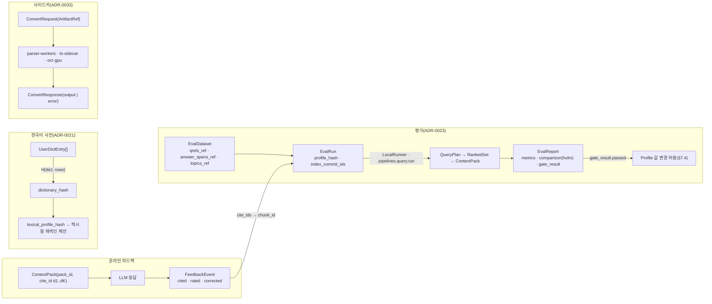
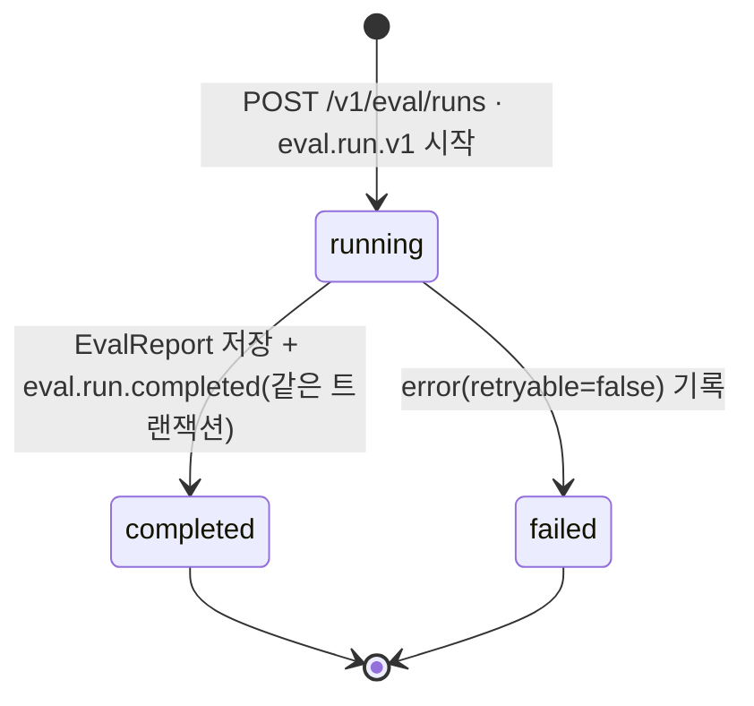
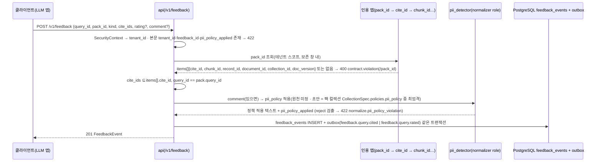
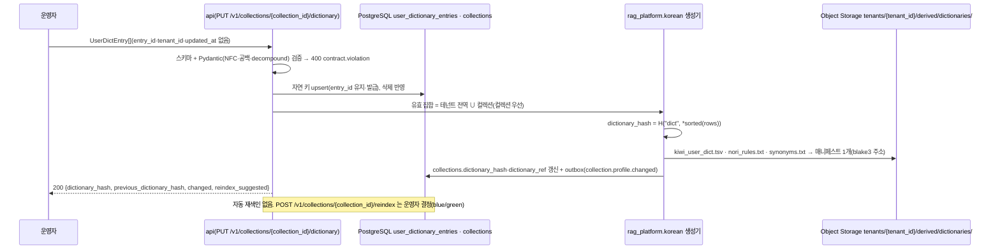
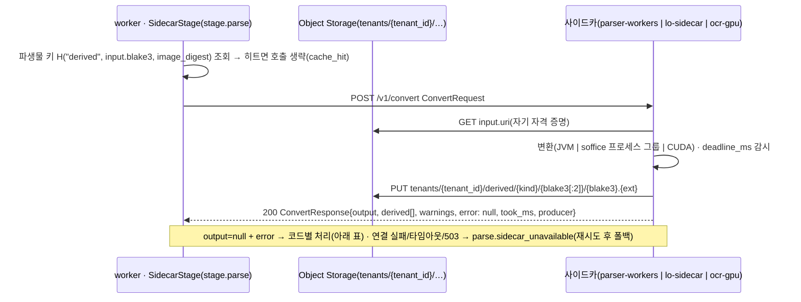

# 평가·피드백·사용자 사전·사이드카 계약

## 목적

바이블 §5.1 인벤토리의 운영 계약 7종 — 평가 하네스(evaluation harness)의 `EvalDataset`·`EvalRun`·`EvalReport`, 온라인 피드백 `FeedbackEvent`, 한국어 사용자 사전(user dictionary) `UserDictEntry`, 변환 사이드카(sidecar) `ConvertRequest`·`ConvertResponse` — 의 필드·스키마·Pydantic 모델·예시·불변식을 확정한다. 이 일곱 계약은 스테이지 경계 계약이 아니라 **품질 기본값을 정당화하고(§7.4 게이트), 검색 결과를 LLM 소비 뒤의 신호로 되먹이고, 렉시컬 분석기의 어휘를 관리하고, 코어 이미지 밖의 런타임(JVM·LibreOffice·CUDA·GPL)과 교환하는** 운영 경계다. 필드 표는 바이블 §5.6의 해당 표를 같은 철자·같은 필수 여부로 옮겼고, 바이블에 없는 필드는 선택(N)으로만 두고 "## 미해결 이슈"에 반영 제안으로 기록했다(바이블 §1.1·§5 서문, 브리프 §11).

## 범위

- 포함: 7개 타입의 필드 표(중첩 객체는 별도 표), 골든셋 산출물 레코드(`qrels.jsonl`·`answer_spans.jsonl`·`topics.jsonl`)와 런 산출물 레코드(`per_query.jsonl`), `EvalRun` 상태 기계, `EvalReport.metrics` 키 규약과 `gate_result` ↔ 바이블 §7.3·§7.4 게이트 형식 정합, `FeedbackEvent`의 `cite_ids` 역추적·PII 정책·이벤트 투영, `UserDictEntry` → `dictionary_hash` → 렉시컬 재색인 제안 경로, 사이드카 `POST /v1/convert`의 HTTP 의미·격리 사다리·파생물 캐시, 크기 한계, 저장 규약, JSON Schema 2020-12 전문 7개(`schemas/eval-dataset.schema.json`, `eval-run.schema.json`, `eval-report.schema.json`, `feedback-event.schema.json`, `user-dict-entry.schema.json`, `convert-request.schema.json`, `convert-response.schema.json`), Pydantic v2 모델, 예시, 불변식, 버전 이력.
- 제외: 메트릭 계산 알고리즘·검정 이름·판정 프롬프트([08-evaluation/02](../08-evaluation/02-retrieval-metrics-and-harness.md), [04](../08-evaluation/04-llm-judge-and-generation-quality.md)), 골든셋 구축 절차([08-evaluation/03](../08-evaluation/03-golden-dataset-construction.md)), 온라인 실험 설계([08-evaluation/06](../08-evaluation/06-online-feedback-loop.md)), API 경로별 응답 형식([05-api/04](../05-api/04-management-api.md)), 사이드카 이미지·배포([02-architecture/08](../02-architecture/08-deployment-architecture.md)), 파서 라우터의 폴백 체인([04-pipelines/03](../04-pipelines/03-parsing-router-and-format-detection.md)), 한국어 분석기 생성기 구현([04-pipelines/09](../04-pipelines/09-normalization-and-cleaning.md)).
- 정본 관계: 필드·필수 여부·열거 철자는 바이블 §5.6·§5.7, ID·해시 결합식은 §6.1·§6.2, 한계는 §5.1, 게이트 형식은 §7.3·§7.4, API 경로는 §14, 오브젝트 키는 §13.3을 그대로 따른다. 공용 타입(`ArtifactRef`·`Producer`·`Warning`·`StageError`)과 열거(`JudgmentLevel`·`LabelProvenance`·`EvalRunStatus`·`DictSource`·`FeedbackKind`·`PiiPolicy`)는 `urn:rag:schema:common-types:1#/$defs/…`로 참조하고 재정의하지 않는다([계약 개요](./00-contract-overview.md) §2 소유 규칙). 오류 코드는 [13-error-model](./13-error-model.md)의 카탈로그 철자만 쓴다.

## 1. 위치와 역할

| 타입 | 생산 | 소비 | 정본 저장 | API(바이블 §14) | 이벤트(§5.7) |
|------|------|------|-----------|------------------|--------------|
| `EvalDataset` | 하네스(바이블 §5.1; 등록 경로는 관리 API `POST /v1/eval/datasets`) | 하네스, 게이트, 관리 API, 프로파일 검증기(`eval.datasets[]`·`gate.dataset`) | PostgreSQL `eval_datasets`; qrels·answer_spans·topics는 오브젝트 스토리지 `eval/datasets/{dataset_id}/` | `GET/POST /v1/eval/datasets` | — |
| `EvalRun` | 하네스(`eval.run.v1`, `JobKind=evaluate`) | 하네스, 관리 API, 게이트 PR 첨부 | PostgreSQL `eval_runs` | `GET/POST /v1/eval/runs`, `GET /v1/eval/runs/{run_id}` | `eval.run.completed` |
| `EvalReport` | 하네스 | 게이트 판정(`rag profile validate`), 운영자, 외부 리포트 리더 | PostgreSQL `eval_reports`; 질의별 산출물 `eval/runs/{run_id}/` | `GET /v1/eval/runs/{run_id}/report` | `eval.run.completed`(data에 metrics 값) |
| `FeedbackEvent` | 클라이언트(LLM 애플리케이션, 사용자 UI) | 평가(인터리빙 승패), 온라인 피드백 루프 | PostgreSQL `feedback_events` | `POST /v1/feedback` | `feedback.query.cited`, `feedback.query.rated`(`corrected`는 `rated` 이벤트에 `kind=corrected`로; 12 §6.5) |
| `UserDictEntry` | 관리 API(운영자·자동 추출 후 검수) | `normalize`(`korean_analyzer`), 인덱스 분석기 생성(Nori `user_dictionary_rules`·`synonym_graph`), `plan`(질의 정규화) | PostgreSQL `user_dictionary_entries`; 생성된 사전 번들은 `tenants/{tenant_id}/derived/dictionaries/`(15 `dictionary_ref` 철자) | `GET/PUT /v1/collections/{collection_id}/dictionary` | `collection.profile.changed`(해시 변경 시) |
| `ConvertRequest` / `ConvertResponse` | 워커 `SidecarStage` / 사이드카 | 사이드카 / 워커(`parse`) | 저장하지 않음(왕복 페이로드; 파생물만 `tenants/{tenant_id}/derived/`) | 사이드카 `POST /v1/convert`, `GET /healthz` | — |



## 2. `EvalDataset`

**결정:** 골든셋의 진실값은 문서 단위 TREC qrels와 문서 ID + `doc_version` + `element_path` + 원문 코드포인트 구간의 `answer_spans`이며, 둘은 JSON Lines 산출물로만 참조한다(D-12; [ADR-0023](../06-adr/0023-evaluation-qrels-answer-spans-and-linear-ndcg.md)). 청크 단위 판정은 저장하지 않고 `RankedResult.block_refs[]`와의 교차로 파생 계산한다(K1; [ADR-0030](../06-adr/0030-single-coordinate-system-and-score-ledger.md)).

### 2.1 필드 표(바이블 §5.6)

| 필드 | 타입 | 필수 | 설명 | 예시 |
|------|------|------|------|------|
| `schema_version` | string(semver) | N | 계약 버전. **바이블 §5.6 미등재**(미해결 이슈 1) | `"1.0.0"` |
| `dataset_id` | string(ulid) | Y | 서버 발급(readOnly; 바이블 §6.1) | `"01J9ZR0D4T7V9W2X4Y6Z8A0B1C"` |
| `tenant_id` | string(ulid) | N | `corpus_collection_id` 소유 테넌트(서버 도출, readOnly). **미등재**(미해결 이슈 1) | `"01J9ZQ4K7X2M8N3P5R6S7T8V9W"` |
| `name` | string | Y | kebab 이름(`^[a-z0-9][a-z0-9-]*$`, ≤ 64). 유일성 키는 `(tenant_id, name, content_hash)`이며 같은 `name`의 행(골든셋 개정판)이 여러 개 공존할 수 있다. 프로파일 `eval.datasets[]`·`gate.dataset`의 `name` 참조는 그 `name`의 **최신 행**(`created_at` 최대)으로 해소한다(§2.3, EF-1; 미해결 이슈 17) | `"ko-public-v1"` |
| `content_hash` | string(hex64) | Y | `H("evalset", qrels_ref.blake3, answer_spans_ref.blake3, topics_ref.blake3 or "")`(§2.3; readOnly) | hex64 |
| `qrels_ref` | `ArtifactRef` | Y | `eval/datasets/{dataset_id}/qrels.jsonl`, `media_type = application/x-ndjson`, 행 = `QrelsRecord` | §예시 1 |
| `answer_spans_ref` | `ArtifactRef` | Y | `eval/datasets/{dataset_id}/answer_spans.jsonl`, 행 = `AnswerSpanRecord` | §예시 1 |
| `topics_ref` | `ArtifactRef` | N | `eval/datasets/{dataset_id}/topics.jsonl`, 행 = `TopicRecord`(질의 본문). **미등재**(미해결 이슈 2) | §예시 1 |
| `corpus_collection_id` | string(ulid) | Y | `qrels.doc_id`가 속한 컬렉션. 하네스는 이 컬렉션의 현재 세대에 질의한다 | `"01J9ZQ5A1B2C3D4E5F6G7H8J9K"` |
| `judgment_level` | enum(JudgmentLevel) | Y | `binary`(rel ∈ {0, 1}) / `graded`(0..`relevance_max`) | `"graded"` |
| `relevance_max` | integer | N | graded 등급 상한(기본 3, TREC RAG 2024). binary는 1 고정. **미등재**(미해결 이슈 1) | `3` |
| `label_provenance` | enum(LabelProvenance) | Y | `human` / `umbrela` / `synthetic`. 게이트 데이터셋은 `human`만(EF-6) | `"human"` |
| `license` | string(SPDX) | Y | SPDX 표현식(`LicenseRef-*` 허용). NC·ND 셋은 배포물 미포함 | `"LicenseRef-KOGL-1"` |
| `language` | string(bcp47) | N | 주 언어. **미등재**(미해결 이슈 1) | `"ko"` |
| `created_at` | string(date-time) | Y | 원장 행 생성 시각(readOnly) | `"2026-09-22T09:00:00.000Z"` |

`POST /v1/eval/datasets` 요청 본문은 readOnly 필드(`dataset_id`·`tenant_id`·`content_hash`·`created_at`)를 갖지 않는다(있으면 422, 00 §8.2). 클라이언트는 산출물을 먼저 올리고 `ArtifactRef`로 등록한다(업로드 절차는 05-api/04).

### 2.2 골든셋 산출물 레코드(이 계약 `$defs`)

세 파일은 JSON Lines(한 행 = 한 객체, UTF-8, `ensure_ascii=false`)이며 계약 인스턴스가 아니므로 `ArtifactRef.schema_type`이 없다. 00 §8.3은 JSON Lines를 평가 셋(`qrels`·`answer_spans`)에만 허용하므로, `topics.jsonl`과 런 산출물 `per_query.jsonl`·`index_commits.jsonl`, `text/plain` TREC `run.trec`은 그 문구를 "평가 산출물(`eval/datasets/*`·`eval/runs/*`) 전체"로 넓히는 00 §8.3 patch 제안(미해결 이슈 2)에 기댄다. TREC 텍스트(`qrels`·`run`)는 `rag eval export --format trec`로 무손실 변환한다(07-tech-landscape/09 §TREC 포맷).

`QrelsRecord`(`qrels.jsonl`, TREC `query_id iteration doc_id relevance`와 1:1):

| 필드 | 타입 | 필수 | 설명 | 예시 |
|------|------|------|------|------|
| `query_id` | string | Y | 골든셋 내 질의 ID(`^[A-Za-z0-9][A-Za-z0-9._-]{0,63}$`). 플랫폼 `query_id`(ULID)와 다른 네임스페이스 | `"kopub-0001"` |
| `iteration` | enum[`0`, `Q0`] | Y | TREC 관례 열(정보 없음) | `"0"` |
| `doc_id` | string(ulid) | Y | `= document_id`(D-06). `corpus_collection_id`의 문서 | ULID |
| `relevance` | integer | Y | binary 0\|1, graded 0..`relevance_max`(nDCG 선형 이득 `rel`) | `3` |

`AnswerSpanRecord`(`answer_spans.jsonl`, K1 좌표):

| 필드 | 타입 | 필수 | 설명 | 예시 |
|------|------|------|------|------|
| `query_id` | string | Y | | `"kopub-0001"` |
| `doc_id` | string(ulid) | Y | 같은 `(query_id, doc_id)`가 qrels에 `relevance ≥ 1`로 존재(EF-4) | ULID |
| `doc_version` | string(hex64) | Y | `= SourceDocument.content_hash`. 현재 세대와 다르면 stale | hex64 |
| `element_path` | string | Y | `Block.provenance.element_path`(문서 내 유일) | `"/hp:sec[0]/hp:p[17]"` |
| `char_start` | integer | Y | 원문 `Block.text` 기준 0-based 코드포인트 | `12` |
| `char_end` | integer | Y | 끝 미포함, `≥ char_start` | `58` |

`TopicRecord`(`topics.jsonl`):

| 필드 | 타입 | 필수 | 설명 | 예시 |
|------|------|------|------|------|
| `query_id` | string | Y | | `"kopub-0001"` |
| `query` | string | Y | ≤ 4,000자(`QueryRequest.query` 한계) | 예시 2 |
| `language` | string(bcp47) | N | | `"ko"` |
| `metadata` | object<string, string \| number \| boolean> | N | 도메인·난이도·다중 홉 등 스칼라 메타(열린 객체, 미해결 이슈 8) | `{"domain": "public_admin"}` |

### 2.3 `content_hash`·등급·라이선스 규칙

- `content_hash = H("evalset", qrels_ref.blake3, answer_spans_ref.blake3, topics_ref.blake3 or "")`(00 §7.1 `H()`). 골든셋 바이트가 하나라도 바뀌면 다른 데이터셋이다 — 유일성 키는 `(tenant_id, name, content_hash)`이고, 같은 `name`의 재등록은 새 `dataset_id`·새 `content_hash`를 발급하며 이전 행은 유지한다(같은 `content_hash` 재등록은 200 + 기존 행). `EvalRun`은 `dataset_id`를 고정하므로 재현성은 유지되고, 프로파일 `eval.datasets[]`·`gate.dataset`의 `name` 참조는 하네스 시작 시점의 최신 행(`created_at` 최대)으로 해소된다 — 라벨 정정판은 게이트에 자동 반영되고, 의미가 달라지는 개정은 `name`을 바꾼다(`ko-public-v2`). 바이블 §6.2 표에 이 식을 더하는 제안은 미해결 이슈 3, 유일성 키·해소 규칙의 §5.6 반영은 미해결 이슈 17.
- `judgment_level=graded`의 유효 상한은 `relevance_max`(생략 시 3)이고 `binary`는 1이다. TREC RAG 2025의 0~4 척도 셋은 `relevance_max: 4`로 등록한다(ADR-0023 재검토 조건).
- `label_provenance ∈ {umbrela, synthetic}` 셋은 확장·모니터링용이며 프로파일 게이트(`gate.dataset`, `eval.gates`)의 데이터셋이 될 수 없다(F6 순환 편향; 하네스 시작 검증 → `profile.invalid`).
- `license`는 SPDX 표현식이다. 공공누리는 SPDX 목록에 없으므로 `LicenseRef-KOGL-{유형}`으로 쓴다(확인 필요 as of 2026-09). NC·ND 라이선스 셋은 등록은 가능하나 배포물·공개 골든셋에 포함하지 않는다(ADR-0023 준수 11; CI 라이선스 게이트).

## 3. `EvalRun`

**결정:** `EvalRun`은 "무엇을 평가했는지"를 `profile_hash`(해소된 프로파일)와 `index_commit_ids`(평가 시작 시점 코퍼스의 문서별 current 커밋 = `documents.current_commit_id`가 가리키는 커밋, [08 §8](./08-index-commit.md)·IC-5)로 고정한다. 하네스는 별도 검색 경로 없이 `pipelines.query.run`을 비내구 `LocalRunner`로 실행한다(D-17; [ADR-0003](../06-adr/0003-orchestrator-neutral-pipeline-and-non-durable-local-runner.md), [ADR-0023](../06-adr/0023-evaluation-qrels-answer-spans-and-linear-ndcg.md)). `run_id`라는 이름은 이 계약에서만 쓴다(바이블 §6.1·§6.4).

### 3.1 필드 표(바이블 §5.6)

| 필드 | 타입 | 필수 | 설명 | 예시 |
|------|------|------|------|------|
| `schema_version` | string(semver) | N | **미등재**(미해결 이슈 1) | `"1.0.0"` |
| `run_id` | string(ulid) | Y | EvalRun 전용 식별자(readOnly) | `"01J9ZR5E3H7K9M2N4P6Q8S0T1V"` |
| `tenant_id` | string(ulid) | N | 데이터셋 소유 테넌트(readOnly). **미등재**(미해결 이슈 1) | ULID |
| `dataset_id` | string(ulid) | Y | `EvalDataset.dataset_id` | ULID |
| `profile_id` | string | Y | kebab-case(바이블 §6.1) | `"standard"` |
| `profile_hash` | string(hex64) | Y | `H("profile", canonical_json(해소된 프로파일))`; 실행된 모든 `QueryPlan.profile_hash`와 동일(readOnly) | hex64 |
| `index_commit_ids` | array<string(ulid)> | Y | 시작 시점 corpus 컬렉션의 문서별 **current 커밋** = `documents.current_commit_id`가 가리키는 커밋([08 §8](./08-index-commit.md)·IC-5; `committed ∧ superseded_by 없음`은 필요조건일 뿐이다 — 재색인 모드 A(blue/green) 채움 중에는 하네스가 질의하는 alias와 같은 **blue 커밋만** 스냅숏하고 green 커밋은 포함하지 않는다), ULID 오름차순, 1..1,000(readOnly). 초과분은 `index_commits_ref`. 상한 1,000은 12 `EvalRunCompletedData.index_commit_ids`의 `maxItems`와 같아 `eval.run.completed` `data`에는 이 배열이 그대로 실리며, 완전성은 `index_commits_hash`로 검증한다(§8, EF-9; 미해결 이슈 4) | §예시 5 |
| `index_commits_hash` | string(hex64) | N | `H("commits", *sorted(전체 current commit_id))`(readOnly). 스키마상 N(바이블 미등재)이지만 **하네스가 항상 채운다**(EF-9): 커밋이 1,000개를 넘어 `index_commit_ids`가 잘려도 소비자가 `H("commits", *index_commit_ids)`와 비교해 완전성을 판정할 수 있다. `index_commits_ref`가 있으면 스키마도 필수. **미등재**(미해결 이슈 4) | hex64 |
| `index_commits_ref` | `ArtifactRef` | N | `eval/runs/{run_id}/index_commits.jsonl`(행 = `IndexCommitRecord{commit_id, document_id, index_generation}`), 커밋 > 1,000일 때만(전체 current 커밋 목록). **미등재**(미해결 이슈 4) | — |
| `status` | enum(EvalRunStatus) | Y | `running` → `completed` \| `failed`(readOnly, §3.2) | `"completed"` |
| `judge_model` | string \| null | N | LLM-judge 모델(`{repo}@{revision}` 권장). 대상 프로파일의 리랭커·LLM 보강 모델과 다른 계열(EF-11) | `"Qwen/Qwen3-8B@a1b2c3d"` |
| `experiment_id` | string \| null | N | 인터리빙·A/B 실험 ID(`QueryRequest.experiment_id`와 같은 값 공간, ≤ 128) | `null` |
| `baseline_run_id` | string(ulid) | N | 비교 기준 런(`EvalReport.comparison.baseline_run_id`와 동일). **미등재**(미해결 이슈 1) | ULID |
| `metrics_requested` | array<string> | Y | 메트릭 키(§4.2), 1..64, 유일 | `["ndcg@10", "recall@20"]` |
| `started_at` | string(date-time) | Y | readOnly | `"2026-09-22T02:00:00.000Z"` |
| `finished_at` | string(date-time) \| null | N | 종결 상태면 필수, `running`이면 null 또는 생략(readOnly) | `"2026-09-22T02:41:17.512Z"` |
| `job_id` | string(ulid) | N | `JobKind=evaluate` 잡(`eval.run.v1` 워크플로우 ID; readOnly). **미등재**(미해결 이슈 1) | ULID |
| `error` | `StageError` \| null | N | `failed`의 최종 오류(`retryable=false`; readOnly). 크래시·취소로 끝난 런은 `error` 없이 `failed`일 수 있다. **미등재**(미해결 이슈 1) | — |

`POST /v1/eval/runs` 요청 본문은 `dataset_id`·`profile_id`·`metrics_requested`(+ `judge_model`·`experiment_id`·`baseline_run_id`)만 갖는다. 서버가 `profile_id`를 해소해 `profile_hash`를 계산하고 `corpus_collection_id` 문서들의 `documents.current_commit_id`(08 §8 current 커밋)를 스냅숏해 `index_commit_ids`·`index_commits_hash`(·1,000 초과면 `index_commits_ref`)를 채운다. 재색인 모드 A 채움 중이면 조회 API와 같이 blue 커밋을 current로 본다(08 §8·§9) — green 커밋은 alias 교체와 `ledger.advance_pointers` 뒤에 시작한 런에서만 스냅숏된다. 과거 세대를 지정하는 입력은 없다(과거 세대는 `is_current=false`로 검색되지 않으므로 평가 불가).

### 3.2 상태 기계와 재현성 고정



| 규칙 | 내용 |
|------|------|
| 전이 | `running → completed`, `running → failed`만. 종결 후 변경 없음. `LocalRunner` 크래시는 `failed` + `error` 없음이 허용된다(비내구; 13 §4.3 I12 예외와 같은 성격) |
| 재현성 | `profile_hash`는 런 안의 모든 `QueryPlan.profile_hash`와 같아야 하고(런타임 단정 → `contract.violation` + `failed`), `index_commit_ids`는 시작 시점 `documents.current_commit_id` 스냅숏(08 §8; 하네스가 질의하는 alias 대상과 같은 blue 커밋)이다. 런 도중 세대 플립이 일어난 문서는 `per_query.jsonl`에 표시만 하고(`ContextPack.diagnostics.index_generations_seen`) 런을 무효화하지 않는다 |
| 보안 주체 | 하네스 질의의 `SecurityContext`는 서버가 주입한 `service:eval-harness` 주체 + 테넌트 스코프다(E6). 하네스가 보지 못하는 문서(ACL·`classification_max`)는 recall 상한을 낮추므로 골든셋 문서 전부가 가시 집합에 있어야 한다(미해결 이슈 14) |
| 잡 연결 | `job_id`는 `JobStatus.kind=evaluate` 잡이다. `POST /v1/jobs/{job_id}/cancel`은 런을 `failed`로 끝내며 카탈로그에 취소 전용 코드가 없어 `error`를 채우지 않는다(13 §4.3 크래시 예외와 동일 취급; 전용 코드는 미해결 이슈 6) |

## 4. `EvalReport`

**결정:** `EvalReport.gate_result.passed`가 프로파일 품질 기본값 변경의 유일한 판정자다(바이블 §7.4; [ADR-0031](../06-adr/0031-profile-schema-extends-and-quality-gates.md)). 베이스라인 비교는 질의 단위 쌍대 검정 p값에 Holm 보정을 적용한 `p_values`로 판정하고 `correction`은 `"holm"` 고정이다(D-12).

### 4.1 필드 표(바이블 §5.6)

| 필드 | 타입 | 필수 | 설명 | 예시 |
|------|------|------|------|------|
| `schema_version` | string(semver) | N | **미등재**(미해결 이슈 1) | `"1.0.0"` |
| `run_id` | string(ulid) | Y | `EvalRun.run_id`(`completed`). 런당 리포트 1개 | ULID |
| `tenant_id` | string(ulid) | N | `EvalRun.tenant_id` 복사(readOnly; 하네스가 항상 채운다, EF-30). **미등재**(미해결 이슈 1) | ULID |
| `dataset_id` | string(ulid) | N | `EvalRun.dataset_id` 복사(외부 소비자 편의). **미등재**(미해결 이슈 1) | ULID |
| `profile_hash` | string(hex64) | N | `EvalRun.profile_hash` 복사. **미등재**(미해결 이슈 1) | hex64 |
| `query_count` | integer | N | 집계 질의 수(검정력 판단). **미등재**(미해결 이슈 1) | `312` |
| `metrics` | object<string, number> | Y | 질의 평균 또는 런 단위 집계값(키별 정의 §4.2; `cost_per_doc_usd`·`latency_p95_ms`는 런 단위, 미해결 이슈 15). ≤ 64 키, `metrics_requested` 포함 | `{"ndcg@10": 0.812}` |
| `comparison` | `EvalComparison` \| null | N | 베이스라인 비교(§4.3). 없으면 절대 게이트만 판정 | §예시 8 |
| `gate_result` | `GateResult` | Y | §4.4 | `{"passed": true, "failed_gates": []}` |
| `artifacts_ref` | `ArtifactRef` | Y | `eval/runs/{run_id}/per_query.jsonl`(`application/x-ndjson`, 행 = `PerQueryRecord`) | §예시 8 |
| `run_ref` | `ArtifactRef` | N | `eval/runs/{run_id}/run.trec`(`text/plain`, TREC run `query_id Q0 doc_id rank score run_tag`; `run_tag = run_id`). **미등재**(미해결 이슈 1) | §예시 8 |
| `created_at` | string(date-time) | Y | 리포트 확정 시각 = `EvalRun.finished_at` | `"2026-09-22T02:41:17.512Z"` |

### 4.2 `metrics` 키 규약

키는 `{metric}[@{k}]`(`^[a-z][a-z0-9_]*(@[1-9][0-9]*)?$`, ≤ 64)이고 값은 유한한 number다. 정본 키(바이블 §5.6)의 정의는 ADR-0023(07-tech-landscape/09 §메트릭 정의)을 따르며 어휘 확장은 08-evaluation/02·04가 확정한다(minor).

| 키 | 정의 | 단위 | 계산기 |
|----|------|------|--------|
| `ndcg@k` | DCG@k / IDCG@k, 이득 **선형 `rel`**, 할인 `1/log2(i+1)` | 문서(qrels) | ranx `ndcg` 1차, ir_measures `nDCG@k` 교차 검증(±0.01) |
| `ndcg_exp@k` | 지수 이득 `2^rel − 1`. `ndcg@k`와 절대 혼용하지 않는다 | 문서 | ranx `ndcg_burges` |
| `recall@k` | `rel ≥ 1` 문서 중 상위 k 회수 비율 | 문서 | ranx |
| `mrr` / `mrr@k` | 첫 관련 문서 역순위 평균(`mrr`는 `k = hydrate.top_n` 기준, 초안; 미해결 이슈 15) | 문서 | ranx |
| `judged@k` | 상위 k 중 qrels 판정이 존재하는 비율(풀링 편향 감지) | 문서 | ir_measures `Judged@k` |
| `span_hit_rate@k` | 상위 k 항목 중 `block_refs[]{element_path, original_char_start, original_char_end}`가 `answer_spans`와 겹치는 항목이 하나라도 있으면 1, 질의 평균 | 청크 + provenance | 자체(`rag_platform.eval.span_hit`) |
| `faithfulness`, `context_precision`, `answer_relevancy`, `noise_sensitivity` | LLM-judge(RAGAS collections 정의, DeepEval 병기) | 응답 | `judge_ragas` |
| `cost_per_doc_usd`, `latency_p95_ms` | 게이트 `max_cost_per_doc_usd`·지연 예산 판정 입력(비율이 아닌 값) | 문서 / ms | `usage_ledger`, OTel |

### 4.3 `comparison`(`EvalComparison`, 이 계약 `$defs`)

| 필드 | 타입 | 필수 | 설명 | 예시 |
|------|------|------|------|------|
| `baseline_run_id` | string(ulid) | Y | 같은 `dataset_id`의 `completed` 런, `run_id`와 다름 | ULID |
| `deltas` | object<string, number> | Y | `metrics[k] − baseline.metrics[k]`; 키 ⊆ `metrics` 키 | `{"ndcg@10": 0.014}` |
| `p_values` | object<string, number> | Y | Holm 보정 후 p값(0..1); 키 집합 = `deltas` 키 집합 | `{"ndcg@10": 0.031}` |
| `correction` | string(const `"holm"`) | Y | 고정값(D-12) | `"holm"` |
| `stat_test` | string | N | 보정 전 검정(`fisher_randomization`·`paired_t`·`tukey_hsd`; 정본 08-evaluation/02). **미등재**(미해결 이슈 1) | `"fisher_randomization"` |

### 4.4 `gate_result`(`GateResult`·`GateOutcome`, 이 계약 `$defs`) — 바이블 §7.3·§7.4 게이트 형식과의 정합

`GateResult`:

| 필드 | 타입 | 필수 | 설명 | 예시 |
|------|------|------|------|------|
| `passed` | boolean | Y | `failed_gates`가 비어 있을 때만 true. true인 `run_id`만 프로파일 값 변경 PR에 인용 가능 | `true` |
| `failed_gates` | array<GateOutcome> | Y | `severity=fail` 항목, ≤ 64 | `[]` |
| `warned_gates` | array<GateOutcome> | N | `severity=warn` 항목(`warn_below`). `passed`에 영향 없음. **미등재**(미해결 이슈 1) | §예시 9 |

`GateOutcome`:

| 필드 | 타입 | 필수 | 설명 | 예시 |
|------|------|------|------|------|
| `gate_path` | string | Y | 프로파일 YAML 경로: `eval.gates.{metric}` 또는 게이트가 붙은 파라미터 경로 | `"eval.gates.ndcg@10"` |
| `metric` | string | Y | 판정 메트릭 키(§4.2) | `"ndcg@10"` |
| `condition` | enum(`EvalReport.gate_result.failed_gates.condition`) | Y | 실패한 게이트 키: `min, max, max_regression, p, warn_below, min_delta, min_delta_pt, min_qrels, max_cost_per_doc_usd, grid` — 15 `EvalGate{min, max, max_regression, p, warn_below}`·`GateSpec{grid, min_delta, min_delta_pt, min_qrels, max_cost_per_doc_usd}` 판정 키와 1:1(EF-15) | `"max_regression"` |
| `expected` | number | Y | 게이트 값(임계·목표). `grid`는 그리드 중 `metric`이 최고인 후보 값 | `0.01` |
| `observed` | number \| null | Y(nullable) | 관측값. `grid`는 프로파일의 현재 `value`. 계산 불가면 null | `0.018` |
| `dataset` | string | N | 게이트가 지정한 `EvalDataset.name` | `"ko-public-v1"` |
| `severity` | enum(`EvalReport.gate_result.failed_gates.severity`) | Y | `fail` / `warn` | `"fail"` |
| `detail` | string | N | 영문 진단 문구(콘텐츠 없음, ≤ 512) | 예시 9 |

바이블 §7.3의 두 게이트 형식(`eval.gates.{metric}` = 15 `EvalGate`, 파라미터 `gate{…}` = 15 `GateSpec`)이 `GateOutcome`으로 사상되는 규칙(값은 §7.3 `standard` 정본 YAML; 초안 목표). **통과 조건 열과 아래 세 해석 규칙은 초안이며 08-evaluation/02(검정·판정)와 15 `GateSpec`이 확정한다(미해결 이슈 20)**: (a) `max_regression`과 `p`가 함께 있으면 "하락 ≤ `max_regression`, 또는 Holm 보정 `p_values[k] ≥ p`(유의하지 않은 하락)"이면 통과; (b) `min_delta`·`min_delta_pt` 후보 게이트의 유의성 `p`는 `GateSpec`에 키가 없으므로 같은 메트릭의 `eval.gates.{metric}.p`를 상속한다(없으면 유의성 항목 생략); (c) `metric`이 없는 `gate`(§7.3 `overlap_ratio`)는 `ndcg@10`으로 해석한다(15 §3.7과 동일).

| 프로파일 게이트(바이블 §7.3·§7.4; 15 `EvalGate`·`GateSpec`) | `gate_path` | `condition` | `expected` | `observed` | 통과 조건(초안) |
|------|------|------|------|------|------|
| `eval.gates.ndcg@10: {min: 0.80}` | `eval.gates.ndcg@10` | `min` | 0.80 | `metrics["ndcg@10"]` | observed ≥ expected |
| `eval.gates.{metric}: {max: v}`(15 `EvalGate.max`, 상한 게이트; 예 `latency_p95_ms: {max: 800}` — 키 어휘는 미해결 이슈 15) | `eval.gates.{metric}` | `max` | v | `metrics[k]` | observed ≤ expected |
| `eval.gates.ndcg@10: {max_regression: 0.01, p: 0.05, correction: holm}` | `eval.gates.ndcg@10` | `max_regression` | 0.01 | `−deltas["ndcg@10"]` | observed ≤ expected, 또는 `p_values[k] ≥ p`(규칙 a) |
| `eval.gates.recall@20: {min: 0.92}` | `eval.gates.recall@20` | `min` | 0.92 | `metrics["recall@20"]` | ≥ |
| `eval.gates.judged@10: {warn_below: 0.7}` | `eval.gates.judged@10` | `warn_below` | 0.7 | `metrics["judged@10"]` | observed ≥ expected; 미달은 `warned_gates`(qrels 보강 필요) |
| `ingest.chunk.leaf_max_tokens: {value: 512, gate: {metric: ndcg@10, grid: [256, 384, 512, 768], dataset}}` | `ingest.chunk.leaf_max_tokens` | `grid` | 그리드 중 `metric` 최고 후보 값(예 512) | 현재 `value`(512) | observed = expected(현재 값이 그리드 최적) |
| `ingest.chunk.fallback.overlap_ratio: {value: 0.10, gate: {grid: [0, 0.10, 0.15]}}`(`metric` 없음 → 규칙 c) | `ingest.chunk.fallback.overlap_ratio` | `grid` | 최고 후보 값 | 현재 `value`(0.10) | observed = expected |
| `ingest.enrich.generated_prefix.gate: {metric: ndcg@10, min_delta: 0.03, max_cost_per_doc_usd: 0.05}` | `ingest.enrich.generated_prefix` | `min_delta` / `p` / `max_cost_per_doc_usd` | 0.03 / 0.05(규칙 b: `eval.gates.ndcg@10.p` 상속) / 0.05 | `deltas[k]` / `p_values[k]` / `metrics["cost_per_doc_usd"]` | ≥ / < / ≤ (셋 모두) |
| `query.fusion.gate: {promote_to: convex_minmax, min_qrels: 200}` | `query.fusion` | `min_qrels` | 200 | 데이터셋의 `rel ≥ 1` qrels 수 | ≥ |
| `query.rerank.gate: {candidate: …, min_delta_pt: 2}` | `query.rerank` | `min_delta_pt` | 2 | `deltas[k] × 100` | ≥ (유의성은 규칙 b) |

`p`는 `max_regression`의 유의성 조건이면서(`max_regression` 항목 하나로 기록), `min_delta`·`min_delta_pt` 후보 게이트에서는 "개선은 있으나 유의하지 않음"을 별도 `condition: p` 항목으로 기록한다. `expected`는 항상 "통과에 필요한 값"(임계·목표·최적 후보) 하나의 의미만 갖는다. 게이트가 `comparison`을 요구하는데(`max_regression`·`min_delta*`) `comparison`이 없으면 그 게이트는 `observed: null`·`severity: fail`이다.

### 4.5 질의별 산출물(`PerQueryRecord`, `per_query.jsonl`)

| 필드 | 타입 | 필수 | 설명 | 예시 |
|------|------|------|------|------|
| `query_id` | string | Y | 골든셋 `query_id` | `"kopub-0001"` |
| `metrics` | object<string, number> | Y | 질의 단위 값(리포트 `metrics`의 평균 대상) | 예시 10 |
| `top_doc_ids` | array<string(ulid)> | N | 상위 문서 ID(순위순, ≤ 100). `run_ref`가 있으면 생략 가능 | — |
| `span_hit_ranks` | array<integer> | N | `answer_spans`와 겹친 항목의 최종 순위(1-based) | `[1]` |

행 수 = `query_count`. 질의 본문·청크 본문·주체 문자열은 싣지 않는다(00 I-16). Holm 보정은 이 파일의 질의 단위 값에서 하네스가 계산한다(ranx는 보정을 제공하지 않음; F4).

## 5. `FeedbackEvent`

**결정:** LLM 소비자에게는 "클릭"이 없으므로 다운스트림 응답이 인용한 `cite_id`(`cited`)와 명시 평점·정정(`rated`·`corrected`)이 온라인 신호다. `cite_id`는 팩 확정 후 불변(D-20)이므로 `pack_id`의 인용 맵으로 `chunk_id`·`record_id`·`document_id`에 결정적으로 역추적된다([ADR-0023](../06-adr/0023-evaluation-qrels-answer-spans-and-linear-ndcg.md) F7, [ADR-0024](../06-adr/0024-context-pack-ordering-and-anthropic-search-result-renderer.md)).

### 5.1 필드 표(바이블 §5.6)

| 필드 | 타입 | 필수 | 설명 | 예시 |
|------|------|------|------|------|
| `schema_version` | string(semver) | N | **미등재**(미해결 이슈 1) | `"1.0.0"` |
| `feedback_id` | string(ulid) | Y | 서버 발급(readOnly) | `"01J9ZS1F2G3H4J5K6M7N8P9Q0R"` |
| `tenant_id` | string(ulid) | Y | `SecurityContext.tenant_id`(readOnly; 본문에 오면 422, E1) | ULID |
| `query_id` | string(ulid) | Y | `= ContextPack.query_id` | ULID |
| `pack_id` | string(ulid) | Y | 대상 `ContextPack`; 인용 맵의 키 | ULID |
| `kind` | enum(FeedbackKind) | Y | `cited` / `rated` / `corrected` | `"cited"` |
| `cite_ids` | array<string> | Y | `d{rank}`(`CiteId`), 유일, ≤ 20; 팩의 최종 항목만. `cited`면 1개 이상, 그 외 빈 배열 허용 | `["d1", "d3"]` |
| `rating` | integer(1..5) \| null | N | `rated`면 필수 | `2` |
| `comment` | string \| null | N | PII 정책 적용 후 텍스트(≤ 2,000자). `corrected`면 필수(정정 내용) | 예시 12 |
| `experiment_id` | string | N | 인터리빙·A/B 귀속 키(서버가 팩의 `QueryRequest.experiment_id`에서 채움). **미등재**(미해결 이슈 1·16) | `"interleave-2026w39-cc-vs-rrf"` |
| `pii_policy_applied` | enum(PiiPolicy) | N | 서버 기록(readOnly; 본문에 오면 422): `comment`에 적용한 정책(`≠ reject`). 서버는 `comment`를 저장할 때 항상 채운다(EF-19 서버 불변식) — 스키마 필수는 아니다(바이블 §5 서문 "없는 필드는 N만" 규칙). **미등재**(미해결 이슈 1) | `"mask"` |
| `created_at` | string(date-time) | Y | 서버 수신 시각(readOnly) | `"2026-09-22T09:00:07.318Z"` |

### 5.2 `cite_ids` 역추적·PII 정책·이벤트 투영



| 규칙 | 내용 |
|------|------|
| 인용 맵 | `pack_id`별 `{cite_id → chunk_id, record_id, document_id, collection_id, doc_version}`. 검색 핫패스는 PostgreSQL을 쓰지 않으므로([ADR-0034](../06-adr/0034-retrieval-hot-path-postgres-independence-and-hydrate.md)) 맵은 응답 뒤 비동기로 남긴다. 저장 위치(§13.1 미등재)는 미해결 이슈 7 — 제안은 `audit.query.executed` 이벤트 `data.citations[]`(ID만이므로 E12 준수) 또는 `pack_citations` 표. 보존 창 30일(초안 목표) 뒤의 피드백은 400 |
| kind 규칙 | `cited` ⇒ `cite_ids ≥ 1`; `rated` ⇒ `rating`; `corrected` ⇒ `comment`. `rated`·`corrected`의 `cite_ids`는 "이 평점·정정이 가리키는 항목"이며 비어 있을 수 있다 |
| PII | `comment`는 저장 전에 PII 정책을 통과한다. **정책 원천은 미정**(미해결 이슈 18): 바이블 §13.1 `tenants.policies`에는 `pii_policy`가 없고 `CollectionSpec.policies.pii_policy`(바이블 §5.6)만 있는데 팩은 여러 컬렉션을 걸칠 수 있다. 채택 전 초안: 팩 항목이 속한 컬렉션들의 `CollectionSpec.policies.pii_policy` 중 가장 엄격한 값(엄격도 `reject > exclude > tokenize > mask > keep`, 초안). 원문은 어디에도 남지 않는다(로그·스팬 포함). `pii_policy=keep`은 E4의 `keep` 불가 항목(고유식별정보·계좌·카드)에 적용되지 않으며, `reject` 검출은 저장 거부다(HTTP 422 매핑은 13 §3.3 공동 제안, 미해결 이슈 6) |
| 이벤트 | `cited` → `feedback.query.cited`, `rated`·`corrected` → `feedback.query.rated`(바이블 §5.7 카탈로그는 두 이벤트만; 12 §6.5는 `kind ∈ {rated, corrected}`를 `rated` 이벤트로 투영). `data`는 12 소유 `FeedbackQueryEventData{feedback_id, query_id, pack_id, kind, cite_ids, rating(nullable)}`로 ID·수치만(00 I-16; `additionalProperties: false`). `experiment_id`는 `data`에 없다(12에 N 추가 제안, 미해결 이슈 6). `subject = tenant/{tenant_id}/query/{query_id}`(12 `QuerySubject`, 바이블 §6.5 `tenant/{tenant_id}/{entity}/{id}`); `pack_id`는 `data.pack_id`로만 전달 |
| 평가 귀속 | 인터리빙: `experiment_id` + 팩 항목의 팀 배정(`QueryPlan.team_assignment`) + `cite_ids`로 팀별 인용 수를 집계해 승패를 매긴다(ADR-0023 F7). 쌍대 비교의 절대 점수는 `rating`이 아니라 승률이다 |
| 주체 | 피드백을 보낸 주체(`SecurityContext.principals`)는 계약 필드가 아니다. 감사가 필요하면 `audit.admin.action`이 아닌 별도 감사 이벤트를 12 문서가 정의한다(콘텐츠·주체 미포함 원칙) |

## 6. `UserDictEntry`

**결정:** `UserDictEntry`는 Kiwi·mecab-ko 사용자 사전, Nori `user_dictionary_rules`, OpenSearch `synonym_graph`의 **단일 소스**다. 항목 집합의 정규화 행 해시 `dictionary_hash = H("dict", *sorted(rows))`가 바뀌면 `CollectionSpec.dictionary_hash` → `lexical_profile_hash`가 바뀌어 렉시컬 재색인 대상이 된다(D-15; [ADR-0021](../06-adr/0021-korean-analyzer-kiwi-promotion-and-interim-mecab-kss.md)). 재색인은 자동으로 시작하지 않고 제안(응답 + 이벤트)만 한다.

### 6.1 필드 표(바이블 §5.6)

| 필드 | 타입 | 필수 | 설명 | 예시 |
|------|------|------|------|------|
| `schema_version` | string(semver) | N | **미등재**(미해결 이슈 1) | `"1.0.0"` |
| `entry_id` | string(ulid) | Y | 서버 발급(readOnly). 자연 키 `(tenant_id, collection_id, surface, pos)`가 같으면 PUT 뒤에도 유지 | `"01J9ZQ9D1E2F3G4H5J6K7M8N9P"` |
| `tenant_id` | string(ulid) | Y | `SecurityContext.tenant_id`(readOnly) | ULID |
| `collection_id` | string(ulid) \| null | Y(nullable) | 컬렉션 항목 / `null` = 테넌트 전역(모든 컬렉션에 병합; 같은 `(surface, pos)`는 컬렉션 항목 우선) | `null` |
| `surface` | string | Y | 표층형, NFC, 공백 없음, 1..64자 | `"행정안전부"` |
| `pos` | string | Y | 세종 품사 태그(`^[A-Z]{2,4}$`; NNG·NNP·NNB·SL·SN 등). 분석기가 사용자 사전으로 받는 태그만 | `"NNP"` |
| `reading` | string \| null | N | 독음(한자·영문 약어의 한글 읽기) | `null` |
| `synonyms` | array<string> | Y | 동의어·약칭(유일, `surface` 제외, ≤ 32). `synonym_graph`·Kiwi `orig_word` 입력 | `["행안부"]` |
| `decompound` | array<string> | N | 복합명사 분해 구성요소(2..8), 이어 붙이면 `surface`. Nori `user_dictionary_rules` 입력. **미등재**(미해결 이슈 5) | `["정보", "공개", "청구서"]` |
| `weight` | number | Y | Kiwi `add_user_word(score=weight)` 입력, Nori 무시, 질의 `BoostKind.user_dictionary` 계수 입력(초안). 기본 0.0 | `0.0` |
| `source` | enum(DictSource) | Y | `manual` / `imported` / `mined` | `"manual"` |
| `updated_at` | string(date-time) | Y | 마지막 변경 시각(readOnly) | `"2026-09-22T08:30:00.000Z"` |

### 6.2 `dictionary_hash`·생성기·재색인 제안 경로



| 규칙 | 내용 |
|------|------|
| 정규화 행 | `row = canonical_json({surface, pos, reading, synonyms: sorted(synonyms), decompound, weight})` — `entry_id`·`tenant_id`·`collection_id`·`source`·`updated_at`·`schema_version`은 제외(분석기 동작에 영향 없음). 값이 없는 선택 필드는 키를 넣지 않는다. `dictionary_hash = H("dict", *sorted(rows))`(바이블 §6.2; 행 정의는 미해결 이슈 3) |
| 유효 집합 | 컬렉션의 사전 = 테넌트 전역 항목(`collection_id=null`) ∪ 컬렉션 항목. 같은 `(surface, pos)`는 컬렉션 항목이 전역 항목을 대체한다. 전역 항목 변경은 모든 컬렉션의 `dictionary_hash`를 바꾼다 |
| 변경 전파 | 해시가 바뀌면 `collections.dictionary_hash`·`dictionary_ref`(생성 번들 매니페스트의 `ArtifactRef` URI) 갱신 → `lexical_profile_hash = H("lex", analyzer_id, dictionary_hash, mapping_version)` 변경 → OpenSearch 물리 인덱스 `rag_lex_{hash[:12]}`가 달라지므로 **렉시컬 재색인 제안**(응답 `reindex_suggested: true`, 형식은 05-api/04) + `collection.profile.changed`(api 캐시 갱신). 새 수집은 `normalizer_fingerprint`에 `dictionary_hash`가 들어 있어 자동으로 새 사전을 쓴다 |
| 불일치 관측 | 재색인 전까지 현재 세대 `IndexCommit.dictionary_hash ≠ CollectionSpec.dictionary_hash`이며 렉시컬 레그는 `degraded{channel.lexical, analyzer_mismatch}`를 기록한다(바이블 §5.5). 점수는 각 레그가 색인·질의를 같은 분석기로 처리하므로 자기 일관적이다 |
| 생성 형식 | Kiwi `surface\tpos\tweight`(+ `orig_word` 동의어), mecab-ko 사용자 사전 CSV(컴파일 필요), Nori `surface decompound…`(`decompound` 없으면 `surface`만), `synonym_graph` `synonym, surface`. 생성 규칙은 04-pipelines/09 |
| Nori 조건 | Nori 규칙은 구성요소를 이어 붙인 문자열이 표층형과 같아야 로드된다(`"".join(decompound) == surface`; Lucene `UserDictionary` 검증 — 확인 필요 as of 2026-09) |

## 7. `ConvertRequest` / `ConvertResponse`

**결정:** 모든 변환 사이드카는 공통 계약 `POST /v1/convert`(`ConvertRequest → ConvertResponse`)와 `GET /healthz`를 제공하고, 본문은 `ArtifactRef`만·비밀은 `credentials_ref`만 담는다. 변환 실패는 200 + `output=null` + `error`(`StageError`)이고 `ProblemDetails`는 전송·검증 오류(400·503)에만 쓴다(O-10; [ADR-0033](../06-adr/0033-sidecar-convert-contract-and-isolation-ladder.md), [ADR-0018](../06-adr/0018-api-rest-sse-mcp-no-grpc-rfc9457.md)).

### 7.1 `ConvertRequest` 필드 표(바이블 §5.6)

| 필드 | 타입 | 필수 | 설명 | 예시 |
|------|------|------|------|------|
| `schema_version` | string(semver) | N | `contracts_compat` 범위 밖이면 400. **미등재**(미해결 이슈 1) | `"1.0.0"` |
| `input` | `ArtifactRef` | Y | 원본(`sources/{blake3}`) 또는 상류 파생물. `uri` 스킴 `s3`·`file`(개발)만(E16), `media_type`은 원본 MIME | §예시 15 |
| `options` | object | N | 사이드카별 옵션(열린 객체, ≤ 32 키). URL·비밀·본문 텍스트 금지 | `{"target": "hwpx"}` |
| `tenant_id` | string(ulid) | Y | 파생물 키 접두 `tenants/{tenant_id}/derived/`와 감사용. 캐시 키에는 불포함 | ULID |
| `document_id` | string(ulid) | Y | 감사·트레이스 상관용. 캐시 키에는 불포함 | ULID |
| `deadline_ms` | integer | Y | 잔여 예산(ms, 1..3,600,000). 워커가 `StagePolicy.start_to_close` 잔여에서 워커 오버헤드(초안 1분: 응답 파싱·파생물 등록·지문 기록)를 뺀 값으로 파생 — parse 15m(바이블 §4.4) 시작 직후면 840,000(ADR-0033 예시와 동일) | `840000` |
| `trace_id` | string | Y | W3C trace-id(hex32). 사이드카 스팬은 `rag.ingest.parse`의 자식 | `"4bf92f3577b34da6a3ce929d0e0e4736"` |
| `credentials_ref` | string \| null | N | `{provider}:{path}`(`IngestRequest.credentials_ref` 그대로 전파). 값 자체 금지 | `null` |

### 7.2 `ConvertResponse` 필드 표(바이블 §5.6)

| 필드 | 타입 | 필수 | 설명 | 예시 |
|------|------|------|------|------|
| `schema_version` | string(semver) | N | **미등재**(미해결 이슈 1) | `"1.0.0"` |
| `output` | `ArtifactRef` \| null | Y(nullable) | 주 산출물 1개(HWPX·DOCX 변환본·OCR 결과), `tenants/{tenant_id}/derived/{kind}/…`. null이면 `error` 필수 | §예시 16 |
| `derived` | array<ArtifactRef> | Y | 부속 파생물(변환 보고서·표 HTML·페이지 이미지 매니페스트), ≤ 64, 빈 배열 허용. `ParsedDocument.artifacts[]`로 전파 | §예시 16 |
| `warnings` | array<Warning> | Y | §5.7 경고 코드, 콘텐츠 없음 | `[]` |
| `error` | `StageError` \| null | N | `output=null`이면 필수: `stage="parse"`, `code`는 `parse.*`(≠ `parse.sidecar_unavailable`), `retryable`은 카탈로그 값, `plugin_id = producer.plugin_id` | §예시 17 |
| `took_ms` | integer | Y | 처리 시간(ms). `deadline_ms` 초과면 `output=null` | `1930` |
| `producer` | `Producer` | Y | `plugin_id`(사이드카 어댑터), `plugin_version`, `config_hash`, `image_digest`(비-null 자기 보고), `model_ids` | §예시 16 |

### 7.3 HTTP 의미·격리 사다리·파생물 캐시



| 상황 | 사이드카 응답 | 워커(`SidecarStage`) 처리 |
|------|---------------|----------------------------|
| 변환 성공 | 200 `ConvertResponse{output, …, error: null}` | `output`·`derived[]` → `ParsedDocument.artifacts[]`, `parser_fingerprint.sidecar_image_digest = producer.image_digest`; 파생물 키에 캐시 |
| 변환 실패(어댑터 예외·손상 입력·`deadline_ms` 초과) | 200 `{output: null, error: parse.conversion_failed}` | 폴백 체인 다음 어댑터(`parser_chain[]` 기록); 소진 시 최종 인스턴스 `retryable=false` |
| 문서 자체 문제(암호화·미지원 변형·손상 컨테이너·배포용 불허) | 200 `{output: null, error: parse.document_encrypted \| parse.unsupported_variant \| parse.corrupt_container \| parse.distribution_document}` | 폴백 없이 그 코드로 `parse` 실패(비재시도; ADR-0033 "즉시 폴백" 문구의 정밀화 — 미해결 이슈 11, 04-pipelines/03 확정) |
| 요청 본문 위반(인라인 바이트·비밀 값·스킴·`contracts_compat` 밖) | 400 `ProblemDetails{code: contract.violation}` | 결함(비재시도) |
| 미준비·과부하(`/healthz` 실패, JVM·LO 기동 중) | 503 `ProblemDetails{code: parse.sidecar_unavailable}` + `Retry-After` | `parse.sidecar_unavailable`(재시도 yes, `max_attempts` 3) → 소진 시 폴백; 연결 실패·타임아웃도 같은 코드로 합성 |
| 페이지 진행(OCR) | 스트리밍 없음. 페이지 단위 부분 산출물을 `derived/`에 저장하고 워커가 하트비트 주기로 존재를 폴링 | `heartbeat_details.page`, `page_status[]`(`Resumable`) |

격리 사다리(바이블 §4.1·§5.7 `IsolationMode`; ADR-0033 배정 표): `in_process`(A 등급 순수 Python; `python-hwpx`·Docling·pdftext·RapidOCR) / `helper_process`(`multiprocessing spawn`; unhwp) / `sidecar`(JVM·LibreOffice·CUDA·GPL — `parser-workers`(A), `lo-sidecar`(C, opt-in, 별도 저장소), `ocr-gpu`). 이 계약은 `sidecar` 단에서만 쓰이며 라우터 항목 `{plugin, isolation: sidecar, image}`와 `PluginMeta.sidecar_image`·`Producer.image_digest`가 비-null이어야 한다. `lite`는 사이드카 0이므로 이 계약을 쓰지 않는다(§7.4 (1)·(2)).

## 8. 크기 한계·대형 데이터 처리

바이블 §5.1 마지막 열이 정본이고 그 외 수치는 초안 목표다(00 §8.4). 본문이 큰 데이터(골든셋·질의별 결과·커밋 목록·원본·변환본)는 모두 `ArtifactRef`로 참조하고 인스턴스에 인라인하지 않는다.

| 대상 | 한계 | 초과 시 |
|------|------|---------|
| `EvalDataset` / `EvalRun` / `EvalReport` 인스턴스 | 64KB(바이블 §5.1) | 요청 400 / 산출물·원장 500 `contract.violation` |
| `qrels.jsonl` / `answer_spans.jsonl` / `topics.jsonl` / `per_query.jsonl` / `run.trec` / `index_commits.jsonl` | 산출물(인스턴스 한계 없음; 초안 상한 256MB, 행 단위 스트리밍 파싱) | 하네스 로딩 오류 → `EvalRun.failed` |
| `EvalRun.index_commit_ids` | ≤ 1,000 항목(12 `EvalRunCompletedData.index_commit_ids` `maxItems`와 동일). 인스턴스 전체 바이트로 산정: 항목당 29B(`"` + 26 + `"` + `,`) × 1,000 = 29,000B, 나머지 필드 최악 ≈ 10.5KB(`error` ≤ 4KB, `metrics_requested` 64 × 67B ≈ 4.3KB, `index_commits_ref` ≤ 1KB, 스칼라·키 ≈ 1KB) → 인스턴스 ≈ 39.5KB < 64KB; 2,000이면 ≈ 68.5KB로 초과. `eval.run.completed` 봉투도 같은 1,000개 + `metrics` 64키로 ≈ 35KB < 64KB | 앞 1,000(ULID 오름차순) + `index_commits_ref`(전체) + `index_commits_hash`(항상; 미해결 이슈 4) |
| `EvalReport.metrics` / `comparison.deltas` / `p_values` | ≤ 64 키(`metrics_requested` 상한과 동일) | `contract.violation` |
| `gate_result.failed_gates` / `warned_gates` | ≤ 64 항목 | `contract.violation` |
| `FeedbackEvent` | 8KB(바이블 §5.1); `comment` ≤ 2,000자; `cite_ids` ≤ 20(`pack.k_max` 20) | 400 `contract.violation` |
| `UserDictEntry` | 2KB/행(바이블 §5.1); `surface`·`reading`·토큰 ≤ 64자; `synonyms` ≤ 32; `decompound` ≤ 8. PUT 본문 ≤ 10,000행(초안 목표) | 400 `contract.violation`(`api.payload_too_large`는 13 §3.3 채택 전) |
| `ConvertRequest` / `ConvertResponse` | 16KB(바이블 §5.1; 본문은 `ArtifactRef`); `options` ≤ 32 키; `derived` ≤ 64; `warnings` ≤ 64; `error` ≤ 4KB(13 §11 축약 순서) | 400 `contract.violation` |
| 원본·변환본 | 원본 200MB(`fetch.max_bytes`), 변환본은 파생물 한계 없음(초안 256MB) | `fetch.too_large` / `parse.conversion_failed` |

## 9. 산출물 저장 규약

| 대상 | 정본·키 | 미디어 타입 | 비고 |
|------|---------|-------------|------|
| `EvalDataset`·`EvalRun`·`EvalReport` 인스턴스 | PostgreSQL `eval_datasets`·`eval_runs`·`eval_reports`(각 ID PK, `tenant_id` NOT NULL + RLS `FORCE`; 바이블 §13.1 — 인스턴스의 `tenant_id`는 스키마상 N이지만 서버가 항상 채운다, EF-30). 오브젝트 스토리지 산출물이 아니다(IndexCommit과 같은 원장 기반 계약) | `application/vnd.rag.eval-dataset+json`, `…eval-run+json`, `…eval-report+json`(스키마 게시·조회 응답·`CloudEventEnvelope.dataschema`) | `stage_key` 경로·계보 표 미적용 |
| 골든셋 파일 | `eval/datasets/{dataset_id}/qrels.jsonl`, `answer_spans.jsonl`(바이블 §13.3), `topics.jsonl`(제안, 미해결 이슈 2). 불변(재등록 = 새 `dataset_id`) | `application/x-ndjson` | `ArtifactRef.blake3`는 저장 바이트 해시(00 §9.2); 키에 테넌트 접두가 없어(바이블 §13.3) 질의 본문(`topics`)은 콘텐츠인데도 접근이 `eval_datasets` 행의 테넌트 RLS에만 의존한다 — D-09 공백이므로 `tenants/{tenant_id}/eval/datasets/…` 이전을 제안(미해결 이슈 2); 채택 전까지 `EvalDataset.tenant_id`를 서버가 항상 채운다(EF-30) |
| 런 산출물 | `eval/runs/{run_id}/per_query.jsonl`, `run.trec`, `index_commits.jsonl`(제안, 미해결 이슈 2; 테넌트 접두 이전 `tenants/{tenant_id}/eval/runs/…` 제안 동일) | `application/x-ndjson`, `text/plain` | 런 종결 후 불변 |
| `FeedbackEvent` | PostgreSQL `feedback_events`(`feedback_id` PK) | `application/vnd.rag.feedback-event+json` | `comment`는 정책 적용 텍스트만; 이벤트 `data`에 없음 |
| `UserDictEntry` | PostgreSQL `user_dictionary_entries`(`entry_id` PK, 자연 키 UNIQUE) | `application/vnd.rag.user-dict-entry+json` | 생성 번들: `tenants/{tenant_id}/derived/dictionaries/{blake3[:2]}/{blake3}.json`(매니페스트; TSV·규칙·동의어 파일 참조; 15 `dictionary_ref` 철자, `{kind}` 등재는 미해결 이슈 19), `CollectionSpec.dictionary_ref`가 가리킴 |
| `ConvertRequest`·`ConvertResponse` | 저장하지 않음(HTTP 왕복). `error`는 `JobStatus.last_error`로만 잔존(13 §11) | `application/vnd.rag.convert-request+json`, `…convert-response+json`(스키마 게시·`Content-Type`) | 파생물은 `tenants/{tenant_id}/derived/{kind}/{blake3[:2]}/{blake3}.{ext}`. `{kind}` 값은 **제안**(바이블 §13.3은 종류만 서술; 미해결 이슈 19): 변환본은 대상 포맷명 `hwpx`·`docx`, `page_images`·`table_html`(02-architecture/04 미해결 이슈 #5 열거와 동일), 이 문서가 더하는 `conversion_report`·`ocr_result`. 캐시 키 `H("derived", content_hash, sidecar_image_digest)` |
| 압축 | 00 U-4 확정 전 무압축. JSONL 골든셋·`per_query.jsonl`은 zstd 우선 적용 후보(`content_encoding`(N) 추가 필요; 미해결 이슈 13) | — | — |

## 10. LLM 최종 소비에 영향을 주는 정보

| 관심사 | 이 문서 계약의 보장 |
|--------|---------------------|
| provenance·인용 가능성 | `answer_spans`와 `ContextItem.provenance[]`가 같은 좌표(`element_path` + 원문 코드포인트, K1)를 쓰므로 `span_hit_rate@k`는 **LLM이 실제로 받는 항목**이 정답 구간을 담았는지를 측정한다. `cite_id`는 팩 확정 후 불변이라 `FeedbackEvent.cite_ids`가 며칠 뒤에도 같은 `chunk_id`·`document_id`로 역추적된다 |
| 3-텍스트 규칙 | 메트릭은 `ContextItem.text`(접두어 제외 원문) 기준이고 `UserDictEntry` 변경은 `index_text`(렉시컬 뷰)와 질의 정규화만 바꾼다 — LLM이 보는 `text`는 사전과 무관하다(K2, [ADR-0029](../06-adr/0029-three-text-rule-and-deterministic-context-prefix.md)). 사이드카 변환본에서 파싱된 항목은 `text_source=converted`(§5.7 `BlockSource`)로 출처만 기록되고, 변환본 문서가 `quality=degraded`일 때에만 렌더러가 `[converted]` 표지를 붙인다(바이블 §9.1·§9.3; 품질 `full`인 HWP→HWPX 변환본에는 표지가 없다) |
| 품질 기본값 | LLM이 받는 k·예산·순서·융합·리랭커 값은 모두 `gate_result.passed=true`인 `run_id`가 있어야 바뀐다(§7.4). 게이트 데이터셋은 사람 라벨(`human`)만이므로 LLM-judge 순환 편향이 기본값에 들어가지 않는다 |
| 보안 삼중항 | 평가는 `service:eval-harness` 주체의 `SecurityContext`(테넌트 스코프) 아래 실행되고 골든셋은 `corpus_collection_id`로 컬렉션에 묶이며 `EvalDataset`·`EvalRun`·`EvalReport`의 `tenant_id`는 서버가 항상 채워(EF-30) 조회 API·RLS가 테넌트 밖 골든셋·런·리포트를 노출하지 않는다(오브젝트 키의 테넌트 접두 공백은 미해결 이슈 2); 피드백은 `tenant_id`(서버 주입) + `pack_id`(테넌트 스코프 인용 맵)로 교차 테넌트 참조가 불가하고; 사전은 `tenant_id`·`collection_id` 스코프(테넌트 간 공유 없음); 변환 파생물은 `tenants/{tenant_id}/derived/` 아래에만 놓인다. 어떤 계약·이벤트·오류에도 본문·질의·주체 문자열이 없다(00 I-16) |
| 데이터 경계 | `FeedbackEvent.comment`는 신뢰할 수 없는 사용자 텍스트다. 프롬프트·평가 판정 입력으로 쓸 때는 PII 정책 적용 텍스트만 쓰고 `data_marking`을 적용한다(11 문서) |

## 스키마

일곱 스키마의 전문이며 `schemas/{kebab-name}.schema.json`과 동일하다. 공용 타입·열거는 `urn:rag:schema:common-types:1#/$defs/…`를, `MetricKey`는 `urn:rag:schema:eval-run:1#/$defs/MetricKey`를, `QueryId`는 `urn:rag:schema:eval-dataset:1#/$defs/QueryId`를 참조한다. 계약 전용 하위 타입(`QrelsRecord`·`AnswerSpanRecord`·`TopicRecord`·`IndexCommitRecord`·`EvalComparison`·`GateOutcome`·`GateResult`·`PerQueryRecord`·`DictToken`)과 인라인 열거(`EvalReport.gate_result.failed_gates.condition`·`.severity`)는 자기 `$defs`에 둔다.

### `schemas/eval-dataset.schema.json`

```json
{
  "$schema": "https://json-schema.org/draft/2020-12/schema",
  "$id": "urn:rag:schema:eval-dataset:1",
  "title": "EvalDataset",
  "description": "평가 골든셋 등록 계약(바이블 §5.6, D-12, ADR-0023). 진실값은 TREC qrels(문서 단위 관련성)와 answer_spans(문서 ID + doc_version + element_path + 원문 코드포인트 구간)이며 둘은 JSON Lines 산출물(ArtifactRef)로만 참조한다. 정본은 PostgreSQL eval_datasets 원장 행(바이블 §13.1). 공용 타입·열거는 urn:rag:schema:common-types:1 을 참조한다. 소유 문서: docs/03-contracts/16-eval-feedback-and-sidecar-contracts.md",
  "type": "object",
  "properties": {
    "schema_version": {"$ref": "urn:rag:schema:common-types:1#/$defs/Semver", "description": "선택(N). 계약 버전 \"1.0.0\". 바이블 §5.6 미등재(미해결 이슈 1)"},
    "dataset_id": {"$ref": "urn:rag:schema:common-types:1#/$defs/Ulid", "readOnly": true, "description": "서버 발급(바이블 §6.1). POST /v1/eval/datasets 본문에 오면 422"},
    "tenant_id": {"$ref": "urn:rag:schema:common-types:1#/$defs/Ulid", "readOnly": true, "description": "선택(N). corpus_collection_id 소유 테넌트(서버 도출, 보안 삼중항 1). 바이블 §5.6 미등재(미해결 이슈 1)"},
    "name": {"type": "string", "pattern": "^[a-z0-9][a-z0-9-]*$", "minLength": 1, "maxLength": 64, "description": "kebab 이름. 유일성 키는 (tenant_id, name, content_hash)이며 같은 name 의 개정판이 공존한다. Profile eval.datasets[]·gate.dataset 의 name 참조는 최신 행(created_at 최대)으로 해소한다(이 문서 §2.3, EF-1; 바이블 §7.3, 미해결 이슈 17)"},
    "content_hash": {"$ref": "urn:rag:schema:common-types:1#/$defs/Hex64", "readOnly": true, "description": "H(\"evalset\", qrels_ref.blake3, answer_spans_ref.blake3, topics_ref.blake3 or \"\")(이 문서 §2.3; 바이블 §6.2 반영 제안, 미해결 이슈 3)"},
    "qrels_ref": {"$ref": "urn:rag:schema:common-types:1#/$defs/ArtifactRef", "properties": {"media_type": {"const": "application/x-ndjson"}}, "description": "eval/datasets/{dataset_id}/qrels.jsonl(바이블 §13.3). 행 = $defs/QrelsRecord. 계약 산출물이 아니므로 schema_type 없음"},
    "answer_spans_ref": {"$ref": "urn:rag:schema:common-types:1#/$defs/ArtifactRef", "properties": {"media_type": {"const": "application/x-ndjson"}}, "description": "eval/datasets/{dataset_id}/answer_spans.jsonl(바이블 §13.3). 행 = $defs/AnswerSpanRecord"},
    "topics_ref": {"$ref": "urn:rag:schema:common-types:1#/$defs/ArtifactRef", "properties": {"media_type": {"const": "application/x-ndjson"}}, "description": "선택(N). eval/datasets/{dataset_id}/topics.jsonl. 행 = $defs/TopicRecord(질의 본문). 바이블 §5.6·§13.3 미등재(미해결 이슈 2)"},
    "corpus_collection_id": {"$ref": "urn:rag:schema:common-types:1#/$defs/Ulid", "description": "qrels.doc_id 가 속한 컬렉션(보안 삼중항 2). 하네스는 이 컬렉션의 현재 세대에 대해 질의한다"},
    "judgment_level": {"$ref": "urn:rag:schema:common-types:1#/$defs/JudgmentLevel", "description": "binary(rel ∈ {0, 1}) / graded(0..relevance_max)"},
    "relevance_max": {"type": "integer", "minimum": 1, "maximum": 10, "description": "선택(N). graded 등급 상한(기본 3, TREC RAG 2024). binary 는 1 로 고정(allOf). 바이블 §5.6 미등재(미해결 이슈 1)"},
    "label_provenance": {"$ref": "urn:rag:schema:common-types:1#/$defs/LabelProvenance", "description": "human / umbrela / synthetic. 프로파일 게이트 데이터셋은 human 만(ADR-0023 준수 10)"},
    "license": {"type": "string", "pattern": "^[A-Za-z0-9.+-]+( (AND|OR|WITH) [A-Za-z0-9.+-]+)*$", "minLength": 1, "maxLength": 128, "description": "SPDX 라이선스 표현식(LicenseRef-* 허용, 예 LicenseRef-KOGL-1). NC·ND 셋은 배포물 미포함(ADR-0023 준수 11)"},
    "language": {"$ref": "urn:rag:schema:common-types:1#/$defs/Bcp47", "description": "선택(N). 골든셋 주 언어(바이블 §6.3). 바이블 §5.6 미등재(미해결 이슈 1)"},
    "created_at": {"$ref": "urn:rag:schema:common-types:1#/$defs/DateTime", "readOnly": true, "description": "원장 행 생성 시각(RFC 3339 UTC)"}
  },
  "required": ["dataset_id", "name", "content_hash", "qrels_ref", "answer_spans_ref", "corpus_collection_id", "judgment_level", "label_provenance", "license", "created_at"],
  "additionalProperties": false,
  "allOf": [
    {"if": {"properties": {"judgment_level": {"const": "binary"}}, "required": ["judgment_level"]}, "then": {"properties": {"relevance_max": {"const": 1}}}}
  ],
  "$defs": {
    "QueryId": {"type": "string", "pattern": "^[A-Za-z0-9][A-Za-z0-9._-]{0,63}$", "description": "골든셋 내 질의 ID(TREC query_id). 플랫폼 query_id(ULID)와 다른 네임스페이스"},
    "QrelsRecord": {
      "type": "object",
      "description": "qrels.jsonl 한 행. TREC qrels 텍스트 한 줄 `query_id iteration doc_id relevance` 와 1:1(무손실 변환, rag eval export --format trec)",
      "properties": {
        "query_id": {"$ref": "#/$defs/QueryId"},
        "iteration": {"type": "string", "enum": ["0", "Q0"], "description": "TREC 관례 열(정보 없음)"},
        "doc_id": {"$ref": "urn:rag:schema:common-types:1#/$defs/Ulid", "description": "= document_id(D-06). corpus_collection_id 에 존재해야 한다"},
        "relevance": {"type": "integer", "minimum": 0, "maximum": 10, "description": "binary 는 0|1, graded 는 0..relevance_max(nDCG 선형 이득 rel)"}
      },
      "required": ["query_id", "iteration", "doc_id", "relevance"],
      "additionalProperties": false
    },
    "AnswerSpanRecord": {
      "type": "object",
      "description": "answer_spans.jsonl 한 행. K1 좌표(바이블 §2.1·§6.3): element_path + 원문 Block.text 기준 0-based 유니코드 코드포인트, 끝 미포함. doc_version 으로 콘텐츠 버전에 고정되어 재청킹·재임베딩·프로파일 변경에 불변",
      "properties": {
        "query_id": {"$ref": "#/$defs/QueryId"},
        "doc_id": {"$ref": "urn:rag:schema:common-types:1#/$defs/Ulid", "description": "= document_id. 같은 (query_id, doc_id) 가 qrels 에 relevance ≥ 1 로 존재해야 한다"},
        "doc_version": {"$ref": "urn:rag:schema:common-types:1#/$defs/Hex64", "description": "= SourceDocument.content_hash. 현재 세대 doc_version 과 다르면 하네스가 해당 구간을 stale 로 표시한다"},
        "element_path": {"type": "string", "minLength": 1, "maxLength": 1024, "description": "Block.provenance.element_path(문서 내 유일)"},
        "char_start": {"type": "integer", "minimum": 0, "description": "원문 Block.text 기준 코드포인트 오프셋"},
        "char_end": {"type": "integer", "minimum": 0, "description": "끝 미포함; char_start 이상"}
      },
      "required": ["query_id", "doc_id", "doc_version", "element_path", "char_start", "char_end"],
      "additionalProperties": false
    },
    "TopicRecord": {
      "type": "object",
      "description": "topics.jsonl 한 행(질의 본문). TREC topic XML 대체(07-tech-landscape/09). 질의는 콘텐츠이므로 이벤트·로그·오류에 싣지 않는다",
      "properties": {
        "query_id": {"$ref": "#/$defs/QueryId"},
        "query": {"type": "string", "minLength": 1, "maxLength": 4000, "description": "QueryRequest.query 한계(바이블 §5.1)와 동일"},
        "language": {"$ref": "urn:rag:schema:common-types:1#/$defs/Bcp47"},
        "metadata": {"type": "object", "additionalProperties": {"type": ["string", "number", "boolean"]}, "description": "질의 메타(도메인·난이도·다중 홉 여부 등). 값은 스칼라만(열린 객체, 미해결 이슈 8)"}
      },
      "required": ["query_id", "query"],
      "additionalProperties": false
    }
  }
}
```

### `schemas/eval-run.schema.json`

```json
{
  "$schema": "https://json-schema.org/draft/2020-12/schema",
  "$id": "urn:rag:schema:eval-run:1",
  "title": "EvalRun",
  "description": "평가 실행 계약(바이블 §5.6, ADR-0023). 하나의 골든셋(dataset_id)을 하나의 해소된 프로파일(profile_hash)로, 평가 시작 시점의 문서별 current 커밋 집합(index_commit_ids; documents.current_commit_id 가 가리키는 커밋, 08-index-commit §8·IC-5)에 대해 실행한 기록이다. run_id 는 EvalRun 전용 식별자(바이블 §6.1·§6.4). 정본은 PostgreSQL eval_runs 원장 행. 공용 타입·열거는 urn:rag:schema:common-types:1 을 참조한다. 소유 문서: docs/03-contracts/16-eval-feedback-and-sidecar-contracts.md",
  "type": "object",
  "properties": {
    "schema_version": {"$ref": "urn:rag:schema:common-types:1#/$defs/Semver", "description": "선택(N). 계약 버전 \"1.0.0\". 바이블 §5.6 미등재(미해결 이슈 1)"},
    "run_id": {"$ref": "urn:rag:schema:common-types:1#/$defs/Ulid", "readOnly": true, "description": "EvalRun 전용 식별자(바이블 §6.1). 서버 발급"},
    "tenant_id": {"$ref": "urn:rag:schema:common-types:1#/$defs/Ulid", "readOnly": true, "description": "선택(N). 데이터셋 소유 테넌트(서버 도출). 바이블 §5.6 미등재(미해결 이슈 1)"},
    "dataset_id": {"$ref": "urn:rag:schema:common-types:1#/$defs/Ulid", "description": "EvalDataset.dataset_id"},
    "profile_id": {"type": "string", "pattern": "^[a-z][a-z0-9]*(-[a-z0-9]+)*$", "maxLength": 64, "description": "kebab-case(바이블 §6.1). 평가 대상 프로파일"},
    "profile_hash": {"$ref": "urn:rag:schema:common-types:1#/$defs/Hex64", "readOnly": true, "description": "H(\"profile\", canonical_json(해소된 프로파일)). 실행된 모든 QueryPlan.profile_hash 와 같아야 한다(ADR-0023 준수 5)"},
    "index_commit_ids": {"type": "array", "items": {"$ref": "urn:rag:schema:common-types:1#/$defs/Ulid"}, "minItems": 1, "maxItems": 1000, "uniqueItems": true, "readOnly": true, "description": "평가 시작 시점 corpus_collection_id 의 문서별 current 커밋 = documents.current_commit_id 가 가리키는 커밋(08-index-commit §8·IC-5; committed ∧ superseded_by 없음은 필요조건일 뿐이며 재색인 모드 A 채움 중의 green 커밋은 포함하지 않는다) ULID 오름차순. 1,000 초과 코퍼스는 앞 1,000개만 두고 전체는 index_commits_ref, 완전성은 index_commits_hash 로 검증(12 EvalRunCompletedData maxItems 1000 과 동일; 이 문서 §8, 미해결 이슈 4)"},
    "index_commits_hash": {"$ref": "urn:rag:schema:common-types:1#/$defs/Hex64", "readOnly": true, "description": "선택(N). H(\"commits\", *sorted(전체 current commit_id)). 스키마상 N 이지만 하네스가 항상 채운다(EF-9); index_commits_ref 가 있으면 필수(allOf). 바이블 §5.6 미등재(미해결 이슈 4)"},
    "index_commits_ref": {"$ref": "urn:rag:schema:common-types:1#/$defs/ArtifactRef", "properties": {"media_type": {"const": "application/x-ndjson"}}, "readOnly": true, "description": "선택(N). eval/runs/{run_id}/index_commits.jsonl(행 = $defs/IndexCommitRecord). 커밋이 1,000개를 넘을 때만(전체 current 커밋 목록). 바이블 §5.6 미등재(미해결 이슈 4)"},
    "status": {"$ref": "urn:rag:schema:common-types:1#/$defs/EvalRunStatus", "readOnly": true, "description": "running → completed | failed(이 문서 §3.2 상태 기계)"},
    "judge_model": {"type": ["string", "null"], "minLength": 1, "maxLength": 256, "description": "LLM-judge 모델({repo}@{revision} 표기 권장, 바이블 §6.1). 평가 대상 프로파일의 리랭커·LLM 보강 모델과 다른 계열(ADR-0023 준수 10). 판정 미사용은 null 또는 생략"},
    "experiment_id": {"type": ["string", "null"], "minLength": 1, "maxLength": 128, "description": "인터리빙·A/B 실험 ID(QueryRequest.experiment_id 와 같은 값 공간). FeedbackEvent.experiment_id 귀속 키"},
    "baseline_run_id": {"$ref": "urn:rag:schema:common-types:1#/$defs/Ulid", "description": "선택(N). 비교 기준 런. EvalReport.comparison.baseline_run_id 와 같아야 한다. 바이블 §5.6 미등재(미해결 이슈 1)"},
    "metrics_requested": {"type": "array", "items": {"$ref": "#/$defs/MetricKey"}, "minItems": 1, "maxItems": 64, "uniqueItems": true, "description": "요청 메트릭 키. completed 리포트의 metrics 는 이 집합을 포함한다"},
    "started_at": {"$ref": "urn:rag:schema:common-types:1#/$defs/DateTime", "readOnly": true},
    "finished_at": {"oneOf": [{"$ref": "urn:rag:schema:common-types:1#/$defs/DateTime"}, {"type": "null"}], "readOnly": true, "description": "running 이면 null 또는 생략, 종결 상태면 필수(allOf)"},
    "job_id": {"$ref": "urn:rag:schema:common-types:1#/$defs/Ulid", "readOnly": true, "description": "선택(N). JobKind=evaluate 잡(eval.run.v1 워크플로우 ID). 바이블 §5.6 미등재(미해결 이슈 1)"},
    "error": {"oneOf": [{"$ref": "urn:rag:schema:common-types:1#/$defs/StageError"}, {"type": "null"}], "readOnly": true, "description": "선택(N). status=failed 의 최종 오류(retryable=false). LocalRunner 크래시·잡 취소는 error 없이 failed 가 허용된다(13-error-model §4.3 예외). 콘텐츠·질의 문자열 미포함. 바이블 §5.6 미등재(미해결 이슈 1)"}
  },
  "required": ["run_id", "dataset_id", "profile_id", "profile_hash", "index_commit_ids", "status", "metrics_requested", "started_at"],
  "additionalProperties": false,
  "allOf": [
    {"if": {"properties": {"status": {"const": "running"}}, "required": ["status"]}, "then": {"properties": {"finished_at": {"type": "null"}, "error": {"type": "null"}}}},
    {"if": {"properties": {"status": {"enum": ["completed", "failed"]}}, "required": ["status"]}, "then": {"required": ["finished_at"], "properties": {"finished_at": {"type": "string"}}}},
    {"if": {"properties": {"status": {"const": "completed"}}, "required": ["status"]}, "then": {"properties": {"error": {"type": "null"}}}},
    {"if": {"properties": {"error": {"type": "object"}}, "required": ["error"]}, "then": {"properties": {"error": {"properties": {"retryable": {"const": false}}}}}},
    {"if": {"required": ["index_commits_ref"]}, "then": {"required": ["index_commits_hash"]}}
  ],
  "$defs": {
    "MetricKey": {"type": "string", "pattern": "^[a-z][a-z0-9_]*(@[1-9][0-9]*)?$", "maxLength": 64, "description": "메트릭 키 {metric}[@{k}]. 정본 키 ndcg@10, recall@20, mrr, span_hit_rate@10, judged@10(바이블 §5.6); 지수 이득은 ndcg_exp@k 로만(ADR-0023). EvalReport.metrics·comparison·GateOutcome.metric 이 참조"},
    "IndexCommitRecord": {
      "type": "object",
      "description": "index_commits.jsonl 한 행(커밋 1,000개 초과 코퍼스의 전체 current 커밋 목록; 08-index-commit §8 정의)",
      "properties": {
        "commit_id": {"$ref": "urn:rag:schema:common-types:1#/$defs/Ulid"},
        "document_id": {"$ref": "urn:rag:schema:common-types:1#/$defs/Ulid"},
        "index_generation": {"type": "integer", "minimum": 1}
      },
      "required": ["commit_id", "document_id", "index_generation"],
      "additionalProperties": false
    }
  }
}
```

### `schemas/eval-report.schema.json`

```json
{
  "$schema": "https://json-schema.org/draft/2020-12/schema",
  "$id": "urn:rag:schema:eval-report:1",
  "title": "EvalReport",
  "description": "평가 결과 계약(바이블 §5.6·§7.4, ADR-0023). 한 EvalRun 의 메트릭 집계(metrics; 질의 평균 또는 런 단위 값), 베이스라인 대비 Holm 보정 비교(comparison), 프로파일 게이트 판정(gate_result), 질의별 산출물 참조(artifacts_ref)를 담는다. gate_result.passed 는 프로파일 품질 기본값 변경의 유일한 판정자(바이블 §7.4). 정본은 PostgreSQL eval_reports 원장 행. MetricKey 는 urn:rag:schema:eval-run:1 을, 공용 타입은 urn:rag:schema:common-types:1 을 참조한다. 소유 문서: docs/03-contracts/16-eval-feedback-and-sidecar-contracts.md",
  "type": "object",
  "properties": {
    "schema_version": {"$ref": "urn:rag:schema:common-types:1#/$defs/Semver", "description": "선택(N). 계약 버전 \"1.0.0\". 바이블 §5.6 미등재(미해결 이슈 1)"},
    "run_id": {"$ref": "urn:rag:schema:common-types:1#/$defs/Ulid", "description": "EvalRun.run_id(status=completed). 리포트는 런당 1개"},
    "tenant_id": {"$ref": "urn:rag:schema:common-types:1#/$defs/Ulid", "readOnly": true, "description": "선택(N). EvalRun.tenant_id 복사(서버 도출; 하네스가 항상 채운다, EF-30). 바이블 §5.6 미등재(미해결 이슈 1)"},
    "dataset_id": {"$ref": "urn:rag:schema:common-types:1#/$defs/Ulid", "description": "선택(N). EvalRun.dataset_id 복사(외부 소비자 편의). 바이블 §5.6 미등재(미해결 이슈 1)"},
    "profile_hash": {"$ref": "urn:rag:schema:common-types:1#/$defs/Hex64", "description": "선택(N). EvalRun.profile_hash 복사. 바이블 §5.6 미등재(미해결 이슈 1)"},
    "query_count": {"type": "integer", "minimum": 1, "description": "선택(N). 집계에 포함된 질의 수(검정력 판단). 바이블 §5.6 미등재(미해결 이슈 1)"},
    "metrics": {"type": "object", "minProperties": 1, "maxProperties": 64, "propertyNames": {"$ref": "urn:rag:schema:eval-run:1#/$defs/MetricKey"}, "additionalProperties": {"type": "number"}, "description": "질의 평균 또는 런 단위 집계값(키별 정의 이 문서 §4.2; ndcg@k 는 선형 이득 고정). ≤ 64 키(metrics_requested 상한과 동일, §8). EvalRun.metrics_requested 를 포함해야 한다"},
    "comparison": {"oneOf": [{"$ref": "#/$defs/EvalComparison"}, {"type": "null"}], "description": "선택(N, null 허용). 베이스라인 런 대비 비교. 없으면 절대 게이트(min·warn_below)만 판정"},
    "gate_result": {"$ref": "#/$defs/GateResult"},
    "artifacts_ref": {"$ref": "urn:rag:schema:common-types:1#/$defs/ArtifactRef", "properties": {"media_type": {"const": "application/x-ndjson"}}, "description": "eval/runs/{run_id}/per_query.jsonl(행 = $defs/PerQueryRecord; 바이블 §13.3 반영 제안, 미해결 이슈 2). 계약 산출물이 아니므로 schema_type 없음"},
    "run_ref": {"$ref": "urn:rag:schema:common-types:1#/$defs/ArtifactRef", "properties": {"media_type": {"const": "text/plain"}}, "description": "선택(N). eval/runs/{run_id}/run.trec — TREC run 텍스트(query_id Q0 doc_id rank score run_tag; run_tag = run_id). ranx·ir_measures 교차 검증 입력. 바이블 §5.6 미등재(미해결 이슈 1)"},
    "created_at": {"$ref": "urn:rag:schema:common-types:1#/$defs/DateTime", "description": "리포트 확정 시각 = EvalRun.finished_at"}
  },
  "required": ["run_id", "metrics", "gate_result", "artifacts_ref", "created_at"],
  "additionalProperties": false,
  "$defs": {
    "EvalReport.gate_result.failed_gates.condition": {"type": "string", "enum": ["min", "max", "max_regression", "p", "warn_below", "min_delta", "min_delta_pt", "min_qrels", "max_cost_per_doc_usd", "grid"], "description": "실패한 게이트 조건 = 프로파일 게이트 객체의 키 이름(바이블 §7.3 eval.gates.* 와 §7.4 gate 객체). 15 EvalGate{min, max, max_regression, p, warn_below}·GateSpec{grid, min_delta, min_delta_pt, min_qrels, max_cost_per_doc_usd} 판정 키와 1:1(EF-15). 인라인 열거 {Type}.{path} 등재 규칙(§5.7). warned_gates 항목도 같은 열거를 쓴다"},
    "EvalReport.gate_result.failed_gates.severity": {"type": "string", "enum": ["fail", "warn"], "description": "fail 은 passed 를 false 로 만들고, warn(warn_below 등)은 warned_gates 에만 기록된다"},
    "EvalComparison": {
      "type": "object",
      "description": "바이블 §5.6 comparison{baseline_run_id, deltas, p_values, correction: \"holm\"}. 질의 단위 쌍대 검정 p값에 Holm 보정을 적용한 값이 p_values 다(ADR-0023)",
      "properties": {
        "baseline_run_id": {"$ref": "urn:rag:schema:common-types:1#/$defs/Ulid", "description": "같은 dataset_id 의 completed 런. run_id 와 다르다"},
        "deltas": {"type": "object", "minProperties": 1, "maxProperties": 64, "propertyNames": {"$ref": "urn:rag:schema:eval-run:1#/$defs/MetricKey"}, "additionalProperties": {"type": "number"}, "description": "metrics[k] − baseline.metrics[k]. 키는 metrics 의 부분집합(≤ 64)"},
        "p_values": {"type": "object", "minProperties": 1, "maxProperties": 64, "propertyNames": {"$ref": "urn:rag:schema:eval-run:1#/$defs/MetricKey"}, "additionalProperties": {"type": "number", "minimum": 0, "maximum": 1}, "description": "Holm 보정 후 p값. 키 집합 = deltas 키 집합"},
        "correction": {"type": "string", "const": "holm", "description": "고정값(D-12)"},
        "stat_test": {"type": "string", "pattern": "^[a-z][a-z0-9_]*$", "maxLength": 64, "description": "선택(N). 보정 전 검정 이름(예 fisher_randomization, paired_t, tukey_hsd; 정본은 08-evaluation/02). 바이블 §5.6 미등재(미해결 이슈 1)"}
      },
      "required": ["baseline_run_id", "deltas", "p_values", "correction"],
      "additionalProperties": false
    },
    "GateOutcome": {
      "type": "object",
      "description": "게이트 하나의 판정. gate_path 는 프로파일 YAML 경로(eval.gates.ndcg@10 또는 게이트가 붙은 파라미터 경로 ingest.chunk.leaf_max_tokens), condition 은 그 게이트 객체 안에서 실패한 키",
      "properties": {
        "gate_path": {"type": "string", "pattern": "^[a-z][a-z0-9_]*(\\.[a-z0-9_@-]+)*$", "maxLength": 256, "description": "프로파일 YAML 경로(바이블 §7.3)"},
        "metric": {"$ref": "urn:rag:schema:eval-run:1#/$defs/MetricKey", "description": "판정에 쓴 메트릭 키(gate.metric 또는 eval.gates 의 키)"},
        "condition": {"$ref": "#/$defs/EvalReport.gate_result.failed_gates.condition"},
        "expected": {"type": "number", "description": "통과에 필요한 값 하나의 의미만(min 0.80, max 800, max_regression 0.01, p 0.05, warn_below 0.7, min_delta 0.03, min_delta_pt 2, min_qrels 200, max_cost_per_doc_usd 0.05; grid 는 그리드 중 metric 이 최고인 후보 값)"},
        "observed": {"type": ["number", "null"], "description": "관측값(min·max·warn_below 는 metrics[k], max_regression 은 −deltas[k], p 는 p_values[k], min_delta 는 deltas[k], min_delta_pt 는 deltas[k]×100, min_qrels 는 qrels 수, grid 는 프로파일의 현재 value). 계산 불가면 null"},
        "dataset": {"type": "string", "pattern": "^[a-z0-9][a-z0-9-]*$", "maxLength": 64, "description": "선택(N). 게이트가 지정한 데이터셋 이름(EvalDataset.name)"},
        "severity": {"$ref": "#/$defs/EvalReport.gate_result.failed_gates.severity"},
        "detail": {"type": "string", "maxLength": 512, "description": "선택(N). 영문 진단 문구. 콘텐츠·질의 문자열 미포함"}
      },
      "required": ["gate_path", "metric", "condition", "expected", "observed", "severity"],
      "additionalProperties": false
    },
    "GateResult": {
      "type": "object",
      "description": "바이블 §5.6 gate_result{passed, failed_gates[]} + warned_gates(N). passed ⇔ failed_gates 가 비어 있다",
      "properties": {
        "passed": {"type": "boolean", "description": "true 면 이 런이 인용된 프로파일 값 변경이 허용된다(바이블 §7.4)"},
        "failed_gates": {"type": "array", "items": {"allOf": [{"$ref": "#/$defs/GateOutcome"}, {"properties": {"severity": {"const": "fail"}}}]}, "maxItems": 64, "description": "severity=fail 항목만"},
        "warned_gates": {"type": "array", "items": {"allOf": [{"$ref": "#/$defs/GateOutcome"}, {"properties": {"severity": {"const": "warn"}}}]}, "maxItems": 64, "description": "선택(N). warn_below 등 경고 게이트(judged@10 < 0.7 → qrels 보강 필요). passed 에 영향 없음. 바이블 §5.6 미등재(미해결 이슈 1)"}
      },
      "required": ["passed", "failed_gates"],
      "additionalProperties": false,
      "allOf": [
        {"if": {"properties": {"passed": {"const": true}}, "required": ["passed"]}, "then": {"properties": {"failed_gates": {"maxItems": 0}}}},
        {"if": {"properties": {"passed": {"const": false}}, "required": ["passed"]}, "then": {"properties": {"failed_gates": {"minItems": 1}}}}
      ]
    },
    "PerQueryRecord": {
      "type": "object",
      "description": "per_query.jsonl 한 행(질의별 메트릭). 질의 본문·청크 본문은 싣지 않는다(ID·수치만)",
      "properties": {
        "query_id": {"$ref": "urn:rag:schema:eval-dataset:1#/$defs/QueryId"},
        "metrics": {"type": "object", "minProperties": 1, "maxProperties": 64, "propertyNames": {"$ref": "urn:rag:schema:eval-run:1#/$defs/MetricKey"}, "additionalProperties": {"type": "number"}},
        "top_doc_ids": {"type": "array", "items": {"$ref": "urn:rag:schema:common-types:1#/$defs/Ulid"}, "maxItems": 100, "description": "선택(N). 상위 문서 ID(순위순). TREC run 과 중복되므로 run_ref 가 있으면 생략 가능"},
        "span_hit_ranks": {"type": "array", "items": {"type": "integer", "minimum": 1}, "maxItems": 100, "description": "선택(N). answer_spans 와 겹친 청크의 최종 순위(1-based)"}
      },
      "required": ["query_id", "metrics"],
      "additionalProperties": false
    }
  }
}
```

### `schemas/feedback-event.schema.json`

```json
{
  "$schema": "https://json-schema.org/draft/2020-12/schema",
  "$id": "urn:rag:schema:feedback-event:1",
  "title": "FeedbackEvent",
  "description": "온라인 피드백 계약(바이블 §5.6, §14 POST /v1/feedback, ADR-0023). 한 ContextPack(pack_id)에 대한 다운스트림 신호 — LLM 응답이 인용한 cite_ids(cited), 사용자 평점(rated), 정정(corrected). cite_id 는 pack_id 의 인용 맵으로 chunk_id·record_id·document_id 에 역추적된다. feedback_id·tenant_id·created_at·pii_policy_applied 는 서버가 채운다(readOnly; 요청 본문에 오면 422, E1). comment 는 PII 정책 적용 후에만 저장된다(정책 원천은 미정 — 바이블 §13.1 tenants.policies 에 pii_policy 없음; 초안은 팩 컬렉션들의 CollectionSpec.policies.pii_policy 중 최엄격, 이 문서 §5.2·미해결 이슈 18). 정본은 PostgreSQL feedback_events 원장 행. 공용 타입·열거는 urn:rag:schema:common-types:1 을 참조한다. 소유 문서: docs/03-contracts/16-eval-feedback-and-sidecar-contracts.md",
  "type": "object",
  "properties": {
    "schema_version": {"$ref": "urn:rag:schema:common-types:1#/$defs/Semver", "description": "선택(N). 계약 버전 \"1.0.0\". 바이블 §5.6 미등재(미해결 이슈 1)"},
    "feedback_id": {"$ref": "urn:rag:schema:common-types:1#/$defs/Ulid", "readOnly": true, "description": "서버 발급(바이블 §6.1)"},
    "tenant_id": {"$ref": "urn:rag:schema:common-types:1#/$defs/Ulid", "readOnly": true, "description": "SecurityContext.tenant_id 에서 도출(보안 삼중항 1). 본문에 오면 422"},
    "query_id": {"$ref": "urn:rag:schema:common-types:1#/$defs/Ulid", "description": "= ContextPack.query_id(pack_id 와 일치해야 한다)"},
    "pack_id": {"$ref": "urn:rag:schema:common-types:1#/$defs/Ulid", "description": "피드백 대상 ContextPack. 인용 맵(cite_id → chunk_id·record_id·document_id·collection_id·doc_version)의 키"},
    "kind": {"$ref": "urn:rag:schema:common-types:1#/$defs/FeedbackKind", "description": "cited / rated / corrected. 종류별 필수 필드는 allOf"},
    "cite_ids": {"type": "array", "items": {"$ref": "urn:rag:schema:common-types:1#/$defs/CiteId"}, "uniqueItems": true, "maxItems": 20, "description": "이 피드백이 가리키는 팩 항목(d1..dK). 팩에 존재하는 cite_id 만(불변식 EF-18). cited 면 1개 이상, 그 외는 빈 배열 허용"},
    "rating": {"type": ["integer", "null"], "minimum": 1, "maximum": 5, "description": "1..5. rated 면 필수"},
    "comment": {"type": ["string", "null"], "minLength": 1, "maxLength": 2000, "description": "PII 정책 적용 후 저장된 텍스트(원문 저장 금지). corrected 면 정정 내용으로 필수. 이벤트·로그에 싣지 않는다"},
    "experiment_id": {"type": "string", "minLength": 1, "maxLength": 128, "description": "선택(N). 인터리빙·A/B 귀속 키(QueryRequest.experiment_id 복사; 서버가 pack 에서 채울 수 있음). 바이블 §5.6 미등재(미해결 이슈 1)"},
    "pii_policy_applied": {"$ref": "urn:rag:schema:common-types:1#/$defs/PiiPolicy", "not": {"const": "reject"}, "readOnly": true, "description": "선택(N, readOnly). 서버가 comment 에 적용한 정책(mask | tokenize | exclude | keep)을 기록한다. comment 를 저장한 서버는 항상 채운다(EF-19 서버 불변식; 스키마 필수는 아님 — 바이블 §5 서문 N 규칙). reject 는 저장 거부이므로 나타나지 않는다(not). 바이블 §5.6 미등재(미해결 이슈 1)"},
    "created_at": {"$ref": "urn:rag:schema:common-types:1#/$defs/DateTime", "readOnly": true, "description": "서버 수신 시각"}
  },
  "required": ["feedback_id", "tenant_id", "query_id", "pack_id", "kind", "cite_ids", "created_at"],
  "additionalProperties": false,
  "allOf": [
    {"if": {"properties": {"kind": {"const": "cited"}}, "required": ["kind"]}, "then": {"properties": {"cite_ids": {"minItems": 1}}}},
    {"if": {"properties": {"kind": {"const": "rated"}}, "required": ["kind"]}, "then": {"required": ["rating"], "properties": {"rating": {"type": "integer"}}}},
    {"if": {"properties": {"kind": {"const": "corrected"}}, "required": ["kind"]}, "then": {"required": ["comment"], "properties": {"comment": {"type": "string"}}}}
  ]
}
```

### `schemas/user-dict-entry.schema.json`

```json
{
  "$schema": "https://json-schema.org/draft/2020-12/schema",
  "$id": "urn:rag:schema:user-dict-entry:1",
  "title": "UserDictEntry",
  "description": "사용자 사전 항목 계약(바이블 §5.6, §14 GET/PUT /v1/collections/{collection_id}/dictionary, ADR-0021). Kiwi·mecab-ko 사용자 사전, OpenSearch Nori user_dictionary_rules, synonym_graph 규칙을 생성하는 단일 소스다. collection_id=null 은 테넌트 전역 항목. 항목 집합의 정규화 행 정렬 해시가 dictionary_hash = H(\"dict\", *sorted(rows))(바이블 §6.2)이며 변경은 CollectionSpec.dictionary_hash → lexical_profile_hash 변경 → 렉시컬 재색인 제안으로 이어진다. 정본은 PostgreSQL user_dictionary_entries 원장 행. 공용 타입·열거는 urn:rag:schema:common-types:1 을 참조한다. 소유 문서: docs/03-contracts/16-eval-feedback-and-sidecar-contracts.md",
  "type": "object",
  "properties": {
    "schema_version": {"$ref": "urn:rag:schema:common-types:1#/$defs/Semver", "description": "선택(N). 계약 버전 \"1.0.0\". 바이블 §5.6 미등재(미해결 이슈 1)"},
    "entry_id": {"$ref": "urn:rag:schema:common-types:1#/$defs/Ulid", "readOnly": true, "description": "서버 발급(바이블 §6.1). 자연 키 (tenant_id, collection_id, surface, pos) 가 같으면 PUT 교체 후에도 유지된다"},
    "tenant_id": {"$ref": "urn:rag:schema:common-types:1#/$defs/Ulid", "readOnly": true, "description": "SecurityContext.tenant_id 에서 도출(보안 삼중항 1)"},
    "collection_id": {"oneOf": [{"$ref": "urn:rag:schema:common-types:1#/$defs/Ulid"}, {"type": "null"}], "description": "Y(nullable). 컬렉션 항목 / null = 테넌트 전역 항목(모든 컬렉션 사전에 병합; 같은 (surface, pos) 는 컬렉션 항목이 우선)"},
    "surface": {"$ref": "#/$defs/DictToken", "description": "표층형(NFC). 형태소 분석기 사용자 단어·Nori 규칙의 첫 토큰"},
    "pos": {"type": "string", "pattern": "^[A-Z]{2,4}$", "description": "세종 품사 태그(NNG, NNP, NNB, SL, SN 등). 분석기가 사용자 사전으로 받는 태그만 유효(위반은 PUT 시 contract.violation)"},
    "reading": {"oneOf": [{"$ref": "#/$defs/DictToken"}, {"type": "null"}], "description": "선택(N). 독음(한자·영문 약어 표층형의 한글 읽기; Nori nori_readingform 대체 입력). 없으면 생략 또는 null"},
    "synonyms": {"type": "array", "items": {"$ref": "#/$defs/DictToken"}, "uniqueItems": true, "maxItems": 32, "description": "동의어·약칭(행안부 ↔ 행정안전부). synonym_graph 규칙과 Kiwi orig_word 생성 입력. surface 자신은 포함하지 않는다. 빈 배열 허용"},
    "decompound": {"type": "array", "items": {"$ref": "#/$defs/DictToken"}, "minItems": 2, "maxItems": 8, "description": "선택(N). 복합명사 분해 구성요소(Nori user_dictionary_rules 한 줄 `surface part1 part2` 형식). 구성요소를 이어 붙이면 surface 와 같아야 한다(불변식 EF-22). 바이블 §5.6 미등재(미해결 이슈 5)"},
    "weight": {"type": "number", "description": "가중치. Kiwi add_user_word(score=weight) 입력, Nori 는 무시, 질의 시 BoostKind.user_dictionary 부스트 계수 입력(초안). 기본 0.0"},
    "source": {"$ref": "urn:rag:schema:common-types:1#/$defs/DictSource", "description": "manual(운영자 입력) / imported(외부 사전 일괄 반입) / mined(Kiwi extract_words 등 자동 추출 후 검수)"},
    "updated_at": {"$ref": "urn:rag:schema:common-types:1#/$defs/DateTime", "readOnly": true, "description": "마지막 변경 시각(서버 기록)"}
  },
  "required": ["entry_id", "tenant_id", "collection_id", "surface", "pos", "synonyms", "weight", "source", "updated_at"],
  "additionalProperties": false,
  "$defs": {
    "DictToken": {"type": "string", "pattern": "^\\S{1,64}$", "description": "공백·탭·개행이 없는 1..64자 문자열(TSV·Nori 공백 구분 규칙 생성 안전). NFC 정규형은 Pydantic 이 검증한다"}
  }
}
```

### `schemas/convert-request.schema.json`

```json
{
  "$schema": "https://json-schema.org/draft/2020-12/schema",
  "$id": "urn:rag:schema:convert-request:1",
  "title": "ConvertRequest",
  "description": "워커 → 변환 사이드카 POST /v1/convert 요청(바이블 §5.6·§14, ADR-0033). 본문은 ArtifactRef 참조만(원본 바이트·base64 인라인 금지), 비밀은 credentials_ref 간접 참조만. 사이드카(parser-workers·lo-sidecar·ocr-gpu)는 input.uri 를 자기 스토리지 자격 증명으로 직접 읽고 파생물을 tenants/{tenant_id}/derived/ 아래에 콘텐츠 주소화 저장한다. 공용 타입은 urn:rag:schema:common-types:1 을 참조한다. 소유 문서: docs/03-contracts/16-eval-feedback-and-sidecar-contracts.md",
  "type": "object",
  "properties": {
    "schema_version": {"$ref": "urn:rag:schema:common-types:1#/$defs/Semver", "description": "선택(N). 계약 버전 \"1.0.0\". 사이드카는 contracts_compat 범위 밖이면 400 contract.violation. 바이블 §5.6 미등재(미해결 이슈 1)"},
    "input": {"$ref": "urn:rag:schema:common-types:1#/$defs/ArtifactRef", "properties": {"uri": {"pattern": "^(s3|file)://"}}, "description": "원본(sources/{blake3}) 또는 상류 파생물 참조. uri 스킴은 s3·file(개발)만(E16). media_type 은 원본 MIME"},
    "options": {"type": "object", "additionalProperties": true, "maxProperties": 32, "description": "선택(N). 사이드카별 옵션(예 {\"target\": \"hwpx\"}, OCR 언어·페이지 범위). 스키마는 각 사이드카가 게시. URL·비밀·본문 텍스트 금지(불변식 EF-25). 열린 객체(14 §2.3)"},
    "tenant_id": {"$ref": "urn:rag:schema:common-types:1#/$defs/Ulid", "description": "파생물 키 접두 tenants/{tenant_id}/derived/ 와 감사용(보안 삼중항 1). derived 캐시 키 H(\"derived\", content_hash, image_digest) 에는 들어가지 않는다"},
    "document_id": {"$ref": "urn:rag:schema:common-types:1#/$defs/Ulid", "description": "감사·트레이스 상관용. 캐시 키에 들어가지 않는다"},
    "deadline_ms": {"type": "integer", "minimum": 1, "maximum": 3600000, "description": "요청 시점 기준 잔여 예산(ms). 워커가 StagePolicy.start_to_close 잔여에서 파생(parse 15m, OCR 60m 상한). 사이드카는 초과 전에 output=null + error 로 반환한다"},
    "trace_id": {"type": "string", "pattern": "^[0-9a-f]{32}$", "description": "W3C Trace Context trace-id(소문자 hex 32). 사이드카 스팬은 rag.ingest.parse 의 자식(바이블 §6.5)"},
    "credentials_ref": {"oneOf": [{"type": "string", "pattern": "^[a-z][a-z0-9_]*:[^\\s]{1,480}$", "maxLength": 512}, {"type": "null"}], "description": "선택(N, null 허용). {provider}:{path} 간접 참조(IngestRequest.credentials_ref 그대로 전파, 바이블 §6.6). 비밀 값 자체를 넣으면 400 contract.violation"}
  },
  "required": ["input", "tenant_id", "document_id", "deadline_ms", "trace_id"],
  "additionalProperties": false
}
```

### `schemas/convert-response.schema.json`

```json
{
  "$schema": "https://json-schema.org/draft/2020-12/schema",
  "$id": "urn:rag:schema:convert-response:1",
  "title": "ConvertResponse",
  "description": "변환 사이드카 → 워커 POST /v1/convert 200 응답(바이블 §5.6·§14, ADR-0033). 변환 실패는 200 + output=null + error(StageError, stage=parse); ProblemDetails 는 전송·검증 오류(400 contract.violation, 503 parse.sidecar_unavailable)에만 쓴다(13-error-model §6.4). output·derived[] 는 tenants/{tenant_id}/derived/{kind}/ 아래 콘텐츠 주소화 산출물이고 producer.image_digest 는 사이드카 자기 보고(비-null)다. 공용 타입은 urn:rag:schema:common-types:1 을 참조한다. 소유 문서: docs/03-contracts/16-eval-feedback-and-sidecar-contracts.md",
  "type": "object",
  "properties": {
    "schema_version": {"$ref": "urn:rag:schema:common-types:1#/$defs/Semver", "description": "선택(N). 계약 버전 \"1.0.0\". 바이블 §5.6 미등재(미해결 이슈 1)"},
    "output": {"oneOf": [{"$ref": "urn:rag:schema:common-types:1#/$defs/ArtifactRef", "properties": {"uri": {"pattern": "^(s3|file)://.*/tenants/[0-9A-HJKMNP-TV-Z]{26}/derived/"}}}, {"type": "null"}], "description": "Y(nullable). 요청된 주 산출물 1개(HWPX 변환본·DOCX 변환본·OCR 결과). null 이면 error 필수(allOf)"},
    "derived": {"type": "array", "items": {"$ref": "urn:rag:schema:common-types:1#/$defs/ArtifactRef", "properties": {"uri": {"pattern": "^(s3|file)://.*/tenants/[0-9A-HJKMNP-TV-Z]{26}/derived/"}}}, "maxItems": 64, "description": "부속 파생물(페이지 이미지 매니페스트·변환 보고서·표 HTML). 빈 배열 허용. ParsedDocument.artifacts[] 로 전파. 페이지 단위 산출물은 매니페스트 1개로 묶는다(미해결 이슈 9)"},
    "warnings": {"type": "array", "items": {"$ref": "urn:rag:schema:common-types:1#/$defs/Warning"}, "maxItems": 64, "description": "stage.reason 경고 코드(§5.7 카탈로그). 콘텐츠 미포함"},
    "error": {"oneOf": [{"$ref": "urn:rag:schema:common-types:1#/$defs/StageError"}, {"type": "null"}], "description": "선택(N, null 허용). output=null 이면 필수: stage=parse, plugin_id=사이드카 어댑터, code 는 parse.* 카탈로그 코드(parse.sidecar_unavailable 제외 — 그것은 503 전송 계층). retryable 은 카탈로그 값"},
    "took_ms": {"type": "integer", "minimum": 0, "description": "사이드카 처리 시간(ms). deadline_ms 초과면 output=null(불변식 EF-26)"},
    "producer": {"$ref": "urn:rag:schema:common-types:1#/$defs/Producer", "properties": {"image_digest": {"type": "string"}}, "description": "plugin_id=사이드카 어댑터({extension_point}.{implementation}), plugin_version, config_hash, image_digest(sha256 digest, 비-null), model_ids(OCR 모델 등)"}
  },
  "required": ["output", "derived", "warnings", "took_ms", "producer"],
  "additionalProperties": false,
  "allOf": [
    {"if": {"properties": {"output": {"type": "null"}}, "required": ["output"]}, "then": {"required": ["error"], "properties": {"error": {"type": "object", "additionalProperties": true, "properties": {"stage": {"const": "parse"}, "code": {"allOf": [{"pattern": "^parse\\."}, {"not": {"const": "parse.sidecar_unavailable"}}]}}}}}},
    {"if": {"properties": {"output": {"type": "object"}}, "required": ["output"]}, "then": {"properties": {"error": {"type": "null"}}}}
  ]
}
```

## Pydantic v2 모델

패키지 `rag_platform.contracts.eval`(EvalDataset·EvalRun·EvalReport), `contracts.feedback`, `contracts.user_dict`, `contracts.convert`(바이블 §12). 공용 타입·열거는 00 문서의 `rag_platform.contracts.common`·`rag_platform.contracts.enums`에서 임포트하고 재정의하지 않는다. 원시 타입 정규식은 스키마 `$defs`의 `pattern`을 그대로 복사한다(Pydantic 동치 게이트, 00 §10.3). `Y(nullable)` 필드(`UserDictEntry.collection_id`, `ConvertResponse.output`, `GateOutcome.observed`)는 기본값 없는 `T | None`으로 키 존재를 강제하고, 바이블 표기가 `| null`인 N 필드는 `_null_allowed_optional`에 등재한다(00 §8.1 4행). 검증 실패 메시지의 `EF-n`은 §불변식 번호다.

```python
from __future__ import annotations

import math
import re
import unicodedata
from datetime import datetime
from enum import StrEnum
from typing import Annotated, Any, ClassVar, Iterable, Literal

from pydantic import Field, field_validator, model_validator

from rag_platform.contracts.common import (
    ArtifactRef, ContractModel, H, Hex64, Producer, Semver, StageError, Ulid, Warning, canonical_json,
)
from rag_platform.contracts.enums import DictSource, EvalRunStatus, FeedbackKind, JudgmentLevel, LabelProvenance, PiiPolicy

MetricKey = Annotated[str, Field(pattern=r"^[a-z][a-z0-9_]*(@[1-9][0-9]*)?$", max_length=64)]
DatasetName = Annotated[str, Field(pattern=r"^[a-z0-9][a-z0-9-]*$", min_length=1, max_length=64)]
ProfileId = Annotated[str, Field(pattern=r"^[a-z][a-z0-9]*(-[a-z0-9]+)*$", max_length=64)]
QueryId = Annotated[str, Field(pattern=r"^[A-Za-z0-9][A-Za-z0-9._-]{0,63}$")]
CiteId = Annotated[str, Field(pattern=r"^d[1-9][0-9]*$")]
TraceId = Annotated[str, Field(pattern=r"^[0-9a-f]{32}$")]
Bcp47 = Annotated[str, Field(pattern=r"^[a-z]{2,3}(-[A-Za-z0-9]{2,8})*$")]
CredentialsRef = Annotated[str, Field(pattern=r"^[a-z][a-z0-9_]*:[^\s]{1,480}$", max_length=512)]
SpdxExpression = Annotated[str, Field(pattern=r"^[A-Za-z0-9.+-]+( (AND|OR|WITH) [A-Za-z0-9.+-]+)*$", min_length=1, max_length=128)]
SejongPos = Annotated[str, Field(pattern=r"^[A-Z]{2,4}$")]
DictToken = Annotated[str, Field(pattern=r"^\S{1,64}$")]
GatePath = Annotated[str, Field(pattern=r"^[a-z][a-z0-9_]*(\.[a-z0-9_@-]+)*$", max_length=256)]

NDJSON = "application/x-ndjson"
DERIVED_URI = re.compile(r"^(s3|file)://.*/tenants/[0-9A-HJKMNP-TV-Z]{26}/derived/")
SECRET_KEY = re.compile(r"password|passwd|secret|token|credential|api_key", re.IGNORECASE)
URL_VALUE = re.compile(r"^[a-z][a-z0-9+.-]*://", re.IGNORECASE)
NO_METRIC_CONDITIONS = frozenset({"min_qrels", "max_cost_per_doc_usd", "grid"})


def _ndjson(ref: ArtifactRef, name: str) -> None:
    if ref.media_type != NDJSON or ref.schema_type is not None:
        raise ValueError(f"contract.violation: {name} must be application/x-ndjson without schema_type (EF-2)")


def _nfc(value: str, name: str) -> str:
    if unicodedata.normalize("NFC", value) != value:
        raise ValueError(f"contract.violation: {name} must be NFC (EF-22)")
    return value


def _finite(values: dict[str, float], name: str) -> None:
    if any(not math.isfinite(v) for v in values.values()):
        raise ValueError(f"contract.violation: {name} values must be finite (EF-13)")


class QrelsRecord(ContractModel):
    query_id: QueryId
    iteration: Literal["0", "Q0"]
    doc_id: Ulid = Field(description="= document_id")
    relevance: int = Field(ge=0, le=10, description="binary 0|1, graded 0..relevance_max")


class AnswerSpanRecord(ContractModel):
    query_id: QueryId
    doc_id: Ulid
    doc_version: Hex64 = Field(description="= SourceDocument.content_hash")
    element_path: str = Field(min_length=1, max_length=1024)
    char_start: int = Field(ge=0, description="원문 Block.text 기준 코드포인트")
    char_end: int = Field(ge=0, description="끝 미포함")

    @model_validator(mode="after")
    def _span(self) -> "AnswerSpanRecord":
        if self.char_end < self.char_start:
            raise ValueError("contract.violation: char_end < char_start (EF-4)")
        return self


class TopicRecord(ContractModel):
    query_id: QueryId
    query: str = Field(min_length=1, max_length=4000)
    language: Bcp47 | None = None
    metadata: dict[str, str | int | float | bool] | None = None


class EvalDataset(ContractModel):
    schema_version: Semver | None = None
    dataset_id: Ulid = Field(description="서버 발급(readOnly)")
    tenant_id: Ulid | None = None
    name: DatasetName = Field(description="Profile eval.datasets[]·gate.dataset 참조 키(최신 행 해소; 유일성 키 (tenant_id, name, content_hash))")
    content_hash: Hex64 = Field(description='H("evalset", qrels.blake3, spans.blake3, topics.blake3 or "")')
    qrels_ref: ArtifactRef
    answer_spans_ref: ArtifactRef
    topics_ref: ArtifactRef | None = None
    corpus_collection_id: Ulid
    judgment_level: JudgmentLevel
    relevance_max: int | None = Field(default=None, ge=1, le=10)
    label_provenance: LabelProvenance
    license: SpdxExpression
    language: Bcp47 | None = None
    created_at: datetime

    @property
    def effective_relevance_max(self) -> int:
        return 1 if self.judgment_level is JudgmentLevel.binary else (self.relevance_max or 3)

    @model_validator(mode="after")
    def _rules(self) -> "EvalDataset":
        _ndjson(self.qrels_ref, "qrels_ref")
        _ndjson(self.answer_spans_ref, "answer_spans_ref")
        if self.topics_ref is not None:
            _ndjson(self.topics_ref, "topics_ref")
        if self.judgment_level is JudgmentLevel.binary and self.relevance_max not in (None, 1):
            raise ValueError("contract.violation: binary dataset requires relevance_max = 1 (EF-3)")
        topics = self.topics_ref.blake3 if self.topics_ref else ""
        if self.content_hash != H("evalset", self.qrels_ref.blake3, self.answer_spans_ref.blake3, topics):
            raise ValueError("contract.violation: content_hash does not match referenced artifacts (EF-2)")
        return self


class IndexCommitRecord(ContractModel):
    commit_id: Ulid
    document_id: Ulid
    index_generation: int = Field(ge=1)


class EvalRun(ContractModel):
    _null_allowed_optional: ClassVar[frozenset[str]] = frozenset({"judge_model", "experiment_id", "finished_at", "error"})

    schema_version: Semver | None = None
    run_id: Ulid = Field(description="EvalRun 전용 식별자(바이블 §6.1)")
    tenant_id: Ulid | None = None
    dataset_id: Ulid
    profile_id: ProfileId
    profile_hash: Hex64 = Field(description="실행된 모든 QueryPlan.profile_hash 와 동일(EF-8)")
    index_commit_ids: list[Ulid] = Field(min_length=1, max_length=1000, description="시작 시점 current 커밋(documents.current_commit_id, 08 §8), ULID 오름차순; 12 EvalRunCompletedData 와 같은 상한")
    index_commits_hash: Hex64 | None = Field(default=None, description='H("commits", *sorted(전체 current commit_id)); 스키마상 N, 하네스는 항상 채움(EF-9)')
    index_commits_ref: ArtifactRef | None = None
    status: EvalRunStatus
    judge_model: str | None = Field(default=None, min_length=1, max_length=256)
    experiment_id: str | None = Field(default=None, min_length=1, max_length=128)
    baseline_run_id: Ulid | None = None
    metrics_requested: list[MetricKey] = Field(min_length=1, max_length=64)
    started_at: datetime
    finished_at: datetime | None = None
    job_id: Ulid | None = None
    error: StageError | None = None

    @field_validator("index_commit_ids", "metrics_requested")
    @classmethod
    def _unique(cls, value: list[str]) -> list[str]:
        if len(set(value)) != len(value):
            raise ValueError("contract.violation: duplicate entries (EF-9)")
        return value

    @model_validator(mode="after")
    def _rules(self) -> "EvalRun":
        if self.index_commit_ids != sorted(self.index_commit_ids):
            raise ValueError("contract.violation: index_commit_ids must be ULID ascending (EF-9)")
        if self.index_commits_ref is not None:
            _ndjson(self.index_commits_ref, "index_commits_ref")
            if self.index_commits_hash is None:
                raise ValueError("contract.violation: index_commits_ref requires index_commits_hash (EF-9)")
        if self.baseline_run_id == self.run_id:
            raise ValueError("contract.violation: baseline_run_id must differ from run_id (EF-11)")
        terminal = self.status is not EvalRunStatus.running
        if terminal and self.finished_at is None:
            raise ValueError("contract.violation: terminal status requires finished_at (EF-10)")
        if not terminal and (self.finished_at is not None or self.error is not None):
            raise ValueError("contract.violation: running run has no finished_at/error (EF-10)")
        if self.finished_at is not None and self.finished_at < self.started_at:
            raise ValueError("contract.violation: finished_at < started_at (EF-10)")
        if self.status is EvalRunStatus.completed and self.error is not None:
            raise ValueError("contract.violation: completed run has no error (EF-10)")
        if self.error is not None and self.error.retryable:
            raise ValueError("contract.violation: final error must be retryable=false (EF-10)")
        return self


class GateCondition(StrEnum):
    """$defs/EvalReport.gate_result.failed_gates.condition — 프로파일 게이트 객체의 키 이름(15 EvalGate·GateSpec 판정 키와 1:1, EF-15)."""
    min = "min"
    max = "max"
    max_regression = "max_regression"
    p = "p"
    warn_below = "warn_below"
    min_delta = "min_delta"
    min_delta_pt = "min_delta_pt"
    min_qrels = "min_qrels"
    max_cost_per_doc_usd = "max_cost_per_doc_usd"
    grid = "grid"


class GateSeverity(StrEnum):
    """$defs/EvalReport.gate_result.failed_gates.severity."""
    fail = "fail"
    warn = "warn"


class EvalComparison(ContractModel):
    baseline_run_id: Ulid
    deltas: dict[MetricKey, float] = Field(min_length=1, max_length=64, description="metrics[k] − baseline.metrics[k]")
    p_values: dict[MetricKey, Annotated[float, Field(ge=0.0, le=1.0)]] = Field(min_length=1, max_length=64, description="Holm 보정 후 p값")
    correction: Literal["holm"] = Field(description="고정값(D-12)")
    stat_test: str | None = Field(default=None, pattern=r"^[a-z][a-z0-9_]*$", max_length=64)

    @model_validator(mode="after")
    def _keys(self) -> "EvalComparison":
        _finite(self.deltas, "deltas")
        if set(self.p_values) != set(self.deltas):
            raise ValueError("contract.violation: p_values keys must equal deltas keys (EF-14)")
        return self


class GateOutcome(ContractModel):
    gate_path: GatePath = Field(description="프로파일 YAML 경로(eval.gates.ndcg@10, ingest.chunk.leaf_max_tokens)")
    metric: MetricKey
    condition: GateCondition
    expected: float = Field(description="통과에 필요한 값(임계·목표; grid 는 최고 후보 값)")
    observed: float | None = Field(description="Y(nullable): 관측값(grid 는 현재 value). 계산 불가면 None(키 유지)")
    dataset: DatasetName | None = None
    severity: GateSeverity
    detail: str | None = Field(default=None, max_length=512)


class GateResult(ContractModel):
    passed: bool
    failed_gates: list[GateOutcome] = Field(max_length=64)
    warned_gates: list[GateOutcome] | None = Field(default=None, max_length=64)

    @model_validator(mode="after")
    def _consistent(self) -> "GateResult":
        if self.passed != (len(self.failed_gates) == 0):
            raise ValueError("contract.violation: passed must equal (failed_gates == []) (EF-15)")
        if any(g.severity is not GateSeverity.fail for g in self.failed_gates):
            raise ValueError("contract.violation: failed_gates entries must have severity=fail (EF-15)")
        if any(g.severity is not GateSeverity.warn for g in self.warned_gates or []):
            raise ValueError("contract.violation: warned_gates entries must have severity=warn (EF-15)")
        return self


class PerQueryRecord(ContractModel):
    query_id: QueryId
    metrics: dict[MetricKey, float] = Field(min_length=1, max_length=64)
    top_doc_ids: list[Ulid] | None = Field(default=None, max_length=100)
    span_hit_ranks: list[Annotated[int, Field(ge=1)]] | None = Field(default=None, max_length=100)


class EvalReport(ContractModel):
    _null_allowed_optional: ClassVar[frozenset[str]] = frozenset({"comparison"})

    schema_version: Semver | None = None
    run_id: Ulid
    tenant_id: Ulid | None = None
    dataset_id: Ulid | None = None
    profile_hash: Hex64 | None = None
    query_count: int | None = Field(default=None, ge=1)
    metrics: dict[MetricKey, float] = Field(min_length=1, max_length=64)
    comparison: EvalComparison | None = None
    gate_result: GateResult
    artifacts_ref: ArtifactRef = Field(description="eval/runs/{run_id}/per_query.jsonl")
    run_ref: ArtifactRef | None = Field(default=None, description="eval/runs/{run_id}/run.trec")
    created_at: datetime

    @model_validator(mode="after")
    def _rules(self) -> "EvalReport":
        _finite(self.metrics, "metrics")
        _ndjson(self.artifacts_ref, "artifacts_ref")
        if self.run_ref is not None and (self.run_ref.media_type != "text/plain" or self.run_ref.schema_type is not None):
            raise ValueError("contract.violation: run_ref must be text/plain TREC run (EF-16)")
        if self.comparison is not None:
            if self.comparison.baseline_run_id == self.run_id:
                raise ValueError("contract.violation: comparison against itself (EF-14)")
            if not set(self.comparison.deltas) <= set(self.metrics):
                raise ValueError("contract.violation: deltas keys must be a subset of metrics (EF-14)")
        for gate in [*self.gate_result.failed_gates, *(self.gate_result.warned_gates or [])]:
            if gate.condition.value not in NO_METRIC_CONDITIONS and gate.metric not in self.metrics:
                raise ValueError(f"contract.violation: gate metric {gate.metric} absent from metrics (EF-15)")
        return self


class FeedbackEvent(ContractModel):
    _null_allowed_optional: ClassVar[frozenset[str]] = frozenset({"rating", "comment"})

    schema_version: Semver | None = None
    feedback_id: Ulid = Field(description="서버 발급(readOnly)")
    tenant_id: Ulid = Field(description="SecurityContext 에서 도출(readOnly)")
    query_id: Ulid
    pack_id: Ulid
    kind: FeedbackKind
    cite_ids: list[CiteId] = Field(max_length=20, description="팩의 최종 항목 cite_id 만(EF-18)")
    rating: int | None = Field(default=None, ge=1, le=5)
    comment: str | None = Field(default=None, min_length=1, max_length=2000, description="PII 정책 적용 후 텍스트")
    experiment_id: str | None = Field(default=None, min_length=1, max_length=128)
    pii_policy_applied: PiiPolicy | None = Field(default=None, description="서버 기록(readOnly). comment 를 저장한 서버는 항상 채운다(EF-19 서버 불변식; 스키마 N)")
    created_at: datetime

    @model_validator(mode="after")
    def _rules(self) -> "FeedbackEvent":
        if len(set(self.cite_ids)) != len(self.cite_ids):
            raise ValueError("contract.violation: duplicate cite_ids (EF-18)")
        if self.kind is FeedbackKind.cited and not self.cite_ids:
            raise ValueError("contract.violation: cited feedback requires cite_ids (EF-19)")
        if self.kind is FeedbackKind.rated and self.rating is None:
            raise ValueError("contract.violation: rated feedback requires rating (EF-19)")
        if self.kind is FeedbackKind.corrected and self.comment is None:
            raise ValueError("contract.violation: corrected feedback requires comment (EF-19)")
        if self.pii_policy_applied is PiiPolicy.reject:
            raise ValueError("contract.violation: pii_policy_applied must not be reject (EF-19)")
        return self


class UserDictEntry(ContractModel):
    _null_allowed_optional: ClassVar[frozenset[str]] = frozenset({"reading"})

    schema_version: Semver | None = None
    entry_id: Ulid = Field(description="서버 발급; 자연 키가 같으면 유지(readOnly)")
    tenant_id: Ulid
    collection_id: Ulid | None = Field(description="Y(nullable): None = 테넌트 전역 항목(키 유지)")
    surface: DictToken
    pos: SejongPos = Field(description="세종 품사 태그(NNG, NNP 등)")
    reading: DictToken | None = None
    synonyms: list[DictToken] = Field(max_length=32)
    decompound: list[DictToken] | None = Field(default=None, min_length=2, max_length=8)
    weight: float = Field(description="Kiwi score 입력; Nori 무시")
    source: DictSource
    updated_at: datetime

    @field_validator("surface", "reading")
    @classmethod
    def _nfc_scalar(cls, value: str | None, info: Any) -> str | None:
        return None if value is None else _nfc(value, info.field_name)

    @field_validator("synonyms", "decompound")
    @classmethod
    def _nfc_list(cls, value: list[str] | None, info: Any) -> list[str] | None:
        if value is not None and len(set(value)) != len(value):
            raise ValueError(f"contract.violation: duplicate {info.field_name} (EF-22)")
        return None if value is None else [_nfc(v, info.field_name) for v in value]

    @model_validator(mode="after")
    def _rules(self) -> "UserDictEntry":
        if not math.isfinite(self.weight):
            raise ValueError("contract.violation: weight must be finite (EF-22)")
        if self.surface in self.synonyms:
            raise ValueError("contract.violation: synonyms must not contain surface (EF-22)")
        if self.decompound is not None and "".join(self.decompound) != self.surface:
            raise ValueError("contract.violation: decompound parts must concatenate to surface (EF-22)")
        return self

    def normalized_row(self) -> str:
        """dictionary_hash 입력 행(EF-23). 식별자·source·updated_at·schema_version 제외, 없는 선택 필드는 키 생략."""
        row: dict[str, Any] = {"surface": self.surface, "pos": self.pos, "synonyms": sorted(self.synonyms), "weight": self.weight}
        if self.reading is not None:
            row["reading"] = self.reading
        if self.decompound is not None:
            row["decompound"] = self.decompound
        return canonical_json(row)


def effective_dictionary(tenant_wide: Iterable[UserDictEntry], collection: Iterable[UserDictEntry]) -> list[UserDictEntry]:
    """컬렉션 유효 집합: 테넌트 전역 ∪ 컬렉션, 같은 (surface, pos) 는 컬렉션 항목 우선(EF-23)."""
    merged = {(e.surface, e.pos): e for e in tenant_wide}
    merged.update({(e.surface, e.pos): e for e in collection})
    return list(merged.values())


def dictionary_hash(entries: Iterable[UserDictEntry]) -> str:
    """dictionary_hash = H("dict", *sorted(rows))(바이블 §6.2)."""
    return H("dict", *sorted(e.normalized_row() for e in entries))


class ConvertRequest(ContractModel):
    _null_allowed_optional: ClassVar[frozenset[str]] = frozenset({"credentials_ref"})

    schema_version: Semver | None = None
    input: ArtifactRef = Field(description="원본 또는 상류 파생물 참조(s3·file)")
    options: dict[str, Any] | None = Field(default=None, max_length=32)
    tenant_id: Ulid
    document_id: Ulid
    deadline_ms: int = Field(ge=1, le=3_600_000)
    trace_id: TraceId
    credentials_ref: CredentialsRef | None = None

    @model_validator(mode="after")
    def _rules(self) -> "ConvertRequest":
        if not self.input.uri.startswith(("s3://", "file://")):
            raise ValueError("contract.violation: input.uri scheme must be s3 or file (EF-25)")
        for key, value in (self.options or {}).items():
            if SECRET_KEY.search(key):
                raise ValueError(f"contract.violation: options.{key} looks like a secret (EF-25)")
            if isinstance(value, str) and (URL_VALUE.match(value) or len(value) > 1024):
                raise ValueError(f"contract.violation: options.{key} must not be a URL or long text (EF-25)")
        return self


class ConvertResponse(ContractModel):
    _null_allowed_optional: ClassVar[frozenset[str]] = frozenset({"error"})

    schema_version: Semver | None = None
    output: ArtifactRef | None = Field(description="Y(nullable): 주 산출물, 실패 시 None(키 유지)")
    derived: list[ArtifactRef] = Field(max_length=64)
    warnings: list[Warning] = Field(max_length=64)
    error: StageError | None = None
    took_ms: int = Field(ge=0)
    producer: Producer

    @model_validator(mode="after")
    def _rules(self) -> "ConvertResponse":
        if (self.output is None) != (self.error is not None):
            raise ValueError("contract.violation: output is null iff error is present (EF-26)")
        if self.producer.image_digest is None:
            raise ValueError("contract.violation: sidecar producer.image_digest must be non-null (EF-27)")
        for ref in [*([self.output] if self.output else []), *self.derived]:
            if DERIVED_URI.match(ref.uri) is None:
                raise ValueError("contract.violation: artifacts must live under tenants/{tenant_id}/derived/ (EF-27)")
        if self.error is not None:
            bad_code = not self.error.code.startswith("parse.") or self.error.code == "parse.sidecar_unavailable"
            if self.error.stage != "parse" or bad_code:
                raise ValueError("contract.violation: error must be a parse.* catalog code other than sidecar_unavailable (EF-26)")
            if self.error.plugin_id not in (None, self.producer.plugin_id):
                raise ValueError("contract.violation: error.plugin_id must equal producer.plugin_id (EF-26)")
        return self

    def derived_cache_key(self, input_blake3: str) -> str:
        """파생물 캐시 키 H("derived", content_hash, sidecar_image_digest)(바이블 §6.2)."""
        return H("derived", input_blake3, self.producer.image_digest or "")
```

## 예시

모든 예시는 해당 스키마로 검증했다(§불변식 뒤 CI 골든 예시 회귀, 00 §10.3). ID는 형식 규약을 지키는 플레이스홀더(ULID 26자 Crockford 대문자, BLAKE3 hex64 소문자)이며 수치는 측정치가 아니다. 시나리오: 행정안전부 테넌트(`01J9ZQ4K7X2M8N3P5R6S7T8V9W`)의 공공문서 컬렉션(`01J9ZQ5A1B2C3D4E5F6G7H8J9K`)에 HWPX 고시 문서(`01J9ZQ6M0N1P2Q3R4S5T6V7W8X`)가 색인되어 있고, 골든셋 `ko-public-v1`로 `standard` 프로파일을 평가한다.

### 예시 1 — `EvalDataset`: 한국어 공공문서 골든셋 `ko-public-v1`(HWPX·PDF 공문서, 사람 라벨, 공공누리 제1유형)

```json
{
  "schema_version": "1.0.0",
  "dataset_id": "01J9ZR0D4T7V9W2X4Y6Z8A0B1C",
  "tenant_id": "01J9ZQ4K7X2M8N3P5R6S7T8V9W",
  "name": "ko-public-v1",
  "content_hash": "0f9fb991f00b5cbf6f450343c1eb9223f85438cdaff9a4c8169dff030569947c",
  "qrels_ref": {"uri": "s3://rag-artifacts/eval/datasets/01J9ZR0D4T7V9W2X4Y6Z8A0B1C/qrels.jsonl", "blake3": "1d034f5c94e61b636c76f281ae0a3f7988e420cb4eeb4563f2db54d26d0159ae", "media_type": "application/x-ndjson", "size_bytes": 148230},
  "answer_spans_ref": {"uri": "s3://rag-artifacts/eval/datasets/01J9ZR0D4T7V9W2X4Y6Z8A0B1C/answer_spans.jsonl", "blake3": "fe386b346210b9f4bc55a21ef2dc3ac4d9407ac128fa48e663ccdb48213d0f2c", "media_type": "application/x-ndjson", "size_bytes": 302114},
  "topics_ref": {"uri": "s3://rag-artifacts/eval/datasets/01J9ZR0D4T7V9W2X4Y6Z8A0B1C/topics.jsonl", "blake3": "e0c02e581d953800f39ebbb71ab5bb3fb4f9c750b7c90b91a969edb25bfe0c4b", "media_type": "application/x-ndjson", "size_bytes": 61440},
  "corpus_collection_id": "01J9ZQ5A1B2C3D4E5F6G7H8J9K",
  "judgment_level": "graded",
  "relevance_max": 3,
  "label_provenance": "human",
  "license": "LicenseRef-KOGL-1",
  "language": "ko",
  "created_at": "2026-09-22T09:00:00.000Z"
}
```

### 예시 2 — `TopicRecord`: `topics.jsonl` 한 행(행정안전부 고시 질의)

```json
{
  "query_id": "kopub-0001",
  "query": "행정안전부 고시 제2026-12호에서 정보공개 청구서의 처리 기한은 며칠인가?",
  "language": "ko",
  "metadata": {"domain": "public_admin", "genre": "outline_report", "multi_hop": false, "difficulty": 2}
}
```

### 예시 3 — `QrelsRecord`: `qrels.jsonl` 한 행(TREC `kopub-0001 0 01J9ZQ6M0N1P2Q3R4S5T6V7W8X 3`)

```json
{"query_id": "kopub-0001", "iteration": "0", "doc_id": "01J9ZQ6M0N1P2Q3R4S5T6V7W8X", "relevance": 3}
```

### 예시 4 — `AnswerSpanRecord`: `answer_spans.jsonl` 한 행(HWPX 본문 단락, 흐름 포맷이라 페이지 없음)

```json
{
  "query_id": "kopub-0001",
  "doc_id": "01J9ZQ6M0N1P2Q3R4S5T6V7W8X",
  "doc_version": "e078c857ebd01652ff4bf9a6b873f10213fb07d7a9e19de5129e302be1f54deb",
  "element_path": "/hp:sec[0]/hp:p[17]",
  "char_start": 12,
  "char_end": 58
}
```

### 예시 5 — `EvalRun`: `standard` 프로파일 야간 런(`running`, `POST /v1/eval/runs` 직후)

```json
{
  "schema_version": "1.0.0",
  "run_id": "01J9ZR5E3H7K9M2N4P6Q8S0T1V",
  "tenant_id": "01J9ZQ4K7X2M8N3P5R6S7T8V9W",
  "dataset_id": "01J9ZR0D4T7V9W2X4Y6Z8A0B1C",
  "profile_id": "standard",
  "profile_hash": "db409445c85a60e1d5a8819dcf3d9a5c40b28818c7cdf4497917ae0cc762d055",
  "index_commit_ids": ["01J9ZR2C3D4E5F6G7H8J9K0M1N", "01J9ZR2D4E5F6G7H8J9K0M1N2P"],
  "index_commits_hash": "7f3a9c1e5b2d84f6a0c7e9b3d1f5a8c2e4b6d8f0a2c4e6b8d0f2a4c6e8b0d2f4",
  "status": "running",
  "metrics_requested": ["ndcg@10", "recall@20", "mrr", "span_hit_rate@10", "judged@10"],
  "started_at": "2026-09-22T02:00:00.000Z",
  "job_id": "01J9ZRJ0B1C2D3E4F5G6H7J8K9"
}
```

### 예시 6 — `EvalRun`: 같은 런의 종결 상태(`completed`, 베이스라인·판정 모델 지정)

```json
{
  "schema_version": "1.0.0",
  "run_id": "01J9ZR5E3H7K9M2N4P6Q8S0T1V",
  "tenant_id": "01J9ZQ4K7X2M8N3P5R6S7T8V9W",
  "dataset_id": "01J9ZR0D4T7V9W2X4Y6Z8A0B1C",
  "profile_id": "standard",
  "profile_hash": "db409445c85a60e1d5a8819dcf3d9a5c40b28818c7cdf4497917ae0cc762d055",
  "index_commit_ids": ["01J9ZR2C3D4E5F6G7H8J9K0M1N", "01J9ZR2D4E5F6G7H8J9K0M1N2P"],
  "index_commits_hash": "7f3a9c1e5b2d84f6a0c7e9b3d1f5a8c2e4b6d8f0a2c4e6b8d0f2a4c6e8b0d2f4",
  "status": "completed",
  "judge_model": "Qwen/Qwen3-8B@a1b2c3d",
  "experiment_id": null,
  "baseline_run_id": "01J9ZR1A2B3C4D5E6F7G8H9J0K",
  "metrics_requested": ["ndcg@10", "recall@20", "mrr", "span_hit_rate@10", "judged@10"],
  "started_at": "2026-09-22T02:00:00.000Z",
  "finished_at": "2026-09-22T02:41:17.512Z",
  "job_id": "01J9ZRJ0B1C2D3E4F5G6H7J8K9"
}
```

### 예시 7 — `IndexCommitRecord`: `index_commits.jsonl` 한 행(커밋 1,000개 초과 코퍼스)

```json
{"commit_id": "01J9ZR2C3D4E5F6G7H8J9K0M1N", "document_id": "01J9ZQ6M0N1P2Q3R4S5T6V7W8X", "index_generation": 3}
```

### 예시 8 — `EvalReport`: 예시 6 런의 리포트(게이트 통과, Holm 보정 비교, TREC run 첨부)

```json
{
  "schema_version": "1.0.0",
  "run_id": "01J9ZR5E3H7K9M2N4P6Q8S0T1V",
  "tenant_id": "01J9ZQ4K7X2M8N3P5R6S7T8V9W",
  "dataset_id": "01J9ZR0D4T7V9W2X4Y6Z8A0B1C",
  "profile_hash": "db409445c85a60e1d5a8819dcf3d9a5c40b28818c7cdf4497917ae0cc762d055",
  "query_count": 312,
  "metrics": {"ndcg@10": 0.812, "recall@20": 0.927, "mrr": 0.744, "span_hit_rate@10": 0.858, "judged@10": 0.79},
  "comparison": {
    "baseline_run_id": "01J9ZR1A2B3C4D5E6F7G8H9J0K",
    "deltas": {"ndcg@10": 0.014, "recall@20": 0.006},
    "p_values": {"ndcg@10": 0.031, "recall@20": 0.44},
    "correction": "holm",
    "stat_test": "fisher_randomization"
  },
  "gate_result": {"passed": true, "failed_gates": [], "warned_gates": []},
  "artifacts_ref": {"uri": "s3://rag-artifacts/eval/runs/01J9ZR5E3H7K9M2N4P6Q8S0T1V/per_query.jsonl", "blake3": "840e07644f0e2b6dff5591e01e9738a14be402bc496b82191bd42cc19a4cd8d6", "media_type": "application/x-ndjson", "size_bytes": 184320},
  "run_ref": {"uri": "s3://rag-artifacts/eval/runs/01J9ZR5E3H7K9M2N4P6Q8S0T1V/run.trec", "blake3": "5c7bc54635b36027fb6768401e0239be3e6808e371c02529b0f70010545f943c", "media_type": "text/plain", "size_bytes": 1996800},
  "created_at": "2026-09-22T02:41:17.512Z"
}
```

### 예시 9 — `EvalReport`: 후보 프로파일 `standard-ko-hybrid`의 회귀(`max_regression`·`min` 실패, `judged@10` 경고)

```json
{
  "schema_version": "1.0.0",
  "run_id": "01J9ZRBC3D4E5F6G7H8J9K0M1N",
  "tenant_id": "01J9ZQ4K7X2M8N3P5R6S7T8V9W",
  "dataset_id": "01J9ZR0D4T7V9W2X4Y6Z8A0B1C",
  "profile_hash": "99eed77b9ca00c415a9fdd1532d6274cb9eb1e312d1985667c7c32d720e050ad",
  "query_count": 312,
  "metrics": {"ndcg@10": 0.794, "recall@20": 0.921, "mrr": 0.731, "span_hit_rate@10": 0.847, "judged@10": 0.66},
  "comparison": {
    "baseline_run_id": "01J9ZR5E3H7K9M2N4P6Q8S0T1V",
    "deltas": {"ndcg@10": -0.018, "recall@20": -0.006, "span_hit_rate@10": -0.011},
    "p_values": {"ndcg@10": 0.012, "recall@20": 0.61, "span_hit_rate@10": 0.27},
    "correction": "holm",
    "stat_test": "fisher_randomization"
  },
  "gate_result": {
    "passed": false,
    "failed_gates": [
      {"gate_path": "eval.gates.ndcg@10", "metric": "ndcg@10", "condition": "max_regression", "expected": 0.01, "observed": 0.018, "dataset": "ko-public-v1", "severity": "fail", "detail": "regression 0.018 exceeds max_regression 0.01 with holm-corrected p 0.012 < 0.05"},
      {"gate_path": "eval.gates.ndcg@10", "metric": "ndcg@10", "condition": "min", "expected": 0.8, "observed": 0.794, "dataset": "ko-public-v1", "severity": "fail"}
    ],
    "warned_gates": [
      {"gate_path": "eval.gates.judged@10", "metric": "judged@10", "condition": "warn_below", "expected": 0.7, "observed": 0.66, "dataset": "ko-public-v1", "severity": "warn", "detail": "pooling bias suspected; enqueue unjudged top-10 documents for labeling"}
    ]
  },
  "artifacts_ref": {"uri": "s3://rag-artifacts/eval/runs/01J9ZRBC3D4E5F6G7H8J9K0M1N/per_query.jsonl", "blake3": "694c8778047973db07fb1145f40f6bb9882a96fe0b59309e3d4c6b6e84185de0", "media_type": "application/x-ndjson", "size_bytes": 183104},
  "created_at": "2026-09-23T02:39:05.004Z"
}
```

### 예시 10 — `PerQueryRecord`: `per_query.jsonl` 한 행

```json
{
  "query_id": "kopub-0001",
  "metrics": {"ndcg@10": 0.9197, "recall@20": 1.0, "mrr": 1.0, "span_hit_rate@10": 1.0, "judged@10": 0.8},
  "top_doc_ids": ["01J9ZQ6M0N1P2Q3R4S5T6V7W8X", "01J9ZQ7B8C9D0E1F2G3H4J5K6M"],
  "span_hit_ranks": [1]
}
```

### 예시 11 — `FeedbackEvent`: LLM 응답이 인용한 항목(`cited`, 인터리빙 실험 귀속)

```json
{
  "schema_version": "1.0.0",
  "feedback_id": "01J9ZS1F2G3H4J5K6M7N8P9Q0R",
  "tenant_id": "01J9ZQ4K7X2M8N3P5R6S7T8V9W",
  "query_id": "01J9ZS0Q1R2S3T4V5W6X7Y8Z9A",
  "pack_id": "01J9ZS0P2Q3R4S5T6V7W8X9Y0Z",
  "kind": "cited",
  "cite_ids": ["d1", "d3"],
  "experiment_id": "interleave-2026w39-cc-vs-rrf",
  "created_at": "2026-09-22T09:00:07.318Z"
}
```

### 예시 12 — `FeedbackEvent`: 담당자 평점과 코멘트(`rated`, 전화번호가 `mask` 정책으로 치환됨)

```json
{
  "schema_version": "1.0.0",
  "feedback_id": "01J9ZS1G3H4J5K6M7N8P9Q0R1S",
  "tenant_id": "01J9ZQ4K7X2M8N3P5R6S7T8V9W",
  "query_id": "01J9ZS0Q1R2S3T4V5W6X7Y8Z9A",
  "pack_id": "01J9ZS0P2Q3R4S5T6V7W8X9Y0Z",
  "kind": "rated",
  "cite_ids": ["d2"],
  "rating": 2,
  "comment": "d2 항목의 처리 기한이 고시 원문과 다릅니다. 담당자 <KR_PHONE> 로 확인 요청했습니다.",
  "pii_policy_applied": "mask",
  "created_at": "2026-09-22T09:03:41.020Z"
}
```

### 예시 13 — `UserDictEntry`: 테넌트 전역 기관명(고유명사, 약칭 동의어)

```json
{
  "schema_version": "1.0.0",
  "entry_id": "01J9ZQ9D1E2F3G4H5J6K7M8N9P",
  "tenant_id": "01J9ZQ4K7X2M8N3P5R6S7T8V9W",
  "collection_id": null,
  "surface": "행정안전부",
  "pos": "NNP",
  "synonyms": ["행안부"],
  "weight": 0.0,
  "source": "manual",
  "updated_at": "2026-09-22T08:30:00.000Z"
}
```

### 예시 14 — `UserDictEntry`: 컬렉션 복합명사(Nori 분해 규칙 `정보공개청구서 정보 공개 청구서`, 자동 추출 후 검수)

```json
{
  "schema_version": "1.0.0",
  "entry_id": "01J9ZQ9E2F3G4H5J6K7M8N9P0Q",
  "tenant_id": "01J9ZQ4K7X2M8N3P5R6S7T8V9W",
  "collection_id": "01J9ZQ5A1B2C3D4E5F6G7H8J9K",
  "surface": "정보공개청구서",
  "pos": "NNG",
  "reading": null,
  "synonyms": [],
  "decompound": ["정보", "공개", "청구서"],
  "weight": 1.5,
  "source": "mined",
  "updated_at": "2026-09-22T08:31:12.000Z"
}
```

### 예시 15 — `ConvertRequest`: HWP 5.0 → HWPX 변환 요청(`parser-workers`, 비밀 없음)

```json
{
  "schema_version": "1.0.0",
  "input": {"uri": "s3://rag-artifacts/tenants/01J9ZQ4K7X2M8N3P5R6S7T8V9W/sources/9f/9f3a7c1e5b2d4f6a8c0e2b4d6f8a1c3e5b7d9f1a3c5e7b9d1f3a5c7e9b1d3f5a", "blake3": "9f3a7c1e5b2d4f6a8c0e2b4d6f8a1c3e5b7d9f1a3c5e7b9d1f3a5c7e9b1d3f5a", "media_type": "application/x-hwp", "size_bytes": 1843200},
  "options": {"target": "hwpx", "keep_distribution_text": false},
  "tenant_id": "01J9ZQ4K7X2M8N3P5R6S7T8V9W",
  "document_id": "01J9ZQ5B2C3D4E5F6G7H8J9K0M",
  "deadline_ms": 840000,
  "trace_id": "4bf92f3577b34da6a3ce929d0e0e4736",
  "credentials_ref": null
}
```

### 예시 16 — `ConvertResponse`: 예시 15의 성공 응답(HWPX 변환본 + 변환 보고서 파생물; `{kind}` 철자는 §9 제안)

```json
{
  "schema_version": "1.0.0",
  "output": {"uri": "s3://rag-artifacts/tenants/01J9ZQ4K7X2M8N3P5R6S7T8V9W/derived/hwpx/4d/4d2e8b1a6c3f9e0d7b5a2c8e1f4a6d9b3e7c0a5d8f2b6e1c9a4d7f0b3e6c2a8d.hwpx", "blake3": "4d2e8b1a6c3f9e0d7b5a2c8e1f4a6d9b3e7c0a5d8f2b6e1c9a4d7f0b3e6c2a8d", "media_type": "application/hwp+zip", "size_bytes": 2211840},
  "derived": [
    {"uri": "s3://rag-artifacts/tenants/01J9ZQ4K7X2M8N3P5R6S7T8V9W/derived/conversion_report/95/9513ccffa6ba08633a2e798691d2b6eb1654757fb5036aff0cecaccf7276eb81.json", "blake3": "9513ccffa6ba08633a2e798691d2b6eb1654757fb5036aff0cecaccf7276eb81", "media_type": "application/json", "size_bytes": 2048}
  ],
  "warnings": [],
  "error": null,
  "took_ms": 1930,
  "producer": {"plugin_id": "parser.hwp5_java_sidecar", "plugin_version": "0.1.0", "config_hash": "a1b2c3d4e5f60718293a4b5c6d7e8f900f1e2d3c4b5a69788796a5b4c3d2e1f0", "image_digest": "sha256:e3b0c44298fc1c149afbf4c8996fb92427ae41e4649b934ca495991b7852b855", "model_ids": []}
}
```

### 예시 17 — `ConvertResponse`: 암호화된 공공기관 HWPX(제공된 `credentials_ref`로 열리지 않음 → `output=null` + `parse.document_encrypted`)

```json
{
  "schema_version": "1.0.0",
  "output": null,
  "derived": [],
  "warnings": [],
  "error": {
    "code": "parse.document_encrypted",
    "type": "urn:rag:error:parse.document_encrypted",
    "retryable": false,
    "stage": "parse",
    "plugin_id": "parser.hwp5_java_sidecar",
    "detail": "OWPML package is encrypted and credentials_ref did not open it",
    "message": "Document is encrypted",
    "occurred_at": "2026-09-22T09:12:33.412Z",
    "attempt": 1,
    "location": {"document_id": "01J9ZQ5C3D4E5F6G7H8J9K0M1N"}
  },
  "took_ms": 210,
  "producer": {"plugin_id": "parser.hwp5_java_sidecar", "plugin_version": "0.1.0", "config_hash": "fb767290b288d213f22c8a7046a16eb632596af83fd09ed448d91b08a376f89a", "image_digest": "sha256:e3b0c44298fc1c149afbf4c8996fb92427ae41e4649b934ca495991b7852b855", "model_ids": []}
}
```

## 불변식(Invariants)

위반 시 오류 코드는 별도 표기가 없으면 `contract.violation`(비재시도; 요청 400 / 산출물·원장 500, [13-error-model](./13-error-model.md))이다. 00 문서의 공통 불변식 I-2·I-3(`ArtifactRef`), I-6(null 규칙), I-8(미지정 키), I-14·I-15(`StageError`), I-16(콘텐츠 미포함), I-20(`Producer.image_digest`), I-28(형식)이 그대로 적용되며 아래는 이 문서가 더하는 것이다. 바이블 §5.6 표 아래에는 별도 불변식이 없고, 표의 의미 열("`output=null`이면 `error` 필수", "`comment`는 PII 정책 적용 후 저장", "`run_id`는 EvalRun 전용")을 EF-26·EF-19·EF-7로 옮겼다.

| # | 불변식 | 출처 |
|---|--------|------|
| EF-1 | `EvalDataset`의 유일성 키는 `(tenant_id, name, content_hash)`(같은 해시 재등록은 기존 행 반환, 다른 해시는 새 `dataset_id`); 프로파일 `eval.datasets[]`·`gate.dataset`의 값은 존재하는 `name`이어야 하며(로딩 검증 위반 → `profile.invalid`) 하네스는 그 `name`의 최신 행(`created_at` 최대)을 `EvalRun.dataset_id`로 고정한다 | 바이블 §7.3·§7.4, 이 문서 §2.3 |
| EF-2 | `content_hash = H("evalset", qrels_ref.blake3, answer_spans_ref.blake3, topics_ref.blake3 or "")`; 세 참조는 `media_type = application/x-ndjson`이고 `schema_type`이 없으며 `blake3`·`size_bytes`는 저장 바이트와 일치한다(00 I-3). 골든셋 바이트 변경 = 새 `dataset_id` | 이 문서 §2.3, 바이블 §5.6 |
| EF-3 | qrels: `(query_id, doc_id)` 유일; `relevance`는 `binary`면 {0, 1}, `graded`면 0..`relevance_max`(생략 시 3; `binary`는 `relevance_max = 1`); `doc_id`는 `corpus_collection_id`의 문서다 | 바이블 §5.7 `JudgmentLevel`, ADR-0023 |
| EF-4 | answer_spans: 각 `(query_id, doc_id)`는 qrels에 `relevance ≥ 1`로 존재; `char_start ≤ char_end`; `element_path`는 그 `doc_version`의 `ParsedDocument`에 존재. 현재 세대 `doc_version`과 다르거나 해소 불가한 구간은 `span_hit_rate@k` 분모에서 제외하고 `per_query.jsonl`에 표시한다(라벨 무효화 없음) | K1, 바이블 §6.3, ADR-0023 |
| EF-5 | topics: `query_id` 유일; `topics_ref`가 있으면 qrels·answer_spans의 모든 `query_id`가 topics에 존재. 질의 본문은 이벤트·로그·오류·`per_query.jsonl`에 없다 | 00 I-16 |
| EF-6 | `label_provenance ≠ human`인 데이터셋은 프로파일 게이트의 데이터셋이 될 수 없다(하네스 시작 검증 → `profile.invalid`); `license`는 SPDX 표현식이고 NC·ND 셋은 배포물·공개 골든셋에 포함되지 않는다 | ADR-0023 준수 10·11 |
| EF-7 | `run_id`는 ULID이며 `EvalRun`에서만 쓰는 이름이다(채널 런 `channel_run_id`, Temporal `workflow_run_id`); `dataset_id`·`feedback_id`·`entry_id`도 ULID 발급형 | 바이블 §6.1·§6.4 |
| EF-8 | `EvalRun.profile_hash`는 `profile_id` 해소 결과이며 런 안의 모든 `QueryPlan.profile_hash`와 같다(런타임 단정; 불일치 → `contract.violation` + `status = failed`). 하네스는 `pipelines.query.run`을 `LocalRunner`로 실행하고 백엔드를 직접 질의하지 않는다 | ADR-0023 준수 5, D-17 |
| EF-9 | `index_commit_ids`는 시작 시점 `corpus_collection_id` 문서별 current 커밋 — `documents.current_commit_id`가 가리키는 커밋(08 §8·IC-5; `status = committed ∧ superseded_by 없음`은 필요조건일 뿐이고, 재색인 모드 A 채움 중의 green 커밋은 그 조건을 만족해도 포함하지 않는다) — 의 ULID 오름차순·유일·1개 이상이다; `index_commits_hash = H("commits", *sorted(전체 current commit_id))`는 하네스가 항상 채우고, 1,000개 초과면 앞 1,000개 + `index_commits_ref`(전체, `application/x-ndjson`)이며 소비자는 `H("commits", *index_commit_ids) == index_commits_hash`로 완전성을 판정한다; 런 도중 세대 플립은 `per_query.jsonl`에 표시만 한다 | 바이블 §5.1·§5.4 `IndexCommit`·§5.6, 08 §8 IC-5, 12 `EvalRunCompletedData` |
| EF-10 | 상태 전이는 `running → completed`, `running → failed`만; `completed ⇒ finished_at ≥ started_at ∧ error 없음 ∧ EvalReport 정확히 1개`; `failed ⇒ finished_at`, `error`가 있으면 최종 인스턴스(`retryable = false`, 콘텐츠·질의 없음)이고 `LocalRunner` 크래시·잡 취소는 `error` 없이 `failed`가 허용된다(13 §4.3 예외); `running ⇒ finished_at·error 없음, 리포트 없음` | 바이블 §5.7 `EvalRunStatus`, §11.1, 13 §4.3 |
| EF-11 | `judge_model`이 있으면 대상 프로파일의 `query.rerank.model_id`·LLM 보강 모델과 다른 계열(하네스 시작 검증); `baseline_run_id`(있으면)는 같은 `dataset_id`의 `completed` 런이고 자기 자신이 아니며 `EvalReport.comparison.baseline_run_id`와 같다 | ADR-0023 F6·준수 10 |
| EF-12 | 하네스 질의의 `SecurityContext`는 서버가 주입한 `service:eval-harness` 주체 + 테넌트 스코프다; 골든셋의 모든 `doc_id`가 그 주체의 가시 집합에 있어야 하며 아니면 런 시작을 거부한다(`auth.forbidden`이 아니라 하네스 검증 오류 → `failed`) | E6, 바이블 §10.2 |
| EF-13 | `EvalReport.run_id`는 `completed` 런; `metrics` 키 ⊇ `metrics_requested`, 값은 유한(NaN·Infinity 금지); `ndcg@k`는 선형 이득만이고 지수 이득은 `ndcg_exp@k`; `created_at = EvalRun.finished_at` | ADR-0023, 00 §8.3 |
| EF-14 | `comparison`이 있으면 `baseline_run_id ≠ run_id`, `deltas` 키 ⊆ `metrics` 키, `p_values` 키 = `deltas` 키, `p_values` 값 0..1(Holm 보정 후), `correction = "holm"` | 바이블 §5.6, D-12 |
| EF-15 | `gate_result.passed ⇔ failed_gates = []`; `failed_gates[].severity = fail`, `warned_gates[].severity = warn`; `condition` 열거는 15 `EvalGate` 판정 키 `{min, max, max_regression, p, warn_below}` ∪ `GateSpec` 판정 키 `{grid, min_delta, min_delta_pt, min_qrels, max_cost_per_doc_usd}`와 1:1(`correction`·`metric`·`dataset`·`candidate`·`promote_to`·`tool`은 조건이 아님); 각 항목의 `metric`은 `metrics`에 존재(`min_qrels`·`max_cost_per_doc_usd`·`grid` 제외); `expected`는 통과에 필요한 값 하나의 의미(`grid`는 최고 후보 값, `observed`는 현재 `value`); 판정 규칙은 §4.4 표(초안, 미해결 이슈 20); `comparison`이 필요한 게이트에 `comparison`이 없으면 `observed = null`·`fail`. `passed = true`인 리포트의 `run_id`만 프로파일 값 변경 PR에 인용할 수 있다 | 바이블 §7.3·§7.4 |
| EF-16 | `artifacts_ref`(`per_query.jsonl`)·`run_ref`(`run.trec`)·`index_commits_ref`는 `eval/runs/{run_id}/` 아래에 있고 종결 후 불변이다; `per_query.jsonl` 행 수 = `query_count`(있으면); 행에 질의·청크 본문·주체 문자열이 없다 | 이 문서 §9, 00 I-16 |
| EF-17 | `FeedbackEvent.feedback_id`·`tenant_id`·`created_at`·`pii_policy_applied`는 서버 필드(readOnly)다 — 요청 본문에 있으면 422(E1); `tenant_id`는 `SecurityContext.tenant_id`다 | E1, 00 §8.2 |
| EF-18 | `pack_id`는 같은 테넌트의 알려진 팩(인용 맵 존재, 보존 창 30일 초안 이내)이고 `query_id = pack.query_id`; `cite_ids`는 유일하며 팩 `items[].cite_id`의 부분집합이다(`omitted[]` 항목은 `cite_id`가 없어 참조 불가). 위반은 400 `contract.violation`(`errors[].location.pointer` = `/pack_id` 또는 `/cite_ids/{i}`) | 바이블 §5.5 `ContextItem.cite_id`, §6.1 |
| EF-19 | `kind = cited ⇒ cite_ids ≥ 1`; `rated ⇒ rating ∈ 1..5`; `corrected ⇒ comment`; `comment`는 PII 정책(§5.2; 원천 미정 — 초안은 팩 컬렉션들의 `CollectionSpec.policies.pii_policy` 중 최엄격) 적용 후 텍스트이고 원문은 어디에도 저장·기록되지 않는다; `comment`를 저장한 서버는 항상 `pii_policy_applied ∈ {mask, tokenize, exclude, keep}`을 기록한다(서버 불변식 — 스키마는 N + `reject` 금지만 강제, 바이블 §5 서문 N 규칙). 적용 정책 `reject`에서 PII 검출은 저장 거부(422 `normalize.pii_policy_violation`, HTTP 매핑은 13 §3.3 공동 제안) | 바이블 §5.6, §5.7 `PiiPolicy`, E4, 미해결 이슈 18 |
| EF-20 | 이벤트 투영: `cited → feedback.query.cited`, `rated`·`corrected → feedback.query.rated`(`data.kind`로 구분; 아웃박스, 원장 INSERT와 같은 트랜잭션); `data`는 12 `FeedbackQueryEventData{feedback_id, query_id, pack_id, kind, cite_ids, rating(nullable)}`(`additionalProperties: false`)이며 `comment`·`experiment_id`·질의·본문·주체 없음; `subject = tenant/{tenant_id}/query/{query_id}`(12 `QuerySubject`) | 바이블 §5.7 이벤트 카탈로그, §6.5, 12 §6.5·스키마, E12, ADR-0017 |
| EF-21 | `UserDictEntry`의 자연 키 `(tenant_id, collection_id, surface, pos)`는 유일하고 `entry_id`는 자연 키가 같으면 PUT 교체 뒤에도 유지된다; `collection_id` 키는 항상 존재(`null` = 테넌트 전역) | 바이블 §5.6, §13.1 |
| EF-22 | `surface`·`reading`·`synonyms[]`·`decompound[]`는 NFC·공백 없음·1..64자; `synonyms`는 유일하고 `surface`를 포함하지 않음; `decompound`는 2..8개이고 `"".join(decompound) == surface`(Nori `UserDictionary` 로드 조건, 확인 필요 as of 2026-09); `pos`는 대문자 2~4자 세종 태그이며 분석기가 사용자 사전으로 받는 태그만; `weight`는 유한 | 바이블 §6.3 NFC, 07-tech-landscape/13 |
| EF-23 | `dictionary_hash = H("dict", *sorted(rows))`, `row = canonical_json({surface, pos, reading?, synonyms: sorted, decompound?, weight})`(`entry_id`·`tenant_id`·`collection_id`·`source`·`updated_at`·`schema_version` 제외); 유효 집합 = 테넌트 전역 ∪ 컬렉션(같은 `(surface, pos)`는 컬렉션 우선); 해시 변경 ⇒ `CollectionSpec.dictionary_hash`·`dictionary_ref` 갱신 + `collection.profile.changed` + 재색인 **제안**(자동 재색인 없음) | 바이블 §6.2, §14 |
| EF-24 | 색인·질의는 같은 `dictionary_hash`를 참조해야 점수가 자기 일관적이다: 현재 세대 `IndexCommit.dictionary_hash ≠ CollectionSpec.dictionary_hash`면 렉시컬 레그는 `degraded{channel.lexical, analyzer_mismatch}`; `normalizer_fingerprint`·`Producer.fingerprint`에 `dictionary_hash`가 포함된다(SDK 검증) | 바이블 §4.1 지문, §5.5, §6.2 |
| EF-25 | `ConvertRequest.input.uri` 스킴은 `s3`·`file`만이고 본문에 원본 바이트·base64·비밀 값이 없다; `options` 키에 `password`·`secret`·`token`·`credential` 계열이 없고 값에 URL·본문 텍스트가 없다(≤ 32 키); `credentials_ref`는 `{provider}:{path}` 참조; `deadline_ms ≥ 1`; `trace_id`는 hex32 | ADR-0033 A6, E16, 바이블 §6.6 |
| EF-26 | `ConvertResponse.output = null ⇔ error ≠ null`; `error.stage = "parse"`, `error.code`는 `parse.*` 카탈로그 코드(≠ `parse.sidecar_unavailable` — 전송 계층 503 전용), `retryable`은 카탈로그 값, `plugin_id = producer.plugin_id`, `detail`·`message`에 콘텐츠·비밀·`source_uri` 없음(13 §11); `took_ms > deadline_ms ⇒ output = null` | 바이블 §5.6, §5.7, 13 §6.4 |
| EF-27 | `output`·`derived[]`의 `uri`는 요청 `tenant_id`의 `tenants/{tenant_id}/derived/{kind}/{blake3[:2]}/{blake3}.{ext}`이고 `blake3`·`size_bytes`는 저장 바이트와 일치; 파생물은 `H("derived", input.blake3, producer.image_digest)`로 캐시되어 같은 입력·같은 이미지는 호출 0회, 이미지 범프는 재호출; `producer.image_digest`는 비-null이고 배포 시 해석된 이미지 digest와 같다(불일치 `contract.violation`) | 바이블 §4.1·§6.2·§13.3, ADR-0033, E17 |
| EF-28 | 전송 의미: 성공·변환 실패는 200 + `ConvertResponse`; 400 `contract.violation`은 요청 본문 위반, 503 `parse.sidecar_unavailable` + `Retry-After`는 미준비·과부하. 워커는 연결 실패·타임아웃·503을 `parse.sidecar_unavailable`(재시도 후 폴백)로, 200 + `error.code = parse.conversion_failed`는 폴백 체인으로, 그 외 비재시도 `parse.*`는 폴백 없이 그 코드로 처리한다 | 13 §6.4, ADR-0033, 이 문서 §7.3 |
| EF-29 | 크기 한계 §8(인스턴스 64KB/8KB/2KB/16KB, 배열 상한)을 지키고, 모든 인스턴스는 계약에 없는 키를 갖지 않으며(00 I-8; 열린 객체는 `ConvertRequest.options`·`TopicRecord.metadata`·`metrics`류 맵만), 선택 필드는 `null` 대신 생략한다(`\| null` 표기 필드 제외; 00 I-6) | 바이블 §5.1, 00 §8 |
| EF-30 | `EvalDataset.tenant_id`·`EvalRun.tenant_id`·`EvalReport.tenant_id`는 스키마상 N(바이블 §5.6 미등재)이지만 서버(관리 API·하네스)가 저장·응답 시 **항상 채운다**: `EvalDataset.tenant_id` = `corpus_collection_id`의 소유 테넌트(= 등록 요청 `SecurityContext.tenant_id`, 불일치는 `auth.forbidden`), `EvalRun.tenant_id` = `EvalDataset.tenant_id`, `EvalReport.tenant_id` = `EvalRun.tenant_id` = `eval.run.completed` 봉투의 `tenantid`(12 I-13); 세 원장 표는 `tenant_id` NOT NULL + RLS `FORCE`이므로 테넌트 밖 행은 조회·참조되지 않는다(`dataset_id`·`baseline_run_id` 참조도 같은 테넌트). 요청 본문에 `tenant_id`가 오면 422(00 §8.2) | D-09, 바이블 §10.2·§13.1, 12 I-13, 이 문서 §9 |

## 버전 이력

이 표는 일곱 계약의 `schema_version`(`urn:rag:schema:{eval-dataset|eval-run|eval-report|feedback-event|user-dict-entry|convert-request|convert-response}:1`) 이력이다. 문서 자체의 버전은 frontmatter `version`(0.1.0)이며 둘은 독립적으로 움직인다.

| `schema_version` | 날짜 | 내용 |
|------------------|------|------|
| 1.0.0 | 2026-09-22 | 초판. 바이블 §5.6 `EvalDataset`·`EvalRun`·`EvalReport`·`UserDictEntry`·`FeedbackEvent`·`ConvertRequest`·`ConvertResponse` 표 전부 반영. 계약 `$defs`: `QueryId`·`QrelsRecord`·`AnswerSpanRecord`·`TopicRecord`(eval-dataset), `MetricKey`·`IndexCommitRecord`(eval-run), `EvalComparison`·`GateOutcome`·`GateResult`·`PerQueryRecord`·인라인 열거 `EvalReport.gate_result.failed_gates.condition`/`.severity`(eval-report), `DictToken`(user-dict-entry). 선택 필드 추가(전부 N): `schema_version`(7종), `tenant_id`(EvalDataset·EvalRun·EvalReport; 서버 항상 채움 EF-30), `topics_ref`·`relevance_max`·`language`, `index_commits_hash`·`index_commits_ref`·`baseline_run_id`·`job_id`·`error`, `dataset_id`·`profile_hash`·`query_count`·`run_ref`·`comparison.stat_test`·`gate_result.warned_gates`, `experiment_id`·`pii_policy_applied`, `decompound`. `EvalRun.index_commit_ids` 상한 1,000(12 `EvalRunCompletedData`와 동일; 바이블 §5.1 64KB를 인스턴스 전체 바이트로 산정, §8) + `index_commits_hash` 항상 채움(EF-9); current 커밋 = `documents.current_commit_id`(08 §8). 공용 타입·열거는 `common-types` 1.0.0 참조 |

호환성 규칙(정본은 [14-schema-versioning-and-compatibility](./14-schema-versioning-and-compatibility.md), 바이블 §1.2): 선택 필드·열거값·메트릭 키 추가와 `maxItems` 완화는 minor(가산만), 필드 제거·필수화·의미 변경·열거값 제거·개명·제약 강화는 major. 이 문서가 N으로 추가한 필드가 바이블에 수용되어 **필수화**되면 major다(14 §2.1). `content_hash`·`dictionary_hash`·`index_commits_hash` 결합식과 `answer_spans` 좌표 의미의 변경은 값 형식이 같아도 major다(14 §2.5). 소비자 부류(14 §2.2): `ConvertRequest`/`ConvertResponse`와 하네스가 읽는 `EvalDataset`·`EvalRun`은 부류 A(unknown 열거값 거부), `FeedbackEvent`·`UserDictEntry`·`EvalDataset`/`EvalRun` 생성 본문은 부류 B(400 `contract.violation`), `EvalReport`와 조회 응답은 부류 C(unknown 값 보존; `GateOutcome.condition` unknown은 `severity`만 믿고 `passed`를 재계산하지 않는다). `EvalRunStatus` unknown은 "종결 아님"으로 취급한다. 사이드카는 `contracts_compat`(`">=1.0,<2.0"`)을 `PluginMeta`로 선언하고 `schema_version`이 범위 밖이면 400이다. 저장된 원장 행은 마이그레이션하지 않고 읽기 시 업캐스팅한다(14 §6); `eval/` 아래 JSONL 산출물은 불변이며 레코드 스키마 major 변경 시 새 `dataset_id`로 재등록한다.

## 결정 사항 요약

- **결정:** 골든셋 진실값은 문서 단위 TREC qrels + `answer_spans`(문서 ID·`doc_version`·`element_path`·원문 코드포인트)이며 JSON Lines 산출물로만 참조한다; 청크 판정은 `block_refs`와의 교차로 파생 계산하고 저장하지 않는다(D-12; [ADR-0023](../06-adr/0023-evaluation-qrels-answer-spans-and-linear-ndcg.md), [ADR-0030](../06-adr/0030-single-coordinate-system-and-score-ledger.md)).
- **결정:** `EvalRun`은 `profile_hash`와 시작 시점 current 커밋(= `documents.current_commit_id`, 08 §8; 재색인 모드 A 채움 중에는 blue 커밋만) 스냅숏 `index_commit_ids`(≤ 1,000, 12 `EvalRunCompletedData`와 동일) + 항상 채우는 `index_commits_hash`로 재현성을 고정하고, 하네스는 `LocalRunner`로 `pipelines.query.run`을 실행한다; `run_id`는 이 계약 전용 이름이다(D-17; [ADR-0003](../06-adr/0003-orchestrator-neutral-pipeline-and-non-durable-local-runner.md), [ADR-0036](../06-adr/0036-naming-and-identifier-conventions.md)).
- **결정:** `EvalReport.metrics`는 `{metric}[@{k}]` 키·선형 이득 nDCG 고정, `comparison.correction = "holm"` 고정, `gate_result{passed, failed_gates[], warned_gates[]}`는 바이블 §7.3 `eval.gates.*`와 §7.4 `gate{…}` 두 형식을 `GateOutcome{gate_path, metric, condition, expected, observed, severity}`로 사상한다; `passed = true`인 `run_id`만 프로파일 값 변경을 허용한다([ADR-0023](../06-adr/0023-evaluation-qrels-answer-spans-and-linear-ndcg.md), [ADR-0031](../06-adr/0031-profile-schema-extends-and-quality-gates.md)).
- **결정:** `FeedbackEvent`는 `pack_id`의 인용 맵으로 `cite_ids`를 검증·역추적하고, `feedback_id`·`tenant_id`·`created_at`·`pii_policy_applied`는 서버 필드(readOnly)이며 `comment`는 PII 정책(원천 미정, 미해결 이슈 18) 적용 후에만 저장된다; 이벤트 투영은 `cited → feedback.query.cited`, `rated`·`corrected → feedback.query.rated`이고 `data`·`subject`는 12 `FeedbackQueryEventData`·`QuerySubject`를 따른다(D-20; [ADR-0024](../06-adr/0024-context-pack-ordering-and-anthropic-search-result-renderer.md), [ADR-0027](../06-adr/0027-security-context-injection-and-acl-enforcement-points.md), [ADR-0017](../06-adr/0017-event-delivery-outbox-cloudevents-no-broker.md)).
- **결정:** `UserDictEntry`는 Kiwi·mecab-ko·Nori·`synonym_graph`의 단일 소스이고, `dictionary_hash = H("dict", *sorted(rows))`의 행은 분석기 동작에 영향을 주는 필드만으로 정규화한다; 해시 변경은 `CollectionSpec` 갱신·`collection.profile.changed`·렉시컬 재색인 **제안**이며 자동 재색인은 없다(D-15; [ADR-0021](../06-adr/0021-korean-analyzer-kiwi-promotion-and-interim-mecab-kss.md), [ADR-0012](../06-adr/0012-lite-profile-qdrant-only-client-bm25.md)).
- **결정:** 사이드카 `POST /v1/convert`는 `ArtifactRef`만 교환하고 비밀은 `credentials_ref`만, 변환 실패는 200 + `output=null` + `error(stage=parse)`, 전송·검증 오류만 `ProblemDetails`(400·503)다; `output`·`derived[]`는 `tenants/{tenant_id}/derived/`에 콘텐츠 주소화되고 `H("derived", content_hash, image_digest)`로 캐시된다; 200 + 비재시도 `parse.*`(암호화·미지원 변형·손상·배포용)는 폴백 없이 전파한다(O-10; [ADR-0033](../06-adr/0033-sidecar-convert-contract-and-isolation-ladder.md), [ADR-0018](../06-adr/0018-api-rest-sse-mcp-no-grpc-rfc9457.md), [ADR-0037](../06-adr/0037-artifact-cache-scope-and-stage-key-composition.md)).
- **결정:** 일곱 계약 인스턴스의 정본은 PostgreSQL 원장 행(eval 3종·feedback·dictionary) 또는 HTTP 왕복(convert)이며 오브젝트 스토리지 산출물은 골든셋·런 결과·사전 번들·변환 파생물만이다(바이블 §13.1·§13.3; [ADR-0026](../06-adr/0026-index-commit-generation-saga-and-ledger.md)과 같은 원장 기반 계약 규약).

## 미해결 이슈

| # | 이슈 | 제안 |
|---|------|------|
| 1 | 바이블 §5.6 표에 없는 선택(N) 필드를 추가했다: `schema_version`(7종 전부; `JobStatus`·`CollectionSpec`은 Y인데 이 7종만 없음), `EvalDataset.tenant_id`·`relevance_max`·`language`, `EvalRun.tenant_id`·`baseline_run_id`·`job_id`·`error`, `EvalReport.tenant_id`·`dataset_id`·`profile_hash`·`query_count`·`run_ref`·`comparison.stat_test`·`gate_result.warned_gates`, `FeedbackEvent.experiment_id`·`pii_policy_applied`, `ConvertRequest`/`ConvertResponse.schema_version` | **바이블 §5.6 반영 제안(minor):** 위 필드를 N으로 등재; `schema_version`은 7종에 Y로 승격하는 major 후보(00 문서·12·15와 공동으로 "원장 기반 계약의 `schema_version` 필수" 원칙 결정). **D-09 테넌트 스코프:** 같은 계약군의 `FeedbackEvent`·`UserDictEntry`·`ConvertRequest`는 `tenant_id`가 Y인데 eval 3종만 N이라 계약 간 일관성이 없으므로 바이블 §5.6 `EvalDataset`·`EvalRun`·`EvalReport` 행에 `tenant_id`(Y, readOnly) 추가를 제안(바이블 표 minor; 이 스키마의 N→Y 승격은 major, 14 §2.1) — 채택 전까지 서버가 항상 채우는 불변식 EF-30으로 공백을 막는다(미해결 이슈 2의 키 접두 이전과 짝) |
| 2 | `EvalDataset.topics_ref`(질의 본문 파일)가 없으면 하네스가 질의를 실행할 수 없는데 바이블 §5.6·§13.3에 topics가 없다. 런 산출물 키(`eval/runs/{run_id}/per_query.jsonl`·`run.trec`·`index_commits.jsonl`)도 §13.3에 없다(ADR-0023 "03-contracts/16·08-evaluation/02가 확정"). `eval/` 접두에는 테넌트 접두가 없어(다른 모든 테넌트 데이터는 `tenants/{tenant_id}/…`) 질의 본문(`topics.jsonl`)·런 산출물의 접근 통제가 원장 RLS에만 의존한다 — D-09 공백(이슈 1의 `tenant_id` 제안과 짝) | 바이블 §13.3에 `eval/datasets/{dataset_id}/topics.jsonl`·`eval/runs/{run_id}/…` 행 추가(patch), `topics_ref`를 Y로 승격(major) 검토; `eval/datasets/{dataset_id}/…`·`eval/runs/{run_id}/…` 키를 `tenants/{tenant_id}/eval/datasets/{dataset_id}/…`·`tenants/{tenant_id}/eval/runs/{run_id}/…`로 옮기는 바이블 §13.3 patch 제안(02-architecture/04 §키 표 "평가셋 … 전역" 행과 공동 개정; 이전 뒤 `ArtifactRef.uri`만 바뀌고 `blake3`·`content_hash`는 불변) — 채택 전까지 EF-30(서버가 `tenant_id`를 항상 채움) + 원장 RLS로 통제. 00 §8.3 "JSON Lines는 평가 셋(`qrels`, `answer_spans`)에만" 문구를 "평가 산출물(`eval/datasets/*`·`eval/runs/*`)에만; TREC run은 `text/plain`"으로 넓히는 patch 제안(00 소유) — 채택 전까지 `topics.jsonl`·`per_query.jsonl`·`index_commits.jsonl`·`run.trec`은 이 제안에 기댄다(§2.2) |
| 3 | 해시 결합식 `content_hash = H("evalset", …)`, `index_commits_hash = H("commits", …)`, `dictionary_hash`의 행 정의(`canonical_json({surface, pos, reading?, synonyms, decompound?, weight})`)는 이 문서가 정했다 | 바이블 §6.2 표에 세 식 추가(patch); `dictionary_hash` 행 정의는 04-pipelines/09 생성기와 교차 검증 |
| 4 | `EvalRun.index_commit_ids`(문서별 커밋 ULID)의 상한은 바이블 §5.1 64KB를 인스턴스 전체 바이트(`error` 4KB·`metrics_requested` 4.3KB 등 나머지 필드·JSON 구분자 포함)로 재산정하면 1,000이 한계이고(§8; 이전 초안 2,000은 ≈ 68.5KB로 초과), 12 `EvalRunCompletedData.index_commit_ids` `maxItems: 1000`과 같은 값으로 통일했다. 그러나 12 `data`에는 잘림 여부·완전성을 표시할 필드가 없어 소비자가 앞 1,000개를 완전 목록으로 오해할 수 있다 | 12 `EvalRunCompletedData`에 `index_commits_hash`(N, Hex64 = `EvalRun.index_commits_hash`)·`index_commits_truncated`(N, boolean = `index_commits_ref` 존재)를 추가하는 제안(minor; 12 소유); 바이블 §5.1·§5.6에 "상한 1,000 + `index_commits_ref`/`index_commits_hash`(항상)" 규칙 반영(minor); 대안으로 `index_commit_ids`를 제거하고 `index_commits_hash`만 Y로 두는 major 안. 채택 전까지 이벤트 소비자는 `EvalRun`을 조회해 `H("commits", *index_commit_ids) == index_commits_hash`로 완전성을 검증한다(EF-9) |
| 5 | `UserDictEntry.decompound`(N)를 추가했다(07-tech-landscape/13 제안; Nori `user_dictionary_rules`에 필수 정보). `pos` 허용 태그 집합은 분석기별(Kiwi·mecab-ko·Nori)로 달라 스키마는 형식만 검증한다. Nori 로드 조건 `"".join(decompound) == surface`는 확인 필요(as of 2026-09) | 바이블 §5.6 반영(minor); 허용 태그 집합과 Nori 조건은 04-pipelines/09·ADR-0021 개정에서 확정, 로딩 검증은 PUT 시점 `contract.violation` |
| 6 | `FeedbackEvent.experiment_id`(N)를 이벤트 `data`에 싣고 싶으나 12 `FeedbackQueryEventData`는 `additionalProperties: false`이고 `experiment_id`가 없다(인터리빙 귀속은 원장 조회로만 가능); `normalize.pii_policy_violation`의 API(피드백) HTTP 매핑(422)과 `EvalRun` 취소 사유 코드가 카탈로그에 없다 | 12 `FeedbackQueryEventData`에 `experiment_id`(N, ≤ 128) 추가 제안(minor; 12 소유); 13 §3.3 제안 표에 HTTP 매핑·`api.job_state_conflict` 공동 제안. `feedback.query.corrected` 신설은 제안하지 않는다 — 12가 `corrected`를 `feedback.query.rated`(`kind=corrected`)로 투영하고 바이블 §5.7 카탈로그도 두 이벤트만 둔다 |
| 7 | `cite_ids` 역추적에 필요한 인용 맵(`pack_id → cite_id → chunk_id·record_id·document_id·collection_id·doc_version`)의 저장 위치가 바이블 §13.1에 없다. 검색 핫패스는 PG 미의존(ADR-0034)이라 동기 기록이 불가하다 | (a) `audit.query.executed` 이벤트 `data.citations[]`(ID만, E12 준수; 12 문서 소유)로 남기고 피드백 서비스가 감사 로그에서 조회, 또는 (b) `pack_citations(pack_id PK, tenant_id, query_id, items jsonb, expires_at)` 표 추가(§13.1 minor). 보존 창 30일은 초안 목표 |
| 8 | `TopicRecord.metadata`(스칼라 값 열린 객체)와 `EvalReport.metrics`·`comparison.deltas`·`p_values`(값 스키마 맵)는 00 §8.2 열린 객체 목록에 없다(14 §2.3이 16 확정으로 위임) | 00 §8.2에 등재(14 미해결 이슈 6과 공동) |
| 9 | `ConvertResponse.derived ≤ 64`는 OCR 페이지 이미지처럼 페이지 단위 산출물과 충돌한다; `ConvertRequest.options`의 사이드카별 스키마 게시 위치(ADR-0033 재검토 조건 5)와 `/healthz` 본문에 `image_digest` 포함 여부가 미정 | 페이지 단위 산출물은 매니페스트 1개(`derived/page_images/{blake3}.json`)로 묶는 규약을 04-pipelines/05에서 확정; `options` 스키마는 `sidecars/*/convert-options.schema.json`으로 게시하고 `PluginMeta.capabilities.extra`에 참조(제안) |
| 10 | 테넌트 전역 사전(`collection_id=null`)을 관리하는 API 경로가 바이블 §14에 없다(`/v1/collections/{collection_id}/dictionary`만) | `GET/PUT /v1/tenants/{tenant_id}/dictionary` 추가 제안(바이블 §14 minor); 채택 전 전역 항목은 관리 CLI(`rag dictionary`)로만 |
| 11 | ADR-0033은 "200 + `error` → `parse.conversion_failed` 즉시 폴백"으로 적었으나, 사이드카가 `parse.document_encrypted` 등 문서 자체 문제를 판정한 경우 다른 파서로 폴백하는 것은 무의미하다. 이 문서는 비재시도 `parse.*`를 폴백 없이 전파하도록 정밀화했다 | ADR-0033 계약 세부 표·시퀀스 노트 patch; 폴백 체인 규칙은 04-pipelines/03 확정 |
| 12 | 인라인 열거 `EvalReport.gate_result.failed_gates.condition`·`.severity`가 `common-types`가 아닌 이 스키마의 `$defs`에 있다(08 문서 미해결 이슈 7과 같은 성격). `warned_gates` 항목도 같은 열거를 쓰므로 `{Type}.{path}` 이름이 경로와 완전히 일치하지 않는다 | 00 문서 CI 열거 대조 범위에 계약 스키마 `$defs`의 `{Type}.{path}` 키 포함, 또는 `common-types`에 `GateCondition`·`GateSeverity`로 승격(minor) |
| 13 | 계약 JSON·JSONL 산출물 압축(zstd)·`content_encoding`은 00 U-4 미정이다. 골든셋·`per_query.jsonl`은 크기가 커 압축 이득이 크다 | 00 U-4 확정 시 `eval/` JSONL을 1차 적용 대상으로 지정 |
| 14 | 하네스 주체 `service:eval-harness`의 가시 집합(`visible_set`·`classification_max`·ACL)이 골든셋 문서를 모두 포함하지 않으면 recall 상한이 낮아져 게이트 판정이 왜곡된다 | 08-evaluation/02·02-architecture/07에서 "평가 주체는 corpus 컬렉션 문서 전부를 읽을 수 있는 전용 역할"을 확정; 런 시작 검증(EF-12) |
| 15 | `mrr`의 기본 k(`hydrate.top_n`)와 LLM-judge 메트릭 키 어휘(`faithfulness` 등)는 초안이다. `cost_per_doc_usd`·`latency_p95_ms`는 질의 평균이 아닌 런 단위 집계값인데 바이블 §5.6 `metrics` 키 예시(`ndcg@10, recall@20, mrr, span_hit_rate@k, judged@10 …`)에 비용·지연 키가 없다 | 08-evaluation/02·04에서 확정 후 §4.2 표 갱신(patch); 바이블 §5.6 `metrics` 의미를 "질의 평균 또는 런 단위 집계값"으로 넓히고 `cost_per_doc_usd`·`latency_p95_ms`를 키 예시에 추가(minor) 제안 |
| 16 | `FeedbackEvent.experiment_id`를 클라이언트가 보낼 수 있는지, 서버가 팩에서만 채우는지(정본은 팩) 미정 | 05-api/04에서 확정; 서버 채움이면 readOnly로 전환(minor) |
| 17 | `EvalDataset.name`의 유일성 키와 프로파일 참조 해소 규칙은 바이블 §5.6에 없다. 이 문서는 유일성 `(tenant_id, name, content_hash)` + "`name` 참조는 최신 행(`created_at` 최대)으로 해소"를 택했다(§2.3, EF-1). 대안은 `(tenant_id, name)` 유일 + PUT 교체 + `superseded`/`is_current` 상태 필드(N 추가) | 바이블 §5.6 `EvalDataset` 행 의미 열에 유일성 키·해소 규칙 반영(minor); 05-api/04 `POST /v1/eval/datasets`의 같은 해시 재등록 응답(200 + 기존 행)과 함께 확정 |
| 18 | `FeedbackEvent.comment` PII 정책의 원천이 없다: 바이블 §13.1 `tenants.policies`는 `llm_enrichment_allowed, allow_distribution_documents, classification_max, egress_policy`만 갖고 `pii_policy`는 `CollectionSpec.policies`(§5.6)에만 있는데 팩은 여러 컬렉션을 걸칠 수 있다 | (a) 바이블 §13.1 `tenants.policies`에 `pii_policy`(+ `pii_tokenize_mode`) 추가(minor) 또는 (b) 팩 항목이 속한 `collection_ids[]`의 `CollectionSpec.policies.pii_policy` 중 가장 엄격한 값 적용(엄격도 순서 `reject > exclude > tokenize > mask > keep`는 초안). 02-architecture/07·05-api/04와 공동 확정; 채택 전 초안은 (b)(§5.2) |
| 19 | 파생물 `{kind}` 열거는 바이블 §13.3이 종류만 서술하고 02-architecture/04 미해결 이슈 #5가 `hwpx, docx, page_images, table_html, vendor_json, vectors_npz, parent_texts`를 제안 중이다. 이 문서는 변환본에 같은 철자(`hwpx`·`docx`)를 쓰고 `conversion_report`·`ocr_result`를 더했으며, 사전 번들은 15 `dictionary_ref` 철자 `dictionaries`를 따랐다 | 02-architecture/04 미해결 이슈 #5 열거에 `conversion_report`·`ocr_result`·`dictionaries`를 등재하고 04-pipelines/03~07·09와 공동 확정(바이블 §13.3 minor); 확정 전 이 문서 §9·예시 16의 `{kind}` 값은 제안 |
| 20 | §4.4 통과 조건 열의 세 해석 규칙 — (a) `max_regression`+`p` 결합("하락 ≤ `max_regression` 또는 Holm 보정 `p ≥` 임계면 통과"), (b) `min_delta`·`min_delta_pt` 후보 게이트의 유의성 `p`를 `eval.gates.{metric}.p`에서 상속, (c) `metric` 없는 `gate`(§7.3 `overlap_ratio`)를 `ndcg@10`으로 해석 — 와 `grid`의 `expected`(최적 후보)/`observed`(현재 `value`) 의미는 바이블 §7.3·§7.4·ADR-0023에 없다(ADR-0023은 검정·판정 세부를 08-evaluation/02에 위임) | 08-evaluation/02(검정·판정 규칙)와 15 `GateSpec`(`p` 키 추가 여부; `metric` 생략 규칙은 15 §3.7과 이미 동일)에서 확정; 바이블 §7.4 게이트 문구 명확화(patch) 제안. 확정 전 §4.4 표는 초안 |

## 참조

- [설계 브리프](../00-vision/00-design-brief.md) §2 R3·R6, §3 원칙 4·6·7·9·10, §4 D-02·D-06·D-09·D-12·D-15·D-17·D-18·D-20, §5 O-07·O-09·O-10, §7 검색 품질·재현성, §8 문서 맵(v1.2.1), §9 문서 규약, §11
- [설계 바이블](../02-architecture/00-design-bible.md) §1.1~1.2, §2.1 K1·K2·K5·K7, §2.3 `eval harness`·`parser-workers`·`lo-sidecar`·`ocr-gpu`, §3.1 D-12·D-15·D-17·D-18·D-20, §3.2 O-01·O-07·O-10, §3.3 ADR-0021·0023·0033, §4.1 지문·격리 모드·오류 모델, §4.2 `parse`·`normalize`, §4.3, §4.4 parse 정책, §5.1 인벤토리 행 7종, §5.2, §5.3 `ArtifactRef`·`Producer`·`Warning`·`StageError`, §5.4 `IndexCommit`, §5.5 `QueryRequest.experiment_id`·`ContextPack`·`ContextItem.cite_id`, §5.6 이 문서 7종 표, §5.7 `JudgmentLevel`·`LabelProvenance`·`EvalRunStatus`·`DictSource`·`FeedbackKind`·`PiiPolicy`·`IsolationMode`·`JobKind.evaluate`·이벤트 카탈로그·오류 카탈로그, §6.1 `run_id`·`entry_id`·`feedback_id`·`dataset_id`·`cite_id`, §6.2 `dictionary_hash`·`derived`·`lexical_profile_hash`·`profile_hash`·`fingerprint`, §6.3~6.7, §7.1 평가·한국어 분석기 행, §7.2 `eval.gates`, §7.3 정본 YAML, §7.4, §9.1 `cite_id`, §10.2·§10.3 E1·E4·E6·E12·E16·E17, §11.1~11.2 `eval.run.v1`, §12 `contracts/{convert,eval,user_dict,feedback}.py`·`korean/`·`eval/`·`sidecars/`, §13.1 `eval_*`·`feedback_events`·`user_dictionary_entries`, §13.3, §13.4 `rag_lex_{lexical_profile_hash[:12]}`, §14 `/v1/eval/*`·`/v1/feedback`·`/v1/collections/{collection_id}/dictionary`·사이드카 `/v1/convert`, §15 리스크 1·4·7·8
- [기술 지형 종합: 선정 매트릭스](../07-tech-landscape/00-summary-and-selection-matrix.md) §매트릭스 `server_lexical_analyzer`·`hwp5_parser`·`eval_framework`·`ir_metrics` 행, §계약(03-contracts) 제안 묶음 "잡·이벤트·평가", §어댑터·플러그인 공통 요구 1·6, §운영·평가 공통 요구
- [평가 프레임워크·벤치마크·관측성](../07-tech-landscape/09-evaluation-and-observability.md) §메트릭 정의, §TREC 포맷, §어댑터 계약(제안), §LLM-judge 교정, §온라인 실험; [한국어 NLP·토크나이제이션](../07-tech-landscape/13-korean-nlp-tokenization-and-language-resources.md) §`UserDictEntry` 제안·사전 파이프라인 시퀀스·Nori 함정
- 계약 문서: [00-contract-overview](./00-contract-overview.md)(§2 소유 규칙, §4.1·§4.2·§4.8·§4.10, §7, §8, §9, §10, §11, I-2·I-3·I-6·I-8·I-14~I-16·I-20·I-28), [08-index-commit](./08-index-commit.md)(원장 기반 계약 규약, `dictionary_hash`), [09-query-request-and-query-plan](./09-query-request-and-query-plan.md)(`experiment_id`·`team_assignment`), [11-context-pack](./11-context-pack.md)(`cite_id`·`omitted`), [12-jobs-events-and-status](./12-jobs-events-and-status.md)(`JobKind=evaluate`, 이벤트 `data`), [13-error-model](./13-error-model.md)(§3.2 카탈로그, §3.3 제안 코드, §6.4 사이드카, §11), [14-schema-versioning-and-compatibility](./14-schema-versioning-and-compatibility.md)(§2.1~2.5, §6), [15-collection-profile-and-policy-contracts](./15-collection-profile-and-policy-contracts.md)(`CollectionSpec.dictionary_hash`·`dictionary_ref`, `Profile.eval`, `PluginMeta.sidecar_image`)
- ADR: [0003](../06-adr/0003-orchestrator-neutral-pipeline-and-non-durable-local-runner.md), [0007](../06-adr/0007-hwp5-java-sidecar-first-pyhwp-demoted.md), [0017](../06-adr/0017-event-delivery-outbox-cloudevents-no-broker.md), [0018](../06-adr/0018-api-rest-sse-mcp-no-grpc-rfc9457.md), [0021](../06-adr/0021-korean-analyzer-kiwi-promotion-and-interim-mecab-kss.md), [0023](../06-adr/0023-evaluation-qrels-answer-spans-and-linear-ndcg.md), [0024](../06-adr/0024-context-pack-ordering-and-anthropic-search-result-renderer.md), [0027](../06-adr/0027-security-context-injection-and-acl-enforcement-points.md), [0029](../06-adr/0029-three-text-rule-and-deterministic-context-prefix.md), [0030](../06-adr/0030-single-coordinate-system-and-score-ledger.md), [0031](../06-adr/0031-profile-schema-extends-and-quality-gates.md), [0033](../06-adr/0033-sidecar-convert-contract-and-isolation-ladder.md), [0034](../06-adr/0034-retrieval-hot-path-postgres-independence-and-hydrate.md), [0036](../06-adr/0036-naming-and-identifier-conventions.md), [0037](../06-adr/0037-artifact-cache-scope-and-stage-key-composition.md)
- 설계·운영 문서(문서 맵): [02-architecture/04](../02-architecture/04-storage-architecture.md)(파생물 `{kind}` 열거 미해결 이슈 #5), [04-pipelines/03](../04-pipelines/03-parsing-router-and-format-detection.md), [04-pipelines/04](../04-pipelines/04-parser-hwpx-and-hwp.md), [04-pipelines/09](../04-pipelines/09-normalization-and-cleaning.md), [05-api/04](../05-api/04-management-api.md), [08-evaluation/02](../08-evaluation/02-retrieval-metrics-and-harness.md), [08-evaluation/03](../08-evaluation/03-golden-dataset-construction.md), [08-evaluation/06](../08-evaluation/06-online-feedback-loop.md), [02-architecture/08](../02-architecture/08-deployment-architecture.md)
- 스키마 파일: [schemas/eval-dataset.schema.json](../../schemas/eval-dataset.schema.json), [schemas/eval-run.schema.json](../../schemas/eval-run.schema.json), [schemas/eval-report.schema.json](../../schemas/eval-report.schema.json), [schemas/feedback-event.schema.json](../../schemas/feedback-event.schema.json), [schemas/user-dict-entry.schema.json](../../schemas/user-dict-entry.schema.json), [schemas/convert-request.schema.json](../../schemas/convert-request.schema.json), [schemas/convert-response.schema.json](../../schemas/convert-response.schema.json), [schemas/common-types.schema.json](../../schemas/common-types.schema.json)
