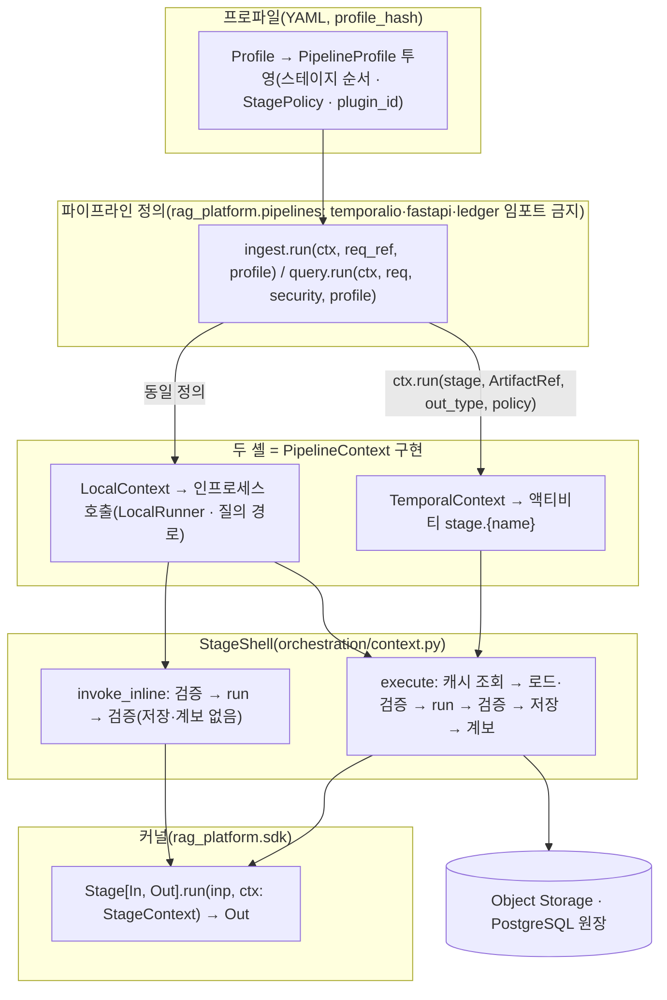
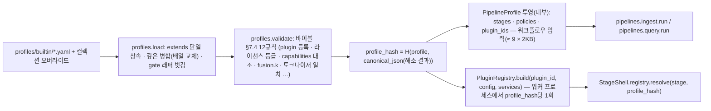
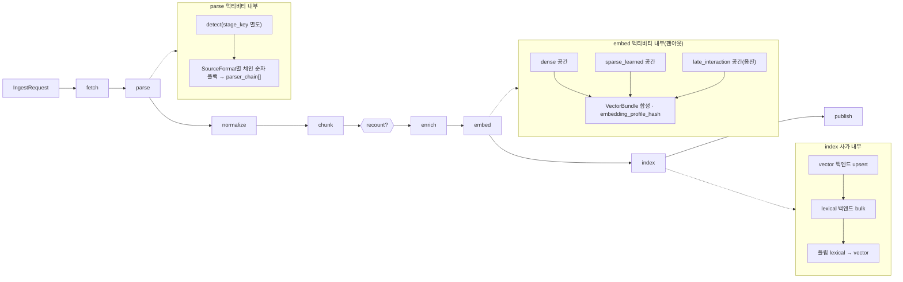
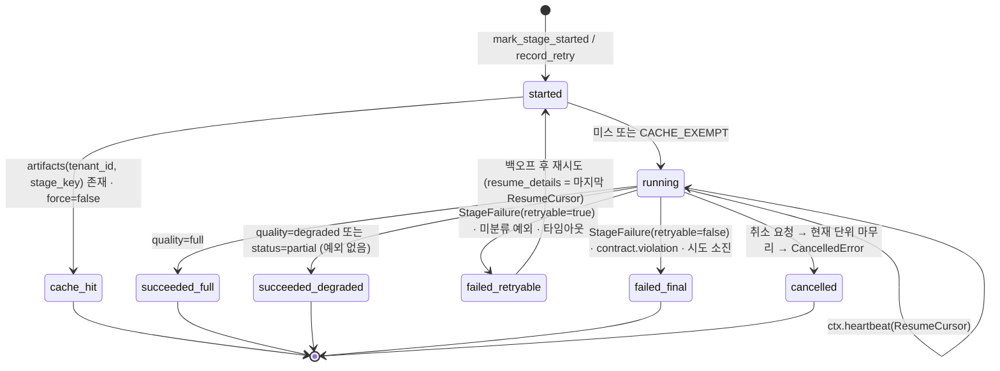

# 파이프라인 프레임워크 (Stage 추상화)

## 목적

이 문서는 수집·검색 파이프라인의 모든 단계가 공유하는 **실행 프레임워크**를 확정한다. 스테이지(stage) 추상 `Stage[In, Out]`, 스테이지가 외부 세계에 닿는 유일한 창구 `StageContext`, 파이프라인 정의가 의존하는 `PipelineContext`, 그리고 그 사이에서 계약 검증·산출물 저장·캐시·계보·관측·오류 변환을 수행하는 **셸(shell)** 의 동작을 코드 수준으로 고정한다. 04-pipelines의 나머지 문서(02~19)는 이 프레임워크 위에서 "무엇을 변환하는가"만 쓰고, "어떻게 실행·재시도·저장·계측되는가"는 이 문서를 인용한다.

설계 바이블(`02-architecture/00-design-bible.md`, 이하 "바이블") §4.1(스테이지 공통 규약)·§11.1(두 실행기, 하나의 정의)·§12(모듈 맵)·§5.3(`ArtifactRef`·`Producer`·`StagePolicy`)·§6.2(`stage_key`)가 정본이며, 이 문서는 그것을 **확장하되 바꾸지 않는다**. [컴포넌트 아키텍처](../02-architecture/02-component-architecture.md)(이하 "02")의 `Stage`·`StageContext` 시그니처와 [오케스트레이션과 워크플로우](../02-architecture/06-orchestration-and-workflows.md)(이하 "06")의 셸 스케치는 이 문서가 정본으로 확정한다(06 §3.1·§7.1 "정본은 04-pipelines/01"). `heartbeat_details` 스키마는 바이블 미해결 이슈 8에 따라 이 문서가 소유한다.

## 범위

- 포함: `Stage[In, Out]` 5멤버 프로토콜과 입출력 타입의 결정 방식(스테이지 표), `config_schema`·`config_hash`·`fingerprint()`·`capabilities()`의 프레임워크 관점 규칙, `StageContext`의 멤버와 채움 규칙, `PipelineContext`·`QueryContext`, 프로파일 YAML → 파이프라인 정의 해소와 위상(선형 + 스테이지 내부 팬아웃), 셸의 실행 순서(계약 검증 미들웨어·격리 모드·산출물 저장·계보), 캐싱과 멱등성, 결정성 등급과 비결정 스테이지의 캐시 키, 관측성 자동 계측, 오류 분류와 재시도 힌트, 부분 결과와 재개(`heartbeat_details` 스키마), 테스트 유틸리티(적합성 키트·골든 회귀), 로컬 CLI.
- 제외: 각 스테이지의 알고리즘(04-pipelines/02~19), 계약 필드 전문(03-contracts), 워크플로우 타입·시그널·사가·디스패처(06), 플러그인 패키징·레지스트리·라이선스 게이트([플러그인 아키텍처](../02-architecture/05-plugin-architecture.md), 이하 "05"), 저장소 스키마([저장소 아키텍처](../02-architecture/04-storage-architecture.md)), 배포.
- 정본 규칙: 타입명·필드명·열거값·오류 코드·이벤트명·메트릭명은 바이블 §5·§5.7·§6을 그대로 쓴다. 이 문서가 새로 붙이는 이름(`StageSpec`, `STAGE_TABLE`, `ResumeCursor`, `StageFailure`, `GoldenCase`, `rag run-stage` 등)은 본문에 "제안" 또는 "내부(계약 아님)"로 표시하고 `## 미해결 이슈`에 바이블 반영 여부를 남긴다. 수치는 모두 "초안 목표"다.

---

## 1. 프레임워크 개관: 하나의 커널, 두 개의 셸

**결정:** 파이프라인은 (1) 순수 변환 `Stage[In, Out]`, (2) 스테이지를 순서대로 부르는 오케스트레이터 중립 **파이프라인 정의**(`rag_platform.pipelines`), (3) 정의가 의존하는 `PipelineContext`의 구현체인 **두 셸**(Temporal 액티비티 래퍼 / 비내구 `LocalRunner`), (4) 셸이 스테이지에 주입하는 `StageContext`의 네 층으로 구성된다. 오케스트레이터를 넘는 페이로드는 `ArtifactRef` 하나이고, 멱등성 키 = 캐시 키 = 산출물 경로 = `stage_key`다(바이블 §2.1 K5, §4.1; [ADR-0003](../06-adr/0003-orchestrator-neutral-pipeline-and-non-durable-local-runner.md), [ADR-0037](../06-adr/0037-artifact-cache-scope-and-stage-key-composition.md)).



책임 분리(무엇을 누가 하는가):

| 관심사 | 스테이지(`Stage.run`) | 셸(`StageShell`) | 파이프라인 정의(`pipelines`) | 오케스트레이터(Temporal / `LocalRunner`) | 프로파일 |
|--------|----------------------|------------------|------------------------------|------------------------------------------|----------|
| 변환 로직 | 소유 | — | — | — | 플러그인·설정 선택 |
| 입출력 계약 검증 | 받지 않는다(타입 보장된 `In`) | 소유(§5.3) | — | — | — |
| 산출물 저장·로딩·계보 | `ctx.artifacts`로 파생물만 쓴다 | 소유(§6) | — | — | — |
| 캐시·멱등성 키 | 모른다 | `stage_key` 계산·조회(§7; 서브스테이지 `detect`도 셸 `SubstageRunner`가 계산, §5.6) | — | — | 지문 구성요소(플러그인 버전·설정) |
| 재시도·타임아웃·하트비트 전달 | 진행 지점만 `ctx.heartbeat()` | 하트비트 타이머·재개 세부 전달 | — | 정책 적용(`StagePolicy`) | `StagePolicy` 선언(바이블 §4.4) |
| 시간·난수·I/O | `ctx.now()`, `ctx.token_counter`, `ctx.analyzer`, `ctx.lineage`, `RuntimeServices.http`만 | `StageContext` 구성 | `ctx.now()`, `ctx.sleep()`만 | 재생 결정적 시각·난수(Temporal) | — |
| 스테이지 순서·조건 분기 | — | — | 소유(`STAGES`, `recount` 조건) | 시그널·자식 워크플로우·`continue_as_new` | `recount` 유무 |
| 관측(스팬·메트릭·로그) | 외부 호출 자식 스팬만(데코레이터) | 소유(§9) | — | `TracingInterceptor` | — |
| 오류 표현 | `StageFailure(StageError)` 하나 | `contract.violation` 감싸기, Temporal 변환 | — | 재시도 판정(카탈로그 `retryable`) | `non_retryable_error_codes` |

---

## 2. `Stage[In, Out]` 프로토콜

### 2.1 5멤버(바이블 §4.1 정본)

**결정:** 모든 확장 지점(D-10 14종)은 `Stage[In, Out]` 프로토콜의 타입 특수화이며 실행 진입점은 `run(inp, ctx)` 하나다. 멤버는 `plugin_id`, `config_schema`, `capabilities()`, `fingerprint()`, `run()` 다섯 개와 선택 클래스 속성 `requires_lineage`다(바이블 §4.1; 02 §2.2; [ADR-0032](../06-adr/0032-plugin-sdk-stage-protocol-and-conformance-kit.md)).

```python
# src/rag_platform/sdk/stage.py — 02 §2.2·05 §2.1과 동일. 이 문서가 정본으로 확정한다.
from __future__ import annotations
from typing import ClassVar, Protocol, TypeVar
from pydantic import BaseModel
from rag_platform.contracts.capabilities import Capabilities

In = TypeVar("In", bound=BaseModel, contravariant=True)
Out = TypeVar("Out", bound=BaseModel, covariant=True)


class Stage(Protocol[In, Out]):
    """바이블 §4.1 5멤버. I/O·시간·난수는 ctx로만."""

    plugin_id: str                                     # "{extension_point}.{implementation}" (바이블 §6.1)
    config_schema: type[BaseModel]                     # 프로파일 값 검증 모델; config_hash 원천(§2.3)
    requires_lineage: ClassVar[tuple[str, ...]] = ()   # 셸이 함께 로드할 상류 schema_type; index·chunk·enrich(LLM) 사용(바이블 §4.1 1.3.0, AM-26)

    def capabilities(self) -> Capabilities: ...        # 바이블 §5.3; 설정 반영 후의 실행 시 값
    def fingerprint(self) -> str: ...                  # H("producer", plugin_id, plugin_version, config_hash, image_digest or "", ",".join(model_ids))
    async def run(self, inp: In, ctx: StageContext) -> Out: ...
```

작성 지시가 열거한 항목과 정본 멤버의 대응은 다음과 같다. 정본에 없는 항목은 프로토콜 멤버로 두지 않고 다른 장치가 맡는다.

| 지시 항목 | 정본 실현 | 이유 |
|-----------|-----------|------|
| `name` | `plugin_id`(구현체) + `stage_name`(파이프라인 위치, 스테이지 표 §2.2) | 하나의 플러그인이 여러 스테이지 위치에 쓰일 수 있고(`chunker` role `token_counter`의 `recount`), 스테이지 이름은 프로파일·액티비티·스팬 이름의 축이다 |
| `version` | `PluginMeta.version` = `Producer.plugin_version`(지문 구성요소) | 버전은 패키지 메타데이터이며 인스턴스 멤버로 중복 선언하지 않는다(바이블 §5.6) |
| `input_type`, `output_type` | 스테이지 표 `StageSpec.input_type/output_type`(§2.2) | 계약 경계는 D-05가 고정한다. 플러그인이 자기 입출력 타입을 선언하면 경계를 바꿀 수 있는 것처럼 보이므로 셸이 표에서 읽는다 |
| `async run(input, ctx) → output` | `run(inp, ctx)` | 동일 |
| `capabilities` | `capabilities()` | 동일 |
| `config 모델` | `config_schema`(Pydantic v2, `extra="forbid"`, `frozen=True`) | §2.3 |

### 2.2 입출력 타입의 결정: 스테이지 표

**결정:** 스테이지 이름별 입출력 계약·확장 지점·캐시 가능 여부·`requires_lineage`는 바이블 §4.2·§4.3 표를 코드로 옮긴 **스테이지 표**(제안, `rag_platform.sdk.stage_table`; 내부, 계약 아님)에서 셸이 읽는다. 플러그인은 자기가 어느 위치에서 실행되는지 모르며, `PluginRegistry.build()`가 프로파일의 스테이지 값에 적힌 `plugin_id`를 그 위치에 바인딩한다.

```python
# src/rag_platform/sdk/stage_table.py (제안) — 바이블 §4.2·§4.3의 코드 사본. 값 변경은 바이블 개정을 전제한다.
@dataclass(frozen=True)
class StageSpec:
    name: str                              # 액티비티 stage.{name}, 스팬 rag.ingest.{name} / rag.{name}
    side: Literal["ingest", "query"]
    extension_point: ExtensionPoint | None # publish·hydrate는 플랫폼 소유(None)
    input_type: type[BaseModel]
    output_type: type[BaseModel]
    cacheable: bool                        # stage_key 캐시 대상 여부(fetch·index·publish·질의 측 False)
    key_input: Literal["input_ref.blake3", "content_hash"] = "input_ref.blake3"
                                           # stage_key 4번째 인자의 원천(바이블 §4.2, ADR-0037): detect·parse는 원본 바이트 content_hash,
                                           # 그 뒤는 직전 산출물 바이트 해시. content_hash면 셸은 캐시 조회 전에 입력을 먼저 로드한다(§5.1 (2))
    substage_of: str | None = None         # 부모 액티비티 안에서 SubstageRunner로 실행되는 서브스테이지(detect → "parse", §5.6)
    requires_lineage: tuple[str, ...] = ()
    role: str | None = None                # PluginMeta.role 제약(format_detector, token_counter, renderer)

STAGE_TABLE: Mapping[str, StageSpec] = {s.name: s for s in (*INGEST_STAGES, *QUERY_STAGES)}   # INGEST_STAGES는 바이블 §4.2 표의 10행(publish 포함)
```

| `name` | side | 확장 지점(role) | `input_type → output_type` | `cacheable` | `key_input` | `requires_lineage` | 비고 |
|--------|------|-----------------|----------------------------|-------------|-------------|--------------------|------|
| `fetch` | ingest | `fetcher` | `IngestRequest → SourceDocument` | no | — | — | 항상 실행, 조건부 GET(바이블 §4.2) |
| `detect` | ingest | `parser`(`format_detector`) | `SourceDocument → SourceDocument` | yes | `content_hash` | — | `stage.parse` 액티비티 내부 서브스테이지(`substage_of="parse"`), 별도 `stage_key`; 셸 `SubstageRunner`가 실행(§5.6) |
| `parse` | ingest | `parser` | `SourceDocument → ParsedDocument` | yes | `content_hash` | — | 라우터 체인은 액티비티 내부(§4.3); 조건부 GET 304로 봉투가 새로 발급되어도 `content_hash`가 같으면 적중 |
| `normalize` | ingest | `normalizer` | `ParsedDocument → NormalizedDocument` | yes | `input_ref.blake3` | — | |
| `chunk` | ingest | `chunker` | `NormalizedDocument → ChunkSet` | yes | `input_ref.blake3` | `ParsedDocument` | 구조 필드(`Block.type`·`numbering_label`·`provenance`·`TableData`·`caption_of`) 참조용(바이블 §4.1 1.3.0, AM-26) |
| `recount` | ingest | `chunker`(`token_counter`) | `ChunkSet → ChunkSet` | yes | `input_ref.blake3` | — | 프로파일 `ingest.recount` 있을 때만; `reprocess`에서 실행 |
| `enrich` | ingest | `enricher` | `ChunkSet → EnrichedChunkSet` | yes | `input_ref.blake3` | LLM 서브스텝만 `ChunkSet` | 다중 enricher는 내부 합성(04-pipelines/11, 동시 작성 중); 바이블 §4.1 1.3.0, AM-26 |
| `embed` | ingest | `embedder` | `EnrichedChunkSet → EmbeddedChunkSet` | yes | `input_ref.blake3` | — | 다중 공간 팬아웃은 내부(§4.3) |
| `index` | ingest | `index_backend` | `EmbeddedChunkSet → IndexCommit` | no | — | `EnrichedChunkSet`, `ChunkSet`, `SourceDocument` | 세대 사가(06 §2.1·바이블 §11.4); `commit_id`·`index_generation`은 인자 |
| `publish` | ingest | —(플랫폼) | `IndexCommit → array<CloudEventEnvelope>` | no | — | — | 로컬 액티비티, 원장 트랜잭션(06 §6.2); `run_stage`를 거치지 않는 별도 경로 `run_publish` |
| `plan` | query | `query_transformer`(파이프) | `QueryRequest → QueryPlan` | no | — | — | 플랜 캐시는 Valkey(바이블 §4.3), `stage_key` 아님 |
| `retrieve` | query | `retriever` | `RetrieveInput → ChannelRun` | no | — | — | 채널 × 컬렉션 × 변형 병렬(§4.3) |
| `fuse` | query | `fuser` | `CandidateSet → RankedSet(fused)` | no | — | — | 순수 함수 |
| `hydrate` | query | `index_backend`(`retrieve` 포트) | `RankedSet → RankedSet(hydrated=true)` | no | — | — | 서브스텝, `Stage.run` 아님 |
| `rerank` | query | `reranker` | `RankedSet → RankedSet(reranked)` | no | — | — | 선택 Valkey `rr:` 캐시 |
| `postprocess` | query | `postprocessor`(step) | `RankedSet → RankedSet(postprocessed)` | no | — | — | `postprocess.order[]` 순서 |
| `pack` | query | `packer` | `RankedSet → ContextPack` | no | — | — | 내부 고정 순서(바이블 §8.2) |
| `render` | query | `packer`(`renderer`) | `ContextPack → RenderedContext` | no | — | — | `ContextRenderer` 포트; `Stage.run` 특수화 여부는 미해결 이슈 14 |

`RetrieveInput`·`ChannelRun`은 02 §2.4의 내부 타입(계약 `$defs` 클래스명은 03-contracts/09·10이 확정)이다. `key_input`·`substage_of`는 이 문서가 스테이지 표에 더한 열(제안)이며 바이블 §4.2 표의 "멱등성 키" 열을 코드로 옮긴 것이다(미해결 이슈 16).

### 2.3 `config_schema`와 `config_hash`

프로파일 YAML의 스테이지 값에서 셸 예약 키(`plugin`, `policy`, `isolation`, `image`, `then`, `fallback`)를 제외한 나머지가 `config_schema`로 검증되고(05 §4), `config_hash = H("config", canonical_json(config))`(바이블 §6.2)가 `fingerprint`에 들어간다. 프레임워크 관점의 규칙은 다음과 같다.

| 규칙 | 내용 | 강제 위치 |
|------|------|-----------|
| 불변·미지 키 거부 | `ConfigDict(extra="forbid", frozen=True)`; 오탈자 키는 `profile.invalid` | 프로파일 로딩(바이블 §7.4 (1)) |
| 인스턴스 고정 | 설정은 `PluginRegistry.build(plugin_id, config, services, *, image_digest=None)`가 인스턴스에 고정한다. `ctx`에는 설정이 없다. 예약 키 `image`(사이드카 이미지 이름)는 레지스트리가 배포 매니페스트의 digest 고정 참조(`sha256:…`)로 해석해 `image_digest`로 주입한다(제안, 미해결 이슈 15) | 레지스트리 |
| 결정성 | 설정에 절대 경로·호스트명·비밀·시각을 넣지 않는다. 모델·사전·이미지는 지문 구성요소(`model_ids`, `analyzer_id`, `image_digest`)로 별도 검증 | SDK `fingerprint()` 검증 |
| 실행 정책 분리 | 격리·큐·재시도·타임아웃 필드를 `config_schema`에 두지 않는다(그것은 `StagePolicy`) | 코드 리뷰·린트 |
| 기본값 | 기본값은 바이블 §7.2 `standard` 열과 같다 | 적합성 키트 |

### 2.4 `fingerprint()`와 필수 구성요소

**결정:** 지문은 SDK `hash_of`(`H`)가 단일 식 `H("producer", plugin_id, plugin_version, config_hash, image_digest or "", ",".join(model_ids))`로 구성하며(바이블 §4.1·§6.2), 확장 지점·격리 모드별 필수 구성요소의 포함을 레지스트리 로딩 시 검증한다. 누락은 로딩 거부다(바이블 리스크 #8, [ADR-0032](../06-adr/0032-plugin-sdk-stage-protocol-and-conformance-kit.md)).

| 확장 지점·조건 | `fingerprint`에 반드시 반영되는 것 | 반영 경로 |
|----------------|-------------------------------------|-----------|
| `isolation=sidecar`인 모든 스테이지 | 사이드카 `image_digest`(`sha256:…`) | `Producer.image_digest` — `PluginRegistry.build()`가 프로파일 예약 키 `image`를 digest로 해석해 생성자에 주입(§2.3); 따라서 `registry.resolve` 시점에 지문이 확정된다 |
| `parser` | `parser_fingerprint_hash`의 구성요소(`model_ids`, 사이드카 digest, `profile_option`) | `model_ids`·`image_digest`·`config_hash` |
| `normalizer` | `analyzer_id`, `dictionary_hash`, `pii_policy`, PII 탐지기 버전 | `config_hash`(정책)·`model_ids`(`analyzer_id`, `dictionary_hash`는 `model_ids` 항목으로 표기; 형식은 04-pipelines/09) |
| `chunker` | `chunker_config_hash`, `primary_tokenizer_id` | `config_hash` |
| `embedder` | `embedding_space_id`/`embedding_profile_hash`(모델·revision·차원·정규화·`prompt_hash`·양자화·`vocab_id`) | `model_ids`(`{model_id}@{revision}`)·`image_digest`·`config_hash` |
| `enricher`(LLM) | `model_id@revision`, `prompt_hash`(§8.2) | `model_ids`·`config_hash` |
| `reranker` | `model_id@revision`, 서빙 `image_digest` | `model_ids`·`image_digest` |

SDK는 `Producer` 조립과 지문 계산을 한 곳에 둔 기반 클래스(제안, `rag_platform.sdk.StageBase`)를 제공한다. 플러그인은 이 클래스를 상속할 의무가 없으나(프로토콜은 구조적), 상속하면 `producer()`·`fingerprint()`가 자동으로 일관된다.

```python
class StageBase(Generic[In, Out]):                       # 제안. 상속 선택
    plugin_id: str
    plugin_version: str                                  # PluginMeta.version과 동일(레지스트리가 주입)
    config_schema: type[BaseModel]

    def __init__(self, config: BaseModel, *, image_digest: str | None = None) -> None:
        self.config, self._image_digest = config, image_digest

    def model_ids(self) -> list[str]: return []          # "{model_id}@{revision}" 목록; 임베더·리랭커·LLM 보강기가 재정의

    def producer(self) -> Producer:                      # 출력 봉투 producer(§5.3)
        return Producer(plugin_id=self.plugin_id, plugin_version=self.plugin_version,
                        config_hash=hash_of("config", canonical_json(self.config.model_dump(mode="json"))),
                        image_digest=self._image_digest, model_ids=self.model_ids())

    def fingerprint(self) -> str:
        p = self.producer()
        return hash_of("producer", p.plugin_id, p.plugin_version, p.config_hash, p.image_digest or "", ",".join(p.model_ids or []))
```

### 2.5 순수성 규칙

스테이지는 I/O·시간·난수를 직접 쓰지 않는다(바이블 §4.1). 프레임워크가 강제하는 허용·금지 목록이다.

| 구분 | 항목 | 대체 수단 |
|------|------|-----------|
| 금지 | `datetime.now()`, `time.time()` | `ctx.now()` |
| 금지 | `random`, `uuid.uuid4()`, `secrets` | 결정적 파생 키(`H()`); 발급형 ID는 셸·워크플로우가 인자로 전달 |
| 금지 | `open()`, 파일 시스템 탐색, 환경 변수 읽기 | 입력은 `In`·`ctx.lineage`; 파생물 쓰기는 `ctx.artifacts` |
| 금지 | `httpx`·`requests` 직접 생성, 재시도 루프, 자체 타임아웃 | `RuntimeServices.http`(egress 가드), 재시도는 셸(`StagePolicy`), 데드라인은 `ctx.remaining_ms()` |
| 금지 | 전역 가변 캐시, 인스턴스 상태 변경(`run` 재진입 불가) | 프로세스 자원은 생성자·`StageLifecycle.init`에서만 |
| 금지 | 계약 검증 호출, `blake3` 직접 임포트, `stage_key` 계산 | 셸 소유(§5.3·§7). 플랫폼 소유 합성 스테이지(`parser.router`)도 직접 계산하지 않고 셸이 주입한 `ctx.substages.run("detect", …)`를 부른다(§5.6) |
| 허용 | `ctx.token_counter`, `ctx.token_counters`, `ctx.analyzer`, `ctx.lineage`, `ctx.now()`, `ctx.heartbeat()`, `ctx.resume_details`, `ctx.remaining_ms()`, `ctx.artifacts`; 플랫폼 소유 합성 스테이지만 `ctx.substages` | §3, §5.6 |
| 허용(조건) | 외부 모델 서버·사이드카·LLM 호출 | `RuntimeServices.http`·`SidecarStage` 경유, `ctx.remaining_ms()` 존중, 콘텐츠 캡처 끔 |

강제 수단: ruff 금지 API 규칙(`datetime.now`, `random`, `time.time`, `open`, `httpx`/`requests` 직접 임포트; 제안, [ADR-0032](../06-adr/0032-plugin-sdk-stage-protocol-and-conformance-kit.md) 준수 확인 2), import-linter(`adapters`는 `storage`·`security`·`ledger`·`temporalio`를 모른다, 02 §1.2), 적합성 키트 `idempotency`(같은 `In`·같은 `ctx` 결정값으로 2회 실행 → 바이트 동일).

### 2.6 선택 프로토콜

- `requires_lineage`: **결정(바이블 §4.1 1.3.0, AM-26, CR-04):** `index`는 `("EnrichedChunkSet", "ChunkSet", "SourceDocument")`, `chunk`는 `("ParsedDocument",)`(구조 필드 `Block.type`·`numbering_label`·`provenance`·`TableData`·`caption_of` 참조 — 기본 청커 `structure_aware`의 필수 입력), `enrich`의 LLM 서브스텝은 `("ChunkSet",)`를 선언한다. 선언 가능한 것은 입력 산출물의 `lineage_refs`로 고정되는 상류 산출물뿐이며(결정성 보장), `stage_key` 구성은 바뀌지 않는다(§7.1). 셸이 입력 봉투 `lineage_refs`에서 로드해 `ctx.lineage[schema_type]`로 준다(바이블 §4.1·§5.2). `evaluator`로의 확장은 05 미해결 이슈 19.
- `StageLifecycle(init/warmup/health/close)`(05 §2.3 제안): 프로세스 단위 훅. 셸은 `isinstance` 검사로 구현 여부를 판별한다. 5멤버 수를 바꾸지 않는다.
- `SidecarStage`(02 §3.1, [ADR-0033](../06-adr/0033-sidecar-convert-contract-and-isolation-ladder.md)): `isolation=sidecar` 어댑터의 기반 클래스. `ConvertRequest`/`ConvertResponse`로 `POST /v1/convert`를 감싸고 대기 중 `ctx.heartbeat()`를 호출한다.

---

## 3. `StageContext`

### 3.1 멤버

**결정:** `StageContext`는 02 §2.2의 시그니처를 그대로 쓴다. 바이블 §4.1이 명시한 멤버(`token_counter`, `analyzer`, `now()`, `lineage`, 1.3.0부터 `plan`·`artifacts`도 정본, AM-27)가 정본이고, 나머지는 02가 제안한 확장이다(02 미해결 이슈 2). 이 문서는 읽기 전용 `cancelled`(06 §3.3 표기와 일치)와 플랫폼 소유 합성 스테이지 전용 `substages`(§5.6) 둘을 더 제안한다.

```python
# src/rag_platform/sdk/stage.py — 02 §2.2와 동일 + cancelled · substages(제안)
class StageContext(Protocol):
    """셸이 만들어 넘기는 실행 문맥. 스테이지가 볼 수 있는 유일한 부수효과 창구."""
    tenant_id: str                                     # 스코프(바이블 §4.1 scope_key)
    collection_id: str | None                          # 질의 측 None(컬렉션 범위는 ctx.security.collection_ids)
    document_id: str | None
    job_id: str | None
    trace_id: str
    profile_hash: str
    security: SecurityContext | None                   # 질의 측 필수(서버 주입·읽기 전용), 수집 측 None
    plan: QueryPlan | None                             # 바이블 §4.1 1.3.0(AM-27): 질의 측 필수, 수집 측 None
    token_counter: TokenCounter                        # 바이블 §4.1 — primary_tokenizer_id
    token_counters: Mapping[str, TokenCounter]         # secondary_tokenizer_ids·대상 LLM 카운터
    analyzer: KoreanAnalyzer                           # 바이블 §4.1 — Kiwi 또는 mecab-ko
    lineage: Mapping[str, BaseModel]                   # 바이블 §4.1 — requires_lineage 로드 결과
    def now(self) -> datetime: ...                     # 바이블 §4.1 — Temporal은 액티비티 시각, Local은 wall clock(UTC)
    def heartbeat(self, details: Mapping[str, Any]) -> None: ...   # ResumeCursor(§11.2), supports_resumable=true만
    resume_details: Mapping[str, Any] | None           # 재시도 시 마지막 ResumeCursor
    artifacts: DerivedArtifacts                        # 바이블 §4.1 1.3.0(AM-27): 테넌트 바인딩 쓰기 전용 파생물 포트
    def remaining_ms(self) -> int | None: ...          # 남은 start_to_close(수집) / latency_budget_ms(질의)
    cancelled: bool                                    # 제안(읽기 전용): 취소 요청 수신 여부. 감지 의무 없음(§11.4)
    substages: SubstageRunner | None                   # 제안: 플랫폼 소유 합성 스테이지(parser.router)에만 주입, 그 외 None(§5.6)
```

| 멤버 | 수집 측 채움(셸 `build_stage_context`) | 질의 측 채움(`LocalContext.stage_context`) | 지위 |
|------|----------------------------------------|---------------------------------------------|------|
| `tenant_id`, `collection_id`, `document_id`, `job_id` | `StageActivityInput.job` | `security.tenant_id`, `None`, `None`, `None` | 02 제안 |
| `trace_id`, `profile_hash` | 액티비티 헤더(W3C Trace Context), `job.profile_hash` | 요청 `trace_id`, 컬렉션 캐시의 `profile_hash` | 02 제안 |
| `security`, `plan` | `None`, `None` | 서버 주입 `SecurityContext`, `plan` 산출 뒤의 `QueryPlan`(`plan` 스테이지 자체는 `None`) | `security` 02 제안, `plan` 바이블(AM-27) |
| `token_counter`, `token_counters` | 프로파일 `chunk.tokenizer`·`secondary_tokenizers` → `RuntimeServices.token_counters` | 프로파일 `pack.tokenizer`(대상 LLM)·리랭커 토크나이저 | 바이블 |
| `analyzer` | `RuntimeServices.analyzer`(`analyzer_id`·`dictionary_hash`는 컬렉션 사전 반영) | 동일 | 바이블 |
| `lineage` | `requires_lineage` 로드(§5.2) | `{}` | 바이블 |
| `now()` | `ShellRuntime.now()`(Temporal: 액티비티 시작 시각 기준 단조 시계, Local: UTC) | 요청 시각(`security.as_of`와 동일 값) | 바이블 |
| `heartbeat()`, `resume_details` | `ShellRuntime.heartbeat`, 마지막 `heartbeat_details` | no-op, `None` | 02 제안 |
| `artifacts` | `TenantBoundArtifacts(tenant_id)` | 동일(쓰기 드묾) | 바이블(AM-27) |
| `remaining_ms()` | `start_to_close` − 경과 | `latency_budget_ms.total` − 경과 | 02 제안 |
| `cancelled` | 셸이 취소 요청 수신 시 `True` | 요청 연결 종료 시 `True` | 이 문서 제안 |
| `substages` | `stage.parse`에서 `plugin_id == "parser.router"`일 때만 `SubstageRunner(inp, rt)`; 그 외 `None` | `None` | 이 문서 제안 |

### 3.2 지시 항목과의 대응: 두지 않는 멤버

| 지시 항목 | 정본 실현 | 두지 않는 이유 |
|-----------|-----------|----------------|
| `tenant`, `collection`, `profile`, `trace` | `tenant_id`, `collection_id`, `profile_hash`, `trace_id` | — |
| `artifact_store` | `artifacts: DerivedArtifacts`(쓰기 전용, `put_source`·`put_derived`) | `ArtifactStore`(`get`·`put_artifact`·`exists`·`tenant_id` 인자)는 셸·`storage`·`retrieval.pack.chunk_text_store`에만 노출된다. 스테이지가 계약 산출물을 읽거나 타 테넌트 키를 만들 수 없어야 한다(E5·E17) |
| `secrets` | 없음. 비밀은 계약의 `credentials_ref` 간접 참조(`IngestRequest`·`ConvertRequest`)로 전달되고 `RuntimeServices.http`·사이드카가 `key_provider`로 해소한다 | 스테이지에 비밀 값이 보이면 로그·산출물·스팬으로 누출될 수 있다(바이블 §6.6). `ctx.secret(credentials_ref)` 포트는 05 미해결 이슈 1의 합의 대상 |
| `clock` | `now()` | — |
| `budget` | `remaining_ms()` | 질의 측 축소 규칙(바이블 §8.3)을 각 스테이지가 스스로 적용한다 |
| `cancellation` | `cancelled`(제안) | 취소 감지는 의무가 아니다(02 §4.2 규칙 3). `Resumable` 스테이지가 단위(페이지·배치) 경계에서 폴링하면 현재 단위를 마무리하고 종료할 수 있다(06 §3.3) |
| `logger`, `metrics` | 없음. 셸이 실행 전에 알 수 있는 문맥 필드 `tenant_id_hash`, `job_id`, `trace_id`, `stage`를 `structlog.contextvars.bind_contextvars(...)`로 바인딩하고(05 §9 규칙 4) 스팬·메트릭을 자동 계측한다(§9). 바이블 §6.5 로그 필드 중 `event`·`level`은 로그 호출마다, `code`는 오류 발생 시점에 채워지는 호출 시 필드다 | 플러그인은 `structlog.get_logger()`만 쓴다. 메트릭 이름은 바이블 §6.5 정본 목록만 유효하므로 스테이지가 임의 메트릭을 만들 수 없다 |

---

## 4. 파이프라인 정의: 프로파일에서 스테이지 그래프로

### 4.1 `PipelineContext`와 `QueryContext`

```python
# src/rag_platform/sdk/pipeline.py — 바이블 §11.1 4멤버(정본) + 질의 측 확장(02 §2.2 제안)
class PipelineContext(Protocol):
    async def run(self, stage: str, inp_ref: ArtifactRef, out_type: type[Out], policy: StagePolicy) -> ArtifactRef: ...
    async def emit(self, event: CloudEventEnvelope) -> None: ...
    def now(self) -> datetime: ...
    async def sleep(self, d: timedelta) -> None: ...


class QueryContext(PipelineContext, Protocol):            # 제안. 구현 orchestration.local.LocalContext
    def stage(self, plugin_id: str) -> Stage[Any, Any]: ...
    def stage_context(self, *, security: SecurityContext, plan: QueryPlan | None, trace_id: str) -> StageContext: ...
    async def invoke(self, stage: Stage[In, Out], inp: In, ctx: StageContext) -> Out: ...   # → StageShell.invoke_inline
```

`TemporalContext.run`은 `workflow.execute_activity("stage.{name}", StageActivityInput, …)`로, `LocalContext.run`은 `asyncio` + `StagePolicy` 재시도 루프로 같은 `run_stage`(§5.2)를 호출한다(06 §7.1 스케치). `emit`은 Temporal 모드에서 로컬 액티비티 `stage.publish`, Local 모드에서 원장 직접 기록이다. 파이프라인 정의는 두 컨텍스트를 구분하지 못한다.

### 4.2 프로파일 해소: `Profile` → `PipelineProfile`



`PipelineProfile`(06 §2.1 내부 타입)은 `Profile`(≤ 256KB)에서 워크플로우가 필요로 하는 것만 투영한다: `profile_hash`, 스테이지 순서(`recount` 포함 여부), 스테이지별 `StagePolicy`, 스테이지별 `plugin_id`. 플러그인 설정은 워크플로우 히스토리에 넣지 않고 액티비티가 `profile_hash`로 해소한다(원장 `profiles.resolved` 또는 프로세스 캐시).

```python
@dataclass(frozen=True)
class PipelineProfile:                                     # 내부(계약 아님), 06 §2.1
    profile_hash: str
    stages: tuple[str, ...]                                # ("fetch", "parse", "normalize", "chunk", ["recount"], "enrich", "embed", "index")
    policies: Mapping[str, StagePolicy]                    # 바이블 §4.4 행
    plugin_ids: Mapping[str, str]                          # stage → plugin_id (parse는 "parser.router")
    def has_stage(self, name: str) -> bool: return name in self.stages
    def stage_policy(self, name: str) -> StagePolicy: return self.policies[name]
```

`standard` 프로파일(바이블 §7.3)의 `ingest.parse`·`ingest.embed` 발췌와 그로부터의 투영을 나란히 둔다. 예약 키(`plugin`, `policy`, `isolation`, `image`, `then`, `fallback`)는 셸·레지스트리가 소비하고 나머지 키(`router`, `options`, `model_id`, `dim`, …)는 해당 플러그인의 `config_schema`로 간다. `parse` 위치에는 항상 플랫폼 합성 스테이지 `parser.router`가 바인딩되고 `router`·`options` 전체가 그 설정이다.

```yaml
# profiles/builtin/standard.yaml 발췌(바이블 §7.3 그대로; 주석은 이 문서)
ingest:
  parse:                                  # plugin 키 없음 → plugin_ids["parse"] = "parser.router"(플랫폼)
    router:
      hwpx: [parser.hwpx_python_hwpx]
      hwp5: [{plugin: parser.hwp5_java_sidecar, isolation: sidecar, image: parser-workers},   # isolation·image는 예약 키
             {plugin: parser.hwp5_unhwp, isolation: helper_process},
             parser.hwp5_hwp_hwpx_parser]
    options:
      ocr: {plugin: rapidocr, lang: [korean], version: PPOCRV5, model: MOBILE}
      page_timeout: {cpu: 60s, gpu: 20s}
  embed:
    dense:  {plugin: embedder.vllm_pooling_bge_m3, model_id: BAAI/bge-m3, revision: "<sha>", dim: 1024, normalized: true, dtype: fp16}
    sparse: {plugin: embedder.vllm_pooling_bge_m3, vocab_id: xlm-roberta-250k}
    late_interaction: {enabled: false}
```

```python
# 위 발췌의 PipelineProfile 투영(값은 예시; profile_hash는 해소 결과 전체의 H("profile", …))
PipelineProfile(
    profile_hash="9f3a6c1e2b7d4a8f0c5e9b3d7a1f6e2c4b8d0a9f3e7c1b5d2a6f8e0c4b9d3a7f",
    stages=("fetch", "parse", "normalize", "chunk", "enrich", "embed", "index"),     # ingest.recount 없음 → 생략
    plugin_ids={"fetch": "fetcher.fsspec_httpx", "parse": "parser.router", "normalize": "normalizer.mecab_ko",
                "chunk": "chunker.structure_aware", "enrich": "enricher.composite", "embed": "embedder.vllm_pooling_bge_m3",
                "index": "index_backend.composite"},                                 # enrich·index의 합성 스테이지 이름은 04-pipelines/11·13이 확정
    policies={"parse": StagePolicy(task_queue="ingest-cpu", start_to_close="15m", heartbeat="60s", max_attempts=3,
                                   non_retryable_error_codes=["parse.document_encrypted", "parse.distribution_document",
                                                              "parse.unsupported_variant", "parse.corrupt_container", "contract.violation"],
                                   resumable=True, isolation=None),                   # 바이블 §4.4 parse(텍스트) 행; 체인 멤버별 isolation은 router 설정 안
              "embed": StagePolicy(task_queue="ingest-gpu-embed", start_to_close="20m", heartbeat="60s", max_attempts=5,
                                   backoff={"initial": "1s", "max": "5m", "coefficient": 2.0},
                                   non_retryable_error_codes=["embed.space_mismatch", "embed.tokenizer_missing"],
                                   resumable=True, isolation="in_process")},
)
```

### 4.3 위상: 선형 체인 + 스테이지 내부 팬아웃

**결정:** 오케스트레이터 경계의 위상은 **선형 체인**이며 코드 상수 `STAGES`로 고정된다. 프로파일은 위상을 바꾸지 못하고 `recount` 포함 여부, 플러그인, 정책만 고른다. "팬아웃"은 계약 경계 밖에서 일어나지 않는다 — 다중 임베딩 모델(dense·sparse·`late_interaction`), 다중 enricher, 파서 라우터 체인, 다중 인덱스 백엔드는 모두 **한 액티비티 안**에서 실행되어 하나의 출력 계약으로 합성된다. 범용 DAG 엔진은 도입하지 않는다(브리프 §2 R2 "Not-Invented-Here 금지"·§3 원칙 2 Adapters over Forks의 취지는 검증된 오픈소스를 어댑터로 감싸는 것이며 범용 엔진 자작이 아니다; 경계 계약이 D-05로 고정되어 있고 경계 페이로드가 `ArtifactRef` 1개이므로 병렬 노드를 늘리면 히스토리·저장만 늘고 재현성 단위는 얻지 못한다). 질의 측 팬아웃(채널 × 컬렉션 × 변형)은 `api` 프로세스 안의 `asyncio.gather`다(바이블 §8.1 7단계).



| 팬아웃 지점 | 위치 | 병렬 단위 | 결합 | 경계 페이로드 변화 |
|-------------|------|-----------|------|--------------------|
| 파서 라우터 체인 | `stage.parse` 내부(`ParseRouterStage`, 02 §3.2) | 순차 폴백(병렬 아님) | 첫 성공 `ParsedDocument` + `parser_chain[]` | 없음 |
| 다중 enricher | `stage.enrich` 내부 | 결정적 enricher 순차; LLM은 청크 배치 병렬(예산 상한) | `Enrichment` 병합(04-pipelines/11) | 없음 |
| 다중 임베딩 공간 | `stage.embed` 내부 | 공간별 서빙 호출 `asyncio.gather` | `VectorBundle`, `embedding_profile_hash = H("spaces", …)` | 없음 |
| 다중 인덱스 백엔드 | `stage.index` 사가 내부 | 순차(적재 벡터 → 렉시컬, 플립 렉시컬 → 벡터) | `IndexCommit.backend_results[]` | 없음 |
| 채널 × 컬렉션 × 변형 | `retrieve`(api 프로세스) | `asyncio.gather` + 채널 `timeout_ms` | `fuse` | 없음(인프로세스) |
| 컬렉션 재색인 | `reindex.collection.v1` 부모·자식 워크플로우(06 §2.5) | 자식 윈도우 50 | 게이트 → alias 교체 | `ArtifactRef`(자식 입력) |

### 4.4 정의 스케치

```python
# src/rag_platform/pipelines/ingest.py — temporalio · fastapi · ledger · storage 임포트 금지(import-linter)
STAGES = ("fetch", "parse", "normalize", "chunk", "recount", "enrich", "embed", "index")   # publish는 루프 밖
OUT_TYPES = {s.name: s.output_type for s in INGEST_STAGES}                                  # 스테이지 표(§2.2)

async def run(ctx: PipelineContext, req_ref: ArtifactRef, profile: PipelineProfile, *, from_stage: str = "fetch") -> ArtifactRef:
    ref = req_ref
    for stage in STAGES[STAGES.index(from_stage):]:
        if stage == "recount" and not profile.has_stage("recount"):
            continue
        ref = await ctx.run(stage, ref, OUT_TYPES[stage], profile.stage_policy(stage))
    await ctx.run("publish", ref, CloudEventEnvelopeList, profile.stage_policy("publish"))   # 종료 이벤트·잡 상태
    return ref                                                                                 # ArtifactRef(schema_type="IndexCommit"); 원장 index_commits가 정본

CloudEventEnvelopeList = RootModel[list[CloudEventEnvelope]]   # 내부 별칭(= array<CloudEventEnvelope>, 계약 아님; 바이블 §4.2 publish 출력)


# src/rag_platform/pipelines/query.py — 항상 LocalContext(api 프로세스 인프로세스, 바이블 §11.1)
async def run(ctx: QueryContext, req: QueryRequest, security: SecurityContext, profile: Profile) -> ContextPack:
    plan = await planner.plan(req, ctx, profile)                       # rag.plan — query_transformer 파이프
    sctx = ctx.stage_context(security=security, plan=plan, trace_id=req.trace_id)
    candidates = await channels.run_all(plan, ctx, sctx)               # rag.retrieve.{channel} × 컬렉션 × 변형
    ranked = await ctx.invoke(ctx.stage(profile.query.fusion.plugin_id), candidates, sctx)   # rag.fuse
    ranked = await hydrate.hydrate(ranked, ctx, sctx)                  # rag.hydrate — index_backend.retrieve 1회 배치
    ranked = await rerank.apply(ranked, ctx, sctx)                     # rag.rerank — 실패는 데이터(rerank.applied=false)
    ranked = await postprocess.run(profile.query.postprocess.order, ranked, ctx, sctx)   # rag.postprocess
    return await ctx.invoke(ctx.stage(profile.query.pack.plugin_id), ranked, sctx)       # rag.pack
```

반환 타입은 바이블 §11.1의 `-> IndexCommit`이 아니라 06 §1.1의 `ArtifactRef(schema_type=IndexCommit)`를 따른다 — 워크플로우 코드는 I/O를 할 수 없어 `IndexCommit` 인스턴스를 로드할 수 없고, 경계 페이로드는 `ArtifactRef` 하나여야 하기 때문이다(바이블 §4.1). 바이블이 우선하므로 이 차이는 바이블 §11.1 시그니처 patch 제안으로 이 문서의 미해결 이슈 17에 등재한다(06 미해결 이슈 13과 공동).

---

## 5. 셸: 실행 미들웨어

### 5.1 실행 순서

**결정:** 수집 스테이지는 제네릭 액티비티 `stage.{name}` 하나로 실행되고 본문은 `StageShell.execute`(= `run_stage`) 하나다. 셸은 순서대로 (1) 잡 상태 전이 기록, (2) `stage_key` 계산·캐시 조회 — `key_input=content_hash`인 `parse`는 입력 `SourceDocument`(≤ 32KB)를 먼저 로드·검증해 `content_hash`를 읽고, 그 외는 `input_ref.blake3`로 로드 없이 계산한다 — , (3) 입력 로드 + 계약 검증((2)에서 로드했으면 생략), (4) `requires_lineage` 로드, (5) `StageContext` 구성, (6) 격리 모드별 `run`, (7) 봉투 완성 + 출력 계약 검증, (8) 콘텐츠 주소화 저장, (9) `artifacts`·`lineage`·`jobs`·`outbox` 동일 트랜잭션 기록을 수행한다(바이블 §4.1·§4.2; 02 §4.1; 06 §3.1). 스테이지는 (6)만 본다. `parse` 안의 서브스테이지 `detect`는 §5.6이 같은 순서를 액티비티 안에서 반복한다.

```mermaid
sequenceDiagram
    autonumber
    participant W as PipelineContext.run
    participant S as StageShell.execute (run_stage)
    participant R as PluginRegistry
    participant L as ledger (artifacts · lineage · jobs · outbox)
    participant O as ArtifactStore
    participant St as Stage.run (격리 모드별)
    W->>S: StageActivityInput{stage, job, input_ref, event_ids, commit_id?, force, reindex?}
    S->>R: resolve(stage, job.profile_hash) → Stage(fingerprint 확정)
    S->>L: mark_stage_started 또는 record_retry [tx]
    alt cacheable
        opt key_input = content_hash (parse)
            S->>O: get(input_ref, SourceDocument) [지점 2 선행] → content_hash
        end
        S->>S: stage_key = H("stage", name, scope_key, content_hash 또는 input_ref.blake3, fingerprint)
        opt force=false
            S->>L: artifacts.lookup(tenant_id, stage_key)
            L-->>S: hit → commit_stage(cache_hit=true) → ArtifactRef 반환
        end
    end
    S->>O: get(input_ref, In) — schema_type · schema_version · blake3 · size_bytes 대조 + 스키마 검증 [지점 2; 선행 로드했으면 생략]
    S->>O: lineage_refs[requires_lineage] 로드 → ctx.lineage
    S->>St: run(inp, ctx) — in_process 스레드 / helper_process / sidecar
    St-->>S: Out 또는 StageFailure(StageError)
    S->>S: complete_envelope(lineage_refs) → validate_out(스키마 · 불변식 · 봉투 스코프) [지점 3] → 실패 시 contract.violation
    S->>O: put_artifact(out, tenant_id, stage_key) → ArtifactRef{blake3, size_bytes, stage_key} [§7.2 덮어쓰기 금지]
    S->>L: artifacts + lineage + jobs.progress + outbox(ingest.document.*) [동일 tx]
    S-->>W: ArtifactRef
```

### 5.2 정본 스케치 `run_stage`

06 §3.1의 스케치를 이 문서가 확정한다. 파일명은 바이블 §12의 `orchestration/context.py`다(06의 `stage_shell.py` 표기는 정정 대상, 02 미해결 이슈 11). `temporalio`를 임포트하지 않으므로 `LocalRunner`가 같은 함수를 호출한다.

```python
# src/rag_platform/orchestration/context.py — 정본 스케치
from rag_platform.contracts.common import ArtifactRef
from rag_platform.sdk import STAGE_TABLE, StageFailure, hash_of
from rag_platform.telemetry import otel as attrs, metrics                  # 바이블 §12 telemetry/{otel metrics redaction}; 속성 상수는 otel(Weaver)만

CACHE_EXEMPT = frozenset({"fetch", "index"})     # 바이블 §4.1·§4.2, ADR-0037. publish는 run_stage를 거치지 않는 별도 경로(run_publish)이므로
                                                 # == {s.name for s in INGEST_STAGES if not s.cacheable} - {"publish"}


async def run_stage(inp: StageActivityInput, rt: ShellRuntime, shell: StageShell) -> ArtifactRef:
    spec = STAGE_TABLE[inp.stage]
    stage = shell.registry.resolve(inp.stage, inp.job.profile_hash)          # build()된 인스턴스(프로세스 캐시); image_digest 주입 완료(§2.3)
    policy = shell.profiles.stage_policy(inp.job.profile_hash, inp.stage)     # isolation·queue 라벨용(정책 적용은 오케스트레이터)
    t0 = shell.clock.monotonic()
    with shell.tracer.start_as_current_span(f"rag.ingest.{inp.stage}") as span:
        span.set_attributes(shell.span_attributes(inp, stage, rt.attempt()))  # §9.1
        shell.bind_log_context(inp)                                           # structlog contextvars: tenant_id_hash·job_id·trace_id·stage(§9.3)
        async with shell.ledger.tenant_tx(inp.job.tenant_id) as tx:          # SET LOCAL app.tenant_id
            if rt.attempt() == 1:
                await tx.mark_stage_started(inp.job, inp.stage, workflow_run_id=rt.workflow_run_id(),
                                            event_id=inp.event_ids.state_changed)
            else:
                await tx.record_retry(inp.job, inp.stage, rt.attempt())      # jobs.attempts += 1, ingest.document.retried
        payload = None
        key: str | None = None
        if spec.cacheable:
            if spec.key_input == "content_hash":                             # parse(·detect, §5.6): 원본 바이트 해시(바이블 §4.2, ADR-0037)
                payload = await shell.validate_in(spec, stage, inp.input_ref)   # SourceDocument(≤ 32KB)를 먼저 로드 — §5.3 지점 2
                input_hash = payload.content_hash
            else:                                                             # normalize~embed: 직전 산출물 바이트 해시
                input_hash = inp.input_ref.blake3
            key = hash_of("stage", inp.stage, inp.job.scope_key, input_hash, stage.fingerprint())   # §7.1
            if not inp.force and (hit := await shell.ledger.artifacts.lookup(inp.job.tenant_id, key)) is not None:
                await shell.ledger.commit_stage(inp.job, inp.stage, hit.ref, key, cache_hit=True,
                                                event_id=inp.event_ids.stage_event)
                span.set_attribute(attrs.RAG_CACHE_HIT, True)
                metrics.ingest_stage_duration.record(shell.clock.monotonic() - t0,
                                                     {"stage": inp.stage, "queue": policy.task_queue, "outcome": "cache_hit"})
                return hit.ref
        if payload is None:
            payload = await shell.validate_in(spec, stage, inp.input_ref)     # §5.3 지점 2(로드 포함)
        lineage = await shell.load_lineage(spec, payload)                     # requires_lineage → ctx.lineage
        ctx = shell.build_stage_context(inp, rt, policy, lineage=lineage)     # §3.1; parser.router에는 ctx.substages 주입(§5.6)
        try:
            out = await shell.execute_isolated(stage, payload, ctx, isolation=policy.isolation)   # §5.4
        except StageFailure as f:
            shell.record_failure(span, f.error, t0, inp.stage, policy)        # outcome=failed; 재시도 판정은 카탈로그(§10)
            raise
        except Exception as e:                                                # 미분류 예외: StageError로 만들지 않는다(02 §6.1 B2, §10.2)
            shell.record_unclassified(span, e, t0, inp.stage, policy)
            raise
        shell.complete_envelope(spec, out, inp)                               # lineage_refs 완성(§5.3)
        shell.validate_out(spec, stage, out, scope=inp.job)                   # §5.3 지점 3 → contract.violation
        ref = await shell.store.put_artifact(out, tenant_id=inp.job.tenant_id, stage_key=key)   # §6; §7.2 덮어쓰기 금지; key=None이면 바이트 해시 키
        await shell.ledger.commit_stage(inp.job, inp.stage, ref, key, parent_ref=inp.input_ref,
                                        event_id=inp.event_ids.stage_event if inp.stage != "index" else None)
        metrics.ingest_stage_duration.record(shell.clock.monotonic() - t0,
                                             {"stage": inp.stage, "queue": policy.task_queue, "outcome": shell.outcome_of(out)})
        return ref
```

`shell.outcome_of(out)`는 §9.2·§11.1의 `outcome` 라벨 규칙 하나를 구현한다: 봉투 `quality == "degraded"`이면 `degraded`, 세트 `status == "partial"`(`EnrichedChunkSet`)이면 `partial`, 그 외 `ok`(둘이 겹치면 `partial`). `validate_out(spec, stage, out, *, scope)`의 `scope`는 `tenant_id`·`collection_id`·`document_id`를 가진 값(액티비티에서는 `inp.job`, 골든 헬퍼에서는 `FakeStageContext.scope`, §12.2)이다.

`ShellRuntime`(06 §3.1 내부 인터페이스)은 `attempt()`, `workflow_run_id()`, `resume_details()`, `heartbeat(details)`의 네 멤버(06 §3.1 `TemporalRuntime`·§7.1 `LocalRuntime`)에 이 문서가 `now()`를 더한 다섯 멤버다(제안). 06에서는 `ctx.now()`의 원천이 `LocalContext.now()`(워크플로우 측)에만 있어 액티비티 측 시계가 정의되지 않았으므로, 셸 런타임에 `now()`를 두어 Temporal(액티비티 시작 시각 기준)과 Local(UTC wall clock)을 같은 자리에서 가른다(06 §3.1·§7.1 patch 요청은 미해결 이슈 4). 나머지 멤버는 Temporal(`activity.info()`, `activity.heartbeat()`)과 Local(인메모리)을 가른다. `StageActivityInput{stage, job{job_id, tenant_id, collection_id, document_id, profile_hash, priority}, input_ref, event_ids{state_changed, stage_event, commit_published?, commit_rolled_back?}, commit_id?, force, reindex?}`은 06 §3.1의 내부 타입 그대로다. `stage.publish`는 원장·아웃박스 트랜잭션만 수행하는 별도 경로(`run_publish`)이며 06 §6.2가 소유한다.

### 5.3 계약 검증 미들웨어

**결정:** 계약은 셸이 세 지점에서 강제하고 스테이지 코드는 검증을 호출하지 않는다([계약 개요](../03-contracts/00-contract-overview.md) §10.1; 바이블 §4.1). 위반은 `StageError{code: "contract.violation", retryable: false}`이며 잡을 `failed`로 끝낸다(HTTP 경계는 400/500).

| 지점 | 검사 | 실패 |
|------|------|------|
| 1 API 경계 | 요청 본문 JSON Schema + Pydantic, `readOnly` 필드 존재 거부, 인라인 한계 | `contract.violation` 400(`errors[]`), 보안 필드 존재 422 |
| 2 셸 입력 로드(`validate_in`) | (a) `ArtifactRef.schema_type == spec.input_type.__name__`, (b) `schema_version`이 플러그인 `contracts_compat` 범위 안, (c) 바이트 `blake3`·`size_bytes` 대조, (d) `model_validate(strict=True)`, (e) 봉투 `tenant_id`·`collection_id`(바이블 §5.2)가 `job` 스코프와 일치하고, 계약 본문의 `document_id`(`SourceDocument.document_id`; 하류 계약은 `lineage_refs.source`로 도달)가 `job.document_id`와 일치(E17), (f) `requires_lineage` 키가 `lineage_refs`에 존재하고 각 `ArtifactRef.schema_type`이 키 대응과 일치(불변식 I-7) | `contract.violation`(비재시도) |
| 3 셸 출력 저장 전(`validate_out`) | (a) `type(out) is spec.output_type`, (b) 스키마 + 모델 불변식(`model_validator`), (c) 봉투: `schema_type`·`schema_version` 일치, `tenant_id`·`collection_id`가 `ctx` 스코프와 동일, `producer.plugin_id == stage.plugin_id`이고 `H("producer", …)`가 `stage.fingerprint()`와 일치, `quality`·`warnings`·`created_at` 존재, `created_at`이 액티비티 시작 시각 이후, (d) `lineage_refs`가 입력의 것 + 자기 입력 키(아래), (e) 산출물 한계(바이블 §5.1: `ParsedDocument` 256MB·블록 200,000, `ChunkSet` 50,000 등), (f) `Warning.message`·`StageError.detail`에 본문 문자열 없음(E13, 표본 검사) | `contract.violation` 500(잡 실패, 재시도 없음) |

**봉투 완성 규칙(`complete_envelope`):** 스테이지는 `schema_version`·`schema_type`·`tenant_id`·`collection_id`·`producer`·`quality`·`warnings`·`created_at`을 채우고 입력 인스턴스의 `lineage_refs`를 복사한다. 자기 **입력의 `ArtifactRef`** 는 스테이지가 알 수 없으므로(`In`은 인스턴스, 참조는 셸이 가짐) 셸이 `lineage_refs[LINEAGE_KEY[spec.input_type]] = inp.input_ref`를 더해 완성한다(`source`→`SourceDocument`, `parsed`→`ParsedDocument`, `normalized`→`NormalizedDocument`, `chunk_set`→`ChunkSet`, `enriched`→`EnrichedChunkSet`, `embedded`→`EmbeddedChunkSet`; 계약 개요 §3.2). 스테이지가 이미 같은 키를 다른 값으로 채웠으면 `contract.violation`이다. 이 문장은 계약 개요 §3.2("각 스테이지가 … 추가")의 주체를 정밀화한 것이며 미해결 이슈 5로 등재한다.

질의 측(`invoke_inline`, §5.5)도 지점 2·3의 스키마·불변식 검사를 매 요청 수행하되 로드·저장이 없다(`filters.security`·`filters.strategy`·`security_context` 검증은 E6·E7 보안 수단이므로 생략 불가).

### 5.4 격리 모드별 실행(`execute_isolated`)

| `isolation`(`StagePolicy.isolation` ∈ `Capabilities.isolation_modes`) | 실행 | 하트비트 | 크래시 변환 |
|------|------|----------|-------------|
| `in_process`, 큐 `ingest-io`·`ingest-gpu-*`·`ingest-llm` | 메인 이벤트 루프에서 `await stage.run(...)` | 스테이지 `ctx.heartbeat()` + 셸 타이머 | 예외 → `StageFailure` 또는 미분류 |
| `in_process`, 큐 `ingest-cpu` | 전용 스레드(`asyncio.to_thread` + 스레드 내 이벤트 루프)에서 `run`; 메인 루프는 하트비트·취소 감시 유지(02 §4.2) | 스레드 안전 큐로 메인 루프에 전달 | 동일; GIL 미해제 네이티브 호출이 `heartbeat/2`를 넘기면 `helper_process`로 승격(02 §4.2) |
| `helper_process` | `multiprocessing` spawn, 문서 1건 = 프로세스 1개. 자식은 셸의 `validate_in → run → put_derived` 코드를 재사용해 출력 인스턴스를 임시 파생물로 저장하고 `ArtifactRef`를 파이프로 반환; 부모가 로드해 §5.3 지점 3 이후를 계속 | 자식 → 부모 파이프로 `ResumeCursor` 전달(미해결 이슈 12) | 비정상 종료·시그널 → `parse.conversion_failed`(폴백 체인) |
| `sidecar` | `SidecarStage.run` 안에서 `POST /v1/convert`(`deadline_ms` = 남은 `start_to_close` × 0.8) | 대기 중 셸 타이머 | 5xx·연결 실패·타임아웃 → `parse.sidecar_unavailable`(재시도 후 폴백); `ConvertResponse.error` → 그대로 |

### 5.5 질의 측 `invoke_inline`

검색 경로는 모든 프로파일에서 `LocalContext`가 `api` 프로세스 안에서 실행한다(바이블 §11.1). `LocalContext.invoke(stage, inp, ctx)`는 `StageShell.invoke_inline`에 위임한다: 스팬 `rag.{stage}`(리트리버는 `rag.retrieve.{channel}`) 열기 → 문맥 검사 — `ctx.security is None`이면 플래너는 `plan.security_context_missing`, 리트리버는 `retrieve.security_context_missing`(바이블 §5.7 카탈로그·§10.3 E6/E7; 05 §3.10; 적합성 `security_invariants` 항목과 동일 철자), `plan` 이후 스테이지에서 `ctx.plan is None`이면 `contract.violation`(05 §2.2; `QueryPlan.security_context`가 검증된 뒤이므로 그 뒤 스테이지의 보안 문맥 부재는 이 검사에 포섭된다, 계약 개요 I-4) → 입력 스키마 검사 → `run` → 출력 스키마·불변식 검사(`RankedSet`의 `Σ contribution = fused` 등) → 메트릭 기록. 저장·계보·`stage_key`·재시도는 없다. 부분 실패는 예외가 아닌 데이터다(`channel_runs[].status`, `degraded[]`, `rerank.applied=false`; 02 §6.1 B7). 셸은 `asyncio.timeout(latency_budget_ms.total)` 하나만 걸고 채널 타임아웃은 `channels.run_all`이 건다(02 §4.2 규칙 4).

### 5.6 서브스테이지 실행(`detect`)

**결정:** `detect`는 `stage.parse` 액티비티 안에서 실행되는 서브스테이지지만(바이블 §4.2·§4.4; 02 §3.2 `ParseRouterStage`), `stage_key` 계산·`artifacts` 조회·출력 검증·저장·계보 기록·1m 데드라인은 스테이지가 아니라 **셸**이 한다(§2.5 금지 유지). 셸은 `build_stage_context`에서 플랫폼 소유 합성 스테이지(`plugin_id == "parser.router"`)에만 `ctx.substages`(제안, §3.1)에 `SubstageRunner`를 넣고, 라우터는 `await ctx.substages.run("detect", source_doc)`로 판정된 `SourceDocument`를 받아 체인을 고른다. 외부 플러그인의 `ctx.substages`는 `None`이며, `substage_of`가 부모 스테이지와 다르거나 `spec`이 서브스테이지가 아니면 `contract.violation`이다.

```python
# src/rag_platform/orchestration/context.py — 서브스테이지 실행(제안). run_stage (2)~(9)의 액티비티 내부 판
class SubstageRunner:
    def __init__(self, shell: StageShell, inp: StageActivityInput, parent_ctx: StageContext) -> None:
        self.shell, self.inp, self.parent_ctx = shell, inp, parent_ctx

    async def run(self, name: str, sub_inp: BaseModel) -> BaseModel:
        spec, shell, inp = STAGE_TABLE[name], self.shell, self.inp
        if spec.substage_of != inp.stage:                                     # detect는 parse 안에서만
            raise StageFailure(stage_error("contract.violation", stage=inp.stage, plugin_id="parser.router"))
        sub = shell.registry.resolve(name, inp.job.profile_hash)              # role=format_detector 플러그인(프로파일 parse.detect 또는 기본)
        policy = shell.profiles.stage_policy(inp.job.profile_hash, name)      # detect: start_to_close 1m, heartbeat 없음(바이블 §4.4)
        with shell.tracer.start_as_current_span(f"rag.ingest.{name}") as span:   # 부모 rag.ingest.parse의 자식(§9.1)
            key = hash_of("stage", name, inp.job.scope_key, sub_inp.content_hash, sub.fingerprint())   # key_input=content_hash
            if not inp.force and (hit := await shell.ledger.artifacts.lookup(inp.job.tenant_id, key)) is not None:
                span.set_attribute(attrs.RAG_CACHE_HIT, True)
                return await shell.store.get(hit.ref, spec.output_type)       # 액티비티 안이므로 ArtifactRef가 아닌 인스턴스를 돌려준다
            async with asyncio.timeout(policy.start_to_close.total_seconds()):   # 셸이 거는 데드라인(스테이지 자체 타임아웃 금지, §2.5)
                out = await sub.run(sub_inp, self.parent_ctx)                 # 같은 ctx: 스코프·now()·analyzer 공유
            shell.validate_out(spec, sub, out, scope=inp.job)                 # §5.3 지점 3
            ref = await shell.store.put_artifact(out, tenant_id=inp.job.tenant_id, stage_key=key)
            await shell.ledger.commit_substage(inp.job, name, ref, key, parent_ref=inp.input_ref)   # artifacts + lineage만
            return out
```

| 항목 | 규칙 |
|------|------|
| 계보 | `lineage(child=detect_ref, parent=inp.input_ref, stage_key)` 행만 기록한다. `jobs.stage`는 `parse`로 유지되고 스테이지 이벤트(`ingest.document.*ed`)는 내지 않는다(바이블 §5.7 이벤트 카탈로그에 `detect` 이벤트가 없다) |
| 봉투 | `SourceDocument → SourceDocument`이므로 `complete_envelope`의 자기 입력 키 추가(`lineage_refs.source`)를 하지 않는다 — 같은 타입을 `lineage_refs`에 넣으면 I-7 "자기 자신 제외"와 충돌한다. 하류 `ParsedDocument.lineage_refs.source`는 액티비티 입력(`fetch` 산출물) 참조를 유지한다(04-pipelines/03과 합의, 미해결 이슈 18) |
| 오류 | `parse.unsupported_format`·`parse.corrupt_container`는 `detect`가 던지고(비재시도, 바이블 §4.2), 암호·배포 플래그는 `container_flags`로 판정만 남긴다. 1m 초과는 `TimeoutError` → 미분류 예외로 부모 액티비티 재시도(§10.2) |
| 캐시 | 조건부 GET 304로 `SourceDocument` 봉투가 새로 발급되어도 `content_hash`가 같으면 `detect`·`parse` 둘 다 적중한다(ADR-0037 중립 1) |
| 확장 | 다른 합성 스테이지(`enrich` 다중 enricher, `index` 다중 백엔드)는 서브스테이지가 아니라 한 스테이지 안의 합성(§4.3)이므로 `SubstageRunner`를 쓰지 않는다. 새 서브스테이지는 바이블 §4.2 표 추가가 전제다 |

---

## 6. 산출물 저장과 로딩

### 6.1 `ArtifactRef` 전달 규칙

**결정:** 오케스트레이터 경계를 넘는 값은 `ArtifactRef{uri, blake3, media_type, schema_type?, schema_version?, size_bytes, stage_key?}` 하나다(바이블 §4.1·§5.3; Temporal 페이로드 2MB). 계약 인스턴스 본문은 오브젝트 스토리지에 있고, `blake3`는 **저장된 바이트**의 해시, `stage_key`는 생산 스테이지의 멱등성 키다(둘은 다르다). 셸은 `put` 직후 read-after-write로 `blake3`·`size_bytes`를 재검증한다(계약 개요 §9.2, 불변식 I-3).

### 6.2 두 포트: `ArtifactStore`(셸)와 `DerivedArtifacts`(스테이지)

| 포트 | 메서드 | 노출 대상 | 키 규약(바이블 §13.3) |
|------|--------|-----------|------------------------|
| `ArtifactStore` | `put_artifact(obj, *, tenant_id, stage_key)`, `put_source(data, *, tenant_id, media_type)`, `put_derived(data, *, tenant_id, kind, ext, media_type)`, `get(ref, schema_type)`, `get_bytes(ref)`, `exists(uri)` | 셸(`orchestration.context`), `storage`, `retrieval.pack.chunk_text_store` | 계약 산출물 `tenants/{tenant_id}/artifacts/{schema_type_kebab}/{stage_key[:2]}/{stage_key}.json`; 원본 `tenants/{tenant_id}/sources/{blake3[:2]}/{blake3}`; 파생물 `tenants/{tenant_id}/derived/{kind}/{blake3[:2]}/{blake3}.{ext}` |
| `DerivedArtifacts`(`ctx.artifacts`) | `put_source(data, *, media_type)`, `put_derived(data, *, kind, ext, media_type)` | 스테이지(셸이 `tenant_id` 바인딩) | 위와 동일; `tenant_id` 인자·읽기·계약 저장 없음(E5·E17) |

캐시 제외 스테이지(`fetch`·`index`)의 산출물은 `stage_key`가 없다. **제안:** 이 경우 `put_artifact(stage_key=None)`은 바이트 해시 키 `tenants/{tenant_id}/artifacts/{schema_type_kebab}/{blake3[:2]}/{blake3}.json`을 쓴다(06 미해결 이슈 16의 `SourceDocument` 제안을 `IndexCommit`까지 일반화; 바이블 §13.3 patch, 미해결 이슈 2). 같은 바이트 해시 키는 §7.2 "덮어쓰기 금지" 규칙에서 `stage_key` 경로가 이미 점유된 경우의 대체 경로로도 쓰인다.

### 6.3 로딩 규칙

- `get(ref, schema_type)`은 `ref.schema_type == schema_type.__name__`·`ref.schema_version` 호환·`blake3`·`size_bytes`를 대조한 뒤 `model_validate`한다. 불일치는 `contract.violation`.
- 계약 산출물의 미디어 타입은 `application/vnd.rag.{kebab-name}+json`(바이블 §6.4); 이 접두를 가진 참조는 `schema_type`·`schema_version`을 반드시 갖는다(불변식 I-2). 계약이 아닌 파생물(`derived/`, 부분 산출물 `partial_ref` 포함)은 이 접두를 쓰지 않고 계약 개요 §9.3 파생물 행의 타입(`application/json`, `text/html`, `image/png` 등)을 쓴다.
- 큰 본문(벡터 npz, 부모 텍스트 번들, 표 HTML, 페이지 이미지)은 계약 JSON에 인라인하지 않고 `derived` 참조로 둔다(계약 개요 §8.4). 스테이지는 `ctx.artifacts.put_derived`로 저장하고 반환된 `ArtifactRef`를 계약 필드(`vectors_ref`, `html_ref` 등)에 넣는다.
- 압축·`content_encoding`은 미정(계약 개요 U-4). 확정 전까지 셸은 압축 없이 저장한다.

---

## 7. 캐싱과 멱등성

### 7.1 `stage_key`와 캐시 부류

**결정:** 일반식은 바이블 §4.1·§6.2 `stage_key` 행 그대로 `stage_key = H("stage", stage_name, scope_key, input_ref.blake3, fingerprint)`, `scope_key = f"{tenant_id}/{collection_id}/{document_id}"`이며, 스테이지별 구성은 바이블 §4.2 표와 [ADR-0037](../06-adr/0037-artifact-cache-scope-and-stage-key-composition.md) §"스테이지별 `stage_key` 구성"을 그대로 따른다 — "`detect`·`parse`는 입력 해시로 `content_hash`를, 그 뒤는 직전 산출물의 `blake3`를 쓴다". `artifacts(tenant_id, stage_key)` 행이 있으면 실행을 생략하고 계보만 기록한다(`cache_hit=true`). 계약 산출물은 봉투를 품으므로 잡 스코프 안에서만 재사용하고, 봉투 없는 콘텐츠 전용 캐시만 스코프 없이 테넌트 내 공유한다. 작성 지시의 "입력 해시 + stage version + config hash"는 입력 해시(`key_input`) + `fingerprint`(`plugin_version`·`config_hash`·`image_digest`·`model_ids`)로 실현되며 `scope_key`가 추가로 들어간다.

| 스테이지 | 바이블 §4.2 표기 | 4번째 인자(`StageSpec.key_input`) | 5번째 인자 — 셸이 넣는 값 |
|----------|------------------|------------------------------------|----------------------------|
| `fetch` | 없음 | — | — (캐시 제외) |
| `detect` | `H("stage","detect", scope_key, content_hash, fingerprint)` | `SourceDocument.content_hash` | `format_detector` 플러그인의 `fingerprint()` |
| `parse` | `H("stage","parse", scope_key, content_hash, parser_fingerprint)` | `SourceDocument.content_hash` | `parser.router`의 `fingerprint()`. `parser_fingerprint`는 이 값을 가리키며, 라우터의 `config_hash`(프로파일 `router`·`options` 전체)·`model_ids`·`image_digest`(체인 멤버 합집합)를 통해 체인 멤버 각각의 `parser_fingerprint_hash`(바이블 §6.2) 구성요소를 모두 포함한다 — 별도 산출값이 아니다 |
| `normalize`, `chunk`, `enrich`, `embed` | `H("stage", name, scope_key, {parsed\|normalized\|chunk_set\|enriched}.blake3, fingerprint)` | `input_ref.blake3`(직전 산출물 바이트 해시) | 해당 위치 플러그인의 `fingerprint()` |
| `recount` | `H("stage","recount", scope_key, chunk_set.blake3, tokenizer_id)` | `input_ref.blake3` | `token_counter` 플러그인의 `fingerprint()`. `tokenizer_id`는 그 `config_hash`의 결정 구성요소이며, 바이블 표기는 지문을 결정하는 유일 항목을 이름한 것으로 읽는다(`tokenizer_id` 문자열을 직접 넣지 않음 — 셸은 §4.1 일반식 하나만 구현한다, ADR-0037 준수 확인 "단일 구현 린트"). 이 읽기의 바이블 §4.2 표기 정합은 미해결 이슈 16 |
| `index`, `publish` | 해당 없음 | — | — (`record_id`·`commit_id`·`event_id` 멱등) |

| 캐시 부류 | 조회 키 | 스코프 | 저장 위치 | 조회 주체 |
|-----------|---------|--------|-----------|-----------|
| 계약 산출물(`detect`~`embed`) | `stage_key` | 테넌트·컬렉션·문서 | `artifacts/{schema_type_kebab}/{stage_key[:2]}/{stage_key}.json` + `artifacts(tenant_id, stage_key)` | 셸(`detect`는 `SubstageRunner`, §5.6) |
| 원본 바이트 | `content_hash = blake3_hex(원본)` | 테넌트 내 | `sources/{blake3[:2]}/{blake3}` | `fetch` 어댑터(`put_source`는 동일 키 존재 시 쓰기 생략) |
| 파생물 | `H("derived", content_hash, sidecar_image_digest)` | 테넌트 내 | `derived/{kind}/{blake3[:2]}/{blake3}.{ext}`(출력 바이트 해시). 조회 키 → 오브젝트 키 색인은 [저장소 아키텍처](../02-architecture/04-storage-architecture.md)가 소유하며 미확정(ADR-0037 중립 3; 미해결 이슈 19) | 파서 어댑터·`SidecarStage` |
| 청크 임베딩 | `H("embed", embedding_space_id, "document", embed_text)` | 테넌트 내 | `embed` 스테이지 캐시(04-pipelines/12) | 임베더 어댑터(적중 수 `EmbeddedChunkSet.cache_hits`) |
| LLM 보강 | `H("llm-enrich", model_id, prompt_hash, embed_text)` | 테넌트 내 | `enrich` 스테이지 캐시(04-pipelines/11) | 보강기 어댑터(§8.2) |
| `fetch` | 없음 | — | 조건부 GET만 | — |
| 질의 측 | `plan`·`qemb`·`rr`·`tok`·`ptxt`·`aclrev` Valkey 키(바이블 §13.4) | 키별 | Valkey | 각 스테이지(포트) |

### 7.2 캐시 제외와 강제 재실행

| 규칙 | 내용 |
|------|------|
| `CACHE_EXEMPT = {fetch, index}` | `fetch`는 원천 신선도·egress 검사 때문에 항상 실행(검증자 있으면 조건부 GET). `index`는 항상 실행해 새 `index_generation`으로 적재하며 멱등은 `commit_id`·`record_id` 단위다(06 §3.2) |
| `force` | `reprocess.document.v1 {from_stage}`에서 `from_stage` 이상 스테이지는 `StageActivityInput.force=true`로 캐시를 조회하지 않고 강제 재실행한다([데이터 흐름](../02-architecture/03-data-flow-and-document-lifecycle.md) §4.1 "시작 하한"). 지문이 같은 강제 재실행은 같은 `stage_key`를 내지만 봉투 `created_at`이 달라 바이트는 반드시 다르다 — 아래 "덮어쓰기 금지" 규칙으로 처리한다 |
| 덮어쓰기 금지(제안) | `put_artifact(out, stage_key=k)`는 경로 `…/{k}.json`에 오브젝트가 이미 있으면 **덮어쓰지 않는다**(이전 잡의 `lineage`·`IndexCommit.artifact_refs`가 든 `ArtifactRef.blake3`가 저장 바이트와 어긋나 I-3 `contract.violation`이 되기 때문). 셸은 기존 바이트를 읽어 정규화 해시 `golden_hash`(§12.2)를 비교하고, (a) 같으면 새 바이트를 쓰지 않고 기존 `ArtifactRef`를 반환한다(계보만 기록; 스팬 속성 `rag.force_equivalent=true` 제안) — 하류 `stage_key`가 그대로 적중한다, (b) 다르면(`generative` 등급이거나 `pure` 등급의 결정성 버그) 새 오브젝트를 바이트 해시 키 `artifacts/{schema_type_kebab}/{blake3[:2]}/{blake3}.json`(§6.2)에 저장하고 `artifacts(tenant_id, stage_key)` 행을 새 참조로 UPSERT하며 이전 오브젝트는 참조 GC(06 §2.7)가 회수할 때까지 유효하게 남긴다. `pure` 등급의 (b)는 경고 로그(`code=contract.violation` 아님, 관측용) + 적합성 `idempotency` 버그 신호다. 좀비 시도(하트비트 타임아웃 뒤 늦게 쓰는 워커)가 커밋된 산출물을 덮는 경합도 같은 규칙이 막는다. 바이블 §13.3 "순수 스테이지이므로 `stage_key` 경로 = 콘텐츠 주소" 주석의 patch 제안은 미해결 이슈 2 |
| 첫 미스 원리 | `stage_key`는 실행 없이 계산 가능하므로 `plan_reprocess`가 `SourceDocument.content_hash`에서 출발해 계보 체인을 따라 첫 미스 스테이지를 찾는다(데이터 흐름 §4.1·§4.2). 재실행된 산출물이 기존과 정규화 동치면((a) 경로) 하류 키가 그대로 적중하고, 다르면 새 바이트 해시로 하류 키가 미스한다(데이터 흐름 §4.1의 "필연적 미스" 서술은 (a)로 완화된다 — 데이터 흐름 미해결 이슈 5와 합의) |
| 보존 정책 | `artifacts` 행이 있어도 오브젝트가 회수되었으면 미스로 판정한다(`exists` 검사) |

### 7.3 멱등성 규칙

| 층 | 규칙 |
|----|------|
| 실행 | 같은 `stage_key` → 실행 생략. 같은 잡의 액티비티 재시도, `reprocess`(`from_stage` 미만), 재제출은 같은 스코프이고 `parse`의 입력 해시가 봉투 없는 `content_hash`이므로 `doc_version`이 같으면 `detect` 이후가 모두 적중한다(ADR-0037 중립 1). `fetch`는 매번 실행되고 304면 바이트 다운로드만 생략한다 |
| 산출물 | 콘텐츠 주소화 저장 + 덮어쓰기 금지(§7.2)이므로 재시도·좀비 시도가 같은 경로에 다시 써도 커밋된 참조가 깨지지 않는다. `blake3` 재검증 |
| 원장 | `commit_stage`는 `artifacts` UPSERT, `lineage` PK 충돌 무시, `jobs` 갱신은 `stage` 단조성 가드, `outbox`는 `event_id` PK 충돌 무시 — 트랜잭션 커밋 후 워커가 죽어 재실행되어도 결과 동일(06 §3.2) |
| 이벤트 | `event_ids`는 스테이지 호출당 1회 발급(Temporal은 재생 결정적, Local은 일반 ULID)되어 시도 간 재사용 → 아웃박스 정확히 한 번 |
| 인덱스 | `commit_id` 워크플로우 발급, `index_generation` 원장 행 잠금 할당, `record_id = H("record", tenant_id, collection_id, document_id, str(index_generation), chunk_id)` upsert, `committed`면 no-op([ADR-0026](../06-adr/0026-index-commit-generation-saga-and-ledger.md), [ADR-0004](../06-adr/0004-deterministic-chunk-id-scoped-record-id-and-ulid-exception.md)) |
| 무효화 | `rag cache invalidate --stage {name} [--document …]`(바이블 §12 `cli`)는 스코프별 `artifacts` 행을 지운다(오브젝트는 참조 GC가 회수, 06 §2.7). 지문이 바뀌면 자연히 미스이므로 무효화는 버그 산출물 제거 용도다 |

---

## 8. 결정성 요구와 비결정 스테이지

### 8.1 결정성 등급(제안)

**결정:** 모든 스테이지는 세 등급 중 하나로 분류되며, 등급은 `Capabilities.extra.determinism`(N, 제안; 03-contracts/15 확정)로 선언한다. 등급은 캐시 키 규칙과 적합성 테스트 방법을 결정한다. 어떤 등급이든 **셸 밖에서 관측되는 산출물은 재현 가능**해야 한다(브리프 §7 재현성, D-16 동등성 게이트).

| 등급 | 정의 | 예 | 캐시·검증 |
|------|------|----|-----------|
| `pure` | 같은 `In`·같은 `ctx` 결정값(`now()` 고정) → 바이트 동일 | `detect`, `parse`(in_process), `normalize`, `chunk`, `recount`, 결정적 `enrich`, `fuse`, `postprocess`, `pack`, `render` | `stage_key`만; 적합성 `idempotency` 2회 실행 바이트 비교 |
| `model_pinned` | 외부 모델·사이드카 호출이 있으나 `model_id@revision` + `image_digest`로 고정되고 수치 오차만 허용 | `embed`, `rerank`, OCR·사이드카 `parse` | `stage_key` + 콘텐츠 캐시(`H("embed", …)`, `H("derived", …)`); 서빙 교체는 코사인 ≥ 0.9999 게이트(D-16); 적합성은 기록형 HTTP 클라이언트(카세트)로 2회 실행 |
| `generative` | LLM 생성(샘플링)으로 재호출 결과가 달라질 수 있음 | LLM `enrich`(접두어·요약·가상 질문), `plan`의 `quality` 변형 LLM, `sufficiency.method=llm_judge` | 첫 결과를 콘텐츠 키로 고정(§8.2); 세트 산출물은 `stage_key`; 적합성은 캐시 프라이밍 뒤 2회 실행 |

### 8.2 `generative` 스테이지의 캐시 키 규칙

**결정:** LLM 보강의 결정성은 모델이 아니라 **캐시가 제공한다**. 청크 단위 결과는 `H("llm-enrich", model_id, prompt_hash, embed_text)`(바이블 §6.2)로 저장되며, 같은 키의 재호출은 금지된다("첫 실행 고정"). 따라서 재청킹·타 컬렉션·재색인에서도 같은 청크 텍스트에는 같은 보강이 붙고, 스테이지 세트 산출물(`EnrichedChunkSet`)은 `stage_key`로 재사용된다([ADR-0016](../06-adr/0016-llm-enrichment-default-off-and-budget-policy.md), [ADR-0037](../06-adr/0037-artifact-cache-scope-and-stage-key-composition.md)).

| 규칙 | 내용 |
|------|------|
| 키 구성요소 | `model_id`는 `{repo}@{revision}` 표기(바이블 §6.1), `prompt_hash`는 프롬프트 템플릿과 고정 파라미터의 해시(산출식은 04-pipelines/11이 확정; 제안 `H("prompt", template_id, template_version, canonical_json(params))`), `embed_text`는 3-텍스트 규칙의 임베딩 입력 |
| 지문 반영 | `prompt_hash`·`model_id@revision`은 `config_hash`·`model_ids`를 통해 `fingerprint`에 들어간다. 프롬프트가 바뀌면 `stage_key`도 바뀌어 세트가 재실행되지만 청크 캐시는 새 `prompt_hash`로만 미스한다 |
| 생성 파라미터 | `temperature=0`·고정 `seed`·`top_p=1`을 어댑터가 요청한다(권고, 공급자별 보장 없음). 결정성의 보증은 캐시다 |
| 기록 | 결과에는 `generated_by`(모델·프롬프트 지문)와 `status`(`complete`/`partial`, `EnrichStatus`)가 남는다(바이블 §3.2 O-05, §5.7). 예산 소진은 `enrich.budget_exceeded` → 잡 `partial`(비LLM 결과는 커밋) |
| 검증 | 적합성 `idempotency`는 캐시를 프라이밍한 뒤(첫 실행 결과 기록) 2회 실행하고, 기록형 HTTP 클라이언트로 실제 LLM 호출 없이 재생한다. 프라이밍 없는 2회 실행의 바이트 차이는 실패가 아니라 "캐시 우회" 버그의 신호로만 쓴다 |
| 질의 측 | `plan`의 LLM 변형은 Valkey `plan:` 캐시(5m)에만 의존하며 산출물 캐시가 없다. 실패는 `degraded{planner_llm, llm_failed}`로 표현한다 |

### 8.3 두 셸의 동등성

같은 골든 입력을 `LocalRunner`와 Temporal(`WorkflowEnvironment.start_time_skipping()`)로 실행하면 (a) `detect`~`embed` 산출물의 정규화 해시 `golden_hash`(§12.2; `created_at`·`producer`·`lineage_refs` 제외)와 (b) `IndexCommit.commit_hash = H("commit", profile_hash, *sorted(chunk_id:content_hash:embed_text_hash))`가 같아야 한다. ADR-0003 준수 확인 5는 (b)만 요구하며 (a)는 이 문서가 더한 기준이다(미해결 이슈 10). 바이트(`blake3`) 동일은 요구하지 않는다 — `created_at`은 봉투 필드로 산출물 바이트에 들어가고(바이블 §5.2) 두 셸의 `now()` 원천이 다르기 때문이다(§3.1). 바이트 동일까지 확인하려면 두 셸의 `ShellRuntime.now()`에 같은 고정 시계를 주입한 적합성 `idempotency` 경로를 쓴다. 발급형 `workflow_run_id`·`event_id`·`commit_id`는 산출물 봉투와 `commit_hash` 어디에도 들어가지 않는다.

---

## 9. 관측성 자동 계측

**결정:** 플러그인은 스팬·메트릭을 만들지 않는다. 셸이 모든 `run` 호출을 계측하고, 플러그인 내부의 외부 호출(모델 서버·사이드카·LLM)만 SDK 데코레이터 `@instrumented_call(kind=…)`(05 §9 제안)로 자식 스팬을 붙인다. 속성 상수는 Weaver 생성 모듈 `rag_platform.telemetry.otel`에서만 가져온다(D-11, [ADR-0022](../06-adr/0022-observability-genai-semconv-pin-and-license-boundary.md)).

### 9.1 스팬

| 계측 지점 | 스팬 이름(정본 = 바이블 §6.5 `rag.{stage}` 패턴; 그 외는 제안 표기) | 속성(정본) | 속성(제안; Weaver 등재 전 선택) |
|-----------|------------------------|------------|----------------------------------|
| 수집 스테이지 `run` | `rag.ingest.{stage}`(`rag.ingest.parse`, `rag.ingest.embed`) — 정본 | `rag.tenant_id_hash`, `rag.profile_hash` | `rag.plugin_id`, `rag.plugin_version`, `rag.stage_key`, `rag.cache_hit`, `rag.isolation_mode`, `rag.quality`, `rag.warnings_count`, `rag.attempt`, `rag.force`, `rag.force_equivalent` |
| `parse` 내부 서브스테이지 | `rag.ingest.detect`(자식, §5.6) — 정본 패턴 | 동일 | `rag.plugin_id` |
| 질의 스테이지 | `rag.plan`, `rag.retrieve.{channel}`, `rag.fuse`, `rag.hydrate`, `rag.rerank`, `rag.postprocess`, `rag.pack`, `rag.render` — 정본 | 위 + `rag.plan_id`, `rag.degraded_count`; retrieval 스팬 `gen_ai.data_source.id = collection_id`; OpenInference `retrieval.documents.*`(콘텐츠 캡처 끔이면 ID·점수만) | `rag.plugin_id` |
| 플러그인 내부 외부 호출 | `rag.{stage}.call`(자식) — **제안**(05 §9 `@instrumented_call` 부속 이름; 바이블 §6.5 미등재, 미해결 이슈 9) — `kind ∈ {embedding, rerank, llm, sidecar, ocr}` | `gen_ai.*`(요청 모델·토큰 수), `server.address` | `rag.plugin_id`, `rag.image_digest` |
| 사이드카 내부 | 사이드카 자체 OTLP 스팬(`trace_id`는 `ConvertRequest.trace_id`로 전파) | — | `rag.plugin_id`, `rag.image_digest` |

콘텐츠 캡처는 기본 끔(`RAG_OTEL__CONTENT_CAPTURE=none`), `korean-gov`는 `NO_CONTENT` 잠금. 점수 분해는 스팬이 아니라 `RankedSet.score_breakdown`에 기록한다. 예외는 스팬 상태 `ERROR` + `rag.error_code`(제안)로 기록하고 `StageError.detail`은 콘텐츠를 담지 않는다.

### 9.2 메트릭

작성 지시의 `rag_stage_duration_seconds`는 정본 목록에 없다. 수집 스테이지 지연의 정본은 `rag_ingest_stage_duration_seconds{stage}`이고, 질의 측은 스테이지별 지연 메트릭이 개별로 존재한다(바이블 §6.5).

| 메트릭(정본) | 단위·종류 | 라벨 | 기록 주체 |
|--------------|-----------|------|-----------|
| `rag_ingest_stage_duration_seconds` | seconds, histogram | `stage`, `outcome`(값 집합 제안: `ok, degraded, partial, failed, cache_hit`), `queue` | 셸 `run_stage` |
| `rag_plan_latency_seconds`, `rag_retrieve_latency_seconds{channel}`, `rag_rerank_latency_seconds`, `rag_hydrate_latency_seconds`, `rag_postprocess_latency_seconds`, `rag_pack_latency_seconds`, `rag_query_latency_seconds` | seconds, histogram | `profile_id`, `outcome`, `channel`(retrieve) | 셸 `invoke_inline`·파이프라인 정의 |
| `rag_rerank_fallback_total`, `rag_hydrate_missing_total`, `rag_pack_citation_unresolved_total`, `rag_acl_recheck_denied_total` | total, counter | `profile_id` | 각 질의 스테이지(포트) |
| `rag_enrich_llm_tokens_total`, `rag_enrich_llm_cost_usd_total` | total, counter | `stage`, `outcome` | `@instrumented_call(kind="llm")` |
| `rag_parser_sidecar_unavailable_total`, `rag_egress_denied_total{component}`, `rag_pii_detector_errors_total` | total, counter | `component`, `backend_id` | `SidecarStage`·egress 가드·PII 어댑터 |
| `rag_outbox_lag_seconds`, `rag_acl_propagation_seconds` | seconds | `queue` | 릴레이·ACL 잡 |
| `rag_ingest_stage_cache_hit_total{stage}` | total, counter | `stage` | **제안**(캐시 적중률 관측; 바이블 §6.5 미등재, 미해결 이슈 9) |

라벨은 저카디널리티만(`stage, channel, backend_id, profile_id, outcome, renderer, queue`); `tenant_id` 라벨 금지.

### 9.3 로그

structlog JSON 필드 `event, level, tenant_id_hash, job_id, trace_id, stage, code`(바이블 §6.5). 이 중 실행 전에 확정되는 문맥 필드 `tenant_id_hash`·`job_id`·`trace_id`·`stage`만 셸이 `run` 호출 전에 `bind_contextvars`로 바인딩하고 스레드·헬퍼 프로세스에도 전파한다(헬퍼는 자식 기동 인자로 전달). `event`·`level`은 로그 호출마다 structlog가 채우고, `code`는 셸이 `StageFailure`를 기록하는 시점(`record_failure`)에 그 로그 이벤트의 필드로 넣는다. 플러그인은 `structlog.get_logger()`만 쓰고 필드를 직접 넣지 않으며, 본문 문자열을 넣으면 적합성 `security_invariants`가 실패한다.

---

## 10. 오류 분류와 재시도 힌트

### 10.1 `StageError`와 `StageFailure`

**결정:** 오류 모델은 `StageError{code, type, retryable, stage, plugin_id?, detail?, artifact_ref?, …}` 하나이며(바이블 §5.3·§5.7; [오류 모델](../03-contracts/13-error-model.md)), 코드는 카탈로그의 `{stage}.{reason}`만 유효하고 `retryable`은 카탈로그가 결정한다. 계약 모델은 예외가 아니므로 플러그인은 SDK 예외 `StageFailure(Exception)`(05 §2.4 제안; 속성 `.error: StageError`) **하나만** 던진다. SDK 헬퍼 `stage_error(code, *, stage, plugin_id, detail=None, artifact_ref=None) -> StageError`가 카탈로그를 조회해 `retryable`·`type`을 채우고, 플러그인이 `retryable`을 임의로 바꾸면 검증이 거부한다. 06 §3.1·§7.1 스케치의 `except StageError`는 `except StageFailure`로 읽는다(미해결 이슈 3).

```python
# 어댑터 안에서
raise StageFailure(stage_error("parse.document_encrypted", stage="parse", plugin_id=self.plugin_id,
                               detail="FileHeader encrypted flag set; credentials_ref absent"))
```

### 10.2 네 분류와 셸 동작(바이블 §11.3)

| 분류 | 조건·대표 코드 | 스테이지가 하는 것 | 셸·오케스트레이터가 하는 것 | 잡 결과 |
|------|----------------|--------------------|------------------------------|---------|
| `retryable` | `*.unavailable`, `*.timeout`, HTTP 5xx, 네트워크, 워커 크래시(`heartbeat_timeout`) | `StageFailure(retryable=true)` 또는 미분류 예외 전파 | Temporal: `ApplicationError(type=code, non_retryable=False)` → 서버 재시도(`backoff{1s, 5m, 2.0}`, `max_attempts`); Local: 인프로세스 루프. `Resumable`이면 `resume_details` 전달. `ingest.document.retried` 기록 | 소진 시 `failed` + `ingest.document.failed`; `normalize.pii_detector_unavailable` 소진은 `keep` 폴백 금지(E4) |
| `non_retryable` | `fetch.access_denied`·`not_found`·`too_large`·`scheme_unsupported`·`egress_denied`, `parse.unsupported_format`·`unsupported_variant`·`corrupt_container`·`document_encrypted`·`distribution_document`, `normalize.nfd_residual`, `chunk.tokenizer_missing`, `enrich.content_policy_violation`·`llm_policy_denied`, `embed.space_mismatch`·`tokenizer_missing`, `index.security_fields_missing`·`generation_conflict`, `contract.violation` | `StageFailure(retryable=false)` | 즉시 실패(`non_retryable=True`), `index`는 사가 보상 후 실패 | `failed` |
| `partial` | `parse.page_timeout`(`page_status=timeout`), `enrich.extractor_timeout`(빈 배열), `enrich.budget_exceeded` | 예외 없이 정상 반환: `quality=degraded` + `warnings[]` + `page_status[]` / `status=partial` | 정상 종료 기록, `outcome=partial` | `partial`(`POST /v1/jobs/{job_id}/retry?stages=enrich` 가능) |
| `fallback` | `parse.sidecar_unavailable`(재시도 소진 후), `parse.conversion_failed`; 질의 측 `rerank.timeout`, `pack.count_api_failed`, `postprocess.parent_text_miss` | 수집: 라우터가 다음 어댑터 시도, `parser_chain[]` 기록; 질의: 데이터로 저하(`rerank.applied=false`, `degraded[]`) | 액티비티 내부 전환, 폴백 결과는 `full` 또는 `degraded` | `succeeded`/`partial` |

미분류 예외(`StageFailure` 아닌 것)는 `StageError`로 만들지 않고 셸이 재시도 가능으로 취급하며, 소진 시 `last_error`에 예외 타입만 남긴다(02 §6.1 B2; 전용 코드 `api.internal_error` 제안은 02 미해결 이슈 6). 05 §2.4의 "`StageFailure` 이외의 예외가 경계에 도달하면 셸이 `contract.violation`(비재시도)으로 감싼다"는 **채택하지 않는다** — 워커 크래시·GIL 교착·네이티브 오류처럼 일시적일 수 있는 실패를 비재시도로 확정하면 바이블 §11.3 `retryable` 분류("워커 크래시" 포함)와 어긋나고, `contract.violation`은 계약 검증 실패(§5.3)에만 쓴다. 05 §2.4 문장 정정 요청은 미해결 이슈 3.

### 10.3 `StagePolicy`의 적용

| `StagePolicy` 필드(바이블 §5.3·§4.4) | Temporal 매핑 | `LocalContext` 매핑 |
|------|---------------|---------------------|
| `task_queue` | `execute_activity(task_queue=…)` | 무시(단일 프로세스) |
| `start_to_close`, `heartbeat` | `start_to_close_timeout`, `heartbeat_timeout` | `asyncio.wait_for(run_stage, start_to_close)`; 하트비트는 인메모리 보관 |
| `max_attempts`, `backoff{initial, max, coefficient}` | `RetryPolicy(initial_interval, backoff_coefficient, maximum_interval, maximum_attempts)` | 루프 + `asyncio.sleep(min(delay × coefficient, max))` |
| `non_retryable_error_codes` | `RetryPolicy(non_retryable_error_types=[…])`; `ApplicationError.type = code` | `StageFailure.error.retryable` 판정(같은 의미; 프로파일 검증이 카탈로그와 일치를 확인) |
| `resumable` | `heartbeat_details` 전달·재개(§11) | `LocalRuntime.last` 전달 |
| `isolation` | 셸 `execute_isolated`(§5.4) | 동일 |

스테이지 코드에 재시도 루프·자체 타임아웃이 있으면 리뷰 거부다(ADR-0003 준수 확인 9).

---

## 11. 부분 결과와 재개(`Resumable`)

### 11.1 부분 성공의 표현

문서 전체 실패로 확대하지 않는다(바이블 §4.1). 수집 측은 `quality: degraded` + `warnings[]`(`Warning{code, message, block_id?, chunk_id?, page?}`; 코드는 카탈로그의 경고·폴백 코드 — `chunk.block_oversized`, `embed.token_overflow`, `normalize.segmenter_fallback` 등) + `page_status[]`(`PageStatus ∈ {ok, timeout, ocr_failed, skipped}`), 보강은 `EnrichStatus ∈ {complete, partial}`. 질의 측은 `degraded[]`(`DegradedEntry{component, reason, detail?}`)와 `channel_runs[].status`, `explain[]`, `omitted[]`다. 셸은 `quality`·`status`를 보고 `outcome` 라벨과 잡 상태(`partial`)를 정한다.



### 11.2 `heartbeat_details` 스키마(`ResumeCursor`) — 이 문서가 확정

**결정:** `ctx.heartbeat(details)`의 `details`와 재시도 시 `ctx.resume_details`는 아래 `ResumeCursor` 객체 하나다(내부 타입, `schemas/` 계약 아님; 계약 승격 여부는 미해결 이슈 1). 진행 단위 키는 바이블 §4.4의 `heartbeat_details.page`·`.chunk_offset`·`.batch_offset` 경로를 **최상위 키로 그대로** 유지하며(06 §3.3 제안의 `cursor` 중첩은 채택하지 않는다), `unit`과 정확히 하나의 단위 키가 대응한다. 부분 산출물은 인라인하지 않고 `derived/` 파생물 참조 `partial_ref`로 둔다(Temporal 페이로드 한계).

| 필드 | 타입 | 필수 | 설명 | 예시 |
|------|------|------|------|------|
| `schema_version` | string(semver) | Y | `"1.0.0"` | `"1.0.0"` |
| `stage` | string | Y | 재개 가능 스테이지: `parse`, `enrich`, `embed`(바이블 §4.4 `resumable=yes`) | `"parse"` |
| `unit` | enum[page, chunk_offset, batch_offset] | Y | 진행 단위 = 바이블 §4.4 `heartbeat_details` 키 이름. `JobStatus.progress.unit`(바이블 §5.6 `enum[stage, page, chunk, document]`, 03-contracts/12 §2.2)과는 다른 열거이며 셸이 `page→page`, `chunk_offset→chunk`, `batch_offset→chunk`로 사상해 반영한다(§11.3 진행률) | `"page"` |
| `done` | integer ≥ 0 | Y | 완료 단위 수 | `37` |
| `total` | integer ≥ 1 \| null | Y(nullable) | 총 단위 수(미확정이면 `null`) | `120` |
| `page` | integer ≥ 1 | 조건(`unit=page`) | 다음에 처리할 1-based 페이지 | `38` |
| `chunk_offset` | integer ≥ 0 | 조건(`unit=chunk_offset`) | 다음에 처리할 청크 인덱스(0-based) | — |
| `batch_offset` | integer ≥ 0 | 조건(`unit=batch_offset`) | 다음에 처리할 임베딩 배치 인덱스(0-based) | — |
| `partial_ref` | `ArtifactRef` | N | 지금까지의 부분 산출물. 계약이 아닌 파생물이므로 `derived/partial_{stage}/{blake3[:2]}/{blake3}.json`에 저장하고 미디어 타입은 계약 개요 §9.3 파생물 행의 `application/json`이다(`application/vnd.rag.*+json` 접두는 계약 산출물 전용 — 바이블 §6.4, 불변식 I-2; 따라서 `schema_type`·`schema_version` 없음). 내부 구조는 스테이지가 정한다(04-pipelines/05·11·12) | 아래 |
| `updated_at` | string(date-time) | Y | `ctx.now()` | `"2026-09-22T09:00:00.000Z"` |

```json
{
  "schema_version": "1.0.0",
  "stage": "parse",
  "unit": "page",
  "done": 37,
  "total": 120,
  "page": 38,
  "partial_ref": {
    "uri": "s3://rag/tenants/01J9ZQ4K7X2M8N3P5R6S7T8V9X/derived/partial_parse/0c/0c5e9b3d7a1f6e2c4b8d0a9f3e7c1b5d2a6f8e0c4b9d3a7f9f3a6c1e2b7d4a8f.json",
    "blake3": "0c5e9b3d7a1f6e2c4b8d0a9f3e7c1b5d2a6f8e0c4b9d3a7f9f3a6c1e2b7d4a8f",
    "media_type": "application/json",
    "size_bytes": 1048576
  },
  "updated_at": "2026-09-22T09:00:00.000Z"
}
```

JSON Schema(내부 검증용; `ArtifactRef`는 공용 타입 `$defs` 참조). `allOf`의 각 분기는 대응 단위 키를 요구하고 나머지 단위 키의 공존을 금지해 "`unit`과 정확히 하나의 단위 키"를 강제한다:

```json
{
  "$schema": "https://json-schema.org/draft/2020-12/schema",
  "$id": "urn:rag:internal:resume-cursor:1",
  "title": "ResumeCursor",
  "type": "object",
  "additionalProperties": false,
  "required": ["schema_version", "stage", "unit", "done", "total", "updated_at"],
  "properties": {
    "schema_version": {"type": "string", "const": "1.0.0"},
    "stage": {"type": "string", "enum": ["parse", "enrich", "embed"]},
    "unit": {"type": "string", "enum": ["page", "chunk_offset", "batch_offset"]},
    "done": {"type": "integer", "minimum": 0},
    "total": {"type": ["integer", "null"], "minimum": 1},
    "page": {"type": "integer", "minimum": 1},
    "chunk_offset": {"type": "integer", "minimum": 0},
    "batch_offset": {"type": "integer", "minimum": 0},
    "partial_ref": {"$ref": "urn:rag:schema:common-types:1#/$defs/ArtifactRef"},
    "updated_at": {"type": "string", "format": "date-time"}
  },
  "allOf": [
    {
      "if": {"properties": {"unit": {"const": "page"}}},
      "then": {"required": ["page"], "properties": {"chunk_offset": false, "batch_offset": false}}
    },
    {
      "if": {"properties": {"unit": {"const": "chunk_offset"}}},
      "then": {"required": ["chunk_offset"], "properties": {"page": false, "batch_offset": false}}
    },
    {
      "if": {"properties": {"unit": {"const": "batch_offset"}}},
      "then": {"required": ["batch_offset"], "properties": {"page": false, "chunk_offset": false}}
    }
  ]
}
```

### 11.3 재개 규약

| 주체 | 규칙 |
|------|------|
| 스테이지 | `Capabilities.supports_resumable=true`인 스테이지만 `ctx.heartbeat(ResumeCursor)`를 부른다. 단위(페이지·청크·배치) 완료마다 호출하되 `partial_ref`는 비용을 고려해 N 단위마다 갱신할 수 있다(`done`은 `partial_ref`에 반영된 수와 일치해야 한다). 시작 시 `ctx.resume_details`가 있고 `partial_ref`가 로드·`blake3` 검증되면 그 지점부터 이어가고, 없거나 검증 실패면 처음부터 실행한다(순수 변환이므로 결과는 같다) |
| 셸 | `StagePolicy.heartbeat`의 1/3 이하 간격으로 Temporal에 전달하고(60s → ≤ 20s), 콜백이 없는 구간은 타이머로 마지막 `ResumeCursor`를 재전송한다. 재시도 시 `activity.info().heartbeat_details[0]`을 `ctx.resume_details`로 준다. `partial_ref`는 `ctx.artifacts.put_derived`로 저장된 테넌트 스코프 파생물이어야 한다 |
| 재현성 | 재개된 실행의 최종 산출물은 재개 없이 실행한 것과 **정규화 해시 `golden_hash`(§12.2) 동일**해야 한다. `created_at`은 최종 완료 시각 하나뿐이지만 두 실행의 완료 시각이 달라 바이트(`blake3`)는 다를 수 있으므로 바이트 동일은 고정 시계를 주입한 경우에만 요구한다. 적합성 키트에 `resumable_equivalence`(제안, 미해결 이슈 10)를 둔다: 단위 k에서 강제 중단 → 재개 → `golden_hash` 비교(고정 시계 주입 시 `blake3` 비교로 강화) |
| 진행률 | 셸은 `ResumeCursor`의 `done/total`을 `jobs.progress{done, total, unit}`에 30s 간격(초안)으로 반영한다(06 §6.2). `unit`은 `page→page`, `chunk_offset→chunk`, `batch_offset→chunk`로 사상하며 배치 → 청크 수 환산 규칙은 04-pipelines/12와 합의한다(미해결 이슈 1) |

### 11.4 취소

취소 요청은 워크플로우 시그널 → 액티비티 취소 → 셸이 `ctx.cancelled=True`를 세우는 순서로 도달한다. 스테이지는 감지 의무가 없으며(02 §4.2 규칙 3), `Resumable` 스테이지가 단위 경계에서 `ctx.cancelled`를 보고 현재 단위를 마무리한 뒤 반환하면 셸이 `asyncio.CancelledError`로 종료한다(06 §3.3). 헬퍼 프로세스는 프로세스 그룹 KILL, 사이드카는 `deadline_ms` 만료로 정리된다. `index`는 플립 시작 이후 취소를 보류하고 커밋을 완료한다(06 §5). 취소된 시도의 부분 산출물은 버려진다(파생물은 참조 GC가 회수).

---

## 12. 테스트 유틸리티

### 12.1 적합성 키트(`rag_platform.testing`)

바이블 §12의 6개 모듈이 정본이다: `contract_roundtrip`(계약 왕복·봉투 전파·K1 좌표 불변식), `idempotency`(2회 실행 바이트 동일, 지문 구성요소, E17 스코프 시나리오), `security_invariants`(E5·E6·E7·E13·E17), `renderer_citation_roundtrip`, `litm_order`, `fuser_equivalence`. 코어 어댑터와 외부 플러그인이 같은 키트를 실행하며, 확장 지점별 기반 클래스(`ParserConformance` 등)를 상속해 `plugin_ref`·`corpus`·`config`만 지정한다(05 §10). 이 문서가 제안하는 추가 항목은 `resumable_equivalence`(§11.3)와 아래 골든 회귀 헬퍼다.

### 12.2 골든 회귀(입력 → 산출물)

**결정(제안):** 각 스테이지 문서(04-pipelines/02~19)는 골든 케이스를 `tests/golden/{stage}/cases.json`에 두고, 헬퍼 `rag_platform.testing.golden`이 결정적 `FakeStageContext`로 실행해 **정규화 산출물 해시**를 비교한다. 정규화는 발급·시각·버전 필드(`created_at`, `producer`, `lineage_refs`)를 제외한 `canonical_json`이며, `golden_hash = H("golden", canonical_json(out.model_dump(mode="json", exclude={"created_at", "producer", "lineage_refs"})))`다(제외 집합 확정은 미해결 이슈 11). 플러그인 버전 범프에도 콘텐츠가 같으면 골든이 유지되고, 콘텐츠가 바뀌면 케이스 갱신을 리뷰에서 명시해야 한다.

```python
# src/rag_platform/testing/golden.py (제안)
class GoldenCase(BaseModel):
    model_config = ConfigDict(extra="forbid")
    case_id: str
    stage: str                                  # STAGE_TABLE 키
    plugin_id: str
    config: dict[str, Any] = {}
    input_ref: ArtifactRef                      # file:// 픽스처(계약 인스턴스 JSON)
    lineage: dict[str, ArtifactRef] = {}        # requires_lineage 픽스처
    expected_golden_hash: str                   # H("golden", …)
    expected_quality: Quality = "full"
    expected_warning_codes: list[str] = []
    cassette: str | None = None                 # model_pinned·generative: 기록형 HTTP 응답 파일


class FakeStageContext:                         # 결정적 ctx: now() 고정, 인메모리 DerivedArtifacts, 고정 analyzer·token_counter
    def __init__(self, *, now: datetime, tenant_id: str, collection_id: str, document_id: str,
                 analyzer: KoreanAnalyzer, token_counter: TokenCounter, lineage: Mapping[str, BaseModel] = {}) -> None: ...
    def now(self) -> datetime: return self._now
    def heartbeat(self, details: Mapping[str, Any]) -> None: self.heartbeats.append(ResumeCursor.model_validate(details))
    def remaining_ms(self) -> int | None: return None
    cancelled: bool = False
    substages: SubstageRunner | None = None     # 골든은 단일 스테이지만; parser.router 골든은 FakeSubstageRunner(detect 인프로세스) 주입

    @property
    def scope(self) -> Scope: return Scope(self.tenant_id, self.collection_id, self.document_id)   # validate_out(scope=...)용


async def run_golden(case: GoldenCase, registry: PluginRegistry) -> GoldenResult:
    stage = registry.build(case.plugin_id, case.config, FakeRuntimeServices(cassette=case.cassette))
    ctx = FakeStageContext(now=FIXED_NOW, tenant_id=T1, collection_id=C1, document_id=D1,
                           analyzer=FIXED_ANALYZER, token_counter=FIXED_COUNTER, lineage=load_lineage(case.lineage))
    inp = load_fixture(case.input_ref, STAGE_TABLE[case.stage].input_type)
    out = await stage.run(inp, ctx)
    validate_out(STAGE_TABLE[case.stage], stage, out, scope=ctx.scope)   # 셸과 같은 검증 함수·같은 시그니처(§5.2·§5.3 지점 3)
    return GoldenResult(golden_hash=golden_hash(out), quality=out.quality,
                        warning_codes=[w.code for w in out.warnings], heartbeats=ctx.heartbeats)
```

```json
{
  "stage": "chunk",
  "cases": [
    {
      "case_id": "hwpx-public-notice-001",
      "stage": "chunk",
      "plugin_id": "chunker.structure_aware",
      "config": {"leaf_max_tokens": 512, "parent_max_tokens": 2048, "merge_min_tokens": 64},
      "input_ref": {
        "uri": "file:///workspace/tests/golden/chunk/fixtures/normalized-document/hwpx-public-notice-001.json",
        "blake3": "3f0a9c2e7b1d4e6f8a9c0b1d2e3f4a5b6c7d8e9f0a1b2c3d4e5f6a7b8c9d0e1f",
        "media_type": "application/vnd.rag.normalized-document+json",
        "schema_type": "NormalizedDocument",
        "schema_version": "1.0.0",
        "size_bytes": 184320
      },
      "lineage": {},
      "expected_golden_hash": "b7c8d9e0f1a2b3c4d5e6f7a8b9c0d1e2f3a4b5c6d7e8f9a0b1c2d3e4f5a6b7c8",
      "expected_quality": "full",
      "expected_warning_codes": [],
      "cassette": null
    }
  ]
}
```

키트가 제공하는 것: 확장 지점별 픽스처(`SourceDocument` 코퍼스, `NormalizedDocument`·`ChunkSet` 스냅샷, `CandidateSet`·`RankedSet` 벡터, 골든 `ContextPack`), 두 테넌트 시나리오 생성기(ADR-0037 `same_bytes_three_scopes`), `FakeStageContext`·`FakeRuntimeServices`(결정적 `now()`, 인메모리 `ArtifactStore`, 기록형 HTTP 클라이언트로 사이드카·모델 서버 응답 재생), 스키마 스냅샷 비교, `InMemoryLedger`(제안; `artifacts`·`lineage`·`outbox`를 메모리에 두어 PostgreSQL 없이 `run_stage` 실행).

---

## 13. 로컬 CLI `rag run-stage`(제안)

바이블 §12 `cli`에는 `rag ingest/query/reprocess/…`만 있고 스테이지 단건 실행 명령이 없다. 어댑터 개발·골든 케이스 생성·장애 재현을 위해 다음 하위 명령을 제안한다(바이블 §12 patch, 미해결 이슈 6). 실행 경로는 프로덕션과 같은 `run_stage`이며 셸만 `LocalRuntime` + `FileArtifactStore` + (기본) `InMemoryLedger`다.

```text
rag run-stage <stage> --input <path|uri> --profile <profile_id>
    [--plugin <plugin_id>] [--config <yaml|json>] [--tenant <ulid>] [--collection <ulid>] [--document <ulid>]
    [--out <dir>] [--ledger none|pg] [--no-cache] [--resume <resume_cursor.json>] [--json]
```

| 옵션 | 의미 | 기본 |
|------|------|------|
| `<stage>` | 스테이지 표 키(`fetch`~`index` 수집 측; 질의 측은 `plan`, `fuse`, `rerank`, `postprocess`, `pack`, `render`) | 필수 |
| `--input` | (a) 계약 인스턴스 JSON 또는 `ArtifactRef` JSON 파일(`schema_type`이 `input_type`과 일치해야 함), (b) `fetch`·`parse`에는 원본 파일 경로 허용 — CLI가 `file://`로 `fetch`를 먼저 실행해 `SourceDocument`를 만든다(개발 프로파일만 `file` 스킴 허용, E16) | 필수 |
| `--profile` | 해소·검증할 프로파일(`profile_hash` 결정, 플러그인·설정·`StagePolicy` 원천) | 필수 |
| `--plugin`, `--config` | 프로파일의 해당 스테이지 값을 덮어씀(A/B 비교용; `profile_hash`는 오버라이드 반영 후 재계산) | 프로파일 값 |
| `--tenant`, `--collection`, `--document` | `scope_key` 구성(E17). 미지정 시 개발용 고정 ULID | 고정 값 |
| `--out` | 산출물 `file://` 루트 | `./.rag/artifacts` |
| `--ledger` | `none`(인메모리, 캐시 미적용) 또는 `pg`(`RAG_PG__DSN`; `rag up` 컴포즈의 원장, `artifacts` 캐시 적중) | `none` |
| `--no-cache` | `force=true`로 실행(캐시 미조회) | 끔 |
| `--resume` | `ResumeCursor` 파일을 `ctx.resume_details`로 주입(재개 경로 재현) | 없음 |
| `--json` | 표준 출력에 `stage`, `plugin_id`, `cache_hit`, `duration_ms`, `quality`, `warnings[]`, `artifact_ref`(`ArtifactRef`)의 7키만 JSON으로 출력 | 사람용 표 |

```text
$ rag run-stage parse --input ./samples/notice.hwpx --profile lite --json
```

```json
{
  "stage": "parse",
  "plugin_id": "parser.hwpx_python_hwpx",
  "cache_hit": false,
  "duration_ms": 842,
  "quality": "full",
  "warnings": [],
  "artifact_ref": {
    "uri": "file:///workspace/.rag/artifacts/tenants/01J9ZQ4K7X2M8N3P5R6S7T8V9X/artifacts/parsed-document/9a/9a0b1c2d3e4f5a6b7c8d9e0f1a2b3c4d5e6f7a8b9c0d1e2f3a4b5c6d7e8f9a0b.json",
    "blake3": "7c1e9f3a2b4d6e8f0a1b2c3d4e5f6a7b8c9d0e1f2a3b4c5d6e7f8a9b0c1d2e3f",
    "media_type": "application/vnd.rag.parsed-document+json",
    "schema_type": "ParsedDocument",
    "schema_version": "1.0.0",
    "size_bytes": 204800,
    "stage_key": "9a0b1c2d3e4f5a6b7c8d9e0f1a2b3c4d5e6f7a8b9c0d1e2f3a4b5c6d7e8f9a0b"
  }
}
```

동작 규칙: (1) 프로파일 검증 실패는 `profile.invalid`로 종료 코드 2, `StageFailure`는 `StageError` JSON 출력 + 종료 코드 3, `contract.violation`은 종료 코드 4. (2) `--ledger none`이면 `stage_key`는 계산·출력하되 조회하지 않는다. (3) 질의 측 스테이지는 `--security <json>`·`--plan <json>`을 추가로 받아 `invoke_inline` 경로를 탄다(옵션 명세는 04-pipelines/14 이후 문서와 합의). (4) 출력 산출물은 `rag run-stage`를 이어 붙일 수 있게 `ArtifactRef` JSON을 `--out`에 함께 남긴다(`<stage>.ref.json`).

---

## 결정 사항 요약

- **결정:** 파이프라인은 순수 `Stage[In, Out]`(5멤버 + 선택 `requires_lineage`), 오케스트레이터 중립 파이프라인 정의(`PipelineContext` 4멤버), 두 셸(Temporal 액티비티 래퍼·비내구 `LocalRunner`), 셸이 주입하는 `StageContext`의 네 층이며 경계 페이로드는 `ArtifactRef` 하나다([ADR-0003](../06-adr/0003-orchestrator-neutral-pipeline-and-non-durable-local-runner.md), [ADR-0032](../06-adr/0032-plugin-sdk-stage-protocol-and-conformance-kit.md)).
- **결정:** 스테이지의 입출력 타입·확장 지점·캐시 가능 여부·`stage_key` 입력 해시(`key_input`)·서브스테이지 관계(`substage_of`)·`requires_lineage`는 바이블 §4.2·§4.3을 옮긴 스테이지 표(`StageSpec`, `STAGE_TABLE`)에서 셸이 읽는다. `name`·`version`·`input_type`·`output_type`은 프로토콜 멤버가 아니다.
- **결정:** `fingerprint`는 SDK `hash_of`의 단일 식으로 구성되고 확장 지점별 필수 구성요소(사이드카 `image_digest`, `analyzer_id`·`dictionary_hash`, `embedding_space_id`, `chunker_config_hash`, LLM `prompt_hash`) 누락은 로딩 거부다([ADR-0032](../06-adr/0032-plugin-sdk-stage-protocol-and-conformance-kit.md)).
- **결정:** `StageContext`는 02 §2.2 시그니처를 따르고 `cancelled`(읽기 전용)와 `substages`(플랫폼 소유 합성 스테이지 전용)만 제안으로 더한다. `secrets`·`logger`·`metrics`·`artifact_store(읽기)` 멤버는 두지 않는다 — 비밀은 `credentials_ref`, 로그·메트릭은 셸 자동 계측, 산출물 읽기는 `ctx.lineage`만.
- **결정:** 오케스트레이터 경계의 위상은 선형 체인(`STAGES`)이며 프로파일은 `recount` 유무·플러그인·정책만 고른다. 다중 임베딩 공간·다중 enricher·파서 체인·다중 백엔드 팬아웃은 한 액티비티 안에서 합성되고, 질의 측 팬아웃은 `asyncio.gather`다. 범용 DAG 엔진은 도입하지 않는다.
- **결정:** 셸 `run_stage`(`orchestration/context.py`)가 잡 전이 → `stage_key` 캐시(`parse`는 `SourceDocument`를 먼저 로드해 `content_hash`) → 입력 로드·검증 → `requires_lineage` → `StageContext` → 격리 모드별 `run` → 봉투 완성·출력 검증 → 콘텐츠 주소화 저장 → 원장 동일 트랜잭션을 수행한다. 계약 검증은 세 지점(API·입력 로드·출력 저장 전)에서 셸이 강제하고 위반은 `contract.violation`(비재시도)이다. 출력 봉투의 `lineage_refs` 자기 입력 키는 셸이 완성한다. `detect` 서브스테이지는 셸 `SubstageRunner`가 `parse` 액티비티 안에서 같은 순서로 실행한다(플랫폼 소유 `parser.router`에만 `ctx.substages` 주입).
- **결정:** `stage_key`는 바이블 §4.1 일반식 `H("stage", stage_name, scope_key, <입력 해시>, fingerprint)`이며 입력 해시는 바이블 §4.2·ADR-0037대로 `detect`·`parse`는 원본 `content_hash`, 그 뒤는 직전 산출물 `input_ref.blake3`(`StageSpec.key_input`); 5번째 인자는 항상 해당 위치 플러그인의 `fingerprint()`(`parser_fingerprint`·`tokenizer_id`는 그 지문의 결정 구성요소). `fetch`·`index`는 캐시 제외; `reprocess`의 `from_stage` 이상은 `force`; 봉투 없는 콘텐츠 캐시(원본·파생물·청크 임베딩·LLM 보강)만 스코프 없이 테넌트 내 공유([ADR-0037](../06-adr/0037-artifact-cache-scope-and-stage-key-composition.md)). 캐시 제외 스테이지 산출물은 바이트 해시 키로 저장하고, 점유된 `stage_key` 경로는 덮어쓰지 않는다 — 정규화 동치면 기존 참조 반환, 다르면 바이트 해시 키에 저장(제안).
- **결정:** 결정성 등급 `pure / model_pinned / generative`(제안)를 두고, `generative` 스테이지는 `H("llm-enrich", model_id, prompt_hash, embed_text)` 콘텐츠 캐시로 첫 결과를 고정한다. 두 셸의 산출물은 정규화 해시(`golden_hash`)와 `IndexCommit.commit_hash`가 같아야 하며, 바이트 동일은 고정 시계를 주입한 경우에만 요구한다([ADR-0016](../06-adr/0016-llm-enrichment-default-off-and-budget-policy.md)).
- **결정:** 스팬 정본은 바이블 §6.5의 `rag.ingest.{stage}`·`rag.{stage}`·`rag.retrieve.{channel}`이고 `rag.{stage}.call`은 05 §9 제안이다. 수집 지연 메트릭은 `rag_ingest_stage_duration_seconds{stage, outcome, queue}`이며 플러그인은 스팬·메트릭을 만들지 않는다([ADR-0022](../06-adr/0022-observability-genai-semconv-pin-and-license-boundary.md)).
- **결정:** 오류는 `StageError` 하나이고 플러그인은 `StageFailure` 예외만 던진다. 재시도 여부는 카탈로그, 정책은 `StagePolicy`, 적용은 오케스트레이터다. 부분 성공은 예외가 아닌 데이터(`quality`·`warnings`·`page_status`·`status`·`degraded`)다([ADR-0018](../06-adr/0018-api-rest-sse-mcp-no-grpc-rfc9457.md)).
- **결정:** `heartbeat_details`는 `ResumeCursor{schema_version, stage, unit, done, total, page|chunk_offset|batch_offset, partial_ref?, updated_at}`이며 단위 키는 바이블 §4.4 경로대로 최상위에 둔다. `partial_ref`는 계약이 아닌 파생물(`application/json`)이다. 재개 실행의 산출물은 재개 없는 실행과 정규화 해시가 같아야 한다.
- **결정(제안):** 골든 회귀는 정규화 해시(`created_at`·`producer`·`lineage_refs` 제외)로 비교하고, 스테이지 단건 실행 CLI `rag run-stage`를 프로덕션과 같은 `run_stage` 위에 둔다.

## 미해결 이슈

1. **`ResumeCursor` 확정에 따른 정합.** 06 §3.3의 `cursor{page}` 중첩 제안을 이 문서가 최상위 키(바이블 §4.4 경로)로 확정했으므로 06 §3.3 예시 정정을 요청한다(06 예시의 `partial_ref.media_type` `application/vnd.rag.partial-parse+json`도 `application/json`으로 정정 — `vnd.rag` 접두는 계약 전용, I-2). `partial_ref`는 두 갈래 중 전자를 택했다: (a) 파생물로 두고 `application/json`(현재), (b) `PartialParse` 등 `schema_type`을 03-contracts/12 또는 16에 등재해 계약으로 승격 — 재개 산출물의 상호운용 요구가 생기면 (b)로 전환. `ResumeCursor.unit`(`page, chunk_offset, batch_offset`)과 `JobStatus.progress.unit`(바이블 §5.6 `stage, page, chunk, document`)의 사상 `chunk_offset→chunk`, `batch_offset→chunk`(배치 → 청크 수 환산 규칙)은 03-contracts/12·04-pipelines/12와 합의(바이블 미해결 이슈 8 해소 보고).
2. **캐시 제외 스테이지 산출물의 오브젝트 키와 덮어쓰기 금지.** `fetch`(`SourceDocument`)·`index`(`IndexCommit`)는 `stage_key`가 없어 바이블 §13.3 규약을 적용할 수 없다. `tenants/{tenant_id}/artifacts/{schema_type_kebab}/{blake3[:2]}/{blake3}.json` 제안(06 미해결 이슈 16 확장)을 바이블 §13.3 patch·04-pipelines/02·13과 확정. 같은 patch에 §7.2 "덮어쓰기 금지" 규칙(점유된 `stage_key` 경로는 정규화 동치면 기존 참조 반환, 다르면 바이트 해시 키에 저장)과 바이블 §13.3 "순수 스테이지이므로 `stage_key` 경로 = 콘텐츠 주소" 주석의 완화("정규화 콘텐츠 주소; 봉투 `created_at`으로 바이트는 다를 수 있음")를 포함한다. 조건부 PUT(`If-None-Match: *`) 지원 여부는 저장소 아키텍처에서 RustFS·SeaweedFS·`file://`별로 확인 필요(as of 2026-09).
3. **`StageFailure` 예외와 미분류 예외 분류.** 05 §2.4 제안을 이 문서가 채택했다. 06 §3.1·§7.1 스케치의 `except StageError`를 `except StageFailure` + `.error`로 정정하고 바이블 §12 `sdk/`에 `StageFailure`·`stage_error` 등재(ADR-0032 minor). 아울러 05 §2.4의 "`StageFailure` 이외의 예외는 셸이 `contract.violation`(비재시도)으로 감싼다"는 02 §6.1 B2(재시도 가능 취급)와 충돌하므로 이 문서(§10.2)가 B2를 정본으로 확정했다 — 05 §2.4 문장 정정(patch) 요청.
4. **`StageContext` 확장 멤버와 `ShellRuntime.now()`.** 02 §2.2 시그니처에 읽기 전용 `cancelled: bool`과 `substages: SubstageRunner | None`(§5.6) 추가(patch) 제안. 02 §4.2 규칙 3("감지 의무 없음")과 06 §3.3("현재 단위 마무리")은 "의무 없음 + 선택 폴링"으로 조화한다. 02 미해결 이슈 2(`StageContext` 확장 멤버의 바이블 §4.1 반영)와 함께 처리. `ShellRuntime`에 `now()`를 더한 것(§5.2)은 06 §3.1 `TemporalRuntime`·§7.1 `LocalRuntime` patch 요청.
5. **`lineage_refs` 완성 주체.** 계약 개요 §3.2는 "각 스테이지가 자기 입력의 `ArtifactRef`를 추가"라고 적지만 스테이지는 입력 참조를 알 수 없다. 이 문서의 "스테이지는 복사, 셸이 자기 입력 키 완성" 규칙으로 §3.2 문장 정정 제안(patch). 대안 `ctx.input_ref` 멤버 추가는 채택하지 않는다.
6. **`rag run-stage`·`InMemoryLedger`.** 바이블 §12 `cli` 목록과 `testing/` 패키지에 등재(patch). 질의 측 스테이지 옵션(`--security`, `--plan`)은 04-pipelines/14~17과, 종료 코드는 10-development/06과 합의.
7. **스테이지 표의 위치.** `rag_platform.sdk.stage_table`(`StageSpec`, `INGEST_STAGES`, `QUERY_STAGES`, `STAGE_TABLE`, `LINEAGE_KEY`)은 바이블 §12 `sdk/` 행에 없다. 등재(patch)와 함께 바이블 §4.2·§4.3 표 변경 시 코드 사본을 CI가 대조하는 규칙을 §1.2에 추가 제안.
8. **결정성 등급의 선언 위치와 `prompt_hash`.** `Capabilities.extra.determinism ∈ {pure, model_pinned, generative}`(N)은 03-contracts/15 `capabilities.schema.json` 제안. LLM `prompt_hash` 산출식과 `generated_by` 필드의 정확한 위치(`Enrichment` 하위)는 04-pipelines/11·03-contracts/06이 확정.
9. **관측 제안.** `outcome` 라벨 값 집합(`ok, degraded, partial, failed, cache_hit`), `rag_ingest_stage_duration_seconds`의 `queue` 라벨, 속성 `rag.attempt`·`rag.force`·`rag.force_equivalent`·`rag.error_code`, 메트릭 `rag_ingest_stage_cache_hit_total{stage}`, 자식 스팬 이름 `rag.{stage}.call`(05 §9)은 바이블 §6.5·Weaver 레지스트리 미등재. 09-operations/03과 합의 후 ADR-0022 minor.
10. **적합성 키트 확장.** `resumable_equivalence`(단위 k 중단 → 재개 → `golden_hash` 동일; 고정 시계 주입 시 `blake3` 동일)와 `golden` 헬퍼, 두 셸 동등성의 산출물 기준(`golden_hash`, §8.3 — ADR-0003 준수 확인 5는 `commit_hash`만)은 바이블 §12 `testing/` 6모듈에 없다. ADR-0032 minor로 추가 제안; 확정 전까지 `idempotency` 모듈의 하위 케이스로 실행.
11. **골든 정규화 제외 집합.** `created_at`·`producer`·`lineage_refs` 제외가 충분한지(예: `ParsedDocument.parser_chain[]`의 시도 시각, `EmbeddedChunkSet.cache_hits`) 스테이지 문서 작성 중 확인하고 10-development/04에서 확정. 이 집합은 §7.2 덮어쓰기 금지 판정에도 쓰이므로 변경은 캐시 동치 판정을 바꾼다.
12. **`helper_process` 하트비트.** 자식 프로세스의 `ResumeCursor`를 부모 셸로 전달하는 채널(파이프 vs 공유 파일)과 자식 크래시 시 마지막 세부 보존 여부는 04-pipelines/04(unhwp 헬퍼)와 합의.
13. **질의 측 검증 비용.** `invoke_inline`의 매 요청 스키마·불변식 검증이 p95 800ms 예산을 위협하면 완화는 계약 개요 U-5 절차로만 결정한다(04-pipelines/15 실측 후).
14. **`index`·`render`의 `Stage.run` 의미.** `index`의 실제 진입점은 `IndexBackend` 포트(사가 함수 집합), `render`는 `ContextRenderer.render`이다. 스테이지 표의 두 행이 `Stage.run` 특수화인지 포트 호출인지는 05 미해결 이슈 11·04-pipelines/13·17과 합의.
15. **`StageBase` 기반 클래스와 주입 경로.** `producer()`·`fingerprint()` 자동 일관성을 위한 선택 기반 클래스는 바이블 §12 `sdk/` 미등재. `plugin_version`·`image_digest`(프로파일 예약 키 `image` → 배포 매니페스트의 digest 고정 참조 해석, §2.3·§2.4) 주입 경로(레지스트리 `build()` → 생성자)와 함께 05 §6.3 개정 제안. digest 해석의 원천(Helm values의 `image@sha256:…` vs 런타임 레지스트리 조회)은 배포 아키텍처와 합의.
16. **스테이지 표 열 `key_input`·`substage_of`와 바이블 §4.2 표기 정합.** 바이블 §4.1 일반식은 4번째 인자를 `input_ref.blake3`로 적고 §4.2 표는 `detect`·`parse`에 `content_hash`, `recount`에 `tokenizer_id`, `parse`에 `parser_fingerprint`를 적는다. 이 문서는 "입력 해시는 §4.2 행별, 5번째 인자는 항상 `fingerprint()`"로 읽었다(§7.1). 바이블 §4.1 일반식에 "입력 해시 = `detect`·`parse`는 `content_hash`, 그 외 `input_ref.blake3`"를 명시하고 §4.2 `recount` 행의 `tokenizer_id`를 `fingerprint(tokenizer_id 포함)`으로 표기 정합하는 patch 제안(ADR-0037 §"스테이지별 `stage_key` 구성"과 함께).
17. **`ingest.run` 반환 타입.** 바이블 §11.1은 `-> IndexCommit`, 이 문서·06 §1.1은 `-> ArtifactRef(schema_type=IndexCommit)`(워크플로우 코드는 I/O 불가, 경계 페이로드는 `ArtifactRef`만). 바이블 §11.1 시그니처 patch 제안(06 미해결 이슈 13과 공동). `CloudEventEnvelopeList`는 내부 별칭이며 등재 대상이 아니다.
18. **`detect` 서브스테이지 실행 경로.** §5.6 `SubstageRunner`(셸 소유; `ctx.substages` 주입, 자체 `stage_key`·`artifacts`·`lineage`·1m 데드라인·자식 스팬)는 02 미해결 이슈 5가 이 문서 계열로 위임한 항목의 답이다. 04-pipelines/03(동시 작성 중)과 합의할 것: (a) `format_detector` 플러그인의 프로파일 위치(`parse.detect` 키 신설 vs 기본 고정), (b) `ParsedDocument.lineage_refs.source`가 `fetch` 산출물과 `detect` 산출물 중 어느 `SourceDocument` 참조를 실을지(현재: `fetch` 산출물), (c) 바이블 §12 트리의 라우터 파일 위치.
19. **`derived` 조회 색인.** 파생물 조회 키 `H("derived", content_hash, sidecar_image_digest)`와 오브젝트 키 `derived/{kind}/{blake3}`(출력 바이트 해시)의 대응 색인(원장 표·Valkey·키 규칙)은 [저장소 아키텍처](../02-architecture/04-storage-architecture.md)가 소유하며 아직 미확정이다(ADR-0037 중립 3). 확정 전까지 `SidecarStage`는 색인이 없으면 재변환하고 `put_derived`의 동일 키 존재 검사만 신뢰한다.

## 참조

- [설계 브리프](../00-vision/00-design-brief.md) — §2 R4·R5, §3 원칙 1·3·4·8, §4 D-05·D-10·D-11·D-17, §7 재현성, §9 문서 규약
- [설계 바이블](../02-architecture/00-design-bible.md) — §1.2, §2.1 K5, §3.3, §4.1~§4.4, §5.1~§5.3, §5.6 `PluginMeta`·`Profile`, §5.7 열거·오류 카탈로그, §6.1·§6.2·§6.5, §7.3·§7.4, §8.1~§8.3, §10.3 E5·E13·E16·E17, §11.1~§11.3, §11.6, §12, §13.3, §15 #8, 미해결 이슈 8
- [컴포넌트 아키텍처](../02-architecture/02-component-architecture.md) — §1.2 import-linter, §1.3 포트·주입, §2.2 `Stage`·`StageContext`·`PipelineContext`·`QueryContext`, §2.3 `ArtifactStore`·`DerivedArtifacts`·`RuntimeServices`, §2.4 확장 지점, §4.1~§4.3 셸·동시성·격리, §6 오류 경계, 미해결 이슈 2·4·6·11
- [오케스트레이션과 워크플로우](../02-architecture/06-orchestration-and-workflows.md) — §1.1, §2.1 `IngestWorkflowInput`, §3.1~§3.6 액티비티 설계, §6.2 기록 주체, §7.1~§7.2 `LocalRunner`, 미해결 이슈 9·11·13·16
- [플러그인 아키텍처](../02-architecture/05-plugin-architecture.md) — §2.1~§2.4 커널·수명주기·오류 계약, §4 `config_schema`, §5 `Capabilities`, §7 격리, §9 관측성 자동 계측, §10 적합성 키트, 미해결 이슈 1·2·11
- [데이터 흐름과 문서 생애주기](../02-architecture/03-data-flow-and-document-lifecycle.md) — §4 부분 재처리 알고리즘(첫 미스·`from_stage`)
- [계약 개요와 공통 규약](../03-contracts/00-contract-overview.md) — §1.2 순수 스테이지, §3 봉투·`lineage_refs`, §4.1 `ArtifactRef`·§4.2 `Producer`·§4.10 `StageError`·§4.19 `Capabilities`·§4.21 `StagePolicy`, §7 `H()`, §8 null·확장·크기, §9 산출물 저장, §10 검증 시점
- [잡·이벤트·상태 계약](../03-contracts/12-jobs-events-and-status.md) — §2.2 `JobProgress.unit`, §3 상태 기계(`partial`); [오류 모델](../03-contracts/13-error-model.md) — `StageError`·카탈로그
- [컬렉션 프로파일·정책 계약](../03-contracts/15-collection-profile-and-policy-contracts.md), [평가·피드백·사이드카 계약](../03-contracts/16-eval-feedback-and-sidecar-contracts.md) — 동시 작성 중(바이블 §5.3·§5.6 해당 절을 정본으로 삼음; 절 번호 인용 없음)
- [기술 지형 종합: 선정 매트릭스](../07-tech-landscape/00-summary-and-selection-matrix.md) — "어댑터·플러그인 공통 요구" 1~7, "운영·평가 공통 요구" CI 게이트
- ADR(바이블 §3.3 번호·slug): [0003](../06-adr/0003-orchestrator-neutral-pipeline-and-non-durable-local-runner.md), [0004](../06-adr/0004-deterministic-chunk-id-scoped-record-id-and-ulid-exception.md), [0016](../06-adr/0016-llm-enrichment-default-off-and-budget-policy.md), [0018](../06-adr/0018-api-rest-sse-mcp-no-grpc-rfc9457.md), [0022](../06-adr/0022-observability-genai-semconv-pin-and-license-boundary.md), [0026](../06-adr/0026-index-commit-generation-saga-and-ledger.md), [0032](../06-adr/0032-plugin-sdk-stage-protocol-and-conformance-kit.md), [0033](../06-adr/0033-sidecar-convert-contract-and-isolation-ladder.md), [0037](../06-adr/0037-artifact-cache-scope-and-stage-key-composition.md)
- 이 문서를 전제로 하는 문서(모두 동시 작성 중, 브리프 §8 문서 맵 경로; 본문 인용은 절 번호 없이 문서명만): [수집과 원천 해소](./02-fetching-and-source-resolution.md), [파싱 라우터와 포맷 판별](./03-parsing-router-and-format-detection.md), [청킹 전략](./10-chunking-strategies.md), [보강](./11-enrichment.md), [임베딩](./12-embedding.md), [인덱싱](./13-indexing.md), [갱신·삭제·재색인](./19-update-delete-and-reindexing.md); [테스팅 전략](../10-development/04-testing-strategy.md), [플러그인 개발 가이드](../10-development/06-plugin-development-guide.md), [관측성](../09-operations/03-observability.md)
- [저장소 아키텍처](../02-architecture/04-storage-architecture.md) — 오브젝트 키·파생물 보존·`derived` 조회 색인(미확정)
