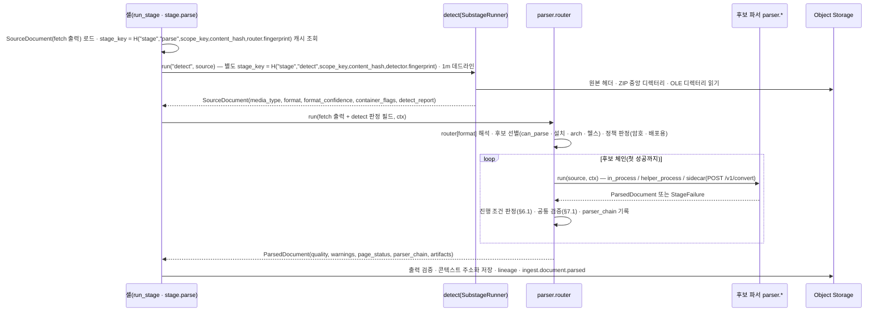
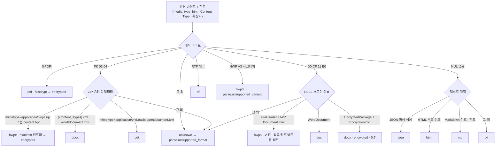

# 파싱 라우터와 포맷 판별

## 목적

`parse` 스테이지는 `SourceDocument`를 받아 `ParsedDocument`를 낸다(브리프 D-05, 바이블 §4.2). 그 안에서 두 가지 결정이 먼저 일어난다 — 이 바이트가 **무엇인가**(포맷 판별, format detection)와 **누가 파싱하는가**(파서 라우팅, parser routing). 이 문서는 그 두 결정의 정본이다. 서브스테이지 `detect`의 판별 알고리즘(시그니처 우선순위·컨테이너 내부 검사·신뢰도), 프로파일 `ingest.parse.router`의 항목 문법과 포맷별 후보 체인(candidate chain), 라우팅 정책(PDF `source_kind` 분기, 프로파일 오버라이드, OCR 정책, 암호화·배포용 처리, 분할), 후보 파서의 실행 격리와 시간·메모리 한계, 페이지 단위 부분 성공, 품질 신호에 의한 폴백 트리거, 어댑터 출력의 공통 검증, 그리고 [범위 문서](../00-vision/04-scope-and-non-goals.md) §6의 지원 포맷 매트릭스와의 정합을 확정한다.

정본 우선순위는 브리프 > 바이블 > ADR > 이 문서다(바이블 §1.1). 열거값(`SourceFormat`·`SourceKind`·`PageStatus`·`BlockSource`·`IsolationMode`), 오류 코드, 플러그인 ID, 프로파일 YAML 키는 바이블 §5.7·§6.1·§7.3을 그대로 쓰고, 바이블에 없는 것은 선택(N) 또는 "## 미해결 이슈"의 제안으로만 둔다.

절 인용 표기: 같은 숫자 접두가 여러 디렉터리에 있으므로 링크가 없는 인용에는 디렉터리 접두를 붙인다 — "계약 02 §4.1"(03-contracts/02), "프레임워크 01 §5.6"(04-pipelines/01), "아키텍처 05 §6.4"(02-architecture/05), "기술 지형 01 §실패 모드"(07-tech-landscape/01). 접두 없는 "04"·"05"·"06"·"07"·"08"은 04-pipelines의 형제 파서 문서다.

## 범위

- 포함: `detect` 서브스테이지의 판별 알고리즘과 `SourceDocument` 판정 필드(`media_type`·`format`·`format_confidence`·`container_flags`·선택 `detect_report`)의 산출 규칙; 플랫폼 소유 합성 스테이지 `parser.router`의 실행 모델; `parse.router` 항목 문법(체인·종결 코드·`PdfRoute`·`SplitRoute`)과 프로파일별 후보 체인; 후보 선별·격리 해석·폴백 진행 조건; PDF 스캔/디지털 판별 휴리스틱과 `page_route`; 암호화·배포용·DRM 처리; 격리 모드별 실행과 타임아웃·메모리 한계; 부분 성공(`page_status[]`·`warnings[]`·`quality`)과 `Resumable` 재개; 파서 품질 신호와 폴백 트리거; 어댑터 출력 → `ParsedDocument` 공통 검증; 라우터가 채우는 필드(`parser_chain[]`·`parser_fingerprint`·`artifacts[]`); 관측성; 지원 포맷 매트릭스.
- 제외: 포맷별 어댑터 내부(OWPML·Docling·pdftext·docx2python·Trafilatura·markdown-it-py 매핑)는 [04 HWPX/HWP](04-parser-hwpx-and-hwp.md)·[05 PDF](05-parser-pdf.md)·[06 DOC/DOCX](06-parser-doc-and-docx.md)·[07 HTML](07-parser-html.md)·[08 TXT/MD](08-parser-txt-md-and-others.md); 원본 수집·조건부 GET·egress는 [02 페치](02-fetching-and-source-resolution.md); 셸(`run_stage`·`SubstageRunner`)의 일반 규약은 [01 파이프라인 프레임워크](01-pipeline-framework.md); 계약 필드 정의는 [SourceDocument](../03-contracts/02-source-document.md)·[ParsedDocument](../03-contracts/03-parsed-document.md); 오류 카탈로그 해설은 [오류 모델](../03-contracts/13-error-model.md); 사이드카 이미지·매니페스트는 [배포 아키텍처](../02-architecture/08-deployment-architecture.md).
- 이 문서는 스키마 파일을 소유하지 않는다. 프로파일 `parse.router`의 스키마(`$defs/RouteEntry`·`RouteStep`·`PdfRoute`·`SplitRoute`)는 [15 컬렉션·프로파일 계약](../03-contracts/15-collection-profile-and-policy-contracts.md)이 소유한다.

## 1. 위치와 실행 모델

**결정:** `parse`는 플랫폼 소유 합성 스테이지 `parser.router`(`ParseRouterStage`, `Stage[SourceDocument, ParsedDocument]`; [컴포넌트 아키텍처](../02-architecture/02-component-architecture.md) §3.2)가 실행한다. 하나의 `stage.parse` 액티비티 안에서 (1) 셸의 `SubstageRunner`가 서브스테이지 `detect`(확장 지점 `parser`, role `format_detector`, 별도 `stage_key`, 1m)를 실행하고, (2) 라우터가 `ingest.parse.router[format]`의 후보 체인을 순서대로 시도하며, (3) 첫 성공 산출을 `ParsedDocument`로 반환하고 시도 순서를 `parser_chain[]`에 남긴다(바이블 §4.2 `detect`·`parse` 행, §3.2 O-07; [ADR-0007](../06-adr/0007-hwp5-java-sidecar-first-pyhwp-demoted.md), [ADR-0033](../06-adr/0033-sidecar-convert-contract-and-isolation-ladder.md)). 라우터 자체는 벤더 라이브러리를 임포트하지 않으며(PDF 프로브도 파서 플러그인이 제공한다, §4.2), 후보 파서는 `RuntimeServices.registry`로 조립한다(아키텍처 02 §2.3).

| 요소 | `plugin_id` / 소유 | 입력 → 출력 | 격리 | `StagePolicy`(바이블 §4.4) |
|------|-------------------|-------------|------|------------------------------|
| `detect` | `parser.format_detector`(role `format_detector`, A 등급 puremagic + 자체 ZIP/OLE 스니퍼; [플러그인 아키텍처](../02-architecture/05-plugin-architecture.md) §13.1) | `SourceDocument`(fetch 출력) → `SourceDocument`(판정 필드 채움) | `in_process` | `ingest-cpu`, `start_to_close` 1m, 하트비트 없음, 3회; 비재시도 `parse.unsupported_format`·`parse.corrupt_container` |
| `parser.router` | 플랫폼(`adapters/parse/router.py`, 바이블 §12 1.3.0 AM-22 등재; 미해결 이슈 1 해소) | `SourceDocument` → `ParsedDocument`(+ `derived` 파생물) | 후보별(§5) | parse(텍스트) `ingest-cpu` 15m / 60s / 3; parse(OCR) `ingest-gpu-ocr`(premium) 또는 `ingest-cpu` 60m / 60s / 3; `resumable`은 후보 어댑터 `Capabilities`로 결정(흐름 포맷 no, 바이블 §4.4 1.3.0 AM-07; 페이지 포맷 `yes(heartbeat_details.page)`) |
| 후보 파서 `parser.*` | 프로파일 체인 항목(§3) | `SourceDocument` → `ParsedDocument` | `in_process` / `helper_process` / `sidecar` | 라우터 잔여 시간(`ctx.remaining_ms()`) 안에서 실행; 자체 재시도·타임아웃 금지(프레임워크 01 §2.5) |



**결정:** 라우터의 작업 입력 **값**은 fetch 출력을 기준으로 하고, `detect` 출력에서는 콘텍스트에서 파생된 판정 필드(`media_type`, `format`, `format_confidence`, `container_flags`, `detect_report`)만 가져온다. 정책·봉투 필드(`acl`·`acl_hash`·`metadata`·`pii_policy`·`credentials_ref`·`request_id`·`fetched_at`)는 항상 fetch 출력의 값이다 — `detect`의 `stage_key`는 `H("stage","detect", scope_key, content_hash, fingerprint)`(바이블 §4.2)라 같은 스코프(테넌트·컬렉션·`document_id`)에서 같은 바이트를 다른 잡이 재수집하면 이전 잡의 인스턴스가 적중하므로(02 미해결 이슈 1), 판정 필드는 바이트에서만 파생되어 재사용해도 옳지만 봉투·정책 필드는 잡마다 새로 발급된 fetch 출력만이 유일한 진실이다. **다만 `ParsedDocument.lineage_refs.source`(계보 포인터)는 값이 아니라 `parse`의 실제 `run()` 입력을 가리키므로 `detect` 산출물(판정 완료된 `SourceDocument`) 참조를 싣는다(바이블 §4.2 1.3.0, R-10, CR-01·CR-11; 01 §5.6과 일치 — 01·03 양쪽이 이전에 "fetch 출력"으로 적었던 것을 정정, 미해결 이슈 2 해소).** 값(정책·봉투 필드)과 계보 포인터(`lineage_refs`)는 별개다: `fetch` 원본은 `lineage(detect_ref, parent=fetch_ref, stage_key)` 행으로 계속 도달한다.

## 2. 포맷 판별 알고리즘

### 2.1 신호 우선순위

**결정:** 판별은 네 신호를 고정 우선순위로 결합하며, 앞 신호가 확정하면 뒤 신호는 동점 해소·기록용으로만 쓴다(바이블 §5.4 `media_type_hint` "힌트만; 시그니처 판정이 우선", [기술 지형 03](../07-tech-landscape/03-document-parsing-office-html-text.md) §포맷 판별 구현 원칙 1).

| 순위 | 신호 | 원천 | 역할 |
|------|------|------|------|
| 1 | 매직 바이트(magic bytes) | 원본 첫 바이트(PDF는 첫 1,024B 안의 `%PDF-`) | 컨테이너 패밀리 확정 |
| 2 | 컨테이너 내부 검사 | ZIP 중앙 디렉터리 항목 이름·`mimetype` 내용 / OLE2 스트림 이름·`FileHeader` | 패밀리 안의 포맷 확정 + `container_flags` |
| 3 | 선언 콘텐츠 타입 | `IngestRequest.media_type_hint`, HTTP `Content-Type`(fetch 출력 `media_type`) | 시그니처 없는 텍스트 계열의 동점 해소, `hint_agrees` 기록 |
| 4 | 확장자 | `resolved_uri` 경로 끝 | 3과 같은 역할, 3보다 뒤 |

두 판정이 어긋나면(예: `.docx`인데 HTML) 시그니처 판정이 이기고 `detect_report.hint_agrees=false`를 남긴다(경고 코드는 v1 카탈로그에 없다 — 02 미해결 이슈 7). 확장자·힌트로만 판정한 경우 `format_confidence`는 0.5로 고정되며 §2.5의 힌트 일치 가산(+0.1)은 적용되지 않는다 — 가산은 시그니처(텍스트 신호) 기반 판정에만 붙는다(02 §4.1 12행·가산 규칙).

### 2.2 판별 패밀리와 시그니처

"패밀리"는 판별기 내부의 분류일 뿐 계약 열거가 아니다. 계약값은 `SourceFormat` 13개(`hwpx, hwp5, hwp3, pdf, docx, doc, rtf, odt, html, txt, md, json, unknown`; 바이블 §5.7)다.

| 패밀리(내부) | 매직 바이트 | 내부 검사 신호 → `format` | 비고 |
|--------------|-------------|----------------------------|------|
| `pdf` | `%PDF-`(첫 1,024B 안) | → `pdf`; 트레일러 `/Encrypt` → `container_flags.encrypted=true` | 선행 바이트가 있는 PDF를 허용하는 PDF 규격 관행 반영 |
| `zip_container` | `50 4B 03 04`(빈 아카이브 `50 4B 05 06`은 `unknown`) | `mimetype = application/hwp+zip` 또는 `Contents/content.hpf`+`version.xml` → `hwpx`; `[Content_Types].xml` + `word/document.xml` → `docx`; `mimetype = application/vnd.oasis.opendocument.text` → `odt`; 그 외 → `unknown`(`split_hint=zip_members`면 분할 대상, §4.7) | `xl/workbook.xml`·`ppt/presentation.xml`·EPUB은 v1 `SourceFormat`에 없어 `unknown`(§3.3) |
| `ole_cfb` | `D0 CF 11 E0 A1 B1 1A E1` | `FileHeader` 스트림 시그니처 `HWP Document File` → `hwp5`(버전·플래그 판독); `WordDocument` → `doc`; `EncryptedPackage`+`EncryptionInfo` → `docx`(`encrypted=true`, 0.7); `Workbook`·`PowerPoint Document`·`__properties_version1.0`(MSG) → `unknown` | olefile(BSD-2)로 스트림 이름만 열람 |
| `rtf` | `{\rtf` | → `rtf` | |
| `hwp_legacy` | `HWP Document File V3.00`(시그니처 원문 확인 필요 as of 2026-09) | → `hwp3` | 전 프로파일 `parse.unsupported_variant` |
| `text_like` | 매직 없음, NUL 바이트 비율 0(첫 64KiB, 초안) | 디코딩 후 JSON → `json`; HTML 루트 신호 → `html`; Markdown 신호 → `md`; 그 외 → `txt`(§2.4) | XML 일반 문서는 `txt`로 판정(§3.3) |
| `binary_unknown` | 그 외 | → `unknown` → `parse.unsupported_format`(산출물 없음) | 이미지(PNG/JPEG/TIFF)·오디오·비디오·아카이브 포함 |

### 2.3 컨테이너 내부 검사 규칙

| 규칙 | 내용 | 출처 |
|------|------|------|
| ZIP 읽기 범위 | **중앙 디렉터리만** 읽어 항목 이름을 얻고, 판정에 필요한 항목(`mimetype`, `[Content_Types].xml`, `META-INF/manifest.xml`, `Contents/content.hpf`, `version.xml`)만 개별로 푼다. 본문 항목(`Contents/section0.xml`, `word/document.xml`)은 존재만 확인하고 열지 않는다 | 03 §포맷 판별 원칙 2 |
| HWPX `mimetype` | 첫 항목·STORED 여부와 무관하게 내용을 읽는다(일부 생성기가 OCF 순서를 지키지 않음). 값 허용 목록: `application/hwp+zip`(정본; python-hwpx `DEFAULT_MIMETYPE`·hwpxlib `MineTypes.HWPX`), `application/hwpml-package+xml`(hwpxlib 변형 상수, 확인 필요 as of 2026-09), `application/vnd.hancom.hwpx`(→ `application/hwp+zip`으로 정규화, 02 §4.2). 항목 부재 시 `Contents/content.hpf` + `version.xml` 존재로 판정 | [기술 지형 01](../07-tech-landscape/01-document-parsing-hwpx-hwp.md) §어댑터 계약, 02 §4.2 |
| HWPX 암호화 | `META-INF/manifest.xml`의 암호화 항목(`encryption-data`; 확인 필요 as of 2026-09) → `encrypted=true` | 02 §2.2 |
| OOXML | `[Content_Types].xml` 존재 + `word/document.xml` → `docx`. `word/` 대신 `xl/`·`ppt/`만 있으면 `unknown` | 03 §포맷 판별 다이어그램 |
| OLE `FileHeader` | 256B 스트림: 시그니처 32B(`HWP Document File`, NUL 패딩) → 버전 4B(`5.0.x.x` → `container_flags.hwp_version`) → 속성 비트: bit 0 압축(`compressed`), bit 1 암호(`encrypted`), bit 2 배포용(`distribution`). 비트 위치는 한컴 공개 스펙 5.0 rev1.3 원문으로 재확인(01 미해결 이슈 7; 확인 필요 as of 2026-09) | 01 §포맷 구조 요약, 02 §2.2 |
| 배포용 보강 신호 | `ViewText` 스트림 존재는 `distribution=true`의 보강 신호다. 플래그와 스트림이 어긋나면 플래그를 따르고 `detect_report.signals`에 둘을 모두 남긴다 | 01 §실패 모드 |
| 암호화 OOXML | OLE `EncryptedPackage`+`EncryptionInfo` → `format=docx`, `encrypted=true`, 0.7(내부가 DOCX인지 XLSX인지는 복호화 전 알 수 없다). 복호화는 `parse`가 `credentials_ref`로 시도(§4.6) | 02 §4.1 3행 |
| 손상 컨테이너 | 중앙 디렉터리·OLE 디렉터리 판독 불가, 필수 항목 열기 실패 → `parse.corrupt_container`(비재시도, 산출물 없음) | 바이블 §4.2 `detect` 행 |

### 2.4 텍스트 계열 판별

**결정:** 매직 바이트가 없고 첫 64KiB(초안 목표)에 NUL 바이트가 없으면 텍스트 계열로 보고 다음 순서로 판정한다. 디코딩 순서는 WHATWG 스니핑(BOM > `http_metadata.charset` > `<meta charset>` 1,024B > charset-normalizer 자동 감지 > UTF-8; `euc-kr`은 `cp949`)이며 실제 인코딩은 파서가 `ParsedDocument.source_encoding`에 남긴다(02 §9, [매트릭스](../07-tech-landscape/00-summary-and-selection-matrix.md) `text_decoder` 행).

| 순서 | 신호 | `format` | 규칙(초안 목표; 골든 코퍼스로 확정) |
|------|------|----------|--------------------------------------|
| 1 | 첫 비공백 문자가 `{` 또는 `[`이고 JSON 파싱 성공 | `json` | 크기 ≤ 16MB면 전체 파싱, 초과면 첫 64KiB 토큰 검사(중괄호·대괄호 균형 미검증)로 판정하고 `format_confidence`를 0.1 낮춘다 |
| 2 | `<!DOCTYPE html`, `<html`, `<head`, `<body` 중 하나(대소문자 무시, 첫 8KiB) | `html` | XHTML(`<?xml` 뒤 `<html`) 포함. `<?xml`만 있고 HTML 루트가 없으면 5 |
| 3 | Markdown 신호: 첫 줄 `---` 프론트매터, ATX 헤딩 `^#{1,6} `, 펜스 ` ``` `, 목록·링크 문법 라인 비율 ≥ 0.05 | `md` | 헤딩 1개 이상 또는 문법 라인 비율 충족 |
| 4 | 힌트·확장자가 `text/markdown`·`.md`·`.markdown`이고 3의 신호 없음 | `md` | 힌트 기반 0.5 고정(02 §4.1 12행; 힌트 일치 가산 없음, §2.5) |
| 5 | 그 외 | `txt` | CSV·TSV·일반 XML도 v1은 `txt`(§3.3) |

### 2.5 신뢰도 표와 `detect_report`

`format_confidence`는 [02 §4.1](../03-contracts/02-source-document.md) 표를 정본으로 하며, 이 문서가 라우팅에서 쓰는 방식은 다음과 같다. 수치는 초안 목표이고 골든 코퍼스(미해결 이슈 3)로 확정한다.

| 판정 근거 | `format_confidence` | 라우터 사용 |
|-----------|---------------------|-------------|
| 매직 바이트 + 내부 검사 일치(`pdf`, `hwp5`, `doc`, `hwpx`, `docx`, `odt`, `rtf`, `hwp3`) | 1.0 | 그대로 라우팅 |
| 암호화 OOXML(내부 포맷 미확정) | 0.7 | `docx` 체인, 복호화 후 §4.6에서 재판정 |
| 텍스트 계열 JSON / HTML / MD·TXT(§2.4 1~3·5행의 텍스트 신호 기반) | 0.9 / 0.8 / 0.6 | 그대로 라우팅. 힌트 일치 시 +0.1(상한 1.0; 02 §4.1 9~11행에만 적용) |
| 시그니처 없음, 힌트·확장자만(§2.4 4행 포함) | 0.5 고정(가산 없음) | 힌트 값으로 라우팅; `hint_agrees=null`이 아니면 기록 |
| 어느 것도 아님 | 0.0 → `unknown` | `parse.unsupported_format`(비재시도, 산출물 없음) |

라우터는 `format_confidence`로 체인을 바꾸지 않는다(같은 `format`은 같은 체인). 신뢰도는 (a) `detect_report.candidates[]`와 함께 감사·회귀 분석에 쓰고, (b) `hint_agrees=false`를 관측 메트릭(§8 제안)으로 집계하는 데 쓴다. `detect_report`(02 §2.6, 바이블 미등재 선택 하위 객체)에는 판정에 쓴 **신호 이름만** 남기며 콘텍스트 조각은 금지다(00 I-16).

```json
{
  "media_type": "application/x-hwp",
  "format": "hwp5",
  "format_confidence": 1.0,
  "container_flags": {"encrypted": false, "distribution": true, "compressed": true, "hwp_version": "5.0.3.0"},
  "detect_report": {
    "detector_plugin_id": "parser.format_detector",
    "detector_version": "1.0.0",
    "signals": ["ole:magic", "ole:FileHeader=HWP Document File", "ole:FileHeader.flags=compressed|distribution", "ole:ViewText"],
    "hint_media_type": "application/x-hwp",
    "hint_agrees": true,
    "candidates": [{"format": "hwp5", "confidence": 1.0}]
  }
}
```

### 2.6 안전 한계

| 항목 | 한계(초안 목표) | 초과 시 | 출처 |
|------|-----------------|---------|------|
| 판별 읽기 범위 | 헤더 64KiB + ZIP 중앙 디렉터리 + 판정용 항목 각 1MiB(펼친 크기) | 판정용 항목 초과 → `parse.corrupt_container` | 이 문서 |
| ZIP 폭탄 | 항목 수 10,000, 펼친 총량 1GiB, 압축비 100:1 | `parse.corrupt_container`(비재시도) + 보안 로그 | 05 §11.2 입력 위생, 03 §포맷 판별 원칙 3 |
| 중첩 컨테이너 | ZIP 안의 ZIP은 판별하지 않는다(`unknown`; `split_hint=zip_members` 멤버는 §4.7) | — | 02 §4.1 |
| 매크로 | OLE·OOXML의 VBA 존재는 로그만(`olevba`; 실행 없음) | — | 05 §11.2 |
| 시간 | `detect` `start_to_close` 1m(셸 데드라인) | `TimeoutError` → 미분류 예외 → 부모 액티비티 재시도 | 바이블 §4.4, 01 §5.6 |

### 2.7 판별 흐름



## 3. 라우터 구성

### 3.1 `parse.router` 항목 문법

프로파일 `ingest.parse.router`는 `SourceFormat` 13값 전부를 키로 가져야 로딩을 통과한다(바이블 §7.4 (10); 누락 → `profile.invalid`). 각 값은 아래 네 형 중 하나이며 스키마 `$defs/RouteEntry`는 [15 문서](../03-contracts/15-collection-profile-and-policy-contracts.md)가 소유한다.

| 형 | 문법 | 의미 | 예(바이블 §7.3) |
|----|------|------|------------------|
| 후보 체인 | `array<plugin_id \| RouteStep>`, `RouteStep = {plugin, isolation?, image?, then?}` | 앞 항목 실패 시 다음 항목(§6.1 진행 조건). 배열 순서가 유일한 우선순위(별도 `priority` 없음, 05 §6.4) | `hwp5: [{plugin: parser.hwp5_java_sidecar, isolation: sidecar, image: parser-workers}, {plugin: parser.hwp5_unhwp, isolation: helper_process}, parser.hwp5_hwp_hwpx_parser]` |
| 종결 코드 | 문자열 `parse.unsupported_format` 또는 `parse.unsupported_variant` | 판별 즉시 해당 코드로 종료(비재시도, 산출물 없음) | `hwp3: parse.unsupported_variant`, `unknown: parse.unsupported_format`, `lite`의 `doc: parse.unsupported_format` |
| `PdfRoute` | `{born_digital: entry, scanned: entry, mixed: entry \| page_route}` | `pdf`만. 라우터가 프로브로 정한 `source_kind`별 체인(§4.2). `pre_ocr`은 `born_digital` 항목을 쓴다 | `pdf: {born_digital: parser.pdf_docling_standard, scanned: parser.pdf_docling_standard, mixed: page_route}` |
| `SplitRoute` | `{split: enum(SplitHint), then: enum(SourceFormat)}` | 멤버 분할 후 `then` 체인으로 재라우팅(§4.7). `IngestRequest.split_hint=none`이면 `then` 체인을 그대로 적용 | `json: {split: json_array, then: txt}` |

`RouteStep.then`은 변환형 후보 전용이다: 후보의 산출(`derived_source`)을 `then` 포맷의 체인에 재투입한다(`doc/rtf/odt → docx`). **결정:** `then`의 깊이는 1이다 — `then` 대상 체인에는 `then` 항목이 있을 수 없고(`docx` 체인은 순수 파서만), 재투입된 산출물은 §2.3의 시그니처 검증(ZIP + `[Content_Types].xml`)을 통과해야 하며 실패는 `parse.conversion_failed`다. 이 규칙은 프로파일 검증 규칙 추가 제안이다(미해결 이슈 4). `hwp5_java_sidecar`의 HWP → HWPX 변환은 라우터 `then`이 아니라 어댑터 내부에서 끝난다(05 §6.4; 사이드카 `output`이 HWPX 파생물, 같은 어댑터가 OWPML 변환까지 수행).

### 3.2 포맷별 후보 체인

`standard`가 기준이고(바이블 §7.3 정본 YAML), `lite`는 사이드카 0·GPU 0(05 §12.1), `premium`·`korean-gov`는 바이블 §7.1 열의 차이만 적는다. 플러그인 ID는 바이블 §6.1·§12, 격리는 §5.7 `IsolationMode`, 등급은 [ADR-0001](../06-adr/0001-license-grade-table-and-d02-interpretation.md).

| 패밀리 | `format` | 1차 | 2차 | 폴백 | 조건(스캔·암호화·크기·프로파일) |
|--------|----------|-----|-----|------|----------------------------------|
| ZIP | `hwpx` | `parser.hwpx_python_hwpx`(in_process, A) | — | — | `encrypted`: `korean-gov`만 `parser.hwpx_hwpxlib_sidecar`(제안, `parser-workers`, `credentials_ref` 필수) 앞에 둠; 그 외 프로파일은 `parse.document_encrypted` |
| OLE | `hwp5` | `parser.hwp5_java_sidecar`(sidecar `parser-workers`, A) | `parser.hwp5_unhwp`(helper_process, x64만) | `parser.hwp5_hwp_hwpx_parser`(in_process) → `parser.office_lo_sidecar`(`lo-sidecar`, C, opt-in) | `lite`: unhwp → hwp-hwpx-parser만. `distribution`: `allow_distribution_documents`(요청 AND 테넌트) 참이고 `parser-workers` 존재 시 Tika `HwpV5Parser`(`parser.hwp5_tika_distribution` 제안) 텍스트 전용 `quality=degraded`, 아니면 `parse.distribution_document`. `encrypted`: `credentials_ref` 있을 때 사이드카 후보만 시도(hwplib 암호 문서 지원 확인 필요 as of 2026-09), 없으면 `parse.document_encrypted`. arm64 노드는 unhwp 비활성 |
| OLE | `hwp3` | 종결 `parse.unsupported_variant` | — | — | 전 프로파일 |
| PDF | `pdf`(`born_digital`·`pre_ocr`) | `parser.pdf_docling_standard`(`pdf_standard`, in_process, A) | — | 손상 PDF: Docling 백엔드 폴백(THREADED → PYPDFIUM2)은 어댑터 내부 | `lite`: `parser.pdf_fast_pdftext`(`pdf_fast_cpu`, [ADR-0006](../06-adr/0006-pdf-fast-path-pypdfium2-pdftext-replaces-pymupdf.md)). `encrypted`: 빈 사용자 암호 → `credentials_ref` → `parse.document_encrypted`(§4.6). PyMuPDF(AGPL, 인프로세스 제외 — ADR-0006)는 `rag-plugin-pymupdf-sidecar`(C 등급) 옵트인만 |
| PDF | `pdf`(`scanned`) | `parser.pdf_docling_standard` + OCR `parse.options.ocr`(RapidOCR PP-OCRv5 korean mobile, in_process, A; [ADR-0008](../06-adr/0008-ocr-default-rapidocr-ppocrv5-korean.md)) | `premium`: `parser.ocr_paddleocr`(sidecar `ocr-gpu`, `pdf_scanned_gpu`) | `parser.ocr_tesseract`(`kor+eng`, `kor_vert`; `korean-gov` `pdf_airgapped`) | 페이지 타임아웃 CPU 60s / GPU 20s; `ocr-gpu` 불가 → `parse.sidecar_unavailable` 재시도 후 RapidOCR CPU 폴백 + `quality=degraded`(09 F-08). `pdf_vlm_gpu`는 골든셋 후 |
| PDF | `pdf`(`mixed`) | `page_route`: 디지털 페이지 = `born_digital` 항목, 스캔 페이지 = `scanned` 항목의 OCR(§4.2) | — | — | 한 `ParsedDocument`로 병합, `Block.source`가 페이지별 진실 |
| ZIP | `docx` | `parser.docx_docling_docx2python`(in_process, A; 각주·미주 병합 필수, D-18) | — | — | `encrypted`(OOXML): `credentials_ref`로 msoffcrypto-tool 복호화 → 재판정 → `docx`(§4.6) |
| OLE | `doc` | `{parser.office_lo_sidecar, sidecar lo-sidecar, then: docx}`(C, opt-in) | — | — | `lite`·`optIn.loSidecar=false`: 종결 `parse.unsupported_format`(Helm `pre-install` 검증이 라우터-optIn 불일치를 차단, 08 §훅) |
| 텍스트 | `rtf` | `{parser.office_lo_sidecar, then: docx}` | `parser.rtf_striprtf`(in_process, `quality=degraded`) | — | `lite`: striprtf만 |
| ZIP | `odt` | `{parser.office_lo_sidecar, then: docx}` | `parser.odt_odfdo`(in_process) | — | `lite`: odfdo만 |
| 텍스트 | `html` | `parser.html_trafilatura_docling`(in_process; Trafilatura `xml` → Docling HTML 순서 고정) | 빈 결과 2차(readability-lxml / magic-html)는 어댑터 내부([07 HTML](07-parser-html.md)) | — | `http_metadata.charset` 디코딩 힌트 |
| 텍스트 | `txt` / `md` | `parser.text_charset_markdown_it`(in_process) | — | — | `source_encoding` 필수 기록 |
| 텍스트 | `json` | `SplitRoute{split: json_array, then: txt}` | — | — | `split_hint=none`이면 `txt` 체인 그대로 |
| — | `unknown` | 종결 `parse.unsupported_format` | — | — | `detect`가 이미 종료(산출물 없음) |

### 3.3 지원 포맷 매트릭스(범위 문서 §6.2와 정합)

[범위 문서](../00-vision/04-scope-and-non-goals.md) §6.2 등급을 `SourceFormat`·`detect` 판정·v1 라우팅 결과와 맞춘 표다. 등급은 §6.1 정의(1급·2급·실험·비지원) 그대로이고, 사이드카 필요는 등급이 아니라 배포 구성이다(§6.4).

| 포맷 | 등급(§6.2) | `detect` → `format` | v1 라우팅 | 정합 비고 |
|------|-----------|---------------------|-----------|-----------|
| HWPX | 1급 | `hwpx` | python-hwpx 체인 | 일치 |
| HWP 5.0 | 1급 | `hwp5` | Java 사이드카 체인(`lite`는 unhwp 체인) | §6.2 "pyhwp + LibreOffice 폴백" 문구는 D-18 v1.1(ADR-0007)로 대체됨 — 범위 문서 갱신 요청(미해결 이슈 5) |
| HWP 3.0 이하 | 비지원 | `hwp3` | `parse.unsupported_variant` | 일치 |
| PDF(텍스트) | 1급 | `pdf`(`born_digital`) | Docling / pdftext(`lite`) | §6.2 "PyMuPDF" 문구는 ADR-0006으로 대체됨(미해결 이슈 5) |
| PDF(스캔) | 1급 | `pdf`(`scanned`·`mixed`) | Docling + RapidOCR / PaddleOCR / Tesseract | 일치(O-08 해결) |
| PDF(암호화) | 비지원(§6.2) | `pdf`, `encrypted=true` | `credentials_ref` 있으면 복호화 시도, 없으면 `parse.document_encrypted` | 바이블 D-18 v1.1이 `credentials_ref` 경로를 열었으므로 §6.2 행을 "2급(자격 증명 제공 시)"으로 갱신 제안(미해결 이슈 5) |
| DOCX | 1급 | `docx` | Docling + docx2python | 일치 |
| DOC | 2급 | `doc` | `lo-sidecar` → `docx` | 일치(사이드카 부재 배포는 `parse.unsupported_format`으로 거절 — §6.4 요구 충족) |
| HTML | 1급 | `html` | Trafilatura → Docling | 일치 |
| TXT / Markdown | 1급 | `txt` / `md` | charset-normalizer + markdown-it-py | 일치 |
| RTF | 실험 | `rtf` | `lo-sidecar` → `docx` / striprtf(degraded) | 일치 |
| ODT | 실험 | `odt` | `lo-sidecar` → `docx` / odfdo | 일치. ODP·ODS는 `unknown` |
| JSON | 실험 | `json` | `json_array` 분할 → `txt` | 일치. 일반 XML은 `txt`로 판정(구조 추론 없음) |
| CSV / TSV | 실험 | `txt` | 평문 파싱 | v1은 표 파서 없음; `SourceFormat`에 `csv` 추가는 minor ADR 대상(미해결 이슈 6) |
| PPTX / XLSX | 2급(로드맵) | `unknown` | `parse.unsupported_format` | `SourceFormat`에 `pptx`·`xlsx` 추가(minor ADR) 전까지 라우팅 불가(미해결 이슈 6) |
| PPT / XLS | 실험 | `unknown` | `parse.unsupported_format` | 동일 |
| 이미지 단독 | 2급 | `unknown` | `parse.unsupported_format` | OCR 경로는 `SourceFormat` 값 추가 전까지 열리지 않음(미해결 이슈 6) |
| EPUB / EML·MSG / ZIP 아카이브 / 오디오·비디오 | 비지원 | `unknown` | `parse.unsupported_format` | ZIP은 `split_hint=zip_members`일 때만 멤버 전개(§4.7) |

## 4. 라우팅 정책

### 4.1 후보 선별과 격리 해석

**결정:** 라우터는 `router[format]`의 체인을 다음 순서로 걸러 실행 목록을 만든다. 순서 재배열은 하지 않는다 — 건너뛰기만 허용한다(05 §6.4 "헬스 `degraded` 후보를 뒤로 미룸"은 채택하지 않는다; 같은 입력·같은 프로파일이 헬스 상태에 따라 다른 파서를 타면 `parser_chain[]` 재현성이 깨진다, 05 미해결 이슈 10 해소).

| 단계 | 판정 | 제외 시 기록 |
|------|------|--------------|
| 1 종결 코드 | 값이 문자열 코드면 즉시 `StageFailure(code)` | — |
| 2 `can_parse` | `format ∈ Capabilities.input_formats`이고 `container_flags` 조건 충족(암호화 문서는 복호화 능력 선언 후보만, 배포용은 배포용 후보만) | 후보 생략(로그) |
| 3 설치·옵트인 | entry point 미등록, `optIn` 꺼진 사이드카(`lo-sidecar`), 미설치 extra는 건너뛴다 | 경고 로그; 남는 후보 0 → `parse.unsupported_format` |
| 4 아키텍처 | `Capabilities.extra.arch`가 노드와 불일치(unhwp arm64) → 로딩 시 비활성 | 경고 로그 |
| 5 헬스 | `StageLifecycle.health()`가 `failing`인 후보는 건너뛴다; `degraded`는 순서 유지 | 경고 로그 |
| 6 격리 해석 | `RouteStep.isolation`이 있으면 그 값(교집합 밖이면 `plugin.capability_unsupported`); 없으면 `PluginMeta.isolation_supported ∩ Capabilities.isolation_modes ∩ StagePolicy.isolation`의 **최저 단**(`in_process` < `helper_process` < `sidecar`; 05 §7.2). C 등급은 `sidecar` 강제. `sidecar`면 `image`·`PluginMeta.sidecar_image` 일치 필수 | 로딩 시 `profile.invalid` |

### 4.2 PDF 경로와 `source_kind`

**결정:** `format=pdf`의 체인 선택 키는 라우터가 pypdfium2 프로브로 정하는 `source_kind`(`born_digital, scanned, mixed, pre_ocr`; 바이블 §5.7 `SourceKind`)다. 프로브는 렌더 없이 페이지별 통계만 낸다(암호화 여부, 문자 수, 이미지 면적 비율, 텍스트 렌더 모드, PUA·제어문자 비율, 회전). 프로브 자체의 예산은 문서당 30s(초안 목표)이며 초과 시 `mixed`로 간주해 `page_route`로 넘긴다.

| `source_kind` | 문서 수준 판정(초안 임계값) | `PdfRoute` 항목 | 블록 `source` |
|---------------|-----------------------------|-----------------|---------------|
| `born_digital` | 텍스트 레이어 페이지 비율 ≥ 0.8 이고 깨진 텍스트 페이지 0 | `born_digital` | `text_layer` |
| `scanned` | 스캔 페이지 비율 ≥ 0.8 | `scanned` | `ocr`(+ `confidence`) |
| `mixed` | 그 외(혼재, 또는 프로브 시간 초과) | `mixed`(`page_route`) | 페이지별 |
| `pre_ocr` | 문자 있음 + 숨은 텍스트 레이어(렌더 모드 3) 비율 ≥ 0.5 + 이미지 면적 ≥ 0.5 | `born_digital` 항목(텍스트 레이어 신뢰); 깨진 페이지만 §6.3 규칙으로 재OCR | `text_layer`(재OCR 페이지는 `ocr`) |

`page_route`는 한 번의 파서 호출 안에서 실행된다: 디지털 페이지는 `born_digital` 항목 파서의 페이지 경로, 스캔 페이지는 `scanned` 항목의 OCR 경로로 처리하고 하나의 `ParsedDocument`로 병합한다. `standard`는 두 항목이 같은 `parser.pdf_docling_standard`이므로 OCR 강제 페이지 집합만 다르고, `lite`는 `parser.pdf_fast_pdftext`(디지털) + `parser.pdf_docling_standard`(스캔)의 페이지 산출을 병합한다. 병합 시 `element_path`는 어댑터 문법(`/page[p]/block[b]`, `#/texts/n`)이 달라 충돌하지 않지만 문서 내 유일성은 라우터가 재검증한다(§7.1). `parser_chain[]`에는 실제 호출된 파서를 모두 기록하고 `producer`·`parser_fingerprint`는 마지막 호출 파서다. 페이지 병합 규칙의 세부(`page_break` 삽입, 읽기 순서)는 [05 PDF](05-parser-pdf.md)가 확정한다.

### 4.3 스캔 판별 휴리스틱(페이지 단위)

[기술 지형 02](../07-tech-landscape/02-document-parsing-pdf-layout-ocr.md) §스캔/디지털 판별 휴리스틱을 정본 임계값 표로 옮긴다. 모두 초안 목표이며 골든셋(`ko-public-v1`, 공문서 스캔 세트)으로 조정한다.

| 신호 | 측정(pypdfium2) | 판정 규칙 | 결과 |
|------|-----------------|-----------|------|
| 문자 수 | `count_chars()` | 페이지당 < 20자 → 텍스트 없음 후보 | 스캔 후보 |
| 이미지 면적 비율 | 이미지 객체 bbox 합 / 페이지 면적 | > 0.5 이고 텍스트 없음 | `scanned` 페이지 |
| 숨은 텍스트 레이어 | 렌더 모드 3(invisible) 문자 비율 | 문자 있음 + 렌더 모드 3 비율 ≥ 0.5 + 이미지 > 0.5 | `pre_ocr` 페이지 |
| 깨진 텍스트 | ToUnicode 누락 폰트 비율, PUA(U+E000~U+F8FF)·U+FFFD·제어문자(탭·개행 제외) 비율 | PUA+FFFD+제어 비율 > 0.2 또는 ToUnicode 누락 폰트 > 0.5 | 깨진 페이지 → OCR 재처리(§6.3) |
| 한글 자모 분해·음절 공백 | NFD 자모 비율, 음절 사이 공백 패턴 | 판정에 쓰지 않음 | `normalize`의 NFC·공백 복원 대상 |
| 회전·기울기 | `get_rotation()`, OCR 엔진 방향 분류; 렌더 후 기울기 추정 | 90/180/270 보정, 기울기 > 0.5도 보정 | OCR 전처리(어댑터) |

문서 수준 판정은 §4.2 표대로다(스캔 비율 ≥ 0.8 → `scanned`, 텍스트 비율 ≥ 0.8 → `born_digital`, 그 외 `mixed`). 판정에 쓴 페이지별 통계는 `vendor_json` 파생물(`artifacts[]{kind: vendor_json}`)로 저장할 수 있으며(N) 콘텐츠 문자열은 넣지 않는다.

### 4.4 OCR 옵션·정책 선택·비용 등급

OCR 엔진은 프로파일 `ingest.parse.options.ocr {plugin, lang, version, model}`(네 키 필수, 바이블 §7.4 (6); Docling `OcrAutoOptions` 금지, ADR-0008)이 정하고 라우터는 이를 후보 파서에 옵션으로 넘긴다. OCR 언어는 `ocr.lang`이 정본이며 `metadata.language_hint`가 `ko` 외이면 엔진 언어 코드 매핑(BCP 47 → 엔진 코드; [05 PDF](05-parser-pdf.md))으로 추가한다.

**결정(정책 선택):** `stage.parse`는 스케줄 시점에 정책을 하나 골라야 하는데 `source_kind`는 액티비티 안에서야 알 수 있다. v1 규칙은 다음과 같다 — 워크플로우는 fetch 출력의 잠정 `format`(힌트·확장자 기반, 02 §1.2)이 `pdf`이면 `policy_ocr`(60m, `runtime.queues.ocr`)로, 아니면 `policy`(15m, `queues.parse`)로 `stage.parse`를 스케줄한다. `standard`·`lite`는 두 큐가 같으므로 차이는 `start_to_close`뿐이고, `premium`은 PDF가 `ingest-gpu-ocr`(워커는 HTTP 클라이언트, GPU는 `ocr-gpu` 사이드카; 08 P7)로 간다. 잠정 판정이 틀려 텍스트 정책으로 실행된 스캔 PDF는 라우터가 같은 액티비티 안에서 OCR을 수행하되 잔여 시간 안에서 페이지 타임아웃으로 저하한다(§6.2). `source_kind` 확정 후 OCR 큐로 재디스패치하는 최적화는 오케스트레이션 문서와 합의할 제안이다(미해결 이슈 7).

비용 등급(cost class)은 바이블에 없는 개념이므로 계약 필드가 아니라 라우터 정책의 **문서화 분류**로만 쓴다(`Capabilities.extra.cost_class` 제안은 미해결 이슈 8).

| 등급(내부) | 후보 | 정책에서의 쓰임 |
|------------|------|-----------------|
| `cpu_light` | `hwpx_python_hwpx`, `docx_docling_docx2python`, `html_trafilatura_docling`, `text_charset_markdown_it`, `pdf_fast_pdftext`, `hwp5_hwp_hwpx_parser` | 제한 없음 |
| `cpu_heavy` | `pdf_docling_standard`(레이아웃·TableFormer), RapidOCR CPU, `office_lo_sidecar`, `hwp5_java_sidecar`(JVM), `hwp5_unhwp`(헬퍼 기동) | `page_route`는 스캔 페이지만 OCR(전면 OCR 금지); `lite`는 디지털 PDF에 `pdf_fast_pdftext` 우선 |
| `gpu` | `ocr_paddleocr`(`ocr-gpu`), `pdf_vlm_gpu`(골든셋 후) | `premium`만; `ocr-gpu` 불가 시 CPU 폴백 |

### 4.5 프로파일 오버라이드

`IngestRequest.profile_overrides`는 컬렉션 프로파일의 **허용 키만** 받고 그 외는 422다(바이블 §5.4). 파싱 관련 허용 키는 `parse.pdf.route` 하나이며, **값 집합은 03-contracts/01 §2.5가 정본으로 고정한다**(`pdf_fast_cpu`·`pdf_standard`·`pdf_scanned_gpu`·`pdf_airgapped` — §4.4·§8.2의 `profile_option` 값과 동일 이름 공간, #76 해소): 이 문서가 이전에 제안한 `auto`/`born_digital`/`scanned`/`mixed` 값 집합은 대체한다.

| 키 | 값(03-contracts/01 §2.5 정본) | 효과 |
|----|-------------------------------|------|
| `parse.pdf.route` | `pdf_standard`(기본) | §4.2 프로브 판정 대신 지정 라우트(=해당 `profile_option`의 후보 체인)를 강제(스캔 문서를 `pdf_fast_cpu`/`pdf_standard`로 강제하면 빈 텍스트가 나올 수 있으며 §6.3 빈 산출 규칙이 적용된다) |
| | `pdf_scanned_gpu` | OCR 경로 강제 |
| | `pdf_airgapped` | 폐쇄망 경로 강제(네트워크 모델 호출 없음) |

오버라이드는 `stage_key`에 반영되어야 한다. 라우터 `fingerprint()`는 프로파일 설정만 포함하므로, 요청 단위 오버라이드는 셸이 `StageActivityInput`의 `overrides_hash`를 `config_hash` 입력에 합성하는 방식이 필요하다 — 01 §7.1과 합의할 항목이다(미해결 이슈 9, 값 집합 부분은 해소). 확정 전까지 오버라이드가 있는 잡은 `force=true`로 캐시를 조회하지 않는다.

### 4.6 암호화·배포용·DRM

`detect`는 `container_flags`를 **판정만** 하고 오류는 `parse`가 정책과 함께 결정한다(바이블 §4.2 `detect` 행; 02 §8). 비밀번호는 어디에도 평문으로 실리지 않으며(`credentials_ref`만, 바이블 §6.6) `StageError.detail`에는 필드 이름만 담는다.

| 포맷 | `encrypted` 판정 근거 | `credentials_ref` 없음 | `credentials_ref` 있음 |
|------|----------------------|-----------------------|-----------------------|
| `hwp5` | `FileHeader` bit 1 | `parse.document_encrypted` | `sidecar` 후보(`parser.hwp5_java_sidecar`)만 `can_parse=true`; 복호화 실패·불일치 → `parse.document_encrypted`. hwplib 암호 문서 지원은 확인 필요(as of 2026-09) |
| `hwpx` | `META-INF/manifest.xml` 암호화 항목 | `parse.document_encrypted` | `korean-gov`: `parser.hwpx_hwpxlib_sidecar`(제안); 그 외 프로파일 `parse.document_encrypted` |
| `pdf` | 트레일러 `/Encrypt` | 빈 사용자 암호로 열기 1회 시도(권한 제한만 걸린 PDF) → 성공 시 정상 진행(`encrypted=true` 유지, 경고 없음) → 실패 시 `parse.document_encrypted` | 비밀 조회 후 열기 → 실패 시 `parse.document_encrypted`. 비표준 보안 핸들러(DRM 플러그인) → `parse.document_encrypted`(`detail="unsupported security handler"`) |
| `docx`(OOXML 암호화) | OLE `EncryptedPackage` | `parse.document_encrypted` | msoffcrypto-tool(MIT, 6.0.0; API 확인 필요 as of 2026-09)로 복호화 → `derived_source` → §2.3 재판정(`docx`가 아니면 `parse.unsupported_format`) → `docx` 체인. IRM/RMS(DataSpaces DRM 변환)는 복호화 불가 → `parse.document_encrypted` |
| `doc` | 레거시 암호(`FIB` 플래그; 확인 필요) | `parse.document_encrypted` | `lo-sidecar` 변환 시 비밀 전달은 `ConvertRequest.credentials_ref`(사이드카가 해소) |

배포용 HWP(`distribution=true`)는 02 §8 표대로다: `allow_distribution_documents`(요청 AND 테넌트 정책)가 거짓이면 `parse.distribution_document`(비재시도); 참이면 `parser-workers` 동거 Tika `HwpV5Parser` 텍스트 전용 경로로 `quality=degraded`, 모든 블록 `source=converted`, 표 구조 손실은 `warnings[]`가 아닌 `TableData.quality`로 표현한다(경고 코드 부재). `lite`는 `parser-workers`가 없어 항상 `parse.distribution_document`다. 두 코드 모두 체인을 즉시 멈추며(§6.1) 잡은 `failed`, 이벤트 `ingest.document.failed`가 발행된다.

### 4.7 분할 라우팅

`json: {split: json_array, then: txt}`(바이블 §7.3)은 라우터 항목이지만 멤버 전개는 `parse` 안에서 일어날 수 없다 — `parse`는 문서 1건당 `ParsedDocument` 1개를 내고 멤버는 각자 `document_id`를 갖는 별개 문서다(01 §5.2 `{source_uri}#member={locator}`). **결정:** `SplitRoute`는 라우터에서 "멤버가 도착했을 때 적용할 체인"(`then`)의 선언으로 해석하고, 컨테이너의 멤버 전개(JSON 배열·ZIP 멤버 → 멤버 `IngestRequest`/문서 생성)는 `parse` 이전 단계가 담당한다([02 페치](02-fetching-and-source-resolution.md)와 오케스트레이션 문서가 확정, 01 미해결 이슈 5). `split_hint=none`인 `json`은 `txt` 체인으로 파싱한다. `zip_members`는 `SourceFormat`에 `zip` 값이 없으므로 라우터 키가 아니며, 전개되지 않은 ZIP은 `unknown → parse.unsupported_format`이다. 멤버 상한·초과 경고 코드(`parse.member_limit_exceeded` 후보)는 미해결 이슈 10.

## 5. 실행 격리와 자원 한계

### 5.1 격리 모드별 실행

라우터는 §4.1 6단계로 해석한 격리 모드로 후보를 실행한다. 실행 기계는 셸의 `execute_isolated`(01 §5.4)이고 사이드카 호출은 `SidecarStage`(05 §7.3)를 통해서만 한다.

| 모드 | 대상 | 실행 | 크래시 변환 | 지문 요소 |
|------|------|------|-------------|-----------|
| `in_process` | A 등급 순수 Python(`linkage=pure_python`) | `ingest-cpu` 큐에서는 전용 스레드(`asyncio.to_thread`)에서 `run`, 메인 루프는 하트비트·취소 감시. GIL을 놓지 않는 네이티브 호출이 `heartbeat/2`를 넘기면 다음 릴리스에서 `helper_process`로 승격 대상(02 §4.2) | 예외 → `StageFailure` 또는 미분류(재시도 가능 취급) | `plugin_version`·`config_hash`·`model_ids` |
| `helper_process` | ctypes·네이티브 크래시 위험(`parser.hwp5_unhwp`) | 문서 1건 = `multiprocessing` `spawn` 프로세스 1개(상주 풀 없음; ADR-0033 재검토 조건 3). 입력은 부모가 로컬 tmpfs에 내린 경로, 결과는 파이프로 `ArtifactRef` 회신 | 비정상 종료·시그널·`OSError` → `parse.conversion_failed`(폴백); 전용 코드 `parse.helper_crashed`는 13 §3.3 제안 | 번들 네이티브 바이너리 변경 = `PluginMeta.version` 상승 |
| `sidecar` | JVM(`parser-workers`), LibreOffice(`lo-sidecar`, C), CUDA(`ocr-gpu`), 모든 C 등급 | `POST /v1/convert`(`ConvertRequest{input: ArtifactRef, options, tenant_id, document_id, deadline_ms, trace_id, credentials_ref}` → `ConvertResponse{output, derived[], warnings, error, took_ms, producer}`); 호출 전 `H("derived", content_hash, sidecar_image_digest or "", options_hash or "")` 조회로 재변환 생략(바이블 §6.2 1.3.0, AM-40 — `options_hash`는 DPI·OCR 언어 등 `ConvertRequest.options` 중 산출물에 영향을 주는 값의 해시, #86 해소) | 연결 실패·5xx·타임아웃 → `parse.sidecar_unavailable`(재시도 후 폴백); `200 + output=null` → `error` 그대로(`parse.conversion_failed` 등, 즉시 폴백) | `Producer.image_digest`(`sha256:…`) 필수 |

워커 측 동시성은 큐별 워커 프로세스 다중화 + `max_concurrent_activities` 고정 슬롯이다(바이블 §4.4; `ingest-cpu`는 프로세스당 1~2 슬롯·파드당 4 프로세스, [오케스트레이션](../02-architecture/06-orchestration-and-workflows.md) §큐 표). 라우터는 슬롯을 늘리거나 스레드 풀을 따로 만들지 않는다.

### 5.2 타임아웃·메모리 한계

| 대상 | 값 | 근거·비고 |
|------|----|-----------|
| `detect` `start_to_close` | 1m | 바이블 §4.4 |
| parse(텍스트) `start_to_close` / `heartbeat` / `max_attempts` | 15m / 60s / 3 | 바이블 §4.4 |
| parse(OCR) `start_to_close` / `heartbeat` / `max_attempts` | 60m / 60s / 3 | 바이블 §4.4; 큐 `ingest-gpu-ocr`(premium) / `ingest-cpu` |
| 페이지 타임아웃 | CPU 60s / GPU 20s → `page_status=timeout` | ADR-0008, `parse.options.page_timeout` |
| PDF 프로브 예산 | 30s(초안 목표) → 초과 시 `mixed` | 이 문서 §4.2 |
| 사이드카 `deadline_ms` | 잔여 `start_to_close` × 0.8 | 01 §5.4, [실패 모드](../02-architecture/09-failure-modes-and-resilience.md) §타임아웃 계층 |
| Docling 문서 타임아웃 | 잔여 `start_to_close` × 0.8(`document_timeout`; 옵션 존재 확인 필요 as of 2026-09) | 09 문서 |
| 헬퍼 프로세스 메모리 | `RLIMIT_AS` 4GiB(초안 목표), `RLIMIT_CPU`, 타임아웃 시 프로세스 그룹 KILL | 05 §11.2 |
| Docling 표준 워커 | 4 vCPU, 4~8GB(초안 목표), `OMP_NUM_THREADS=4` | 02 §리소스 요구 |
| `parser-workers` JVM 힙 | 512MB~2GB(초안 목표; `-XX:MaxRAMPercentage=75`) | 01 §리소스 요구, 08 §이미지 |
| `lo-sidecar` | 인스턴스당 0.5~1.5GiB(초안 목표), 변환 N회·RSS 상한 시 재기동 | 03 §리소스 요구 |
| 원본 크기 | ≤ `ingest.fetch.max_bytes`(기본 209,715,200) | 바이블 §5.1 |
| `ParsedDocument` | 256MB, 블록 200,000, 블록 텍스트 1MB | 바이블 §5.1; 초과는 `contract.violation` |
| ZIP 폭탄 | §2.6 | — |

라우터는 후보마다 `ctx.remaining_ms()`를 확인하고, 다음 후보를 시작하기에 잔여 시간이 페이지 타임아웃 1회 + 사이드카 콜드스타트(초안 30s)보다 적으면 체인을 더 시도하지 않고 마지막 실패를 최종 오류로 확정한다(`parse.conversion_failed`, `cause`에 마지막 후보 오류). 잔여 시간 소진에 의한 액티비티 타임아웃은 워크플로우 측이 `parse.page_timeout`(재개 정보 있음) 또는 `parse.conversion_failed`로 합성한다(13 §4.3 임시 매핑).

### 5.3 하트비트·재개·취소

- 페이지 포맷 파서(`supports_resumable=true`)는 페이지 완료마다 `ctx.heartbeat(ResumeCursor{stage: parse, unit: page, done, total, page, partial_ref?})`를 부른다(01 §11.2). 부분 산출물 `partial_ref`는 `derived/partial_parse/`의 파생물(`application/json`)이며 계약 인스턴스가 아니다.
- 재시도 시 `ctx.resume_details`가 있고 `partial_ref`의 `blake3`가 검증되면 그 페이지부터 이어간다. 재개 여부와 무관하게 최종 `ParsedDocument`의 정규화 해시(`golden_hash`)는 같아야 한다(01 §11.3).
- 흐름 포맷 파서는 재개 대상이 아니며(`supports_resumable=false`) 셸 타이머 하트비트만 받는다. 파서 행(hang)은 하트비트로 감지되지 않고 `start_to_close`로만 감지된다(09 F-05) — 진행 정지 규칙은 09 미해결 이슈 7과 01이 합의한다. `parse`(텍스트) 스테이지 표의 `resumable`은 스테이지 전체를 `yes`/`no`로 선언하지 않는다 — **결정(바이블 §4.4 1.3.0, AM-07):** 실제 재개 가능 여부는 **후보 어댑터의 `Capabilities.supports_resumable`**로 결정되며, 흐름 포맷(TXT·MD·HTML·HWPX)은 `no`, 페이지 포맷(PDF·HWP5 등)은 어댑터별로 `yes`다.
- 취소는 `ctx.cancelled`를 페이지 경계에서 확인해 현재 페이지를 마무리한 뒤 반환한다. 헬퍼는 프로세스 그룹 KILL, 사이드카는 `deadline_ms` 만료로 정리된다(01 §11.4).

## 6. 부분 성공과 폴백

### 6.1 체인 진행 조건과 중단 조건

**결정:** 다음 후보로 넘어가는 오류는 카탈로그의 폴백 부류만이다(바이블 §11.3 `fallback`, 05 §6.4, ADR-0033). 그 외 코드는 체인을 멈추고 그대로 최종 오류가 된다.

| 후보의 결과 | 라우터 동작 | `parser_chain[]` | 최종 코드(체인 소진 시) |
|-------------|-------------|------------------|--------------------------|
| `ParsedDocument` + 공통 검증 통과 | 성공, 종료 | 후보 추가(마지막 = 산출 파서) | — |
| `parse.sidecar_unavailable` | 정책 재시도(`max_attempts` 3, 지수 백오프) 소진 후 다음 후보 | 후보 추가 | `parse.conversion_failed`(`retryable=false`, `cause`=마지막 오류) |
| `parse.conversion_failed`(사이드카 `output=null`, 헬퍼 크래시, 어댑터 변환 예외, 빈 산출 §6.3, `then` 시그니처 불일치) | 즉시 다음 후보 | 후보 추가 | `parse.conversion_failed` |
| 전 페이지 `page_status ≠ ok` | `parse.conversion_failed`로 변환 후 다음 후보(13 §5.1 C4) | 후보 추가 | `parse.conversion_failed` |
| `parse.document_encrypted`, `parse.distribution_document`, `parse.unsupported_variant`, `parse.corrupt_container`, `parse.unsupported_format` | **체인 중단**, 즉시 최종 | 후보 추가 | 해당 코드(비재시도) |
| `contract.violation`(어댑터 출력이 §7.1 검증 실패) | **체인 중단**(어댑터 결함이며 문서 문제가 아니다; 00 §10.2) | 후보 추가 | `contract.violation`(비재시도) |
| 잔여 시간 부족(§5.2) | 체인 중단 | — | `parse.conversion_failed` |

폴백은 "실패 뒤 다음 후보"이지 "결과 비교 후 더 좋은 것 선택"이 아니다. 두 후보를 모두 실행해 비교하는 앙상블은 평가 하네스의 영역이며 라우터는 하지 않는다(원칙 4 결정성).

### 6.2 페이지 단위 실패

페이지 포맷에서 한 페이지의 실패는 문서 실패로 확대하지 않는다(바이블 §4.1 부분 성공). 어댑터는 `page_status[]{page, status, ocr_confidence}`를 채우고 라우터는 다음을 보장한다.

| 상황 | `page_status[].status` | `warnings[]` | 블록 | `quality` |
|------|------------------------|--------------|------|-----------|
| 페이지 처리 시간 > 페이지 타임아웃(CPU 60s / GPU 20s), 저해상도 1회 재시도 후 실패 | `timeout` | `parse.page_timeout`(`page` 지정) | 없음 | `degraded` |
| OCR 엔진 예외·모델 오류(해당 페이지) | `ocr_failed` | 없음(전용 코드 미등재, 03 미해결 이슈 2) | 없음 | `degraded` |
| 페이지 범위 옵션·정책으로 건너뜀 | `skipped` | 없음 | 없음 | `degraded` |
| 정상 | `ok` | — | 있음 | — |

`status ≠ ok`인 페이지에는 블록이 없고 소비자에게는 "그 페이지의 청크가 없다"로만 나타난다(13 §12). 모든 페이지가 `≠ ok`면 저하가 아니라 `parse.conversion_failed`다(§6.1). `page_status`가 하나라도 `≠ ok`면 잡은 `partial`이며 재OCR은 `POST /v1/documents/{document_id}/reprocess {from_stage: parse}`로 한다(09 F-07; `retry?stages=`는 `enrich`용).

### 6.3 품질 신호와 폴백 트리거

**결정:** 어댑터가 예외 없이 산출을 냈더라도 다음 품질 신호가 임계를 넘으면 라우터·어댑터가 정해진 조치를 취한다. 페이지 범위 신호는 그 페이지의 재처리(OCR)로, 문서 범위 신호는 폴백 또는 저하 표기로 이어진다. 경고 코드가 카탈로그에 없으므로 v1에서 기록 수단은 `parser_chain[]`·`Block.source`·`quality`·`vendor_json` 파생물이며, 전용 경고 코드는 미해결 이슈 11로 제안한다. 임계값은 모두 초안 목표다.

| 신호 | 측정 | 범위 | 임계(초안) | 조치 |
|------|------|------|------------|------|
| 텍스트 밀도(text density) | 텍스트 레이어 문자 수 / 페이지 | 페이지 | < 20자 이고 이미지 면적 > 0.5 | 스캔 페이지로 재분류 → OCR(`page_route`) |
| 문자 깨짐율(garbled ratio) | (PUA + U+FFFD + 제어문자) / 전체 문자, ToUnicode 누락 폰트 비율 | 페이지 | > 0.2 / > 0.5 | 해당 페이지 OCR 재처리, 블록 `source=ocr` + `confidence` |
| 한글 기대치 불일치 | `language_hint=ko`(기본)인데 문자 중 한글 음절·자모 비율 < 0.05 이고 라틴·기호 위주 | 문서(TXT·HTML) / 페이지(PDF) | — | TXT·HTML: 인코딩 재투표(`cp949` 강제 재디코딩, ftfy) 후 채택; PDF: 깨짐율 규칙으로 위임 |
| 인코딩 교정률 | `ftfy.fix_text` 변경 문자 비율 | 문서(TXT·HTML) | > 0.02 | 대체 인코딩 후보로 재디코딩; 여전히 초과면 진행 + `quality=degraded` |
| 언어 감지 실패 | 텍스트 레이어 언어 감지 신뢰도(라이브러리 미선정, 확인 필요 as of 2026-09) | 문서 | 감지 실패 | `ParsedDocument.language = language_hint`(기본 `ko`); 폴백 트리거 아님(신호만) |
| 빈 산출(empty output) | `text_length = 0` 이고 `table`·`figure` 블록 0, 원본 `size_bytes > 0` | 문서 | — | `parse.conversion_failed`로 취급 → 다음 후보; 체인 소진 시 마지막 빈 산출을 `quality=full`로 채택(빈 문서는 유효 출력; 전용 경고 코드 제안은 미해결 이슈 11) |
| 미리보기 유사도(HWP·HWPX) | 추출 텍스트 접두와 `PrvText` 유사도 | 문서 | < 0.8 | 회귀 감지 신호(로그·메트릭)만; 폴백 아님(미리보기는 절단본) |
| 표 구조 실패 | `TableData.cells` 0 또는 행·열 불일치 | 블록 | — | 어댑터 내부 폴백(선 기반·이미지+캡션 보존), `structure_source`·`merged_cells_preserved=false`로 표기 |

"PyPDF 텍스트 밀도 낮음 → OCR"에 해당하는 규칙은 첫 두 행이다: 프로브가 텍스트 없음·깨진 텍스트로 판정한 페이지는 디지털 경로를 쓰지 않고 OCR로 간다. 이 결정은 결정적이어야 하므로 임계값은 프로파일 `parse.options.pdf`의 값(제안 키 `probe_thresholds`, 미해결 이슈 11)으로 고정하고 라우터 `config_hash`에 포함된다.

### 6.4 `quality` 판정

**결정:** `ParsedDocument.quality = degraded`의 조건은 [03 §5.3](../03-contracts/03-parsed-document.md) (a)~(d)에 더해 (e)를 다음과 같이 정밀화한다 — **앞선 후보가 실패한 뒤 성공한 산출(폴백 발생)**은 `degraded`이고, 설계된 변환 단계(`then` 재라우팅, `hwp5_java_sidecar` 내부 HWP → HWPX 변환, 암호화 OOXML 복호화)만으로는 `degraded`가 아니다. 즉 `len(parser_chain) > 1` 자체가 아니라 "체인 안에 실패한 후보가 있음"이 기준이다. 근거: `doc → docx`·HWP 5.0 표준 경로는 설계상 항상 두 단계여서 (e)를 문자 그대로 적용하면 정상 경로가 모두 저하로 표시되어 `quality`가 변별력을 잃는다. 03 §5.3 (e)의 문구 정정을 요청한다(03 미해결 이슈 5 해소, 미해결 이슈 12). 배포용 Tika 경로·`rtf_striprtf`·`lo-sidecar` 렌더 폴백은 어댑터가 정보 손실을 직접 아는 경우이므로 스스로 `degraded`를 표기한다(05 §6.4 품질 표기).

## 7. 어댑터 출력 공통 검증과 라우터 기록 필드

### 7.1 검증 항목

셸의 출력 검증(00 §10.1 지점 3)이 최종 방어선이지만, 라우터는 후보 산출을 **채택하기 전에** 같은 검증을 먼저 돌려 어댑터 결함을 `contract.violation`으로 즉시 드러낸다(폴백 대상이 아님, §6.1). 검증 항목은 [03 불변식](../03-contracts/03-parsed-document.md) P-1~P-14와 00 I-1~I-28의 관련 항목이다.

| 구분 | 검사 | 위반 |
|------|------|------|
| 봉투·계보 | `schema_type="ParsedDocument"`, `tenant_id`·`collection_id`가 입력과 같음, `lineage_refs`는 정확히 `{source}`(`detect` 출력 참조, R-10/CR-01), `doc_version = source_ref.blake3 = SourceDocument.content_hash` | P-1 |
| 지문 | `producer.plugin_id = parser_fingerprint.parser_id = parser_chain[-1]`; `sidecar`면 `producer.image_digest = parser_fingerprint.sidecar_image_digest ≠ null`; `parser_fingerprint.profile_option` 존재 | P-1 |
| 트리 무결성 | `block_id` 유일 + `H("block", doc_version, element_path)[:32]` 재계산 일치; `element_path` 유일(텍스트 해시 금지); `parent_block_id`는 존재하고 평면 순서에서 선행; 순환 없음; 형제 `ordinal` 0..n−1 연속; 평면 순서 = 전위 순회 | P-2, P-4, P-5 |
| provenance 필수 | 모든 블록에 `provenance{element_path, char_start, char_end}`; `0 ≤ char_start ≤ char_end ≤ len(text)`(코드포인트); `page=null ⇒ bbox=null` | P-3 |
| `source_kind` 정합 | `format ∈ {hwpx, hwp5, docx, doc, rtf, odt, html, txt, md, json}` ⇒ `source_kind=flow`, `page_count=null`, `page_status` 없음, 전 블록 `page=bbox=null`; `format=pdf` ⇒ `source_kind ∈ {born_digital, scanned, mixed, pre_ocr}`, `1 ≤ page ≤ page_count`, `bbox` non-null(`page_break` 제외) | P-8, P-9 |
| 텍스트 출처 | `scanned`이면 `text ≠ ""` 블록의 `source ∈ {ocr, vlm}`; `source ∈ {ocr, vlm}` ⇒ `confidence` non-null; 변환 경로(`then`, Tika, HWP → HWPX 렌더 폴백)는 `source=converted` | P-7, P-9 |
| 페이지 상태 | `page_status[].page` 유일·`≤ page_count`; `≠ ok` 페이지에 블록 없음; `timeout`이면 `warnings[]`에 `parse.page_timeout`; `≠ ok`가 있으면 `quality=degraded`; 전 페이지 `≠ ok`는 `parse.conversion_failed` | P-10, P-11 |
| 타입별 조건 | `type ∈ {table, figure, formula, footnote, code, page_break}` ⇒ 동명 객체 필수·타 타입 금지; `heading`·`list_item` `level`; `list_item` `ordered`; `page_header`·`page_footer`·`toc` ⇒ `furniture=true`; `level=0` heading ≤ 1 | P-7 |
| 표 | 앵커 셀 격자 무겹침, `header_row_indices` 유일·`< n_rows`, 중첩 깊이 ≤ 3, `is_header = (header_kind ≠ none)`, 셀 `provenance.char_*`는 표 블록 `text` 안 | P-12, P-13 |
| 연결 | 캡션 양방향, `footnote.anchor_block_id` 존재, `annotations`·`links`·`fields`·`artifacts[].block_id`의 대상 존재 | P-14 |
| 한계·콘텍스트 | `block_count = len(blocks) ≤ 200,000`, `text_length = Σ len(text)`, 블록 텍스트 ≤ 1MB, `Block.lang` 미기입, `warnings[].code`는 카탈로그 값, `warnings[].message`·`detail`에 본문 문자열 없음 | P-6, P-14, I-16 |
| 파생물 | `artifacts[].ref`가 `derived/{kind}/` 키이고 존재; `kind ∈ {page_image, figure_crop, table_html, vendor_json, derived_source}`; 변환 경로는 `derived_source` 1개 이상 | 03 §2.5·§10 |

### 7.2 라우터가 채우는 필드

| 필드 | 값 | 규칙 |
|------|----|------|
| `parser_chain[]` | 실제 시도 순서의 `plugin_id` | 실패·성공 모두 기록, 마지막 = 산출 파서; `then` 재라우팅의 변환기도 포함(예 `["parser.office_lo_sidecar", "parser.docx_docling_docx2python"]`); `page_route`는 호출된 파서 모두 |
| `parser_fingerprint` | 산출 파서의 `parser_id`·`parser_version`(`{package}=={version}`)·`model_ids`·`sidecar_image_digest`·`profile_option` | `profile_option` 값 목록의 **정본은 이 문서**다(AM-09) — 형식은 `{format}_{variant}`(snake_case). PDF는 바이블 §7.1·§5.4가 값 자체를 고정(`pdf_standard`·`pdf_fast_cpu`·`pdf_scanned_gpu`·`pdf_airgapped`·`pdf_vlm_gpu`는 골든셋 후); PDF 외 포맷 값(`hwpx_standard`·`hwp5_lo_render` 등)은 각 파서 문서(04~08)가 제안하고 이 문서가 아래 표에 등록해 충돌을 막는다(미해결 이슈 18) |

**`profile_option` 레지스트리(정본, 각 파서 문서가 갱신 요청):**

| 포맷 | 값 | 소유 문서 |
|------|----|-----------|
| `pdf` | `pdf_standard`, `pdf_fast_cpu`, `pdf_scanned_gpu`, `pdf_airgapped`, `pdf_vlm_gpu`(골든셋 후) | 03(§4)·05, 바이블 §7.1·§5.4 |
| `hwpx` | `hwpx_standard`(제안) | 04 |
| `hwp5` | `hwp5_java_sidecar`, `hwp5_lo_render`, `hwp5_tika_distribution`(제안) | 04, 미해결 이슈 18 조정 중 |
| `docx`/`doc` | `docx_docling_docx2python`류(제안) | 06 |
| `html` | 제안 | 07 |
| `txt`/`md` | 제안 | 08 |
| `producer` | 산출 파서의 `Producer` | 라우터 자신이 아니라 **산출 파서**(P-1). 라우터 지문은 `stage_key`에만 쓰인다 |
| `quality` / `warnings[]` | §6.4 규칙으로 승격; 어댑터 경고 병합 | 라우터는 `degraded`를 `full`로 되돌리지 않는다 |
| `artifacts[]` | 어댑터 `ctx.artifacts.put_derived` 결과 + `ConvertResponse.derived[]` + 변환본 `derived_source` | 참조만, 인라인 금지 |
| `language` | 파서 판정, 실패 시 `metadata.language_hint`(기본 `ko`) | §6.3 |
| `lineage_refs` | 어댑터는 입력을 복사, 셸이 `source` 키 완성(`detect` 출력, R-10/CR-01) | 01 §6.1, §1 결정 |

`stage.parse`의 `stage_key`는 `H("stage", "parse", scope_key, content_hash, router.fingerprint())`이며 라우터 `fingerprint()`의 `config_hash`는 프로파일 `parse.router`·`parse.options` 전체와 **체인 멤버 각각의 `fingerprint()`**(멤버의 `plugin_version`·`config_hash`·`image_digest`·`model_ids`를 포함)를 `canonical_json`으로 합성한 값이다(01 §7.1). 따라서 어느 포맷의 어느 멤버가 바뀌어도 모든 포맷의 `parse` 캐시가 미스한다 — 보수적이지만 낡은 산출물 재사용(리스크 #8)을 원천 차단한다. 포맷별 지문·지연 조회 최적화는 미해결 이슈 13.

### 7.3 예시 — 혼재 PDF의 `ParsedDocument` 머리 부분

`standard`에서 3페이지 공문 PDF(1페이지 디지털, 2페이지 타임아웃, 3페이지 스캔 → OCR)를 `page_route`로 처리한 결과다. 블록 2개만 실었고 ID·해시는 형식 규약을 지키는 플레이스홀더다.

```json
{
  "schema_version": "1.0.0",
  "schema_type": "ParsedDocument",
  "tenant_id": "01J9ZQ4K7X2M8N3P5R6S7T8V9W",
  "collection_id": "01J9ZQ5A1B2C3D4E5F6G7H8J9K",
  "producer": {
    "plugin_id": "parser.pdf_docling_standard",
    "plugin_version": "0.1.0",
    "config_hash": "a1b2c3d4e5f60718293a4b5c6d7e8f900f1e2d3c4b5a69788796a5b4c3d2e1f0",
    "image_digest": null,
    "model_ids": ["docling/heron@2.129.0", "docling/tableformer-accurate@2.129.0", "rapidocr/ppocrv5-korean-mobile@3.9.2"]
  },
  "quality": "degraded",
  "warnings": [
    {"code": "parse.page_timeout", "message": "Page timed out", "page": 2}
  ],
  "created_at": "2026-09-22T09:12:40.512Z",
  "lineage_refs": {
    "source": {
      "uri": "s3://rag-artifacts/tenants/01J9ZQ4K7X2M8N3P5R6S7T8V9W/artifacts/source-document/5b/5b7d9f1a3c5e7b9d1f3a5c7e9b1d3f5a9f3a7c1e5b2d4f6a8c0e2b4d6f8a1c3e.json",
      "blake3": "5b7d9f1a3c5e7b9d1f3a5c7e9b1d3f5a9f3a7c1e5b2d4f6a8c0e2b4d6f8a1c3e",
      "media_type": "application/vnd.rag.source-document+json",
      "schema_type": "SourceDocument",
      "schema_version": "1.0.0",
      "size_bytes": 6144
    }
  },
  "document_id": "01J9ZQ7D3E4F5G6H7J8K9M0N1P",
  "doc_version": "3e5f7092a1b2c3d4e5f60718293a4b5c6d7e8f900f1e2d3c4b5a69788796a5b4",
  "source_ref": {
    "uri": "s3://rag-artifacts/tenants/01J9ZQ4K7X2M8N3P5R6S7T8V9W/sources/3e/3e5f7092a1b2c3d4e5f60718293a4b5c6d7e8f900f1e2d3c4b5a69788796a5b4",
    "blake3": "3e5f7092a1b2c3d4e5f60718293a4b5c6d7e8f900f1e2d3c4b5a69788796a5b4",
    "media_type": "application/pdf",
    "size_bytes": 1843200
  },
  "parser_fingerprint": {
    "parser_id": "parser.pdf_docling_standard",
    "parser_version": "docling==2.129.0",
    "model_ids": ["docling/heron@2.129.0", "docling/tableformer-accurate@2.129.0", "rapidocr/ppocrv5-korean-mobile@3.9.2"],
    "sidecar_image_digest": null,
    "profile_option": "pdf_standard"
  },
  "parser_chain": ["parser.pdf_docling_standard"],
  "source_kind": "mixed",
  "page_count": 3,
  "page_status": [
    {"page": 1, "status": "ok", "ocr_confidence": null},
    {"page": 2, "status": "timeout", "ocr_confidence": null},
    {"page": 3, "status": "ok", "ocr_confidence": 0.91}
  ],
  "language": "ko",
  "blocks": [
    {
      "block_id": "029cab3717295f7202a7ae25c275e15c",
      "type": "paragraph",
      "parent_block_id": null,
      "ordinal": 0,
      "text": "제1조(목적) 이 지침은 정보시스템 보안관리에 필요한 사항을 정한다.",
      "furniture": false,
      "container": "body",
      "source": "text_layer",
      "confidence": null,
      "provenance": {"element_path": "#/texts/0", "char_start": 0, "char_end": 38, "page": 1, "bbox": [72.0, 96.5, 523.2, 118.4]}
    },
    {
      "block_id": "4d2e8b1a6c3f9e0d7b5a2c8e1f4a6d9b",
      "type": "paragraph",
      "parent_block_id": null,
      "ordinal": 1,
      "text": "부칙 이 지침은 2026년 10월 1일부터 시행한다.",
      "furniture": false,
      "container": "body",
      "source": "ocr",
      "confidence": 0.91,
      "provenance": {"element_path": "#/texts/1", "char_start": 0, "char_end": 29, "page": 3, "bbox": [70.2, 101.0, 401.8, 124.6]}
    }
  ],
  "artifacts": [
    {
      "kind": "page_image",
      "ref": {
        "uri": "s3://rag-artifacts/tenants/01J9ZQ4K7X2M8N3P5R6S7T8V9W/derived/page_image/0c/0c5e9b3d7a1f6e2c4b8d0a9f3e7c1b5d2a6f8e0c4b9d3a7f9f3a6c1e2b7d4a8f.png",
        "blake3": "0c5e9b3d7a1f6e2c4b8d0a9f3e7c1b5d2a6f8e0c4b9d3a7f9f3a6c1e2b7d4a8f",
        "media_type": "image/png",
        "size_bytes": 412331
      },
      "page": 3
    }
  ],
  "text_length": 67,
  "block_count": 2
}
```

## 8. 관측성과 이벤트

| 항목 | 값 | 지위 |
|------|----|------|
| 스팬(정본) | `rag.ingest.parse`(액티비티) → 자식 `rag.ingest.detect`(01 §5.6), 후보별 자식 `rag.parse.call`(속성 `rag.plugin_id`, `rag.isolation_mode`, `rag.image_digest`, `rag.cache_hit`) | 바이블 §6.5 1.3.0(AM-41) |
| 메트릭(정본) | `rag_ingest_stage_duration_seconds{stage="parse", outcome, queue}`, `rag_parser_sidecar_unavailable_total`, `rag_parse_format_mismatch_total`(라벨 없음, `hint_agrees=false` 시 증가), `rag_parse_fallback_total{stage}`, `rag_parse_source_kind_total{outcome}`, `rag_parse_page_status_total{outcome}` | 바이블 §6.5 1.3.0(AM-41, 미해결 이슈 14 종결) |
| 이벤트 | `ingest.document.parsed`(`data`: `stage_key`, `block_count`, `page_count`, `cache_hit`, `warning_count`; [12 문서](../03-contracts/12-jobs-events-and-status.md)); 실패는 `ingest.document.failed`; `detect` 전용 이벤트 없음 | 바이블 §5.7 |
| 로그 | structlog `event=parse.candidate`, 필드 `stage`, `code`, `plugin_id`, `format`, `source_kind`, `attempt`; 콘텍스트·비밀 없음(E13) | 바이블 §6.5 |
| 감사(`korean-gov`) | 배포용·암호화 문서의 정책 판정(`allow_distribution_documents`, `credentials_ref` 존재 여부)은 `audit.document.accessed`가 아니라 잡 `last_error`·`parser_chain[]`로 남긴다; 전용 감사 이벤트는 바이블 §7.1 "감사 로그" 요구의 구현 항목으로 09-operations에 위임 | 바이블 §7.1 |

## 9. 라우터 의사코드

```python
# src/rag_platform/adapters/parse/router.py (제안 위치) — 플랫폼 소유 합성 스테이지. 벤더 라이브러리 임포트 없음.
class ParseRouterStage(Stage[SourceDocument, ParsedDocument]):
    plugin_id = "parser.router"

    async def run(self, fetched: SourceDocument, ctx: StageContext) -> ParsedDocument:
        detected = await ctx.substages.run("detect", fetched)          # 별도 stage_key H("stage","detect",scope_key,content_hash,fingerprint)(바이블 §4.2), 1m; unknown·corrupt는 여기서 종료
        source = merge_detection(fetched, detected)                    # 봉투·정책 = fetch 출력, 판정 필드 = detect 출력(§1)
        entry = self.config.router[source.format]                      # 13키 보장(profile.invalid로 사전 차단)
        if isinstance(entry, str):                                     # 종결 코드
            raise StageFailure(stage_error(entry, stage="parse", plugin_id=self.plugin_id))
        chain, route_meta = resolve_entry(entry, source, ctx)          # PdfRoute → 프로브 → source_kind(§4.2); SplitRoute → then 체인(§4.7)
        candidates = select_candidates(chain, source)                  # §4.1: can_parse · 설치 · arch · 헬스 · 격리 해석(재배열 금지)
        if not candidates:
            raise StageFailure(stage_error("parse.unsupported_format", stage="parse", plugin_id=self.plugin_id))
        apply_flag_policy(source, candidates, ctx)                     # §4.6: encrypted/distribution → document_encrypted | distribution_document | 후보 축소
        tried: list[str] = []
        last: StageError | None = None
        for cand in candidates:
            if ctx.remaining_ms() < min_budget_ms(cand):               # §5.2 잔여 시간 규칙
                break
            tried.append(cand.plugin_id)
            try:
                out = await execute_isolated(cand, source, ctx, route_meta)   # in_process | helper_process | sidecar(SidecarStage)
                out = maybe_reroute_then(cand, out, source, ctx, tried)      # doc/rtf/odt → docx(깊이 1, 시그니처 재검증)
                if is_empty_output(out, source):                             # §6.3 빈 산출
                    raise StageFailure(stage_error("parse.conversion_failed", stage="parse", plugin_id=cand.plugin_id, detail="empty output"))
                validate_parsed(out, source)                                 # §7.1 — 위반은 contract.violation(폴백 아님)
                return finalize(out, tried, fell_back=last is not None)      # parser_chain · quality 승격(§6.4) · artifacts 병합
            except StageFailure as f:
                last = f.error
                if f.error.code not in FALLBACK_CODES:                       # {parse.sidecar_unavailable(소진 후), parse.conversion_failed}
                    raise                                                    # 체인 중단(비재시도 코드·contract.violation)
        raise StageFailure(stage_error("parse.conversion_failed", stage="parse",
                                       plugin_id=tried[-1] if tried else self.plugin_id,
                                       detail=f"parser chain exhausted after {len(tried)} adapters", cause=last))
```

## 결정 사항 요약

- **결정:** `parse`는 플랫폼 소유 합성 스테이지 `parser.router`가 실행하며, 한 액티비티 안에서 `detect`(셸 `SubstageRunner`, 별도 `stage_key`, 1m) → 후보 체인 순차 시도 → 첫 성공 반환·`parser_chain[]` 기록의 순서를 따른다. 라우터의 작업 입력 **값**은 fetch 출력(정책·봉투 필드) + detect의 콘텐츠 파생 판정 필드이지만, `ParsedDocument.lineage_refs.source`(계보 포인터)는 `detect` 출력 참조다(바이블 §4.2 1.3.0, R-10, CR-01·CR-11) — 바이블 §4.2, [ADR-0007](../06-adr/0007-hwp5-java-sidecar-first-pyhwp-demoted.md), [ADR-0033](../06-adr/0033-sidecar-convert-contract-and-isolation-ladder.md).
- **결정:** 포맷 판별은 매직 바이트 → 컨테이너 내부 검사(ZIP 중앙 디렉터리·`mimetype`·`[Content_Types].xml`·`content.hpf` / OLE 스트림·`FileHeader` 플래그) → 선언 콘텐츠 타입 → 확장자의 고정 우선순위이며, 신뢰도는 02 §4.1 표를 정본으로 하고 라우팅은 `format`만으로 결정한다. `unknown`·손상 컨테이너는 `detect`가 `parse.unsupported_format`·`parse.corrupt_container`로 종료한다 — 바이블 §5.4·§5.7, [ADR-0036](../06-adr/0036-naming-and-identifier-conventions.md).
- **결정:** `parse.router` 항목은 후보 체인 / 종결 코드 / `PdfRoute` / `SplitRoute` 네 형이고 배열 순서가 유일한 우선순위다. 후보 선별은 건너뛰기만 허용하고 재배열은 금지한다. `then` 재라우팅은 깊이 1이며 산출물 시그니처를 재검증한다 — 바이블 §7.3·§7.4 (10), [ADR-0031](../06-adr/0031-profile-schema-extends-and-quality-gates.md).
- **결정:** PDF는 pypdfium2 프로브로 `source_kind`를 정해 `PdfRoute`를 고르고 `mixed`는 `page_route`로 페이지별 처리 후 한 `ParsedDocument`로 병합한다. `pre_ocr`은 텍스트 레이어를 신뢰하고 깨진 페이지만 재OCR한다. `stage.parse` 정책은 잠정 `format=pdf`이면 `policy_ocr`, 아니면 `policy`로 스케줄한다 — [ADR-0006](../06-adr/0006-pdf-fast-path-pypdfium2-pdftext-replaces-pymupdf.md), [ADR-0008](../06-adr/0008-ocr-default-rapidocr-ppocrv5-korean.md).
- **결정:** 암호화·배포용은 `detect`가 판정만 하고 `parse`가 `credentials_ref`·`allow_distribution_documents`로 결정한다. PDF는 빈 사용자 암호 1회 시도 후 판정하고, 암호화 OOXML은 복호화 후 재판정한다. 두 오류 코드는 체인을 즉시 멈춘다 — 바이블 D-18, [ADR-0007](../06-adr/0007-hwp5-java-sidecar-first-pyhwp-demoted.md).
- **결정:** 폴백 진행 조건은 `parse.sidecar_unavailable`(재시도 소진 후)·`parse.conversion_failed`(헬퍼 크래시·변환 예외·빈 산출·`then` 검증 실패·전 페이지 실패 포함)만이며, 비재시도 코드와 `contract.violation`은 체인을 중단한다. 페이지 단위 실패는 `page_status[]`·`warnings[parse.page_timeout]`·`quality=degraded`로 기록하고 문서 실패로 확대하지 않는다 — 바이블 §4.1·§11.3, [ADR-0033](../06-adr/0033-sidecar-convert-contract-and-isolation-ladder.md).
- **결정:** `quality=degraded`의 폴백 조건은 "앞선 후보의 실패 뒤 성공"이며 설계된 변환 단계(`then`, HWP → HWPX, 복호화)만으로는 저하가 아니다(03 §5.3 (e) 정밀화).
- **결정:** 격리는 `in_process` / `helper_process`(문서당 `spawn`, 상주 풀 없음) / `sidecar`(`POST /v1/convert`, `deadline_ms` = 잔여 × 0.8) 3단이며 라우터는 `execute_isolated`·`SidecarStage`만 사용한다. 시간·메모리 한계는 §5.2 표(바이블 §4.4 값 + 초안 목표)를 따른다 — [ADR-0033](../06-adr/0033-sidecar-convert-contract-and-isolation-ladder.md), [ADR-0003](../06-adr/0003-orchestrator-neutral-pipeline-and-non-durable-local-runner.md).
- **결정:** 라우터는 후보 산출을 채택하기 전에 03 불변식 P-1~P-14를 검증하고, `parser_chain[]`·`quality` 승격·`artifacts[]` 병합만 채우며 `producer`·`parser_fingerprint`는 산출 파서의 것이다. `stage.parse`의 `stage_key`는 라우터 지문(멤버 지문 합성)으로 계산한다 — [ADR-0037](../06-adr/0037-artifact-cache-scope-and-stage-key-composition.md), [ADR-0004](../06-adr/0004-deterministic-chunk-id-scoped-record-id-and-ulid-exception.md).

## 미해결 이슈

| # | 이슈 | 제안 |
|---|------|------|
| 1 | **해소(바이블 §12 1.3.0, AM-22).** `ParseRouterStage` 모듈 위치는 `adapters/parse/router.py`로 등재됐다. 라우터는 벤더 라이브러리를 임포트하지 않으므로 import-linter 규칙 위반이 없다 | — |
| 2 | **해소(R-10, CR-01·CR-11, 바이블 §4.2 1.3.0).** `ParsedDocument.lineage_refs.source`는 `detect` 출력이다 — 이 문서와 01이 이전에 "fetch 출력"으로 적었던 쪽이 정정 대상이었고, 02는 이미 정합했다(§1) | 값(정책·봉투 필드)은 여전히 fetch 출력을 쓴다(§1); 02 미해결 이슈 1(캐시 적중 시 낡은 봉투)은 이 구분으로 해소된다 |
| 3 | 판별 신뢰도·텍스트 계열 임계(§2.4·§2.5), 스캔 판별 임계(§4.3), 품질 신호 임계(§6.3)는 모두 초안 목표다 | 골든 코퍼스(HWPX·HWP·PDF 디지털/스캔/혼재·HTML·TXT cp949·확장자 위장 각 ≥ 50건, 초안)를 [테스트 전략](../10-development/04-testing-strategy.md)에 등재하고 M1에서 확정 |
| 4 | `then` 깊이 1 규칙과 `then` 대상 체인의 `then` 금지, `lite`의 `sidecar` 항목 거부는 프로파일 검증 규칙(바이블 §7.4)에 없다 | 15 문서 스키마·모델 검증기에 규칙 추가 제안(바이블 §7.4 규칙 13·14, minor) |
| 5 | [범위 문서](../00-vision/04-scope-and-non-goals.md) §6.2의 HWP 5.0 "pyhwp + LibreOffice 폴백", PDF "PyMuPDF", PDF(암호화) "비지원" 문구가 D-18 v1.1·ADR-0006·0007과 어긋난다 | 범위 문서 §6.2 갱신(patch): 기본 파서 열을 D-18 v1.1로, PDF(암호화)는 "2급(자격 증명 제공 시)" |
| 6 | `SourceFormat`에 `pptx`·`xlsx`·`csv`·이미지(`image`) 값이 없어 범위 문서 §6.2의 2급·실험 포맷이 v1에서 `unknown`으로 거절된다 | 열거값 추가 ADR(minor; 바이블 §1.2)과 함께 `parse.router` 키 확장 — 라우터는 규칙 (10)으로 자동 강제된다 |
| 7 | `stage.parse` 정책 선택을 잠정 `format`으로 하는 v1 규칙(§4.4)은 힌트 오판 시 텍스트 정책(15m·`queues.parse`)으로 스캔 PDF를 처리한다. `source_kind` 확정 후 OCR 큐로 재디스패치하는 경로(액티비티가 `SourceDocument` 참조를 반환하면 워크플로우가 `policy_ocr`로 재스케줄)가 필요하다 | [오케스트레이션](../02-architecture/06-orchestration-and-workflows.md)과 합의 후 06·바이블 §11.2 반영 |
| 8 | 비용 등급(`cost_class`)은 계약에 없다 | `Capabilities.extra.cost_class: enum[cpu_light, cpu_heavy, gpu]`(N)을 05 §5 `parser` `extra` 제안에 추가; 15 문서가 `capabilities.schema.json`에서 확정 |
| 9 | 값 집합은 해소(#76, 03-contracts/01 §2.5: `pdf_fast_cpu`\|`pdf_standard`\|`pdf_scanned_gpu`\|`pdf_airgapped`). 남은 것: 요청 단위 오버라이드가 `stage_key`에 반영되는 경로가 없다 | `StageActivityInput.overrides_hash`를 라우터 `config_hash` 입력에 합성하는 규칙을 01 §7.1과 합의. 확정 전까지 오버라이드 잡은 `force=true` |
| 10 | `SplitRoute`의 멤버 전개 주체(`fetch` vs 디스패처), 멤버 상한, 초과 경고 코드(`parse.member_limit_exceeded`, —) | 01 미해결 이슈 5와 동일. [02 페치](02-fetching-and-source-resolution.md)·06에서 확정 후 바이블 §4.2·§5.7 갱신(minor) |
| 11 | 품질 신호에 의한 재OCR·재디코딩·빈 산출·힌트 불일치를 기록할 경고 코드가 카탈로그에 없다 | `parse.page_reocr`(—), `parse.encoding_redecoded`(—), `parse.empty_output`(—), `parse.format_hint_mismatch`(—) 추가를 13 §3.3 절차로 제안; `parse.options.pdf.probe_thresholds` 키는 15 문서 제안 |
| 12 | 03 §5.3 (e) "`len(parser_chain) > 1`이면 `degraded`"를 이 문서 §6.4가 "실패 뒤 성공"으로 정밀화했다 | 03 §5.3 (e) 문구 정정(patch) 및 바이블 §4.1 부분 성공 행 주석 보강 |
| 13 | 라우터 지문이 전 포맷 체인 멤버 지문을 합성하므로 한 멤버(예 OCR 이미지) 변경이 모든 포맷의 `parse` 캐시를 미스시킨다 | 포맷별 지문 + `parse` 캐시 조회를 `detect` 뒤로 미루는 "지연 조회"를 01 §5.1·§7.1과 ADR-0037 개정으로 검토. 대량 코퍼스 재파싱 비용 측정([벤치마크 계획](../08-evaluation/05-benchmark-plan-and-baselines.md)) 후 결정 |
| 14 | **종결(바이블 §6.5 1.3.0, AM-41).** 메트릭 `rag_parse_format_mismatch_total`(라벨 없음)·`rag_parse_fallback_total{stage}`·`rag_parse_source_kind_total{outcome}`·`rag_parse_page_status_total{outcome}`과 스팬 `rag.ingest.detect`·`rag.parse.call`이 정본 목록에 등재됐다 | — |
| 15 | **해소(#7, 01과 합의).** `parser.format_detector`의 프로파일 위치는 이 문서가 정본으로 소유한다: `parse.detect: {plugin}` 키 신설을 채택한다(고정 기본 대체). 15 문서의 `ParseConfig`(닫힌 객체 `router`·`options`·`policy`·`policy_ocr`)에 `parse.detect` 키 추가는 남은 patch다. 02 예시의 `parser.format_detector_puremagic` 표기는 `parser.format_detector`로 통일 요청 | `parse.detect: {plugin}` 키를 15 문서 스키마에 minor로 반영 |
| 16 | `parser.hwpx_hwpxlib_sidecar`·`parser.hwp5_tika_distribution`(05 §13.1 제안)이 바이블 §12 모듈 맵에 없고, hwplib의 암호화 HWP 5.0 지원·`FileHeader` 비트 위치·`hwp3` 시그니처·`application/hwpml-package+xml` 허용 여부는 확인 필요(as of 2026-09) | [04 HWPX/HWP](04-parser-hwpx-and-hwp.md)가 스펙 원문·라이브러리 소스로 확인 후 바이블 §12 추가(patch) |
| 17 | `page_route` 병합 시 서로 다른 어댑터 문법의 `element_path` 유일성과 `page_break` 삽입·읽기 순서 규칙, `lite`에서 pdftext + Docling OCR 병합의 `parser_fingerprint` 표현(마지막 호출 파서 1개만 기록됨) | [05 PDF](05-parser-pdf.md)가 확정; 복수 파서 지문이 필요하면 03 문서에 `parser_chain_report[]{plugin_id, outcome, took_ms}`(N) 제안 |
| 18 | `then` 재라우팅의 `parser_chain[]` 기록 순서: 이 문서(§7.2)는 변환기 → 산출 파서 순으로 기록해 `parser_chain[-1]`이 `ParsedDocument`를 만든 파서(예 `parser.docx_docling_docx2python`)가 되도록 했으나, [04 HWPX/HWP](04-parser-hwpx-and-hwp.md)의 `lo-sidecar` 최후 폴백 절은 `parser_chain[-1]="parser.office_lo_sidecar"`로 적는다(P-1 `producer.plugin_id = parser_chain[-1]`과의 정합). 배포용 Tika 경로의 `plugin_id`도 `parser.hwp5_java_sidecar`(04) vs `parser.hwp5_tika_distribution`(05 §13.1 제안)으로 갈린다 | 04·05·03 문서와 합의: `then` 체인은 "변환기, 산출 파서" 순 기록 + `profile_option`으로 변환 경로를 구분(예 `hwp5_lo_render`); Tika 경로 `plugin_id`는 바이블 §12 모듈 맵 추가 시 하나로 확정 |

## 참조

- [설계 브리프](../00-vision/00-design-brief.md) — §2 R1·R2, §3 원칙 2·3·4·8, §4 D-02·D-04·D-05·D-10·D-17·D-18(개정 v1.1), §5 O-07·O-08, §7 수집 처리량, §9 문서 규약
- [설계 바이블](../02-architecture/00-design-bible.md) — §1 우선순위·변경 절차, §2.3 컨테이너 책임, §3.1 D-18, §3.2 O-07·O-08·O-10, §3.3 ADR 0006·0007·0008·0033·0037, §4.1 공통 규약(격리 모드·부분 성공·멱등성 키), §4.2 `detect`·`parse` 행, §4.4 `StagePolicy`, §5.1 인벤토리, §5.3 `Capabilities`·`StageError`·`StagePolicy`, §5.4 `IngestRequest`·`SourceDocument`·`ParsedDocument`·`Block`, §5.6 `PluginMeta`·`ConvertRequest`/`ConvertResponse`, §5.7 `SourceFormat`·`SourceKind`·`PageStatus`·`BlockSource`·`IsolationMode`·오류 카탈로그·이벤트 카탈로그, §6.1~6.2·§6.5·§6.7 명명, §7.1 파서 컴포넌트, §7.3 `parse.router`·`options`, §7.4 규칙 (1)·(2)·(6)·(10), §10.3 E13·E16·E17, §11.3 재시도 분류, §12 모듈 맵, §13.3 오브젝트 키, §14 API 표면, §15 리스크 #4·#8
- [범위와 비범위](../00-vision/04-scope-and-non-goals.md) — §6 지원 포맷 매트릭스, §6.4 라이선스에 따른 실행 격리
- [컴포넌트 아키텍처](../02-architecture/02-component-architecture.md) §3.2 `ParseRouterStage`, [플러그인 아키텍처](../02-architecture/05-plugin-architecture.md) §3.3 `parser`·§5 `Capabilities`·§6.4 폴백 체인·§7 격리·§11.2 샌드박스·§13 카탈로그, [오케스트레이션과 워크플로우](../02-architecture/06-orchestration-and-workflows.md) 큐·재시도 표, [배포 아키텍처](../02-architecture/08-deployment-architecture.md) 사이드카 이미지·P7, [실패 모드와 복원력](../02-architecture/09-failure-modes-and-resilience.md) F-04~F-08·타임아웃 계층
- 계약: [계약 개요](../03-contracts/00-contract-overview.md) §4.8·§4.10·§8.1·§10, [IngestRequest](../03-contracts/01-ingest-request.md) `media_type_hint`·`credentials_ref`·`allow_distribution_documents`·`split_hint`·`profile_overrides`, [SourceDocument](../03-contracts/02-source-document.md) §1.2·§2.2·§2.6·§4·§8·§9, [ParsedDocument](../03-contracts/03-parsed-document.md) §2·§3·§5·§8·불변식, [오류 모델](../03-contracts/13-error-model.md) §3·§4·§5, [컬렉션·프로파일 계약](../03-contracts/15-collection-profile-and-policy-contracts.md) `ParseConfig`·`RouteEntry`, [잡·이벤트·상태](../03-contracts/12-jobs-events-and-status.md) `ingest.document.parsed`
- 파이프라인: [파이프라인 프레임워크](01-pipeline-framework.md) §2.2 스테이지 표·§5.4 격리 실행·§5.6 `detect` 서브스테이지·§7 캐시·§10 오류 분류·§11 `ResumeCursor`, [페치와 소스 해소](02-fetching-and-source-resolution.md), [HWPX/HWP 파서](04-parser-hwpx-and-hwp.md), [PDF 파서](05-parser-pdf.md), [DOC/DOCX 파서](06-parser-doc-and-docx.md), [HTML 파서](07-parser-html.md), [TXT/MD 파서](08-parser-txt-md-and-others.md)
- ADR(바이블 §3.3 번호·slug): [0001](../06-adr/0001-license-grade-table-and-d02-interpretation.md), [0003](../06-adr/0003-orchestrator-neutral-pipeline-and-non-durable-local-runner.md), [0004](../06-adr/0004-deterministic-chunk-id-scoped-record-id-and-ulid-exception.md), [0006](../06-adr/0006-pdf-fast-path-pypdfium2-pdftext-replaces-pymupdf.md), [0007](../06-adr/0007-hwp5-java-sidecar-first-pyhwp-demoted.md), [0008](../06-adr/0008-ocr-default-rapidocr-ppocrv5-korean.md), [0031](../06-adr/0031-profile-schema-extends-and-quality-gates.md), [0033](../06-adr/0033-sidecar-convert-contract-and-isolation-ladder.md), [0036](../06-adr/0036-naming-and-identifier-conventions.md), [0037](../06-adr/0037-artifact-cache-scope-and-stage-key-composition.md)
- 기술 지형: [선정 매트릭스](../07-tech-landscape/00-summary-and-selection-matrix.md) `format_detector`·`hwpx_parser`·`hwp5_parser`·`pdf_text_parser`·`pdf_layout_parser`·`ocr_engine`·`docx_parser`·`doc_converter`·`html_extractor`·`text_decoder` 행, [01 HWPX/HWP](../07-tech-landscape/01-document-parsing-hwpx-hwp.md) §포맷 구조·§어댑터 계약·§실패 모드, [02 PDF·OCR](../07-tech-landscape/02-document-parsing-pdf-layout-ocr.md) §라우팅 흐름·§스캔/디지털 판별 휴리스틱·§실패 모드, [03 Office/HTML/Text](../07-tech-landscape/03-document-parsing-office-html-text.md) §포맷 판별·§라우팅 다이어그램·§실패 모드
- 외부 규격: ZIP APPNOTE(중앙 디렉터리), MS-CFB(OLE2), ECMA-376(OOXML `[Content_Types].xml`·암호화 패키지), OCF `mimetype`, KS X 6101(HWPX), 한컴 HWP 5.0 공개 스펙 rev1.3, PDF 32000-1(`%PDF-` 헤더·`/Encrypt`), WHATWG Encoding, RFC 6838(미디어 타입)
