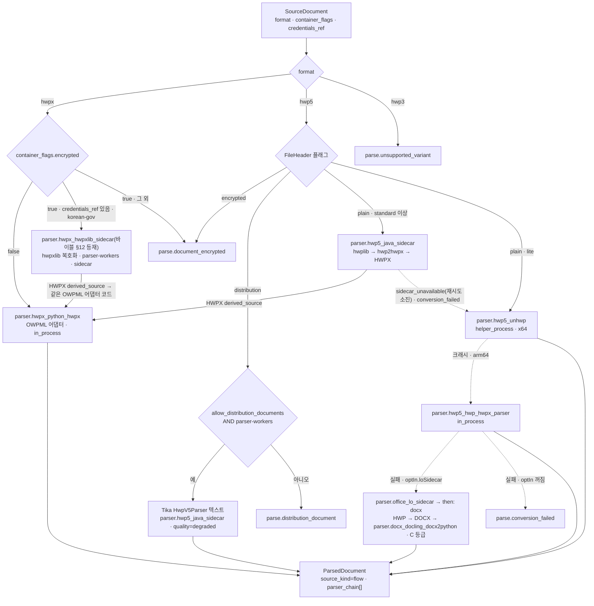
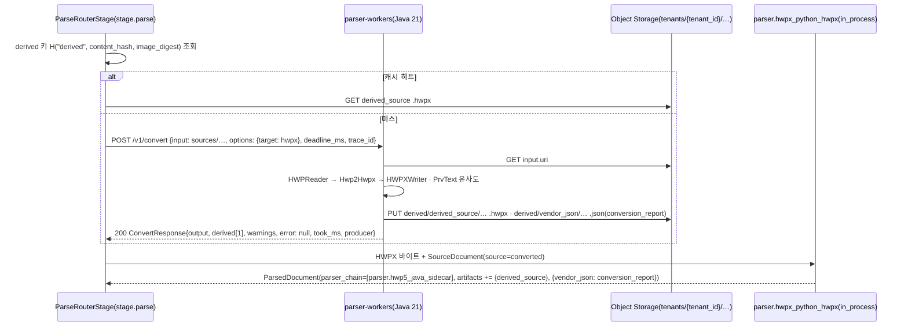

# 파서: HWPX와 HWP 5.0

## 목적

이 문서는 `parse` 스테이지(`SourceDocument → ParsedDocument`, 바이블 §4.2)에서 HWPX(OWPML, KS X 6101)와 HWP 5.0 바이너리를 처리하는 파서 어댑터(parser adapter)의 설계 정본이다. 브리프 D-18(개정 v1.1)과 바이블 §3.2 O-07이 확정한 체인 — HWPX는 python-hwpx + 자체 OWPML 어댑터, HWP 5.0은 Apache-2.0 Java 사이드카(sidecar)로 HWPX 변환 후 **같은 OWPML 어댑터**, 폴백 unhwp → hwp-hwpx-parser → LibreOffice + H2Orestart(opt-in) — 를 전제로, (1) OWPML 요소 → `Block` 매핑, heading·목록·표·그림·각주·글상자·수식·필드·변경 추적·메타데이터의 변환 규칙, (2) `element_path` 문법(정본; [03-contracts/03](../03-contracts/03-parsed-document.md) §3.1이 이 문서에 위임), (3) HWP 5.0 컨테이너·레코드 구조와 사이드카·헬퍼 프로세스·폴백 각각의 계약, (4) 배포용·암호화·HWP 3.x 처리, (5) 실패 모드와 오류 코드, (6) 품질 비교 기준·테스트 코퍼스·성능 초안 목표를 확정한다.

정본 우선순위는 브리프 > 바이블 > ADR > 이 문서다(바이블 §1.1). 필드명·열거값·오류 코드는 바이블 §5.4·§5.7과 [03-contracts/03](../03-contracts/03-parsed-document.md)의 철자를 그대로 쓰고, 바이블에 없는 항목은 선택 필드 또는 "## 미해결 이슈"의 제안으로만 둔다. 외부 라이브러리의 버전·API는 [기술 지형 01](../07-tech-landscape/01-document-parsing-hwpx-hwp.md)(확인일 2026-09-18~22)에 근거가 있을 때만 단정하고, 그 외는 "확인 필요(as of 2026-09)"로 표기한다. 라우터 동작 — 체인 진행·중단 조건, `parser_chain[]` 기록 순서, `then` 재라우팅, 폴백 발생 시 `quality` 승격 — 은 [04-pipelines/03](03-parsing-router-and-format-detection.md)(§6.1·§6.4·§7.2)이 정본이며 이 문서는 어댑터 측 규약(각 멤버가 무엇을 받고 무엇을 내며 어떤 지문을 남기는지)만 정한다. 두 문서가 어긋나는 항목은 미해결 이슈 15에 모아 두었다.

## 범위

- 포함: HWPX 패키지 구조 요약, `parser.hwpx_python_hwpx` OWPML 어댑터 설계(매핑 표·`element_path` 문법·heading 추론·표·그림·각주·머리말·글상자·수식·필드·변경 추적·구역·메타데이터), HWP 5.0 구조 요약(CFB·`FileHeader`·레코드 스트림), `parser.hwp5_java_sidecar`(`parser-workers`)·`parser.hwp5_unhwp`(헬퍼 프로세스)·`parser.hwp5_hwp_hwpx_parser`(순수 Python)·`lo-sidecar` 렌더 폴백·배포용 텍스트 경로(Tika `HwpV5Parser`)·암호화 문서 처리, `ConvertRequest.options` 규약과 `conversion_report` 파생물, 품질 비교 기준, 실패 모드·오류 코드, 성능 초안 목표, 테스트 코퍼스, 관측성, 프로파일 옵션 제안.
- 제외: 포맷 판별(`detect`)과 라우터 체인 실행 규칙 자체([04-pipelines/03](03-parsing-router-and-format-detection.md)), `ParsedDocument` 계약 필드 정의([03-contracts/03](../03-contracts/03-parsed-document.md)), 사이드카 `convert` 계약 스키마([03-contracts/16](../03-contracts/16-eval-feedback-and-sidecar-contracts.md)), 정규화(NFC·PUA 제거·띄어쓰기 교정, [04-pipelines/09](09-normalization-and-cleaning.md)), 청킹([04-pipelines/10](10-chunking-strategies.md)), PDF·DOCX·HTML 파서([04-pipelines/05](05-parser-pdf.md)~[08](08-parser-txt-md-and-others.md)), HWPX/HWP **쓰기**, Hancom Office COM 자동화, HWP 3.x 파싱(전 프로파일 `parse.unsupported_variant`).
- 이 문서가 소유하는 파일: `docs/04-pipelines/04-parser-hwpx-and-hwp.md`. 스키마 파일은 수정하지 않는다.

## 1. 위치와 경계

`parse`는 `ingest-cpu` 큐의 액티비티 `stage.parse` 하나로 실행되며(바이블 §4.4: `start_to_close` 15m, 하트비트 60s, `max_attempts` 3), 그 안에서 플랫폼 소유 합성 스테이지 `ParseRouterStage`(`plugin_id="parser.router"`, [02-architecture/02](../02-architecture/02-component-architecture.md) §3.2)가 (1) `detect` 서브스테이지로 `SourceDocument.format`·`container_flags`를 확정하고 (2) 프로파일 `ingest.parse.router[format]` 체인을 순서대로 시도해 (3) 첫 성공을 `ParsedDocument`로 반환하며 `parser_chain[]`에 시도 순서를 남기고 (4) 앞선 후보가 실패한 뒤 성공한 산출(폴백 발생)이면 `quality`를 `degraded`로 승격한다([04-pipelines/03](03-parsing-router-and-format-detection.md) §6.4·§7.2 — 설계된 변환 단계인 HWP → HWPX·`then` 재라우팅·복호화만으로는 저하가 아니다). 이 문서의 어댑터들은 그 체인의 멤버이며, 어댑터 스스로 `degraded`를 표기하는 것은 정보 손실을 어댑터가 직접 아는 경우([03 §5.3](../03-contracts/03-parsed-document.md) (b)~(d))에 한한다.

| 플러그인 ID(바이블 §6.1·§12) | 포맷 | 격리(`IsolationMode`) | 등급(D-02) | 래핑 라이브러리(잠금 파일이 정본) | 프로파일 |
|------|------|------|------|------|------|
| `parser.hwpx_python_hwpx` | `hwpx`(+ HWP 5.0 변환본) | `in_process` | A | python-hwpx `>=6.4,<7`(Apache-2.0) + lxml 직접 순회 | 전부 |
| `parser.hwpx_hwpxlib_sidecar`(모듈 `adapters/parse/hwpx_hwpxlib_sidecar.py`, 바이블 §12 1.3.0 AM-22 등재; [04-pipelines/03](03-parsing-router-and-format-detection.md) §3.2·[02-architecture/05](../02-architecture/05-plugin-architecture.md) §13.1과 같은 철자) | `hwpx`(암호화, `credentials_ref` 있음) | `sidecar`(`parser-workers`) | A | hwpxlib 1.0.9 복호화 → 같은 OWPML 어댑터 코드(§3.16) | `korean-gov`만 |
| `parser.hwp5_java_sidecar` | `hwp5` | `sidecar`(`parser-workers`) | A | hwplib 1.1.11 + hwp2hwpx + hwpxlib 1.0.9 + Tika `HwpV5Parser`(Java 21) | `standard`·`premium`·`korean-gov` |
| `parser.hwp5_unhwp` | `hwp5` | `helper_process` | A(MIT) | unhwp 0.11(x64만; linux-arm64는 로딩 시 비활성) | `lite` 1차, `standard` 2차 |
| `parser.hwp5_hwp_hwpx_parser` | `hwp5` | `in_process` | A | hwp-hwpx-parser 1.0(`olefile`) | 최종 인프로세스 폴백(arm64 `lite` 유일 경로) |
| `parser.office_lo_sidecar` | `hwp5`(최후 폴백) | `sidecar`(`lo-sidecar`, opt-in) | C(GPL-3.0) | LibreOffice headless + H2Orestart(별도 저장소 `rag-platform-gpl-sidecars`) | opt-in만 |

입력은 `SourceDocument`(원본 `ArtifactRef`, `format`, `container_flags.{encrypted, distribution, compressed, hwp_version}`, `credentials_ref`, `metadata.language_hint`)이고 출력은 `ParsedDocument`(봉투 + `blocks[]` + `artifacts[]` + `parser_fingerprint` + `parser_chain`)다. 어댑터는 파일 시스템·시간·난수를 직접 쓰지 않으며(바이블 §4.1), 파생물은 `ctx.artifacts.put_derived`로만 저장한다([04-pipelines/01](01-pipeline-framework.md) §6.2).

`parser_fingerprint.profile_option`은 필수 필드다(바이블 §5.4 `parser_fingerprint.profile_option` Y; [03 §2.2](../03-contracts/03-parsed-document.md)). **결정:** 이 문서의 경로별 정본 값은 아래와 같고 철자는 [04-pipelines/03](03-parsing-router-and-format-detection.md) §7.2의 예(`hwpx_standard`)와 일치시킨다. 값은 `parser_fingerprint_hash`(바이블 §6.2)의 입력이므로 경로가 다르면 값도 다르다.

| `profile_option` | 경로 | `parser_id` | `sidecar_image_digest` |
|------|------|------|------|
| `hwpx_standard` | HWPX 인프로세스(§3) | `parser.hwpx_python_hwpx` | `null` |
| `hwpx_encrypted_hwpxlib` | 암호화 HWPX, hwpxlib 복호화 후 같은 OWPML 어댑터(§3.16) | `parser.hwpx_hwpxlib_sidecar`(바이블 §12 1.3.0 AM-22 등재) | `parser-workers` digest |
| `hwp5_java_sidecar` | HWP 5.0 → HWPX 변환 후 OWPML 어댑터(§4.3) | `parser.hwp5_java_sidecar` | `parser-workers` digest |
| `hwp5_distribution_text` | 배포용 HWP 5.0 Tika 텍스트 전용(§4.7) | `parser.hwp5_java_sidecar`(미해결 이슈 15 (a)) | `parser-workers` digest |
| `hwp5_unhwp` | unhwp 헬퍼 프로세스(§4.4) | `parser.hwp5_unhwp` | `null` |
| `hwp5_hwp_hwpx_parser` | 순수 Python 폴백(§4.5) | `parser.hwp5_hwp_hwpx_parser` | `null` |
| `hwp5_lo_render` | `lo-sidecar` HWP → DOCX → `docx` 체인(§4.6) | `parser.docx_docling_docx2python` | `lo-sidecar` digest(기록 방식은 미해결 이슈 15 (b)) |



## 2. HWPX(OWPML) 구조 요약

### 2.1 패키지(ZIP) 엔트리

HWPX는 OCF/OPC 유사 ZIP 패키지다(KS X 6101; 기술 지형 01 §포맷 구조 요약). 어댑터는 확장자가 아니라 `detect`가 확정한 `format=hwpx`(ZIP + `mimetype` 항목 `application/hwp+zip`)를 신뢰하고, 아래 엔트리만 읽는다.

| 엔트리 | 역할 | 어댑터 사용 |
|--------|------|-------------|
| `mimetype` | `application/hwp+zip`(python-hwpx `DEFAULT_MIMETYPE`, hwpxlib `MineTypes.HWPX`). hwpxlib에는 `application/hwpml-package+xml`(`MineTypes.HWPML_Package`) 변형 상수가 있으나 실제 파일 출현은 미확인(기술 지형 01 §어댑터 계약·미해결 이슈 7) | `detect`가 판정([04-pipelines/03](03-parsing-router-and-format-detection.md) §2.3 허용 목록: `application/hwp+zip` 정본, `application/hwpml-package+xml` 확인 필요 as of 2026-09). 어댑터는 재검사하지 않으며 두 값의 패키지를 같은 규칙으로 읽는다(미해결 이슈 14) |
| `version.xml` | 앱·포맷 버전 | `parser_fingerprint`에 넣지 않음(재현성은 라이브러리 버전으로 충분); `vendor_json` 파서 리포트에 기록 |
| `META-INF/container.xml`, `META-INF/manifest.xml` | 루트 파일·암호화 매니페스트 | `manifest.xml`에 암호화 항목(요소명 확인 필요 as of 2026-09)이 있으면 암호화 HWPX로 판정(§3.16) |
| `Contents/content.hpf` | OPF 스타일 매니페스트·메타데이터(`opf:metadata`, `opf:manifest/opf:item[@id, @href, @media-type]`) | 문서 메타(§3.15), BinData id → href 해석(§3.7), 섹션 순서(`opf:spine`) |
| `Contents/header.xml` | 전역 정의 `hh:head/hh:refList`(글꼴·테두리·글자모양·문단모양·스타일·번호·글머리표·메모·변경 추적) | heading·목록·글자 크기 추론(§3.4·§3.5), 변경 추적(§3.13) |
| `Contents/section{N}.xml` | 본문 구역 N(0-based) | 블록 생성의 유일한 원천(§3.2) |
| `BinData/*` | 그림·OLE 바이너리 | `figure.artifact` 원 바이트(§3.7) |
| `Preview/PrvText.txt`, `Preview/PrvImage.png` | 미리보기 | `PrvText`는 추출 텍스트 유사도 신호(§4.3 런타임 신호·§5.2 빌드 게이트)로만, `quality`에 쓰지 않음; 블록 생성 금지 |
| `Scripts/*`, `XMLTemplate/*`, `DocOptions/*` | 스크립트·양식·옵션 | 읽지 않음 |

### 2.2 `header.xml`(전역 정의)

| 요소(`hh:` 네임스페이스) | 핵심 속성 | 어댑터 용도 |
|------|------|------|
| `hh:charProperties/hh:charPr` | `@id`, `@height`(글자 크기; 단위는 1/100pt로 알려짐 — 확인 필요), `hh:bold`, `hh:italic`, `hh:underline` | 본문 기준 글자 크기 중위수, heading 휴리스틱(§3.4 3순위) |
| `hh:paraProperties/hh:paraPr` | `@id`; 자식 `hh:heading[@type ∈ {NONE, OUTLINE, NUMBER, BULLET}, @idRef, @level]` | **1순위 heading·목록 판정**(`OUTLINE` → heading, `NUMBER`/`BULLET` → list_item; `@level` 0-based) |
| `hh:styles/hh:style` | `@id`, `@type ∈ {PARA, CHAR}`, `@name`, `@engName`, `@paraPrIDRef`, `@charPrIDRef` | 2순위 heading(스타일 이름 `개요 N`/`Outline N`/`제목 N`/`제목`/`Title`) |
| `hh:numberings/hh:numbering/hh:paraHead` | `@level`, `@start`, `@numFormat`, 본문 텍스트(형식 문자열, 예 `^1.`) | `NUMBER` 목록의 `numbering_label` 생성(카운터, §3.5) |
| `hh:bullets/hh:bullet` | `@id`, `@char` | `BULLET` 목록의 `numbering_label` |
| `hh:memoProperties`, `hh:trackChanges`, `hh:trackChangeAuthors` | 메모·변경 추적 정의 | `annotations[]`, `metadata.has_tracked_changes`(§3.13) |
| `hh:fontfaces`, `hh:borderFills`, `hh:tabProperties`, `hh:forbiddenWordList`, `hh:compatibleDocument`, `hh:docOption` | 서식 | 읽지 않음(표 `role` 휴리스틱의 테두리 유무만 `hh:borderFills` 참조, §3.6) |

### 2.3 `section{N}.xml`(본문)

루트는 `hs:sec`(section 네임스페이스)이며 자식은 문단 `hp:p`의 순서 리스트다. 문단은 `hp:run`(글자모양 단위)으로 나뉘고, 런 안에 텍스트 `hp:t`와 인라인 객체·컨트롤이 온다. 표기는 기존 파일의 2011 네임스페이스 접두(`hp` = paragraph, `hh` = head, `hc` = core, `hs` = section)를 쓴다.

| 요소 | 위치 | 의미 | 매핑(§3.2) |
|------|------|------|------------|
| `hp:p` | `hs:sec` 직계 / `hp:subList` 안 | 문단. `@id`, `@paraPrIDRef`, `@styleIDRef`, `@pageBreak`, `@columnBreak` | `paragraph`/`heading`/`list_item` |
| `hp:run` | `hp:p` 안 | 글자모양 구간. `@charPrIDRef` | 블록 아님(텍스트 연결 단위; `element_path`에서 제외, §3.3) |
| `hp:t` | `hp:run` 안 | 텍스트. 자식으로 `hp:tab`, `hp:lineBreak`, `hp:nbSpace`, `hp:fwSpace`, `hp:hyphen`, `hp:markpenBegin/End`, `hp:insertBegin/End`, `hp:deleteBegin/End`(변경 추적 표식 요소명 확인 필요) | `Block.text` 원문(§3.17) |
| `hp:secPr` | 구역 첫 문단의 런 안 | 구역 정의(용지·여백·각주 모양 등) | `page_break{section_index}`(첫 구역 제외, §3.14) |
| `hp:ctrl` | 런 안 | 컨트롤 컨테이너: 자식 `hp:header`, `hp:footer`, `hp:footNote`, `hp:endNote`, `hp:colPr`, `hp:fieldBegin`, `hp:fieldEnd`, `hp:bookmark`, `hp:autoNum`, `hp:newNum`, `hp:pageNum`, `hp:pageHiding`, `hp:indexmark`, `hp:dutmal`, `hp:compose` | 종류별(§3.8·§3.9·§3.12) |
| `hp:tbl` | 런 안 | 표. `@rowCnt`, `@colCnt`, `@repeatHeader`, `@pageBreak`, `@borderFillIDRef`; 자식 `hp:caption`, `hp:tr/hp:tc` | `table`(§3.6) |
| `hp:tc` | `hp:tr` 안 | 셀. `@header`(hwpxlib `Tc.header` 기준, 스펙 확인 필요), `@borderFillIDRef`; 자식 `hp:cellAddr[@rowAddr, @colAddr]`, `hp:cellSpan[@rowSpan, @colSpan]`, `hp:cellSz`, `hp:subList/hp:p*` | `TableCell` |
| `hp:pic` | 런 안 | 그림. 자식 `hc:img[@binaryItemIDRef]`, `hp:caption`, `hp:shapeComment`(대체 텍스트 후보, 확인 필요) | `figure`(§3.7) |
| `hp:ole`, `hp:container`, `hp:chart`, `hp:video`, `hp:textart` | 런 안 | OLE·그룹·차트·동영상·글맵시 | `figure` / 그룹 재귀 / 차트·동영상은 스킵 + `vendor_json` 기록 |
| `hp:rect`, `hp:ellipse`, `hp:arc`, `hp:polygon`, `hp:curve`, `hp:line`, `hp:connectLine` | 런 안 | 도형. 텍스트가 있으면 `hp:drawText/hp:subList/hp:p*` | 글상자 내부 블록(`container=text_box`, §3.10) |
| `hp:equation` | 런 안 | 수식. `@version`, `@baseLine`, `@font`; 자식 `hp:script`(한컴 수식 스크립트) | `formula{script}`(§3.11) |
| `hp:footNote`, `hp:endNote` | `hp:ctrl` 안 | 각주·미주 본문 `hp:subList/hp:p*` | `footnote{kind}`(§3.8) |
| `hp:header`, `hp:footer` | `hp:ctrl` 안 | 머리말·꼬리말 `hp:subList/hp:p*`; `@applyPageType ∈ {BOTH, EVEN, ODD}`(확인 필요) | 블록 아님 → `metadata.page_header_text/page_footer_text`(§3.9) |
| `hp:fieldBegin`, `hp:fieldEnd` | `hp:ctrl` 안 | 필드 시작·끝. `@type`(예 `CLICK_HERE`, `HYPERLINK`, `DATE`, `MAILMERGE`, `BOOKMARK`; 전체 목록 확인 필요), `@name`, `@id`, `hp:parameters` | `fields[]`/`links[]`(§3.12) |
| `hp:memogroup`/`hp:memo`(요소명 확인 필요) | 런 안 | 메모 | `annotations[]`(§3.13) |

### 2.4 네임스페이스

기존 파일은 `http://www.hancom.co.kr/hwpml/2011/{paragraph, head, core, section, app, ...}`를 쓴다. KS X 6101 2024-10-30 개정에 대응하는 `http://www.owpml.org/owpml/2024/*`는 python-hwpx 문서에 기술되어 있으나 실제 파일 출현은 미확인이다(기술 지형 01 미해결 이슈 6). **결정:** 어댑터는 네임스페이스 URI를 설정 가능한 허용 목록(`namespaces`, §10)으로 관리하고 로컬 이름(local-name)으로 매칭한다. 목록 밖 네임스페이스의 요소는 화이트리스트 밖 요소와 같이 처리한다(§6). `element_path`의 접두 `hp:`는 URI가 아니라 **논리 접두**이며(§3.3), 2011·2024 파일이 같은 경로를 낳는다.

## 3. OWPML 어댑터 설계(`parser.hwpx_python_hwpx`)

### 3.1 원칙

**결정:** 어댑터는 python-hwpx 객체 모델(`HwpxDocument.open`, `TextExtractor.iter_document_paragraphs(include_nested=True)`의 `ParagraphInfo.path`, `ObjectFinder`)을 1급으로 쓰되, heading·BinData·머리말·변경 추적처럼 읽기 API가 문서화되지 않은 부분은 **lxml 트리 직접 순회**를 같은 어댑터 안의 1급 경로로 둔다(브리프 D-18 "자체 OWPML 어댑터"; 기술 지형 01 §후보 A 함정, 매트릭스 `hwpx_parser` 행; [ADR-0007](../06-adr/0007-hwp5-java-sidecar-first-pyhwp-demoted.md) 재검토 조건 8). 라이브러리의 Markdown·HTML 출력은 출처 경로가 사라지므로 쓰지 않는다. 그 외 규칙:

| 규칙 | 내용 |
|------|------|
| 사전 판정 우선 | 암호화·HWP 5.0 오판 등은 `detect`의 `container_flags`·`format`으로 결정하고 라이브러리 예외 타입에 의존하지 않는다(기술 지형 01 §어댑터 계약). 어댑터 안에서 발생한 예외는 모두 `parse.conversion_failed`로 변환한다 |
| 화이트리스트 | §2.3 표의 요소만 해석한다. 목록 밖 요소는 텍스트 자식(`hp:t`)만 수집하고 요소명을 `vendor_json` 파서 리포트에 남긴다. 텍스트를 버린 경우에만 `quality=degraded`([03 §5.3](../03-contracts/03-parsed-document.md) (d)) |
| 결정성 | 같은 바이트 + 같은 `fingerprint`는 같은 `ParsedDocument`(`created_at` 제외). 순회 순서는 XML 문서 순서, 카운터는 문서 순서로만 증가. 문서 전체 통계(본문 글자 크기 중위수·`genre`·번호 랭크 사상표, §3.4)는 **1패스 사전 스캔**에서 확정하고 2패스 블록 생성 중에는 바꾸지 않는다 |
| 원문 보존 | `Block.text`는 NFC 미적용 원문(§3.17). 정규화·PUA 제거·띄어쓰기 교정은 `normalize`의 일이다(기술 지형 13 §띄어쓰기 교정과 정규화 도구) |
| 빈 문단 | 텍스트도 객체도 없는 `hp:p`는 블록을 만들지 않는다. 문단 인덱스는 그래도 증가한다(`element_path` 안정성) |
| 크기 | 블록 ≤ 200,000, 블록 텍스트 ≤ 1MB([03 §9](../03-contracts/03-parsed-document.md)); 1MB 초과 문단은 줄바꿈·문장 경계에서 `/part[n]` 블록으로 분할. BinData는 스트리밍으로 저장하고 항목당 상한(§10 `max_bindata_bytes`) 초과는 `figure.artifact` 생략 + `vendor_json` 기록 |
| 고지 | 한컴 공개 스펙 고지 원문 "본 제품은 한컴의 HWP 문서 파일(.hwp) 공개 문서를 참고하여 개발하였습니다."를 어댑터 패키지 `NOTICE`에 기재하고 CI가 문자열 존재를 검사한다(기술 지형 01 §어댑터 계약, ADR-0007 준수 표). OWPML에도 보수적으로 같은 고지를 둔다 |

스테이지 골격(바이블 §4.1 5멤버; 내부 설정 모델은 §10). 원본 바이트는 스테이지가 스토리지에서 읽지 않는다 — [04-pipelines/01](01-pipeline-framework.md) §3 `StageContext`는 `artifacts: DerivedArtifacts`(쓰기 전용)만 두고 스테이지의 산출물 읽기를 금지하므로(01 §6.2), 셸이 `SourceDocument.artifact`를 로드해 전달하는 원본 바이트 포트가 필요하다. 아래 `ctx.source_bytes()`는 그 포트의 **제안 이름**이며 01 §3 확장 제안으로 미해결 이슈 18에 올린다.

```python
class HwpxPythonHwpxParser:                      # src/rag_platform/adapters/parse/hwpx_python_hwpx.py
    plugin_id = "parser.hwpx_python_hwpx"
    config_schema = HwpxParserConfig             # §10 옵션(제안)
    def capabilities(self) -> Capabilities: ...   # isolation_modes=[in_process], input_formats=[hwpx], supports_resumable=False
    def fingerprint(self) -> str: ...             # H("producer", plugin_id, plugin_version, config_hash, "", "")
    async def run(self, inp: SourceDocument, ctx: StageContext) -> ParsedDocument:
        pkg = open_package(ctx.source_bytes())                        # 셸이 로드해 넘긴 원본 바이트(포트 이름은 제안, 미해결 이슈 18)
        header = HeaderIndex.from_xml(pkg.header_xml)                 # charPr·paraPr·style·numbering·bullet 색인
        sections = list(pkg.sections())                               # content.hpf spine 순서
        stats = prescan(sections, header, genre_hint=inp.metadata.genre)   # 1패스: 원시 카운트 → genre·랭크 사상표(§3.4)
        builder = BlockBuilder(doc_version=inp.doc_version, header=header, stats=stats, ctx=ctx)
        for sec_idx, sec_xml in enumerate(sections):                  # 2패스: 블록 생성(stats는 읽기 전용)
            builder.visit_section(sec_idx, sec_xml)                    # §3.2~§3.14
        return builder.finish(inp, metadata=read_metadata(pkg.content_hpf, stats))   # text_length·block_count·quality 계산
```

### 3.2 OWPML 요소 → `Block` 매핑 표

[03 §8.2](../03-contracts/03-parsed-document.md)의 매핑을 이 문서가 정본으로 확정한다. `type`은 §5.7 `BlockType`, `container`는 `BlockContainer`, `source`는 `BlockSource`다. HWPX 인프로세스 경로의 `source`는 `text_layer`, HWP 5.0 → HWPX 변환본은 `converted`([03 §5.1](../03-contracts/03-parsed-document.md) `flow` 행)이며 `confidence`는 `null`, `page`·`bbox`는 `null`이다.

| OWPML 요소(조건) | `type` | 주요 필드 | 부모·순서 | 비고 |
|------|------|------|------|------|
| `hp:p`(본문, `hh:heading/@type ∈ {NONE, 없음}`) | `paragraph` | `text` = 런 텍스트 연결(§3.17) | 가장 가까운 앞선 heading의 자식; 없으면 루트 | 빈 문단은 블록 없음 |
| `hp:p` + `paraPrIDRef → hh:paraPr/hh:heading[@type="OUTLINE"]` | `heading` | `level = min(@level + 1, 6)`, `numbering_label`(개요 번호 문자열, §3.5 카운터), `heading_inferred=false` | 직전 `heading(level < k)`의 자식 | 1순위 |
| `hp:p` + `styleIDRef → hh:style/@name ∈ {개요 N, Outline N, 제목 N}` | `heading` | `level = N`(1..6), `heading_inferred=false` | 동일 | 2순위(OUTLINE 정보 없을 때) |
| `hp:p` + 스타일 `제목`/`Title` 또는 `content.hpf` 제목과 일치(선두 5개 비어 있지 않은 문단 중) | `heading` | `level=0`, 문서 최대 1개 | 루트 | 문서 제목(§3.4) |
| `hp:p` + 번호 패턴·글자 크기 휴리스틱(§3.4 3순위) | `heading` | `heading_inferred=true`, `numbering_label` 분리 | 동일 | 점수 임계 미달이면 `list_item` 또는 `paragraph` |
| `hp:p` + `hh:heading[@type="NUMBER"]` | `list_item` | `ordered=true`, `level=@level`(0-based), `numbering_label` = `hh:paraHead` 형식 + 카운터 | 가장 가까운 앞선 `list_item(level<d)`의 자식; `level=0`은 섹션 heading의 자식 | §3.5 |
| `hp:p` + `hh:heading[@type="BULLET"]` | `list_item` | `ordered=false`, `level=@level`, `numbering_label=hh:bullet/@char` | 동일 | |
| `hp:p` + 텍스트 선두 글머리표(`□ ○ - · ▪ ●`)·번호(`1.`, `가.`, `1)`, `(1)`, `①`) — heading 판정 미달 | `list_item` | `ordered`(번호=true, 글머리=false), `level` = 마커 랭크 스택(§3.5), `numbering_label` = 마커, `text`에서 마커 제거 | 동일 | 개조식 공문 |
| `hp:tbl` | `table` | `TableData`(§3.6), `text` = 선형화, `caption_block_ids` | 담고 있는 문단 블록의 형제로 그 직후(문단이 비었으면 그 자리) | 셀 내용은 블록으로 펼치지 않음 |
| `hp:tc/hp:subList/hp:p/hp:tbl`(중첩 표; 셀 문단의 런 안) | `table` | `container=table_cell`, `parent_block_id` = 바깥 표 | 바깥 표 블록 직후 | 깊이 ≤ 3; 셀 `text`에 `[table:{block_id}]`; 경로 `.../hp:tc[c]/hp:subList/hp:p[m]/hp:tbl[0]`(§3.3) |
| `hp:tbl/hp:caption/hp:subList/hp:p*`, `hp:pic/hp:caption/...` | `caption` | `text` = 캡션 문단 병합(`\n`), `caption_of` = 대상 | 대상과 같은 부모의 형제; `@side ∈ {TOP, LEFT}` → 대상 앞, `{BOTTOM, RIGHT}` → 대상 뒤(기본 뒤) | 양방향(P-14) |
| `hp:pic` + `hc:img/@binaryItemIDRef` | `figure` | `figure{artifact, kind=image, alt_text}`, `text = alt_text or ""` | 담고 있는 문단 블록의 형제로 그 직후 | §3.7 |
| `hp:ole`, `hp:container`(그룹 안 텍스트 없는 객체) | `figure` | `kind=ole`, `alt_text=null`, `text=""` | 동일 | 바이너리 저장만 |
| `hp:ctrl/hp:footNote`, `hp:endNote` | `footnote` | `footnote{kind, anchor_block_id, anchor_char_offset, marker}`, `container=footnote_body` | 각주: 앵커와 같은 부모의 형제, 앵커 직후. 미주: 문서 끝 루트 형제 | §3.8 |
| `hp:ctrl/hp:header`, `hp:footer` | 블록 아님 | `metadata.page_header_text[]`, `page_footer_text[]` | — | §3.9 |
| `hp:equation/hp:script` | `formula` | `formula{script, latex=null}`, `text = script` | 담고 있는 문단 블록의 형제로 그 직후 | §3.11 |
| 도형(`hp:rect` 등) + `hp:drawText/hp:subList/hp:p*` | 내부 문단·표·그림 블록 | `container=text_box`, `parent_block_id` = 앵커 문단 블록 | 앵커 직후, 객체 문서 순서 | §3.10 재귀 |
| `hp:fieldBegin[@type]` … `hp:fieldEnd` | 문단 텍스트 일부 | `fields[]{name, type, value, block_id}`; `HYPERLINK` → `links[]{block_id, char_start, char_end, href}` | — | §3.12 |
| 변경 추적 표식, 메모 | 정책 적용 텍스트 / 블록 아님 | `metadata.has_tracked_changes`, `annotations[]{kind ∈ {tracked_change, memo}}` | — | §3.13 |
| `hp:secPr`(두 번째 구역 이후) | `page_break` | `page_break{page_no=null, section_index}` | 루트 형제, 구역 첫 블록 앞 | §3.14 |
| 목차 자동 생성 결과(스타일 `차례`/`TOC` 계열, 확인 필요) | `toc` | `furniture=true` | 루트 | 스타일 이름 매칭 |
| `hp:chart`, `hp:video`, `hp:textart`, `hp:indexmark`, `hp:bookmark`, `hp:pageNum`, `hp:autoNum`(본문) | 블록 아님 | — | — | `vendor_json` 파서 리포트에 개수·경로 기록 |

### 3.3 `element_path` 문법(정본)

**결정:** HWPX와 HWP 5.0 → HWPX 변환본의 `Provenance.element_path`는 아래 문법을 따른다. [03 §3.1](../03-contracts/03-parsed-document.md)의 권고를 확정한 것이며 [03 §2.9](../03-contracts/03-parsed-document.md)·[ADR-0002](../06-adr/0002-provenance-element-path-and-nullable-page-bbox.md)의 예 `/hp:sec[0]/hp:p[17]`과 호환된다. 바이블 §9.5 ContextPack 예시의 `/hml/body/section[0]/p[37]`은 이 문법과 다르며 정정 요청 중이다(03 미해결 이슈 3; 이 문서 미해결 이슈 17).

| 규칙 | 내용 |
|------|------|
| 루트 | `/hp:sec[i]` — `Contents/section{i}.xml`(`content.hpf` spine 순서, 0-based)을 뜻하는 **논리 단계**다. 실제 XML 루트의 접두(`hs:sec`)·네임스페이스 URI(2011/2024)와 무관하게 같은 문자열이다 |
| 문단 | `/hp:p[j]` — 부모(구역 또는 `hp:subList`) 안 문서 순서 0-based. 빈 문단도 인덱스를 소비한다 |
| 런 제외 | `hp:run`은 경로에 넣지 않는다. 런 경계는 글자모양 편집으로 바뀌어 같은 내용의 문서에서 경로를 흔들기 때문이다. 문단 안 객체는 **태그별** 0-based 순번을 매긴다: `/hp:tbl[k]`, `/hp:pic[k]`, `/hp:equation[k]`, `/hp:rect[k]`, `/hp:ctrl[k]` |
| 컨트롤 자식 | `/hp:ctrl[k]/hp:footNote[0]`, `/hp:ctrl[k]/hp:endNote[0]`, `/hp:ctrl[k]/hp:header[0]`(메타데이터 전용) |
| 표 | `/hp:tbl[k]/hp:tr[r]/hp:tc[c]` — `r`·`c`는 XML 순서(격자 좌표 `cellAddr`가 아님). 셀 안 문단 `/hp:subList/hp:p[m]`, 중첩 표 `/hp:subList/hp:p[m]/hp:tbl[0]` |
| 단일 컨테이너 | `hp:subList`, `hp:drawText`는 부모당 하나이므로 인덱스를 생략하되 요소 자체는 경로에 남긴다. `hp:caption`은 `[0]`을 붙이고 그 아래 `hp:subList`도 같은 규칙으로 유지한다: `/hp:tbl[k]/hp:caption[0]/hp:subList/hp:p[m]`(§2.3 구조 `hp:caption/hp:subList/hp:p*`와 일치). [03 §3.1](../03-contracts/03-parsed-document.md) 표의 `/hp:caption[0]/hp:p[0]`은 `hp:subList` 단계가 빠진 표기이므로 정정을 요청한다(미해결 이슈 17) |
| 글상자 | `/hp:p[j]/hp:rect[k]/hp:drawText/hp:subList/hp:p[m]`; 그룹은 `/hp:container[k]/hp:rect[k2]/...` |
| 분할 블록 | 원 경로 + `/part[n]`([03 §9](../03-contracts/03-parsed-document.md)) |
| 유일성 | 위 규칙으로 경로는 문서 내 유일하다(P-2). 텍스트 해시를 경로에 쓰지 않는다 |

`TableCell.provenance.element_path`는 셀 경로(`.../hp:tr[r]/hp:tc[c]`)이고 `char_start/char_end`는 표 블록 `text`(선형화) 안의 셀 텍스트 구간이다([03 §6](../03-contracts/03-parsed-document.md)). 글상자 안 블록 예:

```json
{
  "block_id": "6f1c0d3b2a9e8f7d6c5b4a3928170605",
  "type": "paragraph",
  "parent_block_id": "8d8def472794539da0cb5a95ce7d0563",
  "ordinal": 0,
  "text": "붙임 1. 개정 조문 대비표 1부.",
  "furniture": false,
  "container": "text_box",
  "source": "text_layer",
  "confidence": null,
  "provenance": {
    "element_path": "/hp:sec[0]/hp:p[6]/hp:rect[0]/hp:drawText/hp:subList/hp:p[0]",
    "char_start": 0,
    "char_end": 19,
    "page": null,
    "bbox": null,
    "section_index": 0
  }
}
```

### 3.4 heading 레벨 추론 규칙

**결정:** heading 판정은 3순위 폴백이며, 3순위 결과만 `heading_inferred=true`다. `numbering_label`은 모든 순위에서 본문 `text`와 분리한다(바이블 §5.4 `Block.numbering_label`, [ADR-0029](../06-adr/0029-three-text-rule-and-deterministic-context-prefix.md) 결정적 접두어의 재료).

| 순위 | 근거 | `level` | 비고 |
|------|------|---------|------|
| 0(제목) | 스타일 `@name ∈ {제목, Title}`(`@engName` 포함) 또는 `content.hpf` `opf:title`과 공백 정규화 후 일치하는 문단(선두 5개 비어 있지 않은 문단 중 첫 것) | `0` | 문서 최대 1개(P-7). 둘 이상 후보면 첫 것만 0, 나머지는 1 + `heading_inferred=true` |
| 1 | `hh:paraPr/hh:heading[@type="OUTLINE"]/@level` | `min(@level + 1, 6)` | 개요 번호는 `hh:numbering[@id=@idRef]/hh:paraHead[@level]` 형식으로 생성 |
| 2 | `hh:style/@name` 정규식 `^(개요|Outline|제목)\s*([1-9])$` | 그룹 2 | `제목 N`은 한컴 기본 스타일 이름 |
| 3 | 번호 패턴 + 글자 크기·굵기 점수(아래) | 1패스 랭크 사상표 | `heading_inferred=true` |

**2패스 판정(결정성 보장).** 3순위 판정과 `genre` 추론은 문서 전체 통계를 요구하므로 §3.1 골격의 `prescan()`(1패스)이 다음 **원시 값**만 수집해 고정하고, 2패스(블록 생성)는 이를 읽기만 한다.

| 1패스 수집 항목 | 정의(원시 정규식·속성 카운트만; 블록 분류 결과를 쓰지 않는다) | 2패스에서의 용도 |
|------|------|------|
| 본문 글자 크기 중위수 `H_body` | `hs:sec` 직계 `hp:p` 중 `hh:heading/@type ∈ {NONE, 없음}`이고 텍스트가 있는 문단의 런 `@height` 중위수(표 셀·글상자·각주 안 문단 제외) | 점수 항 "글자 크기" |
| 조문 문단 수 `n_article` | `hs:sec` 직계 문단 중 텍스트 선두가 `^\s*제\s?\d+조`인 문단 수 | `genre` 추론(§3.15) |
| 마커 문단 수 `n_marker`, 본문 문단 수 `n_body` | 선두가 아래 패턴 표 또는 글머리표(`□ ○ - · ▪ ●`) 중 하나인 `hs:sec` 직계 문단 수 / 텍스트가 있는 `hs:sec` 직계 문단 수 | `genre` 추론 |
| 빈 셀 비율 ≥ 0.3인 표 수 `n_form_tbl` | `hp:tbl` 중 텍스트 없는 `hp:tc` 비율 ≥ 0.3인 표 수 | `genre` 추론 |
| 등장 정렬 키 집합 `K` | `hs:sec` 직계 문단 선두가 일치한 패턴의 정렬 키(아래 표) 집합 | 랭크 → `level` 사상표 |
| 제목 후보 | 선두 5개 비어 있지 않은 문단과 스타일 `제목`/`Title`, `content.hpf` `opf:title` | 순위 0 |

`genre`는 1패스 값으로만 정한다: `IngestRequest.metadata.genre` 힌트 → 없으면 `n_article ≥ 5` → `law_article`; 아니면 `n_form_tbl ≥ 1 ∧ n_body ≤ 20` → `form`; 아니면 `n_body > 0 ∧ n_marker / n_body ≥ 0.6` → `outline_report`; 그 외 생략(첫 일치 규칙). 이렇게 하면 `genre` → `제N조` heading 여부 → `list_item` 분류 → `genre`의 순환이 생기지 않는다. 랭크 → `level` 사상표는 `K`를 정렬 키 오름차순으로 나열해 1부터 차례로 부여하고 6에서 포화한다(`level = min(pos(k in sorted(K)), 6)`). 등장 **순서**가 아니라 정렬 **키**로 정하므로 `가.`가 `1.`보다 먼저 나오는 문서에서도 `1.` = 1, `가.` = 2로 유일하게 결정된다. 사상표는 문서에 하나이고 2패스 동안 바뀌지 않는다.

3순위 점수(초안): 후보는 텍스트 선두가 아래 패턴과 일치하는 문단이다. `score = 2(패턴) + 1(라벨 제외 길이 ≤ 40 코드포인트) + 1(문단 최대 `charPr/@height` ≥ H_body + 100, 또는 `hh:bold`) + 1(종결 부호 `.`·`다`·`함`으로 끝나지 않음)`. `score ≥ 4`이면 `heading`, `2 ≤ score < 4`이면 `list_item`(§3.5), 그 외 `paragraph`. 임계값·가중치는 골든셋(§8)으로 조정한다(`heading_inference.min_score`, §10).

| 패턴(정규식, 선두 공백 허용) | 예 | 정렬 키(사상표 입력; `level`은 위 규칙으로 결정) | `numbering_label` |
|------|------|------|------|
| `^제\s?\d+\s?편` | 제1편 | 1 | `제1편` |
| `^제\s?\d+\s?장` | 제2장 | 2 | `제2장` |
| `^제\s?\d+\s?절` | 제3절 | 3 | `제3절` |
| `^제\s?\d+\s?관` | 제1관 | 4 | `제1관` |
| `^제\s?\d+조(의\s?\d+)?\s*(\([^)]{1,40}\))?` | 제15조(보안 점검), 제3조의2 | 5; `genre=law_article`일 때만 heading 후보, 그 외 `list_item` | `제15조` |
| `^[ⅠⅡⅢⅣⅤⅥⅦⅧⅨⅩ]+\.` 또는 `^[IVX]+\.` | Ⅰ. 추진 배경 | 6 | `Ⅰ.` |
| `^\d+\.(?!\d)` | 1. 개요 | 7 | `1.` |
| `^\d+(\.\d+)+\.?` | 1.2, 3.1.4 | 7 + 점 개수(`1.2` = 8, `3.1.4` = 9) | `1.2` |
| `^[가나다라마바사아자차카타파하]\.` (가나다순 항목 문자 14자) | 가. 목적 | 10 | `가.` |
| `^\d+\)` | 1) | 11 | `1)` |
| `^[가나다라마바사아자차카타파하]\)` | 가) | 12 | `가)` |
| `^\(\d+\)` 또는 `^\([가나다라마바사아자차카타파하]\)` | (1), (가) | 13 | `(1)` |
| `^[①-⑳]` | ① | 14(heading으로는 거의 채택되지 않음; 보통 `list_item`) | `①` |

가나다순 문자는 `[가-힣]`(모든 한글 음절)이 아니라 공문 개조식의 항목 문자 14자로 좁혀 "예." "끝." "함)" 같은 한 글자 표현의 오인을 막는다. 확장 집합(`거·너·더…`)은 골든셋(§8) 측정 후 추가한다(미해결 이슈 4).

규칙 보완: (a) 랭크는 절대 레벨이 아니라 **문서 내 상대 깊이**이며 1패스 사상표로만 결정한다(예: `1.`·`가.`만 등장하는 문서는 `1.` = level 1, `가.` = level 2; `제N장`·`제N조`·`①`이 등장하는 조례는 장 = 1, 조 = 2, ① = 3). (b) 같은 문단이 1·2순위로 이미 heading이면 3순위를 적용하지 않는다. (c) `제N조`는 1패스 `genre`가 `law_article`일 때만 heading 후보다. 그 외 장르에서 조문 번호 문단은 `list_item(ordered=true)`이다. (d) 표 셀·글상자·각주 안 문단은 heading 후보가 아니다(`container ≠ body`).

### 3.5 목록(`list_item`)

| 원천 | `ordered` | `level` | `numbering_label` |
|------|-----------|---------|-------------------|
| `hh:heading[@type="NUMBER"]` | `true` | `@level`(0-based) | `hh:numbering[@id=@idRef]/hh:paraHead[@level=@level]`의 형식 문자열에서 `^N` 자리표(형식 문자 확인 필요)를 현재 카운터로 치환. 카운터는 `(numbering id, level)`별로 문서 순서로 증가하고 상위 레벨 항목이 나오면 하위 레벨을 `@start`로 되돌린다. 한컴 자동 번호는 `hp:t`에 없으므로 이 생성이 유일한 라벨 원천이다 |
| `hh:heading[@type="BULLET"]` | `false` | `@level` | `hh:bullet[@id=@idRef]/@char` |
| 텍스트 마커(§3.4 3순위 미달, `2 ≤ score`) | 번호 패턴 `true` / 글머리 `false` | 마커 랭크 스택: 글머리 `□`(0) → `○`(1) → `-`(2) → `·`·`▪`(3); 번호 패턴은 §3.4 1패스 사상표의 `level` − 1. 스택은 heading 경계에서 초기화 | 마커 원문. `text`에서 마커와 뒤따르는 공백을 제거 |
| `※`, `붙임`, `참고` 선두 문단 | — | — | `list_item`이 아니라 `paragraph`. 마커 제거 없음 |

`level=0` 항목은 가장 가까운 앞선 heading의 자식, `level=d>0`은 가장 가까운 앞선 `list_item(level<d)`의 자식이다([03 §4.1](../03-contracts/03-parsed-document.md)). [03 예시 1](../03-contracts/03-parsed-document.md)의 `1.`/`2.` → `가.`/`나.` → `○` 트리가 이 규칙의 결과다. 청커의 `context_prefix`가 `numbering_label`을 다시 붙이므로 본문에서 제거해도 인용 헤더에는 나타난다.

### 3.6 표 처리

**결정:** `hp:tbl`은 `TableData`(앵커 셀 + span) 정본, `Block.text` 선형화, `html_ref` HTML의 이중 표현으로 변환한다([03 §6](../03-contracts/03-parsed-document.md); 바이블 §5.4 `TableData`). `structure_source=native`, `merged_cells_preserved=true`, `structure_confidence=null`.

| 항목 | 규칙 |
|------|------|
| 격자 | `n_rows=@rowCnt`, `n_cols=@colCnt`. 셀은 `hp:cellAddr/@rowAddr → row`, `@colAddr → col`, `hp:cellSpan/@rowSpan → row_span`, `@colSpan → col_span`. 앵커 셀만 기록하고 격자 덮임·겹침을 검증한다(P-12). 검증 실패(선언 격자와 셀 합 불일치)는 `n_rows/n_cols`를 셀에서 재계산하고 `merged_cells_preserved=false` + `quality=degraded` |
| 셀 텍스트 | `hp:tc/hp:subList/hp:p*`를 `\n`으로 병합. 셀 안 그림·수식은 자식 블록(`container=table_cell`, 부모 = 표 블록)으로 표 직후에 두고 셀 `text`에는 `figure`는 `alt_text`, `formula`는 `script`를 남긴다 |
| 중첩 표 | 셀 안 `hp:tbl`은 자식 `table` 블록(`container=table_cell`), 셀 `text`에 `[table:{block_id}]`, `nested_table_block_id` 기록. 깊이 ≤ 3, 초과는 셀 텍스트로 평탄화 + `merged_cells_preserved=false` |
| 헤더 행 | 1순위 `hp:tc/@header="1"`인 행(hwpxlib `Tc.header`; 스펙 속성명 확인 필요) 또는 `hp:tbl/@repeatHeader="1"`의 첫 행 → `header_row_indices`, `header_inferred=false`. 없으면 첫 행을 헤더로 추정하고 `header_inferred=true`. 첫 열 셀은 첫 행 헤더와 다른 `borderFill`이거나 전체가 짧은 명사구(≤ 12 코드포인트)이면 `header_kind=row`(초안 휴리스틱). 한 행 전체 병합(`col_span=n_cols`)은 `section` |
| `role` | `data` 기본. `layout`: 1×1 표(공문 박스) 또는 테두리 없음(`hh:borderFills` 전 변 `NONE`)이고 헤더 없음. `toc`: 셀 텍스트의 ≥ 50%가 `.{3,}\s*\d+$` 또는 우측 열 전부 숫자. `form`: 빈 셀 비율 ≥ 30%이고 첫 열·첫 행이 라벨형. 휴리스틱은 초안이며 골든셋으로 조정(§8) |
| 선형화 `text` | 앵커 셀을 행 우선으로 나열, 셀 구분 U+0009, 행 구분 U+000A([03 §6](../03-contracts/03-parsed-document.md) 규약). `TableCell.provenance.char_*`는 이 문자열 안의 구간 |
| `html_ref` | 어댑터가 `<table>`·`<thead>`·`<tr>`·`<th>/<td rowspan colspan>`를 생성해 `derived/table_html/`에 저장(`text/html`), `artifacts[]{kind=table_html, block_id}`에 등록. 스타일·색 없음 |
| 캡션 | `hp:tbl/hp:caption` → `caption` 블록, `@side`로 앞·뒤 결정(§3.2). 캡션이 없고 직전·직후 문단이 `^[<\[(]?\s*표\s*\d+` 패턴이면 그 문단을 `caption`으로 승격(`caption_of` 연결) |
| 표 안 각주 | 앵커는 표 블록, `anchor_char_offset`은 선형화 텍스트 기준 |

### 3.7 그림(`hp:pic`)과 BinData

| 항목 | 규칙 |
|------|------|
| 바이트 해석 | `hc:img/@binaryItemIDRef` → `content.hpf` `opf:manifest/opf:item[@id]/@href`(예 `BinData/image1.png`) → ZIP 엔트리 스트리밍 읽기. `@media-type`을 `ArtifactRef.media_type`으로 |
| 저장 | `ctx.artifacts.put_derived(bytes, kind="figure_crop", ext=확장자, media_type)` → `tenants/{tenant_id}/derived/figure_crop/{blake3[:2]}/{blake3}.{ext}`; `figure.artifact` = 그 `ArtifactRef`; `artifacts[]{kind=figure_crop, block_id}` 등록. HWPX 원 바이트에 별도 `kind`가 없어 `figure_crop`을 재사용한다(미해결 이슈 2) |
| 동일 그림 재사용 | 같은 `binaryItemIDRef`가 여러 `hp:pic`에서 참조되면 저장 1회(콘텐츠 주소화), 블록은 각각 |
| `alt_text` | `hp:pic/hp:shapeComment` 텍스트(요소명 확인 필요). 없으면 `null`, `text=""` |
| 캡션 | `hp:pic/hp:caption` → `caption` 블록(§3.2). 없고 인접 문단이 `^[<\[(]?\s*(그림|사진|도)\s*\d+` 패턴이면 승격 |
| OLE·차트 | `hp:ole` → `figure` 바이너리만; `hp:chart`는 블록 없음(`vendor_json` 기록). 텍스트화(OCR·캡셔닝)는 `enrich`의 일이며 파서는 `caption_generated`·`caption_model`을 생략한다([03 §7](../03-contracts/03-parsed-document.md)) |
| OCR 옵션 | 기본 끔. `figure_ocr`(§10, 제안)은 **본문이 스캔 이미지 1장인 문서**(텍스트 문단이 사실상 없고 그림 1장이 문서 전체)에 한정한 `parse` 단계 예외다 — 그 밖의 그림 텍스트화(OCR·캡셔닝)는 위 행대로 `enrich`의 일이다. 켜면 RapidOCR PP-OCRv5 korean mobile(인프로세스, O-08)로 그림 안 텍스트를 읽어 `paragraph` 블록(`source=ocr`, `confidence` 필수, `container=body`, `element_path=/hp:sec[i]/hp:p[j]/hp:pic[k]/ocr/block[b]`)을 그림 블록 직후 형제로 추가한다. 적용 조건은 문서의 `hp:pic`가 1개이고 `figure.artifact.size_bytes ≥ 임계`이며 1패스 `n_body`가 임계 미만인 경우로 한정한다(초안). 켜면 `source_kind`는 여전히 `flow`이며 `page`·`bbox`는 `null`이다. [03 §5.1](../03-contracts/03-parsed-document.md) `flow` 행은 블록 `source`로 `text_layer`·`converted`만 열거하므로 `ocr` 허용은 03 개정 제안이다(미해결 이슈 19) |

```json
{
  "block_id": "0a9b8c7d6e5f40312233445566778899",
  "type": "figure",
  "parent_block_id": "fd1ad531ca6f2795ccbd7d3170d1a71e",
  "ordinal": 4,
  "text": "보안 점검 절차 흐름도",
  "furniture": false,
  "container": "body",
  "source": "text_layer",
  "confidence": null,
  "provenance": {
    "element_path": "/hp:sec[0]/hp:p[9]/hp:pic[0]",
    "char_start": 0,
    "char_end": 12,
    "page": null,
    "bbox": null,
    "section_index": 0
  },
  "caption_block_ids": ["c1d2e3f4a5b6c7d8e9f0a1b2c3d4e5f6"],
  "figure": {
    "artifact": {
      "uri": "s3://rag-artifacts/tenants/01J9ZQ4K7X2M8N3P5R6S7T8V9W/derived/figure_crop/7e/7e2f9c1b4d6a8e0f3b5d7c9a1e3f5b7d9c1e3a5f7b9d1c3e5a7f9b1d3c5e7a9f.png",
      "blake3": "7e2f9c1b4d6a8e0f3b5d7c9a1e3f5b7d9c1e3a5f7b9d1c3e5a7f9b1d3c5e7a9f",
      "media_type": "image/png",
      "size_bytes": 184320
    },
    "kind": "image",
    "alt_text": "보안 점검 절차 흐름도"
  }
}
```

### 3.8 각주·미주

| 항목 | 규칙 |
|------|------|
| 블록 | `hp:ctrl/hp:footNote` → `footnote`, `hp:endNote` → `footnote`. `text` = `hp:subList/hp:p*` 병합(`\n`), `container=footnote_body` |
| 앵커 | `anchor_block_id` = 컨트롤을 담은 문단(또는 표·글상자) 블록. `anchor_char_offset` = 그 블록 `text` 안에서 컨트롤이 놓인 위치의 코드포인트 오프셋(컨트롤 앞까지의 런 텍스트 길이; `numbering_label` 제거분을 뺀다). 각주 표식 문자열이 본문에 없는 경우(한컴 자동 번호) 오프셋만 기록하고 `marker`는 아래에서 생성 |
| `marker` | 각주 본문 첫 문단의 `hp:autoNum`(있으면 그 번호 형식) 또는 `hh:footNotePr` 번호 형식 + 문서 순서 카운터(형식 요소·속성 확인 필요). 형식을 알 수 없으면 `"{n})"` |
| 위치 | 각주는 앵커와 **같은 부모의 형제**로 앵커 직후; 미주는 문서 끝 루트 형제([03 §4.2](../03-contracts/03-parsed-document.md)). 표·글상자 안 앵커의 각주는 표 블록·글상자 블록 뒤 |
| 다중 | 한 문단에 각주 여러 개면 문서 순서대로 연속 형제 |

### 3.9 머리말·꼬리말

`hp:ctrl/hp:header`·`hp:footer`의 `hp:subList/hp:p*` 텍스트를 병합해 `metadata.page_header_text[]`·`page_footer_text[]`에 **중복 제거**(정확 일치)로 넣는다. `hp:pageNum`·`hp:autoNum`은 빈 문자열로 치환해 페이지 번호 변형이 중복 제거를 깨지 않게 한다. `@applyPageType`(짝수·홀수·양쪽)은 구분하지 않는다. 블록은 만들지 않으며(`page_header`/`page_footer` 타입은 페이지 포맷 전용) 정규화 단계의 보일러플레이트 제거 근거로 쓰인다.

### 3.10 글상자·도형·그룹의 순서

**결정:** 글상자 내부 블록은 앵커 문단 블록의 **자식**(`container=text_box`)으로 앵커 직후에 놓고, 한 문단에 객체가 여럿이면 XML 문서 순서(런을 가로지른 객체 등장 순서)를 따른다. 위치·크기·`treatAsChar`·z-order 등 레이아웃 속성은 순서에 영향을 주지 않는다(흐름 포맷; 렌더 순서 재현은 비목표). 앵커 문단이 비어 있으면(텍스트 없음) 글상자 블록의 부모는 앵커 문단이 속했을 heading·`list_item`이고 `container`는 여전히 `text_box`다. 그룹(`hp:container`)은 자식 도형을 문서 순서로 재귀하며 중첩 깊이 ≤ 3, 초과는 텍스트만 평탄화 + `quality=degraded`. 글상자 안 표·그림·각주·수식은 §3.6~§3.8·§3.11 규칙을 그대로 재귀 적용하고 `container=text_box`를 유지한다(표 안 표만 `table_cell`).

### 3.11 수식

`hp:equation/hp:script`의 텍스트를 `formula.script`에 **원문 그대로** 넣고 `text = script`, `latex = null`로 둔다(바이블 §5.4: 한컴 수식 `script` 원문 필수). LaTeX 변환은 선택 플러그인(`hwpx.formula_latex`, §10 제안)이 `latex`만 채우며 기본 끔이다 — unhwp의 LaTeX 변환은 unhwp 경로에서만 얻어지므로 두 경로의 `latex` 유무가 다를 수 있다(§5). 수식이 글자처럼 문단 중간에 있는 경우(`treatAsChar`)에도 별도 `formula` 블록으로 분리하고 문단 `text`에는 넣지 않는다(문단 오프셋의 단순성; 미해결 이슈 5).

### 3.12 필드·하이퍼링크

| `@type` | 처리 |
|---------|------|
| `CLICK_HERE`(누름틀), `DATE`, `MAILMERGE`, `BOOKMARK`(확인 필요) | 필드 구간 텍스트는 문단 `text`에 그대로 포함. `fields[]{name=@name, type=@type 원문, value=구간 텍스트, block_id}` |
| `HYPERLINK` | `links[]{block_id, char_start, char_end, href}` — `href`는 `hp:parameters` 안 `Command` 문자열 파라미터(확인 필요)에서 추출. 문단 `text`는 표시 텍스트 |
| 그 외·미지 타입 | 텍스트만 포함, `fields[]`에 `type` 원문으로 기록 |

`fieldBegin`/`fieldEnd`가 문단 경계를 넘는 경우는 시작 문단의 블록에 귀속하고 `value`는 시작 문단 안 구간만 담는다.

### 3.13 변경 추적·메모(무시 정책)

**결정:** 기본 정책은 `accept_all`(삽입 텍스트 포함, 삭제 텍스트 제외)이다(바이블 §5.4 `metadata.has_tracked_changes`). `header.xml`에 `hh:trackChanges` 항목이 있거나 본문에 삽입·삭제 표식이 있으면 `metadata.has_tracked_changes=true`. 삭제된 텍스트는 인덱싱하지 않고 `annotations[]{kind=tracked_change, block_id, char_start=char_end=삭제 위치, text=삭제 원문}`으로만 보존한다. 프로파일 옵션 `tracked_changes: reject_all`(§10, 제안)은 반대(삭제 포함·삽입 제외)로 동작하며 `annotations[]`에 삽입 원문을 남긴다. 메모(`hh:memoProperties` + 본문 메모 요소)는 `annotations[]`로만 남기고 블록을 만들지 않는다. 두 종류 모두 인덱싱 제외 기본이라 LLM에 도달하지 않는다([03 §11](../03-contracts/03-parsed-document.md)).

### 3.14 구역과 페이지 provenance

HWPX는 페이지 개념이 약하다: 페이지는 렌더링 결과이며 파일에는 구역(`hp:secPr`)·용지 설정·명시적 나눔(`hp:p/@pageBreak`)만 있다. **결정:** provenance는 구역·문단 인덱스 기반이다 — `Provenance.page=null`, `bbox=null`, `section_index` = HWPX `secPr` 인덱스(바이블 §5.3 1.3.0, AM-29), `element_path`가 위치 좌표다(브리프 D-04 v1.1, [ADR-0002](../06-adr/0002-provenance-element-path-and-nullable-page-bbox.md)). 두 번째 구역부터 구역 첫 블록 앞에 `page_break{page_no=null, section_index}` 루트 블록을 둔다. `@pageBreak`·`@columnBreak`는 블록을 만들지 않는다.

선택적 페이지 매핑(제안, 기본 끔, `page_map_render`): `lo-sidecar`(C 등급, opt-in)가 HWPX → PDF를 렌더하면(`ConvertRequest.options.target="pdf"`) 워커가 pypdfium2/pdftext(A 등급, 인프로세스)로 페이지별 텍스트를 뽑아 블록 텍스트와 정렬하고, 결과를 `derived/vendor_json/` 파생물 `page_map`(`{block_id: {page_start, page_end, confidence}}`)과 선택 `page_image`로 저장해 `artifacts[]`에 등록한다. 이 매핑은 **`Provenance.page`에 쓰지 않는다**(ADR-0002 A3 "추정 페이지 기입" 기각; [03 §3.2](../03-contracts/03-parsed-document.md)). 소비자(UI 하이라이트, 향후 `page_start/page_end` 필터)는 `artifacts[]`를 통해 접근하며 계약 변경은 미해결 이슈 6이다. `lite`는 사이드카가 없어 이 옵션을 켤 수 없다.

### 3.15 메타데이터

| `ParsedDocument.metadata` | 원천(`Contents/content.hpf`, `opf:metadata`; 항목 이름은 확인 필요 as of 2026-09) | 폴백 |
|------|------|------|
| `title` | `opf:title` | `level=0` heading의 `text`; 둘 다 없으면 생략(`IngestRequest.metadata.title`이 1순위 원천, 바이블 §5.4) |
| `authors[]` | `opf:meta[@name="creator"]`, `lastsaveby` | 생략 |
| `created_at`, `modified_at` | `opf:meta[@name="CreatedDate"]`, `ModifiedDate` → RFC 3339 UTC(원 표기에 시간대가 없으면 `Asia/Seoul`로 해석 — 초안 규칙, 미해결 이슈 7) | 생략 |
| `page_header_text[]`, `page_footer_text[]` | §3.9 | 빈 배열 |
| `has_tracked_changes` | §3.13 | `false` |
| `genre` | `IngestRequest.metadata.genre` 힌트 우선; 없으면 §3.4 1패스 원시 카운트로 추론(첫 일치) — `n_article ≥ 5` → `law_article`; `n_form_tbl ≥ 1 ∧ n_body ≤ 20` → `form`; `n_marker / n_body ≥ 0.6` → `outline_report`; 그 외 생략. 블록 분류 결과(`list_item` 수·`role=form` 표 수)는 입력이 아니다(순환 방지) | 생략 |
| `ParsedDocument.language` | `opf:language`(BCP 47로 정규화) → `IngestRequest.metadata.language_hint` → `ko` | |

### 3.16 암호화 HWPX

`META-INF/manifest.xml`의 암호화 항목(또는 `header.xml` 파싱 실패 + 암호화 힌트)은 `detect`가 `container_flags.encrypted=true`로 판정한다. `parse`는 [02 §8](../03-contracts/02-source-document.md)의 결정 표대로 `credentials_ref`가 없으면 `parse.document_encrypted`(비재시도)를 낸다. **결정:** `credentials_ref`가 있고 프로파일이 `korean-gov`(hwpxlib 사이드카 포함, 바이블 §7.1)이면 복호화는 `in_process` 어댑터가 아니라 **`sidecar` 격리 후보 `parser.hwpx_hwpxlib_sidecar`**(모듈 `adapters/parse/hwpx_hwpxlib_sidecar.py`, 바이블 §12 1.3.0 AM-22 등재; [04-pipelines/03](03-parsing-router-and-format-detection.md) §3.2·§4.6, [02-architecture/05](../02-architecture/05-plugin-architecture.md) §13.1과 같은 철자)가 맡는다. 바이블 §4.1 격리 모드에서 `POST /v1/convert` 호출은 `sidecar` 멤버(`SidecarStage`)의 일이므로 `isolation_modes=[in_process]`인 `parser.hwpx_python_hwpx`가 사이드카를 직접 호출하지 않는다. 이 후보는 `korean-gov`의 `hwpx` 체인 맨 앞에 두고 암호화 파일에만 `can_parse=true`(비암호화는 건너뜀, 03 §4.1)이며, §4.3의 `parser.hwp5_java_sidecar`와 같은 모델로 동작한다 — `parser-workers`에 `POST /v1/convert`(`options.target="hwpx"`, `credentials_ref` 전파)로 복호화된 HWPX를 `derived_source`로 받고, 같은 OWPML 어댑터 **코드**(§3)를 스테이지 내부에서 재사용해 `ParsedDocument`를 만든다. 지문은 `parser_chain=["parser.hwpx_hwpxlib_sidecar"]`, `parser_fingerprint.parser_id=producer.plugin_id="parser.hwpx_hwpxlib_sidecar"`, `profile_option="hwpx_encrypted_hwpxlib"`, `sidecar_image_digest` = `parser-workers` digest(비-null; hwpxlib 이미지 변경이 `derived` 캐시 미스·재파싱을 유발한다, 바이블 §4.1), 블록 `source=converted`다. 플러그인 ID는 바이블 §12 1.3.0(AM-22)에 등재됐다(미해결 이슈 8 해소). 복호화 실패는 `parse.document_encrypted`다([16 예시 17](../03-contracts/16-eval-feedback-and-sidecar-contracts.md)). python-hwpx는 암호화 패키지를 예외로 거부하므로(기술 지형 01 §후보 A) 인프로세스 복호화 경로는 없다. HWPX에는 배포용 개념이 없다.

### 3.17 텍스트 생성 규칙

`Block.text`는 런의 `hp:t` 텍스트를 문서 순서로 이어 붙인 원문이다. 특수 요소의 치환: `hp:tab` → U+0009, `hp:lineBreak` → U+000A, `hp:nbSpace` → U+00A0, `hp:fwSpace` → U+3000, `hp:hyphen` → U+2010(하이픈; 확인 필요), `hp:markpenBegin/End`·`hp:bookmark`·`hp:insertBegin/End`(정책 적용 후) → 없음, `hp:dutmal`(덧말) → 본문 글자만(덧말은 `annotations[]`), `hp:compose`(글자 겹침) → 구성 글자 연결, `hp:pageNum`·`hp:autoNum`(본문) → 없음. NFC 정규화·PUA(U+E000~F8FF) 제거·zero-width 제거는 하지 않는다(`normalize`가 처리하고 리포트에 건수를 남긴다, 기술 지형 13). `char_start/char_end`는 이 문자열의 코드포인트 오프셋이다.

## 4. HWP 5.0

### 4.1 구조 요약

HWP 5.0은 OLE2 복합 파일(Compound File Binary, CFB)이다(기술 지형 01 §포맷 구조 요약). 스펙 "한글 문서 파일 구조 5.0 revision 1.3(2018-11-08)"의 직접 다운로드가 2026-09-18·22 모두 HTTP 403이었으므로 아래 비트·태그 번호는 공개 구현체(hwplib, Tika `HwpTextExtractorV5`, LlamaIndex `HWPReader`)와 2차 자료에 근거하며 **확인 필요(as of 2026-09; 기술 지형 01 미해결 이슈 7·13)**이다. 어댑터 코드는 이 표가 아니라 라이브러리(hwplib·unhwp·hwp-hwpx-parser·olefile)의 해석을 쓰고, `detect` 스니퍼만 `FileHeader` 시그니처·플래그를 직접 읽는다.

| 스트림 | 내용 | 사용 주체 |
|--------|------|-----------|
| `FileHeader`(256바이트) | 시그니처 `HWP Document File`(32B) + 버전 4B(`5.0.x.x` → `container_flags.hwp_version`) + 속성 플래그 4B: bit 0 압축, bit 1 암호화, bit 2 배포용, bit 3 스크립트, bit 4 DRM, bit 5 XMLTemplate 이력, bit 6 문서 이력, bit 7 전자서명, bit 8 공인인증서 암호화, bit 9 전자서명 예비, bit 10 공인인증서 DRM, bit 11 CCL(비트 위치 확인 필요) | `detect`(`compressed`·`encrypted`·`distribution`) |
| `\005HwpSummaryInformation` | OLE 프로퍼티 셋(제목·작성자·생성·수정 시각) | Java 사이드카가 HWPX `content.hpf` 메타로 옮김; Tika 경로는 직접 읽음 |
| `DocInfo` | 레코드 스트림(압축 시 raw deflate): `HWPTAG_DOCUMENT_PROPERTIES`, `ID_MAPPINGS`, `BIN_DATA`, `FACE_NAME`, `BORDER_FILL`, `CHAR_SHAPE`, `TAB_DEF`, `NUMBERING`, `BULLET`, `PARA_SHAPE`, `STYLE`, `DOC_DATA`, `DISTRIBUTE_DOC_DATA`, `COMPATIBLE_DOCUMENT`, `LAYOUT_COMPATIBILITY`, `TRACKCHANGE`, `MEMO_SHAPE`, `FORBIDDEN_CHAR`, `TRACK_CHANGE_AUTHOR` | hwplib → hwpxlib `header.xml` |
| `BodyText/Section{N}` | 구역별 레코드 스트림: `HWPTAG_PARA_HEADER`, `PARA_TEXT`(문단 텍스트 UTF-16LE + 제어문자), `PARA_CHAR_SHAPE`, `PARA_LINE_SEG`, `PARA_RANGE_TAG`, `CTRL_HEADER`(4바이트 컨트롤 ID), `LIST_HEADER`(셀·글상자·각주 본문 문단 리스트), `PAGE_DEF`, `FOOTNOTE_SHAPE`, `PAGE_BORDER_FILL`, `SHAPE_COMPONENT`, `TABLE`, `SHAPE_COMPONENT_{LINE, RECTANGLE, ELLIPSE, ARC, POLYGON, CURVE, OLE, PICTURE, CONTAINER, TEXTART}`, `CTRL_DATA`, `EQEDIT`, `FORM_OBJECT`, `MEMO_LIST`, `CHART_DATA`, `VIDEO_DATA` | hwplib → hwpxlib `section{N}.xml` |
| `BinData/BIN%04X.{ext}` | 그림·OLE(압축 플래그 적용) | → HWPX `BinData/` |
| `PrvText`, `PrvImage` | 미리보기(UTF-16LE 텍스트 앞부분·이미지) | `PrvText` 유사도 신호(§4.3·§5.2; `quality` 불변) |
| `ViewText/Section{N}` | 배포용 문서의 본문(레코드 단위 AES-128 암호화; 키는 `DISTRIBUTE_DOC_DATA`에서 유도, 배포용 스펙 rev1.2) | Tika `HwpV5Parser` 복호화 경로(§4.7) |
| `Scripts/*`, `XMLTemplate/*`, `DocOptions/*`, `DocHistory/*` | 스크립트·양식·옵션·이력 | 읽지 않음 |

레코드 헤더는 4바이트(`TagID` 10비트, `Level` 10비트, `Size` 12비트; `Size=0xFFF`면 4바이트 확장 길이). `HWPTAG_BEGIN = 0x010`이며 `PARA_TEXT = HWPTAG_BEGIN + 51 = 67`(LlamaIndex `HWPReader`가 쓰는 값, 기술 지형 01 §후보 G). `PARA_TEXT` 안 제어문자: 코드 9 탭, 10 줄바꿈, 13 문단 끝, 24 하이픈, 30 묶음 빈칸, 31 고정폭 빈칸은 1 WCHAR; 코드 2(구역·단 정의 `secd`/`cold`), 3·4(필드 시작·끝), 11(표·그리기 객체 `tbl `/`gso `), 15(숨은 설명), 16(머리말·꼬리말 `head`/`foot`), 17(각주·미주 `fn  `/`en  `), 18(자동 번호 `atno`/`nwno`), 21(쪽 컨트롤 `pgct`/`pghd`/`pgnp`), 22(책갈피 `bokm`/`idxm`), 23(덧말·글자 겹침 `tdut`/`tcps`)은 8 WCHAR(16바이트) 확장 제어문자로 4바이트 컨트롤 ID를 품는다(ID 목록·코드 확인 필요). 이 인라인 컨트롤이 HWPX의 `hp:ctrl`·`hp:tbl`·`hp:pic` 등으로 대응된다(기술 지형 01 §표준 모델 매핑 "HWP 5.0 대응" 열).

### 4.2 라우팅과 체인

정본 YAML(바이블 §7.3)의 `ingest.parse.router`:

```yaml
hwpx: [parser.hwpx_python_hwpx]
hwp5: [{plugin: parser.hwp5_java_sidecar, isolation: sidecar, image: parser-workers}, {plugin: parser.hwp5_unhwp, isolation: helper_process}, {plugin: parser.hwp5_hwp_hwpx_parser}]
hwp3: parse.unsupported_variant
```

**결정:** `lo-sidecar`는 `optIn.loSidecar.enabled=true`일 때 운영자가 `hwp5` 체인 끝에 `{plugin: parser.office_lo_sidecar, isolation: sidecar, image: lo-sidecar, then: docx}` 항목을 덧붙이는 형식으로 켠다 — DOC 라우터와 같은 꼴이며([ADR-0007](../06-adr/0007-hwp5-java-sidecar-first-pyhwp-demoted.md)가 이 문서와 [02-architecture/08](../02-architecture/08-deployment-architecture.md)에 위임한 항목), `then: docx`는 변환본을 `docx` 라우터 체인(`parser.docx_docling_docx2python`)으로 넘긴다는 뜻이다. `optIn`이 꺼진 채 이 항목이 있으면 `rag profile validate`가 `profile.invalid`로 거부한다(바이블 §7.4 (1), ADR-0033 준수 표). `lite`는 `[{plugin: parser.hwp5_unhwp, isolation: helper_process}, {plugin: parser.hwp5_hwp_hwpx_parser}]`이고 linux-arm64 노드는 로딩 시 unhwp를 비활성화하고 경고를 남긴다(바이블 §7.1).

체인 진행 규칙(바이블 §4.2 `parse` 행, [02-architecture/02](../02-architecture/02-component-architecture.md) §3.2): `parse.sidecar_unavailable`은 `max_attempts` 3 소진 후 다음 멤버로, `parse.conversion_failed`는 즉시 다음 멤버로, `parse.document_encrypted`·`parse.distribution_document`·`parse.unsupported_variant`·`parse.corrupt_container`는 체인을 끊고 그 코드로 실패한다. 마지막 멤버가 실패하면 `parse.conversion_failed`(비재시도, `cause`에 직전 오류; [13 §G4](../03-contracts/13-error-model.md)). 시도한 모든 `plugin_id`가 `parser_chain[]`에 순서대로 남고 마지막 원소가 산출 파서다(P-1). `then` 재라우팅은 변환기와 산출 파서를 차례로 기록한다(예 `["parser.office_lo_sidecar", "parser.docx_docling_docx2python"]`, [04-pipelines/03](03-parsing-router-and-format-detection.md) §7.2). 폴백이 발생한 산출(체인 안에 실패한 후보가 있음)은 라우터가 `quality=degraded`로 승격하고(03 §6.4), 어댑터는 이를 미리 표기하지 않는다.

`derived` 캐시: 변환본 키 `H("derived", content_hash, sidecar_image_digest)`가 존재하면 사이드카 호출을 생략한다(바이블 §4.1·§6.2; [ADR-0037](../06-adr/0037-artifact-cache-scope-and-stage-key-composition.md)). 봉투가 없어 테넌트 안에서 컬렉션·문서를 넘어 공유되고, 이미지 digest가 바뀌면 재변환된다.

### 4.3 Java 사이드카(`parser.hwp5_java_sidecar`, `parser-workers`)

**결정:** Java 코드는 "변환기"로 최소화한다 — `HWPReader.fromInputStream → Hwp2Hwpx.toHWPX → HWPXWriter`로 HWPX 바이트를 만들고, 구조 해석은 Python OWPML 어댑터(§3)가 한다(브리프 D-18, [ADR-0007](../06-adr/0007-hwp5-java-sidecar-first-pyhwp-demoted.md) A4·DR3). 계약은 [ADR-0033](../06-adr/0033-sidecar-convert-contract-and-isolation-ladder.md)·[16 §7](../03-contracts/16-eval-feedback-and-sidecar-contracts.md)의 `POST /v1/convert`(`ConvertRequest`/`ConvertResponse`)와 `GET /healthz`다.

| 항목 | 규약 |
|------|------|
| `ConvertRequest.options`(이 사이드카가 게시하는 스키마; 이 문서 정의) | `target ∈ {hwpx, text}`(기본 `hwpx`; `text`는 배포용 텍스트 경로 §4.7), `keep_distribution_text: boolean`(기본 `false`; `true`면 `target=text`에서 `ViewText` 복호화 시도), `preview_similarity: boolean`(기본 `true`), `max_output_bytes: integer`(기본 256MB). URL·비밀·본문 텍스트 금지(EF-25) |
| `output` | HWPX 바이트 → `tenants/{tenant_id}/derived/derived_source/{blake3[:2]}/{blake3}.hwpx`(`media_type=application/hwp+zip`); 워커가 `ParsedDocument.artifacts[]`에 등록 |
| `derived[]` | `conversion_report`(`application/json`, 아래) 1개 → `tenants/{tenant_id}/derived/vendor_json/{blake3[:2]}/{blake3}.json`. `ParsedDocument.artifacts[].kind`는 `{page_image, figure_crop, table_html, vendor_json, derived_source}`만 허용하므로(바이블 §5.4, [03 §2.5](../03-contracts/03-parsed-document.md); [04-pipelines/03](03-parsing-router-and-format-detection.md) §7.1이 `derived/{kind}/` 키를 검증) 워커는 이 파생물을 `artifacts[]{kind=vendor_json, ref}`(`block_id` 없음)로 등록한다. [16 예시 16](../03-contracts/16-eval-feedback-and-sidecar-contracts.md)의 `derived/conversion_report/` 경로는 정정 대상이다(미해결 이슈 2). 표 HTML·BinData는 사이드카가 만들지 않는다(OWPML 어댑터가 변환본에서 생성) |
| `deadline_ms` | 워커가 `start_to_close`(15m) 잔여의 0.8(01 §5.4; 16 §7.1의 0.9와 상이 — 미해결 이슈 9)로 파생. 사이드카는 초과 전에 `output=null` + `error{code: parse.conversion_failed}`로 반환 |
| `error` | 손상 CFB → `parse.corrupt_container`; 암호화 비트(사전 판정 누락 시) → `parse.document_encrypted`; 배포용 비트이고 `keep_distribution_text=false` → `parse.distribution_document`; hwplib/hwp2hwpx 예외·타임아웃·출력 상한 초과 → `parse.conversion_failed`. `stage="parse"`, `plugin_id="parser.hwp5_java_sidecar"`(EF-26). 이 매핑은 바이블 §4.2 실패 정책과 대조 확인했다(CR-45) — `parse.conversion_failed`는 즉시 다음 체인 멤버로 폴백, `parse.document_encrypted`·`parse.distribution_document`·`parse.corrupt_container`는 체인을 끊는다(§4.2 진행 규칙과 동일) |
| 전송 오류 | 연결 실패·타임아웃·503은 워커가 `parse.sidecar_unavailable`로 합성(재시도 후 폴백) |
| `producer.image_digest` | 자기 보고(`sha256:…`) → `parser_fingerprint.sidecar_image_digest`, `Producer.image_digest`, `derived` 키 |
| `parser_fingerprint` | `parser_id="parser.hwp5_java_sidecar"`, `parser_version="python-hwpx==6.4.0"`(어댑터 라이브러리; Java 버전은 `conversion_report.libraries`와 이미지 라벨에 — 미해결 이슈 10), `profile_option="hwp5_java_sidecar"`, `sidecar_image_digest` 비-null |
| 블록 `source` | `converted`([03 §5.1](../03-contracts/03-parsed-document.md) `flow` 행) |
| `quality` | 어댑터는 `conversion_report.lost_objects`가 비어 있고 `counts` 대조(아래)가 일치하면 `full`을 낸다 — HWP → HWPX 변환은 설계된 단계이므로 그 자체는 저하가 아니다([04-pipelines/03](03-parsing-router-and-format-detection.md) §6.4). `lost_objects`가 비어 있지 않거나 `counts`가 불일치하면 어댑터가 정보 손실을 직접 아는 경우이므로 [03 §5.3](../03-contracts/03-parsed-document.md) (d)(요소 폐기)에 준해 `degraded`. `PrvText` 유사도는 `quality`에 쓰지 않는다(회귀 감지 신호만, [04-pipelines/03](03-parsing-router-and-format-detection.md) §6.3 "미리보기 유사도" 행). 앞선 후보 실패 뒤 이 멤버가 성공한 경우의 `degraded` 승격은 라우터가 한다(03 §6.4·§7.2) |
| 컨테이너 | `eclipse-temurin:21-jre`, 비루트, `-XX:MaxRAMPercentage=75`, 요청 1 vCPU / 2GB(힙 약 1.5GB), 레플리카 2~6 HPA(CPU), 이미지 ≤ 400MB([02-architecture/08](../02-architecture/08-deployment-architecture.md) §5·§7). egress는 [ADR-0033](../06-adr/0033-sidecar-convert-contract-and-isolation-ladder.md) §계약·시퀀스대로 오브젝트 스토리지(`input.uri`를 자기 자격 증명으로 직접 읽고 파생물을 저장)와 OTel Collector만이다. [02-architecture/08](../02-architecture/08-deployment-architecture.md) §5.2 NetworkPolicy 표의 `parser-workers` 행은 `otel`만 허용하고 있어 Object Storage egress 추가가 필요하다(미해결 이슈 20) |
| 동시성(초안) | 레플리카당 동시 변환 4, 초과는 503 + `Retry-After` |
| `/healthz` | JVM 준비 + 번들 샘플 HWP 1건 변환 성공(≤ 2s, 초안). 미준비면 503 |

`conversion_report` 파생물(이 문서가 정의하는 내부 JSON; 계약 아님, `application/json`):

```json
{
  "schema_version": "1.0.0",
  "kind": "conversion_report",
  "producer": {
    "plugin_id": "parser.hwp5_java_sidecar",
    "plugin_version": "0.1.0",
    "config_hash": "a1b2c3d4e5f60718293a4b5c6d7e8f900f1e2d3c4b5a69788796a5b4c3d2e1f0",
    "image_digest": "sha256:e3b0c44298fc1c149afbf4c8996fb92427ae41e4649b934ca495991b7852b855",
    "model_ids": []
  },
  "libraries": {"hwplib": "1.1.11", "hwp2hwpx": "git:2026-08-31", "hwpxlib": "1.0.9", "tika": null},
  "source": {"hwp_version": "5.0.3.0", "compressed": true, "encrypted": false, "distribution": false, "size_bytes": 1843200},
  "counts": {
    "sections": 1, "paragraphs": 412, "tables": 9, "cells": 187, "nested_tables": 1,
    "footnotes": 6, "endnotes": 0, "pictures": 4, "ole_objects": 0, "equations": 2, "text_boxes": 3,
    "fields": 5, "memos": 1, "tracked_changes": 0, "bin_data_items": 4
  },
  "lost_objects": [
    {"kind": "shape", "control_id": "gso ", "reason": "unsupported_shape_subtype", "section": 0, "paragraph": 233}
  ],
  "preview_similarity": {"method": "ratcliff_obershelp", "compared_chars": 1024, "score": 0.987},
  "took_ms": 1930,
  "warnings": []
}
```

`counts`는 워커가 OWPML 어댑터 결과(`ParsedDocument` 블록·셀 수)와 대조해 불일치(표 수·셀 수·각주 수·그림 수)를 발견하면 `quality=degraded`로 내린다(§5.2 게이트와 같은 지표). `preview_similarity`는 `PrvText`(문서 앞부분 미리보기 텍스트, 길이 상한 확인 필요)와 변환본 앞부분 텍스트의 유사도이며 **신호**다: `preview_similarity_min`(기본 0.8, §10; [04-pipelines/03](03-parsing-router-and-format-detection.md) §6.3 "미리보기 유사도" 행의 임계 `< 0.8`과 같은 값) 미달은 로그·메트릭·`vendor_json` 리포트에만 남기고 `quality`·폴백에 쓰지 않는다(미리보기는 절단본이라 문서 저하의 증거가 아니다). §5.2의 `PrvText` 유사도 ≥ 0.95는 사이드카 이미지 **빌드 게이트**(골든셋 문서별 측정치)이며 이 런타임 신호 임계(0.8)와 목적·값이 다르다. 저하 조건으로 승격하려면 [03 §5.3](../03-contracts/03-parsed-document.md)에 (f)를 추가하는 제안이 필요하다(미해결 이슈 3).



### 4.4 unhwp 헬퍼 프로세스(`parser.hwp5_unhwp`)

| 항목 | 규약 |
|------|------|
| 실행 | 문서 1건 = `multiprocessing` spawn 프로세스 1개([01 §5.4](01-pipeline-framework.md), [ADR-0033](../06-adr/0033-sidecar-convert-contract-and-isolation-ladder.md) 배정 표). 자식은 셸의 로드·검증·저장 코드를 재사용해 `ParsedDocument`를 임시 파생물로 저장하고 `ArtifactRef`를 파이프로 반환. 어댑터 코드는 헬퍼 래퍼만 호출하고 `ctypes`를 직접 로드하지 않는다(린트) |
| 입력·출력 | 헬퍼 자식은 unhwp 휠의 **Python API**(ctypes 바인딩; 기술 지형 01 §후보 E 옵션 (a) — 진입점·함수명은 확인 필요 as of 2026-09)를 호출해 구조화 결과(CLI `unhwp json`과 동등한 JSON 트리)를 얻고, 어댑터가 이를 매핑한다. GitHub 릴리스 CLI 바이너리를 서브프로세스로 부르는 옵션 (b)는 배포 절차가 추가로 필요해 기본이 아니며 [ADR-0033](../06-adr/0033-sidecar-convert-contract-and-isolation-ladder.md) 재검토 조건 3(상주 헬퍼 풀 검토)에서만 재론한다. 출력 스키마는 README에 안정성 보장이 없어 어댑터 계약 코퍼스(§8)로 매 릴리스 검증한다. 필드명은 실측 후 확정(미해결 이슈 11) |
| 매핑 | heading 계층 → `heading(level, heading_inferred=false)`; 목록 → `list_item`; 표(셀 병합·정렬) → `TableData(native, merged_cells_preserved=true)`; 그림 → `figure`(바이트는 같은 Python API의 바이너리 추출 기능 — CLI `unhwp extract` 동등 — 으로 별도 추출, `figure_crop` 저장); 각주 → `footnote`(앵커 오프셋은 마커 위치); 수식 → `formula{script, latex}`(unhwp의 LaTeX 변환을 `latex`에); 섹션 경계 마커 → `page_break{section_index}` |
| `parser_fingerprint` | `parser_id="parser.hwp5_unhwp"`, `parser_version="unhwp==0.11.x"`(잠금 파일 값), `profile_option="hwp5_unhwp"`, `sidecar_image_digest=null` |
| `element_path` | `/hwp5/sec[i]/p[j]`(+ `/tbl[k]`, `/tr[r]/tc[c]`, `/pic[k]`, `/fn[k]`, `/eq[k]`, `/txt[k]/p[m]`) — unhwp가 섹션·문단 순번을 내면 그것을, 아니면 어댑터가 출력 블록 순서로 부여. OWPML 경로와 다르므로 같은 문서가 다른 체인 멤버로 파싱되면 `block_id`가 바뀐다([03 §3.1](../03-contracts/03-parsed-document.md) (c); `parser_chain`이 감사 근거) |
| `source` | `text_layer`(직접 판독) |
| `quality` | 어댑터는 손실 신호(표 격자 불일치·요소 폐기, [03 §5.3](../03-contracts/03-parsed-document.md) (c)·(d))가 없으면 `full`을 낸다(`lite` 1차 성공 시 그대로 `full`). `standard`에서 앞선 `parser.hwp5_java_sidecar`가 실패한 뒤 이 멤버가 성공하면(폴백 발생) **라우터**가 `degraded`로 승격한다([04-pipelines/03](03-parsing-router-and-format-detection.md) §6.4·§7.2). 기준은 `len(parser_chain) > 1`이 아니라 "체인 안에 실패한 후보가 있음"이며, 03 §5.3 (e)는 정정 요청 중이다(03 미해결 이슈 5, 04-pipelines/03 미해결 이슈 12; 이 문서 미해결 이슈 16) |
| 실패 | 비정상 종료·시그널·`OSError("Unsupported Linux architecture")` → `parse.conversion_failed`(폴백). 헬퍼 타임아웃(§10 `helper_timeout`, 기본 120s 초안)은 프로세스 그룹 KILL 후 같은 코드 |
| 제한 | linux-arm64 노드 비활성(로딩 시 경고). 오버헤드(spawn)는 §7 측정 항목 |

### 4.5 순수 Python 폴백(`parser.hwp5_hwp_hwpx_parser`)

| 항목 | 규약 |
|------|------|
| 라이브러리 | hwp-hwpx-parser 1.0.0(`HWP5Reader`, `extract_text_with_notes()`, `get_tables()`, `get_images()`, `get_memos()`; 기술 지형 01 §후보 E) |
| 매핑 | 문단 → `paragraph`(heading 추론 없음; §3.4 3순위 휴리스틱을 적용해 `heading_inferred=true`·`list_item`만 복원); 표 `TableData.rows` 2차원 배열 → `n_rows × n_cols` 격자, 모든 셀 `row_span=col_span=1`, `merged_cells_preserved=false`, `structure_source=native`, 첫 행 헤더 `header_inferred=true`; `[^1]`·`[^e1]` 마커 → `footnote{kind, anchor_block_id, anchor_char_offset, marker}`(마커는 앵커 `text`에서 제거); `[IMAGE: name]` → `figure`(바이트는 `get_images()`); 메모 → `annotations[]` |
| `element_path` | `/hwp5/sec[i]/p[j]`(섹션 정보를 주지 않으면 `/hwp5/p[n]`), 표 `/hwp5/tbl[k]`, 그림 `/hwp5/pic[k]`, 각주 `/hwp5/fn[k]` |
| `source` | `text_layer` |
| `parser_fingerprint` | `parser_id="parser.hwp5_hwp_hwpx_parser"`, `parser_version="hwp-hwpx-parser==1.0.0"`, `profile_option="hwp5_hwp_hwpx_parser"`, `sidecar_image_digest=null` |
| `quality` | 항상 `degraded`(표 병합 손실 = [03 §5.3](../03-contracts/03-parsed-document.md) (c) `merged_cells_preserved=false`; heading 손실). 카탈로그에 구조 손실 경고 코드가 없어 `warnings[]`에는 기록하지 않고 `TableData.quality`·`heading_inferred`·`vendor_json` 파서 리포트로 표현한다(미해결 이슈 3) |
| 공백 소실 | HWP 5.0 바이너리 추출 텍스트는 공백·줄바꿈 소실이 잦으므로(기술 지형 13 §O-07 의견) 어댑터는 문단당 공백 비율이 임계(§10 `spacing_suspect_ratio`, 초안 0.02) 미만이면 파서 리포트에 `spacing_suspect=true`를 남기고, `normalize`의 `spacing_corrector`(opt-in, 색인 뷰만)가 이를 참조한다. 파서는 원문을 고치지 않는다 |
| 실패 | 예외 → `parse.conversion_failed`. 다음 멤버(`lo-sidecar`)가 없으면 폴백 소진 → 비재시도 |

### 4.6 LibreOffice + H2Orestart 렌더 폴백(`parser.office_lo_sidecar`, opt-in)

**결정:** HWP 5.0의 최후 폴백은 `lo-sidecar`가 HWP → **DOCX**로 변환한 뒤 `docx` 라우터 체인(`parser.docx_docling_docx2python`)으로 넘기는 것이다(`then: docx`, §4.2). HWPX·ODT·PDF 대상은 채택하지 않는다 — HWPX 대상은 H2Orestart가 임포트 전용 필터라 HWP/HWPX 방향 내보내기가 없어 불가하고(기술 지형 01 §후보 D), ODT는 Docling ODT 경로가 OWPML·DOCX 경로와 다른 세 번째 매핑을 만들고, PDF는 같은 문서를 페이지 포맷(`source_kind=born_digital`)으로 바꿔 흐름 문서의 provenance 의미를 깨기 때문이다. PDF 렌더는 §3.14 페이지 매핑 옵션에서만 쓴다.

| 항목 | 규약 |
|------|------|
| 요청 | `POST /v1/convert` `options={"target": "docx", "infilter": "auto"}`(H2Orestart 자동 감지; 실패 시 `Hwp2002_File` 재시도, 기술 지형 01 §후보 D), `deadline_ms` |
| 사이드카 운영 | tini PID 1, 요청별 `-env:UserInstallation` 프로파일, 프로세스 그룹 KILL, egress 0, 비루트·읽기 전용 FS([02-architecture/08](../02-architecture/08-deployment-architecture.md) §5.2, ADR-0033) |
| 결과 | `output` = DOCX(`derived_source`) → `then: docx` 재라우팅으로 `parser.docx_docling_docx2python`이 `ParsedDocument`를 만든다. 기록은 [04-pipelines/03](03-parsing-router-and-format-detection.md) §7.2를 따른다: `parser_chain = [..., "parser.office_lo_sidecar", "parser.docx_docling_docx2python"]`(변환기 → 산출 파서 순, 마지막 = 산출 파서), `parser_fingerprint.parser_id = producer.plugin_id = "parser.docx_docling_docx2python"`(P-1), `profile_option="hwp5_lo_render"`(변환 경로 구분은 이 값으로; docx 파서 지문에 기록), `sidecar_image_digest` = `lo-sidecar` 이미지 digest(변환기 digest를 산출 파서 지문에 싣는 규약은 04-pipelines/03 미해결 이슈 18과 합의 대상, 미해결 이슈 15 (b); 재파싱 트리거 자체는 라우터 지문(03 §7.2)과 `derived` 캐시 키가 보장), 블록 `source=converted`, 표 `structure_source=render_fallback`(H2Orestart 임포트가 표 병합·각주·개요를 ODT 모델로 근사하므로) → [03 §5.3](../03-contracts/03-parsed-document.md) (c)에 따라 어댑터가 `quality=degraded` 표기(폴백 발생에 의한 라우터 승격과 별개) |
| 라이선스 | C 등급(GPL-3.0). 별도 저장소 `rag-platform-gpl-sidecars`, Helm `optIn.loSidecar`, `license_policy.max_grade` 초과 시 `optIn` 명시 없이 `profile.invalid`(바이블 §6.7·§7.4; [ADR-0001](../06-adr/0001-license-grade-table-and-d02-interpretation.md)) |
| 실패 | 변환 실패·타임아웃 → `parse.conversion_failed`(체인 끝이므로 비재시도) |

### 4.7 배포용 문서(텍스트 전용)

`container_flags.distribution=true`인 HWP 5.0은 [02 §8](../03-contracts/02-source-document.md) 결정 표를 따른다: `allow_distribution_documents`(`IngestRequest` AND 테넌트 정책)가 거짓이거나 `parser-workers`가 없으면(`lite`) `parse.distribution_document`(비재시도) — 바이블 §7.1 1.3.0(AM-14)의 HWP 5.0 행 `standard` 열 "배포용: 테넌트 옵트인 시 Tika `HwpV5Parser` 텍스트(degraded)"가 이 경로의 정본 문구다(O-07·ADR-0007과 일치). 참이면 같은 Java 사이드카에 `options={"target": "text", "keep_distribution_text": true}`로 요청하고, 사이드카는 Tika `org.apache.tika.parser.hwp.HwpV5Parser`의 `ViewText` 복호화 경로로 `PARA_TEXT` 평문을 뽑아 문단 단위 JSON을 `output`으로 반환한다. 이 `output`은 재라우팅 입력이 되는 변환본이므로 `artifacts[].kind=derived_source`로 등록한다([04-pipelines/03](03-parsing-router-and-format-detection.md) §7.1 "변환 경로는 `derived_source` 1개 이상"; 바이블 §5.4의 `derived_source`는 HWPX·DOCX 변환본을 예로 들지만 종류 정의는 "변환 원본"이다). `media_type=application/json`이고 내부 형식 `{"paragraphs": [{"section": i, "text": "..."}]}`은 **이 문서 정의의 초안**으로 `conversion_report`처럼 계약이 아니다(사이드카 `convert-options` 스키마와 함께 게시, 미해결 이슈 2). 워커 어댑터는 문단마다 `paragraph` 블록(`source=converted`, `element_path=/hwp5/viewtext/sec[i]/p[j]`)을 만들고 §3.4 3순위 휴리스틱만 적용한다. `parser_chain=["parser.hwp5_java_sidecar"]`, `profile_option="hwp5_distribution_text"`, `quality=degraded`([03 §5.3](../03-contracts/03-parsed-document.md) (b): 표·각주·그림 구조 없음), `metadata`는 `\005HwpSummaryInformation`에서. 플러그인 ID는 이 문서가 `parser.hwp5_java_sidecar`(같은 이미지·같은 `convert` 계약)로 두지만 [02-architecture/05](../02-architecture/05-plugin-architecture.md) §13.1·04-pipelines/03 §3.2는 별도 ID `parser.hwp5_tika_distribution`을 제안하고 있어 바이블 §12 등재 시 하나로 확정한다(04-pipelines/03 미해결 이슈 18; 미해결 이슈 15 (a)). `korean-gov`의 감사 요구(바이블 §7.1, ADR-0007 준수 표)는 v1에서 잡 `last_error`·`ParsedDocument.parser_chain[]`·`parser_fingerprint.profile_option="hwp5_distribution_text"`가 감사 근거이며(04-pipelines/03 §8), 전용 감사 이벤트는 **미정:** `audit.document.accessed`(바이블 §5.7)를 재사용하지 않고 09-operations 문서에 위임한다. 최신 한컴 배포용 문서에서의 성공률은 실측 전이며(ADR-0007 재검토 조건 5) 실패는 `parse.conversion_failed`가 아니라 `parse.distribution_document`로 종료한다(폴백 없음 — 다른 멤버도 배포용을 열지 못한다).

### 4.8 암호화 HWP 5.0

`container_flags.encrypted=true`이면 `credentials_ref` 유무와 무관하게 v1에서는 `parse.document_encrypted`다. A 등급 체인 어디에도 HWP 5.0 복호화기가 없기 때문이다 — hwplib은 암호화 HWP 읽기를 지원하지 않고(기술 지형 01 §후보 C 한계), unhwp·hwp-hwpx-parser는 `Encrypted`로 거부하며, hwp-cli·openhwp의 복호화 주장은 미검증이다(§후보 E). `StageError.detail`은 "`container_flags.encrypted=true`; no decryptor in chain"처럼 필드 이름만 담는다. [04-pipelines/03](03-parsing-router-and-format-detection.md) §4.6은 `credentials_ref`가 있으면 `sidecar` 후보(`parser.hwp5_java_sidecar`)만 `can_parse=true`로 복호화를 시도하는 안을 적어 두었으나 hwplib의 암호화 HWP 지원은 확인 필요(as of 2026-09)이므로, 지원이 확인되기 전까지 이 문서의 "항상 `parse.document_encrypted`"가 어댑터 동작이고 두 문서의 정합은 미해결 이슈 12에서 다룬다.

### 4.9 HWP 3.x

`format=hwp3`(시그니처 `HWP Document File V3.00` 계열 — 기술 지형 01 §실패 모드의 표기이며 LibreOffice `hwpfilter` 소스(`hwpfile.h`)·스펙 원문으로 확인 필요 as of 2026-09, 미해결 이슈 14)는 전 프로파일에서 라우터 값 `parse.unsupported_variant`로 즉시 종료한다(바이블 §7.3; [ADR-0007](../06-adr/0007-hwp5-java-sidecar-first-pyhwp-demoted.md) 재검토 조건 7: 수요 확인 시 `lo-sidecar` 내장 `hwpfilter` opt-in 변환 추가).

## 5. 품질 비교 기준

### 5.1 체인 멤버 능력 비교

| 능력 | `hwpx_python_hwpx` | `hwp5_java_sidecar`(→ HWPX) | `hwp5_unhwp` | `hwp5_hwp_hwpx_parser` | `office_lo_sidecar`(→ DOCX) | 배포용 Tika 텍스트 |
|------|------|------|------|------|------|------|
| heading(OUTLINE·스타일) | 예 | 예 | 예(unhwp 계층) | 아니오(휴리스틱만) | 부분(Docling `SectionHeaderItem`) | 아니오 |
| 목록 라벨·레벨 | 예 | 예 | 예 | 부분(텍스트 마커) | 부분 | 부분 |
| 표 셀 span | 예 | 예 | 예 | 아니오 | 부분(임포트 근사) | 아니오 |
| 중첩 표 | 예 | 예(hwp2hwpx `subList` 수정 반영) | 확인 필요 | 아니오 | 부분 | 아니오 |
| 각주 앵커 오프셋 | 예 | 예 | 예 | 마커 위치 | docx2python 병합 | 아니오 |
| 그림 바이트 | 예 | 예 | 예(`extract`) | 예 | 예 | 아니오 |
| 수식 `script` / `latex` | 예 / 선택 | 예 / 선택 | 예 / 예 | 아니오 | Docling `FormulaItem` | 아니오 |
| 글상자 순서·컨테이너 | 예 | 예 | 확인 필요 | 아니오 | 부분 | 아니오 |
| 머리말·꼬리말 메타 | 예 | 예 | 확인 필요 | 아니오 | 예 | 아니오 |
| 필드·링크 | 예 | 예 | 확인 필요 | 아니오 | 부분 | 아니오 |
| 변경 추적·메모 | 예 | 예(`TRACKCHANGE` 변환 확인 필요) | 확인 필요 | 메모만 | 부분 | 아니오 |
| 문서 메타 | 예 | 예 | 확인 필요 | 부분 | 예 | 예(`SummaryInformation`) |
| 격리·등급 | in_process·A | sidecar·A | helper_process·A | in_process·A | sidecar·C | sidecar·A |
| linux-arm64 | 예 | 예 | 아니오 | 예 | 예 | 예 |
| 기본 `quality` | full | full(손실 없을 때) | lite: full / standard 폴백: degraded | degraded | degraded | degraded |

### 5.2 골든셋 지표와 게이트(초안 목표)

지표는 [08-evaluation/05](../08-evaluation/05-benchmark-plan-and-baselines.md)의 파서 벤치마크에 등록하고, 값은 §8 코퍼스로 측정한 뒤 확정한다(브리프 §9.8 "초안 목표" 명시). 참조값은 한컴오피스에서 같은 문서를 HWPX로 저장한 파일을 OWPML 어댑터로 파싱한 결과(HWP 5.0 체인의 경우)와 사람 검수 라벨이다.

| 지표 | 정의 | `hwpx_python_hwpx` | `hwp5_java_sidecar` | `hwp5_unhwp` | `hwp5_hwp_hwpx_parser` |
|------|------|------|------|------|------|
| 텍스트 CER | 참조 대비 문자 오류율(블록 텍스트 연결, 공백 정규화 후) | ≤ 0.1% | ≤ 0.5% | ≤ 1% | ≤ 2% |
| 표 셀 수 일치율 | 앵커 셀 수 일치 문서 비율 | ≥ 0.99 | ≥ 0.99 | ≥ 0.95 | — |
| 병합 셀 보존율 | `row_span·col_span > 1` 셀 일치율 | ≥ 0.99 | ≥ 0.98 | ≥ 0.95 | 0(정의상) |
| 각주 수·앵커 일치 | 각주 수 일치 및 `anchor_char_offset` ±2 | 100% / ≥ 0.98 | 100% / ≥ 0.95 | ≥ 0.98 / ≥ 0.90 | ≥ 0.95 / — |
| 그림 수 일치 | `figure` 블록 수 | ≥ 0.98 | ≥ 0.98 | ≥ 0.95 | ≥ 0.90 |
| heading F1 | 사람 라벨 대비(레벨 무시) / 레벨 정확 | ≥ 0.95 / ≥ 0.90 | ≥ 0.95 / ≥ 0.90 | ≥ 0.90 / ≥ 0.80 | ≥ 0.70 / — |
| `PrvText` 유사도(빌드 게이트) | 미리보기 대비 앞부분 유사도(골든셋 문서별). 런타임 신호 임계 `preview_similarity_min`=0.8(§4.3·§10)과 목적·값이 다르며 `quality`에는 어느 쪽도 쓰지 않는다 | — | ≥ 0.95 | — | — |
| `lost_objects` | `conversion_report` 손실 객체 수 | — | 0(문서 비율 ≥ 0.98) | — | — |

사이드카 이미지 빌드 게이트(ADR-0007 준수 표)는 공공문서 200건에서 표 셀 수·각주 수·그림 수 일치율과 `PrvText` 유사도가 위 값을 넘어야 통과한다. 통과 실패 시 hwpxlib 1.0.5 하향 고정 또는 `standard` 1차의 unhwp 임시 전환 ADR 개정을 발의한다(재검토 조건 3).

## 6. 실패 모드와 오류 코드

코드는 바이블 §5.7 카탈로그의 철자만 쓴다. "재시도"는 카탈로그가 결정하고 셸이 정책을 적용한다(바이블 §4.1).

| 상황 | 감지 | 코드 | 재시도 | 결과 |
|------|------|------|--------|------|
| ZIP·OLE 손상, OWPML 필수 파트(`content.hpf`·`header.xml`·`section0.xml`) 누락 | `detect` 스니퍼 / 어댑터 열기 실패 | `parse.corrupt_container` | no | 체인 종료 |
| HWP 3.x | `format=hwp3` | `parse.unsupported_variant` | no | 체인 종료 |
| 미지 OWPML 확장 네임스페이스만으로 구성된 본문(텍스트 0) | 허용 목록 밖 요소만 존재 | `parse.unsupported_variant` | no | 체인 종료(텍스트가 일부 있으면 §3.1 화이트리스트 규칙으로 `degraded`) |
| 암호화 HWPX/HWP, `credentials_ref` 없음 또는 복호화 실패 | `container_flags.encrypted` | `parse.document_encrypted` | no | 체인 종료 |
| 배포용 HWP, 옵트인 없음 또는 `parser-workers` 없음, 또는 Tika 복호화 실패 | `container_flags.distribution` | `parse.distribution_document` | no | 체인 종료 |
| 사이드카 연결 실패·타임아웃·503·`/healthz` 실패 | `SidecarStage` | `parse.sidecar_unavailable` | yes(3회) → 폴백 | 다음 멤버; `rag_parser_sidecar_unavailable_total` 증가 |
| hwplib/hwp2hwpx 예외, `deadline_ms` 초과, 출력 상한 초과 | 200 + `error` | `parse.conversion_failed` | 폴백 → 소진 시 no | 다음 멤버 |
| unhwp 헬퍼 비정상 종료·시그널·arm64 `OSError`·헬퍼 타임아웃 | 프로세스 종료 코드 | `parse.conversion_failed`(전용 코드 `parse.helper_crashed`는 [13 미해결 이슈 3](../03-contracts/13-error-model.md) 채택 전) | 폴백 | 다음 멤버 |
| OWPML 어댑터 내부 예외(python-hwpx·lxml) | 예외 | `parse.conversion_failed` | 폴백(HWPX는 단일 멤버라 즉시 no) | 실패 또는 다음 멤버 |
| 블록 200,000 초과·블록 텍스트 1MB 분할 불가·셸 출력 검증 실패 | 셸 `validate_out` | `contract.violation` | no | 실패 |
| `lo-sidecar` 항목이 있는데 `optIn` 꺼짐 / 사이드카 플러그인 `image_digest` 없음 | 프로파일 로딩 | `profile.invalid` / `plugin.capability_unsupported` | no | 로딩 거부 |
| `parser.hwp5_java_sidecar`를 `lite`에서 선언 | 프로파일 로딩 | `profile.invalid` | no | 로딩 거부(`lite`는 사이드카 0) |
| `lost_objects` 비어 있지 않음, `counts` 불일치 | 워커 대조 | 오류 아님 | — | `quality=degraded`([03 §5.3](../03-contracts/03-parsed-document.md) (d)), `vendor_json` 파서 리포트 |
| `PrvText` 유사도 `preview_similarity_min`(0.8) 미달 | 워커 대조 | 오류 아님 | — | 로그·메트릭·`vendor_json` 리포트만. `quality` 불변, 폴백 아님(§4.3, [04-pipelines/03](03-parsing-router-and-format-detection.md) §6.3) |
| 화이트리스트 밖 요소의 텍스트 폐기, 표 격자 불일치, 중첩 깊이 초과 | 어댑터 | 오류 아님 | — | `quality=degraded`, `TableData.quality`, 리포트 |
| 액티비티 `start_to_close` 15m 초과 | Temporal | `parse.timeout`(제안, 13 §4.3 임시 매핑) | yes | 재시도(HWP 경로는 `Resumable` 아님) |

`StageError.detail`·`Warning.message`·`conversion_report`에는 본문 문자열·비밀·`source_uri`를 넣지 않는다(00 I-16, EF-26).

## 7. 성능 목표(초안)

근거는 기술 지형 01 §리소스 요구(초안 추정)와 브리프 §7 수집 처리량(텍스트 PDF 100페이지 < 30s)의 유사 규모 환산이다. 모두 "초안 목표"이며 [08-evaluation/05](../08-evaluation/05-benchmark-plan-and-baselines.md) 벤치마크(100·1,000·10,000 문단 HWPX/HWP 세트)로 확정한다.

| 항목 | 목표(p95) | 조건 |
|------|-----------|------|
| HWPX 100 문단(약 0.5MB, 표 5개) 파싱 | < 0.5s | `parser.hwpx_python_hwpx`, 워커 1 vCPU |
| HWPX 1,000 문단(약 5MB, 표 50·그림 20) | < 3s | 동일 |
| HWPX 10,000 문단(약 50MB, BinData 100MB) | < 30s | 동일; 메모리 ≤ 원본의 10배(lxml DOM) |
| HWP 5.0 → HWPX 변환(2MB) | < 3s | `parser-workers` 힙 1.5GB, 동시 4 |
| HWP 5.0 → HWPX 변환(20MB) | < 20s | 동일 |
| HWP 5.0 종단(변환 + 어댑터, 2MB) | < 6s | 캐시 미스; 캐시 히트는 어댑터 시간만 |
| unhwp 헬퍼 spawn 오버헤드 | < 300ms | 문서당 1회; 초과 지속 시 상주 헬퍼 풀 재검토(ADR-0033 재검토 조건 3) |
| `lo-sidecar` HWP → DOCX(2MB) | < 15s | unoserver 상주형; 콜드스타트 1~3s 별도 |
| 배포용 Tika 텍스트(2MB) | < 3s | 동일 사이드카 |
| 사이드카 `/healthz` | < 2s | 샘플 변환 포함 |
| 액티비티 예산 | `start_to_close` 15m, `deadline_ms` = 잔여 × 0.8 | 바이블 §4.4 |

## 8. 테스트 코퍼스(공공기관 문서 유형별)

코퍼스는 공공누리 제1유형 문서로 구성하고(매트릭스 §운영·평가 공통 요구 "골든셋 4종" (1)), 문서 ID + `answer_spans`로 진실값을 저장한다(D-12). 각 유형은 HWPX 원본, 한컴오피스 저장 HWP 5.0(압축), 가능하면 배포용 저장본의 3판을 갖는다.

| 유형 | 검증 대상 요소 | 최소 건수 |
|------|----------------|-----------|
| 개조식 공문(시행문) | `□ ○ -` 글머리 스택, 붙임, 머리말 기관명, 누름틀 필드, 1×1 `layout` 표 | 30 |
| 고시·훈령·조례(법령 조문) | `제N장/절/조`, `①`·`1.`·`가.` 계층, `law_article` 장르 추론, 조문 각주 | 30 |
| 개요 보고서(계획·결과) | OUTLINE 레벨 1~4, 스타일 `개요 N`, 표 캡션 `<표 N>`, 그림 캡션 | 30 |
| 입찰 공고·제안요청서 | 다수 표, 병합 셀, 중첩 표, `repeatHeader`, 긴 문서(10,000 문단급) | 20 |
| 서식·신청서 | `role=form` 표, 빈 셀, 누름틀·날짜 필드, 체크 기호 | 20 |
| 통계표·예산서 | 3중 헤더 병합, `section` 행, 숫자 정렬, 표 안 각주 | 20 |
| 회의록·보도자료 | 제목 스타일, 인용문, 하이퍼링크 필드, 메모 | 20 |
| 글상자·도형 문서(조직도·절차도) | `text_box` 순서·재귀, 그룹 깊이, 글상자 안 표 | 15 |
| 수식 포함(기술 보고서) | `hp:equation/hp:script` 원문, 글자형 수식 분리 | 10 |
| 변경 추적·메모 | `accept_all`/`reject_all`, `annotations[]` | 10 |
| 배포용 HWP | Tika `ViewText` 복호화 성공률, `degraded` 표시 | 10 |
| 암호화 HWPX/HWP | `parse.document_encrypted`, `korean-gov` hwpxlib 복호화 | 5 |
| HWP 3.x·손상 파일·미지 네임스페이스(2024) | `unsupported_variant`·`corrupt_container`·허용 목록 경고 | 10 |
| 스캔 이미지 본문 공문 | `figure_ocr` 옵션(끔/켬) 비교 | 10 |

각 문서에 대해 적합성 키트 `contract_roundtrip`·`idempotency`(바이블 §12 `testing/`)와 골든 회귀(`golden_hash`, [01 §12.2](01-pipeline-framework.md))를 돌리고, python-hwpx·unhwp·hwplib 범프 시 이 코퍼스 통과가 범프 조건이다(pin-and-bump, 매트릭스 공통 요구 3). HWP 5.0 표본은 python-hwpx 계약 코퍼스에도 변환본으로 포함한다(ADR-0007 중립 1).

## 9. 관측성

- 스팬: `rag.ingest.parse`(액티비티) 아래 `rag.ingest.detect`, 어댑터별 자식 스팬(`rag.ingest.parse` 속성 `rag.parser_id`, `rag.parser_chain_length`; 콘텐츠 캡처 없음). 사이드카 스팬은 `trace_id` 전파로 같은 트레이스에 붙는다(바이블 §6.5).
- 메트릭(정본 목록, 바이블 §6.5): `rag_ingest_stage_duration_seconds{stage="parse"}`, `rag_parser_sidecar_unavailable_total`. 폴백 비율은 원장 `ParsedDocument.parser_chain[]` 길이 분포로 대시보드화하고(ADR-0007 준수 표) 전용 카운터는 제안으로 남긴다(미해결 이슈 13).
- 로그: structlog `event=parse.chain_step`, `stage`, `code`, `plugin_id`, `job_id`, `trace_id`, `tenant_id_hash`. 본문·경로 원문 없음.
- `vendor_json` 파서 리포트(`derived/vendor_json/`): 화이트리스트 밖 요소명·개수, 스킵 객체, `spacing_suspect`, 네임스페이스, `version.xml`, 휴리스틱 점수 분포 — 회귀 분석용이며 계약 아님.

## 10. 프로파일 옵션(제안)

바이블 §7.3 `ingest.parse.options`에는 `pdf`·`ocr`·`page_timeout`만 있다. 아래 키는 이 문서의 **제안**이며(§1.2 minor 절차) 채택 전에는 어댑터 `config_schema` 기본값으로만 존재한다.

```yaml
ingest:
  parse:
    options:
      hwpx:
        namespaces: ["http://www.hancom.co.kr/hwpml/2011", "http://www.owpml.org/owpml/2024"]
        heading_inference: {enabled: true, min_score: 4, max_label_free_len: 40, font_delta: 100}
        tracked_changes: accept_all          # accept_all | reject_all
        figure_ocr: false                    # 스캔 이미지 본문 공문용(RapidOCR in_process)
        formula_latex: false                 # 선택 변환기, latex 필드만
        page_map_render: false               # lo-sidecar 필요(C 등급), Provenance.page에는 쓰지 않음
        preview_similarity_min: 0.8          # 04-pipelines/03 §6.3 런타임 신호 임계; §5.2 빌드 게이트(0.95)와 별개, quality에 쓰지 않음
        max_bindata_bytes: 52428800
      hwp5:
        sidecar_deadline_ratio: 0.8
        sidecar_concurrency: 4
        helper_timeout: 120s
        spacing_suspect_ratio: 0.02
```

옵션은 `config_hash`에 들어가므로 값 변경은 `fingerprint` 변경 = `stage_key` 변경 = 재파싱이다(바이블 §4.1). `tracked_changes`·`figure_ocr`·`page_map_render`는 산출물 의미를 바꾸므로 컬렉션 blue/green 대상이다.

## 결정 사항 요약

- **결정:** HWPX 1차 파서는 python-hwpx `>=6.4,<7` + lxml 직접 순회를 포함한 자체 OWPML 어댑터(`parser.hwpx_python_hwpx`, in_process, A 등급)이며 HWP 5.0은 Apache-2.0 Java 사이드카(`parser.hwp5_java_sidecar`, `parser-workers`)가 HWPX로 변환한 뒤 **같은 어댑터**를 지난다. 폴백은 unhwp(헬퍼 프로세스, x64) → hwp-hwpx-parser(순수 Python) → `lo-sidecar`(opt-in, C 등급) 순이고 `lite`는 unhwp → hwp-hwpx-parser다(브리프 D-18 v1.1, 바이블 §3.2 O-07, [ADR-0007](../06-adr/0007-hwp5-java-sidecar-first-pyhwp-demoted.md)).
- **결정:** `element_path` 문법은 §3.3이 정본이다 — `/hp:sec[i]/hp:p[j]` 논리 루트, `hp:run` 제외, 문단 안 객체는 태그별 0-based 순번, 표는 `/hp:tr[r]/hp:tc[c]`, `hp:subList`·`hp:drawText`는 인덱스 생략, 분할은 `/part[n]`. HWP 5.0 비-HWPX 경로는 `/hwp5/…`, 배포용 텍스트는 `/hwp5/viewtext/…`([ADR-0002](../06-adr/0002-provenance-element-path-and-nullable-page-bbox.md), [03 §3.1](../03-contracts/03-parsed-document.md)).
- **결정:** heading은 OUTLINE 레벨(1순위) → 스타일 이름(2순위) → 번호 패턴·글자 크기 점수(3순위, `heading_inferred=true`)이며 `numbering_label`은 항상 본문과 분리한다. 제목(level 0)은 문서 최대 1개다. 표는 `cellAddr/cellSpan` → 앵커 셀 + span, 중첩 표는 자식 블록(깊이 ≤ 3), 헤더는 `@header`/`@repeatHeader` → 첫 행 추정, 선형화는 U+0009/U+000A([ADR-0029](../06-adr/0029-three-text-rule-and-deterministic-context-prefix.md), 바이블 §5.4).
- **결정:** HWPX 페이지 provenance는 구역·문단 인덱스 기반(`page=bbox=null`, `section_index`, 구역 경계 `page_break`)이고, LibreOffice 렌더 기반 페이지 매핑은 opt-in `vendor_json` 파생물로만 제공하며 `Provenance.page`에 쓰지 않는다([ADR-0002](../06-adr/0002-provenance-element-path-and-nullable-page-bbox.md)).
- **결정:** 사이드카 계약은 `POST /v1/convert`(`options.target ∈ {hwpx, text}`, `keep_distribution_text`), `derived[]`에 `conversion_report`, 변환본은 `H("derived", content_hash, sidecar_image_digest)`로 캐시, `deadline_ms` = 잔여의 0.8, 손실 신호(`lost_objects`·`counts` 불일치)는 `quality=degraded`이고 `PrvText` 유사도 미달은 로그·메트릭·`vendor_json` 신호만(`quality` 불변)이다([ADR-0033](../06-adr/0033-sidecar-convert-contract-and-isolation-ladder.md), [ADR-0037](../06-adr/0037-artifact-cache-scope-and-stage-key-composition.md)).
- **결정:** `lo-sidecar` 폴백은 `hwp5` 체인 끝에 `{plugin: parser.office_lo_sidecar, isolation: sidecar, image: lo-sidecar, then: docx}`를 덧붙이는 형식으로 켜고 HWP → DOCX → `docx` 체인으로 처리한다(ODT·PDF 대상 기각). 배포용은 옵트인 시 같은 Java 사이드카의 Tika `HwpV5Parser` 텍스트(`quality=degraded`, `source=converted`), 암호화 HWP 5.0은 v1에서 항상 `parse.document_encrypted`, HWP 3.x는 `parse.unsupported_variant`([ADR-0007](../06-adr/0007-hwp5-java-sidecar-first-pyhwp-demoted.md), [ADR-0001](../06-adr/0001-license-grade-table-and-d02-interpretation.md)).
- **결정:** 변경 추적 기본 정책은 `accept_all`(삭제 텍스트는 `annotations[]`로만), 글상자 내부 블록은 앵커 문단의 자식으로 문서 순서, 머리말·꼬리말은 블록이 아니라 `metadata.page_header_text/page_footer_text`, 수식은 `script` 원문 필수·`latex` 선택이다(바이블 §5.4).

## 미해결 이슈

| # | 이슈 | 제안 |
|---|------|------|
| 1 | OWPML 태그·속성 중 "확인 필요"로 표기한 항목: `hp:tc/@header`, `hp:tbl/@repeatHeader`, `hp:caption/@side` 값, `hp:shapeComment`, `hp:header/@applyPageType`, 변경 추적 표식 요소명, 메모 요소명, `hp:fieldBegin/@type` 전체 목록과 `hp:parameters` 구조, `hh:charPr/@height` 단위, `hh:paraHead` 형식 자리표, `content.hpf` 메타 항목 이름, 암호화 매니페스트 항목, `hp:hyphen` 치환 문자 | python-hwpx 6.4.x `schema-overview`와 hwpxlib 소스로 실측 후 §2.3·§3 표 갱신(patch) |
| 2 | HWPX BinData 원 바이트의 `artifacts[].kind`가 없어 `figure_crop`을 재사용한다 | 바이블 §5.4 `artifacts.kind`에 `figure_source` 추가(minor) 또는 `figure_crop` 의미 확대 명시(patch) |
| 3 | 구조 손실·요소 스킵·미리보기 불일치·공백 소실 의심을 `warnings[]`에 남길 카탈로그 코드가 없다. 현재는 `quality=degraded` + `TableData.quality` + `vendor_json` 리포트로만 표현 | `parse.structure_lost`(—), `parse.element_skipped`(—), `parse.preview_mismatch`(—), `parse.spacing_suspect`(—) 추가 ADR(minor; [13 미해결 이슈](../03-contracts/13-error-model.md)와 공동) |
| 4 | heading 3순위 점수 임계·가중치, 표 `role` 휴리스틱, `genre` 추론 임계는 초안이다 | §8 코퍼스로 측정 후 확정; `heading_inference` 옵션 값 갱신 |
| 5 | 글자형 수식(`treatAsChar`)을 별도 `formula` 블록으로 분리하면 문단 텍스트에 수식 위치가 남지 않는다 | 문단 `text`에 자리표를 넣는 대안(`[formula:{block_id}]`, 중첩 표 자리표와 같은 꼴)을 [03](../03-contracts/03-parsed-document.md) 소유자와 협의(minor) |
| 6 | 페이지 매핑 파생물(`page_map`)을 `IndexRecord.page_start/page_end`·`FilterableField.page`에 연결하는 계약 경로가 없다 | 흐름 문서의 추정 페이지를 payload에만 싣는 규칙을 [04-pipelines/13](13-indexing.md)·바이블 §5.4 `IndexRecord`에 제안(minor); `Provenance.page`는 계속 null |
| 7 | `content.hpf` 시각 값의 시간대 해석(`Asia/Seoul` 가정)은 초안 규칙이다 | 실제 파일 표본으로 확인 후 §3.15 확정; 불확실하면 `created_at` 생략 |
| 8 | **해소(바이블 §12 1.3.0, AM-22).** 암호화 HWPX(`korean-gov`) 복호화 후보 `parser.hwpx_hwpxlib_sidecar`(§1 표·§3.16)의 모듈 위치 `adapters/parse/hwpx_hwpxlib_sidecar.py`가 바이블 §12 모듈 맵에 등재됐다. §1 표·§3.16 규약 — `parser_chain=["parser.hwpx_hwpxlib_sidecar"]`, `parser_fingerprint.parser_id=producer.plugin_id="parser.hwpx_hwpxlib_sidecar"`, `profile_option="hwpx_encrypted_hwpxlib"`, `sidecar_image_digest` 비-null — 이 확정됐다 | — |
| 9 | `deadline_ms` 파생 비율이 문서마다 다르다([01 §5.4](01-pipeline-framework.md) 0.8, [16 §7.1](../03-contracts/16-eval-feedback-and-sidecar-contracts.md) 0.9) | 0.8로 통일 제안(patch) |
| 10 | 사이드카 경로 `parser_fingerprint.parser_version`에 Java 라이브러리 버전이 들어가지 않는다(이미지 digest와 `conversion_report.libraries`에만) | `parser_version` 복합 표기(`python-hwpx==6.4.0;hwplib==1.1.11;hwpxlib==1.0.9`) 허용을 [03 미해결 이슈 4](../03-contracts/03-parsed-document.md)와 함께 제안(patch) |
| 11 | unhwp JSON 출력 필드명·안정성 미확정, 헬퍼 spawn 오버헤드 미측정, linux-arm64 휠 부재 | 0.11.x 실측 후 §4.4 매핑 표 확정; ADR-0007 재검토 조건 4 추적 |
| 12 | `credentials_ref`가 있는 암호화 HWP 5.0을 열 A 등급 복호화기가 없다 | hwp-cli(MIT/Apache-2.0)·openhwp 복호화 주장 실측 후 사이드카 동거 여부 ADR; 그때까지 `parse.document_encrypted` |
| 13 | 폴백 비율 전용 메트릭이 정본 목록에 없다 | `rag_parse_fallback_total{stage, outcome}`(저카디널리티 라벨만) 추가 제안(바이블 §6.5 patch) |
| 14 | HWP 5.0 `FileHeader` 비트 위치·레코드 태그 번호·컨트롤 ID 표는 공개 구현체 근거이며 스펙 원문(HTTP 403) 대조 전이다 | 한컴 다운로드 센터 재시도 또는 KS X 6101·hwplib 소스 대조 후 §4.1 확정(patch) |
| 15 | [04-pipelines/03](03-parsing-router-and-format-detection.md)(§3.2·§7.2, 미해결 이슈 16·18)과 이 문서가 어긋나는 항목: (a) 배포용 Tika 텍스트 경로의 `plugin_id` — 이 문서는 `parser.hwp5_java_sidecar`(§1 표·§4.7; 같은 이미지·같은 `convert` 계약), 04-pipelines/03 §3.2·[02-architecture/05](../02-architecture/05-plugin-architecture.md) §13.1은 별도 ID `parser.hwp5_tika_distribution`(제안); (b) `then:` 재라우팅(§4.6, `profile_option=hwp5_lo_render`)에서 변환기 `lo-sidecar`의 이미지 digest를 산출 파서(`parser.docx_docling_docx2python`, 인프로세스) 지문의 `sidecar_image_digest`에 싣는 규약이 04-pipelines/03 §7.2에 없다; (c) 라우터 항목 `isolation` 기본값·`then` 의미·`detect` 캐시 규칙은 04-pipelines/03 서술을 따랐으나 §1·§4.2 상호 참조의 최종 정합 확인이 남아 있다 | (a) 바이블 §12 모듈 맵 등재 시 하나로 확정(04-pipelines/03 미해결 이슈 18 제안과 같음); (b) 04-pipelines/03 §7.2에 "변환기 digest는 산출 파서 지문의 `sidecar_image_digest`에 기록(산출 파서가 인프로세스라도 비-null)" 규약 추가 제안(patch) — 채택 전에도 재파싱 트리거는 라우터 지문(03 §7.2)과 `derived` 캐시 키가 보장; (c) 두 문서 게시 후 patch |
| 16 | 라우터의 `quality` 승격 기준: [03 §5.3](../03-contracts/03-parsed-document.md) (e)는 `len(parser_chain) > 1`을 조건으로 적지만(미정 제안), 이 문서 §1·§4.2·§4.4와 [04-pipelines/03](03-parsing-router-and-format-detection.md) §6.4는 "체인 안에 실패한 후보가 있음"(설계된 변환 단계 HWP → HWPX·`then` 재라우팅·복호화는 제외)을 기준으로 삼는다 | 03 §5.3 (e) 문구 정정(patch; 03 미해결 이슈 5, 04-pipelines/03 미해결 이슈 12와 공동) 후 바이블 §4.1 부분 성공 행 주석 보강(minor) |
| 17 | `element_path` 표기 정정 요청: [03 §3.1](../03-contracts/03-parsed-document.md) 표·예시의 `/hp:caption[0]/hp:p[0]`은 `hp:subList` 단계가 빠져 §3.3 정본 `/hp:tbl[k]/hp:caption[0]/hp:subList/hp:p[m]`과 다르고, 바이블 §9.5 ContextPack 예시의 `/hml/body/section[0]/p[37]`은 §3.3 문법(`/hp:sec[0]/hp:p[37]`)과 다르다 | 03 §3.1 표·예시와 바이블 §9.5 예시를 §3.3 문법으로 정정(patch; 03 미해결 이슈 3과 공동) |
| 18 | 스테이지가 원본 바이트를 읽을 포트가 없다: [01 §3](01-pipeline-framework.md) `StageContext`는 `artifacts: DerivedArtifacts`(쓰기 전용)만 두고 스테이지의 산출물 읽기를 금지하므로(01 §6.2) §3.1 골격의 `ctx.source_bytes()`는 **제안 이름**이다 | 01 §3 `StageContext`에 셸이 `SourceDocument.artifact`를 로드해 넘기는 읽기 전용 원본 바이트 포트(`source_bytes()` 또는 `run()` 추가 인자) 추가 제안(minor); 채택 전 어댑터는 셸이 주입한 바이트 스트림을 받는 형태로 구현하고 스토리지를 직접 읽지 않는다 |
| 19 | `figure_ocr`(§3.7·§10) 산출 블록의 `source=ocr`은 [03 §5.1](../03-contracts/03-parsed-document.md) `flow` 행이 열거한 블록 `source`(`text_layer`·`converted`)에 없다 | 03 §5.1 `flow` 행에 "그림 안 텍스트 OCR 블록은 `source=ocr` + `confidence` 필수, `page`·`bbox`는 여전히 null" 허용 추가 제안(patch); 채택 전 `figure_ocr` 기본값은 `false`로 유지 |
| 20 | [02-architecture/08](../02-architecture/08-deployment-architecture.md) §5.2 NetworkPolicy 표의 `parser-workers` 행 egress가 `otel`만 허용하지만, §4.3 계약([ADR-0033](../06-adr/0033-sidecar-convert-contract-and-isolation-ladder.md) 시퀀스)은 사이드카가 `input.uri`를 자기 자격 증명으로 직접 읽고 `output`·`derived[]`를 저장하므로 Object Storage egress가 필요하다 | 08 §5.2 `parser-workers` 행 egress에 `rag-data`의 Object Storage를 추가(patch); `lo-sidecar` 행(egress 0)도 같은 계약을 쓰므로 함께 확인 |

## 참조

- [설계 브리프](../00-vision/00-design-brief.md) §2 R1·R2, §3 원칙 2·4·6, §4 D-01·D-02·D-04·D-06·D-17·D-18(개정 v1.1)·D-19, §5 O-07·O-08, §7 품질 목표, §9 문서 규약
- [설계 바이블](../02-architecture/00-design-bible.md) §1.1~1.2, §2.3 `parser-workers`·`lo-sidecar` 행, §3.1 D-18, §3.2 O-07·O-10, §3.3 0007·0033, §4.1 격리 모드·`derived` 캐시·오류 모델, §4.2 `detect`·`parse` 행, §4.4 parse 정책, §5.1 인벤토리, §5.3 `Provenance`·`ArtifactRef`·`Producer`·`StageError`, §5.4 `IngestRequest`(`credentials_ref`·`allow_distribution_documents`)·`SourceDocument`(`container_flags`)·`ParsedDocument`·`Block`·`TableData`/`TableCell`, §5.6 `PluginMeta`·`ConvertRequest`/`ConvertResponse`, §5.7 `BlockType`·`BlockContainer`·`BlockSource`·`SourceFormat`·`SourceKind`·`Quality`·`TableRole`·`Genre`·`IsolationMode`·`LicenseGrade`·오류 카탈로그, §6.1·§6.2·§6.5·§6.7, §7.1 HWPX·HWP 5.0 행, §7.3 `parse.router`, §7.4, §12 `adapters/parse`·`sidecars/`, §13.3 파생물 키, §14 사이드카 엔드포인트, §15 리스크 #4
- [02-architecture/02 컴포넌트 아키텍처](../02-architecture/02-component-architecture.md) §3.2 `ParseRouterStage`, §4.2 격리 모드; [02-architecture/08 배포 아키텍처](../02-architecture/08-deployment-architecture.md) §5 사이드카 이미지·`parser-workers` 자원, §5.2 NetworkPolicy, §7 HPA
- [03-contracts/00 계약 개요](../03-contracts/00-contract-overview.md) §3 봉투, §4 공용 타입, I-16; [03-contracts/02 SourceDocument](../03-contracts/02-source-document.md) §2.2 `container_flags`, §4.2 미디어 타입, §4.3 라우팅, §8 암호화·배포용; [03-contracts/03 ParsedDocument](../03-contracts/03-parsed-document.md) §3 provenance, §4 트리·읽기 순서, §5 `quality`, §6 표 이중 표현, §7 연결, §8.2 OWPML 매핑, §9 한계, 예시 1, 불변식 P-1~P-14; [03-contracts/13 오류 모델](../03-contracts/13-error-model.md) §3 카탈로그 `parse.*`, §6.4 사이드카 HTTP 의미, G4; [03-contracts/16 사이드카 계약](../03-contracts/16-eval-feedback-and-sidecar-contracts.md) §7 `ConvertRequest`/`ConvertResponse`, 예시 15~17, EF-25·26·28
- [04-pipelines/01 파이프라인 프레임워크](01-pipeline-framework.md) §2.2 스테이지 표, §5.4 격리 모드별 실행, §5.6 `detect`, §6.2 `DerivedArtifacts`, §12 적합성 키트·골든 회귀; [04-pipelines/03 파싱 라우터](03-parsing-router-and-format-detection.md) §3.2 포맷별 후보 체인, §4.6 암호화, §6.1·§6.3 품질 신호, §6.4 `quality` 판정, §7.1·§7.2 검증·라우터 기록 필드, 미해결 이슈 12·16·18
- ADR(바이블 §3.3 번호·slug): [0001 라이선스 등급표](../06-adr/0001-license-grade-table-and-d02-interpretation.md), [0002 provenance](../06-adr/0002-provenance-element-path-and-nullable-page-bbox.md), [0007 HWP 5.0 Java 사이드카](../06-adr/0007-hwp5-java-sidecar-first-pyhwp-demoted.md), [0008 OCR 기본값](../06-adr/0008-ocr-default-rapidocr-ppocrv5-korean.md), [0029 3-텍스트 규칙](../06-adr/0029-three-text-rule-and-deterministic-context-prefix.md), [0033 사이드카 convert 계약](../06-adr/0033-sidecar-convert-contract-and-isolation-ladder.md), [0037 산출물 캐시 스코프](../06-adr/0037-artifact-cache-scope-and-stage-key-composition.md)
- [기술 지형 00 선정 매트릭스](../07-tech-landscape/00-summary-and-selection-matrix.md) `format_detector`·`hwpx_parser`·`hwp5_parser` 행, 프로파일별 기본 조합 HWPX·HWP 5.0 행, 브리프 수정 제안 D-18(HWP 5.0)·D-04, 리스크 #3, 골든셋 4종; [기술 지형 01 HWPX/HWP 파싱](../07-tech-landscape/01-document-parsing-hwpx-hwp.md) §포맷 구조 요약, §후보 A~G, §JPype vs 사이드카, §권고안, §어댑터 계약, §표준 모델 매핑, §실패 모드, §리소스 요구, §미해결 이슈 3~7·10~13; [기술 지형 13 한국어 NLP](../07-tech-landscape/13-korean-nlp-tokenization-and-language-resources.md) §띄어쓰기 교정과 정규화 도구(NFC·PUA·zero-width), §권고안 `spacing_corrector`, §O-07 의견
- 하류 문서(문서 맵): [04-pipelines/09 정규화](09-normalization-and-cleaning.md), [04-pipelines/10 청킹](10-chunking-strategies.md), [04-pipelines/13 인덱싱](13-indexing.md), [08-evaluation/05 벤치마크 계획](../08-evaluation/05-benchmark-plan-and-baselines.md), [09-operations/03 관측성](../09-operations/03-observability.md)
