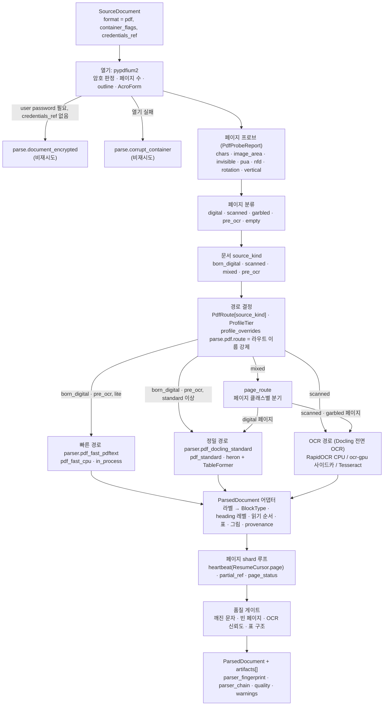

# 파서: PDF (디지털·스캔·레이아웃·OCR)

> 이 문서는 `parse` 스테이지의 PDF 경로를 정의하는 개별 설계 문서다. 우선순위는 브리프 > 바이블 > ADR > 이 문서이며(바이블 §1.1), 타입·필드·열거값·기본값은 바이블 §4.2·§5.3·§5.4·§5.7·§7과 [ParsedDocument 계약](../03-contracts/03-parsed-document.md)을 그대로 쓴다. 이 문서가 새로 정하는 것은 어댑터 내부 규칙(경로 선택, 벤더 모델 → `ParsedDocument` 매핑, heading 추론, 읽기 순서, 좌표 변환, 페이지 shard·재개, 품질 게이트)과 PDF 파서 플러그인의 `config_schema` 필드다. 바이블에 없는 것은 "제안"으로 표시하고 `## 미해결 이슈`에 남긴다. 라우터 규칙(프로브 예산, `source_kind` 판정 임계, `pre_ocr` 매핑, `stage.parse` 정책 선택, 폴백·`quality` 승격)은 바이블 §7.3 `ingest.parse.router`와 파싱 라우터 문서([04-pipelines/03](03-parsing-router-and-format-detection.md) §4.2~§4.5·§6)를 정본으로 인용하고, 이 문서는 그 결정을 어댑터 안에서 어떻게 실현하는지만 적는다. 두 문서가 어긋나는 항목은 `## 미해결 이슈`에 합의 대상으로 올렸다.

## 목적

PDF는 흐름 포맷(HWPX·DOCX·HTML)과 달리 페이지·좌표를 가진 **페이지 포맷**이며, 텍스트 레이어가 있는 디지털(born-digital) 문서, 이미지만 있는 스캔(scanned) 문서, 둘이 섞인 혼합(mixed) 문서, 기존 OCR 레이어가 숨어 있는 `pre_ocr` 문서가 한 컬렉션에 공존한다. 이 문서는 다음을 확정한다.

- 세 경로 — 빠른 경로(텍스트 레이어 + 휴리스틱 구조), 정밀 경로(레이아웃 모델·표 구조·읽기 순서), OCR 경로(스캔) — 의 구성과 **선택 규칙**(페이지 프로브 신호, 문서 `source_kind`, 프로파일 등급, 요청 오버라이드).
- 선정 라이브러리 어댑터(바이블 D-18 v1.1, [ADR-0006](../06-adr/0006-pdf-fast-path-pypdfium2-pdftext-replaces-pymupdf.md), [ADR-0008](../06-adr/0008-ocr-default-rapidocr-ppocrv5-korean.md))가 벤더 모델(DoclingDocument, pdftext 블록, OCR 라인)을 `ParsedDocument`로 옮기는 **매핑 규약**: 레이아웃 라벨 → `BlockType`, heading 레벨, 읽기 순서(2단), 표(`TableData`), 그림·캡션, provenance(`page`·`bbox` 좌표계).
- OCR 파이프라인(전처리·엔진·한국어 모델·신뢰도·세로쓰기·표 OCR)과 하이브리드 페이지 처리, 암호 PDF·폼 필드·북마크(outline) 활용.
- 대용량(수천 페이지) 문서의 페이지 shard·스트리밍·재개(`Resumable`), 처리량 초안 목표, 품질 게이트, 실패 모드.

## 범위

| 포함 | 제외 |
|------|------|
| `SourceDocument.format = pdf`인 문서의 `parse` 스테이지 내부(프로브 → 경로 선택 → 어댑터 → `ParsedDocument` + 파생물) | 포맷 판별(`detect`)과 라우터 체인 일반 규칙([04-pipelines/03](03-parsing-router-and-format-detection.md)) |
| 디지털·스캔·혼합·`pre_ocr` PDF, 암호 PDF, AcroForm 폼 필드, outline(북마크), 2단 컬럼, 세로쓰기 | HWP/HWPX·DOCX·HTML 파서([04](04-parser-hwpx-and-hwp.md)·[06](06-parser-doc-and-docx.md)·[07](07-parser-html.md)); LibreOffice 변환으로 PDF가 생기는 경우는 없다(DOC/RTF/ODT는 DOCX로 변환) |
| OCR 엔진 구성(RapidOCR·PaddleOCR `ocr-gpu` 사이드카·Tesseract), 신뢰도 전파, 페이지 타임아웃 | OCR 엔진 자체의 정확도 벤치마크(07-tech-landscape/02, 08-evaluation) |
| 표 구조(TableFormer·선 기반 폴백·텍스트 표 폴백·큰 표 분할·페이지 간 병합), 그림 크롭·캡션 매칭 | 그림 VLM 캡셔닝·표 요약(`enrich` 단계, O-05) |
| provenance(`element_path`·`char_*`·`page`·`bbox`) 생성과 좌표계 변환 | 정규화(NFC·머리말 제거·문장 분리, [09](09-normalization-and-cleaning.md))·청킹([10](10-chunking-strategies.md)) |
| 페이지 shard·`ResumeCursor`·부분 산출물, 처리량 초안 목표, 품질 게이트, 실패 모드 | Temporal 액티비티 래퍼·재시도 정책 자체([04-pipelines/01](01-pipeline-framework.md), [02-architecture/06](../02-architecture/06-orchestration-and-workflows.md)) |
| `pdf_vlm_gpu`(VLM end-to-end 파서)는 슬롯과 계약 제약만 | VLM 파서 1순위 확정(골든셋 후, 바이블 §7.1 `premium` "골든셋 후") |

## 1. 위치와 계약

### 1.1 스테이지 안의 위치

`parse` 스테이지(`SourceDocument → ParsedDocument`, 바이블 §4.2)는 플랫폼 소유 합성 스테이지 `ParseRouterStage`(`plugin_id = "parser.router"`, [02-architecture/02](../02-architecture/02-component-architecture.md) 제안)가 실행한다. 라우터는 `detect` 서브스테이지로 `SourceDocument.format`·`container_flags`를 확정한 뒤 프로파일 `ingest.parse.router.pdf`를 적용한다. PDF 값은 다른 포맷의 체인(`array<plugin_id | RouteStep>`)과 달리 `PdfRoute{born_digital, scanned, mixed}`다(바이블 §7.3, [03-contracts/15](../03-contracts/15-collection-profile-and-policy-contracts.md) `$defs/PdfRoute`).

```yaml
ingest:
  parse:
    router:
      pdf: {born_digital: parser.pdf_docling_standard, scanned: parser.pdf_docling_standard, mixed: page_route}   # standard 정본(바이블 §7.3)
    options:
      pdf: {layout_model: heron, table_model: tableformer_accurate, threads: 4}
      ocr: {plugin: rapidocr, lang: [korean], version: PPOCRV5, model: MOBILE}   # 네 키 필수(§7.4 (6))
      page_timeout: {cpu: 60s, gpu: 20s}
```

`PdfRoute`의 키는 **문서 수준** `source_kind` 판정 결과(§3.3)이고, 값은 파서 플러그인 ID 또는 `mixed`에 한해 `page_route`(페이지 단위로 `born_digital`·`scanned` 경로를 섞음)다. `source_kind=pre_ocr`는 `PdfRoute`에 키가 없으므로 `born_digital` 항목을 쓴다(텍스트 레이어 신뢰, 깨진 페이지만 재OCR — [04-pipelines/03 §3.1·§4.2](03-parsing-router-and-format-detection.md)). `lite`는 바이블 §7.1에 따라 `born_digital: parser.pdf_fast_pdftext`로 묶고, `scanned`는 `parser.pdf_docling_standard`(RapidOCR CPU)다. 요청 단위 오버라이드는 `IngestRequest.profile_overrides`의 허용 키 `parse.pdf.route`(바이블 §5.4)로만 가능하며 값은 **라우트 이름**(`parser_fingerprint.profile_option` 문자열, [03-contracts/01 §2.5](../03-contracts/01-ingest-request.md))이다(§3.4).

### 1.2 플러그인·프로파일 옵션·격리 모드

| `parser_fingerprint.parser_id` | `parser_fingerprint.profile_option` | 격리 모드 | 라이선스 등급 | 구성 요소(버전은 07 문서 확인일 기준, 잠금 파일이 정본) | 프로파일 |
|--------------------------------|-------------------------------------|-----------|---------------|--------------------------------------------------------------|----------|
| `parser.pdf_fast_pdftext` | `pdf_fast_cpu` | `in_process` | A | pypdfium2 5.13 + pdftext 0.7. 페이지 렌더 없음, 폰트 메타 기반 heading 추론 | `lite` `born_digital` |
| `parser.pdf_docling_standard` | `pdf_standard` | `in_process`(OCR 엔진 포함) | A(코드 MIT; 모델 CDLA-Permissive-2.0 법무 검토) | Docling 2.129.x(docling-parse THREADED 백엔드, heron, TableFormer ACCURATE, `OMP_NUM_THREADS=4`) + RapidOCR 3.9.x PP-OCRv5 korean mobile(ONNX Runtime) | `standard`·`korean-gov`(CPU), `premium` 디지털(GPU) |
| `parser.pdf_docling_standard` + `ocr.plugin: paddleocr` | `pdf_scanned_gpu` | `in_process` 레이아웃 + `sidecar`(`ocr-gpu`, `POST /v1/convert`) | A | Docling + PaddleOCR 3.7 PP-OCRv5 server det + korean mobile rec + 방향/왜곡 전처리 | `premium` `scanned`·`mixed` 스캔 페이지 |
| `parser.pdf_docling_standard` + `ocr.plugin: tesseract` | `pdf_airgapped`(폐쇄망 전용; `korean-gov` 세로쓰기 페이지 재OCR은 `pdf_standard` 지문을 유지하고 `model_ids`에만 Tesseract 모델을 더한다, §6.6) | `in_process`(CLI 서브프로세스) | A | Docling + Tesseract 5.5 `kor+eng`(+`kor_vert`), 모델 번들 | `korean-gov` 폐쇄망·세로쓰기 |
| (미정) | `pdf_vlm_gpu` | `sidecar`(vLLM) | A(PaddleOCR-VL·MonkeyOCRv2-B-Parsing 모두 Apache-2.0) | 골든셋 비교 후 1순위 확정 | `premium` 옵션(기본 끔) |
| `rag-plugin-pymupdf-sidecar`가 선언 | 플러그인 선언 | `sidecar` | C(옵트인, 별도 저장소) | PyMuPDF(AGPL-3.0/Artifex 상용 듀얼 — 인프로세스 기각, ADR-0006). Helm `optIn.*`, `sidecar_image_digest` 필수 | 모든 프로파일 옵트인 |

`profile_option`은 `ProfileTier`가 아니라 파서 지문의 문자열이며(ADR-0006 중립 2), `H("parser", parser_id, parser_version, model_ids, sidecar_image_digest, profile_option)`(바이블 §6.2)에 들어가 경로가 바뀌면 `stage_key`가 바뀌고 재파싱된다. 값 집합(`pdf_fast_cpu`, `pdf_standard`, `pdf_scanned_gpu`, `pdf_airgapped`, 골든셋 후 `pdf_vlm_gpu`)은 `{format}_{variant}` snake_case 형식(AM-09)이며 [04-pipelines/03](03-parsing-router-and-format-detection.md) 정본 목록과 일치한다. `ocr.plugin` 값(`rapidocr, paddleocr, tesseract, surya`)은 PDF 파서 플러그인의 내부 옵션이며 entry point가 아니다([03-contracts/15](../03-contracts/15-collection-profile-and-policy-contracts.md) `$defs/OcrOptions`).

### 1.3 입력·출력·정책

| 항목 | 규약 |
|------|------|
| 입력 | `SourceDocument{format=pdf, media_type=application/pdf, artifact(원본 바이트), content_hash, container_flags.encrypted, credentials_ref?, metadata.language_hint?}`(바이블 §5.4). 파서는 원본 바이트를 `source_ref`로 그대로 기록한다 |
| 출력 | `ParsedDocument` 1개(`source_kind ∈ {born_digital, scanned, mixed, pre_ocr}`, `page_count ≥ 1`, 모든 블록 `page` non-null, `page_break` 외 `bbox` non-null — [03 P-9](../03-contracts/03-parsed-document.md)) + 파생물 `artifacts[]`(`page_image, figure_crop, table_html, vendor_json`) |
| `StagePolicy`(PDF에 적용) | **PDF는 프로파일 `parse.policy_ocr`가 적용된다**([04-pipelines/03 §4.4](03-parsing-router-and-format-detection.md) v1 결정): 워크플로우는 `source_kind`를 알 수 없는 스케줄 시점에 잠정 `format=pdf`이면 `policy_ocr`로 `stage.parse`를 스케줄한다 — `task_queue=runtime.queues.ocr`(`ingest-gpu-ocr` premium / `ingest-cpu` standard·korean-gov / `ingest` lite, 바이블 §4.4·§11.2), `start_to_close=60m`, `heartbeat=60s`, `max_attempts=3`, 비재시도 `parse.document_encrypted, parse.distribution_document, parse.unsupported_variant, parse.corrupt_container, contract.violation`, `resumable=yes(heartbeat_details.page)`. [03-contracts/15](../03-contracts/15-collection-profile-and-policy-contracts.md) `ParseConfig.policy_ocr`가 생략된 프로파일은 `policy` 상속 + `queues.ocr`다 |
| `StagePolicy` parse(텍스트) | `task_queue=ingest-cpu`, `start_to_close=15m`(바이블 §4.4). 잠정 `format` 힌트가 `pdf`가 아니었다가 `detect`가 `pdf`로 바꾼 경우에만 이 정책으로 실행되며, 그때도 파서는 같은 액티비티 안에서 `ctx.remaining_ms()`에 맞춰 shard 예산을 줄이고(§9.2) 페이지 타임아웃으로 저하한다. `source_kind` 확정 후 OCR 큐로 재디스패치하는 최적화는 04-pipelines/03 미해결 이슈 7·[02-architecture/06](../02-architecture/06-orchestration-and-workflows.md)과의 합의 대상이다(미해결 이슈 18) |
| 큐 선택 | 위 규칙대로 **프로브 결과는 큐를 바꾸지 않는다**(액티비티 시작 후이므로 불가). 프로브(§3.1)는 어댑터 안에서 경로·페이지 클래스·품질 게이트에만 쓰인다 |
| 페이지 타임아웃 | `parse.options.page_timeout.cpu=60s / gpu=20s`(O-08). 초과 페이지는 `page_status[].status=timeout` + `warnings[parse.page_timeout]`, 문서는 계속(§9) |
| 부분 성공 | `quality=degraded` + `warnings[]` + `page_status[]`(바이블 §4.1). 전 페이지 `≠ ok`만 `parse.conversion_failed`([13 §5.1 C4](../03-contracts/13-error-model.md), 초안 규칙 — §11 참조) |
| 순수성 | 파서는 `ctx.artifacts.put_derived`로만 쓰고, `ctx.heartbeat`·`ctx.now()`·`ctx.remaining_ms()`·`ctx.cancelled`만 부수효과로 본다([01 §3.1](01-pipeline-framework.md)). 네트워크는 사이드카 `POST /v1/convert`(`SidecarStage`)만 |

**결정:** PDF 경로의 플러그인·격리·엔진 구성은 브리프 D-18(개정 v1.1)과 바이블 §7.1 "PDF 디지털"·"PDF 스캔" 행을 그대로 따른다([ADR-0006](../06-adr/0006-pdf-fast-path-pypdfium2-pdftext-replaces-pymupdf.md), [ADR-0008](../06-adr/0008-ocr-default-rapidocr-ppocrv5-korean.md)). PyMuPDF(AGPL-3.0, 대안·기각 — ADR-0006)·Poppler는 코어에 없으며(`import fitz`·`pdftotext` 서브프로세스 금지 린트), Docling `OcrAutoOptions`는 사용 금지다.

## 2. 처리 흐름



## 3. 프로브와 경로 선택

### 3.1 페이지 프로브(pypdfium2)

프로브는 렌더 없이 pypdfium2로 페이지별 통계를 만든다. 임계값은 기술 지형 02 §스캔/디지털 판별 휴리스틱의 초안값이며 한국어 PDF 골든셋(D-12)으로 조정한다. 프로브 결과는 내부 구조 `PdfProbeReport`(제안; 계약 아님)로 `vendor_json` 파생물에 저장한다.

| 신호 | 측정(pypdfium2; API 이름은 확인 필요 as of 2026-09) | 초안 임계값 | 용도 |
|------|------------------------------------------------------|-------------|------|
| `chars` | 텍스트 페이지의 문자 수(공백 제외) | `< 20` → 텍스트 없음 후보 | 스캔 판정 |
| `image_area_ratio` | 이미지 객체 bbox 합 ÷ 페이지 면적(CropBox) | `chars < 20`일 때 `≤ 0.05` → `empty`, `> 0.05` → `scanned`(§3.2) | 스캔·빈 페이지 판정 |
| `invisible_ratio` | 텍스트 렌더 모드 3(invisible) 문자 비율 | `> 0.9` + `image_area_ratio > 0.5` → `pre_ocr` | 기존 OCR 레이어 |
| `pua_ratio` | U+E000~U+F8FF(사용자 정의 영역) 문자 비율 | `> 0.2` → `garbled` | 깨진 폰트 |
| `control_ratio` | C0/C1 제어 문자 비율(탭·줄바꿈 제외) | `> 0.05` → `garbled` | 깨진 폰트 |
| `no_tounicode_ratio` | ToUnicode 매핑이 없는 폰트가 차지하는 문자 비율 | `> 0.5` → `garbled` | 깨진 폰트 |
| `nfd_ratio` | 결합 자모(U+1100~U+11FF)로 분해된 한글 비율 | 기록만(`normalize`가 NFC) | 한글 정규화 신호 |
| `syllable_space_ratio` | 한글 음절 사이 단일 공백 비율(HWP 출력 PDF 특성) | 기록만 | 정규화 띄어쓰기 교정 신호 |
| `rotation` | `/Rotate`(0·90·180·270) | 표시 프레임 정의(§7.4) | 좌표계 |
| `vertical_hint` | 텍스트 객체 행렬의 세로 진행 비율 또는 OCR 라인 종횡비 | `> 0.5` → 세로쓰기 후보(§6.6) | 엔진 라우팅 |
| `form_widgets` | 위젯 주석 수 | `> 0` → AcroForm 처리(§8.2) | 폼 필드 |

```json
{
  "schema_version": "1.0.0",
  "kind": "PdfProbeReport",
  "page_count": 14,
  "encrypted": true,
  "user_password_required": false,
  "outline_entries": 23,
  "acroform_fields": 0,
  "tagged": false,
  "embedded_files": 0,
  "source_kind": "mixed",
  "class_counts": {"digital": 11, "scanned": 2, "pre_ocr": 0, "garbled": 1, "empty": 0},
  "pages": [
    {"page": 1, "class": "digital", "chars": 1842, "image_area_ratio": 0.08, "invisible_ratio": 0.0, "pua_ratio": 0.0, "control_ratio": 0.0, "no_tounicode_ratio": 0.0, "nfd_ratio": 0.0, "syllable_space_ratio": 0.0, "rotation": 0, "vertical_hint": 0.0, "form_widgets": 0},
    {"page": 12, "class": "scanned", "chars": 0, "image_area_ratio": 0.97, "invisible_ratio": 0.0, "pua_ratio": 0.0, "control_ratio": 0.0, "no_tounicode_ratio": 0.0, "nfd_ratio": 0.0, "syllable_space_ratio": 0.0, "rotation": 0, "vertical_hint": 0.0, "form_widgets": 0},
    {"page": 13, "class": "garbled", "chars": 1210, "image_area_ratio": 0.02, "invisible_ratio": 0.0, "pua_ratio": 0.41, "control_ratio": 0.0, "no_tounicode_ratio": 0.63, "nfd_ratio": 0.0, "syllable_space_ratio": 0.0, "rotation": 0, "vertical_hint": 0.0, "form_widgets": 0}
  ]
}
```

### 3.2 페이지 분류

페이지 클래스는 내부 열거 `page_class ∈ {digital, scanned, pre_ocr, garbled, empty}`(제안; 계약 아님)다. 우선순위는 `empty → scanned → pre_ocr → garbled → digital`이다. `chars < 20`인 페이지는 `image_area_ratio ≤ 0.05`면 `empty`, 그 외(작은 이미지 하나만 있는 페이지 포함)는 `scanned`로 귀결되어 텍스트 없는 페이지가 `digital`로 새지 않는다(초안 규칙; [04-pipelines/03 §4.3](03-parsing-router-and-format-detection.md)의 `> 0.5` 규칙을 포함하는 상위 집합이며, 이미지가 작으면 전면 OCR 결과가 비어 `page_break`만 남는다).

```python
def classify_page(p: PageStats) -> str:
    if p.chars < 20 and p.image_area_ratio <= 0.05:
        return "empty"                      # 빈 페이지: page_status=ok, 블록은 page_break만
    if p.chars < 20:
        return "scanned"                    # 텍스트 없음 + 이미지 있음(image_area_ratio > 0.05): 전면 OCR
    if p.invisible_ratio > 0.9 and p.image_area_ratio > 0.5:
        return "pre_ocr"                    # 숨은 텍스트 레이어: pre_ocr_policy 적용
    if p.pua_ratio > 0.2 or p.control_ratio > 0.05 or p.no_tounicode_ratio > 0.5:
        return "garbled"                    # 텍스트 레이어 폐기, 전면 OCR
    return "digital"
```

클래스별 OCR 모드(내부 파생값 `ocr_mode ∈ {off, bitmap_regions, full_page}`, 제안): `digital → bitmap_regions`(Docling 기본; 그림 안 글자만 OCR, `bitmap_area_threshold` 확인 필요 as of 2026-09), `scanned·garbled → full_page`, `pre_ocr → 정책(§8.5)`, `empty → off`. 빠른 경로(`pdf_fast_cpu`)는 OCR 엔진이 없으므로 `ocr_mode`는 항상 `off`이며, `lite`에서 `scanned·garbled` 페이지는 `parser.pdf_docling_standard`(RapidOCR CPU)로 간다.

### 3.3 문서 `source_kind` 판정

`empty`를 제외한 페이지 수를 분모로 한다(초안). 값과 의미는 바이블 §5.7 `SourceKind`·[03 §5.1](../03-contracts/03-parsed-document.md)이다.

| 조건(비율) | `source_kind` |
|------------|---------------|
| `pre_ocr` 비율 ≥ 0.8 | `pre_ocr` |
| (`scanned` + `garbled`) 비율 ≥ 0.8 | `scanned` |
| (`scanned` + `garbled` + `pre_ocr`) 비율 ≤ 0.2 | `born_digital` |
| 그 외 | `mixed` |
| 모든 페이지 `empty` | `born_digital`(블록은 `page_break`만, §11 빈 문서 규칙) |

`born_digital`로 판정된 문서에 `garbled`·`scanned` 페이지가 소수(≤ 0.2) 섞여 있으면 그 페이지는 정밀 경로 안에서 페이지 단위 전면 OCR로 처리한다(`page_route`와 동일 규칙, §6.8). 즉 `PdfRoute.born_digital` 값이 `parser.pdf_fast_pdftext`(lite)일 때만 소수 스캔 페이지가 OCR 없이 남는다(`page_status=ok`, 블록 없음; §11에서 `warnings` 없이 프로브 보고서로만 감사 — 미해결 이슈 5).

### 3.4 경로 선택 규칙

| 입력 | 값 | 효과 |
|------|----|------|
| 프로파일 `PdfRoute[source_kind]` | 플러그인 ID 또는 `page_route` | 1차 결정 |
| `ProfileTier`·GPU | `lite`(GPU 0·사이드카 0) / `standard`·`korean-gov`(CPU) / `premium`(GPU, `ocr-gpu`) | OCR 엔진·큐(`ocr.plugin`, `runtime.queues.ocr`) |
| `IngestRequest.profile_overrides["parse.pdf.route"]` | 라우트 이름 = `parser_fingerprint.profile_option` 문자열(`pdf_fast_cpu`, `pdf_standard`, `pdf_scanned_gpu`, `pdf_airgapped`; 값 형태는 [03-contracts/01 §2.5](../03-contracts/01-ingest-request.md), 허용 집합은 컬렉션 프로파일이 선언) | `PdfRoute[source_kind]` 조회를 건너뛰고 해당 `profile_option`의 파서 구성(§1.2)을 직접 선택. 프로브·`source_kind` 판정은 여전히 실행되어 페이지 클래스·품질 게이트·`ParsedDocument.source_kind`에 쓰인다. 프로파일이 허용하지 않는 값·등급에 없는 구성(`lite`의 `pdf_scanned_gpu`)은 입구에서 422 `profile.invalid`. `source_kind` 자체를 강제하는 값(`scanned` 등)은 이 키의 값이 아니다(미해결 이슈 19) |
| `metadata.language_hint` | BCP 47(기본 `ko`) | `ocr.lang` 목록에 대응 엔진 코드가 있으면 페이지 OCR 언어로 사용(`pdf.ocr_lang_from_hint`, §4.5) |
| `container_flags.encrypted` + `credentials_ref` | — | 비밀번호 필요 + 참조 없음 → `parse.document_encrypted`(§8.1) |
| 페이지 수·크기 | `page_count`, `size_bytes` | shard 크기·`document_timeout` 산정(§9), 한계 초과 사전 판정 |

```python
ROUTE_BY_OPTION = {                                   # §1.2 표: profile_option → (parser_id, ocr.plugin 재정의)
    "pdf_fast_cpu":    ("parser.pdf_fast_pdftext", None),
    "pdf_standard":    ("parser.pdf_docling_standard", None),
    "pdf_scanned_gpu": ("parser.pdf_docling_standard", "paddleocr"),
    "pdf_airgapped":   ("parser.pdf_docling_standard", "tesseract"),
}

def decide_route(kind: str, route: PdfRoute, tier: str, override: str | None) -> Plan:
    if override is not None:                          # 라우트 이름 강제(§1.1, 03-contracts/01 §2.5); 허용 밖 값은 입구에서 422
        parser_id, ocr_plugin = ROUTE_BY_OPTION[override]
        return Plan(parser=parser_id, per_page=(parser_id == "parser.pdf_docling_standard"),
                    ocr_parser=route.scanned, ocr_plugin=ocr_plugin)
    if kind == "mixed" and route.mixed == "page_route":
        return Plan(parser=route.born_digital, per_page=True, ocr_parser=route.scanned)
    parser = {"born_digital": route.born_digital, "pre_ocr": route.born_digital,   # pre_ocr는 PdfRoute 키 없음(04-pipelines/03 §4.2)
              "scanned": route.scanned, "mixed": route.mixed}[kind]
    return Plan(parser=parser, per_page=(parser == "parser.pdf_docling_standard"), ocr_parser=route.scanned)
```

`override`가 있어도 프로브(§3.1)와 `source_kind` 판정(§3.3)은 그대로 실행되어 `ParsedDocument.source_kind`·페이지 클래스·`ocr_mode`·품질 게이트에 쓰인다. 바뀌는 것은 `PdfRoute[source_kind]` 조회 대신 §1.2 구성을 직접 고르는 것뿐이다. `pre_ocr` 문서는 `PdfRoute.born_digital` 파서로 가고, `pre_ocr_policy`(§8.5)에 따른 페이지 단위 재OCR은 `Plan.ocr_parser = route.scanned`로만 표현한다.

### 3.5 `page_route`(혼합 문서)

`mixed: page_route`는 한 액티비티 안에서 페이지 클래스별로 경로를 섞는다. `standard`·`korean-gov`에서는 두 경로가 모두 `parser.pdf_docling_standard`이므로 Docling 한 파이프라인이 페이지마다 `ocr_mode`만 달리 적용한다. `premium`에서는 `digital` 페이지를 Docling in_process로, `scanned·garbled` 페이지를 `ocr-gpu` 사이드카 OCR로 처리한 뒤 하나의 `ParsedDocument`로 합친다(§6.4·§9.4). `lite`는 `born_digital: parser.pdf_fast_pdftext`이므로 `page_route`가 두 파서를 섞는다: `digital` 페이지는 pdftext, `scanned·garbled` 페이지는 Docling + RapidOCR. 이때 `parser_chain = ["parser.pdf_fast_pdftext", "parser.pdf_docling_standard"]`(둘 다 산출에 기여; 마지막 원소를 산출 파서로 두는 [03 P-1](../03-contracts/03-parsed-document.md) 규약과의 정합은 미해결 이슈 6) 이고 `parser_fingerprint`는 두 파서의 `model_ids`를 합친다.

## 4. 빠른 경로 `pdf_fast_cpu`(pypdfium2 + pdftext)

### 4.1 구성

pdftext가 pypdfium2 위에서 블록/라인/스팬과 폰트 메타(이름·크기·굵기 플래그)를 만든다(pdftext `dictionary_output`, 확인 필요 as of 2026-09). 페이지 렌더·레이아웃 모델·OCR은 없다(ADR-0006). `Block.source = text_layer`, `source_kind = born_digital`, `heading_inferred = true`(모든 heading), 표 구조는 만들지 않는다(표 텍스트는 읽기 순서의 `paragraph`).

| 단계 | 규칙 |
|------|------|
| 블록 | pdftext 블록 1개 → `Block` 1개. `element_path = /page[p]/block[b]`(p·b 0-based, [03 §3.1](../03-contracts/03-parsed-document.md)), `text` = 라인을 `\n`으로 결합(하이픈 줄바꿈 복원은 `normalize`), `provenance.char_start=0, char_end=len(text)`, `bbox` = 블록 bbox 좌상단 원점 포인트(§7.4) |
| heading | §7.2 공통 알고리즘의 폰트 클러스터 + 번호 패턴 + outline 매칭 |
| 목록 | 라인 선두가 글머리(`•·○□■-`, `①..⑳`, `가.`, `(1)`, `1)`) 패턴이면 `list_item`, `numbering_label` = 마커, `ordered` = 숫자·문자 순번 여부, `level` = 들여쓰기 x 오프셋 클러스터(0-based) |
| 머리말·꼬리말 | 페이지 상·하 8% 대역의 텍스트가 (페이지 번호를 `#`으로 정규화한 뒤) 전체 페이지의 50% 이상에서 반복 → `page_header`/`page_footer`, `furniture=true`, `container=page_header|page_footer`; 원문은 `metadata.page_header_text/page_footer_text`에도 중복 없이 수집 |
| 그림 | 페이지 이미지 객체(`PdfImage`) 중 최소 크기(초안 72×72 pt) 이상을 `figure(kind=image)`로, 원 이미지 비트맵을 `derived/figure_crop/` PNG로 저장(페이지 렌더 아님; API 확인 필요). 캡션은 §7.5 정규식 규칙 |
| 표 폴백(선택) | `pdf.fast_table_fallback: none | line_based`(기본 `none`). `line_based`면 pdfplumber(MIT) 선 기반 추출을 표 후보 영역(격자선 ≥ 4개 교차)에만 적용하고 `TableData.quality.structure_source = line_based`, `merged_cells_preserved=false`, `header_inferred=true` |
| 각주·수식·코드 | 만들지 않는다(`paragraph`). 하단 소형 폰트 각주는 `normalize`·청커가 문단으로 취급 |
| 페이지 나눔 | 2페이지 이후 각 페이지 시작에 `page_break{page_no=p}`, `element_path=/page[p]/break`(제안), `bbox=null` |

### 4.2 읽기 순서와 2단 컬럼

pdftext의 정렬(y → x)은 단일 컬럼 전제다. 어댑터는 페이지마다 컬럼을 감지한다(§7.3 알고리즘). 2단으로 판정되면 왼쪽 컬럼 블록을 y순으로, 다음 오른쪽 컬럼 블록을 y순으로 배열하고 컬럼을 가로지르는 블록(제목·표·그림; 너비 > 페이지 폭 × 0.6)은 y 위치에 따라 두 컬럼 사이에 끼운다. 판정 실패(컬럼 간 y 겹침 통계 불안정)는 y → x 정렬로 되돌린다.

## 5. 정밀 경로 `pdf_standard`(Docling)

### 5.1 Docling 옵션 매핑

| 프로파일 키(바이블 §7.3) / 어댑터 config | Docling 옵션(이름은 확인 필요 as of 2026-09) | 값·규칙 |
|-------------------------------------------|---------------------------------------------|---------|
| `options.pdf.layout_model: heron` | `LayoutObjectDetectionOptions(model_spec=DOCLING_LAYOUT_HERON)`(`LayoutOptions`는 deprecated 별칭) | `egret_m`이면 `DOCLING_LAYOUT_EGRET_MEDIUM`(CPU 비용 약 절반, mAP −0.011) |
| `options.pdf.table_model: tableformer_accurate` | `do_table_structure=True`, `TableStructureOptions(mode=TableFormerMode.ACCURATE, do_cell_matching=True)` | `tableformer_fast` 허용 |
| `options.pdf.threads: 4` | `OMP_NUM_THREADS` | 워커 프로세스 환경 변수 |
| `options.ocr{plugin, lang, version, model}` | `ocr_options = RapidOcrOptions(lang=["korean"], backend="onnxruntime", det_model_path, rec_model_path, cls_model_path)` / `TesseractCliOcrOptions(lang=["kor","eng"])` / 사이드카 플러그인(§6.4) | **`OcrAutoOptions` 금지**. 모델 경로는 프로파일 `version`·`model`·`lang`으로 결정된 PP-OCRv5 korean mobile ONNX 파일을 명시(v3.9+ 기본 PP-OCRv6 차단) |
| 페이지 클래스 → `ocr_mode` | `do_ocr=True`; `OcrOptions.mode`(OcrMode; 확인 필요) 전면/비트맵 | `full_page` 페이지는 텍스트 레이어를 버리고 전면 OCR, `digital` 페이지는 비트맵 영역만 |
| `pdf.render_scale`(제안, 기본 3.0 ≈ 216 DPI) | `OcrOptions.scale`, `images_scale` | GPU 경로 `pdf_scanned_gpu`는 300 DPI(`scale≈4.17`) 옵션 |
| `pdf.figure_crops`(제안, 기본 `true`) | `generate_picture_images=True` | `figure.artifact` 필수이므로 끄면 `figure` 블록 없음 |
| `pdf.page_images`(제안, 기본 `ocr_pages`) | `generate_page_images` | `ocr_pages`(OCR 수행 페이지만) / `all` / `none`. `visual-pages` 보완 채널·감사용 |
| 고정 | `do_picture_classification=False`, `do_picture_description=False`, `do_formula_enrichment=False`, `do_code_enrichment=False`, `enable_remote_services=False` | 보강은 `enrich`(O-05); 외부 전송 금지 |
| 백엔드 | `THREADED_DOCLING_PARSE` → 예외 시 `PYPDFIUM2` 폴백 | 폴백 시 `quality=degraded`([03 §5.3 (e)](../03-contracts/03-parsed-document.md)), 같은 `parser_id` |
| 문서 타임아웃 | `PdfPipelineOptions.document_timeout`(확인 필요) = shard 페이지 수 × `page_timeout` | Docling에 페이지 단위 타임아웃이 없어 shard 단위로 강제(§9.2) |
| 페이지 범위 | `DocumentConverter.convert(source, page_range=(a, b))`(확인 필요) | shard 단위 변환 |

### 5.2 Docling 라벨 → `BlockType`

[03 §8.1](../03-contracts/03-parsed-document.md)이 권고한 표를 이 문서가 확정한다. `DocItemLabel` 값 이름은 확인 필요(as of 2026-09).

| Docling `DocItemLabel` | `type` | `level`·속성 | `furniture` / `container` | `source` |
|------------------------|--------|-------------|---------------------------|----------|
| `TITLE` | `heading` | `level=0`(문서에 1개; 둘 이상이면 첫 것만 0, 나머지 1 + `heading_inferred=true`) | false / `body` | 페이지 클래스에 따라 `text_layer` 또는 `ocr` |
| `SECTION_HEADER` | `heading` | `level = SectionHeaderItem.level`(1..6, 초과 6) → §7.2 보정 | false / `body` | 동일 |
| `TEXT`, `PARAGRAPH`, `REFERENCE`, `HANDWRITTEN_TEXT` | `paragraph` | — | false / `body` | 동일(`HANDWRITTEN_TEXT`는 항상 `ocr`) |
| `LIST_ITEM` | `list_item` | `level` = 그룹 중첩 깊이(0-based), `ordered`, `numbering_label` = 마커 | false / `body` | 동일 |
| `TABLE` | `table` | `TableData`(§7.4), `html_ref` = `export_to_html()` → `derived/table_html/` | false / `body` | 셀 텍스트 출처(§6.7) |
| `PICTURE` | `figure` | `figure.kind=image`, `artifact` = 크롭 PNG | false / `body` | `text_layer`(`text`는 `alt_text` 또는 `""`) |
| `CHART` | `figure` | `figure.kind=chart` | false / `body` | 동일 |
| `CAPTION` | `caption` | `caption_of` = `captions` 역참조 대상 | false / `body` | 동일 |
| `FOOTNOTE` | `footnote` | `footnote{kind=footnote, anchor_block_id=null, anchor_char_offset=null, marker=선두 번호}` | false / `footnote_body` | 동일 |
| `PAGE_HEADER` / `PAGE_FOOTER` | `page_header` / `page_footer` | 원문을 `metadata.page_header_text/page_footer_text`에 중복 없이 수집 | **true** / `page_header`·`page_footer` | 동일 |
| `FORMULA` | `formula` | `formula{script=인식 문자열, latex=null}` | false / `body` | 동일 |
| `CODE` | `code` | `code{language=null}` | false / `body` | 동일 |
| `DOCUMENT_INDEX` | `toc` | `text` = 항목 선형화(줄바꿈) | **true** / `body` | 동일 |
| `KEY_VALUE_REGION`, `FORM`, `CHECKBOX_SELECTED`, `CHECKBOX_UNSELECTED` | `form_field` | `text` = `키: 값` 또는 체크 상태 문자열(`[x]`/`[ ]` + 라벨) | false / `body` | 동일 |
| `EMPTY_VALUE`, `GRADING_SCALE`(있을 경우) | 블록 생성 없음 / `paragraph` | — | — | — |
| 페이지 경계 `pages[p]`(p ≥ 2) | `page_break` | `page_break{page_no=p, section_index=null}`, `element_path=#/pages/p`, `bbox=null` | false / `body` | `text_layer`, `confidence=null` |

`page_header`·`page_footer`·`toc`는 `furniture=true`로 기본 청킹에서 제외되며 정규화 단계의 보일러플레이트 제거 후보다(바이블 §5.7 `BlockType` 주석, [09](09-normalization-and-cleaning.md)). 파서는 제거하지 않고 보존한다(인용 좌표 유지).

### 5.3 읽기 순서

Docling 읽기 순서 모델의 결과를 그대로 `blocks[]` 순서로 쓴다. 어댑터는 §7.3 컬럼 감지로 순서를 검증하고, 컬럼 간 y 겹침이 있는 블록 쌍이 컬럼 경계에서 교차 정렬돼 있으면(왼 컬럼 아래 블록이 오른 컬럼 위 블록보다 뒤에 오는 역전이 페이지당 2회 이상) `pdf.column_reorder: verify | force | off`(제안, 기본 `verify`)에 따라 재정렬한다. `korean-gov`는 2단·공문서 골든셋 회귀(바이블 §7.1)로 이 규칙을 검증한다.

## 6. OCR 경로

### 6.1 엔진 선정(O-08, ADR-0008)

| 프로파일 | 엔진·모델 | 격리 · 큐 | 페이지 타임아웃 | 비고 |
|----------|-----------|-----------|-----------------|------|
| `lite` | RapidOCR 3.9.x PP-OCRv5 korean mobile, ONNX Runtime CPU | `in_process` · `ingest` | 60s | Docling 플러그형 OCR |
| `standard` | 동일 | `in_process` · `ingest-cpu` | 60s | 비트맵 영역·전면 OCR 페이지 |
| `premium` | PaddleOCR 3.7 PP-OCRv5 server det + korean mobile rec + 방향/왜곡 전처리 | `sidecar`(`ocr-gpu`) · `ingest-gpu-ocr` | 20s | 인식 가중치는 CPU 기본과 동일(ADR-0008 F2); 이점은 검출·전처리·처리량 |
| `korean-gov` | standard + 세로쓰기 페이지 Tesseract 5.5 `kor_vert`; 폐쇄망 `pdf_airgapped` Tesseract `kor+eng` 번들 | `in_process`(CLI) · `ingest-cpu` | 60s | `quality=degraded`(Tesseract 경로) |
| 옵트인 | Surya 등 D 등급 | 플러그인 선언 | — | `optIn` + `model_license_ack: true` |

제외: EasyOCR(정체), HunyuanOCR(대한민국 사용 비허가, `territory` 불일치), docTR(한국어 체크포인트 없음), Nemotron-OCR v2(라이선스 검토 전; GPU 골든셋 비교 대상만).

### 6.2 파이프라인

| 단계 | 규칙(초안) |
|------|-----------|
| 렌더 | pypdfium2 `render(scale)`; 기본 `scale=3.0`(≈216 DPI), GPU 경로 300 DPI 옵션. `/Rotate`는 렌더 시 적용(표시 프레임, §7.4) |
| 방향 보정 | 프로브 `rotation`(메타) + 엔진 방향 분류(PaddleOCR `use_doc_orientation_classify`, Tesseract `--psm 0` OSD). RapidOCR는 180° 분류(cls)만 있으므로 90°/270° 회전 스캔은 라인 종횡비 통계로 감지 후 재렌더(초안 규칙) |
| 기울기 보정 | 투영 프로파일 또는 Hough(OpenCV Apache-2.0 / `deskew` MIT; 확인 필요) 각도 `> 0.5°`면 회전. 각도는 `vendor_json`에 기록, bbox는 표시 프레임으로 역변환(§7.4) |
| 이진화 | Tesseract 경로만 적응 이진화(Sauvola). PP-OCR 계열은 자체 정규화를 쓰므로 적용하지 않는다 |
| 검출·인식 | 엔진별. 출력은 라인 `{bbox_px(4점 또는 사각), text, score}` |
| 레이아웃 | 전면 OCR 페이지도 Docling 레이아웃 모델(heron)이 렌더 이미지에서 라벨을 부여하고 OCR 셀을 라벨 영역에 매칭한다(Docling 파이프라인 내부). 사이드카 경로는 사이드카 결과를 Docling OCR 플러그인이 셀로 주입(§6.4) |
| 블록화 | 라벨 영역 안의 라인을 읽기 순서로 결합 → `Block(source=ocr, confidence)` |
| 좌표 | `pt = px × 72 / dpi` → 역기울기·역회전 → 표시 프레임 좌상단 원점(§7.4) |
| 페이지 요약 | `page_status[].ocr_confidence` = 문자 수 가중 평균 `Block.confidence`(초안) |

### 6.3 RapidOCR 구성(기본)

RapidOCR를 직접 생성하는 모든 경로는 다음 `params`를 프로파일 값에서 항상 전달한다(ADR-0008 준수 확인 "금지 API 린트"): `Rec.lang_type = LangRec.KOREAN`, `Rec.ocr_version = OCRVersion.PPOCRV5`, `Rec.model_type = ModelType.MOBILE`, `Rec.engine_type = EngineType.ONNXRUNTIME`(열거형은 `rapidocr/utils/typings.py` 소스 확인, 기술 지형 02 §RapidOCR). Docling 경로는 `RapidOcrOptions`에 PP-OCRv5 korean mobile ONNX 모델 파일 경로를 명시하며, Docling이 버전·모델 타입을 노출하는 방식이 바뀌면 매핑만 재검토한다(ADR-0008 재검토 조건 8). 모델 파일은 이미지에 번들(에어갭)하거나 `models/{repo}/{revision}/` 미러(바이블 §13.3)에서 기동 시 적재하고, 부재 시 워커 기동이 실패해 조기 노출된다. `parser_fingerprint.model_ids`에는 `rapidocr/ppocrv5-korean-mobile@<revision>` 형식으로 기록한다(03 예시 2).

### 6.4 `ocr-gpu` 사이드카(`premium`)

Docling 파이프라인을 유지하기 위해 사이드카 호출은 Docling 서드파티 OCR 플러그인 형태의 어댑터 클래스 `RagSidecarOcrModel`(제안; `docling-ocr-onnxtr`와 같은 플러그인 방식, 확인 필요 as of 2026-09)로 구현한다. 플러그인은 페이지(또는 비트맵 영역) 이미지를 `derived/page_image/`에 저장하고 `POST /v1/convert`로 보낸다(바이블 §5.6 `ConvertRequest`/`ConvertResponse`, [ADR-0033](../06-adr/0033-sidecar-convert-contract-and-isolation-ladder.md)).

```json
{
  "input": {
    "uri": "s3://rag-artifacts/tenants/01J9ZQ4K7X2M8N3P5R6S7T8V9W/sources/bc/bc4a6100c1979e004667fdf6621c3d168ae83a7bd09537d683213fa9016bdb6f",
    "blake3": "bc4a6100c1979e004667fdf6621c3d168ae83a7bd09537d683213fa9016bdb6f",
    "media_type": "application/pdf",
    "size_bytes": 2359296
  },
  "options": {
    "kind": "pdf_ocr_pages",
    "pages": [12, 13],
    "dpi": 300,
    "lang": ["korean"],
    "version": "PPOCRV5",
    "model": "MOBILE",
    "det_model": "server",
    "orientation_classify": true,
    "unwarp": true,
    "textline_orientation": true
  },
  "tenant_id": "01J9ZQ4K7X2M8N3P5R6S7T8V9W",
  "document_id": "01J9ZQ9C0D1E2F3G4H5J6K7M8N",
  "deadline_ms": 40000,
  "trace_id": "4bf92f3577b34da6a3ce929d0e0e4736",
  "credentials_ref": null
}
```

| 항목 | 규약 |
|------|------|
| `options` | 사이드카 전용 객체(제안; 계약 `ConvertRequest.options: object`). `kind=pdf_ocr_pages`, `pages`(1-based, 배치 ≤ 8 페이지 초안), `dpi`, 프로파일 `ocr.{lang, version, model}` 그대로, PaddleOCR 전처리 스위치 |
| `deadline_ms` | `len(pages) × page_timeout.gpu`(20s) + 오버헤드; 셸 규칙 "잔여 × 0.8" 상한([02-architecture/09](../02-architecture/09-failure-modes-and-resilience.md)) |
| `ConvertResponse.output` | `vendor_json` 파생물(`application/json`) `OcrPageResult[]`(아래). `derived[]`에 렌더 페이지 이미지 참조 |
| `producer.image_digest` | `ocr-gpu` 이미지 digest → `parser_fingerprint.sidecar_image_digest`·`Producer.image_digest` |
| 실패 | 연결 실패·503 → `parse.sidecar_unavailable`(재시도 후 폴백: RapidOCR CPU in_process → Tesseract). 폴백 시 `quality=degraded` + `warnings[{code: parse.sidecar_unavailable, page}]`, `model_ids`는 실제 사용 엔진(전용 경고 코드는 미해결 이슈 3). `output=null` + `error` → 페이지 `ocr_failed` |

```json
{
  "kind": "OcrPageResult",
  "page": 12,
  "dpi": 300,
  "rotation_applied": 0,
  "deskew_angle_deg": -0.8,
  "engine": "paddleocr",
  "model_ids": ["paddleocr/PP-OCRv5_server_det@3.7.0", "paddleocr/korean_PP-OCRv5_mobile_rec@3.7.0"],
  "lines": [
    {"bbox_px": [300, 585, 2180, 660], "text": "제3조(절차) 이 규정에 따른 신청은 서면으로 한다.", "score": 0.93, "vertical": false}
  ]
}
```

### 6.5 신뢰도

| 수준 | 계산(초안) | 필드 |
|------|-----------|------|
| 라인 | 엔진 점수(PP-OCR rec score 0..1; Tesseract TSV `conf`/100) | 내부 |
| 블록 | 라인 점수의 문자 수 가중 평균, 소수 둘째 자리 반올림 | `Block.confidence`(`source ∈ {ocr, vlm}`이면 필수, [03 P-7](../03-contracts/03-parsed-document.md)) |
| 표 | 셀 텍스트 라인 점수의 문자 수 가중 평균 | 표 `Block.confidence`(셀 단위 값은 계약에 없음, 미해결 이슈 8) |
| 페이지 | 블록 신뢰도의 문자 수 가중 평균; OCR 미수행 `null` | `page_status[].ocr_confidence` |
| 하류 | 청크의 최저 신뢰 등급 `text_source`, 최소값 `ocr_confidence_min` → `IndexRecord` → `ContextItem` → 렌더러 `[ocr]` | 바이블 §9.3, ADR-0008 |

전면 OCR 페이지의 `page_break`·`figure` 블록은 `source=text_layer`, `confidence=null`이다(텍스트가 없음). 평균 신뢰도 `< 0.5`(초안) 페이지는 `ok`로 유지하되 `visual-pages` 보완 채널 후보다(전용 경고 코드는 미해결 이슈 3).

### 6.6 세로쓰기

세로쓰기 감지는 두 단계다: (1) 프로브 `vertical_hint`(텍스트 객체 행렬의 세로 진행 비율), (2) OCR 검출 라인의 종횡비(높이/너비 `> 3`) 비율이 `> 0.5`(초안). 감지되면 `korean-gov`는 해당 페이지를 Tesseract `kor_vert`로 재OCR하고(`ocr.plugin: tesseract` 경로, `quality=degraded`), 다른 프로파일은 PP-OCRv5 결과를 유지하며 신뢰도로만 드러난다(PaddleOCR 계열의 세로쓰기 한국어 지원 여부는 ADR-0008 재검토 조건 7). 세로쓰기 블록의 `text`는 위→아래, 오른쪽→왼쪽 컬럼 순으로 결합하고 `bbox`는 라인 합집합이다.

### 6.7 표 OCR

스캔 페이지의 표는 Docling 레이아웃(`TABLE`) + TableFormer가 렌더 이미지에서 격자를 만들고 `do_cell_matching=True`로 OCR 셀을 격자에 매칭한다. 결과는 `TableData{structure_source=tableformer, merged_cells_preserved=true}`, 셀 `text`는 OCR 문자열, 표 블록 `source=ocr`·`confidence`(§6.5)다. 격자가 비면(셀 0 또는 행·열 불일치) §7.4 폴백을 적용한다. 선 기반 폴백은 스캔 페이지에 쓰지 않는다(픽셀 격자선 검출은 범위 밖).

### 6.8 하이브리드 페이지

| 페이지 클래스 | 텍스트 출처 | OCR 모드 | 블록 `source` |
|---------------|-------------|----------|---------------|
| `digital` | 텍스트 레이어 | `bitmap_regions`(그림 안 글자) | `text_layer`; 비트맵 영역 블록만 `ocr` |
| `scanned` | 없음 | `full_page` | `ocr`(`page_break`·`figure` 제외) |
| `garbled` | 폐기 | `full_page` | `ocr` |
| `pre_ocr` | 숨은 레이어 | 정책(§8.5) | `text_layer`(신뢰) 또는 `ocr`(재OCR) |
| `empty` | 없음 | `off` | `page_break`만 |

디지털 페이지의 텍스트 레이어를 OCR·VLM 출력으로 덮어쓰지 않는다(ADR-0008 코드 리뷰 (g)). 한 문서 안에서 `source`가 페이지마다 다른 것이 정상이며 각 블록의 `source`가 진실이다([03 §5.1](../03-contracts/03-parsed-document.md) `mixed`).

## 7. `ParsedDocument` 매핑 규약

### 7.1 통합 매핑 표(레이아웃 라벨 → `BlockType`)

| 의미 | Docling 라벨 | pdftext 휴리스틱(`pdf_fast_cpu`) | 전면 OCR 페이지 | `type` | `furniture` | 정규화 단계 처리 |
|------|--------------|-----------------------------------|-----------------|--------|-------------|------------------|
| 문서 제목 | `TITLE` | 최대 폰트 클러스터 + 1페이지 상단 + outline 루트 일치 | 동일 라벨 | `heading` `level=0` | false | — |
| 절 제목 | `SECTION_HEADER` | 폰트 클러스터·번호 패턴 | 동일 라벨 | `heading` `level 1..6` | false | heading 경로 → `context_prefix` |
| 본문 | `TEXT`/`PARAGRAPH`/`REFERENCE` | 기본 | 동일 | `paragraph` | false | NFC·문장 분리 |
| 목록 | `LIST_ITEM` | 글머리 정규식 | 동일 | `list_item` | false | — |
| 표 | `TABLE` | (없음 → `paragraph`; 옵션 `line_based`) | `TABLE`(TableFormer + OCR 셀) | `table` + `TableData` | false | 청커 행 그룹 |
| 그림·차트 | `PICTURE`/`CHART` | 이미지 객체 | `PICTURE` | `figure` | false | `enrich` 캡셔닝 |
| 캡션 | `CAPTION` | `그림 N`/`표 N` 정규식 | 동일 | `caption` | false | — |
| 각주 | `FOOTNOTE` | (없음) | 동일 | `footnote` | false(`container=footnote_body`) | 앵커 문맥 부착 |
| 머리말·꼬리말 | `PAGE_HEADER`/`PAGE_FOOTER` | 반복 y-대역 | 동일 | `page_header`/`page_footer` | **true** | 보일러플레이트 제거 후보 |
| 수식 | `FORMULA` | (없음) | 동일 | `formula` | false | — |
| 코드 | `CODE` | (없음; 고정폭 폰트 클러스터는 `paragraph`) | 동일 | `code` | false | — |
| 목차 페이지 | `DOCUMENT_INDEX` | (없음) | 동일 | `toc` | **true** | 제외 |
| 폼 | `KEY_VALUE_REGION`/`FORM`/`CHECKBOX_*`; AcroForm 필드(§8.2) | AcroForm 필드 | 동일 라벨 | `form_field` | false | — |
| 페이지 경계 | `pages[p]` | 페이지 루프 | 동일 | `page_break` | false | — |

### 7.2 heading 레벨 추론(공통)

입력 신호는 (a) 레이아웃 라벨·레벨(Docling `SectionHeaderItem.level`), (b) 폰트 크기·굵기(pdftext 스팬; Docling은 셀 폰트 정보가 있을 때만), (c) 한국어 번호 패턴, (d) outline(북마크) 항목이다. 우선순위와 규칙:

| 순서 | 규칙 | `heading_inferred` |
|------|------|--------------------|
| 1 | outline 항목의 제목과 정규화 유사도(공백·문장부호 제거 후 코드포인트 일치율) ≥ 0.9인 같은 페이지 블록은 heading이며 `level = outline 깊이`(루트 1; 문서 제목과 일치하는 루트 1개는 0) | 원래 heading 라벨이면 `false`, `paragraph`를 승격했으면 `true` |
| 2 | Docling `SECTION_HEADER`는 `level = SectionHeaderItem.level`(1..6) | `false` |
| 3 | pdftext: 본문 크기 = 전체 스팬의 글자 수 가중 중앙값; 후보 = 단일 폰트 그룹 라인, 크기 ≥ 본문 × 1.15 또는 bold, 길이 ≤ 120자, 종결 부호(`.`, `다.`, `함.`)로 끝나지 않음; 크기 클러스터(k ≤ 4) 내림차순 `level 1..4` | `true` |
| 4 | 번호 패턴 보정: `제\d+편 > 제\d+장 > 제\d+절 > 제\d+조`, `\d+\.` > `\d+\.\d+` > `\d+\.\d+\.\d+`, `[가-힣]\.` / `\(\d+\)` / `[①-⑳]`는 상위 패턴 + 1. 패턴 레벨과 폰트 레벨이 다르면 패턴 우선(같은 패턴 계열 안에서 단조 증가 보장) | 유지 |
| 5 | 정합: `level ≤ 6`, 부모 없는 `level=k>1` heading은 직전 heading `level+1`로 당김(트리 [03 §4.1](../03-contracts/03-parsed-document.md)). `numbering_label`은 매칭된 번호 문자열, `text`에서 분리하지 않는다(원문 유지) | 유지 |
| 6 | 게이트: 페이지당 heading 비율 `> 0.4` 또는 문서 heading 비율 `> 0.25`(초안)면 폰트 기반 추론(3)을 폐기하고 라벨·outline만 사용 | — |

```python
def infer_heading_levels(blocks: list[Block], outline: list[OutlineEntry], spans: SpanIndex) -> None:
    body = weighted_median_font_size(spans)
    clusters = size_clusters(spans, k_max=4)                     # 내림차순 → level 1..4
    for b in blocks:
        if (o := match_outline(b, outline, threshold=0.9)) is not None:
            promote_to_heading(b, level=o.depth, inferred=(b.type != "heading"))
        elif b.type == "heading" and b.level is None:              # pdftext 후보
            b.level = clusters.level_of(spans.size_of(b)); b.heading_inferred = True
        if b.type == "heading" and (pat := korean_numbering(b.text)):
            b.level = reconcile(b.level, pat.level); b.numbering_label = pat.label
    clamp_and_reparent(blocks, max_level=6)
```

### 7.3 읽기 순서와 2단 컬럼 감지

```python
def detect_columns(page_blocks: list[Block], page_width: float) -> list[tuple[float, float]]:
    body = [b for b in page_blocks if b.type in {"paragraph", "list_item", "heading"} and width(b) < page_width * 0.6]
    xs = sorted(center_x(b) for b in body)
    gap = largest_gap(xs)                                          # 인접 중심 x의 최대 간격
    if gap.size > page_width * 0.05 and coverage(body, gap.left) > 0.3 and coverage(body, gap.right) > 0.3:
        return [(0.0, gap.mid), (gap.mid, page_width)]             # 2단
    return [(0.0, page_width)]                                     # 단일 컬럼
```

컬럼이 2개면 순서는 [컬럼 가로지르는 블록(y순) 사이에] 왼 컬럼(y순) → 오른 컬럼(y순)이다. 3단 이상은 v1 범위 밖(단일 컬럼으로 폴백, 미해결 이슈 9). 표·그림·캡션은 소속 컬럼 또는 가로지르는 블록으로 취급하고 캡션은 대상과 같은 부모의 형제로 원본 위치(위·아래)를 유지한다([03 §4.2](../03-contracts/03-parsed-document.md)).

### 7.4 표

| 항목 | 규칙 |
|------|------|
| 정본 | `Block.table: TableData{n_rows, n_cols, cells[앵커만], header_row_indices, header_inferred, role, quality, html_ref}`(바이블 §5.4). Docling `TableCell{start/end_row_offset_idx, start/end_col_offset_idx, column_header, row_header, row_section, bbox}` → `row, row_span, col, col_span, header_kind(column/row/section), provenance.bbox`([03 §8.1](../03-contracts/03-parsed-document.md)) |
| 헤더 | `column_header` 행 → `header_row_indices`; 없으면 첫 행 + `header_inferred=true`. `is_header = (header_kind ≠ none)`(P-13) |
| `role` | 기본 `data`; `DOCUMENT_INDEX` 안의 표 또는 캡션 `목차` → `toc`; `FORM` 영역 안 표·빈 셀 비율 > 0.5 + 라벨 열 → `form`; 격자선 없음 + 셀 텍스트가 문단 길이(> 200자) 다수 → `layout`(초안 규칙) |
| 선형화 `text` | 앵커 셀 행 우선, 셀 U+0009·행 U+000A([03 §6](../03-contracts/03-parsed-document.md)); `TableCell.provenance.char_*`는 이 문자열 구간 |
| `html_ref` | `TableItem.export_to_html()` → `derived/table_html/{blake3}.html`(`text/html`), `artifacts[]{kind=table_html, block_id}` |
| 구조 실패(디지털) | TableFormer 격자가 비거나 행·열이 셀과 불일치 → pdfplumber 선 기반 폴백(`structure_source=line_based`, `merged_cells_preserved=false`) → 실패 시 **텍스트 표 폴백**: 표 영역 라인을 읽기 순서 `paragraph` 블록으로(`table` 블록 없음), `quality=degraded` |
| 구조 실패(스캔) | `figure(kind=image)` 크롭 + 뒤따르는 `paragraph`(OCR 라인, `source=ocr`), `quality=degraded` |
| 큰 표 분할 | 선형화 `text`가 1MB(UTF-8)를 넘거나 셀 수 `> pdf.table_max_cells`(제안, 초안 20,000)이면 행 경계에서 연속 `table` 블록으로 분할: `element_path`에 `/part[n]`, 같은 `parent_block_id`, 연속 `ordinal`, 각 부분에 헤더 행 반복·`header_row_indices` 재계산([03 §9](../03-contracts/03-parsed-document.md) 블록 분할 규칙). 청킹 단위 분할(256 토큰 행 그룹)은 청커 책임이며 파서는 하지 않는다 |
| 페이지 간 병합 | `pdf.merge_cross_page_tables: true`(제안, 기본 켬): 연속 페이지, 앞 표가 페이지 하단 15% 안에서 끝나고 뒤 표가 상단 15% 안에서 시작, `n_cols` 동일, 사이에 heading·caption 없음, 뒤 표 첫 행이 헤더가 아니거나 앞 표 헤더와 동일 → 하나의 `TableData`로 병합(중복 헤더 행 제거), `element_path`는 앞 표, 셀 `provenance.page`는 각자 페이지. 병합 표는 `warnings` 없이 `vendor_json`에 기록 |
| 중첩 표 | Docling은 중첩 표를 만들지 않는다. 깊이 규칙(≤ 3)은 HWPX용 |

### 7.5 그림·캡션

| 항목 | 규칙 |
|------|------|
| 크롭 | `PictureItem` 이미지(`generate_picture_images`, `images_scale` = `pdf.render_scale`)를 PNG로 `derived/figure_crop/{blake3}.png`, `figure.artifact`, `artifacts[]{kind=figure_crop, page, block_id}`. 최소 크기 72×72 pt 미만·장식선은 블록 생성 없음(초안) |
| `figure.kind` | `image` 기본, `CHART` 라벨 → `chart`, 수식 이미지(`FORMULA` 영역 안 그림) → `equation_image`. `ole`는 PDF에 없음 |
| `text`·`alt_text` | 태그 PDF `/Alt`가 있으면 `alt_text=text=/Alt`(확인 필요 as of 2026-09), 없으면 `""` |
| 캡션 매칭 | `PictureItem.captions`/`TableItem.captions` 참조 → `caption` 블록, `caption_of`·`caption_block_ids` 양방향(P-14). 참조가 없으면 대상 bbox 상·하 24 pt 이내(초안) 인접 `TEXT` 중 `^(그림|표|도표|사진|Figure|Fig\.|Table)\s*\d+`로 시작하는 블록을 `caption`으로 재라벨 |
| 생성 캡션 | `caption_generated`·`caption_model`은 파서가 채우지 않는다(`enrich`, [03 §7](../03-contracts/03-parsed-document.md)) |
| 배경·워터마크 | 페이지의 90% 이상을 덮는 단일 이미지(스캔 페이지 배경)는 `figure`로 만들지 않는다 |

### 7.6 각주·수식·코드·폼·목차·outline

| 요소 | 규칙 |
|------|------|
| 각주 | Docling `FOOTNOTE` → `footnote{kind=footnote, anchor_block_id=null, anchor_char_offset=null, marker}`; `container=footnote_body`. 앵커 연결은 마커 문자열(`1)`, `※`, 위첨자 숫자)이 본문 블록 `text`에 있고 같은 페이지이면 `anchor_block_id`·`anchor_char_offset`을 채운다(초안; 일치 1개일 때만). 미주(`endnote`)는 PDF에서 판정하지 않는다 |
| 수식 | `formula{script=인식 문자열, latex=null}`; `text=script`. LaTeX 변환은 `enrich` 또는 `pdf_vlm_gpu` |
| 코드 | `code{language=null}`; 언어 감지는 `enrich` |
| 폼 | §8.2 |
| 목차 페이지 | `DOCUMENT_INDEX` → `toc`(`furniture=true`); 안의 표는 `role=toc` |
| outline | heading 레벨 보정(§7.2)에만 사용. 블록으로 만들지 않고 `vendor_json`에 보존. `metadata.outline` 필드 신설은 제안(미해결 이슈 7) |

### 7.7 provenance와 좌표계

**결정:** `Provenance.bbox`는 `[x0, y0, x1, y1]`, 좌상단 원점, PDF 포인트(1/72 in)다(브리프 D-04 v1.1, 바이블 §5.3, [ADR-0002](../06-adr/0002-provenance-element-path-and-nullable-page-bbox.md)). 좌표 프레임은 **표시 페이지**(CropBox 기준, `/Rotate` 적용 후, 뷰어가 보여주는 방향)다. OCR 전처리(기울기·방향 보정)는 어댑터 내부 좌표이며 bbox는 표시 프레임으로 역변환한 뒤 축 정렬 외접 사각형으로 기록한다. 소비자(`hydrate`·렌더러·하이라이트)는 변환 각도를 알 필요가 없다. [03 §3.2](../03-contracts/03-parsed-document.md)의 "보정 후 좌표" 문구와의 정합은 미해결 이슈 1이다.

| 원천 | 변환(H = 표시 페이지 높이 pt, W = 너비) |
|------|-----------------------------------------|
| Docling `ProvenanceItem.bbox(l, t, r, b, coord_origin=BOTTOMLEFT)`(확인 필요) | `[l, H − t, r, H − b]`; `coord_origin=TOPLEFT`면 그대로 |
| pypdfium2/pdftext 문자·블록 박스(PDFium 좌하단 원점 `left, bottom, right, top`) | `[left, H − top, right, H − bottom]` |
| OCR 픽셀 박스(렌더 `dpi`) | `pt = px × 72 / dpi` → 기울기 각도 `−θ` 회전(페이지 중심 기준) → 방향 보정 역회전 → 외접 사각형 → 좌상단 원점 |
| `/Rotate=90/270` 페이지 | 표시 프레임에서 `W`·`H`가 바뀐다. pypdfium2 렌더·텍스트 좌표는 표시 프레임을 따르므로 추가 변환 없음(확인 필요) |
| 반올림 | 소수 둘째 자리(결정성; 초안 규약) |

`element_path` 문법([03 §3.1](../03-contracts/03-parsed-document.md)이 권고, 이 문서가 확정):

| 경로 | 문법 | 예 |
|------|------|----|
| Docling(`pdf_standard`, 전면 OCR 페이지 포함) | `self_ref` JSON Pointer `#/texts/n`, `#/tables/n`, `#/pictures/n`, `#/groups/n`; 셀 `#/tables/n/data/table_cells/k`; 페이지 경계 `#/pages/p`. shard 변환 시 `n`은 shard 오프셋을 더한 **문서 전역 번호**(§9.3) | `#/tables/0` |
| pdftext(`pdf_fast_cpu`) | `/page[p]/block[b]`(0-based), 페이지 경계 `/page[p]/break`(제안) | `/page[3]/block[7]` |
| 사이드카 OCR 블록(Docling 밖에서 만든 블록; `premium` `page_route` 폴백) | `/page[p]/ocr/block[b]` | `/page[11]/ocr/block[2]` |
| AcroForm 필드 | `/acroform/field[n]`(제안; 필드 순서는 `/Fields` 배열 순) | `/acroform/field[4]` |
| 분할 블록 | 원 경로 + `/part[n]` | `#/tables/0/part[1]` |

`char_start=0, char_end=len(text)`(블록 전체 구간), 단위는 유니코드 코드포인트, `text`는 NFC 미적용 원문이다. 텍스트 해시로 경로를 만들지 않으며(같은 문장이 두 곳에 있어도 경로가 다름), 경로는 문서 내 유일하다(P-2). Docling 버전이 바뀌면 `self_ref` 번호가 바뀔 수 있고 이는 `parser_version` 변경 = 지문 변경 = 재파싱으로 감사된다.

```json
{
  "block_id": "b7d0c3f2e19a4c58a6f1d2e3c4b5a697",
  "type": "heading",
  "parent_block_id": "f25a3cef22dc9a613edaf5ed41c63ede",
  "ordinal": 4,
  "text": "제3장 처리 절차",
  "level": 2,
  "numbering_label": "제3장",
  "heading_inferred": true,
  "furniture": false,
  "container": "body",
  "source": "text_layer",
  "confidence": null,
  "provenance": {
    "element_path": "/page[6]/block[2]",
    "char_start": 0,
    "char_end": 8,
    "page": 7,
    "bbox": [56.69, 112.4, 289.13, 131.02],
    "section_index": null
  }
}
```

### 7.8 파생물

| `artifacts[].kind` | 생성 조건 | 포맷·미디어 타입 | 크기 상한(초안) |
|--------------------|-----------|------------------|-----------------|
| `page_image` | `pdf.page_images=ocr_pages`(기본): OCR 수행 페이지; `all`: 전 페이지 | PNG `image/png`, 렌더 scale | 페이지당 8MB; 초과 시 JPEG 품질 85 |
| `figure_crop` | `figure` 블록마다 | PNG `image/png` | 4MB |
| `table_html` | `table` 블록마다(`html_ref`) | `text/html` | 2MB |
| `vendor_json` | 문서당 1개: `PdfProbeReport`, outline, Docling `DoclingDocument` JSON(옵션 `pdf.keep_vendor_json`, 기본 `true`), OCR `OcrPageResult[]`, 병합·기울기 기록 | `application/json` | 64MB |

키는 `tenants/{tenant_id}/derived/{kind}/{blake3[:2]}/{blake3}.{ext}`(바이블 §13.3), 저장은 `ctx.artifacts.put_derived`, 계약 JSON에 인라인하지 않는다.

## 8. 특수 입력

### 8.1 암호 PDF

| 상태 | 판정 | 처리 |
|------|------|------|
| `/Encrypt` 없음 | `container_flags.encrypted=false` | 정상 |
| 소유자 비밀번호만(권한 제한) | 빈 사용자 비밀번호로 열림 → `user_password_required=false` | 정상 파싱. 복사 금지 권한 비트를 존중할지는 정책 미정(미해결 이슈 10) |
| 사용자 비밀번호 필요, `credentials_ref` 없음 | 열기 실패 | `parse.document_encrypted`(비재시도) |
| 사용자 비밀번호 필요, `credentials_ref` 있음 | 셸이 `key_provider`로 해소한 비밀을 어댑터에 전달(`ctx.secret(credentials_ref)` 포트 제안, [01 §3.2](01-pipeline-framework.md)); 사이드카는 `ConvertRequest.credentials_ref`로 자체 해소 | 열기 성공 → 정상; 불일치 → `parse.document_encrypted`. 비밀 값은 로그·스팬·산출물·`vendor_json`에 기록 금지 |
| 인증서 기반 암호화, 미지원 필터 | 열기 실패(비밀번호 무관) | `parse.unsupported_variant`(비재시도) |

### 8.2 폼 필드(AcroForm)

위젯 주석이 있으면 AcroForm 필드 사전(`/AcroForm/Fields`)을 읽어(pypdf BSD-3 `get_fields()` 또는 pypdfium2 폼 API; 확인 필요 as of 2026-09) 필드마다 `form_field` 블록을 만든다: `text = "{필드 라벨 또는 이름}: {값}"`(체크박스는 `[x]`/`[ ]`), `element_path=/acroform/field[n]`, `page`·`bbox` = 위젯 `/Rect`(좌하단 → 좌상단 변환), `source=text_layer`. 동시에 `fields[]{name, type(Tx·Btn·Ch·Sig 원문), value, block_id}`에 기록한다(계약 필드 설명이 "HWPX 필드"로 한정돼 있어 PDF 확장은 미해결 이슈 2). 값이 비어 있는 필드는 블록을 만들지 않고 `fields[]`에만 남긴다. 외양 스트림이 텍스트 레이어에 이미 렌더된 값과 중복되면 레이아웃 블록(`KEY_VALUE_REGION`)을 우선하고 AcroForm 블록은 생략한다(bbox IoU > 0.7). XFA 폼은 미지원(값 없음으로 처리, 프로브 보고서에 기록).

### 8.3 북마크(outline)

pypdfium2 `get_toc()`(확인 필요)로 `{title, depth, page, y}`를 얻어 §7.2의 1순위 신호로 쓴다. outline만 있고 본문에 대응 heading이 없으면(유사도 < 0.9) 아무 블록도 만들지 않는다(outline은 렌더된 요소가 아니므로 provenance가 없다). outline 깊이가 6을 넘으면 6으로 절단한다.

### 8.4 깨진 텍스트(`garbled`)

ToUnicode 누락·PUA·제어 문자 비율로 판정된 페이지는 텍스트 레이어를 버리고 전면 OCR한다(`source=ocr`). 문서 전체가 `garbled`면 `source_kind=scanned`로 처리된다(§3.3). 텍스트 레이어의 폐기 자체는 손실이 아니라 대체이므로 `quality`를 낮추지 않고 프로브 보고서로만 감사한다.

### 8.5 `pre_ocr`(숨은 텍스트 레이어)

`pdf.pre_ocr_policy: trust | reocr | trust_if_clean`(제안, 기본 `trust_if_clean`). `trust`: 숨은 레이어를 `source=text_layer`로 사용(기존 OCR 품질을 모름 → `confidence=null`). `reocr`: 레이어를 버리고 전면 OCR(`source=ocr`, 신뢰도 있음). `trust_if_clean`: 페이지가 `garbled` 기준을 통과하고 한글 음절 비율이 `> 0.3`(초안)이면 신뢰, 아니면 재OCR. 정책 값은 `config_hash`에 포함되어 지문에 반영된다.

### 8.6 한글 정규화 신호·다국어·첨부

- NFD 자모 분해(macOS 생성), 음절 단위 공백(HWP 출력 PDF)은 파서가 고치지 않는다(`text`는 원문, NFC 미적용). 프로브 `nfd_ratio`·`syllable_space_ratio`를 `vendor_json`에 남겨 정규화 단계([09](09-normalization-and-cleaning.md))가 참조할 수 있게 한다.
- RapidOCR는 변환 1회당 단일 언어다. `pdf.ocr_lang_from_hint: true`(제안, 기본 켬)면 `metadata.language_hint`에 대응하는 엔진 언어 코드가 프로파일 `ocr.lang`에 있을 때 그 언어로 OCR한다. 없으면 `ocr.lang[0]`(`korean`; 한·영 동시 인식).
- PDF 포트폴리오·첨부 파일(`/EmbeddedFiles`)은 파싱하지 않고 프로브 보고서에 개수만 기록한다. 첨부를 별도 문서로 수집하려면 `SplitHint` 확장이 필요하다(미해결 이슈 11).
- 태그 PDF(구조 트리)는 v1에서 heading·읽기 순서 신호로 쓰지 않는다(미해결 이슈 12).

## 9. 대용량 문서: 스트리밍·페이지 shard·재개

### 9.1 shard 크기

| 경로 | shard 크기(초안, `config_schema` 필드) | 근거 |
|------|----------------------------------------|------|
| `pdf_fast_cpu` | `pdf.shard_pages.fast = 100` | 페이지 루프이므로 페이지 단위 타임아웃·하트비트 가능; shard는 `partial_ref` 갱신 단위 |
| `pdf_standard` 디지털 페이지 | `pdf.shard_pages.layout = 20` | Docling `document_timeout` = 20 × 60s; 메모리(페이지 이미지·모델 배치) 상한 |
| 전면 OCR 페이지(CPU·GPU) | `pdf.shard_pages.ocr = 1`(CPU) / 사이드카 배치 8 | 페이지 단위 타임아웃을 정확히 적용(Docling에 페이지 타임아웃 없음, [02-architecture/09](../02-architecture/09-failure-modes-and-resilience.md)) |

shard 경계는 페이지 클래스 시퀀스와 `shard_pages` 값으로 결정적으로 정해지므로(둘 다 `config_hash`·프로브에 종속) 재개·재실행에서 같은 `element_path`가 나온다.

### 9.2 shard 타임아웃과 이분 재시도

디지털 shard가 `document_timeout`을 넘으면 shard를 반으로 나눠 재시도하고, 1페이지 shard가 `page_timeout`을 넘으면 그 페이지를 `page_status=timeout` + `warnings[parse.page_timeout]`으로 기록하고 계속한다. 전면 OCR 페이지는 처음부터 1페이지 shard이며 타임아웃 시 저해상도(`scale` 2.0) 1회 재시도 후 `timeout`이다. 총 시간 상한은 `ctx.remaining_ms()`로 감시하고, 잔여가 다음 shard 예산보다 작으면 하트비트에 현재 커서를 남기고 반환하지 않는다(액티비티 타임아웃 → 재시도가 커서에서 재개; [01 §11.3](01-pipeline-framework.md)).

### 9.3 재개(`ResumeCursor`)와 부분 산출물

`Capabilities.supports_resumable=true`. shard 완료마다 `ctx.heartbeat(ResumeCursor{stage=parse, unit=page, done, total=page_count, page=다음 페이지, partial_ref})`를 부른다([01 §11.2](01-pipeline-framework.md)). `partial_ref`는 `derived/partial_parse/{blake3}.json`(`application/json`)의 매니페스트 `PdfPartialParse`(제안; 내부 구조)다.

```json
{
  "kind": "PdfPartialParse",
  "schema_version": "1.0.0",
  "probe_ref": {
    "uri": "s3://rag-artifacts/tenants/01J9ZQ4K7X2M8N3P5R6S7T8V9W/derived/vendor_json/9a/9a1c3e5f7b9d1f3a5c7e9b1d3f5a7c9e1b3d5f7a9c1e3b5d7f9a1c3e5b7d9f1a.json",
    "blake3": "9a1c3e5f7b9d1f3a5c7e9b1d3f5a7c9e1b3d5f7a9c1e3b5d7f9a1c3e5b7d9f1a",
    "media_type": "application/json",
    "size_bytes": 20480
  },
  "pages_done": 40,
  "shards": [
    {
      "first_page": 1,
      "last_page": 20,
      "route": "layout",
      "blocks_ref": {
        "uri": "s3://rag-artifacts/tenants/01J9ZQ4K7X2M8N3P5R6S7T8V9W/derived/partial_parse/2b/2b4d6f8a0c2e4f6a8c0e2b4d6f8a0c2e4f6a8c0e2b4d6f8a0c2e4f6a8c0e2b4d.json",
        "blake3": "2b4d6f8a0c2e4f6a8c0e2b4d6f8a0c2e4f6a8c0e2b4d6f8a0c2e4f6a8c0e2b4d",
        "media_type": "application/json",
        "size_bytes": 1835008
      },
      "path_offsets": {"texts": 0, "tables": 0, "pictures": 0, "groups": 0}
    },
    {
      "first_page": 21,
      "last_page": 40,
      "route": "layout",
      "blocks_ref": {
        "uri": "s3://rag-artifacts/tenants/01J9ZQ4K7X2M8N3P5R6S7T8V9W/derived/partial_parse/7c/7c9e1b3d5f7a9c1e3b5d7f9a1c3e5b7d9f1a3c5e7b9d1f3a5c7e9b1d3f5a7c9e.json",
        "blake3": "7c9e1b3d5f7a9c1e3b5d7f9a1c3e5b7d9f1a3c5e7b9d1f3a5c7e9b1d3f5a7c9e",
        "media_type": "application/json",
        "size_bytes": 1703936
      },
      "path_offsets": {"texts": 412, "tables": 9, "pictures": 6, "groups": 31}
    }
  ],
  "page_status": [{"page": 17, "status": "timeout", "ocr_confidence": null}],
  "artifacts": [],
  "warnings": [{"code": "parse.page_timeout", "message": "layout shard bisected; page exceeded cpu page_timeout", "page": 17}],
  "model_ids": ["docling-project/docling-layout-heron@2.129.0", "rapidocr/ppocrv5-korean-mobile@3.9.2"]
}
```

| 항목 | 규칙 |
|------|------|
| shard 블록 파일 | shard의 `Block[]`(임시 `parent_block_id`, 전역 `element_path`)을 `derived/partial_parse/`에 저장. 인라인 금지 |
| `path_offsets` | Docling `self_ref` 번호를 문서 전역으로 만들기 위한 누적 오프셋(`#/texts/n` → `n + offsets.texts`). shard 경계가 결정적이므로 재실행에서 동일 |
| 재개 | `ctx.resume_details.partial_ref`를 로드·`blake3` 검증 후 `pages_done + 1`부터 이어간다. 검증 실패면 처음부터(순수 변환이므로 결과 동일) |
| 최종 조립 | 모든 shard 블록을 페이지 순으로 이어 붙이고 **전역 heading 스택**으로 `parent_block_id`를 다시 연결한 뒤 형제 `ordinal`을 재부여한다(P-4·P-5). `block_id`는 `element_path`에서만 나오므로 shard 처리와 무관하게 안정적이다 |
| 동등성 | 재개된 실행과 재개 없는 실행의 정규화 해시(`golden_hash`)가 같아야 한다(적합성 키트 `resumable_equivalence`, [01 §11.3](01-pipeline-framework.md)) |

### 9.4 `premium` 페이지 병합

`page_route`에서 Docling(디지털 페이지)과 사이드카 OCR(스캔 페이지) 결과가 따로 나오면 조립 단계가 페이지 순으로 합친다. 스캔 페이지 블록은 사이드카 결과를 Docling OCR 플러그인으로 주입해 Docling 라벨·`self_ref`를 얻는 것이 기본이고(§6.4), 플러그인 주입이 불가한 폴백 상황에서만 `/page[p]/ocr/block[b]` 경로의 블록을 직접 만든다.

### 9.5 한계와 메모리

| 항목 | 한계(바이블 §5.1) | 파서 조치 |
|------|--------------------|-----------|
| 블록 수 | 200,000 | 조립 전 shard 블록 수 합이 한계를 넘으면 즉시 `parse.block_limit_exceeded`(비재시도; 바이블 §5.7 1.3.0 등재 — AM-36)로 실패. 페이지 범위 분할 수집은 `SplitHint` 확장 제안(미해결 이슈 11) |
| 산출물 JSON | 256MB | 이미지·HTML·벤더 JSON은 파생물 참조만. 텍스트만으로 256MB를 넘는 문서(약 1억 코드포인트)는 v1 범위 밖 |
| `Block.text` | 1MB | 표 선형화·거대 단락은 `/part[n]` 분할 |
| 원본 | 200MB(`fetch.max_bytes`) | `fetch`가 거부 |
| 메모리 | 워커 4 vCPU·4~8GB(Docling), 1 vCPU·1GB(pdftext) | pypdfium2 문서는 지연 로드, shard 종료 시 페이지·비트맵 해제, 페이지 이미지는 저장 후 즉시 폐기 |

## 10. 처리량·리소스 목표(초안)

모든 수치는 "초안 목표"이며 근거 열의 출처를 자체 골든셋 재측정으로 대체한다(바이블 §15 리스크 #1, 기술 지형 02 §처리량 요약).

| 경로 | 하드웨어 | 페이지당(중앙값) | 100페이지 초안 목표 | 근거 |
|------|----------|------------------|---------------------|------|
| `pdf_fast_cpu` | 1 vCPU, 1GB | ≤ 0.2s(목표) | **< 30s**(브리프 §7) | pdftext 벤더치 0.69 s/문서; 자체 측정 필요 |
| `pdf_standard` CPU(heron, 4 thread, OCR-off) | 4 vCPU, 4~8GB | 미확정(추정 약 0.32s; 8 thread·EasyOCR 혼합 코퍼스 0.79s에서 유도) | 미확정 — 재측정 후 별도 목표(egret-m 대체 시 레이아웃 비용 약 절반) | arXiv 2501.17887, 2509.11720(heron CPU 643 ms/img, egret-m 334 ms/img) |
| `pdf_standard` GPU(L4) | 4 vCPU + L4 | 약 0.11s | 약 11s | arXiv 2501.17887 |
| 전면 OCR CPU(RapidOCR mobile + heron) | 4 vCPU | 약 1.75s(OCR) + 0.64s(레이아웃) ≈ 2.4s | **< 10min**(초안; p95 꼬리는 페이지 타임아웃 60s로 관리) | PP-OCRv5 문서(Xeon Gold 6271C 1.75 s/img), heron CPU |
| 전면 OCR GPU(`ocr-gpu`, PP-OCRv5 server det) | 2 vCPU + T4/L4 | 약 0.6~1.1s(전처리 포함) | **< 5min**(브리프 §7) | PP-OCRv5 문서(V100 0.62 s/img, 전처리 켬 1.09s) |
| `pdf_airgapped`(Tesseract) | 4 vCPU | 미측정 | 목표 없음(품질 하향 감수) | — |

측정 항목(D-12 하네스 M2): 경로별 페이지당 p50/p95, 100페이지 실제 경과 시간, 워커 메모리 피크, `page_status=timeout` 비율, OCR 페이지 평균 `ocr_confidence`. 지표는 바이블 §6.5 정본 메트릭 `rag_ingest_stage_duration_seconds{stage="parse"}`로 계량하고 경로별 세분 메트릭은 제안(§13).

## 11. 품질 게이트

| 게이트 | 측정 | 초안 임계값 | 조치 | 계약 표현 |
|--------|------|-------------|------|-----------|
| 깨진 문자(페이지) | `pua_ratio`, `control_ratio`, `no_tounicode_ratio` | `> 0.2` / `> 0.05` / `> 0.5` | 텍스트 레이어 폐기 → 전면 OCR(§8.4) | 블록 `source=ocr`; 프로브 보고서 |
| 깨진 문자(OCR 후) | OCR 결과의 비문자·대체 문자(U+FFFD) 비율 | `> 0.1` | 저해상도·이진화 재시도 1회 → 여전하면 블록 유지 + 낮은 `confidence` | `Block.confidence`, `page_status.ocr_confidence` |
| 빈 페이지 | `class=empty` | — | `page_status=ok`(콘텐츠 없음), `page_break`만 | `page_status[]`(항목 생략 가능) |
| 빈 문서 | 모든 페이지 `empty` 또는 OCR 결과 텍스트 0 | — | `quality=full`, `blocks`는 `page_break`만(빈 문서는 실패가 아니라 결과) — 초안 규칙([13 §5.1 C4](../03-contracts/13-error-model.md) 미해결 이슈 9의 답으로 제안, 미해결 이슈 4) | `text_length=0` |
| 페이지 실패 | `timeout`·`ocr_failed`·`skipped` | — | `quality=degraded`, `warnings[]`: `timeout`은 `parse.page_timeout`, `ocr_failed`는 `parse.page_ocr_failed`, `skipped`는 `parse.page_skipped`(바이블 §5.7 1.3.0 등재 — AM-36) | `page_status[]` |
| 전 페이지 실패 | `ok` 페이지 0(단, 빈 페이지는 `ok`) | — | `parse.conversion_failed`(비재시도, 폴백 소진) | `StageError` |
| OCR 저신뢰 페이지 | `ocr_confidence` | `< 0.5` | 유지 + `visual-pages` 보완 후보(전용 경고 코드 제안, 미해결 이슈 3) | `page_status.ocr_confidence` |
| heading 과다 | 페이지 heading 비율 / 문서 heading 비율 | `> 0.4` / `> 0.25` | 폰트 기반 추론 폐기(§7.2 6) | `heading_inferred` |
| 표 구조 | 셀 0, 행·열 불일치, `n_cols=1 && n_rows>20` | — | 선 기반 → 텍스트 표 폴백(§7.4) | `TableData.quality`, `quality=degraded` |
| 읽기 순서 | 컬럼 경계 역전 횟수 | 페이지당 `≥ 2` | 재정렬(`column_reorder`) | 프로브 보고서 |
| 폴백 발생 | 백엔드 폴백, 엔진 폴백 | — | `quality=degraded` + `warnings`(카탈로그 코드) | `parser_chain`, `warnings[]`, `model_ids` |
| 크기 | 블록 수·텍스트 크기 | 바이블 §5.1 | 분할 또는 실패(§9.5) | `contract.violation` |

`quality=full`은 모든 페이지 `ok`이고 §5.3 손실 조건([03](../03-contracts/03-parsed-document.md))이 하나도 없을 때만이다. 게이트가 생성하는 경고는 카탈로그 코드만 쓴다(P-14).

## 12. 실패 모드

| 실패 모드 | 감지 | 코드 · 재시도 | 처리 |
|-----------|------|---------------|------|
| 암호 PDF, 자격 증명 없음·불일치 | 열기 실패 | `parse.document_encrypted` · no | 잡 `failed`; `credentials_ref` 제공 후 재제출 |
| 손상 PDF | pypdfium2 열기 실패 | `parse.corrupt_container` · no | `detect`가 판정; 프로브 단계 실패도 동일 코드 |
| 손상 PDF(부분) | Docling 백엔드 예외 | — (폴백) | `THREADED_DOCLING_PARSE → PYPDFIUM2` 폴백, `quality=degraded`; 둘 다 실패 → `parse.conversion_failed`(no) |
| 미지원 변형(인증서 암호화, XFA 전용, PDF 포트폴리오만) | 프로브 | `parse.unsupported_variant` · no | XFA·포트폴리오는 본문이 있으면 계속(필드·첨부만 생략) |
| 페이지 타임아웃(p95 꼬리) | shard·페이지 `document_timeout`/`page_timeout` | `parse.page_timeout` · yes(→ `page_status`) | 이분 재시도 → 1페이지 `timeout`, 계속 |
| OCR 엔진 예외(페이지) | 예외 | `parse.page_ocr_failed`(바이블 §5.7 1.3.0, AM-36) | 저해상도 재시도 1회 → `page_status=ocr_failed` + `warnings[parse.page_ocr_failed]` |
| `ocr-gpu` 사이드카 불가 | 연결 실패·503·`/healthz` | `parse.sidecar_unavailable` · yes | 재시도 소진 후 RapidOCR CPU → Tesseract 폴백, `quality=degraded`, `warnings` |
| 사이드카 변환 실패 | `ConvertResponse.output=null` | `error.code` 그대로 | 해당 페이지 `ocr_failed` |
| 모델 파일 부재(에어갭) | 워커 기동 헬스체크 | 기동 실패 | 모델 번들 이미지; 조기 노출 |
| 네이티브 크래시(PDFium ctypes) | 워커 프로세스 종료 | Temporal 액티비티 실패 · yes | 재시도 3회 후 `failed`; 재현 샘플 계약 코퍼스 등록; `helper_process` 격리 옵션 제안(미해결 이슈 13) |
| 무한 루프·행(hang) | `start_to_close`(15m/60m) | `parse.timeout`(합성, [13 §4.3](../03-contracts/13-error-model.md)) · yes | 재시도; 진행 정지 감지([02-architecture/09 F-05](../02-architecture/09-failure-modes-and-resilience.md)) |
| 깨진 폰트 텍스트 | 프로브 | — | 전면 OCR(§8.4) |
| 표 구조 실패 | 셀 검증 | — | 폴백 사다리(§7.4), `quality=degraded` |
| 2단 읽기 순서 오류 | 컬럼 역전 통계 | — | 재정렬(§7.3) |
| VLM 환각(`pdf_vlm_gpu`) | 디지털 페이지 텍스트 레이어와 편집 거리 | — | 디지털 페이지에는 VLM 텍스트 금지, 구조만 차용; `source=vlm` + `confidence` |
| 블록 수 초과 | 조립 전 카운트 | `parse.block_limit_exceeded`(바이블 §5.7 1.3.0, AM-36) · no | §9.5 |
| 텍스트·산출물 크기 초과(`Block.text`·JSON) | 조립 전 크기 | `contract.violation` · no | §9.5 |
| 취소 | `ctx.cancelled` | — | shard 경계에서 마무리 후 반환; 부분 산출물 폐기(참조 GC) |

## 13. 재현성·지문·캐시·관측성

| 항목 | 규약 |
|------|------|
| `parser_fingerprint` | `parser_id`(§1.2), `parser_version = "docling==2.129.0"` / `"pdftext==0.7.1"`(`{package}=={version}`, [03 §2.2](../03-contracts/03-parsed-document.md)), `model_ids`(레이아웃·표·OCR 모델 `{model_id}@{revision}`; 실제 사용한 엔진만), `sidecar_image_digest`(`ocr-gpu`·PyMuPDF(AGPL) 옵트인 사이드카 경로만 non-null), `profile_option` |
| `Producer.config_hash` | `H("config", canonical_json(config))`; config에는 이 문서의 `config_schema` 필드(임계값·shard 크기·`render_scale`·`pre_ocr_policy`·`merge_cross_page_tables`·`column_reorder` 등)와 프로파일 `options.pdf`·`options.ocr`·`page_timeout`이 모두 포함된다. 값 하나가 바뀌면 지문·`stage_key`가 바뀌어 재파싱된다 |
| `stage_key` | `H("stage", "parse", scope_key, content_hash, fingerprint)`(바이블 §4.2, ADR-0037). 조건부 GET 304로 봉투가 새로 발급돼도 `content_hash`가 같으면 적중 |
| 파생물 재사용 | 페이지 이미지·크롭·표 HTML은 바이트 콘텐츠 주소화로 중복 저장이 없다. `H("derived", content_hash, sidecar_image_digest or "", options_hash or "")`(바이블 §6.2 1.3.0, AM-40)로 옵션 없는 변환(HWP→HWPX)과 옵션 의존 파생물(OCR 결과 등)을 함께 캐시한다. PDF의 `options_hash = H("options", canonical_json({dpi, ocr.lang, ocr.version, ocr.model}))`(제안; DPI·OCR 언어 변경 시 재사용 안 함) |
| 결정성 | 같은 바이트·같은 지문 → 같은 `ParsedDocument` 정규화 해시. 비결정 요소(스레드 순서, 부동소수)는 좌표 반올림·블록 정렬 규칙으로 제거한다. ONNX Runtime·GPU 추론의 미세 비결정성은 `confidence` 반올림(소수 둘째 자리)으로 흡수하되, 텍스트 인식 결과가 달라지는 경우는 지문 동일 조건 위반이 아니라 모델 특성으로 보고 적합성 키트에서 `golden_hash` 비교를 텍스트 정규화 후로 완화한다(미해결 이슈 15) |
| 스팬 | `rag.ingest.parse`(자식 `rag.ingest.detect`), 저카디널리티 속성 `rag.parse.profile_option`, `rag.parse.source_kind`, `rag.parse.page_count_bucket`(제안; `rag.*` 자체 속성, 바이블 §6.5) |
| 메트릭 | 정본만: `rag_ingest_stage_duration_seconds{stage="parse"}`, `rag_parser_sidecar_unavailable_total`. 제안(바이블 §6.5 목록 추가 필요): `rag_parse_pages_total{route, outcome}`, `rag_parse_page_duration_seconds{route}`, `rag_parse_ocr_confidence_ratio` |
| 로그 | structlog JSON, 필드 `event, level, tenant_id_hash, job_id, trace_id, stage, code`; 본문·비밀 미기록 |

## 14. 테스트·적합성

| 항목 | 내용 |
|------|------|
| 계약 코퍼스(골든 회귀) | 한국어 PDF 5종 × 각 50페이지 이상(기술 지형 02 §리스크): 디지털 공문서(HWP 출력, 음절 공백), 스캔 고시(200~300 DPI, 기울기), 2단 논문, 표 중심 보고서(병합 셀·페이지 간 표), 각주·수식 문서; 합성 스캔은 SynthDoG-ko(MIT)로 생성. 각 문서의 `ParsedDocument` 스냅샷과 정규화 해시를 저장 |
| 적합성 키트(`rag_platform.testing`) | `contract_roundtrip`, `idempotency`(동일 바이트·지문 → 동일 해시), `resumable_equivalence`(shard k에서 강제 중단 → 재개 → 동일 해시), 좌표 단위 테스트(Docling BOTTOMLEFT·PDFium·OCR px·`/Rotate 90` 변환), `renderer_citation_roundtrip`(`text_source=ocr` 항목 `[ocr]` 표기) |
| 금지 API 린트 | `import fitz`/`pymupdf`, Poppler 서브프로세스, Docling `OcrAutoOptions`, `docling[feat-ocr-nemotron]`·`paddlepaddle`·`paddleocr`·`surya-ocr`의 코어 잠금 파일 출현(ADR-0006·0008) |
| 단위 테스트 | RapidOCR `params` 네 키 전달, `classify_page`·`source_kind` 임계값, heading 추론(번호 패턴 20종), 컬럼 감지(2단 골든 20페이지), 캡션 정규식, 표 분할·병합 조건, `page_route` 조립(parent 재연결·ordinal 연속) |
| 성능 회귀 | §10 표의 초안 목표를 하네스에서 측정·경고(`pdf_fast_cpu` 100p < 30s는 실패 게이트) |
| 보안 | 비밀번호 값이 로그·스팬·`vendor_json`에 없음; `enable_remote_services=False`; 사이드카 요청에 본문 대신 `ArtifactRef` |

## 결정 사항 요약

- **결정:** PDF 파서 구성은 브리프 D-18(개정 v1.1)·바이블 §7.1 그대로 — `lite` 디지털 `parser.pdf_fast_pdftext`(`pdf_fast_cpu`, pypdfium2 + pdftext), `standard` 이상 `parser.pdf_docling_standard`(`pdf_standard`, heron + TableFormer ACCURATE), 스캔은 RapidOCR PP-OCRv5 korean mobile CPU 기본, `premium` `pdf_scanned_gpu`(`ocr-gpu` PaddleOCR server 사이드카), 폴백 Tesseract(`kor_vert`·`pdf_airgapped`), PyMuPDF(AGPL-3.0)는 대안·기각 — C 등급 옵트인 사이드카만 허용([ADR-0006](../06-adr/0006-pdf-fast-path-pypdfium2-pdftext-replaces-pymupdf.md), [ADR-0008](../06-adr/0008-ocr-default-rapidocr-ppocrv5-korean.md), [ADR-0001](../06-adr/0001-license-grade-table-and-d02-interpretation.md)).
- **결정:** 경로 선택은 렌더 없는 페이지 프로브(`chars`·`image_area_ratio`·`invisible_ratio`·`pua_ratio` 등) → 페이지 클래스(`digital, scanned, pre_ocr, garbled, empty`) → 문서 `source_kind`(비율 0.8/0.2) → 프로파일 `PdfRoute`·`ProfileTier`·`profile_overrides["parse.pdf.route"]` 순으로 결정하며, `mixed`는 `page_route`로 페이지 단위 분기한다(바이블 §7.3, [ADR-0008](../06-adr/0008-ocr-default-rapidocr-ppocrv5-korean.md)).
- **결정:** 벤더 라벨 → `BlockType` 매핑은 §5.2·§7.1 표를 따르고(`TITLE`→`heading` 0, `SECTION_HEADER`→`heading`, `TABLE`→`table`+`TableData`, `PICTURE`/`CHART`→`figure`, `CAPTION`→`caption`, `FOOTNOTE`→`footnote`, `PAGE_HEADER/FOOTER`→`page_header/page_footer`(`furniture=true`), `DOCUMENT_INDEX`→`toc`, `KEY_VALUE_REGION/FORM/CHECKBOX_*`→`form_field`), heading 레벨은 outline > 라벨 > 번호 패턴 > 폰트 클러스터 순(번호 패턴과 폰트 클러스터가 다르면 패턴 우선, §7.2 규칙 4)으로 추론하며 휴리스틱 결과는 `heading_inferred=true`다(바이블 §5.7, [ADR-0002](../06-adr/0002-provenance-element-path-and-nullable-page-bbox.md)).
- **결정:** `Provenance.bbox`는 표시 페이지(CropBox, `/Rotate` 적용) 프레임의 좌상단 원점·PDF 포인트이며 OCR 전처리 변환은 역변환해 기록한다. `element_path`는 Docling `#/texts/n`(shard 전역 번호), pdftext `/page[p]/block[b]`, 사이드카 OCR `/page[p]/ocr/block[b]`, 분할 `/part[n]`이다(바이블 §5.3, [ADR-0002](../06-adr/0002-provenance-element-path-and-nullable-page-bbox.md), [ADR-0030](../06-adr/0030-single-coordinate-system-and-score-ledger.md)).
- **결정:** 표는 `TableData` 정본 + 선형화 `text` + `html_ref`의 이중 표현이며 실패 시 선 기반 → 텍스트 표 폴백, 1MB·셀 상한 초과는 `/part[n]` 분할(헤더 반복), 페이지 간 연속 표는 조건부 병합한다. 그림은 크롭 파생물 + 캡션 양방향 연결이고 VLM 캡셔닝은 `enrich`다([ADR-0016](../06-adr/0016-llm-enrichment-default-off-and-budget-policy.md)).
- **결정:** OCR 텍스트는 `Block.source=ocr` + `Block.confidence`(문자 수 가중 평균)로 시작해 `page_status.ocr_confidence`·`text_source`·`ocr_confidence_min`으로 전파되고, 디지털 페이지의 텍스트 레이어는 OCR·VLM 출력으로 대체하지 않는다([ADR-0008](../06-adr/0008-ocr-default-rapidocr-ppocrv5-korean.md)).
- **결정:** 대용량 문서는 결정적 페이지 shard(디지털 20·OCR 1·빠른 경로 100, 초안)로 처리하고 shard마다 `ResumeCursor{unit=page, partial_ref}`를 하트비트하며, 페이지 타임아웃(CPU 60s / GPU 20s)은 `page_status=timeout` + `parse.page_timeout` 경고로 기록해 문서 전체 실패로 확대하지 않는다. 전 페이지 실패만 `parse.conversion_failed`다(바이블 §4.1·§4.4, [ADR-0003](../06-adr/0003-orchestrator-neutral-pipeline-and-non-durable-local-runner.md), [ADR-0033](../06-adr/0033-sidecar-convert-contract-and-isolation-ladder.md)).
- **결정:** 경로·엔진·모델·옵션은 모두 `parser_fingerprint`·`Producer.config_hash`에 들어가 `stage_key`를 바꾸며, 산출물 캐시는 잡 스코프 안에서만 재사용한다([ADR-0037](../06-adr/0037-artifact-cache-scope-and-stage-key-composition.md), [ADR-0004](../06-adr/0004-deterministic-chunk-id-scoped-record-id-and-ulid-exception.md)).

## 미해결 이슈

| # | 이슈 | 제안 |
|---|------|------|
| 1 | bbox 좌표 프레임: 이 문서는 표시 페이지 프레임(전처리 역변환)을, [03 §3.2](../03-contracts/03-parsed-document.md)는 "보정 후 좌표"를 적는다 | 03 §3.2 행을 "표시 페이지 프레임으로 역변환, 보정 각도는 `vendor_json`"으로 정정(patch). 인용 하이라이트가 변환 각도를 알 필요가 없어야 한다(K1) |
| 2 | `ParsedDocument.fields[]` 설명이 "HWPX 필드"로 한정돼 있어 PDF AcroForm 사용이 문구상 확장이다 | 바이블 §5.4 `fields` 행과 03 `FormFieldEntry` 설명을 "HWPX 필드·PDF AcroForm 필드"로 확장(patch; 필드 구조 변경 없음) |
| 3 | 전용 경고 코드 부재(잔여): OCR 엔진 폴백(사이드카 → CPU), 저신뢰 OCR 페이지 | `parse.page_ocr_failed`·`parse.page_skipped`는 해소(v1.3, AM-36). `parse.ocr_engine_fallback`(—)·`parse.low_ocr_confidence`(—)는 여전히 미등재로 카탈로그 추가 ADR(minor; 03 미해결 이슈 2·13 §3.3과 공동) 대상이며 그때까지 `parse.sidecar_unavailable`을 경고 코드로 재사용 |
| 4 | 빈 문서(전 페이지 `empty` 또는 OCR 텍스트 0)를 `quality=full`·`page_break`만인 결과로 둘지, `parse.conversion_failed`로 실패시킬지([13 §5.1 C4](../03-contracts/13-error-model.md) 미해결 이슈 9) | 이 문서 초안: 빈 페이지는 `ok`이므로 빈 문서는 실패가 아니다. 13 문서와 합의 후 바이블 §4.1 부분 성공 행에 반영 |
| 5 | `lite` `born_digital` 문서의 소수 스캔 페이지(≤ 0.2)가 `pdf_fast_cpu`에서 OCR 없이 남는다(`page_status=ok`, 블록 없음) | AM-52 보류(적대적 코퍼스 측정 근거 대기): 현행대로 `lite`에 `page_route`를 적용하지 않고 (a) `lite`도 `page_route`로 소수 스캔 페이지를 RapidOCR로 보낸다(기본 제안), (b) `skipped`로 표시하는 두 안을 유지한다. 측정 완료 시 minor로 재검토(바이블 §7.1 `lite` 행 주석 보강) |
| 6 | `page_route`에서 두 파서가 함께 산출한 경우 `parser_chain`·`producer.plugin_id`·`parser_fingerprint.parser_id`의 의미(03 P-1은 "마지막 원소 = 산출 파서", 폴백 순서 전제) | 조립 파서를 산출 파서로 두고(`parser.pdf_docling_standard`), 기여 파서를 `parser_chain` 앞에 나열하는 규약을 03·04-pipelines/03과 합의; 또는 `parser_chain[]` 항목에 `role: fallback\|contributor`를 두는 minor 확장 |
| 7 | outline(북마크)을 보존할 계약 필드가 없다(`vendor_json`에만) | `ParsedDocument.metadata.outline: array<{title, level, page}>`(N) 추가 제안(minor); `get_document`·평가 하네스가 heading 품질 대조에 사용 |
| 8 | 표 셀 단위 OCR 신뢰도를 담을 필드가 없다(`TableCell`에 `confidence` 없음) | `TableCell.confidence: number \| null`(N) 추가 제안(minor); 그때까지 표 블록 `confidence`만 |
| 9 | 3단 이상 컬럼·표 안 다단·회전 페이지 혼합의 읽기 순서 | v1은 단일/2단만; 3단은 `korean-gov` 골든셋 결과로 결정 |
| 10 | 소유자 비밀번호로 "복사 금지" 권한이 설정된 PDF의 텍스트 추출 정책 | 법무 확인 항목. 초안: 추출하되 프로브 보고서에 권한 비트를 기록하고 테넌트 정책 키(`respect_pdf_permissions`) 제안 |
| 11 | 수천 페이지 문서의 블록 200,000 한계와 PDF 첨부 파일 분할 수집 | `SplitHint`에 `pdf_page_ranges`·`pdf_attachments` 추가 제안(바이블 §5.7 `SplitHint` minor); 대안으로 문서 단위 자식 액티비티 팬아웃(1,000페이지 초과) |
| 12 | 태그 PDF 구조 트리(`/StructTreeRoot`)를 heading·읽기 순서·`/Alt` 신호로 쓸지 | pypdfium2 구조 트리 API 확인(as of 2026-09) 후 `pdf.use_struct_tree` 옵션으로 골든셋 비교 |
| 13 | PDFium(ctypes) 네이티브 크래시가 워커 프로세스를 죽인다. 바이블 §4.2는 pdftext·Docling을 `in_process`로 둔다 | AM-52 보류(근거 대기): 현행 `in_process` 값을 유지한다. 적대적 PDF 코퍼스로 크래시율 측정 후 프로브·빠른 경로에 `helper_process` 격리 옵션(`Capabilities.isolation_modes` 확장) 제안, 측정 완료 시 minor |
| 14 | 해소(v1.3, AM-40): `derived` 키에 `options_hash`가 추가돼 OCR 결과(DPI·언어 의존) 파생물도 캐시 재사용이 가능하다(§13) | — |
| 15 | GPU·ONNX 추론의 미세 비결정성으로 동일 지문에서 OCR 텍스트가 달라질 수 있어 "동일 해시" 멱등성 검사가 실패할 수 있다 | 적합성 키트 `idempotency`에 OCR 경로용 완화 모드(텍스트 정규화 후 편집 거리 ≤ 0.5%) 제안(ADR-0032 재검토) |
| 16 | 외부 API 확인 항목(as of 2026-09): Docling `convert(page_range)`, `document_timeout`, `RapidOcrOptions` 모델 경로 필드, `OcrOptions.mode`·`bitmap_area_threshold`, `ProvenanceItem.coord_origin`, `DocItemLabel` 값(`CHART`, `HANDWRITTEN_TEXT` 등), pypdfium2 `get_toc`/폼/이미지 추출 API, pdftext `dictionary_output`, `/Rotate` 페이지의 좌표 프레임 | 구현 착수 시 소스 확인 후 이 문서 patch; 어댑터는 옵션 이름을 한 모듈(`adapters/parse/pdf_docling_standard/options.py`)에 격리 |
| 17 | `pdf_vlm_gpu` 1순위(PaddleOCR-VL vs MonkeyOCRv2-B-Parsing)와 VLM 출력의 `ParsedDocument` 매핑(라벨 집합·bbox 유무) | 골든셋 비교 후 별도 절 추가(ADR-0008 재검토 조건 5) |
| 18 | 잠정 `format=pdf`로 `policy_ocr`(OCR 큐)에 스케줄된 `stage.parse`가 `source_kind=born_digital`로 확정돼도 CPU 큐로 옮길 수 없어 OCR 큐 용량을 점유한다(§1.3) | v1은 재디스패치 없이 같은 액티비티 안에서 shard 예산만 조정. `source_kind` 확정 후 재디스패치(프로브 결과를 워크플로우에 반환 → `policy`로 재스케줄) 최적화는 [04-pipelines/03](03-parsing-router-and-format-detection.md) 미해결 이슈 7·[02-architecture/06](../02-architecture/06-orchestration-and-workflows.md)과 합의 |
| 19 | `parse.pdf.route` 값 집합: [03-contracts/01 §2.5](../03-contracts/01-ingest-request.md)·스키마는 라우트 이름(`profile_option`)으로 고정했고 이 문서(§1.1·§3.4)도 그것을 따르지만, [04-pipelines/03 §4.5](03-parsing-router-and-format-detection.md)는 `auto \| born_digital \| scanned \| mixed`(`source_kind` 강제)를 제안하고 확정 전까지 `auto`만 유효로 둔다 | 03-contracts/01을 정본으로 04-pipelines/03 §4.5·미해결 이슈 9를 라우트 이름으로 정정(patch). `source_kind` 강제(텍스트 레이어 무시 전면 OCR 등)가 필요하면 별도 허용 키 `parse.pdf.source_kind`(값 `born_digital \| scanned \| mixed`)를 [03-contracts/15](../03-contracts/15-collection-profile-and-policy-contracts.md)에 제안 |

## 참조

- [설계 브리프](../00-vision/00-design-brief.md) — §2 R1·R2, §3 원칙 2·4·6·8·10, §4 D-01·D-02·D-04·D-06·D-17·D-18(개정 v1.1), §5 O-08, §7 품질 목표, §9 문서 규약
- [설계 바이블](../02-architecture/00-design-bible.md) — §1 우선순위·변경 절차, §3.1 D-18, §3.2 O-08, §3.3 ADR 목록, §4.1 공통 규약(격리 모드·부분 성공), §4.2 `detect`·`parse`, §4.4 `StagePolicy`, §5.1 인벤토리, §5.3 `Provenance`·`Producer`·`Capabilities`·`Warning`, §5.4 `ParsedDocument`·`Block`·`TableData`/`TableCell`, §5.6 `PluginMeta`·`ConvertRequest`/`ConvertResponse`, §5.7 열거·오류 카탈로그, §6.1·§6.2·§6.5·§6.7, §7.1·§7.3·§7.4, §11.2·§11.3, §12, §13.3, §15 리스크 #1·#2·#9, §16
- [02-architecture/02 컴포넌트 아키텍처](../02-architecture/02-component-architecture.md) — `ParseRouterStage`; [02-architecture/09 실패 모드](../02-architecture/09-failure-modes-and-resilience.md) — F-05·F-07·F-08, 타임아웃 표
- [03-contracts/00 계약 개요](../03-contracts/00-contract-overview.md) — §4.3 `Provenance`, §8 null·크기 규칙, §9 산출물 저장; [03-contracts/03 ParsedDocument](../03-contracts/03-parsed-document.md) — §2~§11, 예시 2, 불변식 P-1~P-14, 미해결 이슈; [03-contracts/13 오류 모델](../03-contracts/13-error-model.md) — parse 코드, §5.1 C4; [03-contracts/15 프로파일 계약](../03-contracts/15-collection-profile-and-policy-contracts.md) — `PdfRoute`·`OcrOptions`·`ParseOptions`·`policy_ocr`; [03-contracts/01 IngestRequest](../03-contracts/01-ingest-request.md) — `profile_overrides`
- [04-pipelines/01 파이프라인 프레임워크](01-pipeline-framework.md) — §2.2 스테이지 표, §3.1 `StageContext`, §5.6 `detect`, §6.2 `DerivedArtifacts`, §11 `Resumable`·`ResumeCursor`; [04-pipelines/03 파싱 라우터](03-parsing-router-and-format-detection.md); [04-pipelines/09 정규화](09-normalization-and-cleaning.md); [04-pipelines/10 청킹](10-chunking-strategies.md); [04-pipelines/11 보강](11-enrichment.md)
- ADR: [0001](../06-adr/0001-license-grade-table-and-d02-interpretation.md), [0002](../06-adr/0002-provenance-element-path-and-nullable-page-bbox.md), [0003](../06-adr/0003-orchestrator-neutral-pipeline-and-non-durable-local-runner.md), [0004](../06-adr/0004-deterministic-chunk-id-scoped-record-id-and-ulid-exception.md), [0006](../06-adr/0006-pdf-fast-path-pypdfium2-pdftext-replaces-pymupdf.md), [0008](../06-adr/0008-ocr-default-rapidocr-ppocrv5-korean.md), [0016](../06-adr/0016-llm-enrichment-default-off-and-budget-policy.md), [0030](../06-adr/0030-single-coordinate-system-and-score-ledger.md), [0032](../06-adr/0032-plugin-sdk-stage-protocol-and-conformance-kit.md), [0033](../06-adr/0033-sidecar-convert-contract-and-isolation-ladder.md), [0037](../06-adr/0037-artifact-cache-scope-and-stage-key-composition.md)
- [기술 지형 종합: 선정 매트릭스](../07-tech-landscape/00-summary-and-selection-matrix.md) — `pdf_text_parser`·`pdf_layout_parser`·`ocr_engine`·`vlm_document_parser`·`visual_page_retriever` 행, O-08 권고, 브리프 수정 제안 D-18·§7 처리량; [02 PDF 파싱·레이아웃·OCR](../07-tech-landscape/02-document-parsing-pdf-layout-ocr.md) — 후보 목록, Docling·RapidOCR·PaddleOCR·Tesseract 심층 비교, 처리량 요약, 프로파일별 조합, 라우팅 흐름, 스캔/디지털 판별 휴리스틱, 어댑터 계약, DoclingDocument 매핑, heading 추론 규칙, 실패 모드, 리소스 요구, O-08 의견, 미해결 이슈 4·5·11
- 평가: [08-evaluation/03 골든셋 구축](../08-evaluation/03-golden-dataset-construction.md), [08-evaluation/05 벤치마크 계획](../08-evaluation/05-benchmark-plan-and-baselines.md)
