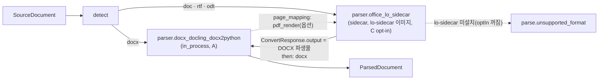
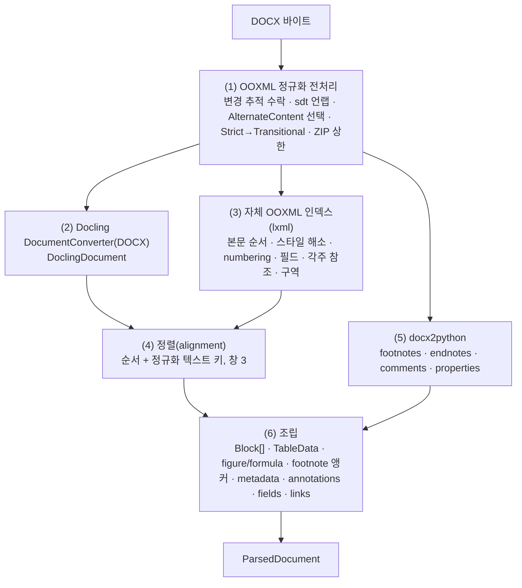
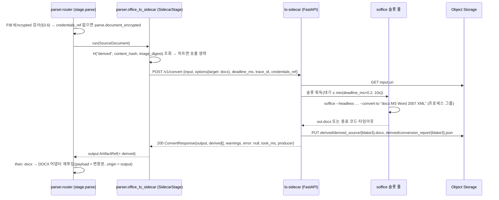
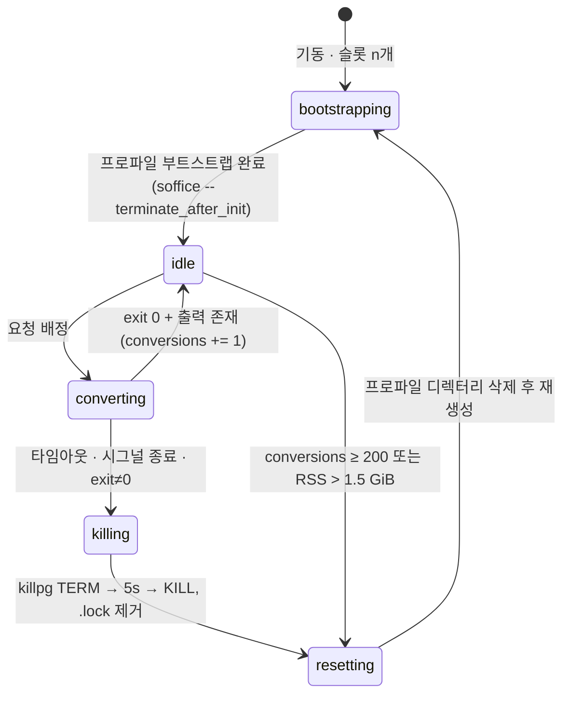

# 파서: DOCX와 DOC

## 목적

이 문서는 `parse` 스테이지(`SourceDocument → ParsedDocument`, 바이블 §4.2)에서 **DOCX(OOXML WordprocessingML)** 와 **DOC(Word 97-2003 바이너리)** 를 처리하는 두 어댑터의 설계 정본이다. 브리프 D-18(개정 v1.1)이 확정한 경로 — "DOCX → Docling `MsWordDocumentBackend` + docx2python(각주·미주 병합 필수)", "DOC/RTF/ODT → LibreOffice headless(`lo-sidecar`) → DOCX → Docling" — 를 (1) OOXML 요소에서 `Block`·`TableData`·`Provenance`로의 매핑 규칙, (2) 두 라이브러리 출력을 하나의 `ParsedDocument`로 합치는 어댑터 알고리즘, (3) 한국어 Word 문서의 스타일 지역화·목차 필드·변경 추적 정책, (4) `lo-sidecar` 변환 서비스의 프로세스 풀·격리·타임아웃·재시작 규격과 `ConvertRequest`/`ConvertResponse` 사용법, (5) 흐름 포맷의 페이지 provenance 정책, (6) 테스트 코퍼스와 실패 모드로 구체화한다.

정본 우선순위는 브리프 > 바이블 > ADR > 이 문서다(바이블 §1.1). 타입·필드·열거·오류 코드·플러그인 ID는 바이블 §5.4·§5.6·§5.7·§6.1과 [ParsedDocument 계약](../03-contracts/03-parsed-document.md)을 **그대로** 쓰고, 바이블에 없는 것은 어댑터 설정(선택)이나 "## 미해결 이슈"의 제안으로만 둔다.

## 범위

- 포함: `parser.docx_docling_docx2python`(in_process) 어댑터의 처리 단계와 매핑 표, `parser.office_lo_sidecar`(sidecar) 어댑터와 `lo-sidecar` 이미지의 서비스 설계, 라우터 `then: docx` 재투입 규약의 이 문서 측 요구, `element_path` 문법(DOCX), 페이지 provenance 정책, 어댑터 설정 스키마와 지문, 테스트 코퍼스, 실패 모드와 오류 코드, 초안 성능·리소스 목표.
- 제외: 포맷 판별과 라우터 체인 실행 자체([03 파싱 라우터](03-parsing-router-and-format-detection.md); 작성 중이라 바이블 §4.2·§7.3·[05 플러그인 아키텍처](../02-architecture/05-plugin-architecture.md) §6.4를 정본으로 삼았다), RTF/ODT의 `lite` 폴백 어댑터(`parser.rtf_striprtf`·`parser.odt_odfdo`; [08 TXT/MD 및 기타](08-parser-txt-md-and-others.md)), HWP의 `lo-sidecar` 최후 폴백([04 HWPX/HWP](04-parser-hwpx-and-hwp.md)), `ConvertRequest`/`ConvertResponse` 스키마 소유([16 사이드카 계약](../03-contracts/16-eval-feedback-and-sidecar-contracts.md)), 배포 매니페스트([08 배포 아키텍처](../02-architecture/08-deployment-architecture.md)), 정규화 이후 단계.
- 이 문서가 소유하는 파일: `docs/04-pipelines/06-parser-doc-and-docx.md`. `schemas/`는 수정하지 않는다.

## 1. 위치와 경계

`parse` 액티비티 안에서 플랫폼 합성 스테이지 `parser.router`가 `detect` 결과 `SourceDocument.format`(`enum(SourceFormat)`)으로 프로파일 `ingest.parse.router[format]` 체인을 고른다(바이블 §7.3, [01 프레임워크](01-pipeline-framework.md) §5.6). 이 문서의 두 어댑터는 그 체인의 멤버다.



| 항목 | `parser.docx_docling_docx2python` | `parser.office_lo_sidecar` |
|------|-----------------------------------|----------------------------|
| 확장 지점·역할 | `parser`, role 없음 | `parser`, role 없음(변환형 후보; 라우터 `then: docx`) |
| 입력 → 출력 | 원본 또는 변환본 DOCX 바이트 → `ParsedDocument` | `SourceDocument.artifact`(DOC/RTF/ODT) → `ConvertResponse.output`(DOCX 파생물) |
| 격리(`IsolationMode`) | `in_process`(Docling·docx2python·lxml 모두 A 등급 순수 Python) | `sidecar`(`image: lo-sidecar`; LibreOffice MPL-2.0 + H2Orestart GPL-3.0 → C 등급, Helm `optIn.loSidecar`, 별도 저장소 `rag-platform-gpl-sidecars`; 바이블 §6.7, [ADR-0033](../06-adr/0033-sidecar-convert-contract-and-isolation-ladder.md)) |
| 프로파일 값(바이블 §7.3) | `docx: [parser.docx_docling_docx2python]`(전 프로파일) | `doc: [{plugin: parser.office_lo_sidecar, isolation: sidecar, image: lo-sidecar, then: docx}]`(standard 이상); `lite`는 `doc: parse.unsupported_format` |
| `Capabilities`(바이블 §5.3; `isolation_modes`·`supports_resumable`·`contracts_compat`는 필수) | `isolation_modes=[in_process]`, `supports_resumable=false`, `input_formats=[docx]`, `contracts_compat=">=1.0,<2.0"` | `isolation_modes=[sidecar]`, `supports_resumable=false`, `input_formats=[doc, rtf, odt]`, `requires_gpu=false`, `contracts_compat=">=1.0,<2.0"` |
| `PluginMeta` 요지 | `license=MIT`(Docling·docx2python), `license_grade=A`, `linkage=pure_python` | `license=GPL-3.0-only`(이미지 최상위 제약), `license_grade=C`, `linkage=pure_python`(클라이언트), `sidecar_image=lo-sidecar` |
| `StagePolicy`(바이블 §4.4 parse 텍스트 행) | `ingest-cpu`, `start_to_close 15m`, `heartbeat 60s`, `max_attempts 3` | 동일 액티비티 안에서 실행; `deadline_ms`는 잔여 `start_to_close`의 0.8(01 §5.4) |
| 산출 `source_kind` / `Block.source` | `flow` / `text_layer` | `flow` / `converted`(변환본을 파싱한 모든 블록) |

라우터는 후보를 `execute_isolated(cand, source, ctx, route_meta)`로 실행하고 변환형 후보의 산출을 `maybe_reroute_then`으로 `then` 체인에 재투입한다([03 파싱 라우터](03-parsing-router-and-format-detection.md) §1·§9). 03 문서는 멤버에게 원본 **바이트**를 전달하는 방식을 아직 정하지 않았으므로 이 문서가 요구하는 것은 두 가지다: (a) in_process 멤버는 원본(또는 변환본) 바이트를 **라우터가 로드해** 넘긴다(어댑터는 `storage`를 모른다, 바이블 §12 의존 방향) — DOCX 어댑터는 `(source: SourceDocument, payload: bytes, origin: ArtifactRef)`를 받고 `origin`이 `source.artifact`가 아니면 변환본으로 판단한다(미해결 이슈 14); (b) `then: docx` 재투입 시 `origin = ConvertResponse.output`이며 라우터가 재투입 전 시그니처 재검증(ZIP + `[Content_Types].xml`, 03 §3.1)을 수행하고 `artifacts[]{kind: derived_source}`·`parser_chain[]`·`parser_fingerprint.sidecar_image_digest`를 §3.5 규칙으로 채운다. 암호화 OOXML의 복호화도 어댑터가 아니라 라우터의 몫이다(03 §4.6; §2.14).

## 2. DOCX 어댑터 `parser.docx_docling_docx2python`

### 2.1 처리 단계

**결정:** 어댑터는 (1) OOXML 정규화 전처리 → (2) Docling 변환 → (3) 자체 OOXML 인덱스 구축 → (4) Docling 아이템과 인덱스 정렬 → (5) docx2python 각주·미주·주석 병합 → (6) `ParsedDocument` 조립의 6단계로 동작한다. Docling이 구조(표 병합·그림·수식·텍스트 상자·목록 카운터)의 1차 원천이고, 자체 인덱스는 Docling이 노출하지 않는 것(스타일 지역화·개요 수준·각주 앵커 위치·필드·변경 추적·구역 경계·`element_path`)을 채우며, docx2python은 각주·미주·주석 **본문**의 원천이다(D-18 "각주·미주 병합 필수"; 기술 지형 03 §Docling: `msword_backend.py`에 `footnote`/`endnote` 처리가 없음이 소스로 확정, as of 2.128.0 — 소스 확인 시점의 버전이며 배포 잠금 버전은 `uv.lock`이 정본이다, §2.15).



| 단계 | 입력 | 출력 | 규칙 |
|------|------|------|------|
| (1) 정규화 | 원본 ZIP | 메모리 내 정규화 ZIP(저장 안 함; 결정적) | §2.2. 실패(ZIP 손상·필수 파트 부재) → `parse.corrupt_container`; 상한 초과(엔트리·크기·팽창비) → `parse.container_limit_exceeded`(바이블 §5.7 1.3.0 등재 — AM-36) |
| (2) Docling | 정규화 ZIP(`DocumentStream`) | `DoclingDocument` | `DocumentConverter(allowed_formats=[InputFormat.DOCX])`; 옵션 클래스명은 확인 필요(as of 2026-09). 예외 → `parse.conversion_failed`(폴백 체인; `docx` 체인은 단일 후보라 소진 = 실패) |
| (3) 인덱스 | 정규화 ZIP | `IndexEntry[]`(내부 타입) | `w:body` 자식을 문서 순서로 순회: `w:p`(빈 문단 포함, 블록은 비어 있으면 생략), `w:tbl`, 문단 안 `w:txbxContent`, `w:sectPr`. 각 항목에 `element_path`(§2.12), 스타일 해소 결과(§2.3), numbering(§2.4), 필드 구간(§2.9), 각주 참조 오프셋(§2.7), 정규화 텍스트 키 |
| (4) 정렬 | Docling 아이템 시퀀스, `IndexEntry[]` | 아이템 ↔ 항목 대응 | 두 시퀀스를 앞에서부터 짝짓되 키가 다르면 창 3 안에서 전방 탐색. 미대응 Docling 아이템은 합성 경로(§2.12)로, 미대응 인덱스 항목은 인덱스 텍스트로 블록을 만든다(손실 없음). 미대응이 하나라도 있으면 `quality=degraded`(§5) |
| (5) docx2python | 정규화 ZIP | `footnotes`, `endnotes`, `comments`, `properties` | `docx2python(stream, html=False, paragraph_styles=True)`(기술 지형 03; 파일 객체 입력 지원은 확인 필요 as of 2026-09). 항목 ↔ `w:id` 대응은 `footnotes.xml` 순서로 잇고, 항목 수가 `w:footnote[@w:type 부재]` 수와 다르면 lxml 직접 추출로 대체 |
| (6) 조립 | 위 전부 | `ParsedDocument` | §2.3~§2.11 매핑, 트리(`parent_block_id`·`ordinal`)는 [03 계약](../03-contracts/03-parsed-document.md) §4 규칙, `block_id = H("block", doc_version, element_path)[:32]` |

### 2.2 OOXML 정규화 전처리

정규화는 Docling·자체 인덱스·docx2python이 **같은 본문을 보게** 하기 위한 결정적 변환이다(같은 바이트 + 같은 어댑터 버전 + 같은 설정 → 같은 결과). 결과는 저장하지 않으며 `element_path` 인덱스는 정규화 **후** 패키지 기준이다.

| 처리 | 대상 파트 | 규칙 |
|------|-----------|------|
| 변경 추적 수락(`tracked_changes: accept_all`, 기본) | `document.xml`, `footnotes.xml`, `endnotes.xml`, `header*.xml`, `footer*.xml`, `comments.xml` | `w:ins`·`w:moveTo` 언랩(내용 유지), `w:del`·`w:moveFrom`·`w:delText` 제거, `w:rPrChange`·`w:pPrChange`·`w:tblPrChange`·`w:numberingChange`·`w:sectPrChange` 제거, 문단 표식 삭제(`w:pPr/w:rPr/w:del`)는 다음 문단과 병합, `w:cellDel` 셀 제거·`w:cellIns` 유지. 삭제 텍스트는 §2.10 규칙으로 `annotations[]`에 남긴다. `reject_all`은 반대 방향 |
| 콘텐츠 컨트롤 | 위와 동일 | 블록·행·셀·런 수준 `w:sdt` → `w:sdtContent` 자식으로 언랩. `w:sdtPr`의 `w:tag`·`w:alias`·유형은 `fields[]`(§2.9)로 기록. `w:docPartGallery[@w:val="Table of Contents"]`는 목차 표식으로 기록 |
| 마크업 호환 | 위와 동일 | `mc:AlternateContent`는 `mc:Choice`(DrawingML/`wps`) 하나만 남기고 `mc:Fallback`(VML) 제거 → 텍스트 상자 중복 방지 |
| Strict OOXML | 전 파트 | 네임스페이스 `http://purl.oclc.org/ooxml/…` → Transitional로 치환(Docling도 수행하나 인덱스가 같은 트리를 보아야 하므로 어댑터가 먼저 한다) |
| 잡음 제거 | 본문 파트 | `w:proofErr`, `w:bookmarkStart/End`(HYPERLINK 앵커 해소에는 사용 후 제거), `w:permStart/End`, `w:smartTag`·`w:customXml` 언랩 |
| 숨김 텍스트 | 본문 파트 | `w:vanish` 런은 제거(`hidden_text: drop` 기본; `keep` 옵션) |
| 보안·상한 | ZIP 전체 | 엔트리 수 ≤ 10,000, 비압축 총합 ≤ 1 GiB, 팽창비 ≤ 100(초안 목표); 초과 → `parse.container_limit_exceeded`(비재시도; 바이블 §5.7 1.3.0 등재 — AM-36). lxml은 `resolve_entities=False`·`no_network=True`·DTD 로드 금지. `word/vbaProject.bin` 존재는 `metadata`가 아닌 로그(`macro_present`)로만 남긴다 |
| 암호화 OOXML | OLE `EncryptedPackage` | `container_flags.encrypted=true`(detect)면 §2.14 |

### 2.3 스타일 해소와 heading level

**결정:** 문단의 `Block.type`·`level`은 자체 스타일 해소가 결정하고 Docling 라벨은 3순위 힌트다. Word는 기본 제공 스타일을 `w:name`에 영문 정식명(`heading 1`, `Title`, `toc 1`)으로 저장하고 UI에서만 지역화하지만, LibreOffice·타 도구가 생성한 문서와 조직 서식은 `w:name`에 지역화 이름(`제목 1`)이나 사용자 이름(`장제목`)을 쓰고 `w:styleId`는 한국어·일본어 Word에서 `"1"`, `"2"` 같은 숫자여서 어느 하나에도 의존할 수 없다. Docling의 스타일명 매칭이 한국어 이름을 인식하는지는 확인 필요(as of 2026-09)이므로 어댑터가 독립적으로 해소한다.

해소 순서(먼저 맞는 규칙이 이긴다):

| 순위 | 규칙 | `type`·`level` | 비고 |
|------|------|----------------|------|
| 1 | `w:pStyle` → `styles.xml`의 `w:name`을 소문자·공백 정규화 후 정식명 표와 대조 | `heading N` → `heading`, `level=N`(N ≤ 6; 7..9는 6으로 절단); `title` → `heading`, `level=0`(문서 첫 1개만; 이후는 `level=1` + `heading_inferred=true`); `toc N`·`contents N` → `toc`(§2.9); `caption` → `caption`; `footnote text`·`endnote text` → 각주 본문(§2.7); `header`·`footer` → 블록 아님 | Word 정식명 + LibreOffice 내보내기 이름(`Heading N`, `Contents N`, `Text body`) |
| 2 | 지역화·별칭 표 `style_aliases`(설정, 기본값 아래) 및 `w:aliases` | 1과 동일 | 한국어 Word: `제목 N`→heading N, `제목`→title, `부제`→subtitle(→ `paragraph`), `목차 N`→toc N, `캡션`→caption, `목록 단락`→list paragraph, `각주 텍스트`·`미주 텍스트`, `머리글`·`바닥글`, `표준`→normal. 보조 기본값: `Überschrift N`(de), `見出し N`(ja), `标题 N`(zh), `Titre N`(fr). 정확한 문자열은 코퍼스 CI로 검증한다(§4) |
| 3 | `w:basedOn` 사슬(깊이 ≤ 8)에서 1·2로 해소되는 조상 | 조상의 결과 | 조직 서식(`본문제목` basedOn `heading 1`) 수용 |
| 4 | 문단 또는 스타일의 `w:outlineLvl`(0..8) | `heading`, `level = outlineLvl + 1`(≤ 6 절단); 9는 본문 | LibreOffice DOC→DOCX 변환본은 개요 수준을 여기로 보존한다 |
| 5 | Docling `SectionHeaderItem(level)`/`TITLE` | `heading`, `level`은 Docling 값(1..6), `heading_inferred=true` | 1~4가 모두 `paragraph`일 때만 |
| 6 | 휴리스틱(`heading_heuristics.enabled`, 기본 true): 번호 패턴(`^제\d+[장절조]`, `^\d+(\.\d+)*\.?\s`, `^[가-힣]\.\s`, `^[ⅠⅡⅢⅣⅤ]+\.`) + 굵게 + 글자 크기 ≥ 본문 × 1.15 + 길이 ≤ 80자 | `heading`, `level` = 번호 깊이(1..6), `heading_inferred=true` | 개조식 공문 대응. `numbering_label`은 채우지 않는다(수동 번호는 원문에 남김) |
| — | 그 외 | `paragraph`(numbering이 있으면 §2.4 `list_item`) | |

빈 heading(`text=""`)은 블록을 만들지 않는다. 같은 텍스트·같은 level의 heading이 연속되면 두 번째부터 `paragraph`로 강등하지 않고 그대로 두되(원문 보존) 청커가 중복 heading 병합을 담당한다(D-19 "동일 heading 병합"). heading 문단에 자동 번호가 있으면 `numbering_label`을 §2.4 규칙으로 채운다. 문서 제목 `level=0`은 1순위·2순위 `title`이 없으면 `docProps/core.xml` `dc:title`과 정규화 텍스트가 같은 첫 heading을 승격한다.

### 2.4 목록(numbering) → `list_item`

| OOXML | `Block` 필드 | 규칙 |
|-------|--------------|------|
| `w:pPr/w:numPr/w:numId`, `w:ilvl` | `type=list_item`(heading으로 해소된 문단 제외), `level = ilvl`(0-based, 계약 "list_item 깊이") | `numId=0`은 목록 아님. `numbering.xml`의 `w:num → w:abstractNumId`(+ `w:lvlOverride/w:startOverride`) 해소 |
| `w:lvl/w:numFmt` | `ordered` | `bullet`·`none` → `false`, 그 외(`decimal`, `decimalEnclosedCircle`, `ganada`, `chosung`, `koreanDigital`, `koreanCounting`, `koreanLegal`, `upperLetter`, `lowerLetter`, `upperRoman`, `lowerRoman`, `ideographDigital` 등) → `true` |
| `w:lvlText`, `w:start`, `w:lvlRestart`, 카운터 | `numbering_label` | Docling `ListItem.marker`가 비어 있지 않으면 그 값(초안; Docling의 한국어 `numFmt` 렌더 지원은 확인 필요 as of 2026-09). 없으면 어댑터 카운터 에뮬레이터가 `%1`~`%9` 치환으로 계산한다 — `ganada` 가..하, `chosung` ㄱ..ㅎ, `koreanDigital` 일..십, `koreanCounting` 하나..열, `decimalEnclosedCircle` ①..⑳(초과 시 숫자), `upperLetter`/`lowerLetter`, 로마 숫자. 미지원 `numFmt`는 필드 생략(N) |
| 스타일 연결 목록(`w:pStyle` → 스타일의 `w:numPr`) | 동일 | 문단 직접 `numPr`가 우선 |
| `List Paragraph`(`목록 단락`) 스타일인데 `numPr` 없음 | `paragraph` | 서식만 남은 문단 |

트리: `list_item(level=d>0)`은 가장 가까운 앞선 `list_item(level<d)`의 자식, `level=0`은 섹션 heading의 자식([03 계약](../03-contracts/03-parsed-document.md) §4.1). 목록 사이에 끼어 있는 `paragraph`(들여쓰기 본문)는 앞선 `list_item`의 자식으로 두지 않고 형제로 둔다(계약에 "목록 본문" 컨테이너가 없음; 미해결 이슈 8).

### 2.5 표 `w:tbl` → `TableData`

**결정:** 격자 구조는 Docling `TableItem`(`structure_source=native`, `merged_cells_preserved=true`)을 1차로 쓰고, 어댑터가 OOXML에서 독립 계산한 격자와 대조해 불일치(P-12 위반, 좌표 겹침)면 OOXML 계산으로 대체한다. 둘 다 실패하면 셀을 행 순서로 평탄화하고 `merged_cells_preserved=false` + `quality=degraded`(계약 §5.3 (c)).

OOXML 격자 계산(0-based):

1. `n_cols = len(w:tblGrid/w:gridCol)`; 없으면 행별 `Σ(gridSpan or 1) + gridBefore + gridAfter`의 최대값.
2. 행 `r`의 셀을 왼쪽부터 놓되 `w:trPr/w:gridBefore`만큼 비운다. 각 `w:tc`는 `col_span = w:tcPr/w:gridSpan/@w:val or 1`.
3. `w:tcPr/w:vMerge[@w:val="restart"]`는 앵커 시작, `w:vMerge`(값 없음 또는 `continue`)는 바로 위 같은 열 앵커의 `row_span += 1`. 위에 앵커가 없는 `continue`는 새 앵커로 취급하고 `warnings`는 남기지 않는다(구조 복구).
4. `n_rows = len(w:tr)`. 앵커 셀만 `cells[]`에 넣는다(`row_span`·`col_span ≥ 1`, 겹침 없음, 격자 완전 덮음 — 빈 자리는 `text=""` 앵커로 채운다).

| 항목 | 규칙 |
|------|------|
| `cells[].text` | 셀 안 문단을 `\n`으로 병합(§2.11 텍스트 규칙). 중첩 `w:tbl`은 `[table:{block_id}]` 플레이스홀더 + `nested_table_block_id`; 자식 `table` 블록은 `container=table_cell`, `parent_block_id` = 바깥 표, 깊이 ≤ 3(초과는 셀 텍스트로 평탄화 + `merged_cells_preserved=false`) |
| `header_row_indices` | `w:trPr/w:tblHeader`가 있는 행. 없으면 `w:tblPr/w:tblLook/@w:firstRow="1"`(또는 `0x0020` 비트)이고 첫 행이 굵게이면 `[0]`; 그 외 `[0]` + `header_inferred=true`(빈 표는 `[]`) |
| `cells[].header_kind`·`is_header` | 헤더 행 셀 `column`; `w:tblLook/@w:firstColumn="1"`이면 열 0 셀 `row`; 한 행 전체가 병합된 셀 하나면 `section`; 그 외 `none`. `is_header = (header_kind ≠ none)`(P-13) |
| `role` | `w:tblBorders`가 전부 `none`/`nil`이고(열 ≤ 2 또는 셀의 ≥ 50%가 그림·빈 셀) → `layout`; 목차 필드·`docPartGallery` 안 표 → `toc`; 셀의 ≥ 30%가 양식 필드(`w:ffData`·`w:sdt`·`FORMCHECKBOX`) → `form`; 그 외 `data`(임계값은 초안 목표, 코퍼스로 확정) |
| `html_ref` | Docling `export_to_html()` 결과를 `ctx.artifacts.put_derived(kind="table_html", ext="html", media_type="text/html")`로 저장(`table_html: true` 기본) |
| `Block.text`(선형화) | 앵커 셀 행 우선, 셀 U+0009·행 U+000A 구분([03 계약](../03-contracts/03-parsed-document.md) §6). `TableCell.provenance.char_*`는 이 문자열 안 구간 |
| `TableCell.provenance` | `element_path = /w:body/w:tbl[k]/w:tr[r]/w:tc[c]`(r, c는 앵커 격자 좌표), `page=bbox=null` |
| 캡션 | 표 직전·직후 1블록 안의 `caption` 블록(§2.11)과 양방향 연결(P-14) |
| 차트 데이터 표 | Docling이 DrawingML 차트에서 재구성한 표는 표 블록으로 만들지 않고 §2.6 `figure(kind=chart)`의 `vendor_json`으로만 둔다(미해결 이슈 9) |

### 2.6 그림·차트·OLE·수식

| OOXML | `Block` | 규칙 |
|-------|---------|------|
| `w:drawing//a:blip[@r:embed]`(인라인·앵커), `w:pict//v:imagedata[@r:id]` | `type=figure`, `figure.kind=image` | 관계 → `word/media/*` 원 바이트(재인코딩 없음)를 `ctx.artifacts.put_derived(kind="figure_crop", ext=원 확장자, media_type=원 MIME)`에 저장하고 `figure.artifact`로 참조. `text` = `wp:docPr/@descr`(대체 텍스트) 또는 `@title`, 없으면 `""`; `alt_text` 동일. Docling이 버리는 ≤ 25px² 스페이서 이미지는 어댑터도 생략(`images.min_px` 기본 25). EMF/WMF는 그대로 저장(래스터화는 `enrich`) |
| `c:chart`(`word/charts/chartN.xml`) | `figure`, `kind=chart` | `text`·`alt_text` = 차트 제목(`c:title`). 계열 데이터(Docling 재구성)는 `vendor_json` 파생물(`artifacts[]`)로만 |
| `w:object/o:OLEObject`(+ `v:imagedata` 미리보기) | `figure`, `kind=ole` | 미리보기 바이트를 `figure.artifact`로; 임베디드 원 개체(`word/embeddings/*`)는 저장하지 않는다(초안; 미해결 이슈 9). `alt_text` = `ProgID` |
| `m:oMathPara`(독립 수식 문단) | `type=formula` | `formula.script` = OMML 선형화 텍스트(`m:t` 연결, 원문 필수), `latex` = Docling `FormulaItem` 변환값(있을 때만), `text = script` |
| 문단 안 `m:oMath`(인라인 수식) | 블록 아님 | 선형화 텍스트를 문단 `text`에 삽입(오프셋 연속성 유지); `vendor_json`에 OMML 원문 보존 |
| `wp:docPr`·`w:pict` 안 `w:txbxContent` | §2.8 텍스트 상자 | |
| 그림 캡션 | `caption`(§2.11) | `caption_of` ↔ `caption_block_ids` 양방향 |

그림 블록은 앵커 문단 **직후 형제**로 둔다(계약 §4.2 흐름 포맷 읽기 순서: 원본 요소 순서). 생성 캡션(`caption_generated`·`caption_model`)은 파서가 채우지 않는다(계약 §7).

### 2.7 각주·미주(docx2python 병합)

**결정:** 각주·미주 본문은 docx2python `footnotes`/`endnotes`에서, 앵커 위치는 자체 인덱스의 `w:footnoteReference`/`w:endnoteReference`에서 얻어 `footnote` 블록으로 합친다.

| 항목 | 규칙 |
|------|------|
| 블록 | `type=footnote`, `container=footnote_body`, `footnote.kind ∈ {footnote, endnote}`, `text` = 각주 본문 문단 병합(`\n`), `source` = 문서 규칙(§1 표) |
| 앵커 | `anchor_block_id` = 참조 런을 담은 문단(또는 셀 텍스트를 담은 표) 블록, `anchor_char_offset` = 참조 런 직전까지 문단 텍스트의 코드포인트 길이, `marker` = 자동 번호(각주 순번 문자열, `w:footnotePr/w:numFmt` 반영) 또는 `w:customMarkFollows`가 있으면 그 런의 문자 그대로. 본문 `text`에는 마커 문자를 삽입하지 않는다(OOXML 본문에 마커 글자가 없다 — `w:footnoteReference`는 렌더 시점에 번호를 만드는 빈 참조 요소이므로 삽입은 원문 위조다). 이 규칙은 [03 계약](../03-contracts/03-parsed-document.md) §7 각주·미주 행의 "마커 문자열은 원문이므로 앵커 `text`에 남긴다"(HWPX처럼 마커 글자가 본문에 있는 포맷 전제)와 방향이 다르며, `anchor_char_offset`은 "마커 시작 오프셋"이 아니라 "참조 런 위치 오프셋"으로 읽어야 한다(P-14 `anchor_char_offset ≤ len(anchor.text)`는 그대로 성립; 미해결 이슈 16) |
| 위치 | 각주는 앵커와 같은 부모의 형제로 앵커 직후, 미주는 문서 끝 루트 형제([03 계약](../03-contracts/03-parsed-document.md) §4.2) |
| `element_path` | `/w:footnotes/w:footnote[{w:id}]`, `/w:endnotes/w:endnote[{w:id}]`(`w:id` 속성값; `w:type="separator"`·`continuationSeparator`·`continuationNotice` 항목은 제외) |
| 각주 안 표·그림 | 각주 블록의 자식(`container=footnote_body`) |
| 앵커 부재(참조 없는 각주 본문) | `anchor_block_id=null`, `anchor_char_offset=null`; 문서 끝 루트 형제로 두고 `quality`는 유지(경고 코드 제안, 미해결 이슈 3) |
| 표 셀 안 참조 | `anchor_block_id` = 표 블록, `anchor_char_offset` = 선형화 `text` 기준 오프셋 |
| 검증 | `len(footnote 블록) == len(w:footnoteReference)`; 불일치는 골든 회귀 실패(§4) |

### 2.8 머리말·꼬리말, 텍스트 상자, 구역 경계

| 대상 | 규칙 |
|------|------|
| 머리말·꼬리말(`w:sectPr/w:headerReference`·`w:footerReference`, `header*.xml`·`footer*.xml`) | 블록을 만들지 않고 `metadata.page_header_text[]`·`page_footer_text[]`에 구역 순서(`default` → `first` → `even`)로 중복 제거해 넣는다([03 계약](../03-contracts/03-parsed-document.md) §8.3; 정규화가 보일러플레이트 근거로 사용). `PAGE`·`NUMPAGES`·`SECTIONPAGES`·`DATE`·`TIME`·`SAVEDATE`·`PRINTDATE` 필드 결과는 제거(저장 시점 값이라 무의미), 그 외 필드 결과는 유지. 머리말 안 그림은 무시 |
| 텍스트 상자(`wps:txbx/w:txbxContent`, `v:textbox/w:txbxContent`) | 내부 문단·표·그림을 `container=text_box` 블록으로, `parent_block_id` = 앵커 문단 블록, 앵커 직후 형제 순서. `element_path = /w:body/w:p[i]/w:txbxContent[j]/w:p[m]`. 앵커 문단이 비어 있어 블록이 없으면 텍스트 상자 블록은 앵커의 부모에 붙인다 |
| 구역 경계(`w:p/w:pPr/w:sectPr`) | `type=page_break`, `page_break{page_no: null, section_index: k}`(k = 구역 순번 1..; 본문 마지막 `w:body/w:sectPr`는 경계가 아니라 생략), 루트 형제, `element_path = /w:body/w:p[i]/w:sectPr`, `text=""`. `Block.provenance.section_index`도 같은 값 k로 채운다(바이블 §5.3 1.3.0 등재 — AM-29: "구역 인덱스: HWPX `secPr`, OOXML `w:sectPr`") |
| 명시 페이지 나눔(`w:br[@w:type="page"]`, `w:pageBreakBefore`, `w:lastRenderedPageBreak`) | 블록 아님. 흐름 포맷의 `page_break`는 구역 경계에만 둔다(계약 §7). `w:lastRenderedPageBreak`는 §2.13의 힌트 원천으로만 |
| 감춤 구역·워터마크(`v:shape` 텍스트 워터마크) | 머리말 안 텍스트 상자는 `page_header_text`에 포함하지 않는다 |

### 2.9 필드: 목차·하이퍼링크·양식 필드

필드는 `w:fldSimple[@w:instr]`(단순)과 `w:fldChar[begin] … w:instrText … w:fldChar[separate] … 결과 런 … w:fldChar[end]`(복합)의 두 형태다. **결정:** 필드 **명령**(`w:instrText`)은 어떤 경우에도 `Block.text`에 넣지 않고, 필드 **결과**는 기본 유지(`field_results: keep`)한다. 결과가 없는 필드(`separate` 없음)는 텍스트 기여 0이다.

| 필드 유형(`instr` 첫 토큰) | 처리 |
|------------------------------|------|
| `TOC`(및 `w:docPartGallery="Table of Contents"` sdt, 연속된 `toc N`/`Contents N` 스타일 문단) | 결과 범위의 문단들을 **`toc` 블록 하나**로 병합: `text` = 항목 문단을 `\n`으로 연결(탭·페이지 번호 원문 유지), `furniture=true`, `container=body`, `element_path` = 범위 첫 문단 경로, 나머지 문단은 블록 없음(`toc: toc_block` 기본; `drop`이면 블록 생략). 한국어 Word의 목차 결과도 같은 구조다 |
| `HYPERLINK "url"` 및 `w:hyperlink[@r:id]`·`[@w:anchor]` | 결과 텍스트는 본문 유지; `links[]{block_id, char_start, char_end, href}` — `r:id`는 `document.xml.rels` Target(External), `w:anchor`는 `#{bookmark}` |
| `FORMTEXT`·`FORMCHECKBOX`·`FORMDROPDOWN`(`w:ffData/w:name`) | 결과 텍스트(체크박스는 `☒`/`☐` 원문 런) 유지; `fields[]{name: w:ffData/w:name, type: 필드명, value: 결과 텍스트, block_id}` |
| `w:sdt`(콘텐츠 컨트롤: text, richText, date, dropDownList, comboBox, checkbox(`w14:checkbox`), picture) | 언랩된 내용 유지; `fields[]{name: w:tag or w:alias, type: "SDT_" + 유형, value: 텍스트, block_id}`. 계약의 `fields[]` 설명은 "HWPX 필드"이나 타입은 열려 있어 그대로 쓴다(미해결 이슈 5) |
| `REF`·`PAGEREF`·`NOTEREF`·`SEQ`·`STYLEREF`·`AUTONUM*`·`LISTNUM` | 결과 유지(`SEQ`는 §2.11 캡션 판정 신호) |
| `PAGE`·`NUMPAGES`·`SECTIONPAGES`·`DATE`·`TIME`·`SAVEDATE`·`FILENAME`·`AUTHOR`·`DOCPROPERTY` | 본문에서는 결과 유지(원문), 머리말·꼬리말에서는 제거(§2.8) |
| `INCLUDEPICTURE`·`INCLUDETEXT`·`LINK`·`EMBED` | 결과(그림·텍스트)만 사용; 외부 참조는 절대 해소하지 않는다(E16) |
| `MERGEFIELD`·`ASK`·`FILLIN`·`IF`·`MACROBUTTON`·`PRINT`·`GOTOBUTTON` | 결과 유지(있으면), 명령 폐기 |
| `INDEX`·`XE`·`TA`·`TC` | `XE`·`TA`·`TC`는 결과 없음(무시); `INDEX` 결과는 `toc` 블록으로(색인도 furniture) |

### 2.10 변경 추적·주석 정책

| 항목 | 규칙 |
|------|------|
| `metadata.has_tracked_changes` | 정규화 전 패키지에 `w:ins`·`w:del`·`w:moveFrom`·`w:moveTo`·`w:*Change`가 하나라도 있으면 `true` |
| 수락 정책 | 기본 `accept_all`(계약 §2.4: "삽입 포함, 삭제 제외"). 설정 `tracked_changes: reject_all`이면 삽입 제거·삭제 복원. `original`(변경 전 원문)은 `reject_all`과 같다 |
| 삭제 텍스트 보존 | `annotations[]{kind: tracked_change, block_id, char_start = char_end = 삭제 지점 오프셋, text: 삭제된 텍스트}`. `w:author`·`w:date`는 기록하지 않는다(개인정보; 계약에 필드 없음). 상한 `max_annotations` 1,000(초과분은 개수만 로그) |
| 주석(`w:commentRangeStart/End`, `w:commentReference`, `comments.xml`) | 본문 `text`에 절대 포함하지 않는다("주석 무시" = 색인 제외). `comments: annotations`(기본)이면 `annotations[]{kind: comment, block_id, char_start, char_end, text: 주석 본문(docx2python `comments` 또는 lxml)}`; 범위가 여러 블록에 걸치면 시작 블록에 `char_end = len(text)`로 자른다. `drop`이면 기록하지 않는다. `annotations`는 인덱싱 제외 기본이라 LLM에 도달하지 않는다(계약 §11) |
| 주석 회신(`w15:paraIdParent`)·해결 상태 | 무시 |

### 2.11 요소 매핑 총괄 표

| OOXML 요소 | `Block.type` | 주요 필드 | `container` / `furniture` |
|-------------|--------------|-----------|---------------------------|
| `w:p`(본문, 스타일 해소 결과 본문) | `paragraph` | `text` | `body` / false |
| `w:p` + heading 스타일·`outlineLvl`·휴리스틱(§2.3) | `heading` | `level` 0..6, `numbering_label`(자동 번호), `heading_inferred` | `body` / false |
| `w:p` + `w:numPr`(§2.4) | `list_item` | `level`, `ordered`, `numbering_label` | `body` / false |
| `w:p` + `caption` 스타일 또는 `SEQ` 필드·`^(그림\|표\|Figure\|Table)\s*\d+` 패턴이고 인접 1블록에 `table`/`figure` | `caption` | `caption_of` | `body` / false |
| `w:tbl`(§2.5) | `table` | `table: TableData`, `text` 선형화 | `body`(중첩은 `table_cell`) / false |
| `w:drawing`·`w:pict`·`c:chart`·`w:object`(§2.6) | `figure` | `figure{artifact, kind, alt_text}` | `body` / false |
| `m:oMathPara`(§2.6) | `formula` | `formula{script, latex}` | `body` / false |
| `w:footnote`·`w:endnote`(§2.7) | `footnote` | `footnote{kind, anchor_block_id, anchor_char_offset, marker}` | `footnote_body` / false |
| `w:txbxContent/*`(§2.8) | 내부 요소 타입 | 부모 = 앵커 문단 | `text_box` / false |
| `TOC`·`INDEX` 필드, 목차 sdt, `toc N` 스타일 연속(§2.9) | `toc` | `text` 항목 병합 | `body` / **true** |
| `w:p/w:pPr/w:sectPr`(§2.8) | `page_break` | `page_break{page_no: null, section_index}` | `body` / false |
| `w:p` + 스타일 `HTML Preformatted`·`Code`·고정폭 글꼴 전용 문단 ≥ 2 연속 | `code` | `code{language: null}` | `body` / false |
| 머리말·꼬리말, 주석, 변경 추적, 필드 명령, `w:instrText`, `w:vanish`, 루비 텍스트(`w:rt`) | 블록 아님 | `metadata.*`, `annotations[]`, `fields[]`, `links[]` | — |
| `w:p` 빈 문단(텍스트·그림·필드 없음) | 블록 없음 | 인덱스 번호는 소비 | — |

텍스트 추출 규칙(모든 블록 공통): `w:t`(`xml:space` 존중), `w:tab`·`w:ptab` → U+0009, `w:br`(type 무관)·`w:cr` → U+000A, `w:noBreakHyphen` → U+2011, `w:softHyphen` → U+00AD, `w:sym` → `@w:char` 코드포인트(글꼴 의존 문자는 그대로), `w:ruby` → `w:rubyBase`만, 인라인 `m:oMath` → 선형화 텍스트, `w:footnoteReference`·`w:commentReference`·`w:fldChar`·`w:instrText`·`w:delText`(수락 시) → 기여 없음. NFC·공백 정리는 하지 않는다(`Block.text`는 원문; 정규화 스테이지 책임, 바이블 §6.3). `Block.lang`은 채우지 않고 문서 `language`만 런 `w:lang/@w:val`·`@w:eastAsia` 최빈값(BCP 47 소문자; 없으면 `IngestRequest.metadata.language_hint`, 기본 `ko`)으로 채운다. `metadata.title`·`authors`·`created_at`·`modified_at`은 `docProps/core.xml`(`dc:title`, `dc:creator`(`;` 분리), `dcterms:created`, `dcterms:modified`)에서 온다.

### 2.12 `element_path` 문법과 `block_id`

**결정:** DOCX의 `element_path`는 Docling `self_ref`가 아니라 **정규화된 OOXML 패키지의 요소 경로**다. 근거: `self_ref`(`#/texts/n`)는 벤더 모델 배열 인덱스라 Docling 버전이 바뀌면 내용이 같아도 경로가 바뀌고, DOC→DOCX 변환본과 원본 DOCX를 같은 좌표계로 비교할 수 없다. [03 계약](../03-contracts/03-parsed-document.md) §3.1의 Docling 행은 "권고"이며 정본은 이 문서이므로 §3.1 표에 DOCX 행 분리를 제안한다(전파 지시 #33, 미해결 이슈 1). Docling `self_ref`는 `vendor_json` 파생물(`keep_vendor_json: true`일 때)에만 남긴다.

| 대상 | 문법 | 예 |
|------|------|----|
| 본문 문단 | `/w:body/w:p[i]` — `i`는 정규화 후 `w:body` 자식 중 `w:p`의 0-based 순번(빈 문단 포함) | `/w:body/w:p[17]` |
| 본문 표 / 셀 / 중첩 표 | `/w:body/w:tbl[k]`, `…/w:tr[r]/w:tc[c]`(앵커 격자 좌표), `…/w:tc[c]/w:tbl[j]` | `/w:body/w:tbl[0]/w:tr[2]/w:tc[0]` |
| 셀 안 문단(각주 앵커·필드 위치용 내부 좌표) | `…/w:tc[c]/w:p[m]` — 블록은 아니며 `TableCell.provenance`는 셀 경로 | |
| 텍스트 상자 내부 | `/w:body/w:p[i]/w:txbxContent[j]/w:p[m]`, `…/w:txbxContent[j]/w:tbl[n]` | `/w:body/w:p[4]/w:txbxContent[0]/w:p[1]` |
| 그림 | 앵커 문단 경로 + `/w:drawing[d]` 또는 `/w:pict[d]`(문단 안 순번) | `/w:body/w:p[9]/w:drawing[0]` |
| 독립 수식 | 문단 경로 + `/m:oMathPara[0]` | |
| 각주·미주 | `/w:footnotes/w:footnote[{w:id}]`, `/w:endnotes/w:endnote[{w:id}]` | `/w:footnotes/w:footnote[3]` |
| 각주 안 표·그림 | 각주 경로 + `/w:tbl[k]`·`/w:p[m]/w:drawing[d]` | |
| 구역 경계 | `/w:body/w:p[i]/w:sectPr` | |
| 목차 블록 | 범위 첫 문단 경로 | |
| 정렬 실패 합성 경로 | `/docling/{self_ref 경로}`(`#` 제거), 예 `/docling/texts/41` | 유일성 보장(Docling 경로는 문서 내 유일) |
| 분할 블록(1MB 초과, 계약 §9) | 원 경로 + `/part[n]` | `/w:body/w:p[17]/part[1]` |

`block_id = H("block", doc_version, element_path)[:32]`(바이블 §6.2). `doc_version`은 **원본 바이트**의 `content_hash`이며 DOC 경로에서도 변환본이 아닌 원본 DOC의 해시다(변환본 해시는 `artifacts[].ref.blake3`). 같은 DOCX를 다른 어댑터 버전으로 파싱하면 정규화 결과가 달라 경로가 바뀔 수 있으며 이는 `parser_fingerprint` 변경 = 재처리로 감사된다(계약 §3.1 (c)).

### 2.13 페이지 provenance

**결정:** DOCX·DOC은 흐름 포맷이므로 `source_kind=flow`, `page_count=null`, 모든 블록 `provenance.page=null`·`bbox=null`, `page_status` 없음이다(D-04 v1.1, [ADR-0002](../06-adr/0002-provenance-element-path-and-nullable-page-bbox.md), 계약 P-8). 인용 좌표는 `element_path` + `char_start/char_end`(단락 인덱스 기반)이며 렌더링으로 추정한 페이지를 `Provenance.page`·`BlockRef.page`·`IndexRecord.page_start/page_end`에 채우는 것은 금지다(계약 §3.2 "`page=1` 조작 금지").

선택 기능 `page_mapping: pdf_render`(기본 `none`; `lo-sidecar` 필요, `lite` 불가):

| 단계 | 규칙 |
|------|------|
| 렌더 | 라우터가 `parser.office_lo_sidecar`에 `ConvertRequest{options: {target: "pdf", source_format: "docx"}}`(DOC 경로는 §3.4 `extra_outputs: ["pdf"]`로 1회 왕복)를 보내 PDF 파생물을 얻는다. 글꼴은 이미지의 `fonts-noto-cjk`·`fonts-nanum`(글리프 누락은 페이지 수 오차 원인) |
| 정렬 | pypdfium2 + pdftext(A 등급, [ADR-0006](../06-adr/0006-pdf-fast-path-pypdfium2-pdftext-replaces-pymupdf.md))로 페이지별 텍스트를 뽑아 블록 `text`와 순서 보존 근사 정합(정규화 문자열 LCS, 블록당 최소 일치율 0.6 초안) |
| 산출 | `vendor_json` 파생물 `page_map`: `{method: "pdf_render", pdf_ref: ArtifactRef, page_count, renderer_image_digest, blocks: [{block_id, page_start, page_end, confidence}]}` → `artifacts[]{kind: vendor_json, ref}`. `Provenance`·`IndexRecord`에는 **전파하지 않는다** |
| 소비 | UI 하이라이트·`get_document` 뷰어가 선택적으로 사용. 검색 필터 `page`는 흐름 문서에서 적중하지 않는다(정상). 노출 방식은 미해결 이슈 7 |
| 힌트 | `w:lastRenderedPageBreak`(Word 저장 시점 렌더 경계)은 `page_map.method="last_rendered_hint"`로 같은 구조에 담을 수 있다(정확도 낮음, 기본 끔) |

### 2.14 암호화 DOCX

`detect`가 OLE `EncryptedPackage`·`EncryptionInfo`를 보고 `SourceDocument.format=docx`, `container_flags.encrypted=true`를 채우고([02 계약](../03-contracts/02-source-document.md) §4), 정책 판정과 복호화는 **라우터**가 한다([03 파싱 라우터](03-parsing-router-and-format-detection.md) §4.6): `credentials_ref`가 없으면 `parse.document_encrypted`(비재시도, 체인 중단); 있으면 라우터가 msoffcrypto-tool(MIT, A 등급; API는 확인 필요 as of 2026-09)로 복호화한 산출을 `derived_source`로 두고 시그니처 재판정 후 `docx` 체인에 넣는다. IRM/RMS(DataSpaces DRM)는 복호화 불가 → `parse.document_encrypted`. 따라서 이 어댑터는 항상 **평문 DOCX 바이트**만 받으며 자체 복호화 경로·비밀 접근이 없다(`origin`이 복호화 산출이면 §3.5와 같이 `artifacts[]{kind: derived_source}`가 붙고, 블록 `source`는 `text_layer`를 유지한다 — 복호화는 변환이 아니다). 비밀 불일치 시 `StageError.detail`은 필드명만 담는다([13 오류 모델](../03-contracts/13-error-model.md) 예시 4 방식).

### 2.15 어댑터 설정과 지문

프로파일 `ingest.parse.options.docx`(플러그인 `config_schema`; 모두 선택, 기본값 표기). 값 변경은 `config_hash` → `fingerprint` → `stage_key` 변경 = 재파싱이다(바이블 §4.1, 리스크 #8).

```yaml
options:
  docx:
    tracked_changes: accept_all        # accept_all | reject_all
    comments: annotations              # annotations | drop  (본문 포함은 불가)
    hidden_text: drop                  # drop | keep
    field_results: keep                # keep | drop
    toc: toc_block                     # toc_block | drop
    header_footer: metadata            # metadata | drop
    heading_heuristics: {enabled: true, min_size_ratio: 1.15, require_bold: true, max_chars: 80}
    style_aliases:                     # 정식명 → 지역화·조직 이름(§2.3 2순위). 기본 표에 병합
      heading 1: ["제목 1", "장제목"]
    images: {store: true, min_px: 25}
    table_html: true
    keep_vendor_json: false            # korean-gov 프로파일은 true(감사)
    alignment_window: 3
    max_annotations: 1000
    page_mapping: none                 # none | pdf_render (lo-sidecar 필요)
```

| 지문 항목 | 값 |
|-----------|----|
| `Producer.plugin_id` / `plugin_version` | `parser.docx_docling_docx2python` / 배포 패키지 버전 |
| `Producer.config_hash` | `H("config", canonical_json(위 설정))` |
| `Producer.image_digest` / `model_ids` | `null` / `[]`(모델 없음) |
| `fingerprint()` 필수 구성요소 | 위 + 래핑 라이브러리 잠금 버전(`docling`, `docx2python`, `lxml`; 01 §2.4 규칙) — 버전 범프는 재파싱을 유발해야 한다 |
| `parser_fingerprint.parser_id` / `parser_version` / `profile_option` | `parser.docx_docling_docx2python` / `"{package}=={version}"`을 패키지명 **오름차순** `;`로 연결한 문자열(바이블 §5.4 1.3.0 등재 — AM-09; 형식 예: `"docling==2.129.0;docx2python==3.7.1"` — `docling` < `docx2python` 사전순. **값은 `uv.lock` 잠금 버전이 정본**이고 예시 값은 기술 지형 03·선정 매트릭스 미해결 이슈 8의 "Docling 2.129.x 마이너 고정, docx2python 3.7.1" 권고를 따른 것이다) / `docx_standard` |
| `parser_chain` | 원본 DOCX: `["parser.docx_docling_docx2python"]`; DOC 경로: §3.5 |

## 3. DOC 어댑터 `parser.office_lo_sidecar`와 `lo-sidecar`

### 3.1 경로와 `then: docx` 재투입

**결정:** DOC(및 RTF·ODT)는 `lo-sidecar`에서 DOCX로 변환한 뒤 §2의 DOCX 어댑터를 **그대로 재사용**한다(D-18, 바이블 §7.3 `then: docx`, [ADR-0033](../06-adr/0033-sidecar-convert-contract-and-isolation-ladder.md)). 어댑터 `parser.office_lo_sidecar`는 `SidecarStage` 서브클래스([05 플러그인 아키텍처](../02-architecture/05-plugin-architecture.md) §7.3)로 `to_request`/`from_response`만 구현하고, 프로세스 관리·타임아웃·오류 변환은 `SidecarStage`와 사이드카가 맡는다.



라우터 규칙([03 파싱 라우터](03-parsing-router-and-format-detection.md) §3.1·§4.1·§6.1이 정본): `optIn.loSidecar`가 꺼져 `parser.office_lo_sidecar`가 미설치면 체인에서 건너뛰고 남는 후보가 없으므로 `parse.unsupported_format`(Helm `pre-install` 검증이 라우터-`optIn` 불일치를 사전 차단). `lite`는 프로파일 값이 문자열 `parse.unsupported_format`이라 즉시 종료다. `then`의 깊이는 1이고(`docx` 체인에는 `then` 항목이 없다) 재투입 산출물은 시그니처 검증(ZIP + `[Content_Types].xml`)을 통과해야 하며 실패는 `parse.conversion_failed`다. 어댑터 `from_response`는 `ParsedDocument`가 아니라 내부 타입 `ConvertedSource{source, derived_source: ArtifactRef, derived: array<ArtifactRef>, producer}`(계약 아님; `maybe_reroute_then`의 입력)를 돌려준다. 재투입된 DOCX 어댑터의 실패(`parse.conversion_failed`)는 `docx` 체인의 다른 후보가 없으므로 최종이다.

### 3.2 변환 대상 선택: DOCX

| 후보 | 구조 보존 | 재사용 | 비용 | 판정 |
|------|-----------|--------|------|------|
| **DOCX**(`docx:"MS Word 2007 XML"`) | 제목 스타일·개요 수준·목록 numbering·병합 셀 표·각주·미주·머리말·꼬리말·텍스트 상자·주석·변경 추적 유지(기술 지형 03 §DOC) | §2 어댑터 전체 재사용, 같은 `element_path` 문법 | 변환 1회, Docling DOCX는 ML 모델 없이 빠름 | **채택** |
| PDF(`writer_pdf_Export`) | 페이지·bbox는 생기지만 제목은 폰트 휴리스틱, 각주는 본문으로 섞임, 표는 TableFormer 추론(`structure_source=tableformer`) | PDF 어댑터(`pdf_standard`) 재사용 | 레이아웃 모델 실행(수 초/페이지), GPU 없는 노드에서 §7 처리량 위험 | 기각(주 경로); 페이지 매핑 옵션(§2.13)의 **부속 출력**으로만 |
| ODT(`writer8`) | LibreOffice 내부 모델과 가장 가까움 | `parser.odt_odfdo`는 `lite` 폴백 수준 어댑터(각주·병합 셀 보존 범위가 §2보다 좁음) | 변환 1회 | 기각(어댑터 성숙도) |
| Tika 4.0 Markdown | 제목 일부·표 평면(`degraded`) | TXT/MD 어댑터 | JVM 컨테이너 추가 | 기각(기본 경로); 별도 선택 사이드카 제안은 03 문서 소관 |

DOC→DOCX는 LibreOffice의 임포트(binfilter 아님, Writer 네이티브 DOC 필터) → 내부 모델 → DOCX 익스포트의 2단 변환이므로 손실은 §3.7 표로 명시한다.

### 3.3 `lo-sidecar` 서비스 설계

`lo-sidecar`는 별도 저장소 `rag-platform-gpl-sidecars`의 이미지(Debian + `libreoffice-core/-writer/-calc/-impress` + `libreoffice-h2orestart` + `fonts-noto-cjk` + `fonts-nanum` + `tini`)이며 FastAPI 앱이 `POST /v1/convert`·`GET /healthz`를 제공한다(바이블 §2.3, §6.7, §14; 기술 지형 03 §LibreOffice 사이드카 서비스 설계 제안). 이 절은 그 이미지가 만족해야 할 **동작 규격**이다(매니페스트는 [08 배포 아키텍처](../02-architecture/08-deployment-architecture.md)).



| 항목 | 규격(초안 목표; 부하 테스트로 확정) | 근거 |
|------|--------------------------------------|------|
| 슬롯 모델 | 컨테이너당 `soffice` 슬롯 `pool_size` = 2(기본; vCPU 수 이하). 슬롯마다 고정 프로파일 `-env:UserInstallation=file:///lo/profiles/slot-{n}`(`/lo` tmpfs 512 MiB), 부트스트랩 후 **재사용**(요청마다 새 프로파일을 만들면 콜드스타트 1~3s를 매번 지불). 실패·재시작 시에만 삭제·재생성. [08 배포](../02-architecture/08-deployment-architecture.md) §3.3의 "요청별 임시 프로파일" 문구와 다르므로 정합 요청(미해결 이슈 10) | 프로파일 락(두 번째 프로세스 조용한 실패), 부트스트랩 비용(03 §DOC 운영 이슈 1) |
| 실행 모드 | 기본 `cli_per_request`: 요청마다 `soffice --headless --invisible --nologo --norestore --nodefault -env:UserInstallation=… --convert-to "docx:MS Word 2007 XML" --outdir /work/{req} /work/{req}/in.{ext}`를 `start_new_session=True`(자기 프로세스 그룹)로 기동. `korean-gov` 옵션 `unoserver`: 슬롯마다 상주 리스너(unoserver 3.x, MIT) + `unoconvert`(단일 인스턴스 동시 요청 불가라 슬롯 = 리스너) | 필터명 미명시 시 "no export filter"(Unstructured #777); 상주 모드는 CPU 50~75% 절감 주장(03) |
| 동시성 | 슬롯 수 = 동시 변환 수. 대기열 최대 대기 `min(deadline_ms × 0.2, 10,000ms)`; 초과 시 503 `parse.sidecar_unavailable` + `Retry-After: 10` | 단일 인스턴스 동시 요청 데드락(unoconv #189, docspell #3345) |
| 타임아웃 | 변환 제한 = `min(deadline_ms − 대기시간 − 1,000, lo.max_conversion_ms=600,000)`; 남은 예산 < `lo.min_conversion_ms=5,000`이면 시도 없이 200 + `error: parse.conversion_failed`(detail `deadline too short`). 초과 시 `killpg(SIGTERM)` → 5s → `killpg(SIGKILL)` → 프로파일 `.lock` 제거 → 슬롯 `resetting`; 응답 200 + `error: parse.conversion_failed`(`took_ms > deadline_ms`, EF-26) | 행 걸림(#122192, #148440, #113259), 좀비(#95843, #117523) |
| 내부 재시도 | 프로세스가 **시그널로 종료**(SIGSEGV·SIGABRT)했고 잔여 예산이 첫 시도 소요의 2배 이상이면 새 슬롯에서 1회 재시도; 타임아웃·exit≠0은 재시도 없음(같은 입력은 같은 결과) | 산발적 크래시 vs 결정적 실패 구분 |
| 재시작 정책 | 슬롯 변환 200회 또는 `soffice.bin` RSS > 1.5 GiB 또는 어떤 실패 후 재부트스트랩 | 메모리 누수 방어(03) |
| 프로파일 부트스트랩 설정 | `registrymodifications.xcu`에 매크로 보안 최고(`MacroSecurityLevel=3`), 링크 자동 갱신 끔, 문서 이벤트 스크립트 실행 금지, 자동 저장·복구 끔(경로명은 확인 필요 as of 2026-09) | 매크로·외부 링크 포함 문서 |
| 격리 | PID 1 `tini`, 비루트 UID, 읽기 전용 루트 FS, `/work`·`/lo` tmpfs, seccomp 기본, `NET_RAW` 등 능력 제거, NetworkPolicy egress 0(오브젝트 스토리지·OTel 예외는 08 §5.2 결정) | D-02 C 등급, E16, [ADR-0033](../06-adr/0033-sidecar-convert-contract-and-isolation-ladder.md) |
| 입력 위생 | 크기 ≤ `fetch.max_bytes`(200 MB; 초과 입력은 워커가 이미 차단), `oletools.olevba`(BSD)로 매크로 존재 **기록만**(`conversion_report.macro_present`), 입력 파일명은 `in.{source_format}`로 고정 | 보안 감사 |
| 헬스 | `GET /healthz`: 슬롯 ≥ 1 `idle` 이고 번들 샘플 DOC 1건 변환 ≤ 5s(60s 캐시). 실패 → 503, `SidecarStage`는 `parse.sidecar_unavailable` | 좀비·행 조기 감지 |
| 관측 | 사이드카 자체 메트릭은 egress 0·ingress 제한으로 수집하지 않는다. 워커 스팬 `rag.ingest.parse` 자식 스팬에 `took_ms`·`lo_version`·`attempts`·`slot_resets`(conversion_report 값)를 속성으로 기록하고 불가는 `rag_parser_sidecar_unavailable_total`(바이블 §6.5 정본) | D-11, 08 §5.2 |
| 리소스 | 컨테이너 요청 2 vCPU / 3 GiB(슬롯 2 × 0.5~1.5 GiB + 앱), 이미지 ~1 GiB, HPA(CPU) | 03 §리소스 요구 |

### 3.4 `ConvertRequest`/`ConvertResponse` 사용법

필드·필수·HTTP 의미는 바이블 §5.6과 [16 사이드카 계약](../03-contracts/16-eval-feedback-and-sidecar-contracts.md) §7 그대로다. `options`는 사이드카별 열린 객체(≤ 32 키, URL·비밀·본문 금지)이며 `lo-sidecar`의 옵션 스키마는 다음과 같다(게시 위치 `sidecars/lo-sidecar/convert-options.schema.json`은 16 문서 미해결 이슈 9의 제안을 따른다).

```json
{
  "$schema": "https://json-schema.org/draft/2020-12/schema",
  "$id": "urn:rag:sidecar:lo-sidecar:convert-options:1",
  "title": "LoSidecarConvertOptions",
  "description": "lo-sidecar POST /v1/convert 의 ConvertRequest.options. 제안(04-pipelines/06). URL·비밀·본문 텍스트 금지.",
  "type": "object",
  "additionalProperties": false,
  "required": ["target"],
  "properties": {
    "target": { "type": "string", "enum": ["docx", "pdf", "odt"], "description": "주 산출물(ConvertResponse.output) 포맷" },
    "source_format": { "type": "string", "enum": ["doc", "rtf", "odt", "docx", "hwp", "hwpx"], "description": "입력 힌트(입력 파일 확장자 결정). 판정은 detect 결과를 따른다" },
    "extra_outputs": { "type": "array", "items": { "type": "string", "enum": ["pdf"] }, "maxItems": 1, "uniqueItems": true, "description": "부속 산출물(ConvertResponse.derived[])" },
    "filter_name": { "type": "string", "maxLength": 64, "description": "LibreOffice 필터명 재정의. 기본: docx→MS Word 2007 XML, pdf→writer_pdf_Export, odt→writer8" },
    "macro_scan": { "type": "boolean", "default": true, "description": "olevba 매크로 존재 기록(실행 아님)" }
  }
}
```

요청 예(DOC → DOCX; 값은 예시, ID 규약은 바이블 §6.1):

```json
{
  "schema_version": "1.0.0",
  "input": {
    "uri": "s3://rag-artifacts/tenants/01J9ZQ4K7X2M8N3P5R6S7T8V9W/sources/3e/3e5f70921b4c8d6a2f0e9b7c5d3a1f8e6c4b2a0d9f7e5c3b1a8d6f4e2c0b9a7d",
    "blake3": "3e5f70921b4c8d6a2f0e9b7c5d3a1f8e6c4b2a0d9f7e5c3b1a8d6f4e2c0b9a7d",
    "media_type": "application/msword",
    "size_bytes": 1310720
  },
  "options": { "target": "docx", "source_format": "doc", "extra_outputs": [], "macro_scan": true },
  "tenant_id": "01J9ZQ4K7X2M8N3P5R6S7T8V9W",
  "document_id": "01J9ZQ6M0N1P2Q3R4S5T6V7W8X",
  "deadline_ms": 720000,
  "trace_id": "4bf92f3577b34da6a3ce929d0e0e4736",
  "credentials_ref": null
}
```

성공 응답 예(변환본 + 변환 보고서):

```json
{
  "schema_version": "1.0.0",
  "output": {
    "uri": "s3://rag-artifacts/tenants/01J9ZQ4K7X2M8N3P5R6S7T8V9W/derived/derived_source/7a/7a1c3e5b9d2f4a6c8e0b1d3f5a7c9e2b4d6f8a0c1e3b5d7f9a2c4e6b8d0f1a3c.docx",
    "blake3": "7a1c3e5b9d2f4a6c8e0b1d3f5a7c9e2b4d6f8a0c1e3b5d7f9a2c4e6b8d0f1a3c",
    "media_type": "application/vnd.openxmlformats-officedocument.wordprocessingml.document",
    "size_bytes": 884736
  },
  "derived": [
    {
      "uri": "s3://rag-artifacts/tenants/01J9ZQ4K7X2M8N3P5R6S7T8V9W/derived/conversion_report/c9/c9e2b4d6f8a0c1e3b5d7f9a2c4e6b8d0f1a3c5e7b9d2f4a6c8e0b1d3f5a7c9e2.json",
      "blake3": "c9e2b4d6f8a0c1e3b5d7f9a2c4e6b8d0f1a3c5e7b9d2f4a6c8e0b1d3f5a7c9e2",
      "media_type": "application/json",
      "size_bytes": 412
    }
  ],
  "warnings": [],
  "error": null,
  "took_ms": 6420,
  "producer": {
    "plugin_id": "parser.office_lo_sidecar",
    "plugin_version": "0.1.0",
    "config_hash": "5d7e9f0a1b2c3d4e5f60718293a4b5c6d7e8f9a0b1c2d3e4f5a6b7c8d9e0f1a2",
    "image_digest": "sha256:9b74c9897bac770ffc029102a200c5de7e26c2b2d0a7e2d4a6b8c0e2f4a6c8e0",
    "model_ids": []
  }
}
```

변환 보고서(`derived/conversion_report/…json`, `application/json`; 내부 구조, 콘텐츠·비밀 없음):

```json
{
  "lo_version": "26.8.1.2",
  "filter_name": "MS Word 2007 XML",
  "source_format": "doc",
  "target": "docx",
  "took_ms": 6420,
  "queue_wait_ms": 120,
  "attempts": 1,
  "exit_code": 0,
  "slot": 1,
  "slot_conversions": 57,
  "macro_present": false,
  "input_size_bytes": 1310720,
  "output_size_bytes": 884736,
  "stderr_line_count": 0,
  "extra_outputs": []
}
```

실패 응답은 200 + `output: null` + `error{code: parse.conversion_failed, stage: "parse", plugin_id: "parser.office_lo_sidecar", detail}`이며 `detail`은 `soffice exit code 77`, `no output produced`, `deadline exceeded after 600000 ms`처럼 원인 유형만 담고 stderr 본문·파일명은 담지 않는다(EF-26). 손상 컨테이너(OLE 열기 실패)는 `parse.corrupt_container`, 복호화 불가는 `parse.document_encrypted`, Word 2.0 등 LibreOffice가 인식하지 못하는 변형은 `parse.unsupported_variant`(모두 비재시도, 체인 중단).

### 3.5 캐시·지문·`parser_chain` 기록 규칙

| 항목 | 규칙 |
|------|------|
| 파생물 캐시 | `SidecarStage`가 `H("derived", content_hash, image_digest)`로 기존 변환본을 찾으면 호출 없이 재사용(`cache_hit`; 바이블 §4.1·§6.2, EF-27). 테넌트 내 공유, 봉투 없음 |
| `artifacts[]` | `{kind: derived_source, ref: output}`(DOCX 변환본), `{kind: vendor_json, ref: conversion_report}`(보고서; `artifacts.kind` 열거에 `conversion_report`가 없어 `vendor_json`으로 표기 — 미해결 이슈 4), `extra_outputs` PDF는 §2.13 `page_map`이 참조 |
| `parser_chain` | `["parser.office_lo_sidecar", "parser.docx_docling_docx2python"]` — 시도 순서 그대로(바이블 §5.4; [03 파싱 라우터](03-parsing-router-and-format-detection.md) §7.2). 변환 성공 뒤 재투입 성공은 **폴백이 아니라 설계 경로**이므로 [03 계약](../03-contracts/03-parsed-document.md) §5.3 (e)의 "`len(parser_chain) > 1` ⇒ degraded"를 적용하지 않는다: 저하 판정은 **실패한 후보**가 있을 때만이다(라우터 §6.4가 확정; 03 계약 문구 정정은 라우터 미해결 이슈 12, 이 문서 미해결 이슈 11) |
| `parser_fingerprint` | `parser_id = parser_chain[-1] = parser.docx_docling_docx2python`, `parser_version`은 §2.15와 동일, `sidecar_image_digest = ConvertResponse.producer.image_digest`(체인에 사이드카가 참여했으므로 non-null), `profile_option = doc_lo_docx`(원본 DOCX의 `docx_standard`와 구분 → `parser_fingerprint_hash`가 다름) |
| `producer` | `plugin_id = parser.docx_docling_docx2python`, `image_digest = sidecar_image_digest`(P-1 "사이드카면 일치" — 체인 참여 사이드카로 해석; 미해결 이슈 11), `model_ids=[]` |
| `stage_key` | `H("stage", "parse", scope_key, content_hash, parser.router의 fingerprint)`; 라우터 지문은 체인 멤버의 `image_digest` 합집합을 포함하므로(01 §7.1) `lo-sidecar` 이미지 범프 = 재파싱 |
| `Block.source` | 전 블록 `converted`(BlockSource; 계약 §5.1 `flow` 행) |
| `quality` | 변환 보고서·DOCX 어댑터가 손실 신호(§3.7의 "감지 가능" 항목, 정렬 실패, 표 폴백)를 내지 않으면 `full` |
| `doc_version` | 원본 DOC의 `content_hash`(변환본 아님) |

### 3.6 사전 검사(라우터·어댑터 측)

| 검사 | 위치 | 판정 |
|------|------|------|
| DOC 암호화(FIB `fEncrypted`, `fObfuscated`) | `detect`가 FIB 플래그로 `container_flags.encrypted`를 채우고 라우터가 정책을 판정한다([03 파싱 라우터](03-parsing-router-and-format-detection.md) §4.6 `doc` 행; "확인 필요" 표기). [02 계약](../03-contracts/02-source-document.md) §4의 `encrypted` 근거 목록에는 OLE `EncryptedPackage`만 있어 FIB 근거 추가를 제안한다(미해결 이슈 12). olefile(BSD, A 등급)로 FIB 기본부 플래그를 읽는다 | `encrypted ∧ credentials_ref 없음` → `parse.document_encrypted`(체인 중단); 있음 → `ConvertRequest.credentials_ref`로 전달, **사이드카**가 키 제공자로 비밀을 해소해 msoffcrypto-tool로 복호화한 뒤 변환(RC4·RC4 CryptoAPI; XOR 난독화 미지원은 `parse.unsupported_variant`, 확인 필요 as of 2026-09). 복호화 평문은 `/work` tmpfs에만 존재하고 파생물로 저장하지 않는다 |
| 크기 | `fetch`가 `fetch.max_bytes`로 차단 | — |
| 확장자 위장(`.doc`인데 RTF·HTML·DOCX) | `detect` 시그니처 우선 | 실제 포맷 체인으로 라우팅 |
| 매크로 | 사이드카 `olevba` 기록 | 차단 없음(headless는 실행 안 함, 프로파일 보안 최고) |
| 임베디드 HWP OLE 개체 | §2.6 `figure(kind=ole)` | 내부 HWP는 파싱하지 않는다(미해결 이슈 9) |

### 3.7 DOC → DOCX 변환의 품질 손실 항목

| 항목 | 변환 결과 | 감지 가능 | 처리 |
|------|-----------|-----------|------|
| 제목 스타일·개요 수준 | `Heading N`(영문 정식명) + `w:outlineLvl` 보존 | — | §2.3 1·4순위로 해소 |
| 자동 번호 목록 | `w:numPr` 보존; 한국어 `numFmt` 라벨 렌더는 LibreOffice 매핑에 의존 | — | §2.4 에뮬레이터 |
| 표 병합·중첩 | 보존 | P-12 검증 | §2.5 |
| 각주·미주·머리말·꼬리말·주석·변경 추적 | 보존(주석은 `w:comment`, 변경은 `w:ins/w:del`) | — | §2.7~§2.10 |
| DOC 전용 필드(`FILLIN`, `ASK`, `MACROBUTTON`, `PRIVATE`, 문서 변수) | 결과 텍스트만 남거나 삭제 | 부분(보고서 `stderr_line_count`) | 결과 유지 정책과 동일 |
| WordArt·도형·글상자 그룹 | DrawingML/VML 도형으로 변환; 일부 텍스트가 이미지로 래스터화될 수 있음 | 아니오 | 그림 블록으로 수용 |
| OLE 개체(Excel 차트, HWP, Visio) | 미리보기 이미지 + 임베딩 파트 | 예(`w:object` 수) | `figure(kind=ole)` |
| 매크로(VBA) | 삭제 | 예(`macro_present`) | 의도된 손실 |
| 글꼴·문자 간격·세로쓰기·분산 정렬 | 레이아웃 정보만 변화 | — | 텍스트 무영향; PDF 부속 출력의 페이지 수에 영향 |
| 문서 속성(`title`, `author`, 일자) | `docProps/core.xml`로 이전 | — | `metadata` |
| 빠른 저장(fast-save)·부분 손상 | LibreOffice 복구 임포트 시도 | 예(exit≠0·경고) | 실패 시 `parse.conversion_failed` |
| 암호화(RC4/CryptoAPI) | 복호화 후 변환 | 예 | §3.6 |
| Word 2.0/6.0/95 | 6.0/95는 임포트 가능, 2.0은 불가 | 예 | `parse.unsupported_variant` |

## 4. 테스트 코퍼스

코퍼스는 `tests/adapters/docx/`·`tests/adapters/doc/`의 골든 회귀(입력 → `ParsedDocument`, 01 §12.2 `golden_hash`)와 사이드카 계약 테스트([ADR-0033](../06-adr/0033-sidecar-convert-contract-and-isolation-ladder.md) 준수 표)로 구성한다. 건수는 초안 목표다. 공공 문서는 재배포 가능 라이선스만 포함하고 개인정보가 있는 문서는 합성한다.

| 범주 | 건수 | 검증 항목 |
|------|-----:|-----------|
| 한국어 Word 스타일 지역화(`제목 1~3`, `제목`, `부제`, `목차 1~3`, `캡션`, `목록 단락`, 조직 서식 basedOn) | 15 | heading level 히스토그램 일치, `heading_inferred=false`, `toc` 블록 1개·`furniture=true` |
| 개요 수준만 있는 문단(`outlineLvl`, 스타일 없음), 번호 패턴 개조식 공문(`□ ○ -`, `제N조`) | 10 | 4·6순위 결과, `numbering_label` 미기록(수동 번호) |
| numbering 형식(`decimal`, `ganada`, `chosung`, `koreanDigital`, `decimalEnclosedCircle`, 중첩 3단, 재시작, `startOverride`) | 10 | `ordered`·`level`·`numbering_label` 정확 일치 |
| 표(gridSpan·vMerge·gridBefore·중첩 2단·헤더 행 `tblHeader`·firstColumn·테두리 없는 레이아웃 표·양식 표) | 15 | P-12·P-13, `role`, `header_row_indices`, `html_ref` HTML의 rowspan/colspan 재생성 일치 |
| 각주·미주(자동 번호, 사용자 마커, 셀 안 참조, 각주 안 표, 참조 없는 각주) | 10 | 앵커 수 = 참조 수, `anchor_char_offset` 정확, 미주는 루트 끝 |
| 머리말·꼬리말(`default/first/even`, `PAGE` 필드, 워터마크) | 6 | `page_header_text` 내용·`PAGE` 결과 제거, 블록 없음 |
| 텍스트 상자(`wps` + VML 폴백 동시 존재, 중첩 표 포함) | 6 | 중복 없음, `container=text_box`, 부모 = 앵커 |
| 변경 추적·주석(삽입·삭제·이동·문단 병합·표 셀 삭제·회신 주석) | 8 | `accept_all` 텍스트, `annotations[]` 수·오프셋, 본문에 주석 텍스트 부재 |
| 필드(TOC 필드·TOC sdt·HYPERLINK·FORMTEXT·체크박스·SEQ 캡션·PAGEREF·INCLUDEPICTURE) | 10 | `w:instrText` 부재, `links[]`·`fields[]`, 캡션 양방향 연결 |
| 그림·차트·OLE·수식(인라인/앵커, EMF/WMF, 스페이서, DrawingML 차트, Excel OLE, 인라인·독립 OMML) | 10 | `figure.kind`, 파생물 바이트 해시, `formula.script`, 인라인 수식 오프셋 연속성 |
| Strict OOXML, `.docm`(매크로), `.dotx`, 대형(1,000쪽·20만 문단 근접), ZIP 상한 초과, 손상 ZIP, 암호화 OOXML(비밀 있음/없음) | 12 | 정규화 동등성, `parse.corrupt_container`, `parse.container_limit_exceeded`, `parse.document_encrypted`, 블록 한계 `parse.block_limit_exceeded`(바이블 §5.7 1.3.0, AM-36) |
| LibreOffice·구글 문서·한컴오피스 내보내기 DOCX(비-Word 생성기) | 10 | 스타일명 변형(`Heading 1`, `Contents 1`, `Text body`) 해소 |
| DOC: 공공기관 Word 97-2003(제목·목록·표·각주·머리말), 빠른 저장, Word 6/95, Word 2.0, 암호화(RC4·XOR), `.doc` 확장자의 RTF/HTML, 매크로 포함, OLE 다수, 100 MB 근접, 손상·절단 | 20 | 변환 성공률, §3.7 감지 항목, 오류 코드 매핑, 대응 원본 DOCX와 구조 유사도(heading·table·footnote 수 일치율 ≥ 0.95 초안) |
| 사이드카 계약(6경로: 정상·`deadline_ms` 초과·손상 입력·부재 `input.uri`·잘못된 본문·미준비) + 행 걸림 시뮬레이션(무한 루프 스텁) + 크래시 재시도 + 슬롯 리셋 | 10 | ADR-0033 하네스, `killpg` 경로, `.lock` 제거, `conversion_report` 필드, 응답에 콘텐츠·비밀 부재 |

공통 단언: `golden_hash` 안정성(같은 입력·같은 설정 → 동일), 정렬 미대응 0건(대응 실패 코퍼스는 별도 `alignment_fallback/`에서 `quality=degraded` 단언), 계약 불변식 P-1~P-14, 적합성 키트 `contract_roundtrip`·`idempotency`·`security_invariants`(경고·오류·보고서에 본문 문자열 없음), 두 테넌트가 같은 바이트를 수집해도 `stage_key`는 각자이고 `derived/`는 테넌트 접두 아래(E17).

## 5. 실패 모드·오류 코드

코드는 바이블 §5.7 카탈로그만 쓴다(`retryable`은 카탈로그가 결정). 폴백 진행 규칙은 05 §6.4: 다음 후보로 넘어가는 것은 `parse.sidecar_unavailable`(재시도 소진 후)·`parse.conversion_failed`뿐이고 나머지 `parse.*` 비재시도 코드는 체인을 멈춘다.

| 상황 | 감지 위치 | 코드 | 재시도 | 결과 |
|------|-----------|------|--------|------|
| `doc`인데 `lo-sidecar` 미설치(`optIn` 꺼짐) 또는 `lite` | 라우터 | `parse.unsupported_format` | no | 잡 `failed` |
| ZIP/OLE 손상, `[Content_Types].xml`·`word/document.xml` 부재 | 정규화(§2.2) / detect / 사이드카 | `parse.corrupt_container` | no | 체인 중단 |
| ZIP 상한 초과(엔트리·크기·팽창비) | 정규화(§2.2) | `parse.container_limit_exceeded`(바이블 §5.7 1.3.0, AM-36) | no | 체인 중단 |
| 암호화 DOCX·DOC이고 `credentials_ref` 없음, 비밀 불일치, IRM/RMS | 라우터(03 §4.6) / 사이드카(§3.6) | `parse.document_encrypted` | no | 체인 중단 |
| Word 2.0, 미지원 암호 방식, OOXML이 아닌 `word/` 패키지(예: Works) | 사이드카 / 정규화 | `parse.unsupported_variant` | no | 체인 중단 |
| Docling·docx2python·lxml 예외, 정렬 불가(구조 붕괴), LibreOffice exit≠0·출력 없음·타임아웃·크래시(내부 재시도 후) | DOCX 어댑터 / 사이드카(200 + `error`) | `parse.conversion_failed` | yes → 폴백 소진 시 no | `docx` 체인은 단일 후보라 즉시 최종; `doc`도 재투입 실패 시 최종 |
| 사이드카 연결 실패·타임아웃·503(미준비, 대기열 초과) | `SidecarStage` | `parse.sidecar_unavailable` | yes(`max_attempts` 3, 백오프) | 소진 시 다음 후보; `doc`은 후보가 없어 최종 `parse.conversion_failed`(`retryable=false`, `cause` = 마지막 오류; 03 §6.1), `rag_parser_sidecar_unavailable_total` |
| 블록 > 200,000 | 셸 출력 검증 | `parse.block_limit_exceeded`(바이블 §5.7 1.3.0, AM-36) | no | `failed`(결함) |
| `Block.text` > 1MB 분할 실패, 출력 불변식 위반, `ConvertRequest` 본문 위반(400) | 셸 출력 검증 / 사이드카 400 | `contract.violation` | no | `failed`(결함) |
| 원본 > `fetch.max_bytes` | `fetch` | `fetch.too_large` | no | 파서 미도달 |
| 정렬 미대응 항목, 표 격자 폴백(`merged_cells_preserved=false`), 각주 앵커 부재 | DOCX 어댑터 | `parse.element_path_synthesized`(정렬 미대응) · `parse.table_structure_fallback`(표 격자 폴백) · `parse.footnote_unanchored`(각주 앵커 부재)(바이블 §5.7 1.3.0 등재 — AM-36) | — | `quality=degraded`(정렬·표) / 유지(각주) |
| 변환 보고서 `stderr_line_count > 0`·OLE 다수 등 손실 가능 신호 | 라우터 | — | — | 로그·스팬 속성만; `quality`는 §3.5 규칙 |

`StageError.detail`은 필드명·원인 유형만(콘텐츠·파일명·비밀·`source_uri` 금지, 13 §11). 폴백 체인은 마지막 실패를 `cause`로 감싼다(13 G4). 미분류 예외는 `StageFailure`로 만들지 않고 셸이 재시도 가능으로 취급한다(01 §10.2).

## 6. 성능·리소스(초안 목표)

| 항목 | 목표 | 근거·비고 |
|------|------|-----------|
| DOCX 100쪽 텍스트 문서(표 20개, 그림 10개) 파싱 | p95 < 5s(in_process, 1 vCPU) | Docling DOCX는 ML 모델 없음(03 §Docling 성능; 공개 벤치마크 없음 → 실측 필요) |
| DOC 5 MB → DOCX 변환 | p95 < 20s(웜 슬롯), 콜드 부트스트랩 1~3s 별도 | 03 §LibreOffice 운영 규격 |
| `lo-sidecar` 슬롯당 메모리 | 0.5~1.5 GiB(RSS 1.5 GiB 초과 시 리셋) | 03 §리소스 요구 |
| 변환 타임아웃 | 기본 `deadline_ms`(≈ 잔여 15m × 0.8), 상한 600s | 바이블 §4.4, 01 §5.4 |
| 파서 워커 이미지 | Docling 의존 포함 ≤ 1.5 GB(코어 이미지 상한, 08 §3.3) | PDF 모델 분리 경량화는 03 미해결 이슈 6 |
| 페이지 매핑 옵션 | DOCX→PDF 렌더 + pdftext 정합 100쪽 < 30s | 브리프 §7 텍스트 PDF 목표 준용 |

## 7. LLM 최종 소비에 미치는 영향

- 인용 좌표: 흐름 문서의 `ContextItem.provenance[]`는 `element_path`(OOXML 경로)와 문자 오프셋으로 돌아오며, 뷰어는 같은 정규화 규칙으로 문단을 찍을 수 있다. 추정 페이지는 `page_map` 파생물에만 있어 인용을 거짓으로 만들지 않는다(K1).
- 3-텍스트 규칙: 자동 번호는 `numbering_label`, 제목 사슬은 heading 트리, 캡션은 `caption_of`로 분리되어 청커가 결정적 `context_prefix`를 만들고 `ContextItem.text`는 원문만 남는다([ADR-0029](../06-adr/0029-three-text-rule-and-deterministic-context-prefix.md)). 필드 명령·주석·삭제 텍스트·머리말은 본문에 없어 예산을 소모하지 않는다.
- 표: `TableData`가 무손실(`native`)이어야 렌더러의 HTML 1차(병합 셀 보존)가 성립한다. 변환·폴백으로 `merged_cells_preserved=false`가 되면 Markdown/JSON으로 강등된다(바이블 §9.3).
- 출처 표시: DOC 경로의 모든 블록은 `source=converted`로 `text_source`에 전파되어 렌더러가 변환 문서임을 표기할 수 있다. `quality=degraded`는 LLM에 주입되지 않는다(13 §12).

## 결정 사항 요약

- **결정:** DOCX는 `parser.docx_docling_docx2python`(in_process, A 등급)이 (1) 결정적 OOXML 정규화 → (2) Docling `MsWordDocumentBackend` → (3) 자체 lxml 인덱스 → (4) 정렬 → (5) docx2python 각주·미주·주석 병합 → (6) 조립의 6단계로 처리한다. 각주·미주 병합은 필수다(D-18 v1.1; [ADR-0007](../06-adr/0007-hwp5-java-sidecar-first-pyhwp-demoted.md)·[ADR-0008](../06-adr/0008-ocr-default-rapidocr-ppocrv5-korean.md)과 함께 D-18을 근거 짓는 ADR 묶음, 바이블 §3.1).
- **결정:** heading level은 자체 스타일 해소(정식명 → 지역화 별칭 → `basedOn` → `outlineLvl` → Docling 라벨 → 휴리스틱)가 정한다. 한국어 Word `제목 N`·`목차 N`·`캡션`과 LibreOffice `Heading N`·`Contents N`을 기본 별칭으로 둔다.
- **결정:** 표는 Docling 격자를 OOXML `gridSpan`/`vMerge` 독립 계산과 대조해 P-12를 보장하고, 실패 시 `merged_cells_preserved=false` + `degraded`. 목차 필드·목차 sdt·`toc N` 연속 문단은 `toc` 블록 하나(`furniture=true`), 필드 명령은 본문에 넣지 않고 결과만 유지, 변경 추적은 `accept_all`(삭제 텍스트는 `annotations[]`), 주석은 본문 제외·`annotations[]` 기록, 머리말·꼬리말은 `metadata`로만.
- **결정:** DOCX `element_path`는 정규화된 OOXML 요소 경로(`/w:body/w:p[i]`, `/w:footnotes/w:footnote[id]` 등)이며 Docling `self_ref`는 정렬 실패 합성 경로와 `vendor_json`에만 쓴다. 페이지·bbox는 `null`이고 추정 페이지는 `page_map` 파생물에만 둔다([ADR-0002](../06-adr/0002-provenance-element-path-and-nullable-page-bbox.md)).
- **결정:** DOC/RTF/ODT는 `parser.office_lo_sidecar`(`SidecarStage`, C 등급 opt-in `lo-sidecar` 이미지)가 `POST /v1/convert{target: docx}`로 DOCX 변환본(`derived_source`, `H("derived", content_hash, image_digest)` 캐시)을 얻고 라우터 `then: docx`로 DOCX 어댑터를 재사용한다. 변환 대상은 구조 보존·어댑터 재사용 근거로 DOCX이고 PDF는 페이지 매핑 부속 출력으로만 쓴다([ADR-0033](../06-adr/0033-sidecar-convert-contract-and-isolation-ladder.md), [ADR-0001](../06-adr/0001-license-grade-table-and-d02-interpretation.md)).
- **결정:** `lo-sidecar`는 슬롯 고정 프로파일 디렉터리 재사용, 요청별 `soffice` 프로세스 그룹, `deadline_ms` 기반 타임아웃과 `killpg` TERM→KILL, 대기열 초과 503, 시그널 종료 1회 내부 재시도, 200회/1.5 GiB 리셋, tini·비루트·읽기 전용 FS·egress 0을 규격으로 한다. 실패는 200 + `error{parse.conversion_failed | parse.document_encrypted | parse.corrupt_container | parse.unsupported_variant}`, 불가는 503 `parse.sidecar_unavailable`.
- **결정:** DOC 경로의 `parser_chain`은 두 항목이지만 실패한 후보가 없으면 `quality=full`([03 파싱 라우터](03-parsing-router-and-format-detection.md) §6.4와 일치)이고, `parser_fingerprint.sidecar_image_digest`·`producer.image_digest`는 `lo-sidecar` digest, `profile_option=doc_lo_docx`, 모든 블록 `source=converted`, `doc_version`은 원본 DOC 해시다. 암호화 OOXML의 복호화는 라우터(03 §4.6), 암호화 DOC의 복호화는 사이드카(`credentials_ref`)가 맡고 어댑터는 평문만 받는다.

## 미해결 이슈

| # | 이슈 | 제안 |
|---|------|------|
| 1 | [03 계약](../03-contracts/03-parsed-document.md) §3.1 표는 DOCX를 Docling `self_ref` 행에 묶는데 이 문서는 OOXML 요소 경로를 정본으로 정했다 | §3.1에 "DOCX(·DOC→DOCX): `/w:body/w:p[i]` … (04-pipelines/06)" 행 분리, Docling 행은 PDF·HTML 2차로 한정(patch; 전파 지시 #33 — 03-contracts/03 담당) |
| 2 | 해소(v1.3, AM-09): `parser_fingerprint.parser_version`의 다중 패키지 연결 규약(패키지명 오름차순 `;`)이 바이블 §5.4에 등재됐다(§2.15) | — |
| 3 | 해소(v1.3, AM-36): 정렬 미대응(`parse.element_path_synthesized`)·표 격자 폴백(`parse.table_structure_fallback`)·각주 앵커 부재(`parse.footnote_unanchored`)·ZIP 상한 초과(`parse.container_limit_exceeded`)가 바이블 §5.7 카탈로그에 등재됐다(§9 실패 모드). 스타일 미해소는 여전히 전용 코드 없음(`quality=degraded`로만 표현) | — |
| 4 | 변환 보고서를 `artifacts[]`에 넣을 `kind` 값이 없어 `vendor_json`으로 표기하고 저장 경로는 `derived/conversion_report/`(16 §9)다 | `ParsedDocument.artifacts.kind`에 `conversion_report`·`page_render` 추가(minor), 경로 `kind`와 열거값 일치 규칙 명시 |
| 5 | `fields[]`(계약 "HWPX 필드")를 OOXML 양식 필드·콘텐츠 컨트롤에 확장 사용했다(`type` 값 `FORMTEXT`, `SDT_*`) | 03 §2.5 설명을 "HWPX·OOXML 필드"로 넓히고 `type` 값 규약 예시 추가(patch) |
| 6 | 해소(v1.3, AM-29): `Provenance.section_index` 의미가 바이블 §5.3에서 "구역 인덱스: HWPX `secPr`, OOXML `w:sectPr`"로 넓어져 `Block.provenance.section_index`에도 값을 채운다(§2.8) | — |
| 7 | `page_map`(추정 페이지) 파생물의 소비 경로(`GET /v1/documents/{document_id}/content?view=parsed` 응답 포함 여부, MCP `get_document`) | 05-api/04·05-api/05에서 `artifacts[]` 노출 정책과 함께 확정; `Provenance`·`IndexRecord` 전파 금지는 이 문서로 확정 |
| 8 | 목록 항목 사이의 들여쓰기 본문 문단을 `list_item`의 자식으로 둘 컨테이너가 계약에 없어 형제로 둔다 | 청커(04-pipelines/10)가 `list_group` 구성 시 인접 문단 흡수 규칙을 두는지 확인; 필요하면 `BlockContainer.list_body`(minor) 제안 |
| 9 | 차트 데이터 표·OLE 임베딩 원 개체(Excel·HWP)·EMF/WMF 래스터화의 처리 깊이 | 차트 데이터 표 블록화와 HWP OLE 내부 파싱(04 문서 어댑터 재사용)은 M2 골든셋 후 결정; 임베딩 파트 저장 여부는 저장 비용 실측 후 |
| 10 | [08 배포](../02-architecture/08-deployment-architecture.md) §3.3의 `lo-sidecar` "요청별 임시 프로파일 디렉터리"와 이 문서의 슬롯 고정 프로파일 재사용이 다르다 | 콜드스타트 실측(1~3s × 요청) 후 08 §3.3 문구를 "슬롯 고정 프로파일, 실패·리셋 시 재생성"으로 정합(patch) |
| 11 | 03 계약 P-1 "사이드카면 `producer.image_digest = sidecar_image_digest`"와 §5.3 (e) "`len(parser_chain) > 1` ⇒ degraded"가 `then:` 변환 경로를 상정하지 않았다. 라우터 §6.4가 (e)를 "실패한 후보가 있을 때"로 정밀화했고 P-1 해석은 이 문서 §3.5가 "체인 참여 사이드카"로 정했다 | 03 계약 P-1·§5.3 (e) 문구 정정(patch; 라우터 미해결 이슈 12와 공동) |
| 12 | DOC(FIB `fEncrypted`)·RTF(`\password`)·ODT(`manifest:encryption-data`) 암호화 판정이 [02 계약](../03-contracts/02-source-document.md) §4 `encrypted` 근거 목록에 없다(라우터 §4.6 `doc` 행도 "확인 필요") | 02 §2.2·§4 표에 세 근거 추가(patch); FIB 플래그 오프셋·비트는 스파이크에서 확인 |
| 13 | Docling 옵션 클래스명·docx2python 파일 객체 입력·`ListItem.marker` 한국어 `numFmt` 렌더·msoffcrypto 레거시 DOC 지원 범위·LibreOffice 프로파일 보안 설정 경로명은 모두 확인 필요(as of 2026-09) | 구현 스파이크에서 확인 후 이 문서 patch; 확정 전 값은 `uv.lock`·이미지 태그가 정본 |
| 14 | [03 파싱 라우터](03-parsing-router-and-format-detection.md) §1·§9는 후보를 `run(source, ctx)`로 호출하나 in_process 멤버에게 원본·변환본 **바이트**를 전달하는 방식(이 문서 요구: `payload: bytes`, `origin: ArtifactRef`)과 `maybe_reroute_then` 입력 타입(`ConvertedSource`)은 미정이다 | 03 문서 §9 의사코드에 `payload` 로드·`ConvertedSource` 반영(patch) 후 이 문서 §1·§3.1 정합 |
| 15 | 사이드카 자체 메트릭(`rag_parse_lo_*`, 03 문서 제안)은 바이블 §6.5 정본에 없고 egress 0·ingress 제한으로 수집 경로도 없다 | 워커 스팬 속성으로 대체(§3.3 관측 행); 필요 시 09-operations/03에서 `otel-collector` 단일 egress 예외(08 미해결 이슈 12)와 함께 결정 |
| 16 | [03 계약](../03-contracts/03-parsed-document.md) §7 각주·미주 행은 "마커 문자열은 원문이므로 앵커 `text`에 남긴다"·`anchor_char_offset` = "마커 시작 오프셋"으로 적었으나, OOXML 본문에는 마커 글자가 없어(`w:footnoteReference`는 빈 참조 요소) 이 문서 §2.7은 마커를 삽입하지 않고 `anchor_char_offset`을 참조 런 위치로 둔다 | 03 §7 각주·미주 행을 포맷별로 분리(patch): HWPX·PDF·MD — 마커 원문 유지, `anchor_char_offset` = 마커 시작; OOXML(DOCX·DOC→DOCX) — 마커 글자 부재, `anchor_char_offset` = 참조 런 위치, `marker`는 렌더 규칙(`w:footnotePr/w:numFmt`·`w:customMarkFollows`)으로 계산. `Footnote.anchor_char_offset` 필드 설명도 "마커 또는 참조 위치 오프셋"으로 넓힌다 |

## 참조

- [설계 브리프](../00-vision/00-design-brief.md) — §2 R1·R2, §3 원칙 2·4·9·10, §4 D-02·D-04·D-06·D-17·D-18(개정 v1.1), §7 품질 목표, §9 문서 규약
- [설계 바이블](../02-architecture/00-design-bible.md) — §1 우선순위·변경 절차, §2.3 `lo-sidecar` 행, §3.1 D-02·D-18, §3.3 ADR 목록, §4.1 격리 모드·지문·멱등성 키·오류 모델, §4.2 `parse` 행, §4.4 parse 정책, §5.1 인벤토리, §5.3 `Provenance`·`ArtifactRef`·`Producer`·`Capabilities`, §5.4 `ParsedDocument`·`Block`·`TableData`/`TableCell`, §5.6 `ConvertRequest`/`ConvertResponse`·`PluginMeta`, §5.7 열거·오류 카탈로그, §6.1~6.7 명명·해시·경로, §7.1 DOC/DOCX 행, §7.3 `parse.router`, §7.4 검증 규칙, §12 패키지 맵, §13.3 파생물 키, §14 사이드카 API, §15 리스크 #2·#8
- [기술 지형 종합: 선정 매트릭스](../07-tech-landscape/00-summary-and-selection-matrix.md) — `docx_parser`·`doc_converter` 행, D-18(DOCX·HTML) 문구 보정, J-6, 프로파일 표 DOC/RTF/ODT·DOCX 행
- [03 DOC/DOCX·HTML·TXT/MD 파싱](../07-tech-landscape/03-document-parsing-office-html-text.md) — §후보 목록, §심층 비교 DOCX·DOC, §권고안, §어댑터 계약, §표준 모델 매핑 포인트, §LibreOffice 사이드카 서비스 설계 제안, §실패 모드, §리소스 요구, §미해결 이슈 1
- 계약: [00 계약 개요](../03-contracts/00-contract-overview.md), [02 SourceDocument](../03-contracts/02-source-document.md), [03 ParsedDocument](../03-contracts/03-parsed-document.md), [13 오류 모델](../03-contracts/13-error-model.md), [16 평가·피드백·사이드카 계약](../03-contracts/16-eval-feedback-and-sidecar-contracts.md)
- 아키텍처: [02 컴포넌트 아키텍처](../02-architecture/02-component-architecture.md) §3.2 `ParseRouterStage`, [05 플러그인 아키텍처](../02-architecture/05-plugin-architecture.md) §6.4·§7, [08 배포 아키텍처](../02-architecture/08-deployment-architecture.md) §3, [09 실패 모드](../02-architecture/09-failure-modes-and-resilience.md)
- 파이프라인: [01 파이프라인 프레임워크](01-pipeline-framework.md) §2·§3·§5.4·§5.6·§10·§11·§12, [03 파싱 라우터와 포맷 판별](03-parsing-router-and-format-detection.md), [04 HWPX/HWP](04-parser-hwpx-and-hwp.md), [05 PDF](05-parser-pdf.md), [08 TXT/MD 및 기타](08-parser-txt-md-and-others.md), [09 정규화](09-normalization-and-cleaning.md), [10 청킹](10-chunking-strategies.md)
- ADR(바이블 §3.3 번호·slug): [0001](../06-adr/0001-license-grade-table-and-d02-interpretation.md), [0002](../06-adr/0002-provenance-element-path-and-nullable-page-bbox.md), [0004](../06-adr/0004-deterministic-chunk-id-scoped-record-id-and-ulid-exception.md), [0006](../06-adr/0006-pdf-fast-path-pypdfium2-pdftext-replaces-pymupdf.md), [0007](../06-adr/0007-hwp5-java-sidecar-first-pyhwp-demoted.md), [0008](../06-adr/0008-ocr-default-rapidocr-ppocrv5-korean.md), [0029](../06-adr/0029-three-text-rule-and-deterministic-context-prefix.md), [0033](../06-adr/0033-sidecar-convert-contract-and-isolation-ladder.md), [0037](../06-adr/0037-artifact-cache-scope-and-stage-key-composition.md)
