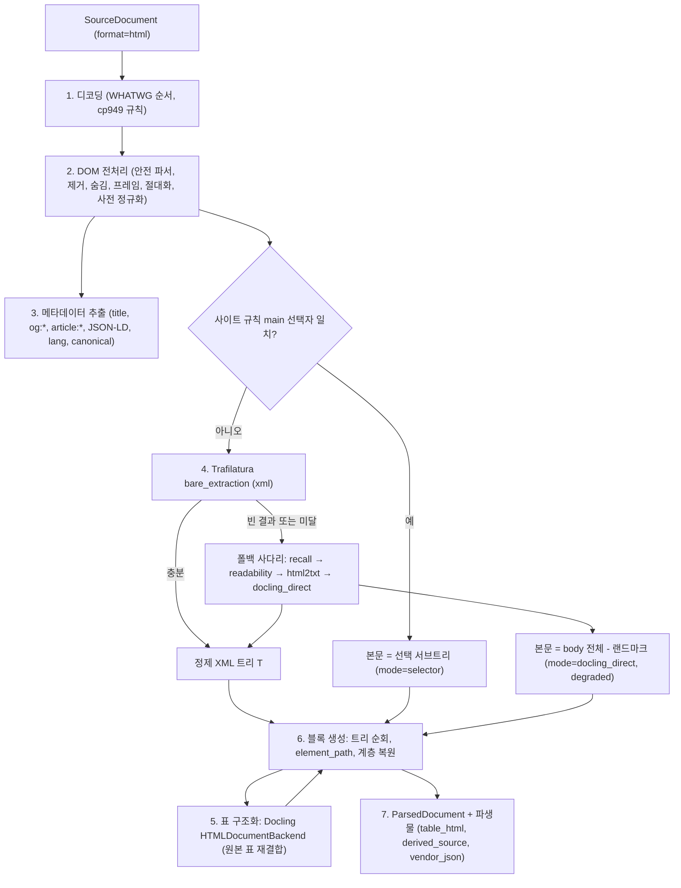
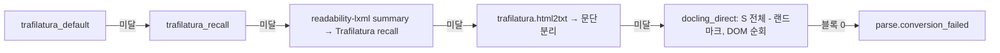

# 파서: HTML

## 목적

이 문서는 `parse` 스테이지에서 `SourceDocument.format = html`인 입력을 표준 문서 모델 `ParsedDocument`(브리프 D-04, 바이블 §5.4)로 변환하는 HTML 파서 어댑터 `parser.html_trafilatura_docling`의 설계를 확정한다. 브리프 D-18(v1.1)과 바이블 §3.1 D-18 행·§7.1이 고정한 체인 **Trafilatura(`xml`) → Docling HTML(순서 고정)** 위에서, 본문 추출(main content extraction, 보일러플레이트 제거)과 구조 보존 파싱(structure-preserving parsing)을 어떻게 결합하는지, 메타데이터·인코딩·링크·숨김 요소·프레임을 어떻게 다루는지, 한국어 공공기관 게시판 페이지의 특성을 어떻게 흡수하는지, 출처(provenance)를 어떤 `element_path` 문법으로 남기는지, 어떤 실패가 어떤 오류 코드·품질 표지로 귀결되는지를 정의한다.

정본 우선순위는 브리프 > 바이블 > ADR > 이 문서다(바이블 §1.1). 계약 필드·열거값·오류 코드는 바이블 §5.4·§5.7과 [ParsedDocument 계약](../03-contracts/03-parsed-document.md)의 철자를 그대로 쓰며, 이 문서가 새로 필요로 하는 것은 선택(N) 필드 또는 "## 미해결 이슈"의 제안으로만 둔다. 외부 라이브러리의 API·버전·라이선스는 [기술 지형 03](../07-tech-landscape/03-document-parsing-office-html-text.md)에 근거가 있을 때만 단정하고, 그 외는 "확인 필요(as of 2026-09)"로 표기한다.

## 범위

- 포함: `text/html`·XHTML(`application/xhtml+xml`)·MHTML(단일 파일 웹 아카이브) 입력의 디코딩, DOM 전처리(스크립트·스타일·숨김 요소 제거, 상대 링크 절대화, 프레임 처리), 본문 영역 추출과 폴백 사다리, 정제 문서의 구조 보존 파싱(heading·paragraph·list·table·figure·code·caption), Docling HTML 백엔드를 이용한 표 격자 구조화, 메타데이터(`<title>`, OpenGraph, `article:*`, schema.org JSON-LD, `lang`, canonical) 매핑, 첨부파일 링크의 메타 기록, `element_path` 문법, 사이트 규칙(선택자) 훅, 실패 모드, 설정 스키마, 예시.
- 제외: 포맷 판별과 라우팅([파싱 라우터와 포맷 판별](03-parsing-router-and-format-detection.md); 이 문서는 바이블 §4.2 `detect` 행·§7.3 `parse.router`를 정본으로 삼는다), 웹 크롤링·링크 추적·첨부파일 다운로드·이미지 다운로드·JavaScript 렌더링(브리프 §6 비범위; 훅만 §5.6에 둔다), 정규화(NFC·PII·furniture 판정의 최종 확정은 [정규화·클리닝](09-normalization-and-cleaning.md)), 청킹, DOCX를 HTML로 변환하는 경로([파서: DOC/DOCX](06-parser-doc-and-docx.md)), Markdown 안의 HTML 블록([파서: TXT/MD](08-parser-txt-md-and-others.md)).
- 이 문서가 소유하는 파일: `docs/04-pipelines/07-parser-html.md`. 스키마 파일은 수정하지 않는다.

## 1. 파이프라인 내 위치와 계약 경계

**결정:** HTML 파서는 `parser` 확장 지점의 in_process 플러그인 `parser.html_trafilatura_docling` 하나로 제공되며, 바이블 §7.3의 모든 프로파일에서 `parse.router.html = [parser.html_trafilatura_docling]`이다. Trafilatura 2.2(Apache-2.0, `>=1.8` 핀 — 1.8.0 이전은 GPLv3+)와 Docling 2.129.x(MIT)는 A 등급이므로 코어 이미지에 인프로세스 의존한다([ADR-0001](../06-adr/0001-license-grade-table-and-d02-interpretation.md)). 폴백 사다리(§5.5)는 플러그인 내부에 있으므로 `parser_chain`은 항상 한 원소다.

| 항목 | 값 | 근거 |
|------|----|------|
| 스테이지 / 액티비티 / 스팬 | `parse` / `stage.parse` / `rag.ingest.parse` | 바이블 §4.2, §6.5·§6.7 |
| `plugin_id` / 모듈 | `parser.html_trafilatura_docling` / `rag_platform.adapters.parse.html_trafilatura_docling` | 바이블 §6.1, §12 |
| 입력 → 출력 | `SourceDocument(format=html)` → `ParsedDocument(source_kind=flow)` + 파생물(`table_html`, `derived_source`, `vendor_json`, 조건부 `figure_crop`) | 바이블 §4.2 `parse` 행, §5.4 |
| 격리 모드 | `in_process`(순수 Python, 네이티브 크래시 위험 없음; lxml은 A 등급) | 바이블 §4.1 격리 모드 |
| `StagePolicy` | parse(텍스트) 행: `task_queue=ingest-cpu`, `start_to_close=15m`, `heartbeat=60s`, `max_attempts=3`, 비재시도 `parse.document_encrypted`·`parse.distribution_document`·`parse.unsupported_variant`·`parse.corrupt_container`·`contract.violation` | 바이블 §4.4 |
| `Capabilities` | `isolation_modes=[in_process]`, `supports_resumable=false`, `contracts_compat=">=1.0,<2.0"`, `input_formats=["html"]`, `requires_gpu=false`, `model_ids=[]` | 바이블 §5.3 |
| `stage_key` | `H("stage", "parse", scope_key, content_hash, fingerprint)`; 조건부 GET 304로 봉투가 새로 발급되어도 `content_hash`가 같으면 캐시 적중 | 바이블 §4.1·§6.2, [ADR-0037](../06-adr/0037-artifact-cache-scope-and-stage-key-composition.md) |
| `fingerprint` | `H("producer", plugin_id, plugin_version, config_hash, "", "")`; `config_hash = H("config", canonical_json(§12 설정))`. 래핑 라이브러리 버전은 `uv lock`으로 고정되어 `plugin_version`에 종속되고 `parser_fingerprint.parser_version`에 감사용으로 기록한다 | 바이블 §4.1, [01-pipeline-framework](01-pipeline-framework.md) §2.4 |
| 순수성 | 네트워크·파일 시스템 접근 없음(이미지·프레임·첨부파일을 가져오지 않는다), 시각은 `ctx.now()`, 파생물은 `ctx.artifacts.put_derived`만 | 바이블 §4.1 "스테이지는 I/O를 직접 쓰지 않는다", 01 §3.1·§6.2 |
| 재개 | 없음(문서 단위 원자 처리; 페이지 개념 없음). `ctx.remaining_ms()`를 사다리 단계 사이에서 확인한다 | 바이블 §4.4 1.3.0 `resumable`(AM-07: 후보 어댑터 `Capabilities`로 결정하며 흐름 포맷 TXT·MD·HTML·HWPX는 `no`로 확정) |

MHTML과 XHTML의 `format=html` 판정은 `detect`가 하며(`text/html`·`application/xhtml+xml`; MHTML은 `multipart/related` 컨테이너 안의 `text/html` 파트 존재로 판정 — 시그니처 규칙은 라우터 문서가 확정, 확인 필요 as of 2026-09), 파서는 `SourceDocument.media_type`으로 세 변형을 구분한다. 배포용·암호화 플래그는 HTML에 해당하지 않는다.

## 2. 처리 개요



| 단계 | 책임 | 산출 | 실패 시 |
|------|------|------|---------|
| 1 디코딩(§3) | 바이트 → 문자열, `source_encoding` 확정 | 문자열, 인코딩 보고 | 대체 문자 비율 초과 → 재투표, 소진 시 `quality=degraded` |
| 2 DOM 전처리(§4) | 안전 파서, 스크립트·스타일·숨김 제거, 프레임 기록, 링크 절대화, `dl`·`figcaption` 사전 정규화, 사이트 규칙 적용 | 전처리 DOM `S`, 프레임·첨부 후보 목록 | 노드·크기 상한 초과 → `parse.conversion_failed` |
| 3 메타데이터(§8) | `<head>`·JSON-LD·OpenGraph·Trafilatura 메타 병합 | `metadata`, `language` | 없음(부재는 생략) |
| 4 본문 추출(§5) | 본문 영역 판정 + 정제 | 정제 XML 트리 `T` 또는 선택 서브트리 | 사다리 소진 → `parse.conversion_failed` |
| 5 표 구조화(§6.5) | Docling HTML 백엔드로 격자·병합·HTML 직렬화 | `TableData`, `html_ref` | Docling 예외 → 어댑터 격자 + `degraded` |
| 6 블록 생성(§6·§7·§10) | 트리 순회, `element_path`, `block_id`, 계층, 링크 오프셋 | `blocks[]`, `links[]` | `limits.max_blocks`(200,000) 초과 → `parse.conversion_failed` |
| 7 산출물 | 정제 XML(`derived_source`), 추출 보고(`vendor_json`), 표 HTML(`table_html`) 저장, 봉투 채움 | `ParsedDocument` | 셸 출력 검증 `contract.violation` |

## 3. 디코딩과 인코딩 처리

**결정:** 디코딩 순서는 WHATWG 인코딩 스니핑 순서를 따르고, `euc-kr` 계열 라벨은 항상 `cp949`로 디코딩한다(바이블 §7.1 `text_decoder`, [SourceDocument 계약](../03-contracts/02-source-document.md) §9, 기술 지형 03 §메타데이터·인코딩). 실제 사용한 코덱을 `ParsedDocument.source_encoding`(소문자 Python 코덱명)에 남긴다.

| 순서 | 신호 | 처리 |
|------|------|------|
| 1 | BOM(UTF-8·UTF-16 LE/BE·UTF-32) | 즉시 확정, BOM 제거 |
| 2 | `SourceDocument.http_metadata.charset` | 라벨 정규화표 적용 후 사용 |
| 3 | 첫 1,024바이트 프리스캔의 `<meta charset>` / `<meta http-equiv="Content-Type" content="...charset=...">` / XML 선언 `encoding` | 2와 다르면 3을 우선한다(전송 계층 기본값 `ISO-8859-1`이 잘못 붙는 사례가 많다; 초안 규칙) |
| 4 | charset-normalizer 3.5 자동 감지 | 신뢰도와 후보를 추출 보고에 기록 |
| 5 | 기본값 | `utf-8` |

라벨 정규화표(대소문자 무시): `euc-kr`, `euckr`, `ks_c_5601-1987`, `ks_c_5601-1989`, `ksc5601`, `ksc_5601`, `korean`, `windows-949`, `x-windows-949`, `uhc`, `cp949` → `cp949`; `utf8`, `unicode-1-1-utf-8` → `utf-8`; `iso-2022-kr`은 Python 코덱 `iso2022_kr`로 디코딩 후 `source_encoding="iso2022_kr"`. Python이 모르는 라벨(`ks_c_5601-1987`은 기본 코덱 별칭이 아니다 — 확인 필요 as of 2026-09)은 이 표로 먼저 사상한다.

디코딩은 `errors="replace"`로 수행하고 U+FFFD 비율을 계산한다. 비율이 `encoding.replacement_ratio_max`(초안 목표 0.5%)를 넘으면 (a) 4단계 후보로 재디코딩, (b) 한글 음절 비율(U+AC00~U+D7A3)이 더 높은 결과를 선택, (c) 그래도 초과면 ftfy 6.3.1로 모지바케(이중 인코딩 UTF-8) 복구를 1회 시도한다. (c)까지 간 문서는 `quality=degraded`이며 최종 코덱과 시도 이력을 추출 보고(§7.3)에 남긴다. ftfy는 이 폴백 경로에서만 쓰고 정상 디코딩 텍스트에는 적용하지 않는다(`Block.text`는 원문이어야 한다, 바이블 §5.4).

## 4. DOM 전처리

### 4.1 안전 파서와 상한

DOM은 lxml 6.1.3(BSD-3)의 `lxml.html` 파서로 만든다. XHTML·XML 선언이 있는 입력은 XML 파서를 먼저 시도하고 실패하면 HTML 파서로 복구한다. 파서 옵션은 `resolve_entities=False`, `no_network=True`, `huge_tree=False`, `remove_comments=True`, `remove_pis=True`를 강제한다(외부 매개 엔티티·XXE 차단; 기술 지형 03 §메타데이터·인코딩). selectolax는 Modest(LGPL-2.1) 엔진 정적 번들의 D-02 판정이 없으므로 쓰지 않는다(기술 지형 03 미해결 8; 12-security 판정 없음 — 확인 필요 as of 2026-09).

| 상한(초안 목표) | 값 | 초과 시 |
|------|----|---------|
| 디코딩 후 HTML 크기 | 32MB(원본 상한 200MB는 `fetch.max_bytes`이나 HTML DOM은 바이트의 수 배 메모리를 쓴다) | `parse.conversion_failed`(detail `html_too_large`, 폴백 없음, 비재시도) |
| DOM 노드 수 / 중첩 깊이 | 2,000,000 / 512 | 동일 |
| 문서당 표 수 / 표 하나의 셀 수 | 5,000 / 100,000 | 초과 표는 `role=layout`으로 강등하고 셀 텍스트만 연결, `quality=degraded` |
| 메모리 | 문서당 1GiB 이하 | 워커 `max_concurrent_activities`로 격리(바이블 §4.4) |

### 4.2 제거·보존 규칙

| 대상 | 처리 | 근거 |
|------|------|------|
| `script`, `style`, `noscript`, `template`, `link`, `meta`(메타 추출 후), `object`, `embed`, `applet`, `canvas`, `audio`, `video`, `map/area`, 폼 컨트롤(`input`, `select`, `textarea`, `button`, `option`, `datalist`) | 제거 | 본문 아님. `script[type="application/ld+json"]`은 §8의 JSON-LD 추출 **후** 제거한다 |
| `svg` | 제거(`<title>`·`<desc>` 텍스트는 추출 보고에만) | 아이콘 잡음 |
| 숨김 요소: `hidden` 속성, `aria-hidden="true"`, 인라인 `style`에 `display:none`·`visibility:hidden`·`opacity:0`·`font-size:0`, `<input type=hidden>`, `<dialog>`(`open` 없음) | 제거(`html.remove_hidden=true` 기본) | 렌더되지 않는 텍스트(SEO 키워드 스터핑·접근성 대체 텍스트 중복)를 본문에서 배제. **외부 CSS 클래스에 의한 숨김은 판정하지 않는다**(CSS 엔진 없음) — 한계로 기록 |
| `details`(닫힘 포함) | 보존 | 사용자가 펼칠 수 있는 내용은 본문이다 |
| `frameset`, `frame`, `iframe` | 요소 제거, `src`(절대화)를 추출 보고 `frames[]`에 기록. `iframe[srcdoc]`의 인라인 HTML은 파싱하지 않는다(초안) | 크롤링 비범위(브리프 §6). 본문이 프레임에만 있으면 §13 `frameset_only` |
| HTML 주석, 처리 명령, CDATA | 제거 | |
| `center`, `font`, `span`, `b/i/u/em/strong/small/mark/sub/sup`, `a` | 인라인으로 보존(텍스트만 남김, `a`는 §9 링크) | 서식은 `Block.text`에 표현하지 않는다(3-텍스트 규칙, [ADR-0029](../06-adr/0029-three-text-rule-and-deterministic-context-prefix.md)) |

### 4.3 상대 링크 절대화

기준 URL은 `<base href>`가 있으면 그것(그 자체가 상대면 `resolved_uri`에 대해 해소), 없으면 `SourceDocument.resolved_uri`다(`source_uri`는 서명 쿼리를 품을 수 있어 쓰지 않는다; 02 §7). `a[href]`, `img[src]`, `img[srcset]`(첫 후보), `source[src]`, `frame/iframe[src]`, `link[rel=canonical][href]`, `meta[property=og:url]`를 `urljoin`으로 절대화한다. 스킴이 `javascript:`이거나 `#`만인 조각 링크(intra-page)는 `links[]`에 넣지 않고 추출 보고에 건수만 남긴다. `mailto:`·`tel:`은 링크로 유지한다. 절대화 결과에 사용자 정보(`user:pass@`)가 있으면 제거한다(02 S-10과 동일 규칙).

### 4.4 사전 정규화(Trafilatura가 보존하지 않는 구조)

Trafilatura의 XML 어휘(`head`, `p`, `list/item`, `table/row/cell`, `quote`, `code`, `graphic`, `lb`, `hi`, `ref`)에 대응 요소가 없는 HTML 구조는 전처리에서 대응 요소로 바꾼다. 변환은 결정적이며 원 DOM 위치를 바꾸지 않는다.

| HTML | 변환 | 결과 블록(§6) |
|------|------|---------------|
| `dl` / `dt` / `dd` | `ul`; `dt` → `li`, 뒤따르는 `dd`들 → 그 `li` 안의 중첩 `ul > li` | `list_item` level 0(용어) / level 1(정의), `ordered=false` |
| `figure > figcaption` | `figcaption` 텍스트를 형제 `img`의 `title` 속성으로 복사(`title`이 비어 있을 때만) 후 `figcaption` 제거 | `caption` 블록(`/graphic[i]/caption[0]`, §10) |
| `details > summary` | `summary` → `p` | `paragraph` |
| `blockquote` 안에 블록 요소가 없는 텍스트 | `p`로 감싼다 | `paragraph` |
| `div`/`td`가 인라인 텍스트와 `br`만 포함 | 그대로 둔다(Trafilatura가 `p`로 승격) | `paragraph`(`br` 2개 이상 연속은 §6.3의 `seg` 분할) |
| `table` | `th`/`td`의 `rowspan`·`colspan`·`scope`·`headers`와 `thead`/`tbody`를 보존한 **원본 사본**을 문서 순서로 따로 보관한다(§6.5 재결합용) | `table` |
| `math` | 그대로 둔다(DOM 모드에서만 `formula`로 인식; Trafilatura 경로에서는 제거될 수 있음 — 확인 필요 as of 2026-09) | `formula` 또는 손실 |

### 4.5 사이트 규칙(선택자) 훅

바이블 §7.1의 `korean-gov` 프로파일 "HTML `docs-site` 선택자 훅"을 일반화한 것이 `html.site_rules[]`(§12)다. `resolved_uri`의 호스트가 `hosts[]` 글롭과 일치하는 첫 규칙을 적용한다. `remove_selectors`는 어느 모드에서나 먼저 제거한다. `main_selectors` 중 첫 일치 요소가 있으면 본문 영역은 그 서브트리로 **확정**되고 추출 모드는 `selector`가 된다(Trafilatura의 본문 판정을 거치지 않는다; §7). `meta_selectors`는 §8의 메타데이터 원천 1순위가 된다. `favor`(enum[recall, precision, default], 기본 `default`)는 `main_selectors`가 하나도 일치하지 않아 Trafilatura 경로(§5.2)로 갈 때만 적용되며, `html.mode`가 정하는 `favor_recall`/`favor_precision`을 각각 `true/false`(`recall`)·`false/true`(`precision`)로 덮어쓴다(`default`는 모드 값 유지). `selector` 모드와 `docling_direct` 모드에서는 무의미하다. 선택자 문법은 CSS 선택자(lxml `cssselect`)이며 XPath는 받지 않는다(운영자 입력 단순화). 규칙 집합의 변경은 `config_hash` 변경이므로 해당 컬렉션의 재파싱을 유발한다(바이블 §4.1).

## 5. 본문 추출

### 5.1 선정과 역할

**결정:** 본문 추출기는 Trafilatura 2.2(`output_format="xml"`, `with_metadata=True`, `include_tables=True`)이고 그 출력이 구조 파서의 입력이다(브리프 D-18 v1.1, 바이블 §3.1 D-18 행·§7.1). Docling HTML 백엔드는 보일러플레이트를 제거하지 않으므로(`<footer>`만 furniture로 분리, nav/header/aside 잔존) 순서를 바꿀 수 없다(기술 지형 03 §Docling `HTMLDocumentBackend`, 매트릭스 `html_extractor` 행). 2차 추출기는 readability-lxml 0.9(Apache-2.0)이며 magic-html 0.1.8은 한국어 골든셋 A/B 후 `docs_site` 모드 2차 후보로만 둔다(기술 지형 03 §권고안). ReaderLM-v2(CC-BY-NC)·html2text(GPL)는 D-02로 제외한다.

### 5.2 호출 규약

`trafilatura.bare_extraction(html_string, url=resolved_uri, output_format="xml", with_metadata=True, include_tables=True, include_links=True, include_images=<html.include_images>, include_comments=False, include_formatting=False, favor_recall=<mode>, favor_precision=<mode>, target_language=None, deduplicate=False)`를 호출해 `Document` 객체(`.title`, `.author`, `.date`, `.sitename`, `.body`)를 받는다(진입점·인자명은 기술 지형 03 §Trafilatura 2.2; 2.2.0의 정확한 키워드 인자 집합은 확인 필요 as of 2026-09). `target_language`는 쓰지 않는다 — 언어 필터가 한국어·영어 혼용 페이지를 통째로 버릴 수 있고 언어 판정은 §8이 따로 한다. `deduplicate=False`는 반복 문단 제거가 표 셀·개조식 항목을 지울 수 있기 때문이다. `.body`(lxml 요소)를 직렬화한 XML이 **정제 XML(cleaned XML)** `T`이며 `derived_source` 파생물로 저장한다(§7.3).

| 모드(`html.mode`) | `favor_recall` / `favor_precision` | `include_links` | 용도 | `profile_option` |
|------|------|------|------|------|
| `standard`(기본) | false / false | true | 보도자료·게시글·일반 기사 | `html_standard` |
| `docs_site` | true / false | true | 매뉴얼·위키·API 문서·법령 포털(사이드바 목차와 본문 구분이 어려워 precision이 코드·표를 절단) | `html_docs_site` |
| `news` | false / true | true | 포털 뉴스(광고·관련기사 블록 제거 우선) | `html_news` |

`profile_option` 값은 `parser_fingerprint.profile_option`에 기록한다(바이블 §5.4의 예시 `pdf_standard` 등과 같은 자리; 값 자체는 이 문서 규약).

### 5.3 결과 판정

추출 결과는 다음을 모두 만족할 때 **충분**하다(초안 목표; 한국어 HTML 골든셋으로 확정, 미해결 이슈 1).

| 판정 | 임계 | 실패 시 |
|------|------|---------|
| 본문 문자 수(`T`의 텍스트 코드포인트, 공백 제외) | ≥ `html.min_main_text_chars`(200) | 사다리 다음 단계 |
| 본문/가시 텍스트 비율(`T` 텍스트 ÷ 전처리 DOM `S`의 가시 텍스트) | ≥ 0.10 | 다음 단계(과다 절단 의심) |
| 표 보존 | `S`의 가시 텍스트 중 `table` 안 비율 ≥ `html.table_only_page.min_table_text_ratio`(0.60)인데 `T`에 `table`이 없음 | **표만 있는 페이지**: `favor_recall=True` 재실행 → 그래도 없으면 `docling_direct` |
| 제목 반영 | 없음(제목은 메타데이터로 별도 보존) | — |

### 5.4 표만 있는 페이지

공공기관 통계·일정·요금표 페이지는 본문이 표 하나뿐이어서 링크 밀도·텍스트 길이 휴리스틱이 본문을 비우기 쉽다. §5.3의 표 보존 판정이 실패하면 (1) `favor_recall=True`로 재실행, (2) 여전히 표가 없으면 `S`에서 가시 텍스트가 가장 많은 `table` 조상 컨테이너를 본문 영역으로 삼아 DOM 모드(§6.2)로 파싱한다. (1)의 산출이 §5.3 판정을 통과하면 `quality=full`이고, (2)는 본문 영역 판정이 실패한 상태의 산출이므로 `quality=degraded`다(§5.5 `docling_direct`와 같은 사유). 두 경우 모두 추출 모드를 보고에 남긴다.

### 5.5 폴백 사다리



| 단계(`extraction_mode`) | 입력 → 출력 | `quality` | 비고 |
|------|------|------|------|
| `trafilatura_default` | `S` → `T` | `full` | 기본 |
| `trafilatura_recall` | `S` → `T`(`favor_recall=True`) | `full` | 표만 있는 페이지·짧은 게시글. 기본 실행이 이미 `favor_recall=True`였으면(`docs_site` 모드 또는 사이트 규칙 `favor=recall`) 같은 실행이므로 건너뛴다 |
| `readability` | `readability.Document(S).summary()` → HTML → Trafilatura(`favor_recall=True`) → `T` | `full` | 기사형 2차. 결과가 정제 XML이므로 `element_path` 문법이 유지된다 |
| `html2txt` | `trafilatura.html2txt(S)` → 빈 줄 기준 문단 → 합성 트리 `<doc><main><p>…</p></main></doc>` | `degraded` | 구조 없음(모두 `paragraph`), 표·목록 **손실**(03 §5.3 (d)에 준하는 요소 버림) |
| `docling_direct` | `S`에서 랜드마크(`nav`, `aside`, `header`, `footer`, `[role=navigation\|banner\|contentinfo\|complementary]`)를 뺀 `body` → DOM 순회(§6.2) | `degraded` | 본문 영역 판정 실패 상태의 산출: 보일러플레이트가 `furniture=false`로 잔존하는 손실을 감수. 구조 충실도는 최고(`dl`, `figure`, `rowspan/colspan` 원본) |
| 소진 | 블록 0개 | 실패 | `parse.conversion_failed`, `retryable=false`(사다리가 플러그인 안에 있으므로 "폴백 소진"이다, 바이블 §5.7; 13 §G4의 `cause`에 마지막 단계 사유) |

`quality` 열은 각 단계 산출의 **실제 손실**만 반영한다. 사다리 단계를 거쳤다는 사실 자체는 `degraded` 사유가 아니다 — [라우터 문서](03-parsing-router-and-format-detection.md) §6.4가 03 §5.3 (e)를 **parser_chain(후보) 수준**의 "실패한 후보 뒤 성공"으로 확정했고, 어댑터 내부 폴백(이 사다리처럼 한 플러그인 안에서 일어나는 폴백)은 "어댑터가 정보 손실을 직접 아는 경우"에만 어댑터가 스스로 표기하도록 정했다. HTML의 `parser_chain`은 항상 원소 1개(§1)이므로 이 확정은 사다리 단계 자체를 저하로 바꾸지 않는다. 따라서 `trafilatura_recall`·`readability` 산출이 §5.3 판정을 통과하면 `full`이고, 어느 단계를 거쳤는지는 추출 보고(§7.3)의 `extraction_mode`·`ladder[]` + `warnings[parse.extractor_fallback]`(바이블 §5.7 1.3.0 등재 — AM-36; 사다리 진입 자체를 감사용으로 기록, `quality` 판정과는 별개)로 기록한다.

`selector` 모드(§4.5)는 사다리를 타지 않는다: 선택 서브트리에 텍스트가 없으면 규칙 오류로 보고 곧바로 `docling_direct`로 내려간다(`degraded`).

### 5.6 JavaScript 렌더링이 필요한 페이지

플랫폼은 브라우저를 실행하지 않는다(브리프 §6). 파서는 다음 신호를 추출 보고 `js_rendering_suspected`로 기록한다: (a) `S`의 가시 텍스트 < 200 코드포인트이고 스크립트 바이트 비율 > 50%, (b) `noscript`에 "JavaScript를 활성화" 류 문구, (c) 루트 컨테이너(`#root`, `#app`, `#__next`, `#__nuxt`)가 비어 있음, (d) `<meta name="fragment" content="!">`. 사다리가 소진되면 `parse.conversion_failed`의 `detail`에 `js_rendering_required`를 넣는다(전용 코드 제안은 미해결 이슈 3).

**훅:** (1) 권고 경로 — 수집 클라이언트가 렌더링된 DOM 스냅숏(HTML)을 오브젝트 스토리지에 저장하고 그 URI를 `IngestRequest.source_uri`로 보낸다(`media_type_hint="text/html"`); 파서는 이를 일반 HTML로 처리하며 `SourceDocument.resolved_uri`가 저장소 URI이므로 절대화 기준은 `<base href>`(클라이언트가 원 URL로 삽입)를 우선 쓴다. (2) 선택 경로 — `fetcher` 확장 지점 플러그인이 운영자 관리 렌더링 서비스를 호출해 렌더링된 HTML을 `SourceDocument.artifact`로 저장한다. 이 플러그인은 코어에 없고 `EgressPolicy`(E16, [ADR-0038](../06-adr/0038-outbound-egress-policy-and-webhook-signing.md))를 그대로 받는다. 파서 자체는 두 경로를 구분하지 않는다.

## 6. 구조 보존 파싱

### 6.1 정제 XML 어휘 → `BlockType`(주 경로)

`T`의 블록 요소를 전위 순회하며 블록을 만든다. `BlockType`은 바이블 §5.7의 14값만 쓴다.

| XML 요소 | `type` | 속성 | 비고 |
|----------|--------|------|------|
| `head[@rend="hN"]` | `heading` | `level=N`(1..6, 7 이상은 6); `rend` 없음 → `level=1`, `heading_inferred=true` | 제목(§8)과 정규화 문자열이 같은 첫 `head`는 `level=0`(문서에 최대 1개, 03 §8.1) |
| `p` | `paragraph` | `lb` 2개 이상 연속이면 `seg[n]`으로 분할(§6.3) | `hi`·`ref` 인라인은 텍스트만 |
| `list[@rend="ol"]/item`, `list[@rend="ul"]/item`, `rend` 없음 | `list_item` | `ordered`(ol=true, 그 외 false), `level`=중첩 깊이(0-based), 선두 마커 패턴은 `numbering_label`로 분리 | 중첩 `list`의 항목은 바깥 `item` 블록의 자식 |
| `table` | `table` | `TableData`(§6.5), `text`=선형화 | `role` 휴리스틱 §6.5 |
| `quote`, `quote/p` | `paragraph` | — | `BlockType`에 인용이 없다. 인용임은 추출 보고에만 남긴다(미해결 이슈 6) |
| `code` | `code` | `code.language=null`(XML에 정보 없음) | `pre` 유래 블록. 공백 보존 |
| `graphic[@src]` | `figure` 또는 `paragraph` | §9.3 이미지 정책 | `title`(=`figcaption`)이 있으면 뒤에 `caption` 블록 |
| `graphic/@title` | `caption` | `caption_of`=그림 블록, 역방향 `caption_block_ids` | 경로 `/graphic[i]/caption[0]`(§10) |
| `lb` | 블록 아님 | `\n` | |
| `hi`, `ref`, `del`(있을 때) | 블록 아님 | 텍스트만; `ref/@target` → `links[]` | 취소선 텍스트는 유지 |
| `comments/*` | 생성되지 않음 | `include_comments=False` | |
| `ref`만으로 이루어진 `list`(항목 ≥ 5, 대상이 모두 조각 `#…`) | `toc` | `furniture=true`, `text`=항목 연결 | 페이지 내 목차 |

`title`·`author`·`date`·`sitename`은 `T`의 루트 속성 또는 `Document` 필드에서 §8로 간다. 표의 셀 안 블록은 별도 블록으로 만들지 않고 `TableCell.text`에 병합한다(중첩 표는 예외, §6.5).

### 6.2 DOM 어휘 → `BlockType`(`selector`·`docling_direct` 모드)

| HTML 요소 | `type` | 속성·비고 |
|-----------|--------|-----------|
| `h1`..`h6` | `heading` | `level`=1..6; 제목 일치 첫 heading은 0 |
| `p`; 인라인·`br`만 가진 `div`/`td`/`li` 텍스트 | `paragraph` | `br` 2개 이상 연속 → `seg[n]` |
| `ul/ol > li` | `list_item` | `ordered`=`ol`; `ol[@start]`·`li[@value]`는 `numbering_label`로("3.") |
| `dl`(§4.4 변환 후) | `list_item` | 용어 level 0, 정의 level 1 |
| `table` | `table` | Docling 원본 파싱(§6.5) |
| `img` | `figure` 또는 `paragraph` | §9.3 |
| `figure > figcaption`, `table > caption` | `caption` | `caption_of` 양방향 |
| `pre`, `pre > code` | `code` | `code.language`는 `class="language-*"`·`lang-*`에서(없으면 `null`) |
| `blockquote` | `paragraph`(자식 블록은 각각) | 인용 표지는 보고에만 |
| `math` | `formula` | `formula.script`=MathML 직렬화(필수), `latex`=`annotation[@encoding="application/x-tex"]`가 있을 때 |
| `hr`, 빈 요소 | 블록 없음 | |
| `nav`, `aside`, `header`, `footer`, 랜드마크 role | 블록 없음 | `metadata.navigation_text`(§7.2) |

### 6.3 텍스트 규칙

- `Block.text`는 요소의 텍스트 노드를 문서 순서로 이어 붙인 원문이다. HTML 렌더링 규칙대로 ASCII 공백 연속을 한 칸으로 접고 양끝을 잘라내되, `code`(및 `pre` 유래)에서는 공백·줄바꿈을 보존한다. 문자 참조(`&amp;`, `&#44032;`)는 디코딩한다. U+00A0(NBSP)·zero-width 문자·전각 기호는 그대로 둔다(NFC·NFKC·제어 문자 제거는 `normalize`의 책임, [NormalizedDocument](../03-contracts/04-normalized-document.md)).
- `lb`/`br` 1개는 `\n`이다. `lb`/`br`가 2개 이상 연속하면 문단 경계로 보고 **`seg[n]` 분할**한다: 원 `p` 경로 뒤에 `/seg[n]`(0-based)을 붙인 별개 `paragraph` 블록이 된다. 한국 게시판 본문은 `<p>` 없이 하나의 `<div>` 안에서 `<br><br>`로 문단을 나누는 경우가 대부분이므로 이 규칙이 없으면 문서 전체가 한 블록이 된다.
- 개조식 글머리(`□ ○ - · ▶ ①`)는 문단 안에서 줄바꿈으로 구분된 채 남긴다. 줄 단위 분리는 문장 분리기·청커의 책임이다(바이블 §7.1 `sentence_splitter` "개조식 문단은 줄바꿈·글머리 기호를 경계로 강제 분리").
- `list_item`의 선두 마커(정규식 `^(\d{1,3}[.)]|[가-힣][.)]|[①-⑳]|[-•·○□■▶])\s+`)는 `numbering_label`로 분리하고 `text`에서 제거한다(03 §2.6 "본문과 분리 보존").
- 빈 문자열이 되는 `p`·`item`은 블록을 만들지 않는다(표·그림은 `""` 허용).
- 코드포인트 1MB를 넘는 블록(긴 `pre`, 거대 `div`)은 문장·줄 경계에서 연속 블록으로 나누고 `element_path`에 `/part[n]`을 붙인다(03 §9).

### 6.4 계층 복원

`parent_block_id`·`ordinal`은 heading 스택으로 만든다: 블록을 순서대로 보며 `heading(level=L)`을 만나면 스택을 `level < L`인 heading까지 되감고 그 위에 놓는다; 그 외 블록의 부모는 스택 최상단 heading(스택이 비면 `null`). 중첩 `list`의 항목·표 안 중첩 표·그림의 `caption`은 각각 바깥 `item`·바깥 `table`·`figure`가 부모다. `ordinal`은 같은 부모 안의 0-based 연속 순서이며 평면 배열은 전위 순회 순서와 같다(03 §4, P-4·P-5). h2 뒤에 바로 h4가 오는 식의 레벨 건너뜀은 그대로 둔다(스택 규칙이 자연히 처리한다).

### 6.5 표

**결정:** 표 격자는 Docling `HTMLDocumentBackend`가 만든다(D-18의 "Docling HTML"). 어댑터는 표를 **하나씩** 독립 HTML 문서(`<html><body><table>…</table></body></html>`)로 감싸 `DocumentConverter(allowed_formats=[InputFormat.HTML])`에 넣고, 유일한 `TableItem`을 03 §8.1의 `TableCell` 매핑(`start_row_offset_idx → row`, `end − start → row_span`, `column_header → header_kind=column`, `row_header → row`, `row_section → section`)으로 옮긴다. 표 단위 호출이므로 Docling 항목과 원소의 결합이 자명하고, 모델 로딩이 없어 표당 수 ms다(초안; 확인 필요 as of 2026-09).

| 규칙 | 내용 |
|------|------|
| 원본 표 재결합 | `T`의 k번째 `table`을 §4.4에서 보관한 원본 `table` 사본 목록과 문서 순서로 대응시킨다: 직전 매칭 이후의 원본 표들 중 셀 텍스트 집합의 Jaccard 유사도 ≥ 0.9(초안 목표)인 첫 표. 성공하면 **원본 마크업**(`rowspan`·`colspan`·`thead`·`scope` 보존)을 Docling에 넣고 `merged_cells_preserved=true`; 실패하면 `T`의 `table`을 HTML로 재직렬화해 넣고, 그 원본 후보 중 span 속성을 가진 표가 있었으면 `merged_cells_preserved=false` |
| `structure_source` | `native`(마크업이 구조 원천) |
| 헤더 | `thead` 행 또는 첫 행이 전부 `th`(`cell[@role="head"]`)면 `header_row_indices`=그 행들, `header_inferred=false`; 아니면 `[0]` + `header_inferred=true`(03 §6). 첫 열이 전부 `th`면 그 셀들은 `header_kind=row` |
| `role` | `toc`: 셀 텍스트의 링크 비율 ≥ 0.8; `form`: 열이 2개이고 첫 열이 전부 헤더(키-값 표; 게시판 메타 표가 여기 해당); `layout`: `role="presentation"` 또는 `th` 없음 + 셀 안에 블록 요소(`div`, `p`, `table`, `ul`)가 있음 + 셀 수 ≤ 4; 그 외 `data` |
| 선형화 `text` | 앵커 셀을 행 우선으로 U+0009(셀)·U+000A(행) 구분(03 §6 규약). `TableCell.provenance.char_*`는 이 문자열 안의 구간 |
| 중첩 표 | 셀 안 `table`은 자식 `table` 블록(`container=table_cell`, 부모=바깥 표), 셀 `text`에 `[table:{block_id}]`, `nested_table_block_id`. 깊이 ≤ 3, 초과는 셀 텍스트로 평탄화 + `merged_cells_preserved=false` |
| `html_ref` | Docling `export_to_html()` 결과를 `derived/table_html/`에 저장(`text/html`), `artifacts[]{kind=table_html, block_id}`에도 등재 |
| 표 캡션 | `table > caption`은 `caption` 블록(DOM 모드) / Trafilatura가 `caption`을 `p`로 낼 경우 표 직전 `p`가 `표 N`·`Table N` 패턴이면 `caption`으로 승격(03 §7) |
| Docling 예외 | 어댑터가 lxml로 직접 격자를 계산(`rowspan/colspan` 처리)하고 `html_ref`는 생략, `quality=degraded` |

### 6.6 그림·캡션·코드·수식·정의 목록

그림은 §9.3의 정책을 따른다. `caption_of`·`caption_block_ids`는 양방향으로 채운다(03 P-14). `code.language`는 DOM 모드에서만 채우고 그 외 `null`이다(이후 `enrich`가 추론, 03 §7). `formula`는 DOM 모드의 `math`에서만 나오며 `script`가 필수다. 정의 목록은 §4.4 변환으로 `list_item` 계층이 된다.

## 7. 두 결과의 결합 전략

### 7.1 원칙: 본문 영역 안의 구조만 남긴다

**결정:** 본문 영역 판정(Trafilatura 또는 사이트 규칙)이 먼저이고, 구조 파싱은 판정된 영역 **안에서만** 이루어진다. 영역 밖의 구조(사이트 헤더의 `h1` 로고, 사이드바 목록, 푸터 표)는 블록이 되지 않는다. 따라서 주 경로의 모든 블록은 `furniture=false`이고, 영역 밖 텍스트 중 내비게이션 성격은 `metadata.navigation_text`로만 보존된다. 이 순서가 바뀌면(구조 먼저, 제거 나중) Docling이 만든 항목과 제거 판정을 다시 결합해야 하고 그 결합은 텍스트 정렬에 의존해 깨지기 쉽다.

블록 순서·`element_path`·`Block.text`의 정본은 **정제 트리(XML 또는 선택 DOM) 순회**이고, Docling은 표 구조화 엔진이다(§6.5). Docling `self_ref`를 문서 전체의 `element_path`로 쓰지 않는 이유는 (a) Docling이 정제 XML 노드로 돌아가는 포인터를 주지 않아 결합에 텍스트 정렬이 필요하고, (b) 03 §3.1이 HTML 경로를 Trafilatura XML XPath로 이미 권고하며, (c) 표를 제외한 정제 XML 어휘가 이미 블록 단위라 Docling이 더할 구조가 없기 때문이다. Docling HTML 백엔드가 요소 `id`를 `DoclingDocument`에 보존한다는 것이 확인되면 전체 순회기로 승격을 검토한다(미해결 이슈 4).

### 7.2 `navigation_text`와 furniture

| 원천 | 처리 |
|------|------|
| `S`의 `nav`, `aside`, `header`(사이트 헤더; `article > header`는 제외), `footer`, `[role=navigation\|banner\|contentinfo\|complementary]`, 브레드크럼(`.breadcrumb`, `[aria-label*=breadcrumb]`, `ol[itemtype*=BreadcrumbList]`) | 요소별 정규화 텍스트(공백 접기) 1건씩 `metadata.navigation_text`에 문서 순서로, 중복 제거. 상한은 200건 × 512 코드포인트(초안 목표; 초과는 절단·생략하고 보고에 건수) |
| `T`에 남은 페이지 내 목차(`toc` 판정, §6.1) | `type=toc`, `furniture=true` 블록 |
| `docling_direct` 모드의 잔존 보일러플레이트(쿠키 배너, 공유 버튼, "이전글/다음글") | 블록으로 남는다(`furniture=false`). `normalize`가 `boilerplate=true`로 논리 제거할 수 있도록 `quality=degraded`와 추출 보고를 남긴다([NormalizedDocument](../03-contracts/04-normalized-document.md) §4: 정규화는 파서 판정을 뒤집지 않고 추가만 한다) |

### 7.3 파생물

| 파생물 | `artifacts[].kind` | 미디어 타입 | 내용 |
|--------|--------------------|-------------|------|
| 정제 XML `T`(또는 선택 모드의 선택 서브트리 HTML) | `derived_source` | `application/xml` / `text/html`(선택 모드) | `element_path`가 가리키는 대상. 감사·재현·인용 하이라이트의 기준 문서 |
| 추출 보고(extraction report) | `vendor_json` | `application/json` | `{extraction_mode, ladder[], encoding{declared_http, declared_meta, detected, used, replacement_ratio}, site_rule_id, js_rendering_suspected, frames[], attachments[], images[], intra_page_links, quotes[], table_reassociation[], dropped_counts{hidden, script, style}}`. 콘텐츠 본문은 넣지 않는다(URL·건수·`block_id`만) |
| 표 HTML | `table_html` | `text/html` | §6.5 |
| 인라인 이미지 | `figure_crop` | 이미지 MIME | §9.3의 `data:` URI·MHTML 파트만 |

`application/xml`은 [계약 개요](../03-contracts/00-contract-overview.md) §9.3 파생물 미디어 타입 표에 없어 추가 제안이다(미해결 이슈 7). 파생물 키는 `derived/{kind}/{blake3[:2]}/{blake3}.{ext}`이고 봉투가 없어 테넌트 안에서 공유된다(바이블 §13.3).

## 8. 메타데이터 매핑

**결정:** 메타데이터 원천은 아래 우선순위로 병합하고, 계약에 자리가 없는 값(`og:description`, `og:image`, `keywords`, JSON-LD `@type`·`articleSection`)은 추출 보고에만 남긴다(바이블 §5.4 `metadata.*`·`metadata.web` 필드만 사용). JSON-LD는 `script[type="application/ld+json"]`을 §4.2 제거 전에 파싱하며 `@graph` 배열과 `Article`·`NewsArticle`·`BlogPosting`·`GovernmentService`·`WebPage` 타입을 인식한다(그 외 타입은 보고에만).

| 필드 | 원천(우선순위 순) | 정규화 |
|------|-------------------|--------|
| `metadata.title` | ① `site_rules.meta_selectors.title` ② JSON-LD `headline`/`name` ③ `og:title` ④ Trafilatura `Document.title` ⑤ `<title>` ⑥ 첫 `h1` | 공백 접기; 끝의 사이트명 접미(` \| 행정안전부`, ` - 행정안전부`, ` :: 행정안전부`; 구분자 뒤 문자열이 `site_name`과 같을 때만)를 제거 |
| `metadata.authors` | ① `meta_selectors.author` ② JSON-LD `author[].name` ③ `<meta name="author">` ④ Trafilatura `Document.author`(`;`·`,` 분리) | 중복 제거, 빈 값 제외 |
| `metadata.created_at` | ① `article:published_time` ② JSON-LD `datePublished` ③ `meta_selectors.published` | RFC 3339 UTC 밀리초로 변환. 시간대 없는 값은 `site_rules.default_timezone`(기본 `Asia/Seoul`)으로 해석 |
| `metadata.modified_at` | ① `article:modified_time` ② JSON-LD `dateModified` ③ `<meta http-equiv="last-modified">` | 동일 |
| `metadata.web.published_at` | `created_at`과 같은 원천 + ④ Trafilatura `Document.date`(htmldate; 날짜만) | 날짜만 알면 `T00:00:00.000Z`로 채우고 보고에 `published_at_precision="date"`를 남긴다(정밀도 필드 제안은 미해결 이슈 5) |
| `metadata.web.canonical_url` | ① `link[rel=canonical]` ② `og:url` | 절대화(§4.3), 서명 쿼리 제거. 둘 다 없으면 생략(`resolved_uri`로 채우지 않는다) |
| `metadata.web.site_name` | ① `og:site_name` ② JSON-LD `publisher.name` ③ Trafilatura `Document.sitename` | |
| `metadata.web.author` | `authors[0]`과 같은 원천의 원문 문자열 | 단일 문자열 |
| `metadata.navigation_text` | §7.2 | |
| `metadata.genre` | `web_article`: `og:type=article` 또는 JSON-LD Article 계열; `manual`: `docs_site` 모드 또는 `site_rules.genre`; 그 외 생략 | 최종 장르는 `normalize`(`format=html`이고 `metadata.web`이 있으면 `web_article`, 04 §5) |
| `language` | ① `IngestRequest.metadata.language_hint`(`SourceDocument.metadata`에 복사됨) ② `<html lang>`/`<meta http-equiv="content-language">` ③ `og:locale`(`ko_KR` → `ko-KR`) ④ py3langid 판정(Trafilatura 의존성; `T` 텍스트 ≥ 200자, 신뢰도 ≥ 0.9일 때) ⑤ `ko` | BCP 47. ②가 있어도 ④가 다른 언어를 강하게 가리키면(한국어 페이지에 `lang="en"` 오기재가 흔하다) ④를 쓰고 보고에 불일치를 남긴다 |
| `source_encoding` | §3 | 소문자 코덕명 |

`metadata.page_header_text`/`page_footer_text`·`has_tracked_changes`는 HTML에서 생략한다. `Block.lang`은 파서가 채우지 않는다(03 P-14).

## 9. 링크·첨부파일·이미지·프레임 정책

### 9.1 링크

본문 블록 안의 `ref[@target]`(`a[href]`)은 `links[]{block_id, char_start, char_end, href}`에 기록한다. 오프셋은 링크 텍스트가 차지하는 `Block.text` 구간(코드포인트, 끝 미포함)이고, `href`는 §4.3의 절대 URL이다. 링크 텍스트는 본문에 남는다. 한 블록에 링크가 많아도 모두 기록하되 문서 상한 50,000건(초안 목표)을 넘으면 이후는 보고 건수만 남기고 `quality=degraded`.

### 9.2 첨부파일은 메타로만

**결정:** 첨부파일은 크롤링하지 않는다(브리프 §6). 첨부 링크는 `links[]`의 일반 항목이며, 어댑터가 `html.attachment_patterns`(기본: 확장자 `hwp|hwpx|pdf|docx?|xlsx?|pptx?|zip|txt` 또는 경로·쿼리 패턴 `download|fileDown|FileDown|atchFileId|fileSn|attach`)로 분류한 목록을 추출 보고 `attachments[]{href, text, block_id, ext_guess}`에 둔다. 첨부 문서를 색인하려면 클라이언트가 그 URL을 별도 `IngestRequest`로 보낸다(`external_id`로 게시글과 연결). `links[]`에 첨부 표지를 두는 선택 필드는 제안으로 남긴다(미해결 이슈 8).

### 9.3 이미지

**결정:** 원격 이미지는 다운로드하지 않는다(파서 순수성, 바이블 §4.1; 아웃바운드 egress는 `fetch`·릴레이만, E16). `Block.figure.artifact`가 필수(Y)이므로 바이트가 손에 있는 이미지만 `figure` 블록이 된다.

| 원천 | 처리 |
|------|------|
| `data:` URI 인라인 이미지(base64) | 디코딩 → `ctx.artifacts.put_derived(kind="figure_crop")` → `figure{artifact, kind=image, alt_text}`; `text`=`alt`(없으면 `""`). 상한 10MB/장, 200장/문서(초안 목표) |
| MHTML 파트로 동봉된 이미지(`Content-Location`이 `img[src]`와 일치) | 동일 |
| 원격 `img[src]`이고 `alt`가 유의미(코드포인트 ≥ 2, 파일명 패턴 아님) | `paragraph` 블록(`text`=`alt`, 경로 `/doc/main/graphic[i]`) + `links[]{href=이미지 절대 URL}`(구간 0..len) |
| 원격 `img[src]`이고 `alt` 없음 | 블록 없음. URL·`title`·`width/height`는 보고 `images[]`에만 |
| `figcaption`(→ `graphic/@title`) | 그림 블록(`figure` 또는 `alt` 문단)이 있으면 그 뒤에 `caption` 블록 + 양방향 연결; 그림 블록이 없으면 `paragraph` |

`caption_generated`·`caption_model`은 파서가 생략한다(`enrich`가 채움, 03 §7). 원격 이미지를 `figure`로 표현하려면 `figure.artifact` nullable 또는 `figure.source_url` 선택 필드가 필요하다(미해결 이슈 9).

### 9.4 프레임

`frame`·`iframe`의 절대 `src`는 보고 `frames[]`에만 남기고 내용을 가져오지 않는다. 사다리 소진 후 블록이 0개이고 `frames[]`가 비어 있지 않으면 `parse.conversion_failed`의 `detail`은 `frameset_only`다. 운영 안내: 프레임 URL을 각각 `IngestRequest`로 제출한다.

## 10. Provenance

**결정:** `element_path`는 정제 문서(§7.3 `derived_source`)의 요소 경로이고, 문법은 XPath 축약 문법과 같되 **인덱스는 부모 안 같은 이름 형제의 0-based 문서 순서**다(03 §3.1 OWPML·pdftext 규약과 동일; 표준 XPath로 평가하려면 인덱스에 1을 더한다). `char_start/char_end`는 `Block.text` 기준 코드포인트, `page`·`bbox`는 `null`, `section_index`는 생략한다([ADR-0002](../06-adr/0002-provenance-element-path-and-nullable-page-bbox.md), 바이블 §5.3·§6.3). `block_id = H("block", doc_version, element_path)[:32]`([ADR-0004](../06-adr/0004-deterministic-chunk-id-scoped-record-id-and-ulid-exception.md)), `doc_version = content_hash`([ADR-0005](../06-adr/0005-doc-version-content-hash-only-and-acl-payload-update.md)). CSS 선택자는 설정 입력(§4.5)일 뿐 `element_path`에 쓰지 않는다 — 선택자는 문서 안에서 유일하지 않고 클래스명 변경에 취약하다.

| 대상 | 주 경로(정제 XML) | DOM 모드(`selector`·`docling_direct`) |
|------|------------------|------------------------------------|
| 제목·소제목 | `/doc/main/head[i]` | `/html/body/…/h2[i]` |
| 문단 | `/doc/main/p[i]`; `br` 분할 시 `/doc/main/p[i]/seg[n]` | `/html/body/…/p[i]`, `/…/div[i]/seg[n]` |
| 목록 항목 | `/doc/main/list[i]/item[j]`; 중첩 `/…/item[j]/list[k]/item[m]` | `/…/ul[i]/li[j]`, `/…/ol[i]/li[j]/ul[k]/li[m]` |
| 표 블록 / 셀 | `/doc/main/table[i]` / `/doc/main/table[i]/cell[r][c]`(`r`,`c`는 **격자 앵커 좌표**, 원 `row/cell` 인덱스가 아니다) | `/…/table[i]` / `/…/table[i]/cell[r][c]` |
| 중첩 표 | `/doc/main/table[i]/cell[r][c]/table[0]` | 동일 |
| 인용 안 문단 | `/doc/main/quote[i]/p[j]` | `/…/blockquote[i]/p[j]` |
| 코드 | `/doc/main/code[i]` | `/…/pre[i]` |
| 그림 / 캡션 | `/doc/main/graphic[i]` / `/doc/main/graphic[i]/caption[0]` | `/…/img[i]` / `/…/figure[i]/figcaption[0]`, `/…/table[i]/caption[0]` |
| 목차 목록 | `/doc/main/list[i]` | `/…/ul[i]` |
| 수식 | — | `/…/math[i]` |
| `html2txt` 폴백 | `/doc/main/p[i]`(합성 트리) | — |
| 크기 분할 | 원 경로 + `/part[n]` | 동일 |

규칙: (a) 경로는 트리 위치에서만 만들고 텍스트 해시를 쓰지 않는다. (b) 같은 바이트 + 같은 `fingerprint`이면 경로·`block_id`가 같다(적합성 키트 `idempotency`). 추출 모드가 달라지면(사다리) 경로가 달라질 수 있으나 그것은 입력 또는 설정이 다른 경우다. (c) `seg[n]`·`caption[0]`·`cell[r][c]`·`part[n]`은 어댑터가 합성하는 세그먼트이며 03 §3.1의 `/part[n]` 선례를 따른다. (d) DOM 모드 경로는 `S`(전처리 후)의 경로이므로 `derived_source`에 저장되는 문서도 전처리 후 서브트리다.

## 11. 한국어 사이트 특성

### 11.1 공공기관 게시판 구조

전자정부 표준프레임워크 계열 게시판(`commonSelectBoardArticle.do`, `BBSMSTR_…`, `nttId`)과 유사 CMS는 대체로 다음 구조다.

| 영역 | 전형적 마크업 | 기본 휴리스틱 결과 | 사이트 규칙 적용 결과 |
|------|---------------|-------------------|-----------------------|
| 메타 표 | `<table class="board_view"><tr><th>제목</th><td>…</td></tr><tr><th>담당부서</th><td>…</td></tr><tr><th>등록일</th><td>2026-09-15</td></tr><tr><th>조회수</th><td>…</td></tr>` | Trafilatura가 표로 남기면 `role=form` 표 블록(키-값), 버리면 손실 | `meta_selectors`로 `title`·`authors`·`published_at` 추출 후 표는 제거 |
| 본문 | `<div class="cont">` 또는 `<td class="content">` 안에 `<br><br>`로 나뉜 텍스트, 개조식 글머리(`□ ○ -`), 인라인 `style`, NBSP 들여쓰기 | `p`로 승격 → `seg[n]` 분할 문단 | `main_selectors`로 영역 확정 |
| 첨부파일 | `<ul class="file_list"><li><a href="/cmm/fms/FileDown.do?atchFileId=…&fileSn=0">보도자료.hwpx</a> <a href="…&fileSn=0" class="preview">미리보기</a></li>` | 목록 블록 + `links[]`; 보고 `attachments[]` | 동일(`remove_selectors`로 "미리보기" 버튼 링크만 제거) |
| 이전글/다음글, 목록 버튼, 만족도 조사, SNS 공유 | `<div class="board_nav">`, `<ul class="sns">`, `<form class="satisfaction">` | 대부분 링크 밀도로 제거되나 "이전글 제목"이 남을 수 있음 | `remove_selectors` |
| 공통 헤더·GNB·푸터(기관 주소, 저작권, 배너 캐러셀) | `<header>`, `<nav id="gnb">`, `<footer>` | 제거, `navigation_text` | 동일 |

내장 예시 규칙(`html.site_rules`; 기본 프로파일에는 포함하지 않고 `korean-gov`가 참조하는 예시 팩):

```json
{
  "rule_id": "korean_gov_board_v1",
  "hosts": ["*.go.kr", "*.or.kr"],
  "main_selectors": ["div.board_view div.cont", "td.content", "#content .view_cont", "article .bbs_content"],
  "remove_selectors": [".board_nav", ".prev_next", ".sns", "form.satisfaction", "a.preview", ".file_list .btn"],
  "meta_selectors": {
    "title": ["table.board_view th:-soup-contains('제목') + td", "h3.tit", "div.board_view h4"],
    "author": ["table.board_view th:-soup-contains('담당부서') + td", "table.board_view th:-soup-contains('작성자') + td"],
    "published": ["table.board_view th:-soup-contains('등록일') + td", "span.date"]
  },
  "default_timezone": "Asia/Seoul",
  "favor": "recall",
  "genre": "web_article"
}
```

`:-soup-contains()`류 텍스트 매칭 의사 클래스는 lxml `cssselect`가 지원하지 않으므로 어댑터가 `th` 텍스트 비교로 대체 구현한다(문법은 예시; 구현 표기는 미해결 이슈 2).

### 11.2 그 밖의 특성

- 인코딩: `euc-kr` 선언 + CP949 확장 문자(§3). `ks_c_5601-1987` 라벨. 첨부파일명이 URL 인코딩된 CP949인 경우 `href`는 그대로 두고 표시 텍스트만 쓴다.
- 표 기반 레이아웃(`<table>`로 페이지 골격을 짠 구형 사이트): `role=layout` 휴리스틱(§6.5)으로 문단 강등. 표만 있는 페이지 판정(§5.4)과 구분하기 위해 `layout` 표의 텍스트는 표 비율 계산에서 뺀다.
- 제목 접미 제거(§8): `| 행정안전부`, `- 대한민국 정책브리핑`, `:: 기관명 ::`.
- 날짜 표기 `2026. 9. 15.`, `2026-09-15`, `2026년 9월 15일`은 §8의 `meta_selectors.published`에서 정규식으로 파싱하며 시간대 없는 값은 `Asia/Seoul`로 해석한다.
- 한자·전각 문장부호·`①②`·단위 기호는 원문 그대로 둔다(`normalize`의 NFKC 뷰가 처리).
- 세로 정렬용 빈 `<td>`·`&nbsp;`만 있는 문단은 §6.3에서 빈 블록으로 제거된다.

## 12. 설정(`config_schema`)과 `profile_option`

플러그인 `config_schema`는 프로파일 `ingest.parse.options.html` 아래에 놓인다(`ParseOptions`는 `pdf`·`ocr`·`page_timeout` 외 키를 포맷별 파서 `config_schema`로 허용한다, [15-collection-profile](../03-contracts/15-collection-profile-and-policy-contracts.md) `ParseOptions`). 모든 키는 선택이며 기본값이 아래 표다. `config_hash`는 기본값을 채운 뒤의 `canonical_json`으로 계산한다.

| 키 | 타입 | 기본 | 의미 |
|----|------|------|------|
| `mode` | enum[standard, docs_site, news] | `standard` | §5.2; `profile_option = "html_" + mode` |
| `include_links` / `include_images` | boolean / boolean | true / true | §9 |
| `remove_hidden` | boolean | true | §4.2 |
| `min_main_text_chars` | integer | 200 | §5.3(초안 목표) |
| `min_main_text_ratio` | number | 0.10 | §5.3(초안 목표) |
| `table_only_page` | object `{enabled, min_table_text_ratio}` | `{true, 0.60}` | §5.4(초안 목표) |
| `fallback_chain` | array<enum[trafilatura_recall, readability, html2txt, docling_direct]> | 네 값 전부, 이 순서 | §5.5. 배열 교체(바이블 §7 깊은 병합 규칙) |
| `site_rules` | array<SiteRule> | `[]` | §4.5·§11.1; `SiteRule{rule_id: string, hosts: array<string(glob)>, main_selectors: array<string(css)>, remove_selectors: array<string(css)>, meta_selectors: {title: array<string(css)>, author: array<string(css)>, published: array<string(css)>}, default_timezone: string(IANA; 기본 Asia/Seoul), favor: enum[recall, precision, default](기본 default; §4.5), genre: enum(Genre)}` |
| `attachment_patterns` | array<string(regex)> | §9.2 기본 | |
| `encoding` | object `{replacement_ratio_max, prefer_meta_over_http}` | `{0.005, true}` | §3 |
| `limits` | object `{max_html_bytes, max_nodes, max_depth, max_tables, max_cells_per_table, max_blocks, max_links, max_inline_images, max_inline_image_bytes, max_navigation_entries}` | `{33554432, 2000000, 512, 5000, 100000, 200000, 50000, 200, 10485760, 200}` | §4.1·§7.2·§9·§13(초안 목표). `max_blocks`는 계약 상한 200,000(03 §9, P-6)을 넘을 수 없다 |
| `keep_vendor_json` | boolean | true | 추출 보고 저장 여부(§7.3) |
| `js_detection` | boolean | true | §5.6 |

프로파일 YAML 예(`korean-gov`가 `standard`를 확장):

```yaml
ingest:
  parse:
    options:
      html:
        mode: standard
        site_rules:
          - {rule_id: korean_gov_board_v1, hosts: ["*.go.kr", "*.or.kr"], main_selectors: ["div.board_view div.cont", "td.content"], remove_selectors: [".board_nav", ".sns"], meta_selectors: {title: ["h3.tit"], published: ["span.date"]}, default_timezone: Asia/Seoul, favor: recall, genre: web_article}
```

## 13. 실패 모드와 품질

| 실패 | 탐지 | 처리 | 코드 / `quality` |
|------|------|------|------------------|
| 인코딩 오판(모지바케) | U+FFFD 비율 > 0.5%, 한글 음절 비율 급락 | 재투표 → ftfy 1회 | `degraded`(경고 코드 제안: `parse.encoding_guessed`, 미해결 이슈 3) |
| HTML 크기·노드·깊이 상한 초과 | §4.1 | 중단 | `parse.conversion_failed`(비재시도) |
| MHTML 컨테이너 손상(경계 없음, HTML 파트 없음) | 멀티파트 파싱 실패 | 중단 | `parse.corrupt_container`(비재시도) |
| XHTML 정형성 오류 | XML 파서 예외 | HTML 파서로 복구 | `full`(복구 자체는 손실 아님) |
| Trafilatura 예외 또는 빈 결과 | `None`·§5.3 미달 | 사다리(§5.5) | §5.5 표의 단계별 `quality`(`trafilatura_recall`·`readability`는 `full`, `html2txt`·`docling_direct`는 `degraded`) + `warnings[parse.extractor_fallback]`(바이블 §5.7 1.3.0, AM-36) |
| 표만 있는 페이지 | §5.3 표 보존 판정 | recall 재실행 → 표 컨테이너 DOM 모드 | recall 재실행이 §5.3을 통과하면 `full`, 표 컨테이너 DOM 모드는 `degraded`(§5.4) |
| 본문 비어 있음(사다리 소진, 블록 0) | | 실패 | `parse.conversion_failed`(`detail`: `empty_main_content` / `js_rendering_required` / `frameset_only`) |
| JavaScript 렌더링 필요 | §5.6 신호 | 위와 동일 + 훅 안내 | 동일 |
| Docling 표 파싱 예외 | 예외 | 어댑터 격자, `html_ref` 생략 | `degraded` |
| 표 원본 재결합 실패 | Jaccard < 0.9 | 정제 XML 표로 Docling | span 있는 원본이 있었으면 `merged_cells_preserved=false`, `degraded` |
| 사이트 규칙 `main` 선택자 일치했으나 텍스트 없음 | 선택 서브트리 텍스트 0 | `docling_direct` | `degraded`(규칙 오류를 보고에) |
| 블록 `limits.max_blocks`(200,000) 초과 / 링크·이미지 상한 초과 | 카운터 | 중단(detail `too_many_blocks`) / 이후 항목 생략 | `parse.conversion_failed`(파서가 놓쳐 셸 검증에 걸리면 `contract.violation`, 03 §9) / `degraded` |
| 인라인 이미지 디코딩 실패 | base64 오류 | 해당 이미지 생략 | `degraded` |
| 액티비티 `start_to_close`(15m) 임박 | `ctx.remaining_ms()` < 단계 예산 | 사다리 중단, 현재 결과로 산출(있으면) 또는 실패 | `degraded` / `parse.conversion_failed` |

`quality=degraded` 조건은 03 §5.3의 (c)(d)에 이 문서가 손실을 직접 아는 항목 — `html2txt`의 구조 손실, `docling_direct`·표 컨테이너 DOM 모드의 본문 판정 실패, 재결합 실패, Docling 예외, 인코딩 재투표(ftfy), 상한 초과 — 를 더한 것이다. 사다리 단계를 거쳤다는 사실 자체는 사유가 아니다(03 §5.3 (e), 라우터 §6.4 확정 — §5.5 참조). HTML은 페이지가 없으므로 `page_status`·`parse.page_timeout`을 쓰지 않는다. 사다리 진입은 `warnings[parse.extractor_fallback]`(바이블 §5.7 1.3.0, AM-36)로 남기고, 그 외 저하 사유(모지바케·구조 손실 등)는 전용 코드가 아직 없어 `quality`와 추출 보고로만 표현한다(미해결 이슈 3 잔여).

성능 초안 목표(골든셋·부하 테스트로 확정):

| 항목 | 초안 목표 | 근거 |
|------|-----------|------|
| 200KB 보도자료 페이지 p95 | ≤ 300ms(디코딩·전처리·Trafilatura·표 1~3개) | Trafilatura 제3자 측정 14~85ms/페이지(기술 지형 03) |
| 5MB 문서형 페이지(표 50개) p95 | ≤ 3s | 표당 Docling 호출 수 ms 가정(확인 필요) |
| 32MB 상한 문서 | ≤ 60s, 메모리 ≤ 1GiB | §4.1 |
| 사다리 전체 소진 | ≤ 6 × 단일 실행 | 기본 1회 + 폴백 4단계 = 5단계이며 `readability` 단계는 readability 요약 후 Trafilatura를 한 번 더 돌리므로(§5.5) 실행 6회 |

## 14. 예시

행정안전부 보도자료 게시글(EUC-KR 선언·CP949 본문, `<br><br>` 문단, 헤더 행이 있는 3×3 표, 첨부파일 2건, 사이트 규칙 없음 → `trafilatura_default`, `quality=full`). `source_kind=flow`이므로 `page_count=null`, 모든 `page`·`bbox`가 `null`이다. 트리: 제목(level 0) → 문단 2개(`seg` 분할) → `납부 일정`(level 2) → 표 → `첨부파일`(level 2) → 목록 항목 2개. `block_id`·해시 값은 형식을 보이기 위한 예시 값이다(실제 값은 `H("block", doc_version, element_path)[:32]`).

```json
{
  "schema_version": "1.0.0", "schema_type": "ParsedDocument", "tenant_id": "01J9ZQ4K7X2M8N3P5R6S7T8V9W",
  "collection_id": "01J9ZQ5A1B2C3D4E5F6G7H8J9K",
  "producer": {
    "plugin_id": "parser.html_trafilatura_docling", "plugin_version": "1.0.0",
    "config_hash": "7c0d2e1f9a8b3c4d5e6f708192a3b4c5d6e7f8091a2b3c4d5e6f708192a3b4c5", "image_digest": null
  },
  "quality": "full",
  "warnings": [],
  "created_at": "2026-09-22T09:12:41.507Z",
  "lineage_refs": {
    "source": {
      "uri": "s3://rag-artifacts/tenants/01J9ZQ4K7X2M8N3P5R6S7T8V9W/artifacts/source-document/c1/c19e4b0d7f2a6e8b3d5c7f9a1b3d5e7f9a1c3e5b7d9f1a3c5e7b9d1f3a5c7e9b.json",
      "blake3": "5a7c9e1b3d5f7a9c1e3b5d7f9a1c3e5b7d9f1a3c5e7b9d1f3a5c7e9b1d3f5a7c",
      "media_type": "application/vnd.rag.source-document+json", "schema_type": "SourceDocument",
      "schema_version": "1.0.0", "size_bytes": 5872
    }
  },
  "document_id": "01J9ZQ7P2Q3R4S5T6V7W8X9Y0Z",
  "doc_version": "9b2f4e6a8c0d2e4f6a8b0c2d4e6f8a0b2c4d6e8f0a2b4c6d8e0f2a4b6c8d0e2f",
  "source_ref": {
    "uri": "s3://rag-artifacts/tenants/01J9ZQ4K7X2M8N3P5R6S7T8V9W/sources/9b/9b2f4e6a8c0d2e4f6a8b0c2d4e6f8a0b2c4d6e8f0a2b4c6d8e0f2a4b6c8d0e2f",
    "blake3": "9b2f4e6a8c0d2e4f6a8b0c2d4e6f8a0b2c4d6e8f0a2b4c6d8e0f2a4b6c8d0e2f", "media_type": "text/html",
    "size_bytes": 48211
  },
  "parser_fingerprint": {
    "parser_id": "parser.html_trafilatura_docling", "parser_version": "trafilatura==2.2.0;docling==2.129.0",
    "sidecar_image_digest": null, "profile_option": "html_standard"
  },
  "parser_chain": ["parser.html_trafilatura_docling"],
  "source_kind": "flow", "page_count": null, "language": "ko",
  "metadata": {
    "title": "2026년 하반기 지방세 납부 일정 안내",
    "authors": ["행정안전부 지방세정책과"],
    "created_at": "2026-09-15T01:00:00.000Z",
    "navigation_text": ["홈 > 뉴스·소식 > 보도자료", "뉴스·소식 보도자료 공지사항 채용정보"],
    "web": {
      "canonical_url": "https://www.mois.example.go.kr/frt/bbs/type010/commonSelectBoardArticle.do?bbsId=BBSMSTR_000000000008&nttId=118732",
      "site_name": "행정안전부", "published_at": "2026-09-15T01:00:00.000Z", "author": "행정안전부 지방세정책과"
    },
    "genre": "web_article"
  },
  "blocks": [
    {
      "block_id": "3f6a1c9e2b7d4f80a5c3e1b9d7f2a4c6", "type": "heading", "parent_block_id": null, "ordinal": 0,
      "text": "2026년 하반기 지방세 납부 일정 안내", "level": 0, "heading_inferred": false, "furniture": false, "container": "body",
      "source": "text_layer",
      "provenance": {"element_path": "/doc/main/head[0]", "char_start": 0, "char_end": 22, "page": null, "bbox": null}
    },
    {
      "block_id": "b81d4e2f7a3c5960d2e8f4a6c1b3d5e7", "type": "paragraph", "parent_block_id": "3f6a1c9e2b7d4f80a5c3e1b9d7f2a4c6", "ordinal": 0,
      "text": "행정안전부는 2026년 하반기 지방세 납부 일정을 다음과 같이 안내한다.", "furniture": false, "container": "body",
      "source": "text_layer",
      "provenance": {"element_path": "/doc/main/p[0]/seg[0]", "char_start": 0, "char_end": 40, "page": null, "bbox": null}
    },
    {
      "block_id": "c92e5f3a8b4d6071e3f9a5b7d2c4e6f8", "type": "paragraph", "parent_block_id": "3f6a1c9e2b7d4f80a5c3e1b9d7f2a4c6", "ordinal": 1,
      "text": "□ 납부 기한이 지나면 3%의 납부지연가산세가 부과되므로 기한 내 납부를 당부드린다.\n○ 위택스(wetax.go.kr) 또는 ARS로 납부할 수 있다.", "furniture": false, "container": "body",
      "source": "text_layer",
      "provenance": {"element_path": "/doc/main/p[0]/seg[1]", "char_start": 0, "char_end": 84, "page": null, "bbox": null}
    },
    {
      "block_id": "d03f6a4b9c5e7182f4a0b6c8e3d5f7a9", "type": "heading", "parent_block_id": "3f6a1c9e2b7d4f80a5c3e1b9d7f2a4c6", "ordinal": 2,
      "text": "납부 일정", "level": 2, "heading_inferred": false, "furniture": false, "container": "body",
      "source": "text_layer",
      "provenance": {"element_path": "/doc/main/head[1]", "char_start": 0, "char_end": 5, "page": null, "bbox": null}
    },
    {
      "block_id": "e14a7b5c0d6f8293a5b1c7d9f4e6a8b0", "type": "table", "parent_block_id": "d03f6a4b9c5e7182f4a0b6c8e3d5f7a9", "ordinal": 0,
      "text": "세목\t납기\t비고\n재산세(주택 2기분)\t9. 16. ~ 9. 30.\t7월분 납부자 제외\n자동차세(2기분)\t12. 16. ~ 12. 31.\t연납자 제외", "furniture": false, "container": "body",
      "source": "text_layer",
      "provenance": {"element_path": "/doc/main/table[0]", "char_start": 0, "char_end": 82, "page": null, "bbox": null},
      "table": {
        "n_rows": 3, "n_cols": 3,
        "cells": [
          {"row": 0, "col": 0, "row_span": 1, "col_span": 1, "text": "세목", "is_header": true, "header_kind": "column",
           "provenance": {"element_path": "/doc/main/table[0]/cell[0][0]", "char_start": 0, "char_end": 2, "page": null, "bbox": null}},
          {"row": 0, "col": 1, "row_span": 1, "col_span": 1, "text": "납기", "is_header": true, "header_kind": "column",
           "provenance": {"element_path": "/doc/main/table[0]/cell[0][1]", "char_start": 3, "char_end": 5, "page": null, "bbox": null}},
          {"row": 0, "col": 2, "row_span": 1, "col_span": 1, "text": "비고", "is_header": true, "header_kind": "column",
           "provenance": {"element_path": "/doc/main/table[0]/cell[0][2]", "char_start": 6, "char_end": 8, "page": null, "bbox": null}},
          {"row": 1, "col": 0, "row_span": 1, "col_span": 1, "text": "재산세(주택 2기분)", "is_header": false, "header_kind": "none",
           "provenance": {"element_path": "/doc/main/table[0]/cell[1][0]", "char_start": 9, "char_end": 20, "page": null, "bbox": null}},
          {"row": 1, "col": 1, "row_span": 1, "col_span": 1, "text": "9. 16. ~ 9. 30.", "is_header": false, "header_kind": "none",
           "provenance": {"element_path": "/doc/main/table[0]/cell[1][1]", "char_start": 21, "char_end": 36, "page": null, "bbox": null}},
          {"row": 1, "col": 2, "row_span": 1, "col_span": 1, "text": "7월분 납부자 제외", "is_header": false, "header_kind": "none",
           "provenance": {"element_path": "/doc/main/table[0]/cell[1][2]", "char_start": 37, "char_end": 47, "page": null, "bbox": null}},
          {"row": 2, "col": 0, "row_span": 1, "col_span": 1, "text": "자동차세(2기분)", "is_header": false, "header_kind": "none",
           "provenance": {"element_path": "/doc/main/table[0]/cell[2][0]", "char_start": 48, "char_end": 57, "page": null, "bbox": null}},
          {"row": 2, "col": 1, "row_span": 1, "col_span": 1, "text": "12. 16. ~ 12. 31.", "is_header": false, "header_kind": "none",
           "provenance": {"element_path": "/doc/main/table[0]/cell[2][1]", "char_start": 58, "char_end": 75, "page": null, "bbox": null}},
          {"row": 2, "col": 2, "row_span": 1, "col_span": 1, "text": "연납자 제외", "is_header": false, "header_kind": "none",
           "provenance": {"element_path": "/doc/main/table[0]/cell[2][2]", "char_start": 76, "char_end": 82, "page": null, "bbox": null}}
        ],
        "header_row_indices": [0], "header_inferred": false, "role": "data",
        "quality": {"merged_cells_preserved": true, "structure_source": "native"},
        "html_ref": {
          "uri": "s3://rag-artifacts/tenants/01J9ZQ4K7X2M8N3P5R6S7T8V9W/derived/table_html/4d/4d8e2f6a0b4c8d2e6f0a4b8c2d6e0f4a8b2c6d0e4f8a2b6c0d4e8f2a6b0c4d8e.html",
          "blake3": "4d8e2f6a0b4c8d2e6f0a4b8c2d6e0f4a8b2c6d0e4f8a2b6c0d4e8f2a6b0c4d8e", "media_type": "text/html", "size_bytes": 612
        }
      }
    },
    {
      "block_id": "f25b8c6d1e7a9304b6c2d8e0a5f7b9c1", "type": "heading", "parent_block_id": "3f6a1c9e2b7d4f80a5c3e1b9d7f2a4c6", "ordinal": 3,
      "text": "첨부파일", "level": 2, "heading_inferred": false, "furniture": false, "container": "body",
      "source": "text_layer",
      "provenance": {"element_path": "/doc/main/head[2]", "char_start": 0, "char_end": 4, "page": null, "bbox": null}
    },
    {
      "block_id": "a36c9d7e2f8b0415c7d3e9f1b6a8c0d2", "type": "list_item", "parent_block_id": "f25b8c6d1e7a9304b6c2d8e0a5f7b9c1", "ordinal": 0,
      "text": "2026년 하반기 지방세 납부 일정 안내(보도자료).hwpx", "level": 0, "ordered": false, "furniture": false, "container": "body",
      "source": "text_layer",
      "provenance": {"element_path": "/doc/main/list[0]/item[0]", "char_start": 0, "char_end": 33, "page": null, "bbox": null}
    },
    {
      "block_id": "b47d0e8f3a9c1526d8e4f0a2c7b9d1e3", "type": "list_item", "parent_block_id": "f25b8c6d1e7a9304b6c2d8e0a5f7b9c1", "ordinal": 1,
      "text": "납부 일정표.pdf", "level": 0, "ordered": false, "furniture": false, "container": "body",
      "source": "text_layer",
      "provenance": {"element_path": "/doc/main/list[0]/item[1]", "char_start": 0, "char_end": 10, "page": null, "bbox": null}
    }
  ],
  "artifacts": [
    {"kind": "table_html", "block_id": "e14a7b5c0d6f8293a5b1c7d9f4e6a8b0",
     "ref": {"uri": "s3://rag-artifacts/tenants/01J9ZQ4K7X2M8N3P5R6S7T8V9W/derived/table_html/4d/4d8e2f6a0b4c8d2e6f0a4b8c2d6e0f4a8b2c6d0e4f8a2b6c0d4e8f2a6b0c4d8e.html",
             "blake3": "4d8e2f6a0b4c8d2e6f0a4b8c2d6e0f4a8b2c6d0e4f8a2b6c0d4e8f2a6b0c4d8e", "media_type": "text/html", "size_bytes": 612}},
    {"kind": "derived_source",
     "ref": {"uri": "s3://rag-artifacts/tenants/01J9ZQ4K7X2M8N3P5R6S7T8V9W/derived/derived_source/71/71a3c5e7f9b1d3f5a7c9e1b3d5f7a9c1e3b5d7f9a1c3e5b7d9f1a3c5e7b9d1f3.xml",
             "blake3": "71a3c5e7f9b1d3f5a7c9e1b3d5f7a9c1e3b5d7f9a1c3e5b7d9f1a3c5e7b9d1f3", "media_type": "application/xml", "size_bytes": 3184}},
    {"kind": "vendor_json",
     "ref": {"uri": "s3://rag-artifacts/tenants/01J9ZQ4K7X2M8N3P5R6S7T8V9W/derived/vendor_json/e6/e6b8d0f2a4c6e8b0d2f4a6c8e0b2d4f6a8c0e2b4d6f8a0c2e4b6d8f0a2c4e6b8.json",
             "blake3": "e6b8d0f2a4c6e8b0d2f4a6c8e0b2d4f6a8c0e2b4d6f8a0c2e4b6d8f0a2c4e6b8", "media_type": "application/json", "size_bytes": 1490}}
  ],
  "links": [
    {"block_id": "a36c9d7e2f8b0415c7d3e9f1b6a8c0d2", "char_start": 0, "char_end": 33,
     "href": "https://www.mois.example.go.kr/cmm/fms/FileDown.do?atchFileId=FILE_000000000412871&fileSn=0"},
    {"block_id": "b47d0e8f3a9c1526d8e4f0a2c7b9d1e3", "char_start": 0, "char_end": 10,
     "href": "https://www.mois.example.go.kr/cmm/fms/FileDown.do?atchFileId=FILE_000000000412871&fileSn=1"}
  ],
  "text_length": 280,
  "block_count": 8,
  "source_encoding": "cp949"
}
```

읽는 법: `metadata.created_at`·`web.published_at`은 `article:published_time="2026-09-15T10:00:00+09:00"`을 UTC로 바꾼 값이다. 두 문단은 하나의 `<div class="cont">`가 `<br><br>`로 나뉘어 `/doc/main/p[0]/seg[0]`·`seg[1]`이 되었고, 둘째 문단의 개조식 두 줄은 `\n` 하나로 이어져 한 블록이다. 표의 `text`는 U+0009·U+000A 선형화이고 셀 `provenance.char_*`는 그 문자열 안 구간이다(`char_end=82`). 첨부 두 건은 `links[]`에 절대 URL로 있고 추출 보고 `attachments[]`에 `ext_guess`와 함께 분류되어 있다. `confidence`는 `source=text_layer`이므로 생략했다(조건 필드, 00 §8.1).

## 15. 검증과 테스트

| 수단 | 검사 | 실패 시 |
|------|------|---------|
| 적합성 키트 `contract_roundtrip`([ADR-0032](../06-adr/0032-plugin-sdk-stage-protocol-and-conformance-kit.md)) — HTML 계약 코퍼스 | `element_path` 유일성, `block_id` 결합식, `0 ≤ char_start ≤ char_end ≤ len(text)`, `flow`이면 `page=bbox=null`·`page_count=null`·`page_status` 없음, 트리 무결성(P-4·P-5), 표 격자 무손실(P-12), 캡션·링크 구간(P-14) | 어댑터 PR 병합 차단 |
| 적합성 키트 `idempotency` | 같은 바이트 + 같은 `fingerprint` → 같은 `block_id` 집합·같은 `Provenance`·같은 `derived_source` 해시 | 병합 차단 |
| 골든 회귀 픽스처(01 §12.2) | 유형별 HTML ≥ 50건(공공기관 게시판·보도자료·법령 포털·위키·API 문서·포털 뉴스·표만 있는 페이지·`<br>` 본문·EUC-KR/CP949·MHTML·XHTML·프레임셋·JS 전용 셸) → `ParsedDocument` 스냅숏 diff | Trafilatura·Docling 버전 상승 시 의도한 변화만 승인 |
| 한국어 HTML 골든셋(D-12, 매트릭스 §골든셋 4종 중 (3) HTML 200+ 페이지) | 본문 추출 P/R(세그먼트 단위), 표 보존율, 메타데이터 정확도; `standard`/`docs_site`/`news` 모드와 2차 추출기(readability-lxml vs magic-html) A/B | §5.3 임계값·§12 기본값 확정, 매트릭스 M2 게이트 "HTML 2차 추출기" |
| 보안 픽스처 | XXE·billion laughs·32MB 초과·200만 노드·깊이 1,000·`javascript:` 링크·`data:` 폭탄 | 상한 코드(§13)로 종료, 워커 생존 |
| 계약 테스트(`normalize`와 교차) | `furniture=false` 블록만 나왔는데 `navigation_text`가 채워졌는지; `toc` 블록은 `furniture=true` | `contract.violation` |

## 결정 사항 요약

- **결정:** HTML 파서는 in_process 플러그인 `parser.html_trafilatura_docling` 하나이며 체인은 Trafilatura 2.2(`output_format="xml"`) → Docling HTML 백엔드 순서로 고정한다(브리프 D-18 v1.1, 바이블 §3.1 D-18·§7.1·§7.3; 라이선스 [ADR-0001](../06-adr/0001-license-grade-table-and-d02-interpretation.md)). 2차 추출기는 readability-lxml, `html2txt`·DOM 직접 순회가 그 뒤를 잇고 사다리는 플러그인 안에 있어 `parser_chain`은 한 원소다.
- **결정:** 본문 영역 판정이 구조 파싱보다 먼저이며 구조는 영역 안에서만 만든다. 블록 순서·`Block.text`·`element_path`의 정본은 정제 트리 순회이고 Docling은 표 격자·병합·HTML 직렬화 엔진이다(§7.1; [ADR-0002](../06-adr/0002-provenance-element-path-and-nullable-page-bbox.md) 준수 확인 체크리스트 (d) "`element_path`를 텍스트 해시가 아닌 벤더 요소 경로에서 만듦"과 03 §3.1 HTML 행의 Trafilatura XML XPath 권고의 귀결).
- **결정:** `element_path`는 정제 문서의 요소 경로(`/doc/main/p[i]`, `/doc/main/table[i]`, `/doc/main/list[i]/item[j]`, 합성 세그먼트 `seg[n]`·`caption[0]`·`cell[r][c]`·`part[n]`; DOM 모드는 `/html/body/…`), 인덱스는 0-based 같은 이름 형제 순서, `page`·`bbox`는 `null`, `block_id = H("block", doc_version, element_path)[:32]`([ADR-0002](../06-adr/0002-provenance-element-path-and-nullable-page-bbox.md), [ADR-0004](../06-adr/0004-deterministic-chunk-id-scoped-record-id-and-ulid-exception.md), [ADR-0005](../06-adr/0005-doc-version-content-hash-only-and-acl-payload-update.md)).
- **결정:** 디코딩은 WHATWG 순서, `euc-kr` 계열 라벨은 `cp949`, 결과는 `source_encoding`에 기록한다. ftfy는 모지바케 폴백에서만 쓴다(바이블 §7.1 `text_decoder`).
- **결정:** 파서는 네트워크를 쓰지 않는다. 이미지·프레임·첨부파일은 가져오지 않으며 첨부는 `links[]`와 추출 보고로만, 원격 이미지는 `alt` 문단 + 링크로, 바이트가 있는 이미지(`data:`·MHTML)만 `figure`로 표현한다(바이블 §4.1 순수성, E16 [ADR-0038](../06-adr/0038-outbound-egress-policy-and-webhook-signing.md)). JavaScript 렌더링은 클라이언트 사전 렌더 또는 선택 `fetcher` 플러그인의 훅으로만 지원한다.
- **결정:** 표는 표 단위로 Docling에 넣고 원본 마크업을 재결합해 `rowspan/colspan`을 보존한다(`structure_source=native`); 재결합 실패 시 `merged_cells_preserved=false`. 선형화·헤더 추정·`role`은 03 §6 규약을 따른다.
- **결정:** 메타데이터는 사이트 규칙 > JSON-LD > OpenGraph/`article:*` > Trafilatura > `<title>`의 우선순위로 `metadata.title`·`authors`·`created_at`·`modified_at`·`web.*`·`navigation_text`·`genre`·`language`에 매핑하고, 계약에 자리가 없는 값은 추출 보고에만 둔다(바이블 §5.4).
- **결정:** 저하는 `quality=degraded` + 추출 보고(`vendor_json`)로 표현하고 실패는 카탈로그 코드(`parse.conversion_failed`·`parse.corrupt_container`·`contract.violation`)만 쓴다(바이블 §4.1·§5.7). `degraded`는 실제 손실(구조 손실·본문 판정 실패·재결합 실패·인코딩 재투표·상한 초과)이 있을 때만 붙이며 사다리 단계를 거친 사실 자체는 사유가 아니다(03 §5.3, 라우터 §6.4로 parser_chain 수준 확정, §5.5·§13); 사다리 진입 자체는 `warnings[parse.extractor_fallback]`(바이블 §5.7 1.3.0, AM-36)로 감사 기록만 남긴다. 캐시·산출물 키는 [ADR-0037](../06-adr/0037-artifact-cache-scope-and-stage-key-composition.md).

## 미해결 이슈

| # | 이슈 | 제안 |
|---|------|------|
| 1 | §5.3·§12의 임계값(본문 200자, 비율 0.10, 표 비율 0.60, Jaccard 0.9, 상한값)과 §13 성능 목표는 모두 초안이다 | 한국어 HTML 골든셋 200+ 페이지(매트릭스 (3), 기술 지형 03 미해결 5)로 확정; 값 변경은 `config_hash` 변경 = 재파싱 |
| 2 | 사이트 규칙의 텍스트 매칭 선택자(`th:-soup-contains(...)`)는 lxml `cssselect`에 없다 | 어댑터가 `{selector, text_equals}` 구조로 받는 `MetaSelector` 객체를 정의하고 §11.1 예시를 그 형식으로 개정 |
| 3 | 잔여: HTML 파서용 경고 코드 일부가 §5.7 카탈로그에 없어 저하 사유를 `warnings[]`에 남길 수 없다 | `parse.extractor_fallback`(사다리 진입)은 해소(v1.3, AM-36). `parse.encoding_guessed`, `parse.frames_skipped`, `parse.table_structure_lost`와 실패 세분 `parse.js_rendering_required`(no)는 여전히 미등재로 추가 ADR(minor; 13 §3.3·03 미해결 2와 공동) 대상 |
| 4 | Docling HTML 백엔드가 요소 `id`(또는 다른 원본 포인터)를 `DoclingDocument`에 보존하는지 확인되지 않았다(as of 2026-09) | 보존되면 Docling을 전체 순회기로 승격(어댑터 내부 변경, 계약 불변); 아니면 현 설계 유지 |
| 5 | 날짜만 아는 발행일을 `web.published_at`에 `T00:00:00.000Z`로 채우는 것은 정밀도를 잃는다 | `WebMetadata.published_at_precision`(N, enum[datetime, date]) 또는 `published_date`(N, string(date)) 추가(03 문서, minor) |
| 6 | `blockquote`·`details`·정의 목록의 의미가 `BlockType`에 없어 `paragraph`·`list_item`으로 흡수된다 | 인용은 추출 보고에만 기록. 필요성이 골든셋에서 확인되면 `BlockType`에 `quote` 추가 ADR(minor) |
| 7 | 정제 XML 파생물의 미디어 타입 `application/xml`이 00 §9.3 파생물 표에 없다 | 00 §9.3에 `application/xml` 추가(patch) |
| 8 | 첨부파일·이미지 링크의 성격이 `Link`에 표현되지 않는다 | `Link.rel`(N, enum[attachment, image, external, internal]) 제안(03 문서, minor); 채택 전까지 추출 보고 `attachments[]` |
| 9 | `figure.artifact`가 필수여서 원격 이미지를 `figure`로 표현할 수 없다 | `figure.source_url`(N) 추가 + `artifact` nullable 검토(필수 완화는 major 취급, 바이블 §1.2) |
| 10 | `parser_fingerprint.parser_version`의 `{package}=={version}` 규약(03 §2.2)이 라이브러리 2개 이상을 표현하지 못한다 | `;`로 연결한 다중 표기를 03 §2.2에 명시(patch) |
| 11 | Trafilatura 2.2.0의 정확한 키워드 인자 집합, `<cell>`의 span 속성 보존 여부, `dl`·`math`·`figcaption` 처리, readability-lxml 0.9의 bytes 입력 처리는 소스 확인이 필요하다(as of 2026-09) | 구현 스파이크에서 확인 후 §4.4·§5.2·§6.1 문구 확정 |
| 12 | 렌더링된 HTML 주입용 `fetcher` 플러그인(§5.6 경로 2)의 계약(렌더링 서비스 `POST /v1/convert` 재사용 여부, [ADR-0033](../06-adr/0033-sidecar-convert-contract-and-isolation-ladder.md)) | [수집·원천 해소](02-fetching-and-source-resolution.md) 문서가 소유; 이 문서는 파서 측 요구(원 URL을 `<base href>`로 삽입)만 정의 |
| 13 | 이 문서가 확정한 `element_path` 문법(`/doc/main/…`, 0-based, 합성 세그먼트)이 03 §3.1 권고와 일치하는지의 최종 확인과 바이블 §5.3 `Provenance` 행 "HTML XPath" 문구의 정밀화 | 03 §3.1 HTML 행을 이 문서 §10 표로 갱신(patch); 바이블 행은 "HTML: 정제 문서 요소 경로(0-based)"로 보강 |
| 14 | 해소(#88): 03 §5.3 (e)는 [라우터 문서](03-parsing-router-and-format-detection.md) §6.4가 parser_chain(후보) 수준의 "실패한 후보 뒤 성공"으로 확정했다. HTML의 `parser_chain`은 항상 1개(§1)이므로 이 확정은 사다리 내부 단계의 `quality` 판정에 영향이 없다 — 기존대로 `trafilatura_recall`·`readability`는 `full`, 실제 손실이 있는 `html2txt`·`docling_direct`만 `degraded`(§5.5) | — |

## 참조

- [설계 브리프](../00-vision/00-design-brief.md) — §1, §2 R1·R2, §3 원칙 2·3·4·6·10, §4 D-02·D-04·D-06·D-10·D-18, §6 비범위(크롤러), §7 재현성·보안, §9 문서 규약, §10 용어
- [설계 바이블](../02-architecture/00-design-bible.md) — §1 우선순위·변경 절차, §3.1 D-04·D-18, §3.3 ADR 목록, §4.1 공통 규약(순수성·격리·`stage_key`), §4.2 `detect`·`parse` 행, §4.4 `StagePolicy`, §5.1 인벤토리, §5.3 `Provenance`·`Capabilities`·`EgressPolicy`, §5.4 `ParsedDocument`·`Block`·`TableData`/`TableCell`·`NormalizedDocument`, §5.7 `BlockType`·`BlockContainer`·`BlockSource`·`SourceFormat`·`SourceKind`·`Genre`·`TableRole`·`FurnitureReason`·오류 카탈로그, §6.1~6.5 명명·해시·오프셋·메트릭, §7.1 `DOCX / HTML / TXT·MD` 행·`korean-gov` 선택자 훅, §7.3 `parse.router`·`options`, §12 모듈 맵, §13.3 오브젝트 키
- [기술 지형 00 선정 매트릭스](../07-tech-landscape/00-summary-and-selection-matrix.md) — `html_extractor`·`text_decoder` 행, 프로파일 조합 표, 골든셋 4종, M2 게이트 "HTML 2차 추출기"
- [기술 지형 03 DOC/DOCX·HTML·TXT/MD](../07-tech-landscape/03-document-parsing-office-html-text.md) — §HTML 후보, §Trafilatura 2.2·readability-lxml·magic-html·Docling `HTMLDocumentBackend`·메타데이터·인코딩, §권고안 점수표·프로파일별 조합·라우팅, §표준 모델 매핑 포인트, §실패 모드, §브리프와의 충돌 D-18·D-02, 미해결 5·8
- 계약: [00-contract-overview](../03-contracts/00-contract-overview.md)(§4.3 `Provenance`, §8 null·확장·직렬화·한계, §9 저장 규약), [02-source-document](../03-contracts/02-source-document.md)(`resolved_uri`, `http_metadata.charset`, §9 인코딩), [03-parsed-document](../03-contracts/03-parsed-document.md)(§2 필드, §3.1 `element_path`, §5.3 품질 손실 조건 (a)~(d)·(e) 미정, §6 표, §7 캡션, §8.3 HTML 매핑, §9 한계, §10 저장, 불변식 P-1~P-14), [04-normalized-document](../03-contracts/04-normalized-document.md)(§4 furniture·`nav`, §5 장르), [13-error-model](../03-contracts/13-error-model.md)(`parse.*` 카탈로그, G4 `cause`), [15-collection-profile-and-policy-contracts](../03-contracts/15-collection-profile-and-policy-contracts.md)(`ParseRouter`, `ParseOptions`)
- 파이프라인: [01-pipeline-framework](01-pipeline-framework.md)(§2 `Stage` 5멤버·`fingerprint`, §3 `StageContext`, §5.6 서브스테이지, §6 파생물 포트, §11 부분 성공), [02-fetching-and-source-resolution](02-fetching-and-source-resolution.md), [03-parsing-router-and-format-detection](03-parsing-router-and-format-detection.md)(§4 `html` 행, §6.4 `quality` 판정), [06-parser-doc-and-docx](06-parser-doc-and-docx.md), [08-parser-txt-md-and-others](08-parser-txt-md-and-others.md), [09-normalization-and-cleaning](09-normalization-and-cleaning.md), [10-chunking-strategies](10-chunking-strategies.md)
- ADR: [0001](../06-adr/0001-license-grade-table-and-d02-interpretation.md), [0002](../06-adr/0002-provenance-element-path-and-nullable-page-bbox.md), [0004](../06-adr/0004-deterministic-chunk-id-scoped-record-id-and-ulid-exception.md), [0005](../06-adr/0005-doc-version-content-hash-only-and-acl-payload-update.md), [0029](../06-adr/0029-three-text-rule-and-deterministic-context-prefix.md), [0032](../06-adr/0032-plugin-sdk-stage-protocol-and-conformance-kit.md), [0033](../06-adr/0033-sidecar-convert-contract-and-isolation-ladder.md), [0037](../06-adr/0037-artifact-cache-scope-and-stage-key-composition.md), [0038](../06-adr/0038-outbound-egress-policy-and-webhook-signing.md)
