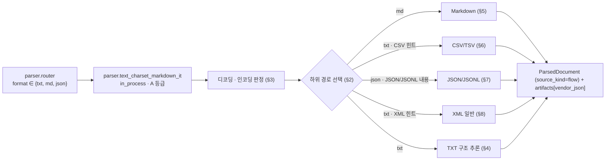
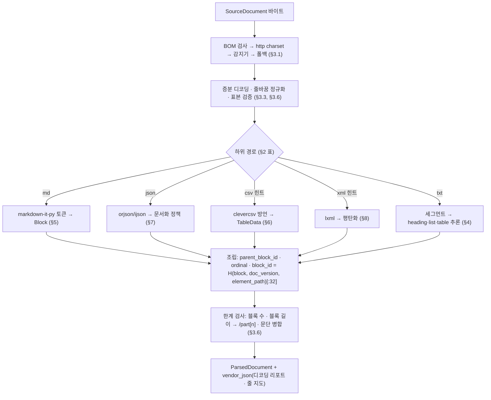

# 파서: TXT·Markdown·CSV·JSON 및 기타

> 이 문서는 `parse` 스테이지의 텍스트 계열 경로를 정의하는 개별 설계 문서다. 우선순위는 브리프 > 바이블 > ADR > 이 문서이며(바이블 §1.1), 타입·필드·열거값·기본값은 바이블 §4.2·§5.3·§5.4·§5.7·§7과 [ParsedDocument 계약](../03-contracts/03-parsed-document.md)을 그대로 쓴다. 이 문서가 새로 정하는 것은 어댑터 내부 규칙(인코딩 판정, 구조 추론, 벤더 토큰 → `Block` 매핑, `element_path` 문법, 크기 분할)과 텍스트 파서 플러그인의 `config_schema` 필드다. 바이블에 없는 것은 "제안"으로 표시하고 `## 미해결 이슈`에 남긴다.

## 목적

TXT·Markdown·CSV·JSON은 페이지도, 스타일 정보도, 대부분은 명시적 구조도 없는 **평문 계열(text-like)** 입력이다. 이 경로의 품질은 두 가지가 결정한다. 첫째, **바이트를 올바른 문자로 되돌리는 것** — 한국 공공·기업 문서는 여전히 EUC-KR/CP949로 저장된 TXT·CSV가 많고, 인코딩 오판은 문서 전체를 모지바케(mojibake)로 만든다. 둘째, **구조를 되살리되 조작하지 않는 것** — 빈 줄·번호·글머리 기호·프론트매터(front matter) 같은 약한 신호로 heading·목록·표를 추론하면서도, 원문(`Block.text`)과 출처(`Provenance`)는 결정적으로 보존해 인용(K1)과 재현성(원칙 4)을 깨지 않아야 한다. 이 문서는 다음을 확정한다.

- 플러그인 `parser.text_charset_markdown_it`(바이블 §7.3·§12)의 위치·계약·격리·`Capabilities`·`config_schema`.
- 공통 디코딩 규약: 인코딩 감지(encoding detection) 순서, 한국어 레거시 인코딩 처리, 모지바케 복구와 재투표, 줄바꿈 정규화(newline normalization), `source_encoding` 기록, 대용량 스트리밍(streaming).
- 포맷별 매핑: TXT 구조 추론(단락·heading·개조식 목록·고정폭 표), Markdown(CommonMark/GFM) 토큰 → `Block`, CSV/TSV → `TableData`, JSON/JSONL·일반 XML → 문서화 정책(텍스트 필드 지정 또는 평탄화), 각 포맷의 `element_path` 문법과 provenance.
- 2급·로드맵 포맷(PPTX·XLSX·이미지 단독·EML/MSG)의 매핑 개요와 선행 조건.
- 실패 모드, 재현성·지문, 관측성, 테스트 코퍼스.

## 범위

| 포함 | 제외 |
|------|------|
| `SourceDocument.format ∈ {txt, md, json}`인 문서의 `parse` 내부(디코딩 → 구조 추론 → `ParsedDocument` + 파생물). CSV/TSV·JSONL·일반 XML은 v1 `SourceFormat`에 값이 없어 `txt`(또는 `json`)로 도착하므로 이 어댑터 안의 하위 경로로 다룬다([03 라우터 §3.3](03-parsing-router-and-format-detection.md)) | 포맷 판별(`detect`)과 라우터 체인 일반 규칙([03 라우터](03-parsing-router-and-format-detection.md)); JSON 배열·ZIP 멤버의 **전개**(`split_hint`, [02 페치](02-fetching-and-source-resolution.md) §8·03 라우터 §4.7) |
| Markdown 프론트매터 → `metadata`, 각주·표·코드·인용·링크·이미지 매핑 | HTML 조각이 아닌 HTML 문서([07 HTML 파서](07-parser-html.md)); Markdown 안 HTML 블록은 이 문서의 정책(§5.5) |
| CSV/TSV 방언(dialect) 감지·헤더 추정·`TableData` 매핑, 크기 분할 | 표 행 그룹 청킹(256 토큰, 헤더 반복)은 [10 청킹](10-chunking-strategies.md)·D-19 |
| JSON/JSONL·XML 문서화 정책과 JSON Pointer `element_path` | 정형 데이터 질의(범위 문서 §4.10 비범위) |
| PPTX·XLSX·이미지 단독·EML/MSG의 **매핑 개요**와 선행 조건(`SourceFormat` 값 추가) | 그 포맷들의 확정 설계(로드맵, [마일스톤](../11-roadmap/01-milestones.md)) |
| provenance(`element_path`·`char_*`·줄 지도 파생물), 실패 모드, 지문·관측성 | NFC·제어 문자 제거·문장 분리·PII([09 정규화](09-normalization-and-cleaning.md), [04 NormalizedDocument](../03-contracts/04-normalized-document.md)) |

## 1. 위치와 계약

### 1.1 스테이지 안의 위치

`parse`는 플랫폼 소유 합성 스테이지 `parser.router`가 실행하고(바이블 §4.2, [03 라우터 §1](03-parsing-router-and-format-detection.md)), 텍스트 계열은 프로파일 `ingest.parse.router`의 세 키가 이 어댑터로 온다(바이블 §7.3 정본 YAML).

```yaml
ingest:
  parse:
    router:
      txt:  [parser.text_charset_markdown_it]
      md:   [parser.text_charset_markdown_it]
      json: {split: json_array, then: txt}      # split_hint=json_array 이면 멤버 분할 후 txt 체인, none 이면 txt 체인 그대로
```

**결정:** 세 키는 모두 **후보 1개**의 체인이며 전 프로파일(`lite`·`standard`·`premium`·`korean-gov`) 동일하다(바이블 §7.1 "DOCX / HTML / TXT·MD" 행). 폴백 후보가 없으므로 어댑터 내부의 실패는 곧 문서의 최종 결과다 — 따라서 이 어댑터는 예외를 던지기보다 **저하(`quality=degraded`)로 산출을 내는 쪽**을 택한다(§11). `json`의 `SplitRoute`는 라우터 해석상 "멤버가 도착했을 때 적용할 체인"이고 멤버 전개는 `parse` 이전 단계의 일이므로(03 라우터 §4.7), 이 어댑터는 `format=json`인 입력(전개되지 않은 JSON 전체 또는 전개된 멤버 1건)을 그대로 받는다.



### 1.2 플러그인·구성 요소·라이선스

| 항목 | 값 | 근거 |
|------|----|------|
| `plugin_id` | `parser.text_charset_markdown_it` | 바이블 §6.1·§7.3·§12(`adapters/parse/text_charset_markdown_it.py`) |
| 확장 지점 / 격리 | `parser` / `in_process`(순수 Python, `linkage=pure_python`) | 바이블 §4.2 `parse` 행 "TXT in_process", D-10 |
| 라이선스 등급 | A | 정본(브리프 D-18 v1.1·바이블 §7.1 1.3.0 "DOCX / HTML / TXT·MD" 행, AM-42): charset-normalizer 3.5.1(MIT), ftfy 6.3.1(Apache-2.0), markdown-it-py 4.2.0(MIT) + 하위 경로 mdit_py_plugins(MIT), clevercsv 0.8.5(MIT), orjson 3.12.0(`MPL-2.0 AND (Apache-2.0 OR MIT)` — MPL-2.0 성분은 파일 단위 카피레프트로 D-02·ADR-0001 등급표에서 A), ijson 3.5.1(`BSD-3 AND ISC`), lxml(BSD-3) — 모두 §12 모듈 맵에 등재됐다([기술 지형 03](../07-tech-landscape/03-document-parsing-office-html-text.md) §TXT/Markdown/CSV/JSON 표의 표기 그대로, [ADR-0001](../06-adr/0001-license-grade-table-and-d02-interpretation.md)). lxml·mdit_py_plugins 버전은 확인 필요(as of 2026-09) |
| 제외 | chardet 7.x(0BSD 재라이선스 분쟁 → 선택 플러그인만), Docling `MarkdownDocumentBackend`·`CsvDocumentBackend`(offset provenance 약함 → 2차 경로, 기본 미사용), pyarrow(바이너리 크기; 스트리밍 옵션 후보) | 기술 지형 03 판정, [선정 매트릭스](../07-tech-landscape/00-summary-and-selection-matrix.md) `text_decoder` 행 |
| `parser_fingerprint.parser_version` | 하위 경로의 1차 라이브러리 `{package}=={version}`: TXT·CSV·JSON·XML은 `charset-normalizer==3.5.1`, MD는 `markdown-it-py==4.2.0`([03 §2.2](../03-contracts/03-parsed-document.md) 규약) | 이 문서 |
| `parser_fingerprint.profile_option` | 하위 경로별 문자열(패턴 `^[a-z][a-z0-9_]*$`): `txt_standard`, `md_standard`, `csv_experimental`, `json_experimental`, `xml_experimental` | 이 문서 규약(§2). 실험 등급 경로는 접미 `_experimental`로 감사 가능 |
| `Producer.config_hash` | `H("config", canonical_json(TextParserConfig))` — 프로파일 값 중 `config_schema`로 검증된 부분만(바이블 §5.3 `Producer`·§6.2, [01 §2.3](01-pipeline-framework.md)). 설치 라이브러리 버전은 넣지 않는다 | 런타임에 읽은 버전 맵을 넣으면 같은 프로파일이 설치마다 다른 `config_hash`를 갖고 01 §2.4 `parser` 지문 구성 규칙(`model_ids`·`image_digest`·`config_hash`)과 어긋난다. 라이브러리는 uv lock으로 고정하고(D-01), 산출을 바꾸는 패치는 `Producer.plugin_version`(패키지 버전) 상승으로 `fingerprint`·`stage_key`에 반영한다(바이블 §4.1, [ADR-0037](../06-adr/0037-artifact-cache-scope-and-stage-key-composition.md)); 1차 라이브러리 버전은 `parser_fingerprint.parser_version`이 담는다. 부속 라이브러리 버전까지 지문 필수 구성요소로 넣는 제안은 미해결 이슈 18 |
| `model_ids` / `image_digest` | `[]` / `null`(모델·사이드카 없음) | 바이블 §5.3 `Producer` |

### 1.3 입력·출력·정책

| 항목 | 규약 |
|------|------|
| 입력 | `SourceDocument{format ∈ {txt, md, json}, media_type, artifact(원본 바이트), content_hash, http_metadata.charset?, metadata.language_hint?, metadata.genre?, resolved_uri}`(바이블 §5.4). `resolved_uri`의 확장자와 `media_type`은 **하위 경로 힌트**(§2)로만 쓰고 `format`을 바꾸지 않는다 |
| 출력 | `ParsedDocument` 1개: `source_kind=flow`, `page_count=null`, `page_status` 없음, 모든 블록 `provenance.page=bbox=null`, `source=text_layer`, `confidence` 생략 또는 `null`([03 P-8](../03-contracts/03-parsed-document.md)); **`source_encoding` 필수 기록**(03 §8.3 마지막 문단, 03 라우터 §3.2); 파생물 `artifacts[]{kind: vendor_json}`(디코딩 리포트 + 줄 지도, §3.5), `figure_crop`(`data:` URI 이미지, §5.6) |
| `StagePolicy` | parse(텍스트) 행: `task_queue=ingest-cpu`, `start_to_close=15m`, `heartbeat=60s`, `max_attempts=3`, 비재시도 `parse.document_encrypted, parse.distribution_document, parse.unsupported_variant, parse.corrupt_container, contract.violation`(바이블 §4.4). 흐름 포맷이라 `supports_resumable=false`이며 셸 타이머 하트비트만 받는다(03 라우터 §5.3). 바이블 §4.4 1.3.0 `resumable` 비고(AM-07)가 "후보 어댑터 `Capabilities`로 결정하며 흐름 포맷 TXT·MD·HTML·HWPX는 `no`"로 이를 그대로 확정했고, [15 문서 §3.4](../03-contracts/15-collection-profile-and-policy-contracts.md)의 로더 규칙 `resumable = capabilities.supports_resumable`에 따라 이 어댑터가 실행되는 액티비티의 `StagePolicy.resumable`도 `false`로 채워진다 |
| 부분 성공 | `quality=degraded` + `warnings[]`(바이블 §4.1). 이 경로에는 `page_status`가 없다. v1 카탈로그에 텍스트 경로 전용 경고 코드가 없어(§11) 저하 사유는 `vendor_json` 디코딩 리포트와 `TableData.quality`로 남긴다 |
| 순수성 | 파일 시스템·네트워크 접근 없음(Markdown 이미지 URL·XML 외부 엔티티를 **가져오지 않는다**). 부수효과는 `ctx.artifacts.put_derived`, `ctx.now()`, `ctx.remaining_ms()`, `ctx.cancelled`만([01 §2.5](01-pipeline-framework.md)) |
| 시간 예산 | `ctx.remaining_ms()`를 세그먼트(줄 묶음·행·JSON 항목) 경계마다 확인하고, 소진 임박(초안 10%) 시 남은 입력을 **문단 병합 모드**(§3.6)로 마무리해 `degraded`로 반환한다. 재시도해도 같은 입력이면 같은 시간이 걸리므로 실패보다 저하가 낫다 |

### 1.4 `Capabilities`와 `config_schema`

`capabilities()`는 바이블 §5.3 `Capabilities`를 반환한다. `extra`는 [플러그인 아키텍처 §5](../02-architecture/05-plugin-architecture.md)의 `parser` 제안 필드다.

```json
{
  "isolation_modes": ["in_process"],
  "supports_resumable": false,
  "contracts_compat": ">=1.0,<2.0",
  "input_formats": ["txt", "md", "json"],
  "requires_gpu": false,
  "extra": {
    "source_kinds": ["flow"],
    "page_provenance": false,
    "table_merged_cells": true,
    "ocr_engines": [],
    "arch": ["x86_64", "aarch64"]
  }
}
```

`config_schema`(`TextParserConfig`, Pydantic v2 `extra="forbid"`·`frozen=True`, [01 §2.3](01-pipeline-framework.md))의 필드다. 값은 모두 **초안 목표**이며 골든 코퍼스(§12)로 확정한다. 격리·큐·재시도·타임아웃은 여기 두지 않는다(`StagePolicy`).

| 그룹 | 필드 | 타입 | 기본(초안) | 의미 |
|------|------|------|-----------|------|
| `encoding` | `sample_bytes` | integer | 1,048,576 | 인코딩 감지 표본(선두) 크기. 꼬리 65,536바이트 창을 추가로 본다(§3.1) |
| | `korean_first` | boolean | true | 동점·저신뢰 시 `cp949` 우선(§3.2) |
| | `hangul_min_ratio` | number | 0.05 | `language_hint=ko`일 때 한글 비율 하한(§3.3) |
| | `ftfy_change_max_ratio` | number | 0.02 | 모지바케 복구 변경률 상한(§3.3) |
| | `fallback` | enum[utf_8_replace, fail] | `utf_8_replace` | 모든 후보 실패 시 조치(§3.1 7순위) |
| | `replace_max_ratio` | number | 0.01 | `utf_8_replace` 경로에서 허용하는 U+FFFD 비율 상한. 초과는 `parse.conversion_failed`(§3.1; 13 §5.1 C2 국소성 기준) |
| `txt` | `paragraph_mode` | enum[blank_line, line, auto] | `auto` | 문단 분할 모드(§4.1) |
| | `heading_inference` | boolean | true | heading 추론(§4.2) |
| | `heading_max_chars` | integer | 80 | heading 후보 최대 길이(코드포인트) |
| | `heading_max_level` | integer | 5 | 추론 heading 최대 레벨(P2~P6 클램프; P1은 압축 배정으로 ≤ 5라 대상이 아님, §4.2) |
| | `list_inference` | boolean | true | 개조식 목록 추론(§4.3) |
| | `indent_width` | integer | 2 | 들여쓰기 1레벨의 공백 수(탭 = 1레벨) |
| | `table_detection` | enum[off, delimited, delimited_and_aligned] | `delimited` | 고정폭 표 감지(§4.4) |
| | `merge_min_blocks_for_coarsening` | integer | 150,000 | 블록 수가 이 값을 넘으면 문단 병합 모드(§3.6) |
| `md` | `preset` | enum[commonmark, gfm_like] | `gfm_like` | markdown-it-py 프리셋(§5.1) |
| | `plugins` | array<string> | `[front_matter, footnote, tasklists]` | 활성 `mdit_py_plugins`(§5.1). GFM 표는 플러그인이 아니라 코어 블록 규칙 `table`이라 여기 들지 않는다 |
| | `html_block` | enum[strip_tags, as_is, drop] | `strip_tags` | HTML 블록·인라인 HTML 정책(§5.5) |
| | `math` | boolean | false | `dollarmath` → `formula`(§5.5) |
| | `frontmatter_to_metadata` | boolean | true | 프론트매터 → `metadata`(§5.7) |
| `csv` | `mode` | enum[off, hint_only, auto] | `hint_only` | CSV 하위 경로 진입 조건(§6.1) |
| | `header` | enum[auto, first_row, none] | `auto` | 헤더 행 판정(§6.2) |
| | `rows_per_block` | integer | 1,000 | 표 블록 1개의 최대 행(§6.3) |
| | `max_cols` | integer | 256 | 열 상한. 초과는 `parse.unsupported_variant` |
| `json` | `mode` | enum[flatten, text_fields] | `flatten` | 문서화 정책(§7.2) |
| | `title_field`, `text_fields`, `metadata_fields`, `extra_fields` | string / array<string> / object / enum[form_field, drop] | 없음 / `[]` / `{}` / `form_field` | `text_fields` 모드의 JSON Pointer 지정(§7.2) |
| | `text_format` | enum[txt, md] | `txt` | 텍스트 필드 값의 하위 분할 규칙 |
| | `max_depth` | integer | 8 | 평탄화 깊이 상한(§7.3) |
| | `long_string_min_chars` | integer | 80 | 이 길이 이상 또는 줄바꿈 포함 문자열은 `paragraph`(§7.3) |
| | `jsonl` | enum[auto, off] | `auto` | JSON Lines 판정(§7.5) |
| `xml` | `detect` | enum[off, hint_only, auto] | `hint_only` | XML 하위 경로 진입 조건(§8; `csv.mode`와 같은 구조) |
| | `mode` | enum[flatten, text_xpaths] | `flatten` | XML 일반 문서의 문서화 정책(§8) |
| | `title_xpath`, `text_xpaths` | string / array<string> | 없음 / `[]` | `text_xpaths` 모드 지정 |
| `limits` | `max_block_chars` | integer | 262,144 | 이 길이를 넘는 블록은 줄 경계에서 `/part[n]` 분할(03 §9의 1MB 한계보다 보수적) |
| | `data_uri_max_bytes` | integer | 10,485,760 | Markdown `data:` 이미지의 디코딩 바이트 상한. 초과는 `figure`를 만들지 않는다(§5.6) |
| | `nul_ratio_max` | number | 0.01 | NUL 바이트 비율 초과는 바이너리로 보고 `parse.unsupported_variant` |

프로파일 노출은 `ingest.parse.options.text` 키다. 바이블 §7.3 정본 YAML의 `options`에는 `pdf`·`ocr`·`page_timeout` 예시만 있지만, [15 문서](../03-contracts/15-collection-profile-and-policy-contracts.md) `$defs/ParseOptions`는 **열린 객체**(`additionalProperties: true`, "pdf·page_timeout 외 키는 포맷별 파서 config_schema")이고 Pydantic `ParseOptions(OpenStageModel)`은 `extra="allow"`다(15 §3.4 "스테이지 값 객체는 열린 객체"; 닫힌 객체는 `ParseConfig{router, options, policy, policy_ocr}` 쪽이다). 따라서 `options.text`는 계약 변경 없이 지금 수용 가능하며 로딩 시 이 어댑터의 `TextParserConfig`가 검증한다 — `options.pdf`가 PDF 파서 `config_schema`로 검증되는 것과 같은 방식이다. 바이블 §7.3 YAML에 `text:` 예시 키를 병기하는 patch 제안은 미해결 이슈 1([04 HWPX](04-parser-hwpx-and-hwp.md) §10의 `hwpx`·`hwp5` 키와 같은 절차).

## 2. 처리 흐름과 하위 경로 선택

**결정:** 하위 경로는 (1) `SourceDocument.format`, (2) 힌트(`media_type`, `resolved_uri` 확장자), (3) 디코딩 후 내용 신호의 순서로 결정하며, 판정 결과는 `parser_fingerprint.profile_option`으로 기록한다. 내용 신호만으로 표·데이터 경로에 들어가는 일은 `csv.mode=auto`·`xml.detect=auto`·`json.jsonl=auto`처럼 명시 옵션이 있을 때만 허용한다(산문을 표로 오판하는 비용이 표를 산문으로 처리하는 비용보다 크다). 기본값에서 CSV·XML 하위 경로는 **힌트 기반**(`hint_only`)이다.

| 순서 | 조건 | 하위 경로 | `profile_option` |
|------|------|-----------|------------------|
| 1 | `format=md` | Markdown(§5) | `md_standard` |
| 2 | `format=json`, 또는 `format=txt`이면서 힌트가 `application/json`·`.json` 또는 `resolved_uri`에 `#member=json[` 조각 | JSON(§7). JSON 파싱 실패 시 TXT로 강등 + `degraded` | `json_experimental` |
| 3 | `format=txt`이면서 힌트가 `application/x-ndjson`·`application/jsonl`·`.jsonl`·`.ndjson`, 또는 `json.jsonl=auto`이고 첫 두 비공백 줄이 각각 JSON 값 | JSONL(§7.5) | `json_experimental` |
| 4 | `format=txt`이면서 `csv.mode ≠ off`이고 힌트가 `text/csv`·`text/tab-separated-values`·`.csv`·`.tsv`·`.tab`; `csv.mode=auto`면 내용 스니핑(§6.1)도 허용 | CSV/TSV(§6) | `csv_experimental` |
| 5 | `format=txt`이면서 `xml.detect ≠ off`이고 힌트가 `application/xml`·`text/xml`·`*+xml` 미디어 타입 또는 `.xml` 확장자; `xml.detect=auto`면 내용 스니핑(§8: 선두 1,024B의 `<?xml` 선언 또는 첫 64KiB 안의 정형 루트 요소; P4 괄호 제목 단독 줄은 제외)도 허용(HTML 루트 신호는 `detect`가 이미 `html`로 보냈다) | XML(§8) **시도**. lxml 파싱 실패 시 TXT + `degraded` + `structure_fallback="xml"` | `xml_experimental` |
| 6 | 그 외 | TXT(§4) | `txt_standard` |



## 3. 공통: 디코딩과 인코딩 판정

### 3.1 결정 순서

**결정:** 디코딩은 WHATWG 인코딩 스니핑 순서를 따른다 — BOM > `http_metadata.charset` > XML 선언 `encoding`(HTML `<meta charset>` 프리스캔에 대응하는 바이트 수준 힌트) > charset-normalizer 자동 감지 > UTF-8 > `cp949` > 최종 폴백(바이블 §7.1 "TXT·MD" 행, D-18 v1.1, [02 SourceDocument §9](../03-contracts/02-source-document.md), 03 라우터 §2.4, [선정 매트릭스](../07-tech-landscape/00-summary-and-selection-matrix.md) `text_decoder` 행). 각 후보는 표본을 `errors="strict"`로 시험 디코딩해 통과해야 채택된다.

| 순위 | 신호 | 채택 조건 | `method` 기록값 |
|------|------|-----------|-----------------|
| 1 | 바이트 순서 표식(byte order mark, BOM). **4바이트 UTF-32 BOM(`FF FE 00 00`/`00 00 FE FF`)을 먼저**, 그다음 2바이트 UTF-16 BOM(`FF FE`/`FE FF`), 마지막 `EF BB BF`(utf-8) 순으로 검사한다 — UTF-32LE BOM은 UTF-16LE BOM을 접두로 포함하므로 순서를 바꾸면 UTF-32 파일이 UTF-16으로 오판된다 | 항상 채택, BOM 바이트는 텍스트에서 제거 | `bom` |
| 2 | `SourceDocument.http_metadata.charset`(Content-Type 파라미터) | 별칭 정규화(§3.2) 후 Python 코덱으로 해석 가능하고 표본 strict 디코딩 통과 | `http_charset` |
| 3 | XML 선언 `<?xml … encoding="…"?>`: 선두 1,024바이트를 ASCII로 프리스캔(WHATWG `<meta charset>` 프리스캔에 대응). 디코딩 전 바이트 수준 검사이므로 §2의 하위 경로 판정(디코딩 후)과 순환하지 않는다 | 선언이 첫 비공백 바이트에서 시작하고, 라벨이 §3.2로 정규화되며, 표본 strict 통과 | `xml_declaration` |
| 4 | charset-normalizer `from_bytes(sample).best()` | 결과가 있고 표본 strict 디코딩 통과. `korean_first=true`이고 후보 목록에 `cp949`·`euc_kr` 계열이 있으면 그것을 우선(§3.2) | `detector` |
| 5 | UTF-8 strict | 표본 통과 | `utf_8` |
| 6 | `cp949` strict | 표본 통과 | `cp949_fallback` |
| 7 | `encoding.fallback` | `utf_8_replace`: UTF-8 `errors="replace"`로 디코딩하고 `quality=degraded`. 손실은 U+FFFD를 포함한 블록 단위로 열거 가능해야 저하다(13 §5.1 C2): 리포트 `replacement_block_indices`에 해당 블록 순번을 기록하고, 전체 코드포인트 대비 U+FFFD 비율이 `encoding.replace_max_ratio`(초안 0.01)를 넘으면 국소 손실이 아니므로 `parse.conversion_failed`; `fail`: 항상 `parse.conversion_failed` | `replace` |

표본은 선두 `encoding.sample_bytes`(초안 1MiB)와 꼬리 64KiB다. 멀티바이트 경계를 자르지 않도록 표본 끝은 마지막 개행 위치로 물린다. 표본이 통과했더라도 본문 증분 디코딩 중 strict 오류가 나면(§3.6) 다음 순위 후보로 **파일 전체를 다시** 디코딩한다(입력 ≤ 200MB이므로 재디코딩 비용은 허용; 초안 규칙).

### 3.2 한국어 레거시 인코딩

**결정:** EUC-KR 계열 라벨은 모두 **`cp949`(UHC, Windows-949)로 디코딩**한다. cp949는 EUC-KR의 상위집합(KS X 1001 2,350자 + 확장 8,822자)이라 EUC-KR로 선언된 파일의 확장 완성형 글자(`똠`, `펲` 등)를 잃지 않으며, WHATWG도 `euc-kr` 라벨을 `windows-949`로 해석한다(기술 지형 03 §인코딩 감지 판정).

| 입력 라벨(대소문자 무시) | 정규화 코덱 | `source_encoding` 기록 |
|--------------------------|-------------|------------------------|
| `euc-kr`, `euc_kr`, `euckr`, `ks_c_5601-1987`, `ks_c_5601-1989`, `ksc5601`, `ksc_5601`, `korean`, `iso-ir-149`, `csksc56011987` | `cp949` | `cp949` |
| `cp949`, `ms949`, `uhc`, `windows-949`, `x-windows-949` | `cp949` | `cp949` |
| `johab`, `x-johab` | `johab` | `johab` |
| `iso-2022-kr`, `csiso2022kr` | `iso2022_kr` | `iso-2022-kr` |
| `utf-8`, `utf8`, `unicode-1-1-utf-8` | `utf-8` | `utf-8`(BOM 있으면 `utf-8`로 기록하고 리포트 `bom=true`) |
| `utf-16`, `utf-16le`, `utf-16be`, `utf-32*` | 해당 코덱(BOM 없으면 라벨의 엔디언) | 소문자 라벨 |
| 그 외 IANA 라벨 | Python `codecs.lookup` 결과 | 코덱 정규 이름 소문자 |

`source_encoding` 값은 위 표의 기록 열(소문자, WHATWG 라벨 우선)이며 `ParsedDocument.source_encoding`에 반드시 채운다. 감지기가 `euc_kr`을 돌려주면 `cp949`로 승격해 기록한다. UTF-16/32 파일은 `detect`의 NUL 바이트 규칙(03 라우터 §2.2 `text_like`)에서 `unknown`으로 분류될 수 있어 이 어댑터에 도달하지 않는다 — BOM이 있으면 텍스트 계열로 보도록 `detect` 규칙 보강을 요청한다(미해결 이슈 2).

### 3.3 모지바케 복구와 재투표

디코딩이 예외 없이 끝나도 인코딩이 틀릴 수 있다(cp949 바이트를 latin-1로 읽으면 항상 성공한다). **결정:** 세 신호로 결과를 검증하고 임계를 넘으면 후보 순서대로 재디코딩(재투표)한다. 임계는 03 라우터 §6.3의 값이며 초안 목표다.

| 신호 | 측정 | 임계(초안) | 조치 |
|------|------|-----------|------|
| 한글 기대치 불일치 | `language_hint=ko`(기본)이고 비공백 문자 ≥ 200일 때, 한글 음절(U+AC00~U+D7A3)·자모 비율 | < `hangul_min_ratio`(0.05)이고 라틴·기호 위주 | 다음 후보(우선 `cp949`)로 재디코딩 후 비율이 오르면 채택 |
| 모지바케 교정률 | `ftfy.fix_encoding`(모지바케만 복구; NFC·따옴표·전각 교정은 끄고 원문 보존 — API 옵션은 확인 필요 as of 2026-09) 적용 전후 변경 코드포인트 비율(difflib opcode 기준) | > `ftfy_change_max_ratio`(0.02) | 대체 인코딩으로 재디코딩; 여전히 초과면 **교정본을 채택**하고 `quality=degraded`, 리포트에 `ftfy_applied=true` |
| 대체 문자 | U+FFFD 비율(`errors="replace"` 경로) | > 0 | `quality=degraded`(폴백 경로에서만 발생) |

ftfy 교정을 채택하면 `Block.text`는 교정본이다. `Block.text`가 인용 좌표의 종점([03 §3](../03-contracts/03-parsed-document.md), [ADR-0002](../06-adr/0002-provenance-element-path-and-nullable-page-bbox.md))이므로 교정 여부는 리포트에 남기고, 교정률 0.02 이하의 미세 교정은 `quality`를 바꾸지 않는다(이 문서 규약).

### 3.4 줄바꿈·BOM·제어 문자·정규화 경계

**결정:** 이 어댑터가 하는 문자 수준 변환은 다음 셋뿐이다. (1) BOM 제거, (2) 줄바꿈 정규화 — `\r\n`·`\r` → `\n`(U+2028·U+0085는 바꾸지 않는다), (3) §3.3 모지바케 복구. **NFC 정규화·제어 문자 제거·NBSP 치환은 하지 않는다.** 바이블 §5.4는 `Block.text`를 "원문(NFC 미적용)"으로 정의하고 NFC·제어 문자 제거를 `normalize`의 `display_text`에 두므로([04 NormalizedDocument §3](../03-contracts/04-normalized-document.md)), 기술 지형 03의 "NFC로 통일" 권고는 정규화 단계로 이관한다(미해결 이슈 3). 폼 피드 `\f`와 세그먼트를 가르는 빈 줄은 블록 경계이며 어느 블록의 `text`에도 들어가지 않는다. 세그먼트 안의 줄바꿈은 `\n`으로 **보존**한다(하드 랩 된 한국어 문장을 이어 붙이는 판단은 정규화·문장 분리기의 일이며, 파서가 합치면 `Block.text` 기준 오프셋이 원본 줄과 어긋난다). 각 세그먼트의 선두 들여쓰기와 후행 공백은 제거하되 제거량을 줄 지도(§3.5)에 기록한다.

### 3.5 `source_encoding`과 디코딩 리포트(`vendor_json`)

디코딩 판정 근거와 원본 줄 좌표는 계약 필드가 없으므로 파생물 `artifacts[]{kind: vendor_json}`으로 남긴다(콘텍스트 문자열 금지, 00 I-16). 키는 `tenants/{tenant_id}/derived/vendor_json/{blake3[:2]}/{blake3}.json`(바이블 §13.3)이고 형식은 다음과 같다(계약 아님, 이 문서 규약). `line_map` 원소는 `[block_index, line_start, line_end, doc_char_start, doc_char_end, indent_stripped]`이며 줄 번호는 0-based·끝 미포함, 문자 오프셋은 정규화된 전체 텍스트 기준 코드포인트다. 이 지도가 지시의 "line/char offset" provenance를 `Provenance` 계약(블록 상대 오프셋) 밖에서 보완한다.

```json
{
  "kind": "text_decode_report",
  "report_version": "1",
  "format": "txt",
  "profile_option": "txt_standard",
  "bom": false,
  "http_charset": "euc-kr",
  "method": "http_charset",
  "chosen": "cp949",
  "candidates": [{"encoding": "cp949", "coherence": 0.98}, {"encoding": "utf-8", "coherence": 0.0}],
  "hangul_ratio": 0.61,
  "ftfy_applied": false,
  "ftfy_change_ratio": 0.0,
  "replacement_chars": 0,
  "replacement_block_indices": [],
  "newline_style": "crlf",
  "paragraph_mode_used": "blank_line",
  "line_map": [[0, 0, 1, 0, 24, 0], [1, 2, 3, 26, 58, 0], [2, 3, 4, 59, 96, 0], [3, 4, 5, 99, 127, 2], [4, 5, 6, 132, 151, 4], [5, 7, 8, 153, 162, 0]]
}
```

### 3.6 대용량 텍스트 스트리밍

**결정:** 입력을 메모리에 한 번에 올리지 않는다. `codecs.getincrementaldecoder(chosen)(errors="strict")`로 1MiB 단위 증분 디코딩 → 줄 버퍼 → 세그먼트 단위로 블록을 만든다. 산출 `ParsedDocument`는 결국 한 JSON이지만(256MB 한계), 디코딩·세그먼트화 단계의 상주 메모리는 표본 + 현재 세그먼트에 그친다.

| 항목 | 규칙 |
|------|------|
| 증분 디코딩 오류 | strict 예외 → §3.1 다음 후보로 전체 재디코딩(최대 후보 수만큼). 모든 후보 실패 → `encoding.fallback`(§3.1 7순위; `utf_8_replace`는 U+FFFD 비율 ≤ `replace_max_ratio`일 때만 저하로 채택) |
| 블록 길이 | 세그먼트가 `limits.max_block_chars`(초안 256K 코드포인트)를 넘으면 줄 경계에서 나눠 같은 `parent_block_id`·연속 `ordinal`·`element_path` 접미 `/part[n]`(03 §9) |
| 블록 수 | 누적 블록이 `txt.merge_min_blocks_for_coarsening`(초안 150,000)에 이르면 **문단 병합 모드**로 전환: 이후 연속 `paragraph` 세그먼트를 `max_block_chars` 이하로 이어 붙이고(구분 `\n\n`), heading·list·table 추론을 멈춘다. `quality=degraded`. 200,000을 넘길 위험이 있는 로그성 TXT가 `contract.violation`으로 죽는 대신 저하로 끝나게 한다 |
| NUL 바이트 | 표본 밖에서 NUL 비율이 `limits.nul_ratio_max`를 넘으면 바이너리로 보고 `parse.unsupported_variant`(비재시도). 그 이하의 NUL은 원문에 남기고 정규화가 제거한다 |
| 하트비트·취소 | `supports_resumable=false`; 셸 타이머 하트비트. `ctx.cancelled`는 세그먼트 경계에서 확인하고 중단 시 산출물 없이 종료(부분 산출물 저장 없음) |
| 시간 | `ctx.remaining_ms()` 잔여 10%(초안)에서 문단 병합 모드로 마무리 |

처리량 초안 목표(§12 표)는 하네스에서 측정하며 근거 있는 값이 나오기 전까지 게이트가 아니다.

## 4. TXT 구조 추론

TXT는 구조가 없다는 전제가 틀린 경우가 많다 — 공문·회의록·법령 텍스트는 번호·글머리 기호·들여쓰기로 계층을 표현한다. 이 절의 추론은 모두 **휴리스틱**이며 결과는 `heading_inferred=true`로 표시하고, 추론이 꺼지면(`heading_inference=false`·`list_inference=false`) 모든 세그먼트는 `paragraph`다. 범위 문서 §6.2는 TXT의 1급 요소를 "단락·추론 heading·char offset"으로 한정한다([범위와 비범위](../00-vision/04-scope-and-non-goals.md)).

### 4.1 문단 분할 모드

| `paragraph_mode` | 규칙 | 적합한 입력 |
|------------------|------|-------------|
| `blank_line` | 빈 줄(공백만 있는 줄 포함) 1개 이상 또는 `\f`가 세그먼트 경계. 세그먼트 안 줄은 `\n`으로 보존 | 산문, 하드 랩 된 문서 |
| `line` | 모든 줄이 세그먼트 | 개조식 문서, 로그, 자막 텍스트 |
| `auto`(기본) | 문서 단위로 판정: 전체 줄 중 빈 줄 비율 < 0.02이고 §4.3 목록 마커·§4.2 heading 패턴으로 시작하는 줄 비율 ≥ 0.30이면 `line`, 그 외 `blank_line`. 단, `blank_line` 안에서도 마커 줄이 연속되는 구간(run)은 줄 단위로 나눈다(개조식 혼합 문서). 판정값은 리포트 `paragraph_mode_used` | 대부분 |

`line` 모드에서 마커가 없고 직전 줄보다 더 들여쓴 줄은 **연속 줄**로 보고 직전 세그먼트에 `\n`으로 붙인다(개조식 항목의 둘째 줄).

### 4.2 heading 추론

**결정:** 세그먼트가 아래 조건을 모두 만족하고 패턴 표의 하나에 맞으면 `heading`으로 만든다. `text`는 마커를 포함한 원문 줄(선두 들여쓰기·후행 공백 제거)이고 `numbering_label`은 마커의 복사본이다 — 각주 마커를 앵커 `text`에 남기는 [03 §7](../03-contracts/03-parsed-document.md) 규칙과 같은 이유로, 원문에 실제로 존재하는 문자열은 `Block.text`에서 지우지 않는다. 하류는 `numbering_label`이 `text`의 접두이면 표시에서 떼어낼 수 있다.

조건: (a) 단일 줄, (b) 길이 ≤ `heading_max_chars`(초안 80), (c) 종결부호(`.`, `다.`, `요.`, `,`, `;`)로 끝나지 않음 — 단 P1·P3은 종결부호 허용(P2는 §4.3의 run 규칙이 heading·`list_item`을 가른다), (d) **전방 1세그먼트 lookahead 1회**: 다음 세그먼트가 **같은 패턴이고 같거나 얕은 레벨의 heading 후보**(패턴 매치와 (a)~(c)만 평가하며 (d)·(e)는 재귀 평가하지 않는다)이면 heading이 아니다 — 같은 급의 제목 줄이 연달아 오는 것은 목차·명단이지 제목이 아니다; 더 깊은 heading 후보·`list_item`·`paragraph`·표·문서 끝은 허용한다(`제1장 총칙` 직후의 `제1조(목적)`, `Ⅱ. 추진 배경` 직후의 `1. 현황`은 모두 heading이 된다). (d)는 P1에 적용하지 않는다(법령의 조는 연속되어도 각각 heading이다), (e) 첫 세그먼트가 아닌 경우 앞에 빈 줄이 있었음(`line` 모드에서는 (e) 면제).

| 패턴 | 정규식(초안) | `level` | `numbering_label` | 예 |
|------|--------------|---------|-------------------|----|
| P1 법령·규정 | `^제\s?\d+\s?(편\|장\|절\|관\|조)(의\s?\d+)?[\s(.]` | 단위 순위 편 < 장 < 절 < 관 < 조를 **문서에 등장하는 단위만으로 1부터 압축 배정**(장·절·조 → 1·2·3, 조만 → 1; `조의2`는 조와 같은 레벨). 압축 결과는 ≤ 5 | `제3조` | `제3조(절차) ① …` |
| P2 십진 개요 | `^(\d{1,2})(\.\d{1,2}){0,5}\.?\s+\S` | 성분 수(`1.`→1, `1.1`→2, …) | `1.1` | `2.1 적용 범위` |
| P3 로마 숫자 | `^[ⅠⅡⅢⅣⅤⅥⅦⅧⅨⅩ]+\.?\s+\S` 또는 `^[IVX]{1,4}\.\s+\S` | 1 | `Ⅱ.` | `Ⅱ. 추진 배경` |
| P4 괄호 제목 | 전체형 `^\[[^\]]{1,40}\]$`, `^【[^】]{1,40}】$`, `^<[^>]{1,40}>$`, `^《[^》]{1,40}》$`; 접두형 `^\[(?![ xXv]\])[^\]]{1,20}\]\s+\S`, `^【[^】]{1,20}】\s+\S`(한국 공문의 `[공문]`·`【알림】` 접두 관행; 체크박스 `[ ]`·`[x]`는 제외) | 1 | 전체형 없음 / 접두형은 괄호부(`[공문]`) | `[개정 사유]`, `[공문] 지침 개정 알림` |
| P5 밑줄형(setext-like) | 줄 + 다음 줄이 `^={3,}$`(1) 또는 `^-{3,}$`(2) | 1 / 2 | 없음 | `보고서 제목` + `======` |
| P6 강조 기호 | `^[■◆◈▣▶◎]\s+\S` | 1(뒤따르는 `□ ○ -` 목록의 부모) | 기호 | `■ 주요 내용` |

P2~P6의 레벨은 `heading_max_level`(초안 5)로 클램프하고(클램프는 `heading_inferred`를 바꾸지 않는다), P1은 위 표의 압축 배정(≤ 5)이라 클램프 대상이 아니다 — 편·장·절·관·조를 모두 쓰는 대형 법전에서 관과 조가 같은 레벨로 합쳐져 형제가 되는 일을 막는다. 압축은 이동(shift)이 아니라 압축(compaction)이다: 장·절·조만 있는 법령은 1·2·4가 아니라 1·2·3이다. 하나의 세그먼트가 P1과 §4.3 목록 마커 모두에 맞으면 heading이 우선한다. `metadata.title`은 문서 첫 3세그먼트 안에 `level=1` heading이 **있으면** 그중 첫 heading의 `text`로 **항상** 채우고, 없으면 채우지 않는다(바이블 §5.4 `metadata.title`은 N 필드; heading 추론이 꺼진 문서는 heading이 없으므로 채우지 않는다). "항상"은 `IngestRequest.metadata.title`이 있어도 파서가 채움을 생략하지 않는다는 뜻이다 — 요청 title과의 우선순위 판정은 파서의 일이 아니라 `index`의 일이다(바이블 §5.4·03 §2.4는 "요청 title 부재 시 `IndexRecord.title` 대체 원천 1순위"만 정하고 파서가 채우지 않을 조건을 두지 않는다; MD §5.7과 같은 정책). 하위 경로별 채움 규칙은 §5.7(MD 프론트매터·첫 `h1`)·§6.2(CSV 채우지 않음)·§7.2(JSON `title_field`)·§7.5(JSONL 채우지 않음)·§8(`title_xpath`)이다. 문서 제목 heading(`level=0`)은 이 어댑터의 **어느 하위 경로에서도** 만들지 않는다(§5.2·§7.2·§8; 03 §4.1 "`level=0`은 문서에 최대 1개").

### 4.3 개조식 목록

한국 문서의 개조식(outline-style bullet writing)은 두 주류 계층을 쓴다 — 공문·보고서의 **항목 사다리**(「행정업무의 운영 및 혁신에 관한 규정 시행규칙」의 항목 순서 `1. → 가. → 1) → 가) → (1) → (가) → ① → ㉮` 8단계)와 **기호 사다리**(`□ → ○ → - → ·`), 그리고 법령의 `조 → ① 항 → 1. 호 → 가. 목`이다. 하나의 마커 순위표로는 둘을 동시에 만족시킬 수 없다(`①`을 `1.`보다 깊게 두면 법령의 항·호가 역전되고, 얕게 두면 공문의 8단계 사다리가 무너진다). **결정:** 마커 표의 패턴으로 시작하는 세그먼트는 `list_item`이며, `level`은 (1) 들여쓰기가 있으면 `indent // indent_width`(탭 = 1레벨), (2) 없으면 **장르별 마커 사다리**의 순위다. 사다리는 세그먼트 1차 스캔에서 정한 장르(§4.6: 요청 힌트 `metadata.genre` 우선, 없으면 P1 heading 후보 ≥ 3이면 `law_article`, 그 외 `outline_report`)로 고르고 2차 패스에서 적용한다. `ordered`는 마커 부류로 정하고 `numbering_label`은 마커 원문이다. `text`는 마커를 포함한 원문이다(§4.2와 같은 원칙).

| 부류 | 마커(초안) | `outline_report` 사다리(기본) | `law_article` 사다리 | `ordered` |
|------|-----------|------|------|-----------|
| 아라비아 온점 | `1.` | 0 | 1(호) | true |
| 한글 온점 | `가.` | 1 | 2(목) | true |
| 아라비아 반괄호 | `1)` | 2 | 3 | true |
| 한글 반괄호 | `가)` | 3 | 4 | true |
| 아라비아 괄호 | `(1)` | 4 | 5 | true |
| 한글 괄호 | `(가)` | 5 | 6 | true |
| 원문자 숫자 | `①`~`⑳` | 6 | 0(항) | true |
| 원문자 한글 | `㉮`~`㉻`, `㉠`~`㉭` | 7 | 7 | true |
| 라틴 | `a.`, `a)`, `(a)`, `A.` | 같은 구두 형태의 아라비아 순위(`a.`=0, `a)`=2, `(a)`=4) | 같은 규칙(`a.`=1, `a)`=3, `(a)`=5) | true |
| 네모 | `□`, `▢`, `☐` | 기호 0 | 기호 0 | false |
| 동그라미 | `○`, `◦`, `〇` | 기호 1 | 기호 1 | false |
| 대시 | `-`, `–`, `—`(뒤에 공백) | 기호 2 | 기호 2 | false |
| 점 | `·`, `•`, `∙`, `ㆍ`, `*`(뒤에 공백) | 기호 3 | 기호 3 | false |
| 체크 | `[ ]`, `[x]`, `☑`, `☒` | 들여쓰기 기준(없으면 기호 2) | 동일 | false |

번호 사다리와 기호 사다리가 한 문서에 섞이고 들여쓰기가 없으면 기호 항목은 직전 번호 항목의 자식으로 두어 `level = 직전 번호 항목 level + 1 + 기호 순위`다(공문·보고서는 `1.` 아래 `□ ○ -`를 쓴다; 기호만 있는 문서는 기호 순위 그대로). 모두 초안 규칙이며 골든 코퍼스(§12)의 법령·공문 사다리 표본으로 확정한다.

트리 규칙은 [03 §4.1](../03-contracts/03-parsed-document.md)이다: `list_item(level=d>0)`의 부모는 가장 가까운 앞선 `list_item(level<d)`, `level=0` 항목의 부모는 현재 섹션 heading(없으면 루트). **보완:** `level=d>0`인데 앞선 `list_item(level<d)`가 없으면(사다리가 0이 아닌 순위에서 시작하거나 앞선 항목이 모두 더 깊을 때) 부모는 현재 섹션 heading(없으면 루트)이다 — 03 §4.1은 이 경우를 정하지 않으므로 문구 보완을 제안한다(미해결 이슈 19). 마커 없이 더 들여쓴 연속 줄은 직전 항목 `text`에 `\n`으로 붙는다.

**heading(P2)과 `list_item`의 우선 규칙.** `1.`·`1)`·`(1)` 부류 세그먼트는 §4.2 P2와 이 표에 동시에 맞을 수 있다. "본문 단락"은 **마커 없는 `paragraph` 세그먼트**를 뜻한다. 판정은 같은 부류·연속 번호로 이어지는 세그먼트 묶음(run; 사이에 다른 세그먼트가 끼어도 번호가 이어지면 같은 run) 단위로 하며, 동일 세그먼트를 heading과 `list_item`으로 동시에 만들지 않는다.

| 조건 | 판정 |
|------|------|
| run의 모든 항목이 §4.2 (a)~(c)를 만족하고(P2에 종결부호 예외 없음), 각 항목 바로 뒤에 본문 단락, 더 깊은 사다리 항목(`가.`, `1)`, …, 기호 항목), 표, 또는 **성분 수가 더 많은 P2 heading 후보**(`1. 개요` 직후의 `1.1 배경`, `1.1` 직후의 `1.1.1`; §4.2 (d)가 허용하는 "더 깊은 heading 후보"와 같은 집합)가 온다 | run 전체 `heading`(P2, `level` = 성분 수) |
| 그 외 — 한 항목이라도 종결부호로 끝남·길이 초과·바로 뒤에 같은 부류 항목이 옴·문서 끝 | run 전체 `list_item` |

### 4.4 고정폭 표 감지(옵션)

| `table_detection` | 판정 | 결과 |
|-------------------|------|------|
| `off` | — | 모두 `paragraph` |
| `delimited`(기본) | 연속 ≥ 2줄이 `\|` 또는 탭으로 나뉘고 셀 수가 같으며(≥ 2) 첫 줄 뒤 `^[\|\s:-]+$` 구분 줄이 있거나 셀 수 일치가 3줄 이상 | `table` 1개 |
| `delimited_and_aligned` | 위 + 연속 ≥ 3줄에서 모든 줄이 공백 ≥ 2를 갖는 열 경계가 ≥ 1개 일치(고정폭) | `table`; 오판 위험이 커 기본 끔 |

표 블록은 `TableData{n_rows, n_cols, cells(앵커, span 1), header_row_indices, header_inferred=true, role=data, quality{merged_cells_preserved=true, structure_source=line_based, structure_confidence}}`이며 헤더는 구분 줄이 있으면 첫 줄, 없으면 첫 줄이 전부 비수치이고 뒤 줄에 수치 셀이 있을 때 첫 줄(아니면 `header_row_indices=[]`). `structure_confidence`는 셀 수 일치율(초안). `text`는 [03 §6](../03-contracts/03-parsed-document.md) 선형화(셀 U+0009, 행 U+000A)이고 `TableCell.provenance.char_*`는 그 안의 구간이다. `html_ref`는 만들지 않는다(N).

### 4.5 `element_path`와 provenance(정본)

**결정:** [03 §3.1](../03-contracts/03-parsed-document.md)의 권고 `/txt/para[n]`을 다음과 같이 확정한다. 이 문법으로 경로는 문서 내 유일하며(P-2) `block_id = H("block", doc_version, element_path)[:32]`가 결정된다([ADR-0004](../06-adr/0004-deterministic-chunk-id-scoped-record-id-and-ulid-exception.md)).

| 대상 | 문법 | 비고 |
|------|------|------|
| 텍스트 세그먼트(heading·paragraph·list_item) | `/txt/para[n]` | `n`은 세그먼트 순번(0-based, 표 세그먼트도 순번을 소비). 같은 텍스트가 두 곳에 있어도 순번이 다르다 |
| 표 | `/txt/table[k]` | `k`는 표 순번; 셀 `/txt/table[k]/row[r]/cell[c]`(0-based 격자 좌표). 파트 분할 시 셀은 `/txt/table[k]/part[n]/row[r]/cell[c]`(`r`은 파트 내 0-based, 반복 헤더 행 = 0) — 셀 provenance도 P-2 유일성 대상 |
| 분할 블록 | 원 경로 + `/part[n]` | 03 §9 |
| 문단 병합 블록(§3.6) | `/txt/para[n]`(병합 구간 첫 세그먼트의 순번) | 리포트 `line_map`에 병합 범위 |

`Provenance`는 `{element_path, char_start=0, char_end=len(text), page=null, bbox=null}`이고 `section_index`는 생략한다(P-3·P-8). 원본 줄·문자 좌표는 §3.5 줄 지도가 담는다. `Provenance`에 `line_start/line_end`(N)를 두는 제안은 미해결 이슈 4다.

### 4.6 메타·언어·장르

- `language`: 감지 라이브러리를 선정하지 않았으므로(03 라우터 §6.3) `metadata.language_hint`(기본 `ko`)를 그대로 쓴다. 한글 비율은 리포트에만 남긴다.
- `metadata.genre`: 요청 힌트가 없으면 세그먼트 1차 스캔에서 P1 패턴 heading 후보가 ≥ 3개면 `law_article`, §4.3 마커 세그먼트 비율 ≥ 0.5면 `outline_report`를 **추론값**으로 채운다(바이블 §5.7 `Genre`; 최종 장르는 `NormalizedDocument.genre`). 같은 판정이 §4.3 마커 사다리 선택에 쓰인다(요청 힌트 > 추론값 > 기본 `outline_report` 사다리).
- `metadata.created_at`·`modified_at`은 채우지 않는다(파일 시스템 시각은 콘텐츠가 아니다). `Block.lang`은 파서가 채우지 않는다(P-14).

## 5. Markdown

### 5.1 파서 구성

**결정:** markdown-it-py 4.2.0(MIT)을 1차 파서로 쓴다. 토큰의 `map`(줄 범위)이 있어 원문 좌표를 정확히 기록할 수 있고 CommonMark 준수·플러그인 생태계(`mdit_py_plugins`)가 있다(D-18 v1.1, 기술 지형 03 §Markdown 구조 파싱 판정). Docling `MarkdownDocumentBackend`(marko 기반)는 HTML 블록이 많은 문서용 2차 경로 후보로만 두고 기본 미사용, mistune·mistletoe는 3차다.

| 구성 | 값 | 비고 |
|------|----|------|
| 프리셋 | `md.preset=gfm_like` → `MarkdownIt("gfm-like")`(표·취소선·자동 링크). `commonmark` 선택 시 코어 블록 규칙 `table`만 `enable("table")`로 추가 | 프리셋 이름·`linkify` 의존성(linkify-it-py) 여부는 확인 필요(as of 2026-09); 자동 링크는 `links[]`에만 영향 |
| 플러그인 | `front_matter`(§5.7), `footnote`(§5.6), `tasklists`(§5.3) — 모두 `mdit_py_plugins`(바이블 §7.1 1.3.0 등재, AM-42). GFM 표는 플러그인이 아니라 markdown-it-py **코어 블록 규칙 `table`**이며 `gfm-like` 프리셋이 켠다(`mdit_py_plugins`에 `tables` 플러그인은 없다; 기술 지형 03 §Markdown 구조 파싱 표의 같은 오기 정정 요청은 미해결 이슈 14) | 기본 `md.plugins` |
| 선택 플러그인 | `deflist`(정의 목록 → `paragraph` "용어: 정의"), `dollarmath`(`md.math=true` → `formula`) | 기본 끔 |
| 파싱 | `parse()` 토큰 스트림을 `SyntaxTreeNode`로 감싸 블록 트리를 순회. 렌더러(HTML)는 쓰지 않는다 | |
| 입력 | §3의 디코딩 결과(줄바꿈 `\n` 정규화 후). markdown-it-py 내부 정규화와 결과가 같아 `map` 줄 번호가 줄 지도와 일치한다 | |

### 5.2 토큰 → `Block` 매핑

| markdown-it 토큰(블록) | `type` | 속성 | `text` | 비고 |
|------------------------|--------|------|--------|------|
| `heading_open` `h1`~`h6`(ATX·setext) | `heading` | `level` = N(h1 = 1), `heading_inferred=false` | 인라인 평문(§5.2 인라인 규칙) | `level=0`은 만들지 않는다. 문서 제목은 §5.7 `metadata.title` |
| `paragraph_open`(최상위·인용·목록 항목 둘째 이후) | `paragraph` | | 인라인 평문 | 목록 항목의 첫 단락은 항목 `text`가 된다(§5.3) |
| `bullet_list_open`/`ordered_list_open` → `list_item_open` | `list_item` | `level` = 중첩 깊이(0-based), `ordered`, `numbering_label` = 마커(`-`, `*`, `+`, `3.`, `3)`) | 첫 단락 인라인 평문 | 마커는 문법이므로 `text`에서 제외(TXT §4.3과 다름) |
| `table_open`(GFM) | `table` | `TableData`(§5.4) | 선형화(03 §6) | |
| `fence` | `code` | `code.language` = info 문자열 첫 단어(없으면 `null`) | 펜스 안 원문(후행 개행 1개 제거) | |
| `code_block`(들여쓰기) | `code` | `code.language=null` | 원문 | |
| `blockquote_open` | 블록 아님 | 자식 블록의 `element_path`에 `/quote` 단계 | — | `BlockType`에 인용이 없다(미해결 이슈 5) |
| `html_block` | `md.html_block` 정책(§5.5) | | | |
| `hr` | 없음 | | | 문단 경계 신호로만 |
| `footnote_block` → `footnote_open` | `footnote` | `footnote{kind=footnote, anchor_block_id, anchor_char_offset, marker="[^라벨]"}` | 정의 본문 인라인 평문 | 앵커 직후 형제(03 §4.2) |
| `math_block`(`dollarmath`, 옵션) | `formula` | `formula{script=원문, latex=원문}` | 원문 | |
| `front_matter` | 블록 아님 | → `metadata`(§5.7) | — | |
| `dl_open`(`deflist`, 옵션) | `paragraph`(dd마다) | `numbering_label` = 용어 | 정의 인라인 평문 | 기본 끔 |

인라인 규칙(모든 `text`에 공통): `text`·`code_inline`의 내용을 이어 붙이고, `softbreak`·`hardbreak`는 `\n`, 강조·취소선 마커는 제거, 링크는 텍스트만 남기고 `href`를 `links[]{block_id, char_start, char_end, href}`에 기록, 이미지는 alt 텍스트를 남기고 `src`를 `links[]`에 기록(단독 이미지 단락은 §5.6), 엔티티·이스케이프는 markdown-it-py가 해소한 값, 인라인 HTML은 `md.html_block` 정책과 같다. 이 규칙으로 얻은 `text`가 이 블록의 원문이며 `Provenance.char_*`의 기준이다 — Markdown 문법 문자는 인용 대상이 아니므로 제외해도 K1을 해치지 않는다(원본 줄 좌표는 줄 지도).

### 5.3 목록·중첩·다단락 항목

- 항목의 첫 자식 단락이 `list_item.text`다. 둘째 이후 단락·코드·표·인용은 그 항목의 **자식 블록**(`parent_block_id` = 항목, `container=body`)이며 `element_path`는 `/md/block[n]/item[i]/p[k]`처럼 항목 아래에 둔다(§5.8).
- 중첩 목록의 항목은 `level = 깊이`, 부모는 바깥 항목(03 §4.1). 느슨한 목록(loose list)과 촘촘한 목록(tight list)은 구분하지 않는다.
- `tasklists`: `- [x] 항목` → `list_item{ordered=false, numbering_label="- [x]"}`, `text`는 체크박스를 제외한 인라인 평문. 체크 상태는 `numbering_label`로만 남는다.
- 순서 목록의 `numbering_label`은 실제 번호(`start` 속성 + 순번)와 구분자(`.`/`)`)로 만든다(`3.`). 원문이 모두 `1.`이어도 CommonMark 의미대로 증가 번호를 쓴다.

### 5.4 표(GFM)

GFM 표는 병합이 없고 헤더 행이 문법으로 정해진다. `TableData{n_rows, n_cols, cells(앵커, row_span=col_span=1), header_row_indices=[0], header_inferred=false, role=data, quality{merged_cells_preserved=true, structure_source=native}}`. 셀은 `is_header=(row==0)`, `header_kind=column|none`. 정렬(`:---:`)은 버린다. 셀 수가 헤더보다 많거나 적은 행은 GFM 규칙대로 잘라내거나 빈 셀로 채운다. `text`는 선형화(03 §6), 셀 `provenance.element_path`는 `/md/block[n]/row[r]/cell[c]`. 셀 안 인라인은 §5.2 인라인 규칙(셀 안 링크도 `links[]`, 오프셋은 표 블록 `text` 기준). HTML `<table>` 블록은 §5.5 정책에 따르며 표로 복원하지 않는다(HTML 표가 필요한 문서는 `html`로 제출).

### 5.5 코드·수식·HTML 블록·인용

| 요소 | 규칙 |
|------|------|
| 코드 | `fence`의 info 문자열(`python`, `json`, `mermaid`)은 첫 공백 전까지를 소문자로 `code.language`에 둔다. 코드 본문은 어떤 변환도 하지 않는다(들여쓰기·탭 보존) |
| 수식 | `md.math=true`일 때 `$$…$$` 블록 → `formula{script, latex}`(둘 다 원문), 인라인 `$…$`는 단락 `text`에 원문 그대로 남긴다. 기본 끔(달러 기호 오탐) |
| HTML 블록·인라인 HTML | `strip_tags`(기본): 태그를 제거하고 텍스트 노드만 남겨 `paragraph`(엔티티 해소; `<br>`은 `\n`, 블록 태그 경계는 `\n`), `<script>`·`<style>` 내용은 버린다; `as_is`: 태그 포함 원문을 `paragraph`(코드성 문서용); `drop`: 블록 생략. 어느 정책도 표·제목 구조를 HTML에서 복원하지 않는다 |
| 인용(`>`) | 자식 블록을 같은 부모 아래 형제로 두고 `element_path`에 `/quote`를 넣는다. 인용 깊이는 `/quote/quote`로 누적. 인용 표시가 필요한 소비자는 경로로 식별한다(미해결 이슈 5) |
| 수평선 | 블록 없음 |
| 이스케이프·엔티티 | markdown-it-py 해소 값. 코드 블록 안은 예외 |

### 5.6 링크·이미지·각주

- 링크: `links[]{block_id, char_start, char_end, href}`(03 §2.5 `Link`). `href`는 원문 그대로(상대 경로 해석·정규화 없음, `uri-reference`). 자동 링크·참조 링크(`[텍스트][ref]`)는 해소된 대상. 제목(`title`)은 버린다.
- 이미지: 단락이 이미지 하나로만 이루어지고 `src`가 `data:image/*;base64,…`이면 바이트를 디코딩해 `ctx.artifacts.put_derived(kind="figure_crop")`로 저장하고 `figure{artifact, kind=image, alt_text}` 블록(`text` = alt)을 만든다 — 디코딩 바이트가 `limits.data_uri_max_bytes`(초안 10,485,760)를 넘으면 `figure`를 만들지 않고 `paragraph{text=alt}`(alt가 비면 블록 없음) + 리포트 `data_uri_skipped`에 개수만 기록한다(대용량 base64가 파생물 저장소를 채우는 것을 막는다; 상한이 설정이므로 `config_hash`에 반영된다). 그 외 이미지(`http(s)`·상대 경로)는 **가져올 수 없으므로**(순수성, egress) `figure.artifact`(Y)를 채울 수 없어 `figure`를 만들지 않고, 단락 `paragraph{text=alt}` + `links[]{href=src}`로 둔다. alt가 비면 블록도 `links[]` 항목도 만들지 않고(`Link.block_id`가 필수라 대상 블록 없이 링크를 만들 수 없다, 03 §2.5) 리포트 `external_images_skipped`에 개수만 기록한다. `figure.artifact`를 nullable로 여는 제안은 미해결 이슈 6. 인접 단락이 `그림 N`·`Figure N` 패턴이면 `caption`으로 만들고 `caption_of`를 `figure`에만 연결한다(03 §7).
- 각주: `footnote` 플러그인의 참조 `[^1]`는 앵커 단락 `text`에 마커 문자열로 남고(`anchor_char_offset` = 마커 시작), 정의는 `footnote` 블록(`kind=footnote`, `marker="[^1]"`, `container=footnote_body`)으로 앵커 직후 형제에 놓는다. 참조되지 않은 정의는 문서 끝 루트 형제(`anchor_block_id=null`). 인라인 각주 `^[텍스트]`도 동일.

### 5.7 프론트매터 → `metadata`

**결정:** `---` YAML 프론트매터는 `front_matter` 플러그인 토큰으로 얻고(줄 번호 정합), PyYAML `safe_load`로 읽는다(python-frontmatter 1.3.0 사용 가능; PyYAML 라이선스 MIT는 확인 필요 as of 2026-09). 파싱 실패·비객체 값은 무시하고 리포트 `frontmatter_error=true`. TOML(`+++`)·JSON 프론트매터는 v1 미지원(원문 단락으로 남음; 미해결 이슈 7). 프론트매터는 블록이 아니다.

| 키(대소문자 무시) | `metadata` | 변환 |
|-------------------|------------|------|
| `title` | `title` | 문자열화. 키가 있으면 파서는 항상 채우고(요청 `IngestRequest.metadata.title`이 있어도 생략하지 않음), `IngestRequest.metadata.title` 부재 시 `IndexRecord.title` 1순위 원천이 되는 판정은 `index`가 한다(바이블 §5.4; TXT §4.2와 같은 정책) |
| `author`, `authors` | `authors` | 문자열 → 1원소 배열; 배열은 문자열화 |
| `date`, `created`, `created_at` | `created_at` | ISO 8601·`YYYY-MM-DD`·`YYYY.MM.DD`를 RFC 3339 UTC로(날짜만이면 `T00:00:00.000Z`). 해석 불가는 생략 |
| `updated`, `modified`, `modified_at`, `lastmod` | `modified_at` | 동일 |
| `lang`, `language` | `ParsedDocument.language` | BCP 47 검증 통과 시(소문자) |
| `genre` | `genre` | 값이 `Genre` 열거에 있을 때만 |
| 그 외(`tags`, `slug`, `draft` 등) | 없음 | 리포트에 키 이름만 기록. `IngestRequest.metadata.custom`은 요청 측 필드라 파서가 쓰지 않는다 |

프론트매터에 `title`이 없으면 문서의 첫 `h1`(유일할 때) 텍스트를 `metadata.title`로 복사한다(블록은 그대로 `level=1`).

### 5.8 `element_path`와 provenance(정본)

| 대상 | 문법 | 예 |
|------|------|----|
| 최상위 블록 토큰 | `/md/block[n]` — 최상위 블록 토큰 순번(0-based; 프론트매터·`hr`·`html_block(drop)`도 순번을 소비) | `/md/block[17]` |
| 목록 항목 | `/md/block[n]/item[i]`, 중첩 `/item[j]` 누적 | `/md/block[3]/item[2]/item[0]` |
| 항목 안 둘째 이후 블록 | `.../item[i]/p[k]`, `/code[k]`, `/table[k]`(항목 안 종류별 순번) | `/md/block[3]/item[2]/p[0]` |
| 인용 자식 | 부모 경로 + `/quote` + 자식 규칙(`/p[k]`, `/item[i]`, …) | `/md/block[5]/quote/p[1]` |
| 표 셀 | `/md/block[n]/row[r]/cell[c]` | `/md/block[4]/row[1]/cell[0]` |
| 각주 정의 | `/md/footnote[k]`(정의 순번) | `/md/footnote[0]` |
| 단독 이미지 `figure`·캡션 | `/md/block[n]`(단락 위치) | |
| 분할 블록 | 원 경로 + `/part[n]` | |

`Provenance`는 TXT와 같다(§4.5). 토큰 `map`의 `[line_start, line_end)`와 정규화 텍스트 오프셋은 줄 지도(§3.5)에 블록별로 기록한다.

## 6. CSV/TSV(실험)

### 6.1 판정과 방언

CSV/TSV는 v1 `SourceFormat`에 없어 `txt`로 도착한다(03 라우터 §3.3 "CSV / TSV | 실험 | txt"). **결정:** 이 어댑터는 `csv.mode`에 따라 하위 경로에 들어간다 — `hint_only`(기본): 힌트(§2 표 4행)가 있을 때만; `auto`: 힌트가 없어도 clevercsv `Detector`가 방언을 확정하고 표본의 첫 20줄 중 ≥ 3줄이 같은 필드 수(≥ 2)를 갖을 때; `off`: 항상 TXT. 방언(구분자·인용 문자·이스케이프)은 clevercsv 0.8.5(MIT, 비표준 방언 정확도 97%, 기술 지형 03; 바이블 §7.1 1.3.0 등재, AM-42)가 1차, 표준 라이브러리 `csv.Sniffer`가 폴백이며 TSV 힌트면 구분자를 `\t`로 고정한다. 판독은 표준 라이브러리 `csv.reader`(RFC 4180 인용·셀 안 줄바꿈 지원)를 §3.6의 증분 디코딩 위에서 스트리밍한다. pyarrow `csv.open_csv`는 바이너리 크기 때문에 선택 extra 후보로만 둔다(미해결 이슈 8).

### 6.2 `TableData` 매핑

| 항목 | 규칙 |
|------|------|
| 블록 | 파일 1개 = `table` 블록 1개(§6.3 분할 전). `element_path=/csv/table[0]`, 루트 자식, `type=table`, `text` = 선형화(03 §6) |
| 격자 | `n_cols` = 헤더(또는 최다) 필드 수, `n_rows` = 데이터 행 수(+ 헤더 1). 필드 수가 적은 행은 `""`로 채우고 많은 행은 초과 필드를 마지막 셀에 구분자로 이어 붙인다(손실 없음). 이런 행이 하나라도 있으면 `structure_confidence = 일치 행 비율` |
| 셀 | 앵커만, `row_span=col_span=1`, `text`는 인용 해소 후 값 **그대로**(공백·수치 정규화 없음 — 인용 정확성), `provenance{element_path=/csv/table[0]/row[r]/cell[c], char_*=선형화 구간}` |
| 헤더 | `csv.header=auto`: 첫 행의 모든 셀이 비어 있지 않고 비수치이며 서로 다르고, 이후 행 중 하나라도 수치 셀이 있으면 헤더(`header_row_indices=[0]`); `first_row`: 항상; `none`: `[]`. 어느 경우든 `header_inferred=true`(CSV에 헤더 의미론이 없다), 헤더 셀 `is_header=true, header_kind=column` |
| 품질 | `role=data`, `merged_cells_preserved=true`, `structure_source=native`, `html_ref` 없음 |
| 빈 행 | 건너뜀(격자 좌표는 데이터 행 기준으로 연속) |
| 메타 | `metadata.title`은 채우지 않는다(요청 메타 또는 파일명은 파서 관심 밖) |

행 그룹 청킹(256 토큰, 헤더 행 반복)은 청커의 일이며 이 표의 `header_row_indices`가 그 입력이다(D-19, [ADR-0020](../06-adr/0020-default-chunker-structure-aware-and-dependency-locks.md), [10 청킹](10-chunking-strategies.md)).

### 6.3 크기 분할·인코딩·실패

- **분할**: 데이터 행이 `csv.rows_per_block`(초안 1,000)을 넘거나 선형화 `text`가 `limits.max_block_chars`를 넘으면 표를 연속 `table` 블록으로 나눈다: `element_path=/csv/table[0]/part[n]`, 같은 부모(루트)·연속 `ordinal`, **각 파트가 헤더 행을 반복 포함**(`header_row_indices=[0]`). 파트 셀의 `element_path`는 `/csv/table[0]/part[n]/row[r]/cell[c]`(`r`은 파트 내 0-based, 반복 헤더 행 = 0; `TableCell.row/col`도 파트 기준)이며 셀 provenance도 P-2 유일성 대상이다(TXT 표 파트도 같은 문법, §4.5). 파트 단위 분할은 계약 한계(블록 텍스트 1MB, 03 §9)를 지키기 위한 것이고 검색 단위 분할은 청커가 다시 한다.
- **열 상한**: `n_cols > csv.max_cols`(초안 256) → `parse.unsupported_variant`(넓은 데이터 파일은 정형 데이터 질의 영역, 범위 문서 §4.10).
- **인코딩**: §3 공통. 공공 데이터 포털 CSV의 상당수가 cp949이므로 `korean_first`가 특히 중요하다. 셀 값의 모지바케 검증도 §3.3 문서 단위 규칙을 그대로 쓴다.
- **판독 실패**(인용 불일치로 `csv.Error`, 방언 미확정): TXT 경로로 강등하고 `quality=degraded`, 리포트 `structure_fallback="csv"`.
- **03 라우터 §3.3 정합**: 라우터 매트릭스의 CSV 행은 "평문 파싱 · v1은 표 파서 없음"이라 적혀 있어 이 문서의 v1 기본 동작(힌트 기반 `table` 블록)과 어긋난다. 열거값과 무관하게 지금 켜지는 동작이므로 문구 정정을 **즉시(patch)** 요청하고, `csv`·`tsv` 값 추가(03 라우터 미해결 이슈 6과 같은 ADR, minor)는 별도로 두어 채택되면 이 하위 경로가 `router.csv` 체인의 1급 진입점이 된다(미해결 이슈 9).

## 7. JSON/JSONL(실험)

### 7.1 라우팅 전제

`format=json`은 `SplitRoute{split: json_array, then: txt}`다(바이블 §7.3). (a) `IngestRequest.split_hint=json_array`이면 최상위 배열의 멤버가 각자 문서(`source_uri#member=json[i]`, [01 IngestRequest §5.2](../03-contracts/01-ingest-request.md))로 전개되어 이 어댑터에 도착한다 — 멤버 바이트는 JSON 객체 하나다; (b) `split_hint=none`이면 JSON 전체가 한 문서다. 어느 경우든 이 어댑터가 받는 바이트는 JSON 텍스트이고 `format=json`(또는 멤버 재판정 결과)이다. 전개의 주체·상한은 [02 페치 §8](02-fetching-and-source-resolution.md)·03 라우터 §4.7의 미해결 항목이며 이 문서는 관여하지 않는다.

### 7.2 문서화 정책

**결정:** JSON을 "문서"로 다루는 규칙은 두 모드다. 컬렉션이 스키마를 알면 `text_fields`(명시), 모르면 `flatten`(구조 추론). 두 모드 모두 값은 **원문 문자열 그대로**이며 숫자·불리언·null은 JSON 리터럴 표기(`true`, `null`, 최단 부동소수)로 문자열화한다.

| 모드 | 규칙 | 산출 순서 |
|------|------|-----------|
| `text_fields` | `json.title_field`(JSON Pointer) 값 → `metadata.title` + `heading{level=1, heading_inferred=true}` 블록(문서 섹션 루트; 이후 블록은 그 자식 — 하위 분할이 만드는 heading은 아래 **오프셋 규칙**으로 `level ≥ 2`가 되어 03 §4.1에 따라 자손으로 놓인다). 이 제목 heading은 **단일 JSON 문서(전개된 배열 멤버 포함)에서만** 만들고 JSONL에서는 §7.5 규칙(줄 heading의 `text`만 결정)을 따른다 — `level=0` 블록은 이 어댑터 어느 하위 경로에서도 만들지 않는다(§4.2·§5.2와 동일 정책; 03 §4.1·P-7 "`level=0`은 문서에 최대 1개"); `json.metadata_fields{authors, created_at, modified_at, language, genre}` → 각 `metadata` 필드(§5.7 변환 규칙 재사용); `json.text_fields[]` 값(문자열 또는 문자열 배열)은 `json.text_format`(`txt`: §4 규칙, `md`: §5 규칙)으로 **하위 분할**해 블록을 만들고, 그 밖의 스칼라 필드는 `extra_fields=form_field`면 `form_field{text="키: 값"}`, `drop`이면 생략 | 제목 heading → `form_field`들(문서 순) → 텍스트 필드(지정 순) |
| `flatten` | §7.3 표의 재귀 규칙. 객체 키 순서(입력 순)를 보존. `title_field`가 있으면 `metadata.title`만 채운다(§7.6) | 입력 순 |

`text_fields` 모드에서 지정 포인터가 없는 문서는 그 필드를 건너뛰고(오류 아님), 모든 텍스트 필드가 비면 빈 산출(03 라우터 §6.3 규칙).

**하위 분할 heading 오프셋(정본).** `json.text_fields[]` 값, §7.3 긴 문자열 값, §7.5 JSONL 줄 아래의 같은 값들, §8 `text_xpaths`·긴 텍스트 요소 값은 `text_format`(`txt`: §4, `md`: §5) 규칙으로 하위 분할되며, 그 규칙은 `heading{level=1}`을 만들 수 있다(P1 압축 배정은 1부터, P2 `1.`·P3·P4·P5·P6은 1, MD `#`은 1). 03 §4.1은 `heading(level=k)`를 직전 `heading(level<k)` 아래에 두므로, 오프셋 없이 두면 이 heading은 앵커 heading(`level=1` 제목 heading·키 heading·줄 heading·요소 heading)의 자식이 아니라 **형제**가 되어 "그 아래에 둔다"가 성립하지 않는다. **결정:** 하위 분할이 만드는 heading의 `level`은 `min(anchor_level + inferred_level, 6)`이다(바이블 §5.4 `Block.level` heading 0..6 클램프). `anchor_level`은 하위 분할 블록들이 놓이는 부모 heading의 `level`이다 — §7.2 제목 heading 1, §7.3 키 heading `depth + level_offset`, §7.5 줄 heading 1 또는 그 아래 키 heading의 `level`, §8 제목 heading 1 또는 요소 heading `min(depth, 6)`; 앵커 heading이 없으면(`title_field`·`title_xpath` 미지정 또는 값 부재로 블록이 루트에 놓일 때) 0이다. `inferred_level`은 §4.2(`heading_max_level` 클램프 포함)·§5.2가 정한 값(항상 ≥ 1)이다. `anchor_level ≤ 5`이면 결과는 `anchor_level + 1` 이상이라 03 §4.1에 따라 항상 앵커의 자손이 된다. `anchor_level = 6`이면 클램프 때문에 결과가 앵커와 같은 6이 되어 형제가 되므로, 그 하위 분할에서는 heading 추론을 끄고(`txt`: `heading_inference=false`와 동일, `md`: h1~h6를 `paragraph`로 강등) `paragraph`·`list_item`·`table`·`code`·`formula`·`footnote`·`figure`만 만든다(강등 개수는 리포트 `headings_demoted`). `list_item.level`은 오프셋하지 않는다 — `level=0` 항목은 현재 섹션 heading(하위 분할 안의 heading 또는 앵커)의 자식이라 트리가 유지된다(03 §4.1). 오프셋·강등은 `heading_inferred`를 바꾸지 않는다(MD 명시 heading은 `false` 유지). 하위 분할에서는 §4.2·§5.7의 `metadata.title` 채움 규칙을 적용하지 않는다(제목은 `title_field`·`title_xpath`가 정한다). 예: `{"title": "보안 지침", "body": "제1조(목적) …\n\n제2조(정의) …"}`를 `text_fields=["/body"]`·`text_format=txt`로 처리하면 제목 heading `level=1` 아래에 `제1조`·`제2조` heading이 P1 압축 1 + 앵커 1 = `level=2`로 놓인다(오프셋이 없으면 세 heading이 모두 `level=1` 형제가 된다).

### 7.3 평탄화 규칙

| 값 | 위치 | `Block` | `text` |
|----|------|---------|--------|
| 객체(비스칼라 자식 ≥ 1) | 루트 제외 | `heading{level=min(depth + level_offset, 6), heading_inferred=true}` — `level_offset`은 단일 문서 0, JSONL 줄 아래 1(§7.5) | 키 이름; 배열 원소 객체는 `키[i]` — `json.title_field`가 있고 그 값이 있으면 그 값 |
| 객체(스칼라만) | | 각 스칼라를 아래 규칙으로; 헤딩은 만들지 않음(부모 헤딩 아래 평면) | |
| 문자열 ≥ `long_string_min_chars`(초안 80) 또는 줄바꿈 포함 | | `heading{level=min(depth + level_offset, 6), text=키}` + 값을 `json.text_format` 규칙으로 하위 분할한 블록들(하위 분할 heading은 §7.2 오프셋 규칙, `anchor_level` = 이 키 heading의 `level`) | 값 |
| 짧은 문자열·숫자·불리언·null | | `form_field` | `"{키}: {값}"`; `numbering_label` = 키 |
| 스칼라 배열 | | `list_item{ordered=true, level=0, numbering_label="{i}"}` 원소마다(부모 = 키 헤딩; 키 헤딩이 없으면 만든다) | 원소 값 |
| 객체 배열 | | 원소마다 객체 규칙(`키[i]` 헤딩) | |
| 빈 객체·빈 배열 | | `form_field` | `"{키}: {}"` / `"{키}: []"` |
| 루트 스칼라 | | `paragraph` | 값 |
| 깊이 > `max_depth`(초안 8) | | 하위 전체를 `form_field` 1개로 접음 | `"{키}: {compact JSON}"`(`canonical_json` 아님; 입력 순 유지) |

키가 중복된 객체는 orjson/`json` 규칙대로 마지막 값이 남고 리포트 `duplicate_keys`에 개수만 기록한다. `form_field`의 `text`에서 키와 값의 구분은 `": "`이며 키 자체에 `:`가 있어도 `numbering_label`이 키를 확정한다.

### 7.4 `element_path` = JSON Pointer(정본)

**결정:** `element_path`는 `/json` + RFC 6901 JSON Pointer다(`~`→`~0`, `/`→`~1` 이스케이프, 배열 인덱스 0-based). 루트 스칼라는 `/json`. 하위 분할 블록은 포인터 뒤에 하위 문법을 붙인다: `/json/body/txt/para[2]`, `/json/items/3/content/md/block[0]`. 깊이 접힘 블록은 접힌 지점의 포인터. 반복 키가 없는 한 포인터는 유일하고, 중복 키는 마지막 값만 남아 경로 충돌이 없다(03 미해결 이슈 9 해소). 셀 좌표·`part` 접미 규칙은 §4.5·§5.8과 같다.

### 7.5 JSONL

JSON Lines는 전체 파싱이 실패해 `detect`가 `txt`로 보낸다. `json.jsonl=auto`이고 §2 표 3행 조건이면 JSONL 경로다. **결정(v1):** `SplitHint`에 줄 단위 값이 없으므로 JSONL 1파일은 **문서 1건**이며, 줄 `i`마다 `heading{level=1, heading_inferred=true}` 1개를 만들고 그 아래에 §7.2·§7.3 규칙을 다음 세 조정과 함께 적용한다. (1) `json.title_field` 값은 **줄 heading의 `text`**가 된다(없으면 `"{i}"`); 별도의 제목 heading과 `metadata.title`은 만들지 않는다(줄마다 제목 블록이 생기면 `level=1` heading의 자식으로 같은 급 heading이 놓여 03 §4.1·P-7 위반 → 라우터 §7.1 검증에서 `contract.violation`). (2) `flatten`·긴 문자열의 객체 heading은 `level_offset=1`(`level=min(depth + 1, 6)`)로 줄 heading의 자식이 된다 — 오프셋이 없으면 depth 1 객체가 `level=1`이 되어 줄 heading의 형제가 되고(03 §4.1 "heading(level=k)는 직전 heading(level<k) 아래") 줄 경계 트리가 무너진다. (3) 하위 분할(`text_fields[]` 값·긴 문자열 값)이 만드는 heading은 §7.2 오프셋 규칙을 따른다(`anchor_level` = 줄 heading 1, 또는 그 아래 키 heading의 `level`) — 오프셋이 없으면 값 안의 `제1조`·`1.`·MD `#`가 `heading{level=1}`이 되어 (2)와 같은 방식으로 줄 heading의 형제가 되고 줄 경계가 무너진다. `element_path`는 `/jsonl/line[i]` + 포인터. 파싱 실패 줄은 `paragraph{text=원문 줄}`로 두고 `quality=degraded`. 대용량은 줄 단위 스트리밍(ijson 불필요). 줄 = 문서로 전개하는 `SplitHint.jsonl_lines` 제안은 미해결 이슈 10.

### 7.6 크기·스트리밍·실패

| 항목 | 규칙 |
|------|------|
| 로더 | ≤ 16MB(03 라우터 §2.4의 전체 파싱 상한과 일치): orjson `loads`. 초과: ijson으로 최상위 배열·객체 항목을 스트리밍하며 항목 단위로 블록 생성(항목 하나가 16MB를 넘으면 그 항목을 `form_field`로 접음 + `degraded`). orjson·ijson은 바이블 §7.1 1.3.0 등재(AM-42); 표준 라이브러리 `json`으로도 같은 규칙을 만족한다 |
| 파싱 실패(`format=json`인데 무효, 또는 잘린 파일) | TXT 경로로 강등 + `quality=degraded` + 리포트 `structure_fallback="json"`. `detect`가 낮춘 `format_confidence`(64KiB 토큰 검사)와 대응 |
| 블록 수 초과 위험 | `max_depth`를 1씩 줄여 재평탄화(최소 1); 그래도 200,000을 넘으면 `parse.conversion_failed`(`detail="block limit"`) — 체인 후보가 하나라 최종 오류. 분할 수집(`split_hint=json_array`)을 안내하는 것이 올바른 조치 |
| 보안 | 파싱 깊이·크기는 로더 옵션으로 제한; 외부 참조(`$ref`) 해소 없음 |
| `metadata` | `text_fields` 모드의 `metadata_fields`만. `flatten`은 `title_field`가 있을 때 `metadata.title`만 |

## 8. XML 일반(실험)

일반 XML(RSS·Atom·DocBook·임의 스키마)은 `detect`가 `txt`로 판정한다(HTML 루트 신호가 있으면 `html`, 03 라우터 §2.4). **결정:** XML 하위 경로 진입은 `xml.detect`가 정한다(`csv.mode`와 같은 구조, §2 원칙) — `hint_only`(기본): 힌트가 `application/xml`·`text/xml`·`*+xml` 미디어 타입 또는 `.xml` 확장자일 때(03-contracts/00 §9.3 "원본" 표에는 아직 `application/xml` 행이 없다 — 전파 지시 #166으로 추가 요청 중이며, 이 힌트 판정 자체는 등재 여부와 무관하게 유효하다); `auto`: 힌트가 없어도 선두 1,024바이트에 `<?xml` 선언이 있거나 첫 64KiB 안에 정형 루트 요소(시작 태그와 대응하는 닫힘 태그, 또는 자기 닫힘)가 있을 때 — 단 P4 괄호 제목 패턴 `^<[^>]{1,40}>$`인 단독 줄은 제외(`<참고>`로 시작하는 평범한 공문이 XML로 시도되지 않도록); `off`: 항상 TXT. 스니핑 범위를 64KiB로 한정해 대용량 TXT의 전문 파싱 비용을 막는다. 진입 후 lxml 파싱이 실패하면 TXT 강등 + `degraded` + `structure_fallback="xml"`이다(힌트·신호가 XML이라 했는데 판독하지 못한 것이므로 저하가 맞다). 문서화 정책은 `xml.mode`(`flatten`·`text_xpaths`)다. 파서는 `etree.XMLParser(resolve_entities=False, no_network=True, load_dtd=False, huge_tree=False)`로 만들어 외부 엔티티·DTD 로딩·엔티티 팽창(billion laughs)을 차단하고, 64MB 초과 입력은 `iterparse`로 스트리밍한다(lxml 옵션명은 확인 필요 as of 2026-09; lxml 채택은 바이블 §7.1 1.3.0 등재, AM-42 — 외부 엔티티·DTD 차단 요건은 라이브러리와 무관한 이 문서의 결정이다).

| 항목 | 규칙 |
|------|------|
| 매핑(`flatten`) | 자식 요소가 있는 요소 → `heading{level=min(depth,6), heading_inferred=true, text=로컬 이름}`; 텍스트만 있는 요소 → 짧으면 `form_field{"{이름}: {텍스트}"}`, `long_string_min_chars` 이상 또는 줄바꿈 포함이면 `heading{level=min(depth,6), heading_inferred=true, text=이름}` + TXT 하위 분할(하위 분할 heading은 §7.2 오프셋 규칙, `anchor_level` = 이 요소 heading의 `level`); 속성 → 요소 헤딩 아래 `form_field{"@{속성}: {값}"}`; 혼합 내용(mixed content)의 텍스트 노드는 하나의 `paragraph`로 이어 붙임(요소 경계 `\n`); 주석·처리 지시는 무시 |
| `text_xpaths` | `xml.title_xpath` → `metadata.title` + `heading{level=1, heading_inferred=true}`(문서 섹션 루트; §7.2 `title_field`와 같은 규칙, `level=0` 없음); `xml.text_xpaths[]`가 가리키는 요소의 문자열 값만 TXT/MD 하위 분할(XPath 1.0, lxml)해 그 아래에 둔다 — 하위 분할 heading은 §7.2 오프셋 규칙(`anchor_level` = 제목 heading 1; `title_xpath`가 없으면 0)으로 `level ≥ 2`가 되어 03 §4.1에 따라 제목 heading의 자손이 된다 |
| `element_path` | `/xml` + 부모 안 **같은 로컬 이름의 순번**으로 만든 위치 경로 `/root[0]/item[2]/title[0]`; 속성 `.../item[2]/@id`; 텍스트 하위 분할은 뒤에 `/txt/para[n]`. 네임스페이스는 로컬 이름만 쓰고 접두 → URI 맵을 리포트에 기록 |
| 알려진 방언 | RSS/Atom·DocBook·DITA·SVG를 특별 취급하지 않는다(v1). 필요하면 `xml.text_xpaths`로 지정(미해결 이슈 11) |
| 실패 | 파싱 실패(잘린 문서, 인코딩 선언과 실제 불일치) → TXT 강등 + `degraded` + `structure_fallback="xml"`. XML 선언의 `encoding` 속성은 §3.1 3순위(`xml_declaration`)에서 디코딩 전에 이미 소비했으므로 여기서 다시 쓰지 않는다 |

## 9. 2급·로드맵 포맷의 매핑 개요

아래 포맷은 `SourceFormat` 열거에 값이 없어 v1에서 `detect`가 `unknown → parse.unsupported_format`으로 거절한다(03 라우터 §3.3, 미해결 이슈 6). 이 절은 값이 추가된 뒤 04-pipelines 개별 문서 또는 이 문서의 개정에서 확정할 **매핑 개요**이며 결정이 아니다. 라이브러리·버전은 [기술 지형 03 §향후 포맷](../07-tech-landscape/03-document-parsing-office-html-text.md)(확인일 2026-09) 기준이다.

### 9.1 PPTX(2급, 로드맵)

| 항목 | 개요 |
|------|------|
| 선행 조건 | `SourceFormat.pptx`(minor ADR), `router.pptx`, `plugin_id` 제안 `parser.pptx_python_pptx`(in_process, A) 또는 Docling `MsPowerpointDocumentBackend` 어댑터 |
| 라이브러리 | python-pptx 1.0.2(MIT); 보조 pptx2md 2.0.6(MIT) |
| 매핑 | 슬라이드 = 섹션: 제목 자리표시자 → `heading{level=1}`(없으면 `슬라이드 N`, `heading_inferred=true`), 본문 자리표시자 단락 → `paragraph`/`list_item`(들여쓰기 레벨 = `level`, 글머리 여부 = `ordered`), 표 → `table`(병합 보존 `merged_cells_preserved=true`, `structure_source=native`), 그림 → `figure{artifact}`(바이트가 패키지 안에 있어 파생물 생성 가능) + 캡션 없음, 발표자 노트 → 해당 슬라이드 헤딩 아래 `paragraph`(`container=body`; 노트 표시 필드 제안), 머리글·바닥글·슬라이드 번호 → `furniture=true` |
| provenance | 슬라이드는 페이지 성격이 있어 `page = 슬라이드 번호`, `bbox` = EMU → 포인트(1pt = 12,700 EMU) 좌상단 원점이 가능하지만 `source_kind`에 슬라이드 덱 값이 없다(`flow`면 `page=null` 강제, P-8). `SourceKind` 확장 또는 `flow` + 줄 지도식 파생물 중 택일이 선결 과제 |
| `element_path` | `/pptx/slide[s]/shape[k]`(도형 순번), 표 셀 `/pptx/slide[s]/shape[k]/row[r]/cell[c]`, 노트 `/pptx/slide[s]/notes/p[k]` |

### 9.2 XLSX(2급, 로드맵)

| 항목 | 개요 |
|------|------|
| 선행 조건 | `SourceFormat.xlsx`, `router.xlsx`, `plugin_id` 제안 `parser.xlsx_openpyxl`(in_process, A). 대용량은 python-calamine 0.8.2 / fastexcel 0.21.0(MIT, Rust) 비교 후 |
| 매핑 | 시트 = 섹션: `heading{level=1, text=시트 이름}`; 시트의 사용 범위(used range) → `table`(첫 행 헤더 추정 `header_inferred=true`; 병합 셀은 `merged_cells.ranges`로 span 복원 → `merged_cells_preserved=true`), 수식은 캐시 값(`data_only=True`) 문자열, 서식(날짜·통화)은 표시 문자열이 아니라 저장 값(인용 정확성; 표시 형식 옵션 제안), 빈 행·열은 격자 유지, 차트·이미지 → `figure` |
| 크기 | 행 상한은 설정(범위 문서 §6.2 "대용량 시트의 행 수 상한은 설정"); 초과 시 §6.3의 `/part[n]` 분할과 헤더 반복을 그대로 적용 |
| provenance | `source_kind=flow`, `element_path=/xlsx/sheet[i]/table[0]`, 셀 `/xlsx/sheet[i]/table[0]/row[r]/cell[c]`(격자 좌표; A1 참조는 리포트) |

### 9.3 이미지 단독(2급)

| 항목 | 개요 |
|------|------|
| 선행 조건 | `SourceFormat.image`(PNG/JPEG/TIFF/WebP), `router.image`. 파서는 **PDF OCR 경로 재사용**: `parser.pdf_docling_standard`의 OCR 파이프라인([05 PDF §6](05-parser-pdf.md); RapidOCR PP-OCRv5 korean mobile 기본, `ocr-gpu`·Tesseract 폴백, [ADR-0008](../06-adr/0008-ocr-default-rapidocr-ppocrv5-korean.md))에 이미지 입력을 허용하거나 얇은 `parser.image_ocr` 래퍼 |
| 매핑 | 이미지 1장 = 페이지 1; 다중 페이지 TIFF는 페이지 순번. `source_kind=scanned`, `page_count`, `page_status[]{ocr_confidence}`, 블록 `source=ocr` + `confidence`, `element_path=/page[p]/ocr/block[b]`(05 규약). 텍스트가 없는 이미지는 블록 없는 빈 문서(`quality=full`, 범위 문서 §6.2) |
| 좌표 | `bbox`는 픽셀 → 포인트(`pt = px × 72 / dpi`), DPI는 EXIF/TIFF 태그, 없으면 72(초안). 페이지 크기 = 이미지 크기 |
| 안전 | Pillow 압축 폭탄 한계(`MAX_IMAGE_PIXELS`), EXIF 회전 적용 후 좌표(05 §7.7 역변환 규칙) |

### 9.4 EML/MSG(로드맵; 범위 문서 §6.2는 비지원)

| 항목 | 개요 |
|------|------|
| 선행 조건 | `SourceFormat.eml`(+ `msg`), 첨부 전개용 `SplitHint` 값(`eml_attachments` 제안), 스레드·첨부 정책 |
| 라이브러리 | 표준 라이브러리 `email`(`policy=default`) 1차; mail-parser 4.6.5(Apache-2.0) 보조; MSG는 python-oxmsg(MIT). eml-parser(AGPL)·extract-msg(GPL)는 제외(기술 지형 03 결정) |
| 매핑 | 헤더 → `metadata{title=Subject, authors=[From], created_at=Date}` + `form_field{"To: …"}` 등; 본문 `text/plain` → §4 TXT 규칙(인용 `>` 줄은 `/quote` 경로), `text/html` → [07 HTML 파서](07-parser-html.md) 어댑터 재사용(둘 다 있으면 `text/plain` 우선, 옵션); 첨부는 v1 무시(파일명만 `form_field`) 또는 전개 |
| `element_path` | `/eml/header[k]`, `/eml/body[0]/txt/para[n]`, `/eml/body[1]/...`(파트 순번) |

## 10. 예시

### 10.1 cp949 TXT 공문(heading 추론·개조식 목록)

`Content-Type: text/plain; charset=euc-kr`로 받은 8줄짜리 공문(CRLF, 빈 줄 2개). §4.1 `auto`는 빈 줄 비율 0.25로 `blank_line` 모드를 택했고, 마커 줄이 연속되는 2~5행은 줄 단위로 나뉜다. P4 괄호 제목 **접두형**(`[공문] …`, `numbering_label="[공문]"`) 1개, 아라비아 `1.`·`2.` run — B2가 종결부호 `다.`로 끝나므로 §4.3 우선 규칙 둘째 행에 따라 run 전체가 `list_item`(`outline_report` 사다리 `1.` = 0) — 2개, `□`(들여쓰기 2) → level 1, `○`(들여쓰기 4) → level 2(들여쓰기가 사다리보다 우선), 끝 문단 1개가 나온다. 장르는 마커 세그먼트 비율 4/6으로 `outline_report`. ID·해시는 형식 규약을 지키는 플레이스홀더다.

```json
{
  "schema_version": "1.0.0",
  "schema_type": "ParsedDocument",
  "tenant_id": "01J9ZQ4K7X2M8N3P5R6S7T8V9W",
  "collection_id": "01J9ZQ5A1B2C3D4E5F6G7H8J9K",
  "producer": {
    "plugin_id": "parser.text_charset_markdown_it",
    "plugin_version": "0.1.0",
    "config_hash": "0f1e2d3c4b5a69788796a5b4c3d2e1f0a1b2c3d4e5f60718293a4b5c6d7e8f90",
    "image_digest": null
  },
  "quality": "full",
  "warnings": [],
  "created_at": "2026-09-22T09:30:12.004Z",
  "lineage_refs": {
    "source": {
      "uri": "s3://rag-artifacts/tenants/01J9ZQ4K7X2M8N3P5R6S7T8V9W/artifacts/source-document/a3/a3c5e7b9d1f3a5c7e9b1d3f5a7c9e1f3b5d7a9c1e3f5b7d9a1c3e5f7b9d1a3c5.json",
      "blake3": "a3c5e7b9d1f3a5c7e9b1d3f5a7c9e1f3b5d7a9c1e3f5b7d9a1c3e5f7b9d1a3c5",
      "media_type": "application/vnd.rag.source-document+json",
      "schema_type": "SourceDocument",
      "schema_version": "1.0.0",
      "size_bytes": 4210
    }
  },
  "document_id": "01J9ZQ7D3E4F5G6H7J8K9M0N1P",
  "doc_version": "7c1e5b2d4f6a8c0e2b4d6f8a1c3e5b7d9f1a3c5e7b9d1f3a5c7e9b1d3f5a7c9e",
  "source_ref": {
    "uri": "s3://rag-artifacts/tenants/01J9ZQ4K7X2M8N3P5R6S7T8V9W/sources/7c/7c1e5b2d4f6a8c0e2b4d6f8a1c3e5b7d9f1a3c5e7b9d1f3a5c7e9b1d3f5a7c9e",
    "blake3": "7c1e5b2d4f6a8c0e2b4d6f8a1c3e5b7d9f1a3c5e7b9d1f3a5c7e9b1d3f5a7c9e",
    "media_type": "text/plain",
    "size_bytes": 247
  },
  "parser_fingerprint": {
    "parser_id": "parser.text_charset_markdown_it",
    "parser_version": "charset-normalizer==3.5.1",
    "sidecar_image_digest": null,
    "profile_option": "txt_standard"
  },
  "parser_chain": ["parser.text_charset_markdown_it"],
  "source_kind": "flow",
  "page_count": null,
  "language": "ko",
  "metadata": {
    "title": "[공문] 정보시스템 보안관리 지침 개정 알림",
    "genre": "outline_report"
  },
  "blocks": [
    {
      "block_id": "1a2b3c4d5e6f708192a3b4c5d6e7f809",
      "type": "heading",
      "parent_block_id": null,
      "ordinal": 0,
      "text": "[공문] 정보시스템 보안관리 지침 개정 알림",
      "level": 1,
      "numbering_label": "[공문]",
      "heading_inferred": true,
      "furniture": false,
      "container": "body",
      "source": "text_layer",
      "confidence": null,
      "provenance": {"element_path": "/txt/para[0]", "char_start": 0, "char_end": 24, "page": null, "bbox": null}
    },
    {
      "block_id": "2b3c4d5e6f708192a3b4c5d6e7f8091a",
      "type": "list_item",
      "parent_block_id": "1a2b3c4d5e6f708192a3b4c5d6e7f809",
      "ordinal": 0,
      "text": "1. 관련: 정보보호정책과-1234(2026. 9. 1.)",
      "level": 0,
      "ordered": true,
      "numbering_label": "1.",
      "furniture": false,
      "container": "body",
      "source": "text_layer",
      "confidence": null,
      "provenance": {"element_path": "/txt/para[1]", "char_start": 0, "char_end": 32, "page": null, "bbox": null}
    },
    {
      "block_id": "3c4d5e6f708192a3b4c5d6e7f8091a2b",
      "type": "list_item",
      "parent_block_id": "1a2b3c4d5e6f708192a3b4c5d6e7f809",
      "ordinal": 1,
      "text": "2. 위 호와 관련하여 지침 개정 사항을 아래와 같이 알려드립니다.",
      "level": 0,
      "ordered": true,
      "numbering_label": "2.",
      "furniture": false,
      "container": "body",
      "source": "text_layer",
      "confidence": null,
      "provenance": {"element_path": "/txt/para[2]", "char_start": 0, "char_end": 37, "page": null, "bbox": null}
    },
    {
      "block_id": "4d5e6f708192a3b4c5d6e7f8091a2b3c",
      "type": "list_item",
      "parent_block_id": "3c4d5e6f708192a3b4c5d6e7f8091a2b",
      "ordinal": 0,
      "text": "□ 개정 사유: 원격근무 확대에 따른 접근통제 강화",
      "level": 1,
      "ordered": false,
      "numbering_label": "□",
      "furniture": false,
      "container": "body",
      "source": "text_layer",
      "confidence": null,
      "provenance": {"element_path": "/txt/para[3]", "char_start": 0, "char_end": 28, "page": null, "bbox": null}
    },
    {
      "block_id": "5e6f708192a3b4c5d6e7f8091a2b3c4d",
      "type": "list_item",
      "parent_block_id": "4d5e6f708192a3b4c5d6e7f8091a2b3c",
      "ordinal": 0,
      "text": "○ 시행일: 2026. 10. 1.",
      "level": 2,
      "ordered": false,
      "numbering_label": "○",
      "furniture": false,
      "container": "body",
      "source": "text_layer",
      "confidence": null,
      "provenance": {"element_path": "/txt/para[4]", "char_start": 0, "char_end": 19, "page": null, "bbox": null}
    },
    {
      "block_id": "6f708192a3b4c5d6e7f8091a2b3c4d5e",
      "type": "paragraph",
      "parent_block_id": "1a2b3c4d5e6f708192a3b4c5d6e7f809",
      "ordinal": 2,
      "text": "붙임 1부. 끝.",
      "furniture": false,
      "container": "body",
      "source": "text_layer",
      "confidence": null,
      "provenance": {"element_path": "/txt/para[5]", "char_start": 0, "char_end": 9, "page": null, "bbox": null}
    }
  ],
  "artifacts": [
    {
      "kind": "vendor_json",
      "ref": {
        "uri": "s3://rag-artifacts/tenants/01J9ZQ4K7X2M8N3P5R6S7T8V9W/derived/vendor_json/5e/5e7b9d1f3a5c7e9b1d3f5a7c9e1f3b5d7a9c1e3f5b7d9a1c3e5f7b9d1a3c5e7b.json",
        "blake3": "5e7b9d1f3a5c7e9b1d3f5a7c9e1f3b5d7a9c1e3f5b7d9a1c3e5f7b9d1a3c5e7b",
        "media_type": "application/json",
        "size_bytes": 612
      }
    }
  ],
  "text_length": 149,
  "block_count": 6,
  "source_encoding": "cp949"
}
```

평면 순서 B0→B5는 트리(`B0{B1, B2{B3{B4}}, B5}`)의 전위 순회와 같고(P-5), `B5`는 목록이 아니므로 섹션 heading `B0`의 세 번째 자식이다. 줄 지도(§3.5 예시)의 `indent_stripped` 2·4가 `□`·`○`의 `level` 근거다.

### 10.2 Markdown GFM 표 블록(블록 1개만)

`| 항목 | 값 |` / `|---|---|` / `| 시행일 | 2026-10-01 |`이 최상위 5번째 블록(`/md/block[4]`)일 때의 `table` 블록이다. 선형화 `text`는 `"항목\t값\n시행일\t2026-10-01"`(19 코드포인트)이며 셀 `provenance.char_*`는 그 안의 구간이다.

```json
{
  "block_id": "7a8b9c0d1e2f30415263748596a7b8c9",
  "type": "table",
  "parent_block_id": "8b9c0d1e2f30415263748596a7b8c9d0",
  "ordinal": 1,
  "text": "항목\t값\n시행일\t2026-10-01",
  "furniture": false,
  "container": "body",
  "source": "text_layer",
  "confidence": null,
  "provenance": {"element_path": "/md/block[4]", "char_start": 0, "char_end": 19, "page": null, "bbox": null},
  "table": {
    "n_rows": 2,
    "n_cols": 2,
    "cells": [
      {"row": 0, "col": 0, "row_span": 1, "col_span": 1, "text": "항목", "is_header": true, "header_kind": "column",
       "provenance": {"element_path": "/md/block[4]/row[0]/cell[0]", "char_start": 0, "char_end": 2, "page": null, "bbox": null}},
      {"row": 0, "col": 1, "row_span": 1, "col_span": 1, "text": "값", "is_header": true, "header_kind": "column",
       "provenance": {"element_path": "/md/block[4]/row[0]/cell[1]", "char_start": 3, "char_end": 4, "page": null, "bbox": null}},
      {"row": 1, "col": 0, "row_span": 1, "col_span": 1, "text": "시행일", "is_header": false, "header_kind": "none",
       "provenance": {"element_path": "/md/block[4]/row[1]/cell[0]", "char_start": 5, "char_end": 8, "page": null, "bbox": null}},
      {"row": 1, "col": 1, "row_span": 1, "col_span": 1, "text": "2026-10-01", "is_header": false, "header_kind": "none",
       "provenance": {"element_path": "/md/block[4]/row[1]/cell[1]", "char_start": 9, "char_end": 19, "page": null, "bbox": null}}
    ],
    "header_row_indices": [0],
    "header_inferred": false,
    "role": "data",
    "quality": {"merged_cells_preserved": true, "structure_source": "native"}
  }
}
```

## 11. 실패 모드

체인 후보가 하나이므로 어댑터의 오류는 곧 최종 오류다(03 라우터 §6.1). 그래서 구조 판정 실패는 오류가 아니라 **TXT 강등 + `degraded`**로 처리하고, 오류 코드는 카탈로그(바이블 §5.7) 값만 쓴다. 텍스트 경로 전용 경고 코드는 v1 카탈로그에 없어 리포트로 기록하며 제안은 미해결 이슈 12다.

| 실패 모드 | 감지 | 코드 · 재시도 | 처리 |
|-----------|------|---------------|------|
| 모든 인코딩 후보 strict 실패 | §3.1 7순위 도달 | — (`fallback=utf_8_replace`이고 U+FFFD 비율 ≤ `replace_max_ratio`) / `parse.conversion_failed` · no(`fallback=fail` 또는 비율 초과 — 국소 손실이 아니다, 13 §5.1 C2) | UTF-8 `replace` + `quality=degraded`, 리포트 `method=replace`·`replacement_block_indices`(U+FFFD 포함 블록 열거) |
| 인코딩 오판(모지바케) | 한글 비율 < 0.05, ftfy 교정률 > 0.02 | — | 재투표 → 채택; 잔존 시 교정본 + `degraded`(§3.3) |
| UTF-16/32 파일이 `unknown`으로 거절 | `detect` NUL 규칙 | `parse.unsupported_format`(detect) | 미해결 이슈 2(BOM 우선 규칙) |
| 바이너리 위장(`.txt`인데 NUL 다수) | NUL 비율 > `nul_ratio_max` | `parse.unsupported_variant` · no | 산출물 없음 |
| 빈 파일·공백만 | `text_length=0`, 블록 0 | — | 라우터 §6.3 빈 산출 규칙: 체인 소진 후 빈 문서를 `quality=full`로 채택 |
| JSON·XML·CSV 구조 판독 실패 | 로더 예외 | — | TXT 강등 + `degraded` + `structure_fallback` |
| CSV 열 수 초과 | `n_cols > csv.max_cols` | `parse.unsupported_variant` · no | 정형 데이터는 비범위 |
| 블록 수 200,000 초과 위험 | 카운트 | — (TXT·MD·CSV) / `parse.conversion_failed` · no(JSON·XML 접힘 후에도 초과) | 문단 병합(§3.6)·파트 확대 / 최종 실패 |
| 블록 텍스트 > 1MB | 길이 | — | `/part[n]` 분할(03 §9); 위반 잔존은 `contract.violation` · no |
| 잔여 시간 소진 임박 | `ctx.remaining_ms()` < 10% | — / 액티비티 시간까지 넘기면 `parse.conversion_failed` · yes→no(체인 후보 1개라 사실상 최종) | 문단 병합 모드로 마무리 + `degraded`. 그래도 `start_to_close`를 넘기면 워크플로우가 `parse.conversion_failed`로 합성한다(흐름 포맷이라 재개 정보가 없어 `parse.page_timeout`이 아니다; 03 라우터 §5.2, 13 §4.3 임시 매핑). `parse.timeout`은 13 §3.3 제안 코드(바이블 §5.7 미등재)라 채택 전 사용 금지 |
| Markdown 프론트매터 YAML 오류 | `safe_load` 예외 | — | 무시, 리포트 `frontmatter_error=true`(`quality` 불변) |
| Markdown 외부 이미지·XML 외부 엔티티 | — | — | 가져오지 않음(순수성·egress). 이미지는 `paragraph`+`links[]`, 엔티티는 미해소 |
| 파생물 저장 실패 | `put_derived` 예외 | 미분류 예외 → 재시도 · yes | 셸 정책(3회) |
| 어댑터 출력이 P-1~P-14 위반 | 라우터 §7.1 검증 | `contract.violation` · no | 어댑터 결함; 계약 코퍼스에 재현 샘플 등록 |

## 12. 재현성·지문·관측성·테스트

| 항목 | 규약 |
|------|------|
| 결정성 | 같은 바이트·같은 `fingerprint`(`plugin_version` + `config_hash`) → 같은 `ParsedDocument`(바이트 동일). 부속 라이브러리는 uv lock으로 고정되고 산출을 바꾸는 패치는 `plugin_version`을 올린다(§1.2). 비결정 요소가 없다(모델·스레드 없음). 적합성 키트 `idempotency`·`contract_roundtrip`·`golden_hash`([01 §12](01-pipeline-framework.md), [ADR-0032](../06-adr/0032-plugin-sdk-stage-protocol-and-conformance-kit.md)) |
| `stage_key` | `H("stage", "parse", scope_key, content_hash, router.fingerprint)`(바이블 §4.2; 라우터 지문에 이 어댑터의 `fingerprint()`가 합성된다, 03 라우터 §7.2). 캐시는 잡 스코프 안에서만([ADR-0037](../06-adr/0037-artifact-cache-scope-and-stage-key-composition.md)) |
| 스팬 | `rag.ingest.parse` 아래 후보 스팬(03 라우터 제안 `rag.parse.call`); 저카디널리티 속성 제안 `rag.parse.profile_option`(05 제안과 동일), `rag.parse.source_encoding`(값 ≤ 20종) |
| 메트릭 | 정본만 `rag_ingest_stage_duration_seconds{stage="parse"}`(바이블 §6.5). 제안 `rag_parse_encoding_total{encoding, method}`, `rag_parse_structure_fallback_total{from}`(미해결 이슈 13) |
| 로그 | structlog, 필드 `event=parse.text.decode`, `stage`, `code`, `plugin_id`, `format`, `profile_option`, `method`, `chosen`; 콘텍스트·비밀 없음 |
| 처리량(초안 목표) | TXT 10MB < 5s, 200MB < 120s; MD 10MB < 20s; CSV 100MB(50만 행) < 90s; JSON 16MB < 20s — 파서 워커 1 vCPU. 하네스 측정 전에는 게이트가 아니다 |
| 계약 코퍼스(골든 회귀) | cp949 공문 TXT(개조식), EUC-KR 선언 + 확장 완성형 글자, UTF-8 BOM, UTF-16 BOM(detect 회귀), 모지바케 표본(cp949→latin-1), 법령 TXT(`제n조`·`①`), 회의록(`□ ○ -`), 파이프·탭 표 TXT, 하드 랩 산문, 200,001 문단 로그, 1MB 초과 단락; Markdown(프론트매터·setext·중첩 목록·태스크·GFM 표·펜스·인용·각주·`data:` 이미지·HTML 블록); CSV(cp949·인용 안 줄바꿈·비정형 행·TSV·256열 초과); JSON(중첩·객체 배열·긴 문자열·중복 키·16MB 초과·무효), JSONL(`title_field` 있음·없음); XML(네임스페이스·혼합 내용·외부 엔티티 시도·`.xml` 힌트 없는 `<참고>` 공문 음성) — 각 ≥ 5건, 총 ≥ 100건(초안; 테스트 전략은 [10-development/04](../10-development/04-testing-strategy.md) 참조) |
| 단위 테스트 | 인코딩 별칭 표, BOM 순서(UTF-32 → UTF-16 → UTF-8), `xml_declaration` 프리스캔, 재투표 임계, `replace_max_ratio` 경계, `paragraph_mode=auto` 판정, heading 패턴 P1~P6(양성·음성 각 20; P4 접두형·체크박스 음성 포함), 조건 (d) lookahead(`제1장`→`제1조`, `Ⅱ.`→`1.`, `1.`→`1.1` 양성; `1.1`→`1.2` 연속은 음성), P1 압축 배정(편·장·절·관·조 / 장·절·조 / 조만), P2 run 규칙(`1. 개요`→`1.1 배경`→본문이 run 전체 heading; `1.`→`2.` 연속은 `list_item`), 목록 마커 사다리 — 공문 8단계(`1.`~`㉮`)와 법령(`①`→`1.`→`가.`) 각각·기호 혼합·들여쓰기 우선, 표 감지 오탐(산문 200건 0건), markdown-it `map`↔줄 지도 정합, JSON Pointer 이스케이프, JSONL `level_offset`, 하위 분할 heading 오프셋(§7.2: `text_fields` 값의 `제1조`·`1.`·MD `#`가 제목 heading의 자손 — `parent_block_id` 경로가 제목 heading에 닿음; JSONL 줄 아래 값의 heading이 줄 heading의 자손; `anchor_level=6`에서 heading 강등·`headings_demoted`; 앵커 없음 = 오프셋 0), 표 파트 셀 `element_path` 유일성, 트리 검증(P-4·P-5·P-7 `level=0` 부재) |
| 보안 | lxml 외부 엔티티·DTD 차단 테스트, `data:` 이미지 크기 상한(`limits.data_uri_max_bytes`, 초안 10,485,760), 압축 폭탄은 해당 없음, 로그·스팬에 본문 없음 |

## 결정 사항 요약

- **결정:** 텍스트 계열(`txt`·`md`·`json`)은 단일 in_process A 등급 플러그인 `parser.text_charset_markdown_it`(charset-normalizer + ftfy + markdown-it-py + 하위 경로 mdit_py_plugins·clevercsv·orjson/ijson·lxml — 브리프 D-18·바이블 §7.1 1.3.0 등재, AM-42)이 전 프로파일 동일 체인(후보 1개)으로 처리하며, 하위 경로는 `profile_option`(`txt_standard`, `md_standard`, `csv_experimental`, `json_experimental`, `xml_experimental`)으로 기록한다 — 브리프 D-18(개정 v1.1), 바이블 §7.1·§7.3·§12, [ADR-0001](../06-adr/0001-license-grade-table-and-d02-interpretation.md).
- **결정:** 디코딩은 WHATWG 순서(BOM[UTF-32 → UTF-16 → UTF-8] > `http_metadata.charset` > XML 선언 `encoding` 프리스캔 > charset-normalizer > UTF-8 > `cp949` > `replace` 폴백)이고 EUC-KR 계열 라벨은 모두 `cp949`로 디코딩하며, 한글 비율·ftfy 교정률로 재투표한다. `replace` 폴백은 U+FFFD 비율 ≤ `replace_max_ratio`일 때만 블록 단위 열거 가능한 저하로 채택하고 초과는 `parse.conversion_failed`다(13 §5.1 C2). `source_encoding`은 필수 기록이고 판정 근거·줄 지도는 `vendor_json` 파생물에 남긴다 — 바이블 §5.4 `source_encoding`, [02 SourceDocument](../03-contracts/02-source-document.md) §9, [선정 매트릭스](../07-tech-landscape/00-summary-and-selection-matrix.md) `text_decoder`.
- **결정:** 어댑터의 문자 변환은 BOM 제거·줄바꿈 정규화(`\n`)·모지바케 복구뿐이다. NFC·제어 문자 제거·NBSP 치환은 `normalize`의 일이며 `Block.text`는 원문이다 — 바이블 §5.4·§6.3, [04 NormalizedDocument](../03-contracts/04-normalized-document.md), [ADR-0029](../06-adr/0029-three-text-rule-and-deterministic-context-prefix.md), [ADR-0030](../06-adr/0030-single-coordinate-system-and-score-ledger.md).
- **결정:** TXT 구조 추론은 문단 분할 모드(`auto`), heading 패턴 P1~P6(`heading_inferred=true`, 마커는 `text`에 남기고 `numbering_label`에 복사; P1은 등장 단위 압축 배정, (d)는 전방 1세그먼트 lookahead), 장르별 마커 사다리(`outline_report` 8단계 `1.`~`㉮` + 기호 `□ ○ - ·` / `law_article` `①`→`1.`→`가.`; 들여쓰기 우선)와 P2 run 규칙에 따른 `list_item`, 옵션 고정폭 표(`structure_source=line_based`)로 구성되며, 블록 수 초과 위험은 문단 병합으로 저하 처리한다. 문서 제목 heading(`level=0`)은 어느 하위 경로에서도 만들지 않고 제목은 `metadata.title`에만 둔다(조건 충족 시 항상 채우고 없으면 생략 — 하위 경로별 규칙 §4.2·§5.7·§6.2·§7.2·§7.5·§8; 요청 title과의 우선순위는 `index`의 일) — 바이블 §5.4 `Block`·`metadata.title`(N), 03 §4.1·P-7, 범위 문서 §6.2.
- **결정:** Markdown은 markdown-it-py 토큰 트리를 §5.2 표로 매핑하고(heading h1~h6 → `level` 1~6, 목록 마커는 문법이라 `text`에서 제외, GFM 표 → `TableData`, 펜스 → `code.language`, 인용은 `/quote` 경로, 각주 → `footnote`, 프론트매터 → `metadata`), 외부 이미지는 가져오지 않아 `figure` 대신 `paragraph`+`links[]`로 둔다 — [03 ParsedDocument](../03-contracts/03-parsed-document.md) §7·§8.3.
- **결정:** `element_path` 문법을 확정한다 — TXT `/txt/para[n]`·`/txt/table[k]/row[r]/cell[c]`, MD `/md/block[n]`(+`/item[i]`·`/p[k]`·`/quote`·`/row[r]/cell[c]`)·`/md/footnote[k]`, CSV `/csv/table[0]`(+`/part[n]`; 파트 셀 `/part[n]/row[r]/cell[c]`, `r`은 파트 내 0-based), JSON `/json` + RFC 6901 포인터(+ 하위 분할 문법), JSONL `/jsonl/line[i]`, XML `/xml` + 위치 경로; 모두 문서 내 유일하다 — [ADR-0002](../06-adr/0002-provenance-element-path-and-nullable-page-bbox.md), [ADR-0004](../06-adr/0004-deterministic-chunk-id-scoped-record-id-and-ulid-exception.md), 03 §3.1·미해결 이슈 9.
- **결정:** CSV/TSV는 `csv.mode=hint_only`, XML은 `xml.detect=hint_only` 기본으로 **힌트 기반**으로만 하위 경로에 들어간다(내용 스니핑은 `auto` 옵트인). CSV는 `table` 블록 1개(헤더 `header_inferred=true`, 셀 값 그대로, 크기 초과만 `/part[n]` 분할·헤더 반복)를 내고 행 그룹 검색 분할은 청커에 맡긴다; JSON/XML은 `text_fields`/`text_xpaths`(명시; 제목은 `metadata.title` + `heading{level=1}`) 또는 `flatten`(키 경로 → `heading`·`form_field`·`list_item`; JSONL은 줄 heading 아래 `level_offset=1`) 정책으로 문서화하고, `text_format` 하위 분할이 만드는 heading은 `level = min(anchor_level + inferred_level, 6)`으로 앵커 heading의 자손이 되게 하며(`anchor_level=6`이면 heading 추론을 끈다; 03 §4.1 섹션 트리 규칙·바이블 §5.4 `Block.level` 0..6), 구조 판독 실패는 TXT 강등 + `degraded`다 — D-19, [ADR-0020](../06-adr/0020-default-chunker-structure-aware-and-dependency-locks.md).
- **결정:** PPTX·XLSX·이미지 단독·EML/MSG는 `SourceFormat` 값 추가(minor ADR) 전까지 라우팅되지 않으며 §9의 매핑 개요만 둔다 — 범위 문서 §6.2, 03 라우터 §3.3.

## 미해결 이슈

| # | 이슈 | 제안 |
|---|------|------|
| 1 | 바이블 §7.3 정본 YAML `ingest.parse.options`에 `text:` 키 예시가 없다. 15 문서 `ParseOptions`는 열린 객체(`additionalProperties: true`, `OpenStageModel extra="allow"`)라 계약 변경은 필요 없고 `options.text`는 지금도 이 어댑터 `config_schema`가 검증한다(§1.4) | 바이블 §7.3 YAML에 `text: {encoding: {…}, txt: {…}, md: {…}}` 예시 병기(patch, 바이블 §1.2 "예시 추가" 절차)와 15 §3.4 `parse` 행 비고에 `options.text`(N, 이 어댑터 검증) 병기. [04 HWPX §10](04-parser-hwpx-and-hwp.md)의 `hwpx`·`hwp5` 키와 같은 절차 |
| 2 | UTF-16/32 BOM 텍스트가 `detect`의 NUL 바이트 규칙(03 라우터 §2.2 `text_like`)에 걸려 `unknown`으로 거절된다 | `detect`에 "BOM `FF FE`/`FE FF`/UTF-32 BOM이면 텍스트 계열로 보고 디코딩 후 §2.4 신호 검사" 규칙 추가 요청(03 라우터 §2.2·§2.4 patch); 계약 코퍼스에 UTF-16 TXT 등재 |
| 3 | 기술 지형 03·선정 매트릭스 `text_decoder` 행의 "NFC 정규화"가 바이블 §5.4 `Block.text`(NFC 미적용)와 어긋난다. 이 문서는 NFC를 `normalize`로 이관했다 | 매트릭스 `text_decoder` 행 문구 정정(patch): "NFC는 `normalize` 단계" |
| 4 | 원본 줄 좌표(line/char offset)가 `Provenance`에 없어 `vendor_json` 줄 지도로만 제공된다 | `Provenance.line_start/line_end`(N, integer \| null) 추가 제안(바이블 §5.3 minor); 채택 시 `BlockRef`에도 전파 여부를 00 문서와 합의 |
| 5 | Markdown 인용(`>`)·TXT 인용 줄을 표현할 `BlockType`·필드가 없어 `element_path`의 `/quote` 단계로만 식별된다 | `BlockType.quote` 추가 또는 `Block.role`(N) 제안(minor). 렌더러가 인용문을 표시할 필요가 확인될 때까지 보류 |
| 6 | `Block.figure.artifact`가 필수(Y)여서 외부 URL 이미지를 `figure`로 표현할 수 없다(§5.6) | `figure.artifact`를 nullable로 열고 `figure.href`(N) 추가 제안(바이블 §5.4 minor); 또는 `fetch`가 참조 리소스를 선택 수집하는 v1.1 항목([02 페치](02-fetching-and-source-resolution.md)) |
| 7 | TOML(`+++`)·JSON 프론트매터, `front_matter` 플러그인의 TOML 지원 여부 | 확인 필요(as of 2026-09); 미지원이면 v1은 YAML만 |
| 8 | 대용량 CSV·JSONL 스트리밍에 pyarrow(`csv.open_csv`)를 쓸지, 표준 라이브러리 `csv`·ijson으로 충분한지 | §12 처리량 초안 목표 측정 후 결정; pyarrow는 `[arrow]` extra 후보 |
| 9 | 03 라우터 §3.3의 CSV 행 "평문 파싱 · v1은 표 파서 없음"과 JSON 행 "일반 XML은 `txt`로 판정(구조 추론 없음)"이 이 문서의 v1 기본 동작(힌트 기반 CSV `table` 블록, 힌트 기반 XML 평탄화)과 **지금 시점에** 어긋난다. 또 `SourceFormat`에 `csv`·`tsv`·`jsonl`·`xml` 값이 없어 하위 경로는 힌트 기반이다(03 라우터 미해결 이슈 6·범위 문서 §6.2 실험 등급) | **즉시(patch)**: 03 라우터 §3.3 두 행을 "v1 라우팅 `txt` → 이 어댑터가 힌트 기반 하위 경로로 `table` 블록 / XML 평탄화 산출(실험, 08 §6·§8)"로 갱신 요청. **별도(minor ADR)**: 열거값 추가에서 `csv`·`xml`을 함께 다루고 `router.csv: [parser.text_charset_markdown_it]`로 진입점을 1급화 |
| 10 | JSONL 줄 = 문서 전개(`SplitHint.jsonl_lines`), JSON 배열 멤버의 `format` 재판정 결과(멤버가 `json`으로 다시 판정될 때 `SplitRoute` 재적용의 정합) | 바이블 §5.7 `SplitHint` minor 제안; 멤버 라우팅은 [02 페치 §8](02-fetching-and-source-resolution.md)·03 라우터 §4.7과 합의 |
| 11 | RSS/Atom·DocBook·DITA 등 알려진 XML 방언의 전용 매핑 | 수요 확인 후 `xml.dialect` 옵션 또는 별도 플러그인 |
| 12 | 텍스트 경로 저하 사유를 기록할 경고 코드가 카탈로그에 없다(인코딩 폴백·재투표·구조 강등·문단 병합·이미지 미수집) | `parse.encoding_fallback`(—), `parse.encoding_redecoded`(—; 03 라우터 미해결 이슈 11과 동일), `parse.structure_fallback`(—), `parse.blocks_coarsened`(—), `parse.external_resource_skipped`(—) 추가를 [13 오류 모델](../03-contracts/13-error-model.md) §3.3 절차로 제안(minor) |
| 13 | 메트릭 `rag_parse_encoding_total`·`rag_parse_structure_fallback_total`, 스팬 속성 `rag.parse.source_encoding`은 바이블 §6.5 정본 목록에 없다 | 03 라우터 미해결 이슈 14·05 PDF §13 제안과 함께 ADR-0022 minor |
| 14 | 외부 API 확인 항목(as of 2026-09): markdown-it-py `gfm-like` 프리셋과 linkify 의존성, `mdit_py_plugins` 플러그인 이름(`front_matter`, `footnote`, `tasklists`, `deflist`, `dollarmath`), 코어 규칙 `table`의 `enable("table")` 표기, ftfy 6.3.1의 `fix_encoding`·정규화 옵션, clevercsv `Detector` API, lxml `XMLParser` 보안 옵션명, PyYAML 라이선스. 기술 지형 03 §Markdown 구조 파싱 표의 플러그인 행이 `tables`를 `mdit_py_plugins` 플러그인으로 적은 것은 오기다(§5.1) | 구현 착수 시 소스 확인 후 patch; 기술 지형 03 플러그인 행 정정 요청(patch). 옵션 이름은 바이블 §12 단일 모듈 `adapters/parse/text_charset_markdown_it.py` 안의 상수 구역 하나에 격리(패키지 디렉터리 전환이 필요해지면 바이블 §12 patch 제안으로 명시) |
| 15 | §9 로드맵 포맷의 `source_kind`(슬라이드 덱·이미지)와 `SourceKind` 확장 여부, 이미지 단독의 파서 재사용 방식(`pdf_docling_standard` 입력 확장 vs `parser.image_ocr`) | 값 추가 ADR 시 [05 PDF](05-parser-pdf.md)·[03 ParsedDocument](../03-contracts/03-parsed-document.md)와 합의 |
| 16 | 자막 포맷(SRT/VTT)을 TXT 파서의 변형으로 실험 지원할지 — 범위 문서 §6.2 비디오 행·I-12가 이 문서에 위임했으나 본문에 규칙이 없다. 큐 번호 줄(`1`)·타임코드 줄(`00:00:01,000 --> 00:00:04,000`, VTT `WEBVTT` 헤더·큐 설정)은 §4의 heading·목록 패턴에 맞지 않아 현재는 모두 `paragraph`가 되어 검색 텍스트를 오염시킨다 | 수요 확인 후 `txt.subtitle` enum[off, hint_only] 옵션(초안: `.srt`·`.vtt`·`text/vtt` 힌트) 추가 제안 — 큐 하나 = `paragraph{text=자막 텍스트}`, 타임코드는 `numbering_label`(시작 시각)에 두고 `text`에서 제외, `element_path=/srt/cue[n]`·`/vtt/cue[n]`, `profile_option` `srt_experimental`·`vtt_experimental`; 채택 전에는 호출자가 자막 텍스트를 평문으로 제출 |
| 17 | 해소(v1.3, AM-42): 바이블 §7.1 "DOCX / HTML / TXT·MD" 행과 §12 모듈 맵이 하위 경로 라이브러리 clevercsv·orjson/ijson·lxml·mdit_py_plugins를 병기해, §1.2·§5.1·§6.1·§7.6·§8의 라이브러리 채택이 결정이 됐다 | — |
| 18 | 부속 라이브러리(charset-normalizer·markdown-it-py 등) 패치가 산출을 바꿀 때 재파싱을 보장하는 장치가 `plugin_version` 상승 규율에만 의존한다(§1.2). `config_hash`에 버전 맵을 넣는 것은 바이블 §6.2 정의와 01 §2.4 지문 규칙에 어긋나 채택하지 않았다 | [01 §2.4](01-pipeline-framework.md) 표 `parser` 행의 필수 구성요소(`model_ids`·`image_digest`·`config_hash`)에 **`parser_version`(1차 라이브러리 `{package}=={version}`, 03 §2.2)을 별도 항목으로 추가**하는 ADR(minor) 제안 — `parser_version`은 이미 `parser_fingerprint_hash = H("parser", parser_id, parser_version, …)`(바이블 §6.2, [03 §2.2](../03-contracts/03-parsed-document.md) 스키마 주석)의 구성요소이므로, ADR은 (a) 바이블 §6.2 `fingerprint`(Producer) 식에 `parser_fingerprint_hash`를 입력으로 합성하거나 (b) SDK가 `parser` 확장 지점에 한해 `parser_version` 포함을 검증하는 방법 중 하나를 택한다. `model_ids`에 패키지 버전을 넣는 안은 03 §2.2 `model_ids` 행("패키지 버전을 넣지 않는다", 패키지 버전은 `parser_version`)·바이블 §6.1 `model_id` 표기 `{repo}@{revision}`과 정면으로 충돌하므로 **배제**한다. 채택 전에는 릴리스 절차에서 lock 갱신 시 `plugin_version` patch 상승을 강제 |
| 19 | 03 §4.1은 `list_item(level=d>0)`의 부모를 "가장 가까운 앞선 `list_item(level<d)`"로만 정해, 그런 항목이 없는 경우(법령 `①`처럼 사다리가 0이 아닌 순위에서 시작)의 부모가 미정의다. 이 문서 §4.3은 현재 섹션 heading(없으면 루트)으로 보완했다 | 03 §4.1 문구 보완 요청(patch): "앞선 `list_item(level<d)`가 없으면 부모는 현재 섹션 heading(없으면 루트)" |

## 참조

- [설계 브리프](../00-vision/00-design-brief.md) — §2 R1·R2, §3 원칙 2·4·6·10, §4 D-02·D-04·D-05·D-10·D-18(개정 v1.1)·D-19, §9 문서 규약, §10 용어
- [설계 바이블](../02-architecture/00-design-bible.md) — §1 우선순위·변경 절차, §3.1 D-18·D-19, §3.3 ADR 목록, §4.1 공통 규약(격리·부분 성공·멱등성 키), §4.2 `parse` 행, §4.4 `StagePolicy`, §5.1 인벤토리(`ParsedDocument` 한계), §5.3 `Provenance`·`Producer`·`Capabilities`·`Warning`, §5.4 `IngestRequest`(`split_hint`)·`SourceDocument`(`http_metadata.charset`)·`ParsedDocument`·`Block`·`TableData`/`TableCell`, §5.7 `SourceFormat`·`SourceKind`·`BlockType`·`BlockContainer`·`BlockSource`·`TableRole`·`Genre`·`SplitHint`·오류 카탈로그, §6.1~6.3·§6.5·§6.7 명명, §7.1 "DOCX / HTML / TXT·MD" 행, §7.3 `parse.router`·`options`, §7.4 규칙 (10), §12 모듈 맵, §13.3 오브젝트 키
- [범위와 비범위](../00-vision/04-scope-and-non-goals.md) — §4.10 정형 데이터, §6.1 등급 정의, §6.2 지원 포맷 매트릭스(TXT·Markdown·CSV·JSON·PPTX·XLSX·이미지·EML)
- [플러그인 아키텍처](../02-architecture/05-plugin-architecture.md) — §3.3 `parser` 프로토콜, §5 `Capabilities.extra` 제안
- 계약: [계약 개요](../03-contracts/00-contract-overview.md) §3 봉투·§4.3 `Provenance`·§4.8 `Warning`·§8 null·크기·§9 저장, [IngestRequest](../03-contracts/01-ingest-request.md) §5.2 `split_hint`, [SourceDocument](../03-contracts/02-source-document.md) §4 판정·§9 인코딩, [ParsedDocument](../03-contracts/03-parsed-document.md) §2~§9·불변식 P-1~P-14·미해결 이슈 9, [NormalizedDocument](../03-contracts/04-normalized-document.md) §3 텍스트 뷰·`offset_map`, [오류 모델](../03-contracts/13-error-model.md) §3·§4.3·§5, [컬렉션·프로파일 계약](../03-contracts/15-collection-profile-and-policy-contracts.md) `ParseConfig`·`ParseOptions`·`SplitRoute`
- 파이프라인: [파이프라인 프레임워크](01-pipeline-framework.md) §2 `Stage`·`config_schema`·`fingerprint`, §3 `StageContext`, §12 적합성; [페치와 소스 해소](02-fetching-and-source-resolution.md) §8 컨테이너 전개; [파싱 라우터](03-parsing-router-and-format-detection.md) §2.4 텍스트 계열 판별·§3.2~3.3 체인·매트릭스·§4.7 분할·§5.3 하트비트·§6 부분 성공·§7 검증·미해결 이슈 6·10·11·14; [HWPX/HWP 파서](04-parser-hwpx-and-hwp.md) §3.3 `element_path`·§10 옵션; [PDF 파서](05-parser-pdf.md) §6 OCR·§7.7 좌표·§13 지문; [HTML 파서](07-parser-html.md); [정규화](09-normalization-and-cleaning.md); [청킹](10-chunking-strategies.md)
- ADR(바이블 §3.3 번호·slug): [0001](../06-adr/0001-license-grade-table-and-d02-interpretation.md), [0002](../06-adr/0002-provenance-element-path-and-nullable-page-bbox.md), [0004](../06-adr/0004-deterministic-chunk-id-scoped-record-id-and-ulid-exception.md), [0008](../06-adr/0008-ocr-default-rapidocr-ppocrv5-korean.md), [0020](../06-adr/0020-default-chunker-structure-aware-and-dependency-locks.md), [0029](../06-adr/0029-three-text-rule-and-deterministic-context-prefix.md), [0030](../06-adr/0030-single-coordinate-system-and-score-ledger.md), [0032](../06-adr/0032-plugin-sdk-stage-protocol-and-conformance-kit.md), [0037](../06-adr/0037-artifact-cache-scope-and-stage-key-composition.md)
- 기술 지형: [선정 매트릭스](../07-tech-landscape/00-summary-and-selection-matrix.md) `text_decoder`·`format_detector` 행, [03 Office/HTML/Text](../07-tech-landscape/03-document-parsing-office-html-text.md) §TXT/Markdown/CSV/JSON/인코딩 후보·§인코딩 감지·§Markdown 구조 파싱·§CSV/JSON·§향후 포맷·§표준 모델 매핑 포인트·§실패 모드·미해결 이슈 3
- 외부 규격: WHATWG Encoding(스니핑 순서·`euc-kr`→windows-949), KS X 1001·CP949(UHC), CommonMark 0.31, GFM 표·태스크 목록·취소선, RFC 4180(CSV), RFC 8259(JSON), RFC 6901(JSON Pointer), RFC 7464/JSON Lines, XML 1.0·XPath 1.0, BCP 47, RFC 3339
