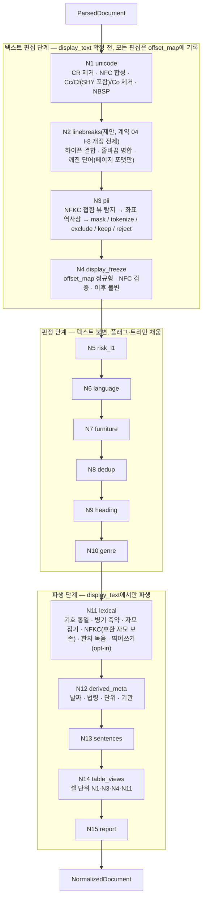

# 정규화와 정제

## 목적

`normalize` 스테이지(`ParsedDocument → NormalizedDocument`, 바이블 §4.2)의 **내부 알고리즘**을 확정한다. [NormalizedDocument 계약](../03-contracts/04-normalized-document.md)은 이 스테이지가 무엇을 내는지(필드·불변식·`offset_map` 정규형)를 정하고, 이 문서는 그것을 **어떤 순서의 어떤 규칙으로 만드는지**를 정한다 — 유니코드 정리, 줄바꿈·하이픈 복원, 머리말·꼬리말·보일러플레이트 판정, 중복 블록, heading 레벨 재추론, 표 셀 뷰, 각주 정책, 언어·장르 판정, 한국어 렉시컬 뷰, 날짜·법령·단위 파생 메타, 문장 분리, 리포트, 그리고 이 모든 편집이 원문 오프셋을 잃지 않게 하는 규칙이다. 정규화는 LLM이 보게 될 본문(`display_text` → `Chunk.text` → `ContextItem.text`)의 형식을 결정하는 마지막 편집 지점이고(계약 04 §목적), 동시에 BM25 입력(`lexical_text`)의 원료를 만든다(3-텍스트 규칙, [ADR-0029](../06-adr/0029-three-text-rule-and-deterministic-context-prefix.md)). 그래서 규칙 하나하나가 인용 좌표·중복 제거·검색 재현율에 직접 닿는다.

## 범위

- 포함: `normalize` 스테이지 경계·격리·멱등성 키·실패 정책의 적용, Normalizer 플러그인 체인(`normalizer.chain`)의 정본 단계 순서와 각 단계의 규칙·기본값·켬/끔, 원문 오프셋 매핑 유지 규칙(편집 연산 3종 ↔ `offset_map` 표현), 한국어 특화 규칙(띄어쓰기 교정 opt-in, 한자·괄호 병기, 날짜·숫자·법령 파생 필드), 통계·플래그, 프로파일별 켬/끔 표와 설정 스키마, 실패·저하·관측, 성능 초안 목표, 테스트 방법(전후 diff 골든).
- 제외: `NormalizedDocument`·`NormalizedBlock` 필드 정의와 스키마([계약 04](../03-contracts/04-normalized-document.md)), `Block`·`TableData` 정의([계약 03](../03-contracts/03-parsed-document.md)), 파서가 만드는 `furniture`·`page_header_text` 판정([05](./05-parser-pdf.md), [04](./04-parser-hwpx-and-hwp.md), [06](./06-parser-doc-and-docx.md)), 청킹 규칙과 표 직렬화·각주 부착의 **집행**([10](./10-chunking-strategies.md)), PII 탐지기·정책 계약의 세부([07-tech-landscape/12](../07-tech-landscape/12-security-multitenancy-pii-and-licensing.md), [계약 15](../03-contracts/15-collection-profile-and-policy-contracts.md)), 사용자 사전 관리 API([05-api/04](../05-api/04-management-api.md)).
- 정본 관계: 필드명·열거값·오류 코드·플러그인 ID 형식은 바이블 §5.4·§5.7·§6과 계약 04를 그대로 쓴다. 바이블 §7.3 `ingest.normalize`에는 `analyzer`·`sentence_splitter`·`pii` 세 키만 있으므로, 이 문서의 단계별 켬/끔 설정(`ingest.normalize.steps`)과 추가 리포트 필드는 **제안**으로 표기하고 [미해결 이슈](#미해결-이슈)에 남긴다. 임계값은 모두 초안 목표이며 골든셋으로 확정한다.

## 1. 스테이지 개관

| 항목 | 값 | 근거 |
|------|----|------|
| 입력 → 출력 | `ParsedDocument` → `NormalizedDocument`(블록 `block_id` 1:1, 물리 제거·병합·생성 없음) | 바이블 §4.2, §5.4; 계약 04 I-1 |
| 스테이지 플러그인 | **`normalizer.chain`** — 플랫폼 소유 합성 스테이지. `parser.router`([01](./01-pipeline-framework.md) §5.6)와 같은 지위로, 아래 §2의 단계를 고정 순서로 실행하고 역할 플러그인에 위임한다. `Producer.plugin_id`·`normalizer_fingerprint`의 `plugin_id`가 이 값이다 | 이 문서(계약 04 미해결 이슈 6 위임) |
| 확장 지점·역할 | `normalizer` 그룹, `PluginMeta.role`: `korean_analyzer`(`ctx.analyzer`), `sentence_splitter`, `pii_detector`(바이블 D-10·§4.2) + 이 문서가 정의하는 `spacing_corrector`(바이블 §7.1 korean-gov 행 명명), `hanja_reader`(§5.1) | 바이블 §3.1 D-10, §7.1 |
| 격리·큐·정책 | `in_process`, `ingest-cpu`, `start_to_close` 5m, heartbeat 없음, `max_attempts` 3, `resumable` no | 바이블 §4.4 |
| 멱등성 키 | `stage_key = H("stage", "normalize", scope_key, parsed.blake3, fingerprint)`, `fingerprint = H("producer", "normalizer.chain", plugin_version, config_hash, "", ",".join(model_ids))`(바이블 §6.2). `config_hash`는 §5.2 설정 전체(`pii.policy`·`pii.tokenize_mode` 포함)이고, `analyzer_id`·`dictionary_hash`·`pii_detector_version`은 **`model_ids` 항목**(`analyzer:{analyzer_id}`·`dict:{dictionary_hash}`·`pii_detector:{detector_version}`, 표기 형식은 §5.1 — 01 §2.4가 이 문서에 위임)으로 지문에 들어간다. 따라서 사전·탐지기 변경은 `stage_key`를 바꾼다(SDK 검증, 바이블 리스크 #8) | 바이블 §4.1, §4.2, §6.2; 01 §2.4; [ADR-0037](../06-adr/0037-artifact-cache-scope-and-stage-key-composition.md) |
| 실패 정책 | `normalize.nfd_residual`·`normalize.pii_policy_violation`·`contract.violation` 비재시도; `normalize.pii_detector_unavailable` 재시도(`keep` 폴백 금지); 문장 분리기 예외 → kss → 정규식 + `warnings[].code = normalize.segmenter_fallback` | 바이블 §4.2, §5.7, §10.3 E4 |
| 문맥 의존 | `ctx.analyzer`(형태소 분석기; `analyzer_id`·`dictionary_hash`)만 외부 자원. 시각은 `ctx.now()`. 산출물 읽기 없음(`requires_lineage` 없음 — 입력 `ParsedDocument` 하나가 구조·좌표·메타를 모두 담는다) | 바이블 §4.1; 01 §3.1 |
| 이벤트·크기 | 워크플로우가 `ingest.document.normalized`(ID·해시·상태만)를 아웃박스에 기록; 산출물 참조만, 256MB | 바이블 §5.1, §5.7 |
| 결정성 등급 | `pure`(01 §8.1): 같은 `ParsedDocument`·같은 지문 → 바이트 동일 산출물(봉투 `created_at` 제외). 모델 호출 없음, 난수 없음 | 01 §8 |



## 2. Normalizer 체인 정본 순서

**결정:** 체인은 세 구간으로 나뉘며 구간 순서와 구간 안의 단계 순서는 바꿀 수 없다. (1) **편집 구간** N1~N4만 `display_text`를 바꾸고 모든 편집을 `offset_map`에 기록한다. (2) **판정 구간** N5~N10은 텍스트를 읽기만 하고 `lang`·`boilerplate`·`furniture_reason`·`heading_tree`·`genre`·`content_risk`를 채운다. (3) **파생 구간** N11~N15는 확정된 `display_text`에서 `lexical_text`·`derived_meta`·`sentence_spans`·`table_cell_views`·리포트를 만든다. 순서를 고정하는 이유는 세 가지다 — PII 치환 뒤에야 `display_text`가 확정되므로 그 전에 텍스트 편집이 끝나야 하고(계약 04 §7), 렉시컬 뷰는 `display_text`에서만 파생해야 PII 치환이 두 뷰에 동일하게 반영되며(계약 04 §3.2), furniture·heading·genre 판정은 편집 뒤의 정규화 문자열을 봐야 페이지 번호 변형 같은 잡음에 흔들리지 않는다. 근거: 바이블 §5.4 `NormalizedBlock`, §6.3; [ADR-0029](../06-adr/0029-three-text-rule-and-deterministic-context-prefix.md), [ADR-0030](../06-adr/0030-single-coordinate-system-and-score-ledger.md).

| # | 단계 ID | 적용 대상 | 바꾸는 것(출력) | 읽는 것 | 끔 가능 | 담당 |
|---|---------|-----------|-----------------|---------|---------|------|
| N1 | `unicode` | 모든 블록 `text` | `display_text`(중간), `offset_map`, `removed_control_chars`, `nfd_composed` | — | 불가(계약 불변식 I-6) | `normalizer.chain` 내장 |
| N2 | `linebreaks` | `source_kind ≠ flow`이고 `type ∈ {paragraph, list_item, heading, caption, footnote}`인 블록(옵션: `flow`의 `source=converted`) | `display_text`, `offset_map` | `ctx.analyzer`(`korean_join=analyzer`), N1 삭제 로그(L1c) | 가능(`steps.linebreaks.enabled`; 계약 04 I-8 개정 채택 전 기본 `false`, §3.2) | 내장 + `korean_analyzer` |
| N3 | `pii` | 모든 블록, 표 셀 텍스트(N14에서 재호출) | `display_text`, `offset_map`, `annotations.pii_spans`, `pii_report` | `pii.policy`·`tokenize_mode`(워크플로우 주입), 중간값의 NFKC 접힘 뷰(내부) | 불가(정책 `keep`도 탐지·기록은 수행) | `pii_detector`(`normalizer.presidio_ko`) |
| N4 | `display_freeze` | 모든 블록 | `display_text` 확정, `offset_map` 정규형(M1~M6), NFC 검증 | — | 불가 | 내장 |
| N5 | `risk_l1` | 모든 블록 | `annotations.content_risk[]` | N1 제거 통계, 패턴 목록 | 가능 | 내장 |
| N6 | `language` | 모든 블록 | `lang` | `ParsedDocument.language` | 불가(필수 필드) | 내장 |
| N7 | `furniture` | 모든 블록 | `boilerplate`, `furniture_reason`, `boilerplate_removed` | `Block.furniture`·`type`·`container`, `metadata.page_header_text/page_footer_text/navigation_text`, `provenance.page` | 부분(반복 탐지·상용구만) | 내장 |
| N8 | `dedup` | 본문 블록 | `boilerplate`, `furniture_reason`(잠정 `boilerplate`) | 인접 블록 `display_text` | 가능 | 내장 |
| N9 | `heading` | `type=heading` 블록 | `heading_tree[]{block_id, level, path}` | `level`, `heading_inferred`, `numbering_label`, `boilerplate` | 부분(재추론만) | 내장 |
| N10 | `genre` | 문서 | `genre`, `genre_source`(N) | 요청 힌트, `metadata.genre`, 본문 블록 통계 | 불가(필수 필드) | 내장 |
| N11 | `lexical` | 모든 블록 | `lexical_text`, `hanja_replaced`, `spacing_corrected` | `lang`, `text_source` | 부분(한자 독음·병기 축약·띄어쓰기) | 내장 + `hanja_reader` + `spacing_corrector` |
| N12 | `derived_meta` | 본문 블록 `display_text` | `derived_meta.dates/law_refs/entities_normalized` | 사용자 사전(`org`) | 항목별 가능 | 내장 + `ctx.analyzer` |
| N13 | `sentences` | 모든 블록 | `sentence_spans` | `lang` | 불가(필수 필드; 폴백 체인) | `sentence_splitter` |
| N14 | `table_views` | `type=table` 블록의 앵커 셀 | `table_cell_views[]`(조건 필수: 정책 ≠ `keep`, 계약 04 §2.9·I-22) | `TableData.cells[].text` | 조건(`pii.policy ≠ keep`이면 불가, §3.14) | 내장(N1·N3·N4·N11 재호출) |
| N15 | `report` | 문서 | `normalization_report`, `stats`(N), `quality`, `warnings`, 봉투 | 모든 단계 | 불가 | 내장 |

## 3. 단계 정의

각 단계는 `(display_text 중간값, offset_map 편집 로그) → (display_text, 로그)` 또는 `(display_text 확정값) → 필드`의 순수 함수다. 편집 단계는 §4의 편집 연산 세 가지(동일 길이 치환·삭제·불투명 치환)만 쓴다.

### 3.1 N1 `unicode`

**결정:** 표시 텍스트는 NFC이며, NFC와 제어·서식·사용자 영역 문자 제거, NBSP 치환 외의 문자 변경은 하지 않는다(계약 04 §3.1; 바이블 §6.3). `CR`(U+000D)은 `Cc`이므로 제거 대상이고 그 결과 `CR LF`는 `LF` 하나가 된다(계약 04 §3.1 (2)). 전각 영숫자·원문자·`㈜`·호환 한자 같은 정보 손실 변환(NFKC)은 N11 렉시컬 뷰에만 적용한다([07-tech-landscape/13](../07-tech-landscape/13-korean-nlp-tokenization-and-language-resources.md) §띄어쓰기 교정과 정규화 도구).

| 규칙 | 내용 | `offset_map` 표현 | 집계 |
|------|------|-------------------|------|
| U1 CR 제거 | `CR`(U+000D)은 `Cc`이므로 삭제 — `CR LF`는 `CR`만 삭제되어 `LF`가 남고(2→1), 단독 `CR`도 삭제한다(`LF`로 바꾸지 않는다 — 단독 `CR → LF` 변환은 계약 04 I-8 개정 항목, 미해결 이슈 1) | 경계 마커(M6). 계약 04 §3.3 M5는 `CR LF→LF`를 불투명 구간(2→1) 예시로 들지만, 이 문서는 `CR`이 `Cc` 제거 문자라는 점에서 다른 제어 문자와 같은 **M6 경계 마커 표현으로 통일**한다(두 표현 모두 정규형에 맞다; 골든 왕복 테스트 §8.3·§4 예는 M6 표현을 기대한다 — 계약 04 M5 예시 문구 정합 제안은 미해결 이슈 1) | `removed_control_chars += 1` |
| U2 NFC 합성 | `unicodedata.normalize("NFC")`. 조합형 자모(U+1100~U+11FF) 연쇄가 완성형 음절로 합성된다("자모 분리 복원"). 결합 문자(`e` + U+0301) 합성, 호환 한자 정규 사상 포함 | 길이가 줄어드는 클러스터는 불투명 구간, 1→1 정규 사상은 1:1 구간(비교 기준이 `NFC(원문)`이므로 I-8 충족) | `nfd_composed += len(before) − len(after)` |
| U3 제거 | 일반 범주 `Cc`(U+0009 탭·U+000A LF 제외; U+000D CR은 U1), `Cf`(U+200B~U+200D, U+2060, U+FEFF, 양방향 제어 U+202A~U+202E·U+2066~U+2069, **U+00AD 소프트 하이픈 포함** — 항상 삭제하고 N2 L1c는 삭제 로그로 그 자리를 참조한다), `Co`(PUA U+E000~U+F8FF, 15·16번 평면 — HWP 5.0 변환본의 한컴 전용 문자) | 삭제 → 경계 마커(M6) | `removed_control_chars += 제거 수` |
| U4 NBSP | U+00A0 → U+0020 | 동일 길이 치환(I-8 명시 예외) | — |
| U5 보존 | 탭(표 선형화의 셀 구분자, 계약 03 §6), LF(N2가 판단), U+3000 전각 공백, 호환 자모(U+3130~U+318F, "ㅋㅋ" — NFC로 합성되지 않음), 모든 `L*`·`N*`·`P*`·`S*` 문자 | — | — |

- 적용 단위는 블록 `text` 전체이고, 표 블록은 선형화 문자열(탭·LF 구분)에 그대로 적용한다 — 셀 경계 문자는 U5로 보존되므로 격자가 깨지지 않는다.
- U+00AD를 N1이 삭제하는 이유: N2가 적용되지 않는 블록(흐름 포맷 기본, `table`·`code`·`formula`, `steps.linebreaks.enabled = false`)과 줄 중간의 소프트 하이픈(DOCX `w:softHyphen`, HTML `&shy;`, 표 셀)이 `display_text`에 남으면 계약 04 I-6b(`Cf` 없음)를 위반해 N4 검증에서 문서 전체가 실패한다. 줄 끝 소프트 하이픈의 결합 의미는 N2 L1c가 N1 삭제 로그(원문 위치)로 복원한다.
- 호환 자모 연쇄를 음절로 결합하는 `jamo_repair`(python-jamo `j2h`, Apache-2.0)는 OCR·HWP 변환 잔해 복구용 옵션 후보이나 "ㅋㅋ"·"ㄱ." 같은 정상 표기를 훼손할 수 있어 v1에서는 두지 않는다(미해결 이슈 14).

### 3.2 N2 `linebreaks` — 하이픈 결합·줄바꿈 병합·깨진 단어

PDF·OCR 텍스트 추출은 레이아웃의 줄을 그대로 `LF`로 이어 붙인다([05](./05-parser-pdf.md) §4.1 빠른 경로 `pdf_fast_cpu` 표 "하이픈 줄바꿈 복원은 `normalize`"). 한국어 조판은 어절 중간 어디서든 줄을 바꾸므로, 줄바꿈을 공백으로 바꾸면 "보안관 리"처럼 단어가 갈라지고, 그냥 이어 붙이면 어절 경계에서 사라진 공백을 잃는다. 라틴 문자는 하이픈 분철(hyphenation)이 있다.

**결정(적용 범위):** N2는 **페이지 포맷**(`source_kind ∈ {born_digital, scanned, mixed, pre_ocr}`)의 텍스트성 블록(`paragraph, list_item, heading, caption, footnote`)에만 적용한다. 흐름 포맷(`flow`)의 블록 내부 `LF`는 저자의 강제 줄바꿈(OWPML `hp:lineBreak`, OOXML `w:br`)이므로 보존하되, HWP 5.0 변환본(`Block.source = converted`)은 프로파일 옵션 `apply_to_converted_flow`로 포함할 수 있다(바이블 §7.1 korean-gov "spacing_corrector opt-in"과 같은 동기; 13 §O-07 의견). `table`·`code`·`formula` 블록은 절대 적용하지 않는다(탭·LF가 구조 구분자다).

**제안(계약 04 I-8·§3.1 (2) 개정 전제, 미해결 이슈 1):** 아래 L1~L5·W1·W3 규칙은 `LF`·줄 끝 하이픈의 삭제와 `LF → 공백` 동일 길이 치환을 포함하므로 계약 04 I-8 현행 문구("1:1 구간의 차이는 NBSP→공백만", "사상 밖에는 제거 대상 문자만")와 §3.1 (2)(`LF`는 제거 대상이 아님)에 어긋난다. 바이블 §1.1에 따라 이 문서는 계약을 바꾸지 못하므로 규칙 집합은 개정(minor) **제안**이고, 개정 채택이 `steps.linebreaks.enabled = true`의 **선행 조건**이다. 채택 전 기본값은 `enabled: false`(계약 준수 동작 — `LF`·하이픈 보존, 이때 `LF`는 N13의 1차 문장 경계로 남는다)이며, 채택되면 §5.2·§5.4의 기본값을 `true`로 바꾸고 §5.3 표의 "켬"이 유효해진다. 적합성 키트의 I-8 검사와 §8.3 왕복 속성 테스트는 항상 계약 04 **현행** 허용 집합으로 실행하고, 확장 집합은 채택 후에만 적용한다.

`enabled = true`일 때 `LF` 하나를 만날 때마다 왼쪽 문맥 `L`(직전 비공백 문자·어절)과 오른쪽 문맥 `R`(직후 비공백 문자·어절)로 다음 규칙을 **위에서부터 첫 일치**로 적용한다.

| 규칙 | 조건 | 동작 | `offset_map` |
|------|------|------|--------------|
| L1 라틴 분철 | `L`이 라틴 문자 + `-`(U+002D)·`‐`(U+2010)로 끝나고 `R`이 라틴 소문자로 시작 | 하이픈과 `LF` 삭제(2문자) → 단어 결합 | 경계 마커(삭제 2) |
| L1b 하이픈 유지 | `L`이 `-`로 끝나고 `R`이 숫자·대문자로 시작(`COVID-19`, `K-Pass`) | `LF`만 삭제 | 경계 마커(삭제 1) |
| L1c 소프트 하이픈 | N1 삭제 로그상 이 `LF` 직전 원문 위치에 U+00AD가 있었음(문자 종류 무관; U+00AD 자체는 N1 U3가 이미 삭제) | `LF` 삭제 → 하이픈 없이 결합 | 경계 마커(삭제 1; N1의 U+00AD 마커와 인접하므로 N4가 하나로 접는다) |
| L2 한글 결합 | `L`·`R`이 모두 한글 음절 | `korean_join` 정책: **`analyzer`(기본)** — `ctx.analyzer.tokenize(L_어절 + R_어절)`에서 한 형태소가 결합 지점을 가로지르면 `LF` 삭제(붙여쓰기), 아니면 `LF` → 공백; `space` — 항상 공백; `none` — 항상 삭제 | 삭제 = 경계 마커 / 공백 = 동일 길이 치환 |
| L3 괄호·문장 부호 | `L`이 여는 괄호(`(` U+0028, `[` U+005B, `「` U+300C, `『` U+300E, `《` U+300A, `〈` U+3008, `“` U+201C, `‘` U+2018, 전각 `（` U+FF08·`［` U+FF3B)로 끝나거나 `R`이 닫는 괄호·구두점(`)` `]` `」` `』` `》` `〉` `”` `’` `）` `］` `,` `.` `;` `:` `、` U+3001 `。` U+3002)으로 시작 | `LF` 삭제 | 경계 마커 |
| L4 빈 줄 | `LF LF`(블록 안 빈 줄) | 하나만 남김(문단 내부 의도적 단락) | 경계 마커(삭제 1) |
| L5 기본 | 그 외 | `LF` → 공백(U+0020) | 동일 길이 치환 |

깨진 단어(PDF 추출 특유):

| 규칙 | 조건 | 동작 | 기본 |
|------|------|------|------|
| W1 자간 분리 | 한 글자(한글 음절 또는 라틴 문자) 어절이 단일 공백으로 `letter_spacing_min_run`(초안 4)개 이상 연속("공 고 문 안") | 결합 후보를 `ctx.analyzer`로 검사: 결합 문자열의 형태소 수 ≤ ⌈n/2⌉이고 미등록어(UNKNOWN 계열 태그) 없음이면 공백 삭제 | **끔**(`letter_spacing_repair`); korean-gov는 `ocr` 블록에 켬 |
| W2 리가처 | `fi`·`fl` 등 U+FB00~U+FB06 | 표시 텍스트는 보존(NFC는 리가처를 풀지 않음), N11 S4 `nfkc_kr`이 렉시컬 뷰에서 펼침 | 항상 |
| W3 줄 끝 공백 | `LF` 직전의 연속 공백 | 공백 삭제 후 L1~L5 적용 | 항상 |

- `korean_join=analyzer`는 `analyzer_id`·`dictionary_hash`에 의존하므로 두 값이 지문(`model_ids`, §5.1)에 포함된 것으로 충분히 재현 가능하다(바이블 §4.2). 다만 계약 04 §8 표 `dictionary_hash` 변경 행의 "공백기 기본에서는 `display_text`·`sentence_spans`가 바뀌지 않는다"는 서술은 이 규칙이 적용된 블록에서는 예외가 된다(미해결 이슈 10). `dictionary_hash`의 정규화 행(`row = canonical_json({surface, pos, reading, synonyms, decompound, weight})`, `entry_id`·`tenant_id`·`collection_id`·`source`·`updated_at`·`schema_version` 제외) 정의는 바이블 §6.2 1.3.0(AM-12)이 [03-contracts/16 §6.2](../03-contracts/16-eval-feedback-and-sidecar-contracts.md)를 정본 참조로 확정했다(CR-44); 이 문서는 인용만 한다.
- 결정성: mecab-ko는 오프셋을 직접 주지 않으므로 어댑터가 `node.rlength`로 재구성한 형태소 경계를 쓴다(13 §MeCab-ko 함정). 분석기 예외 시 그 블록은 `space` 정책으로 강등한다(경고 코드 없음 — 리포트 카운터 제안, 미해결 이슈 2).
- I-8과의 관계: `LF → 공백`(L2·L5)은 1:1 구간 안의 동일 길이 치환이고, 하이픈·`LF` 삭제(L1~L4·W1·W3)는 사상 밖 문자다. 둘 다 계약 04 I-8 현행 허용 집합(NBSP→공백; `Cc`·`Cf`·`Co`·`exclude` 원문) 밖이므로 위 **제안** 문단의 선행 조건이 적용된다. 05 §4.1이 하이픈 줄바꿈 복원을 `normalize`에 위임한 만큼 개정은 이 문서의 최우선 요청이다.

### 3.3 N3 `pii`

**결정:** PII 탐지·연산자 적용은 N2 뒤, `display_text` 확정 전에 수행한다(줄바꿈으로 갈라진 전화번호·계좌번호가 N2에서 먼저 이어져야 탐지된다). 정책·연산자·기록·오류는 계약 04 §7과 바이블 §10.3 E4를 그대로 따른다: `mask` → `<{entity_type}>`, `tokenize` → `<{entity_type}:{token}>`, `exclude` → 삭제(경계 마커, `start == end`), `keep` → 원문 유지(구간만 기록; 고유식별정보·계좌·카드는 불가 → `normalize.pii_policy_violation`), `reject` → 탐지 ≥ 1건이면 `normalize.pii_policy_violation`. 탐지기 로딩·호출 실패는 `normalize.pii_detector_unavailable`(재시도)이며 `keep`으로 폴백하지 않는다. 단계는 다음 순서다(계약 04 §3.1 (4)·§7 **결정(탐지 입력)**).

| 하위 단계 | 내용 |
|-----------|------|
| P1 접힘 뷰 | N2 결과(중간값)와 표 앵커 셀 텍스트(N14)를 **NFKC로 접어** 탐지 뷰를 만들고, 코드포인트 단위 접힘 오프셋 표(접힘 전 ↔ 접힘 후; 정규화기 내부, 계약 외)를 함께 만든다. NFC는 전각 영숫자를 접지 않으므로 HWP/HWPX 공문서의 `０１０-１２３４-５６７８`·전각 주민등록번호가 반각 `\d` 기반 `KR_*` 인식기를 통과하는 것을 막는 단계다(적합성 키트 `contract_roundtrip` 케이스) |
| P2 탐지 | `pii_detector`를 접힘 뷰에 호출한다(인식기 목록 `pii.recognizers` + 탐지기 내장 타입) |
| P3 역사상 | 탐지 구간을 접힘 오프셋 표로 접힘 **전** 좌표로 되돌린다. 접힘 경계가 문자 중간에 걸리면(`㈜` → `(주)`처럼 1 → n 접힘) 바깥으로 확장한다 |
| P4 연산자 | 원 좌표에서 연산자를 편집 로그에 기록한다. 치환 결과의 코드포인트 수가 원문과 **다르면** 불투명 구간(m → n), **같으면** 1:1 구간이 되며(계약 04 M5: 길이가 같은 구간은 곧 1:1) 이때는 `pii_spans` 기록 + 청커의 `snap_to_pii_spans`(계약 04 §3.4 — 인용 범위가 `mask`·`tokenize` 구간과 겹치면 구간 경계로 확장)가 토큰 전체 ↔ 원문 PII 전체 대응을 복원한다. I-8 텍스트 동일성 검사는 `pii_spans` 범위를 제외한다 |

- 정책 값은 워크플로우가 `SourceDocument.pii_policy`·`pii_tokenize_mode`를 스테이지 설정 `pii.policy`·`pii.tokenize_mode`로 주입하므로 `config_hash`·`stage_key`에 반영된다(계약 04 §7).
- 탐지 대상은 블록 중간값 전체와 표 앵커 셀 텍스트(N14)의 접힘 뷰다. `annotations[]`(메모·변경 추적)는 인덱싱 제외 기본이므로 탐지하지 않는다.
- `pii_report.tokenize_mode_applied`(바이블 §5.4 1.3.0, AM-31)는 `policy_applied = tokenize`일 때만 적용 모드(`hash`/`encrypt`)를 기록하는 선택 필드다. 이 문서의 P4 연산자 처리가 채우며 값은 항상 워크플로우가 주입한 `pii.tokenize_mode`와 같다.
- **토큰 결정성(계약 04 §7·I-23):** `tokenize` 토큰은 같은 `(tenant_id, entity_type, NFKC 접힘 평문)`에 대해 같아야 한다 — `hash`는 테넌트 고정 salt의 키드 해시, `encrypt`는 테넌트 DEK의 **결정적 AEAD**(AES-SIV 또는 DEK·평문에서 유도한 nonce). Presidio 기본 `encrypt` 연산자는 임의 IV를 쓰므로(확인 필요 as of 2026-09) 그대로 쓰지 않고 `custom` 연산자로 감싼다. 이 요건이 §1의 결정성 등급 `pure`와 §8.3 "2회 실행 바이트 동일"의 근거다.
- `tokenize`의 `hash` salt·`encrypt` DEK는 `pii_detector` 플러그인이 `RuntimeServices`의 키 공급자(01 §3.2 `secrets` 행의 `key_provider`; 모듈은 바이블 §12 `security/key_provider` — 프로파일·설정 키 경로는 바이블 §7.3에 없으므로 **미확정**)에게서 받는다(스테이지 문맥에 비밀 값을 두지 않는 01 §3.2 규칙). 전달 포트(`ctx.secret(credentials_ref)` 여부)의 확정은 01 §3.2 `secrets` 행이 지정한 [02-architecture/05 플러그인 아키텍처](../02-architecture/05-plugin-architecture.md) 미해결 이슈 1과 함께 한다(미해결 이슈 13).
- 탐지기 구성은 프로파일 §7.1 PII 행: `lite` 정규식 + KR 인식기 5종, `standard` + spaCy `ko_core_news_lg`(런타임 다운로드), `korean-gov` `tokenize`+`encrypt`·주민등록번호 `reject`. 마지막은 단일 `pii.policy`로 표현할 수 없으므로 **`pii.reject_entities: [KR_RRN]`(바이블 §7.3 1.3.0 등재 키, AM-43; §5.2)**으로 표현한다 — 이 엔티티가 1건이라도 탐지되면 연산자 적용 전에 `normalize.pii_policy_violation`(비재시도)로 실패하고, 산출물이 나오는 경우 모든 `pii_spans[].operator == policy_applied`이므로 계약 04 I-15·I-16은 그대로 성립한다(엔티티별로 **다른 연산자**를 두는 것은 계약 04 미해결 이슈 9). `Producer.model_ids`에 spaCy 모델(`spacy/ko_core_news_lg@3.8.0`)과 `pii_detector:{detector_version}`을 기록한다(§5.1).

### 3.4 N4 `display_freeze`

편집 로그를 접어 `offset_map` 정규형(계약 04 §3.3 M1~M6)을 만들고, `display_text`가 (a) NFC(`unicodedata.is_normalized("NFC")`), (b) `Cc`(탭·LF 제외)·`Cf`·`Co` 없음, (c) 블록당 2MB UTF-8 이내(계약 04 §10)임을 검증한다. (a) 위반은 **`normalize.nfd_residual`**(비재시도 — 편집 규칙 버그, 계약 04 I-6a), (b)·(c)와 정규형 위반은 **`contract.violation`**(계약 04 I-6b·§3.3)이다. (b)는 N1 U3가 U+00AD를 포함한 모든 `Cf`를 제거하므로 정상 경로에서 도달하지 않는다. 이후 단계는 `display_text`를 바꿀 수 없다(구현은 불변 문자열 + 로그 봉인). 인접한 1:1 구간은 병합하고, 삭제 지점에만 경계 마커를 남기며, 마지막에 종단 마커를 둔다.

### 3.5 N5 `risk_l1`

수집 위생 L1 규칙([07-tech-landscape/12](../07-tech-landscape/12-security-multitenancy-pii-and-licensing.md) §인젠션 완화)을 블록 단위 판정으로 기록한다. 결과는 `annotations.content_risk[]{block_id, kind, score}`(N)이며 `Enrichment.risk_flags`·`risk_score` → `omitted.reason = risk_flagged`의 입력이 된다(계약 04 §12). 규칙 기반이므로 `score`는 `1.0`(규칙 일치)로 고정한다.

| `kind` | 규칙(초안) |
|--------|-----------|
| `hidden_text` | N1에서 제거된 `Cf`·`Co` 수가 `max(8, 원문 길이의 20%)` 이상, 또는 양방향 재정렬 제어(U+202D·U+202E·U+2067·U+2068) 포함 |
| `injection_pattern` | 내장 정규식 목록(한·영: `이전 (지시|명령)(을|를)? 무시`, `시스템 프롬프트`, `ignore (all )?previous instructions`, `you are now`, `disregard .* rules`) + 프로파일 `steps.risk_l1.injection_patterns` 추가 목록. 대소문자·공백 무시, `display_text`에 적용 |
| `encoded_payload` | 공백 없는 base64 문자 연속 ≥ 200자 또는 16진 연속 ≥ 128자(`code` 블록 제외) |

HTML 숨김 요소 제거·PDF 극소 폰트 판정은 파서 책임이며 이 단계는 파서가 남긴 블록만 본다. L2 분류기는 보강 단계 이후의 별도 결정이다(12 §인젝션 완화).

### 3.6 N6 `language`

**결정:** 문서 `language`는 `ParsedDocument.language`를 그대로 쓰고 재판정하지 않는다(계약 04 §6). 블록 `lang`은 `display_text`의 스크립트 비율로 판정한다.

| 순서 | 조건(문자 범주 `L*`만 계수) | `lang` |
|------|----------------------------|--------|
| 1 | 글자 수 < 4 | 문서 `language` 상속 |
| 2 | 가나(U+3040~U+30FF) ≥ 1이고 가나 + 한자가 우세 | `ja` |
| 3 | 한글(음절·자모·호환 자모) ≥ 1이고 한글 ≥ 한자 — 한자 병기 문서 포함 | `ko` |
| 4 | 한자 우세이고 한글 = 0 | 문서 `language`가 `zh`로 시작하면 `zh`, 아니면 문서 `language` 상속 — 한국 법령·고문서의 `大韓民國 憲法 第1條` 블록은 한국어 문서의 한자 표기이며, `zh`로 판정하면 `Chunk.lang`·`IndexRecord.lang = zh`가 되어 `lang = ko` 필터에서 빠지고 청커가 인접 `ko` 블록과 합치지 않는다(N11 S5가 같은 블록의 한자를 독음으로 바꾸는 것과도 일관; 계약 04 §6 (4)·미해결 이슈 17 정합) |
| 5 | 라틴 ≥ 80% | `en`(초안; 라틴 계열 언어 구분은 `language_detector` 역할 제안, 미해결 이슈 12) |
| 6 | 그 외(기호·숫자만, 스크립트 동수) | 문서 `language` 상속 |

표 블록은 셀 텍스트를 이어 계수한다. `lang`은 `Chunk.lang` → `IndexRecord.lang`(필터)로 전파되고 청커가 언어가 다른 블록을 한 청크에 합치지 않는 근거다. 본문 블록의 절반 이상이 문서 언어와 다르면 문서 언어 오판 가능성이 있으나 경고 코드가 카탈로그에 없어 리포트 카운터로만 남긴다(계약 04 미해결 이슈 8; 미해결 이슈 6).

### 3.7 N7 `furniture` — 머리말·꼬리말·페이지 번호·nav·보일러플레이트

**결정:** furniture는 논리 제거다 — 블록을 유지하고 `boilerplate = true` + `furniture_reason ∈ {repeated_header, nav, boilerplate}`를 기록하며 `normalization_report.boilerplate_removed`에 `display_text`를 남긴다(계약 04 §4). 파서의 `Block.furniture = true`는 뒤집지 않는다(추가만). 판정 키는 `k(text) = NFKC(display_text)`에서 숫자를 `#`으로, 연속 공백을 하나로 바꾸고 양끝을 잘라낸 문자열이다(페이지 번호 변형 `- 3 -`/`- 12 -`가 같은 키가 된다; [04](./04-parser-hwpx-and-hwp.md) §3.9의 `hp:pageNum` 치환과 같은 의도).

| 규칙 | 신호 | 판정 | `furniture_reason` |
|------|------|------|--------------------|
| F1 상속 | `Block.furniture = true` | `boilerplate = true` | `type`·`container ∈ {page_header, page_footer}` → `repeated_header`; `type = toc` 또는 `navigation_text` 일치 → `nav`; 그 외 → `boilerplate` |
| F2 메타 일치 | `k(block) ∈ k(metadata.page_header_text ∪ page_footer_text)`이고 블록이 그 페이지의 앞·뒤 `edge_blocks`(초안 2)개 안에 있음(페이지 포맷). `level = 0` heading은 제외(문서 제목이 머리말과 같을 수 있다) | `true` | `repeated_header` |
| F3 반복 탐지 | 페이지 포맷, `type ∉ {heading, table, figure}`, `len(display_text) ≤ max_len`(초안 120). 같은 `k`가 나타나는 서로 다른 페이지 수 `n`이 **`n ≥ repeat_min_occurrences`(초안 2)이고** (`n ≥ repeat_min_pages`(초안 3) **또는** `n / page_count ≥ repeat_min_ratio`(초안 0.30)) | 페이지 앞·뒤 `edge_blocks` 안 → `true`; 그 외 위치는 `len ≤ 40`이고 페이지의 50% 이상일 때만 `true`(워터마크 문구) | 앞·뒤 위치 → `repeated_header`, 그 외 → `boilerplate` |
| F4 쪽 번호 | `^[-–—]?\s*\d{1,4}\s*[-–—]?$`, `^\d{1,4}\s*/\s*\d{1,4}$`, `^(page|p\.|쪽|페이지)\s*\d{1,4}$`(대소문자 무시) | `true` | 페이지 앞·뒤 → `repeated_header`, 그 외 → `boilerplate` |
| F5 상용구(옵션) | 프로파일·컬렉션 `steps.furniture.phrases[]`(앵커드 정규식)와 블록 전체 일치. 기본 빈 목록. korean-gov 예시: `^이 문서는 .*전자문서.*$`, `^본 (공고|문서)는 .*홈페이지.*확인.*$`, `^(배포용|열람용|사본)$`, `^무단\s*(전재|복제).*금지.*$`, `^(©|Copyright)\b.*$` | `true` | `boilerplate` |
| F6 nav | HTML `metadata.navigation_text` 항목과 `k` 일치, 브레드크럼 패턴(`>`·`›`·`/`로 연결된 짧은 항목 ≥ 3개) | `true` | `nav` |

- 절대 하한 `repeat_min_occurrences`가 없으면 1페이지 문서에서 **한 번** 나타난 블록이 `1 / 1 = 100% ≥ 30%`로 "반복"이 되어 첫 문단·"끝."·담당자 표기가 furniture로 오탐된다(1~2페이지 공문·보도자료가 핵심 대상 문서군의 대다수). 따라서 1페이지 문서에서는 F3가 발동하지 않고 F2·F4·F5·F6만 적용되며, 2페이지 문서는 두 페이지 모두 같은 가장자리 블록이 있을 때만 F3에 걸린다. §8.1 골든 코퍼스의 "1페이지 공문" 케이스가 오탐 0을 확인한다.
- "끝."·"붙임"·"별첨"은 공문서의 의미 표지이므로 상용구 목록 기본값에 넣지 않는다(불용어는 검색 측 컬렉션 설정이다, 13 §불용어).
- 반복 탐지는 `provenance.page`가 있는 페이지 포맷에서만 동작한다. 흐름 포맷의 머리말·꼬리말은 파서가 블록 없이 `metadata`로만 넘기므로(04 §3.9, 06 §2.8) F2가 적용될 블록이 없고, 반복 문단은 N8이 다룬다.
- `heading_tree`는 `boilerplate = true` heading을 제외한다(계약 04 §2.2). 임계값은 초안 목표이며 [골든셋 구축](../08-evaluation/03-golden-dataset-construction.md)의 furniture 라벨로 정밀도·재현율을 측정해 확정한다(미해결 이슈 11).

### 3.8 N8 `dedup` — 빈 블록·중복 블록

`blocks`는 1:1 규칙이라 물리 제거가 없다(계약 04 I-1). 따라서 "제거"는 플래그다.

| 대상 | 판정 | 처리 |
|------|------|------|
| 빈 블록 | `display_text == ""`이고 `type ∈ {paragraph, list_item, caption}`(표·그림·수식·구분 블록 제외) | 플래그 없음(`FurnitureReason`에 값이 없다). 청커는 `display_text`가 비고 `table`·`figure`·`formula`가 아닌 블록을 청크에 넣지 않는다([10](./10-chunking-strategies.md)에 요구). 리포트 카운터 `empty_blocks`(제안) |
| 중복 블록 | `steps.dedup.mode = adjacent_exact`(기본): 같은 `type`·같은 `parent_block_id`·`display_text` 완전 일치·`len ≥ min_chars`(초안 20)·직전 본문 블록과 인접. `page_exact`: 같은 페이지 안 어디서나. `off`: 미적용. heading·table·figure 제외 | 뒤 블록에 `boilerplate = true`, `furniture_reason = boilerplate`(잠정 — `duplicate` 값 추가 제안, 미해결 이슈 3). OCR 이중 검출·PDF 겹침 텍스트가 주 대상이다 |

의도적 반복(표 안의 "해당 없음", 개조식 글머리만 있는 블록)은 표 셀이거나 `min_chars` 아래라 걸리지 않는다.

### 3.9 N9 `heading` — 레벨 재추론·점프 보정·`heading_tree`

`heading_tree[]{block_id, level, path}`는 청커의 heading 경로와 결정적 `context_prefix`의 원천이다(계약 04 §2.2; [ADR-0029](../06-adr/0029-three-text-rule-and-deterministic-context-prefix.md)). `level`은 계약대로 `Block.level` 복사이고, 이 단계가 바꾸는 것은 **트리 모양(`path`)**이다.

**결정:** 트리는 유효 레벨 `eff`로 만든다. `steps.heading.reinfer = auto`(기본)에서 (a) 제목 외 heading이 모두 같은 `level`이고(pdftext·Docling이 `SECTION_HEADER`를 한 레벨로 내는 경우) (b) 그중 50% 이상이 아래 번호 스킴과 일치하면 `numbering_label`에서 `eff`를 재추론하고, 아니면 `eff = level`이다. `force`는 항상 재추론, `off`는 항상 `eff = level`.

| 스킴 | 라벨 패턴 → 상대 깊이 | 비고 |
|------|----------------------|------|
| 법령 | `제N편` 1, `제N장` 2, `제N절` 3, `제N관` 4, `제N조` 5 | `law_article` 장르에서 우선 |
| 개요 번호 | `N.` 1, `N.N` 2, `N.N.N` 3 …(점 개수 + 1) | 매뉴얼·보고서 |
| 공문서 개조식 | `□`/`ㅁ` 1, `○`/`ㅇ`(U+3147, 공문서 표준 글머리) 2, `-` 3, `·` 4; `1.` 1, `가.` 2, `1)` 3, `가)` 4, `(1)` 5, `(가)` 6 — 기호 집합은 §3.13 글머리 표가 정본 | `heading_inferred = true` 블록 |
| 로마·알파벳 | `I.` 1, `A.` 2, `a.` 3 | 영문 문서 |

재추론된 깊이는 문서 안에서 나타나는 순서대로 1부터 연속 정수로 압축한다(`level = 0` 제목은 그대로 0). 점프 보정은 스택으로 한다: heading을 문서 순서로 훑으며 스택 꼭대기의 `eff ≥ 현재 eff`이면 pop, `full = [스택의 display_text…, 현재 display_text]`, push. `boilerplate = true` heading은 스택에 넣지 않고 합성 노드는 만들지 않는다. `eff = level`(재추론 없음)이면 `full`의 `eff`가 0 또는 1부터 엄격 증가하므로 `len(full) ≤ level + 1`이 자동으로 성립하고, `1 → 3` 점프는 `[L1, L3]`(단계 생략 허용)가 된다.

**결정(I-13 절단, 계약 04 개정 채택 전):** 재추론이 깊이를 **늘리는** 경우 — 발동 조건 (a)의 전형인 "모든 `SECTION_HEADER`가 `level = 1`인 법령 PDF"에서 제목(0) → 제1장(`eff` 1) → 제1조(`eff` 2)는 `full = [제목, 제1장, 제1조]`(길이 3)가 되어 계약 04 I-13 `len(path) ≤ level + 1`(= 2)을 위반하고 셸 출력 검증이 `contract.violation`을 낸다 — `path`는 `full`을 다음 규칙으로 절단한다: `full[0]`이 `level = 0` 제목이면 그것을 남기고(계약 04 §2.2 `path[0]` 규칙), 나머지는 `full`의 **끝에서** `level + 1 − (제목 1 또는 0)`개만 남긴다(가장 가까운 조상 우선, 중간 조상 생략). 위 예에서 제1조의 `path = [제목, 제1조]`, 제목이 없는 문서의 `path = [제1장, 제1조]`. 재추론이 깊이를 줄이는 경우(`eff < level`)는 절단이 필요 없다. 절단은 정보 손실이므로 계약 04 I-13을 `len(path) ≤ max(level, effective_level) + 1`로 완화하고 `heading_tree[].effective_level`(N)을 추가하는 개정(minor)을 제안하며, 채택 시 절단 규칙을 제거한다(미해결 이슈 4). §8.3의 속성 테스트가 재추론 케이스를 포함해 I-13 만족을 검사한다. `heading_inferred` 블록의 강등 표시(종결어미 `다.`로 끝나거나 120자를 넘는 "제목")도 같은 이슈의 제안이다.

### 3.10 N10 `genre`

**결정:** `genre`는 요청 힌트 > 파서 추론 > 휴리스틱 순으로 확정하고 `genre_source`(N)에 원천을 적는다(계약 04 §5). 휴리스틱은 `boilerplate = false` 블록만으로 계산하며 우선순위는 `law_article > form > manual > outline_report > web_article > narrative`, 본문 블록이 없으면 `unknown`이다.

| 조건(초안 임계값) | `genre` |
|-------------------|---------|
| `numbering_label`이 `^제\d+조`인 블록 ≥ 3개 또는 본문 블록의 ≥ 10% | `law_article` |
| `form_field` 블록 또는 `TableData.role = form` 표가 본문의 ≥ 30% | `form` |
| 점 구분 다단 번호(`1.2.3`) heading이 깊이 ≥ 3 | `manual` |
| §3.13 글머리 표의 기호(`□`·`○`·`ㅇ`·`-`·`·` 등) 또는 `1.`·`가.`·`(1)` 개조식 번호가 `numbering_label` 또는 `display_text` 첫 토큰인 본문 블록이 ≥ 40%이고 heading 깊이 ≤ 2 | `outline_report` |
| `ParsedDocument.metadata.web`(계약 03 §2.4 `WebMetadata`; HTML 파서만 채운다)이 존재 — `SourceDocument.format`은 이 스테이지 입력에 없으므로 읽지 않는다(§1 문맥 의존; 계약 04 §5 같은 문구의 정정 제안은 미해결 이슈 19) | `web_article` |
| 그 외 | `narrative` |

청커는 `genre`를 `ChunkSet.genre_route`로 복사해 `ingest.chunk.genre_rules[genre]`(예 `law_article: {heading_regex: "^제\d+조", split_on: [항]}`, 바이블 §7.3)를 적용한다.

### 3.11 N11 `lexical` — 한국어 렉시컬 뷰

**결정:** `lexical_text`는 `display_text`에서만 파생하며 순서는 S1 기호 통일 → S2 괄호 병기 축약 → S3 반각·둘러싸인 한글 자모 접기 → S4 `nfkc_kr`(호환 자모 보존 NFKC) → S5 한자 독음 → S6 띄어쓰기 교정(opt-in)이다. S2를 제외한 다섯 단계는 계약 04 §3.2의 1~5단계와 같고, **S2 삽입은 계약 04 §3.2 순서에 대한 제안**이다(미해결 이슈 15). 결과는 `nfkc_kr`의 고정점(`lexical_text == nfkc_kr(lexical_text)`)이어야 하고 조합형 자모 U+1100~U+11FF가 없어야 한다(계약 04 I-6a; 바이블 §5.4 불변식); 위반은 `normalize.nfd_residual`(비재시도)이다. 인용 기준이 아니므로 오프셋 사상은 만들지 않는다.

| 순서 | 규칙 | 예 |
|------|------|----|
| S1 기호 통일 | 가운뎃점 `ㆍ`(U+318D)·`•`·`‧`·`∙`·`・` → `·`(U+00B7); 물결 `∼`·`～`·`〜` → `~`; 대시 `–`·`—`·`―`·`‒`·`−` → `-`; 둥근 따옴표 `“ ”`·`‘ ’` → `"`·`'`; `「」『』《》〈〉`는 유지(법령명·문헌명 경계) | `운영ㆍ유지` → `운영·유지` |
| S2 괄호 병기 축약(`paren_dedup`; 제안) | `漢字(한글)` 또는 `한글(漢字)`에서 `독음(漢字) == 한글`이면 한글 하나만 남김; `한글(영문)`·`영문(한글)`·독음이 다른 병기는 유지 | `憲法(헌법)` → `헌법`; `검색 증강 생성(RAG)` 유지 |
| S3 반각·둘러싸인 한글 자모 접기(`fold_jamo_variants`, 계약 04 §3.2 2단계) | (a) 반각 한글 자모 U+FFA0~U+FFDC → 호환 자모 U+3131~U+3164 1:1(반각 채움 문자 `ﾠ` → `ㅤ` U+3164); (b) 원 한글 자음 `㉠`~`㉭`(U+3260~U+326D) → `ㄱ`~`ㅎ`; (c) 괄호 한글 자음 `㈀`~`㈍`(U+3200~U+320D) → `(` + 호환 자모 + `)`. 사상 표는 손으로 쓰지 않고 호환 자모 각각의 NFKC 결과(단독 조합형 자모)의 역표 `CONJOINING_TO_COMPAT`로 유도한다(계약 04 §3.2). NFKC가 이 세 범위를 단독 조합형 자모로 보내므로 S4 앞에 둔다 | `ﾡ` → `ㄱ`; `㉠` → `ㄱ`; `㈀` → `(ㄱ)` |
| S4 `nfkc_kr`(계약 04 §3.2 3단계) | 한글 호환 자모(U+3131~U+318E)를 경계로 문자열을 나눠 조각별 NFKC를 적용하고 호환 자모는 그대로 이어 붙인다. 전각 영숫자·원문자·단위 기호·괄호 약호·리가처는 펼쳐진다 | `２０２６`, `①`, `㎡`, `㈜`, `fi` → `2026`, `1`, `m2`, `(주)`, `fi`; `ㅇ 추진 배경` → `ㅇ 추진 배경`(보존) |
| S5 한자 독음(`hanja_reading`) | `hanja_reader` 역할(기본 `normalizer.kss_hanja`, kss `hanja2hangul` 치환 모드; 서버 측 Nori `nori_readingform`과 같은 방향). `hanja_replaced`에 치환 코드포인트 수 집계 | `職員 채용 公告` → `직원 채용 공고` |
| S6 띄어쓰기 교정(opt-in) | `spacing_corrector` 역할(`normalizer.kiwi_spacing` — `[kiwi]` 설치 시, 폴백 `normalizer.kss_spacing`), `lang = ko`이고 `text_source ∈ steps.lexical.spacing.sources`(기본 `ocr, converted`)인 블록만. 문서 단위 `spacing_corrected = true` | `정보공개청구서를접수하였다` → `정보공개 청구서를 접수하였다` |

- 순수 NFKC를 쓰지 않는 이유: NFKC는 한글 호환 자모를 조합형 자모로 보낸다(`ㅇ` U+3147 → U+110B, `ㄱ` U+3131 → U+1100, `ㆍ` U+318D → U+119E). 공문서 개조식의 표준 글머리 `ㅇ`과 `ㄱ. ㄴ.` 항목 표기가 있는 모든 블록이 자모 잔존 검사에 걸려 핵심 대상 문서군 전체가 비재시도 실패하므로, 계약 04 §3.2는 호환 자모를 NFKC 대상에서 제외하는 `nfkc_kr`을 확정했다. N1 U5가 호환 자모를 표시 텍스트에 보존하는 것과도 일관된다. 형태소 분석기(Kiwi `compatible_jamo=True`, Nori)도 호환 자모를 기대한다(13 §띄어쓰기 교정과 정규화 도구).
- S1이 S4 앞에 오는 이유는 `ㆍ`를 `·`로 통일해 두면 보호 대상에 남지 않기 때문이다(보호 없이 NFKC하면 U+119E가 되어 잔존 검사에 걸린다; 계약 04 §3.2). S2가 S4 앞에 오는 이유는 호환 한자가 NFKC로 정규 한자에 사상된 뒤에도 독음 비교가 성립하도록 원 문자열로 판정하기 위함이다. S3가 S4 앞에 오는 이유는 시험지·법령 별표·서식의 항목 기호 `㉠㉡㉢`·`㈀㈁`이 호환 자모가 아니라 NFKC가 단독 조합형 자모로 펼치는 호환 문자여서 보호 범위만으로는 막을 수 없기 때문이다.
- 원문에 이미 들어 있던 조합형 자모(옛한글 연쇄·단독 자모)는 S3 대상이 아니어서 I-6a에 걸린다. 국어 자료·고문서 컬렉션의 정상 입력이므로 "버그" 분류와 맞지 않으며 계약 04 미해결 이슈 18(역표 되돌리기 또는 경고 강등)을 골든셋 실측 후 ADR로 결정한다. **잠정 규칙(AM-48 보류):** 재발의 전까지는 현행 불변식을 유지한다 — 원문 유래 조합형 자모는 그대로 `normalize.nfd_residual` 경로로 실패하며, 한국어 골든셋에서 옛한글 문서가 실제로 확인되는 시점에 재발의한다(바이블 §5.4 불변식, §4.2; 03-contracts/04 미해결 이슈 18).
- 띄어쓰기 교정은 복합명사를 과분리할 수 있어(13 측정 "공공기관" → "공공 기관") 표시 텍스트에는 절대 적용하지 않고 기본 끔이다(13 §띄어쓰기 교정과 정규화 도구; [ADR-0021](../06-adr/0021-korean-analyzer-kiwi-promotion-and-interim-mecab-kss.md) 코드 리뷰 항목 (2)). 사용자 사전 `NNG` 항목은 교정기의 결합 후보로 우선 적용한다.
- `lang ≠ ko` 블록은 S1·S3·S4만 적용한다. 대소문자는 바꾸지 않는다(서버 분석기 `LowerCaseFilter`·플랫폼 분석기 책임).

### 3.12 N12 `derived_meta` — 날짜·숫자·법령·기관(검색 입력용 별도 필드)

**결정:** 날짜·금액·단위·법령 조항·기관명은 **원문·두 뷰를 바꾸지 않고** `derived_meta`로만 추출한다(13 §결정 "원문을 바꾸지 않고 파생 메타데이터로 추출"; 바이블 §3.2 O-05 비LLM 파생 메타, [ADR-0016](../06-adr/0016-llm-enrichment-default-off-and-budget-policy.md)). 구간은 `display_text` 기준이며 값 형식은 계약 04 §2.3을 따른다.

| `kind` | 인식 패턴(공문서 표기 포함) | `value` | 비고 |
|--------|-----------------------------|---------|------|
| `date` | `YYYY. M. D.`, `YYYY.M.D.`, `'YY. M. D.`, `YYYY년 M월 D일`, `YYYY-MM-DD`, 기간 `YYYY. M. D. ~ M. D.`(뒤쪽은 연·월 승계) | `YYYY-MM-DD`(월 1~12·일 유효성 검증) | **연도 필수**(목차 번호 `1. 2.` 오인 방지, 13 §실패 모드). 월까지만 있는 표기는 추출하지 않음. `dates[]`는 중복 제거·정렬 |
| `law_article` | `「법령명」 제N조(의M)?( 제K항)?`, `법령명 시행령 제N조`; `law_article` 장르 문서 안의 맨 `제N조`는 문서 제목의 법령명으로 보완 | `{법령명}/제n조[/제m항]` | `law_refs[]`로 집계 |
| `unit` | 금액 `1,250백만원`·`12.5억 원`·`3천만원`, 면적 `3,000㎡`, 길이·중량 `12km`·`5kg`, 비율 `12.3%`·`%p` | `{정수 또는 최단 소수} {단위}`; 금액은 원 단위 정수 + `KRW`, 면적 `m2`, 비율 `%`/`%p` | 초안 형식; SI 표기 정본은 계약 04 소유 |
| `org` | 컬렉션 사용자 사전 `UserDictEntry.pos = NNP` 항목의 `surface`·`synonyms` 완전 일치 | 정규 기관명(`surface`) | 사전이 없으면 생략. `Enrichment.keywords[].source = user_dict`·부스트 `user_dictionary`의 원천 |

- 날짜의 BM25 매칭("2026년 9월" 질의)은 `lexical_text`에 ISO 문자열을 넣어 해결하지 않는다 — 렉시컬 뷰의 파생 규칙(§3.11)을 넘기 때문이다. `Enrichment.dates`·필터 `doc_date`·`recency` 부스트가 이 값을 쓰고, `index_text`에 날짜를 부착할지는 [11 보강](./11-enrichment.md)의 결정이다.
- 형태소 분석기가 날짜를 한 토큰(`W_SERIAL`)으로 묶는 Kiwi와 분리 토큰으로 내는 mecab-ko의 차이는 이 단계와 무관하다(정규식 기반).

### 3.13 N13 `sentences`

**결정:** 문장 분리 체인은 프로파일 `ingest.normalize.sentence_splitter`(기본 `normalizer.kss_punct`, 폴백 `normalizer.regex_sentences`; `[kiwi]` 설치 시 `normalizer.kiwi_sentences` → kss → 정규식)이고, 블록 단위 예외는 다음 폴백으로 넘기며 `warnings[] {code: normalize.segmenter_fallback, block_id}`를 남긴다(바이블 §4.2, §5.7; [ADR-0021](../06-adr/0021-korean-analyzer-kiwi-promotion-and-interim-mecab-kss.md)). kss `fast` 백엔드는 설정에서 허용하지 않는다(13 측정 오분할).

| 규칙 | 내용 |
|------|------|
| 1차 경계 | `LF`(흐름 포맷의 강제 줄바꿈, N2가 남긴 단락)는 항상 문장 경계다. 개조식("~함", "~할 것", "~요망")은 종결 부호가 없어 이것이 유일한 경계다(13 §문장 분리 난점) |
| 글머리 경계 | 줄이 아래 글머리 표의 기호 또는 번호로 시작하면 그 앞에서 경계(`steps.sentences.bullet_boundary`) |
| 분리기 호출 | 경계로 나뉜 각 조각에 분리기를 호출. Kiwi는 `Sentence.start/end/subs`를 그대로 쓰고, kss·정규식은 문자열 목록을 순서대로 원 조각에서 찾아 오프셋을 복원한다(공백 차이는 허용, 그 외 불일치는 그 블록을 정규식으로 강등 + 경고) |
| 비한국어 블록 | `lang ≠ ko`는 `normalizer.regex_sentences`(종결 부호 + 공백; 약어·소수점 예외 목록) |
| 표·코드·수식 | 표 블록은 탭·LF로 나뉜 비어 있지 않은 셀 조각 하나를 한 구간으로, 코드는 줄 하나를 한 구간으로, 수식은 전체를 한 구간으로 |
| 불변식 | 정렬·비중첩·`[0, len)` 안, 비공백 문자는 정확히 한 구간에 속함(계약 04 I-10). 분리기가 문자를 떨어뜨리면 직전 구간을 늘려 붙인다 |

**글머리 기호 정본 집합(초안 목표):** §3.9 개조식 스킴, §3.10 `outline_report` 조건, 이 절의 글머리 경계가 모두 이 표를 참조하며 [10](./10-chunking-strategies.md)의 개조식 분할과도 단일 소스로 공유한다(미해결 이슈 18). 글머리는 줄 시작(선행 공백 허용)의 기호 + 공백 또는 번호 라벨 + 공백이고, 호환 자모 글머리(`ㅇ`·`ㅁ`)는 뒤에 공백이 올 때만 글머리로 본다(`ㅋㅋ` 같은 표기와 구분).

| 부류 | 기호·라벨 | 코드포인트 | 비고 |
|------|-----------|-----------|------|
| 네모 | `□`, `■`, `ㅁ` | U+25A1, U+25A0, U+3141 | `ㅁ`은 실무에서 `□` 대용 |
| 동그라미 | `○`, `◦`, `ㅇ` | U+25CB, U+25E6, U+3147 | `ㅇ`은 한국 공문서 개조식의 표준 글머리(계약 04 §3.2·§5); 렉시컬 뷰에서도 보존됨(§3.11 S4) |
| 선·점 | `-`, `–`, `·`, `•`, `‧`, `ㆍ` | U+002D, U+2013, U+00B7, U+2022, U+2027, U+318D | S1이 렉시컬 뷰에서 `·`로 통일 |
| 삼각·화살·별표 | `▪`, `▶`, `▷`, `※` | U+25AA, U+25B6, U+25B7, U+203B | `※`는 참고 표지(경계만, 깊이 없음) |
| 원문자 | `①`~`⑳` | U+2460~U+2473 | S4가 렉시컬 뷰에서 `1`~`20`으로 펼침 |
| 번호 라벨 | `1.`, `가.`, `1)`, `가)`, `(1)`, `(가)`, `Ⅰ.`, `A.`, `a.` | — | §3.9 스킴의 상대 깊이 |

### 3.14 N14 `table_views`와 표 정제 정책

표의 정본은 `ParsedDocument.Block.table`(`TableData`, 앵커 셀 + span)이고 `NormalizedDocument`는 구조를 복제하지 않는다(계약 03 §6, 04 §1). 그러나 `TableData.cells[].text`는 원문이어서 NFC·PII 정책이 적용되지 않은 상태로 청커의 표 행 그룹 직렬화에 들어갈 수 있다(계약 04 §2.9·미해결 이슈 2).

**결정:** `normalizer.chain`은 `type = table` 블록의 모든 앵커 셀에 대해 `table_cell_views[]{block_id, row, col, display_text, lexical_text, offset_map}`(바이블 §5.4 1.3.0 등재, AM-31; 계약 04 §2.9 **조건 필수** 필드 — `pii_report.policy_applied ≠ keep`이면 필수·앵커 셀 1:1, 표가 없으면 `[]`; `keep`이면 N, I-22)을 **항상 생산**한다(`steps.table.cell_views = true` 기본; `pii.policy ≠ keep`이면 끌 수 없다 — 셀 안의 PII가 `Chunk.text`로 새는 것을 막는 유일한 경로다). 셀 텍스트에는 N1·N3·N4·N11을 적용하고 N2는 적용하지 않는다(셀 안 `LF`는 문단 병합 구분자, 계약 03 §2.8). 청커는 `table_cell_views`가 있으면 그것을 쓰고, 없을 때 `TableData.cells[].text`로 폴백하는 것은 `policy_applied = keep`일 때만 허용된다(정책 ≠ `keep`인데 뷰가 없으면 `contract.violation`, 계약 04 §2.9). 계약 04 I-11(PII 원문 부재)은 셀 뷰에도 적용한다.

셀 텍스트 재호출(N1·N3·N4·N11) 중 N3가 셀 안에서 PII를 탐지하면 그 구간은 문서 전체 `annotations.pii_spans[]`에 `row`·`col`을 채워 기록한다(값이 있으면 `table_cell_views[]`의 `(block_id, row, col)` 셀 뷰 `display_text` 기준, 둘 다 없으면 `NormalizedBlock.display_text` 기준 — 바이블 §5.4 1.3.0 `pii_spans[].row/col`, AM-31; 계약 04 §2.9·I-22). 블록 단위 탐지(P1~P4)와 같은 정책·연산자를 그대로 적용한다.

표 정제 정책은 **의미를 이 문서가 정의하고 집행은 청커의 표 직렬화기**([10](./10-chunking-strategies.md))가 한다 — `TableData`를 바꿀 수 없으므로 "제거"와 "전파"는 직렬화 시점의 선택이다.

| 정책 | 정의 | 기본(초안) |
|------|------|-----------|
| 빈 행 | 행의 모든 앵커 셀 `display_text == ""`(뷰 기준)이고 중첩 표 없음, `header_row_indices`에 없음 → 직렬화에서 생략 | 생략 |
| 빈 열 | 열의 모든 앵커 셀이 비어 있고 헤더 셀도 비어 있음 → 생략 | 생략 |
| 병합 셀 텍스트 전파 `TableMergedCellPolicy`(제안 열거) | `anchor_only`: 앵커 위치에만 한 번; `repeat_in_row_groups`: 행 그룹이 span을 가로질러 나뉠 때 각 그룹의 첫 행에 앵커 텍스트 반복(한 직렬화 안에서는 한 번); `span_marker`: 비앵커 위치에 `〃`(같음 표시) | `repeat_in_row_groups` — 헤더 행 반복(D-19 표 행 그룹 256 토큰)과 같은 원리로 그룹마다 문맥을 잃지 않게 한다 |
| 헤더 | `header_row_indices`가 비면 첫 행을 헤더로 간주(`header_inferred = true`, 파서 규약) | 파서 값 유지 |
| `role = layout` | 셀 텍스트를 읽기 순서로 이어 문단으로 강등(계약 03 §6) | 유지 |

정책 값의 프로파일 키 위치(`ingest.normalize` 또는 `ingest.chunk`)와 열거 등재는 10 문서와 합의한다(미해결 이슈 5).

### 3.15 각주 인라인·분리 정책

각주 블록(`type = footnote`, `container = footnote_body`)은 앵커 블록과 같은 부모의 형제로 앵커 직후에 놓이고 미주는 문서 끝 루트 형제다(계약 03 §4.2). 앵커 텍스트의 마커(`1)`, `※`)는 원문이므로 `display_text`에 남는다(계약 03 §7). 정규화는 각주 블록을 본문 블록과 같게 처리하며(`boilerplate = false`, `lang`·`lexical_text`·`sentence_spans`), 각주 본문을 앵커 블록의 `display_text` 안에 끼워 넣는 "인라인"은 블록 1:1·`offset_map` 단일 원문 규칙상 불가능하다.

**결정:** 각주 정책 `FootnotePolicy`(제안 열거)는 청커가 집행하고 **기본값의 정본은 [10](./10-chunking-strategies.md) §1 설정 표 `footnote_policy`**다 — `attach`(기본, `kind=footnote`): 각주 블록을 앵커 블록과 같은 청크에 넣는다(읽기 순서상 앵커 직후이므로 구조 인식 청킹이 자연히 합치고, 예산 초과 시 앵커 청크 다음 청크의 첫 블록으로 둔다); `separate`(기본, `kind=endnote`): 각주만으로 청크를 만들고 heading 경로는 앵커 섹션을 따른다; `drop`: 청크에서 제외(법률 주석처럼 잡음이 큰 컬렉션). 미주(`footnote.kind = endnote`, 문서 끝 루트 형제)는 앵커와 같은 리프에 붙을 수 없으므로 기본값이 `separate`이며, 10 §1·§5가 이 값을 병기해 두 문서가 맞췄다(#1). `kind`별 기본값은 여전히 바이블·계약 미등재 제안이다(미해결 이슈 5). 어떤 정책도 `Chunk.text = block_refs 합집합` 불변식을 깨지 않는다([ADR-0029](../06-adr/0029-three-text-rule-and-deterministic-context-prefix.md) 준수 항목 (1)). 렉시컬 뷰에서 위 첨자 마커(`¹`)는 NFKC로 `1`이 되며 별도 제거는 하지 않는다.

### 3.16 N15 `report` — 통계·플래그·품질

| 출력 | 내용 |
|------|------|
| `normalization_report` | `removed_control_chars`(N1), `nfd_composed`(N1), `hanja_replaced`(N11 S5), `spacing_corrected`(N11 S6 적용 여부), `boilerplate_removed`(N7·N8 `display_text`, 중복 제거·코드포인트 순 정렬; **512 코드포인트를 넘는 항목은 `"h:" + blake3_hex(utf8(display_text))`로 대체 기록**하고 서로 다른 항목이 1,000개를 넘으면 문서 순 앞 1,000개만 — 계약 04 §2.6·I-12) — 바이블 §5.4 고정 필드 |
| 확장 카운터(제안, 미해결 이슈 2) | `dehyphenated`, `linebreaks_merged`, `letter_spacing_repaired`, `duplicate_blocks`, `empty_blocks`, `heading_levels_reinferred`, `language_mismatch_blocks`, `content_risk_blocks`, `segmenter_fallback_blocks` — 채택 전까지는 골든 diff 픽스처(§8.2)에만 존재 |
| `stats`(N) | `block_count`, `body_block_count`, `furniture_block_count`, `display_chars`, `lexical_chars`, `sentence_count`, `pii_span_count`, `analyzer_token_count`(계약 04 §2.8) |
| `quality`·`warnings` | 입력 `ParsedDocument.quality = degraded`이거나 `warnings ≠ []`이면 `degraded`(계약 04 I-19). 경고는 `normalize.segmenter_fallback`만 카탈로그에 있다 |
| 봉투·계보 | `lineage_refs = {source, parsed}`(계약 00 §3.2), `parsed_ref = lineage_refs.parsed`, `producer{plugin_id: normalizer.chain, plugin_version, config_hash, image_digest: null, model_ids}`, `normalizer_fingerprint`(바이블 §6.2) |
| `heading_tree`, `derived_meta`, `annotations`, `pii_report`, `table_cell_views` | 각 단계 산출 그대로 |

## 4. 원문 오프셋 매핑 유지 규칙(인용 복원)

모든 편집 단계는 다음 세 연산만 쓰고, N4가 연산 로그를 계약 04 §3.3 정규형으로 접는다. 하류(`chunk`의 `BlockRef.original_char_*`, `hydrate`·`pack`의 `Provenance`)는 `to_original`(계약 04 §3.4)만으로 원문 좌표를 복원하므로(바이블 §6.3, [ADR-0030](../06-adr/0030-single-coordinate-system-and-score-ledger.md)) 정규화 규칙이 늘어나도 소비자 코드는 바뀌지 않는다.

| 연산 | 쓰는 규칙 | `offset_map` 표현 | 복원 의미 |
|------|-----------|-------------------|-----------|
| 동일 길이 치환(n → n) | U4 `NBSP → 공백`, U2 정규 사상(1 → 1), N3 원문과 코드포인트 수가 같은 `mask`·`tokenize`(§3.3 P4); **개정 전제(미해결 이슈 1)** — L2·L5 `LF → 공백` | 1:1 구간의 일부(구간을 나누지 않음; 계약 04 M5는 길이가 같은 구간을 곧 1:1로 규정) | 문자 단위 1:1. 동일 길이 PII 치환은 `pii_spans` + 청커 `snap_to_pii_spans`(계약 04 §3.4)가 토큰 전체 ↔ 원문 PII 전체로 복원 |
| 삭제(k → 0) | U1 `CR`, U3 제어·서식(U+00AD 포함)·PUA, N3 `exclude`; **개정 전제** — L1~L4·W1·W3 줄바꿈·하이픈·공백 | 삭제 지점에 경계 마커 `[d, o, 0]`, 다음 구간 `original_start = o + k`(M6); 인접 삭제는 마커 하나로 접음 | 삭제 문자는 어느 표시 구간에도 속하지 않음 |
| 불투명 치환(m → n, **m ≠ n**) | U2 NFD 클러스터 합성, N3 길이가 다른 `mask`·`tokenize` | 불투명 구간 `[d, o, n]`, 다음 원소 `original_start = o + m`(M5) | 표시 구간 전체 ↔ 원문 구간 전체 |

예 — 라틴 분철 L1: 원문 `infor-\nmation`(13) → 표시 `information`(11): `[[0, 0, 5], [5, 5, 0], [5, 7, 6], [11, 13, 0]]`. 한글 결합 L2(`analyzer`): 원문 `보안관\n리에서`(7) → 표시 `보안관리에서`(6): `[[0, 0, 3], [3, 3, 0], [3, 4, 3], [6, 7, 0]]`. 줄바꿈 → 공백 L5(개정 채택 후): 원문 `the quick\nbrown`(15) → 표시 `the quick brown`(15): `[[0, 0, 15], [15, 15, 0]]` — 1:1 구간이지만 9번째 문자가 다르다(I-8 허용 집합 확장 항목). CR LF: 원문 `가\r\n나`(4) → 표시 `가\n나`(3): `[[0, 0, 1], [1, 1, 0], [1, 2, 2], [3, 4, 0]]`(CR 삭제 마커, LF는 1:1 — §3.1 U1의 M6 통일 표현; 계약 04 M5 예시의 불투명 구간 `[[0, 0, 1], [1, 1, 1], [2, 3, 1], [3, 4, 0]]`도 정규형상 유효하지만 이 문서와 골든 픽스처는 M6 표현만 쓴다).

구현 규칙: (1) 편집은 원문 좌표로 기록하고 표시 좌표는 N4가 계산한다(단계 간 좌표 오염 방지). (2) 같은 원문 위치에 두 편집이 겹치면 `contract.violation`(버그). (3) `to_original(0, len(display_text))`의 결과 밖에는 제거 대상 문자만 있어야 한다 — 계약 04 I-8 현행 집합은 `Cc`·`Cf`·`Co`·`exclude` 원문이고, 줄 끝 하이픈·`LF`는 개정 채택 후 추가된다; 골든 테스트가 원문·표시 쌍으로 이를 검증한다(§8.3). (4) 표 셀 뷰의 `offset_map`은 셀 `text` 기준으로 같은 규칙을 따른다. (5) 동일 길이 PII 치환은 이 인코딩상 1:1 구간과 구별되지 않으므로 청커는 `to_original` 호출 전에 `snap_to_pii_spans`를 적용하고, I-8 텍스트 동일성 검사는 `pii_spans` 범위를 제외한다(계약 04 M5·I-8·미해결 이슈 5).

## 5. 플러그인·설정·프로파일

### 5.1 플러그인 ID와 역할

| `plugin_id` | 역할(`PluginMeta.role`) | 지위 | 비고 |
|-------------|-------------------------|------|------|
| `normalizer.chain` | 스테이지 실행기(합성) | 이 문서 확정 | `Producer.plugin_id`; 단계 구현은 내장 |
| `normalizer.mecab_ko` / `normalizer.kiwi` | `korean_analyzer` | 바이블 §7.3 | `ctx.analyzer`; 공백기 기본 mecab-ko, `[kiwi]` extra([ADR-0021](../06-adr/0021-korean-analyzer-kiwi-promotion-and-interim-mecab-kss.md)) |
| `normalizer.kss_punct` / `normalizer.kiwi_sentences` / `normalizer.regex_sentences` | `sentence_splitter` | 바이블 §7.3 | 폴백 체인 §3.13 |
| `normalizer.presidio_ko` | `pii_detector` | 바이블 §7.3 | KR 인식기 5종 명시 활성 |
| `normalizer.kiwi_spacing` / `normalizer.kss_spacing` | `spacing_corrector`(제안 역할) | 이 문서 | 바이블 §7.1 korean-gov "spacing_corrector opt-in"의 구현; PyKoSpacing(GPL) 제외 |
| `normalizer.kss_hanja` | `hanja_reader`(제안 역할) | 이 문서 | kss `hanja2hangul`(BSD-3); `hanja` 패키지(WTFPL)는 법무 검토 후 extra(13 §후보 목록 B) |

모듈 위치는 바이블 §12 `adapters/normalize/{korean/(kiwi mecab_ko kss user_dictionary) pii_presidio}.py`에 `chain.py`(단계 구현)와 `korean/hanja.py`·`korean/spacing.py`를 더한 것으로 제안한다(미해결 이슈 8). 역할 플러그인은 `Stage` 프로토콜이 아니라 역할 인터페이스(`KoreanAnalyzer`, `SentenceSplitter`, `PiiDetector`, `SpacingCorrector`, `HanjaReader`)를 구현하고, `normalizer.chain`이 `fingerprint()`에 그들의 `plugin_version`·`config_hash`·`model_ids`를 합성한다(SDK 검증 항목: `analyzer_id`·`dictionary_hash` 포함 — ADR-0021 준수 확인 "지문 검증").

**결정(`model_ids` 표기 — 01 §2.4 위임):** `normalizer.chain`의 `Producer.model_ids`는 다음 항목을 문자열 정렬해 담는다.

| 항목 | 표기 | 예 |
|------|------|----|
| 형태소 분석기 | `analyzer:{analyzer_id}`(`analyzer_id`는 바이블 §6.1 `{engine}:{version}:{dictionary}`) | `analyzer:mecab-ko:1.3.7:ko-dic-2.1.1` |
| 컬렉션 사용자 사전 | `dict:{dictionary_hash}`(hex64) | `dict:e5f6a7b8…` |
| PII 탐지기 | `pii_detector:{detector_version}`(`pii_report.detector_version`과 같은 문자열) | `pii_detector:presidio_ko:1.0.0;presidio-analyzer:2.2.364` |
| ML 모델(spaCy NER 등) | 바이블 §6.1 `{repo}@{revision}` | `spacy/ko_core_news_lg@3.8.0` |

값은 `PluginRegistry.build(plugin_id, config, services)`(01 §2.3)가 `RuntimeServices.analyzer`·역할 플러그인을 주입하는 시점에 해소되어 `model_ids()`가 읽는다. 따라서 `fingerprint = H("producer", "normalizer.chain", plugin_version, config_hash, "", ",".join(model_ids))`(바이블 §6.2)가 분석기·사전·탐지기 변경을 반영하고 `stage_key`가 바뀐다(§1; §8.3 결정성 행이 이 경로를 검증). `dictionary_hash`는 컬렉션마다 다르므로 `fingerprint()`는 컬렉션 사전이 해소된 뒤에만 호출되어야 하며, 인스턴스 재사용 단위(01 §3.2 "profile_hash당 1회")에 `dictionary_hash`를 포함하는 규칙은 01 문서와 합의한다(미해결 이슈 21). 이와 별도로 `normalizer_fingerprint = H("normalizer", plugin_id, plugin_version, config_hash, analyzer_id, dictionary_hash, pii_policy, pii_detector_version)`(바이블 §6.2)가 같은 값을 산출물 필드로 다시 담는다.

### 5.2 `config_schema`

```python
# src/rag_platform/adapters/normalize/chain.py — normalizer.chain 의 config_schema.
# analyzer · sentence_splitter · pii(reject_entities 포함, 바이블 §7.3 1.3.0 등재 AM-43) 는 바이블 §7.3 정본 키, steps 는 이 문서의 제안(미해결 이슈 7).
from typing import Literal
from pydantic import BaseModel, ConfigDict, Field, model_validator


class Frozen(BaseModel):
    model_config = ConfigDict(extra="forbid", frozen=True)


class PluginRef(Frozen):
    plugin: str                                   # 예 normalizer.mecab_ko
    fallback: str | None = None
    user_dictionary: Literal["collection", "none"] = "collection"


class PiiConfig(Frozen):
    plugin: str = "normalizer.presidio_ko"
    policy: Literal["mask", "tokenize", "exclude", "keep", "reject"]      # 워크플로우가 SourceDocument.pii_policy 로 주입
    tokenize_mode: Literal["hash", "encrypt"] = "encrypt"
    recognizers: tuple[str, ...] = ("KR_RRN", "KR_PHONE", "KR_BANK_ACCOUNT", "KR_CARD", "KR_PASSPORT")
    reject_entities: tuple[str, ...] = ()         # 바이블 §7.3 1.3.0 등재(AM-43, §3.3): 이 엔티티가 1건이라도 탐지되면 normalize.pii_policy_violation. korean-gov: ("KR_RRN",)


class LinebreaksStep(Frozen):
    enabled: bool = False                         # 계약 04 I-8 개정 채택 전 기본(§3.2 제안 문단); 채택 후 True. source_kind != flow 블록에만 적용
    korean_join: Literal["analyzer", "space", "none"] = "analyzer"
    dehyphenate_latin: bool = True
    letter_spacing_repair: bool = False
    letter_spacing_min_run: int = Field(4, ge=3)
    apply_to_converted_flow: bool = False         # HWP 5.0 변환본(source=converted) 포함


class FurnitureStep(Frozen):
    repeat_detection: bool = True
    repeat_min_occurrences: int = Field(2, ge=2)  # 절대 하한 — 1페이지 문서에서 F3 발동 금지(§3.7)
    repeat_min_pages: int = Field(3, ge=2)
    repeat_min_ratio: float = Field(0.30, ge=0.0, le=1.0)
    edge_blocks: int = Field(2, ge=1)
    max_len: int = Field(120, ge=1)
    phrases: tuple[str, ...] = ()                 # 공문서 상용구 정규식(앵커드)


class DedupStep(Frozen):
    mode: Literal["adjacent_exact", "page_exact", "off"] = "adjacent_exact"
    min_chars: int = Field(20, ge=1)


class HeadingStep(Frozen):
    reinfer: Literal["auto", "off", "force"] = "auto"


class TableStep(Frozen):
    cell_views: bool = True                       # pii.policy != keep 이면 False 거부 — NormalizeConfig 의 model_validator(교차 필드)


class SpacingConfig(Frozen):
    enabled: bool = False
    plugin: str = "normalizer.kiwi_spacing"
    fallback: str | None = "normalizer.kss_spacing"
    sources: tuple[Literal["text_layer", "ocr", "vlm", "converted"], ...] = ("ocr", "converted")


class LexicalStep(Frozen):
    symbols: bool = True
    paren_dedup: bool = True
    hanja_reading: bool = True
    hanja_reader: str = "normalizer.kss_hanja"
    spacing: SpacingConfig = SpacingConfig()


class DerivedMetaStep(Frozen):
    dates: bool = True
    law_refs: bool = True
    units: bool = True
    org_from_dictionary: bool = True


class SentencesStep(Frozen):
    line_boundary: bool = True
    bullet_boundary: bool = True


class RiskL1Step(Frozen):
    enabled: bool = True
    injection_patterns: tuple[str, ...] = ()      # 내장 목록에 추가


class StepsConfig(Frozen):
    linebreaks: LinebreaksStep = LinebreaksStep()
    furniture: FurnitureStep = FurnitureStep()
    dedup: DedupStep = DedupStep()
    heading: HeadingStep = HeadingStep()
    table: TableStep = TableStep()
    lexical: LexicalStep = LexicalStep()
    derived_meta: DerivedMetaStep = DerivedMetaStep()
    sentences: SentencesStep = SentencesStep()
    risk_l1: RiskL1Step = RiskL1Step()


class NormalizeConfig(Frozen):
    analyzer: PluginRef
    sentence_splitter: PluginRef
    pii: PiiConfig
    steps: StepsConfig = StepsConfig()

    @model_validator(mode="after")
    def _cross_field(self) -> "NormalizeConfig":
        if self.pii.policy != "keep" and not self.steps.table.cell_views:
            raise ValueError("profile.invalid: steps.table.cell_views must be true when pii.policy != keep (계약 04 I-22)")
        if self.pii.policy == "reject" and self.pii.reject_entities:
            raise ValueError("profile.invalid: pii.reject_entities is redundant when pii.policy == reject")
        if self.pii.policy == "keep" and self.pii.reject_entities:
            raise ValueError("profile.invalid: pii.reject_entities requires pii.policy != keep")
        return self
```

`steps.lexical.spacing.enabled = true`인데 `spacing_corrector` 역할 플러그인이 없는 경우와 `sentence_splitter.plugin`이 kss `fast` 변형인 경우는 레지스트리(플러그인 존재·메타)를 알아야 하므로 이 모델이 아니라 `rag profile validate`(§5.4 끝)가 검사한다.

`config_hash = H("config", canonical_json(config))`(바이블 §6.2)이므로 임계값 하나를 바꿔도 `fingerprint`·`stage_key`가 바뀌고 문서는 재정규화된다. 규칙 변경은 계약 버전이 아니라 지문 변경이며 `POST /v1/documents/{document_id}/reprocess {from_stage: normalize}`로 재처리한다(계약 04 §버전 이력).

### 5.3 프로파일별 켬/끔

바이블 §7.1·§7.2의 프로파일 표를 이 스테이지 기준으로 펼친 것이다. 값은 초안 목표이며 `gate` 없이 바뀌지 않는다(바이블 §7.4).

| 단계·옵션 | `lite` | `standard` | `premium` | `korean-gov` |
|-----------|--------|------------|-----------|--------------|
| `analyzer` | `normalizer.mecab_ko` | 동일(`[kiwi]` 설치 시 `normalizer.kiwi`, 폴백 mecab_ko) | 동일 | 동일 + 컬렉션 사용자 사전 필수 |
| N1 `unicode` | 켬(끔 불가) | 동일 | 동일 | 동일 |
| N2 `linebreaks` / `korean_join` | 켬* / `analyzer` | 동일 | 동일 | 동일 + `apply_to_converted_flow: true` |
| N2 `letter_spacing_repair` | 끔 | 끔 | 끔 | 켬(`ocr` 블록) |
| N3 `pii` 탐지기 | 정규식 + KR 인식기 5종 | + spaCy `ko_core_news_lg` | 동일 | `tokenize`+`encrypt`(OpenBao DEK, 바이블 §7.1); `pii.reject_entities: [KR_RRN]`(바이블 §7.3 1.3.0 등재, AM-43; §3.3); L2 분류기(12 문서) |
| N5 `risk_l1` | 켬 | 켬 | 켬 | 켬 + 감사 로그 |
| N7 `furniture` 반복 탐지(최소 2회·3페이지·30%) / 상용구 | 켬 / `[]` | 켬 / `[]` | 켬 / `[]` | 켬 / 공문서 상용구 목록(§3.7 F5 예시) |
| N8 `dedup` | `adjacent_exact` / 20 | 동일 | 동일 | 동일 |
| N9 `heading.reinfer` | `auto` | `auto` | `auto` | `auto`(법령 스킴 우선) |
| N11 `hanja_reading` / `paren_dedup` | 켬(kss) / 켬 | 동일 | 동일 | 켬(필수) / 켬 |
| N11 `spacing`(opt-in) | 끔 | 끔 | 끔 | 켬(`ocr`, `converted`; `[kiwi]` 시 kiwi_spacing, 아니면 kss_spacing) |
| N12 `derived_meta` | `dates`, `law_refs` 켬; `units` 끔; `org` 사전 있으면 | 전부 켬 | 전부 켬 | 전부 켬(사전 필수) |
| N13 `sentence_splitter` 체인 | `kss_punct` → `regex_sentences` | 동일(`[kiwi]` 시 `kiwi_sentences` → kss → regex) | 동일 | 동일 |
| N14 `table.cell_views` | 켬 | 켬 | 켬 | 켬 |

\* N2 "켬"은 계약 04 I-8 개정(미해결 이슈 1) 채택 후의 값이다. 채택 전에는 모든 프로파일에서 `steps.linebreaks.enabled = false`(계약 준수 동작)이며 §5.2·§5.4의 기본값이 그 상태다.

### 5.4 프로파일 YAML(제안 — `steps` 키는 바이블 §7.3 미등재)

```yaml
ingest:
  normalize:
    analyzer: {plugin: normalizer.mecab_ko, user_dictionary: collection}          # 바이블 §7.3
    sentence_splitter: {plugin: normalizer.kss_punct, fallback: normalizer.regex_sentences}
    pii: {plugin: normalizer.presidio_ko, policy: mask, recognizers: [KR_RRN, KR_PHONE, KR_BANK_ACCOUNT, KR_CARD, KR_PASSPORT]}
    steps:                                                                          # 제안(미해결 이슈 7); 기본값 = standard
      linebreaks: {enabled: false, korean_join: analyzer, dehyphenate_latin: true, letter_spacing_repair: false, apply_to_converted_flow: false}   # enabled 는 계약 04 I-8 개정 채택 후 true(§3.2)
      furniture: {repeat_detection: true, repeat_min_occurrences: 2, repeat_min_pages: 3, repeat_min_ratio: 0.30, edge_blocks: 2, max_len: 120, phrases: []}
      dedup: {mode: adjacent_exact, min_chars: 20}
      heading: {reinfer: auto}
      table: {cell_views: true}
      lexical: {symbols: true, paren_dedup: true, hanja_reading: true, hanja_reader: normalizer.kss_hanja, spacing: {enabled: false, sources: [ocr, converted]}}
      derived_meta: {dates: true, law_refs: true, units: true, org_from_dictionary: true}
      sentences: {line_boundary: true, bullet_boundary: true}
      risk_l1: {enabled: true, injection_patterns: []}
# korean-gov 오버라이드(extends: standard; 배열은 교체)
#   pii: {tokenize_mode: encrypt, reject_entities: [KR_RRN]}                          # reject_entities 는 바이블 §7.3 1.3.0 등재 키(AM-43); policy 는 워크플로우 주입
#   steps.linebreaks: {apply_to_converted_flow: true, letter_spacing_repair: true}
#   steps.furniture.phrases: ["^이 문서는 .*전자문서.*$", "^(배포용|열람용|사본)$", "^무단\\s*(전재|복제).*금지.*$"]
#   steps.lexical.spacing: {enabled: true, sources: [ocr, converted]}
```

로딩 검증(`rag profile validate`, 바이블 §7.4)에 추가할 규칙: `pii.policy ≠ keep`이면 `steps.table.cell_views = true` 강제(§5.2 `model_validator`가 1차 거부); `sentence_splitter.plugin`이 kss `fast` 백엔드 변형이면 거부; `steps.lexical.spacing.enabled = true`인데 `spacing_corrector` 역할 플러그인이 없으면 `profile.invalid`; `pii.reject_entities`의 값이 `pii.recognizers` 또는 탐지기 내장 타입에 없으면 `profile.invalid`.

## 6. 실패·저하·관측

| 상황 | 코드 | 재시도 | 동작 |
|------|------|--------|------|
| `display_text`가 NFC가 아님; `lexical_text`가 `nfkc_kr` 고정점이 아니거나 조합형 자모 U+1100~U+11FF 잔존 | `normalize.nfd_residual` | no | 편집 규칙 버그로 취급, 잡 실패(바이블 §4.2; 계약 04 I-6a) |
| `display_text`에 `Cc`(탭·LF 제외)·`Cf`·`Co` 잔존 | `contract.violation` | no | 셸 출력 저장 전 검증(계약 04 I-6b); N1 U3가 모두 제거하므로 정상 경로에서 발생하지 않음 |
| PII 탐지기 로딩·호출 실패 | `normalize.pii_detector_unavailable` | yes(3, 지수) | `keep` 폴백 금지, 소진 시 잡 `failed`(E4); `rag_pii_detector_errors_total` 증가 |
| `reject` 정책에서 탐지 ≥ 1건; `pii.reject_entities`(바이블 §7.3 1.3.0 등재, AM-43) 엔티티 탐지 ≥ 1건; keep 불가 항목에 `keep` | `normalize.pii_policy_violation` | no | 산출물 없이 실패 |
| 문장 분리기 예외 | `normalize.segmenter_fallback`(경고, `StageError`가 아닌 `Warning.code`로만 기록 — 계약 감사 정본 결정 CR-33) | — | 다음 폴백(kss → 정규식), `quality = degraded` |
| `offset_map` 정규형·1:1 왕복·1:1 블록 규칙·크기 한계 위반 | `contract.violation` | no | 셸 출력 저장 전 검증(계약 00 §10.1) |
| 한글 결합 판정 중 분석기 예외 | — | — | 그 블록만 `korean_join = space`로 강등, 카운터(제안) |
| 형태소 분석기 미설치 | `profile.invalid`(로딩 시) | — | 런타임에 도달하지 않는다(바이블 §7.4 (9)) |
| 입력 `ParsedDocument.quality = degraded` | — | — | `quality = degraded` 전파, 규칙은 동일 적용 |

관측(바이블 §6.5 정본만 사용): 스팬 `rag.ingest.normalize`(속성 `rag.tenant_id_hash`, `rag.profile_hash`; 콘텐츠 캡처 끔), 메트릭 `rag_ingest_stage_duration_seconds{stage="normalize"}`·`rag_pii_detector_errors_total`, 로그는 셸 자동 계측(01 §3.2)이며 필드는 정본 `event, level, tenant_id_hash, job_id, trace_id, stage, code`만 쓴다 — 정규화 전용 `event` 값은 정의하지 않는다(바이블 §6.5에 이벤트 값 카탈로그가 없다). 단계별 소요 시간은 스팬 이벤트(단계 ID)로 남긴다. `rag_normalize_segmenter_fallback_total`(13 §실패 모드)·furniture 비율 메트릭은 정본 목록 추가 제안이다(미해결 이슈 6).

## 7. 성능 초안 목표

| 항목 | 초안 목표 | 근거·비고 |
|------|-----------|-----------|
| 100페이지 텍스트 PDF(약 15만 자) `normalize` 전체 p95 | `lite`(정규식 PII) < 5 s / `standard`(spaCy NER PII) < 20 s | 브리프 §7 텍스트 PDF 100페이지 < 30 s 예산 중 파싱을 제외한 몫. Kiwi 약 61,000자/s(13 측정 참고치) → 형태소 호출 약 2.5 s; Presidio + spaCy `lg` 처리량은 측정 필요 |
| 형태소 분석기 로딩 | 프로세스당 1회 | Kiwi 약 1.4 s·`kiwipiepy_model` 약 84 MiB 압축, mecab-ko 0.0007 s(13 §리소스 요구); 워커 프로세스 풀에서 재사용 |
| 산출물 크기 | 원문의 약 2.3배 이내(두 뷰 + `offset_map` + 문장 구간; 초안 목표, 측정 필요) | 256MB 한계(바이블 §5.1) 안에서 블록 100,000 × 평균 1KB(원문 약 100MB → 약 230MB)까지 여유; 블록 상한 200,000 × 1KB 문서는 한계를 넘으므로 `contract.violation`(계약 04 §10) — 셀 뷰 비율이 높은 문서의 실측 후 갱신(미해결 이슈 17) |
| 셀 뷰 추가 비용 | 표 셀 수에 선형; 셀 텍스트 합이 본문의 30%를 넘는 서식 문서에서 +30% | 측정 필요 |

## 8. 테스트 방법(전후 diff 골든)

### 8.1 골든 케이스

[01](./01-pipeline-framework.md) §12.2의 골든 회귀를 그대로 쓴다: `tests/golden/normalize/cases.json`의 `GoldenCase`를 결정적 `FakeStageContext`(고정 `now()`, 고정 `analyzer`·`dictionary_hash`)로 실행하고 `golden_hash = H("golden", canonical_json(out 중 created_at·producer·lineage_refs 제외))`를 비교한다. 케이스 코퍼스는 포맷·출처별로 최소 다음을 덮는다 — HWPX 공문(개조식 `ㅇ`·`ㄱ.` 글머리·머리말 메타·표·전각 전화번호), **1페이지 공문**(반복 없음 — F3 오탐 0 확인), HWP 5.0 변환본(`converted`, 공백 소실), 디지털 PDF(다단·하이픈·소프트 하이픈·머리말 반복·쪽 번호; N2 `enabled: true` 케이스), 법령 PDF(모든 heading `level = 1` → 재추론·I-13 절단), 스캔 PDF OCR(자간 분리·NFD·전각·한자·항목 기호 `㉠㉡`), DOCX(목차 블록·각주·`w:softHyphen`), HTML(nav·브레드크럼·`&shy;`), TXT/MD(구조 없음). 각 케이스는 `expected_quality`·`expected_warning_codes`를 명시한다.

### 8.2 블록 단위 전후 diff 픽스처

골든 해시는 회귀를 잡지만 **무엇이 바뀌었는지**는 보여 주지 못한다. 이 문서는 케이스마다 블록 단위 전후 diff 픽스처 `tests/golden/normalize/diffs/{case_id}.json`을 두고(`GoldenCase.diff_ref`로 참조 — 01 `GoldenCase` 확장 제안, 미해결 이슈 16), 테스트가 (a) 산출물의 `display_text`·`lexical_text`·`offset_map`·`sentence_spans`·`boilerplate`·`furniture_reason`·`lang`이 픽스처와 같고 (b) `edits[]`가 §4의 세 연산으로만 구성되며 `offset_map`과 일치함을 확인한다. 아래는 디지털 PDF 규정 문서의 세 블록이다(해시·ULID는 형식 예시).

```json
{
  "case_id": "pdf-regulation-003",
  "stage": "normalize",
  "plugin_id": "normalizer.chain",
  "analyzer_id": "mecab-ko:1.3.7:ko-dic-2.1.1",
  "source_kind": "born_digital",
  "blocks": [
    {
      "block_id": "3a4b5c6d7e8f90a1b2c3d4e5f6a7b8c9",
      "type": "paragraph",
      "text_source": "text_layer",
      "page": 3,
      "original_text": "제3조(적용범위) 이 규정은 정보시스템의 운영·유지보수 및 보안관\n리에 관한 사항에 적용한다.​ 다만, 「개인정보 보호법」 제29조에 따른 안전조치는 별도 지침에 따른다.",
      "display_text": "제3조(적용범위) 이 규정은 정보시스템의 운영·유지보수 및 보안관리에 관한 사항에 적용한다. 다만, 「개인정보 보호법」 제29조에 따른 안전조치는 별도 지침에 따른다.",
      "lexical_text": "제3조(적용범위) 이 규정은 정보시스템의 운영·유지보수 및 보안관리에 관한 사항에 적용한다. 다만, 「개인정보 보호법」 제29조에 따른 안전조치는 별도 지침에 따른다.",
      "offset_map": [[0, 0, 36], [36, 36, 0], [36, 37, 15], [51, 52, 0], [51, 53, 42], [93, 95, 0]],
      "sentence_spans": [{"start": 0, "end": 51, "sub_spans": []}, {"start": 52, "end": 93, "sub_spans": []}],
      "lang": "ko",
      "boilerplate": false,
      "edits": [
        {"step": "linebreaks", "rule": "L2", "op": "delete", "display_pos": 36, "original_start": 36, "original_end": 37},
        {"step": "unicode", "rule": "U3", "op": "delete", "display_pos": 51, "original_start": 52, "original_end": 53}
      ]
    },
    {
      "block_id": "4b5c6d7e8f90a1b2c3d4e5f6a7b8c9d0",
      "type": "paragraph",
      "text_source": "text_layer",
      "page": 3,
      "original_text": "This regulation applies to the operation and mainte-\nnance of information systems.",
      "display_text": "This regulation applies to the operation and maintenance of information systems.",
      "lexical_text": "This regulation applies to the operation and maintenance of information systems.",
      "offset_map": [[0, 0, 51], [51, 51, 0], [51, 53, 29], [80, 82, 0]],
      "sentence_spans": [{"start": 0, "end": 80, "sub_spans": []}],
      "lang": "en",
      "boilerplate": false,
      "edits": [
        {"step": "linebreaks", "rule": "L1", "op": "delete", "display_pos": 51, "original_start": 51, "original_end": 53}
      ]
    },
    {
      "block_id": "5c6d7e8f90a1b2c3d4e5f6a7b8c9d0e1",
      "type": "page_footer",
      "text_source": "text_layer",
      "page": 3,
      "original_text": "- 3 -",
      "display_text": "- 3 -",
      "lexical_text": "- 3 -",
      "offset_map": [[0, 0, 5], [5, 5, 0]],
      "sentence_spans": [{"start": 0, "end": 5, "sub_spans": []}],
      "lang": "ko",
      "boilerplate": true,
      "furniture_reason": "repeated_header",
      "edits": []
    }
  ],
  "expected_derived_meta": {
    "law_refs": ["개인정보 보호법/제29조"],
    "entities_normalized": [
      {"block_id": "3a4b5c6d7e8f90a1b2c3d4e5f6a7b8c9", "kind": "law_article", "char_start": 56, "char_end": 71, "value": "개인정보 보호법/제29조"}
    ]
  },
  "expected_boilerplate_removed": ["- 3 -"],
  "expected_counters": {"dehyphenated": 1, "linebreaks_merged": 1, "removed_control_chars": 1, "nfd_composed": 0}
}
```

첫 블록에서 `to_original(52, 93)`은 원문 `[54, 95)`(두 번째 문장 전체, 제거된 U+200B 뒤)를 돌려주고, 둘째 블록의 `to_original(0, 80)`은 `[0, 82)`로 삭제된 `-\n`을 포함한다 — 인용은 원문 그대로의 구간을 가리킨다.

`cases.json`의 대응 항목은 다음과 같다(이 케이스는 N2 규칙을 검증하므로 `steps.linebreaks.enabled: true`를 명시한다 — 계약 04 I-8 개정 채택 전에는 §8.3 왕복 검사에서 `xfail`로 표시).

```json
{
  "case_id": "pdf-regulation-003",
  "stage": "normalize",
  "plugin_id": "normalizer.chain",
  "config": {
    "analyzer": {"plugin": "normalizer.mecab_ko", "user_dictionary": "collection"},
    "sentence_splitter": {"plugin": "normalizer.kss_punct", "fallback": "normalizer.regex_sentences"},
    "pii": {"plugin": "normalizer.presidio_ko", "policy": "mask", "tokenize_mode": "encrypt"},
    "steps": {"linebreaks": {"enabled": true, "korean_join": "analyzer"}, "furniture": {"repeat_min_occurrences": 2, "repeat_min_pages": 3, "repeat_min_ratio": 0.3}}
  },
  "input_ref": {
    "uri": "file:///workspace/tests/golden/normalize/fixtures/parsed-document/pdf-regulation-003.json",
    "blake3": "8c9d0e1f2a3b4c5d6e7f8a9b0c1d2e3f4a5b6c7d8e9f0a1b2c3d4e5f6a7b8c9d",
    "media_type": "application/vnd.rag.parsed-document+json",
    "schema_type": "ParsedDocument",
    "schema_version": "1.0.0",
    "size_bytes": 40960
  },
  "lineage": {},
  "expected_golden_hash": "1f2a3b4c5d6e7f8a9b0c1d2e3f4a5b6c7d8e9f0a1b2c3d4e5f6a7b8c9d0e1f2a",
  "expected_quality": "full",
  "expected_warning_codes": [],
  "cassette": null,
  "diff_ref": "diffs/pdf-regulation-003.json"
}
```

### 8.3 속성 테스트와 불변식

| 검사 | 내용 | 근거 |
|------|------|------|
| 정규형·왕복 | 임의 원문(제어 문자·CR·NFD·NBSP·`LF`·소프트 하이픈·PII 포함 생성기)에 대해 `offset_map`이 M1~M6을 만족하고, 모든 1:1 구간이 `NFC(원문 구간)`과 같거나 NBSP→공백만 다르며(`pii_spans` 범위 제외), 사상 밖에는 제거 대상 문자(`Cc`·`Cf`·`Co`·`exclude` 원문)만 있음 — **계약 04 I-8 현행 집합**으로 검사한다. N2 `enabled: true` 케이스(`LF → 공백`, 하이픈·`LF` 삭제)는 개정(미해결 이슈 1) 채택 전 `xfail`이고 채택 후 확장 집합으로 전환한다 | 계약 04 §3.3·§3.4·I-7·I-8, §4 |
| NFC·`nfkc_kr` 안정성 | `NFC(display_text) == display_text`; `lexical_text == nfkc_kr(lexical_text)`(고정점)이고 조합형 자모 U+1100~U+11FF 없음; `ㅇ`·`ㄱ.` 글머리, 반각 `ﾡ`, `㉠`, `㈀`, `ㆍ`가 든 블록이 통과(적합성 키트 `contract_roundtrip`) | 계약 04 §3.2·I-6a; 바이블 §5.4·§6.3 |
| 1:1 블록 | `block_id` 집합·순서가 입력과 같음; `Block.text == ""`이면 빈 뷰·`[[0, 0, 0]]` | 계약 04 I-1·I-9 |
| PII 부재 | `policy_applied ≠ keep`이면 탐지기 재실행이 `display_text`·`lexical_text`·`table_cell_views`에서 0건; 전각 숫자·전각 하이픈 변형(`０１０-１２３４-５６７８`, `０１０－１２３４－５６７８`)도 탐지·치환됨(NFKC 접힘 뷰, §3.3 P1~P3) | 계약 04 I-11, §7 |
| 문장 구간 | 정렬·비중첩·비공백 문자 완전 피복 | 계약 04 I-10 |
| furniture·heading | 파서 `furniture = true` ⇒ `boilerplate = true`; `boilerplate ⇔ furniture_reason` non-null; `heading_tree`에 boilerplate heading 없음; `heading_tree[]`가 I-13(`len(path) ≤ level + 1`, `block_id` 유일, 문서 순, `path[-1] == display_text`)을 재추론 케이스(§3.9 절단)를 포함해 만족; 1페이지 문서에서 F3 판정 0건 | 계약 04 I-4·I-13, §3.7·§3.9 |
| 결정성 | 같은 입력·지문으로 2회 실행 → 봉투 제외 바이트 동일(적합성 키트 `idempotency`; `tokenize` 정책 포함 — I-23); 사전 변경 시 `model_ids`의 `dict:{dictionary_hash}` → `fingerprint` → `stage_key`가 바뀜을 확인(§5.1 경로) | 01 §7·§12.1; 계약 04 I-23; ADR-0037 |
| 분석기 독립성 | `korean_join ≠ analyzer`·`spacing` 끔·`org` 끔 설정에서 `analyzer_id`를 mecab-ko ↔ Kiwi로 바꾸면 `display_text`·`lexical_text`·`offset_map`·`heading_tree`·`boilerplate`·`derived_meta.dates/law_refs`가 동일하고, `stats.analyzer_token_count`와 `sentence_spans`(`kiwi_sentences` 사용 시)만 달라질 수 있음 | ADR-0021 §결과; 계약 04 §8 |
| furniture·문장 분리 품질 | 라벨된 공문서 골든셋에서 furniture 정밀도·재현율(초안 목표 각 ≥ 0.95·≥ 0.90), 문장 분리 F1(Kiwi·kss `punct`·wtpsplit 같은 조건, 13 미해결 이슈 11) | [08-evaluation/03](../08-evaluation/03-golden-dataset-construction.md) |

### 8.4 규칙 변경 절차

1. 규칙·임계값 변경은 `config_hash` 또는 `plugin_version` 변경이다. PR은 `tests/golden/normalize/`의 영향 케이스를 다시 실행해 바뀐 `golden_hash`와 함께 **블록 diff 리포트**(§8.5)를 첨부한다. 리뷰어는 해시가 아니라 diff를 승인한다.
2. 편집 규칙(N1~N4) 변경은 §8.3 정규형·왕복 속성 테스트를 통과해야 하고, 인용 좌표에 영향이 없음을 `answer_spans` 적중률 회귀([ADR-0023](../06-adr/0023-evaluation-qrels-answer-spans-and-linear-ndcg.md))로 확인한다.
3. 판정·파생 규칙(N5~N13) 변경은 furniture 정밀도·재현율과 렉시컬 레그 nDCG@10 회귀(MIRACL-ko dev + 내부 골든셋)를 게이트로 한다(바이블 §7.4).
4. 배포 후 기존 문서는 지문 불일치로 자연히 캐시 미스가 나며, 일괄 재정규화는 `reprocess {from_stage: normalize}`로 한다.

### 8.5 diff 리포트 CLI(제안) — 개발 전용 하위 명령

`rag normalize diff <parsed-document.json> [--config a.yaml] [--config b.yaml]`(01 §13 `rag run-stage`의 정규화 특화 래퍼)는 개발 전용 하위 명령이며, 명령 정본은 [10-development/02 §CLI](../10-development/02-development-environment.md)다(바이블 §12 1.3.0, AM-22; 완전성 #10). 이 문서는 규칙 변경 리뷰에 필요한 동작만 설명한다. 두 설정(또는 현재 설정 vs 골든 픽스처)의 산출물을 블록별로 나열한다 — `display_text` 유니파이드 diff, `lexical_text` diff, `offset_map` 변화, `boilerplate`·`furniture_reason`·`lang`·`genre` 변화, 리포트 카운터 표. 출력은 Markdown이며 PR 본문에 그대로 붙일 수 있다. 콘텐츠를 포함하므로 CI 아티팩트로만 보관하고 로그·이벤트로 내보내지 않는다(바이블 §6.5 콘텐츠 캡처 기본 끔).

## 결정 사항 요약

- **결정:** `normalize` 스테이지는 플랫폼 소유 합성 플러그인 `normalizer.chain`이 실행하며, 체인은 편집(N1~N4) → 판정(N5~N10) → 파생(N11~N15)의 고정 순서다. 편집은 `display_text` 확정 전에만 일어나고 모든 편집은 `offset_map`에 기록된다(바이블 §4.2, §5.4, §6.3; [ADR-0029](../06-adr/0029-three-text-rule-and-deterministic-context-prefix.md), [ADR-0030](../06-adr/0030-single-coordinate-system-and-score-ledger.md)).
- **결정:** 표시 텍스트는 NFC + 제어(`CR` 포함)·서식(U+00AD 포함)·PUA 제거 + NBSP 치환만이며, 기호 통일·괄호 병기 축약·반각·둘러싸인 자모 접기·**호환 자모(U+3131~U+318E) 보존 NFKC(`nfkc_kr`)**·한자 독음·띄어쓰기 교정(opt-in)은 `display_text`에서 파생하는 `lexical_text`에만 적용한다. 순수 NFKC는 개조식 글머리 `ㅇ`·`ㄱ.`을 조합형 자모로 바꿔 핵심 문서군을 실패시키므로 쓰지 않는다(계약 04 §3.1·§3.2·I-6a; 바이블 §6.3; [ADR-0021](../06-adr/0021-korean-analyzer-kiwi-promotion-and-interim-mecab-kss.md)).
- **결정:** N2 줄바꿈·하이픈 복원의 적용 범위는 페이지 포맷 텍스트 블록만이며 흐름 포맷의 `LF`는 보존한다; 한글-한글 줄바꿈은 `ctx.analyzer`의 형태소 경계로 결합 여부를 정한다(`korean_join = analyzer`). **N2의 규칙 집합 자체는 계약 04 I-8·§3.1 (2) 개정을 전제한 제안**이고, 채택 전 기본값은 `steps.linebreaks.enabled = false`(계약 준수 동작)다([05](./05-parser-pdf.md) §4.1; 계약 04 I-8; [ADR-0021](../06-adr/0021-korean-analyzer-kiwi-promotion-and-interim-mecab-kss.md); 미해결 이슈 1).
- **결정:** furniture·중복 블록은 논리 제거(`boilerplate = true` + `furniture_reason`)이며 파서 판정을 뒤집지 않는다. 반복 탐지는 페이지 포맷에서 정규화 키(숫자 → `#`)로 **최소 2회 출현** + (3페이지 또는 30%) + 페이지 가장자리 조건(초안 목표)을 쓰며 1페이지 문서에서는 발동하지 않는다(계약 04 §4; [ADR-0002](../06-adr/0002-provenance-element-path-and-nullable-page-bbox.md)).
- **결정:** heading 레벨 재추론은 `heading_tree.path`(트리 모양)에만 반영하고 `level`은 `Block.level` 복사를 유지한다; 점프는 스택으로 보정하고 합성 노드는 만들지 않으며, 재추론으로 깊어진 경로는 계약 04 I-13(`len(path) ≤ level + 1`)에 맞게 제목·가까운 조상 우선으로 절단한다(I-13 완화 개정은 미해결 이슈 4)(계약 04 §2.2·I-13; [ADR-0029](../06-adr/0029-three-text-rule-and-deterministic-context-prefix.md)).
- **결정:** 표 셀 텍스트 뷰 `table_cell_views`는 항상 생산하며 `pii.policy ≠ keep`이면 끌 수 없다(계약 04 §2.9 조건 필수·I-22). 빈 행·열 생략과 병합 셀 전파(`repeat_in_row_groups` 기본), 각주 정책(`attach`/`separate`/`drop`; 기본값 정본은 [10](./10-chunking-strategies.md) `footnote_policy = attach`)은 이 문서가 의미를 정의하고 청커가 집행한다(계약 03 §6, 04 §2.9; [ADR-0020](../06-adr/0020-default-chunker-structure-aware-and-dependency-locks.md)).
- **결정:** 날짜·금액·단위·법령 조항·기관명은 원문·두 뷰를 바꾸지 않고 `derived_meta`(검색 입력용 별도 필드)로만 추출하며 LLM을 쓰지 않는다(바이블 §3.2 O-05; [ADR-0016](../06-adr/0016-llm-enrichment-default-off-and-budget-policy.md)).
- **결정:** PII는 N2 뒤·`display_text` 확정 전에 적용하고, 탐지 입력은 NFKC 접힘 뷰(전각 숫자·구분 기호 변형 탐지, 좌표 역사상)이며, `tokenize` 토큰은 결정적(`hash` 고정 salt / `encrypt` 결정적 AEAD, I-23)이고, `keep` 폴백을 금지한다; 실패·경고 코드는 카탈로그의 `normalize.*` 4종과 `contract.violation`만 쓴다(계약 04 §3.1 (4)·§7·I-23; 바이블 §4.2, §5.7, §10.3 E4; [ADR-0027](../06-adr/0027-security-context-injection-and-acl-enforcement-points.md)).
- **결정:** `analyzer_id`·`dictionary_hash`·`pii_detector_version`은 `Producer.model_ids`(`analyzer:`·`dict:`·`pii_detector:` 접두 표기, §5.1)로 `fingerprint`에 들어가며 변경 시 `stage_key`가 바뀐다(바이블 §4.1·§6.2; 01 §2.4; [ADR-0037](../06-adr/0037-artifact-cache-scope-and-stage-key-composition.md)).
- **결정:** 테스트는 01 §12.2 골든 해시 + 블록 단위 전후 diff 픽스처 + `offset_map` 왕복 속성 테스트로 하고, 규칙 변경은 diff 리포트와 게이트 회귀로 승인한다([ADR-0032](../06-adr/0032-plugin-sdk-stage-protocol-and-conformance-kit.md), [ADR-0023](../06-adr/0023-evaluation-qrels-answer-spans-and-linear-ndcg.md)).

## 미해결 이슈

1. **I-8·§3.1 (2) 허용 집합 확장(계약 04 소유; N2의 선행 조건).** 1:1 구간의 허용 차이에 `LF → U+0020`(과 단독 `CR → LF`)을, 사상 밖 제거 대상에 줄 끝 하이픈(U+002D·U+2010)과 `LF`를 추가하는 개정(minor) 제안. 05 §4.1이 하이픈 줄바꿈 복원을 `normalize`에 위임했으므로 이 문서의 최우선 요청이다. 채택 전에는 `steps.linebreaks.enabled` 기본 `false`, §8.3 왕복 테스트는 계약 04 현행 집합으로 검증하고 N2 케이스는 `xfail`; 채택 시 기본을 `true`로 바꾸고 확장 집합을 적용한다(§3.2 제안 문단). 같은 개정에 **계약 04 §3.3 M5 예시 문구 정합**(patch)을 함께 요청한다 — M5는 `CR LF→LF`를 불투명 구간 예시로 들지만 이 문서 §3.1 U1·§4는 `CR`을 `Cc` 제거 문자로 보아 M6 경계 마커로 인코딩하므로, M5 예시를 다른 항목(NFD→NFC 클러스터·PII 토큰)으로 한정하거나 "두 표현 모두 유효하며 정규화기는 M6을 쓴다"는 주석을 두어 골든 왕복 테스트의 기대 표현을 하나로 맞춘다.
2. **`normalization_report` 확장 카운터(N)** — `dehyphenated`, `linebreaks_merged`, `letter_spacing_repaired`, `duplicate_blocks`, `empty_blocks`, `heading_levels_reinferred`, `language_mismatch_blocks`, `content_risk_blocks`, `segmenter_fallback_blocks` — 바이블 §5.4·계약 04 §2.6 minor 반영 제안. 채택 전에는 골든 diff 픽스처에만 존재한다.
3. **`FurnitureReason`에 `duplicate` 추가** 제안(ADR, minor). 채택 전까지 중복 블록은 `boilerplate`로 기록한다.
4. **heading 재추론과 I-13(계약 04 소유).** 재추론이 깊이를 늘리면 `len(path) > level + 1`이 되므로 채택 전까지 §3.9 절단 규칙(제목·가까운 조상 우선)을 적용한다. 개정(minor) 제안: I-13을 `len(path) ≤ max(level, effective_level) + 1`로 완화하고 `heading_tree[].effective_level`(N)을 추가, 추론 heading 강등 표시(종결어미·120자 초과)도 함께. 채택 시 절단 규칙을 제거한다.
5. **표 정제·각주 정책의 소유와 열거 등재** — `TableMergedCellPolicy{anchor_only, repeat_in_row_groups, span_marker}`·`FootnotePolicy{attach, separate, drop}`의 §5.7 등재, 프로파일 키 위치(`ingest.normalize` vs `ingest.chunk`)는 [10 청킹](./10-chunking-strategies.md)·[계약 05](../03-contracts/05-chunk-set.md)와 합의한다. 미주(`kind = endnote`) 기본을 `separate`로 두는 `kind`별 기본값은 10 §1·§5와 이미 병기해 맞췄다(해소, #1). `table_cell_views` 조건 필수(`pii_report.policy_applied ≠ keep`)는 바이블 §5.4 1.3.0(AM-31)에 이미 반영되어 종결되었다.
6. **카탈로그 추가 제안(경고 `—`)**: `normalize.language_mismatch`(계약 04 미해결 이슈 8과 공동), `normalize.heading_levels_reinferred`, 메트릭 `rag_normalize_segmenter_fallback_total`·`rag_normalize_furniture_ratio`(계약 04 미해결 이슈 15와 공동). 등재 전 발생 금지. 로그 `event` 값은 바이블 §6.5에 카탈로그가 없으므로 이 문서는 정의하지 않는다.
7. **`ingest.normalize.steps` 프로파일 키**(§5.2·§5.4)는 바이블 §7.3·`profile.schema.json` 미등재다. minor 추가와 §7.4 검증 규칙 4개(§5.4 끝) 제안. `steps.furniture.repeat_min_occurrences`(§3.7)·`steps.linebreaks.enabled` 기본값 전환(이슈 1) 포함.
8. **역할·플러그인 ID 추가** — 역할 `spacing_corrector`(바이블 §7.1이 이름만 언급)·`hanja_reader`, 플러그인 `normalizer.kiwi_spacing`·`normalizer.kss_spacing`·`normalizer.kss_hanja`, 모듈 `adapters/normalize/chain.py`·`korean/hanja.py`·`korean/spacing.py` — 바이블 §3.1 D-10 예시·§12 모듈 맵 반영.
9. **스테이지 플러그인 ID `normalizer.chain`** 확정에 따라 계약 04 예시의 `normalizer.korean_default`를 이 값으로 정정 제안(계약 04 미해결 이슈 6).
10. **`korean_join = analyzer`의 사전 의존(계약 04 §8 개정 요청)** — 계약 04 §8 표 `dictionary_hash` 변경 행 "공백기 기본에서는 `display_text`·`sentence_spans`가 바뀌지 않는다"에 페이지 포맷 N2(`korean_join = analyzer`, 이슈 1 채택 후) 예외를 명시해야 한다. 지문에 `dictionary_hash`가 있어 재정규화는 보장된다.
11. **임계값 확정** — 반복 탐지 최소 2회·3페이지·30%·가장자리 2블록·120자, 중복 20자, 자간 분리 4연속, furniture 정밀도·재현율 목표, 성능 목표는 초안이며 [골든셋 구축](../08-evaluation/03-golden-dataset-construction.md) 라벨과 실측으로 확정한다.
12. **라틴 계열 언어 구분** — 현재 라틴 우세 블록은 `en`으로 가정한다. `language_detector` 역할과 후보 라이브러리(라이선스·모델 라이선스 확인 필요 as of 2026-09)를 조사한 뒤 결정한다.
13. **PII `tokenize` 키 전달 경로** — salt·DEK를 `pii_detector`가 받는 포트(`RuntimeServices` 키 공급자 vs `ctx.secret(credentials_ref)`)는 01 §3.2 `secrets` 행이 지정한 [02-architecture/05](../02-architecture/05-plugin-architecture.md) 미해결 이슈 1과 함께 확정한다. 결정적 AEAD(AES-SIV 또는 유도 nonce)의 구현 모드는 계약 04 미해결 이슈 7·15 문서 소유.
14. **`Cn`(미할당)·비문자 처리와 호환 자모 결합 `jamo_repair` 옵션** 채택 여부. v1은 `Cc`·`Cf`·`Co`만 제거한다. 원문 유래 조합형 자모(옛한글)와 I-6a의 충돌은 계약 04 미해결 이슈 18을 따른다.
15. **렉시컬 순서에 병기 축약(S2) 삽입** — 계약 04 §3.2의 5단계 서술(기호 통일 → 자모 접기 → `nfkc_kr` → 독음 → 띄어쓰기)에 1단계와 2단계 사이의 병기 축약 반영 필요. kss `hanja2hangul`의 인명·지명 독음 정확도와 다음자(多音字) 처리는 측정 후 `hanja_reader` 기본을 재검토한다.
16. **골든 diff 픽스처 형식** — `GoldenCase.diff_ref`와 `edits[]` 스키마를 01 §12.2에 추가 제안; `rag normalize diff` CLI 채택.
17. **성능 실측** — Presidio + spaCy `ko_core_news_lg` 처리량, 셀 뷰 추가 비용, 산출물 팽창 비율(§7 2.3배), mecab-ko 오프셋 재구성 비용을 100페이지 표본으로 측정해 §7을 갱신한다.
18. **개조식 글머리 기호 정본 집합**(§3.13 표)을 청킹의 `flat_text` 문장 윈도우·개조식 분할(`genre_rules.outline_report.bullet_regex`)과 공유하도록 [10](./10-chunking-strategies.md)과 단일 소스로 둔다. `ㅁ`(U+3141)·`※` 포함 여부는 골든셋으로 확정.
19. **`web_article` 조건 정정 제안(계약 04 §5, patch)** — 계약 04 §5 표의 "`SourceDocument.format = html`이고 `metadata.web`"은 `normalize` 입력에 없는 필드를 읽는다(`ParsedDocument`에 `format`이 없음). 이 문서 §3.10처럼 "`ParsedDocument.metadata.web` 존재"로 정정 요청.
20. **해소(v1.3, AM-43).** `pii.reject_entities` — 바이블 §7.1 korean-gov "`tokenize`+`encrypt`, 주민등록번호 `reject`"를 단일 `pii.policy`로는 표현할 수 없어 §3.3·§5.2가 도입했던 제안 키를 바이블 §7.3 1.3.0이 그대로 등재했고, [계약 15](../03-contracts/15-collection-profile-and-policy-contracts.md) 프로파일 스키마에도 이미 반영되었다. `reject`만 허용하므로 계약 04 I-15(`operator == policy_applied`)는 유지된다; 엔티티별 다른 연산자는 계약 04 미해결 이슈 9(그대로 열림).
21. **`model_ids` 해소 시점과 인스턴스 재사용 단위(01 합의)** — `dict:{dictionary_hash}`가 컬렉션마다 다르므로 `normalizer.chain` 인스턴스(01 §3.2 "profile_hash당 1회")의 캐시 키에 `dictionary_hash`(또는 `collection_id`)를 포함하거나 `fingerprint()`를 잡 단위로 재계산해야 한다. 01 §2.3 `PluginRegistry.build` 규약에 반영 요청.

## 참조

- [설계 브리프](../00-vision/00-design-brief.md) §2 R2·R5·R6, §3 원칙 1·3·4·6·9·10, §4 D-04·D-05·D-10·D-15·D-18·D-19, §7, §9
- [설계 바이블](../02-architecture/00-design-bible.md) §1, §2.1 K1·K2·K5, §3.1 D-10·D-15·D-19, §3.2 O-05·O-07·O-09, §3.3 0021·0029 행, §4.1, §4.2 `normalize`·`parse`·`chunk` 행, §4.4, §5.1, §5.2, §5.3 `Provenance`·`BlockRef`·`Warning`, §5.4 `ParsedDocument`·`Block`·`TableData`·`NormalizedDocument`·`NormalizedBlock`, §5.7 `BlockType`·`BlockContainer`·`BlockSource`·`SourceKind`·`Genre`·`FurnitureReason`·`TableRole`·`PiiPolicy`·오류 카탈로그·이벤트 카탈로그, §6.1~6.5, §7.1~7.4, §10.3 E4, §12, §14, §16
- [기술 지형 종합: 선정 매트릭스](../07-tech-landscape/00-summary-and-selection-matrix.md) `normalizer` 역할 매핑, `sentence_splitter`·`text_decoder`·`pii_detector` 행, §프로파일별 기본 조합 "한국어 정규화·문장 분리", §계약 제안 `NormalizedDocument`, §어댑터·플러그인 공통 요구 6
- [한국어 NLP](../07-tech-landscape/13-korean-nlp-tokenization-and-language-resources.md) §후보 목록 B, §Kiwi / kiwipiepy, §MeCab-ko, §문장 분리, §띄어쓰기 교정과 정규화 도구, §1차/2차/폴백, §한국어 정규화 파이프라인, §표준 모델 매핑, §실패 모드, §리소스 요구, §O-07·O-09 의견, §리스크, §미해결 이슈 11
- [보안·멀티테넌시·PII·라이선스](../07-tech-landscape/12-security-multitenancy-pii-and-licensing.md) §PII(Presidio·KR 인식기·연산자), §인젠션 완화 L1
- ADR: [0002](../06-adr/0002-provenance-element-path-and-nullable-page-bbox.md), [0016](../06-adr/0016-llm-enrichment-default-off-and-budget-policy.md), [0020](../06-adr/0020-default-chunker-structure-aware-and-dependency-locks.md), [0021](../06-adr/0021-korean-analyzer-kiwi-promotion-and-interim-mecab-kss.md), [0023](../06-adr/0023-evaluation-qrels-answer-spans-and-linear-ndcg.md), [0027](../06-adr/0027-security-context-injection-and-acl-enforcement-points.md), [0029](../06-adr/0029-three-text-rule-and-deterministic-context-prefix.md), [0030](../06-adr/0030-single-coordinate-system-and-score-ledger.md), [0032](../06-adr/0032-plugin-sdk-stage-protocol-and-conformance-kit.md), [0037](../06-adr/0037-artifact-cache-scope-and-stage-key-composition.md)
- 계약: [00 계약 개요](../03-contracts/00-contract-overview.md) §3.2·§8·§10, [03 ParsedDocument](../03-contracts/03-parsed-document.md) §2.4·§2.6~2.9·§4·§6·§7, [04 NormalizedDocument](../03-contracts/04-normalized-document.md) 전체, [05 ChunkSet](../03-contracts/05-chunk-set.md), [15 컬렉션·프로파일·정책](../03-contracts/15-collection-profile-and-policy-contracts.md), [16 평가·피드백·사이드카(UserDictEntry)](../03-contracts/16-eval-feedback-and-sidecar-contracts.md)
- 아키텍처: [05 플러그인 아키텍처](../02-architecture/05-plugin-architecture.md) §미해결 이슈 1(`ctx.secret` 포트)
- 파이프라인: [01 파이프라인 프레임워크](./01-pipeline-framework.md) §2.3·§2.4·§3·§7·§8·§12·§13, [04 HWPX·HWP 파서](./04-parser-hwpx-and-hwp.md) §3.9, [05 PDF 파서](./05-parser-pdf.md) §4.1·§5·§7, [06 DOC·DOCX 파서](./06-parser-doc-and-docx.md) §2.8, [10 청킹 전략](./10-chunking-strategies.md) §1 설정 표(`footnote_policy`)·§5, [11 보강](./11-enrichment.md)
- 평가·운영·개발(초안): [골든셋 구축](../08-evaluation/03-golden-dataset-construction.md), [설정 레퍼런스](../09-operations/02-configuration-reference.md), [테스트 전략](../10-development/04-testing-strategy.md), [플러그인 개발 가이드](../10-development/06-plugin-development-guide.md)
