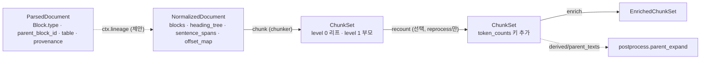
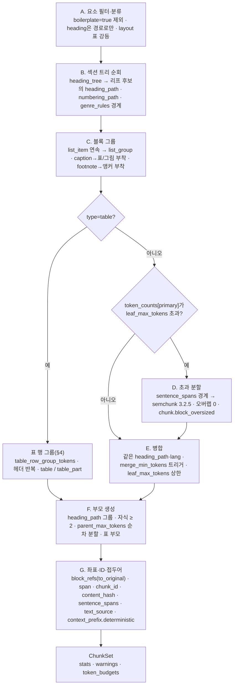
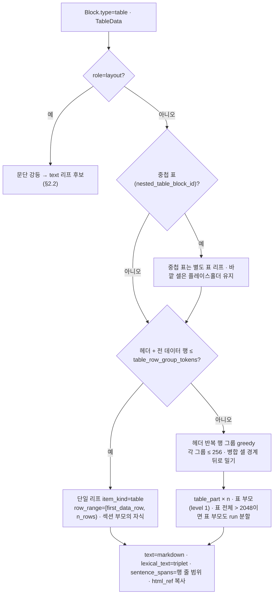

# 청킹 전략

> 이 문서는 `chunk` 스테이지(와 선택 서브스테이지 `recount`)의 알고리즘을 정의하는 개별 설계 문서다. 우선순위는 브리프 > 바이블 > ADR > 이 문서이며(바이블 §1.1), 타입·필드·열거값·기본값은 바이블 §4.2·§5.4·§5.7·§7.2와 [ChunkSet 계약](../03-contracts/05-chunk-set.md)을 그대로 쓴다. 이 문서가 새로 정하는 것은 `chunker.structure_aware`의 내부 규칙(요소 필터, 섹션 순회, 블록 그룹, 초과 분할, 병합, 부모 생성, 좌표·ID 부착 순서), 표·그림·코드·목록·각주·짧은 문서의 처리, `window` 채움 규칙과 그림 리프 원천 순서(05 미해결 이슈 11; `ordinal`의 형제 정의는 05 §3.5·C-3 정본을 인용만 한다), `flat_text` 폴백 라우팅 조건(ADR-0020 중립 항목), 대안 전략의 플러그인 위치와 선택 지침, 품질 지표다. 바이블에 없는 것은 "제안"으로 표시하고 `## 미해결 이슈`에 남긴다. 인용 약어: "04"는 계약 [03-contracts/04 NormalizedDocument](../03-contracts/04-normalized-document.md), "07/04"는 기술 지형 [07-tech-landscape/04 청킹 전략](../07-tech-landscape/04-chunking-strategies-and-libraries.md), "13"은 [07-tech-landscape/13 한국어 NLP](../07-tech-landscape/13-korean-nlp-tokenization-and-language-resources.md)다.

## 목적

청킹(chunking)은 검색 단위를 결정하는 단계다. 청크가 너무 작으면 문맥이 끊기고, 너무 크면 임베딩이 희석되고 Context Pack 예산을 잠식한다. 이 문서는 브리프 D-19(개정 v1.1)와 바이블 §3.2 O-09가 확정한 기본 전략 — **ParsedDocument 네이티브 `StructureAwareChunker`** + 토큰 예산 병합(자식 512 / 부모 2048 / 병합 하한 64) + 부모-자식(small-to-big) + 표 행 그룹(256, 헤더 반복) + 결정적 `context_prefix` — 를 구현 가능한 수준의 알고리즘으로 서술하고, 다음을 확정한다.

- `NormalizedDocument`(+ 계보로 로드한 `ParsedDocument`)에서 `ChunkSet`을 만드는 결정적 절차: 섹션 트리 순회 → 블록 그룹 → 토큰 예산 내 분할·병합 → 부모 생성 → `block_refs`·`span`·`chunk_id`·`context_prefix` 부착.
- 한국어 문서 특성(개조식, 조·항·호, 「」 법령명, 표 중심 보고서, `2026. 9. 18.` 날짜)을 문장 경계·블록 그룹·장르 규칙에서 어떻게 다루는가.
- 표·그림·코드·수식·목록·각주·짧은 문서의 청크 규칙과 `item_kind` 매핑.
- 대안 전략(의미 분할, late chunking, proposition, 문장 윈도우, 고정 토큰, LLM 분할)의 플러그인 위치와 문서 유형별 선택 지침.
- 토크나이저 선택, 프로파일별 파라미터 기본값과 근거, 결정성·재청킹 최소화·`recount`, 품질 지표, 실패 모드.

## 범위

| 포함 | 제외 |
|------|------|
| `chunk` 스테이지 내부: `chunker.structure_aware`(기본), `chunker.flat_text`(폴백), `chunker.docling_hybrid_adapter`(2차, `[docling-chunker]` extra)의 알고리즘과 라우팅; `recount`의 청킹 관점 의미론; `Chunk` 필드를 채우는 규칙(접두어 축약 규칙의 **적용** 포함, §2.8) | `ChunkSet` 스키마·불변식 자체([03-contracts/05](../03-contracts/05-chunk-set.md)); `embed_text`·`index_text` 조립([04-pipelines/11](11-enrichment.md), [ADR-0029](../06-adr/0029-three-text-rule-and-deterministic-context-prefix.md)); 접두어 축약 규칙의 **정의**([03-contracts/06 §3](../03-contracts/06-enriched-chunk-set.md)) |
| 표 행 그룹·직렬화 선택, 그림·코드·목록·각주 규칙, 장르 규칙(`genre_rules`) | 문장 분리·`offset_map`·furniture 판정·장르 감지([04-pipelines/09](09-normalization-and-cleaning.md), [03-contracts/04](../03-contracts/04-normalized-document.md)) — 청커는 그 결과를 소비만 한다 |
| 부모-자식 계층의 **생산** 규칙과 검색 시 확장에 필요한 필드 | 부모 확장·문장 윈도우 후처리 알고리즘([04-pipelines/17](17-post-processing-and-context-packing.md)); `ChunkTextStore` 구현 택1(바이블 §13.2) |
| 토크나이저·파라미터 기본값(바이블 §7.2 인용, 근거는 기술 지형) | 값 변경 절차·게이트 실행([08-evaluation/02](../08-evaluation/02-retrieval-metrics-and-harness.md), [ADR-0019](../06-adr/0019-chunk-size-tokenizer-defaults-and-recount-stage.md)) |
| level 0·1 청크 생산 | level 2 파생 항목(`summary`·`community_report`·`entity`) — `enricher`·그래프 플러그인 소유([ADR-0015](../06-adr/0015-graph-rag-external-plugin-raptor-core-option.md), [04-pipelines/18](18-advanced-retrieval-graph-raptor-agentic.md)) |

## 1. 위치와 계약

### 1.1 스테이지 위치



`chunk`는 바이블 §4.2 수집 파이프라인의 네 번째 스테이지다. 입력은 `NormalizedDocument`(텍스트 뷰 계층), 출력은 `ChunkSet`이며, 오케스트레이터 경계를 넘는 페이로드는 `ArtifactRef` 하나다(바이블 §4.1). `recount`는 임베더 교체로 `token_counts`에 새 `tokenizer_id`가 없을 때 `reprocess.document.v1`에서만 실행되는 `ChunkSet → ChunkSet` 변환이고 재청킹이 아니다(바이블 §4.2, §11.2; ADR-0019).

### 1.2 입력·출력·컨텍스트

| 항목 | 값 | 근거 |
|------|----|------|
| 입력 계약 | `NormalizedDocument`(`blocks[]`의 `display_text`·`lexical_text`·`offset_map`·`sentence_spans`·`lang`·`boilerplate`·`text_source`·`confidence`, `heading_tree[]`, `genre`, `language`, `analyzer_id`, `dictionary_hash`, `pii_report.policy_applied`) | 바이블 §5.4 `NormalizedDocument`·`NormalizedBlock` |
| 계보 입력(**제안**) | `ctx.lineage["ParsedDocument"]`: `Block.type`·`parent_block_id`·`ordinal`·`level`·`numbering_label`·`heading_inferred`·`furniture`·`container`·`caption_of`·`table`(`TableData`)·`figure`·`footnote`·`code`·`provenance`(`element_path`·`page`·`bbox`·`section_index`); `ctx.lineage["SourceDocument"]`: `source_uri`(접두어 `title` 3차 폴백에만 사용) | `NormalizedDocument`는 구조를 복제하지 않는 텍스트 뷰 계층이라(04 §1) 청커는 `ParsedDocument` 없이 블록 종류·표 격자·좌표를 알 수 없다. 04 미해결 이슈 1·05 §1·05 미해결 이슈 12와 같은 제안: `chunker.structure_aware`가 `requires_lineage = ("ParsedDocument", "SourceDocument")`를 선언한다. 바이블 §4.1 "`index`만 사용" 문구와 [01 §2.2 스테이지 표](01-pipeline-framework.md)의 `chunk` 행 갱신이 필요하다(미해결 이슈 1) |
| 출력 계약 | `ChunkSet`(봉투 + 세트 헤더 + `chunks[]`) — 필드·불변식 (1)~(5)·C-1~C-19는 [03-contracts/05](../03-contracts/05-chunk-set.md) 정본 | 바이블 §5.4 |
| 컨텍스트 핸들 | `ctx.token_counter`(primary, `hf:BAAI/bge-m3`), `ctx.token_counters`(secondary `tiktoken:o200k_base` 등), `ctx.lineage`, `ctx.now()`(봉투 `created_at`만). **`ctx.analyzer`는 쓰지 않는다** — 형태소 분석은 예산 카운트도, 경계 판정도 아니다(ADR-0019 DR8) | 바이블 §4.1; [01 §3.1](01-pipeline-framework.md) |
| 격리·큐·정책 | `in_process`, `ingest-cpu`, `start_to_close` 5m, `max_attempts` 3, `non_retryable` `chunk.tokenizer_missing`·`contract.violation`, `resumable` no | 바이블 §4.2, §4.4 |
| 멱등성 키 | `stage_key = H("stage", "chunk", scope_key, normalized.blake3, fingerprint)`; `fingerprint`에 `chunker_config_hash`·`primary_tokenizer_id` 포함 | 바이블 §4.1, §4.2, §6.2; [ADR-0037](../06-adr/0037-artifact-cache-scope-and-stage-key-composition.md) |
| 이벤트·계량 | `ingest.document.chunked` — `data`는 [12 §6.1](../03-contracts/12-jobs-events-and-status.md) `IngestStageEventData`(`stage=chunk`; `job_id, document_id, stage, doc_version, quality, artifact_blake3, stage_key` + `collection_id, size_bytes, warning_count` + 스테이지 계수 `chunk_count, parent_count, chunker_config_hash, cache_hit`). 산출물은 `artifact_blake3`·`stage_key`로 가리키며 `chunk_set_id`·`stats` 객체·`ArtifactRef`·본문은 들어가지 않는다(바이블 §5.3 `CloudEventEnvelope.data` "ID·해시·상태만"). `rag_ingest_stage_duration_seconds{stage="chunk"}` | 바이블 §5.3, §5.7, §6.5; 05 §1 이벤트 행 |

### 1.3 플러그인·프로파일

| `plugin_id` | 역할 | 프로파일 위치 | 지위 |
|-------------|------|---------------|------|
| `chunker.structure_aware` | 기본 청커(이 문서 §2). 모듈 `adapters/chunk/structure_aware.py`, 표 행 그룹은 내부 구성요소 `adapters/chunk/table_rows.py` | `ingest.chunk.plugin` | 바이블 §5.4 `chunker_id`, §7.3, §12; ADR-0020 |
| `chunker.flat_text` | 폴백: 문장 경계 → semchunk 384토큰, 오버랩 10%, 문장 윈도우 ±2(§6.1·§6.3) | `ingest.chunk.fallback.plugin`(v1 고정값). 라우팅 시에는 `chunker.structure_aware`가 같은 알고리즘을 내부 구성요소 `adapters/chunk/flat_text.py`로 실행한다(§6.3); 프로파일이 `ingest.chunk.plugin`에 직접 바인딩할 수도 있다 | 바이블 §7.3 |
| `chunker.docling_hybrid_adapter` | 2차: `ParsedDocument → DoclingDocument` 역변환 후 `HybridChunker`; `[docling-chunker]` extra, CI 동등성 기준선(평가 컨테이너만) | 프로파일 옵션 | 바이블 §6.7, §7.1; ADR-0020 |
| `chunker` role `token_counter`(예 `chunker.token_counter_hf`) | `recount` 스테이지 구현 | `ingest.recount`(선택) | 바이블 §4.2; ADR-0019; 05 예시 2 |
| 대안 전략 플러그인(§6.1) | 의미 분할·LLM 분할·레이아웃 청커 | 프로파일 옵션(`chunker` entry point) | D-10; `plugin_id` 문법 §6.1(바이블) |

### 1.4 `config_schema`(`chunker.structure_aware`)

`config_schema`는 프로파일 `ingest.chunk.*`에서 셸 예약 키(`plugin`·`policy`; [01 §2.3](01-pipeline-framework.md))를 제외한 값을 검증하고 `chunker_config_hash = H("config", canonical_json(config))`의 원천이 된다(바이블 §6.2). 바이블 §7.3 YAML의 중첩 객체 `fallback: {plugin, max_tokens, overlap_ratio, sentence_window_n}`은 예약 키 `plugin`(v1은 `chunker.flat_text` 고정, 다른 값은 `profile.invalid`)을 제외한 값이 프로파일 로더에서 평면 키 `fallback_max_tokens`·`fallback_overlap_ratio`·`sentence_window_n`으로 투영되어 **이 스키마에 들어간다** — 바이블 §7.2가 이미 `ingest.chunk.fallback_overlap_ratio`·`sentence_window_n`을 평면 키로 표기하고 05 §3.4 `TokenBudgets`가 같은 이름을 쓴다. 폴백 파라미터가 해시 밖에 있으면 값을 바꿔도 `stage_key`가 같아 낡은 세트가 캐시 적중하므로(§6.3) 예외를 두지 않는다(투영 규칙은 제안, 미해결 이슈 14). 값 하나가 바뀌면 모든 `chunk_id`가 바뀐다(§8).

| 필드 | 타입 | 기본(초안 목표) | 의미 | 지위 |
|------|------|-----------------|------|------|
| `tokenizer` | string(tokenizer_id) | `hf:BAAI/bge-m3` | 예산 토크나이저 = `primary_tokenizer_id`; `§7.4 (4)` 임베딩 모델 토크나이저와 일치 | 바이블 §7.3 |
| `secondary_tokenizers` | array<string> | `["tiktoken:o200k_base"]` | 병기 카운트 | 바이블 §7.3 |
| `leaf_max_tokens` | integer | 512(`gate` grid `[256, 384, 512, 768]`) | 리프 상한(불변식 (2)) | 바이블 §7.2·§7.3 |
| `parent_max_tokens` | integer | 2048 | 부모 상한(C-6) | 바이블 §7.2 |
| `merge_min_tokens` | integer | 64 | 병합 트리거 하한(§2.6) | 바이블 §7.2 |
| `table_row_group_tokens` | integer | 256 | 표 행 그룹 예산(헤더 포함) | 바이블 §7.2 |
| `genre_rules` | object<Genre, object> | `{law_article: {heading_regex: "^제\\d+조", split_on: [항]}}` | 장르별 경계 규칙(§2.3, §6.2) | 바이블 §7.3 |
| `fallback_max_tokens` | integer | 384 | `flat_text` 리프 상한(§6.1). 라우팅된 세트에서는 불변식 (2)의 기준(05 §3.4) | 바이블 §7.3 `fallback.max_tokens`; 05 §3.4 |
| `fallback_overlap_ratio` | number(0..1) | 0.10(`gate` grid `[0, 0.10, 0.15]`) | `flat_text` 오버랩 목표치(문장 경계 정렬, §6.1) | 바이블 §7.2·§7.3 |
| `sentence_window_n` | integer | 2 | `window.before_chunk_ids`·`after_chunk_ids` 길이 상한(05 §3.8, C-13) | 바이블 §7.2·§7.3 |
| `fallback_route` | object | `{min_body_tokens: 1024, max_structured_ratio: 0.20}` | §6.3 라우팅 임계값(본문 토큰 하한 = 2 × `leaf_max_tokens` 기본값, 표·그림·코드 블록 비율 상한) | **제안** |
| `table_serialization` | enum(TableSerialization) | `markdown` | 리프·부모 `text`의 표 직렬화; `lexical_text`는 항상 `triplet`(05 §7) | 05 §7 결정; 키 이름은 **제안** |
| `footnote_policy` | enum[attach, separate, drop] | `attach` | 각주 블록 처리(§5) | **제안** |
| `figure_text_policy` | enum[caption_and_text, caption_only, skip] | `caption_and_text` | 그림 리프 구성(§5) | **제안** |
| `code_line_split` | boolean | `true` | 예산 초과 코드 블록의 줄 단위 분할(§5) | **제안** |

`table_serialization`·`footnote_policy`·`figure_text_policy`·`code_line_split`·`fallback_route`는 바이블 §7.3 YAML에 없는 키이므로 [03-contracts/15](../03-contracts/15-collection-profile-and-policy-contracts.md) 프로파일 스키마 반영 제안이다(미해결 이슈 2). `chunker_config_hash`는 **해소된 전체 설정**(스키마 기본값과 같은 값도 생략하지 않고 직렬화)의 `canonical_json` 해시다. ADR-0004 고정 벡터(세 키 `leaf_max_tokens`·`merge_min_tokens`·`parent_max_tokens`만 가진 설정 JSON, 05 §4.3)는 `H("config", …)` 결합식 자체의 검증용으로 그대로 유효하며, 실제 프로파일의 해시는 키 집합이 다르므로 값이 다르다 — 적합성 키트는 고정 벡터와 실제 설정을 각각 검사한다.

## 2. 기본 전략: `chunker.structure_aware`

### 2.1 개요와 흐름

**결정:** 기본 청커는 Docling `HybridChunker` 알고리즘(요소 단위 → 초과 분할 → 동일 heading 병합)을 `NormalizedDocument` 위에서 재현하고 부모 생성을 더한 `StructureAwareChunker`다(브리프 D-19 v1.1; 바이블 §3.1 D-19; [ADR-0020](../06-adr/0020-default-chunker-structure-aware-and-dependency-locks.md)). 알고리즘은 7단계이며 각 단계는 앞 단계의 결과만 입력으로 받는 순수 함수다. 단계 순서는 고정이고 바꾸면 `chunk_id`가 달라지므로 구현 버전(`plugin_version`)이 지문에 들어간다.



### 2.2 단계 A — 요소 필터와 블록 분류

입력 `NormalizedDocument.blocks[]`를 문서 순서로 훑으며 `ParsedDocument.blocks[]`(같은 `block_id`, 같은 순서 — 04 I-1)의 구조 필드와 짝지어 각 블록의 역할을 정한다.

| 조건(`Block` / `NormalizedBlock`) | 처리 | 근거 |
|-----------------------------------|------|------|
| `boilerplate=true`(`furniture=true` 포함: `page_header`·`page_footer`·`toc`·nav·반복 머리말) | 청크에서 제외. 텍스트도 좌표도 남기지 않는다 | 바이블 §5.4 `Block.furniture` "기본 청킹 제외"; 04 §4 |
| `type=heading`(`heading_inferred=true` 포함) | 리프 본문이 아니다. `heading_tree`를 통해 `heading_path`·`numbering_path`·`context_prefix`에만 들어간다. 본문이 없는 빈 섹션은 청크를 만들지 않는다 | Docling HierarchicalChunker 동작(07/04 §1); ADR-0029(문맥은 접두어로 한 번만) |
| `type=paragraph`, `form_field`, `formula` | 리프 후보(`item_kind=text`). `formula`의 본문은 해당 블록의 `NormalizedBlock.display_text`(파서가 한컴 수식 `formula.script` 원문 또는 LaTeX를 `Block.text`로 낸 것의 정규화 뷰) — `Chunk.text`는 항상 `display_text` 조각이어야 하고(05 §5 규칙 3) `ItemKind`에 수식 값이 없다 | 바이블 §5.4 `Chunk.text`, §5.7 `ItemKind`·`BlockType` |
| `type=list_item` | 단계 C에서 연속 항목을 `list_group`으로 묶는다 | 바이블 §5.7 `ItemKind.list_group` |
| `type=table`, `TableData.role ∈ {data, toc, form}` | 표 경로(§4). `role=toc`인 표는 `furniture`가 아니면 `data`처럼 다룬다 | 바이블 §5.4 `TableData.role` |
| `type=table`, `TableData.role=layout` | 문단으로 강등: 그 표 블록의 `NormalizedBlock.display_text`(파서가 낸 03 §6 선형화 텍스트의 정규화 뷰)를 본문으로 갖는 `text` 리프 후보. `table_ref` 없음. `display_text == ""`이면 리프를 만들지 않는다(04 I-9 경로). 셀 텍스트를 청커가 다시 결합하지 않는 이유: `table_ref`가 없는 청크의 텍스트 ref는 `display_text`의 부분 문자열이어야 하므로(05 §5 규칙 3) 셀 결합 문자열은 불변식 (1)을 깨뜨린다 | 바이블 §5.4 "`layout` 표는 청킹에서 문단으로 강등"; 05 §5 규칙 3; 04 §1·I-9 |
| `type=figure` | 그림 리프 후보(`item_kind=figure`, §5) | 바이블 §5.4 `Block.figure` |
| `type=caption`(`caption_of` 있음) | 대상 표·그림에 부착(§4.4, §5). 대상이 제외되었거나 없으면 `text` 리프 후보 | 바이블 §5.4 `caption_of` |
| `type=footnote` | `footnote_policy`에 따라 앵커 블록의 리프에 부착(§5) | 바이블 §5.4 `Block.footnote{anchor_block_id}` |
| `type=code` | 코드 리프 후보(`item_kind=code`, §5) | 바이블 §5.7 |
| `type=page_break` | 텍스트 없음. 무시(페이지는 `provenance.page`로 이미 블록에 있다) | 바이블 §5.4 |
| `display_text == ""`이고 표·그림이 아님 | 무시 | 04 I-9 |
| `container=table_cell`인 블록 | 표 격자(`TableData.cells[].text` 또는 `table_cell_views`)로 다루며 독립 리프로 만들지 않는다 | 바이블 §5.7 `BlockContainer`; 04 §2.9 |
| `container=text_box` | 본문과 같은 규칙(글상자 위치의 문단·표) | — |

블록 `lang`이 다른 리프 후보는 이후 단계에서 병합되지 않는다(04 §6 "언어가 다른 블록을 한 청크에 합치지 않는 근거").

### 2.3 단계 B — 섹션 트리 순회와 `heading_path`

`NormalizedDocument.heading_tree[]`(`{block_id, level, path}`; `boilerplate=false`인 heading만, 문서 순서, `len(path) ≤ level + 1`)를 스택으로 순회하며 각 리프 후보에 **가장 안쪽 조상 heading의 `path`** 를 부여한다.

- **`heading_path` 유도식([03-contracts/05 §9](../03-contracts/05-chunk-set.md) 정본 인용; 이 문서의 결정이 아니다):** `node` = 청크의 첫 블록(문서 순)을 포함하는 가장 안쪽 `HeadingNode`, `T` = `heading_tree`에서 `level == 0`인 첫 노드(없을 수 있다). `heading_path = node.path[1:] if (T and node.path[0] == T.path[0]) else node.path`; `node is None → []`; `node == T → []`. 제목 노드가 실제로 `path[0]`일 때만 제거하므로 제목 없는 문서·단계 생략 문서에서도 결정적이다. [04 §2.2](../03-contracts/04-normalized-document.md)는 `HeadingNode.path`가 제목을 `path[0]`에 포함한다고 확정했고(예 `["개인정보 처리 지침", "제1장 총칙"]`) 청커가 이 식으로 제거한다(04 §2.2·05 §9·C-11에서 이미 확정된 사항). 제목은 `context_prefix.deterministic`의 `title`로 한 번만 나른다.
- **`numbering_path`:** 같은 경로 heading들의 `Block.numbering_label`(`"제2장"`, `"Ⅱ."`, `"1."`)이 하나라도 있으면 있는 것만 순서대로 채우고, 하나도 없으면 필드를 생략한다(N).
- **첫 heading 이전 본문(서문·표지 문장):** `heading_path = []`. 같은 규칙으로 병합·부모 생성이 적용된다.
- **heading 단계 생략(`level` 1 → 3):** `path`가 이미 조상만 담으므로 그대로 쓴다. 청커는 빈 단계를 채우지 않는다.
- **장르 규칙 `genre_rules[genre_route]`(바이블 §7.3):** `ChunkSet.genre_route = NormalizedDocument.genre`. `law_article: {heading_regex: "^제\d+조", split_on: [항]}`는 두 가지를 한다. (a) **조 경계.** `heading_regex`에 맞는 블록이 이미 `heading_tree`에 있는 heading이면(파서가 `type=heading`·`heading_inferred=true`로 냈을 때) 그 `path`가 그대로 경로가 된다. heading이 아닌 문단이 `numbering_label`로, 또는 `display_text` 선두가 정규식에 맞고 **문단 길이 ≤ 60 코드포인트(초안 목표)** 일 때 맞으면 그 문단을 **조 경계**로 삼는다: 직전 블록과 병합하지 않는 하드 경계(§2.6)이자 부모 묶음 경계(§2.7)다. 이 문단은 `heading_path`·`numbering_path`·`heading_tree`에 넣지 않고 리프 본문으로 남긴다("제5조(위험평가) ① …"처럼 조 제목과 제1항이 한 문단이어도 그대로 한 리프의 `text`다) — 모든 `heading_path`는 `heading_tree`의 어떤 `HeadingNode.path`에 §9 유도식을 적용한 값이어야 하므로(05 C-11) 청커가 경로 원소를 만들어 낼 수 없다. 조를 `heading_path`·접두어에 올리려면 파서가 그 문단을 `heading(heading_inferred=true)`으로 내야 한다(미해결 이슈 13). (b) `split_on: [항]`은 항 표지(`①`~`⑳`, 또는 조 본문 안의 `"1."`·`"2."` 문단 시작)로 시작하는 블록을 **하드 경계**로 삼아 앞뒤 블록과 병합하지 않는다. 호(`1.`, `2.`)·목(`가.`, `나.`)은 항 리프 안에 남는다. 다른 장르의 규칙은 미해결 이슈 3(제안 `outline_report`).

### 2.4 단계 C — 블록 그룹(리프 후보)

| 그룹 규칙 | 결과 `item_kind` | 상세 |
|-----------|------------------|------|
| 연속한 `list_item` 블록(사이에 다른 본문 블록이 없고, 같은 `heading_path`) | `list_group` | 중첩 목록은 `parent_block_id` 체인으로 한 그룹에 포함한다. 그룹이 `leaf_max_tokens`를 넘으면 **항목 경계**에서 나누고, 항목 하나가 넘으면 그 항목만 단계 D로 보낸다(결과도 `list_group`) |
| `caption` → `table`/`figure` | 표·그림 모두 대상 청크의 `context_prefix.deterministic` 마지막 원소(ADR-0029 결정 표 "`caption`은 표·그림 청크에만 붙는다"; 바이블 §5.4 템플릿). 그림은 추가로 `figure_text_policy`에 따라 리프 본문의 첫 요소로도 들어간다(§5) | 표 리프의 `block_refs`는 `[ref(table_block_id)]`만 허용되므로(05 C-12) 표 캡션은 본문에 넣지 않는다(§4.4). 그림은 C-12 제약이 없고 캡션이 유일한 텍스트인 그림이 흔해 본문에도 넣는다(05 §5 규칙 6·미해결 이슈 11) — 불변식 (3)은 접두어 **전체 문자열**이 `text`의 부분 문자열이 아닐 것을 요구하므로(`title`이 항상 앞에 있다) 위반이 아니다 |
| `footnote`(`footnote_policy=attach`) | 앵커 블록이 속한 리프 후보에 뒤따르는 블록으로 부착 | 부착 후 예산 초과면 각주는 자기 `text` 리프가 되고 `heading_path`는 앵커와 같다(§5) |
| 나머지 블록 | 블록 1개 = 리프 후보 1개 | Docling 요소 단위와 동일 |

리프 후보의 `text`는 구성 블록 `display_text`를 문서 순서로 U+000A로 결합한 것이고(05 §5 재구성 규칙 2), `lexical_text`는 같은 순서로 `NormalizedBlock.lexical_text`를 결합한 것이다. 토큰 수는 결합 문자열을 **다시 카운트**한다(합산 아님; 경계 토큰 차이 때문).

### 2.5 단계 D — 초과 분할

`token_counts[primary] > leaf_max_tokens`인 리프 후보(긴 단락, 거대 목록 항목, 긴 코드 블록)는 다음 순서로 나눈다. 모든 조각은 원 후보의 `item_kind`·`heading_path`를 유지하고, 조각 사이 **오버랩은 0**이다(바이블 §3.2 O-09 "구조 청크 오버랩 0"; ADR-0019 A4 기각). 한 블록에서 나온 조각들은 `block_refs`의 `original_char_*`가 서로 겹치지 않는다(05 C-8).

| 순서 | 경계 | 규칙 |
|------|------|------|
| D1 | `NormalizedBlock.sentence_spans`(display 기준; Kiwi 또는 kss `punct`·정규식 폴백이 `normalize`에서 계산, 개조식은 줄바꿈·글머리 기호 강제 분리) | 문장을 순서대로 누적해 `leaf_max_tokens`를 넘지 않는 최대 묶음을 만든다(greedy). 문장 중간을 자르지 않는다. `sub_spans`(Kiwi 서브문장)는 D1이 실패한 문장에서만 쓴다 |
| D2 | 서브문장(`sub_spans`) 경계 | 문장 하나가 예산을 넘으면 서브문장 경계로 같은 greedy를 적용한다 |
| D3 | semchunk 3.2.5 `chunk(text, chunk_size, token_counter, offsets=True, overlap=None)` | 서브문장 하나(또는 서브문장이 없는 문장 하나)가 여전히 넘으면 그 구간만 semchunk의 구분자 계층(개행 → 탭 → 공백 → `.?!` → …)으로 나눈다. 반환 오프셋은 입력 문자열 기준이므로 블록 display 오프셋으로 되돌린다. 오프라인 표준 모드만 쓴다(ADR-0020) |
| D4 | 코드 블록 | `code_line_split=true`면 D1~D3 대신 줄(U+000A) 경계 greedy(docling-core `LineBasedTokenChunker` 계열의 자체 구현). `false`면 D3 |
| 기록 | — | 분할된 블록마다 `warnings[]`에 `Warning{code: "chunk.block_oversized", message: "block exceeds leaf_max_tokens; split at sentence/semchunk boundaries", block_id}`를 남기고(`message`는 바이블 §5.3 필수, 콘텐츠 없는 고정 문구 — C-17) `stats.oversized_blocks`를 1 늘린다(05 C-7). 경고이며 실패가 아니다(바이블 §5.7 카탈로그 `—`); 잡은 계속되지만 경고가 1건 이상이면 봉투 `quality = degraded`다(05 §3.1·C-18; 바이블 §4.1 부분 성공 규약) |

D1은 한국어 문장 분리기의 결과를 그대로 신뢰한다. `normalize`가 정규식 폴백으로 내려갔으면(`warnings[].code = normalize.segmenter_fallback`) 경계 품질 저하가 청킹에 전파되지만 청커는 이를 다시 판정하지 않는다(ADR-0020 결과 "부정"). 03-contracts/05 예시처럼 법령 항(`①`, `②`)은 보통 1문장 1블록이라 D 단계에 오지 않는다.

### 2.6 단계 E — 병합

같은 섹션 안의 리프 후보(표·그림·코드 제외)를 문서 순서로 훑으며 작은 후보를 이웃과 합친다. Docling `merge_peers=True`의 재현이며 `merge_min_tokens`는 **트리거**이고 하한 보장이 아니다.

```text
window = [cand[0]]
for next in cand[1:]:
    if same_heading_path(window, next) and same_lang(window, next)
       and mergeable_kinds(window, next)            # {text, list_group} 안에서만
       and not hard_boundary(next)                   # genre_rules: split_on(항) · 조 경계 문단(§2.3 (a))
       and (tokens(window) < merge_min_tokens or tokens(next) < merge_min_tokens)
       and tokens(join(window + [next])) <= leaf_max_tokens:
        window.append(next)
    else:
        emit(window); window = [next]
emit(window)
```

- 병합 결과의 `item_kind`는 **첫 멤버**의 종류다(`text` + `list_group` → `text`; 개조식 도입 문장 + 글머리 목록의 자연스러운 표현).
- 섹션 마지막에 `merge_min_tokens` 미달 후보가 홀로 남으면 직전 리프에 역방향 병합을 1회 시도하고(같은 조건), 불가하면 작은 리프로 둔다. 섹션 전체가 64토큰 미만이어도 리프는 만든다 — 짧은 조항·표 캡션만 있는 섹션이 사라지면 인용 좌표가 사라진다.
- 표(`table`·`table_part`)·그림(`figure`)·코드(`code`)는 병합 대상이 아니다. 표 조각의 자립성(헤더 반복)과 코드 원문 보존이 우선이다.

### 2.7 단계 F — 부모 생성(small-to-big)

**결정:** 부모(`level=1`, `item_kind=parent`)는 **같은 `heading_path`를 가진 리프 묶음**(문서 순서로 연속한 리프들; 하위 heading의 리프는 그 heading의 묶음에 속한다; `genre_rules` 조 경계(§2.3 (a))에서도 묶음이 나뉜다) 단위로 만들되, 자식이 **2개 이상**일 때만 만든다. 자식이 하나인 묶음은 부모를 만들지 않고 리프의 `parent_chunk_id = null`로 둔다 — 부모가 자식과 같은 텍스트를 반복하면 `parent_expand`가 무의미하고 부모 번들만 커진다.

| 규칙 | 내용 | 근거 |
|------|------|------|
| 부모 `text`·`lexical_text` | 자식 `text`(`lexical_text`)를 `ordinal` 순으로 U+000A 결합. `block_refs`는 자식 refs를 부모 좌표로 재기준, `sentence_spans`도 같은 방식으로 이동 | 05 C-4, §5 규칙 5 |
| 예산 | `token_counts[primary] ≤ parent_max_tokens`(2048). 묶음이 넘으면 문서 순서로 greedy 분할해 연속 구간(run)마다 부모를 만든다. run에 자식이 하나만 남으면 그 run은 부모 없음 | 05 C-6; 바이블 §7.2 |
| 부모의 `heading_path`·`numbering_path` | 자식과 동일(자식 경로의 접두) | 05 C-11 |
| 중첩 부모 없음 | `level 2`는 요약·그래프 파생 항목 전용이므로 부모의 부모는 만들지 않는다. "제2장" 직속 리프와 "제2장 › 제5조" 리프는 서로 다른 부모를 갖는다 | 바이블 §5.7 `ChunkLevel` |
| 표 부모 | 표가 둘 이상의 `table_part`로 나뉘면 표 전체 직렬화(헤더 1회)를 `text`로 갖는 표 부모를 만들고, `table_ref.row_range = [first_data_row, n_rows)`(`first_data_row` = `header_row_indices`에 없는 첫 행; 헤더 1행이면 `[1, n_rows)`, 헤더 없는 표만 `[0, n_rows)`) — 헤더 행은 어떤 청크의 `row_range`에도 들어가지 않는다(05 §3.7, C-12 `row_range ∩ header_row_indices = ∅`; 05 예시 2 표 부모 `[1, 7]`). 표 전체가 `parent_max_tokens`를 넘으면 연속 행 그룹 run마다 표 부모를 만든다(각 부모의 `row_range`는 자식 조각 `row_range`의 합집합) | 05 §2 결정, §3.7, C-6 "표 부모 포함", C-12 |
| 단일 `table` 리프·그림·코드 | 섹션 부모의 자식이 된다(같은 `heading_path` 묶음) | 05 §2 |
| 임베딩 | 부모는 임베딩·색인하지 않는다. `index`가 부모 번들 `derived/parent_texts/{chunk_set_blake3}.json`을 저장하고 `parent_expand`가 읽는다 | 바이블 §5.4 불변식 (5), §13.2 |
| 짧은 문서 | 본문 전체가 리프 하나로 끝나면 부모 없음. 문서 전체(root)는 `ChunkSet` 항목이 아니라 `GET /v1/documents/{document_id}/content`·MCP `get_document`로 도달한다 | 바이블 §14 |

### 2.8 단계 G — 좌표·ID·접두어 부착

| 필드 | 계산 | 근거 |
|------|------|------|
| `block_refs[]` | 리프 `text`에서 각 블록 조각의 `[char_start, char_end)`(display, 청크 기준)와, 그 조각의 블록 display 구간 `[a, b)`를 **먼저 04 §3.4 `snap_to_pii_spans`로 확장한 뒤**(해당 블록 — 표는 셀 뷰 — 의 `annotations.pii_spans`(operator ∈ {mask, tokenize}) 구간 `[s, e)`와 겹치면 `a = min(a, s)`, `b = max(b, e)`; 원문과 길이가 같은 치환은 1:1 구간으로 인코딩되어(04 M5) 스냅 없이는 치환 토큰의 일부만 원문에 사상된다) `NormalizedBlock.offset_map`에 `to_original`(04 §3.4)로 사상한 `[original_char_start, original_char_end)`. 스냅은 `original_char_*`에만 영향을 주고 `text`·`char_*`는 바꾸지 않는다. `element_path`·`page`·`bbox`·`section_index`는 `Block.provenance` 복사. 표 리프는 `[ref(table_block_id, 0, len(text), 0, 0)]`(원문 오프셋은 항상 0·0, 05 §5 규칙 4) | 바이블 §5.3 `BlockRef`, §6.3; 04 §3.4 PII 구간 스냅·I-8·M5; 05 §3.6·§5 |
| `sentence_spans[]` | 각 블록 조각의 `sentence_spans`를 청크 좌표로 이동해 이어붙인다. 조각이 문장 중간에서 시작·끝나면(D3 semchunk 조각) 조각 경계를 문장 경계로 본다. 표는 markdown 행 단위 줄 범위(구분선 제외, §4) | 05 §3.5, §7 |
| `span` | 일반 청크: `block_refs`를 `char_start` 순으로 정렬해 `"{first.block_id}:{first.original_char_start}-{last.block_id}:{last.original_char_end}"`; 표 청크: 셀 격자 선형 인덱스 `"{table_block_id}:{row_range[0]*n_cols+col_range[0]}-{table_block_id}:{(row_range[1]-1)*n_cols+col_range[1]}"` | 05 §4.1(바이블 §6.2 patch 제안) |
| `chunk_id` | `H("chunk", doc_version, chunker_config_hash, str(level), span)` | 바이블 §6.2; ADR-0004 |
| `content_hash` | `blake3_hex(utf8(text))`(라벨 없음) | 바이블 §6.2 |
| `token_counts` | `{primary_tokenizer_id: count(text)} ∪ {t: counters[t].count(text) for t in secondary}`; 특수 토큰 제외(ADR-0019 적합성 규약). 접두어는 세지 않는다(리프 예산은 본문만; 접두어 50~100토큰은 `embed_text`에서 더해진다) | 바이블 §5.3 `TokenCounts`; ADR-0019 |
| `lang` | 포함 블록 `lang` 중 코드포인트 수 최다(동률은 문서 `language`) | 05 §3.5 |
| `text_source`, `ocr_confidence_min` | 포함 블록 `text_source`의 최저 신뢰 등급(`text_layer > converted > vlm > ocr`), `confidence` 최소값 | 바이블 §5.4 |
| `context_prefix.deterministic` | `"{title} › {heading_path 조인} › {caption?}"`. `title` = `ParsedDocument.metadata.title` → 첫 `heading level 0` `display_text` → `SourceDocument.source_uri` 마지막 경로 요소. 조인 구분자 ` › `(U+203A). `heading_path`가 비면 `"{title}"`(캡션이 있으면 `"{title} › {caption}"`). 각 요소는 [06 §3](../03-contracts/06-enriched-chunk-set.md) 정규화 행(NFC, 제어·zero-width 문자 → 공백 압축, 빈 요소·인접 중복 제거)을 거친다. `primary` 토크나이저 기준 `prefix_max_tokens`(100, 초안 목표)를 넘으면 **청커가** 06 §3의 5단계 축약을 순서대로 적용해 최종 값을 기록한다: (1) `heading_path` 중간 단계를 얕은 쪽부터 제거 → (2) 첫 heading 제거 → (3) `caption` 앞 40 코드포인트로 절단 → (4) `title` 앞 60 코드포인트로 절단 → (5) 마지막 heading을 코드포인트 단위로 절단(각 단계 후 `ctx.token_counter`로 재카운트, 생략 부호 없음). `enrich`는 이 값을 재계산하지 않고 바이트 그대로 조립하므로(05 §9; 06 §3; [04-pipelines/11 §3](11-enrichment.md)) `Chunk.context_prefix.deterministic`·`IndexRecord.context_prefix`·리랭크 입력·`embed_text` 접두어가 항상 같다(ADR-0029 준수 확인 (c)) | 바이블 §5.4; ADR-0029; 05 §9; 06 §3 |
| `context_prefix.generated`, `generated_by` | 항상 `null` | 05 C-14 |
| `parent_chunk_id`, `child_chunk_ids` | §2.7; `child_chunk_ids`는 자식 `ordinal` 순 | 05 C-3 |
| `page_image_ref`, `tree_level`, `window` | 채우지 않는다(`visual-pages`·RAPTOR·`flat_text` 전용) | 바이블 §5.4 |

### 2.9 `ordinal`·`window` 규칙(`window`는 05 미해결 이슈 11 확정)

- **`ordinal`([03-contracts/05 §3.5·C-3](../03-contracts/05-chunk-set.md) 정본 인용; 재정의하지 않는다):** 형제 = **같은 `level`이고 같은 `parent_chunk_id`(`null` 포함)** 인 청크. 형제 안에서 문서 순서 0-based 연속 번호다. 따라서 `parent_chunk_id = null`인 level 1 부모들(섹션 부모·표 부모 혼합)이 한 형제 집합, 부모 없는 level 0 리프들이 별도의 형제 집합이며 각각 `0..n-1`로 번호를 매긴다(05 예시 1·2의 부모 `ordinal 0`과 정합). 이 문서가 보태는 것은 문서 순서의 구체화만이다: 청크 첫 `block_refs`(`char_start` 최소, 길이 0 ref 제외)의 블록이 `ParsedDocument.blocks[]`에 나타나는 위치로 정하고, 같은 블록에서 나온 조각은 `original_char_start` 순이다. 바이블 §5.4 `Chunk.ordinal` 행은 "부모 내 순서"라고만 적혀 있어 부모 없는 리프·최상위(`parent_chunk_id = null`) 부모 집합의 번호 부여 근거가 바이블 문구에는 없다 — 05 C-3 문구로 바이블 행을 갱신하는 minor patch를 제안한다(미해결 이슈 15). 두 정본은 충돌하지 않는다(05 정의는 바이블 문구의 상위 집합).
- **결정(`window`):** `chunker.structure_aware`는 `window`를 채우지 않는다(heading·단락 경계가 문맥 경계이고 `parent_expand`가 문맥 확장을 맡는다). `chunker.flat_text`만 앞뒤 최대 `sentence_window_n`개 리프의 `chunk_id`를 채운다(§6.3). 두 청커의 출력이 한 세트에 섞이지 않으므로 `postprocess.sentence_window`는 `chunker_id`가 아니라 `window` 존재 여부로 동작한다.

### 2.10 의사코드

```python
def chunk(doc: NormalizedDocument, ctx: StageContext, cfg: StructureAwareChunkerConfig) -> ChunkSet:
    parsed: ParsedDocument = ctx.lineage["ParsedDocument"]           # 제안: requires_lineage
    source: SourceDocument = ctx.lineage["SourceDocument"]           # title 3차 폴백(source_uri)만
    tc = ctx.token_counter                                           # primary: cfg.tokenizer
    warnings: list[Warning] = []

    # A. 필터·분류 (블록은 두 계약에서 block_id 1:1, 같은 순서)
    body = [pair for pair in zip(parsed.blocks, doc.blocks)
            if not pair[1].boilerplate and pair[0].type not in {"heading", "page_break"}]
    body = [demote_layout_table(p) for p in body]                    # role=layout → 표 블록 display_text를 text 리프 후보로("" 이면 제거)

    # 폴백 라우팅 (§6.3; 같은 스테이지 실행 안에서, 지문은 하나)
    if cfg.fallback_enabled and route_to_flat_text(doc, parsed, body, cfg, tc):
        return chunk_flat_text(doc, parsed, source, ctx, cfg)        # chunker_id = chunker.flat_text, window 채움

    # B. 섹션 경로 (05 §9 유도식; genre_rules 조 경계·항 하드 경계는 heading_path를 바꾸지 않음)
    paths = assign_heading_paths(doc.heading_tree, parsed.blocks)
    boundaries = genre_boundaries(body, cfg.genre_rules.get(doc.genre))

    # C. 블록 그룹 (list_group, caption 부착, footnote 부착)
    cands = group_blocks(body, paths, cfg.footnote_policy, cfg.figure_text_policy)

    # 표 경로 / D. 초과 분할
    leaves: list[Leaf] = []
    for c in cands:
        if c.kind in {"table", "table_part"}:
            leaves += chunk_table_rows(c, cfg.table_row_group_tokens, cfg.table_serialization, tc, warnings)
        elif tc.count(c.text) > cfg.leaf_max_tokens:
            leaves += split_oversized(c, cfg, tc)                     # D1 문장 → D2 서브문장 → D3 semchunk / D4 줄
            warnings.append(Warning(code="chunk.block_oversized",
                                    message="block exceeds leaf_max_tokens; split at sentence/semchunk boundaries",
                                    block_id=c.first_block_id))       # message 필수(바이블 §5.3), 콘텐츠 없음(C-17)
        else:
            leaves.append(c)

    # E. 병합 (text·list_group만, 같은 heading_path·lang, 하드 경계(split_on·조 경계) 존중)
    leaves = merge_peers(leaves, boundaries, cfg.merge_min_tokens, cfg.leaf_max_tokens, tc)

    # F. 부모 (같은 heading_path 묶음 · 조 경계, 자식 ≥ 2, parent_max_tokens 순차 분할, 표 부모)
    parents = build_parents(leaves, boundaries, cfg.parent_max_tokens, tc)

    # G. 좌표·ID·접두어 (snap_to_pii_spans → offset_map.to_original, span, chunk_id, content_hash,
    #    context_prefix.deterministic = 06 §3 정규화 + 5단계 축약(prefix_max_tokens))
    title = resolve_title(parsed, source)
    chunks = [finalize(x, doc, parsed, title, tc, ctx.token_counters, cfg) for x in leaves + parents]
    assign_ordinals(chunks)                                          # §2.9: 형제 = 같은 level ∧ 같은 parent_chunk_id
    quality = "degraded" if (doc.quality == "degraded" or warnings) else "full"   # 05 C-18
    return ChunkSet(chunks=chunks, warnings=warnings, stats=compute_stats(chunks, warnings),
                    chunker_id="chunker.structure_aware", chunker_config_hash=hash_config(cfg),
                    primary_tokenizer_id=cfg.tokenizer, secondary_tokenizer_ids=cfg.secondary_tokenizers,
                    genre_route=doc.genre, analyzer_id=doc.analyzer_id, dictionary_hash=doc.dictionary_hash,
                    language=doc.language, pii_policy_applied=doc.pii_report.policy_applied,
                    token_budgets=cfg.budgets(), quality=quality, created_at=ctx.now())
```

`hash_config`·`chunk_id`·`stage_key` 계산은 SDK `hash_of`(`H`)만 쓰고 `blake3`를 직접 임포트하지 않는다([01 §2.5](01-pipeline-framework.md)). 토큰 카운트는 `tc`의 메모이즈로 같은 문자열을 두 번 세지 않는다(제안: `TokenCounter.count_many(texts)` 배치 메서드, 미해결 이슈 4).

## 3. 부모-자식 계층과 검색 시 확장

| 레벨 | 생산 | 목표 토큰(초안 목표, `hf:BAAI/bge-m3`) | 색인 | 검색 시 역할 |
|------|------|----------------------------------------|------|--------------|
| `level 0` 리프(`text`, `list_group`, `code`, `table`, `table_part`, `figure`) | 이 문서 §2 | ≤ 512(`leaf_max_tokens`); 병합 트리거 64 | 임베딩·색인 단위, `IndexRecord` 1개 | 직접 후보(전략 필터 `level_in=[0]`) |
| `level 1` 부모(`parent`) | §2.7 | ≤ 2048(`parent_max_tokens`) | **색인 안 함**; `index`가 부모 번들에 저장 | `parent_expand`: 같은 `parent_chunk_id` 자식 적중 비율 ≥ 0.5 또는 자식 합 토큰 ≥ 부모 60%면 부모로 병합(`explain += parent_of_n_hits`); 표 조각은 표 전체 + 캡션 |
| `level 2` 파생(`summary`·`community_report`·`entity`) | `enricher`(RAPTOR `contextual_doc_summary`)·그래프 플러그인 — **청커 아님** | — | 색인 대상(`tree_collapsed`·`graph_*` 전략만) | 05 미해결 이슈 2 |
| 문서 전체(root) | 없음(`ChunkSet` 항목 아님) | — | — | `get_document`(`view=chunks`)로 도달 |

근거: 검색 정밀도는 200~512토큰의 작은 단위가, 생성 품질·분석형 질의는 512~1024토큰 또는 섹션 단위가 유리하므로(07/04 §15 종합 (1): Chroma 200~400 precision·IoU 우위, Wang et al. 512 최고·2048은 80.37, NVIDIA 페이지 단위 평균 0.648) "작게 찾고 크게 돌려준다"를 계층으로 취한다. 부모는 임베딩하지 않으므로 인덱스 크기·질의 지연에 영향이 없고, ACL은 문서 단위라 부모 확장으로 권한이 상승하지 않는다(바이블 §10.1). 확장 알고리즘·예산 취소·`ChunkTextStore` 택1은 [04-pipelines/17](17-post-processing-and-context-packing.md)이 소유한다.

## 4. 표 청킹

### 4.1 판정 흐름



### 4.2 규칙

| 규칙 | 내용 | 근거 |
|------|------|------|
| 작은 표 | 헤더 행 + 모든 데이터 행의 markdown 직렬화가 `table_row_group_tokens`(256) 이하면 **단일 리프** `item_kind=table`, `row_range=[first_data_row, n_rows)`(헤더 1행이면 `[1, n_rows)`; 헤더 없는 표만 `[0, n_rows)`), `col_range=[0, n_cols)`. `row_range`의 의미는 `item_kind`와 무관하게 하나 — 헤더 행은 `header_row_indices`로 나르고 `text`에 반복될 뿐 어떤 청크의 `row_range`에도 들어가지 않는다 | 05 §3.7, §7, C-12 |
| 큰 표 | 데이터 행을 문서 순으로 greedy 묶되 그룹(헤더 행 포함)이 256을 넘지 않게 한다. 조각은 `item_kind=table_part`, `row_range`는 데이터 행만(`header_row_indices`의 행은 넣지 않음), 헤더 행은 **모든 조각의 `text`·`lexical_text` 앞에 반복**(초과 시에도 생략 안 함, Docling `omit_header_on_overflow=False` 동등) | D-19; 바이블 §5.4 `TableData.header_row_indices`; ADR-0020 (5) |
| 한 행이 예산 초과 | 그 행 하나가 한 그룹이 되고 `chunk.block_oversized` 경고(행 내부는 자르지 않는다 — 셀 텍스트 절단은 좌표를 깨뜨린다) | 05 §7 |
| 병합 셀 | 앵커 셀의 행이 속한 그룹에 넣고, 그룹 경계가 `row_span`을 가르면 경계를 **뒤로 민다**(그룹이 예산을 넘어도 경고만). markdown에서는 앵커 값 + 빈 셀로 표기, 무손실은 `html_ref` | 05 §7; 바이블 §5.4 `TableCell.row_span` |
| 열 분할 | 기본 청커는 하지 않는다(`col_range=[0, n_cols)`). 열이 매우 많아 헤더 + 1행이 예산을 넘는 표는 경고와 함께 행 단위 조각이 된다. 열 분할(`col_range` 부분 범위)은 플러그인 옵션으로 열어 둔다(미해결 이슈 5) | 05 §3.7 |
| 헤더 없는 표(`header_row_indices=[]`, `header_inferred=false`) | 반복할 헤더가 없으므로 첫 행을 헤더로 가정하지 않는다. 조각 `lexical_text`의 열 이름은 `"열{j}"`(1-based)로 대체 | 바이블 §5.4 `header_inferred` |
| 행 헤더(`header_kind=row`) | 각 행의 행 헤더 셀은 조각의 모든 행에 이미 포함되므로 반복 대상이 아니다. `triplet`에서는 `"{행 헤더} · {열 헤더}: {셀}"` | 05 §7 |
| `role=form` | `data`와 같은 규칙. 폼 표는 보통 작아 단일 리프가 된다 | 바이블 §5.7 `TableRole` |
| 중첩 표(`nested_table_block_id`, 깊이 ≤ 3) | 중첩 표는 **자기 `block_id`로 별도 표 리프**(같은 `heading_path`; 바깥 표가 조각났으면 같은 표 부모의 자식이 아니라 섹션 부모의 자식). 바깥 셀 텍스트의 `[table:{block_id}]` 플레이스홀더는 그대로 둔다 | 바이블 §5.4 `TableCell.nested_table_block_id` |
| 셀 텍스트 원천 | 05 §7 정본: `NormalizedDocument.table_cell_views[]`(04 §2.9; `(block_id, row, col)`이 앵커 셀과 1:1)가 있으면 그 `display_text`(→ `text`)·`lexical_text`(→ `lexical_text`). 뷰가 없으면 **`pii_policy_applied = keep`일 때만** `TableData.cells[].text`에 04 §3.1(NFC → `text`)·§3.2(`nfkc_kr` 렉시컬 규칙 → `lexical_text`)를 청커가 적용해 쓴다. `pii_policy_applied ≠ keep`인데 뷰가 없으면 04 I-22 위반이므로 `contract.violation`으로 실패한다(원문 PII가 `Chunk.text`로 새는 경로를 열지 않는다, 04 I-11). 셀 뷰의 `pii_spans[].row/col` 구간에도 §2.8의 스냅 규칙이 적용된다 | 04 §2.9 결정·I-11·I-22; 05 §7 "셀 텍스트 원천"·C-12 |
| 표 캡션 | `caption_of=table_block_id`인 캡션 블록 `display_text`를 `context_prefix.deterministic` 마지막 원소로. 본문에는 넣지 않는다 | 05 §7, C-12 |
| 세트 상한 | 조각 수가 50,000을 위협하면 `table_row_group_tokens`를 2배씩 늘려 재시도(최대 `leaf_max_tokens`), 그래도 넘으면 `chunk.count_exceeded`(최종 비재시도). 확대 재시도한 세트는 `token_budgets.table_row_group_tokens`에 **실제 적용값**을 기록해 05 §3.4의 목적(프로파일 없이 C-6·불변식 검증)을 지킨다; `chunker_config_hash`는 프로파일 설정 기준으로 불변이다(§8). 확대를 알리는 경고 코드는 카탈로그에 없어 등재 전에는 내지 않는다(제안 `chunk.row_group_expanded`, 미해결 이슈 9) | 바이블 §4.2, §5.7; 05 §3.4 |

### 4.3 직렬화 옵션

| 대상 | 기본 | 옵션 | 이유 |
|------|------|------|------|
| `text`(표시·리랭크 입력·팩 `table_format_preference` 폴백) | `markdown`(헤더 행, `\| --- \|` 구분선, 데이터 행; 셀 내 `\|`는 `\\|`, 줄바꿈은 공백) | `html`(팩이 `html_ref` 없이 HTML을 원할 때), `row_json`(행마다 `{"열": "값"}` JSON 객체 1줄; 폼·키-값 표) | LLM 가독성은 markdown/HTML(07/04 §9); `html_ref`가 무손실 1차 |
| `lexical_text`(BM25·sparse 입력 원료) | `triplet`: 데이터 행마다 `"{열 헤더}: {셀}; …"`, 행 구분 U+000A, NFKC | 없음(고정) | 헤더 어휘가 모든 셀에 붙어 "예산액 12,500" 같은 질의에 매칭(07/04 §9); 직렬화 종류는 계약에 미기록(05 미해결 이슈 9) |
| 셀 선형화 문장(`'열A: 값, 열B: 값'`) | `triplet`이 이 역할을 한다(`; ` 구분). 자연어 문장화("웹 서버의 대수는 12이다")는 하지 않는다 — 결정적이지 않은 조사 선택과 표 원문 왜곡 | 원칙 4, K2 |
| `sentence_spans` | `text`의 헤더 행·데이터 행 각각의 줄 범위(구분선 제외) → 팩 `segments`·행 단위 인용 | 바이블 §8.2 `citation_align` |

### 4.4 표 요약 청크

**결정:** 청커는 표 요약을 만들지 않는다. 결정적 문맥(캡션·heading 경로)은 `context_prefix.deterministic`이 이미 나르고, LLM 표 요약·차트→표 변환은 `enrich`의 O-05 슬롯(`context_prefix.generated`, `Enrichment.summary`, `Enrichment.figure_table_markdown`; 모든 프로파일 기본 끔)이다(바이블 §3.2 O-05, §5.4 `Enrichment`; [ADR-0016](../06-adr/0016-llm-enrichment-default-off-and-budget-policy.md)). 07/04 §리스크 및 완화 표의 "표 요약 청크(kind=table, level=1)를 부모로" 제안은 **표 부모(level 1, 표 전체 직렬화)** 로 수용했다 — 집계형 질의는 `parent_expand`가 표 전체를 돌려준다.

## 5. 그림·코드·수식·목록·각주·짧은 문서

| 대상 | `item_kind` | 리프 구성(`text`) | `block_refs` | 비고 |
|------|-------------|-------------------|--------------|------|
| 그림(`Block.figure{artifact, kind, alt_text}`) | `figure` | 원천 순서(05 미해결 이슈 11 확정): (1) 캡션 블록 `display_text` → (2) 그림 블록 `display_text` — [03 §2](../03-contracts/03-parsed-document.md)가 그림 `Block.text`를 "`alt_text` 또는 `""`"로 정하므로 이것이 `figure.alt_text`의 NFC·PII 적용 뷰이고, 파서가 그림 내부 OCR·변환 텍스트를 `text`로 냈으면 그것이다(`source=ocr`면 `text_source=ocr`). `figure_text_policy=caption_and_text`(기본)는 (1)+(2)를 U+000A 결합, `caption_only`는 (1)만. `Block.figure.alt_text`를 직접 읽지 않는 이유: 텍스트 ref 조각은 `NormalizedBlock.display_text`의 부분 문자열이어야 하므로(05 §5 규칙 3) `display_text=""`인데 `alt_text`만 있는 블록은 03 §2 위반(파서 버그)이고 `contract.violation`이 아니라 (2) 없음으로 다룬다. (1)·(2)가 모두 비면 **리프를 만들지 않고 좌표만 남긴다**: 문서 순 직전 텍스트 리프(없으면 직후 리프)의 `block_refs`에 길이 0 ref(`char_start == char_end`; 직전 리프면 `len(text)` 위치에 마지막으로, 직후 리프면 `0` 위치에 첫 ref 앞으로; `original_char_* = 0, 0`, `page`·`bbox` 포함)를 추가한다(05 §5 규칙 1·6). 이 ref는 정렬 후 첫·마지막 ref가 될 수 있으므로 그 리프의 `span`은 05 §4.1 일반 규칙을 기계적으로 따른 값(끝이 `{figure_block_id}:0`)이다. 캡션은 `context_prefix.deterministic` 마지막 원소에도 들어간다(§2.4) | 캡션 ref + 그림 ref(텍스트 없으면 길이 0 좌표 전달용) | VLM 캡션은 `Enrichment.figure_caption`(`premium` 옵션, 원 캡션과 분리) — 3-텍스트 규칙상 `text`에도 접두어에도 넣지 않는다(06 §3). 이미지 자체의 검색은 `visual-pages` 컬렉션 |
| 코드(`Block.code{language}`) | `code` | 블록 전체를 하나로 유지. `leaf_max_tokens` 초과 시 `code_line_split`로 줄 경계 분할(오버랩 0). 코드 펜스·언어 표기는 `text`에 넣지 않는다(불변식 (1): `text`는 `display_text` 조각) | 코드 블록 ref | 언어는 렌더러가 `Block.code.language`를 `ParsedDocument`에서 읽을 때만 쓴다(07/04 §10 "코드 블록은 분할하지 않고 하나의 청크"); 소스 저장소 색인은 비목표 |
| 수식(`Block.formula{script, latex}`) | `text` | 수식 블록의 `NormalizedBlock.display_text`(§2.2). 짧으므로 단계 E에서 인접 단락과 병합되는 것이 보통 | 수식 ref | `ItemKind`에 수식 값 없음(추가는 바이블 §1.2 minor 절차; 제안하지 않음) |
| 목록(`list_item` 연속) | `list_group` | §2.4. 항목 순서·중첩은 U+000A 결합 순서와 `element_path`로 보존 | 항목별 ref | 개조식 문단(`□`·`○` 문단, `type=paragraph`)은 목록이 아니라 단락이므로 §2.6 병합 규칙이 묶는다(제안 `genre_rules.outline_report`, 미해결 이슈 3) |
| 각주·미주(`Block.footnote{anchor_block_id, marker}`) | 앵커 리프의 `item_kind` 유지 | `footnote_policy=attach`(기본): 앵커 블록이 속한 리프 후보의 마지막에 각주 블록을 붙인다(문서 위치와 무관, `block_refs`는 청크 좌표 순). 예산 초과면 각주만 `text` 리프로 분리(`heading_path`는 앵커와 동일, 문서 순서상 앵커 리프 직후). `separate`: 항상 분리. `drop`: 제외 | 앵커 refs + 각주 ref | DOCX 각주는 docx2python 병합이 필수라 각주 블록이 존재한다(D-18) |
| 짧은 문서(본문 전체 ≤ `leaf_max_tokens`) | 내용에 따름 | 단계 E가 하나로 병합(표·그림·코드 제외). 부모 없음(`parent_chunk_id=null`), `heading_path`는 있으면 유지 | — | 문서가 `chunks: []`(모두 furniture)이면 빈 세트를 낸다(경고 코드 미등재, 05 미해결 이슈 7) |
| 최소 청크 병합 | — | §2.6: `merge_min_tokens` 미달 리프는 같은 `heading_path`·`lang`의 이웃과 합치고, 홀로 남으면 작은 리프로 둔다 | — | 하한 보장이 아니라 트리거 |

## 6. 대안 전략과 선택 지침

### 6.1 플러그인 목록

| 전략 | 위치·`plugin_id` | 동작 | 제약·근거 |
|------|------------------|------|-----------|
| 고정 토큰 + 문장 정렬 + 문장 윈도우 | `chunker.flat_text`(코어 폴백) | 본문 블록(`boilerplate=false`) 전체를 문서 순서로 이어 문장 경계(`sentence_spans`) 위에서 `fallback_max_tokens`(384) 예산 greedy → 초과 문장은 semchunk. 오버랩 `fallback_overlap_ratio`(0.10)는 토큰 목표치이며 **문장 경계로 바깥 정렬**(겹침은 항상 온전한 문장). `window{before_chunk_ids[], after_chunk_ids[]}`에 앞뒤 최대 `sentence_window_n`(2)개 리프의 `chunk_id`(가까운 순). 청크가 여러 블록에 걸치면 `heading_path`·`numbering_path`는 **첫 블록**의 경로(부모는 만들지 않음) | 바이블 §5.4 `Chunk.window`, §7.3 `fallback`; O-09 "폴백 분할 오버랩 10%·문장 윈도우 ±2"; 05 §3.8; 07/04 §8·§15 |
| 의미 분할(semantic splitter) | 플러그인(제안 `chunker.semantic_chonkie`; 프로파일 옵션 `semantic_experimental`) — Chonkie 1.7.0 `SemanticChunker`(`minishlab/potion-base-32M`, threshold 0.8) | 인접 문장 임베딩 유사도 급변점을 경계로 → 예산 병합. 문자열 입력이므로 어댑터가 `block_refs`를 재계산 | 구조 대비 일관된 우위 없음(Vectara 2410.13070, LumberChunker DCG@20 44.74 vs 54.72, SIGIR 2026 −0.50; 07/04 §7) → 구조 빈약 문서 옵션. 소형 임베더 호출이 청킹에 들어오므로 `Capabilities.extra.determinism=model_pinned`(01 §8.1 제안) |
| late chunking | **청커 아님** — `embedder` pooling 모드 `EmbeddedChunkSet.pooling=late`, 바이블 §7.4 (5) mean pooling 모델 강제 | 문서 전체(≤ 8192) 인코딩 후 청크 경계로 풀링. 청크 경계는 이 문서의 청커가 만든 그대로 | BGE-M3 dense는 [CLS] 기반이라 비호환; 단락 경계에서 이득 ≈0(07/04 §12 SIGIR 2026 Table 4) → 기대치 "중립". [04-pipelines/12](12-embedding.md) |
| proposition(Dense X) | **청커 아님** — `enricher` 플러그인(O-05 정책; 파생 텍스트는 `index_text` 부착 또는 level 2 항목) | 원자 사실 재작성 | 코퍼스 내 검색 −15~27%(07/04 §13); 생성 비용 → 코어 제외([ADR-0016](../06-adr/0016-llm-enrichment-default-off-and-budget-policy.md)) |
| LLM·학습 모델 분할(LumberChunker, Meta-Chunking PPL, HiChunk) | 플러그인(`chunker.*`, `narrative_llm_split` 프로파일 옵션) | 단락 묶음을 LLM·소형 LM에 주어 주제 전환 지점 선택 | 서사·비구조 장문(문서 내 검색)에 편중된 이득(07/04 §14); `generative` 등급 캐시 규칙(01 §8.2) |
| 레이아웃·비전 청커(S2 Chunking, Vision-Guided) | 플러그인 | `BlockRef.bbox`·페이지 이미지 참조를 경계 신호로 | PDF·HWPX `page/bbox` 필요(D-04 nullable); 스캔·표 위주 문서 후보(07/04 §18) |
| Docling `HybridChunker` | `chunker.docling_hybrid_adapter`(`[docling-chunker]` extra) | `ParsedDocument → DoclingDocument` 빌더 역변환 → `HybridChunker(tokenizer=HuggingFaceTokenizer(..., max_tokens=leaf_max_tokens))` → `DocChunk` → `Chunk` 매핑(`DocMeta.headings → heading_path`, `contextualize()` → `context_prefix.deterministic + text` 분리) | CI 동등성 기준선(PDF·DOCX 골든 문서); `max_tokens` 자동 결정(8192) 경로 차단; HWPX 경로는 `prov` 손실 검증 전 제외(ADR-0020) |
| 인덱스 측 청킹(OpenSearch `text_chunking`) | 채택하지 않음 | — | `ChunkSet`·Qdrant와 이중 상태, `lite`(Qdrant 단독) 미적용(07/04 §18) |

### 6.2 문서 유형 → 전략 선택 지침

| 문서 유형(`Genre`·형식) | 기본 전략 | 세부 규칙 | 근거 |
|--------------------------|-----------|-----------|------|
| `law_article`(법령·훈령·규정; HWPX·PDF) | `structure_aware` + `genre_rules.law_article` | 조 = 부모 묶음(파서가 조를 heading으로 냈으면 섹션 부모, 아니면 §2.3 (a) 조 경계 묶음), 항 = 하드 경계 리프, 호·목은 항 안. 512토큰 ≈ 한국어 900~1,000자 ≈ 조 하나(13 §함의) | 바이블 §7.1 `korean-gov` "law_article 장르 라우팅"; RAGFlow Laws 템플릿 참조(07/04 §18) |
| `outline_report`(개조식 보고서·계획서; HWPX) | `structure_aware` | `□`·`○` 문단은 줄바꿈 경계 문장 + §2.6 병합. 제안 `genre_rules.outline_report`(미해결 이슈 3)로 최상위 글머리 단위 그룹 | 13 §문장 분리 "개조식은 줄바꿈을 1차 경계로" |
| `manual`(다단 번호 heading) | `structure_aware` | 깊은 heading 계층 → 안쪽 섹션 부모; `numbering_path` 활용 | 07/04 알고리즘·연구 후보 표 Beyond Chunk-Then-Embed 행(코퍼스 내 검색은 구조 기반이 최고, nDCG@10 0.41~0.50) |
| `form`(신청서·서식; `form_field`·`role=form` 표) | `structure_aware` | 폼 표는 단일 `table` 리프(`row_json` 옵션 고려), `form_field`는 `text` | 바이블 §5.7 `TableRole.form` |
| `web_article`(HTML) | heading 있음 → `structure_aware`; 없음 → `flat_text` | Trafilatura가 nav·footer를 제거하고 Docling HTML이 heading을 준다(D-18) | §6.3 라우팅 |
| `narrative`(장문 산문, 회의록, 소설) | `flat_text`(기본) / `narrative_llm_split`·`semantic_experimental`(옵션) | 문장 윈도우 ±2 | 07/04 §14 문서 내 검색에서 LumberChunker 10~30% 우세 |
| TXT·MD(`SourceFormat ∈ {txt, md}`) | MD heading 있음 → `structure_aware`; 평문 → `flat_text` | markdown-it-py가 heading·목록·코드를 블록으로 준다(D-18) | §6.3 |
| 스캔 PDF(OCR, `text_source=ocr`) | `structure_aware` | heading 추론 품질에 따라 §6.3 폴백 가능; `ocr_confidence_min` 전파 | 바이블 §5.4 |
| 표 중심 문서(예산서·통계표; 스프레드시트 변환본) | `structure_aware`(표 행 그룹 256) | 표 부모로 집계형 질의 대응 | D-19; 07/04 §9 |
| 코드 포함 기술 문서 | `structure_aware` | 코드 블록 유지, 줄 단위 분할 | 07/04 §10 |
| 페이지 이미지 검색(`visual-pages`) | 청킹 대상 아님(`item_kind=page_image` 별도 컬렉션) | — | 바이블 §3.2 O-04 |

### 6.3 폴백 라우팅 조건(`flat_text`)

ADR-0020 중립 항목("폴백으로 라우팅하는 조건은 04-pipelines/10이 정한다")에 따라 확정한다. 프로파일에 `ingest.chunk.fallback`이 있을 때만 적용한다.

**결정(소유):** 라우팅 판정과 폴백 실행의 소유자는 `chunker.structure_aware` 하나다. 판정은 단계 A 직후 아래 조건으로 하고, 라우팅되면 **같은 스테이지 실행 안에서** `flat_text` 알고리즘(§6.1; 내부 구성요소 `adapters/chunk/flat_text.py`, 독립 플러그인 `chunker.flat_text`와 같은 코드)을 돌려 `ChunkSet`을 낸다. 별도 스테이지나 셸의 `fallback` 재시도 분류(01 §10.2 — 실패 시 다음 어댑터 시도이며 내용 기반 라우팅이 아니다)를 쓰지 않는 이유는 `stage_key`가 입력을 로드하기 전에 계산되므로(01 §5.1) 라우팅 결과에 따라 지문을 바꿀 수 없기 때문이다. 그래서 폴백 파라미터·라우팅 임계값은 §1.4의 `config_schema` 일반 키(`fallback_max_tokens`·`fallback_overlap_ratio`·`sentence_window_n`·`fallback_route`)로 받아 `chunker_config_hash`에 포함하며(바이블 §7.2 평면 키; 05 §3.4 이름), 값 하나가 바뀌면 `stage_key`가 미스하고 모든 `chunk_id`가 바뀐다(§8 (e)).

| 조건(모두 만족 시 `flat_text`) | 값(초안 목표) | 이유 |
|--------------------------------|---------------|------|
| `level ≥ 1` heading이 없고(`heading_tree`에서 제목 제외 0개) `genre_rules.heading_regex`에 맞는 조 경계 문단(§2.3 (a))도 없다 | 0개 | heading이 없으면 섹션 부모·`heading_path`·결정적 접두어의 경로 부분이 성립하지 않는다(07/04 §실패 모드 "heading 계층 부재"); 조 경계 문단은 heading은 아니지만 부모 묶음 경계를 주므로 구조 신호로 센다 |
| 본문 토큰 합 > `fallback_route.min_body_tokens`(= 2 × `leaf_max_tokens` 기본값) | 1,024토큰 | 짧은 무제 문서는 `structure_aware`가 단락 병합만으로 충분히 처리한다 |
| 표·그림·코드 블록이 본문 블록의 `fallback_route.max_structured_ratio` 미만 | 20% | 표·코드가 많으면 구조 규칙(행 그룹·코드 유지)이 문장 분할보다 중요하다 |

라우팅된 세트의 필드는 다음과 같다.

| 필드 | 값 | 근거 |
|------|----|------|
| `chunker_id` | `chunker.flat_text` — 실제 실행한 알고리즘. C-8(오버랩 허용)·05 §3.4(불변식 (2)의 상한 = `fallback_max_tokens`)·`postprocess.sentence_window`의 판정 기준 | 바이블 §5.4; 05 §3.2·§3.4·C-8 |
| `chunker_config_hash` | `chunker.structure_aware`의 **해소된 전체 설정** 해시(폴백 파라미터·임계값 포함). 라우팅 여부와 무관하게 세트당 하나이며 `chunk_id` part 2다 | 바이블 §6.2; 05 §3.2 |
| `producer` | `plugin_id = chunker.structure_aware`(바인딩된 스테이지; 셸이 지문에서 기록), `config_hash == chunker_config_hash`(C-16보다 강하게 항상 성립). `producer.plugin_id ≠ chunker_id` 조합의 명시적 허용은 05 §3.1 문구 patch로 제안(미해결 이슈 14) | 바이블 §4.1 지문; 05 §3.1·C-16 |
| `stage_key` | `H("stage", "chunk", scope_key, normalized.blake3, fingerprint)`의 `fingerprint`는 `chunker.structure_aware` 지문 하나(`chunker_config_hash`·`primary_tokenizer_id` 포함) | 바이블 §4.2 |
| `token_budgets` | 네 필수 값 + `fallback_max_tokens`·`fallback_overlap_ratio`·`sentence_window_n` | 05 §3.4 |
| `window`, `parent_count` | `window` 채움(§6.1); 부모 없음(`parent_count = 0`) | 05 §3.8 |
| `warnings` | 라우팅 자체는 경고가 아니다 — 경고면 C-18로 `quality = degraded`가 되지만 폴백은 품질 손실이 아니라 전략 선택이다. 기록은 `chunker_id` | 05 C-18 |

`genre = narrative`이고 프로파일이 `narrative_llm_split`·`semantic_experimental`을 켰으면 그 플러그인이 `flat_text` 자리를 대신한다. 임계값은 [08-evaluation/05](../08-evaluation/05-benchmark-plan-and-baselines.md) 골든셋으로 확정한다(미해결 이슈 6).

## 7. 토크나이저와 파라미터 기본값

### 7.1 토크나이저 선택

**결정:** 예산 토크나이저는 프로파일 임베딩 모델의 HF 토크나이저(`primary_tokenizer_id = hf:BAAI/bge-m3`), `token_counts`에 `tiktoken:o200k_base`를 병기한다. `cl100k_base` 단일 토크나이저·형태소 토큰 카운트·임베더 교체 시 재청킹은 기각됐다(바이블 §3.2 O-09; [ADR-0019](../06-adr/0019-chunk-size-tokenizer-defaults-and-recount-stage.md)). 근거는 한국어 토큰 팽창률이다(13 §토큰 팽창률 직접 측정, 4개 표본 경향치 — 골든셋 재측정 전).

| 표본(문자 수) | `cl100k_base` | `o200k_base` | `hf:BAAI/bge-m3`(XLM-R 어휘) | Qwen3-Embedding |
|---------------|---------------|--------------|-------------------------------|-----------------|
| 공문서 개조식(208자) | 193 | 138 | 103 | 160 |
| 법령 조문(276자) | 264 | 161 | 145 | 179 |
| 한국어 산문(160자) | 164 | 96 | 92 | 111 |
| 한국어/영어 토큰 비(같은 내용) | 2.6배 | 1.55배 | 1.05배 | 1.8배 |

함의: 같은 한국어 텍스트가 `cl100k`에서는 bge-m3의 약 1.8배 토큰이므로 `cl100k` 기준 512 예산은 임베더 기준 약 280토큰만 채운다(용량 과소 활용). bge-m3 기준 512토큰 ≈ 한국어 900~1,000자(공백 포함), 개조식·표는 기호 때문에 계수가 커진다. 네 종류 토큰화의 역할 분리(청크 예산 / 리랭커 절단 / 팩 예산 / 렉시컬 형태소)는 ADR-0019 표를 따르며 청커는 첫 번째만 수행한다. 토크나이저 어휘 파일의 revision은 `models.lock`으로 고정해야 결정성이 버전 간에도 성립한다(미해결 이슈 7).

### 7.2 파라미터 기본값

모든 값은 **초안 목표**이며 `gate`가 붙은 값은 하네스 결과와 ADR 없이 바뀌지 않는다(바이블 §7.4). 프로파일 열은 바이블 §7.2·§7.3 그대로다.

| 파라미터(`ingest.chunk.*`) | `lite` | `standard` | `premium` | `korean-gov` | 근거(기술 지형) |
|----------------------------|--------|------------|-----------|--------------|-----------------|
| `plugin` | `chunker.structure_aware` | 동일 | 동일 | 동일 + `genre_rules.law_article` 라우팅 | ADR-0020; 07/04 §선정 근거 88:88 → 통합 제약 |
| `tokenizer` / `secondary_tokenizers` | `hf:BAAI/bge-m3` / `[tiktoken:o200k_base]` | 동일 | 프로파일 임베딩 모델 토크나이저(`ko-quality` KURE-v1은 XLM-R 어휘 동일, `quality-max` Qwen3-Embedding-4B) | 동일 | 13 §팽창률(1.05배 vs 2.6배); ADR-0019 F1·F2 |
| `leaf_max_tokens` | 512(`gate` grid `[256, 384, 512, 768]`, `ko-public-v1`) | 동일 | 동일 | 동일 | Wang et al. 512 최고(2048은 80.37); NVIDIA 256~2048 평균 0.603~0.645(차이 작음); Chroma 200~400 precision 우위 → 정밀도·문맥 절충(07/04 §15, §O-09) |
| `parent_max_tokens` | 2048 | 동일 | 동일 | 동일 | LlamaIndex 계층 기본 2048; NVIDIA RAGBattlePacket **단일 데이터셋**에서 2048토큰 0.749 < 1024토큰 0.804(본문 평균은 256~2048이 0.603~0.645로 차이 작음) → 부모는 임베딩하지 않고 반환 단위만(07/04 §15 표·§O-09) |
| `merge_min_tokens` | 64 | 동일 | 동일 | 동일 | D-19; Docling `merge_peers` 관행. 그리드 미포함(재검토 조건 ADR-0019) |
| `table_row_group_tokens` | 256 | 동일 | 동일 | 동일 | D-19; Docling 헤더 반복 정합, 조각 자립성(07/04 §9) |
| 구조 청크 오버랩 | 0(파라미터 없음) | 동일 | 동일 | 동일 | Chroma: 400토큰에서 오버랩 200→0이 IoU 3.3→3.6·recall 88.1→89.5(07/04 §15) |
| `fallback_max_tokens` / `fallback_overlap_ratio` / `sentence_window_n`(바이블 §7.3 YAML `fallback{plugin: chunker.flat_text, max_tokens, overlap_ratio, sentence_window_n}`의 평면 투영, §1.4) | 384 / 0.10(`gate` grid `[0, 0.10, 0.15]`) / 2 | 동일 | 동일 | 동일 | NVIDIA 토큰 청킹 10/15/20% 중 15% 최선 → 10%·15% 모두 그리드; LlamaIndex 윈도우 기본 3·Wang sliding window 우위(07/04 §15·§O-09) |
| 결정적 `context_prefix` | 켬(항상) | 켬 | 켬 | 켬 | Anthropic Contextual Retrieval 실패율 −35%(임베딩)·−49%(+BM25); dsRAG AutoContext 기준선(07/04 §11; ADR-0029) |
| LLM 접두어·요약(`ingest.enrich.generated_prefix.enabled`) | false | false | false(컬렉션 옵트인) | false | O-05; ADR-0016 |

## 8. 결정성·재청킹 최소화·`recount`

청커는 `pure` 등급 스테이지다(01 §8.1): 같은 `NormalizedDocument` 바이트·같은 `chunker_config_hash`·같은 `primary_tokenizer_id`(어휘 revision 고정)는 `chunk_set_id`·`created_at`·`producer.plugin_version`을 제외하고 바이트 동일한 `ChunkSet`을 낸다(05 §4.3; ADR-0020 적합성 `idempotency`). 이를 위해 구현은 (a) 블록·문장·후보를 항상 문서 순서로만 순회하고, (b) 딕셔너리 순서·집합 순서에 의존하지 않으며, (c) 시각·난수·환경 변수·파일을 읽지 않고, (d) 토큰 카운트를 `ctx.token_counter`로만 얻으며, (e) 폴백 라우팅 임계값·폴백 파라미터를 포함한 모든 동작 파라미터를 `config_schema`(따라서 `chunker_config_hash`·지문)에 둔다(§1.4, §6.3). `table_row_group_tokens` 확대 재시도(§4.2)는 입력에서 결정적으로 유도되므로 `chunker_config_hash`는 프로파일 설정 기준으로 불변이고 실제 적용값은 `token_budgets`에 기록한다.

| 변화 | `chunk_id` | 재실행되는 것 | 이유·근거 |
|------|------------|---------------|-----------|
| 문서 바이트 변경(`doc_version`) | **전부 변경**(`doc_version`이 결합식의 첫 part) | `parse`부터 전 단계; 새 `index_generation` | 바이블 §6.2. 콘텐츠 주소화라 변경 섹션만 새 ID를 줄 수 없다. 대신 **변경되지 않은 섹션의 `embed_text`는 바이트 동일**하므로 청크 임베딩 캐시 `H("embed", embedding_space_id, "document", embed_text)`(테넌트 내 공유, 봉투 없음)가 적중해 재임베딩 비용은 변경 섹션에만 든다(바이블 §4.1·§4.2 `embed` 행). 제목·heading 텍스트가 바뀐 섹션은 접두어가 달라져 그 섹션만 미스한다(ADR-0029 결과) |
| 프로파일 `ingest.chunk.*` 값 변경(`chunker_config_hash`) | 전부 변경 | `chunk`부터; 컬렉션 blue/green(`profile_hash` 변경) | 바이블 §7.4 |
| `normalize` 지문 변경(`analyzer_id`·`dictionary_hash`·PII 정책·분리기 승격) | **전부 변경 아님** — `chunk_id`는 `doc_version`·`chunker_config_hash`·`span`에만 의존하므로 문장 분리기 교체로 D 단계 경계가 달라진 블록의 조각만 `span`이 바뀐다(원문 오프셋 기준이라 정규화 규칙 변경 자체에는 불변, 05 §4.1). 반면 `normalized.blake3`가 바뀌면 `chunk`의 `stage_key`부터 새 값이므로 `chunk`~`embed`의 `stage_key`는 모두 미스한다(01 §7.2 덮어쓰기 금지 (a)는 **같은 `stage_key` 경로에 오브젝트가 이미 있을 때**만 적용되며 여기서는 비교 대상이 없다; `analyzer_id`·`dictionary_hash`·`pii_policy_applied`가 세트 헤더에 전파되므로 정규화 동치도 성립하지 않는다). 재임베딩 회피는 1행과 같은 청크 임베딩 캐시 `H("embed", …)`로만 얻는다(`embed_text`가 같은 청크) | `normalize`부터 | ADR-0020 재검토 조건(Kiwi 승격); 01 §7.2 |
| 임베더 교체(새 `tokenizer_id`) | **불변** | `recount`(`ChunkSet → ChunkSet`, `token_counts`·`secondary_tokenizer_ids` 키 추가만) → `enrich` → `embed` → `index` | 바이블 §4.2; ADR-0019; 05 §6 |
| 접두어 정책·LLM 보강 켬/끔 | 불변 | `enrich`부터 | ADR-0029; `PATCH /v1/documents/{document_id}/metadata` 응답의 `reprocess from_stage=enrich` 제안(바이블 §14) |
| ACL·메타데이터 변경 | 불변 | payload 갱신만(`acl.update.v1`) | [ADR-0005](../06-adr/0005-doc-version-content-hash-only-and-acl-payload-update.md) |
| 재색인(`from_stage ∈ {enrich, embed, index}`) | 불변 | 새 `index_generation`(`record_id`가 세대 포함) | 바이블 §11.2·§11.4 |

`recount` 실행 조건·의미론은 ADR-0019와 05 §6이 정본이다: 새 임베더의 `tokenizer_id`가 기존 `token_counts`에 없을 때만 `reprocess.document.v1 {from_stage: recount}`로 실행하고, `primary_tokenizer_id`와 불변식 (2)의 기준은 청킹 당시 토크나이저로 남는다. 새 토크나이저 기준 리프 분포가 `leaf_max_tokens`를 체계적으로 넘으면(예 Qwen3-Embedding 약 1.5배 팽창) `chunk.tokenizer` 변경 → `chunker_config_hash` 변경 → blue/green 재청킹으로 전환하며 판정 임계는 [04-pipelines/19](19-update-delete-and-reindexing.md)가 정한다.

## 9. 품질 지표와 게이트

리트리벌 지표(nDCG@10·Recall@20·`answer_spans` Span hit rate·IoU; [ADR-0023](../06-adr/0023-evaluation-qrels-answer-spans-and-linear-ndcg.md))가 청킹 기본값 변경의 유일한 게이트다. 아래 **청킹 내재 지표**는 `ChunkSet`만으로 계산하는 진단 지표로, 하네스가 `rag_eval_metric_value{metric=…}`(바이블 §6.5 정본 메트릭의 `metric` 라벨)로 내보내고 회귀 감시에 쓴다. 지표 이름·임계값은 제안이며 08-evaluation과 합의 후 확정한다(미해결 이슈 8).

| 지표(`metric` 라벨) | 정의 | 초안 목표·용도 |
|---------------------|------|----------------|
| `chunk_boundary_violation_ratio` | 문장 중간에서 시작·끝나는 `level 0` 청크 비율 = (D3 semchunk 조각 수) / 리프 수. 구조 청크는 D1·D2에서 끝나면 0 | ≤ 0.02. 문장 분리기 폴백(`normalize.segmenter_fallback`)·긴 개조식 문단 감지 |
| `chunk_leaf_tokens_mean` / `_p50` / `_p95` | `token_counts[primary]` 분포(`level 0`) | p95 ≤ `leaf_max_tokens`, 평균 200~400 기대(07/04 §15). 평균이 100 미만이면 병합 규칙·`merge_min_tokens` 재검토 |
| `chunk_undersized_leaf_ratio` | 병합 후에도 `merge_min_tokens` 미달인 리프 비율 | 관찰용(짧은 조·캡션은 정상) |
| `chunk_oversized_block_ratio` | `stats.oversized_blocks` / 본문 블록 수 | ≤ 0.01. 파서가 단락을 병합해 냈는지(HWP 변환 공백 소실) 신호 |
| `chunk_table_fragmentation_ratio` | `table_part_count` / (표 블록 수) — 표당 평균 조각 수 | 관찰용; 급증 시 `table_row_group_tokens` 그리드 검토(현재 그리드 없음) |
| `chunk_table_row_split_violations` | 병합 셀이 조각 경계에서 갈린 수 | 0(불변) |
| `chunk_heading_coverage_ratio` | `heading_path ≠ []`인 리프 비율 | 컬렉션 특성 진단; 낮으면 §6.3 폴백 검토 |
| `chunk_parent_fanout_mean` | 부모당 자식 수 평균 | 2~8 기대; 1은 정의상 없음 |
| `chunk_prefix_tokens_p95` / `chunk_prefix_truncated_ratio` | `context_prefix.deterministic` 토큰 p95 / 06 §3 축약이 발동한 청크 비율 | p95 ≤ 100은 불변(청커가 축약, §2.8); 50~100 목표(ADR-0029). 축약 비율이 높으면 heading 깊이·제목 길이 특성 진단, `prefix_max_tokens` 초안 값 재검토(06 §3) |
| `chunk_determinism_pass` | 적합성 `idempotency` 2회 실행 바이트 동일 여부 | 1(불변) |

M2 그리드({256, 384, 512, 768} × {0, 10%, 15%}, 오버랩은 `flat_text`만)는 이 지표와 리트리벌 지표를 함께 기록해 셀을 비교한다(ADR-0019 하네스 게이트). 청킹 품질 직접 지표(MoC Boundary Clarity·Chunk Stickiness, Adaptive Chunking Block Integrity·Size Compliance)의 도입은 리트리벌 지표와의 상관 측정 후 결정한다(07/04 미해결 이슈 12).

## 10. 실패 모드

| 실패 | 탐지 | 처리 | 코드·근거 |
|------|------|------|-----------|
| 단일 블록(긴 단락·목록 항목·표 행·코드)이 `leaf_max_tokens` 초과 | 토큰 카운트(단계 D) | 문장 → 서브문장 → semchunk(또는 줄) 강제 분할, `item_kind` 유지, 경고 | `chunk.block_oversized`(경고 `—`); `stats.oversized_blocks` |
| 예산 토크나이저 로드 불가(모델 파일 없음·`tokenizer_id` 문법 오류) | `ctx.token_counter` 생성 실패 | 즉시 실패, 재시도 없음 | `chunk.tokenizer_missing`(비재시도; `StagePolicy.non_retryable_error_codes`) |
| 표 조각 수 폭증으로 세트 50,000 초과 위협 | 조각 수 예측(행 수 / 그룹당 행 수) | `table_row_group_tokens` 2배씩 확대 재시도(≤ `leaf_max_tokens`; 실제 적용값을 `token_budgets.table_row_group_tokens`에 기록, §4.2) → 최종 실패 | `chunk.count_exceeded`(최종 비재시도) |
| heading 계층 부재(TXT·게시글·OCR heading 추론 실패) | §6.3 조건 | 같은 스테이지 안에서 `flat_text` 알고리즘 실행(`chunker_id = chunker.flat_text` 기록; `chunker_config_hash`·`producer`는 `structure_aware` 설정·지문, §6.3) | ADR-0020 중립 |
| 문장 분리기 폴백이 상류에서 발생 | 입력 `warnings[].code = normalize.segmenter_fallback` | 그대로 진행(경계 품질 저하 전파); `chunk_boundary_violation_ratio` 상승으로 관찰 | 바이블 §4.2 `normalize` 행 |
| `ParsedDocument`·`SourceDocument` 계보 미로드 | `ctx.lineage` 키 없음 | 계약 위반으로 실패(셸 구성 오류) | `contract.violation`; 미해결 이슈 1 |
| `offset_map` 정규형 위반으로 `to_original` 실패 | 사상 불가 위치 | 계약 위반으로 실패(상류 버그) | `contract.violation`(04 I-7) |
| 헤더 + 데이터 1행이 `table_row_group_tokens` 초과(넓은 표) | 카운트 | 헤더 유지, 행 1개 = 조각 1개, 경고 | `chunk.block_oversized`; 05 §7 |
| 병합 셀이 그룹 경계에 걸림 | `row_span` 검사 | 경계를 뒤로 밀어 그룹 확대(예산 초과 허용, 경고) | 05 §7 |
| `TableData.quality.merged_cells_preserved=false`(렌더 폴백 표) | 표 품질 플래그 | markdown은 앵커 값만, `html_ref`가 없으면 `null`; 품질은 상류 `degraded` 전파 | 바이블 §5.4 |
| 표 블록에 `table_cell_views`가 없음 | 셀 뷰 부재 | `pii_policy_applied = keep`: `TableData.cells[].text`에 04 §3.1 NFC·§3.2 렉시컬 규칙을 청커가 적용해 직렬화(§4.2). 그 외 정책: `contract.violation`(상류 04 I-22 위반, 셸 검증) | 04 §2.9·I-22; 05 §7·C-12 |
| 그림에 캡션·텍스트 없음 | 빈 후보 | 리프 생략, 문서 순 직전(없으면 직후) 텍스트 리프의 `block_refs`에 길이 0 ref(`page`·`bbox`)로 좌표만 전달(경고 코드 없음) | 05 §5 규칙 1·6; §5 |
| 언어가 섞인 섹션(한·영 병기) | 블록 `lang` 상이 | 병합 안 함 → 작은 리프 증가 | 04 §6 |
| 문서 본문 전체가 furniture | `chunks: []` | 빈 세트 정상 종료(경고 코드 미등재) | 05 미해결 이슈 7 |
| `genre_rules.heading_regex` 오탐(본문 문장이 `^제\d+조`로 시작) | 조 경계 문단이 비정상적으로 많음 | 조 경계 판정은 `numbering_label` 우선, `display_text` 선두 일치는 문단 길이 ≤ 60 코드포인트일 때만(§2.3 (a), 초안 목표). 오탐의 영향은 하드 경계·부모 묶음 분할에 한정되며 `heading_path`·접두어는 바뀌지 않는다(C-11 보존) | §2.3 |
| 임베더 교체 후 새 토크나이저 기준 리프가 512 초과 | `recount` 뒤 분포·`VectorBundle.truncated` | 8192 한도 내면 잘림 없음; 체계적 초과면 재청킹 전환 | ADR-0019 재검토 조건 3; [04-pipelines/19](19-update-delete-and-reindexing.md) |
| 처리 시간 초과(수만 블록 문서) | `start_to_close` 5m | 재시도 3회 후 실패; 청커는 `Resumable` 아님. 200,000 블록 문서에서 5m 미달이면 정책 조정(측정 필요) | 바이블 §4.4 |

## 11. 한국어 문서 예시(입력 블록 → 청크)

HWPX 개조식 계획서(흐름 포맷: `page`·`bbox` null, `section_index` 0)를 `standard` 프로파일 기본값(512/2048/64/256, `markdown`)으로 청킹한 예다. 문자 오프셋·`sentence_spans`·`span`·표 직렬화는 실제 텍스트에서 계산한 값이고, 해시(`block_id`·`chunk_id`·`content_hash`)는 형식 규약(hex32·hex64)을 지키는 플레이스홀더, 토큰 수는 예시값이다.

### 11.1 입력 블록(`ParsedDocument.blocks[]` + `NormalizedDocument.blocks[]` 요약)

| # | `element_path` | `type`(`level`) | `display_text` | 판정 |
|---|----------------|-----------------|----------------|------|
| b0 | `/hp:sec[0]/hp:p[0]` | `heading`(0) | 2026년도 정보시스템 운영계획 | 문서 제목 → `title`, `heading_path`에서 제외 |
| b1 | `/hp:sec[0]/hp:header[0]/hp:p[0]` | `page_header` | 행정안전부 | `boilerplate=true`(`repeated_header`) → 제외 |
| b2 | `/hp:sec[0]/hp:p[1]` | `heading`(1), `numbering_label` "Ⅰ." | Ⅰ. 추진 배경 | 경로 |
| b3 | `/hp:sec[0]/hp:p[2]` | `paragraph` | □ 노후 서버의 장애 발생 건수가 2024년 12건에서 2025년 31건으로 증가하여 대민 서비스 중단 위험이 커지고 있음 | 리프 후보(68자, 약 35토큰) |
| b4 | `/hp:sec[0]/hp:p[3]` | `paragraph` | □ 「전자정부법」 제56조에 따른 정보시스템 안전성 확보 의무를 이행하고 클라우드 전환 로드맵과 연계할 필요 | 리프 후보(60자, 약 31토큰) |
| b5 | `/hp:sec[0]/hp:p[4]` | `heading`(1), "Ⅱ." | Ⅱ. 세부 추진 과제 | 경로 |
| b6 | `/hp:sec[0]/hp:p[5]` | `heading`(2), "1." | 1. 노후 서버 교체 | 경로 |
| b7~b9 | `/hp:sec[0]/hp:p[6..8]` | `list_item` ×3 | ○ 대상: … / ○ 기간: 2026. 3. ~ 2026. 11.(…) / ○ 예산: 1,850백만원(…) | `list_group` 후보(31·46·27자) |
| b10 | `/hp:sec[0]/hp:p[9]` | `caption`(`caption_of`=b11) | 표 1 교체 대상 서버 현황 | 표 접두어 캡션 |
| b11 | `/hp:sec[0]/hp:tbl[0]` | `table`(1 헤더 + 3행 × 3열, `header_row_indices=[0]`) | (셀 격자) | 단일 `table` 리프 |
| b12 | `/hp:sec[0]/hp:footer[0]/hp:p[0]` | `page_footer` | - 1 - | 제외 |

### 11.2 처리 과정

1. **A·B.** b1·b12 제외, heading은 경로로만. 05 §9 유도식: `T` = b0(level 0)이고 모든 노드의 `path[0]`이 `T.path[0]`이므로 `path[1:]` — b3·b4는 `["Ⅰ. 추진 배경"]`, b7~b11은 `["Ⅱ. 세부 추진 과제", "1. 노후 서버 교체"]`. `genre = outline_report`이며 규칙 없음(`genre_rules`에 `law_article`만). §6.3 라우팅 조건은 heading 2개 이상이라 첫 조건에서 불성립.
2. **C.** b7~b9는 연속 `list_item` → `list_group` 후보 하나(106자). b10은 b11의 캡션으로 부착. b11은 표 경로.
3. **D.** 초과 없음(모두 512 미만).
4. **E.** b3(약 35토큰)·b4(약 31토큰)는 같은 경로·같은 `lang`이고 둘 다 64 미만 → 병합(합 66토큰 ≤ 512). `list_group`은 단독(같은 경로에 병합 가능한 이웃 없음; 표는 병합 대상 아님).
5. **표.** 헤더 + 3행 markdown 115자(약 58토큰) ≤ 256 → 단일 `table` 리프, `row_range=[1, 4)`(헤더 행 0 제외, 05 §3.7), `col_range=[0, 3)`, `span`은 선형 셀 인덱스 `3`~`12`(`start = 1×3+0`, `end = (4−1)×3+3`; 05 §4.1 "헤더 1행 표는 `start = n_cols`"). `table_cell_views`는 `pii_policy_applied = mask`라 존재한다(04 §2.9).
6. **F.** 경로 `["Ⅰ. 추진 배경"]` 묶음은 리프 1개 → 부모 없음(`parent_chunk_id=null`). 경로 `["Ⅱ…", "1…"]` 묶음은 `list_group` + `table` 2개 → 부모 P1(119토큰 ≤ 2048).
7. **G.** 좌표·ID·접두어(모두 100토큰 미만이라 축약 없음). `ordinal`은 형제 집합별로 매긴다(05 §3.5·C-3): 무부모 level 0 리프 집합은 L1 하나 → `0`; level 1 부모 집합은 P1 하나 → `0`; P1의 자식은 `list_group` 0, `table` 1. `stats = {leaf_count: 3, parent_count: 1, table_part_count: 0, summary_count: 0, oversized_blocks: 0}`, `warnings = []` → `quality = full`(입력도 `full`; 05 C-18).

### 11.3 출력 청크(`ChunkSet.chunks[]`; 봉투·세트 헤더는 [03-contracts/05 예시](../03-contracts/05-chunk-set.md) 형식과 동일)

```json
{
  "chunks": [
    {
      "chunk_id": "260eaadac1ecb9bfb8a3f513008cbb0975d765741970ec4bf39caf37a7848dd9",
      "span": "7b2af6c45d19955b4fcfd06d80f1992f:0-4914d693ff7aaef4283522b2e05b9da1:60",
      "item_kind": "text",
      "level": 0,
      "parent_chunk_id": null,
      "ordinal": 0,
      "text": "□ 노후 서버의 장애 발생 건수가 2024년 12건에서 2025년 31건으로 증가하여 대민 서비스 중단 위험이 커지고 있음\n□ 「전자정부법」 제56조에 따른 정보시스템 안전성 확보 의무를 이행하고 클라우드 전환 로드맵과 연계할 필요",
      "lexical_text": "□ 노후 서버의 장애 발생 건수가 2024년 12건에서 2025년 31건으로 증가하여 대민 서비스 중단 위험이 커지고 있음\n□ 「전자정부법」 제56조에 따른 정보시스템 안전성 확보 의무를 이행하고 클라우드 전환 로드맵과 연계할 필요",
      "heading_path": ["Ⅰ. 추진 배경"],
      "numbering_path": ["Ⅰ."],
      "block_refs": [
        {"block_id": "7b2af6c45d19955b4fcfd06d80f1992f", "element_path": "/hp:sec[0]/hp:p[2]", "char_start": 0, "char_end": 68, "original_char_start": 0, "original_char_end": 68, "page": null, "bbox": null, "section_index": 0},
        {"block_id": "4914d693ff7aaef4283522b2e05b9da1", "element_path": "/hp:sec[0]/hp:p[3]", "char_start": 69, "char_end": 129, "original_char_start": 0, "original_char_end": 60, "page": null, "bbox": null, "section_index": 0}
      ],
      "sentence_spans": [[0, 68], [69, 129]],
      "token_counts": {"hf:BAAI/bge-m3": 66, "tiktoken:o200k_base": 92},
      "lang": "ko",
      "context_prefix": {"deterministic": "2026년도 정보시스템 운영계획 › Ⅰ. 추진 배경", "generated": null, "generated_by": null},
      "text_source": "text_layer",
      "ocr_confidence_min": null,
      "content_hash": "8bdbd5ac072654c830805934b35159ada8f7600642ff0c71eac8722b11aa9d57"
    },
    {
      "chunk_id": "e2ea58a9ff07ff73613f7969e92e21d2d9a68b6ce6923889379d6d3fbf1e8be6",
      "span": "bf832e6b5cdb2b2c89e7c0dd06732f6f:0-81e1a7ca4a3aff47bf1e8de3cc153a36:27",
      "item_kind": "list_group",
      "level": 0,
      "parent_chunk_id": "9a38dee6d1aa7a421ccd7f3a71f2e5070494d0e6f5af94b03c7ee526591672d5",
      "ordinal": 0,
      "text": "○ 대상: 도입 후 7년이 경과한 서버 32대(별표 1)\n○ 기간: 2026. 3. ~ 2026. 11.(교체 완료 후 3개월 안정화 운영)\n○ 예산: 1,850백만원(정보화 예산 내 조정)",
      "lexical_text": "○ 대상: 도입 후 7년이 경과한 서버 32대(별표 1)\n○ 기간: 2026. 3. ~ 2026. 11.(교체 완료 후 3개월 안정화 운영)\n○ 예산: 1,850백만원(정보화 예산 내 조정)",
      "heading_path": ["Ⅱ. 세부 추진 과제", "1. 노후 서버 교체"],
      "numbering_path": ["Ⅱ.", "1."],
      "block_refs": [
        {"block_id": "bf832e6b5cdb2b2c89e7c0dd06732f6f", "element_path": "/hp:sec[0]/hp:p[6]", "char_start": 0, "char_end": 31, "original_char_start": 0, "original_char_end": 31, "page": null, "bbox": null, "section_index": 0},
        {"block_id": "f8d84c8d42b1e07d1c78130ec05b9252", "element_path": "/hp:sec[0]/hp:p[7]", "char_start": 32, "char_end": 78, "original_char_start": 0, "original_char_end": 46, "page": null, "bbox": null, "section_index": 0},
        {"block_id": "81e1a7ca4a3aff47bf1e8de3cc153a36", "element_path": "/hp:sec[0]/hp:p[8]", "char_start": 79, "char_end": 106, "original_char_start": 0, "original_char_end": 27, "page": null, "bbox": null, "section_index": 0}
      ],
      "sentence_spans": [[0, 31], [32, 78], [79, 106]],
      "token_counts": {"hf:BAAI/bge-m3": 61, "tiktoken:o200k_base": 88},
      "lang": "ko",
      "context_prefix": {"deterministic": "2026년도 정보시스템 운영계획 › Ⅱ. 세부 추진 과제 › 1. 노후 서버 교체", "generated": null, "generated_by": null},
      "text_source": "text_layer",
      "ocr_confidence_min": null,
      "content_hash": "030351b860c8b700f90a86684135bfd8b565a1ec9237e985085a904f06207aba"
    },
    {
      "chunk_id": "9268ea4be2d9130201b2d477190aa02fc087c0b70d24cba0850f94abfa351dfa",
      "span": "eab1ae2b14a95a26139db33a5afc1bcd:3-eab1ae2b14a95a26139db33a5afc1bcd:12",
      "item_kind": "table",
      "level": 0,
      "parent_chunk_id": "9a38dee6d1aa7a421ccd7f3a71f2e5070494d0e6f5af94b03c7ee526591672d5",
      "ordinal": 1,
      "text": "| 구분 | 대수 | 교체 시기 |\n| --- | --- | --- |\n| 웹 서버 | 12 | 2026. 3. |\n| DB 서버 | 8 | 2026. 6. |\n| 파일 서버 | 12 | 2026. 9. |",
      "lexical_text": "구분: 웹 서버; 대수: 12; 교체 시기: 2026. 3.\n구분: DB 서버; 대수: 8; 교체 시기: 2026. 6.\n구분: 파일 서버; 대수: 12; 교체 시기: 2026. 9.",
      "heading_path": ["Ⅱ. 세부 추진 과제", "1. 노후 서버 교체"],
      "numbering_path": ["Ⅱ.", "1."],
      "block_refs": [
        {"block_id": "eab1ae2b14a95a26139db33a5afc1bcd", "element_path": "/hp:sec[0]/hp:tbl[0]", "char_start": 0, "char_end": 115, "original_char_start": 0, "original_char_end": 0, "page": null, "bbox": null, "section_index": 0}
      ],
      "sentence_spans": [[0, 19], [40, 64], [65, 89], [90, 115]],
      "token_counts": {"hf:BAAI/bge-m3": 58, "tiktoken:o200k_base": 79},
      "lang": "ko",
      "table_ref": {"table_block_id": "eab1ae2b14a95a26139db33a5afc1bcd", "header_row_indices": [0], "row_range": [1, 4], "col_range": [0, 3], "serialization": "markdown", "html_ref": null},
      "context_prefix": {"deterministic": "2026년도 정보시스템 운영계획 › Ⅱ. 세부 추진 과제 › 1. 노후 서버 교체 › 표 1 교체 대상 서버 현황", "generated": null, "generated_by": null},
      "text_source": "text_layer",
      "ocr_confidence_min": null,
      "content_hash": "39fa474752412fb17f3ca09f4dbd047bec7bfc746114973265616e0b1b082760"
    },
    {
      "chunk_id": "9a38dee6d1aa7a421ccd7f3a71f2e5070494d0e6f5af94b03c7ee526591672d5",
      "span": "bf832e6b5cdb2b2c89e7c0dd06732f6f:0-eab1ae2b14a95a26139db33a5afc1bcd:0",
      "item_kind": "parent",
      "level": 1,
      "parent_chunk_id": null,
      "child_chunk_ids": ["e2ea58a9ff07ff73613f7969e92e21d2d9a68b6ce6923889379d6d3fbf1e8be6", "9268ea4be2d9130201b2d477190aa02fc087c0b70d24cba0850f94abfa351dfa"],
      "ordinal": 0,
      "text": "○ 대상: 도입 후 7년이 경과한 서버 32대(별표 1)\n○ 기간: 2026. 3. ~ 2026. 11.(교체 완료 후 3개월 안정화 운영)\n○ 예산: 1,850백만원(정보화 예산 내 조정)\n| 구분 | 대수 | 교체 시기 |\n| --- | --- | --- |\n| 웹 서버 | 12 | 2026. 3. |\n| DB 서버 | 8 | 2026. 6. |\n| 파일 서버 | 12 | 2026. 9. |",
      "lexical_text": "○ 대상: 도입 후 7년이 경과한 서버 32대(별표 1)\n○ 기간: 2026. 3. ~ 2026. 11.(교체 완료 후 3개월 안정화 운영)\n○ 예산: 1,850백만원(정보화 예산 내 조정)\n구분: 웹 서버; 대수: 12; 교체 시기: 2026. 3.\n구분: DB 서버; 대수: 8; 교체 시기: 2026. 6.\n구분: 파일 서버; 대수: 12; 교체 시기: 2026. 9.",
      "heading_path": ["Ⅱ. 세부 추진 과제", "1. 노후 서버 교체"],
      "numbering_path": ["Ⅱ.", "1."],
      "block_refs": [
        {"block_id": "bf832e6b5cdb2b2c89e7c0dd06732f6f", "element_path": "/hp:sec[0]/hp:p[6]", "char_start": 0, "char_end": 31, "original_char_start": 0, "original_char_end": 31, "page": null, "bbox": null, "section_index": 0},
        {"block_id": "f8d84c8d42b1e07d1c78130ec05b9252", "element_path": "/hp:sec[0]/hp:p[7]", "char_start": 32, "char_end": 78, "original_char_start": 0, "original_char_end": 46, "page": null, "bbox": null, "section_index": 0},
        {"block_id": "81e1a7ca4a3aff47bf1e8de3cc153a36", "element_path": "/hp:sec[0]/hp:p[8]", "char_start": 79, "char_end": 106, "original_char_start": 0, "original_char_end": 27, "page": null, "bbox": null, "section_index": 0},
        {"block_id": "eab1ae2b14a95a26139db33a5afc1bcd", "element_path": "/hp:sec[0]/hp:tbl[0]", "char_start": 107, "char_end": 222, "original_char_start": 0, "original_char_end": 0, "page": null, "bbox": null, "section_index": 0}
      ],
      "sentence_spans": [[0, 31], [32, 78], [79, 106], [107, 126], [147, 171], [172, 196], [197, 222]],
      "token_counts": {"hf:BAAI/bge-m3": 119, "tiktoken:o200k_base": 167},
      "lang": "ko",
      "context_prefix": {"deterministic": "2026년도 정보시스템 운영계획 › Ⅱ. 세부 추진 과제 › 1. 노후 서버 교체", "generated": null, "generated_by": null},
      "text_source": "text_layer",
      "ocr_confidence_min": null,
      "content_hash": "9949b64949dde706446fabcf02054a5b1fe440f08ba325e22a0e490a971e0376"
    }
  ]
}
```

읽는 법: 첫 리프의 두 번째 `BlockRef`는 청크 좌표 `69..129`(= 68 + 구분자 1 뒤)이지만 원문 좌표는 블록 기준 `0..60`이다. 표 리프의 `block_refs`는 표 블록 하나이고 `original_char_*`는 표 청크 규칙대로 `0·0`(05 §5 규칙 4), `span`은 셀 격자 선형 인덱스(`n_cols=3`; `row_range=[1, 4)`라 헤더 행을 건너뛴 `3`에서 시작)다. 부모의 `span`은 일반 규칙(첫 블록 원문 0 → 마지막 블록 원문 끝)으로 유도되며 마지막 블록이 표라 끝이 `0`이다. 부모 P1의 `ordinal`이 `0`인 것은 level 1·`parent_chunk_id=null` 형제 집합에 P1 하나뿐이기 때문이고, L1의 `0`은 무부모 level 0 집합 기준이다(05 C-3). `lexical_text`의 표 부분은 `triplet`이고, heading의 로마 숫자 `Ⅱ`는 `heading_path`(NFC)에는 그대로, `lexical_text`에는 들어가지 않는다(heading은 본문이 아니다). `dedup`(1차)이 `content_hash`로 보는 것은 `text`만이므로 표 캡션이나 제목이 바뀌어도 이 표 리프의 `content_hash`는 같다.

## 12. 테스트·적합성

| 테스트 | 내용 | 위치 |
|--------|------|------|
| 불변식 계약 테스트 | 05 불변식 (1)~(5)·C-1~C-19를 §11 예시와 골든 문서(HWPX 훈령·개조식 보고서·PDF 예산서·HTML 기사·TXT 회의록)에서 검증; 재구성 규칙(U+000A 단일 구분자, 길이 0 ref 무시, 표 재직렬화) | [10-development/04](../10-development/04-testing-strategy.md); 적합성 키트 `contract_roundtrip` |
| 결정성 | 같은 입력 2회 → `chunk_set_id`·`created_at` 제외 바이트 동일; 설정 1개 변경 → `chunker_config_hash`·전 `chunk_id` 변경; `LocalRunner`·Temporal 두 셸 `golden_hash` 동일 | 적합성 키트 `idempotency`; 01 §8.3 |
| `chunk_budget` | 불변식 (2) 위반 0건; 구조 청크 `block_refs` 원문 구간 중첩 0(C-8); `flat_text` 겹침 비율이 `overlap_ratio` ± 문장 경계 오차 | ADR-0019 준수 확인 |
| 표 | 헤더 반복(초과 시 포함), `row_range ∩ header_row_indices = ∅`(단일 `table`·표 부모 `[first_data_row, n_rows)`), 병합 셀 경계 미분할, `span` 선형 인덱스 단사성(헤더 1행 표는 `n_cols`에서 시작), 뷰 부재 + `≠ keep` → `contract.violation` | 05 §3.7·§4.1·§7·C-12 |
| 장르 규칙 | `law_article` 골든 문서에서 조 경계(`heading_regex`)·항 하드 경계 적중률, 호·목 미분리, `heading_path`가 `heading_tree` 유도값과 동일(C-11) | `korean-gov` 프로파일 |
| 폴백 라우팅 | §6.3 조건 경계(heading 0개·1,024토큰·20%) 양쪽 문서로 `chunker_id` 확인; `fallback_max_tokens` 변경 → `chunker_config_hash`·`stage_key` 변경 확인 | 08-evaluation 소형 골든셋 |
| Docling 동등성(2차) | PDF·DOCX 골든 문서에서 `chunker.structure_aware` vs `chunker.docling_hybrid_adapter` 청크 경계·`heading_path`·표 조각 수 일치율 기록(임계값은 테스트 전략 초안 목표) | ADR-0020 준수 확인 |
| 실패 정책 | 수 배 초과 단락 → 경고 + 정상 종료; 표 폭증 → 확대 재시도 후 `chunk.count_exceeded`; 토크나이저 부재 → `chunk.tokenizer_missing` | [03-contracts/13](../03-contracts/13-error-model.md) |
| 코드 리뷰 | ADR-0020 준수 확인 (1)~(7) + ADR-0019 (a)~(f) + ADR-0029 (c)(`embed_text[:text_start_in_embed] == deterministic + "\n"`) + 이 문서: `ctx.analyzer` 미사용, `window` 미채움(`structure_aware`), 부모 자식 ≥ 2, `heading_path` 05 §9 유도식, 접두어 축약은 청커, `snap_to_pii_spans` 뒤 `to_original`, `quality` C-18 | [10-development/06](../10-development/06-plugin-development-guide.md) |

## 결정 사항 요약

- **결정:** 기본 청커 `chunker.structure_aware`는 A 요소 필터 → B 섹션 트리 순회 → C 블록 그룹 → D 초과 분할(문장 → 서브문장 → semchunk 3.2.5/줄, 오버랩 0) → E 병합(같은 `heading_path`·`lang`, `merge_min_tokens` 트리거, `leaf_max_tokens` 상한, 첫 멤버 `item_kind`) → F 부모 생성(같은 `heading_path` 묶음, 자식 ≥ 2, `parent_max_tokens` 순차 분할, 표 부모) → G 좌표·ID·접두어의 7단계 순수 함수다(브리프 D-19 v1.1; [ADR-0020](../06-adr/0020-default-chunker-structure-aware-and-dependency-locks.md)).
- **결정:** heading 블록은 리프 본문이 아니라 `heading_path`·`context_prefix`로만 나르고, `heading_path`는 05 §9 유도식(`level 0` 제목 노드가 실제로 `path[0]`일 때만 제거)을 그대로 적용한다([ADR-0029](../06-adr/0029-three-text-rule-and-deterministic-context-prefix.md); 04 §2.2). `genre_rules.law_article`의 `heading_regex`는 조 **경계**(하드 경계 + 부모 묶음 경계)만 만들고 `heading_path`·`heading_tree`를 바꾸지 않으며(05 C-11), `split_on`은 항 하드 경계다(바이블 §7.3).
- **결정:** 부모는 자식이 2개 이상일 때만 만들고 중첩 부모는 없다(level 2는 `enricher` 전용). `ordinal`은 05 §3.5·C-3 정본(형제 = 같은 `level`·같은 `parent_chunk_id`, `null` 포함)을 그대로 쓰고 이 문서는 문서 순서 규칙만 구체화한다(바이블 §5.4 `Chunk.ordinal` "부모 내 순서" 문구의 갱신은 미해결 이슈 15). `window`는 `chunker.flat_text`만 채운다(05 미해결 이슈 11 해소).
- **결정:** 표는 헤더 포함 256토큰 이하면 단일 `table` 리프, 초과면 헤더 반복 행 그룹 `table_part` + 표 부모(전체 > 2048이면 run 분할); `row_range`는 단일 `table`·표 부모 모두 `[first_data_row, n_rows)`로 헤더 행을 넣지 않는다(05 §3.7·C-12); 열 분할은 하지 않으며 병합 셀 경계는 뒤로 민다. 셀 텍스트는 `table_cell_views`, 뷰가 없으면 `keep`일 때만 원문 셀에 NFC·렉시컬 규칙 적용, 그 외는 `contract.violation`(04 §2.9; 05 §7). `text`는 `markdown`(옵션 `html`·`row_json`), `lexical_text`는 `triplet`, 캡션은 접두어 마지막 원소. 표 요약은 청커가 아닌 O-05 슬롯이다(D-19; 05 §7; [ADR-0016](../06-adr/0016-llm-enrichment-default-off-and-budget-policy.md)).
- **결정:** 그림 리프 = 캡션 + 그림 블록 `display_text`(alt_text의 정규화 뷰), 캡션은 접두어에도 들어가며(ADR-0029 결정 표), 둘 다 없으면 리프 대신 인접 텍스트 리프에 길이 0 ref로 좌표만 남긴다(05 §5 규칙 6). 코드는 블록 유지·줄 분할, 수식은 `display_text`로 병합, 각주는 앵커 리프에 부착(`footnote_policy` 기본 `attach`), 짧은 문서는 리프 하나·부모 없음. `block_refs.original_char_*`는 04 §3.4 `snap_to_pii_spans` 뒤 `to_original`로 사상하고, `context_prefix.deterministic`은 06 §3의 5단계 축약을 청커가 적용해 기록한다(`enrich` 재계산 없음). 경고가 1건 이상이면 `quality = degraded`다(05 C-18).
- **결정:** `flat_text` 폴백 라우팅은 "제목 제외 heading 0개(조 경계 문단도 0개) AND 본문 > 1,024토큰 AND 표·그림·코드 < 20%"(초안 목표)이며 `chunker.structure_aware`가 단계 A 직후 판정하고 같은 스테이지 실행 안에서 폴백 알고리즘을 돌린다. 폴백 파라미터·임계값은 `structure_aware`의 `config_schema` 평면 키로 `chunker_config_hash`에 포함되고, 라우팅된 세트는 `chunker_id = chunker.flat_text`, `chunker_config_hash`·`producer`는 `structure_aware` 설정·지문이다(ADR-0020 중립 항목 해소; 바이블 §7.2; 05 §3.4). late chunking은 임베더 pooling 모드, proposition은 `enricher`, 의미 분할·LLM 분할·레이아웃 청커는 `chunker` 플러그인 옵션이다(바이블 §7.4 (5); 07/04 §7·§12~§14).
- **결정:** 예산 토크나이저는 `hf:BAAI/bge-m3`(+ `tiktoken:o200k_base` 병기), 기본값 512/2048/64/256, 구조 오버랩 0, 폴백 384·10%·±2는 바이블 §7.2 그대로이며 모두 초안 목표다. 임베더 교체는 `recount`, 변경 없는 섹션의 재임베딩 회피는 임베딩 캐시 `H("embed", …)`로 얻는다(바이블 §3.2 O-09; [ADR-0019](../06-adr/0019-chunk-size-tokenizer-defaults-and-recount-stage.md); [ADR-0004](../06-adr/0004-deterministic-chunk-id-scoped-record-id-and-ulid-exception.md)).
- **결정:** 청킹 내재 지표(경계 위반율·리프 토큰 분포·표 분절율 등)는 진단용이며, 기본값 변경 게이트는 리트리벌 지표(nDCG@10·Recall@20·Span hit rate)만이다([ADR-0023](../06-adr/0023-evaluation-qrels-answer-spans-and-linear-ndcg.md)).

## 미해결 이슈

| # | 이슈 | 제안 |
|---|------|------|
| 1 | 청커가 `Block.type`·`table`·`provenance`·`caption_of`를 읽으려면 `ParsedDocument`가, 접두어 `title` 3차 폴백(`source_uri`)에는 `SourceDocument`가 필요하다. 바이블 §4.1은 `requires_lineage`를 `index`만 쓴다고 적었다 | `chunker.structure_aware`·`flat_text`·`docling_hybrid_adapter`에 `requires_lineage = ("ParsedDocument", "SourceDocument")` 선언을 허용하는 바이블 §4.1·§4.2 `chunk` 행 개정(minor)과 [01 §2.2](01-pipeline-framework.md) 스테이지 표 갱신(04 미해결 이슈 1·05 미해결 이슈 12와 공동). `source_uri`만 바뀌고 정규화 바이트가 같으면 `stage_key`가 적중해 낡은 접두어가 남는 경계 사례는 `document_id` 확정 규칙(바이블 §11.2)상 드물며, 허용 여부를 함께 판단 |
| 2 | `config_schema` 키 `table_serialization`·`footnote_policy`·`figure_text_policy`·`code_line_split`·`fallback_route`는 바이블 §7.3 YAML에 없다 | [03-contracts/15](../03-contracts/15-collection-profile-and-policy-contracts.md) 프로파일 스키마에 선택 키로 추가(minor); 기본값 고정 후 ADR-0004 테스트 벡터의 `canonical_json(config)` 재생성. `fallback` 중첩 객체의 평면 투영은 미해결 이슈 14 |
| 3 | `genre_rules`에 `law_article`만 있다. 개조식(`outline_report`)의 최상위 글머리(`□`) 단위 그룹, `manual`의 번호 깊이 규칙이 없다 | `genre_rules.outline_report: {bullet_regex: "^[□○◦·-]", group_by: top_bullet}`(제안)를 한국어 골든셋 ablation 후 바이블 §7.3에 추가(minor); ADR-0019 재검토 조건 2(장르별 `leaf_max_tokens` 오버라이드)와 함께 |
| 4 | 토큰 카운트가 청킹 시간을 지배한다(후보·병합 창·조각마다 재카운트) | `TokenCounter.count_many(texts) -> list[int]` 배치 메서드(제안, SDK)와 어댑터 메모이즈; 100페이지 텍스트 PDF 기준 청킹 시간 측정 후 브리프 §7 "< 30s" 예산 내 배분 확정 |
| 5 | 열이 매우 많은 표(헤더 + 1행 > 256토큰)는 행 단위 조각 + 경고로만 처리한다 | 열 분할(`col_range` 부분 범위, 행 헤더 반복) 옵션을 플러그인으로 실험; 05 `span` 표 규칙은 열 분할에도 단사이므로 계약 변경 없음 |
| 6 | §6.3 폴백 임계값(`fallback_route`: heading 0개·1,024토큰·20%)과 §2.3 (a) 조 경계 문단 길이(≤ 60 코드포인트)는 초안 목표다 | [08-evaluation/05](../08-evaluation/05-benchmark-plan-and-baselines.md) 골든셋(TXT·HTML·OCR 문서 포함)으로 확정 |
| 7 | `tokenizer_id`(`hf:BAAI/bge-m3`)는 어휘 파일 revision을 포함하지 않아 토크나이저 갱신 시 카운트가 달라질 수 있다 | `models.lock`에 `hf:BAAI/bge-m3` 토크나이저 파일의 revision·sha256을 고정(ADR-0020 의존성 잠금 게이트 확장; D-02 `models.lock`) + `Capabilities.model_ids`에 `{repo}@{revision}` 기록(바이블 §5.3 `Producer.model_ids` 형식). ADR-0019는 재검토 조건 3(리프 분포 감시)만 관련 — 조건 4는 대상 LLM 토크나이저 지형 항목이라 병합 대상이 아니다 |
| 8 | §9 청킹 내재 지표의 이름·임계값과 `rag_eval_metric_value{metric}` 라벨 값 등재 | 08-evaluation과 합의 후 [09-operations/03](../09-operations/03-observability.md)에 라벨 값 목록 등재; MoC·Adaptive Chunking 지표는 상관 측정 후(07/04 미해결 이슈 12) |
| 9 | 빈 문서(`chunks: []`)와 표 행 그룹 확대 재시도(§4.2)를 알리는 경고 코드가 카탈로그에 없다(등재 전 발생 금지). `flat_text` 라우팅은 경고로 두지 않는다 — C-18로 `degraded`가 되기 때문이며 `chunker_id`가 기록이다 | `chunk.empty_document`(05 미해결 이슈 7)·`chunk.row_group_expanded`(경고 `—`; 확대 시 `quality = degraded`가 되는 것은 구성된 세분도를 잃은 부분 성공이라 타당) 추가를 [03-contracts/13](../03-contracts/13-error-model.md) §3.3 절차로 제안 |
| 10 | `context_prefix.deterministic` 축약 규칙(06 §3 5단계, `prefix_max_tokens = 100`)은 청커가 적용한다(§2.8). 값은 초안 목표다 | [04-pipelines/11](11-enrichment.md) 실측(`chunk_prefix_truncated_ratio`, §9) 후 바이블 §1.2 minor 절차로 확정(06 미해결 이슈 14와 공동); 이 문서는 규칙을 재정의하지 않는다 |
| 11 | 표 셀 텍스트 원천은 04 §2.9·05 §7 확정을 채택했다(뷰 필수 조건: `pii_policy_applied ≠ keep`). 남은 것은 바이블 등재다 | 바이블 §5.4 `NormalizedDocument` 표에 `table_cell_views`(조건 필수) 등재 — 04 미해결 이슈 2·05 미해결 이슈 13과 공동(minor) |
| 12 | 의미 분할·LLM 분할 플러그인의 `plugin_id`(제안 `chunker.semantic_chonkie`)와 `Capabilities.extra.determinism` 선언 형식 | [10-development/06](../10-development/06-plugin-development-guide.md)·01 §8.1 확정 후 등재 |
| 13 | `law_article` 문서에서 파서가 `제N조` 문단을 heading으로 내지 않으면 조가 `heading_path`·접두어에 오르지 않는다(§2.3 (a)는 C-11 때문에 경계로만 쓴다). 04 §5 장르 휴리스틱은 `numbering_label ^제\d+조`로 `law_article`을 판정하지만 heading 승격은 하지 않는다(04 I-1·I-13상 `normalize`도 `heading_tree`에 비-heading 블록을 넣을 수 없다) | HWPX·PDF 파서([04-pipelines/04](04-parser-hwpx-and-hwp.md)·[05](05-parser-pdf.md))가 `^제\d+조` 선두 문단(≤ 60 코드포인트 또는 `numbering_label` 일치)을 `heading(heading_inferred=true)`으로 내는 규칙을 제안. 대안(C-11 완화로 청커 승격 허용)은 계보 검증을 약화시키므로 권고하지 않음 |
| 14 | 폴백 소유 정리에 따른 상위 문서 patch: (a) 01 §2.3 예약 키 `fallback`과 바이블 §7.3 중첩 `fallback{…}`을 `chunker.structure_aware` `config_schema`의 평면 키(`fallback_max_tokens`·`fallback_overlap_ratio`·`sentence_window_n`)로 투영하는 로더 규칙(§1.4); (b) 라우팅된 세트에서 `producer.plugin_id`(`chunker.structure_aware`) ≠ `chunker_id`(`chunker.flat_text`)인 조합의 명시적 허용 | (a) 01 §4.2 프로파일 해소 규칙·[03-contracts/15](../03-contracts/15-collection-profile-and-policy-contracts.md) 프로파일 스키마에 투영 규칙 명시(patch; 바이블 §7.2 평면 표기가 근거); (b) 05 §3.1 `producer` 설명("chunk 출력은 청커 플러그인")에 "라우팅 시 `chunker_id`는 실행 알고리즘, `producer`는 바인딩 플러그인이며 `producer.config_hash == chunker_config_hash`는 항상 성립" 추가(patch) |
| 15 | 바이블 §5.4 `Chunk.ordinal` 행은 "부모 내 순서"라고만 적혀 있어, 부모 없는 level 0 리프와 최상위(`parent_chunk_id = null`) level 1 부모 집합에 `0..n-1`을 매기는 근거(05 §3.5·C-3 형제 정의)가 바이블 문구에는 없다. 이 문서와 05는 정합하며 두 정본은 충돌하지 않는다(§2.9) | 바이블 §5.4 `Chunk.ordinal` 설명을 05 C-3 문구("형제 = 같은 `level`·같은 `parent_chunk_id`, `null` 그룹 포함, 내 0-based 연속 순서")로 갱신하는 minor patch 제안(05 미해결 이슈와 공동; 바이블 §1.2 절차) |

## 참조

- [설계 브리프](../00-vision/00-design-brief.md) §2 R2·R6, §3 원칙 2·4·6·7·10, §4 D-04·D-05·D-06(v1.2)·D-10·D-16·D-18·D-19(개정 v1.1), §5 O-05·O-09, §7 재현성·처리량, §9 문서 규약, §10 용어 Block·Chunk
- [설계 바이블](../02-architecture/00-design-bible.md) §1.1~§1.2, §2.1 K1·K2·K5, §3.1 D-19 행, §3.2 O-05·O-09 행, §3.3 0004·0016·0019·0020·0029·0037 행, §4.1 공통 규약, §4.2 `chunk`·`recount`·`enrich`·`embed` 행, §4.4 chunk/recount 정책, §5.1 `ChunkSet`, §5.3 `BlockRef`·`TokenCounts`·`Warning`, §5.4 `ParsedDocument`(`Block`·`TableData`·`TableCell`)·`NormalizedDocument`(`NormalizedBlock`)·`ChunkSet`(`Chunk`·불변식)·`EnrichedChunkSet`(`Enrichment`)·`IndexRecord`, §5.7 `BlockType`·`BlockContainer`·`BlockSource`·`Genre`·`TableRole`·`ItemKind`·`ChunkLevel`·`TableSerialization`·`Pooling`·이벤트 카탈로그·오류 카탈로그 `chunk.*`, §6.1 `plugin_id`·`tokenizer_id`, §6.2 `chunk_id`·`chunker_config_hash`·`stage_key`·임베딩 캐시, §6.3 오프셋, §6.5 메트릭, §6.7 extras, §7.1 청킹 행, §7.2 `ingest.chunk.*`, §7.3 `ingest.chunk` YAML, §7.4 (4)·(5), §8.2 `parent_expand`·`sentence_window`, §10.1 ACL 상속, §11.2 `reprocess.document.v1`, §12 `adapters/chunk`, §13.2 `ChunkTextStore`, §14 `reprocess`·`content`, §15 리스크 #1·#7·#9, 미해결 이슈 4
- [기술 지형 종합: 선정 매트릭스](../07-tech-landscape/00-summary-and-selection-matrix.md) 판정 J-3·J-5, `chunker_default`·`chunker_semantic`·`contextual_enricher`·`sentence_splitter`·`korean_tokenizer` 행, 프로파일별 기본 조합 청킹 행, 개방 결정 권고 O-05·O-09
- [청킹 전략과 라이브러리](../07-tech-landscape/04-chunking-strategies-and-libraries.md) §1 Docling HybridChunker(진입점·함정), §6 semchunk(API·잠금), §7 의미 분할, §8 small-to-big, §9 표 청킹, §10 코드 청킹, §11 Contextual Retrieval, §12 late chunking, §13 proposition, §14 LLM·학습 모델 분할, §15 크기·오버랩 실증 종합, §16 한국어 문장 분리, §17 토큰 카운팅, §18 인덱스 측·참조 구현·레이아웃 청킹, 권고안(1차/2차/폴백·프로파일별 조합·점수표 88:88), 어댑터 계약·실패 모드·O-09 권고, 미해결 이슈 6·8·11·12·13
- [한국어 NLP: 형태소 분석·문장 분리·정규화·벤치마크](../07-tech-landscape/13-korean-nlp-tokenization-and-language-resources.md) §문장 분리(Kiwi vs kss vs 정규식, 개조식 줄바꿈 경계), §토큰 팽창률과 청크 크기 함의(직접 측정 표·문자 수 환산 계수), §O-09 의견, §실패 모드
- 계약 문서(본문 약어: "04" = 03-contracts/04, "05" = 03-contracts/05, "06" = 03-contracts/06; 기술 지형은 "07/04"·"13"): [00 계약 개요](../03-contracts/00-contract-overview.md)(§2 소유 규칙, §4.8 `Warning`, §4.18 `BlockRef`, §5 `Chunk`, §6 명명, §7 `H()`, §8.2 확장 필드 정책), [03 ParsedDocument](../03-contracts/03-parsed-document.md)(§2 `Block.text` — 그림은 `alt_text` 또는 `""`, `figure`·`caption_of`·`formula`), [04 NormalizedDocument](../03-contracts/04-normalized-document.md)(§1 텍스트 뷰 계층, §2.2 `heading_tree`, §2.4 `pii_spans[].row/col`, §2.7 `NormalizedBlock`, §2.9 `table_cell_views` 조건 필수, §3.1·§3.2 NFC·`nfkc_kr`, §3.3~§3.5 `offset_map`·`to_original`·`snap_to_pii_spans`·`sentence_spans`, §4 furniture, §5 장르, §6 언어, 불변식 I-1·I-9·I-11·I-13·I-22, 미해결 이슈 1·2·5·8), [05 ChunkSet](../03-contracts/05-chunk-set.md)(§1 이벤트 행, §2 계층, §3.1 `quality`, §3.4 `TokenBudgets`, §3.5 `ordinal`·`heading_path`, §3.7 `row_range`, §3.8 `window`, §4.1 `span` 유도, §5 재구성 규칙 1~6, §6 `recount`, §7 표, §8 오버랩, §9 `heading_path`·접두어, 불변식 (1)~(5)·C-1~C-19, 예시 1·2, 미해결 이슈 2·7·8·9·11·12·13), [06 EnrichedChunkSet](../03-contracts/06-enriched-chunk-set.md)(§3 결정적 접두어 정규화·5단계 축약 규칙, §4 조립식), [07 EmbeddedChunkSet·IndexRecord](../03-contracts/07-embedded-chunk-set-and-index-record.md), [12 잡·이벤트](../03-contracts/12-jobs-events-and-status.md)(§6.1 `ingest.document.chunked`, `$defs/IngestStageEventData`), [13 오류 모델](../03-contracts/13-error-model.md), [15 컬렉션·프로파일·정책](../03-contracts/15-collection-profile-and-policy-contracts.md)
- ADR: [0004 결정적 chunk_id](../06-adr/0004-deterministic-chunk-id-scoped-record-id-and-ulid-exception.md), [0005 doc_version](../06-adr/0005-doc-version-content-hash-only-and-acl-payload-update.md), [0015 GraphRAG/RAPTOR](../06-adr/0015-graph-rag-external-plugin-raptor-core-option.md), [0016 LLM 보강 기본 끔](../06-adr/0016-llm-enrichment-default-off-and-budget-policy.md), [0019 청크 크기·토크나이저·recount](../06-adr/0019-chunk-size-tokenizer-defaults-and-recount-stage.md), [0020 기본 청커·의존성 잠금](../06-adr/0020-default-chunker-structure-aware-and-dependency-locks.md), [0021 한국어 분석기](../06-adr/0021-korean-analyzer-kiwi-promotion-and-interim-mecab-kss.md), [0023 평가 하네스](../06-adr/0023-evaluation-qrels-answer-spans-and-linear-ndcg.md), [0029 3-텍스트 규칙·결정적 접두어](../06-adr/0029-three-text-rule-and-deterministic-context-prefix.md), [0030 단일 좌표계](../06-adr/0030-single-coordinate-system-and-score-ledger.md), [0037 산출물 캐시 스코프](../06-adr/0037-artifact-cache-scope-and-stage-key-composition.md)
- 파이프라인·평가·개발·운영: [01 파이프라인 프레임워크](01-pipeline-framework.md)(§2.3 예약 키·`config_schema`, §2.4 `fingerprint`, §2.5 순수성, §3 `StageContext`, §5.1 실행 순서, §7.2 캐시 제외·덮어쓰기 금지, §8 결정성 등급, §10.2 `fallback` 분류), [04 HWPX·HWP 파서](04-parser-hwpx-and-hwp.md), [05 PDF 파서](05-parser-pdf.md), [09 정규화·클리닝](09-normalization-and-cleaning.md), [11 보강](11-enrichment.md)(§3 3-텍스트 조립 — `enrich`는 접두어를 재계산하지 않음), [12 임베딩](12-embedding.md), [13 인덱싱](13-indexing.md), [17 후처리·컨텍스트 패킹](17-post-processing-and-context-packing.md), [18 고급 리트리벌](18-advanced-retrieval-graph-raptor-agentic.md), [19 갱신·삭제·재색인](19-update-delete-and-reindexing.md), [08-evaluation/02 리트리벌 메트릭·하네스](../08-evaluation/02-retrieval-metrics-and-harness.md), [08-evaluation/03 골든셋 구축](../08-evaluation/03-golden-dataset-construction.md), [08-evaluation/05 벤치마크 계획](../08-evaluation/05-benchmark-plan-and-baselines.md), [09-operations/02 설정 레퍼런스](../09-operations/02-configuration-reference.md), [09-operations/03 관측성](../09-operations/03-observability.md), [10-development/04 테스트 전략](../10-development/04-testing-strategy.md), [10-development/06 플러그인 개발 가이드](../10-development/06-plugin-development-guide.md) — 08-evaluation/02·03·05, 09-operations/02·03, 10-development/04·06은 브리프 §8 문서 맵 경로의 **작성 예정 문서**이며 절 번호 인용은 해당 문서 작성 시 재검증한다
