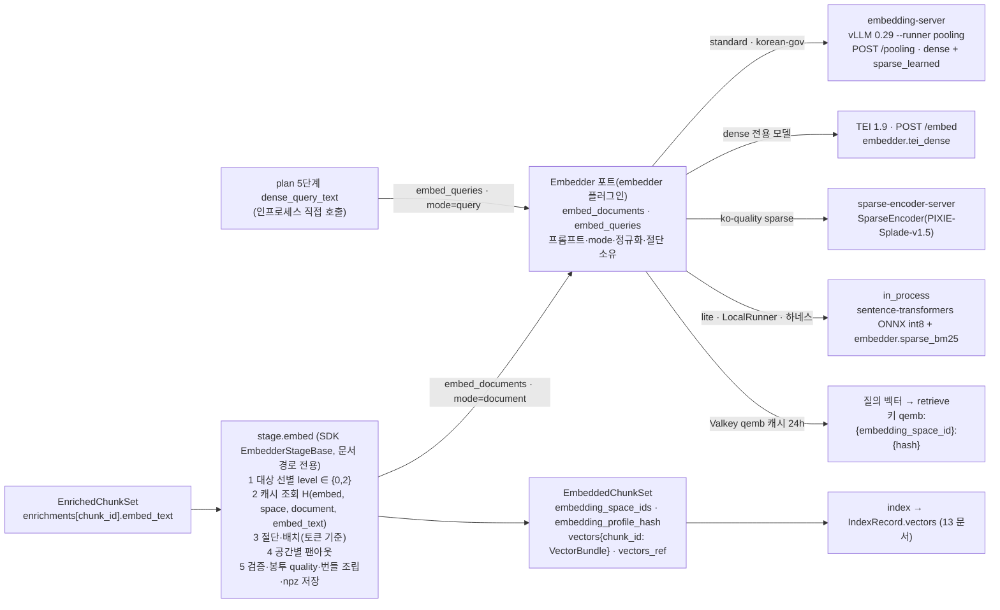

# 임베딩

> 정본은 [설계 바이블](../02-architecture/00-design-bible.md) §4.2 `embed` 행, §4.4 `embed` 정책, §5.4 `EmbeddedChunkSet`·`VectorBundle` 표, §5.7 `VectorName`·`Pooling`·`EmbeddingMode`·오류 카탈로그, §6.2 `embedding_space_id`·`embedding_profile_hash`·`embedder_fingerprint`·청크 임베딩 캐시 결합식, §7.1 "임베딩·서빙" 행, §7.2 `ingest.embed.batch_max_tokens`, §7.3 `ingest.embed` YAML, §8.1 5단계(질의 임베딩), §13.4 Valkey `qemb:` 키다. 계약 필드는 [07 EmbeddedChunkSet·IndexRecord](../03-contracts/07-embedded-chunk-set-and-index-record.md)가, 입력 텍스트 조립은 [06 EnrichedChunkSet](../03-contracts/06-enriched-chunk-set.md)이 소유한다. 이 문서는 그 정본을 **구현 관점**(플러그인 인터페이스·서빙 구성·클라이언트·배치·캐시·양자화·마이그레이션·검증·실패 모드)에서 풀어 쓰며, 바이블에 없는 것은 선택(N) 필드 또는 "## 미해결 이슈"의 제안으로만 둔다.

## 목적

`embed` 스테이지는 `EnrichedChunkSet`의 청크별 `embed_text`를 임베딩 공간(embedding space)마다 벡터로 바꾸어 `EmbeddedChunkSet`을 낸다. 이 문서는 (1) `embedder` 확장 지점(D-10)의 플러그인 인터페이스와 어댑터 소유권(프롬프트·모드·정규화·절단), (2) 기본 모델 BGE-M3와 대안 프로파일의 선정 매트릭스, (3) 서빙 스택(vLLM pooling·TEI·인프로세스)의 구성 값과 클라이언트 규칙, (4) 토큰 기준 동적 배치와 재개, (5) 청크 임베딩 캐시, (6) 정규화·차원 축소·양자화 정책, (7) 다중 named vector 동시 임베딩과 질의 임베딩 경로, (8) 모델 버전 고정과 공간 변경 마이그레이션, (9) sparse 인코딩과 렉시컬 필드의 책임 경계, (10) 멀티벡터 저장 비용·처리량 목표·회귀 테스트·실패 모드를 확정한다. 우아함의 기준은 브리프 §11 그대로 **경계의 명확성**이다: 무엇을 받고(`embed_text`), 무엇을 내고(`VectorBundle`), 실패하면 어떻게 되는지(`embed.*`)를 먼저 쓴다.

## 범위

- 포함: `embedder` 플러그인 인터페이스(`Embedder` 포트 + `Stage[EnrichedChunkSet, EmbeddedChunkSet]` 특수화), `Capabilities.extra` 임베더 전용 필드 제안, 절단·프롬프트·정규화 규칙, 기본 모델·대안 프로파일 표, 서빙 컨테이너 설정 예(vLLM pooling·TEI·`sparse-encoder-server`·인프로세스), 클라이언트(재시도·타임아웃·동시성·백프레셔·서킷), 배치 알고리즘과 `ResumeCursor.batch_offset`, 청크 임베딩 캐시의 키·저장 위치·조회, L2 정규화·Matryoshka·저장 양자화·리스코어, 다중 공간 팬아웃과 `embedding_profile_hash`, 질의 임베딩(`embed_queries`·`qemb:` 캐시·지연 예산·저하), 모델 고정(`models.lock`·`revision`·`image_digest`)과 공간 변경 = 컬렉션 blue/green, 동등성 게이트 절차, BGE-M3 sparse 출력 처리·`vocab_id`·`lite` `sparse_bm25` 해시, 멀티벡터 저장량, 처리량 초안 목표, 임베딩 회귀 테스트, 실패 모드.
- 제외: `EmbeddedChunkSet`·`IndexRecord`·`VectorBundle` 필드 정본([07](../03-contracts/07-embedded-chunk-set-and-index-record.md)), `embed_text`·`index_text` 조립 규칙([06](../03-contracts/06-enriched-chunk-set.md), [11 보강](./11-enrichment.md)), Qdrant·OpenSearch 적재·세대 사가([13 인덱싱](./13-indexing.md)), 크로스인코더 리랭커 서빙([16 리랭킹](./16-reranking.md)), 질의 계획의 나머지 단계([14 질의 이해](./14-query-understanding.md)), 검색 채널·융합([15 하이브리드 검색·융합](./15-hybrid-search-and-fusion.md)), 재색인 잡의 상태 기계([19 갱신·삭제·재색인](./19-update-delete-and-reindexing.md)), GPU 노드·KEDA 배포 세부([08 배포 아키텍처](../02-architecture/08-deployment-architecture.md)).

## 1. 위치와 역할

| 항목 | 값(바이블 §4.2·§4.4·§5.1) |
|------|---------------------------|
| 입력 → 출력 | `EnrichedChunkSet`(`ArtifactRef` 1개) → `EmbeddedChunkSet`(`vectors_ref` npz 파생물 + 청크별 `VectorBundle`) |
| 확장 지점·격리 | `embedder`; `standard` 이상은 외부 HTTP(`embedding-server` vLLM pooling, TEI) = `sidecar`, `lite`·개발·하네스는 `in_process` |
| 큐·정책 | `ingest-gpu-embed`, `start_to_close` 20m, `heartbeat` 60s, `max_attempts` 5(최대 간격 5m), `resumable=yes(heartbeat_details.batch_offset)`; 워커는 GPU를 쥐지 않는 HTTP 클라이언트(프로세스당 슬롯 8, [06 오케스트레이션](../02-architecture/06-orchestration-and-workflows.md)) |
| 멱등성 키 | 세트 `stage_key = H("stage", "embed", scope_key, enriched.blake3, fingerprint)` — `fingerprint`는 `Stage.fingerprint()`가 돌려주는 Producer 지문 `H("producer", plugin_id, plugin_version, config_hash, image_digest or "", ",".join(model_ids))`(바이블 §4.1 지문 행·§4.2 `embed` 행·§6.2 `fingerprint`(Producer) 행; §2.1). `embedder_fingerprint = H("embedder", plugin_id, plugin_version, config_hash, image_digest or "", embedding_profile_hash)`(§6.2)는 `EmbeddedChunkSet`·`IndexCommit` 전파용 **별개 파생 키**로 `stage_key`에 쓰지 않는다([07](../03-contracts/07-embedded-chunk-set-and-index-record.md) §1·미해결 이슈 11); 청크 `H("embed", embedding_space_id, "document", embed_text)`(봉투 없음, 테넌트 내 공유) |
| 비재시도 오류 | `embed.space_mismatch`, `embed.tokenizer_missing`; 재시도 `embed.server_unavailable`; 경고 `embed.token_overflow`(truncate) |
| 이벤트 | `ingest.document.embedded` |
| 결정성 등급 | `model_pinned`([01 파이프라인 프레임워크](./01-pipeline-framework.md) §8.1): `model_id@revision` + `image_digest` 고정, 수치 오차만 허용, 같은 공간 서빙 교체는 코사인 ≥ 0.9999 게이트 |



## 2. `embedder` 플러그인 인터페이스

### 2.1 두 층: `Embedder` 포트와 `Stage` 특수화

**결정:** `embedder` 플러그인은 모델 호출만 담당하는 **`Embedder` 포트**(`embed_documents`·`embed_queries`·`space`·`warmup`·`health`)를 구현하고, 문서 경로의 `Stage[EnrichedChunkSet, EmbeddedChunkSet]`(대상 선별·캐시·절단·배치·재개·번들 조립·npz 저장)은 SDK 공용 베이스 `EmbedderStageBase`가 하나로 구현한다. 질의 경로는 같은 포트의 `embed_queries`를 `plan` 스테이지가 인프로세스로 호출한다(바이블 §4.1 5멤버, §8.1 5단계; [ADR-0032](../06-adr/0032-plugin-sdk-stage-protocol-and-conformance-kit.md), [ADR-0009](../06-adr/0009-embedding-serving-vllm-pooling-tei-inprocess.md)). 이렇게 나누는 이유는 (1) 비대칭 모델의 프롬프트·모드 선택을 호출자가 아닌 어댑터가 소유하게 하고(ADR-0009 DR7), (2) 배치·캐시·재개라는 운영 로직이 세 서빙 경로에서 한 번만 구현·검증되게 하며(01 §12 적합성 키트 `idempotency`), (3) 질의·문서 경로가 같은 `embedding_space_id`를 같은 코드로 계산하도록 강제하기 위함이다.

```python
# src/rag_platform/sdk/embedder.py — Embedder 포트 스케치(제안; 바이블 §12 `sdk/` 목록에 없는 새 모듈·타입 — 미해결 이슈 17).
# 계약 타입은 rag_platform.contracts 재사용.
from __future__ import annotations
from typing import Protocol, Sequence
from pydantic import BaseModel
from rag_platform.contracts.enums import EmbeddingMode, Pooling, VectorName


class EmbeddingSpace(BaseModel, frozen=True):
    """H("space", model_id, revision, str(dim), str(normalized), prompt_hash, quantization, vocab_id or "") 의 입력(바이블 §6.2)."""
    name: VectorName                 # dense | sparse_learned | sparse_bm25 | late_interaction
    model_id: str                    # HF 저장소 "BAAI/bge-m3"(표기 {repo}@{revision}는 Producer.model_ids)
    revision: str                    # HF 커밋 SHA 또는 태그(바이블 §6.1); latest·main 금지(ADR-0009). SHA-only 강화는 제안(§11.1, 미해결 이슈 8)
    dim: int                         # dense: 출력 차원(MRL 절단 포함); sparse: 어휘 크기; late_interaction: 토큰 벡터 차원
    normalized: bool                 # dense True 고정(§8.1)
    prompt_hash: str                 # H("config", canonical_json(prompts)) — 프롬프트 없으면 {} 의 해시(§2.5)
    quantization: str                # 모델 출력·가중치 양자화 어휘(§8.3): none | onnx_int8 | output_int8 | output_binary
    vocab_id: str | None = None      # sparse 만: xlm-roberta-250k | ax-encoder-50k | analyzer_id(lite)
    pooling: Pooling                 # cls | mean | late — EmbeddedChunkSet.pooling 원천

    @property
    def embedding_space_id(self) -> str: ...   # hash_of("space", …) — SDK 단일 구현


class EmbedOutput(BaseModel):
    """한 텍스트 × 한 공간의 출력. dense/late_interaction 은 값 본문, sparse 는 (indices, values)."""
    dense: list[float] | None = None                       # L2 정규화 완료(어댑터 책임)
    sparse_indices: list[int] | None = None                # 오름차순·유일·≥ 0
    sparse_values: list[float] | None = None               # > 0
    late_interaction: list[list[float]] | None = None      # [count, dim], 토큰 벡터별 L2 정규화
    input_tokens: int                                      # 프롬프트 포함 실제 입력 토큰 수(계량)


class Embedder(Protocol):
    """embedder 플러그인이 구현하는 포트. 프롬프트·mode·정규화·절단은 이 안에서 끝난다."""
    plugin_id: str
    spaces: Sequence[EmbeddingSpace]                       # 이 플러그인이 한 호출로 내는 공간들(BGE-M3: dense + sparse_learned)
    max_input_tokens: int                                  # 프롬프트 포함 모델 상한(bge-m3 8192)
    tokenizer_id: str                                      # "hf:BAAI/bge-m3" — 절단·배치 토큰 계산의 기준(ctx.token_counters 키)

    async def embed_documents(self, texts: Sequence[str]) -> list[EmbedOutput]: ...   # mode=document
    async def embed_queries(self, texts: Sequence[str]) -> list[EmbedOutput]: ...     # mode=query(비대칭 지시 프롬프트 부착)
    async def warmup(self) -> None: ...        # 서빙 모델 식별자 ↔ spaces 대조(F-13), 토크나이저 적재
    async def health(self) -> bool: ...        # 서킷 half-open 탐침(§5)
```

| 포트 멤버 | 문서 경로(`EmbedderStageBase.run`) | 질의 경로(`plan` 5단계) | 규칙 |
|-----------|-------------------------------------|--------------------------|------|
| `embed_documents(texts)` | 절단·배치된 `embed_text` 배치를 전달. 반환 순서 = 입력 순서 | 사용 안 함 | 호출자는 원문만 전달하고 프롬프트를 붙이지 않는다(ADR-0009 코드 리뷰 (a)) |
| `embed_queries(texts)` | 사용 안 함 | `QueryPlan.dense_query_text`(변형 질의는 각 텍스트)를 전달 | 비대칭 모델은 어댑터가 질의 지시 프롬프트를 부착. 대칭 모델(BGE-M3·KURE-v1)은 `embed_documents`와 동일 경로이나 **메서드는 분리**해 두어 모델 교체 시 호출자 변경이 없게 한다 |
| `spaces` | `EmbeddedChunkSet.embedding_space_ids`·`pooling`·`VectorBundle.*.name`의 원천 | `QueryPlan.channels[].embedding_space_id`와 대조(불일치 → `embed.space_mismatch`) | 한 플러그인이 여러 공간을 낼 수 있다(BGE-M3 dense + sparse_learned). 공간이 다른 플러그인은 §9 합성 스테이지가 묶는다 |
| `max_input_tokens`, `tokenizer_id` | 절단(§2.4)·토큰 기준 배치(§6)의 기준 | 질의 절단(§10) | `tokenizer_id`는 `ctx.token_counters`에 있어야 하며 없으면 `embed.tokenizer_missing`(비재시도) |
| `warmup()`, `health()` | 워커 기동·`/readyz`; 첫 배치 전 1회 | `api` 기동 | 서빙 모델 `model_id@revision`·차원·정규화가 프로파일 `embedding_space_ids`와 다르면 `embed.space_mismatch` + `/readyz=false`([09 실패 모드](../02-architecture/09-failure-modes-and-resilience.md) F-13) |

`Stage` 5멤버와의 대응: `plugin_id`·`config_schema`는 플러그인이, `capabilities()`는 §2.3 필드로 플러그인이, `fingerprint()`는 SDK 일반식 `H("producer", plugin_id, plugin_version, config_hash, image_digest or "", ",".join(model_ids))`을 `EmbedderStageBase`가 계산한다. SDK는 `fingerprint()`에 `image_digest`(외부 HTTP 경로)와 `embedding_space_id`(모든 경로; `config_hash` 경유)가 포함되었는지 로드 시 검증한다(바이블 §4.1, ADR-0009 준수 확인 "SDK 지문 검증"). 인프로세스 경로는 `image_digest = null`이므로 ONNX 산출물 해시·런타임(onnxruntime·sentence-transformers) 버전을 `config_hash`에 넣는다(ADR-0009 코드 리뷰 (h)).

### 2.2 `EmbedderStageBase.run` 순서

| # | 단계 | 규칙 | 실패 |
|---|------|------|------|
| 1 | 대상 선별 | `level ∈ {0, 2}` 청크만 대상이고 부모(`level=1`)는 임베딩하지 않는다(바이블 §5.4 `Chunk` 불변식 (5); 07 V-4). `EnrichedChunkSet.enrichments`에는 `level`·`sentence_spans`가 없으므로 `EmbedderStageBase`는 `requires_lineage = ("ChunkSet",)`를 선언해 셸이 `ctx.lineage["ChunkSet"]`를 제공하게 한다(어댑터는 `ArtifactRef`를 직접 읽지 않는다, 바이블 §12 의존 방향). 바이블 §4.1은 `requires_lineage`를 "`index`만 사용"으로 적었으므로 patch 제안이다(미해결 이슈 16) | `ctx.lineage["ChunkSet"]` 부재 → `contract.violation` |
| 2 | 공간 검증 | 프로파일에서 재계산한 `embedding_space_ids`와 플러그인 `spaces`를 대조(바이블 §7.4 (8)); `warmup()` 결과와도 대조 | `embed.space_mismatch`(비재시도) |
| 3 | 캐시 조회 | 청크별 `H("embed", embedding_space_id, "document", embed_text)`를 공간마다 조회(§7). 적중 청크는 서빙 호출 없이 번들만 조립, `cache_hits += 1` | 캐시 계층 장애는 미스로 취급(정확성 무관) |
| 4 | 절단 | `embed_text` 토큰 수(`tokenizer_id` 카운터) > `max_input_tokens − prompt_tokens`면 §2.4 규칙으로 절단, `truncated=true` + `Warning{code: embed.token_overflow, chunk_id}` | — |
| 5 | 배치 | 토큰 기준 동적 배치(§6), `batch_max_tokens` 상한, 길이 내림차순 정렬 | — |
| 6 | 호출 | 공간(플러그인)별 `embed_documents(batch)`; 재시도·서킷은 §5 | `embed.server_unavailable`(재시도) |
| 7 | 검증·정규화 | dense 길이 = `dim`, ‖v‖₂ = 1 ± 1e-4(어댑터가 정규화했더라도 재검증), sparse `indices` 오름차순·유일·`values > 0`; 위반은 어댑터 버그 | `contract.violation`(비재시도) |
| 8 | 재개 지점 | 배치마다 `ctx.heartbeat(ResumeCursor)`를 부르되 `done`·`batch_offset`은 **마지막으로 저장된 `partial_ref.batches_done`** 을 가리킨다(01 §11.3 "`done`은 `partial_ref`에 반영된 수와 일치"); N 배치마다 `partial_ref`(계획 포함)를 갱신하고 그때만 커서가 전진한다(§6.3). 배치 성공마다 청크 캐시 기록(§7) | — |
| 9 | 봉투 `quality`·`warnings` | 입력 `EnrichedChunkSet.quality`를 **전파**하고 되돌리지 않는다. `VectorBundle.truncated=true`가 1건 이상이면 `quality=degraded` + 청크별 `Warning{code: embed.token_overflow, chunk_id}`([07](../03-contracts/07-embedded-chunk-set-and-index-record.md) §2.1·V-5; 바이블 §4.1 부분 성공 규약 "`quality: degraded` + `warnings[]`"). 바이블 §4.2 `embed` 행은 "truncate + 경고"만 적으므로 **초안**이며 07 미해결 이슈 12(§4.2 patch 제안)와 연동한다 | `quality`·`warnings` 불일치 → 07 V-5 검증기 `contract.violation` |
| 10 | 산출물 | dense·late_interaction 행렬을 npz로 `ctx.artifacts.put_derived(kind="vectors")`, `VectorBundle` 오프셋·sparse 인라인 조립, `stats`·`vector_layout` 계산 | — |

### 2.3 `Capabilities.extra` — 임베더 전용 필드(제안)

바이블 §5.3 `Capabilities`는 `model_ids`·`requires_gpu`·`extra`만 두고 임베더 전용 필드는 `extra`에 두도록 했다(ADR-0009 준수 확인 첫 행: "필드 정본은 03-contracts/00·07이 확정"). 이 문서는 프로파일 검증(§7.4 (2)·(4)·(5))에 필요한 최소 집합을 `EmbedderCapabilities`로 제안한다(N; 미해결 이슈 1). 값은 설정 반영 후의 실행 시 값이다.

| 필드 | 타입 | 필수 | 의미 | 검증 용도 |
|------|------|------|------|-----------|
| `vector_names` | array<enum(VectorName)> | Y | 이 플러그인이 내는 named vector | `embed.dense`·`embed.sparse` 슬롯 바인딩 대조(`embedder.tei_dense`를 `sparse`에 두면 `plugin.capability_unsupported`) |
| `max_input_tokens` | integer | Y | 프롬프트 포함 모델 상한 | `chunk.leaf_max_tokens + 2 × prefix_max_tokens ≤ max_input_tokens − prompt_tokens`(제안 규칙, 미해결 이슈 2) |
| `tokenizer_id` | string | Y | `hf:{repo}` | §7.4 (4) `chunk.tokenizer`와 일치 |
| `dense_dim`, `mrl_dims` | integer \| null / array<integer> | Y(nullable)/N | 기본 차원·허용 MRL 절단 차원(BGE-M3는 `[]`) | 프로파일 `dim`이 `mrl_dims ∪ {dense_dim}`에 없으면 `profile.invalid` |
| `sparse_vocab_id` | string \| null | Y(nullable) | `xlm-roberta-250k` 등 | `ingest.embed.sparse.vocab_id` 대조 |
| `pooling` | enum(Pooling) | Y | `cls`/`mean`/`late` | late chunking ↔ `mean` 강제(§7.4 (5)) |
| `requires_instruction` | boolean | Y | 비대칭 질의 프롬프트 필요 여부 | 프롬프트 문자열이 프로파일에 고정되었는지 검증 |
| `supports_query_mode_split` | boolean | Y | `embed_queries`가 `embed_documents`와 다른 경로인지 | 관측·회귀 테스트 케이스 선택 |
| `quantization` | string | Y | §8.3 어휘 | `embedding_space_id` 재계산 입력 |
| `determinism` | string | N | `model_pinned`(01 §8.1 제안) | 적합성 키트 방법 선택 |

`embedder.vllm_pooling_bge_m3`의 `capabilities()` 예(공용 `Capabilities` 필드 + `extra`; 값은 예시, `<sha>`는 `models.lock`이 해소한 HF 커밋 SHA 자리표시자):

```json
{
  "isolation_modes": ["sidecar"],
  "supports_resumable": true,
  "contracts_compat": ">=1.0,<2.0",
  "input_formats": [],
  "model_ids": ["BAAI/bge-m3@<sha>"],
  "requires_gpu": true,
  "extra": {
    "vector_names": ["dense", "sparse_learned"],
    "max_input_tokens": 8192,
    "tokenizer_id": "hf:BAAI/bge-m3",
    "dense_dim": 1024,
    "mrl_dims": [],
    "sparse_vocab_id": "xlm-roberta-250k",
    "pooling": "cls",
    "requires_instruction": false,
    "supports_query_mode_split": false,
    "quantization": "none",
    "determinism": "model_pinned"
  }
}
```

### 2.4 절단 정책

**결정:** 절단은 임베더 어댑터의 책임이며 서버 측 자동 절단은 안전망일 뿐이다. 입력 `embed_text`가 `max_input_tokens − prompt_tokens`를 넘으면 어댑터가 **자기 토크나이저로** 절단하고 `VectorBundle.truncated = true`·`Warning{code: embed.token_overflow, chunk_id}`를 기록한다. `Enrichment.embed_text`·`strip_offsets`·`Chunk.text`는 절단하지 않는다(바이블 §4.2 "`embed.token_overflow` truncate + 경고", §5.4 `VectorBundle.truncated`; [06](../03-contracts/06-enriched-chunk-set.md) §4 규칙 5).

| 규칙 | 내용 |
|------|------|
| 절단 위치 | `embed_text = D + LF + (G + LF)? + text`에서 **`text`의 꼬리**를 자른다. 접두어 `D`(결정적)·`G`(LLM)는 보존한다 — 접두어가 문맥 신호이고 본문 앞부분이 뒷부분보다 검색 가치가 높다는 가정(초안; 골든셋에서 head/tail 비교는 미해결 이슈 3) |
| 단위 | 토큰 경계(모델 토크나이저)로 자른 뒤 마지막 완전한 문장 경계(`Chunk.sentence_spans`를 `strip_offsets.text_start_in_embed`로 이동한 좌표)로 후퇴한다. 문장 경계가 없으면 토큰 경계 그대로 |
| 발생 조건 | `standard`(bge-m3 8192)에서는 `leaf_max_tokens 512 + prefix ≤ 100 + generated ≤ 100`이라 정상 경로에서 일어나지 않는다. 512 토큰 모델(multilingual-e5)·1,300 토큰 소프트 한계 모델(arctic-l-v2.0-ko)·`level=2` 요약 노드(≤ 1,024 코드포인트)에서 발생 가능하므로 §2.3 검증 규칙으로 프로파일 로딩 시 미리 막는다 |
| 서버 요청 | TEI는 요청 본문 `truncate: true`, vLLM은 `truncate_prompt_tokens`(확인 필요 as of 2026-09)로 안전망을 켜되, 어댑터가 먼저 절단하므로 서버 절단이 실제로 일어나면 토크나이저 불일치 버그로 간주해 경고 로그(`code=embed.token_overflow`)를 남긴다 |
| 계량 | `EmbedStats.truncated_count`(N) = `truncated=true` 수 = `embed.token_overflow` 경고 수(07 V-5) |
| 세트 `quality` | `truncated=true` 번들이 1건 이상이면 봉투 `quality=degraded`(입력 `EnrichedChunkSet.quality`가 이미 `degraded`면 그대로; `full`로 되돌리지 않음). 07 §2.1·V-5 초안을 따르며 07 미해결 이슈 12(바이블 §4.2 `embed` 행 patch) 확정 시 갱신한다(§2.2 9행) |

경고 인스턴스(`Warning`, 바이블 §5.3; 콘텐츠 미포함):

```json
{
  "code": "embed.token_overflow",
  "message": "embed_text exceeded max_input_tokens=8192 (prompt_tokens=0); tail of text truncated at sentence boundary, 8190 tokens kept",
  "chunk_id": "accd3831b9b08ad5da5cc41404a645a22e59f8775c60d99b72e073d8cb9cc445"
}
```

### 2.5 프롬프트·모드 소유와 `prompt_hash`

**결정:** 질의/문서 지시 프롬프트는 어댑터가 소유하고 `prompt_hash`가 공간을 정의한다. 호출자는 `EmbeddingMode`를 메서드(`embed_documents`/`embed_queries`)로만 선택하며 문자열을 만지지 않는다(바이블 §2.3 "프롬프트는 어댑터가 소유", §5.7 `EmbeddingMode`; [ADR-0009](../06-adr/0009-embedding-serving-vllm-pooling-tei-inprocess.md) 규칙 4).

| 항목 | 규칙 |
|------|------|
| `prompt_hash` 산출 | `H("config", canonical_json(prompts))`, `prompts = {"document": <문서 템플릿>, "query": <질의 템플릿>}`에서 **빈 문자열 키는 제거**한다. 프롬프트가 전혀 없으면 `canonical_json({}) = "{}"`의 해시([07](../03-contracts/07-embedded-chunk-set-and-index-record.md) §3 "빈 객체의 해시"와 동일) |
| 템플릿 표기 | 모델 카드 문자열을 프로파일 `ingest.embed.dense.prompts{document, query}`(N, 미해결 이슈 4)에 **그대로** 고정한다. sentence-transformers `prompt_name`처럼 이름만 있는 모델은 `config_sentence_transformers.json`의 실제 문자열을 복사한다(05 문서 "표준 모델 매핑") |
| 기본 모델 | BGE-M3·KURE-v1: 프롬프트 없음(`{}`). Qwen3-Embedding·multilingual-e5-instruct: `Instruct: {task}\nQuery: {q}`(질의만). arctic 계열: `query: `(질의만). PIXIE-Rune: `prompt_name="query"`. voyage-4-nano·nomic·EmbeddingGemma: 질의·문서 양쪽 |
| 불일치 방지 | 색인 시 `document` 프롬프트, 질의 시 `query` 프롬프트가 같은 `prompt_hash`의 두 면이다. 어댑터 단위 테스트는 "`embed_queries`가 `embed_documents`와 다른 토큰 시퀀스를 보내는가"를 `requires_instruction=true` 모델에서 확인한다(05 문서 실패 모드 "프롬프트 불일치") |

## 3. 기본 모델과 대안 프로파일

**결정:** 기본 임베딩은 **BGE-M3**(dense 1024d + `sparse_learned` 단일 패스)이며 유지 근거는 "3-in-1 단일 패스 + 생태계 + 드롭인 한국어 파인튠"이다. 대안은 A/B 등급 모델만 프로파일 옵션으로 두고, 교체는 `ko-quality` 게이트 nDCG@10 +2p로만 한다(브리프 D-16 개정 v1.1, 바이블 §3.1 D-16, §7.1; [ADR-0010](../06-adr/0010-bge-m3-rationale-and-late-interaction-slot.md), [ADR-0014](../06-adr/0014-sparse-representation-bge-m3-lexical-leg-kept.md)).

| 프로파일(바이블 §7.1) | `dense`(plugin / model / dim / pooling) | sparse 레그 | `late_interaction` | 서빙 | 비고 |
|-----------------------|------------------------------------------|-------------|--------------------|------|------|
| `lite` | `embedder.inprocess_sentence_transformers` / `BAAI/bge-m3` ONNX int8 / 1024 / `cls` | `embedder.sparse_bm25`(`vocab_id = analyzer_id`, `channel=lexical`) | 끔 | in_process(GPU 0) | `quantization = onnx_int8`이므로 `standard`와 **다른 공간**(승격 = blue/green, ADR-0009 중립) |
| `standard` | `embedder.vllm_pooling_bge_m3` / `BAAI/bge-m3` / 1024 / `cls` | 같은 플러그인 `sparse_learned`(`xlm-roberta-250k`) | 끔 | vLLM 0.29 pooling | 기본. 한국어 dense 단독 1.5~2.8p 열세를 감수(ADR-0010 F1) |
| `premium` `ko-quality` | `embedder.tei_dense` / `nlpai-lab/KURE-v1` / 1024 / `cls` | `telepix/PIXIE-Splade-v1.5`(`ax-encoder-50k`; 8192 토큰 필요 시 `yjoonjang/splade-ko-v1` 동일 어휘) @ `sparse-encoder-server` | 끔(M2 후) | TEI + SparseEncoder | 게이트 +2p 통과 컬렉션만. sparse 플러그인 ID는 미해결 이슈 5 |
| `premium` `quality-max` | vLLM / `Qwen/Qwen3-Embedding-4B` / MRL 1024 / last-token | 바이블 §7.1 미명시(ADR-0014 재검토 4) | 선택 | vLLM pooling | last-token 풀링이 `Pooling{cls, mean, late}`에 없어 계약 표현 불가 — **미해결 이슈 6(차단)** |
| `premium` `late_interaction`(M2) | 프로파일 dense 유지 | 유지 | `embedder.pylate_late_interaction` / `nlpai-lab/KURE-v2` / 128 | vLLM `token_embed`(실측 확인 필요) 또는 PyLate | (a) 인덱스 채널 vs (b) 리랭크 단계 비교 후 ADR-0010 개정 |
| `korean-gov` | `standard`와 동일 | 동일 | 끔 | 동일 | 가중치·LICENSE 자체 미러링 **필수**(`models/{repo}/{revision}/…` + `models.lock`) |

선정 매트릭스 요약(정본은 [05 임베딩 모델과 서빙](../07-tech-landscape/05-embedding-models-and-serving.md) 점수표·결정 논리, [선정 매트릭스](../07-tech-landscape/00-summary-and-selection-matrix.md) `dense_embedder`·`sparse_encoder`·`late_interaction_model`·`embedding_server` 행):

| 후보 | 라이선스(등급) | 한국어(MTEB-ko, 05 문서 인용) | 3-in-1 | 판정 |
|------|----------------|-------------------------------|--------|------|
| `BAAI/bge-m3` | MIT(A) | 79.30 | dense + sparse(+ colbert 1024d) | **기본** |
| `nlpai-lab/KURE-v1` | MIT(A) | 80.76 | dense만(bge-m3 드롭인) | `ko-quality` 1차 dense |
| `dragonkue/snowflake-arctic-embed-l-v2.0-ko` | Apache-2.0(A) | 82.14 | dense만, `query: ` 프리픽스, 약 1,300 토큰 초과 저하 | `ko-quality` 2차 |
| `telepix/PIXIE-Rune-v1.5` | Apache-2.0(A) | 81.57(v1.0 등재) | dense만, `prompt_name="query"` | `ko-quality` 3차 |
| `Qwen/Qwen3-Embedding-4B` | Apache-2.0(A) | 81.37 | dense(MRL), 처리량 약 1/7 | `quality-max` |
| `telepix/PIXIE-Splade-v1.5` | Apache-2.0(A) | sparse 리더보드 78.19(1위) | sparse만(149M) | `ko-quality` sparse |
| `nlpai-lab/KURE-v2` | Apache-2.0(A; 카드 재확인) | MTEB(kor,v2) 0.8160(카드 자체 보고) | late interaction 128d | M2 슬롯 후보 |
| jina v3/v4/v5, jina-colbert-v2, SPLADE-v3, kanana | CC-BY-NC / Qwen Research(D) | — | — | **제외**(BYO + `model_license_ack`만) |

수치는 리더보드·카드 자체 보고이며 후보 선별에만 쓴다. 채택·교체는 내부 한국어 골든셋 게이트(바이블 §7.4)로만 결정한다(원칙 7).

## 4. 서빙

**결정:** 서빙은 **vLLM pooling(BGE-M3 3-in-1) + TEI(dense 전용 모델·리랭커) + 인프로세스(개발·`lite`)**이며 Infinity는 sparse 미지원·릴리스 정체로 제외한다. 같은 공간 내 서빙 교체는 코사인 ≥ 0.9999 동등성 게이트를 통과해야 한다(브리프 D-16, 바이블 §3.1 D-16, §2.3 `embedding-server`; [ADR-0009](../06-adr/0009-embedding-serving-vllm-pooling-tei-inprocess.md)).

### 4.1 구성 값 표

버전·플래그는 07 문서 확인일(2026-09) 기준이고 정본은 잠금 파일·이미지 digest다. 배포 형태(Deployment + KEDA `prometheus`, GPU 노드 풀)는 [08 배포 아키텍처](../02-architecture/08-deployment-architecture.md) §6·§7이 정한다.

| 항목 | `embedding-server`(vLLM pooling) | TEI(dense 전용) | `sparse-encoder-server`(`ko-quality`) | 인프로세스(`lite`) |
|------|----------------------------------|-----------------|---------------------------------------|--------------------|
| 이미지 | 업스트림 vLLM 0.29 계열(태그·digest 확인 필요 as of 2026-09) | `ghcr.io/huggingface/text-embeddings-inference:{86\|89\|hopper}-1.9`(GPU), `cpu-1.9` | 자체 이미지(sentence-transformers `>=6.0` `SparseEncoder`, FastAPI 래퍼; 08 §6.3) | 코어 이미지 + `[gpu]` 없이 onnxruntime |
| 모델 | `BAAI/bge-m3@<sha>` | `nlpai-lab/KURE-v1@<sha>` 등 | `telepix/PIXIE-Splade-v1.5@<sha>` | `BAAI/bge-m3@<sha>` ONNX int8(`export_dynamic_quantized_onnx_model`) |
| dtype | `float16`(Ampere 이상; bf16 지원 GPU면 `bfloat16` 가능 — 두 값은 같은 `quantization=none` 공간이며 게이트 대상) | `float16` | `float16` | int8 가중치(`onnx_int8`) |
| 최대 입력 | `--max-model-len 8192` | 모델 상한(KURE-v1 8192) | 5,632(PIXIE-Splade-v1.5) / 8192(splade-ko-v1) | 8192 |
| 배치 토큰 상한 | `--max-num-batched-tokens 32768`(= `ingest.embed.batch_max_tokens` `standard`), `--max-num-seqs 64` | `--max-batch-tokens 32768`, `--max-client-batch-size 256`, `--max-concurrent-requests 512` | `max_batch_tokens 32768` | `batch_max_tokens 8192`(`lite`) |
| 풀링 | `cls`(모델 기본) | `--pooling cls` | SPLADE max + ReLU(모델 내장) | `cls` |
| 태스크 | `--runner pooling`, `--hf-overrides '{"architectures":["BgeM3EmbeddingModel"]}'`, `--io-processor-plugin bge_m3_sparse_plugin`(dense&sparse 단일 응답) | `/embed` | `encode_document` / `encode_query` | `SentenceTransformer(backend="onnx")` |
| 엔드포인트 | `POST /pooling` | `POST /embed`, `GET /health`, `GET /metrics` | `POST /v1/embed_sparse`(**제안** — 08 미해결 이슈 17이 이름·응답 스키마·`image_digest` 전파 확정을 이 문서와 03-contracts/16에 위임; 아래 제안 계약, 미해결 이슈 5) + `GET /healthz`·`GET /metrics` | 없음 |
| GPU 메모리 | `--gpu-memory-utilization 0.45`(리랭커와 MIG/공유 시; 08 §4.3 `standard` values `memoryUtilization`·§6.2 VRAM 근거) | 자동 | CPU 가능(149M) | — |
| 메트릭 | Prometheus(vLLM 기본) | Prometheus | 자체 `/metrics` | 워커 메트릭 |

vLLM 기동 예(값은 `standard`; `<sha>`·이미지 태그는 `models.lock`·values가 정본):

```bash
vllm serve BAAI/bge-m3 --revision <sha> \
  --runner pooling \
  --hf-overrides '{"architectures":["BgeM3EmbeddingModel"]}' \
  --io-processor-plugin bge_m3_sparse_plugin \
  --dtype float16 --max-model-len 8192 \
  --max-num-batched-tokens 32768 --max-num-seqs 64 \
  --gpu-memory-utilization 0.45 --port 8000
```

TEI 기동 예(`ko-quality` dense 전용):

```bash
text-embeddings-router --model-id nlpai-lab/KURE-v1 --revision <sha> \
  --dtype float16 --pooling cls \
  --max-batch-tokens 32768 --max-client-batch-size 256 --max-concurrent-requests 512 \
  --port 8080
```

`sparse-encoder-server` 계약 **제안**(03-contracts/16 사이드카 계약과 합의 후 확정, 미해결 이슈 5): 요청 `POST /v1/embed_sparse {texts: array<string>, mode: enum(EmbeddingMode)}` → 응답 `{model_id: "{repo}@{revision}", vocab_id: "ax-encoder-50k", vectors: array<SparseVector{indices, values}>, input_tokens: array<integer>}`(`SparseVector`는 [07](../03-contracts/07-embedded-chunk-set-and-index-record.md) §5.2 형식, `indices` 오름차순·유일·`values > 0`). `mode`에 따라 서버가 `encode_document`/`encode_query`를 고르므로 어댑터는 문자열을 만지지 않는다(§2.5). 바이블 §6.7 사이드카 공통 규약(`POST /v1/convert`·`GET /healthz`)은 변환 사이드카용이며 이 서버는 `embedding-server`와 같은 **서빙** 컨테이너(08 P7)이므로 `/v1/convert`를 쓰지 않는다; `GET /healthz`만 공유한다. `Producer.image_digest`는 이 서버 이미지 digest를 합성 스테이지 `config_hash`에 넣는다(§9 2행).

`--io-processor-plugin`·`--hf-overrides`의 정확한 인터페이스와 `/pooling` 응답 스키마는 vLLM 릴리스마다 변동 가능성이 있어(바이블 §15 리스크 #9) 어댑터는 응답을 **계약 테스트 코퍼스**(기록형 HTTP 카세트)로 검증하고, 파손 시 FlagEmbedding 인프로세스 폴백으로 운영한다(ADR-0009 재검토 조건 3). 확인 필요(as of 2026-09).

### 4.2 서빙 경로별 어댑터 책임

| 어댑터(`plugin_id`) | 서버 응답 → `EmbedOutput` 변환 | 정규화 | sparse 처리 |
|----------------------|-------------------------------|--------|-------------|
| `embedder.vllm_pooling_bge_m3` | dense `float[1024]` + sparse `{token_id: weight}`를 한 응답에서 분리 | 서버 출력이 정규화되어 있어도 어댑터가 재정규화(멱등) | §12.1 규칙(특수 토큰 제거·max 집계·양수 필터) 적용 후 `indices` 정렬 |
| `embedder.tei_dense` | `/embed` `float[dim]` 배열 | `normalize: true` 요청 + 재정규화 | 없음(`vector_names=[dense]`) |
| `embedder.inprocess_sentence_transformers` | `encode(normalize_embeddings=True)` | 재정규화 | 없음; `lite` sparse는 `embedder.sparse_bm25`(§12.3) |
| `embedder.sparse_bm25` | 서버 없음. `ctx.analyzer`로 `index_text` 토큰화 → TF 포화값 | 없음(양수 가중치) | §12.3 |
| `embedder.pylate_late_interaction` | `[count, 128]` 토큰 벡터 | 토큰 벡터별 L2 | 없음 |

### 4.3 Infinity 제외

Infinity(`infinity-emb`)는 README에 "BAAI/bge-m3, no sparse"가 명시되어 있고 최종 릴리스 0.0.77(2025-08-22)·최종 커밋 2026-03-24로 정체되어 있다. 라이선스(MIT)가 아니라 **능력·유지보수** 사유로 코어 의존성·entry point·프로파일 예시 어디에도 두지 않으며, CI는 `uv.lock`에 `infinity-emb`가 없음을 검사한다(ADR-0009 A2·준수 확인 "의존성·라이선스 게이트"). 재검토 조건은 ADR-0009 2번이다.

## 5. 클라이언트: 재시도·타임아웃·동시성·백프레셔

**결정:** 어댑터 내부 재시도는 짧게(수 초), 긴 인내는 Temporal 백오프에 맡기며, 서킷 브레이커가 열리면 즉시 `embed.server_unavailable`로 실패해 연결 시도 폭주를 막는다. **폴백 모델은 두지 않는다** — 다른 모델은 다른 `embedding_space_id`다(바이블 §4.2·§4.4 `embed` 행; [09 실패 모드](../02-architecture/09-failure-modes-and-resilience.md) F-12·F-20; ADR-0009 규칙 6).

| 항목 | 문서 경로(`embed` 스테이지) | 질의 경로(`plan` 5단계) | 근거·비고 |
|------|------------------------------|--------------------------|-----------|
| 연결 타임아웃 | 2s | 200ms | 초안 목표 |
| 요청 타임아웃 | 배치당 120s(`batch_max_tokens` 32,768 기준; [09 실패 모드](../02-architecture/09-failure-modes-and-resilience.md) §4 타임아웃 예산 분배 `embed` 행, 초안 목표) | 남은 `latency_budget_ms.plan` 이내, 상한 100ms(GPU) / 400ms(CPU `lite`) | 질의 임베딩 예산 40ms(GPU 미스) / 약 150ms(CPU), 바이블 §8.3 |
| 어댑터 내부 재시도 | 연결 오류·429·503·5xx: 3회, 지터 백오프 0.5s → 1s → 2s(합 ≤ 4s). 4xx(400·413·422)는 즉시 비재시도(`contract.violation` 또는 절단 버그) | 재시도 없음(1회) | 이후 `embed.server_unavailable`을 던져 Temporal `max_attempts` 5·백오프 `{1s, 5m, 2.0}`에 맡긴다. 현 정책의 유효 인내 시간 문제는 09 문서 미해결 이슈 16 |
| 서킷 브레이커 | 30s 창에서 연속 실패 5회 또는 오류율 ≥ 50% → open 10s → half-open 탐침 `health()` 1회 → 성공 시 close | 동일 서킷 공유(프로세스 단위) | open 상태에서 문서 경로는 즉시 `embed.server_unavailable`; 질의 경로는 캐시 미스 질의만 렉시컬 단독 + `degraded{query_embedding, unavailable}`·`degraded{channel.dense\|channel.sparse, unavailable}`(F-20) |
| 동시성 | 워커 프로세스당 `max_concurrent_activities` 8(HTTP 슬롯), 액티비티당 동시 배치 2 → 프로세스당 in-flight ≤ 16 요청 | `api` 프로세스당 in-flight 상한 64(초안) | 서버 `--max-num-seqs`·`--max-concurrent-requests`와 정합; 초과는 클라이언트 대기(세마포어) |
| 백프레셔 | 서버 429/503 → 어댑터 백오프 → 액티비티 지연 → 큐 백로그 → KEDA `prometheus` 스케일아웃(1~2 replicas, 08 §6.3 인스턴스 표·§7.3 사이징) → `tenant_concurrent_jobs_max`로 유계 | 429 → 즉시 저하(재시도 없음) | 워커는 큐를 자체 구현하지 않는다(서버 동적 배칭에 위임) |
| 헬스·준비 | `warmup()`에서 서빙 모델 식별자 대조(F-13); 실패 시 워커 `/readyz=false` | `api` `/readyz` 의존성 상태에 포함 | 모델 불일치는 `embed.space_mismatch`(비재시도) |
| 우선 큐 | 질의 임베딩은 `embedding-server`를 공유하되 전용 우선 큐는 서버 기능 확인 필요(as of 2026-09; 09 문서) | — | 대량 색인이 검색 p95를 깨지 않도록 `standard`는 임베딩·리랭커 GPU를 분리(NFR-PERF-19) |

## 6. 배치 전략

**결정:** 배치는 **토큰 기준 동적 배치**다. 청크를 `tokenizer_id` 토큰 수 내림차순으로 정렬한 뒤 `ingest.embed.batch_max_tokens`(바이블 §7.2: `lite` 8,192 / `standard` 32,768 / `premium` 65,536 / `korean-gov` 32,768; 초안 목표)와 요청당 항목 상한(초안 256 = TEI `--max-client-batch-size`)을 동시에 만족하도록 그리디로 채운다. 배치 계획은 **첫 시도의 실행 전**에 결정적으로 확정되어 `partial_ref`에 저장되고, 재시도는 저장된 계획을 그대로 이어 쓴다 — 따라서 `ResumeCursor.total`(배치 수)과 `batch_offset`은 시도 간에 불변이며 재시도 시점의 캐시 상태는 계획을 바꾸지 않는다(§6.3; 바이블 §4.4 `resumable=yes(heartbeat_details.batch_offset)`; ADR-0009 규칙 7 "`batch_max_tokens` ↔ vLLM `max_num_batched_tokens` / TEI `--max-batch-tokens` 정합").

### 6.1 알고리즘

```python
# EmbedderStageBase — 배치 계획(순수 함수; 같은 입력이면 같은 계획)
def plan_batches(
    items: list[tuple[str, int]], batch_max_tokens: int, batch_max_items: int, solo_over_tokens: int = 4096
) -> list[list[str]]:
    """items = [(chunk_id, tokens_after_truncation)], 토큰 내림차순 정렬 후 그리디.
    긴 항목이 먼저 묶여 패딩 낭비가 줄고, 마지막 배치들이 짧은 항목으로 채워진다.
    solo_over_tokens 초과 항목은 단독 배치(어텐션 활성화 제곱 증가 보호, 규칙표 "상한 산정")."""
    ordered = sorted(items, key=lambda it: (-it[1], it[0]))      # 동률은 chunk_id 오름차순(결정성)
    batches: list[list[str]] = []
    cur: list[str] = []
    cur_tokens = 0
    for chunk_id, tokens in ordered:
        if tokens > solo_over_tokens:                              # 내림차순이라 이 항목들은 항상 맨 앞(cur 비어 있음)
            batches.append([chunk_id])
            continue
        if cur and (cur_tokens + tokens > batch_max_tokens or len(cur) >= batch_max_items):
            batches.append(cur)
            cur, cur_tokens = [], 0
        cur.append(chunk_id)
        cur_tokens += tokens
    if cur:
        batches.append(cur)
    return batches
```

| 규칙 | 내용 |
|------|------|
| 정렬 | 토큰 내림차순, 동률은 `chunk_id` 오름차순. 결과 순서는 산출물에 영향을 주지 않는다(`vectors`는 `chunk_id` 키, npz 행 `offset`은 정렬된 `chunk_id` 순으로 재배치) |
| 상한 산정 | `batch_max_tokens`는 서버 배치 토큰 상한과 **같거나 작아야** 한다. 8192 토큰 XLM-R은 어텐션 활성화가 시퀀스 제곱이라 `max_len × batch`로 산정하고, 4,096 토큰 초과 항목(`level=2` 요약 노드 등)은 단독 배치로 보낸다(`solo_over_tokens`, 위 코드; 05 문서 함정 (3), 실패 모드 "8192 토큰 배치 OOM") |
| 공간별 팬아웃 | 한 배치를 공간(플러그인)마다 병렬 호출(`asyncio.gather`), 플러그인마다 자기 `tokenizer_id`로 다시 계수한 계획을 쓴다(`ko-quality`: KURE-v1 XLM-R 계수와 PIXIE-Splade A.X-Encoder 계수가 다름). 계획은 플러그인별로 `partial_ref.plans[plugin_id]`에 저장한다 |
| 캐시 적중 제외 | **첫 시도의 계획 수립 시점**에 적중 청크를 계획에서 제외한다. 계획은 `partial_ref`에 저장되어 재시도가 그대로 이어 쓰므로(§6.3), 직전 시도가 기록한 청크 캐시(§7)를 포함한 재시도 시점의 캐시 상태는 계획·`total`·`batch_offset`을 바꾸지 않는다. 남은 배치 안에서 새로 적중한 항목은 서빙 호출에서만 빠지고 배치 경계는 유지된다. 같은 `stage_key`의 **새 실행**(재시도가 아닌 재실행)은 계획을 새로 세우며 배치 수가 줄 수 있다 |
| 인프로세스 | `lite`는 배치 토큰 8,192·항목 32(초안)로 CPU 메모리를 보호한다. ONNX 세션은 프로세스당 1개(`max_concurrent_activities` 1~2) |

### 6.2 크기별 초안 목표

| 구성 | 배치 토큰 | 항목 상한 | 배치당 예상 지연(초안, 확인 필요 as of 2026-09) |
|------|-----------|-----------|------------------------------------------------|
| `standard` vLLM fp16, L4/A10 급 | 32,768 | 256 | 512 토큰 × 64 항목 ≈ 0.3~0.5s(200 청크/s 가정) |
| `premium` vLLM fp16, A100 급 | 65,536 | 256 | 512 토큰 × 128 항목 ≈ 0.3s |
| `lite` ONNX int8, 8 vCPU | 8,192 | 32 | 512 토큰 × 16 항목 ≈ 4s(4 청크/s 가정, NFR 문서 §3.5) |

### 6.3 재개(`ResumeCursor`)

`embed`는 `Capabilities.supports_resumable=true`이며 배치 완료마다 `ctx.heartbeat`를 부른다. 스키마는 [01](./01-pipeline-framework.md) §11.2 `ResumeCursor`(내부 타입)이고 진행 단위는 `unit=batch_offset`이다.

| 필드 | 값 |
|------|----|
| `stage`, `unit` | `"embed"`, `"batch_offset"` |
| `done`, `total` | 완료 배치 수 / 계획 배치 수(계획이 실행 전 확정되므로 `null`이 아니다) |
| `batch_offset` | 다음에 처리할 배치 인덱스(0-based) |
| `partial_ref` | 첫 시도에서 계획 확정 직후 1회 저장(`batches_done=0`), 이후 N 배치(초안 10)마다 갱신. `derived/partial_embed/{blake3[:2]}/{blake3}.json`(`application/json`): `{enriched_blake3, fingerprint, plans: {plugin_id: [[chunk_id, …], …]}, batches_done, bundles: {chunk_id: VectorBundle}, dense_rows_ref: ArtifactRef(npz 조각), chunks_done}` — **계획 자체를 저장**하므로 재개는 재계산이 아니라 저장된 계획의 `batch_offset`부터 이어간다 |
| 재개 검증 | (1) 셸이 `partial_ref.blake3` 무결성을 검증(01 §11.3), (2) `partial_ref.enriched_blake3 == 입력 enriched_ref.blake3` 그리고 `partial_ref.fingerprint == Stage.fingerprint()`(= 같은 `stage_key`). 하나라도 실패하면 `partial_ref`를 폐기하고 새 계획으로 처음부터 실행한다(순수 변환이므로 결과 동일). 청크 캐시 상태는 검증 입력이 **아니다** |

배치 → 청크 환산(01 미해결 이슈 1에 대한 제안): 셸은 `progress.unit=chunk`로 표시하되 `done_chunks = partial_ref.chunks_done`이 있으면 그 값을, 없으면 `round(done / total × 대상 청크 수)`를 쓴다. 재개 시 `partial_ref`의 `bundles`는 그대로 채택하고 `dense_rows_ref` npz 조각은 최종 npz로 병합한다. 청크 캐시(§7)와 `partial_ref`의 책임은 겹치지 않는다: 청크 캐시는 **다른 실행**(재청킹·타 컬렉션·재색인)의 비용 절감, `partial_ref`는 **같은 액티비티의 재시도**에서 배치 경계·진행 위치 보존이다. 재시도에서 남은 배치의 항목이 청크 캐시에 있으면 호출만 생략한다(§6.1 "캐시 적중 제외").

```json
{
  "schema_version": "1.0.0",
  "stage": "embed",
  "unit": "batch_offset",
  "done": 40,
  "total": 96,
  "batch_offset": 40,
  "partial_ref": {
    "uri": "s3://rag-artifacts/tenants/01J9ZQ4K7X2M8N3P5R6S7T8V9W/derived/partial_embed/7e/7e2c1a9b4d6f8e0c2a4b6d8f0e2c4a6b8d0f2e4c6a8b0d2f4e6c8a0b2d4f6e8c.json",
    "blake3": "7e2c1a9b4d6f8e0c2a4b6d8f0e2c4a6b8d0f2e4c6a8b0d2f4e6c8a0b2d4f6e8c",
    "media_type": "application/json",
    "size_bytes": 2621440
  },
  "updated_at": "2026-09-22T09:12:40.000Z"
}
```

## 7. 청크 임베딩 캐시

**결정:** 청크 임베딩 캐시 키는 바이블 §6.2 그대로 `H("embed", embedding_space_id, "document", embed_text)`이며 봉투가 없어 **테넌트 내**에서 재청킹·타 컬렉션·재색인에 걸쳐 공유된다. 흔히 쓰는 "`content_hash + model_version`" 캐시 키는 이 식에서 `embed_text`(콘텐츠)와 `embedding_space_id`(모델·revision·dim·정규화·프롬프트·양자화·어휘)로 실현된다 — `model_version`만으로는 프롬프트·양자화 변경을 잡지 못하므로 공간 ID가 정확한 단위다(바이블 §4.1 "봉투 없는 콘텐츠 전용 캐시", §4.2 `embed` 행; [ADR-0037](../06-adr/0037-artifact-cache-scope-and-stage-key-composition.md), [ADR-0009](../06-adr/0009-embedding-serving-vllm-pooling-tei-inprocess.md) 규칙 5).

| 항목 | 규칙 |
|------|------|
| 키 | `cache_key = H("embed", embedding_space_id, "document", embed_text)`. 질의(`mode=query`)는 이 캐시를 쓰지 않고 Valkey `qemb:`(§10) |
| 값 | 공간 1개의 출력: `{embedding_space_id, embed_text_hash, dense: array<number> \| null, sparse: {indices, values} \| null, late_interaction_ref: ArtifactRef \| null, truncated, input_tokens, created_at}`. `late_interaction`은 크기 때문에 값 본문 대신 npz 조각 참조 |
| 저장 위치(1차, **제안**) | 오브젝트 스토리지 파생물 `tenants/{tenant_id}/derived/embed_cache/{cache_key[:2]}/{cache_key}.json`(봉투 없음, 테넌트 내 공유). 바이블 §13.3 파생물 키의 `{blake3}`는 출력 **바이트 해시**이고 여기서는 **조회 키**(`cache_key`)를 경로에 쓰므로 §13.3 그대로가 아니라 patch 제안이다(01 §7 "조회 키 → 오브젝트 키 색인은 04-storage-architecture 소유·미확정", ADR-0037 중립 3; 미해결 이슈 7). 대안은 §13.3 바이트 해시 경로 + Valkey/PG 색인(조회 키 → `uri`). 정확성의 정본은 `EmbeddedChunkSet`이며 캐시는 **비용 절감용**이다 |
| 조회 색인(제안) | Valkey `embc:{tenant_id}:{cache_key}` → `"1"`(존재 표지, TTL 7d). 50,000 키 `MGET` 파이프라인 1회로 배치 조회하고 **미스는 그냥 미스**(오브젝트 스토리지 `HEAD` 50,000회 금지). 적중 시 `EXPIRE` 7d로 갱신해 살아 있는 항목이 TTL 만료로 영구 미스가 되지 않게 한다. 키 이름은 바이블 §13.4에 없으므로 미해결 이슈 7 |
| 기록 | 배치 성공 후 공간별 값을 `put_derived` + 색인 키 `SET`을 **배치 단위 비동기**(fire-and-forget 태스크, 프로세스당 동시 기록 상한 4·대기열 상한 64 배치, 초안)로 수행하고 스테이지 지연에 넣지 않는다. 실패는 무시(다음 실행이 재계산). 청크 × 공간당 객체 1개(dense 1024 float ≈ 10~20KB)라 64항목 배치가 최대 128 PUT을 내므로, 실측에서 PUT 비용이 문제면 배치별 npz 조각 + 청크 → (조각, 행) 색인으로 바꾼다(미해결 이슈 7) |
| 라이프사이클 | `derived/embed_cache/`는 오브젝트 스토리지 수명 규칙 **마지막 접근 90d 만료**(초안; 색인 TTL 7d와 별개, 고아 객체 누적 방지) + `rag cache invalidate`. 색인 만료 후 남은 객체는 다음 기록이 같은 키로 덮어써(멱등) 다시 살아난다 |
| 적중 계량 | `EmbeddedChunkSet.cache_hits`(청크 × 공간 적중 수가 아닌 **청크 수**; 모든 공간이 적중한 청크만 적중으로 계수) |
| 무효화 | 공간이 바뀌면 키가 자연히 갈린다. 버그 산출물 제거는 `rag cache invalidate --stage embed`(바이블 §12 `cli`)가 `embc:` 접두와 `derived/embed_cache/`를 스코프별로 지운다 |
| 스테이지 캐시와의 관계 | 같은 잡 스코프의 재실행은 `stage_key`가 먼저 적중해 청크 캐시까지 오지 않는다. 청크 캐시는 (a) 청커 설정 변경 뒤 동일 텍스트 청크, (b) 같은 문서를 같은 공간의 다른 컬렉션에 수집, (c) LLM 접두어 변경 없이 `enrich` 정책만 바뀐 경우에 효과가 있다 |

캐시 값 예(공간 `dense`; `dense` 배열은 1024 원소 중 앞 4개만 표기한 것이 아니라 예시를 위해 4차원으로 축약한 **형식 예**이며 실제는 `dim` 길이):

```json
{
  "embedding_space_id": "cd72859ad1bd275b6f0b592d7e0a4619f8757fddb1586b1a6b714fd0458cf8a3",
  "embed_text_hash": "5f264be72afef2442586b51940a831e9d66569112783d287e54ddccc3c9ca3d2",
  "dense": [0.0123, -0.4471, 0.8834, 0.1392],
  "sparse": null,
  "late_interaction_ref": null,
  "truncated": false,
  "input_tokens": 143,
  "created_at": "2026-09-22T09:13:01.000Z"
}
```

## 8. 정규화·차원 축소·양자화

### 8.1 L2 정규화

**결정:** dense 벡터는 어댑터가 **항상** L2 정규화해 반환하고(‖v‖₂ = 1 ± 1e-4), `EmbeddingSpace.normalized = true`가 공간 ID에 들어간다. 유사도는 cosine으로 통일되어 Qdrant `distance: Cosine`에서 dot과 같다(바이블 §5.4 `VectorBundle.dense` "L2 정규화", §13.4 `dense`(cosine); 07 R-5; 05 문서 계약 요소 "정규화"). pplx-embed처럼 비정규화 int8 출력을 내는 모델도 float 변환 후 정규화한다. late interaction 토큰 벡터는 토큰별로 정규화한다(MaxSim 스케일 일관성).

### 8.2 차원 축소(Matryoshka)

| 규칙 | 내용 |
|------|------|
| 허용 조건 | MRL(Matryoshka Representation Learning) 학습 모델만 절단한다: Qwen3-Embedding(32~최대), arctic-l-v2.0(256), nomic-v2-moe(256), EmbeddingGemma(128~768), voyage-4-nano(256~2048). **BGE-M3·KURE-v1·PIXIE-Rune·e5는 미지원**이므로 절단 금지(`mrl_dims=[]`, §2.3 검증) |
| 절단 방법 | 앞 `dim` 차원을 취한 뒤 **재정규화**. 어댑터가 수행하며 서버 `dimensions` 파라미터(TEI·Ollama)는 사용 가능하되 결과는 어댑터 재정규화와 동일해야 한다 |
| 공간 | `str(dim)`이 `embedding_space_id`에 들어가므로 절단 차원 변경 = 다른 공간 = 컬렉션 blue/green. `quality-max`는 Qwen3-Embedding-4B 2560d를 1024로 절단해 bge-m3와 인덱스 크기를 맞춘다(바이블 §7.1) |
| 저장·검색 | 절단은 모델 출력 단계에서 끝나며 백엔드는 `dim` 크기 벡터만 본다. 검색 시 full-dim 리스코어는 하지 않는다(full 벡터를 저장하지 않으므로) |

### 8.3 양자화 정책

**결정:** 두 종류의 양자화를 구분한다. (a) **모델 측 양자화**(가중치 int8 ONNX, 모델이 직접 내는 int8/binary 출력)는 벡터 값 자체를 바꾸므로 `embedding_space_id`의 `quantization`에 들어가고, (b) **저장 양자화**(Qdrant scalar int8·binary·TurboQuant)는 float 벡터를 받은 백엔드의 설정이며 공간 ID에 들어가지 않는다([07](../03-contracts/07-embedded-chunk-set-and-index-record.md) §4 규칙 (4); ADR-0009 중립). `EmbeddedChunkSet.vectors_ref`는 항상 (b) 적용 전의 값(`vector_layout.dense.dtype`, 기본 `float32`)을 담는다.

`quantization` 어휘(초안; 바이블 §6.2에 정의되지 않아 07 미해결 이슈 7에 대한 이 문서의 제안, 미해결 이슈 8):

| 값 | 의미 | 예 |
|----|------|----|
| `none` | fp32·fp16·bf16 연산(수치 오차만; 같은 공간, 동등성 게이트 대상) | `standard` vLLM fp16, TEI fp16 |
| `onnx_int8` | 가중치 동적 int8(ONNX Runtime) | `lite` bge-m3 ONNX int8 |
| `output_int8` | 모델이 int8 임베딩을 직접 출력(QAT) | voyage-4-nano `int8`, pplx-embed 네이티브 int8 |
| `output_binary` | 모델이 binary 임베딩을 직접 출력 | voyage-4-nano `binary` |

저장 양자화(백엔드 설정, [13 인덱싱](./13-indexing.md)이 프로파일 키를 확정) 정책:

| 기법 | 적용 대상 | 기본값(초안) | 근거(05 문서 "양자화와 Matryoshka") |
|------|-----------|--------------|--------------------------------------|
| scalar int8 + 리스코어 | `dense` 1024d, 100만 청크 이상 컬렉션 | `standard`: 끔(fp32 원본 유지; 4GB/100만 청크는 허용 범위). 500만 청크 초과 시 켬 권고, `oversampling 2.0` + `rescore true` | HF 블로그: 성능 유지 약 99.3%, 메모리 4배 절감, 검색 최대 4배 가속 |
| binary + int8/float 리스코어 | 대규모(수천만) 컬렉션 옵션 | 끔. 켤 때는 `rescore_multiplier 4` 상당 리스코어 필수 | 리스코어 없이 92.53%, 리스코어 시 96.45%, 메모리 32배 절감 |
| TurboQuant(`turbo4`, 1-bit) | `late_interaction` 멀티벡터 | `premium` M2 슬롯에서 `turbo4` + 1-bit TurboQuant 결합(Qdrant 1.19 튜토리얼 명시) | 압축 8~32배; scalar/binary의 멀티벡터 적용 여부는 미기재(05 미해결 이슈 10) |
| 원본 보존 | 모두 | Qdrant `on_disk` 원본 유지 + 리스코어 | 양자화 손실은 골든셋 nDCG@10 게이트(§7.4)로 확인 후 켬 |

## 9. 다중 모델 동시 임베딩(named vectors)

**결정:** 한 컬렉션의 named vector 집합은 `embedding_space_ids{dense, sparse_learned? \| sparse_bm25?, late_interaction?}`이며 `embedding_profile_hash = H("spaces", *sorted(f"{name}={space_id}"))`가 컬렉션 바인딩 단위다. 슬롯을 켜고 끄는 것(예: `late_interaction.enabled`)도 `embedding_profile_hash` 변경 = 컬렉션 blue/green이다(바이블 §5.4 `EmbeddedChunkSet`, §6.2, §7.4 (8); [ADR-0010](../06-adr/0010-bge-m3-rationale-and-late-interaction-slot.md) 중립).

| 경우 | 플러그인 구성 | `Producer` | `embedder_fingerprint` |
|------|---------------|------------|-------------------------|
| 단일 플러그인이 여러 공간(`standard`: `vllm_pooling_bge_m3` → dense + sparse_learned) | `ingest.embed.dense.plugin == sparse.plugin` | `plugin_id = embedder.vllm_pooling_bge_m3`, `image_digest` 서빙 이미지, `model_ids = ["BAAI/bge-m3@<sha>"]` | `H("embedder", plugin_id, plugin_version, config_hash, image_digest or "", embedding_profile_hash)`(바이블 §6.2 철자 그대로; 인프로세스 경로는 `image_digest = null` → `""`) |
| 슬롯별 다른 플러그인(`ko-quality`: TEI dense + SparseEncoder sparse; `lite`: ONNX dense + `sparse_bm25`; M2: + `pylate_late_interaction`) | 플랫폼 소유 합성 스테이지 `embedder.pipeline`(제안, 미해결 이슈 9; 06 `enricher.pipeline`·09 `query_transformer.pipeline`과 같은 `{extension_point}.pipeline` 규약)가 슬롯 플러그인을 `VectorName`별로 팬아웃하고 번들을 병합 | `plugin_id = embedder.pipeline`(제안), `image_digest` = `dense` 슬롯 서빙 이미지 digest(외부 HTTP 슬롯이 하나도 없으면 `null`), `model_ids` = 슬롯 모델 합집합 | 같은 식. 슬롯 멤버의 `plugin_id@plugin_version`·`image_digest`·`config_hash`는 합성 스테이지의 `config_hash`에 들어가 어느 멤버가 바뀌어도 두 지문(Producer `fingerprint`·`embedder_fingerprint`)이 함께 갈린다 |

규칙: (1) 번들의 이름 집합 = `embedding_space_ids` 키 집합(07 V-4) — 한 슬롯만 실패하면 청크 전체가 실패다(부분 번들 금지). (2) `sparse_bm25`는 `index_text`를 입력으로 하고 `channel=lexical`이지만 **생산은 `embed` 스테이지**(`embedder.sparse_bm25`)다(바이블 §7.1 `lite`, §12 `adapters/embed/sparse_bm25.py`). (3) `late_interaction`은 BGE-M3 colbert(1024d)와 같은 named vector에 넣지 않으며 백엔드 `supports_multivector=false`면 로딩 시 자동 비활성 + `degraded`다(ADR-0010). (4) `page_multivector`·`pooled_page_multivector`·`page_dense`(`visual-pages`)는 별도 컬렉션·별도 플러그인이며 이 스테이지의 팬아웃 대상이 아니다. (5) `EmbeddedChunkSet.pooling`은 단일 값이므로 **`dense` 공간의 `EmbeddingSpace.pooling`** 을 기록한다(초안, 미해결 이슈 8); 슬롯별 풀링은 각 공간의 `embedding_space_id`가 이미 구분하고, late chunking 프로파일만 `late`가 된다(바이블 §5.4 "late chunking은 `late`").

`ko-quality` `ingest.embed` YAML(바이블 §7.3 형식; 값은 제안):

```yaml
ingest:
  embed:
    dense:  {plugin: embedder.tei_dense, model_id: nlpai-lab/KURE-v1, revision: "<sha>", dim: 1024, normalized: true, dtype: fp16}
    sparse: {plugin: embedder.sparse_encoder_splade, model_id: telepix/PIXIE-Splade-v1.5, revision: "<sha>", vocab_id: ax-encoder-50k}   # plugin_id 는 제안(미해결 이슈 5)
    late_interaction: {enabled: false}
    equivalence_gate: {cosine_min: 0.9999, sample: 1000}
    batch_max_tokens: 65536
```

## 10. 질의 임베딩 경로

**결정:** 질의 임베딩은 `plan` 5단계에서 `Embedder.embed_queries([dense_query_text])`를 인프로세스로 호출해 컬렉션 공간별 dense + sparse를 얻고 Valkey `qemb:{embedding_space_id}:{blake3_hex(utf8(dense_query_text))}`에 24h 캐시한다. 실패 시 폴백 모델 없이 렉시컬 단독으로 저하한다(바이블 §4.3 `plan` 행, §8.1 5단계·6단계, §8.3 "질의 임베딩 40ms", §13.4 `qemb:`; [09 QueryRequest·QueryPlan](../03-contracts/09-query-request-and-query-plan.md) §8.2; 09 실패 모드 F-20).

| 항목 | 규칙 |
|------|------|
| 입력 | `QueryPlan.dense_query_text`(`default` = `normalized_query`, HyDE = 가상 문서), 변형 질의 `rewritten_queries[].text`는 각각. 렉시컬 채널은 질의 임베딩을 쓰지 않는다(`lexical_terms`·`index_text` 매칭) |
| 모드 | `mode=query` — 비대칭 모델은 질의 지시 프롬프트 부착(§2.5). BGE-M3는 문서와 동일 경로지만 `embed_queries`를 통해 호출 |
| 캐시 키 | `qemb:{embedding_space_id}:{blake3_hex(utf8(dense_query_text))}`, TTL 24h, 값 = 공간 1개의 `EmbedOutput`(dense 또는 sparse). BGE-M3 단일 패스는 dense·sparse_learned 두 공간 키에 각각 저장한다. 콘텐츠 해시 키이므로 `{tenant}` 접두 예외(바이블 §13.4). 플랜에는 `QueryPlan.cache_keys.query_embedding`(`original` 변형, 첫 활성 벡터 채널 공간)만 기록하고 나머지 런(다른 공간·변형 질의)의 키는 `retrieve`가 09 §8.2 식으로 결정적으로 유도한다; `channels[].query_vector_ref`는 그 식으로 표현할 수 없는 플러그인 채널(`graph`·`tree`·`visual`) 전용이라 플래너가 기본으로 채우지 않는다(09 §6.5) |
| 다중 공간 | 질의 컬렉션들의 `embedding_profile_hash`가 다르면 공간별로 각각 임베딩·캐시하고, `fusion.method ∈ convex_*`면 `rrf`로 강등 + `degraded{fusion, profile_mismatch}`(§8.1 6단계) |
| 절단 | `QueryRequest.query` ≤ 4,000자(바이블 §5.1)이므로 8192 토큰 모델에서는 절단이 없다. 512 토큰 모델은 어댑터가 절단하고 `degraded`는 기록하지 않는다(질의 절단은 품질 사고가 아니라 설계 한계로, 로그만) |
| 지연 예산 | GPU 40ms(미스) / CPU `lite` 약 150ms(바이블 §8.3; NFR-PERF-07 초안 GPU < 40ms, CPU < 200ms). 캐시 적중은 0에 가깝다. 예산 초과·서버 불가 → 렉시컬 단독 + `degraded{query_embedding, unavailable}` + `degraded{channel.dense, unavailable}` + `degraded{channel.sparse, unavailable}`, `explain += lexical_only_hit` |
| 공간 검사 | 질의 벡터의 `vocab_id`·공간이 `QueryPlan.channels[].embedding_space_id`와 다르면 검색 전에 `embed.space_mismatch`(ADR-0014 준수 확인 "색인·질의 공간 검사") |
| 지연 최적화 | (1) 서킷·타임아웃 짧게(§5), (2) 토크나이저 사전 적재(`warmup`), (3) HTTP/2 keep-alive 연결 풀, (4) `lite`는 ONNX 세션을 `api` 프로세스에 상주(질의 임베딩 CPU 약 150ms), (5) 질의 정규화 결과가 같으면 변형 질의 간 캐시 공유(키가 텍스트 해시) |

## 11. 모델 버전 고정과 마이그레이션

**결정:** 벡터의 정체성은 모델이 아니라 **공간**이다. 모델·revision·dim·정규화·프롬프트·양자화·어휘 중 하나라도 바뀌면 다른 `embedding_space_id`이고, 다른 공간의 벡터는 같은 컬렉션에 섞이지 않는다 — **모델 변경 = 컬렉션 blue/green 재색인**(세대 플립이 아님). 같은 공간 안의 서빙 스택·이미지 교체만 코사인 ≥ 0.9999 동등성 게이트로 무재색인 전환한다(바이블 §3.2 O-02, §6.2, §7.4, §11.4; [07](../03-contracts/07-embedded-chunk-set-and-index-record.md) §3; [ADR-0009](../06-adr/0009-embedding-serving-vllm-pooling-tei-inprocess.md) 규칙 2·3, [ADR-0010](../06-adr/0010-bge-m3-rationale-and-late-interaction-slot.md), [ADR-0014](../06-adr/0014-sparse-representation-bge-m3-lexical-leg-kept.md)).

### 11.1 고정 장치

| 장치 | 규칙 |
|------|------|
| `revision` | `Producer.model_ids` 표기 `{repo}@{revision}`(HF SHA **또는 태그**, 바이블 §6.1); `latest`·`main`은 금지(ADR-0009 준수 확인 "SDK 지문 검증"). **강화 제안:** `embedding_space_id` 입력의 `revision`은 `models.lock`이 해소한 커밋 SHA만 허용하고 태그는 `model_ids` 표기에만 둔다(태그는 이동 가능해 같은 공간 ID가 다른 가중치를 가리킬 수 있음) — 07 미해결 이슈 7과 공동으로 바이블 §6.1·§6.2 patch 제안(미해결 이슈 8) |
| `models.lock` | `{id, revision, sha256(가중치), license, grade, territory}` — CI 라이선스 게이트(ADR-0001) 입력; D 등급 모델은 `model_license_ack: true` 없이는 로드 거부 |
| 가중치 미러링 | `models/{repo}/{revision}/…` + `LICENSE`를 자체 오브젝트 스토리지에 복사. `korean-gov`는 필수, 그 외 권고(개인 저장소 소실·라이선스 사후 변경·gated 전환 대비; 05 문서 리스크) |
| 서빙 이미지 | `image_digest`(`sha256:…`)를 `Producer`·`embedder_fingerprint`에 기록. 이미지 교체는 지문을 바꾸고 `stage_key`를 갈라 재실행되지만 공간은 같으므로 청크 캐시가 적중한다 |
| 워커 검증 | `warmup()`에서 서빙 `model_id@revision`·`dim`·정규화 대조(F-13). 불일치 → `embed.space_mismatch` + `/readyz=false` |

### 11.2 변경 → 조치 매트릭스

| 변경 | `embedding_space_id` | `embedding_profile_hash` | `embedder_fingerprint` | 조치 |
|------|----------------------|--------------------------|------------------------|------|
| dense 모델·revision·dim·프롬프트·모델 측 양자화; sparse 모델 교체; `late_interaction` 켬/끔 | 변경 | 변경 | 변경 | `reindex_collection` 잡: 새 물리 컬렉션 `rag_vec_{new12}`에 전체 재색인 → alias `col_{collection_id}_vec` 교체(blue/green). 재파싱 없이 청킹 이후만 재실행(NFR-MNT-11); 임베더 토크나이저가 바뀌어 `token_counts`에 키가 없으면 `recount`([ADR-0019](../06-adr/0019-chunk-size-tokenizer-defaults-and-recount-stage.md); 재청킹 아님) |
| 같은 모델의 서빙 스택 교체(vLLM ↔ TEI ↔ 인프로세스 fp16/bf16) 또는 이미지 digest 갱신 | 불변 | 불변 | 변경 | **동등성 게이트**(§11.3) 통과 시 무재색인 전환. 실패 시 새 공간으로 취급 → blue/green |
| `lite`(`onnx_int8`) → `standard`(`none`) 승격 | 변경 | 변경 | 변경 | 게이트 대상 아님, blue/green |
| 배치 크기·타임아웃 등 어댑터 설정 | 불변 | 불변 | 변경(`config_hash`) | 없음. 청크 캐시 적중 |
| 분석기·사용자 사전 변경(`lite` `sparse_bm25`) | `sparse_bm25` 변경(§12.3 공간 입력에 `dictionary_hash` 포함) | 변경 | 변경 | `lite` 컬렉션 재색인; `standard`는 `lexical_profile_hash`만 변경 → 렉시컬 재색인(13 문서) |
| 문서 재수집·ACL 갱신 | 불변 | 불변 | 불변 | 세대 플립 / payload 갱신. `embed_text` 같은 청크는 캐시 적중 |

### 11.3 동등성 게이트 절차

`ingest.embed.equivalence_gate: {cosine_min: 0.9999, sample: 1000}`(바이블 §7.3; ADR 없이 변경 불가, §7.4).

| 단계 | 내용 |
|------|------|
| 1 골든 샘플 | 하네스 데이터셋(`ko-public-v1` 등)에서 결정적으로 추출한 `embed_text` 1,000개(문서 모드) + 질의 200개(질의 모드; 초안) |
| 2 이중 임베딩 | 현 서빙(A)과 후보 서빙(B)에서 같은 공간으로 임베딩 |
| 3 판정 | dense: `min(cos(a_i, b_i)) ≥ 0.9999`; sparse: 인덱스 집합 Jaccard ≥ 0.99, 공통 인덱스 가중치 상대 오차 ≤ 1e-3(초안, 미해결 이슈 10); late_interaction: 토큰 벡터 쌍별 코사인 최솟값 ≥ 0.999(초안) |
| 4 결과 | 통과 → 배포(`image_digest` 갱신, 지문 변경, 재색인 없음). 실패 → 배포 차단 또는 새 공간 blue/green. 결과는 `EvalReport.gate_result`로 기록 |
| 5 자동화 | [10-development/05 CI·CD](../10-development/05-ci-cd.md)(작성 예정)의 서빙 이미지 승격 파이프라인 게이트; 수동 `rag eval equivalence --space <id> --candidate <url>`(제안) |

## 12. sparse 인코딩과 렉시컬 필드의 책임 경계

**결정:** `standard`의 learned sparse는 BGE-M3 sparse(`vocab_id=xlm-roberta-250k`, dense와 동일 패스)이고, lexical(BM25) 레그는 항상 별도로 유지된다. BM25 입력 `index_text`의 토큰화·가중은 **렉시컬 백엔드 분석기**(OpenSearch Nori)의 일이며 임베더의 일이 아니다. 예외는 `lite`: Qdrant가 BM25를 계산하지 않으므로 `embedder.sparse_bm25`가 플랫폼 형태소 분석기로 TF 포화값을 계산해 `sparse_bm25`를 만든다(바이블 §3.2 O-02, §3.1 D-15, §5.7 `Channel`; [ADR-0014](../06-adr/0014-sparse-representation-bge-m3-lexical-leg-kept.md), [ADR-0012](../06-adr/0012-lite-profile-qdrant-only-client-bm25.md), [ADR-0021](../06-adr/0021-korean-analyzer-kiwi-promotion-and-interim-mecab-kss.md)).

| 산출 | 입력(3-텍스트 규칙) | 생산자 | 채널 | 어휘·단위 |
|------|---------------------|--------|------|-----------|
| `dense` | `embed_text` | `embed` | `dense` | — |
| `sparse_learned` | `embed_text` | `embed`(BGE-M3 단일 패스 / PIXIE-Splade) | `sparse` | 서브워드 토큰 id(`xlm-roberta-250k` / `ax-encoder-50k`) |
| `sparse_bm25`(`lite`) | `index_text` | `embed`(`embedder.sparse_bm25`, `ctx.analyzer`) | `lexical` | 형태소 원형(NFKC) → 안정 해시 |
| OpenSearch `index_text` | `index_text` | `index`(백엔드 분석기 `nori_index`/`nori_search`) | `lexical` | 형태소(Nori, 사용자 사전) |
| `lexical_terms` | `Enrichment.keywords[].term` | `enrich` | 필터·부스트 | 형태소 원형 |

### 12.1 BGE-M3 sparse 출력 처리

vLLM `token_classify`(또는 `bge_m3_sparse_plugin`의 sparse 부분)는 토큰 위치별 스칼라 가중치를 낸다. 어댑터는 FlagEmbedding `BGEM3FlagModel.encode(return_sparse=True)`의 `lexical_weights`를 **골든 기준**으로 삼아 다음 규칙으로 `{token_id: weight}`를 만든다(05 문서 §BGE-M3 "토큰 은닉 상태에 선형+ReLU를 적용한 스칼라가 sparse, 동일 토큰은 max 집계"; 05 미해결 이슈 1을 이 문서가 확정).

| # | 규칙 |
|---|------|
| 1 | 특수 토큰(XLM-R 토크나이저 `<s>`(0), `<pad>`(1), `</s>`(2), `<unk>`(3); 확인 필요 as of 2026-09) 위치는 제거 |
| 2 | 같은 `token_id`가 여러 위치에 나오면 **max** 집계 |
| 3 | 가중치 ≤ 0은 제거(ReLU 이후이므로 0만 해당) |
| 4 | `indices` 오름차순·유일, `values` 대응. float32 반올림 6자리(초안; 저장 크기) |
| 5 | 서버가 이미 집계된 `{token_id: weight}`를 주면 1~4를 검증만 하고 재집계하지 않는다(멱등) |
| 6 | 골든 테스트: 고정 문장 200개에서 FlagEmbedding 결과와 인덱스 집합 일치, 가중치 절대 오차 ≤ 1e-3(fp16 오차 허용; 초안). 불일치는 어댑터 파손(`contract.violation`이 아닌 CI 실패) |

`sparse_top`(`KeywordSource`)은 v1에 생산하지 않으며 상위 k 토큰을 `lexical_terms`에 합성하는 옵션은 13 문서 평가 후 제안한다(06·07 미해결 이슈).

### 12.2 어휘 매핑(`vocab_id`)

| `vocab_id` | 모델 | 어휘 크기(`str(dim)` 입력) | 호환 |
|------------|------|----------------------------|------|
| `xlm-roberta-250k` | BGE-M3, KURE-v1(dense만) | 250,002(XLM-R `vocab_size`; 확인 필요 as of 2026-09) | BGE-M3 파생 모델 간 토큰 id 공간 호환. 점수 호환은 `embedding_space_id`(revision 포함)가 구분 |
| `ax-encoder-50k` | PIXIE-Splade v1.0/v1.5/Preview, splade-ko-v1, inference-free-splade-ko-v1 | 50,000(2026-09-22 `tokenizer.json` 직접 비교, 05 문서) | 계열 내 교체 시 인덱스 재구축만(어휘 동일); KURE-v2는 `[Q]`/`[D]` 마커 2개 추가 50,002(late_interaction 슬롯이라 sparse와 무관) |
| `opensearch-ms-105879` | opensearch-neural-sparse-encoding-multilingual-v1 | 105,879 | `unified-opensearch`만 |
| `{analyzer_id}` | `lite` `sparse_bm25` | 해시 공간 2^32 | §12.3 |

`vocab_id`가 다른 sparse 벡터의 내적은 무의미하므로 어댑터·리트리버는 검색 전에 `embed.space_mismatch`(비재시도)로 거부한다(ADR-0014 F6). 새 어휘가 등장하면 값을 07 문서에 추가한다(ADR-0014 재검토 7).

### 12.3 `lite` `sparse_bm25`: 토큰 해시와 공간 입력(이 문서가 확정)

**결정:** `sparse_bm25.indices`는 형태소 토큰의 **안정 해시** `bm25_index(token) = int.from_bytes(blake3(utf8(token)).digest()[:4], "little")`(범위 [0, 2³²), Qdrant sparse index u32)이며 SDK 단일 구현 `sparse_bm25_index()`를 `embedder.sparse_bm25`와 `retriever.qdrant_sparse_bm25`가 공유한다. `token`은 `ctx.analyzer`가 낸 형태소 원형(NFKC, `lexical_terms`·`Enrichment.keywords[].term`과 같은 정규화). 해시 충돌은 같은 인덱스의 `tf`를 합산한 뒤 포화한다(07 §8.3 "`indices`는 형태소 토큰 → 정수 안정 해시(04-pipelines/12 확정)"; [ADR-0012](../06-adr/0012-lite-profile-qdrant-only-client-bm25.md)).

| 요소 | 값 |
|------|----|
| 포화식(D-15 고정) | `values[t] = tf(t) · (k1 + 1) / (tf(t) + k1 · (1 − b + b · dl / avgdl))`, `k1 = 1.2`, `b = 0.75`; `tf`·`dl`은 `index_text` 형태소 토큰 기준; bm25s 참조 구현 일치 테스트(허용 오차 1e-6) |
| `avgdl`(제안) | v1은 **프로파일 상수** `ingest.embed.sparse_bm25.avgdl`(N, 초안 400 토큰)로 둔다. 컬렉션 통계로 두면 같은 `index_text`의 벡터가 코퍼스에 따라 달라져 청크 캐시·결정성(`model_pinned`)이 깨지고 공간 ID가 값을 설명하지 못한다. 컬렉션 통계 방식은 13 문서 실측 후 재검토(07 미해결 이슈 10); 프로파일 키 `ingest.embed.sparse_bm25.avgdl`은 15 `EmbedConfig`에 없어 미해결 이슈 18 |
| 공간 입력(제안) | `model_id = "rag_platform/sparse_bm25"`, `revision = H("config", canonical_json({"k1": 1.2, "b": 0.75, "avgdl": 400, "dictionary_hash": <hex64>}))`, `dim = 4294967296`(해시 공간), `normalized = false`, `prompt_hash = H("config", "{}")`, `quantization = "none"`, `vocab_id = analyzer_id`. 사용자 사전 변경(`dictionary_hash`)이 공간을 바꾸도록 `revision`에 포함한다(07 §3 "분석기·사전 변경 → `sparse_bm25` 변경") |
| 질의 측 | `retriever.qdrant_sparse_bm25`가 같은 `analyzer_id`·`dictionary_hash`로 질의를 토큰화하고 같은 해시로 `indices`를 만들며 `values = 1.0`(질의 TF 무시; 초안) → 서버 `modifier: idf`가 테넌트 IDF를 곱한다. `analyzer_id` 불일치 → `degraded{channel.lexical, analyzer_mismatch}`, `vocab_id` 불일치 → `embed.space_mismatch` |

## 13. 멀티벡터(`late_interaction`) 저장 비용

`late_interaction`은 기본 끔이며 `premium` M2 슬롯에서만 켠다. 저장량은 `rag_index_bytes_total{vector="late_interaction"}`·`EmbeddedChunkSet.stats.bytes_late_interaction`·`IndexCommit.stats.bytes_late_interaction`으로 분리 계량한다(ADR-0010). 계산값(05 문서 "저장량 계산": 벡터 수 × 차원 × 바이트, 100만 청크 × 평균 300 토큰 = 3억 토큰 벡터; 인덱스 오버헤드 제외):

| 표현 | 차원·정밀도 | 100만 청크 저장량(계산값) | `dense` fp16 대비(05 문서 기준 1× = 약 2GB) |
|------|-------------|---------------------------|-----------------------------------------------|
| `dense` 1024d fp16(백엔드 인덱스; 05 문서 "저장량 계산" 기준) | 1024 × 2B | 약 2GB | 1× |
| `dense` 1024d fp32(`vectors_ref` npz 기준, 백엔드 미적재) | 1024 × 4B | 약 4GB | 2× |
| `sparse_learned`(nnz 10~60) | 8B × nnz | 약 0.1~0.5GB | 소 |
| `late_interaction` KURE-v2 128d fp16 | 300 × 128 × 2B | 약 77GB | 약 38× |
| 같은 모델 + Qdrant `turbo4` | 4비트 | 약 19GB | 약 10× |
| 같은 모델 + 1-bit TurboQuant/PyLate 1-bit + 토큰 풀링(계수 2~3) | 1비트 | 수 GB | 수 배 |
| BGE-M3 colbert 1024d fp16 | 300 × 1024 × 2B | 약 614GB | 약 300× — **인덱스 저장 금지**(ADR-0010 A3) |

운영 규칙: (1) `late_interaction` 켬은 컬렉션 단위 옵트인 + 저장량 경고(`CollectionSpec.stats`), (2) `vectors_ref` npz의 `late_interaction` 배열은 `float16`(초안; 07 §4)으로 저장해 산출물 크기도 절반으로, (3) 인덱스 단계 채널(a)이 아닌 리랭크 단계(b)로 쓸 때는 Qdrant HNSW `m=0`(그래프 미구축, 재점수 전용)으로 메모리를 줄인다.

## 14. 처리량 목표(초안)

모든 수치는 초안 목표이며 M1 벤치마크([08-evaluation/05](../08-evaluation/05-benchmark-plan-and-baselines.md), 작성 예정)로 확정한다. 근거는 [비기능 요구사항](../01-requirements/02-non-functional-requirements.md) §3.5 산정식·NFR-PERF-07·NFR-PERF-11과 08 배포 문서 §7.3이다.

| 항목 | GPU(`standard`, L4/A10 급 fp16) | CPU(`lite`, 8 vCPU int8 ONNX) | 근거 |
|------|---------------------------------|-------------------------------|------|
| 문서 임베딩 처리량(GPU/노드 1) | ≥ 200 청크/s(512 토큰; dense+sparse 단일 패스) — 확인 필요(as of 2026-09) | 약 4 청크/s | NFR-PERF-11(청크당 약 0.3 TFLOP, 실효 60 TFLOPS 가정); 08 §7.3은 보수적으로 150 청크/s 가정 |
| 임베딩 GPU 수 산정 | `ceil(수집 청크/s ÷ (200 × 0.8))` | — | NFR §3.5 |
| 질의 임베딩 p95(미스) | < 40ms(전체 800ms의 5%) | < 200ms(초안; 바이블 §8.3은 약 150ms) | NFR-PERF-07, 바이블 §8.3 |
| 수집 E2E 목표와의 관계 | 텍스트 PDF 100페이지 < 30s(브리프 §7) 중 `embed` 몫: 약 300 청크 / 200 청크/s ≈ 1.5s + 대기 | 300 청크 / 4 청크/s ≈ 75s → `lite`는 브리프 §7 목표 미적용(ENV-S) | 초안 |
| 워커 | `ingest-gpu-embed` 프로세스당 슬롯 8, 1 vCPU / 1GB, 1~2 replicas | `LocalRunner` 인프로세스 1~2 슬롯 | 06·08 문서 |
| 서빙 오토스케일 | KEDA `prometheus`(큐 깊이·지연) 1~2(standard) / 2~4(premium), 0→1 < 3분(모델 캐시 볼륨 전제) | — | NFR-SCAL-10, NFR-PERF-17 |

## 15. 품질 검증: 임베딩 회귀 테스트

**결정:** 임베더 어댑터는 (1) 고정 문장 쌍 코사인 회귀, (2) sparse 골든(FlagEmbedding 대조), (3) 프롬프트 분리 검사, (4) 동등성 게이트(§11.3), (5) 적합성 키트 `contract_roundtrip`·`idempotency`(기록형 HTTP 카세트) 다섯 가지를 CI에서 통과해야 한다(바이블 §12 `testing/`; ADR-0009 준수 확인 "적합성 키트"; [10-development/04 테스트 전략](../10-development/04-testing-strategy.md), 작성 예정).

| 테스트 | 고정물 | 판정(초안) | 실행 시점 |
|--------|--------|------------|-----------|
| 고정 문장 쌍 회귀 | `tests/eval/embedding_regression/ko_pairs_v1.jsonl`(초안 200쌍: 동의·환언 쌍, 무관 쌍, 법령 조항 쌍, HWPX 표 행 쌍; 각 행에 기준 코사인 `expected_cos`) | 같은 공간·같은 스택: `\|cos − expected_cos\| ≤ 0.005`; 양성 쌍 코사인 > 음성 쌍 코사인인 비율 ≥ 0.99(순서 보존) | PR마다(카세트 재생), 야간(실서버) |
| sparse 골든 | 같은 200 문장의 FlagEmbedding `lexical_weights` 스냅샷 | 인덱스 집합 일치, 가중치 절대 오차 ≤ 1e-3(§12.1 규칙 6) | 야간, 서빙 이미지 승격 시 |
| 프롬프트 분리 | `requires_instruction=true` 모델의 `embed_queries` vs `embed_documents` 토큰 시퀀스 | 질의 경로에만 지시 접두 토큰 존재 | PR마다 |
| 정규화·형식 | 임의 텍스트 1,000개 | ‖v‖₂ = 1 ± 1e-4, `dim` 일치, sparse 오름차순·유일·양수 | PR마다 |
| 동등성 게이트 | 골든 1,000 + 질의 200 | §11.3 | 스택·이미지 교체 전 |
| 결정성(`model_pinned`) | 같은 `EnrichedChunkSet` 2회 | `vectors_ref.blake3`·`vectors` 동일(캐시 적중 여부 무관; 07 V-6), 기록형 카세트 재생 | PR마다 |
| 절단 | 9,000 토큰 합성 입력 | `truncated=true`·경고 1건·문장 경계 후퇴, `embed_text` 원본 불변 | PR마다 |
| ONNX int8 품질(`lite`) | 한국어 골든셋 | nDCG@10이 fp16 대비 −1p 이내(초안; 05 미해결 이슈 3) | M1 |

고정물 행 형식(JSONL 한 줄; `expected_cos`는 기준 서빙에서 기록한 값):

```json
{
  "pair_id": "ko-pairs-v1-0007",
  "kind": "paraphrase",
  "text_a": "개인정보 처리방침은 정보주체가 쉽게 확인할 수 있도록 공개하여야 한다.",
  "text_b": "정보주체가 개인정보 처리방침을 쉽게 확인할 수 있게 공개해야 한다.",
  "expected_cos": 0.9312,
  "tolerance": 0.005,
  "embedding_space_id": "cd72859ad1bd275b6f0b592d7e0a4619f8757fddb1586b1a6b714fd0458cf8a3"
}
```

관측 지표(바이블 §6.5 정본 목록만): `rag_ingest_stage_duration_seconds{stage="embed"}`, `rag_embed_query_latency_seconds`, `rag_index_bytes_total{vector}`, `rag_eval_metric_value{metric}`; 스팬 `rag.ingest.embed`(속성은 Weaver 생성 `gen_ai.*` 상수; 콘텐츠 캡처 끔). 배치 토큰 수·캐시 적중률·서버 오류 수 전용 메트릭은 정본 목록에 없어 미해결 이슈 11로 제안한다.

## 16. 실패 모드

| 실패 | 증상 | 감지 | 동작(정본: 바이블 §4.2·§4.4·§5.7; 09 실패 모드 F-12·F-13·F-20) | 복구 |
|------|------|------|-----------------------------------------------------------------|------|
| 임베딩 서버 다운·과부하 | 연결 실패·5xx·타임아웃, 큐 적체 | 어댑터 재시도 소진, 서킷 open, `rag_ingest_stage_duration_seconds{stage="embed"}` 급증 | `embed.server_unavailable`(재시도 5, 최대 간격 5m) → Temporal 백오프; 폴백 모델 없음; KEDA 스케일아웃 | 서버 복구 후 `batch_offset` 재개; 소진 시 `failed` → `retry`(캐시 재사용). 유효 인내 시간은 09 미해결 이슈 16 |
| 서빙 모델 버전 불일치 | 다른 `model_id@revision`·차원·정규화 | `warmup()`·`health()` 대조 | `embed.space_mismatch`(비재시도), 배치 전체 거부, 워커 `/readyz=false` | 이미지·프로파일 정정; 잘못 적재된 세대는 `IndexCommit.embedder_fingerprint`로 식별 → `reprocess from_stage=embed` |
| 프롬프트 불일치 | 색인·질의 프롬프트 상이 → nDCG 급락(조용한 회귀) | 프롬프트 분리 테스트, 야간 `rag_eval_metric_value` 회귀 | 어댑터가 프롬프트 소유, `prompt_hash`가 공간에 포함되어 구조적으로 차단 | 프로파일 프롬프트 고정 → 재색인 |
| sparse 어휘 혼합 | bge-m3 인덱스에 PIXIE 질의 | `vocab_id` 대조 | `embed.space_mismatch`(비재시도) | 컬렉션 공간 확인 |
| 토큰 초과 | 8192 초과 입력 | 어댑터 토큰 계수 | 절단 + `embed.token_overflow` 경고 + `truncated=true` + 세트 `quality=degraded`(오류 아님; 07 V-5 초안, 07 미해결 이슈 12) | 청커 설정·§2.3 로딩 검증 |
| 토크나이저 부재 | `ctx.token_counters`에 `tokenizer_id` 없음 | 기동 시 | `embed.tokenizer_missing`(비재시도) | 프로파일 `chunk.tokenizer`·`secondary_tokenizers` 정정 |
| 8192 토큰 배치 OOM | 서버 OOM·5xx | 서버 로그·429 | `batch_max_tokens` ↔ 서버 상한 정합, 4,096 초과 항목 단독 배치 | 상한 하향 |
| 서빙 스택 미세 차이 | fp16/bf16·FA로 1e-3 수준 차이 | 동등성 게이트 | 게이트 통과 시 같은 공간, 실패 시 새 공간 | — |
| vLLM pooling API 변동 | 응답 스키마 파손 | 계약 테스트 코퍼스(카세트) 실패 | 핀 유지, FlagEmbedding 인프로세스 폴백 운영 | pin-and-bump(ADR-0009 재검토 3) |
| 질의 임베딩 불가 | 캐시 미스 + 서버 불가·예산 초과 | 서킷 open·타임아웃 | 렉시컬 단독 + `degraded{query_embedding, unavailable}` + 채널 2건 `degraded`, `explain += lexical_only_hit` | 서킷 half-open 자동 복귀 |
| 캐시 계층 장애(Valkey·오브젝트 스토리지 색인) | 적중률 0 | `cache_hits` 감소 | 미스로 취급하고 재계산(정확성 무관) | 캐시 복구 |
| 부분 번들 | 한 슬롯(`sparse`)만 실패 | 07 V-4 검증 | 청크 전체 실패(부분 번들 금지), 세트 재시도 | — |
| 재개 검증 실패 | `partial_ref` 손상·다른 입력(`enriched_blake3`)·다른 지문(`fingerprint`)으로 재시도 진입 | `partial_ref.blake3` 무결성 또는 §6.3 "재개 검증" (2) 불일치 | `partial_ref` 폐기, 새 계획으로 처음부터 실행(결과 동일). 청크 캐시 상태 변화는 검증 대상이 아니므로 재개를 무효화하지 않는다(§6.1·§6.3) | — |

## 결정 사항 요약

- **결정:** `embedder` 플러그인은 `Embedder` 포트(`embed_documents`·`embed_queries`·`spaces`·`warmup`·`health`)만 구현하고, 문서 경로 `Stage[EnrichedChunkSet, EmbeddedChunkSet]`(선별·캐시·절단·배치·재개·조립)은 SDK `EmbedderStageBase`가 한 번 구현한다. 프롬프트·`EmbeddingMode`·L2 정규화·절단은 어댑터가 소유한다([ADR-0009](../06-adr/0009-embedding-serving-vllm-pooling-tei-inprocess.md), [ADR-0032](../06-adr/0032-plugin-sdk-stage-protocol-and-conformance-kit.md)).
- **결정:** 기본 임베딩 BGE-M3(dense 1024d + `sparse_learned` 단일 패스, `pooling=cls`), 대안은 A/B 등급 프로파일 옵션(`ko-quality`·`quality-max`·`late_interaction` M2), 교체 게이트 nDCG@10 +2p; jina 계열 등 D 등급은 BYO + `model_license_ack`만([ADR-0010](../06-adr/0010-bge-m3-rationale-and-late-interaction-slot.md), [ADR-0014](../06-adr/0014-sparse-representation-bge-m3-lexical-leg-kept.md), [ADR-0001](../06-adr/0001-license-grade-table-and-d02-interpretation.md)).
- **결정:** 서빙은 vLLM 0.29 pooling(`BgeM3EmbeddingModel` + `bge_m3_sparse_plugin`, `POST /pooling`) + TEI 1.9(dense 전용·리랭커) + 인프로세스(sentence-transformers ONNX int8, `lite`·개발·하네스); Infinity 제외; `batch_max_tokens`(8,192/32,768/65,536)를 서버 배치 상한과 정합([ADR-0009](../06-adr/0009-embedding-serving-vllm-pooling-tei-inprocess.md)).
- **결정:** 클라이언트는 짧은 내부 재시도(3회 ≤ 4s) + 서킷 브레이커 + Temporal 백오프, 폴백 모델 없음; 질의 경로는 캐시 미스 질의만 렉시컬 단독으로 저하한다(바이블 §4.4, 09 문서 F-12·F-20).
- **결정:** 절단은 `text` 꼬리를 토큰 → 문장 경계로 자르고 접두어를 보존하며 `truncated=true` + `embed.token_overflow` 경고를 남기고, 봉투 `quality`는 입력을 전파하되 절단 1건 이상이면 `degraded`다(07 §2.1·V-5 초안, 07 미해결 이슈 12); 배치는 토큰 내림차순 그리디 동적 배치(4,096 토큰 초과 항목 단독)이고 계획은 첫 시도 실행 전 확정되어 `partial_ref`에 저장되며 재시도는 저장된 계획의 `ResumeCursor{unit: batch_offset}`부터 이어간다 — 재개 검증은 `enriched_blake3`·`fingerprint`·`partial_ref.blake3`이며 청크 캐시 상태와 무관하다(바이블 §4.2·§4.4; [06](../03-contracts/06-enriched-chunk-set.md) §4 규칙 5; [01](./01-pipeline-framework.md) §11.2·§11.3).
- **결정:** 청크 임베딩 캐시 키는 `H("embed", embedding_space_id, "document", embed_text)`(봉투 없음, 테넌트 내 공유)이고 조회 색인은 Valkey(미스는 미스로 취급, 적중 시 `EXPIRE` 갱신), 기록은 배치 단위 비동기다; 저장 위치 `derived/embed_cache/{cache_key}`는 바이블 §13.3 바이트 해시 규약과 달라 **제안**으로 둔다(미해결 이슈 7). 질의는 `qemb:{embedding_space_id}:{blake3_hex(utf8(dense_query_text))}` 24h이며 플랜은 `cache_keys.query_embedding`만 기록한다([ADR-0037](../06-adr/0037-artifact-cache-scope-and-stage-key-composition.md), 바이블 §13.4; [09](../03-contracts/09-query-request-and-query-plan.md) §6.5·§8.2).
- **결정:** dense는 항상 L2 정규화, MRL 절단은 MRL 학습 모델만(`str(dim)`이 공간에 포함), 모델 측 양자화(`none`·`onnx_int8`·`output_int8`·`output_binary`)만 `embedding_space_id`에 들어가고 저장 양자화(Qdrant scalar/binary/TurboQuant + 리스코어)는 백엔드 설정이다([07](../03-contracts/07-embedded-chunk-set-and-index-record.md) §4).
- **결정:** 벡터의 정체성은 공간이다 — 모델·revision·dim·프롬프트·모델 측 양자화·어휘 변경 = `embedding_profile_hash` 변경 = 컬렉션 blue/green 재색인(재파싱 없음, 필요 시 `recount`); 같은 공간의 서빙 교체만 코사인 ≥ 0.9999 동등성 게이트(골든 1,000)로 무재색인 전환([ADR-0009](../06-adr/0009-embedding-serving-vllm-pooling-tei-inprocess.md), [ADR-0019](../06-adr/0019-chunk-size-tokenizer-defaults-and-recount-stage.md)).
- **결정:** BGE-M3 sparse는 특수 토큰 제거·max 집계·양수 필터 후 FlagEmbedding `lexical_weights`를 골든으로 검증하고, `vocab_id`(`xlm-roberta-250k`·`ax-encoder-50k`·`opensearch-ms-105879`·`analyzer_id`) 불일치는 `embed.space_mismatch`다; BM25 입력 `index_text`의 토큰화는 렉시컬 백엔드 분석기의 일이고 `lite`만 `embedder.sparse_bm25`가 형태소 안정 해시 `blake3(token)[:4]`(u32) + TF 포화값(k1=1.2, b=0.75; `avgdl`은 프로파일 상수 **초안** — 컬렉션 통계 vs 상수는 07 미해결 이슈 10·04-pipelines/13 실측 후 확정)으로 `sparse_bm25`를 만든다([ADR-0014](../06-adr/0014-sparse-representation-bge-m3-lexical-leg-kept.md), [ADR-0012](../06-adr/0012-lite-profile-qdrant-only-client-bm25.md)).

## 미해결 이슈

| # | 이슈 | 제안 |
|---|------|------|
| 1 | `Capabilities.extra` 임베더 전용 필드(`EmbedderCapabilities`: `vector_names`, `max_input_tokens`, `tokenizer_id`, `dense_dim`, `mrl_dims`, `sparse_vocab_id`, `pooling`, `requires_instruction`, `supports_query_mode_split`, `quantization`, `determinism`)가 바이블 §5.3·03-contracts/00·07에 없다 | 00 문서 `common-types` `$defs/EmbedderCapabilities`(N, minor) 등재; 바이블 §5.3 `Capabilities.extra` 행에 `embedder`는 `EmbedderCapabilities` 병기(patch) |
| 2 | 프로파일 로딩 검증 규칙 추가 제안: `chunk.leaf_max_tokens + 2 × prefix_max_tokens ≤ max_input_tokens − prompt_tokens`, `dim ∈ mrl_dims ∪ {dense_dim}` | 바이블 §7.4 (13)·(14)로 추가([ADR-0031](../06-adr/0031-profile-schema-extends-and-quality-gates.md) 개정, minor); 03-contracts/15 검증기 반영 |
| 3 | 절단 위치(본문 꼬리 vs 머리 vs 중간 생략)의 품질 영향이 미측정 | M2 골든셋에서 `level=2` 요약 노드·512 토큰 모델 프로파일로 head/tail 비교 후 §2.4 확정 |
| 4 | 프롬프트 문자열 고정 위치 `ingest.embed.dense.prompts{document, query}`(N)가 03-contracts/15 `EmbedConfig`에 없다(`additionalProperties: true`로 통과는 됨) | 15 문서 `EmbedConfig.dense.prompts`(N) 명시 + `prompt_hash` 산출식(§2.5)을 바이블 §6.2 `embedding_space_id` 행에 병기(patch) |
| 5 | `ko-quality` sparse 인코더 플러그인 ID(`embedder.sparse_encoder_splade`, 제안)와 `sparse-encoder-server` 계약(`POST /v1/embed_sparse {texts, mode}` → `{model_id, vocab_id, vectors: SparseVector[], input_tokens}`, §4.1 제안)이 바이블 §12 `adapters/embed` 목록·§14 API 표면에 없다. 08 미해결 이슈 17은 이름·응답 스키마·`image_digest` 전파 확정을 이 문서와 03-contracts/16에 위임했고 엔진 확정(TEI 대체 여부)은 05 미해결 이슈 2 뒤로 미뤘다 | §12에 `sparse_encoder_splade.py` 추가(minor); 03-contracts/16 사이드카 계약에 `embed_sparse` 요청·응답 스키마 등재 후 §4.1 "제안"을 결정으로 승격; TEI `/embed_sparse`의 ModernBERT 지원이 확인되면 `embedder.tei_sparse`로 대체 검토(05 미해결 이슈 2) |
| 6 | **차단:** `quality-max`(Qwen3-Embedding-4B)·harrier·pplx는 last-token 풀링인데 `Pooling{cls, mean, late}`에 값이 없어 `EmbeddedChunkSet.pooling`을 정확히 기록할 수 없다 | 바이블 §5.7 `Pooling`에 `last_token` 추가(열거값 추가 = minor, ADR 발의); 확정 전 `quality-max` 프로파일은 게시하지 않는다 |
| 7 | 청크 임베딩 캐시: (a) 조회 색인 Valkey 키 `embc:{tenant_id}:{cache_key}`(TTL 7d, 적중 시 `EXPIRE`)와 파생물 kind `embed_cache`·`partial_embed`가 바이블 §13.3·§13.4에 없다; (b) 저장 경로 `derived/embed_cache/{cache_key[:2]}/{cache_key}.json`은 **조회 키**를 경로에 쓰는데 §13.3 파생물 키는 출력 **바이트 해시**다(콘텐츠 전용 캐시의 `derived/{kind}/{lookup_key}` 허용 여부는 04-storage-architecture 소유, ADR-0037 중립); (c) 청크 × 공간당 객체 1개 기록의 PUT 비용(64항목 배치 최대 128 PUT)과 라이프사이클(마지막 접근 90d)은 초안 | (a) §13.4 Valkey 키 표·§13.3 파생물 kind 목록에 추가(patch); (b) §13.3에 "콘텐츠 전용 캐시는 `derived/{kind}/{lookup_key[:2]}/{lookup_key}` 허용" patch를 04-storage-architecture와 합의, 불가 시 바이트 해시 경로 + Valkey/PG 색인(조회 키 → `uri`)으로 변경; (c) M1 실측 후 배치별 npz 조각 + 청크 → (조각, 행) 색인으로 전환 여부 결정. PostgreSQL `embed_cache` 테이블 대안은 §13.1 테이블 정본 변경이 필요해 채택하지 않음 |
| 8 | (a) `embedding_space_id`의 `quantization` 어휘(`none`, `onnx_int8`, `output_int8`, `output_binary`)와 sparse 공간의 `str(dim)` = 어휘 크기 규약이 바이블 §6.2에 없고, 07 §3은 예시로 `"none"`·`"int8"`을 쓴다(둘 다 초안, 07 미해결 이슈 7) — 이 문서 어휘를 정본 제안으로 하고 07의 `int8` 예시는 `onnx_int8`로 대체 제안; (b) `EmbeddingSpace.revision`을 `models.lock` 해소 커밋 SHA만 허용하는 강화(§11.1; 바이블 §6.1은 "SHA 또는 태그", ADR-0009는 `latest`·`main`만 금지); (c) `EmbeddedChunkSet.pooling` = `dense` 공간 `pooling` 규칙(§9 규칙 (5)) | (a)·(b) 07 미해결 이슈 7과 공동으로 §6.2 `embedding_space_id` 행에 어휘·`str(dim)` 규약·SHA-only 입력 규칙 병기(patch); `xlm-roberta-250k` 어휘 크기 250,002는 모델 `tokenizer_config` 확인 후 고정; (c) 07 §2.1 `pooling` 행에 병기(patch) |
| 9 | 슬롯별 플러그인이 다른 구성(`ko-quality`·`lite`)의 `Producer.plugin_id`(`embedder.pipeline`, 제안)·`image_digest`(dense 슬롯 digest) 규약이 07 §2.1("`embedder.{implementation}`")과 정합하지 않을 수 있다. 06 `enricher.pipeline`·09 `query_transformer.pipeline`도 같은 초안 규약을 각자 제안하고 있다 | 07 문서 `producer` 행에 합성 규약 병기; 06·09와 **단일 규약** `{extension_point}.pipeline`(플랫폼 합성 스테이지; 구성원은 `config_hash` 입력으로 표현)으로 바이블 §6.1 `plugin_id` 행 patch를 공동 발의(06 미해결 이슈 1·09 미해결 이슈 17과 병합) |
| 10 | 동등성 게이트의 sparse·late_interaction 판정식(Jaccard ≥ 0.99, 상대 오차 ≤ 1e-3, 토큰 코사인 ≥ 0.999)은 초안이며 바이블 `equivalence_gate`는 `cosine_min`·`sample`만 갖는다 | M1 실측 후 `equivalence_gate{sparse_jaccard_min, sparse_rel_err_max, late_interaction_cosine_min}`(N) 제안; 15 문서 스키마 `additionalProperties: false` 완화 필요 |
| 11 | 배치 토큰 수·캐시 적중률·서버 오류 수·절단 수 전용 메트릭이 바이블 §6.5 정본 목록에 없다 | `rag_embed_batch_tokens_count`, `rag_embed_cache_hit_ratio`, `rag_embed_server_errors_total{outcome}`, `rag_embed_truncated_total` 추가 제안(minor); 그때까지 `EmbeddedChunkSet.cache_hits`·`stats.truncated_count`와 서버 자체 메트릭으로 대체 |
| 12 | `ResumeCursor` 배치 → 청크 환산(`partial_ref.chunks_done` 우선, 없으면 비례 추정)은 01 미해결 이슈 1의 이 문서 측 제안이다 | 01 문서 §11.3 진행률 행에 반영 |
| 13 | vLLM `/pooling` 응답 스키마·`--io-processor-plugin` 인터페이스, `token_classify` sparse와 FlagEmbedding `lexical_weights`의 수치 동일성(특수 토큰·max 집계), KURE-v2 `token_embed` 서빙 가능성(05 미해결 이슈 1·17) | 계약 테스트 코퍼스(카세트) 제작 시 실측; 결과를 §4.1·§12.1에 반영하고 "확인 필요" 표기 제거 |
| 14 | 질의 임베딩 전용 우선 큐(서버 기능)·`api` in-flight 상한 64·질의 요청 타임아웃 100ms(GPU)는 초안이다 | M1 부하 시험 후 09-operations/04에서 확정 |
| 15 | 저장 양자화 켬 임계(500만 청크)·`oversampling 2.0`·binary `rescore_multiplier 4`는 HF 블로그 수치에 근거한 초안이다 | 13 문서 프로파일 키 확정 + 골든셋 nDCG@10 게이트로 정당화 |
| 16 | `embed`가 대상 선별(`level`)·절단 문장 경계(`sentence_spans`)에 `ChunkSet`을 필요로 하지만 바이블 §4.1은 `requires_lineage`를 `index`만 쓴다고 적었다(§4.2 `embed` 행 입력은 `EnrichedChunkSet` 1개) | (a) 바이블 §4.1 `requires_lineage` 문구를 "`index`·`embed`"로 patch하고 `embed` 행에 `requires_lineage: ChunkSet` 병기(경계 페이로드는 여전히 `ArtifactRef` 1개, `stage_key` 불변), 또는 (b) 06 문서가 `Enrichment.level`(N)·`sentence_spans_in_embed`(N)를 추가. 이 문서는 (a)를 채택했으며 01 문서 §2.2 스테이지 표와 합의 |
| 17 | `src/rag_platform/sdk/embedder.py`(`Embedder` 포트, `EmbeddingSpace`, `EmbedOutput`, `EmbedderStageBase`)는 바이블 §12 `sdk/` 목록(`Stage StageContext PipelineContext StagePolicy capabilities 모델 SidecarStage TokenCounter hash_of(H)`)에 없는 새 모듈·타입이다(§2.1은 제안 스케치) | 바이블 §12 `sdk/` 행에 `embedder.py(Embedder EmbeddingSpace EmbedOutput EmbedderStageBase)` 추가(patch); [ADR-0032](../06-adr/0032-plugin-sdk-stage-protocol-and-conformance-kit.md) "확장 지점별 SDK 베이스" 항목으로 등재 |
| 18 | `lite` `sparse_bm25`의 `avgdl`을 프로파일 상수 `ingest.embed.sparse_bm25.avgdl`(N, 초안 400)로 두었으나 15 `EmbedConfig.sparse_bm25{plugin, k1, b}`에 키가 없고(`additionalProperties: true`로 통과는 됨), 컬렉션 통계 vs 상수 택1은 07 §8.3·ADR-0012가 04-pipelines/13 실측 후로 유보했다 | 15 문서 `EmbedConfig.sparse_bm25.avgdl`(N, integer ≥ 1) 명시; 13 문서 실측에서 상수가 채택되면 §12.3 "제안"을 결정으로 승격, 통계가 채택되면 `IndexCommit`·`CollectionSpec` 기록 필드(N) ADR과 함께 §12.3 공간 입력식에서 `avgdl`을 제거 |

## 참조

- [설계 브리프](../00-vision/00-design-brief.md) §2 R2·R3, §3 원칙 2·4·5·6·7, §4 D-02·D-06·D-07·D-10·D-15·D-16(개정 v1.1)·D-19, §5 O-02·O-04·O-09, §7 품질 목표, §9 문서 규약, §11
- [설계 바이블](../02-architecture/00-design-bible.md) §1.1·§1.2, §2.1 K2·K5, §2.3 `embedding-server`, §3.1 D-16, §3.2 O-02·O-04·O-09, §3.3 0009·0010·0012·0014, §4.1 지문·캐시, §4.2 `embed` 행, §4.4 embed, §5.1, §5.3 `Capabilities`·`Producer`·`Warning`, §5.4 `EnrichedChunkSet`·`Enrichment`·`EmbeddedChunkSet`·`VectorBundle`·`IndexRecord`, §5.7 `VectorName`·`Pooling`·`EmbeddingMode`·`Channel`·`KeywordSource`·오류 카탈로그, §6.1·§6.2·§6.5, §7.1~§7.4, §8.1 5·6단계, §8.3, §12 `adapters/embed`·`sdk`·`testing`, §13.3·§13.4, §15 리스크 #2·#8·#9·#10
- [기술 지형 종합: 선정 매트릭스](../07-tech-landscape/00-summary-and-selection-matrix.md) `dense_embedder`·`sparse_encoder`·`late_interaction_model`·`embedding_server` 행, 프로파일별 기본 조합 "임베딩" 행, 어댑터·플러그인 공통 요구 2·4·5, M2 평가 게이트 목록
- [05 임베딩·스파스·멀티벡터 모델과 서빙](../07-tech-landscape/05-embedding-models-and-serving.md) 후보 표, BGE-M3 심층 비교, 서빙 스택 비교, 양자화와 Matryoshka, 프로파일별 조합, 점수표·결정 논리, 어댑터 계약 제안, 표준 모델 매핑, 캐싱과 버전 고정, 실패 모드, 리소스 요구, 미해결 이슈 1·2·3·10·17
- 계약: [00 계약 개요](../03-contracts/00-contract-overview.md) §2·§4.19·§4.20·§6·§7·§9.3, [06 EnrichedChunkSet](../03-contracts/06-enriched-chunk-set.md) §4·§11, [07 EmbeddedChunkSet·IndexRecord](../03-contracts/07-embedded-chunk-set-and-index-record.md) §2~§4·§8.3·불변식 V-1~V-6·미해결 이슈 7·10, [09 QueryRequest·QueryPlan](../03-contracts/09-query-request-and-query-plan.md) §8.2·미해결 이슈 3·10, [13 오류 모델](../03-contracts/13-error-model.md), [15 컬렉션·프로파일·정책 계약](../03-contracts/15-collection-profile-and-policy-contracts.md) §3.4 `embed` 행·`EmbedConfig`·P-8·P-12
- 아키텍처·파이프라인: [01 파이프라인 프레임워크](./01-pipeline-framework.md) §2·§3·§7·§8·§11, [06 오케스트레이션과 워크플로우](../02-architecture/06-orchestration-and-workflows.md) 큐·슬롯 표, [08 배포 아키텍처](../02-architecture/08-deployment-architecture.md) §6·§7, [09 실패 모드와 복원력](../02-architecture/09-failure-modes-and-resilience.md) F-12·F-13·F-20·L6·미해결 이슈 16, [10 청킹 전략](./10-chunking-strategies.md), [11 보강](./11-enrichment.md), [13 인덱싱](./13-indexing.md), [14 질의 이해](./14-query-understanding.md), [15 하이브리드 검색과 융합](./15-hybrid-search-and-fusion.md), [16 리랭킹](./16-reranking.md), [19 갱신·삭제·재색인](./19-update-delete-and-reindexing.md)
- 요구·운영·평가·개발: [비기능 요구사항](../01-requirements/02-non-functional-requirements.md) NFR-PERF-07·11·19, §3.5 산정식, NFR-SCAL-10, NFR-MNT-11, NFR-REL-14; 다음 여섯 문서는 브리프 §8 문서 맵의 경로이며 **작성 예정**(링크 검사 CI는 문서 생성 후 통과 확인): [09-operations/03 관측성](../09-operations/03-observability.md); [09-operations/04 확장과 성능](../09-operations/04-scaling-and-performance.md); [08-evaluation/02 리트리벌 메트릭과 하네스](../08-evaluation/02-retrieval-metrics-and-harness.md); [08-evaluation/05 벤치마크 계획](../08-evaluation/05-benchmark-plan-and-baselines.md); [10-development/04 테스트 전략](../10-development/04-testing-strategy.md); [10-development/05 CI·CD](../10-development/05-ci-cd.md)
- ADR: [ADR-0001 라이선스 등급표](../06-adr/0001-license-grade-table-and-d02-interpretation.md), [ADR-0009 임베딩 서빙](../06-adr/0009-embedding-serving-vllm-pooling-tei-inprocess.md), [ADR-0010 BGE-M3 근거·late_interaction 슬롯](../06-adr/0010-bge-m3-rationale-and-late-interaction-slot.md), [ADR-0012 경량 프로파일 sparse_bm25](../06-adr/0012-lite-profile-qdrant-only-client-bm25.md), [ADR-0014 sparse 표현](../06-adr/0014-sparse-representation-bge-m3-lexical-leg-kept.md), [ADR-0019 청크 토크나이저·recount](../06-adr/0019-chunk-size-tokenizer-defaults-and-recount-stage.md), [ADR-0021 한국어 분석기](../06-adr/0021-korean-analyzer-kiwi-promotion-and-interim-mecab-kss.md), [ADR-0029 3-텍스트 규칙](../06-adr/0029-three-text-rule-and-deterministic-context-prefix.md), [ADR-0031 프로파일 게이트](../06-adr/0031-profile-schema-extends-and-quality-gates.md), [ADR-0032 플러그인 SDK](../06-adr/0032-plugin-sdk-stage-protocol-and-conformance-kit.md), [ADR-0037 산출물 캐시 스코프](../06-adr/0037-artifact-cache-scope-and-stage-key-composition.md)
