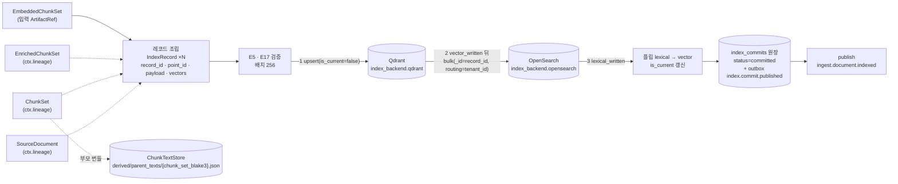
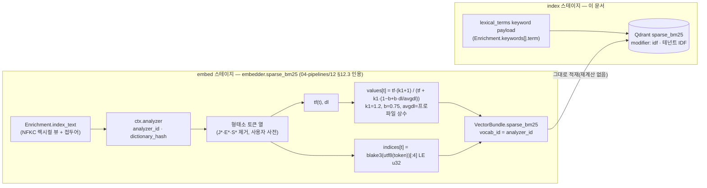
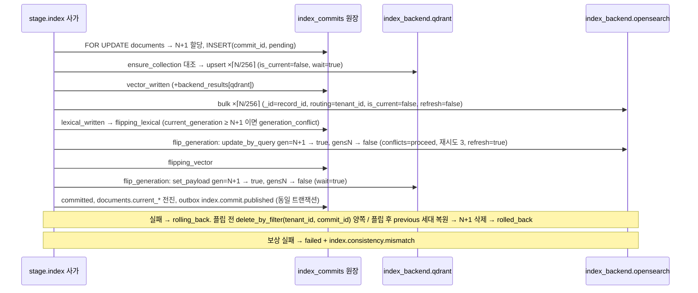
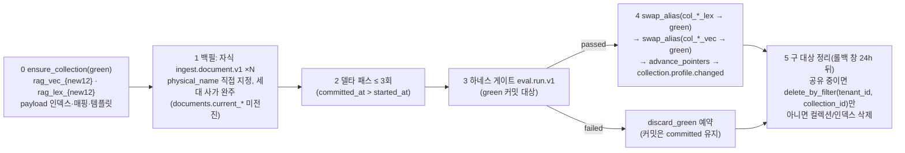

# 인덱싱

> 정본 관계: 이 문서는 설계 바이블 §4.2 `index` 행, §5.3 `IndexBackendCapabilities`, §5.4 `IndexRecord`·`IndexCommit`, §5.5 `CandidateSet`(채널 검색 반환 필드), §6.1~6.2 `record_id`·`point_id`, §10.2~10.4(필터 불변식·강제 지점·격리 수준), §11.4(세대 사가), §13.4(물리명)를 **어댑터 구현 수준**으로 전개한다. 계약 필드·열거값·물리명·이벤트·오류 코드는 바이블과 [EmbeddedChunkSet·IndexRecord 계약](../03-contracts/07-embedded-chunk-set-and-index-record.md), [IndexCommit 계약](../03-contracts/08-index-commit.md), [저장소 아키텍처](../02-architecture/04-storage-architecture.md)의 철자를 그대로 쓴다. 바이블에 없는 메서드 이름·수치는 "이 문서 제안" 또는 "초안 목표"로 표기하고 "## 미해결 이슈"에 모은다.

## 목적

`index` 스테이지는 `EmbeddedChunkSet`(임베딩 결과)과 상류 계보(`EnrichedChunkSet`·`ChunkSet`·`SourceDocument`)를 합쳐 `IndexRecord`를 조립하고, 벡터 백엔드(Qdrant)와 렉시컬 백엔드(OpenSearch)에 **세대 사가(generation saga)** 로 적재해 `IndexCommit`을 낸다. 이 문서는 (1) 모든 백엔드가 구현해야 하는 `IndexBackend` 포트(port)와 `capabilities()` 선언, (2) Qdrant·OpenSearch 두 기본 어댑터(adapter)의 컬렉션·인덱스 생성 파라미터, upsert 배치, 표준 필터 DSL 변환, 검색 호출 형태, (3) 경량 프로파일 `lite`의 Qdrant 단독 `sparse_bm25` 계약, (4) 커밋 프로토콜의 단계별 호출과 가시성 시점, (5) 삭제·갱신 전파, 재색인(alias 교체), 정합성 점검, (6) 성능·용량 초안 목표, 대안 백엔드 어댑터 작성 지침, 실패 모드를 확정한다. 구현자가 이 문서와 두 계약 문서만으로 `adapters/index/qdrant`·`adapters/index/opensearch`·`adapters/index/saga`(바이블 §12)를 작성할 수 있어야 한다.

## 범위

- 포함: `index` 스테이지의 위치·입출력·정책, `IndexBackend` 포트와 `IndexBackendCapabilities`, `IndexRecord` 조립·검증(E5·E17), Qdrant 어댑터(컬렉션 생성 파라미터, named vectors·sparse·multivector·양자화·payload 인덱스·`is_tenant`, upsert 배치·`wait`, 필터 변환, `query_points`·`retrieve`·`set_payload`·`delete`·alias), OpenSearch 어댑터(인덱스 템플릿·Nori 분석기 설정 전문, 매핑 규칙, `bulk`, 필터 변환 → `bool`, k-NN 미사용 근거), `lite`(Qdrant 단독: `embed`가 만든 `sparse_bm25` 적재·서버 IDF 설정·`lexical_terms`), 커밋 프로토콜(staging → 두 백엔드 upsert → 원장 커밋 → 이전 세대 정리; 보상; 가시성 시점), 삭제·ACL·메타데이터 갱신 전파, 재색인(새 물리 대상 → 백필 → alias 교체 → 구 대상 정리), 정합성 점검 잡, 성능(배치·병렬도·검색 영향), 용량·비용, 대안 백엔드 매핑 표, 실패 모드, 관측성.
- 제외: `IndexRecord`·`IndexCommit` 필드 정의와 스키마([03-contracts/07](../03-contracts/07-embedded-chunk-set-and-index-record.md), [03-contracts/08](../03-contracts/08-index-commit.md)), 임베딩·`sparse_bm25` 토큰 해시 함수 확정([04-pipelines/12](../04-pipelines/12-embedding.md)), 질의 측 채널 실행·융합([04-pipelines/15](../04-pipelines/15-hybrid-search-and-fusion.md)), 재색인·삭제 워크플로우 상세와 부모·자식 팬아웃([04-pipelines/19](../04-pipelines/19-update-delete-and-reindexing.md), [02-architecture/06](../02-architecture/06-orchestration-and-workflows.md)), 물리 스키마·용량 산정 정본([02-architecture/04](../02-architecture/04-storage-architecture.md)), 백업·복구 절차([09-operations/07](../09-operations/07-backup-and-disaster-recovery.md)), `sparse_bm25` 값 계산(`embed` 스테이지 `embedder.sparse_bm25`, [04-pipelines/12](../04-pipelines/12-embedding.md) §12.3).

## 1. 위치와 역할

| 항목 | 값(바이블 §4.2·§4.4·§11.2) |
|------|-----------------------------|
| 스테이지 | `index`(액티비티 `stage.index`, 태스크 큐 `ingest-io`, `start_to_close` 10m, `heartbeat` 30s, `max_attempts` 5, `resumable=no` — 사가 보상으로 대체) |
| 입력 | `EmbeddedChunkSet`(`ArtifactRef` 1개) + `requires_lineage = ("EnrichedChunkSet", "ChunkSet", "SourceDocument")` — 셸이 입력 봉투 `lineage_refs`에서 로드해 `ctx.lineage[schema_type]`로 제공([04-pipelines/01](./01-pipeline-framework.md) §5.2) + 워크플로우 인자 `commit_id`(ULID, 1회 발급)·`event_ids` |
| 출력 | `IndexCommit`(PostgreSQL `index_commits` 원장 행이 정본; 오브젝트 스토리지 산출물이 아님, 08 §12). 감사·백업용으로 오브젝트에 미러링하는 경우 `index`는 `fetch`와 함께 `stage_key`가 없는 캐시 제외 스테이지이므로 저장 키는 `stage_key` 경로가 아니라 바이트 해시 키 `tenants/{tenant_id}/artifacts/index-commit/{blake3[:2]}/{blake3}.json`이다(바이블 §13.3 1.3.0, AM-19). `index.commit.published`는 `committed` 전이와 **동일 트랜잭션**의 outbox 기록이고(바이블 §11.4; 06-orchestration §이벤트 표), 후속 `publish` 스테이지(원장 갱신과 동일 트랜잭션의 로컬 액티비티, 바이블 §4.2)가 `ingest.document.indexed`를 기록한다 |
| 확장 지점 | `index_backend`(D-10). 프로파일 `ingest.index.backends[]{plugin, role, named_vectors?, tenant_isolation?}`, `commit{strategy: insert_then_delete, flip_order: [lexical, vector], cleanup_delay: 1h}`(바이블 §7.3; [03-contracts/15](../03-contracts/15-collection-profile-and-policy-contracts.md) `IndexConfig`) |
| 캐시 | **없음.** `stage_key` 캐시를 적용하지 않고 항상 실행해 새 `index_generation`으로 적재한다. 멱등성은 `commit_id`(같은 `commit_id`가 `committed`면 no-op)와 `record_id` 단위 upsert가 담당한다(바이블 §4.2; 06-orchestration §3.2) |
| 격리 | in_process 어댑터 → Qdrant(gRPC, `prefer_grpc=True`) / OpenSearch(HTTP) |
| 비재시도 오류 | `index.security_fields_missing`(E5), `index.generation_conflict`(안전망), `contract.violation`; 재시도 `index.backend_unavailable`; `index.partial_commit`은 보상 후 비재시도(바이블 §5.7) |



백엔드 간 적재는 **순차**(벡터 → 렉시컬; 상태 전이 `vector_written → lexical_written`이 순서를 기록)이고 한 백엔드 안의 배치만 병렬이다(§4.2·§11).

`index`의 실제 진입점은 `Stage.run` 특수화가 아니라 `IndexBackend` 포트를 호출하는 **플랫폼 소유 사가 함수**(`adapters/index/saga`)다. 사가는 원장 전이 → 백엔드 호출 → 원장 전이를 반복하며, 백엔드 어댑터는 자기 호출 하나의 성공·실패만 안다(원칙 3; 04-pipelines/01 미해결 이슈 14와 합의 대상, 아래 미해결 이슈 1).

## 2. `IndexBackend` 포트와 `capabilities()`

**결정:** 벡터·렉시컬 백엔드는 모두 하나의 `IndexBackend` 포트 뒤에 두고, 백엔드 기능 차이는 `IndexBackendCapabilities`(바이블 §5.3, `Capabilities.extra`)로 선언한다. 프로파일 로딩(바이블 §7.4 (2)·(9))과 플래너 채널 구성(§8.1 6단계)은 이 선언만 보고 판단하며, 어댑터 구현 세부는 보지 않는다(브리프 D-15; [ADR-0012](../06-adr/0012-lite-profile-qdrant-only-client-bm25.md), [ADR-0032](../06-adr/0032-plugin-sdk-stage-protocol-and-conformance-kit.md)).

### 2.1 메서드 표

메서드 이름 중 바이블이 이미 쓰는 것(`capabilities`, `search`, `retrieve`, `delete_by_filter`, `update_acl`; `set_payload`·`update_by_query`는 바이블 §11.4가 쓰는 백엔드 호출명)은 그대로이고, `swap_alias`·`ensure_collection`·`upsert`·`snapshot`은 [07-tech-landscape/06](../07-tech-landscape/06-vector-and-lexical-index-backends.md) §`IndexBackend` 어댑터 계약의 제안 이름(바이블 §11.2·§13.4는 "alias 교체"라고만 쓴다), 나머지는 이 문서의 제안이다(미해결 이슈 1). 시그니처에 나오는 타입 중 바이블 §5.1 인벤토리·§5.3 공용 타입에 없는 것(`RecordScope`, `IndexFilter`, `ChannelSearchRequest`, `Candidate`, `UpsertResult`, `FlipResult`, `AclPayload`, `SnapshotRef`, `BackendStats`, `BackendHealth`, `IndexTargetSpec`, `PhysicalTarget`)은 **어댑터 내부 타입**(계약이 아니며 스키마를 게시하지 않음)이고, 계약 경계는 `IndexRecord`·`IndexCommit`·`CandidateSet`·`SecurityContext`·`FilterNode`만이다(미해결 이슈 1). 모든 쓰기 메서드는 **멱등**이어야 하며(같은 인자 재호출 = 같은 결과), 모든 읽기·쓰기 메서드는 `tenant_id`가 없는 필터·스코프를 거부한다(E7; 문서 스코프 메서드는 `RecordScope{tenant_id, collection_id, document_id}`를 받아 어댑터가 Qdrant `shard_key_selector`·OpenSearch `routing`과 `tenant_id`·`collection_id` 필터를 만든다 — 바이블 §10.3 E5·E17, [ADR-0027](../06-adr/0027-security-context-injection-and-acl-enforcement-points.md)).

| 메서드 | 시그니처(요지) | 호출자 | 백엔드 동작(Qdrant / OpenSearch) | 비고 |
|--------|----------------|--------|-----------------------------------|------|
| `capabilities()` | `-> Capabilities`(`extra: IndexBackendCapabilities`, 바이블 §5.3 필드만) | 프로파일 검증기, `plan` | `get_collections`·`/` 버전 응답 / `GET /` `version.number` — 호출 시 서버 버전을 조회해 어댑터 속성 `backend_version`에 보관(반환 스키마 필드는 아님, §2.2) | 바이블 §4.1 5멤버; 08 §2.2 "`capabilities()` 보고값" |
| `ensure_collection(spec)` | `(CollectionSpec, IndexTargetSpec) -> PhysicalTarget` | `ledger.begin_reindex`, 컬렉션 생성, 첫 커밋 | 물리 컬렉션/인덱스가 없으면 생성(§4.1·§5.1 파라미터), payload 인덱스·매핑 보정(`custom.*` 선언 키 추가만), alias가 없으면 생성 | 존재하면 파라미터 **대조만**(분석기·차원·거리 불일치는 `profile.invalid`) |
| `upsert(records, commit_id, wait)` | `(list[IndexRecord] ≤ 256, ulid, bool) -> UpsertResult{upserted, duration_ms}` | 사가(적재) | `upsert(points, wait=True)` / `bulk(index 액션, refresh=false)` | 배치 내 E5·E17 검증 후 전송; 항상 `is_current=false` |
| `flip_generation(scope, generation, previous)` | `(RecordScope, int, int \| None) -> FlipResult{updated_current, updated_previous}` | 사가(플립·복원) | `set_payload({is_current: true}, filter tenant_id·collection_id·document_id·gen=N+1)` + `set_payload({is_current: false}, filter …·gen≤N)` / `update_by_query(routing=tenant_id, conflicts=proceed)` ×2 | 이 문서 제안; 복원은 인자를 바꿔 같은 메서드 |
| `delete_by_filter(filter)` | `(IndexFilter) -> int` | 사가 보상, `delete.document.v1`, `maintenance.cleanup.v1`, 정합성 검사 | `delete(points_selector=Filter)` / `delete_by_query(routing=tenant_id, conflicts=proceed)` | 화이트리스트(모두 `tenant_id` 필수): `(tenant_id, commit_id)`(보상·orphan), `(tenant_id, collection_id, document_id, is_current=false, index_generation < N)`(`maintenance.cleanup.v1`; 08 §4 철자 `delete_by_filter(document_id, is_current=false, index_generation < current_generation)` + 스코프), `(tenant_id, collection_id, document_id)`(`delete.document.v1`), `(tenant_id, collection_id)`(구 대상 정리) |
| `update_acl(scope, acl_payload)` | `(RecordScope, AclPayload) -> int` | `acl.update.v1` | `set_payload(acl_*, acl_hash, updated_at, filter scope·is_current=true)` / `update_by_query(routing=tenant_id)` | 재임베딩 없음(E11, [ADR-0005](../06-adr/0005-doc-version-content-hash-only-and-acl-payload-update.md)) |
| `search(request, security)` | `(ChannelSearchRequest, SecurityContext) -> list[Candidate]` | `retriever.*` 어댑터(04-pipelines/15) | `query_points(using=<VectorName>, query=…, query_filter=…, limit)` / `search(bool.filter + should, routing=tenant_id)` | `request.channel ∈ Channel`; `Candidate`는 `CandidateSet.channel_runs[].candidates[]` 항목(바이블 §5.5: 필수 8필드 + `score`·`rank` + `payload_slim`)의 내부 표현이고 `index_generation`을 함께 반환해 호출자가 `channel_runs[].index_generation_seen[]`을 집계한다(§4.4); 필터에 `tenant_id` 없으면 `retrieve.security_context_missing` |
| `retrieve(record_ids, with_payload, security)` | `(list[hex64] ≤ hydrate.top_n, list[str] \| bool, SecurityContext) -> list[dict]` | `hydrate`(§4.3) | `retrieve(ids=[uuid5…], with_payload=[…])` 1회 배치 / `mget` | 반환은 `IndexRecord` payload 부분집합(바이블 §4.3 `hydrate` 목록); 보안 필터 (a)를 **재적용**(E10); 누락은 호출자가 `degraded{hydrate, partial_result}` |
| `count(filter)` / `scroll(filter, fields, cursor)` | `(IndexFilter) -> int` / `-> (rows, next_cursor)` | `maintenance.consistency.v1`, `GET /v1/collections/{collection_id}/stats` | `count(exact=True)` · `scroll` / `count` · `search_after`(PIT) | 이 문서 제안; `IndexFilter`는 `tenant_id` 필수 |
| `swap_alias(alias, new_target)` | `(str, str) -> None` | `reindex.collection.v1` A-7, `tier.promotion.v1` | `update_collection_aliases([delete_alias, create_alias])` 1요청 / `POST _aliases {actions: [remove, add]}` 1요청 | 07-tech-landscape/06 제안 이름(바이블 §11.2 "alias 교체"); 백엔드 내부 원자, 백엔드 간 비원자(순서 렉시컬 → 벡터) |
| `snapshot(physical_name)` | `-> SnapshotRef` | 스케줄([09-operations/07](../09-operations/07-backup-and-disaster-recovery.md); 바이블 §7.2 `snapshot` 행) | 컬렉션 스냅샷 / `repository-s3` 스냅샷 | 복구 2순위(1순위는 재적재) |
| `stats(physical_name)` | `-> BackendStats{points, segments, bytes_by_vector, indexed_vectors}` | 통계 API, 용량 감시 | `get_collection` / `_stats` | 이 문서 제안; `rag_index_bytes_total{vector}` 원천 |
| `health()` | `-> BackendHealth{status: ok \| degraded \| down, version}` | `/readyz`(벡터 백엔드만), 브레이커 | `healthz`·`get_collections` / `_cluster/health` | OpenSearch는 readiness 의존성이 아니다(09 문서 §3.4) |

```python
from typing import Protocol, Sequence, TypedDict

class RecordScope(TypedDict):                        # 어댑터 내부 타입(계약 아님): 문서 스코프 쓰기의 필수 인자
    tenant_id: str
    collection_id: str
    document_id: str

class IndexBackend(Protocol):
    plugin_id: str                                   # index_backend.{implementation}
    backend_version: str                             # capabilities() 호출 시 조회한 서버 버전 → IndexCommit.backend_results[].backend_version
    def capabilities(self) -> "Capabilities": ...    # extra = IndexBackendCapabilities(바이블 §5.3 필드만)
    def fingerprint(self) -> str: ...
    async def ensure_collection(self, spec: "CollectionSpec", target: "IndexTargetSpec") -> "PhysicalTarget": ...
    async def upsert(self, records: Sequence["IndexRecord"], commit_id: str, wait: bool = True) -> "UpsertResult": ...
    async def flip_generation(self, scope: RecordScope, generation: int, previous: int | None) -> "FlipResult": ...
    async def delete_by_filter(self, flt: "IndexFilter") -> int: ...          # flt는 tenant_id 필수(화이트리스트, §2.1 표)
    async def update_acl(self, scope: RecordScope, acl: "AclPayload") -> int: ...
    async def search(self, request: "ChannelSearchRequest", security: "SecurityContext") -> list["Candidate"]: ...
    async def retrieve(self, record_ids: Sequence[str], with_payload: Sequence[str] | bool, security: "SecurityContext") -> list[dict]: ...
    async def count(self, flt: "IndexFilter") -> int: ...
    async def scroll(self, flt: "IndexFilter", fields: Sequence[str], cursor: str | None) -> tuple[list[dict], str | None]: ...
    async def swap_alias(self, alias: str, new_target: str) -> None: ...
    async def snapshot(self, physical_name: str) -> "SnapshotRef": ...
    async def stats(self, physical_name: str) -> "BackendStats": ...
    async def health(self) -> "BackendHealth": ...
```

### 2.2 `IndexBackendCapabilities` 선언(바이블 §5.3 필드만)

| 필드 | `index_backend.qdrant` | `index_backend.opensearch` | 검증에서의 사용 |
|------|------------------------|----------------------------|-----------------|
| `supports_server_bm25` | `false` | `true` | `false`인 백엔드 단독(`lite`) → 플랫폼 측 `korean_analyzer` 필수(§7.4 (2)·(9)) |
| `korean_analyzer` | `false` | `true`(`analysis-nori`) | 동일 |
| `supports_server_fusion` | `[rrf, dbsf]` | `[rrf, convex_minmax, convex_zscore]`(`score-ranker-processor`·`normalization-processor`; `convex_zscore`는 `arithmetic_mean` 결합만 — 07-tech-landscape/06) | `lite` 단일 컬렉션 서버 융합 허용 판정(O-01) |
| `tenant_isolation` | `[payload_filter, shard_key, index_per_tenant]` | `[payload_filter, shard_key, index_per_tenant]`(`shard_key` = routing 고정 + 전용 샤드 라우팅, 바이블 §10.4·[ADR-0028](../06-adr/0028-tenant-isolation-tiering-policy.md)) | `security.tenant_isolation_tier ∈ 모든 vector·lexical 백엔드의 목록`(15 문서 P-6) — `standard`의 100만 청크 초과 `shard_key` 승격(바이블 §7.2·E15)이 두 백엔드 모두에서 통과해야 한다 |
| `supports_alias_swap` | `true` | `true` | blue/green 가능 여부 |
| `supports_multivector` | `true`(`max_sim`) | `false` | `false` → `late_interaction` 채널 자동 비활성 + `degraded{channel.late_interaction, capability_unsupported}` |
| `max_vector_dim` | `null`(공식 상한 미공개. 로컬 모드는 상한 없음 실측 — 70,000차원 컬렉션 생성 성공, §6.1; 서버 상한은 `needs_docker`) | `16000`(k-NN `knn_vector` 상한; 본 설계는 벡터 미저장) — 확인 필요 as of 2026-09 | 프로파일 dense `dim` ≤ 상한, 초과 시 `plugin.capability_unsupported` |
| `max_multivector_elements` | `1048576`(`sub_vectors × dim`, 공식 vectors 문서) | `null` | `late_interaction` 토큰 수 × 128 ≤ 상한 |
| `supports_payload_only_points` | `null`(로컬 모드는 `vector={}` 포인트를 수용함을 실측, §6.1; 서버 확인 전까지 `null` 유지 — `needs_docker`) | `true`(벡터 필드 없음) | `ChunkTextStore` `vector_payload` 구현 조건(§13.2) |

```json
{
  "isolation_modes": ["in_process"],
  "supports_resumable": false,
  "contracts_compat": ">=1.0,<2.0",
  "extra": {
    "supports_server_bm25": false,
    "korean_analyzer": false,
    "supports_server_fusion": ["rrf", "dbsf"],
    "tenant_isolation": ["payload_filter", "shard_key", "index_per_tenant"],
    "supports_alias_swap": true,
    "supports_multivector": true,
    "max_vector_dim": null,
    "max_multivector_elements": 1048576,
    "supports_payload_only_points": null
  }
}
```

07-tech-landscape/06이 제안한 추가 필드(`supports_named_dense`, `supports_sparse`, `supports_delete_by_filter`, `backend_id`, `backend_version`)는 바이블 §5.3에 없다. `backend_version`의 원천은 하나다: 어댑터가 `capabilities()` 호출 시 서버 버전을 조회해 자기 속성 `backend_version`에 보관하고(08 §2.2 "`capabilities()` 보고값"), 사가가 이를 `IndexCommit.backend_results[].backend_version`에 기록한다 — `IndexBackendCapabilities` 스키마 필드로는 넣지 않는다. `supports_delete_by_filter`·`supports_partial_payload_update`(플립·ACL 갱신 가능 조건)는 대안 백엔드 어댑터 가이드(§13)에 필요하므로 선택 필드(N) 추가를 제안한다(미해결 이슈 2).

## 3. `IndexRecord` 조립과 검증

**결정:** `IndexRecord`는 `EmbeddedChunkSet.vectors`의 키(`level ∈ {0, 2}` `chunk_id`)마다 1개씩, 바이블 §5.4 표의 "원천" 열대로 EMB·ENR·CS·SRC·IDX에서 값을 가져와 조립한다. 조립 규칙과 절단 규칙의 정본은 [03-contracts/07](../03-contracts/07-embedded-chunk-set-and-index-record.md) §5·§9이며, 이 절은 어댑터가 백엔드로 보내기 전 수행하는 **검증·직렬화 순서**만 확정한다([ADR-0004](../06-adr/0004-deterministic-chunk-id-scoped-record-id-and-ulid-exception.md), [ADR-0027](../06-adr/0027-security-context-injection-and-acl-enforcement-points.md)).

| 순서 | 검증 | 실패 시 | 근거 |
|------|------|---------|------|
| 1 | `EmbeddedChunkSet.embedding_profile_hash == CollectionSpec.embedding_profile_hash`; 각 `embedding_space_ids` 키가 대상 물리 컬렉션의 named vectors 집합과 같다 | `embed.space_mismatch`(비재시도) | 바이블 §3.2 O-02, 07 §3 |
| 2 | 레코드마다 `record_id = H("record", tenant_id, collection_id, document_id, str(index_generation), chunk_id)` 재계산 대조, `point_id = uuid5(NAMESPACE_RAG_CHUNK, record_id)` 대조(E17) | `contract.violation` | ADR-0004 v1.2 |
| 3 | 배치(≤ 256) 안에 `tenant_id`·`collection_id`·`acl_allow`·`acl_visibility`·`acl_hash` 중 하나라도 없는 레코드가 1건이라도 있으면 **배치 전체**를 보내지 않는다(E5) | `index.security_fields_missing`(비재시도; 커밋 `rolling_back`) | 바이블 §10.3 E5, 07 R-2 |
| 4 | `is_current == false`(적재 시 항상), `index_generation`·`commit_id`가 사가 인자와 같다 | `contract.violation` | 바이블 §11.4 (1) |
| 5 | `text` ≤ 8,192 UTF-8 바이트(초과 시 07 §9 절단 규칙 적용 후 `text_truncated=true`), canonical JSON payload(`vectors`·`index_text` 제외) ≤ 32KB | 절단 후에도 초과면 `contract.violation` | 바이블 §5.1, ADR-0034 |
| 6 | `vectors.dense` 길이 = 공간 dim, ‖·‖₂ = 1 ± 1e-4 | `contract.violation` | 07 R-5 |
| 7 | 직렬화(검증 아님): 어댑터 `to_payload(record)`가 `acl_embargo_until`·`acl_expires_at`을 값이 없어도 **명시적 `null`**로, `acl_deny`를 `[]`로 기록한다 — 계약 인스턴스는 생략·`null` 모두 허용이므로(00 §8.1 4행) 여기서 거부하지 않는다 | — | 07 §7 규칙 3, R-8 |
| 8 | 부모 번들 `derived/parent_texts/{chunk_set_blake3}.json`을 **첫 upsert 전에** 저장(`ChunkTextStore` `artifact_store`; 이미 있으면 생략 — 콘텐츠 주소) | 저장 실패는 `index.backend_unavailable`과 같은 재시도 정책 | 바이블 §13.2, 07 §10 |

`index_text`는 OpenSearch 대상 레코드에만 넣고 Qdrant payload에서는 제외한다(`lite`는 `sparse_bm25` 계산 입력으로만 소비). `vectors`는 Qdrant named vectors로만 나가며 OpenSearch 문서에는 넣지 않는다(§5). 조립 결과는 백엔드마다 **다른 투영**이지만 논리 레코드는 하나다(K1).

## 4. Qdrant 어댑터(`index_backend.qdrant`, role `vector`)

### 4.1 컬렉션 생성 파라미터(`ensure_collection`)

**결정:** 물리 컬렉션은 `rag_vec_{embedding_profile_hash[:12]}`(공유; `index_per_tenant`는 `_t_{tenant_id}` 접미)이며, named vectors·payload 인덱스·HNSW·양자화 파라미터의 정본 JSON은 [02-architecture/04](../02-architecture/04-storage-architecture.md) §4.2(`standard`)다. `hnsw_config: {m: 0, payload_m: 16}`은 바이블 §13.4·§10.4와 일치하며(테넌트별 서브그래프 `is_tenant`), 서브그래프 필터링이 실제 검색 지연·재현율에 미치는 영향은 여전히 확인 필요다(as of 2026-09, #65). `ensure_collection`은 그 JSON을 프로파일 값으로 채워 생성하고, 이미 있으면 **차원·거리·named vector 집합·sparse `modifier`만 대조**한다(불일치 = `profile.invalid`; HNSW·양자화·`on_disk`는 런타임 변경 가능 항목이라 대조하지 않고 `update_collection`으로 맞춘다)(바이블 §13.4, §10.4; [ADR-0028](../06-adr/0028-tenant-isolation-tiering-policy.md)).

| 파라미터 | `lite` | `standard` | `premium` 추가 | 근거 |
|----------|--------|------------|----------------|------|
| `vectors.dense` | `{size: 1024, distance: Cosine, on_disk: true, hnsw_config: {m: 0, payload_m: 16, ef_construct: 128}}` | 동일 + `quantization_config: {scalar: {type: int8, quantile: 0.99, always_ram: true}}` | 동일 | 바이블 §13.4(`m=0`, `payload_m=16`), 04 §4.2·§4.3 |
| `sparse_vectors.sparse_learned` | GPU 없이 생산 가능한 노드만 `{modifier: none, index: {on_disk: true}}` | `{modifier: none, index: {on_disk: true, full_scan_threshold: 10000}}` | 동일 | 바이블 §13.4 |
| `sparse_vectors.sparse_bm25` | `{modifier: idf, index: {on_disk: true}}` | 없음 | 없음 | D-15, [ADR-0012](../06-adr/0012-lite-profile-qdrant-only-client-bm25.md) |
| `vectors.late_interaction` | 없음 | 없음(기본 끔) | `{size: 128, distance: Cosine, datatype: float16, multivector_config: {comparator: max_sim}, hnsw_config: {m: 0}, quantization_config: {binary: {always_ram: false}}}` | 바이블 §13.4, O-04; `turbo4`·1-bit 결합은 확인 필요(as of 2026-09) |
| `hnsw_config`(전역) | `{m: 0, payload_m: 16}` | 동일 | 동일 | 테넌트별 서브그래프(`is_tenant`) |
| `shard_number` / `replication_factor` / `write_consistency_factor` | 1 / 1 / 1 | 6 / 2 / 1 | 6 / 2 / 1 | 04 §4.6(초안 목표) |
| `sharding_method` | `auto` | `auto`; `shard_key` 승격 테넌트는 `custom`(`shard_key = tenant_id`) | 동일 | 바이블 §10.4 |
| `on_disk_payload` | `true` | `true` | `true` | 04 §4.6 |
| `optimizers_config` | `{indexing_threshold: 20000, default_segment_number: 2}` | `{indexing_threshold: 20000, default_segment_number: 4}` | 동일 | 04 §4.2(초안 목표) |

payload 인덱스는 컬렉션 생성 직후 `create_payload_index`로 만든다. 목록은 바이블 §13.4 + 04 §4.4가 보정한 5필드(`doc_version`·`external_id`·`heading_path`·`parent_chunk_id`·`tree_level`)이며, `commit_id`는 사가 보상 `delete_by_filter(commit_id)`의 대상이라 keyword 인덱스를 **생성한다**(04 §4.4 표; 바이블 §13.4 목록 보정 제안은 07 미해결 이슈 5·04 미해결 이슈 17과 공동).

| 인덱스 타입 | 필드 | 옵션 |
|-------------|------|------|
| keyword | `tenant_id` | `is_tenant: true`(테넌트별 HNSW 서브그래프) |
| keyword | `collection_id`, `document_id`, `chunk_id`, `commit_id`, `doc_version`, `external_id`, `parent_chunk_id`, `item_kind`, `acl_visibility`, `acl_classification`, `doc_type`, `department`, `lang`, `genre` | `on_disk: false`(핫 필터) |
| keyword(배열) | `acl_allow`, `acl_deny`, `heading_path`, `tags`, `lexical_terms`, `entity_ids` | `acl_*`는 `on_disk: false`, `lexical_terms`·`entity_ids`는 `on_disk: true` |
| bool | `is_current` | — |
| integer | `index_generation`, `level`, `tree_level`, `page_start`, `page_end` | `lookup: true, range: true` |
| datetime | `acl_embargo_until`, `acl_expires_at`, `doc_date` | 옵션 없음(datetime 인덱스는 범위 조건을 기본 지원; Qdrant `DatetimeIndexParams`는 `is_principal`·`on_disk`·`memory`·`enable_hnsw`만 받고 `lookup`/`range`는 `IntegerIndexParams` 전용 — **확인됨**(qdrant-client 1.19.1 모델 필드, §6.1; `DatetimeRange` 범위 필터는 인덱스 옵션 없이 동작); 04 §4.4의 `range: true` 표기 정정 제안, 미해결 이슈 5); `doc_date`의 `is_principal` 힌트는 확인 필요(as of 2026-09, 04 미해결 이슈 13) |
| 선언 타입 | `custom.{key}` | 컬렉션 `filterable_fields` 선언 키만(keyword/integer/float/datetime) |

`text` 타입 payload 인덱스는 **만들지 않는다**. Qdrant 공식 빌드의 `multilingual` 토크나이저는 한국어 형태소 분석이 없으므로(charabia `korean` 피처 미활성, 07-tech-landscape/06 §Qdrant) 한국어 키워드 조건은 `lexical_terms` keyword 배열로만 처리한다(D-15).

### 4.2 upsert 배치와 `wait` 정책

| 항목 | 규약 | 근거 |
|------|------|------|
| 배치 크기 | 256 레코드(바이블 §5.1 "upsert 배치 256"); dense 4KB + sparse 0.5KB + payload 6KB 기준 약 2.7MB/배치(초안 추정) | §5.1 |
| 포인트 구성 | `PointStruct(id=point_id, vector={dense: [...], sparse_learned: SparseVector(indices, values), sparse_bm25?: …, late_interaction?: [[...]]}, payload={record_id, chunk_id, tenant_id, …, is_current: false})` — `vectors`·`index_text`를 제외한 §5 표 전 필드가 payload | 07 §8.1 |
| `wait` | `wait=True`(모든 배치). 사가는 "배치 전부 성공" 뒤에만 `status=vector_written`으로 전이하므로 비동기 적용(`wait=False`)은 상태 전이 의미를 깨뜨린다. `write_consistency_factor=1`이라 레플리카 지연은 있을 수 있고 플립 가시성 지연으로 관측된다(04 §4.6) | 바이블 §11.4 |
| 배치 병렬도 | 백엔드당 동시 배치 4(초안 목표; `asyncio.Semaphore(4)`), 순서 무관(`record_id` 멱등) | §11 |
| 재시도 | gRPC `UNAVAILABLE`·`DEADLINE_EXCEEDED`·5xx → `index.backend_unavailable`(셸 정책 5회, 지수, 최대 간격 5m); 배치 타임아웃 30s(초안 목표) | 바이블 §4.4, 09 문서 §5 |
| 하트비트 | 배치마다 `ctx.heartbeat()`; `resumable=no`이므로 재시도는 첫 배치부터 다시 upsert(멱등이라 무해) | §4.4 |
| upsert 모드 | 기본 upsert. insert-only 모드(`PointsList.update_mode = UpdateMode.INSERT_ONLY`, 1.19.1 클라이언트에 존재)는 쓰지 않는다 — 로컬 모드 실측에서 insert-only는 기존 id를 **오류 없이 건너뛰고**(상태 `completed`, 기존 payload 유지, §6.1) 재시도가 바뀐 payload(ACL 갱신 등)를 조용히 버리게 된다. 서버의 같은 동작 여부는 `needs_docker` | 07-tech-landscape/06 |

### 4.3 표준 필터 DSL → Qdrant `Filter` 변환

플래너가 만든 `QueryPlan.filters`(security + strategy + user + self_query; `FilterNode` 트리, 바이블 §5.3·§10.2)를 어댑터가 Qdrant `Filter{must, should, must_not}`로 변환한다. 변환은 순수 함수 `adapters/index/qdrant/filters.py`이며 변환 결과의 canonical JSON이 `filters.effective_hash`의 입력이다(§6.2).

| `FilterNode` | Qdrant 조건 | 비고 |
|--------------|-------------|------|
| `and[...]` / `or[...]` / `not x` | `must: [...]` / 중첩 `Filter{should: [...]}` / `must_not: [x]` | `or`는 `must` 안의 중첩 `Filter`로 표현해 `must`와 섞이지 않게 한다 |
| `eq` / `ne` | `FieldCondition(key, match=MatchValue(value))` / `must_not` + 동일 | |
| `in` / `not_in` | `match=MatchAny(any=[...])` / `must_not` + 동일 | |
| `gt, gte, lt, lte` | `range=Range(...)`(integer·float) / `range=DatetimeRange(...)`(datetime) | `doc_date`는 `string(date)`라 `DatetimeRange` |
| `exists: true` / `false` | payload 규약상 명시적 `null`로 기록되는 필드(`acl_embargo_until`·`acl_expires_at`, §3 7단계)는 `must_not: [IsNullCondition]` / `IsNullCondition`만; 키 부재가 허용되는 필드(`custom.*`, `external_id` 등 N 필드)는 `must_not: [IsNull, IsEmpty]` / `should: [IsNull, IsEmpty]` | 예시 JSON의 `is_null` 단독 사용이 전자의 경우 |
| `contains_any` / `contains_all` | `match=MatchAny` / `must: [MatchValue ×n]` | 배열 keyword(`tags`, `heading_path`, `entity_ids`) |
| `prefix` | `match=MatchPrefix(prefix)` | Qdrant 1.19 keyword 인덱스 `prefix: true` + `MatchPrefix`(qdrant-client 1.19.1 모델 확인, 로컬 모드 동작 실측 §6.1). 어댑터는 `external_id`·`doc_type`·`department`·`heading_path`·`tags` keyword 인덱스에 `prefix: true`를 켠다; 서버 인덱스 크기·지연은 `needs_docker`(미해결 이슈 3) |
| 가상 필드 `page eq v` / `in [v…]` | `must: [range(page_start ≤ v), range(page_end ≥ v)]` / `should` OR 결합 | 바이블 §5.7 `FilterableField` |
| `acl_classification ≤ :max` | `match=MatchAny(any=[허용 등급 목록])` | 열거 순서 비교 불가 → 집합으로 변환(04 §5.2 규칙과 대칭) |

보안 불변식 (a)와 전략 필터 (b)를 포함한 변환 예(`standard`, `hybrid` 전략, 사용자 필터 `doc_type in [notice, regulation]`, `page eq 3`):

```json
{
  "must": [
    {"key": "tenant_id", "match": {"value": "01J9ZQ4K7X2M8N3P5R6S7T8V9W"}},
    {"key": "collection_id", "match": {"any": ["01J9ZQ5C0Q3N4P5R6S7T8V9WXY"]}},
    {"key": "is_current", "match": {"value": true}},
    {"should": [
      {"key": "acl_visibility", "match": {"any": ["public", "tenant"]}},
      {"key": "acl_allow", "match": {"any": ["user:kim.minsu@example.go.kr", "group:mois_records", "tenant:*"]}}
    ]},
    {"should": [
      {"is_null": {"key": "acl_embargo_until"}},
      {"key": "acl_embargo_until", "range": {"lte": "2026-09-22T09:00:00.000Z"}}
    ]},
    {"should": [
      {"is_null": {"key": "acl_expires_at"}},
      {"key": "acl_expires_at", "range": {"gt": "2026-09-22T09:00:00.000Z"}}
    ]},
    {"key": "acl_classification", "match": {"any": ["public", "internal"]}},
    {"key": "level", "match": {"any": [0]}},
    {"key": "item_kind", "match": {"any": ["text", "list_group", "code", "table", "table_part", "figure"]}},
    {"key": "doc_type", "match": {"any": ["notice", "regulation"]}},
    {"key": "page_start", "range": {"lte": 3}},
    {"key": "page_end", "range": {"gte": 3}}
  ],
  "must_not": [
    {"key": "acl_deny", "match": {"any": ["user:kim.minsu@example.go.kr", "group:mois_records", "tenant:*"]}}
  ]
}
```

변환기는 `must`에 `tenant_id`·`is_current` 조건이 없으면 `retrieve.security_context_missing` 예외를 던지고(E7), 사가·정리 잡이 쓰는 `IndexFilter`(§2.1 화이트리스트)와 `RecordScope` 기반 쓰기(`flip_generation`·`update_acl`)도 같은 변환기를 거쳐 항상 `tenant_id`(+ `custom` 샤딩이면 `shard_key_selector=tenant_id`)를 붙인다.

### 4.4 검색·조회 호출 형태

**결정:** dense·sparse 채널은 `query_points` **두 호출**로 따로 실행하고 `prefetch`로 묶지 않는다. 서버 융합(`FusionQuery(fusion=Fusion.RRF)`)은 `lite`의 단일 컬렉션·`explain=false` 질의에서만, 그때도 RRF 상수 `k=60`을 요청에 명시한다(Qdrant 기본 `k=2` 금지). 이유는 서버 융합이 prefetch별 점수를 반환하지 않아 점수 원장(K3, 원칙 8)이 소실되기 때문이다(바이블 §3.2 O-01, §8.1 7단계; [ADR-0013](../06-adr/0013-fusion-rrf-k60-then-convex-combination-and-postprocess-order.md)).

| 호출 | 채널·용도 | 형태 | 파라미터(초안 목표) |
|------|-----------|------|---------------------|
| `query_points(collection=alias, using="dense", query=dense_vec, query_filter=Filter, limit=top_k, with_payload=payload_slim)` | `dense`(`retriever.qdrant_dense`) | 사전 필터 단일 호출 | `top_k` 100, `hnsw_ef` 128, `quantization: {rescore: true, oversampling: 2.0}`, timeout 250ms |
| `query_points(using="sparse_learned", query=SparseVector)` | `sparse`(`retriever.qdrant_sparse`) | 동일 | `top_k` 100 |
| `query_points(using="sparse_bm25", query=SparseVector)` | `lexical`(`retriever.qdrant_sparse_bm25`, `lite`) | 동일; IDF 모집단은 테넌트 필터 범위(`search_params.idf = IdfCorpusParams(corpus=Filter(tenant_id))` — qdrant-client 1.19.1 API 확인·로컬 모드 수치 실측 §6.1; 서버 성능은 `needs_docker`) | `top_k` 50 |
| `query_points(prefetch=[dense, sparse_bm25], query=RrfQuery(rrf=Rrf(k=60)))`(1.19.1 `Rrf{k, weights}`; 로컬 모드는 순위 0 기준 `1/(k+rank0)` 실측, §6.1) | `lite` 단일 컬렉션·`explain=false` 서버 융합(선택) | prefetch 2개 + 융합 | 적합성 키트 `fuser_equivalence`로 플랫폼 RRF와 순위 일치 확인 |
| `query_points(prefetch=[dense limit 300], using="late_interaction", query=multivec)` | `late_interaction_rerank`(premium 실험, O-04) | prefetch → MaxSim 재점수 | 300 → 100 |
| `retrieve(ids=[point_id…], with_payload=[…], with_vectors=False)` | `hydrate`(§4.3) | 1회 배치 ≤ `hydrate.top_n` | 15ms 예산, 1회 재시도(09 문서 §5) |
| `set_payload(payload={is_current: …, updated_at}, points=Filter(tenant_id, collection_id, document_id, index_generation …), shard_key_selector?)` | 플립·복원(`flip_generation(scope, …)`) | 필터 기반 payload 갱신 | `wait=True` |
| `set_payload(payload={acl_*, acl_hash, updated_at}, points=Filter(tenant_id, collection_id, document_id, is_current=true), shard_key_selector?)` | `update_acl(scope, …)` | 현재 세대 전 레코드(모든 레벨) | `wait=True` |
| `delete(points_selector=Filter)` | 보상·삭제·정리 | 필터 삭제 | `wait=True` |
| `count(count_filter=Filter, exact=True)` / `scroll(scroll_filter, with_payload=[chunk_id, content_hash, index_generation, acl_hash])` | 정합성 검사 | 세대별 카운트·해시 집합 | 페이지 1,000 |

`with_payload`는 채널 검색에서는 바이블 §5.5 `CandidateSet` 후보 필드 그대로 — 후보 필수 `record_id`, `chunk_id`, `collection_id`, `document_id`, `doc_version`, `item_kind`, `level`, `parent_chunk_id` + `payload_slim` `{heading_path, page_start, page_end, doc_date, acl_classification, acl_hash, token_count_primary, text_preview, content_hash, text_source}` + `index_generation`(어댑터가 `channel_runs[].index_generation_seen[]`으로 집계, 후보에는 넣지 않음) — 이며(바이블 §5.1 후보당 1KB 한계), `hydrate`에서는 바이블 §4.3·§8.1 목록(조건 필수 18필드) + 선택 4종 `token_count_primary`·`ordinal`·`text_truncated`·`pii_policy_applied`(1.3.0 `RankedResult` 가산분, AM-33)이며 이 넷도 §5 표 전 필드가 payload라는 §4.1 규칙에 따라 이미 Qdrant payload에 적재되어 있다. 어댑터는 항상 alias `col_{collection_id}_vec`로 접근하고, 재색인 자식만 `physical_name`을 직접 지정한다(04 §4.5).

## 5. OpenSearch 어댑터(`index_backend.opensearch`, role `lexical`)

### 5.1 인덱스 템플릿과 Nori 분석기 설정 전문

**결정:** 물리 인덱스 `rag_lex_{lexical_profile_hash[:12]}`(`lexical_profile_hash = H("lex", analyzer_id, dictionary_hash, mapping_version)`)는 분석기가 생성 후 불변이므로 `analyzer_id`·`dictionary_hash`·`mapping_version` 중 하나라도 바뀌면 **새 물리 인덱스 + alias 교체**다(`mapping_version`의 계약 위치는 [03-contracts/15](../03-contracts/15-collection-profile-and-policy-contracts.md) 확정 대기, 바이블 §6.2, CR-44). 색인 분석기는 Nori `decompound_mode=mixed`, 검색 분석기는 `discard` + `synonym_graph`, 품사 제거는 바이블 §13.4 그대로 `J*`·`E*`·`S*` 전체다(브리프 D-15 개정 v1.1, 바이블 §13.4; [ADR-0021](../06-adr/0021-korean-analyzer-kiwi-promotion-and-interim-mecab-kss.md)). 아래는 `ensure_collection`이 `PUT _index_template/rag_lex`로 등록하는 템플릿 중 **analysis 설정 전문**(04 §5.1과 동일)이며 매핑·인덱스 설정은 [02-architecture/04](../02-architecture/04-storage-architecture.md) §5.1~5.2가 정본이다. `user_dictionary_rules`는 `rag_platform.korean` 생성기가 컬렉션 `UserDictEntry`에서 만든 값으로 치환된다(아래 값은 예시). 알려진 한계 두 가지는 바이블 §13.4 개정 전까지 그대로 둔다(미해결 이슈 15): (1) `rag_pos_stop`이 `SH`(한자)를 제거하므로 뒤의 `nori_readingform`(한자 → 독음)은 입력이 없어 효과가 없고, (2) `SN`(숫자)·`SL`(외국어) 제거로 조항 번호·연도·영문 약어가 `index_text` BM25에서 빠지는 반면 질의 측(바이블 §8.1 2단계)은 `SL/SN`을 `lexical_terms`로 뽑아 색인·질의가 비대칭이다 — `lexical_terms` keyword 필드(`terms` boost 0.3)가 이 어휘를 보완한다.

```json
{
  "analysis": {
    "tokenizer": {
      "rag_nori_mixed": {
        "type": "nori_tokenizer",
        "decompound_mode": "mixed",
        "discard_punctuation": true,
        "user_dictionary_rules": ["행정안전부", "정보공개법", "세종특별자치시 세종 특별 자치 시"]
      },
      "rag_nori_discard": {
        "type": "nori_tokenizer",
        "decompound_mode": "discard",
        "discard_punctuation": true,
        "user_dictionary_rules": ["행정안전부", "정보공개법", "세종특별자치시 세종 특별 자치 시"]
      }
    },
    "filter": {
      "rag_pos_stop": {
        "type": "nori_part_of_speech",
        "stoptags": ["E", "J", "SC", "SE", "SF", "SH", "SL", "SN", "SP", "SSC", "SSO", "SY"]
      },
      "rag_synonym": {
        "type": "synonym_graph",
        "lenient": true,
        "synonyms": ["행안부, 행정안전부", "정보공개법, 공공기관의 정보공개에 관한 법률"]
      },
      "rag_hangul_bigram": {
        "type": "cjk_bigram",
        "ignored_scripts": ["han", "hiragana", "katakana"],
        "output_unigrams": false
      }
    },
    "analyzer": {
      "nori_index": {
        "type": "custom",
        "tokenizer": "rag_nori_mixed",
        "filter": ["rag_pos_stop", "nori_readingform", "lowercase"]
      },
      "nori_search": {
        "type": "custom",
        "tokenizer": "rag_nori_discard",
        "filter": ["rag_pos_stop", "nori_readingform", "lowercase", "rag_synonym"]
      },
      "hangul_bigram": {
        "type": "custom",
        "tokenizer": "standard",
        "filter": ["lowercase", "rag_hangul_bigram"]
      }
    }
  }
}
```

| 템플릿 요소 | 값 | 비고 |
|-------------|----|------|
| `index_patterns` / `priority` / `_meta.mapping_version` | `["rag_lex_*"]` / 100 / `"1"` | `mapping_version`이 `lexical_profile_hash` 입력 |
| `settings.index` | `number_of_shards` 3, `number_of_replicas` 1, `refresh_interval` 1s, `codec` `best_compression`, `mapping.total_fields.limit` 400, `sort` `[tenant_id, document_id, ordinal]` | 04 §5.1·§5.6(초안 목표) |
| `mappings.dynamic` | `strict`; `custom`만 `filterable_fields` 선언에 따라 `put_mapping` 추가 | 미선언 필드 = 요청 거부(`contract.violation`) |
| `_routing.required` | `true` | E5 이중 방어(routing 누락 요청 거부) |
| BM25 필드 | `index_text`(`nori_index`/`nori_search`, `positions`, `norms`), 보조 필드 `cjk_bigram`(바이블 §13.4·§8.1 철자; `index_text`에서 `copy_to`, analyzer `hangul_bigram`, `norms: false`), `context_prefix`(같은 분석기), `title.text` | boost는 질의 측(§5.3). 04 §5.2는 같은 필드를 하위 필드 `index_text.bigram`으로 적어 이름이 어긋난다(미해결 이슈 14) |
| 벡터 필드 | **없음**(`knn_vector` 미선언, `index.knn=false`) | §5.4 |
| 미러 필드 | `text`·`text_preview`(`index: false`), `block_refs`·`sentence_spans`·`table_ref`·`html_ref`·`embedding_space_ids`(`enabled: false`) | `_source` 보존(재적재·디버그); `hydrate`는 Qdrant만 읽음 |
| 사용자 사전 규모 | 인라인 규칙 ≤ 10,000행(초안), 초과 시 `user_dictionary` 파일 배포 | 04 미해결 이슈 8 |

### 5.2 `bulk` 업서트

| 항목 | 규약 |
|------|------|
| 액션 | `{"index": {"_index": alias 또는 physical_name, "_id": record_id, "routing": tenant_id}}` + 문서 본문(`vectors` 제외 §5 표 전 필드 + `index_text`) — `index` 액션은 존재하면 덮어쓰므로 `record_id` 멱등 |
| 배치 | 256 문서(Qdrant와 같은 배치 단위) 또는 본문 5MB 중 먼저 도달하는 것(초안 목표); `refresh=false`(플립 전 세대는 `is_current=false`라 보여도 무해하고, 플립 뒤 `refresh_interval` 1s로 가시화) |
| 부분 실패 | 응답 `items[].error`가 하나라도 있으면 실패 항목만 재전송(멱등) 3회 → 그래도 실패면 `index.backend_unavailable`(429·503·`es_rejected_execution_exception`) 또는 `contract.violation`(`strict_dynamic_mapping_exception`·`mapper_parsing_exception`, 비재시도) |
| 대상 이름 | 일반 수집은 filtered alias `col_{collection_id}_lex`(filtered alias에 대한 `index` 액션은 필터를 강제하지 않으므로 어댑터가 `collection_id` 일치를 스스로 검증); 재색인 자식은 green `physical_name` 직접 |
| 역할·권한 | 워커는 `rag_writer`(`index`·`update_by_query`·`delete_by_query`, DLS 없음), api는 `rag_reader`(DLS) — 서비스 계정 분리·NetworkPolicy(04 §5.3) |
| 타임아웃 | `bulk` 30s, `update_by_query` 60s(초안 목표, 09 문서 §5) |

### 5.3 표준 필터 DSL → `bool` 질의 변환과 검색 형태

| `FilterNode` | OpenSearch 절 | 비고 |
|--------------|---------------|------|
| `and` / `or` / `not` | `bool.filter: [...]` / `bool.should: [...]` + `minimum_should_match: 1` / `bool.must_not` | 필터 컨텍스트(점수 영향 없음) |
| `eq` / `ne` / `in` / `not_in` | `term` / `must_not term` / `terms` / `must_not terms` | keyword 필드 |
| `gt, gte, lt, lte` | `range` | `date`·`integer` |
| `exists` | `exists` / `must_not exists` | 명시적 `null`은 OpenSearch에서 부재로 색인됨 |
| `prefix` / `contains_any` / `contains_all` | `prefix` / `terms` / `bool.filter: [term ×n]` | |
| 가상 `page` | `range(page_start ≤ v)` + `range(page_end ≥ v)` | |
| `acl_classification ≤ :max` | `terms: [허용 등급]` | 04 §5.2 |

`lexical` 채널 질의(`retriever.opensearch_bm25`)는 `bool.filter`(보안 + 전략 + 사용자) 위에 `should` 4절을 두어 채널 내 점수 분해를 유지한다(`multi_match` 대신, 04 §5.2): `match(index_text, nori_search)` boost 1.0, `match(context_prefix)` 0.5, `terms(lexical_terms)` 0.3, `match(cjk_bigram)` 0.1(바이블 §8.1 7단계; `title.text` 0.7은 초안 목표). 요청에는 `routing=tenant_id`, `_source`(§4.4와 같은 `CandidateSet` 후보 필드 + `payload_slim` + `index_generation`), `size=top_k`, `Authorization: Bearer <요청별 테넌트 JWT>`(E8)를 붙인다.

```json
{
  "size": 100,
  "_source": ["record_id", "chunk_id", "collection_id", "document_id", "doc_version", "item_kind", "level", "parent_chunk_id", "index_generation", "heading_path", "page_start", "page_end", "doc_date", "acl_classification", "acl_hash", "token_count_primary", "text_preview", "content_hash", "text_source"],
  "query": {
    "bool": {
      "filter": [
        {"term": {"tenant_id": "01J9ZQ4K7X2M8N3P5R6S7T8V9W"}},
        {"terms": {"collection_id": ["01J9ZQ5C0Q3N4P5R6S7T8V9WXY"]}},
        {"term": {"is_current": true}},
        {"bool": {"should": [
          {"terms": {"acl_visibility": ["public", "tenant"]}},
          {"terms": {"acl_allow": ["user:kim.minsu@example.go.kr", "group:mois_records", "tenant:*"]}}
        ], "minimum_should_match": 1}},
        {"bool": {"should": [
          {"bool": {"must_not": {"exists": {"field": "acl_embargo_until"}}}},
          {"range": {"acl_embargo_until": {"lte": "2026-09-22T09:00:00.000Z"}}}
        ], "minimum_should_match": 1}},
        {"bool": {"should": [
          {"bool": {"must_not": {"exists": {"field": "acl_expires_at"}}}},
          {"range": {"acl_expires_at": {"gt": "2026-09-22T09:00:00.000Z"}}}
        ], "minimum_should_match": 1}},
        {"terms": {"acl_classification": ["public", "internal"]}},
        {"terms": {"level": [0]}},
        {"terms": {"item_kind": ["text", "list_group", "code", "table", "table_part", "figure"]}},
        {"terms": {"doc_type": ["notice", "regulation"]}}
      ],
      "must_not": [
        {"terms": {"acl_deny": ["user:kim.minsu@example.go.kr", "group:mois_records", "tenant:*"]}}
      ],
      "should": [
        {"match": {"index_text": {"query": "정보공개 청구 절차", "boost": 1.0}}},
        {"match": {"context_prefix": {"query": "정보공개 청구 절차", "boost": 0.5}}},
        {"terms": {"lexical_terms": ["정보공개", "청구", "절차"], "boost": 0.3}},
        {"match": {"cjk_bigram": {"query": "정보공개 청구 절차", "boost": 0.1}}}
      ],
      "minimum_should_match": 1
    }
  }
}
```

### 5.4 k-NN 미사용과 `unified-opensearch` 대안

**결정:** `standard`의 OpenSearch 인덱스에는 벡터 필드를 두지 않는다(`index.knn=false`). 이유는 (1) dense·sparse 채널과 `hydrate`가 Qdrant에서 실행되므로 벡터 이중 저장은 비용만 늘리고, (2) OpenSearch k-NN 오프힙 메모리(fp16 HNSW `1.1 × (2 × dim + 8 × m)` B/벡터, 07-tech-landscape/06 §리소스 요구)가 JVM 힙과 함께 산정 부담을 키우기 때문이다. 이미 OpenSearch를 운영하는 조직을 위한 `unified-opensearch` 프로파일(k-NN FAISS HNSW fp16/`on_disk` + neural sparse `rank_features` + `hybrid` 질의)은 07-tech-landscape/06 §권고안의 대안이며 별도 어댑터 옵션(`index_backend.opensearch` `role=vector` 겸용)으로 §13에서 다룬다(바이블 §7.1 인덱스 행).

## 6. 경량 프로파일(`lite`): Qdrant 단독과 `sparse_bm25`

**결정:** `lite`는 OpenSearch 없이 Qdrant 단독이다. Qdrant는 BM25를 계산하지 않으므로 `embed` 스테이지의 `embedder.sparse_bm25`([04-pipelines/12](../04-pipelines/12-embedding.md) §12.3; 바이블 §12 `adapters/embed/sparse_bm25`)가 플랫폼 측 `korean_analyzer`(공백기 기본 `mecab-ko:1.3.7:ko-dic-2.1.1`, `[kiwi]` extra 시 Kiwi)로 `Enrichment.index_text`를 토큰화하고 BM25 TF 포화값(k1=1.2, b=0.75)을 계산해 `VectorBundle.sparse_bm25`로 낸다. **이 문서(`index`)가 정하는 것은 적재 측만이다**: 그 값을 재계산하지 않고 named sparse vector `sparse_bm25`(`modifier: idf`, 테넌트별 IDF)에 그대로 적재하고, 한국어 키워드 필터·부스트용 `lexical_terms` keyword payload를 함께 기록한다. 이 벡터의 채널은 항상 `lexical`(`retriever.qdrant_sparse_bm25`)이다(브리프 D-15 개정 v1.1, 바이블 §3.1 D-15, §7.1; [ADR-0012](../06-adr/0012-lite-profile-qdrant-only-client-bm25.md), [ADR-0021](../06-adr/0021-korean-analyzer-kiwi-promotion-and-interim-mecab-kss.md)).



| 요소 | 규약 | 근거 |
|------|------|------|
| 계산 위치 | `embed` 스테이지의 `embedder.sparse_bm25`(바이블 §12 `adapters/embed/sparse_bm25`)가 `VectorBundle.sparse_bm25`를 만들고 `index`는 값을 그대로 적재한다. `index`가 재계산하지 않는 이유는 `EmbeddedChunkSet`이 콘텐츠 주소 산출물로 저장되어 재적재(replay) 시 동일 벡터를 보장해야 하기 때문이다 | 07 §2.4·§8.3 |
| 포화식(D-15 고정) | `values[t] = tf(t) · (k1 + 1) / (tf(t) + k1 · (1 − b + b · dl / avgdl))`(계산은 `embed`); 어댑터는 값을 변형하지 않으며 `tf`를 그대로 넣는 경로는 코드에 두지 않는다(TF×IDF 퇴화 방지, 리스크 #5); bm25s 참조 구현과 문서 점수 일치(허용 오차 1e-6) 테스트는 12 문서 소유 | ADR-0012 준수 확인, 12 §12.3 |
| `avgdl` | 12 §12.3 결정 준수: v1은 **프로파일 상수** `ingest.embed.sparse_bm25.avgdl`(초안 400 토큰)이며 공간 `revision` 입력에 포함된다(값 변경 = 공간 변경 = `lite` 컬렉션 blue/green). 컬렉션 통계 방식(`CollectionSpec.stats` 누적)은 커밋 순서에 따라 같은 청크의 `values`가 달라져 `EmbeddedChunkSet` 재현성과 충돌하므로 이 문서 실측(골든셋 A/B) 뒤 12 문서와 공동 재검토만 한다(미해결 이슈 4) | 12 §12.3, 07 미해결 이슈 10 |
| IDF | 서버 `modifier: idf`; 모집단은 테넌트 필터 범위(Qdrant 1.19 per-query IDF corpus — API 존재·IDF 식 실측 확인, §6.1; 서버 성능은 `needs_docker`). 서버에서 미지원·성능 미달 확인 시 컬렉션 전역 IDF를 받아들이고 `index_per_tenant`를 `lite` 옵션으로 검토(ADR-0012 재검토 조건) — **이 행만 이 문서 소유** | 07-tech-landscape/06 §Qdrant |
| `indices` | 12 §12.3 확정: `bm25_index(token) = int.from_bytes(blake3(utf8(token)).digest()[:4], "little")`(u32); 어댑터는 오름차순·유일만 검증(위반 `contract.violation`); 충돌은 같은 인덱스의 `tf` 합산 뒤 포화(12 §12.3) | 12 §12.3, 07 §8.3 |
| 질의 측 | `retriever.qdrant_sparse_bm25`가 `normalized_query`를 **같은 `analyzer_id`·`dictionary_hash`** 로 토큰화하고 같은 해시로 `indices`를 만들어 `query_points(using="sparse_bm25")`; 질의 `values` 규약(소유·정본)은 이 문서가 정하지 않고 [04-pipelines/15](15-hybrid-search-and-fusion.md) §3.5 `tf_q(t)`가 정한다(#186 위임); 불일치는 `degraded{channel.lexical, analyzer_mismatch}`, `vocab_id` 불일치는 `embed.space_mismatch` | 15 §3.5, 바이블 §3.2 O-02 |
| 공간 | `embedding_space_ids.sparse_bm25 = H("space", …, vocab_id=analyzer_id)`; 분석기·사전 변경 = 공간 변경 = `lite`는 컬렉션 blue/green(물리 컬렉션 이름이 바뀜) | 07 §3 |
| `sparse_learned` 병존 | GPU 없이 BGE-M3 sparse를 생산할 수 있는 노드는 `sparse_learned`(`channel=sparse`)를 추가할 수 있다; 채널 열거는 겹치지 않는다 | 바이블 §7.1 |
| 서버 융합 | 단일 컬렉션·`explain=false`만 `Fusion.RRF(k=60)` 위임 가능(§4.4) | O-01 |
| 상태 기계 | 렉시컬 백엔드가 없으므로 `vector_written → lexical_written → flipping_lexical`은 **즉시 통과(no-op 전이)** 로 기록한다(08 §3 규칙 (3); `backend_results`는 1개) | 08 미해결 이슈 10 |

Qdrant의 miniCOIL(FastEmbed `Qdrant/minicoil-v1`) 같은 서버 벤더 제공 sparse 모델은 어휘가 영어 중심이라 한국어 렉시컬 레그 후보가 아니며, 채택하더라도 `sparse_learned` 슬롯의 별도 `vocab_id` 공간으로만 표현된다(확인 필요 as of 2026-09; 미해결 이슈 5).

### 6.1 구현 스파이크 실측(2026-09-23, qdrant-client 1.19.1 로컬 모드)

`src/rag_platform/adapters/index/qdrant/`(`backend`·`filters`·`point_id`·`bm25_sparse`) 구현 스파이크에서 `QdrantClient(":memory:")`로 확인한 값이다. 테스트는 `tests/adapters/index/test_qdrant_local.py`(1층). 로컬 모드는 Qdrant 서버가 아니라 파이썬 재구현이므로 **서버 동작의 증거가 아니다** — 서버 항목은 `needs_docker`로 남긴다. Windows 서버 바이너리(`qdrant-x86_64-pc-windows-msvc.zip` v1.19.1)는 내려받았으나 이 환경의 실행 권한 정책이 외부 바이너리 실행을 막아 1회 확인은 수행하지 못했다.

| 항목 | 실측 결과 | 설계 반영 | 남은 검증 |
|------|-----------|-----------|-----------|
| per-query IDF | `SearchParams.idf`가 `IdfScope.GLOBAL` 또는 `IdfCorpusParams(corpus: Filter)`를 받는다. 로컬에서 IDF = `ln(1 + (N − n + 0.5)/(n + 0.5))`이며 `N`·`n`은 corpus 필터 범위로 계산된다(예: 테넌트 3건 중 1건 → 0.9808, 컬렉션 6건 중 4건 → 0.4418) | `search_sparse(using="sparse_bm25")`가 `corpus = Filter(tenant_id)`를 보낸다(§4.4, §6 IDF 행) | 서버 성능·정확도 `needs_docker` |
| `Fusion.RRF`의 `k` | `RrfQuery(rrf=Rrf(k, weights))` 존재. 로컬 점수는 순위 0 기준 `1/(k + rank0)`(1위 기여 `1/60`) | ADR-0012·ADR-0013의 "`k` 지원 여부" 확인됨. 플랫폼 RRF가 1 기준 순위라면 등가 요청은 `k=61` — `fuser_equivalence`로 확정 전까지 위임 경로는 끈다 | 서버 순위 기준 `needs_docker` |
| `prefix` | `KeywordIndexParams.prefix`·`MatchPrefix` 존재, 로컬에서 동작 | §4.3 `prefix` 행을 네이티브 변환으로 변경 | 서버 인덱스 크기·지연 |
| datetime 인덱스 옵션 | `DatetimeIndexParams` 필드 = `type, is_principal, on_disk, memory, enable_hnsw`(`lookup`/`range` 없음). `DatetimeRange`는 `"2026-03-02"` 같은 날짜 문자열 payload에도 동작 | §4.1 datetime 행 확인됨 | — |
| insert-only | `PointsList.update_mode`는 `upsert`·`insert_only`·`update_only`. 로컬에서 insert-only로 기존 id를 쓰면 오류 없이 건너뜀(payload 불변) | 기본 upsert 유지, 이유를 "조용한 누락"으로 정정(§4.2) | 서버 동작 |
| 빈 named vectors | 로컬에서 `vector={}` 포인트 upsert·조회 가능 | `supports_payload_only_points`는 서버 확인 전 `null` 유지 | 서버 동작 |
| 벡터 차원 상한 | 로컬에서 70,000차원 컬렉션 생성 성공(상한 없음) | `max_vector_dim` `null` 유지 | 서버 상한 |
| payload 인덱스 | 로컬 모드는 `create_payload_index`를 무시한다(경고 "Payload indexes have no effect in the local Qdrant"); `hnsw_ef` 등 `search_params`도 `idf`를 빼고 무시(완전 탐색) | 어댑터는 항상 §4.1 표대로 생성 호출 | `is_tenant` 서브그래프·`payload_m` 효과(#65) |
| `null`과 키 부재 | `IsNull`은 명시적 `null`만, `IsEmpty`는 `null`·키 부재·`[]` 모두 매치 | §3 7단계(명시적 `null`)·§4.3 `exists` 행 규칙이 그대로 성립 | — |
| 격리·멱등 | 같은 `chunk_id`의 두 테넌트 레코드가 서로 다른 `point_id`로 공존하고 검색이 테넌트별로 분리됨; 같은 레코드 재upsert 시 포인트 수·payload 불변 | E17·§4.2 멱등 확인 | 서버 모드 격리 1건(`needs_docker`) |
| Kiwi | 설치된 `kiwipiepy` 0.23.2 + `kiwipiepy_model` 0.23.0으로 오프라인 형태소 분석 동작(초기화 약 5초). PyPI 최신은 0.23.2(LGPLv3)이고 0.24.0 Apache-2.0은 미공개 | `bm25_sparse.default_tokenizer()`는 kiwipiepy가 있으면 Kiwi, 없으면 공백 토큰 폴백 | — |

## 7. 커밋 프로토콜(세대 사가)과 가시성 시점

**결정:** 커밋은 바이블 §11.4의 세대 사가 그대로다 — 원장 `documents` 행 잠금 아래 `index_generation = max(index_commits.index_generation) + 1`로 할당(폐기·롤백된 세대 번호는 재사용하지 않는다, 바이블 §11.4 (6) 1.3.0, AM-18)·`index_commits(status=pending)` INSERT(동일 트랜잭션) → 벡터 `upsert(is_current=false)` → `vector_written` → 렉시컬 `bulk(is_current=false)` → `lexical_written → flipping_lexical` → 렉시컬 플립 → `flipping_vector` → 벡터 플립 → `committed`(`documents.current_generation=N+1`, outbox `index.commit.published`). 실패 시 플립 전은 `delete_by_filter(commit_id)` 양쪽, 플립 후는 `previous_commit_id` 세대 복원 후 새 세대 삭제, 복원 실패는 `failed` + `index.consistency.mismatch`. 이전 세대 물리 삭제는 `maintenance.cleanup.v1`(`cleanup_delay` 1h)이다([ADR-0026](../06-adr/0026-index-commit-generation-saga-and-ledger.md); 상태 기계·보상 표의 정본은 [03-contracts/08](../03-contracts/08-index-commit.md) §3).



| 단계 | "staging"의 의미 | 검색 가시성 | 근거 |
|------|------------------|-------------|------|
| upsert(양 백엔드) | 새 세대 레코드는 `is_current=false`로 존재하지만 보안 불변식 (a) `is_current = true`에 걸려 **어떤 채널에도 보이지 않는다**(= staging). 별도 스테이징 컬렉션·임시 인덱스는 두지 않는다 — `record_id`가 세대를 포함하므로 같은 물리 대상 안에서 공존한다 | 이전 세대 N 그대로 | 바이블 §11.4 (1), ADR-0004 |
| 렉시컬 플립 완료 | OpenSearch `update_by_query` 뒤 `refresh=true`(플립 호출만 즉시 refresh) → 다음 검색부터 N+1 | lexical 채널 N+1, dense·sparse 채널 N(혼합 창 시작) | 바이블 §11.4 (2) |
| 벡터 플립 완료 | `set_payload(wait=True)` 반환 즉시 그 노드에서 가시; 레플리카는 `write_consistency_factor=1`이라 수 초 지연 가능 | 모든 채널 N+1(혼합 창 종료) | 04 §4.6 |
| `committed` 원장 전이 | 조회 API(`GET /v1/documents/{document_id}`)가 새 세대를 현재로 보고; **같은 트랜잭션**이 outbox에 `index.commit.published`를 기록하고(바이블 §11.4) 후속 `publish` 스테이지가 `ingest.document.indexed`를 기록한다(§1 출력 행) | — | 08 §8, 06-orchestration 미해결 17(b) |
| 혼합 창 | 렉시컬 플립 ~ 벡터 플립 사이 수 초. lexical 채널이 낸 N+1 `record_id`는 `hydrate`의 벡터 백엔드(아직 N) `is_current=true` 재조회에서 누락되어 후보에서 제외되고 `degraded{hydrate, partial_result}`로 관측된다(08 §3.1, 바이블 §4.3); `ContextPack.diagnostics.index_generations_seen`으로 창을 측정 | 허용(p99 목표 수 초, 04-pipelines/19 측정) | 08 §3.1, 바이블 미해결 이슈 8 |
| `cleanup_delay` 뒤 | `maintenance.cleanup.v1`이 `delete_by_filter(document_id, is_current=false, index_generation < current_generation)`(08 §4 철자; 어댑터는 `tenant_id`·`collection_id` 스코프를 병기, §2.1)로 이전 세대 물리 삭제. **`is_current=false` 조건 필수** — 재색인 모드 A의 blue/green 채움·롤백 창 동안 blue 물리 대상이 서빙 중인 세대(`current_generation`보다 낮을 수 있음)를 지우지 않기 위함 | 영향 없음 | 08 §4, 바이블 §11.2 |

적재 단계의 병렬성: 벡터 → 렉시컬 순서는 **백엔드 간 순차**(상태 전이가 순서를 기록해야 하므로)이고, 한 백엔드 안에서는 배치 4개까지 동시(§4.2)다. 취소 시그널은 플립 시작(`flipping_lexical`) 이후에는 보류하고 커밋을 완주한다(06-orchestration §결정; 09 문서 §취소 표). `lite`는 렉시컬 단계를 no-op으로 통과한다(§6). 재색인 모드 A(blue/green)의 자식 커밋은 `committed`가 되어도 `documents.current_*`를 전진시키지 않고 A-7 `ledger.advance_pointers`가 일괄 전진시키는 예외가 있다(06-orchestration §2.5; ADR-0026 개정 항목).

## 8. 삭제·갱신 전파

| 변경 | 워크플로우 | 백엔드 호출(순서) | 세대·커밋 | 근거 |
|------|------------|-------------------|-----------|------|
| 문서 삭제 | `delete.document.v1` | Valkey `aclrev:{tenant_id}:{document_id}` 삭제 힌트(E9) → `kind=delete` 커밋 `pending` → Qdrant `delete_by_filter(tenant_id, collection_id, document_id)` → `vector_written` → OpenSearch `delete_by_query` → `lexical_written → committed`(플립 없음) → Valkey `ptxt:` 부모 캐시 `DEL` → `ingest.document.deleted` | `N+1` tombstone 커밋, `record_count=0`; 어떤 레코드도 `is_current=true`가 아님. 실패는 멱등 삭제 재시도(전진 복구), 소진 시 `failed` + `index.consistency.mismatch` | 바이블 §11.2, 08 §7 |
| ACL 갱신 | `acl.update.v1` | `ledger.update_acl`(PG `documents.acl`·`acl_hash`) → `aclrev:` 회수 힌트 → `update_acl(scope{tenant_id, collection_id, document_id}, acl_payload)` 양 백엔드(현재 세대 전 레코드, 모든 레벨) → `acl.document.updated` | 커밋·세대 없음, `doc_version` 불변; `rag_acl_propagation_seconds`, SLO `standard` 5m | E11, [ADR-0005](../06-adr/0005-doc-version-content-hash-only-and-acl-payload-update.md) |
| 메타데이터 갱신 | `PATCH /v1/documents/{document_id}/metadata` | 접두어에 영향 없는 필드(`doc_type`·`tags`·`custom.*` 등)는 `set_payload`/`update_by_query`로 payload만 갱신(이 문서 제안: `update_metadata`는 `update_acl`과 같은 경로, 미해결 이슈 6); 접두어에 영향(`title` 등)이면 응답이 `reprocess from_stage=enrich`를 제안 | 접두어 영향 시 새 세대(`embed_text_hash` 변경 → `commit_hash` 변경) | 바이블 §14, 08 §5 |
| 원본 변경(`doc_version` 변경) | `ingest.document.v1` 재수집 | 일반 세대 사가(§7) | `N+1`, 이전 세대는 `cleanup_delay` 뒤 삭제 | 바이블 §11.4 |
| 재처리(`from_stage ∈ {enrich, embed, index}`) | `reprocess.document.v1` | 같은 `chunk_id` 집합이라도 `record_id`가 세대를 포함해 새 세대로 공존 → 플립 | `N+1` | ADR-0004 v1.2, E17 |
| 사용자 사전 변경 | `PUT /v1/collections/{collection_id}/dictionary` → 승인 시 `reindex.collection.v1` | `dictionary_hash` 변경 → `lexical_profile_hash` 변경 → 새 `rag_lex_*` 채움 → alias 교체(렉시컬만); 벡터는 캐시 적중으로 새 세대에 복사 | 문서별 새 세대 + 렉시컬 blue/green | 08 §9 |
| 테넌트 격리 승격 | `tier.promotion.v1` | `ensure_collection`(전용 컬렉션/인덱스 또는 `shard_key`) → 백필 → `swap_alias` → 구 대상에서 `delete_by_filter(tenant_id, collection_id)` | blue/green | E15, ADR-0028 |

삭제·ACL 갱신은 항상 **Valkey 회수 힌트가 백엔드 갱신보다 먼저**다(E9). 백엔드 전파가 SLO 안에 끝나지 않아도 `pack.acl_recheck`가 힌트로 항목을 제외하므로 정확성은 유지되고 지연만 관측된다.

## 9. 재색인: 새 물리 대상 → 백필 → alias 교체 → 구 대상 정리

**결정:** 컬렉션 단위 프로파일 변경은 세대 플립이 아니라 **blue/green 물리 대상 + alias 교체(렉시컬 → 벡터)** 다(바이블 §11.4 (5)). `embedding_profile_hash` 또는 `lexical_profile_hash`가 바뀌면 물리 이름이 달라지므로 모드 A(blue/green)이며 이 절은 그 어댑터 호출만 정한다. 부모·자식 팬아웃·게이트·포인터 전진·롤백 창의 정본은 [02-architecture/06](../02-architecture/06-orchestration-and-workflows.md) §2.5다(바이블 §11.2 `reindex.collection.v1`, §11.4 (5); [ADR-0026](../06-adr/0026-index-commit-generation-saga-and-ledger.md)).

**미정(O-11):** 청커·보강기·파서 지문만 바뀌어 `embedding_profile_hash`·`lexical_profile_hash`가 모두 같으면 green 물리 이름이 blue와 같아 바이블 §11.4 (5)의 blue/green 대상을 만들 수 없다. 02-architecture/06 §2.5는 이를 모드 B(카나리 + 롤링 세대 플립)로 분기하지만 그 문서 미해결 이슈 15가 **잠정 결정**으로 두었고, [02-architecture/03](../02-architecture/03-data-flow-and-document-lifecycle.md) 미해결 이슈 11은 대안 (a) 물리 이름에 `profile_hash[:12]` 합성(모든 변경을 모드 A로 통일) / (b) 모드 B 중 택1을 [04-pipelines/19](../04-pipelines/19-update-delete-and-reindexing.md)와 함께 ADR로 확정하도록 남겼다. 바이블에는 모드 B가 없으므로 이 문서는 어느 쪽도 확정하지 않는다(미해결 이슈 13). O-11로 번호가 배정되었고(바이블 §3.2, AM-21) 확정 전까지의 잠정 규칙은: `profile_hash`만 바뀐 재색인은 **자동 실행 불가**(부모 잡 `failed`) + 운영자 대안(변경 묶기 또는 새 컬렉션 이관)이다(04-pipelines/19 잠정 규칙, AM-45). 확정 전까지 어댑터 관점의 함의만 적는다: (a)면 이 절의 모드 A 호출이 모든 재색인에 적용되고, (b)면 `ensure_collection`·`swap_alias` 없이 자식 커밋이 §7의 세대 플립을 같은 물리 대상 안에서 수행한다.



| 단계 | 어댑터 호출 | 규약 |
|------|-------------|------|
| 0 준비 | `ensure_collection(spec', target=green)` 양 백엔드 | 같은 물리 이름을 다른 컬렉션이 이미 만들었으면 재사용(공유 컬렉션); 현재 blue와 이름이 같으면 모드 A가 아님. `collections.backends`에 green 항목(`physical_name`, alias는 아직 blue) 기록 |
| 1 백필 | 자식마다 §7 사가를 `physical_name=green`으로 실행 | alias 미경유; green에는 gen ≤ N 레코드가 없어 플립은 자기 세대만 건드림. 인플라이트 ≤ 50, 1,000건마다 `continue_as_new` |
| 2 델타 | 동일 | blue에서 그 사이 커밋된 문서를 green에 재적재(최대 3회) |
| 3 게이트 | — | `EvalRun.index_commit_ids` = green 커밋; `gate_result.passed` |
| 4 교체 | `swap_alias("col_{collection_id}_lex", green_lex)` → `swap_alias("col_{collection_id}_vec", green_vec)` | 각 호출은 백엔드 내부 원자(`update_collection_aliases` 1요청 / `POST _aliases` 1요청), 둘 사이 수 초 혼합 허용. 이어서 `ledger.advance_pointers`·`collections.profile_hash`·`backends[].physical_name` 갱신 → `collection.profile.changed`(api `collspec:` 캐시 무효화) + `collection.reindex.completed` |
| 5 정리 | `delete_by_filter(tenant_id, collection_id)` 또는 컬렉션/인덱스 삭제 | 재색인 롤백 창 24h(06-orchestration §2.5 A-8, 초안) 뒤 `maintenance.cleanup.v1`; 그 물리 이름을 가리키는 `backends[].physical_name`·alias가 0개일 때만 삭제 |

임베딩 공간 변경(모델·revision·dim·프롬프트·`vocab_id`)은 항상 모드 A이며 `lite`의 분석기·사전 변경도 `sparse_bm25` 공간이 바뀌므로 모드 A다(§6). 두 해시가 같은 변경의 처리는 위 **미정** 항목(미해결 이슈 13)에 따른다.

## 10. 정합성 점검 잡(`maintenance.consistency.v1`)

**결정:** PostgreSQL 원장이 진실이고 두 백엔드는 투영이므로, 정합성 검사는 원장 ↔ Qdrant ↔ OpenSearch를 문서 단위로 대조해 불일치를 `index.consistency.mismatch` + `rag_consistency_mismatch_total{backend_id, outcome}`로 드러내고 종류별로 복구한다. 불변식 I1~I6과 복구 종류(`missing_records`, `hash_mismatch`, `stale_current`, `orphan`, `acl_hash_mismatch`, `artifact_missing`)의 정본은 [02-architecture/04](../02-architecture/04-storage-architecture.md) §7이다(바이블 §11.2·§11.4 (4); [ADR-0026](../06-adr/0026-index-commit-generation-saga-and-ledger.md)).

| 항목 | 규약 |
|------|------|
| 스케줄 | `lite` 일 1회 / `standard`·`premium` 시간 1회 샘플(최근 `committed` + 무작위 1%) + 일 1회 전체 / `korean-gov` 시간 1회 전체(바이블 §7.2 `runtime.consistency_check`); `maintenance` 큐, `ScheduleOverlapPolicy.SKIP` |
| 대상 물리 대상 | 커밋의 `backend_results[].physical_name`; alias 대상과 다르면 `pending_swap`으로 제외(재색인 중, 불일치 아님) |
| 카운트 대조(I2·I3) | `count(filter: tenant_id, document_id, is_current=true)` 양 백엔드 = current 커밋 `record_count`; `scroll(fields=[index_generation])`로 `is_current=true`의 세대가 단일 값이고 `documents.current_generation`과 같은지 |
| 해시 대조(I4, 전체 모드) | `scroll(fields=[chunk_id, content_hash])` 집합 = `artifact_refs.chunk_set`·`embedded`에서 재계산한 기대 집합(`EmbeddedChunkSet.vectors` 키 × `Chunk.content_hash`); `commit_hash`는 `embed_text_hash`가 payload에 없어 산출물 측에서 재계산해 원장과 대조 |
| ACL 대조(I5) | `scroll(fields=[acl_hash])` 전부 = `documents.acl_hash` |
| 산출물(I6) | `artifact_refs` 객체 존재·BLAKE3 일치(샘플) |
| orphan | 원장에 없는 `commit_id`의 레코드(보상 누락) → `cleanup_delay` 경과분만 `delete_by_filter(commit_id)`(세대 단위 삭제는 같은 세대의 정상 레코드를 지울 수 있어 금지) |
| 복구 | `missing_records`·`hash_mismatch` → `reprocess.document.v1 {from_stage: index}`(산출물 캐시 적중, 새 세대); `stale_current` → 해당 백엔드에만 `flip_generation` 재실행(3회) → 실패 시 재적재; `acl_hash_mismatch` → `acl.update.v1` 재실행; `artifact_missing` → 원본 있으면 `reprocess from_stage=parse`, 없으면 운영 알림 |
| 예산 | 문서당 `count` 2 + `scroll` 페이지 ⌈record_count/1,000⌉ × 2; 전체 모드 100만 청크(문서 2만) ≈ 4만 호출 + 2천 페이지(초안 추정) → 야간 10분 예산(`statement_timeout` 10m, 04 §2.5) |

이벤트 `index.consistency.mismatch`의 `data`는 ID·해시·카운트만 담는다(E12). 필드 목록의 정본은 [03-contracts/12](../03-contracts/12-jobs-events-and-status.md) §6.2 `IndexConsistencyMismatchData`(`job_id, document_id, collection_id, commit_id, index_generation, expected_record_count, observed_record_counts{backend_id: n}, content_hash_mismatch` 필수 + 선택 `repair_job_id`, `additionalProperties: false`)이며 아래 예시는 그 스키마 인스턴스다. 불일치 종류(`stale_current` 등)는 이벤트 `data`가 아니라 메트릭 라벨 `rag_consistency_mismatch_total{outcome}`과 잡 로그로 드러낸다(`data.kind` 추가는 04 미해결 이슈 14 (a)의 제안, 미해결 이슈 16). 아래 예시는 OpenSearch에서 세대 3 레코드 3건이 `is_current=false`로 남은 `stale_current` 사례다(원장 `record_count` 412, Qdrant 412, OpenSearch 409; 해시 집합은 일치).

```json
{
  "job_id": "01JAB3F2G3H4J5K6M7N8P9QRST",
  "document_id": "01JAB3C4D5E6F7G8H9JKMNPQRS",
  "collection_id": "01J9ZQ5C0Q3N4P5R6S7T8V9WXY",
  "commit_id": "01JAB3E9F0G1H2J3K4M5N6P7Q8",
  "index_generation": 3,
  "expected_record_count": 412,
  "observed_record_counts": {"index_backend.qdrant": 412, "index_backend.opensearch": 409},
  "content_hash_mismatch": false,
  "repair_job_id": "01JAB3G7H8J9K0M1N2P3Q4RSTV"
}
```

## 11. 성능: 배치·병렬도·검색 영향

수치는 모두 **초안 목표**이며 M1 골든셋 코퍼스 색인 후 [09-operations/04](../09-operations/04-scaling-and-performance.md)에서 실측으로 교체한다. 브리프 §7 수집 처리량(텍스트 PDF 100페이지 < 30s)에서 `index`에 배정하는 몫과 "인덱싱 중 검색 p95 악화 ≤ 10%"가 설계 목표다.

| 항목 | 값(초안 목표) | 근거·조정 손잡이 |
|------|---------------|------------------|
| upsert 배치 | 256 레코드(약 2.7MB, Qdrant gRPC 기본 메시지 한계 4MB 이내) | 바이블 §5.1; 초과 시 `IndexRecord` payload 한계(32KB)가 먼저 걸림 |
| 백엔드 내 배치 병렬도 | 4(세마포어) | Qdrant `max_concurrent_batches`(제안 프로파일 키, 미해결 이슈 7); 워커당 `max_concurrent_activities`와 곱해 백엔드 커넥션 풀(64)을 넘지 않게 |
| 백엔드 간 | 순차(벡터 → 렉시컬) | 상태 전이 기록 순서 |
| 문서 1건(리프 250개, 100페이지 PDF 가정) | Qdrant upsert 1배치 ≤ 1.0s + OpenSearch bulk ≤ 1.0s + 플립 2회 ≤ 0.5s + 원장 전이 6회 ≤ 0.2s ≈ **3s 이내** | `stage.index` `start_to_close` 10m은 50,000 레코드 상한(196배치) 기준 여유 |
| 문서 최대(50,000 레코드) | 배치 196 × 2 백엔드 / 병렬 4 ≈ 98 왕복 × ~0.5s ≈ 50s | 하트비트 30s 이내 배치마다 갱신 |
| 인덱싱 중 검색 영향(Qdrant) | `indexing_threshold` 20,000·`default_segment_number` 4로 신규 세그먼트는 평면 스캔 뒤 백그라운드 HNSW; `optimizers_config.max_optimization_threads`는 vCPU의 1/2(초안) | 대량 백필은 `maintenance` 큐 + 테넌트 동시성 상한(`reindex_max_share`)으로 쓰기 속도 제한; `search` p95 감시(`rag_retrieve_latency_seconds{channel}`) |
| 인덱싱 중 검색 영향(OpenSearch) | `refresh_interval` 1s 유지(세대 플립 가시성 요구); bulk 스레드풀 거부(`es_rejected_execution_exception`)는 `index.backend_unavailable`로 재시도 | 대량 백필 시 green 인덱스만 `refresh_interval=30s`로 올리고 교체 전 1s 복원(이 문서 제안) |
| 플립 비용 | `update_by_query`·`set_payload`는 문서 레코드 수에 비례(50,000 상한); OpenSearch는 `conflicts=proceed` 재시도 3 | 쓰기 증폭은 ADR-0026 부정 결과로 수용 |
| 정리 지연 | `cleanup_delay` 1h; 그 사이 갱신 문서만 2배 | 바이블 §7.2 |

## 12. 용량·비용

100만 리프 청크 기준 저장소별 추정치의 정본은 [02-architecture/04](../02-architecture/04-storage-architecture.md) §8이다(초안 목표). 인덱싱 관점의 요지만 적는다.

| 항목 | 추정(초안 목표) | 계량 |
|------|-----------------|------|
| Qdrant(레플리카 1) | 약 14GB 디스크(dense float32 4.1GB + sparse 1.0GB + payload 6.0GB + payload 인덱스 1.5GB), RAM 2~3GB(int8 + HNSW); `replication_factor=2` + 세대 공존(+1%) ≈ 28GB | `stats()` → `rag_index_bytes_total{vector}`; `IndexCommit.stats.bytes_*` → `usage_ledger.bytes_indexed` |
| OpenSearch(프라이머리) | 약 7~10GB(`index_text` 1.3~3.1GB + bigram 2.0~4.0GB + keyword·doc values 1GB + `_source` 2.4GB); 레플리카 1 ≈ 14~21GB | `_stats` |
| `late_interaction`(premium 옵션) | 128d × 300토큰 × 100만: fp16 77GB / 4-bit 약 19GB | `rag_index_bytes_total{vector="late_interaction"}` 별도 |
| 세대 공존 | 시간당 갱신 1% 가정 시 +1%; 재색인 모드 A는 롤백 창 24h 동안 blue+green **2배** | 재색인 창 예산에 반영 |
| `lite` `sparse_bm25` | 형태소 토큰 종수 × 8B ≈ `sparse_learned`와 유사(수백 MB/100만) | `rag_index_bytes_total{vector="sparse_bm25"}` |
| 비용 손잡이 | dense scalar int8(RAM 1/4), payload `on_disk`, `_source.excludes`(04 미해결 이슈 9), 물리 컬렉션 수 상한 200 | 04 §4.3·§8.3 |

## 13. 대안 백엔드 어댑터 가이드

**결정:** 교체 가능 백엔드 목록은 D-15(Milvus, Weaviate, pgvector+pg_textsearch, Vespa, Apache Solr, LanceDB; Elasticsearch는 어댑터 호환만)이며, 어댑터는 §2.1 포트를 구현하고 `capabilities()`로 차이를 선언한다. 어댑터가 반드시 지켜야 하는 불변식은 (1) 물리 키 `record_id`·`point_id` 결합식(E17), (2) 보안 필드 누락 배치 거부(E5), (3) 필터에 `tenant_id`·`is_current` 강제(E7), (4) `is_current` 부분 갱신 또는 동등 수단(플립·보상), (5) `commit_id`·`document_id` 기준 필터 삭제, (6) 원자적 alias 교체 또는 동등 수단이다. 07-tech-landscape/06 §표준 `IndexRecord` → 백엔드 매핑을 본 문서 계약 이름으로 옮긴다(바이블 §3.1 D-15; [ADR-0012](../06-adr/0012-lite-profile-qdrant-only-client-bm25.md)).

| `IndexRecord` 요소 | Qdrant(기본) | OpenSearch(기본) | Milvus 2.6 | pgvector 0.8 + pg_textsearch | Weaviate 1.39 | Vespa 8 | Apache Solr 10 |
|--------------------|--------------|------------------|------------|------------------------------|---------------|---------|----------------|
| `point_id` / `_id` | UUID v5(`point_id`) | `_id = record_id` | `VARCHAR` PK = `record_id` | `record_id` PK 컬럼 | UUID v5(`point_id`) | document id = `record_id` | `id = record_id` |
| `vectors.dense` | named vector `dense` | 미저장(`unified-opensearch`는 `knn_vector`) | `FLOAT_VECTOR` | `halfvec(1024)` + HNSW | named vector | `tensor<float>(x[1024])` HNSW | `DenseVectorField` |
| `vectors.sparse_learned` | sparse `modifier: none` | 미저장(`rank_features` 옵션) | `SPARSE_FLOAT_VECTOR` | `sparsevec` | 미지원 → 채널 비활성 | 미지원(텐서 우회) | 미지원 |
| `vectors.sparse_bm25`(lite) | sparse `modifier: idf` | 불필요(서버 BM25) | 불필요(BM25 Function + lindera ko-dic) | 불필요(pg_textsearch + textsearch_ko) | 불필요(BM25 + `kagome_kr`) | 불필요(WAND + lucene-linguistics ko) | 불필요(analysis-nori) |
| `vectors.late_interaction` | multivector `max_sim` | 미지원 | 다중 벡터 필드 우회(기본 상한 4) | 미지원 | 다중 벡터(1.30+) | `tensor(token{}, x[128])` | 미지원 |
| `index_text` | 미저장 | `text` nori | `VARCHAR enable_analyzer` | `tsvector` | `text` 프로퍼티 | 텍스트 필드 | `text_ko` |
| `tenant_id`·`collection_id` | keyword `is_tenant` | keyword + routing | partition key | 파티션 키 + RLS | tenant(샤드) | 스키마 필드 + 필터 | 필드 + 필터 |
| `acl_*` | keyword 배열 `match any` | `terms` | `ARRAY<VARCHAR>` `array_contains_any` | `text[] &&` | `text[]` `ContainsAny` | `weightedset<string>` | 다중값 필드 |
| `is_current` 플립 | `set_payload` | `update_by_query` | `upsert` 부분 갱신(2.5+ 확인 필요) | `UPDATE … SET` | 객체 업데이트 | 부분 업데이트 | 원자적 업데이트 |
| 필터 삭제 | `delete(Filter)` | `delete_by_query` | `delete(expr)` | `DELETE WHERE` | `delete_many(where)` | `delete where` | `deleteByQuery` |
| alias 교체 | `update_collection_aliases` | `_aliases` | `alter_alias` | `ALTER TABLE RENAME`(트랜잭션) | collection alias(1.32+) | 앱 패키지 배포 | `CREATEALIAS` |
| 한국어 분석 | 없음(플랫폼 측) | Nori | lindera ko-dic | textsearch_ko(MeCab; PG 16/17 빌드 검증 선행) | `kagome_kr` | lucene-linguistics(ko) | analysis-nori |
| 라이선스 등급 | A | A | A | A(pg_search·VectorChord는 AGPL → C, 분리 인스턴스) | A(BSD-3) | A | A |

어댑터 작성 순서(적합성 키트, [ADR-0032](../06-adr/0032-plugin-sdk-stage-protocol-and-conformance-kit.md)): (1) `capabilities()`를 먼저 선언하고 `rag profile validate`로 대상 프로파일이 로딩되는지 확인, (2) `ensure_collection`·`upsert`·`flip_generation`·`delete_by_filter`·`update_acl`을 구현해 사가 상태 기계 테스트(9단 실패 주입) 통과, (3) `search`·`retrieve`에 대해 "백엔드 요청에 `tenant_id`·`is_current` 필터 존재", 쓰기 메서드(`flip_generation`·`update_acl`·`delete_by_filter`·`count`·`scroll`)에 대해 "백엔드 요청에 `tenant_id` 필터(및 `custom` 샤딩이면 `shard_key_selector`/`routing`) 존재" 계약 테스트(E7)와 `security_invariants` 키트 통과, (4) `fuser_equivalence`(서버 융합을 선언한 경우), (5) 정합성 검사가 쓰는 `count`·`scroll`. 서버 BM25를 가진 백엔드는 `supports_server_bm25=true`·`korean_analyzer=true`를 선언하면 `lite`형 단일 백엔드 프로파일(예: `postgres-only`, `unified-solr`)에서 `sparse_bm25` 없이 `index_text`를 직접 받는다. 단일 엔진 프로파일(`unified-opensearch`, `single-engine-vespa`)은 한 어댑터가 `role=vector`와 `role=lexical`을 겸하며 `backends[]`는 1개, 상태 기계는 `lite`처럼 렉시컬 단계를 no-op으로 기록한다.

## 14. 실패 모드

정본은 [02-architecture/09](../02-architecture/09-failure-modes-and-resilience.md) F-14~F-17·F-35이며, 아래는 어댑터 관점의 보강이다.

| 실패 | 감지 | 오류 코드 | 어댑터·사가 동작 | 복구 |
|------|------|-----------|------------------|------|
| Qdrant upsert 실패·타임아웃(플립 전) | gRPC 오류, 배치 30s | `index.backend_unavailable`(재시도 5) | 배치 재전송(멱등); 소진 시 `rolling_back` → `delete_by_filter(commit_id)` 양쪽 | 백엔드 복구 후 `retry`(같은 `commit_id`·세대) |
| OpenSearch bulk 부분 실패 | `items[].error` | 429·503·거부 → `index.backend_unavailable`; 매핑 오류 → `contract.violation` | 실패 항목만 재전송 3회 / 즉시 `rolling_back` | 동일 / 계약 위반 수정 |
| 플립 중 실패(`flipping_lexical` 뒤 `set_payload` 실패) | 상태 `flipping_vector`에서 예외 | `index.partial_commit`(보상 후 비재시도) | 이전 세대 복원 → 새 세대 삭제 → `rolled_back`(`restored_generation=N`) | 복원 실패 → `failed` + `index.consistency.mismatch` → 정합성 검사 재적재 |
| `update_by_query` 버전 충돌 잔여 | `version_conflicts > 0` | — | `conflicts=proceed` 재시도 3; 잔여는 `stale_current`로 정합성 검사가 수렴 | 자동 |
| 보안 필드 누락 | 배치 검증 3단계 | `index.security_fields_missing`(비재시도) | 1건도 전송하지 않음 | 계약 위반 버그 수정 |
| 세대 충돌 | 플립 시 `current_generation ≥ N+1` | `index.generation_conflict`(비재시도) | `rolling_back`(플립 전 보상) | 디스패처 직렬화 점검(안전망) |
| 공간 불일치 | 검증 1단계 | `embed.space_mismatch`(비재시도) | 커밋 `rolling_back`(적재 전이라 삭제 0) | 컬렉션 바인딩·프로파일 확인 |
| payload 32KB 초과 | 검증 5단계 | `contract.violation` | 절단 후 재검증, 최종 거부 | 청커 설정(`table_row_group_tokens` 하향) |
| alias 교체 한쪽 실패 | `swap_alias` 예외 | `index.backend_unavailable` | 렉시컬 성공·벡터 실패면 재시도; 소진 시 렉시컬 alias를 blue로 되돌림(이 문서 제안) | 운영 런북 |
| 디스크 풀(F-35) | 백엔드 자체 오류 | `index.backend_unavailable` → 보상 | 사가 보상으로 부분 커밋 없음 | 용량 증설 후 `retry` |
| `ensure_collection` 파라미터 불일치 | 생성 시 대조 | `profile.invalid` | 프로파일 로딩 거부 | 프로파일·컬렉션 스펙 정정 |
| 부모 번들 저장 실패 | 오브젝트 PUT 오류 | `index.backend_unavailable`과 동일 정책 | upsert 시작 전 재시도 | — |
| Qdrant 레플리카 지연 | `index_generations_seen` 혼합 장기화 | — | `write_consistency_factor` 상향(`korean-gov` 2) | 04 §4.6 |

## 15. 관측성

| 신호 | 이름(바이블 §6.5) | 라벨·속성 |
|------|-------------------|-----------|
| 스테이지 지연 | `rag_ingest_stage_duration_seconds{stage="index"}` | `outcome ∈ {committed, rolled_back, failed}` |
| 적재 바이트 | `rag_index_bytes_total{vector}` | `vector ∈ VectorName` + `lexical`(이 문서 제안 라벨 값, 미해결 이슈 8) |
| 정합성 | `rag_consistency_mismatch_total{backend_id, outcome}` | `outcome` = 불일치 종류 |
| ACL 전파 | `rag_acl_propagation_seconds` | — |
| 스팬 | `rag.ingest.index`, 하위 `rag.ingest.index.upsert{backend_id}`·`.flip{backend_id}`·`.compensate` | `rag.tenant_id_hash`, `rag.profile_hash`, `commit_id`, `index_generation`; 콘텐츠 캡처 없음 |
| 이벤트 | `index.commit.published`, `index.commit.rolled_back`, `index.consistency.mismatch`, `ingest.document.indexed`, `ingest.document.deleted`, `acl.document.updated`, `collection.profile.changed`, `collection.reindex.completed` | `data`는 ID·해시·카운트만(E12) |
| 로그 | structlog `event=index.batch`, `stage=index`, `code`, `job_id`, `trace_id` | `tenant_id_hash`만 |

## 결정 사항 요약

- **결정:** 벡터·렉시컬 백엔드는 하나의 `IndexBackend` 포트 뒤에 두고 차이는 `IndexBackendCapabilities`(바이블 §5.3 필드; OpenSearch도 `tenant_isolation = [payload_filter, shard_key, index_per_tenant]`)로 선언한다. 포트 메서드 중 바이블 명칭(`capabilities`, `search`, `retrieve`, `delete_by_filter`, `update_acl`)은 그대로, `swap_alias`·`ensure_collection`·`upsert`·`snapshot`은 07-tech-landscape/06 제안 이름, `flip_generation`·`count`·`scroll`·`stats`·`health`는 이 문서의 제안이다. 문서 스코프 쓰기는 `RecordScope{tenant_id, collection_id, document_id}`를 받고 `delete_by_filter` 화이트리스트는 모두 `tenant_id`를 포함한다(D-15, E7; [ADR-0012](../06-adr/0012-lite-profile-qdrant-only-client-bm25.md), [ADR-0027](../06-adr/0027-security-context-injection-and-acl-enforcement-points.md), [ADR-0032](../06-adr/0032-plugin-sdk-stage-protocol-and-conformance-kit.md)).
- **결정:** 어댑터는 백엔드 전송 전에 공간 일치 → `record_id`·`point_id` 재계산(E17) → 보안 필드 배치 거부(E5) → `is_current=false` → payload 한계 → dense 차원·정규화 순으로 검증하고, `to_payload`가 `acl_embargo_until`·`acl_expires_at`을 명시적 `null`, `acl_deny`를 `[]`로 직렬화한 뒤(07 §7 규칙 3) 부모 번들을 저장한다([ADR-0004](../06-adr/0004-deterministic-chunk-id-scoped-record-id-and-ulid-exception.md), [ADR-0027](../06-adr/0027-security-context-injection-and-acl-enforcement-points.md), [ADR-0034](../06-adr/0034-retrieval-hot-path-postgres-independence-and-hydrate.md)).
- **결정:** Qdrant는 `rag_vec_{embedding_profile_hash[:12]}` 공유 컬렉션, named vectors `dense`(cosine, `m=0`, `payload_m=16`, scalar int8 + 원본 보존)·`sparse_learned`(`modifier: none`)·`sparse_bm25`(`modifier: idf`, lite)·`late_interaction`(`max_sim`, premium 옵션), payload 인덱스는 바이블 §13.4 + `doc_version`·`external_id`·`heading_path`·`parent_chunk_id`·`tree_level`·`commit_id`, `text` 인덱스 미사용, upsert 256 배치 `wait=True`, dense·sparse는 `query_points` 두 호출(prefetch 융합은 `lite` 단일 컬렉션·`explain=false`·`k=60` 명시만)이다(바이블 §13.4, §3.2 O-01; [ADR-0013](../06-adr/0013-fusion-rrf-k60-then-convex-combination-and-postprocess-order.md), [ADR-0028](../06-adr/0028-tenant-isolation-tiering-policy.md)).
- **결정:** OpenSearch는 `rag_lex_{lexical_profile_hash[:12]}`, 색인 `nori_index`(`mixed`) / 검색 `nori_search`(`discard` + `synonym_graph`), stoptags `J*`·`E*`·`S*` 전체, 보조 `cjk_bigram`, `dynamic: strict`, `_id = record_id`, `_routing.required`, `bulk` `index` 액션 256건 `refresh=false`(플립만 `refresh=true`), 필터는 `bool.filter` + `should` 4절 점수 분해, 벡터 필드 없음(`unified-opensearch`는 대안 프로파일)이다(바이블 §13.4; [ADR-0021](../06-adr/0021-korean-analyzer-kiwi-promotion-and-interim-mecab-kss.md)).
- **결정:** `lite`는 Qdrant 단독이며 `embed`(`embedder.sparse_bm25`, 04-pipelines/12 §12.3)가 형태소 토큰화 + BM25 TF 포화값(k1=1.2, b=0.75, `avgdl` 프로파일 상수 초안 400)으로 만든 `VectorBundle.sparse_bm25`를 `index`가 재계산 없이 그대로 적재하고(`channel=lexical`), 이 문서는 서버 `modifier: idf`(테넌트 IDF)와 `lexical_terms` payload만 정하며, 렉시컬 단계는 no-op 전이로 기록한다([ADR-0012](../06-adr/0012-lite-profile-qdrant-only-client-bm25.md)).
- **결정:** 커밋은 바이블 §11.4 세대 사가 그대로이며 staging은 별도 대상이 아니라 `is_current=false` 선적재다; 가시성은 렉시컬 플립(`refresh=true`) → 벡터 플립(`wait=True`) 순으로 열리고 혼합 창은 수 초로 허용·관측한다; `index.commit.published`는 `committed` 전이와 동일 트랜잭션의 outbox 기록이다. 이전 세대 정리는 `delete_by_filter(document_id, is_current=false, index_generation < current_generation)`(08 §4)다. 삭제·ACL 갱신은 Valkey 회수 힌트가 백엔드 갱신보다 먼저다([ADR-0026](../06-adr/0026-index-commit-generation-saga-and-ledger.md), [ADR-0005](../06-adr/0005-doc-version-content-hash-only-and-acl-payload-update.md)).
- **결정:** 컬렉션 재색인(모드 A)은 `ensure_collection(green)` → 백필(alias 미경유) → 게이트 → `swap_alias` 렉시컬 → 벡터 → 포인터 전진 → 롤백 창 뒤 정리이며, 정합성 검사는 원장 기준으로 카운트·세대·해시·ACL을 대조해 종류별로 복구한다. 두 해시가 같은 변경(06 모드 B)의 채택은 미정이다([ADR-0026](../06-adr/0026-index-commit-generation-saga-and-ledger.md)).
- **결정:** 대안 백엔드 어댑터는 §13 여섯 불변식을 지키고 적합성 키트(사가 상태 기계·E7 필터 존재·`fuser_equivalence`)를 통과해야 등록된다(D-15, D-10).

## 미해결 이슈

| # | 이슈 | 제안 |
|---|------|------|
| 1 | `IndexBackend` 포트 메서드 중 `swap_alias`·`ensure_collection`·`upsert`·`snapshot`(07-tech-landscape/06 제안)과 `flip_generation`·`count`·`scroll`·`stats`·`health`(이 문서 제안)는 바이블에 이름이 없다(바이블 §11.2·§13.4는 "alias 교체"만). 시그니처의 `RecordScope`·`IndexFilter`·`ChannelSearchRequest`·`Candidate`·`UpsertResult`·`FlipResult`·`AclPayload`·`SnapshotRef`·`BackendStats`·`BackendHealth`·`IndexTargetSpec`·`PhysicalTarget`은 바이블 §5.1 인벤토리·§5.3 공용 타입에 없는 **어댑터 내부 타입**이다(`Candidate`는 바이블이 `CandidateSet.channel_runs[].candidates[]`로만 표현). `index`가 `Stage.run` 특수화인지 포트 호출 사가인지(04-pipelines/01 미해결 이슈 14)도 미합의 | 바이블 §4.2 `index` 행 또는 §12 `adapters/index/saga` 주석에 포트 메서드 목록 등재(patch); 내부 타입은 계약으로 게시하지 않고 SDK `rag_platform.index.ports` 모듈에만 두되, `RecordScope`처럼 보안 강제(E7)에 쓰이는 것은 바이블 §5.3 공용 타입 추가(minor)를 제안; `index`는 "플랫폼 소유 사가 + `IndexBackend` 포트"로 스테이지 표에 표기 |
| 2 | `IndexBackendCapabilities`에 `supports_delete_by_filter`·`supports_partial_payload_update`(플립·ACL 갱신 가능 조건)·`supported_filter_ops`(예: Qdrant `prefix` 미지원)가 없다. `backend_version`은 08 §2.2가 "`capabilities()` 보고값"이라 적었으나 바이블 §5.3 스키마 필드가 아니어서 이 문서는 어댑터 속성으로 두었다(§2.2) | 바이블 §5.3 선택 필드(N) 추가(minor); ADR-0026 재검토 조건("부분 갱신 미제공 백엔드")의 판정 근거. `backend_version`은 08 §2.2 문구를 "어댑터 `backend_version` 속성(`capabilities()` 호출 시 조회)"으로 정정 제안(patch) |
| 3 | **부분 해소(2026-09-23 스파이크).** Qdrant 1.19 keyword 인덱스가 `prefix: true`와 `MatchPrefix`를 제공하므로(§6.1) 어댑터는 `FilterOp.prefix`를 네이티브로 변환한다. 남은 것: 서버에서 `prefix` 인덱스의 크기·지연, 인덱스 없는 필드의 `MatchPrefix` 동작(`needs_docker`) | 다른 백엔드(§13) 대비 능력 선언 `supported_filter_ops`(이슈 2)는 유지 제안; 미지원 백엔드는 플래너가 `relaxable_keys` 우선 완화 + `degraded{self_query_filter, capability_unsupported}` |
| 4 | `lite` `avgdl`은 04-pipelines/12 §12.3이 프로파일 상수(`ingest.embed.sparse_bm25.avgdl`, 초안 400)로 확정했고 이 문서는 그대로 따른다. 컬렉션 통계 방식은 재현성과 충돌해 채택하지 않았으나 코퍼스별 품질 차이는 실측 전이다 | MIRACL-ko dev + 자체 공공문서 셋에서 상수 400 vs 컬렉션 실측 `avgdl` 고정값(재색인 단위 변경)의 nDCG@10 비교 후 12 문서 상수 기본값만 조정(공간 `revision` 변경 = blue/green); 동적 통계 방식은 12·15 문서와 공동으로만 재검토 |
| 5 | **부분 해소(2026-09-23 스파이크, §6.1).** 확인됨: per-query IDF API(`IdfCorpusParams`)와 IDF 식, datetime 인덱스 옵션(`range` 없음), insert-only의 로컬 동작(기존 id 무오류 건너뜀), 로컬의 빈 named vectors 수용. 남은 것: 서버 모드의 per-query IDF 성능, 빈 named vectors·insert-only 동작, `is_principal` 힌트 범위, `is_tenant` 서브그래프 효과(로컬 모드는 payload 인덱스를 무시), miniCOIL 한국어 부적합 판정 | 서버 항목은 `needs_docker`(`tests/adapters/index/test_qdrant_local.py::test_server_mode_isolation` 확장); 04 §4.4 datetime `range: true` 표기 정정 제안(patch)은 확인 결과대로 진행; 04 미해결 이슈 13과 공동 |
| 6 | 접두어에 영향 없는 메타데이터 갱신을 payload만 갱신하는 `update_metadata` 경로는 바이블 §14(`PATCH metadata`)가 "재처리 제안 응답"만 규정해 정본이 없다 | 바이블 §11.2에 `metadata.update.v1`(또는 `acl.update.v1` 확장) 워크플로우 추가 제안(minor); 04-pipelines/19와 합의 |
| 7 | 초안 수치: 배치 병렬도 4, 배치 타임아웃 30s, `update_by_query` 60s, 문서 1건 3s, 정합성 전체 모드 10분, 재색인 중 green `refresh_interval=30s`, 인덱싱 중 검색 p95 악화 ≤ 10% | 프로파일 키 `ingest.index.max_concurrent_batches`·`bulk_timeout` 제안(15 문서 `IndexConfig` `additionalProperties`); M1 실측 후 09-operations/04에서 확정 |
| 8 | `rag_index_bytes_total{vector}`의 라벨 값에 렉시컬 인덱스 바이트를 담을 값(`lexical`)이 `VectorName`에 없다 | 바이블 §6.5에 라벨 값 어휘 명시(patch) 또는 별도 메트릭 `rag_index_lexical_bytes_total` |
| 9 | 바이블 §13.4 Qdrant payload 인덱스 목록에 `commit_id`·`doc_version`·`external_id`·`heading_path`·`parent_chunk_id`·`tree_level`이 없다(07 미해결 이슈 5, 04 미해결 이슈 17과 동일) | §13.4 patch; `heading_path` "첫 2단" 제한은 필터 빌더 깊이 제한으로 구현 |
| 10 | alias 교체 한쪽 실패 시 렉시컬 alias를 blue로 되돌리는 규칙(§14)은 이 문서 제안이며 06-orchestration A-7에 없다 | 02-architecture/06·04-pipelines/19에 반영 제안; 되돌림 실패 시 `collection.reindex.completed{passed=false}` 발행 여부 결정 |
| 11 | 단일 엔진 프로파일(`unified-opensearch`, `single-engine-vespa`, `postgres-only`, `unified-solr`)은 한 어댑터가 두 `role`을 겸하는데 15 문서 C-2는 `role=vector` 정확히 1개·`backend_id` 유일을 요구한다 | `backends[]`에 같은 `plugin`이 `role` 둘로 두 번 나오는 것을 허용하거나 `role=hybrid` 인라인 열거값 추가(minor) — 15 문서와 합의 |
| 12 | `late_interaction` 컬렉션 추가(Qdrant 1.18+ named vector 추가·제거)를 `ensure_collection`의 "대조만" 규칙 예외로 둘지 | O-04 ADR-0010 개정 시 함께 결정; 그때까지 슬롯 추가는 모드 A 재색인 |
| 13 | `embedding_profile_hash`·`lexical_profile_hash`가 모두 같은 컬렉션 프로파일 변경(청커·보강기·파서 지문만 변경)은 바이블 §11.4 (5)의 blue/green 대상을 만들 수 없다. 02-architecture/06 §2.5의 모드 B(카나리 + 롤링 세대 플립)는 그 문서 미해결 15의 **잠정 결정**이고 03-data-flow 미해결 11이 대안 (a) 물리 이름에 `profile_hash[:12]` 합성(모든 변경 모드 A)과의 택1을 04-pipelines/19에 위임했다. 이 문서 §9는 **미정(O-11)**으로 둔다(바이블 §3.2, AM-21). 확정 전 잠정 규칙: 자동 재색인 불가(부모 잡 `failed`) + 운영자 대안(AM-45) | 04-pipelines/19·06·03과 공동 ADR(바이블 §3.2 개방 결정 O-11 등재 완료, 택1은 후속 ADR). (a) 채택 시 바이블 §13.4 물리명 개정(minor)과 §12 용량의 "컬렉션 규모 2배 기간" 반영; (b) 채택 시 바이블 §11.4 (5)·§5.6 `CollectionSpec` 단일 `profile_hash` 바인딩 예외 명시 |
| 14 | 보조 바이그램 필드 이름이 문서 간 다르다: 바이블 §13.4·§8.1은 `cjk_bigram`(이 문서 채택), 04 §5.2는 하위 필드 `index_text.bigram`. 07-tech-landscape/06은 필드 이름을 정하지 않았다 | 바이블 철자로 통일하고 04 §5.2 매핑(`index_text` `copy_to: cjk_bigram`, analyzer `hangul_bigram`, `norms: false`) 정정 제안(patch); boost는 바이블 §8.1 0.1(04 §5.2 0.3은 초안 목표로 골든셋 A/B) |
| 15 | 바이블 §13.4 stoptags `S*` 전체 아래에서 (1) `nori_readingform`은 `SH`가 앞서 제거되어 효과가 없고, (2) `SN`·`SL` 제거로 조항 번호·연도·영문 약어가 `index_text` BM25에서 빠져 질의 측(바이블 §8.1 2단계 `SL/SN → lexical_terms`)과 비대칭이다. 04 미해결 이슈 #7과 같은 문제. stoptags·필터 순서 변경 제안은 **보류(AM-51)** — 렉시컬 재색인을 유발하는 기본값 변경이라 M2 골든셋 A/B 통과 전에는 채택하지 않는다 | 04 미해결 #7과 교차 등재. 바이블 §13.4 minor 개정 제안: stoptags를 `E, J, SC, SE, SF, SP, SSC, SSO, SY`(`SH`·`SN`·`SL` 제외)로 좁히고 필터 순서를 `nori_readingform → rag_pos_stop → lowercase`로. 조건: 컬렉션 골든셋 A/B `gate: {metric: "ndcg@10", min_delta: 0.0}` + `korean-gov` 한자 질의 셋에서 Recall@20 비악화. 확정 전에는 §5.1 전문 그대로(AM-51 잠정 규칙) |
| 16 | `index.consistency.mismatch` `data`(12 §6.2 `IndexConsistencyMismatchData`)에는 불일치 종류·백엔드별 세대 분포가 없어 §10의 복구 종류(`stale_current` 등)를 이벤트만으로 알 수 없다 | 04 미해결 이슈 14 (a)와 공동: 12 §6.2에 선택 필드 `kind`(열거 = 메트릭 `outcome` 값)·`observed_generations{backend_id: [n…]}` 추가 제안(minor, `additionalProperties: false`라 스키마 개정 필요); 확정 전에는 메트릭 라벨·잡 로그로만 |
| 17 | **해소(v1.3.0, AM-24).** 바이블 §11.4 시퀀스 다이어그램의 Mermaid 세미콜론은 1.3.0에서 제거되었다(이 문서 §7은 이미 Note를 두 줄로 나눠 영향이 없었다) | — |

## 참조

- [설계 브리프](../00-vision/00-design-brief.md) §3 원칙 3·4·5·9, §4 D-06(개정 v1.2)·D-07·D-09·D-10·D-14·D-15(개정 v1.1)·D-17, §7 수집 처리량·가용성·재현성
- [설계 바이블](../02-architecture/00-design-bible.md) §1.1, §2.3, §3.1 D-06·D-09·D-15, §3.2 O-01·O-02·O-04, §3.3 ADR-0004·0012·0026, §4.1·§4.2 `index`·§4.3 `hydrate`·§4.4, §5.1, §5.3 `IndexBackendCapabilities`·`FilterNode`, §5.4 `IndexRecord`·`IndexCommit`, §5.6 `CollectionSpec`, §5.7 열거·이벤트·오류 카탈로그, §6.1~6.2·§6.5, §7.1~7.4, §8.1·§8.3, §10.2~10.4, §11.2·§11.4, §12, §13.2~13.4, §14, §15 #3·#5, 미해결 이슈 8·13·17
- [기술 지형 종합: 선정 매트릭스](../07-tech-landscape/00-summary-and-selection-matrix.md) `vector_index`·`lexical_index`·`fusion_default`·`korean_tokenizer`·`server_lexical_analyzer` 행, §프로파일별 기본 조합 인덱스·융합 행
- [벡터·렉시컬 인덱스 백엔드](../07-tech-landscape/06-vector-and-lexical-index-backends.md) §Qdrant·§OpenSearch·§한국어 렉시컬 분석기 비교, §권고안, §`IndexBackend` 어댑터 계약, §표준 `IndexRecord` → 백엔드 매핑, §IndexCommit 프로토콜, §재색인과 alias swap, §필터링된 ANN 실패 모드, §리소스 요구
- 계약: [00-contract-overview](../03-contracts/00-contract-overview.md), [07-embedded-chunk-set-and-index-record](../03-contracts/07-embedded-chunk-set-and-index-record.md) §5·§7 규칙 3·§9, [08-index-commit](../03-contracts/08-index-commit.md) §2.2·§3.1·§4·§9, [12-jobs-events-and-status](../03-contracts/12-jobs-events-and-status.md) §6.2 `IndexConsistencyMismatchData`, [13-error-model](../03-contracts/13-error-model.md), [15-collection-profile-and-policy-contracts](../03-contracts/15-collection-profile-and-policy-contracts.md) P-6·T-1
- 아키텍처: [03-data-flow-and-document-lifecycle](../02-architecture/03-data-flow-and-document-lifecycle.md) §9.1·미해결 이슈 11, [04-storage-architecture](../02-architecture/04-storage-architecture.md) §4.2~4.4·§5.1~5.2·§7·미해결 이슈 7·13·14, [06-orchestration-and-workflows](../02-architecture/06-orchestration-and-workflows.md) §2.5·미해결 이슈 15·17, [07-multi-tenancy-and-security-architecture](../02-architecture/07-multi-tenancy-and-security-architecture.md), [09-failure-modes-and-resilience](../02-architecture/09-failure-modes-and-resilience.md)
- 파이프라인: [01-pipeline-framework](./01-pipeline-framework.md), [12-embedding](./12-embedding.md), [15-hybrid-search-and-fusion](./15-hybrid-search-and-fusion.md), [17-post-processing-and-context-packing](./17-post-processing-and-context-packing.md), [19-update-delete-and-reindexing](./19-update-delete-and-reindexing.md)
- 운영(브리프 §8 문서 맵 경로): [09-operations/04](../09-operations/04-scaling-and-performance.md)(§11 실측 교체), [09-operations/06](../09-operations/06-runbooks.md)(§14 alias 교체 실패 절차), [09-operations/07](../09-operations/07-backup-and-disaster-recovery.md)(스냅샷·복구 순위); [02-architecture/09](../02-architecture/09-failure-modes-and-resilience.md) F-표와 바이블 §7.2 `snapshot` 행·§11.4 (4)도 근거
- ADR: [0004](../06-adr/0004-deterministic-chunk-id-scoped-record-id-and-ulid-exception.md), [0005](../06-adr/0005-doc-version-content-hash-only-and-acl-payload-update.md), [0012](../06-adr/0012-lite-profile-qdrant-only-client-bm25.md), [0013](../06-adr/0013-fusion-rrf-k60-then-convex-combination-and-postprocess-order.md), [0021](../06-adr/0021-korean-analyzer-kiwi-promotion-and-interim-mecab-kss.md), [0026](../06-adr/0026-index-commit-generation-saga-and-ledger.md), [0027](../06-adr/0027-security-context-injection-and-acl-enforcement-points.md), [0028](../06-adr/0028-tenant-isolation-tiering-policy.md), [0032](../06-adr/0032-plugin-sdk-stage-protocol-and-conformance-kit.md), [0034](../06-adr/0034-retrieval-hot-path-postgres-independence-and-hydrate.md)
