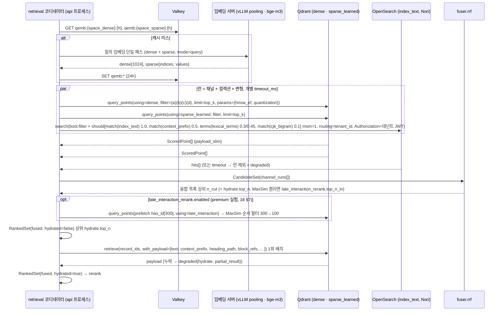
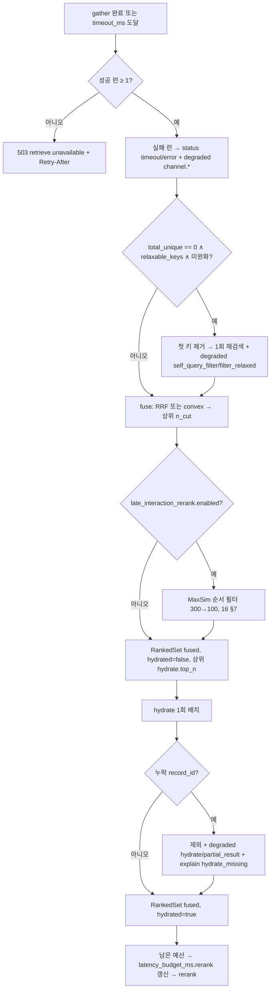

# 하이브리드 검색과 융합

## 목적

이 문서는 검색 경로의 `retrieve` 스테이지(병렬 리트리버 실행)와 `fuse` 스테이지(융합 + 내부 서브스텝 `hydrate`)의 설계 정본이다. `QueryPlan`을 받아 `CandidateSet`을 만들고, 이를 `RankedSet(stage=fused, hydrated=true)`로 바꾸어 `rerank`에 넘기는 구간을 다룬다(브리프 D-05·D-07, 바이블 §4.3·§8.1 7~9단계). 계약의 필드 정의는 [03-contracts/09](../03-contracts/09-query-request-and-query-plan.md)·[03-contracts/10](../03-contracts/10-candidate-set-and-ranked-set.md)이 소유하고, 이 문서는 그 계약을 **어떻게 채우는지**(알고리즘·플러그인·실패 정책·예산)를 정한다.

이 문서가 답하는 질문은 다음과 같다. 리트리버는 어떤 단위로 병렬 실행되고 하나가 실패하면 무엇이 일어나는가. 각 채널 플러그인은 백엔드에 정확히 어떤 질의를 보내는가. 융합 점수는 어떻게 계산되고 어디에 기록되는가. 필터는 어디에서 어떻게 강제되며 선택도가 높을 때 어떤 함정을 피하는가. 후보 수·부스트·캐시·지연 예산은 어떤 규칙으로 정해지는가.

## 범위

| 포함 | 제외(다른 문서) |
|------|-----------------|
| 런(run) 구성(채널 × 컬렉션 × 질의 변형), `asyncio` 병렬 실행, 개별 타임아웃, 부분 실패와 `degraded` | 질의 이해(정규화·라우터·self-query·multi-query 생성) — [04-pipelines/14](14-query-understanding.md) |
| `retriever` 플러그인 5종(dense·sparse·lexical·late_interaction·graph)의 백엔드 질의 구성 | 인덱스 매핑·분석기·named vector 생성 — [04-pipelines/13](13-indexing.md)(바이블 §4.2 `index` 행·§5.4 `IndexRecord`·§13.4가 정본) |
| 필터 빌더의 강제 규칙과 선택도 대응(백엔드 설정) | 필터 DSL 문법과 변환 표 — [03-contracts/09](../03-contracts/09-query-request-and-query-plan.md) §4·§10 |
| 융합(RRF·convex·DBSF·CombMNZ) 공식·의사코드·점수 분해, 가중치 프로파일, 부스트 판정 원천 데이터 | 리랭킹·`late_interaction_rerank` — [04-pipelines/16](16-reranking.md); 후처리·패킹·부스트 공식과 적용 시점 — [04-pipelines/17](17-post-processing-and-context-packing.md) §2.9 |
| 후보 수 정책, 캐시, 지연 예산·타임아웃, `hydrate` 서브스텝, `explain` | 그래프·트리·에이전트 전략의 리트리버 내부 — [04-pipelines/18](18-advanced-retrieval-graph-raptor-agentic.md) |

## 1. 파이프라인 위치와 경계

`retrieve`와 `fuse`는 오케스트레이터를 거치지 않는 인프로세스 스테이지이며(D-17, 바이블 §4.3) PostgreSQL을 읽지 않는다([ADR-0034](../06-adr/0034-retrieval-hot-path-postgres-independence-and-hydrate.md)). 컬렉션 alias·`embedding_profile_hash`·현재 세대는 `QueryPlan.channels[]`에 이미 복사되어 있고, 부족한 컬렉션 상태는 api 프로세스 캐시(`collspec:{collection_id}`)에서 읽는다.

| 스테이지 | 입력 | 출력 | 확장 지점 / `plugin_id` | 격리 | 캐시 | 실패 정책(바이블 §4.3) |
|----------|------|------|--------------------------|------|------|------------------------|
| `retrieve` ×N | `QueryPlan.channels[i]`(채널 × 컬렉션) × `rewritten_queries[]`(변형) | `CandidateSet`(`channel_runs[]` = 채널 × 컬렉션 × 변형) | `retriever` — `retriever.qdrant_dense`, `retriever.qdrant_sparse`, `retriever.opensearch_bm25`, `retriever.qdrant_sparse_bm25`(lite), 플러그인 | in_process 어댑터 → Qdrant(gRPC) / OpenSearch(HTTP) | **없음**(ACL 시점성) | 런 실패 = 제외 + `degraded{channel.*}`; 최소 1런 성공; 전부 실패 → 503 `retrieve.unavailable` + `Retry-After` |
| `fuse` | `CandidateSet` | `RankedSet(stage=fused, hydrated=false)` | `fuser` — `fuser.rrf`(기본), `fuser.convex_minmax`, `fuser.convex_zscore`, `fuser.dbsf`, `fuser.combmnz` | in_process 순수 함수 | 없음 | `fuse.k_missing`은 프로파일 로딩에서 차단; 상위 `hydrate.top_n` 절단(`late_interaction_rerank.enabled`면 `top_n_in` 300까지 메모리 목록으로 유지 → MaxSim 순서 필터 뒤 `RankedSet(fused)`는 `hydrate.top_n`으로 발행, §6.2·[16 §7](16-reranking.md)) |
| `hydrate`(fuse 내부 서브스텝) | `RankedSet(fused)` | `RankedSet(fused, hydrated=true)` | `index_backend.qdrant`(`retrieve(record_ids, with_payload)` 1회 배치) | in_process 어댑터 | 없음 | `hydrate.backend_error` 1회 재시도 후 503 `retrieve.unavailable`; 누락 레코드 제외 + `degraded{hydrate, partial_result}` |

**결정:** 경계 타입은 `CandidateSet`·`RankedSet` 둘뿐이고 `hydrate`는 `hydrated` 플래그로만 구분되는 서브스텝이다. 이 문서는 새 계약 타입을 추가하지 않는다. 아래에 나오는 `ChannelRunInput`·`Retriever`·`Fuser`는 SDK 내부 타입(프로토콜)이며 바이블 §5.1 인벤토리의 계약이 아니다([ADR-0030](../06-adr/0030-single-coordinate-system-and-score-ledger.md), [ADR-0034](../06-adr/0034-retrieval-hot-path-postgres-independence-and-hydrate.md)).



## 2. 병렬 리트리버 실행

### 2.1 런 구성

런은 `(채널, 컬렉션, 질의 변형)` 삼중항이며 `channel_run_id = "{channel}:{collection_id}:{variant_id}"`(바이블 §6.1)이다. 코디네이터는 다음 곱집합에서 런 목록을 만든다.

| 차원 | 원천 | 규칙 |
|------|------|------|
| 채널 × 컬렉션 | `QueryPlan.channels[]`(`enabled=true`만) | 플래너가 `CollectionSpec ↔ IndexBackendCapabilities` 대조로 이미 구성(바이블 §8.1 6단계). `mode ≠ hybrid`·능력 미지원·지연 예산으로 꺼진 채널은 `enabled=false`로 남아 있으며 런을 만들지 않되 `channel_runs[]`에 `status=disabled`, `returned=0`으로 기록한다 |
| 질의 변형 | `QueryPlan.rewritten_queries[]` | 변형 `v`는 `v.channels[]`에 포함된 채널에만 결합된다(예: `abstraction`(step-back)은 `[dense, sparse]`; 증강형 HyDE 옵션의 `hypothetical`은 `[dense]`). HyDE(치환형, 기본)는 **변형을 만들지 않는다** — `original`의 dense·sparse 런 임베딩 입력이 `dense_query_text`(가상 문서)로 바뀔 뿐이고 `original.channels`는 활성 채널 전체로 유지된다([09 §6.1](../03-contracts/09-query-request-and-query-plan.md) P-6, [14 §5.4](14-query-understanding.md)). `original`은 항상 존재하고 `variant_id = query_id` |
| 하위 질의 | `rewritten_queries[]` 중 `role=sub_query` | `route=multi`의 독립 하위 질의는 변형과 같은 방식으로 런이 된다(§5) |

`standard` 기본 변형(`default`)에서는 컬렉션 1개당 런 3개(dense·sparse·lexical × original)이고, `quality` 변형의 multi-query 3개가 붙으면 컬렉션 1개당 `3 + 3×3 = 12`런이다(dense 4 + sparse 4 + lexical 4). HyDE(치환형)는 런 수를 바꾸지 않는다 — `original`의 dense·sparse 런 입력이 가상 문서로 대체될 뿐이다([14 §5.4](14-query-understanding.md)); 증강형 옵션(`hypothetical` `[dense]` 0.5, 기본 끔)을 켜면 dense 런 1개가 더해진다. 컬렉션 20개 상한(바이블 §5.1 `QueryRequest`)에서 런 수는 240까지 커질 수 있으므로 런은 **동시성 상한**을 갖는다(§10).

### 2.2 실행 규칙

**결정:** 런은 `asyncio.gather(*, return_exceptions=True)`로 병렬 실행하며 런마다 `asyncio.wait_for(timeout = channels[].timeout_ms)`를 건다. 타임아웃·백엔드 오류는 그 런만 제외하고(`status=timeout|error`, `error: StageError`), `degraded[]`에 `{component: "channel.{channel}", reason: timeout|unavailable}`을 추가한다. 성공 런이 하나도 없으면 503 `retrieve.unavailable`(`Retry-After` 포함)이다(바이블 §4.3 `retrieve` 행, §5.7 오류 카탈로그).

```python
async def retrieve(plan: QueryPlan, ctx: RetrievalContext) -> CandidateSet:
    started = ctx.now()
    qvecs = await embed_query(plan, ctx)          # §3.2·§3.3: dense+sparse 단일 패스, qemb 캐시; 실패는 QueryVectors.error에 담김
    cs = await retrieve_once(plan, qvecs, ctx)
    if cs.total_unique == 0 and plan.filters.relaxable_keys:          # §4.4: 1회 완화 재검색(재귀 없음)
        plan2 = relax_first_key(plan)                                  # 보안·전략 필터 불변, effective_hash 재계산
        cs = await retrieve_once(plan2, qvecs, ctx)                    # 질의 벡터 재사용(재임베딩 없음)
        cs.degraded.append(DegradedEntry(component="self_query_filter", reason="filter_relaxed"))
    cs.total_latency_ms = ctx.now() - started                          # 1차 + 완화 재검색을 합친 경과
    return cs


async def retrieve_once(plan: QueryPlan, qvecs: QueryVectors, ctx: RetrievalContext) -> CandidateSet:
    started = ctx.now()
    runs = [(ch, v) for ch in plan.channels if ch.enabled
                    for v in plan.rewritten_queries if ch.channel in v.channels]
    sem = asyncio.Semaphore(ctx.profile.query.retrieve_concurrency)   # §10, 초안 32
    async def guarded(ch, v):
        async with sem:
            return await asyncio.wait_for(run_one(ch, v, qvecs, plan, ctx), timeout=ch.timeout_ms / 1000)
    results = await asyncio.gather(*(guarded(ch, v) for ch, v in runs), return_exceptions=True)

    channel_runs: list[ChannelRun] = disabled_runs(plan)             # enabled=false → status=disabled
    for (ch, v), res in zip(runs, results):
        if isinstance(res, ChannelRun):
            channel_runs.append(res)
        elif isinstance(res, asyncio.TimeoutError):
            channel_runs.append(failed_run(ch, v, "retrieve.channel_timeout", status="timeout"))
        elif isinstance(res, SecurityContextMissing):
            raise res                                                  # 계약 위반: 요청 전체 실패(E7)
        else:                                                          # 백엔드 5xx·연결 오류·질의 벡터 부재(.code가 없는 일반 예외 포함)
            code = getattr(res, "code", None) or "retrieve.backend_error"
            channel_runs.append(failed_run(ch, v, code, status="error"))

    ok = [r for r in channel_runs if r.status == "ok"]
    if not ok:
        raise RetrieveUnavailable(retry_after_s=ctx.profile.query.retry_after_s)   # 503 retrieve.unavailable
    degraded = plan.degraded + [degraded_entry(r) for r in channel_runs if r.status in ("timeout", "error")]
    return build_candidate_set(plan, channel_runs, degraded, took_ms=ctx.now() - started)


async def run_one(ch: ChannelPlan, v: RewrittenQuery, qvecs: QueryVectors, plan: QueryPlan, ctx: RetrievalContext) -> ChannelRun:
    retriever = ctx.registry.retriever(ch.retriever_id)
    filt = ctx.filters.build(plan.filters, plan.exclude_ids, backend_id=ch.backend_id)   # (a)+(b)+(c)+(d), §4
    if not filt.has_tenant_id:
        raise SecurityContextMissing("retrieve.security_context_missing")
    with ctx.tracer.span(f"rag.retrieve.{ch.channel}", **{"gen_ai.data_source.id": ch.collection_id}):
        inp = ChannelRunInput(channel=ch, variant=v, query_vectors=qvecs, filter=filt,
                              security=plan.security_context, payload_slim_keys=PAYLOAD_SLIM_KEYS)
        run = await retriever.run(inp, ctx)                             # ChannelRun(status=ok, candidates 원점수 내림차순, rank 1..n)
    ctx.metrics.observe("rag_retrieve_latency_seconds", run.took_ms / 1000, channel=ch.channel, backend_id=ch.backend_id)
    return run
```

| 항목 | 규칙 |
|------|------|
| 예외 격리 | 한 런의 예외가 다른 런을 취소하지 않는다(`return_exceptions=True`). 타임아웃된 런의 백엔드 요청은 `wait_for`가 취소한다 |
| 계약 위반 예외 | `retrieve.security_context_missing`(필터에 `tenant_id` 부재)은 부분 실패가 아니라 요청 전체 실패다(E7). 어댑터는 요청을 보내기 전에 검사한다 |
| 질의 벡터 부재 | 임베딩 서버 실패(`embed.server_unavailable`) 시 dense·sparse 런은 `status=error`(해당 코드)로 제외하고 `degraded += {query_embedding, unavailable}`; lexical 런은 영향 없이 진행하므로 "최소 1채널"이 보통 성립한다 |
| 결과 정렬 | 어댑터는 후보를 채널 원점수 내림차순으로 정렬하고 `rank`를 1..n으로 연속 부여한다. 동점은 `record_id` 오름차순(융합 타이브레이크와 동일 규칙) |
| 런당 상한 | `returned ≤ min(top_k, 300)`(바이블 §5.1 `CandidateSet` 한계). 백엔드가 더 돌려주면 절단 + `truncated=true` |
| 세대 기록 | `index_generation_seen[]`에 후보의 `index_generation` 집합을 기록하고 `channels[].index_generation_min`보다 작은 세대가 보이면 `warnings[]`에 `retrieve.stale_generation_seen`(경고 코드 제안, 미해결 이슈 9)을 남긴다 |
| `total_hits` | OpenSearch `hits.total.value`(`track_total_hits` 상한까지 정확, 이후 근사), Qdrant는 `null`(필터 후 총량을 돌려주지 않음; 근사 카운트 API 채택은 미해결 이슈 5) |
| 부분 실패 표기 | `degraded`는 상류(플랜) 항목을 상속하고 자기 항목을 더한다. 콘텐츠·질의문은 `detail`에 넣지 않는다 |

### 2.3 `ChannelRun` 기록

런 하나가 `channel_runs[]` 항목 하나다. 필드 정의는 [10 §3.3](../03-contracts/10-candidate-set-and-ranked-set.md)이 소유하며 이 문서는 값을 채우는 주체를 정한다.

| 필드 | 채우는 주체 | 값 |
|------|-------------|----|
| `channel_run_id`, `channel`, `collection_id`, `variant_id`, `retriever_id`, `backend_id`, `collection_alias`, `embedding_profile_hash` | 코디네이터(`ChannelPlan`·`RewrittenQuery` 사본) | 플랜 값 그대로 |
| `status`, `took_ms`, `error` | 코디네이터 | `ok` / `timeout`(`retrieve.channel_timeout`) / `error`(`retrieve.backend_error`, `embed.server_unavailable`, `embed.space_mismatch`) / `disabled` |
| `returned`, `total_hits`, `truncated`, `index_generation_seen[]`, `candidates[]` | 어댑터 | 후보 `payload_slim`은 백엔드 payload에서 `{heading_path, page_start, page_end, doc_date, acl_classification, acl_hash, token_count_primary, text_preview, content_hash, text_source}`만 복사한다(본문·좌표·전체 ACL은 `hydrate`) |
| `filters_applied`, `security_context_hash`, `total_unique`, `total_latency_ms` | 코디네이터 | `security`·`strategy`·`user`·`self_query` 구분 기록(완화 후 값), `H("sec", …)` 서명(바이블 §6.2), 전 런의 서로 다른 `record_id` 수, 병렬 구간 경과(§4.4 완화 재검색이 있으면 1차 + 재검색 합산) |

## 3. Retriever 플러그인

### 3.1 공통 인터페이스

리트리버는 `Stage` 프로토콜 5멤버(`plugin_id`, `config_schema`, `capabilities()`, `fingerprint()`, `async run(inp, ctx)`; 바이블 §4.1, [ADR-0032](../06-adr/0032-plugin-sdk-stage-protocol-and-conformance-kit.md))를 따르는 `retriever` 확장 지점 구현이다. 입력·출력은 계약 타입이 아닌 SDK 내부 타입이며, 스테이지 경계(`CandidateSet`)는 코디네이터가 조립한다.

```python
class ChannelRunInput(BaseModel):            # SDK 내부 타입(계약 아님)
    channel: ChannelPlan                     # QueryPlan.channels[i]
    variant: RewrittenQuery                  # QueryPlan.rewritten_queries[j]
    query_vectors: QueryVectors              # {dense: list[float] | None, sparse_learned: SparseVector | None, sparse_bm25: SparseVector | None, late_interaction: list[list[float]] | None}
    filter: BackendFilter                    # 필터 빌더 출력(백엔드 네이티브, has_tenant_id=True 보장)
    security: SecurityContext
    payload_slim_keys: tuple[str, ...]
    lexical_terms: list[LexicalTerm] = []    # QueryPlan.lexical_terms (lexical 채널만 사용)

class Retriever(Stage[ChannelRunInput, ChannelRun], Protocol):
    channel: Channel                         # 이 구현이 생산하는 채널(열거 바이블 §5.7 Channel)
    def capabilities(self) -> Capabilities: ...   # extra: {"requires_query_vector": "dense" | "sparse_learned" | "sparse_bm25" | "late_interaction" | None, "supports_total_hits": bool}
    async def run(self, inp: ChannelRunInput, ctx: StageContext) -> ChannelRun: ...
```

**결정:** 리트리버는 (1) 필터에 `tenant_id`가 없으면 요청을 보내지 않고 `retrieve.security_context_missing`을 던진다(E7), (2) 사후 필터를 쓰지 않는다, (3) `candidates[]`를 원점수 내림차순·`rank` 연속으로 돌려준다, (4) 백엔드 요청 본문에 질의문 외의 콘텐츠를 로그·스팬에 남기지 않는다(E13). 적합성 키트 `security_invariants`("백엔드 요청에 `tenant_id` 필터 존재")가 (1)·(2)를 검사한다.

### 3.2 `dense` — `retriever.qdrant_dense`

| 항목 | 값 | 근거 |
|------|----|------|
| 백엔드 호출 | `query_points(collection=collection_alias, using="dense", query=dense_vector, query_filter=filter, limit=top_k, with_payload=payload_slim_keys, with_vectors=False)` — prefetch로 sparse와 묶지 않는다(**두 호출**) | 바이블 §8.1 7단계; 서버 융합은 개별 채널 점수를 돌려주지 않아 점수 분해가 깨짐(07-tech-landscape/06 §Qdrant 출력 형식) |
| 질의 벡터 | 런의 임베딩 입력을 bge-m3 `EmbeddingMode=query`로 임베딩한다: `original`의 벡터 런(dense·sparse) → `dense_query_text`(HyDE 켬이면 가상 문서, 아니면 `= normalized_query`); 그 외 변형(`rewrite`·`abstraction`·`sub_query`·`hypothetical`) → 그 변형의 `rewritten_queries[].text`([09 §6.1](../03-contracts/09-query-request-and-query-plan.md) P-6, [14 §5.4](14-query-understanding.md)). 치환형 HyDE는 dense 런의 수·가중을 바꾸지 않고 `original` 런의 입력 텍스트만 바꾼다(§9 캐시 키도 같은 규칙). `embedding_space_id`는 `channels[].embedding_space_id`; 캐시 키는 `retrieve`가 `qemb:{embedding_space_id}:{blake3_hex(utf8(embed_text))}`(24h)로 **결정적으로 유도**한다 — `channels[].query_vector_ref`는 플래너가 기본으로 채우지 않으며 자체 벡터 공간을 쓰는 플러그인 채널(`graph`·`tree`·`visual`)만 채운다 | 바이블 §4.3 `plan` 행, [09 §6.5·§8.2](../03-contracts/09-query-request-and-query-plan.md) |
| 거리 | cosine(`normalized: true`) — 원점수 `score`는 코사인 유사도 | 바이블 §13.4 named vectors |
| HNSW·양자화 질의 파라미터 | Qdrant `SearchParams{hnsw_ef, exact, quantization{rescore, oversampling}}`로 전달(파라미터 이름·의미는 확인 필요, as of 2026-09). 초안값은 [13 §4.4](13-indexing.md)와 같다: `hnsw_ef 128`, `exact false`, `quantization.rescore true`, `oversampling 2.0`(`standard`의 dense는 scalar int8 양자화라 원본 벡터 재점수가 필요, 13 §4.1). `hnsw_ef`는 `top_k` 이상이어야 하며(`< top_k`면 어댑터가 `top_k`로 올림) 프로파일 선택 필드 `query.channels[dense].params: {hnsw_ef: integer, exact: boolean, quantization: {rescore: boolean, oversampling: number}}`(N, 초안)로 조정한다. `exact=true` 전환 규칙은 §4.2 | 13 §4.4, 07-tech-landscape/06 §Qdrant(HNSW `m`·`ef_construct`·`payload_m`·`full_scan_threshold`) |
| 컬렉션 설정(참고, 13 문서 소유) | `dense` HNSW `m=0`, `payload_m=16`, `ef_construct=128`, `standard` scalar int8 `quantile 0.99, always_ram`; `tenant_id` keyword 인덱스 `is_tenant=true` → 테넌트별 독립 그래프 | 13 §4.1, 바이블 §13.4, §10.4 `payload_filter` |
| `payload_slim` | `with_payload`로 10개 키 + 식별자만 요청(payload 32KB 중 약 1KB) | 바이블 §5.1 `CandidateSet` 한계, §5.5 `payload_slim` |
| 오류 | 연결·5xx → `retrieve.backend_error`; 질의 벡터 부재 → 상류 코드(`embed.server_unavailable`) | 바이블 §5.7 |

### 3.3 `sparse` — `retriever.qdrant_sparse`

**결정:** `sparse` 채널은 learned sparse(`sparse_learned`)만 가리키며 질의 인코딩은 BGE-M3 sparse(`vocab_id=xlm-roberta-250k`)를 dense와 **같은 단일 패스**에서 얻는다. SPLADE-v3는 라이선스(CC BY-NC-SA)로 제외한다(바이블 §3.2 O-02, [ADR-0014](../06-adr/0014-sparse-representation-bge-m3-lexical-leg-kept.md)).

| 항목 | 값 |
|------|----|
| 백엔드 호출 | `query_points(collection=collection_alias, using="sparse_learned", query=SparseVector(indices, values), query_filter=filter, limit=top_k, with_payload=payload_slim_keys)` |
| 질의 벡터 | 단일 패스 출력의 sparse 부분(`indices` = XLM-R 토큰 id, `values` = lexical weight). 캐시 키는 dense와 별개 공간 `qemb:{embedding_space_ids.sparse_learned}:{blake3_hex(utf8(embed_text))}`(유도 규칙은 §3.2와 동일) |
| 공간 검증 | 질의 인코더의 `vocab_id`가 `CollectionSpec.embedding_space_ids.sparse_learned`의 `vocab_id`와 다르면 플래너(6단계)가 채널을 `enabled=false` + `degraded{channel.sparse, profile_mismatch}`로 끈다. 런타임까지 도달하면 `status=error`, `error.code = embed.space_mismatch`(비재시도) |
| 거리 | dot product(`modifier: none`); 원점수는 내적값이라 채널 간 비교 불가 → RRF가 기본인 이유 |
| `ko-quality`(premium) | PIXIE-Splade-v1.5(`ax-encoder-50k`)는 별도 `SparseEncoder` 경로이며 컬렉션 공간이 바뀌므로 blue/green 재색인 단위(ADR-0014) |

### 3.4 `lexical` — `retriever.opensearch_bm25`(standard 이상)

**결정:** lexical 질의는 바이블 §8.1 7단계·§13.4의 절 목록(`bool.filter + match(index_text, nori_search) + should(terms lexical_terms 0.3, match cjk_bigram 0.1)`, `context_prefix` 0.5)을 [13 §5.3](13-indexing.md)과 **같은 구조**로 실현한다: `bool.filter`(보안 + 전략 + 사용자 + `exclude_ids`) + `should` 4절 + `minimum_should_match: 1`(`match(index_text)` 1.0, `match(context_prefix)` 0.5, `terms(lexical_terms)` 0.3, `match(cjk_bigram)` 0.1) + `routing=tenant_id` + 요청별 테넌트 JWT `Authorization`(DLS, E8). `match(index_text)`를 `must`가 아니라 `should`에 두는 이유는 bigram 절의 목적(형태소 OOV 내성)이 "형태소 매칭이 0건일 때 bigram만으로도 후보를 반환"할 수 있어야 성립하고, `context_prefix`만 적중한 제목·캡션 일치도 정당한 후보이기 때문이다(순위는 boost 1.0인 `index_text` 절이 주도한다). bigram의 물리 필드명은 바이블 §13.4 "OpenSearch 필드" 행·[07 §8.2](../03-contracts/07-embedded-chunk-set-and-index-record.md)·13 §5.1 매핑이 정한 최상위 필드 **`cjk_bigram`**(`index_text`에서 `copy_to`, 분석기 `hangul_bigram` = `standard` 토크나이저 + `cjk_bigram` 필터, `norms: false`)이다. 02-architecture/04 §5.2가 같은 필드를 하위 필드 `index_text.bigram`으로 적은 것은 이름 불일치이며 13 미해결 이슈 14가 04 patch를 제안했다(이 문서는 바이블 철자를 따른다, 미해결 이슈 11(c)). 13 §5.3의 `title.text` 0.7(초안) 절은 두지 않는다 — 문서 제목은 이미 결정적 `context_prefix`의 첫 요소라([ADR-0029](../06-adr/0029-three-text-rule-and-deterministic-context-prefix.md)) 별도 절은 제목을 이중 계산한다(13 patch 제안, 미해결 이슈 11(a)). `IndexRecord`에 없는 필드(`body`, `keywords`)는 사용하지 않는다.

| 절 | 필드·분석기 | boost(초안 목표) | 목적 |
|----|-------------|------------------|------|
| `should.match` | `index_text`(색인 `nori_index`=`mixed`, 질의 `nori_search`=`discard`), `operator: or` | 1.0 | BM25 주 점수. 사용자 사전·`synonym_graph`는 `nori_search` 체인에서 적용(§3.4.2) |
| `should.terms` ×2 | `lexical_terms`(keyword 배열; `QueryPlan.lexical_terms[].term`)를 **태그별 두 절**로 나눈다: 일반 항목(`tag ≠ USER_DICT`, `_name: lexical_terms`)과 사용자 사전 항목(`tag = USER_DICT`, `_name: lexical_terms_user_dict`) | 0.3 / 0.45 | 형태소 키워드 정확 일치 보강. OpenSearch `terms` 절은 절 하나에 boost 하나만 가지므로 플래너의 `weight 1.5`(바이블 §8.1 2단계)를 절 분리로 표현한다(`0.45 = 0.3 × 1.5`). 두 절의 `matched_queries`는 `explain` 진단에 쓴다 |
| `should.match` | `context_prefix`(text, 같은 분석기) | 0.5 | 제목·heading 경로·캡션 문맥 일치(3-텍스트 규칙: 본문과 분리 저장, [ADR-0029](../06-adr/0029-three-text-rule-and-deterministic-context-prefix.md)) |
| `should.match` | `cjk_bigram`(`index_text` `copy_to`, 분석기 `hangul_bigram`, `norms: false`; 바이블 §13.4, 13 §5.1) | 0.1 | 형태소 OOV(미등록어) 내성(07-tech-landscape/13 §BM25 토크나이징 전략 "형태소 + bigram"; 초안 boost 0.3 제안 대비 바이블 §8.1 값 0.1 채택) |
| `should.match_phrase`(옵션) | `index_text`, `slop: 2` | 0.2(기본 끔) | 구문·근접 부스트. 프로파일 선택 필드 `query.channels[lexical].phrase_boost: {enabled, slop, boost}`(N, 초안). 한국어 형태소 분절 뒤 어순이 유연하므로 골든셋 확인 전 기본 끔 |

#### 3.4.1 BM25 파라미터

BM25 유사도 파라미터는 인덱스 설정([13 §5.1](13-indexing.md) 소유)이며 질의 시점에 바꾸지 않는다. 13 §5.1 템플릿은 `similarity`를 명시하지 않아 Lucene 기본값(`k1 = 1.2`, `b = 0.75`)이 적용된다. **13 문서에 제안:** 매핑 `similarity`에 `k1 = 1.2`, `b = 0.75`를 명시한다(Lucene 기본값과 같으나 `lite`의 플랫폼 측 포화식(D-15, [ADR-0012](../06-adr/0012-lite-profile-qdrant-only-client-bm25.md))과의 일치를 명문화). 두 프로파일의 lexical 점수 분포가 같은 모양을 갖는 것이 융합 가중 프로파일 공유의 전제이며, 값 변경은 바이블 §7.4 게이트 + 렉시컬 재색인(`mapping_version` 증가)이다(미해결 이슈 11(b)).

#### 3.4.2 동의어·사용자 사전

동의어 확장은 **질의 시점**에만 적용한다: `UserDictEntry.synonyms`(단일 소스)에서 생성한 `synonym_graph` 필터를 `nori_search` 분석기 체인에 넣고(07-tech-landscape/13 §동의어·사용자 사전, 13 §5.1 `rag_synonym`), 색인 분석기 `nori_index`에는 넣지 않는다. 근거는 색인 팽창 방지와 "확장은 질의 측에서만"이라는 대칭성이다 — 재색인 회피는 근거가 아니다. `synonyms`는 `UserDictEntry`의 일부라 변경 시 `dictionary_hash` → `lexical_profile_hash = H("lex", analyzer_id, dictionary_hash, mapping_version)`가 바뀌어 새 물리 인덱스 + alias 교체가 필요하다(13 §5.1, 07-tech-landscape/13 "사전 파일 해시가 바뀌면 렉시컬 인덱스는 재색인 대상"). `QueryPlan.dictionary_hash`와 컬렉션 값이 다르면 `degraded{channel.lexical, analyzer_mismatch}`가 붙는다(바이블 §5.5 `analyzer_id`). 동의어만 바뀐 경우 `_reload_search_analyzers`로 검색 분석기만 무중단 갱신하려면 `dictionary_hash`에서 동의어 해시를 분리(`synonym_hash`, 검색 분석기 전용)해야 하며 이는 제안으로 남긴다(미해결 이슈 12).

#### 3.4.3 요청 예시(`standard`, `phrase_boost` 켠 구성)

`_source`는 `payload_slim` 10키(바이블 §5.5 `CandidateSet`)와 식별자만 요청하고, 보안 절의 값은 `filters.security` 바인딩이다. `track_total_hits: 1000`은 `total_hits`를 1,000까지 정확히 세고 그 이상은 근사한다(recall 진단 용도). 예시 질의의 `lexical_terms`는 `문서`·`접수`·`처리`·`절차`(일반)와 `정보공개법`(사용자 사전, `tag = USER_DICT`)이다.

```json
{
  "size": 100,
  "track_total_hits": 1000,
  "_source": ["record_id", "chunk_id", "document_id", "doc_version", "collection_id", "item_kind", "level", "parent_chunk_id", "index_generation", "heading_path", "page_start", "page_end", "doc_date", "acl_classification", "acl_hash", "token_count_primary", "text_preview", "content_hash", "text_source"],
  "query": {
    "bool": {
      "filter": [
        {"term": {"tenant_id": "01J9ZQ4K7X2M8N3P5R6S7T8V9W"}},
        {"terms": {"collection_id": ["01J9ZQ5A1B2C3D4E5F6G7H8J9K"]}},
        {"term": {"is_current": true}},
        {"bool": {"should": [{"terms": {"acl_visibility": ["public", "tenant"]}}, {"terms": {"acl_allow": ["user:alice", "group:finance", "tenant:*"]}}], "minimum_should_match": 1}},
        {"bool": {"should": [{"bool": {"must_not": {"exists": {"field": "acl_embargo_until"}}}}, {"range": {"acl_embargo_until": {"lte": "2026-09-22T09:00:00.000Z"}}}], "minimum_should_match": 1}},
        {"bool": {"should": [{"bool": {"must_not": {"exists": {"field": "acl_expires_at"}}}}, {"range": {"acl_expires_at": {"gt": "2026-09-22T09:00:00.000Z"}}}], "minimum_should_match": 1}},
        {"terms": {"acl_classification": ["public", "internal"]}},
        {"terms": {"level": [0]}},
        {"terms": {"item_kind": ["text", "list_group", "code", "table", "table_part", "figure"]}},
        {"range": {"doc_date": {"gte": "2025-01-01"}}}
      ],
      "must_not": [
        {"terms": {"acl_deny": ["user:alice", "group:finance", "tenant:*"]}}
      ],
      "should": [
        {"match": {"index_text": {"query": "정보공개법 문서 접수 처리 절차", "operator": "or", "boost": 1.0, "_name": "index_text"}}},
        {"match": {"context_prefix": {"query": "정보공개법 문서 접수 처리 절차", "boost": 0.5, "_name": "context_prefix"}}},
        {"terms": {"lexical_terms": ["문서", "접수", "처리", "절차"], "boost": 0.3, "_name": "lexical_terms"}},
        {"terms": {"lexical_terms": ["정보공개법"], "boost": 0.45, "_name": "lexical_terms_user_dict"}},
        {"match": {"cjk_bigram": {"query": "정보공개법 문서 접수 처리 절차", "boost": 0.1, "_name": "bigram"}}},
        {"match_phrase": {"index_text": {"query": "문서 접수", "slop": 2, "boost": 0.2, "_name": "phrase"}}}
      ],
      "minimum_should_match": 1
    }
  }
}
```

`_name`을 붙인 절은 응답 `matched_queries`로 어떤 절이 적중했는지 알려 주며 `explain` 진단에 쓴다(`lexical_terms_user_dict` 적중은 사용자 사전 표제어 일치의 검색 측 증거이지만, `user_dictionary` 부스트 자체는 `postprocess`가 [17 §2.9](17-post-processing-and-context-packing.md) 규칙으로 판정한다 — §8). `routing`은 쿼리 파라미터(`?routing={tenant_id}`), DLS는 `security/backend_token`이 발급한 단명 JWT를 `Authorization` 헤더로 전달한다(E8). 사용자 사전 항목이 없으면 `lexical_terms_user_dict` 절을 생략하고, `lexical_terms`가 비어 있으면 두 `terms` 절을 모두 생략한다(빈 `terms`는 OpenSearch가 거부).

### 3.5 `lexical`(lite) — `retriever.qdrant_sparse_bm25`

`lite`는 OpenSearch가 없으므로 lexical 레그를 Qdrant named sparse vector `sparse_bm25`(`modifier: idf`, 테넌트별 IDF)로 제공한다. 채널 열거값은 **항상 `lexical`**이며 `fusion.weights.lexical`·`ScoreBreakdown.lexical`·`ExplainCode.lexical_only_hit`을 `standard`와 같은 키로 쓴다(바이블 §5.7 `Channel`, D-15, [ADR-0012](../06-adr/0012-lite-profile-qdrant-only-client-bm25.md)).

| 항목 | 값 |
|------|----|
| 질의 벡터 | `normalized_query`(변형 런은 변형 `text`)를 컬렉션과 **같은 `analyzer_id`·`dictionary_hash`**(플랫폼 `korean_analyzer`, 공백기 mecab-ko / `[kiwi]` extra)로 토큰화 → 토큰 → `indices`(안정 해시 `bm25_index(token)`, [12 §12.3](12-embedding.md) 확정) / **`values[t] = tf_q(t)`**(질의 토큰 빈도; 초안). 질의 `values` 규약의 소유 근거는 [ADR-0012](../06-adr/0012-lite-profile-qdrant-only-client-bm25.md) 하나다("질의 측 `sparse_bm25` 벡터의 `values` 규약과 `indices` 해시 함수는 이 ADR이 정하지 않는다" — 제약은 같은 `analyzer_id` 토큰화와 bm25s 참조 점수·순위 일치); 질의 측 리트리버(`retriever.qdrant_sparse_bm25`)를 소유하는 이 문서가 그 규약을 정한다. [13 §6](13-indexing.md) 질의 측 행은 12 §12.3 초안(`values = 1.0`)을 그대로 따르고 있으며 이 문서를 인용하지 않는다(13 §6이 소유를 표시한 행은 IDF 행뿐이다). `tf_q`를 택한 근거: OpenSearch `match`는 반복 질의 토큰을 반복 절로 만들어(Lucene `BooleanQuery` 중복 SHOULD 절은 boost 합산으로 재작성) 질의 빈도에 선형이므로 `standard`와 `lite`의 lexical 점수 분포 모양이 같아진다(§3.4.1의 전제). **[12 §12.3](12-embedding.md) '질의 측' 행과 [13 §6](13-indexing.md) 질의 측 행의 `values = 1.0`(질의 TF 무시; 초안)과 다르며** 12·13 문서 patch를 제안한다(미해결 이슈 6). 확정은 bm25s 참조 구현 일치 테스트(ADR-0012 준수 확인; bm25s의 반복 질의 토큰 처리 방식은 확인 필요, as of 2026-09)로 하되, 확정 전까지 이 문서의 구현 값은 `tf_q` 하나이고 12·13이 게시한 `1.0`은 정정 대상으로 표시한다 |
| 서버 측 | IDF만 곱함(`modifier: idf`); 문서 측 TF 포화·길이 정규화(`k1=1.2, b=0.75, avgdl`)는 색인 시 계산되어 있음 |
| 백엔드 호출 | `query_points(using="sparse_bm25", query=SparseVector, query_filter=filter, limit=top_k, with_payload=payload_slim_keys)` — dense와 별도 호출 |
| 분석기 불일치 | `QueryPlan.analyzer_id ≠ IndexRecord.analyzer_id` → `degraded{channel.lexical, analyzer_mismatch}`(플래너), 런은 그대로 실행 |
| 캐시 | `qemb:{embedding_space_ids.sparse_bm25}:{blake3_hex(utf8(normalized_query))}` 24h(결정적 토큰화라 캐시 가능; IDF는 서버 측이므로 벡터는 코퍼스 변화에 불변) |

### 3.6 `late_interaction`(옵션, O-04)

기본 끔. `CollectionSpec`이 `late_interaction` 슬롯을 켰고 `IndexBackendCapabilities.supports_multivector=true`일 때만 채널 `late_interaction`이 구성된다(`retriever.qdrant_late_interaction`, 플러그인 `rag-plugin-kure-late-interaction`; Qdrant `MultiVectorConfig(MAX_SIM)`, `m=0` 옵션). 원점수는 MaxSim이며 `ScoreBreakdown.late_interaction`에 기록한다. 멀티벡터 미지원 백엔드는 로딩 시 자동 비활성 + `degraded{channel.late_interaction, capability_unsupported}`(바이블 §3.2 O-04, [ADR-0010](../06-adr/0010-bge-m3-rationale-and-late-interaction-slot.md)). 인덱스 단계 채널(a) vs 리랭크 단계 `late_interaction_rerank`(b)의 위치 확정은 M2 골든셋 뒤이며, (b)는 [04-pipelines/16 §7](16-reranking.md)·[04-pipelines/18 §4.3](18-advanced-retrieval-graph-raptor-agentic.md)의 범위다. (b)가 켜지면 이 문서의 `fuse`는 절단 상한을 `late_interaction_rerank.top_n_in`(300)으로 올려 메모리 상 융합 목록을 넘기고, MaxSim 순서 필터(300→100)가 끝난 뒤 `RankedSet(fused)`를 `hydrate.top_n`으로 발행한다(§6.2 `n_cut`; `RankedSet.results ≤ 100` 한계 때문에 300건 `RankedSet`은 만들지 않는다).

### 3.7 `graph`(옵션, O-03)

그래프 채널은 외부 플러그인(`rag-plugin-lightrag`, `rag-plugin-hipporag`)이 `retriever`(`channel=graph`)로 제공하며 저장소는 PostgreSQL + Apache AGE다([ADR-0015](../06-adr/0015-graph-rag-external-plugin-raptor-core-option.md)). 코어가 강제하는 것은 세 가지다: (1) 자기 저장소에 바이블 §10.2 (a)·(b) 필터를 동일 의미로 적용(적합성 키트 `security_invariants`), (2) 후보는 `item_kind ∈ {community_report, entity}`·`level=2` 또는 리프이며 `graph_path[]`로 설명, (3) 결과는 다른 채널과 같은 RRF에 투입된다(`fusion.weights.graph`). `strategy=graph_*`일 때 플래너가 전략 필터 `{level_in: [0, 2], item_kinds: 기본 + community_report, entity}`를 설정한다. 상세는 [04-pipelines/18](18-advanced-retrieval-graph-raptor-agentic.md).

## 4. 필터 전략

### 4.1 사전 필터 강제

**결정:** 모든 채널·모든 백엔드는 **사전 필터**(pre-filter)만 사용한다. 필터 빌더(`retrieval/filters`)가 `QueryPlan.filters`의 네 묶음 (a) `security`, (b) `strategy`, (c) `user`·`self_query`, (d) `exclude_ids`를 백엔드 네이티브 필터로 1:1 변환하며(변환 표는 [09 §10](../03-contracts/09-query-request-and-query-plan.md)), 결과에 `tenant_id` 조건이 없으면 어댑터가 요청을 보내지 않는다(E7). 사후 필터는 top_k 절단 뒤에 걸러 recall을 깎고 ACL 누출 창을 만들기 때문에 금지한다(바이블 §10.2, [ADR-0027](../06-adr/0027-security-context-injection-and-acl-enforcement-points.md)).

| 묶음 | 완화 가능 | 백엔드 표현 |
|------|-----------|-------------|
| (a) 보안 | 불가 | Qdrant `must`(`tenant_id` `is_tenant` 인덱스, `collection_id`, `is_current`, ACL 4조건, `acl_classification`) / OpenSearch `bool.filter` + `routing` + DLS |
| (b) 전략 | 불가 | `level IN :level_in`, `item_kind IN :item_kinds` |
| (c) 사용자·self-query | `relaxable_keys` 순서로만 | `FilterNode` 변환(깊이 ≤ 3, 절 ≤ 32) |
| (d) `exclude_ids` | 불가(요청 의도) | `must_not chunk_id IN`(콘텐츠 주소이므로 컬렉션·세대를 넘어 제외) |

이중 방어: OpenSearch는 Security DLS(요청별 테넌트 JWT), PostgreSQL 조회(그래프 플러그인)는 RLS `FORCE`, Qdrant는 `korean-gov`·`index_per_tenant`에서 JWT RBAC 옵션(확인 필요 as of 2026-09), 그 외 등급은 사전 필터 단일 방어다(E8, 리스크 #3).

### 4.2 필터 선택도와 ANN 함정

필터가 강할수록(선택도가 높을수록) HNSW 그래프 탐색은 필터를 통과하는 이웃을 찾지 못해 recall이 급락하거나 탐색이 길어진다. Qdrant는 filterable HNSW(payload 값별 추가 간선)와 질의 플래너(저카디널리티 필터 → payload 인덱스 + 전수 재스코어 전환), 1.16 ACORN(다중 저선택도 필터에서 2-hop 이웃 탐색)으로 대응한다(07-tech-landscape/06 §필터링된 ANN). 이 문서의 대응은 **백엔드 설정**이며 질의 측 휴리스틱은 최소화한다.

| 상황 | 함정 | 대응(설정 소유: 13 문서) | 질의 측 |
|------|------|--------------------------|---------|
| 테넌트 필터(항상) | 공유 컬렉션에서 소형 테넌트의 이웃이 그래프에서 단절 | `tenant_id` keyword 인덱스 `is_tenant=true` + HNSW `payload_m=16, m=0`(테넌트별 독립 그래프); 100만 청크 초과 시 `shard_key` 승격(E15) | 없음(필터가 곧 그래프 선택) |
| ACL·`is_current`·`level`·`item_kind`(항상) | 다중 저선택도 필터 결합 | 필터 대상 필드 **전부** payload 인덱스 등재(바이블 §13.4 목록); ACORN 활성은 골든셋(테넌트 필터 포함)에서 recall·QPS 측정 후 결정(미해결 이슈 4) | 없음 |
| 사용자 필터가 매우 좁을 때(단일 `document_id`, 희소 `tags`, 좁은 `doc_date`) | HNSW가 후보를 못 찾아 `returned < top_k` 또는 지연 증가 | Qdrant 플래너의 전수 재스코어 자동 전환(`full_scan_threshold`); OpenSearch는 역색인이라 문제 없음 | 선택 필드 `params.exact=true`를 플랜 규칙으로 켤 수 있다: `filters.user`에 `document_id eq` 또는 `external_id eq`가 있으면 정확 탐색(초안, 미해결 이슈 4). `hnsw_ef`는 13 §4.4 초안값 128을 기본으로 하고 `top_k` 미만이면 `top_k`로 올린다; `2 × top_k`(200)로 올리는 것이 recall에 유리한지는 골든셋 측정 대상이다(미해결 이슈 4) |
| 후보 0건 | 필터 과도 | — | §4.4 완화 1회 |

### 4.3 `IndexBackendCapabilities`와 필터 연산

`prefix`·`contains_all` 등 일부 연산자는 백엔드마다 지원 방식이 다르다(Qdrant `prefix`는 full-text 인덱스 + `match_text`로 우회, 확인 필요 as of 2026-09; [09 §10](../03-contracts/09-query-request-and-query-plan.md)). 미지원 연산자가 플랜에 있으면 플래너가 422 `plan.filter_field_forbidden`이 아니라 `plugin.capability_unsupported`로 거부해야 하므로, `IndexBackendCapabilities.supported_filter_ops: array<enum(FilterOp)>`(N) 추가를 제안한다(미해결 이슈 3; 09 미해결 이슈 14와 공동).

### 4.4 0건 완화

`total_unique == 0`이고 `filters.relaxable_keys`가 비어 있지 않으면 코디네이터가 첫 키를 제거한 플랜으로 **1회** 재검색한다(바이블 §8.1 4단계). 보안·전략 필터는 불변이고 `filters.effective_hash`를 재계산해 `filters_applied.effective_hash`에 기록하며 `degraded += {self_query_filter, filter_relaxed}`를 남긴다. 재검색 뒤에도 0건이면 빈 `CandidateSet`으로 진행한다(요청 실패 아님; `pack`이 `sufficiency.status=insufficient`). 완화 순서·충돌 규칙의 최종 확정은 [04-pipelines/14](14-query-understanding.md)(09 미해결 이슈 15).

## 5. 하위 질의와 다중 질의 변형의 실행·병합

### 5.1 변형은 런이고 병합은 융합이다

**결정:** multi-query 변형(`role=rewrite|abstraction|hypothetical`)과 독립 하위 질의(`role=sub_query`, `sub_queries[].depends_on = []`)는 별도 병합 단계를 갖지 않는다. 각 변형은 §2.1 규칙으로 런이 되어 같은 `asyncio.gather`에서 실행되고, 모든 런이 **하나의 RRF**에 투입된다(RAG-Fusion 방식, 07-tech-landscape/07 §2.2). 런 가중은 `w_run = fusion.weights[channel] × rewritten_queries[variant].weight`이며 플래너는 `original`에 `1.0`, 그 외 변형에 `fusion.variant_query_weight`(0.5)를 준다(바이블 §3.2 O-01, §5.5 `rewritten_queries`).

| 항목 | 규칙 |
|------|------|
| 같은 후보를 여러 변형이 적중 | `ChannelScore`는 채널당 하나로 합친다: `score`·`rank`는 원 질의 런 우선, 없으면 최고 순위 런의 값; `contribution`은 그 채널 모든 런 기여의 합; `variant_ids`는 적중 변형 전부([10 §4.5](../03-contracts/10-candidate-set-and-ranked-set.md)) |
| 변형별 채널 제한 | `sub_query`·`rewrite`는 활성 채널 전체; `abstraction`(step-back)은 `[dense, sparse]`; 증강형 HyDE 옵션(`query_transformer.hyde` `mode=augment`, 기본 끔)의 `hypothetical`은 `[dense]`이며 이때 `original`의 dense 런은 유지된다([14 §5.4](14-query-understanding.md), [09 §6.2](../03-contracts/09-query-request-and-query-plan.md)). 치환형 HyDE(기본)는 변형도 채널 제한도 만들지 않는다(`original`의 벡터 런 입력만 가상 문서로 대체, §2.1). 플래너는 어떤 경우에도 `fusion.weights`를 보정하지 않는다 — 프로파일 값(1:1:1) 그대로다(14 §5.4 결정, 바이블 §3.2 O-01·§7.4 게이트). 증강형에서 dense 런 2개(`original` 1.0 + `hypothetical` 0.5)의 가중 처리는 미확정이다(14 미해결 이슈 1·7, 이 문서 미해결 이슈 14) |
| off-topic 오염 | 변형 가중 0.5 + 리랭커 최종 판정으로 완화. 변형만 적중한 후보는 `variant_ids`에 원 질의가 없으므로 `explain`으로 식별 가능(전용 코드는 없음; 미해결 이슈 8) |
| 의존 하위 질의(`depends_on ≠ []`) | 이 스테이지의 단일 패스로는 실행하지 않는다. `strategy=iterative`(IRCoT류)는 [04-pipelines/18](18-advanced-retrieval-graph-raptor-agentic.md)이 회차마다 `retrieve → fuse`를 재호출하며 회차 수는 `budget.max_tool_calls`로 제한된다 |
| 하위 질의 커버리지 | "각 하위 질의가 상위 `hydrate.top_n`에 최소 n건 남는다"는 보장은 v1에 없다(제안 `fusion.min_per_variant`, 미해결 이슈 8) |

### 5.2 예산 저하와 변형

`QueryRequest.budget.max_latency_ms < latency_budget_ms.total`이면 플래너의 사전 저하 1순위가 multi-query 끔이다(`rewritten_queries`에서 `original`(+`rewrite`) 외 제거, `degraded{multi_query, latency_budget}`; [09 §7.3](../03-contracts/09-query-request-and-query-plan.md)). 코디네이터는 플랜을 재해석하지 않으므로 런 수는 플랜이 결정한 값 그대로다.

## 6. 융합

### 6.1 `Fuser` 프로토콜

```python
class Fuser(Stage[CandidateSet, RankedSet], Protocol):     # in_process 순수 함수, I/O 없음
    method: FusionMethod                                    # rrf | convex_minmax | convex_zscore | dbsf | combmnz
    async def run(self, inp: CandidateSet, ctx: StageContext) -> RankedSet: ...   # stage=fused, hydrated=false
```

`fuser`는 `QueryPlan.fusion`(`method`, `k`, `weights`, `variant_query_weight`)과 `rewritten_queries[].weight`만 읽고 `CandidateSet`을 `RankedSet(stage=fused, hydrated=false)`로 바꾼다. `Fuser.run`은 내부적으로 `fuse_rrf`(메모리 융합 목록, 절단 `n_cut`) → 선택 `late_interaction_rerank` 훅(코디네이터가 주입하는 순서 필터, [16 §7](16-reranking.md)) → `emit_fused`(`hydrate.top_n` 절단 + min-max `final_score`)로 구성된다(§6.2). 같은 입력은 같은 출력이며(결정적 정렬, `channel_runs[]` 순서 독립), 평가 하네스는 ranx(MIT, 오프라인)와의 동일 입력 결과 일치를 적합성 키트 `fuser_equivalence`로 검사한다(바이블 §12 `testing/`, 07-tech-landscape/07 §2.1).

### 6.2 RRF(기본) — 공식과 의사코드

**결정:** 기본 융합은 RRF `k=60`, 채널 가중 `dense:sparse:lexical = 1:1:1`, 변형 질의 `0.5`다. 런 `r`(채널 `c`, 변형 `v`)에서 순위 `rank`로 적중한 후보의 기여는 `contribution_r = w_run / (k + rank)`, `w_run = fusion.weights[c] × weight(v)`, `fused_score = Σ_r contribution_r`(불변식 Σ `ChannelScore.contribution` = `fused`), 정렬은 `(-fused_score, record_id)`, 절단은 상위 `hydrate.top_n`이다(브리프 D-07, 바이블 §3.2 O-01·§8.1 8단계, [ADR-0013](../06-adr/0013-fusion-rrf-k60-then-convex-combination-and-postprocess-order.md)). `fusion.k`는 프로파일 필수이며 누락은 로딩 시 `fuse.k_missing`으로 차단한다(Qdrant 서버 기본 `k=2` 함정). `fuser`는 부스트를 계산하지 않는다(부스트는 `postprocess`의 점수 원장 조정, §8).

```python
def fuse_rrf(cs: CandidateSet, plan: QueryPlan) -> FusedList:                 # RankedSet(fused) 직전의 메모리 목록
    k, W = plan.fusion.k, plan.fusion.weights
    w_variant = {v.variant_id: v.weight for v in plan.rewritten_queries}      # original 1.0, 변형 0.5(치환형 HyDE는 가중을 바꾸지 않는다, 14 §5.4)
    acc: dict[str, Acc] = {}                                                   # record_id → 누적기
    for run in cs.channel_runs:                                                # 처리 순서에 결과가 의존하지 않아야 한다(결정성)
        if run.status != "ok":
            continue
        w_run = W[run.channel] * w_variant[run.variant_id]
        is_orig = run.variant_id == plan.query_id
        for c in run.candidates:                                               # rank 1..n 연속
            a = acc.setdefault(c.record_id, Acc.from_candidate(c))
            contrib = w_run / (k + c.rank)
            a.fused += contrib
            ch = a.channels.setdefault(run.channel, ChannelScoreAcc())         # ChannelScoreAcc{score, rank, contribution, variant_ids, from_original}
            ch.contribution += contrib
            ch.variant_ids.add(run.variant_id)
            # 10 §4.5: score·rank는 원 질의 런 우선, 없으면 최고 순위 런 — 원 질의 값은 뒤에 오는 변형 런이 덮어쓰지 못한다
            if is_orig or (not ch.from_original and (ch.rank is None or c.rank < ch.rank)):
                ch.score, ch.rank = c.score, c.rank
                ch.from_original = ch.from_original or is_orig
    ordered = sorted(acc.values(), key=lambda a: (-a.fused, a.record_id))
    for i, a in enumerate(ordered, start=1):
        a.fused_rank = i
    li = plan.late_interaction_rerank
    n_cut = max(plan.hydrate.top_n, li.top_n_in if (li and li.enabled) else 0)   # 16 §7·18 §4.3: MaxSim 켬이면 300
    head = ordered[:n_cut]
    for a in head:
        a.channels_hit = sorted(a.channels)
        code = hit_code(a.channels_hit)                                        # dense_only_hit | sparse_only_hit | lexical_only_hit | multi_channel_hit | None
        a.explain = [code] if code else []
    return FusedList(items=head, fusion=report(plan, cs, ordered))


def emit_fused(fl: FusedList, plan: QueryPlan) -> RankedSet:                   # (선택) late_interaction_rerank 순서 필터 뒤 호출
    head = fl.items[: plan.hydrate.top_n]                                      # RankedSet.results ≤ 100(바이블 §5.1)
    lo, hi = (head[-1].fused, head[0].fused) if head else (0.0, 0.0)
    for a in head:
        a.final_score = 1.0 if len(head) == 1 or hi == lo else (a.fused - lo) / (hi - lo)   # 10 §5.3 RS-9(현 집합 기준)
    return RankedSet(stage="fused", hydrated=False, fusion=fl.fusion, results=head, stats=...)
```

코디네이터는 `fuse_rrf` → (`late_interaction_rerank.enabled`이면 `reranker.qdrant_maxsim`이 `fl.items` 300건을 `top_n_out` 100으로 순서 필터, [16 §7](16-reranking.md)) → `emit_fused` → `hydrate` 순으로 호출한다. 한 채널이 여러 변형 런에서 같은 `record_id`를 적중하면 `ChannelScore`는 채널당 하나로 합친다(위 `ch` 누적기; 규칙은 [10 §4.5](../03-contracts/10-candidate-set-and-ranked-set.md)). `from_original` 플래그가 없으면 원 질의 런이 먼저 처리된 뒤 더 좋은 순위의 변형 런이 `score`·`rank`를 덮어써 결과가 `channel_runs[]` 순서에 의존하게 된다. `graph`·`tree`·`visual`·`late_interaction` 단일 적중은 전용 `ExplainCode`가 없어 코드를 붙이지 않는다(10 미해결 이슈 7).

### 6.3 가중 정규화(convex combination)

골든셋 ≥ 200 qrels가 확보된 컬렉션은 프로파일 게이트(`fusion.gate: {promote_to: convex_minmax, min_qrels: 200, tool: ranx.optimize_fusion}`)를 통과해 `convex_minmax`로 전환한다. 프로파일 `version` 증가 → `profile_hash` 변경 → blue/green(바이블 §7.4). 런 단위 정규화 뒤 가중합이며 불변식은 RRF와 같다.

| 방법 | 런 내 정규화 `norm(s)` | 기여 | 비고 |
|------|------------------------|------|------|
| `convex_minmax` | `(s − min_r) / (max_r − min_r)`; `n = 1` 또는 `max_r = min_r`이면 `1.0` | `w_run × norm(s)` | Bruch et al. 2023: 튠된 CC가 RRF를 in-domain·OOD에서 상회, 정규화 방식에 둔감(07-tech-landscape/07 §2.1) |
| `convex_zscore` | `(s − μ_r) / σ_r`; `σ_r = 0`이면 `0.0` | `w_run × norm(s)` | 음수 기여 가능 → `fused_score` 음수 허용, `final_score`는 min-max로 [0, 1] |
| 가중치 | `fusion.weights` — ranx `optimize_fusion` 그리드(0.05 단위)를 홀드아웃으로 검증한 값을 프로파일에 고정 | | 초기값 1:1:1; 학습 기반 융합은 qrels ≥ 2,000에서 재검토 |

**적격성**: 질의 내 모든 컬렉션의 `embedding_profile_hash`·`analyzer_id`가 같을 때만 `convex_*`를 허용한다(원점수 분포가 공간마다 다르기 때문). 섞이면 플래너가 `fusion.method = rrf`로 강등하고 `RankedSet.fusion.downgraded_from = convex_*`, `degraded += {fusion, profile_mismatch}`를 남긴다. `fuser`는 강등 판정을 재수행하지 않는다(플랜은 순수 데이터).

### 6.4 DBSF·CombMNZ(컬렉션 옵션)

| 방법 | 공식 | 용도·제약 |
|------|------|-----------|
| `dbsf` | 런별 `ŝ = clamp((s − (μ_r − 3σ_r)) / (6σ_r), 0, 1)`(`σ_r = 0`이면 `1.0`); 기여 `w_run × ŝ` | sparse 롱테일 등 점수 분포 왜곡 컬렉션 옵션. 공개 학술 비교가 없어(07-tech-landscape/07 §2.1, 확인 필요) 기본값이 아니며 골든셋 A/B로만 채택 |
| `combmnz` | `norm = minmax`; 후보의 적중 런 수 `h`; 기여 `w_run × norm(s) × h` | 적중 런 수에 비례한 증폭. `h`를 기여에 곱해 Σ `contribution` = `fused` 불변식을 유지 |

### 6.5 리트리버 가중치 프로파일

| 프로파일 | `method` / `k` | `weights` | `variant_query_weight` | 비고(바이블 §7.1·§7.2) |
|----------|----------------|-----------|------------------------|-------------------------|
| `lite` | `rrf` / 60 | `dense: 1.0, lexical: 1.0`(`sparse`는 `sparse_learned` 생산 노드가 있을 때만 1.0) | 0.5 | 서버 융합 위임은 v1 기본 끔(§6.8) |
| `standard` | `rrf` / 60 → 게이트 통과 시 `convex_minmax` | `dense: 1.0, sparse: 1.0, lexical: 1.0` | 0.5 | `weights` 키는 `enabled=true` 채널 집합과 같다 |
| `premium` | `standard` 동일 | 동일(+ `late_interaction: 1.0`, 켠 경우) | 0.5 | `ko-quality`는 공간이 바뀌어도 방법·가중은 동일 |
| `korean-gov` | `rrf` / 60 | 1:1:1 | 0.5 | CC 전환 없음(감사 재현성) |
| `quality` 변형 + HyDE(치환형, 기본; 모든 프로파일) | 프로파일 값 | 프로파일 값 그대로(플래너 보정 없음) | 0.5 | `original`의 dense·sparse 런 입력만 가상 문서로 바뀌고 런 수·가중은 불변([14 §5.4](14-query-understanding.md), [09 §6.1](../03-contracts/09-query-request-and-query-plan.md) P-6). 증강형 옵션(`hypothetical` `[dense]` 0.5, 기본 끔)에서 dense 런 2개의 가중 처리는 **미확정**이며 이 문서는 보정값을 정하지 않는다(14 미해결 이슈 1·7, 미해결 이슈 14) |

채널 축소(예산 저하 4단계: `lexical` 유지는 바이블 §8.1 6단계 확정; `sparse` → `dense` 순으로 끄는 순서는 **초안**, [09 §7.3](../03-contracts/09-query-request-and-query-plan.md)·09 미해결 이슈 19가 이 문서의 골든셋 측정에 위임)는 `weights`에서 해당 키를 제거한다(합 재정규화는 하지 않는다 — RRF는 절대 가중이며 `convex_*`도 남은 채널의 상대 비만 의미가 있다). 순서 확정은 dense-only vs sparse-only 골든셋 측정 뒤다(미해결 이슈 13).

### 6.6 점수 분해 기록

원칙 8(설명 가능성)에 따라 융합은 점수 원장을 남긴다. 기록 위치는 스팬이 아니라 `RankedSet`이다(바이블 §6.5).

| 필드 | 값 | 채우는 시점 |
|------|----|-------------|
| `score_breakdown.{dense, sparse, lexical, graph, tree, visual, late_interaction}` | `ChannelScore{score, rank, contribution, variant_ids}` 또는 `null` | `fuse` |
| `score_breakdown.fused`, `.fused_rank` | `= fused_score`, 정렬 후 1-based(절단 전) | `fuse` |
| `score_breakdown.rerank_raw`, `.rerank_normalized`, `.normalization` | `null`, `null`, 프로파일 `rerank.normalization` 사본(`fused` 단계) | `fuse` → `rerank`가 갱신 |
| `score_breakdown.boosts[]` | `{kind, delta}`(프로파일이 켠 경우만; `fused` 단계에서는 부재) | `postprocess`(`relevance_gate` 뒤·`mmr` 앞 1회, [17 §2.9](17-post-processing-and-context-packing.md); §8) |
| `channels_hit[]`, `variant_ids[]`, `explain[]` | non-null 채널 집합, 적중 변형 합집합, 채널 적중 코드 | `fuse` |
| `fusion{method, k, weights, variant_query_weight, candidates_in, candidates_out, downgraded_from?}` | 실제 적용값; `candidates_in = total_unique`, `candidates_out = min(total_unique, hydrate.top_n)` | `fuse` |

### 6.7 융합 예시 계산표 — 3 리트리버 × 5 후보

단일 컬렉션, `original` 변형만, `k = 60`, 가중 1:1:1. 세 채널이 각각 5개를 돌려주고 후보는 P1~P7 일곱 개다. 셀은 `(채널 내 rank, contribution = 1/(60 + rank))`, `fused_score = Σ contribution`, 정렬은 `(-fused_score, record_id)`, `final_score`는 절단 뒤 min-max(§6.2). 소수는 17자리 유효숫자로 적었다.

| 후보 | dense (rank, contribution) | sparse (rank, contribution) | lexical (rank, contribution) | `fused_score` | `fused_rank` | `final_score` | `channels_hit` | `explain` |
|------|---------------------------|-----------------------------|------------------------------|---------------|--------------|---------------|----------------|-----------|
| P1 | 1, 0.016393442622950821 | 2, 0.016129032258064516 | 3, 0.015873015873015872 | 0.048395490754031212 | 1 | 1.0 | dense, sparse, lexical | `multi_channel_hit` |
| P2 | 2, 0.016129032258064516 | 1, 0.016393442622950821 | 5, 0.015384615384615385 | 0.047907090265630725 | 2 | 0.98520486103640303 | dense, sparse, lexical | `multi_channel_hit` |
| P3 | 3, 0.015873015873015872 | 4, 0.015625 | 1, 0.016393442622950821 | 0.047891458495966696 | 3 | 0.98473132710284028 | dense, sparse, lexical | `multi_channel_hit` |
| P6 | — | 3, 0.015873015873015872 | 2, 0.016129032258064516 | 0.032002048131080388 | 4 | 0.50339267167270729 | sparse, lexical | `multi_channel_hit` |
| P5 | 5, 0.015384615384615385 | — | 4, 0.015625 | 0.031009615384615385 | 5 | 0.47332885981195072 | dense, lexical | `multi_channel_hit` |
| P4 | 4, 0.015625 | — | — | 0.015625 | 6 | 0.0072819824586453693 | dense | `dense_only_hit` |
| P7 | — | 5, 0.015384615384615385 | — | 0.015384615384615385 | 7 | 0.0 | sparse | `sparse_only_hit` |

관찰: (1) dense 1위 P1이 1위이지만 sparse 1위 P2와 lexical 1위 P3의 격차는 `0.000016` 수준으로 작다 — RRF는 순위만 보므로 세 채널이 모두 상위에 올린 후보가 이긴다. (2) 두 채널 적중(P6·P5)과 한 채널 적중(P4·P7) 사이에 큰 단절이 생긴다(약 `0.031` vs `0.0156`). 이 단절이 RRF가 "합의"를 보상하는 방식이며, 단일 채널 적중 후보를 되살리는 것은 리랭커의 몫이다. (3) `final_score`는 `hydrate.top_n` 절단 뒤 min-max이므로 마지막 후보는 항상 `0.0`이다 — `relevance_gate`는 이 값이 아니라 리랭크 정규 점수에 적용된다(리랭크 생략 시에만 이 값).

**변형 런이 더해질 때.** `quality` 변형에서 lexical 채널에 변형 질의 런 하나가 추가되어 P4를 1위, P7을 2위로 돌려주었다고 하자(`w_run = 1.0 × 0.5`). P4의 lexical `ChannelScore`는 `{score: 변형 런 원점수, rank: 1, contribution: 0.0081967213114754103, variant_ids: [변형]}`이 되고 `fused_score = 0.015625 + 0.0081967213114754103 = 0.023821721311475412`, P7은 `0.015384615384615385 + 0.0080645161290322578 = 0.023449131513647643`이다. 순서는 바뀌지 않지만 두 후보는 이제 `multi_channel_hit`이고 `variant_ids`에 원 질의가 없는 채널을 가진다.

P1의 `RankedSet(stage=fused)` 결과 항목(바이블 §5.5 필드; `hydrated=false`라 본문·ACL 필드는 없다):

```json
{
  "record_id": "5d7e1c2b9a0f4e3d8c7b6a5f4e3d2c1b0a9f8e7d6c5b4a3f2e1d0c9b8a7f6e5d",
  "chunk_id": "9f3a7c1e5b2d8f4a6c0e2b4d6f8a1c3e5b7d9f1a3c5e7b9d1f3a5c7e9b1d3f5a",
  "collection_id": "01J9ZQ5A1B2C3D4E5F6G7H8J9K",
  "document_id": "01J9ZQ4K7X2M8N3P5R6S7T8VA0",
  "doc_version": "2b4d6f8a1c3e5b7d9f1a3c5e7b9d1f3a5c7e9b1d3f5a7c9e1b3d5f7a9c1e3b5d",
  "item_kind": "text",
  "level": 0,
  "parent_chunk_id": "7c1d9e2f4a6b8c0d1e3f5a7b9c2d4e6f8a0b1c3d5e7f9a2b4c6d8e0f1a3b5c7d",
  "final_rank": 1,
  "final_score": 1.0,
  "fused_score": 0.048395490754031212,
  "fused_rank": 1,
  "score_breakdown": {
    "dense": {"score": 0.8312, "rank": 1, "contribution": 0.016393442622950821, "variant_ids": ["01JA0QRY7X2M8N3P5R6S7T8V9W"]},
    "sparse": {"score": 14.207, "rank": 2, "contribution": 0.016129032258064516, "variant_ids": ["01JA0QRY7X2M8N3P5R6S7T8V9W"]},
    "lexical": {"score": 21.55, "rank": 3, "contribution": 0.015873015873015872, "variant_ids": ["01JA0QRY7X2M8N3P5R6S7T8V9W"]},
    "graph": null,
    "tree": null,
    "visual": null,
    "late_interaction": null,
    "fused": 0.048395490754031212,
    "fused_rank": 1,
    "rerank_raw": null,
    "rerank_normalized": null,
    "normalization": "sigmoid"
  },
  "channels_hit": ["dense", "lexical", "sparse"],
  "variant_ids": ["01JA0QRY7X2M8N3P5R6S7T8V9W"],
  "explain": ["multi_channel_hit"]
}
```

### 6.8 서버 융합 위임(lite) 기본 끔 — 10 미해결 이슈 6에 대한 잠정 결정(ADR-0013 보강 제안)

바이블 §7.1(`lite` 융합 행)·§3.2 O-01·브리프 D-07은 `lite` 단일 컬렉션 질의에서 Qdrant `Fusion.RRF(k=60)` 위임을 **허용**하며, 이 문서는 그 허용을 닫지 않는다(바이블 §1.1: 개별 문서는 제안만). 다만 Qdrant 서버 융합은 prefetch별 점수·순위를 돌려주지 않아(07-tech-landscape/06 §Qdrant 출력 형식) `ChannelScore.score`·`rank`를 채울 수 없고, 10 §5.2의 임시 규칙("`rank`만 신뢰")도 서버가 순위를 주지 않으므로 성립하지 않는다.

**결정(v1 기본값):** `lite`의 **기본값**은 dense·lexical(`sparse_bm25`)을 **두 호출**로 실행하고 플랫폼 `fuser.rrf`로 융합하는 것이다(서버 융합 위임 기본 끔; 바이블 §7.1의 "위임 가능"과 충돌하지 않는 기본값 선택). Qdrant 단독 노드에서 호출이 하나 늘어나는 비용(초안 수 ms)보다 점수 원장 보존(원칙 8)과 `standard`와 동일한 코드 경로(적합성 키트 공유)가 우선한다. 위임을 켤 수 있는 옵션으로 승격하려면 `ScoreBreakdown.server_fused: boolean`(N)과 "채널 7키가 모두 `null`이면서 `channels_hit`가 비어 있어도 되는" 예외를 ADR로 추가해야 하며, 그때까지 위임은 `explain=false ∧ 단일 컬렉션 ∧ 변형 없음 ∧ 부스트 없음` 조건의 성능 옵션 후보로만 남긴다(미해결 이슈 1, [ADR-0013](../06-adr/0013-fusion-rrf-k60-then-convex-combination-and-postprocess-order.md) 보강 제안).

## 7. 후보 수 정책

| 파라미터 | `lite` | `standard` | `premium` | `korean-gov` | 규칙 |
|----------|--------|------------|-----------|--------------|------|
| `query.channels[*].top_k`(채널·컬렉션·변형당) | 50 | 100 | 150 | 100 | `max(프로파일 top_k, pack.k_max)`; 예산 저하에서 줄이지 않는다(`enabled=false`로만; [09 §6.5](../03-contracts/09-query-request-and-query-plan.md)) |
| 런당 상한 | 300 | 300 | 300 | 300 | 바이블 §5.1 `CandidateSet` 한계(`payload_slim` 1KB × 300) |
| `fusion.candidates_in`(고유 후보) | ≤ 2~3 × 50 | ≤ 3 × 100 | ≤ 4 × 150 | ≤ 3 × 100 | 채널 합집합. 세 채널의 겹침이 작을수록 300에 가깝다 |
| `hydrate.top_n` | 30 | 100 | 100 | 100 | `= rerank.top_n_in`; `fast` 변형 `pack.k_max × 2`; 불변식 `top_n ≥ max(rerank.top_n_in, pack.k_max)`(바이블 §7.4 (11)). `late_interaction_rerank` 켬이면 `fuse` 메모리 절단은 `top_n_in` 300, 발행은 100(§6.2) |
| `rerank.top_n_in → top_n_out` | 30→10 | 100→20 | 50→20(MaxSim 300→100 옵션) | 100→20 | 16 문서 |

**결정:** "리랭커 입력의 2~3배 고유 후보"는 채널당 `top_k`를 `rerank.top_n_in`과 같게 두고 **채널 합집합**으로 달성한다(3채널 × 100 → 고유 후보 최대 300 → RRF → 상위 100 hydrate → 리랭크). 채널당 `top_k`를 `top_n_in`보다 크게 잡는 것은 융합 상위 100에 들어올 확률이 낮은 후보를 위해 백엔드 부하만 늘리므로 기본값으로 삼지 않는다. `premium`의 150은 MaxSim 1단(300→100) 옵션을 위한 값이다. 이 값들은 바이블 §7.2의 초안 목표이며 골든셋 Recall@100·`Judged@100`으로 검증한다.

**문서당 후보 상한(옵션).** 한 문서의 인접 청크가 상위를 독점하면 다양성이 떨어지고 후처리 `parent_expand`가 한 부모로 수렴한다. 기본 대응은 후처리(`dedup → mmr → parent_expand`)이지만, 채널 단계에서 문서당 후보 수를 제한하는 선택 필드 `query.channels[*].max_per_document: integer | null`(N, 기본 `null`)을 제안한다. 구현은 Qdrant `query_points_groups(group_by="document_id", group_size=n)`(07-tech-landscape/06 §Qdrant Query API), OpenSearch `collapse`(`inner_hits`)로 가능하며, 켰을 때 `returned`는 그룹 펼침 후 수이고 `truncated` 판정은 그룹 수 기준이다. 기본 끔인 이유는 규정·법령처럼 한 문서 안에 답이 분산된 코퍼스에서 recall을 깎기 때문이다(미해결 이슈 7).

## 8. 부스트

**결정:** 부스트의 `kind`·판정 원천·`delta` 공식·적용 시점의 정본은 [17 §2.9](17-post-processing-and-context-packing.md)다 — `postprocess` 진입 시 `relevance_gate` **뒤, `mmr` 앞**에 한 번 `final_score += Σ delta`(그 뒤 `[0, 1]` 클램프)하고 `score_breakdown.boosts[]{kind, delta}`에 기록하되 `fused`·`fused_rank`·`contribution`·`rerank_*`는 바꾸지 않는다(점수 원장 보존, [10 §5.4·§8](../03-contracts/10-candidate-set-and-ranked-set.md)). 이 문서의 `fuser`·`retrieve`는 부스트를 계산·가산하지 않는다: `fused` 단계의 `final_score`는 순수 min-max(§6.2)이고 `boosts[]`는 `fused`·`reranked` 단계에 존재하지 않는다. 게이트가 리랭커 캘리브레이션(`tau`)을 부스트 없는 값으로 판정해야 하고, MMR·부모 확장·패킹은 부스트가 반영된 값을 보아야 하므로 `fuse`에서 더하는 것은 위치가 틀리다. `BoostKind`는 열거 정본 `entity, recency, item_kind_penalty, user_dictionary`(바이블 §5.7)로 닫혀 있다.

이 문서 구간이 부스트에 제공하는 것은 판정 원천 데이터뿐이다.

| `kind` | 17 §2.9 판정 원천·`delta`(초안) | 이 문서 구간이 넘기는 데이터 | `explain` |
|--------|--------------------------------|------------------------------|-----------|
| `recency` | `doc_date`가 있는 항목에 `w_recency × max(0, 1 − age_days / horizon_days)`(`w_recency` 0.05, `horizon_days` 730) | `payload_slim.doc_date`(`retrieve`) → `hydrate`가 `results[].doc_date`로 확정 | `boost_recency` |
| `item_kind_penalty` | `summary`·`community_report` 등 파생 항목 −0.05 | `candidates[].item_kind`(`retrieve`) → `results[].item_kind` | — |
| `user_dictionary` | 사용자 사전 표제어 일치 +0.03 | `QueryPlan.lexical_terms[]`(`tag = USER_DICT`)와 hydrated `text`·`context_prefix`; lexical 런의 `matched_queries ∋ lexical_terms_user_dict`(§3.4.3)는 검색 측 증거이나 계약 필드가 아니라 `postprocess`에 전달되지 않는다(전달이 필요하면 `Candidate.matched_clauses[]`(N) 제안, 미해결 이슈 2) | — |
| `entity` | `QueryPlan.lexical_terms`의 NNP가 항목 `title`·`heading_path`에 나타날 때 +0.03 | `hydrate`가 채우는 `results[].title`·`heading_path`(§11) | `boost_entity` |

이 문서 초안이 두었던 값(`recency` 지수 감쇠 half-life 365일, `item_kind_penalty` `figure` −0.02·`table_part` −0.01, `entity` "v1 판정 불가")은 17 §2.9와의 이중 정의를 피하기 위해 폐기하고, 표 조각(`table_part`) 상위 독점 완화가 필요하면 17 §2.9의 `item_kind_penalty` 대상 확장으로 제안한다(미해결 이슈 2). "문서 권위(authority)"·"출처 유형(source_type)" 부스트는 `BoostKind`에 없으므로 정의하지 않는다(`doc_type`·`department`는 `payload_slim`에도 없다; 열거·계약 minor ADR 제안, 미해결 이슈 2). 모든 `delta` 값은 골든셋 없이 정당화되지 않으므로 전 프로파일 기본 끔이며, 켜는 조건은 바이블 §7.4 게이트다.

## 9. 캐시

**결정:** 검색 결과(`CandidateSet`·`RankedSet`)는 **캐시하지 않는다**. ACL·embargo·세대는 요청 시점(`as_of`, `is_current`)에 평가되어야 하며 캐시된 결과는 권한 회수 뒤에도 노출될 수 있다(바이블 §4.3 `retrieve`·`hydrate` 행 "ACL 시점성"). 캐시 가능한 것은 요청 주체·시점과 무관한 결정적 산출물뿐이다.

| 대상 | Valkey 키(바이블 §13.4) | TTL | 스코프 | 비고 |
|------|--------------------------|-----|--------|------|
| 질의 dense 벡터 | `qemb:{embedding_space_ids.dense}:{blake3_hex(utf8(embed_text))}` — `embed_text`는 `original`이면 `dense_query_text`(HyDE 켬이면 가상 문서), 변형이면 `rewritten_queries[].text`([09 §8.2](../03-contracts/09-query-request-and-query-plan.md) P-6; §3.2와 같은 규칙) | 24h | 콘텐츠 해시(테넌트 접두 없음 — 예외 허용 키) | 변형·HyDE 가상 문서는 텍스트별 별도 키; 공간이 다른 컬렉션은 공간별 키; `retrieve`가 유도(플랜에는 `cache_keys.query_embedding`만) |
| 질의 sparse 벡터 | `qemb:{embedding_space_ids.sparse_learned}:{h}` | 24h | 동일 | 단일 패스 결과를 두 키에 나눠 저장 |
| 질의 `sparse_bm25` 벡터(lite) | `qemb:{embedding_space_ids.sparse_bm25}:{blake3_hex(utf8(normalized_query))}` | 24h | 동일 | 결정적 토큰화; `analyzer_id`가 공간 ID에 포함되어 사전 변경 시 키가 바뀐다 |
| 플랜 템플릿 | `plan:{tenant_id}:{profile_hash}:{H("plan", …)}` | 5m | 테넌트 | 14 문서·[09 §8.1](../03-contracts/09-query-request-and-query-plan.md) 소유; 적중 시 `SecurityContext`·`as_of`·예산 재주입 |
| 컬렉션 스펙·alias·세대 | `collspec:{collection_id}` | 이벤트 무효화(`collection.profile.changed`) | 컬렉션 | PostgreSQL 미의존의 근거([ADR-0034](../06-adr/0034-retrieval-hot-path-postgres-independence-and-hydrate.md)) |
| 백엔드 필터 객체 | 인메모리(요청 스코프) | 요청 | 요청 | 같은 요청의 런들이 같은 백엔드 필터를 공유(재직렬화 방지) |

질의 임베딩 캐시는 `content_hash` 규약과 같은 라벨 없는 BLAKE3이며 콘텍스트 본문이 아닌 질의문 해시만 키에 들어간다(질의문 자체는 저장하지 않는다). Valkey 불가 시 캐시 미스로 동작하고 `degraded`를 남기지 않는다(품질 영향 없음, 지연만 증가).

## 10. 지연 예산 분배와 타임아웃

`standard`(GPU, p95 800ms) 초안 예산(바이블 §8.3)에서 이 문서 구간은 다음과 같다. 남은 예산은 `QueryPlan.latency_budget_ms`로 전파되어 하류가 스스로 축소한다.

| 구간 | 예산(ms) | 누적 | 하드 타임아웃 | 초과 위험 시 |
|------|---------:|-----:|---------------|--------------|
| 질의 임베딩(단일 패스, 캐시 미스) | 40 | 70 | 임베딩 클라이언트 `timeout_ms` 200(초안) | 미스 시에만 발생; 초과 → dense·sparse 런 `error` + `degraded{query_embedding, timeout}`, lexical 진행 |
| `retrieve`(병렬 max) | 120 | 190 | 런별 `channels[].timeout_ms` 250 | 초과 런 제외 + `degraded{channel.*, timeout}` |
| `fuse` | 5 | 195 | — | 순수 함수; 비용은 후보 수(≤ 300 × 런 수)에 선형이고 정렬은 `n log n`이며 5ms 예산 내(초안) |
| `hydrate`(payload 배치 1회, 100 × ~10KB) | 15 | 210 | 백엔드 `timeout_ms` 100(초안), 1회 재시도 | 재시도 실패 → 503 `retrieve.unavailable`; 남은 예산 부족 시 `top_n` 100→50(리랭크 축소와 연동) |

| 규칙 | 내용 |
|------|------|
| 예산과 타임아웃의 관계 | 예산(120)은 p95 계획치, 타임아웃(250)은 하드 컷이다. 런은 250ms까지 기다린다 — 예산을 넘겼다고 성공 중인 런을 조기 취소하지 않는다(부분 결과보다 채널 완전성이 recall에 유리). `lite`는 `top_k 50 / 400ms`(CPU 임베딩 150ms 감안) |
| 동시성 상한 | 프로파일 선택 필드 `query.retrieve_concurrency`(N, 초안 32): 다중 컬렉션 × 변형으로 런이 폭증할 때 백엔드 연결 풀 고갈을 막는다. 상한에 걸린 런의 대기 시간은 `timeout_ms`에 포함된다 |
| 남은 예산 전파 | `latency_budget_ms.rerank = min(프로파일 rerank, total − elapsed − postprocess − pack)`; 남은 예산 < 250 → `top_n_in` 100→50, < 120 → 리랭크 생략(`skipped_reason = latency_budget`) — 16 문서 |
| 재시도 | 요청 안에서 채널 런은 재시도하지 않는다(카탈로그의 `retrieve.channel_timeout` 재시도 yes는 클라이언트 재요청 관점). `hydrate.backend_error`만 1회 재시도 |
| 503 | 전 채널 실패·`hydrate` 재시도 실패 → RFC 9457 `type = urn:rag:error:retrieve.unavailable`, `Retry-After`(초안 2s), `rag_retrieve_latency_seconds{outcome="unavailable"}` |
| 메트릭·스팬 | `rag_embed_query_latency_seconds`, `rag_retrieve_latency_seconds{channel, backend_id, outcome}`, `rag_hydrate_latency_seconds`, `rag_hydrate_missing_total`; 스팬 `rag.retrieve.{channel}`(`gen_ai.data_source.id = collection_id`), `rag.fuse`, `rag.hydrate`; `tenant_id` 라벨 금지(바이블 §6.5) |



## 11. `hydrate` 서브스텝

`fuse`가 절단한 상위 `hydrate.top_n`의 `record_id`로 벡터 백엔드(`standard`·`lite` 모두 Qdrant)에 `retrieve(record_ids, with_payload=[text, context_prefix, heading_path, numbering_path, page_start, page_end, block_refs, sentence_spans, table_ref, html_ref, acl_*, acl_hash, title, source_uri, external_id, doc_date, doc_type, lang, text_source, ocr_confidence_min, chunk_set_blake3])`를 **1회 배치** 호출하고 `RankedSet.hydrated=true`로 바꾼다(바이블 §8.1 9단계, [ADR-0034](../06-adr/0034-retrieval-hot-path-postgres-independence-and-hydrate.md)). 필드 대응은 [10 §6](../03-contracts/10-candidate-set-and-ranked-set.md)이 정본이다. `heading_path`·`numbering_path`·`page_start`·`page_end`는 바이블 §4.3·§8.1 9단계의 `with_payload` 목록에는 없고 바이블 §5.5 `RankedSet` 조건 필수(`hydrated=true`) 목록에는 있어 계약 표를 따라 함께 조회한다(`numbering_path`는 `payload_slim`에도 없어 여기서 채우지 않으면 조건 필수 위반; 바이블 patch 대상은 10 미해결 이슈 13).

| 규칙 | 내용 |
|------|------|
| 보안 재조회 | 조회에도 바이블 §10.2 (a) 조건을 다시 적용한다(E10). `record_id`는 테넌트·컬렉션·문서·세대를 합성하므로 교차 테넌트 조회가 구조적으로 불가능하지만 필터를 생략하지 않는다 |
| 누락 | 세대 플립 경합·unknown 열거값 레코드는 `results`에서 제거, `omitted += {hydrate_missing}`, `degraded += {hydrate, partial_result}`, `explain += hydrate_missing`, `stats.hydrated_n` 감소, `final_rank` 재부여(`fused_rank` 유지), `rag_hydrate_missing_total` 증가 |
| `with_vectors` | 기본 `false`. `true`면 `dedup`의 벡터 재조회를 생략하지만 응답이 100 × 1024 × 4B ≈ 400KB 늘어난다 — `postprocess.dedup`이 켜진 프로파일에서 실측 후 결정(17 문서) |
| 크기 | 100 × ~10KB(인프로세스만, 바이블 §5.1 `RankedSet` 한계). `text`는 8,192 UTF-8 바이트 상한 |
| 캐시 | 없음(ACL 시점성) |

## 12. `explain`

`QueryRequest.explain=true`일 때 REST 응답 `explain.query_plan`(`QueryPlan` 전문)과 `explain.ranked`(`RankedSet(stage=postprocessed)`의 `score_breakdown`·`explain[]`)가 포함된다([09 §9](../03-contracts/09-query-request-and-query-plan.md)). 이 문서 구간이 제공하는 설명 정보는 다음과 같으며 `explain=false`여도 인프로세스 `RankedSet`에는 모두 채운다(응답 노출만 다름). MCP `search`는 `explain`을 노출하지 않는다.

| 질문 | 근거 필드 |
|------|-----------|
| 어떤 런이 실행·실패·비활성되었나 | `CandidateSet.channel_runs[]{status, took_ms, returned, total_hits, truncated, error}` (`RankedSet.channel_runs`(N)로 전파, 10 미해결 이슈 2) |
| 실제 전송 필터는 무엇이었나 | `CandidateSet.filters_applied{security, strategy, user, self_query, effective_hash}`, `security_context_hash` |
| 이 후보는 왜 이 순위인가 | `score_breakdown`(채널별 `score`·`rank`·`contribution`·`variant_ids`, `fused`, `boosts`), `channels_hit`, `explain[]`(`*_only_hit`, `multi_channel_hit`, `boost_*`, `hydrate_missing`) |
| 융합은 어떤 설정으로 수행되었나 | `RankedSet.fusion{method, k, weights, variant_query_weight, candidates_in, candidates_out, downgraded_from?}` |
| 무엇이 저하되었나 | `degraded[]{component, reason, detail}` — `channel.*`, `query_embedding`, `fusion`, `hydrate`, `self_query_filter`, `multi_query` |

감사 이벤트 `audit.query.executed`의 `data`는 이벤트 소유 문서 [12 §6.4](../03-contracts/12-jobs-events-and-status.md)의 `AuditQueryExecutedData`를 따른다(`query_id, plan_id, pack_id, trace_id, auth_method, principal_hash, collection_ids[], query_hash, filters_effective_hash, security_context_hash, profile_hash, returned{document_ids[], chunk_count}, omitted{acl_denied, risk_flagged}, degraded[], latency_ms`; `additionalProperties: false`). 질의 원문은 없고 `query_hash`만 있으며(바이블 §5.3 `CloudEventEnvelope.data`는 ID·해시·상태만, E12), 이 문서 구간이 기여하는 값은 `filters_effective_hash`(완화 후 값)·`security_context_hash`·`degraded[]`(`channel.*`, `query_embedding`, `fusion`, `hydrate`, `self_query_filter`)다. `planner_fingerprint`는 담기지 않는다(선택 필드 추가 제안은 [09](../03-contracts/09-query-request-and-query-plan.md) 미해결 이슈 22). 스팬에는 점수 분해를 넣지 않는다(카디널리티, 바이블 §6.5; `rag.degraded_count`는 스팬 속성).

## 결정 사항 요약

- **결정:** `retrieve`는 런(채널 × 컬렉션 × 변형)을 `asyncio.gather(return_exceptions=True)`로 병렬 실행하고 런별 `channels[].timeout_ms`를 하드 컷으로 둔다. 실패 런은 제외 + `degraded{channel.*, timeout|unavailable}`이며 성공 런이 없으면 503 `retrieve.unavailable` + `Retry-After`다. 요청 안 재시도는 없다([ADR-0034](../06-adr/0034-retrieval-hot-path-postgres-independence-and-hydrate.md), 바이블 §4.3).
- **결정:** dense·sparse는 Qdrant `query_points` **두 호출**(prefetch 미사용; dense는 `SearchParams{hnsw_ef 128, quantization{rescore, oversampling 2.0}}` 초안값을 13 §4.4와 공유), lexical은 OpenSearch `bool.filter + should[match(index_text) 1.0, match(context_prefix) 0.5, terms(lexical_terms) 0.3 + terms(lexical_terms USER_DICT) 0.45, match(cjk_bigram) 0.1] + minimum_should_match 1 + routing + DLS JWT`(13 §5.3과 같은 구조, bigram 물리 필드는 바이블 §13.4 `cjk_bigram`; `title.text` 절 없음); `lite`의 lexical은 `sparse_bm25`(`channel=lexical`, 질의 `values = tf_q`)다. HyDE(치환형, 기본)는 변형을 만들지 않고 `original`의 dense·sparse 런 임베딩 입력이 `dense_query_text`(가상 문서)로 대체되며 런 수·`fusion.weights`는 불변이다(09 §6.1 P-6, 14 §5.4). sparse 질의 인코딩은 BGE-M3 단일 패스이며 SPLADE-v3는 제외한다([ADR-0013](../06-adr/0013-fusion-rrf-k60-then-convex-combination-and-postprocess-order.md), [ADR-0014](../06-adr/0014-sparse-representation-bge-m3-lexical-leg-kept.md), [ADR-0012](../06-adr/0012-lite-profile-qdrant-only-client-bm25.md)).
- **결정:** BM25 `k1`·`b`는 인덱스 설정(13 문서 소유)이며 이 문서는 매핑 `similarity`에 `k1 = 1.2`, `b = 0.75` 명시를 **제안**만 한다(Lucene 기본값과 동일, `lite` 포화식과 일치). 동의어는 `UserDictEntry.synonyms` 단일 소스 → `synonym_graph`를 **검색 분석기**에만 적용한다(재색인 회피 효과는 없음).
- **결정:** 모든 채널은 사전 필터만 쓰고 `tenant_id` 부재는 요청 전체 실패다(E7). 선택도 함정은 payload 인덱스 전수 등재 + `is_tenant`/`payload_m=16, m=0` + Qdrant 플래너 자동 전환으로 대응하고, ACORN·`exact` 규칙은 골든셋 측정 후 확정한다([ADR-0027](../06-adr/0027-security-context-injection-and-acl-enforcement-points.md)).
- **결정:** multi-query 변형과 독립 하위 질의는 별도 병합 없이 같은 RRF에 투입하며 `w_run = fusion.weights[channel] × rewritten_queries[].weight`(원 질의 1.0, 변형 0.5)다. 의존 하위 질의는 `iterative` 전략(18 문서)이 회차별로 이 스테이지를 재호출한다.
- **결정:** 기본 융합 RRF `k=60`, 1:1:1, `contribution = w_run/(k + rank)`, Σ `contribution` = `fused_score`, 정렬 `(-fused_score, record_id)`, 상위 `hydrate.top_n` 절단(`late_interaction_rerank` 켬이면 메모리 절단 300 → MaxSim 순서 필터 → 100 발행). 채널당 `ChannelScore` 병합은 원 질의 런 값을 변형 런이 덮어쓰지 못하도록 `from_original` 플래그로 처리 순서 독립성을 보장한다. 골든셋 ≥ 200 qrels 시 `convex_minmax`로 프로파일 전환(런 내 min-max, 동일 `embedding_profile_hash`·`analyzer_id`일 때만, 아니면 `rrf` 강등 + `downgraded_from`). `dbsf`·`combmnz`는 컬렉션 옵션이다. `fuser`는 ranx 일치 CI를 통과해야 한다([ADR-0013](../06-adr/0013-fusion-rrf-k60-then-convex-combination-and-postprocess-order.md)).
- **결정(v1 기본값):** `lite`도 두 호출 + 플랫폼 `fuser.rrf`를 기본으로 한다(서버 융합 위임 기본 끔; 바이블 §7.1의 위임 허용은 유지). 위임 옵션 승격은 `ScoreBreakdown.server_fused`(N) ADR-0013 보강 이후다(10 미해결 이슈 6에 대한 잠정 결정).
- **결정:** 채널당 `top_k = rerank.top_n_in`(standard 100)이고 리랭커 입력의 2~3배 고유 후보는 채널 합집합으로 얻는다. 문서당 후보 상한은 선택 필드 제안(기본 끔)이다.
- **결정:** 부스트(`recency`, `item_kind_penalty`, `user_dictionary`, `entity`)의 정본은 17 §2.9(`postprocess`, `relevance_gate` 뒤 1회 가산·클램프)이며 `fuser`·`retrieve`는 부스트를 계산하지 않고 판정 원천 데이터(`doc_date`, `item_kind`, hydrated `title`·`heading_path`)만 넘긴다. `fused`는 불변이다.
- **결정:** 검색 결과는 캐시하지 않는다(ACL 시점성). 질의 벡터(`qemb:*` 24h, 공간별)·플랜 템플릿(5m)·컬렉션 스펙(`collspec:*`)만 캐시한다.
- **결정:** `hydrate`는 `fuse` 내부 서브스텝으로 Qdrant `retrieve` 1회 배치, 보안 필터 (a) 재적용, 누락은 `degraded{hydrate, partial_result}` + `hydrate_missing`, `backend_error`는 1회 재시도 후 503이다([ADR-0034](../06-adr/0034-retrieval-hot-path-postgres-independence-and-hydrate.md)).

## 미해결 이슈

| # | 이슈 | 제안 |
|---|------|------|
| 1 | `lite` 서버 융합 위임을 켤 방법이 없다(§6.8, 잠정 결정). 위임 시 `ChannelScore` 7키를 채울 수 없어 `channels_hit`·`explain` 불변식과 충돌 | `ScoreBreakdown.server_fused: boolean`(N) + "위임 시 채널 키 전부 `null`, `channels_hit=[]` 허용" 예외를 ADR-0013 보강(minor)으로 제안. 채택 전까지 v1 기본값은 위임 없음(바이블 §7.1의 허용 문구는 유지) |
| 2 | `BoostKind`에 `authority`·`source_type`이 없고 `doc_type`이 `payload_slim`에 없다; lexical 런의 `matched_queries`(`lexical_terms_user_dict` 적중)를 `postprocess`의 `user_dictionary` 판정에 넘길 계약 필드가 없다; 표 조각(`table_part`) 상위 독점 완화는 17 §2.9 `item_kind_penalty` 대상(`summary`·`community_report`)에 없다 | `payload_slim`에 `doc_type`(N)·`Candidate.matched_clauses[]`(N) 추가와 `BoostKind` 2값 추가를 열거·계약 minor ADR로 제안; `item_kind_penalty` 대상 확장은 17 문서에 제안. 값은 골든셋 ablation 뒤 |
| 3 | 백엔드별 필터 연산자 지원 차이(`prefix`, `contains_all`)를 선언할 능력 필드가 없다 | `IndexBackendCapabilities.supported_filter_ops: array<enum(FilterOp)>`(N) 제안(09 미해결 이슈 14·13 미해결 이슈 2·00 U-7과 공동) |
| 4 | 선택도 대응 질의 측 규칙(`params.exact`, `hnsw_ef` 128 vs `2 × top_k`, `quantization.oversampling` 2.0, ACORN 활성)이 초안이며 Qdrant `SearchParams` 이름·의미는 확인 필요(as of 2026-09). 초안값은 13 §4.4와 일치시켰다 | 골든셋(테넌트 필터 포함)에서 recall@100·QPS 측정 후 `query.channels[dense].params`(N) 스키마 확정(13 §4.4 값과 함께 갱신); 미달이면 필드 삭제 |
| 5 | Qdrant 런의 `total_hits`가 `null`이라 recall 진단이 lexical 채널에만 의존한다 | Qdrant `count(exact=false)` 병행 호출(지연 비용)을 옵션으로 검토; 기본은 `null` 유지 |
| 6 | `lite` 질의 측 `sparse_bm25` `values = tf_q(t)`(이 문서 소유, §3.5; 소유 근거는 ADR-0012 "질의 측 `values` 규약은 이 ADR이 정하지 않는다")는 초안이며 [12 §12.3](12-embedding.md) '질의 측' 행과 [13 §6](13-indexing.md) 질의 측 행이 게시한 `values = 1.0`(초안)과 다르다 — 현재 세 문서 중 두 문서가 다른 값을 게시한 상태다 | (a) 12 §12.3 및 13 §6 질의 측 행을 "질의 `values` 규약은 04-pipelines/15(`tf_q`)"로 정정(12·13 patch, 권고) 또는 (b) bm25s 참조 구현이 반복 질의 토큰을 무시하는 것으로 확인되면 이 문서가 `1.0`을 채택. bm25s 점수·순위 일치 테스트(ADR-0012 준수 확인)로 12·13과 함께 확정 |
| 7 | 문서당 후보 상한 `query.channels[*].max_per_document`(N)과 `phrase_boost`(N), `retrieve_concurrency`(N), `channels[dense].params`(N)는 바이블 §7.3 YAML에 없는 선택 필드 제안이다 | 프로파일 스키마 minor([ADR-0031](../06-adr/0031-profile-schema-extends-and-quality-gates.md) 절차); 기본값은 모두 끔·null이라 `profile_hash`에 영향 없음 |
| 8 | 변형만 적중한 후보를 표시하는 `ExplainCode`와 하위 질의 커버리지 보장(`fusion.min_per_variant`)이 없다 | `ExplainCode.variant_only_hit`(minor) 검토; 커버리지는 14·18 문서 골든셋 결과 뒤 제안 |
| 9 | `index_generation_seen[]`에 `index_generation_min` 미만 세대가 보일 때 기록할 경고 코드가 카탈로그에 없다 | `Warning.code = retrieve.stale_generation_seen`(경고, 재시도 `—`) 카탈로그 추가(patch) |
| 10 | 질의 임베딩 타임아웃(200ms)·`hydrate` 타임아웃(100ms)·`Retry-After`(2s)·`retrieve_concurrency`(32)는 초안 수치다 | `standard` 부하 테스트(p95 800ms 목표)로 확정 후 바이블 §8.3 patch |
| 11 | [13](13-indexing.md) 교차 검증 결과(일치 확인: dense `SearchParams` 초안값 13 §4.4, lexical `should` 4절 + `minimum_should_match: 1` 구조 13 §5.3, bigram 물리 필드 `cjk_bigram` 바이블 §13.4·07 §8.2·13 §5.1, `_source`/`with_payload` 13 §4.4·§5.3 = 바이블 §5.5 `payload_slim` 10키 + 식별자 + `index_generation`). 잔여 불일치 3건: (a) 13 §5.3 `title.text` 0.7(초안) 절은 `context_prefix`와 제목을 이중 계산한다; (b) 13 §5.1 템플릿에 BM25 `similarity`(`k1`, `b`)가 없다; (c) 02-architecture/04 §5.2의 하위 필드 `index_text.bigram`은 바이블 §13.4·07 §8.2·13 §5.1의 `cjk_bigram`과 이름이 다르다 | (a) `title.text` 절 삭제 또는 `context_prefix` 미포함 컬렉션 옵션으로 한정(13 patch); (b) `similarity: {rag_bm25: {type: BM25, k1: 1.2, b: 0.75}}` 명시(13 patch, `mapping_version` 불변 — 값이 기본값과 같음); (c) 04 §5.2 매핑을 `cjk_bigram`(`index_text` `copy_to`, analyzer `hangul_bigram`, `norms: false`)으로 정정 — 13 미해결 이슈 14가 이미 제안한 04 patch(공동) |
| 12 | `UserDictEntry.synonyms` 변경이 `dictionary_hash` → `lexical_profile_hash`를 바꿔 동의어만 바뀌어도 새 물리 인덱스 + alias 교체가 필요하다(§3.4.2). `_reload_search_analyzers` 무중단 갱신을 활용할 수 없다 | `dictionary_hash`에서 동의어 해시를 분리(`synonym_hash`; `lexical_profile_hash` 입력에서 제외, 검색 분석기만 재로드)하는 안을 13·16(`UserDictEntry`) 문서와 바이블 §6.2에 제안(minor). `sparse_bm25` 공간 `revision`(12 §12.3)에는 동의어가 영향을 주지 않음을 함께 확인 |
| 13 | 예산 저하 4단계의 채널 축소 순서 `sparse` → `dense`(§6.5)는 초안이다(09 §7.3·09 미해결 이슈 19가 이 문서에 위임) | 골든셋에서 dense-only vs sparse-only nDCG@10·Recall@20·p95를 측정해 순서 확정 → 바이블 §8.1 6단계 "채널 축소(lexical 유지)"에 순서 명시(patch) |
| 14 | 증강형 HyDE 옵션(`query_transformer.hyde` `mode=augment`, 09 §6.2 `hypothetical` `[dense]` 0.5)을 켜면 같은 컬렉션의 dense 채널에 `original`(1.0)과 `hypothetical`(0.5) 두 런이 생겨 dense 채널의 실효 가중이 다른 채널보다 커진다. 이 문서의 `fuser`는 플랜 값을 그대로 쓰며 플래너 보정(`fusion.weights.dense` 조정)이나 역할별 변형 가중은 정본(바이블 §3.2 O-01·§5.5 `fusion`)에 없어 도입하지 않았다(§5.1·§6.5) | 14 §15 A/B(치환형 C vs 증강형 C‴) 뒤 14 미해결 이슈 1·7과 공동으로 ADR(minor): 역할별 `variant_query_weight`(09 §6.6 `FusionPlan`) 또는 채널 가중 보정 중 택1. 채택 전까지 증강형은 프로파일 옵션(기본 끔)이고 가중은 프로파일 값 그대로다 |

## 참조

- [설계 브리프](../00-vision/00-design-brief.md) — §2 R3, §3 원칙 5·8·9, §4 D-05·D-07(개정 v1.2)·D-09·D-15·D-16·D-17, §5 O-01·O-02·O-04, §7 품질 목표
- [설계 바이블](../02-architecture/00-design-bible.md) — §1 우선순위, §3.1 D-07·D-09·D-15, §3.2 O-01·O-02·O-04, §3.3 ADR-0012·0013·0014·0027·0034, §4.1 공통 규약, §4.3 검색 파이프라인, §5.1 인벤토리, §5.3 `ChannelScore`·`ScoreBreakdown`·`DegradedEntry`·`IndexBackendCapabilities`, §5.4 `IndexRecord`, §5.5 `QueryPlan`·`CandidateSet`·`RankedSet`, §5.7 `Channel`·`FusionMethod`·`BoostKind`·`ExplainCode`·`DegradedComponent`·`DegradedReason`·오류 카탈로그, §6.1~§6.2 명명·해시, §6.5 메트릭·스팬, §7.1~§7.4 프로파일, §8.1·§8.3 검색 경로·지연 예산, §10.2~§10.4 필터 불변식·강제 지점·격리 수준, §12 모듈 맵(`retrieval/`, `adapters/retrieve/`, `testing/`), §13.4 물리 명명·Valkey 키
- [03-contracts/00 계약 개요](../03-contracts/00-contract-overview.md) — §4.13 `ChannelScore`, §4.14 `ScoreBreakdown`, §4.20 `IndexBackendCapabilities`
- [03-contracts/07 EmbeddedChunkSet·IndexRecord](../03-contracts/07-embedded-chunk-set-and-index-record.md) — §8.2 OpenSearch 매핑(`index_text` `copy_to: cjk_bigram`, `cjk_bigram` 보조 필드)
- [03-contracts/09 QueryRequest·QueryPlan](../03-contracts/09-query-request-and-query-plan.md) — §6.1 `dense_query_text`(치환형 HyDE), §6.2 `rewritten_queries[]`(`hypothetical` 증강형 옵션), §6.5 `channels[]`, §6.6 `fusion`·`hydrate`, §7.3 사전 저하, §8.2 질의 임베딩 캐시 키, §9 `explain`, §10 백엔드 필터 변환, P-6
- [03-contracts/10 CandidateSet·RankedSet](../03-contracts/10-candidate-set-and-ranked-set.md) — §3 `ChannelRun`·`Candidate`·`PayloadSlim`·`FiltersApplied`, §4.2 `FusionReport`, §4.5 `ChannelScore` 병합 규칙, §5 융합 규칙·§5.4 부스트, §6 `hydrate`, §8 후처리 `final_score`, §9 `explain`, 예시 1, 미해결 이슈 6·7·13
- [03-contracts/12 잡·이벤트·상태](../03-contracts/12-jobs-events-and-status.md) — §6.4 `AuditQueryExecutedData`
- [04-pipelines/12 임베딩](12-embedding.md) — §10 질의 임베딩 경로, §12.3 `sparse_bm25` 토큰 해시(질의 측 `values` 초안과의 차이는 미해결 이슈 6)
- [04-pipelines/13 인덱싱](13-indexing.md) — §4.1 컬렉션 파라미터(HNSW·양자화), §4.4 검색 호출 형태(`hnsw_ef`·`quantization`)·`with_payload`, §5.1 인덱스 템플릿·분석기(`cjk_bigram`, `hangul_bigram`, `rag_synonym`), §5.3 lexical 질의 구조·`_source`, §6 `lite` `sparse_bm25`(질의 측 `values = 1.0` 초안과의 차이는 미해결 이슈 6), 미해결 이슈 14(bigram 필드명 04 patch)
- [04-pipelines/14 질의 이해](14-query-understanding.md) — §5.1 변형 전략 표, §5.4 변형 → `rewritten_queries[]` 매핑·HyDE 치환형 결정(가중 불변), §6.4 `lexical_terms` 채널별 사용, §9.2 k 산정, §9.3 사전 저하 순서, 미해결 이슈 1·7(증강형 가중)
- [04-pipelines/16 리랭킹](16-reranking.md) — §7 `late_interaction_rerank`(fuse 300 → MaxSim → hydrate 100), §9 정규화·`final_score`
- [04-pipelines/17 후처리·패킹](17-post-processing-and-context-packing.md) — §2.9 부스트 위치·공식(정본)
- [04-pipelines/18 고급 리트리벌](18-advanced-retrieval-graph-raptor-agentic.md) — §4.3 위치 (b) `late_interaction_rerank`, 그래프·트리 채널
- [ADR-0012](../06-adr/0012-lite-profile-qdrant-only-client-bm25.md), [ADR-0013](../06-adr/0013-fusion-rrf-k60-then-convex-combination-and-postprocess-order.md), [ADR-0014](../06-adr/0014-sparse-representation-bge-m3-lexical-leg-kept.md), [ADR-0027](../06-adr/0027-security-context-injection-and-acl-enforcement-points.md), [ADR-0034](../06-adr/0034-retrieval-hot-path-postgres-independence-and-hydrate.md)
- [07-tech-landscape/00 선정 매트릭스](../07-tech-landscape/00-summary-and-selection-matrix.md) — `fusion_default`, `vector_index`, `lexical_index`, `sparse_encoder`, 개방 결정 권고 O-01·O-02·O-04
- [07-tech-landscape/06 벡터·렉시컬 백엔드](../07-tech-landscape/06-vector-and-lexical-index-backends.md) — Qdrant Query API·출력 형식·필터링된 ANN·멀티테넌시, OpenSearch hybrid·Nori
- [07-tech-landscape/07 리트리벌 기법](../07-tech-landscape/07-retrieval-techniques-fusion-reranking.md) — §2 융합 알고리즘 비교(Bruch et al. 2023, ranx), §2.2 3-way 함의, `Fuser` 프로토콜 제안
- [07-tech-landscape/13 한국어 NLP](../07-tech-landscape/13-korean-nlp-tokenization-and-language-resources.md) — Nori `decompound_mode`·stoptags, 동의어·사용자 사전 단일 소스, 형태소 + bigram 하이브리드
