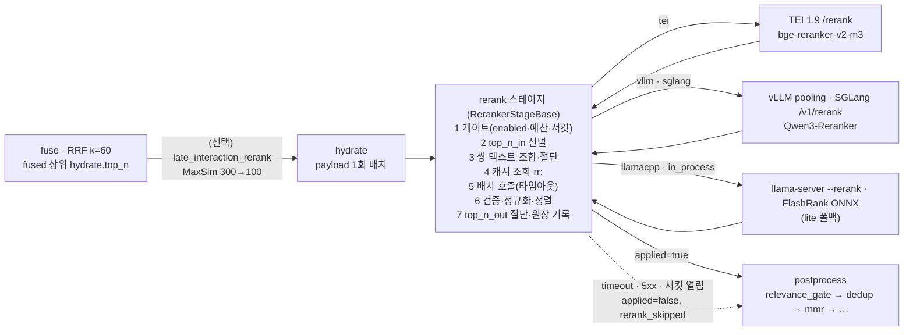
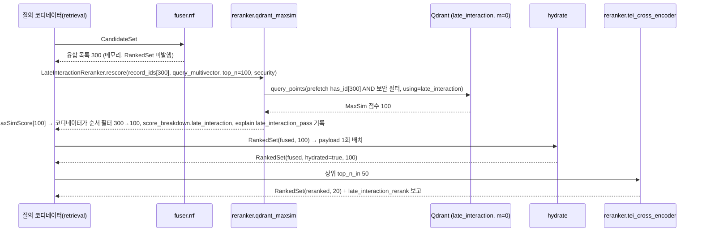

# 리랭킹

## 목적

검색 경로의 `rerank` 스테이지를 확정한다. 리랭킹(reranking)은 융합(fusion)이 만든 상위 후보를 질의와 쌍(pair)으로 다시 읽어 정밀 관련도를 매기는 단계이며, 브리프 D-07이 정한 "크로스인코더(cross-encoder) 리랭킹(top-100→20)"의 구현 세부다. 이 문서는 `reranker` 플러그인 인터페이스(포트와 SDK 베이스), 입력 텍스트 조합·절단·배치 정책, 기본 모델 `BAAI/bge-reranker-v2-m3`와 서빙 백엔드(`RerankBackend`) 구성, 대안(LLM pointwise·listwise, late interaction), 다단계 리랭킹, 점수 정규화와 융합 점수 결합, 임계값·`top_n` 정책, 지연 예산 추정, 캐시, 실패 시 폴백, 한국어 성능 근거, 평가 방법, `explain` 필드를 정한다. 계약 필드·열거 철자·기본값은 바이블 §4.3·§5.5·§5.7·§7·§8이 정본이고, 이 문서는 그 값을 그대로 쓰며 필요한 변경은 [미해결 이슈](#미해결-이슈)에 제안으로만 남긴다.

## 범위

- 포함: `rerank` 스테이지의 경계(`RankedSet(fused, hydrated=true)` → `RankedSet(reranked)`), `Reranker`·`LateInteractionReranker` 포트와 `RerankerStageBase`, 텍스트 조합(`context_prefix + "\n" + text`)·절단·배치, `RerankBackend` 여섯 값의 서빙 구성과 `RerankResponseSchema` 두 스키마 파싱, 프로파일별 모델·파라미터(바이블 §7.1·§7.2), LLM 기반 리랭커와 late interaction 리랭킹(O-04, 위치 (b)), 다단계 구성, `ScoreNormalization`과 `final_score` 규칙, `relevance_gate`·`confidence_tier`와의 관계, 지연 예산 분배와 계산식 기반 추정, Valkey 캐시, 타임아웃·5xx·스키마 불일치 처리, 관측성·`explain`, 평가 절차와 게이트.
- 제외: 융합 알고리즘과 `hydrate`([04-pipelines/15](./15-hybrid-search-and-fusion.md)), 후처리와 패킹([04-pipelines/17](./17-post-processing-and-context-packing.md)), `RankedSet` 스키마 정의([03-contracts/10](../03-contracts/10-candidate-set-and-ranked-set.md)), `QueryPlan.rerank` 정의([03-contracts/09](../03-contracts/09-query-request-and-query-plan.md)), late interaction의 인덱스 단계 채널(위치 (a); [04-pipelines/13](./13-indexing.md)·[18](./18-advanced-retrieval-graph-raptor-agentic.md)), 시각 문서 리랭커(`Qwen3-VL-Reranker`, `visual-pages` 별도 컬렉션), 평가 하네스 내부([08-evaluation/02](../08-evaluation/02-retrieval-metrics-and-harness.md)).

## 1. 위치와 역할

| 항목 | 값(바이블 §4.3·§5.5·§8.1·§8.3) |
|------|-------------------------------|
| 입력 → 출력 | `RankedSet(stage=fused, hydrated=true)` 상위 `rerank.top_n_in` → `RankedSet(stage=reranked, hydrated=true)` 상위 `rerank.top_n_out`(`applied=true`); 폴백(`applied=false`)이면 절단 없이 `hydrate.top_n`건을 fused 순서로 넘긴다(§13.3). 경계 타입은 늘지 않는다(D-05) |
| 확장 지점·격리 | `reranker`; `standard` 이상은 외부 HTTP(TEI·vLLM·SGLang·llama.cpp) = `sidecar` 서빙, `lite` 1차는 TEI CPU(HTTP) 또는 생략(바이블 §7.1), `lite` 폴백(`reranker.flashrank`)·개발·하네스는 `in_process`; `late_interaction_rerank` 1단은 `qdrant_maxsim`(벡터 백엔드 호출, 별도 `LateInteractionReranker` 포트를 질의 코디네이터가 호출, §2.1·§7.1) |
| 실행 | 오케스트레이터 미경유, `api` 프로세스 안 `LocalContext.invoke → StageShell.invoke_inline`(01 §5.5). 저장·계보·`stage_key` 없음 |
| 지연 예산 | `standard` GPU 250ms(누적 460ms), `lite` CPU 700ms; 남은 예산 < 250 → `top_n_in` 100→50, < 120 → 생략(바이블 §8.3) |
| 캐시 | 선택, Valkey `rr:{model_id}:{hash}` 60s(바이블 §4.3·§13.4; 해시 부분 식은 §12의 바이블 patch 제안) |
| 실패 정책 | 타임아웃(300ms)·연결 실패·5xx·429 모두 fused 순서 폴백 + `rerank.applied=false` + `explain += rerank_skipped` + `rag_rerank_fallback_total`(바이블 §4.3)이며, 원인은 `RankedSet` 계약 소유 문서가 정한 값으로 구분한다(10 §1 표·§4.3 `RerankReport`·§7, `ranked-set.schema.json` `skipped_reason` description): 타임아웃 → `skipped_reason="rerank.timeout"` + `degraded{rerank, timeout}`; 연결 실패·5xx·429 → `skipped_reason="unavailable"` + `degraded{rerank, unavailable}`(바이블 §5.7 `DegradedReason.unavailable`). 응답 검증 실패·서킷 열림도 `unavailable`(10 §4.3 의미 열 확장 제안, §13.1); `rerank.schema_mismatch` 비재시도(§13) |
| 점수 원장 | `results[].rerank_raw_score`·`rerank_normalized_score`·`rerank_rank`, `score_breakdown.rerank_raw`·`rerank_normalized`·`normalization`; `final_score = rerank_normalized_score`(K3, [ADR-0030](../06-adr/0030-single-coordinate-system-and-score-ledger.md)) |
| 결정성 등급 | `model_pinned`(01 §8.1): `model_id@revision` + `image_digest` 고정, 수치 오차만 허용 |
| 관측 | 스팬 `rag.rerank`, 메트릭 `rag_rerank_latency_seconds`·`rag_rerank_fallback_total`(바이블 §6.5) |



**결정:** 리랭킹은 후보를 **재검색하지 않는다**. 입력은 `hydrate`가 채운 `text`·`context_prefix`이고, 리랭커는 이 두 필드만 읽는다(3-텍스트 규칙 K2, [ADR-0029](../06-adr/0029-three-text-rule-and-deterministic-context-prefix.md)). 리랭커는 `results`의 순서와 `rerank_*`·`final_score`·`final_rank`만 바꾸며 채널 열(`score_breakdown.dense|sparse|lexical|…`)·`fused_score`·`fused_rank`는 건드리지 않는다(ADR-0030 정적 검사 "`rerank_*` 쓰기는 `reranker`만").

## 2. `reranker` 플러그인 인터페이스

### 2.1 두 층: `Reranker` 포트와 `RerankerStageBase`

**결정:** `reranker` 플러그인은 모델 호출만 담당하는 **`Reranker` 포트**(`rerank`·`warmup`·`health`)를 구현하고, `Stage[RankedSet, RankedSet]`의 운영 로직(선별·조합·절단·배치·캐시·타임아웃·폴백·정규화·원장 기록)은 SDK 공용 베이스 `RerankerStageBase`가 하나로 구현한다([ADR-0032](../06-adr/0032-plugin-sdk-stage-protocol-and-conformance-kit.md); 임베더의 `Embedder` 포트 + `EmbedderStageBase` 분리([04-pipelines/12](./12-embedding.md) §2.1)와 같은 구조). 이유는 (1) 폴백·정규화·원장 기록이 HTTP 백엔드 4종(`tei|vllm|sglang|llamacpp`) + `in_process`에서 한 번만 구현·검증되게 하고(적합성 키트 `idempotency`·`fuser_equivalence`와 같은 방식), (2) 지시형 리랭커의 프롬프트 템플릿을 호출자가 아닌 어댑터가 소유하게 하며(ADR-0009 DR7의 프롬프트 소유권과 동일), (3) 절단 기준 토크나이저를 어댑터가 선언하고 SDK가 검증하기 위함이다(O-09, [ADR-0019](../06-adr/0019-chunk-size-tokenizer-defaults-and-recount-stage.md)). 여섯째 백엔드 `qdrant_maxsim`은 텍스트 쌍이 아니라 `record_id` 목록과 질의 토큰 벡터를 받아 `RankedSet` 발행 **전**의 메모리 목록(300건)을 재점수하므로(§7.1) `Reranker.rerank(texts)`·`RerankerStageBase`(2단계 `hydrated=true` 필수, 3단계 쌍 텍스트 조합)로는 표현할 수 없다. 이를 위해 **`LateInteractionReranker` 포트**를 따로 두고 호출 주체는 `RerankerStageBase`가 아닌 질의 코디네이터(`retrieval/rerank` 모듈)로 한다(포트명은 바이블 §12·ADR-0032에 없어 제안, 미해결 이슈 21).

```python
# src/rag_platform/sdk/reranker.py — Reranker·LateInteractionReranker 포트(제안 스케치; 정본은 ADR-0032·바이블 §12 개정). 계약 타입은 rag_platform.contracts 재사용.
from __future__ import annotations
from typing import Literal, Protocol, Sequence
from pydantic import BaseModel, Field
from rag_platform.contracts.common import SecurityContext
from rag_platform.contracts.enums import RerankBackend, RerankResponseSchema


class RerankRequest(BaseModel, frozen=True):
    """한 질의 × 이미 조합·절단된 쌍 텍스트 묶음. 순서 = 후보 순서(index)."""
    query: str                                   # §3.1 질의 텍스트(절단 완료)
    texts: Sequence[str]                         # §3.2 규칙으로 조합·§3.3 규칙으로 절단된 문서 측 텍스트
    top_n: int | None = None                     # 서버 측 절단 힌트. SDK는 None을 넘긴다(전체 점수 필요, §2.2 6단계)
    instruction: str | None = None               # 지시형 리랭커(Qwen3-Reranker)만. 템플릿 조립은 어댑터 소유(§6.1)


class RerankScore(BaseModel, frozen=True):
    """서버 원점수 하나. 정규화(ScoreNormalization)는 SDK가 한다."""
    index: int = Field(ge=0)                     # RerankRequest.texts의 위치. 응답 순서에 의존하지 않는다
    raw_score: float                             # TEI `score` / Cohere 계열 `relevance_score` / MaxSim


class Reranker(Protocol):
    """reranker 플러그인이 구현하는 포트. 프롬프트·요청 스키마·응답 파싱은 이 안에서 끝난다."""
    plugin_id: str                               # reranker.{implementation}(바이블 §6.1)
    model_id: str                                # {repo}@{revision}(models.lock)
    backend: RerankBackend                       # tei | vllm | sglang | llamacpp | in_process (qdrant_maxsim은 LateInteractionReranker)
    response_schema: RerankResponseSchema        # tei(texts/score) | cohere(documents/relevance_score)
    tokenizer_id: str                            # "hf:BAAI/bge-reranker-v2-m3" — 절단 기준(ctx.token_counters 키)
    max_input_tokens: int                        # 쌍(질의 + 문서 + 특수 토큰) 모델 상한(bge-reranker-v2-m3 8192)
    output_kind: Literal["logit", "probability"] # 정규화 적합성 검증(§9.1); 구성된 model_id로 결정되는 인스턴스 값
    supports_instruction: bool                   # instruction 수용 여부(Qwen3-Reranker True)
    max_client_batch_size: int                   # 요청 1건에 넣을 수 있는 텍스트 수(TEI 기본 32, 확인 필요 as of 2026-09)

    async def rerank(self, req: RerankRequest) -> list[RerankScore]: ...   # len == len(req.texts) (top_n=None일 때)
    async def warmup(self) -> None: ...          # 서빙 모델 식별자 ↔ model_id 대조, 토크나이저 적재
    async def health(self) -> bool: ...          # 서킷 half-open 탐침(§13.2)


class MaxSimScore(BaseModel, frozen=True):
    """late interaction 재점수 하나(§7). 정규화하지 않으며 final_score의 원천이 아니다."""
    record_id: str
    raw_score: float                             # MaxSim


class LateInteractionReranker(Protocol):
    """late_interaction_rerank 1단(§7.1). 호출 주체는 질의 코디네이터(retrieval/rerank)이며 RerankerStageBase 밖이다.
    입력이 RankedSet 발행 전 메모리 목록의 record_id이므로 Reranker.rerank(texts)로는 표현할 수 없다."""
    plugin_id: str                               # reranker.qdrant_maxsim
    model_id: str                                # 질의 토큰 인코더 {repo}@{revision}(nlpai-lab/KURE-v2@…)
    backend: RerankBackend                       # qdrant_maxsim 고정
    output_kind: Literal["maxsim"]

    async def rescore(self, record_ids: Sequence[str], query_multivector: Sequence[Sequence[float]],
                      top_n: int, security: SecurityContext) -> list[MaxSimScore]: ...   # MaxSim 내림차순, len ≤ top_n; 보안 필터는 has_id와 AND(E7·E10)
    async def warmup(self) -> None: ...          # late_interaction 공간·MultiVectorConfig(MAX_SIM) 존재 확인(supports_multivector)
    async def health(self) -> bool: ...
```

| 포트 멤버 | `RerankerStageBase`의 사용 | 규칙 |
|-----------|---------------------------|------|
| `rerank(req)` | 5단계 배치 호출. `req.texts`는 `max_client_batch_size` 단위로 나뉘어 병렬 전송되고 응답은 `index`로 재조립 | `top_n=None`이면 모든 `index`에 점수 하나씩. 누락·중복 `index`는 §13.1 "응답 불일치" |
| `tokenizer_id`, `max_input_tokens` | 3단계 절단(§3.3). `tokenizer_id`는 `ctx.token_counters`에 있어야 한다 | 프로파일 로딩에서 `rerank.max_tokens_per_text + 질의 상한 + 특수 토큰 ≤ max_input_tokens`를 검증(위반 → `profile.invalid`) |
| `output_kind` | 6단계 검증·7단계 정규화 | `logit → sigmoid \| minmax`, `probability → identity \| minmax`(6단계에서 `raw_score ∈ [0, 1]` 검사); `LateInteractionReranker`의 `maxsim`은 `final_score` 원천이 될 수 없다(§7) |
| `response_schema` | 어댑터 내부 파싱 분기. SDK는 `RankedSet.rerank.response_schema`에 복사만 | 양 필드 모두 없으면 어댑터가 `rerank.schema_mismatch`를 던진다(§13.1) |
| `warmup()`, `health()` | `api` 기동·`/readyz`; 서킷 half-open 탐침 | 서빙 모델 `model_id@revision`이 프로파일과 다르면 `/readyz=false` + `profile.invalid`(임베더의 `embed.space_mismatch`에 대응하는 리랭커 코드는 카탈로그에 없으므로 구성 오류 코드로 처리, 미해결 이슈 5) |

포트 속성(`response_schema`·`output_kind`·`tokenizer_id`·`max_input_tokens`·`supports_instruction`·`max_client_batch_size`)은 플러그인 상수가 아니라 **구성으로 결정되는 인스턴스 값**이다. 같은 `reranker.tei_cross_encoder`가 `standard`(bge-reranker-v2-m3, `logit`, `tei`)와 `premium`(Qwen3-Reranker-4B, `probability`, `cohere`)을 모두 담당하므로, 어댑터는 프로파일의 `model_id`·`backend`·`response_schema`로 모델 레지스트리 메타(`models.lock`의 `output_kind`·`tokenizer_id`·`max_input_tokens`·`supports_instruction`; D-02 `models.lock` 필드의 확장 제안, 미해결 이슈 1)에서 값을 채우고, `capabilities()`는 **구성된 인스턴스**에서 평가한다(§2.3). 따라서 "`output_kind`와 부적합한 `normalization` 조합은 로딩에서 거부"는 프로파일 × 인스턴스 단위 규칙이며 플러그인 자체를 거부하지 않는다.

`Stage` 5멤버 대응: `plugin_id`·`config_schema`는 플러그인이, `capabilities()`는 §2.3 필드로 플러그인이, `fingerprint()`는 SDK 일반식 `H("producer", plugin_id, plugin_version, config_hash, image_digest or "", ",".join(model_ids))`을 `RerankerStageBase`가 계산한다(바이블 §4.1·§6.2). `config_hash`에는 절단 정책(§3.3 파라미터), 지시문 템플릿(§6.1), `normalization`, `max_tokens_per_text`, `request_batch_size`가 들어가고 서빙 URL은 들어가지 않는다(배포 세부). 인프로세스 경로는 `image_digest = null`이므로 ONNX 산출물 해시·런타임 버전을 `config_hash`에 넣는다(12 §2.1과 동일 규칙).

### 2.2 `RerankerStageBase.run` 순서

| # | 단계 | 규칙 | 실패·기록 |
|---|------|------|-----------|
| 1 | 게이트 | `ctx.plan.rerank.enabled=false` → 호출 없이 `stage=reranked, applied=false`; `skipped_reason`은 `fast` 변형이면 `skipped_by_policy`, 플래너 사전 저하면 `latency_budget`(09 §7.3); `ctx.remaining_ms()` 또는 `latency_budget_ms.rerank` < 120 → `latency_budget`; 서킷 열림(§13.2) → `unavailable`(10 §4.3 값; 서킷에의 적용은 의미 열 확장 제안, §13.1). 모든 경우 `results`는 fused 순서·`final_score = minmax(fused_score)`(10 §5.3) 유지·절단 없음(§13.3), 전 항목 `explain += rerank_skipped`. **`degraded` 소유**: 플래너 사전 저하는 플래너가 이미 `{rerank, latency_budget}`을 기록했으므로(09 P-12) 스테이지는 같은 `component`가 있으면 추가하지 않고, `skipped_by_policy`(`fast`)는 정책 선택이라 `degraded`에 기록하지 않으며(`skipped_reason`·`explain`만), 실행 시 예산 부족·서킷은 스테이지가 `degraded += {rerank, latency_budget \| unavailable}`을 기록한다(§13.1과 동일 규칙) | 폴백 경로(§13) |
| 2 | 선별 | `hydrated=true` 상위 `top_n_in`(≤ `results.length` ≤ 100). 남은 예산 < 250ms면 `top_n_in = min(top_n_in, 50)`(바이블 §8.3) | `hydrated=false` 입력은 `contract.violation` |
| 3 | 조합·절단 | 후보마다 §3.2 규칙으로 `pair_text` 조합 → §3.3 규칙으로 `max_tokens_per_text` 절단(리랭커 토크나이저) → 질의 절단(§3.1) | 절단 수는 스팬 속성 `rag.rerank.truncated_count`(제안) |
| 4 | 캐시 | 후보별 키 `rr:{model_id}:{H("rerank", config_hash, query_text, chunk_id)}`를 모아 MGET 1회로 조회(§12). 적중은 호출 제외 | 캐시 장애는 미스로 취급(정확성 무관) |
| 5 | 호출 | 미스 후보를 `max_client_batch_size`·`request_batch_size` 단위로 나눠 `asyncio.gather`; 전체에 `asyncio.timeout(min(timeout_ms, 남은 예산))` 하나 | 전체 폴백(all-or-nothing): `asyncio.timeout` 초과 → `skipped_reason="rerank.timeout"`·`degraded{rerank, timeout}`; 연결 실패·5xx·429 → `skipped_reason="unavailable"`·`degraded{rerank, unavailable}`(10 §4.3·§7, §13.1) |
| 6 | 검증 | 반환 `index` 집합 = 요청 집합(누락·중복·범위 밖 없음), `raw_score` 유한값, `output_kind=probability`면 `raw_score ∈ [0, 1]`(허용 오차 1e-6 이내는 클램프) — 셸의 RS 검사(`final_score` 0..1)에 닿기 전에 SDK가 걸러낸다 | 위반 → 전체 폴백 `skipped_reason="unavailable"`·`degraded{rerank, unavailable}`(10 §4.3 `unavailable`의 의미를 응답 검증 실패로 확장하는 제안, §13.1) + 오류 로그(구조 자체가 두 스키마 어느 쪽도 아니면 어댑터가 이미 `rerank.schema_mismatch`) |
| 7 | 정규화 | `normalization`(기본 `sigmoid`)으로 `rerank_normalized_score ∈ [0, 1]`(§9.1); `output_kind`와 부적합한 조합은 로딩에서 이미 거부 | — |
| 8 | 정렬 | `(-rerank_raw_score, fused_rank, record_id)` — 동점은 융합 순위, 다시 `record_id` 오름차순 → `rerank_rank` 1..n. 리랭크 타이브레이크는 10 문서·바이블(§8.1 8단계는 fused 정렬 `(-fused_score, record_id)`만)에 없어 이 문서의 **제안**이다(10 §7·RS-3 patch, 미해결 이슈 19) | — |
| 9 | 절단 | `applied=true`면 상위 `top_n_out`만 `results`에 남긴다; `applied=false`(폴백)면 절단하지 않는다(§13.3). 순위 절단은 `omitted`에 기록하지 않는다(10 RS-11의 `OmitReason` 부분집합에 순위 컷이 없음) | — |
| 10 | 원장·보고 | 각 결과에 `rerank_raw_score`·`rerank_normalized_score`·`rerank_rank`, `final_score = rerank_normalized_score`, `final_rank = rerank_rank`, `score_breakdown.rerank_raw`·`rerank_normalized`·`normalization`; `RankedSet.rerank{applied: true, plugin_id, model_id, backend, response_schema, normalization, top_n_in, top_n_out, took_ms}`; `stats.n_in = hydrated_n`(10 `RankedSetStats`: `reranked` 단계의 `n_in`은 `hydrate`가 채운 수; 리랭커에 실제 투입된 수는 `rerank.top_n_in`이 담는다 — 실행 시 저하 100→50이면 둘이 다르다), `n_out = results.length`; `producer = reranker.*` 지문; 캐시 기록; `rag_rerank_latency_seconds{outcome=applied}` | 10 RS-3·RS-6·RS-7 불변식은 셸이 출력 직후 검사 |

### 2.3 `Capabilities.extra` — 리랭커 인스턴스 능력(제안)

바이블 §5.3 `Capabilities`의 `extra`는 확장 지점 전용 필드를 담는다(`IndexBackendCapabilities`가 선례). 리랭커는 **구성된 인스턴스**(`model_id`·`backend`로 결정, §2.1)에서 다음을 선언하고 프로파일 검증기(바이블 §7.4 (2))가 `QueryPlan.rerank`와 대조한다. 정본 확정은 [03-contracts/15](../03-contracts/15-collection-profile-and-policy-contracts.md)(15 미해결 이슈 5 `RerankerCapabilities`; 이 문서 미해결 이슈 1).

| 필드 | 타입 | 필수 | 의미 |
|------|------|------|------|
| `response_schema` | enum(RerankResponseSchema) | Y | 매트릭스 "Reranker(`response_schema: tei \| cohere`)" 능력 선언 |
| `output_kind` | enum[logit, probability, maxsim] | Y | 허용 `normalization` 집합의 근거 |
| `supports_instruction` | boolean | Y | `rerank.instruction`이 있는데 `false`면 `profile.invalid` |
| `max_input_tokens`, `tokenizer_id` | integer / string | Y | 절단 상한·기준 |
| `max_client_batch_size` | integer | Y | 요청 분할 단위 |
| `model_ids`, `requires_gpu` | array<string> / boolean | Y | 공통 필드(바이블 §5.3) 재사용; `lite`에서 `requires_gpu=true` 플러그인은 거부 |
| `determinism` | `model_pinned` 고정 | Y | 01 §8.1 |

### 2.4 인프로세스·HTTP 어댑터 목록(바이블 §12 모듈 맵)

| `plugin_id` | 모듈 | `backend` | `response_schema` | 용도 |
|-------------|------|-----------|-------------------|------|
| `reranker.tei_cross_encoder` | `adapters/rerank/tei_cross_encoder.py`(tei·cohere 파서) | `tei`, `vllm`, `sglang`, `llamacpp` | `tei` 또는 `cohere` | HTTP 크로스인코더·LLM pointwise 공용 어댑터. 요청 필드(`texts`/`documents`)와 응답 필드(`score`/`relevance_score`)를 `response_schema`로 분기 |
| `reranker.qdrant_maxsim` | `adapters/rerank/qdrant_maxsim.py` | `qdrant_maxsim` | — (`LateInteractionReranker` 포트, `RerankResponseSchema` 없음) | `late_interaction_rerank` 1단(§7). `RerankerStageBase` 경로가 아니라 질의 코디네이터가 `rescore()`로 호출 |
| `reranker.flashrank` | `adapters/rerank/flashrank.py` | `in_process` | `tei`(명목값) | `lite` 폴백·개발·하네스(onnxruntime, torch 불필요) |

sentence-transformers `CrossEncoder`·FlagEmbedding `FlagReranker` 기반 인프로세스 어댑터(개발·하네스용)와 listwise LLM 어댑터는 모듈 맵에 없으므로 제안으로만 둔다(미해결 이슈 2). `in_process`에서 `response_schema`가 명목값인 문제와, `qdrant_maxsim`이 `RankedSet.rerank.response_schema`(필수)에 들어갈 값이 없는 문제(1단 보고는 `late_interaction_rerank`에만 남고 `rerank` 보고는 2단 크로스인코더 값이므로 실제 충돌은 없다)는 미해결 이슈 3.

## 3. 입력 텍스트 조합과 절단 정책

### 3.1 질의 텍스트

**결정:** 리랭커에 넘기는 질의는 `QueryPlan.normalized_query`(형태소 분석기 교정 결과; 공백기 mecab-ko는 원 질의와 동일)다. `dense_query_text`(HyDE 가상 문서)·`rewritten_queries[]` 변형은 리랭커에 쓰지 않는다 — 변형은 재현율(recall)을 넓히는 검색 측 장치이고, 리랭커는 사용자가 실제로 물은 문장과 후보의 관련도를 판정해야 한다(07 문서 §리스크 및 완화 "multi-query off-topic 오염 → 변형 질의 가중 0.5, 리랭커가 최종 판정"). 대화 재작성(`conversation`)이 있으면 `normalized_query`는 이미 재작성된 독립 질의다(09 §7 4단계). 질의는 리랭커 토크나이저로 `max_query_tokens`(초안 128; 제안 필드, 미해결 이슈 4)까지 앞부분을 유지해 절단하며 `QueryRequest.query` 상한 4,000자와 무관하게 쌍 상한을 지킨다.

### 3.2 쌍 텍스트 조합 규칙(3-텍스트 규칙)

**결정:** 문서 측 텍스트는 `pair_text = context_prefix + "\n" + text`다(바이블 §8.1 10단계). `context_prefix`는 결정적 접두어(문서 제목 › heading 경로 › 캡션; D-19, ADR-0029)이고 `text`는 표시 원문이다. 두 필드는 `hydrate`가 `IndexRecord` payload에서 그대로 채운 값이며(10 §6) 리랭커만 둘을 결합해 읽는다. 조합 규칙:

| 규칙 | 내용 | 이유 |
|------|------|------|
| 접두어 우선 | 접두어가 먼저, 줄바꿈 하나, 본문 | 크로스인코더는 앞부분 문맥에 민감하고 접두어가 조항·절 번호(법령·규정)를 담는다 |
| 빈 접두어 | `context_prefix == ""`면 `pair_text = text`(줄바꿈 없음) | 토큰 낭비 방지 |
| 표 청크 | `item_kind ∈ {table, table_part}`는 `text`(표 텍스트화 결과)를 그대로 쓰고 `table_ref`·`html_ref`는 읽지 않는다 | 리랭커는 HTML을 이해하지 않으며 `hydrate`가 준 텍스트가 이미 행 단위 직렬화다 |
| 부모 항목 없음 | `rerank` 입력에 `item_kind=parent`는 없다(부모는 후처리 `parent_expand`가 만든다) | 바이블 §5.7 `ItemKind` |
| 정규화 형식 | `pair_text`는 NFC 그대로(표시 텍스트 규약, 바이블 §6.3). NFKC 렉시컬 뷰(`lexical_text`)는 쓰지 않는다 | 모델 학습 분포와 일치 |
| 생성 접두어 | `Chunk.context_prefix.generated`(LLM, O-05)는 `IndexRecord.context_prefix`에 이미 병합되어 있으면 그대로 따른다. 리랭크 단계에서 별도 결합하지 않는다 | 색인 텍스트와 리랭크 텍스트의 접두어 정의를 하나로 |

### 3.3 절단 알고리즘

절단 기준은 **리랭커 토크나이저**(`Reranker.tokenizer_id`)다. cl100k·o200k와 XLM-R 토큰 수 차이가 한국어에서 크므로 다른 카운터를 대용하지 않는다(07 §개방 결정 O-09; ADR-0019 "리랭커 절단은 리랭커 토크나이저"). `max_tokens_per_text`(standard 512, premium 1024)는 문서 측(`pair_text`) 상한이고, 질의와 특수 토큰은 별도다.

| # | 규칙 | 파라미터(초안 목표) |
|---|------|--------------------|
| 1 | `pair_text` 토큰 수 ≤ `max_tokens_per_text`면 그대로 | — |
| 2 | 초과 시 접두어 예산: 접두어 토큰 ≤ `max_tokens_per_text × prefix_max_ratio`면 접두어 전체 유지, 초과면 접두어를 **왼쪽부터** 줄인다(문서 제목·상위 heading이 먼저 사라지고 가장 깊은 heading·캡션이 남는다) | `prefix_max_ratio` 0.25 |
| 3 | 본문 예산 = `max_tokens_per_text − 접두어 토큰 − 1(줄바꿈)`. 본문은 **앞부분 유지(head)** 절단 | 청크 앞부분에 주제 문장이 놓이는 구조 청킹(D-19) 전제 |
| 4 | 문장 경계 스냅: 절단 지점 직전의 `sentence_spans` 끝으로 물러나되, 손실이 본문 예산의 `truncation_snap_ratio` 이하일 때만 | `truncation_snap_ratio` 0.15 |
| 5 | 오프셋 사상: HF fast tokenizer `offset_mapping`으로 토큰 경계를 `text` 코드포인트로 변환한다(`sentence_spans`는 `text` 기준 코드포인트, 바이블 §6.3). 결합 문자·서로게이트 중간을 자르지 않는다 | — |
| 6 | 서버 안전장치: 서버에도 절단을 켠다(TEI `truncate: true`, `truncation_direction: Right`; 확인 필요 as of 2026-09) — SDK 절단이 정본이며 서버 절단은 토크나이저 버전 차이에 대한 보험 | — |
| 7 | 기록: 절단된 후보 수를 스팬 속성에, `RankedSet`에는 기록하지 않는다(`RerankReport`에 필드가 없음; `truncated_count` N 제안, 미해결 이슈 4) | — |

`max_tokens_per_text`를 넘는 청크는 드물어야 한다: 자식 청크 상한은 임베딩 토크나이저 512(`hf:BAAI/bge-m3`)이고 bge-reranker-v2-m3는 같은 XLM-R 어휘를 쓰므로 토큰 수가 거의 같다(모델 카드 기준; 정확한 동일성은 확인 필요 as of 2026-09). 접두어(수십 토큰)를 더하면 512를 조금 넘는 청크가 생기고, 그때 규칙 2~4가 적용된다. `premium`은 1024로 여유를 둔다.

### 3.4 배치 규칙

| 항목 | 규칙 | 초안 값 |
|------|------|---------|
| 요청 분할 | 미스 후보를 `min(max_client_batch_size, request_batch_size)` 개씩 나눠 병렬 전송(`asyncio.gather`). TEI 기본 `--max-client-batch-size`는 32라서(확인 필요) 100건은 4요청이 된다. 서버를 `--max-client-batch-size ≥ top_n_in`으로 띄우면 1요청 | `request_batch_size` 32 |
| 서버 배치 토큰 | TEI `--max-batch-tokens`는 `top_n_in × (max_query_tokens + max_tokens_per_text + 특수 토큰)` 이상으로 둔다(standard: 100 × 약 650 ≈ 65,000; 기본 16,384는 부족, 확인 필요) | 65,536 |
| 동시성 | 스테이지당 동시 요청 ≤ `request_batch_size`로 나눈 수; 프로세스 전체 서킷은 백엔드 단위 | — |
| 정렬 | 텍스트를 길이 내림차순으로 정렬해 같은 요청에 비슷한 길이를 모은다(패딩 낭비 최소화; TEI는 패딩 없이 처리하므로 효과가 작다). 응답은 `index`로 원위치 | — |
| 부분 성공 금지 | 한 요청이라도 실패하면 전체 폴백(§13.1). 절반만 리랭크된 결과는 척도가 섞여 원장이 깨진다 | — |
| top_n 전달 | `top_n=None`(전체 점수). 서버 측 `top_n`은 정렬만 줄이므로 계산량 이득이 없고 `minmax`·캐시에 전체 점수가 필요하다 | — |

## 4. 기본 크로스인코더와 선정

### 4.1 선정 매트릭스 요약

07 문서 §권고안 점수표(한국어 20·라이선스 20·성숙도 15·품질 20·통합 10·커뮤니티 10·비용 5)를 옮긴다. 수치는 07 문서의 판정이며 골든셋 실측이 아니다.

| 후보 | 총점 | 라이선스(등급) | 서빙 | 판정 |
|------|-----:|----------------|------|------|
| `Qwen/Qwen3-Reranker-4B` | 90 | Apache-2.0(A) | vLLM·SGLang(TEI 미지원, PR #835 진행 중) | `premium` 1차(`quality`). 기본 승격은 골든셋 +3pt & p95 800ms 실측 후 ADR |
| `BAAI/bge-reranker-v2-m3` | 87 | Apache-2.0(A) | TEI·vLLM·SGLang·llama.cpp·인프로세스 | **`standard` 기본**(D-16) |
| `Qwen/Qwen3-Reranker-0.6B` | 83 | Apache-2.0(A) | vLLM·SGLang | `premium` 2차·저하 경로 |
| `dragonkue/bge-reranker-v2-m3-ko` | 82 | Apache-2.0(A) | v2-m3와 동일 | `korean-gov` A/B; 게이트 +2pt 시 `standard` 모델 ID만 교체 |
| `Alibaba-NLP/gte-multilingual-reranker-base` | 81 | Apache-2.0(A) | TEI 공식 목록 | **`lite` 1차**(CPU) |
| `Dongjin-kr/ko-reranker` | 76 | MIT(A) | 인프로세스 | 참고(2023 이후 갱신 없음) |
| `BAAI/bge-reranker-v2-gemma` | 73 | Apache-2.0 카드(Gemma Terms 승계 확인 필요) | FlagLLMReranker | `experimental`, 기본 프로파일 제외(D-02) |
| `mixedbread-ai/mxbai-rerank-large-v2` | 71 | Apache-2.0 | 전용 패키지 | 한국어 수치 없음 |
| FlashRank `ms-marco-MultiBERT-L-12` | 70 | Apache-2.0 | onnxruntime 인프로세스 | `lite` 폴백 |
| `jinaai/jina-reranker-v3` | 64 | CC-BY-NC-4.0(D) | — | **제외**(D-02) |
| RankZephyr(`rank_llm`) | 64 | Apache-2.0(코드) | 7B GPU | 오프라인·`agentic` 실험만 |

**결정:** `standard`·`korean-gov` 기본 리랭커는 `BAAI/bge-reranker-v2-m3` @ TEI(GPU), `lite`는 `Alibaba-NLP/gte-multilingual-reranker-base` @ TEI CPU 또는 생략, `premium`은 `Qwen/Qwen3-Reranker-4B` @ vLLM 또는 SGLang이다(브리프 D-16, 바이블 §7.1 리랭커 행, [ADR-0010](../06-adr/0010-bge-m3-rationale-and-late-interaction-slot.md)). Qwen3-Reranker-4B가 점수표 1위이지만 TEI 미지원과 디코더 지연 미실측 때문에 기본으로 올리지 않는다(07 §권고안). `cross-encoder/mmarco-mMiniLMv2-L12-H384-v1`은 학습 데이터에 한국어가 없어 후보에서 제외한다.

### 4.2 프로파일별 구성(바이블 §7.1·§7.2 정본)

| 프로파일 | 모델 @ 서빙 | `top_n_in → top_n_out` | `max_tokens_per_text` | `timeout_ms` | `normalization` | 비고 |
|----------|-------------|------------------------|----------------------:|-------------:|-----------------|------|
| `lite` | `gte-multilingual-reranker-base` @ TEI CPU, 또는 생략 | 30→10 | 512 | 700 | `sigmoid` | 폴백 `reranker.flashrank`; llama.cpp `--rerank` + bge-v2-m3 GGUF는 검토 |
| `standard` | `bge-reranker-v2-m3` @ TEI GPU | 100→20 | 512 | 300 | `sigmoid` | `gate{candidate: dragonkue/bge-reranker-v2-m3-ko, min_delta_pt: 2}`(바이블 §5.6 `GateSpec` 형식과 확인 결과 일치, CR-37) |
| `premium` | `Qwen3-Reranker-4B` @ vLLM/SGLang; 선택 KURE-v2 MaxSim 1단 | (300→100 MaxSim 옵션) → 50→20 | 1024 | 600 | `identity`(확인 필요) 또는 `sigmoid` | `instruction` 사용; `quality` 변형 총 예산 2,500ms |
| `korean-gov` | `standard`와 동일 + dragonkue ko A/B | 100→20 | 512 | 300 | `sigmoid` | 가중치·LICENSE 자체 미러링, `NO_CONTENT` |

프로파일 YAML(`standard`, 바이블 §7.3 그대로):

```yaml
query:
  hydrate: {top_n: 100, backend: index_backend.qdrant, with_vectors: false}   # top_n ≥ max(rerank.top_n_in, pack.k_max) (바이블 §7.4 (11))
  rerank: {plugin: reranker.tei_cross_encoder, model_id: BAAI/bge-reranker-v2-m3, response_schema: tei, backend: tei,
           top_n_in: 100, top_n_out: 20, max_tokens_per_text: 512, timeout_ms: 300, normalization: sigmoid,
           gate: {candidate: dragonkue/bge-reranker-v2-m3-ko, min_delta_pt: 2}}
  latency_budget_ms: {total: 800, plan: 60, retrieve: 120, rerank: 250, postprocess: 60, pack: 40}
```

`premium` 오버라이드(초안; 값은 바이블 §7.2, 키 배치는 이 문서 제안):

```yaml
query:
  late_interaction_rerank: {enabled: false, model_id: nlpai-lab/KURE-v2, top_n_in: 300, top_n_out: 100}   # M2 실험 슬롯, 기본 끔(ADR-0010)
  rerank: {plugin: reranker.tei_cross_encoder, model_id: Qwen/Qwen3-Reranker-4B, backend: vllm, response_schema: cohere,
           top_n_in: 50, top_n_out: 20, max_tokens_per_text: 1024, timeout_ms: 600, normalization: identity,
           instruction: "주어진 한국어 질의에 답하는 문서 구절인지 판정한다."}
```

### 4.3 한국어 성능 근거(기술 지형 인용)

| 근거 | 출처 | 해석 |
|------|------|------|
| `bge-reranker-v2-m3`는 bge-m3(XLM-R) 기반 다국어 모델로 한국어를 포함; 임베더 bge-m3는 MIRACL-ko nDCG@10 72.2(all-mode) | 07 §3.1, 05 후보 표 | 리랭커 자체의 한국어 단독 수치는 카드에 없다. 같은 어휘·같은 계열이라 임베딩 결과와의 정합성이 좋다 |
| `dragonkue/bge-reranker-v2-m3-ko`: 한국어 금융 벤치마크 F1@1 0.9123 vs base 0.8772 | 07 §3.1 한국어 특화 표 | 단일 도메인 수치. 범용 한국어 우위는 골든셋 게이트(+2pt)로 확인. 서빙 경로가 동일해 모델 ID만 교체하는 저비용 승격 |
| Qwen3-Reranker 0.6B/4B/8B: MMTEB-R 66.36/72.74/72.94 vs bge-v2-m3 58.36 | 07 §3.2 카드 표 | 다국어 집계치이며 한국어 단독 수치 없음 → 골든셋 검증 후 승격(+3pt & p95) |
| `gte-multilingual-reranker-base`: 70+ 언어, MTEB-R 59.51·MLDR 66.33으로 bge-v2-m3 상회 | 07 §3.1 | 한국어 단독 수치 미공개, `lite` CPU 1차 후보로만 |
| `mmarco-mMiniLMv2`는 mMARCO 14개 언어에 한국어 미포함 | 07 §3.1 | 후보 제외 |
| KURE-v2(late interaction): MTEB(kor,v2) 9태스크 nDCG@10 0.8160(카드 자체 보고), BGE-M3 colbert MIRACL-ko multi-vec 71.2 | 05 §Late interaction, 후보 표 | 1차 검색·재점수 후보의 한국어 근거. 신규(2026-08) 모델이라 12개월 관찰 + 골든셋 재현 후 승격(매트릭스 리스크 9) |
| 범용 한국어 리랭커 공개 비교표 부재 | 07 미해결 이슈 8, 매트릭스 리스크 1 | 사전 스크리닝은 `instructkr/reranker-simple-benchmark`·AutoRAG, 확정은 D-12 골든셋(HWPX·PDF·HTML 4종 + MIRACL-ko·Ko-StrategyQA·AutoRAGRetrieval·Allganize KO) |

한국어 고유 주의점: (1) 형태소 교정된 `normalized_query`를 쓰되 교정이 의미를 바꾸는 사례는 Kiwi `typos='basic'` 설정에서 드물다고 가정하며(공백기 mecab-ko는 교정 없음) 골든셋에서 `original_query` 대비 A/B로 확인한다(미해결 이슈 6). (2) 한국어는 XLM-R 토큰 팽창이 커서 512 토큰이 담는 글자 수가 영어보다 적다 — 절단률을 `rag.rerank.truncated_count`로 관측해 `max_tokens_per_text` 게이트(그리드 {384, 512, 768}) 실험의 입력으로 삼는다. (3) 법령·규정 장르(`genre=law_article`)는 조항 번호가 접두어에 있어 규칙 §3.3-2(접두어 보존)가 품질에 직접 영향을 준다.

## 5. 서빙(`RerankBackend`)과 응답 스키마

### 5.1 백엔드 매핑

`RerankBackend`(바이블 §5.7) 여섯 값은 서빙 경로를 뜻하고, `RerankResponseSchema` 두 값은 요청·응답 필드명을 뜻한다. 서빙 선택은 [ADR-0009](../06-adr/0009-embedding-serving-vllm-pooling-tei-inprocess.md)(TEI = dense 전용 모델·리랭커 1차, vLLM pooling = BGE-M3 3-in-1, Infinity 제외)를 따른다.

| `backend` | 서버 | 엔드포인트·요청 | 응답 → `response_schema` | 지원 모델(07 §3.5) | 비고 |
|-----------|------|-----------------|--------------------------|--------------------|------|
| `tei` | TEI 1.9.x(`ghcr.io/huggingface/text-embeddings-inference:{cpu,turing,86,89,hopper,…}-1.9`) | `POST /rerank {query, texts[], raw_scores: true, return_text: false, truncate: true, truncation_direction: "Right"}` | `[{index, score}]` → `tei` | bge-reranker-v2-m3(+dragonkue ko), gte-multilingual-reranker-base(XLM-R·GTE 시퀀스 분류) | Qwen3-Reranker 미지원(PR #835); CUDA CC < 7.5 미지원. `raw_scores` 의미(로짓 반환) 확인 필요(as of 2026-09) |
| `vllm` | vLLM 0.29 `--runner pooling` | `POST /v1/rerank {model, query, documents[]}`(Cohere·Jina 호환) | `{results: [{index, relevance_score}]}` → `cohere` | bge-reranker-v2-m3, Qwen3-Reranker(`hf_overrides` 레시피) | LLM 서빙과 동일 운영 스택. `/score`·`/rerank`·`/v2/rerank`도 있음 |
| `sglang` | SGLang `--is-embedding` | `POST /v1/rerank` | `cohere` | bge-reranker-v2-m3, Qwen3-Reranker(yes/no logprob), Qwen3-VL-Reranker | GPU 전제 |
| `llamacpp` | `llama-server -m *.gguf --rerank` | `POST /v1/rerank` | `cohere` | bge-reranker-v2-m3 GGUF **한정** | Qwen3 계열 결과 오류 이슈 #16407(as of 2026-09) → 비권고. `lite` CPU 대안(Q8 약 700MB 추정, 실측 필요) |
| `in_process` | 없음(라이브러리) | `reranker.flashrank`(onnxruntime), 제안: sentence-transformers `CrossEncoder`/FlagEmbedding `FlagReranker(normalize=False)` | 명목값 `tei` | FlashRank MultiBERT-L-12; 개발·하네스용 전 모델 | `api` 프로세스 GIL·메모리를 점유하므로 `lite` 폴백·개발·하네스에서만(D-16 "인프로세스(개발·lite)", 바이블 §4.3) |
| `qdrant_maxsim` | Qdrant 1.19(벡터 백엔드 재사용) | Query API: `prefetch{filter: has_id(point_ids) AND 보안 필터}` → `query: 질의 토큰 벡터, using: late_interaction`(MaxSim) | 해당 없음(`LateInteractionReranker.rescore` → `MaxSimScore`, §2.1); 점수 = MaxSim | KURE-v2(128d), BGE-M3 colbert(비교 기준만) | `late_interaction_rerank`(§7) 전용, `RerankerStageBase` 경로 아님. `supports_multivector=false` 백엔드는 자동 비활성(ADR-0010) |

**결정:** 어댑터 하나(`reranker.tei_cross_encoder`)가 `tei|vllm|sglang|llamacpp`를 덮는다. vLLM·SGLang·llama.cpp 세 서버의 `/v1/rerank`는 Cohere 호환(`documents`/`relevance_score`)이고 TEI는 `/rerank` 고유 스키마(`texts`/`score`)라(07 §3.5; Infinity는 ADR-0009로 제외) 어댑터 하나가 요청·응답 필드 차이만 분기하면 된다. 어댑터는 두 필드를 **모두** 파싱하고 `response_schema`는 우선 분기 힌트다(둘 다 없을 때만 `rerank.schema_mismatch`).

### 5.2 TEI 구성(`standard`·`korean-gov`·`lite`)

| 항목 | `standard`(GPU) | `lite`(CPU) | 근거 |
|------|-----------------|-------------|------|
| 이미지 태그 | GPU 세대별(`86` A10/A40, `89` L4, `hopper` H100, 접미 없음 A100) | `cpu` | 05 서빙 스택 표 |
| `--model-id` | `BAAI/bge-reranker-v2-m3` **revision 고정**(`--revision <sha>`, `models.lock`) | `Alibaba-NLP/gte-multilingual-reranker-base` | 바이블 §6.1 1.3.0 `model_id` 표기(자체 호스팅 `{repo}@{revision}`; API 모델 `{provider}:{model}`은 이 문서의 여섯 백엔드가 모두 자체 호스팅이라 해당 없음, AM-11), D-02 `models.lock` |
| 오프라인 | `HF_HUB_OFFLINE=1` + 모델 볼륨(`korean-gov` 필수: 가중치·LICENSE 자체 미러링) | 동일 | 바이블 §7.1 korean-gov |
| `--max-client-batch-size` | ≥ `top_n_in`(128 권장) | ≥ 32 | §3.4 |
| `--max-batch-tokens` | 65,536(초안) | 16,384 | §3.4 |
| `--auto-truncate` / `--dtype` | 켬 / `float16` | 켬 / 기본 | 안전장치 |
| 레플리카·스케일 | 1~2, KEDA `prometheus`(`rag_rerank_latency_seconds` p95·큐 깊이) | 1 | 12 §14 서빙 오토스케일과 동일 방식 |
| 헬스 | `GET /health`; 플랫폼 `warmup()`이 `/info`의 `model_id`를 프로파일과 대조 | 동일 | §2.1 |

### 5.3 vLLM·SGLang 구성(`premium`)

Qwen3-Reranker는 디코더가 "yes"/"no" 다음 토큰 로짓으로 관련도를 내는 pointwise 모델이다(07 §3.2). vLLM 레시피: `vllm serve Qwen/Qwen3-Reranker-4B --runner pooling --hf_overrides '{"architectures": ["Qwen3ForSequenceClassification"], "classifier_from_token": ["no", "yes"], "is_original_qwen3_reranker": true}'` 후 `/v1/rerank`. 어댑터는 모델 카드의 프롬프트 템플릿(접두 시스템 지시 + `<Instruct>: {instruction}\n<Query>: {query}\n<Document>: {document}` + 접미)을 **정확히** 재현해야 하며(07 §3.2 함정 (2)), 템플릿 문자열은 `config_hash`에 들어간다. 반환값이 yes 확률(0..1)이면 `output_kind=probability`·`normalization=identity`, 로짓이면 `logit`·`sigmoid`다 — vLLM 레시피의 출력 형태는 확인 필요(as of 2026-09). fp16 4B는 VRAM 약 8~10GB(추정), A10/L4 1장(07 §리소스 요구). SGLang은 공식 Rerank 문서의 Qwen3-Reranker 레시피(yes/no logprob)를 쓰고 같은 어댑터·`cohere` 스키마로 파싱한다.

### 5.4 요청·응답 예시

TEI 요청(`response_schema=tei`; 텍스트는 §3.2 규칙으로 조합된 `pair_text`):

```json
{
  "query": "문서 접수 시 접수등록번호를 어떻게 표시하는가",
  "texts": [
    "행정 효율과 협업 촉진에 관한 규정 › 제3장 문서의 접수·처리 › 제18조(문서의 접수·처리)\n문서는 처리과에서 접수하여야 하며, 접수한 문서에는 접수일시와 접수등록번호를 전자적으로 표시하여야 한다. 처리과는 접수한 문서를 지체 없이 처리담당자에게 배부한다.",
    "행정 효율과 협업 촉진에 관한 규정 › 제2장 문서의 작성 › 제7조(문서 작성의 일반원칙)\n문서는 어문규범에 맞게 한글로 작성하되, 뜻을 정확하게 전달하기 위하여 필요한 경우에는 괄호 안에 한자나 외국어를 함께 적을 수 있다."
  ],
  "raw_scores": true,
  "return_text": false,
  "truncate": true,
  "truncation_direction": "Right"
}
```

TEI 응답(점수 내림차순으로 오지만 어댑터는 `index`로 대응한다):

```json
[
  {"index": 0, "score": 3.12},
  {"index": 1, "score": -0.38}
]
```

vLLM·SGLang·llama.cpp 응답(`response_schema=cohere`; `document` 필드는 있어도 무시):

```json
{
  "id": "rerank-7f3c1b2e",
  "model": "Qwen/Qwen3-Reranker-4B",
  "results": [
    {"index": 0, "relevance_score": 0.9577},
    {"index": 1, "relevance_score": 0.4061}
  ],
  "usage": {"total_tokens": 412}
}
```

## 6. 대안 리랭커

### 6.1 LLM 기반 pointwise(Qwen3-Reranker 계열)

| 항목 | 내용 |
|------|------|
| 동작 | 디코더 1회 forward, 다음 토큰 yes/no 로짓 → 관련도. 32K 컨텍스트, 인스트럭션 주입(07 §3.2) |
| 계약 | `QueryPlan.rerank.instruction`(N) → `RerankRequest.instruction`; 어댑터가 템플릿 조립. `supports_instruction=false` 플러그인에 지시문이 오면 `profile.invalid` |
| 비용·지연 | 비임베딩 파라미터가 크로스인코더의 약 1.4배(0.6B: 약 0.44B)·약 12배(4B: 약 3.6B; 기준 bge-v2-m3 약 0.31B)여서 같은 후보 수에서 지연이 비례해 커진다(§11.2 계산, §6.3 표와 동일). `premium` 50→20, `timeout_ms` 600, `quality` 변형 총 2,500ms |
| 사용 조건 | (1) `premium`·`quality` 변형, (2) A100 급 이상 또는 `top_n_in ≤ 20`(L4에서 4B는 §11.2 계산상 600ms를 넘는다), (3) 도메인 지시문이 품질을 올리는 것이 골든셋에서 확인된 경우 |
| 기본 승격 게이트 | 한국어 골든셋 nDCG@10 +3pt 이상 **그리고** `standard` p95 800ms 이내 실측 → ADR(매트릭스 M2 게이트 목록). TEI PR #835 병합 시 통합 점수 재산정 |
| 제외 | `zerank-1-small`(영어 태그, 자체 벤치마크), `mxbai-rerank-v2`(한국어 수치 없음), `bge-reranker-v2-gemma`(Gemma Terms 승계 확인 전 `experimental`) |

### 6.2 LLM listwise(RankGPT류)

RankGPT·RankZephyr·FIRST·RankLLaMA·Rank1 계열(07 §3.3)은 후보 20개 창(sliding window, step 10)을 프롬프트에 넣어 순열을 생성한다. 영어 중심 학습·한국어 미검증이고 호출당 수 초(7B GPU, 창 수 × 생성)라 브리프 §7 p95 800ms에 맞지 않는다.

**결정:** listwise·추론형 리랭커는 v1 **온라인 경로에 두지 않는다**. 위치는 (1) 골든셋 라벨 보조(UMBRELA식 판정 후보)·증류 교사, (2) `agentic` 실험(`budget.max_latency_ms`가 요청당 가변인 경우)이다. 온라인 사용 조건은 `latency_budget_ms.total ≥ 2,500`, `top_n_in ≤ 20`, 테넌트 LLM 옵트인(`llm_enrichment_allowed`와 같은 정책 슬롯; O-05 원칙), 그리고 `rank_llm 0.25.7`(Apache-2.0) 어댑터가 `reranker.llm_listwise`(제안 plugin_id, 미해결 이슈 2)로 등록된 경우다. listwise 출력은 순열이라 `rerank_raw_score`가 없으므로 `raw_score = −rank`(순위의 음수)·`normalization = minmax`로 원장을 채운다(제안).

### 6.3 비용·지연·사용 조건 요약

| 종류 | 대표 모델 | GPU | 상대 계산량(비임베딩 파라미터 기준, bge-v2-m3 = 1) | 온라인 위치 | 조건 |
|------|-----------|-----|-----------------------------------------------:|-------------|------|
| 크로스인코더(인코더) | bge-reranker-v2-m3, dragonkue ko, gte-base | T4/A10/L4 1장 또는 CPU | 1(gte-base 약 0.3) | `standard`·`korean-gov`·`lite` 기본 | — |
| LLM pointwise | Qwen3-Reranker-0.6B / 4B | L4~A100 | 약 1.4 / 약 12 | `premium` | §6.1 |
| LLM listwise·추론형 | RankZephyr, Rank1 | 7B GPU | 창당 생성 수백 토큰(비교 불가) | 없음(오프라인·`agentic`) | §6.2 |
| late interaction 재점수 | KURE-v2 MaxSim | 없음(Qdrant 계산) | 무시 가능(< 1 GFLOP; I/O 지배) | `premium` 실험 슬롯 | §7 |

## 7. Late interaction 리랭킹(O-04, 위치 (b))

### 7.1 결정과 흐름

**결정:** late interaction(후기 상호작용, ColBERT식 MaxSim)은 기본 끔이며 별도 `late_interaction` 슬롯이다. BGE-M3 colbert(1024d)는 **리랭크 단계 비교 기준으로만** 쓰고 인덱스에 저장하지 않는다(100만 청크 약 614GB 계산; 12 §13). KURE-v2(128d, Apache-2.0)는 M2 골든셋에서 (a) 인덱스 단계 채널 `late_interaction` vs (b) 리랭크 단계 `late_interaction_rerank`를 비교한 뒤 ADR을 개정한다(바이블 §3.2 O-04, [ADR-0010](../06-adr/0010-bge-m3-rationale-and-late-interaction-slot.md); 매트릭스 J-2). 이 문서는 위치 (b)의 실행 세부를 정한다.



| 항목 | 규칙 |
|------|------|
| 위치 | `fuse` 뒤·`hydrate` 앞. 코디네이터의 메모리 상 융합 목록(300)에 적용하고 `RankedSet(fused)`는 100건으로 발행한다 — `RankedSet.results ≤ 100`(바이블 §5.1)이라 300건짜리 `RankedSet`은 만들 수 없고, MaxSim은 payload가 필요 없어 300건 `hydrate`(비용 3배)를 피할 수 있다(바이블 §8.1 11단계 "hydrate는 MaxSim 뒤 100에 적용") |
| 포트·호출 주체 | `LateInteractionReranker.rescore(record_ids, query_multivector, top_n, security)`(§2.1)를 **질의 코디네이터**(`retrieval/rerank`)가 호출한다. `RerankerStageBase`는 `RankedSet(fused, hydrated=true)`만 받으므로 이 단계에 관여하지 않으며, 1단 결과의 원장 기록(`score_breakdown.late_interaction`, `explain`, `late_interaction_rerank` 보고)도 코디네이터가 한다 |
| 질의 인코딩 | `plan` 5단계에서 `late_interaction` 공간의 `Embedder.embed_queries`(KURE-v2 질의 인코더)를 함께 호출, Valkey `qemb:{space}:{hash}` 24h 캐시(12 §10). 후보 재인코딩은 금지(매트릭스 O-04 "질의 시 후보 재인코딩 금지") |
| Qdrant 호출 | 1회: `prefetch{filter: has_id(point_id[300]), limit: 300}` → 외부 `query: 토큰 벡터, using: late_interaction, limit: 100`(`MultiVectorConfig(MAX_SIM)`, HNSW `m=0` = 재점수 전용, 12 §13 운영 규칙 (3)) |
| 점수 기록 | `score_breakdown.late_interaction = {score: MaxSim, rank, contribution: 0.0, variant_ids: [query_id]}` — 재융합이 없으므로 기여는 0이고 `Σ contribution = fused_score` 불변식이 유지된다; `channels_hit`에는 RS-7 규칙상 `late_interaction`이 포함된다(미해결 이슈 7) |
| 보고 | `RankedSet.late_interaction_rerank{applied, model_id, top_n_in: 300, top_n_out: 100, took_ms}`, 통과 항목 `explain += late_interaction_pass`. 탈락 200건은 순위 컷이라 `omitted`에 없다 |
| 크로스인코더 | `rerank.top_n_in` 50 → `top_n_out` 20(바이블 §7.2 premium) |
| 자동 비활성 | `IndexBackendCapabilities.supports_multivector=false` 또는 컬렉션에 `late_interaction` 공간 없음 → 로딩 시 비활성 + `degraded{late_interaction_rerank, capability_unsupported}`; Qdrant 오류·타임아웃 → 1단 생략(300→`hydrate.top_n` 100은 융합 순서로 절단) + `degraded{late_interaction_rerank, timeout \| unavailable}`, 크로스인코더는 정상 진행 |
| 예산 | 초안 목표 40ms(KURE-v2 카드의 PyLate 후보 생성 p95 38ms는 다른 조건이므로 규모 참고만; 실측 대체). `rerank` 예산 250ms 안에서 차감 |
| 계량 | 저장 바이트 `rag_index_bytes_total{vector="late_interaction"}`(ADR-0010) |

### 7.2 M2 비교 설계

같은 골든셋에서 (a) 4-way 융합(`channels[].channel=late_interaction`, 가중 1.0) vs (b) 위 2단 리랭크 vs (c) 기준(3-way + 크로스인코더 100→20)을 nDCG@10·Recall@20·p95·인덱스 바이트로 비교한다. (b)의 채택 조건은 "크로스인코더 GPU 병목 시 대안"(매트릭스 O-04 행) — 즉 (c) 대비 nDCG@10 −0.01 이내이면서 `rag_rerank_latency_seconds` p95가 유의하게 낮을 때다. BGE-M3 colbert는 (b)에서만 비교 기준으로 실행하며(색인 없이 vLLM `token_embed`로 후보 300건을 온라인 인코딩하는 실험 전용 경로, 프로덕션 금지) KURE-v2와의 격차를 기록한다.

## 8. 다단계 리랭킹(경량 → 정밀)

| 구성 | 1단(경량) | 2단(정밀) | 계약 표현 | 상태 |
|------|-----------|-----------|-----------|------|
| A. MaxSim → 크로스인코더 | `qdrant_maxsim` 300→100 | `bge-reranker-v2-m3` 또는 Qwen3 50→20 | `late_interaction_rerank` + `rerank`(두 보고 모두 존재) | `premium` 실험 슬롯(§7) |
| B. 크로스인코더 → LLM pointwise | bge-v2-m3 100→30 | Qwen3-Reranker-4B 30→20 | **표현 불가**: `RankedSet.rerank`는 보고 하나, `rerank_raw_score`도 한 벌 | 제안(미해결 이슈 8): `rerank.stages[]`(N) 또는 플러그인 내부 캐스케이드(원장에는 최종 모델만) |
| C. 리랭크 생략 | — | — | `rerank.applied=false, skipped_reason=skipped_by_policy` | `fast` 변형 |

**결정:** v1 계약이 표현하는 다단계는 A만이다. B는 원장 필드가 한 벌이라 1단 점수가 소실되므로 계약 확장 없이 채택하지 않는다. 캐스케이드의 일반 원칙: 1단은 재인코딩 없는 저지연 필터(순서 필터, 재융합 없음), 2단만 `final_score`를 정한다; 1단이 실패하면 2단 입력을 융합 순서로 대체하고 `degraded`에 남긴다.

## 9. 점수 정규화와 융합 점수 결합

### 9.1 정규화(`ScoreNormalization`)

| 값 | 식 | 적합한 `output_kind` | 특성 |
|----|----|----------------------|------|
| `sigmoid`(기본) | `1 / (1 + e^{-x})` | `logit` | 절대 척도. 컬렉션 간 비교는 불가하지만 같은 모델 안에서 안정적이라 `relevance_gate.tau`·`confidence_tiers`의 입력으로 적합. FlagEmbedding `normalize=True`와 동일 |
| `minmax` | `(x − min) / (max − min)`, `n = 1` 또는 전부 같으면 `1.0` | `logit`, `probability` | 배치 상대 척도. 1위가 항상 1.0이 되어 `relevance_gate`가 실패할 수 없고 `confidence_tier`가 무의미해진다 → 척도를 모르는 백엔드·listwise 순위(§6.2)에만 |
| `identity` | `x` | `probability`(0..1 검증) | Qwen3-Reranker yes 확률처럼 이미 확률인 출력. `raw_score ∉ [0, 1]`은 §2.2 6단계 검증 실패로 **전체 폴백**(`skipped_reason="unavailable"`, §13.1)이며 요청 실패가 아니다(허용 오차 1e-6 이내는 클램프). `contract.violation`은 셸의 RS-3·RS-6 출력 검사에만 남는다 |

`normalization`은 `QueryPlan.rerank.normalization`의 사본을 `RankedSet.rerank.normalization`·`score_breakdown.normalization`에 기록한다(10 §4.5). 미적용(`applied=false`) 시에도 프로파일 값을 그대로 복사한다.

### 9.2 `final_score` 규칙과 보간

**결정:** `rerank.applied=true`면 `final_score = rerank_normalized_score`, `final_rank = rerank_rank`이고 융합 점수는 순위에 반영하지 않는다(**rerank 우선**; 바이블 §5.5, 10 RS-3). `fused_score`·`fused_rank`·채널 열은 원장에 그대로 남아 `explain`이 "융합 3위 → 리랭크 1위" 같은 이동을 계산할 수 있다. 동점은 §2.2 8단계(`fused_rank`, `record_id`)로 깨므로 융합은 타이브레이크로만 개입한다.

보간(interpolation) `final = α·rerank_norm + (1−α)·minmax(fused)`은 v1 계약에 없다. `ScoreBreakdown.boosts[].kind`(`BoostKind`: `entity, recency, item_kind_penalty, user_dictionary`)에도 융합 보간 항목이 없으므로 도입하려면 열거 minor 개정이 필요하다. 이 문서는 `rerank.fusion_alpha`(N, 기본 1.0)를 제안으로만 남긴다(미해결 이슈 9). 근거: 크로스인코더 정규 점수와 RRF 점수(0.01~0.05대)는 척도가 달라 min-max 뒤에도 의미가 불안정하고, 07 문서가 인용한 근거(Bruch et al. 2023)는 검색 채널 간 결합에 관한 것이라 리랭크 보간을 정당화하지 않는다. 골든셋에서 α < 1이 nDCG@10을 유의하게 올릴 때만 ADR로 승격한다.

### 9.3 캘리브레이션(`calibration_ref`)

리랭크 점수의 절대값은 컬렉션·도메인마다 분포가 다르다(07 §3.1 함정 "점수 절대값이 컬렉션 간 비교 불가"). 바이블 §8.1 10단계는 "컬렉션 `calibration_ref`로 tier·tau 보정"을 정한다.

**결정:** 캘리브레이션은 **점수를 바꾸지 않고 임계값을 바꾼다**. `rerank_normalized_score`는 항상 모델 출력의 정규화 값이고, 컬렉션 × 모델별 캘리브레이션 레코드가 `relevance_gate.tau`·`confidence_tiers{high, medium}`의 실효값을 제공한다. 레코드의 저장 위치는 바이블 §13.1 PostgreSQL `calibrations` 표(`calibration_ref` PK, `collection_id`, `reranker_model_id`, `score_quantiles jsonb`, `computed_at`; 모든 표 공통 `tenant_id` + RLS)이고, 참조 필드는 `RankedSet.calibration_ref`(N)·`CollectionSpec.calibration_ref`(15 문서)다. `calibration_ref`는 그 행의 PK 문자열(형식 `calib:{collection_id}:{model_id}`; 이 문서 제안)이며 핫패스는 PostgreSQL을 읽지 않으므로 행은 컬렉션 캐시(`collspec:{collection_id}`, 이벤트 무효화)에 동반 적재된다([ADR-0034](../06-adr/0034-retrieval-hot-path-postgres-independence-and-hydrate.md)). 아래는 §13.1 컬럼명에 맞춘 레코드 예시이며, `score_quantiles` jsonb의 내부 스키마(관련/비관련 분위수·`tau`·`tiers`·`target_precision`·`normalization`·`dataset_id`·`run_id`)는 이 문서의 제안이다(정본은 [03-contracts/16](../03-contracts/16-eval-feedback-and-sidecar-contracts.md) 또는 15, 미해결 이슈 10):

```json
{
  "tenant_id": "01J9ZQ3M9K2P4R6T8V0X2Z4B6D",
  "calibration_ref": "calib:01J9ZQ5A1B2C3D4E5F6G7H8J9K:BAAI/bge-reranker-v2-m3@953dc6f",
  "collection_id": "01J9ZQ5A1B2C3D4E5F6G7H8J9K",
  "reranker_model_id": "BAAI/bge-reranker-v2-m3@953dc6f",
  "score_quantiles": {
    "normalization": "sigmoid",
    "relevant": {"p10": 0.61, "p50": 0.88, "p90": 0.97},
    "non_relevant": {"p50": 0.09, "p90": 0.34, "p99": 0.58},
    "tau": 0.34,
    "tiers": {"high": 0.74, "medium": 0.45},
    "target_precision": 0.9,
    "dataset_id": "01JA0RDS3T5V7X9Z1B3D5F7H9K",
    "run_id": "01JA0RRN2K4M6P8R0T2V4X6Z8B"
  },
  "computed_at": "2026-09-22T09:00:00.000Z"
}
```

산출 절차는 §16.3. 캘리브레이션이 없는 컬렉션은 프로파일 기본값(tau 0.3, tiers 0.7/0.4; 바이블 §7.2, 초안)을 쓰고, 리랭크가 생략되었는데 캘리브레이션도 없으면 `pack`이 `sufficiency.status=unknown`으로 표시한다([03-contracts/11](../03-contracts/11-context-pack.md) §sufficiency).

## 10. 임계값과 `top_n` 정책

### 10.1 저품질 컷: 절대·상대

| 종류 | 소유 | 규칙 | 상태 |
|------|------|------|------|
| 절대 임계 | 후처리 `relevance_gate`(D-07 고정 순서 1번째) | `final_score < tau`(standard 0.3, lite 0.2) 항목 제거 → `omitted{below_threshold, explain: [below_gate]}`; `max(final_score) < tau`면 `quality`는 재작성·필터 완화 1회 재검색, `default`는 `sufficiency.status=insufficient`(10 §8) | 정본 |
| 상대 임계 | 없음 | 예: `final_score < max(final_score) × ratio` 제거. 바이블에 없다. `relevance_gate.relative_ratio`(N, 기본 null) 제안 — 응답이 넓게 분포하는 질의에서 꼬리를 잘라 `pack` 토큰을 아끼는 용도 | 제안(미해결 이슈 11) |
| 신뢰도 구간 | `pack` | `confidence_tier`: `high ≥ 0.7`, `medium ≥ 0.4`, 그 외 `low`(초안, 캘리브레이션 후 갱신). LLM에는 tier만 노출 | 정본 |

**결정:** `rerank` 스테이지는 점수로 항목을 **제거하지 않는다**. 컷은 후처리가 `relevance_gate`로 수행하고(순서 고정, [ADR-0013](../06-adr/0013-fusion-rrf-k60-then-convex-combination-and-postprocess-order.md)), 리랭크는 `top_n_out` 순위 절단만 한다. 이유는 (1) 컷의 기준(`tau`)이 캘리브레이션과 함께 후처리 정책에 속하고, (2) `applied=false` 폴백 시 `final_score`가 min-max `fused`로 바뀌어 같은 임계값이 다른 의미가 되므로 컷 주체가 하나여야 하며, (3) `omitted` 기록 책임을 한 스테이지에 두기 위해서다.

### 10.2 `top_n` 불변식과 저하 순서

| 규칙 | 값(standard) | 출처 |
|------|--------------|------|
| `hydrate.top_n ≥ max(rerank.top_n_in(enabled), pack.k_max)` | 100 ≥ max(100, 20) | 바이블 §7.4 (11); 09 P-9 |
| `top_n_in ≥ top_n_out ≥ pack.k_max` | 100 ≥ 20 ≥ 20 | 09 P-9 |
| `top_n_in ≤ 100` | `RankedSet.results ≤ 100` | 바이블 §5.1 |
| `fast` 변형 | `rerank.enabled=false`, `hydrate.top_n = pack.k_max × 2` | 바이블 §5.5 `retrieval_variant` |
| 플랜 시 사전 저하(`budget.max_latency_ms < total`) | multi-query 끔 → `top_n_in`·`hydrate.top_n` 100→50 → 리랭크 끔 → 채널 축소 | 바이블 §8.1 6단계; 09 §7.3 |
| 실행 시 저하 | 남은 예산 < 250ms → `top_n_in` 50; < 120ms → 생략(`latency_budget`) | 바이블 §8.3 |
| late interaction 옵션 | 300 → 100 → 50 → 20 | 바이블 §7.2 premium |

`top_n_out = pack.k_max = 20`은 후처리(`dedup`·`relevance_gate`)가 항목을 제거하면 `pack`에 20개 미만이 도달함을 뜻한다. 이는 바이블 값이며 이 문서는 바꾸지 않되, `top_n_out` 30(여유 1.5배)을 게이트 실험으로 제안한다(미해결 이슈 12). 절단된 80건의 점수는 캐시에만 남는다.

## 11. 지연 예산과 추정

### 11.1 예산(바이블 §8.3)

| 프로파일 | `rerank` 예산 | 누적 | `timeout_ms` | 초과 위험 시 |
|----------|-------------:|-----:|-------------:|--------------|
| `standard` GPU | 250ms | 460ms / 800 | 300 | `top_n_in` 100→50, < 120 → 생략 |
| `lite` CPU | 700ms(top-30) | 1,500 총 | 700 | 생략(`applied=false`) |
| `premium quality` | 2,500 총 안에서 600 | — | 600 | `Qwen3-Reranker-0.6B`로 강등(제안), `top_n_in` 50→20 |

### 11.2 계산식 기반 추정(초안 계산값, 실측 대체)

리랭커 지연은 총 입력 토큰에 비례한다. 크로스인코더는 쌍마다 전체 시퀀스를 읽으므로 `Σ tokens = top_n_in × (q + L)`(q = 질의 토큰, L = 문서 측 토큰)이고, `t ≈ 2 × P_nonembed × Σ tokens / (peak FLOPS × MFU)`로 추정한다. 어휘 임베딩 파라미터는 계산량에 들지 않으므로 비임베딩 파라미터 `P_nonembed`를 쓴다. 가정: bge-reranker-v2-m3 총 568M 중 비임베딩 약 0.31B(XLM-R large 24층; 05 §리소스 표의 총 파라미터에서 250k 어휘 임베딩 제외한 추정) → 0.62 GFLOP/토큰; gte-multilingual-reranker-base 총 306M 중 비임베딩 약 85M(12층 768d 추정) → 0.17 GFLOP/토큰; Qwen3-Reranker-0.6B 약 0.44B → 0.88, 4B 약 3.6B → 7.2 GFLOP/토큰; 실효 처리량 L4/A10 fp16 60 TFLOPS(12 §14 NFR 가정과 동일), A100 150, H100 400; CPU int8 ONNX 4 vCPU 0.8 TFLOPS, 8 vCPU 1.6 TFLOPS(가정). q = 32(지시형은 템플릿 포함 96), L은 최악 512(절단 상한)와 전형 320(평균 300토큰 청크 + 접두어).

| 구성 | Σ tokens | FLOP | L4/A10 | A100 | H100 | 예산 판정 |
|------|---------:|-----:|-------:|-----:|-----:|-----------|
| standard bge-v2-m3 100 × (32+512) | 54,400 | 33.7 T | 562ms | 225ms | 84ms | L4 초과(250), A100 근접, H100 충족 |
| standard bge-v2-m3 100 × (32+320) | 35,200 | 21.8 T | 364ms | 145ms | 55ms | L4 초과, A100·H100 충족 |
| 저하 bge-v2-m3 50 × (32+512) | 27,200 | 16.9 T | 281ms | 112ms | 42ms | L4 근접 |
| 저하 bge-v2-m3 50 × (32+320) | 17,600 | 10.9 T | 182ms | 73ms | 27ms | 충족 |
| premium Qwen3-0.6B 50 × (96+320) | 20,800 | 18.3 T | 305ms | 122ms | 46ms | 600 충족 |
| premium Qwen3-4B 50 × (96+320) | 20,800 | 150 T | 2,496ms | 998ms | 374ms | **L4·A100 초과(600)**, H100 충족 |
| premium Qwen3-4B 50 × (96+1024) | 56,000 | 403 T | 6,720ms | 2,688ms | 1,008ms | 전부 초과 |
| premium Qwen3-4B 20 × (96+320) | 8,320 | 60 T | 998ms | 399ms | 150ms | A100·H100 충족 |

| CPU 구성(gte-base int8) | Σ tokens | FLOP | 4 vCPU | 8 vCPU | 예산 판정 |
|------------------------|---------:|-----:|-------:|-------:|-----------|
| lite 30 × (32+512) | 16,320 | 2.77 T | 3,470ms | 1,730ms | **700 초과** |
| lite 30 × (32+320) | 10,560 | 1.80 T | 2,240ms | 1,120ms | 초과 |
| 20 × (32+256) | 5,760 | 0.98 T | 1,224ms | 612ms | 8 vCPU 충족 |
| 10 × (32+256) | 2,880 | 0.49 T | 612ms | 306ms | 충족 |

함의: (1) `standard`의 250ms는 L4/A10 1장에서는 `top_n_in` 50 또는 전형 길이 이하에서만 성립하고 A100 급에서 100건이 성립한다 — 바이블 §8.3의 저하 규칙(100→50)이 L4에서는 상시 경로가 될 수 있다. (2) `premium`의 Qwen3-Reranker-4B 50→20 @ 600ms는 H100 급 또는 `top_n_in` 20이 아니면 계산상 성립하지 않는다. (3) `lite`의 CPU 30→10 @ 700ms는 512 토큰에서 성립하지 않고 10~20건 × 256 토큰이 현실적이다. 세 항목을 M1 벤치마크([08-evaluation/05](../08-evaluation/05-benchmark-plan-and-baselines.md))의 필수 측정으로 두고 결과에 따라 프로파일 값을 게이트로 조정한다(미해결 이슈 13). TEI는 Flash Attention·패딩 없는 배치를 쓰므로 MFU 가정이 보수적일 수 있고, 실제 청크 길이 분포(D-19 512 상한, 평균 300 가정)가 지연을 지배한다.

### 11.3 리소스(07 §리소스 요구, 초안)

| 구성 | GPU | CPU/RAM | 비고 |
|------|-----|---------|------|
| TEI + bge-reranker-v2-m3 | T4/A10/L4 1장, fp16 약 1.5GB | — | top-100 × 512 배치; `standard` |
| vLLM/SGLang + Qwen3-Reranker-4B | A10/L4 1장, fp16 약 9GB(추정) | — | `premium`; §11.2 계산상 지연은 A100/H100 권장 |
| TEI CPU + gte-multilingual-reranker-base | — | 4 vCPU, 2GB | `lite` |
| llama.cpp `--rerank` + bge-v2-m3 Q8 GGUF | — | 2~4 vCPU, 약 700MB(추정) | `lite` 대안, 실측 필요 |
| FlashRank MultiBERT-L-12 | — | 1 vCPU, 300MB | 인프로세스 폴백 |
| Qdrant `late_interaction`(KURE-v2 128d) | — | 저장 100만 청크 fp16 약 77GB / turbo4 약 19GB(12 §13) | `premium` 슬롯 |

## 12. 캐시(질의 + 청크 해시)

| 항목 | 규칙 |
|------|------|
| 키 | 바이블 정본은 `rr:{model_id}:{H(query, chunk_id)}` 60s(§4.3; §13.4 형식 `rr:{model}:{hash}`). 이 문서는 해시 부분을 `H("rerank", config_hash, query_text, chunk_id)`로 **바이블 patch 제안**한다(미해결 이슈 18) — 바이블 §6.2 `H(label, *parts)` 규약상 라벨이 필요하고, 절단 정책(§3.3)·지시문 템플릿(§6.1)이 점수를 바꾸므로 `config_hash`가 키에 있어야 같은 모델의 다른 구성이 캐시를 오염시키지 않는다. 구현은 제안 식을 쓰되 바이블 개정 전까지 문서상 지위는 제안이다. `model_id`는 `{repo}@{revision}`, `config_hash`는 절단·지시문·정규화 구성(§2.1), `query_text`는 절단 후 질의, `chunk_id`는 콘텐츠 주소 |
| 값 | `raw_score`(부동소수 최단 표현). 정규화 전 값이므로 `minmax`처럼 배치 의존 정규화도 재계산 가능 |
| TTL | 60s(바이블). 짧은 이유: `context_prefix`는 `chunk_id`를 바꾸지 않는 메타데이터 PATCH로 달라질 수 있고(`reprocess from_stage=enrich` 제안 응답, 바이블 §14), ACL은 캐시에 없으나 후보 집합 자체가 ACL 사전 필터 결과이므로 결과 캐시는 금지(바이블 §4.3 `retrieve`)되는 반면 점수 캐시는 접근 가능한 후보에만 적용된다 |
| 부분 적중 | 허용. 적중 후보는 호출에서 빼고 미스만 서버로 보낸다(`model_pinned`라 점수가 결정적). 에이전트 반복 검색(`session_id`, `exclude_ids`)·MCP `cursor` "더 보기"에서 같은 질의가 60s 안에 재실행될 때 지연을 줄인다 |
| 테넌트 접두 | 없음 — `rr`는 콘텐츠 해시 키 예외(바이블 §13.4). 값에 본문이 없고 키는 해시라 정보 누출이 없다. 타 테넌트가 접근 불가한 `chunk_id`를 알아야만 타이밍 차이가 생기므로 무시한다 |
| 장애 | Valkey 오류·지연은 미스로 취급(정확성에 무관); MGET 1회·SET 파이프라인 1회로 왕복을 고정 |
| 무효화 | TTL만. 모델 교체는 `model_id` 변경으로, 구성 변경은 `config_hash` 변경으로 자연 분리 |
| 계량 | 스팬 속성 `rag.rerank.cache_hits`(제안); `RerankReport.cache_hits`(N) 제안(미해결 이슈 4) |

## 13. 실패와 폴백

### 13.1 분류

| 상황 | 감지 | 처리 | `RankedSet` 기록 | 메트릭 |
|------|------|------|------------------|--------|
| 서버 타임아웃 | `asyncio.timeout(min(timeout_ms, 남은 예산))` | 전체 폴백: fused 순서·`final_score = minmax(fused)` 유지, 절단 없음(§13.3) | `rerank.applied=false, skipped_reason="rerank.timeout"`, 전 항목 `explain += rerank_skipped`, `degraded += {rerank, timeout}` | `rag_rerank_fallback_total{outcome="timeout"}` |
| 연결 실패·5xx·429 | HTTP 오류·전송 예외 | 전체 폴백(위와 동일) | `skipped_reason="unavailable"`, `degraded += {rerank, unavailable}` — `RankedSet` 계약 소유 문서 10이 §1 표·§4.3 `RerankReport`·§7·`ranked-set.schema.json`에서 "타임아웃 → `rerank.timeout`, 5xx·연결 실패 → `unavailable`"로 확정한 값이며(바이블 §5.7 `DegradedReason.unavailable`), 429(서버 과부하 거부)는 5xx와 같은 부류로 편입한다(이 문서의 해석). 바이블 §4.3 `rerank` 행·13 §3.1·§3.2 `rerank.timeout` 행이 5xx를 `timeout`에 묶은 것은 10 미해결 이슈 19가 등재한 patch 대상이다(미해결 이슈 20) | `{outcome="upstream_error"}` |
| 응답 검증 실패(개수·`index` 불일치, 비유한값, `probability` 범위 밖) | §2.2 6단계 검증 | 전체 폴백 + 오류 로그 | `skipped_reason="unavailable"`, `degraded += {rerank, unavailable}` — 10 §4.3은 `unavailable`의 의미를 "리랭커 5xx·연결 실패"로만 적으므로, 응답 검증 실패(서버가 응답했으나 쓸 수 없음)에 같은 값을 쓰는 것은 의미 열 확장 **제안**이다(미해결 이슈 20) | `{outcome="invalid_response"}` |
| 응답 구조가 두 스키마 어느 쪽도 아님 | 어댑터 파서 | `rerank.schema_mismatch`(비재시도, 500; 구성 결함) — [03-contracts/13](../03-contracts/13-error-model.md) §rerank 행 | 요청 실패(`ProblemDetails`) | `rag_authz_errors_total` 아님; 오류 로그 `code` |
| 사전 저하·`fast` | `QueryPlan.rerank.enabled=false` | 호출 없음 | `applied=false, skipped_reason ∈ {latency_budget, skipped_by_policy}`; `degraded`: 사전 저하 `{rerank, latency_budget}`은 플래너가 이미 기록(09 P-12)했으므로 스테이지는 추가하지 않고, `skipped_by_policy`(`fast`)는 정책 선택이라 `degraded`에 기록하지 않는다(§2.2 1단계와 동일 규칙) | `{outcome="skipped"}` |
| 실행 시 예산 부족 | `remaining_ms() < 120` | 호출 없음 | `skipped_reason="latency_budget"`, `degraded += {rerank, latency_budget}`(같은 항목이 이미 있으면 미추가) | `{outcome="skipped"}` |
| 서킷 열림 | §13.2 | 호출 없음 | `skipped_reason="unavailable"`, `degraded += {rerank, unavailable}`(서킷은 직전 5xx·연결 실패의 누적이므로 같은 값; 의미 열 확장 제안은 위와 동일) | `{outcome="circuit_open"}` |
| 부분 배치 실패 | 한 요청 실패 | 전체 폴백(성공한 배치 점수도 버림; 캐시에는 기록) | 위 규칙 | — |
| 캐시 장애 | Valkey 예외 | 미스 취급 | 없음 | — |
| 토크나이저·모델 불일치 | 로딩·`warmup()` | `profile.invalid`(구성), `/readyz=false` | — | — |
| `late_interaction_rerank` 실패 | Qdrant 오류·타임아웃 | 1단 생략, 크로스인코더 계속 | `late_interaction_rerank.applied=false`, `degraded += {late_interaction_rerank, timeout \| unavailable}` | — |

**결정:** 리랭크 실패는 오류가 아니라 **데이터**다(01 §5.5 "부분 실패는 예외가 아닌 데이터"). 요청은 항상 `RankedSet(stage=reranked)`를 내고, 유일한 요청 실패는 구성 결함 `rerank.schema_mismatch`다(13 문서 미해결 이슈 8이 폴백 전환을 검토 중이며 이 문서는 현행을 따른다). `rerank.timeout`은 카탈로그상 "—(폴백)" 코드로 `Warning`·`DegradedEntry`·`RerankReport.skipped_reason`에만 나타나며 **`asyncio.timeout` 초과에만** 쓴다. `RerankReport.skipped_reason`의 값 공간은 바이블이 정하지 않고(§4.3은 폴백 트리거만, §5.5는 `skipped_reason?`만 기술) `RankedSet` 계약 소유 문서 10 §4.3이 확정한 네 값 `{rerank.timeout, unavailable, latency_budget, skipped_by_policy}`이다 — 타임아웃 `rerank.timeout`, 5xx·연결 실패 `unavailable`(바이블 §5.7 `DegradedReason`), 예산 부족 `latency_budget`, `fast` `skipped_by_policy`. 이 문서가 `unavailable`을 429·응답 검증 실패·서킷 열림에도 쓰는 것은 10 §4.3 의미 열의 확장 제안이다(미해결 이슈 20). 같은 `unavailable` 값이 10에서는 5xx를, 이 문서에서는 다른 상황을 뜻하는 일이 없도록 두 문서의 구분을 일치시켰다.

### 13.2 서킷 브레이커와 재시도

| 항목 | 규칙(초안 목표) |
|------|-----------------|
| 재시도 | **없음**. 300ms 예산 안에서 재시도는 예산을 두 번 쓰는 것이라 폴백이 낫다(임베더의 `embed.server_unavailable` 재시도는 수집 측 규칙이며 질의 측에는 적용하지 않는다) |
| 서킷 | 백엔드(`backend_id`) 단위. 연속 실패 5회 또는 10초 창 실패율 50% 이상 → `open` 30초(호출 없이 폴백) → `half_open`에서 `health()` 탐침 1회 성공 시 `closed` |
| 오토스케일 연동 | `open` 상태 비율은 `rag_rerank_fallback_total{outcome="circuit_open"}`로 노출되어 알림·KEDA 스케일의 입력 |
| 폴백 SLO | `rag_rerank_fallback_total / 리랭크 대상 질의 수 < 1%`(초안; [09-operations/04](../09-operations/04-scaling-and-performance.md)에서 확정) |

### 13.3 폴백 결과 발췌

`RankedSet(reranked)`의 관련 필드만 발췌했다(전체 인스턴스는 [03-contracts/10](../03-contracts/10-candidate-set-and-ranked-set.md) 예시 3). 아래는 타임아웃 사례다 — 연결 실패·5xx였다면 `skipped_reason: "unavailable"`, `degraded: [{"component": "rerank", "reason": "unavailable"}]`이 되고 나머지는 같다(§13.1). `stats.n_in`은 `hydrated_n`(§2.2 10단계)이고 `rerank.top_n_in`은 리랭커에 투입하려던 수다 — 여기서는 둘이 100으로 같지만 실행 시 저하(100→50)가 있었다면 `top_n_in: 50`, `n_in: 100`이 된다.

```json
{
  "stage": "reranked",
  "hydrated": true,
  "rerank": {
    "applied": false,
    "plugin_id": "reranker.tei_cross_encoder",
    "model_id": "BAAI/bge-reranker-v2-m3@953dc6f",
    "backend": "tei",
    "response_schema": "tei",
    "normalization": "sigmoid",
    "top_n_in": 100,
    "top_n_out": 20,
    "took_ms": 301,
    "skipped_reason": "rerank.timeout"
  },
  "degraded": [
    {"component": "rerank", "reason": "timeout"}
  ],
  "results": [
    {
      "chunk_id": "99b3c59bde72b6a0b0192424ac34ae4622b593a158cb7c25328e8237f3c5385d",
      "final_rank": 1,
      "final_score": 1.0,
      "fused_score": 0.048651507139079855,
      "fused_rank": 1,
      "channels_hit": ["dense", "sparse", "lexical"],
      "explain": ["multi_channel_hit", "rerank_skipped"]
    },
    {
      "chunk_id": "f3794b59c626e8cd730f3d85096bfe2df73474d11e41016fd66ebf6eb9bd6671",
      "final_rank": 2,
      "final_score": 0.9312,
      "fused_score": 0.047907090265630725,
      "fused_rank": 2,
      "channels_hit": ["dense", "sparse", "lexical"],
      "explain": ["multi_channel_hit", "rerank_skipped"]
    }
  ],
  "stats": {"n_in": 100, "n_out": 100, "hydrated_n": 100, "gate_passed": null}
}
```

**결정:** 폴백 시 `results`는 `top_n_out`으로 절단하지 않고 `hydrate.top_n`개를 그대로 넘긴다(§1 표·§2.2 9단계; 후처리 `relevance_gate`가 min-max `fused` 기준 `tau`로 걸러내고 `pack`이 `k_max`로 자른다). 이유: 리랭크 없는 융합 순위는 20건 절단이 정밀도 손실을 키우고, `pack.budget_cut`이 어차피 예산으로 자른다. 함의: 후처리가 20건 대신 100건을 받으므로 `dedup`의 벡터 재조회(Qdrant `retrieve(with_vectors)` 100건, dense 1024d fp32 약 400KB)와 MMR 후보 쌍 계산(100² 코사인)이 늘어난다 — 계산상 수 ms 수준(초안 추정)이지만 `postprocess` 예산 60ms(바이블 §8.3)는 20건 기준으로 잡힌 값이다. 예산 초과가 실측되면 대안은 폴백 시 `max(top_n_out, 2 × pack.k_max)`(standard 40)로 절단하는 것이며 [04-pipelines/17](./17-post-processing-and-context-packing.md) 실측으로 택1한다(미해결 이슈 23).

## 14. 관측성과 `explain`

| 대상 | 내용 | 정본 |
|------|------|------|
| 스팬 | `rag.rerank`(자식: 백엔드 HTTP 스팬). 속성: OpenInference `reranker.model_name`, `reranker.top_k`(= `top_n_out`), `reranker.query`(콘텐츠 캡처 기본 끔 → 미기록, `korean-gov`는 `NO_CONTENT` 잠금), 자체 `rag.profile_hash`, `rag.plan_id`, `rag.degraded_count`, 제안 `rag.rerank.applied`, `rag.rerank.backend`, `rag.rerank.cache_hits`, `rag.rerank.truncated_count`, `rag.rerank.skipped_reason` | 바이블 §6.5, [ADR-0022](../06-adr/0022-observability-genai-semconv-pin-and-license-boundary.md) |
| 메트릭 | `rag_rerank_latency_seconds{backend_id, profile_id, outcome}` 히스토그램(applied 만 지연 SLO 대상), `rag_rerank_fallback_total{backend_id, profile_id, outcome}`; `tenant_id` 라벨 금지 | 바이블 §6.5 |
| 점수 원장 | `results[].rerank_raw_score`·`rerank_normalized_score`·`rerank_rank` + `fused_rank`로 순위 이동 계산 가능; `score_breakdown.rerank_raw`·`rerank_normalized`·`normalization` | 10 §4.4·§4.5 |
| `explain[]` | `rerank_skipped`(폴백, 전 항목), `late_interaction_pass`(1단 통과). 순위 상승·하락 코드는 없다 — `explain=true` 응답의 `items[].rerank_rank`·`fused_rank` 차이로 표현(미해결 이슈 14: `rerank_promoted`/`rerank_demoted` 열거 제안) | 바이블 §5.7 `ExplainCode` |
| `RankedSet.rerank` 보고 | `{applied, plugin_id, model_id, backend, response_schema, normalization, top_n_in, top_n_out, took_ms, skipped_reason?}` | 10 §4.3 |
| `ContextPack.explain`(`QueryRequest.explain=true`) | `items[]{cite_id, chunk_id, final_score, fused_rank, rerank_rank, explain}` + `items[].scores`(`ScoreBreakdown`), `diagnostics.latency_ms.rerank`, `degraded[]`. 원시 점수는 `explain`에서만, LLM에는 `confidence_tier`만 | 11 문서 |
| 로그 | structlog `event="rerank.fallback"`, `skipped_reason`(= `RerankReport.skipped_reason`: 타임아웃 `rerank.timeout`; 연결 실패·5xx·429·응답 검증 실패·서킷 `unavailable`; `latency_budget`; `skipped_by_policy`, §13.1), `outcome`(메트릭 라벨과 동일 — `timeout, upstream_error, invalid_response, circuit_open, skipped`), `stage`, `trace_id`, `tenant_id_hash`; 본문·질의 문자열 금지 | 바이블 §6.5 |

`explain=false` 요청에서도 `RankedSet`의 원장 필드는 채운다(인프로세스 계약; 노출만 `explain`이 결정, 10 §9).

## 15. 보안·멀티테넌시

| 관심사 | 규칙 |
|--------|------|
| 사전 필터 계승 | 리랭커 입력은 `retrieve`가 보안 필터로 걸러 `hydrate`가 재확인한 후보만이다(E6·E7·E10). 리랭크는 후보를 추가하지 않으므로 새 강제 지점이 아니다 |
| 텍스트 경계 | 후보 본문이 서빙 서버로 나간다. v1 `RerankBackend`에는 외부 SaaS API 값이 없어(`tei`·`vllm`·`sglang`·`llamacpp`·`in_process`·`qdrant_maxsim` 모두 클러스터 내부) 테넌트 텍스트가 클러스터 밖으로 나가지 않는다. 외부 리랭크 API(BYO)는 열거 추가 + 테넌트 옵트인(`llm_enrichment_allowed`형) + PII 정책 적용 텍스트만 전송하는 규칙이 선행되어야 한다(미해결 이슈 15) |
| 격리 | 리랭크 서버는 테넌트를 모르는 무상태 서빙이다. 요청에 `tenant_id`·ACL을 넣지 않고 로그에 본문을 남기지 않게 서버 로깅을 끈다(TEI `--json-output`은 요청 본문을 기록하지 않음, 확인 필요) |
| 캐시 | §12 — 값에 본문 없음, 키는 해시 |
| 모델 공급망 | `models.lock`(id·revision·sha256·license·grade·territory), safetensors 전용, `korean-gov`는 자체 미러 + `HF_HUB_OFFLINE`(D-02, [ADR-0001](../06-adr/0001-license-grade-table-and-d02-interpretation.md)) |
| 인젝션 | 리랭커는 판정만 하고 생성하지 않으므로 프롬프트 인젝션의 실행 표면이 아니다. 지시형 리랭커의 `instruction`은 프로파일 값(운영자 소유)이며 사용자 입력이 아니다 |

## 16. 평가 방법

### 16.1 리랭커 켬/끔

**결정:** 하네스는 같은 `EvalRun`에서 `RankedSet`을 `stage=fused`와 `stage=reranked` 두 TREC run으로 내보내 **쌍대(paired)** 비교한다(10 §10: 변환 대상 `stage`는 하네스 인자). 별도 프로파일 두 개를 돌릴 필요가 없고 검색 분산이 제거된다. 지표: nDCG@10(선형 이득)·MRR@10·Recall@20·`Judged@10`(D-12, [ADR-0023](../06-adr/0023-evaluation-qrels-answer-spans-and-linear-ndcg.md)); 다중 비교 Holm 보정·유의수준 p 0.05(바이블 §7.3 `eval.gates`는 `p`·`correction`만 고정); 검정 종류는 바이블이 정하지 않으므로 ADR-0023 권고(Fisher randomization; 3개 이상 시스템은 Tukey HSD)를 따르되 [08-evaluation/02](../08-evaluation/02-retrieval-metrics-and-harness.md)가 확정한다. 리랭크 켬의 최소 기대치는 `standard` 게이트 nDCG@10 ≥ 0.80·Recall@20 ≥ 0.92(초안 목표, 브리프 §7)이며, 켬이 끔보다 nDCG@10에서 유의하게 낮으면 모델·절단 구성 결함으로 보고 `rag profile validate` 경고를 낸다.

### 16.2 모델 비교

| 단계 | 절차 |
|------|------|
| 후보 고정 | `RankedSet(fused, hydrated=true)`를 산출물로 저장(10 §12, `application/vnd.rag.ranked-set+json`, `tenants/{tenant_id}/…` 접두)하고 하네스(`rag eval`, 바이블 §12 `eval/harness`; ADR-0023)가 저장된 산출물을 재생(replay)해 여러 리랭커에 같은 100건을 공급한다 — 리랭커 효과만 분리. 13 문서가 쓰는 `rag debug replay`는 바이블 §12 CLI 목록에 없으므로 이 문서는 서브커맨드 이름을 정하지 않는다(미해결 이슈 22) |
| 대상 | `bge-reranker-v2-m3`(기준), `dragonkue/bge-reranker-v2-m3-ko`(게이트 `min_delta_pt` 2), `Qwen3-Reranker-0.6B/4B`(승격 게이트 +3pt & p95 800ms), `gte-multilingual-reranker-base`(lite), KURE-v2 MaxSim 2단(O-04) |
| 데이터 | D-12 한국어 골든셋 4종(HWPX·PDF·HTML·문장 표본) + MIRACL-ko·Ko-StrategyQA·AutoRAGRetrieval·Allganize KO; 사전 스크리닝 `instructkr/reranker-simple-benchmark` |
| 지연 | 같은 하드웨어에서 `rag_rerank_latency_seconds` p50/p95를 `top_n_in ∈ {20, 50, 100}` × `max_tokens_per_text ∈ {256, 384, 512}` 그리드로 측정(§11.2 계산값 검증) |
| 판정 독립성 | LLM-judge를 쓰는 경우 `judge_model`은 리랭커와 다른 모델 계열이어야 한다(16 EF-11; 자기 리랭커 과대평가 방지, 매트릭스 리스크 9) |
| 승격 | `EvalReport.gate_result.passed` + ADR 없이는 프로파일 기본값을 바꾸지 않는다(바이블 §7.4). 모델 ID만 바꾸는 dragonkue 승격도 `profile.version` 증가 → `profile_hash` 변경이며, 색인은 영향이 없으므로 blue/green 재색인은 불필요하다(리랭커는 인덱스 산출물에 관여하지 않음) |

### 16.3 캘리브레이션 산출과 온라인 지표

1. 골든셋 run의 `rerank_normalized_score`를 qrels 기준 관련/비관련으로 나눠 분위수를 구한다.
2. 목표 정밀도(초안 0.9)에서의 `tau`, `high`·`medium` 구간을 정하고 §9.3 레코드로 저장한다(`EvalRun` 산출물 → 관리 API → 컬렉션 캐시).
3. 신뢰도(ECE)를 보고하고, `sigmoid` 출력이 과신이면 임계값만 이동한다(점수는 불변).
4. 온라인: `experiment_id`·`team_assignment`(인터리빙·A/B), `feedback.query.cited`·`feedback.query.rated` 이벤트로 리랭커 변형 간 인용률을 비교한다([08-evaluation/06](../08-evaluation/06-online-feedback-loop.md)); 운영 지표는 `rag_rerank_latency_seconds` p95, 폴백률, 절단률.

## 결정 사항 요약

- **결정:** `rerank`는 `RankedSet(fused, hydrated=true)` 상위 `top_n_in`을 `context_prefix + "\n" + text`로 읽어 재순위하고 `top_n_out`으로 절단하는 `model_pinned` 스테이지다. 후보를 재검색·재인코딩하지 않으며 채널 열·`fused_*`를 바꾸지 않는다([ADR-0030](../06-adr/0030-single-coordinate-system-and-score-ledger.md), [ADR-0029](../06-adr/0029-three-text-rule-and-deterministic-context-prefix.md)).
- **결정:** 플러그인은 `Reranker` 포트(`rerank`·`warmup`·`health`; `tokenizer_id`·`output_kind`·`response_schema`는 구성된 인스턴스 값)만 구현하고 운영 로직은 `RerankerStageBase`가 HTTP 4종 + `in_process`에 대해 단일 구현한다([ADR-0032](../06-adr/0032-plugin-sdk-stage-protocol-and-conformance-kit.md)). late interaction 1단(`qdrant_maxsim`)은 별도 `LateInteractionReranker` 포트(`rescore(record_ids, query_multivector, top_n, security)`)를 질의 코디네이터가 `RerankerStageBase` 밖에서 호출한다(포트명 제안). HTTP 어댑터 하나(`reranker.tei_cross_encoder`)가 `tei|vllm|sglang|llamacpp`를 덮고 `tei`·`cohere` 두 응답 스키마를 모두 파싱한다.
- **결정:** 질의는 `normalized_query`; 절단은 리랭커 토크나이저 기준 `max_tokens_per_text`(접두어 비율 0.25 보존, 본문 head 절단, 문장 경계 스냅 0.15; 초안), 서버 절단은 보험([ADR-0019](../06-adr/0019-chunk-size-tokenizer-defaults-and-recount-stage.md)).
- **결정:** 기본 모델은 `standard`·`korean-gov` `BAAI/bge-reranker-v2-m3` @ TEI(100→20/512/300ms/`sigmoid`), `lite` `gte-multilingual-reranker-base` @ TEI CPU(30→10) 또는 생략, `premium` `Qwen3-Reranker-4B` @ vLLM/SGLang(50→20/1024/600ms); dragonkue ko는 +2pt 게이트, Qwen3 기본 승격은 +3pt & p95 800ms([ADR-0010](../06-adr/0010-bge-m3-rationale-and-late-interaction-slot.md), [ADR-0009](../06-adr/0009-embedding-serving-vllm-pooling-tei-inprocess.md)).
- **결정:** listwise·추론형 LLM 리랭커는 v1 온라인 경로에 없다(오프라인 라벨 보조·`agentic` 실험만).
- **결정:** late interaction은 기본 끔·별도 슬롯. 위치 (b) `late_interaction_rerank`는 `fuse` 뒤·`hydrate` 앞에서 코디네이터 메모리 목록 300→100 MaxSim(Qdrant `m=0`, 질의 토큰 벡터만 인코딩) 순서 필터로 실행되고 `contribution=0`으로 원장에 기록된다; BGE-M3 colbert는 비교 기준만(ADR-0010).
- **결정:** `final_score = rerank_normalized_score`(rerank 우선, 기본 `sigmoid`); 동점 규칙 `(fused_rank, record_id)`은 10 §7 patch 제안; 보간 α는 계약에 없으므로 제안만. 캘리브레이션은 점수가 아니라 `tau`·tier 임계값을 보정한다([ADR-0034](../06-adr/0034-retrieval-hot-path-postgres-independence-and-hydrate.md)).
- **결정:** 리랭크 스테이지는 점수로 항목을 제거하지 않는다. 절대 임계는 후처리 `relevance_gate`(tau 0.3), 상대 임계는 제안([ADR-0013](../06-adr/0013-fusion-rrf-k60-then-convex-combination-and-postprocess-order.md)).
- **결정:** 실패는 데이터다 — 모든 원인이 fused 순서 폴백(절단 없음) + `applied=false` + `skipped_reason` + `rerank_skipped` + `rag_rerank_fallback_total`이며, `skipped_reason`·`degraded.reason`은 10 §4.3의 네 값으로 구분한다: 타임아웃 `rerank.timeout`·`degraded{rerank, timeout}`, 연결 실패·5xx(·429) `unavailable`·`degraded{rerank, unavailable}`, 실행 시 예산 부족 `latency_budget`, `fast` `skipped_by_policy`. 응답 검증 실패·서킷 열림에 `unavailable`을 쓰는 것은 10 §4.3 의미 열 확장 제안. `skipped_by_policy`는 `degraded`에 기록하지 않고 플래너 사전 저하는 플래너가 기록한다; 재시도 없음, all-or-nothing; 유일한 요청 실패는 `rerank.schema_mismatch`.
- **결정:** 캐시는 Valkey `rr:{model_id}:{hash}` 60s(바이블 §4.3), 값은 원점수, 부분 적중 허용; 해시 부분 `H("rerank", config_hash, query_text, chunk_id)`는 바이블 patch 제안.
- **결정:** 평가는 같은 `EvalRun`의 `fused`/`reranked` 쌍대 비교와 후보 고정 재생(replay)으로 리랭커 효과를 분리하고, judge는 리랭커와 다른 계열이어야 한다([ADR-0023](../06-adr/0023-evaluation-qrels-answer-spans-and-linear-ndcg.md)).

## 미해결 이슈

| # | 이슈 | 제안 |
|---|------|------|
| 1 | 리랭커 전용 `Capabilities.extra` 필드(§2.3: `response_schema`, `output_kind`, `supports_instruction`, `max_input_tokens`, `tokenizer_id`, `max_client_batch_size`)가 바이블 §5.3에 없고, 인스턴스 값의 출처(모델별 `output_kind`·`tokenizer_id`·`max_input_tokens`·`supports_instruction`)가 `models.lock` 필드(D-02: id·revision·sha256·license·grade·territory)에 없다 | [03-contracts/15](../03-contracts/15-collection-profile-and-policy-contracts.md)에서 `RerankerCapabilities`로 확정(minor; 15 미해결 이슈 5); `models.lock` 메타 확장은 ADR-0001 개정 또는 별도 모델 레지스트리 계약 |
| 2 | 바이블 §12 모듈 맵의 리랭크 어댑터는 `tei_cross_encoder`·`qdrant_maxsim`·`flashrank` 셋이다. 개발·하네스용 인프로세스 크로스인코더(`reranker.inprocess_cross_encoder`)와 listwise 어댑터(`reranker.llm_listwise`)의 이름이 없다 | 바이블 §12 patch로 두 모듈 추가; listwise는 `agentic` 프로파일 정의와 함께 |
| 3 | `in_process` 백엔드에서 `response_schema`가 명목값(`tei`)이고, `qdrant_maxsim`은 `LateInteractionReranker` 포트라 `RerankResponseSchema` 값 자체가 없다(`RankedSet.rerank`에는 2단 크로스인코더 값이 들어가므로 실제 충돌은 없음) | `RerankResponseSchema`에 `native` 추가(열거 minor) 또는 필드를 HTTP 백엔드 조건 필수로 변경 |
| 4 | `RerankReport`에 절단·캐시 계량이 없다; 질의 절단 상한 `max_query_tokens`가 프로파일에 없다 | `RerankReport.truncated_count`·`cache_hits`(N), `QueryPlan.rerank.max_query_tokens`(N, 기본 128) 제안(minor) |
| 5 | 서빙 모델 ↔ 프로파일 불일치를 표현하는 리랭커 오류 코드가 없어 `profile.invalid`로 처리했다(임베더는 `embed.space_mismatch`) | `rerank.model_mismatch`(비재시도) 카탈로그 추가 검토 |
| 6 | 리랭커 질의를 `normalized_query`로 확정했으나 형태소 교정이 의미를 바꾸는 사례의 영향이 미측정이다 | 골든셋에서 `original_query` A/B; 필요 시 `rerank.query_source: enum[normalized, original]`(N) |
| 7 | `late_interaction_rerank`의 `score_breakdown.late_interaction`(`contribution=0`) 기록이 RS-7에 따라 `channels_hit`에 `late_interaction`을 넣는다. 검색 채널이 아닌 재점수 패스가 채널로 보이는 문제와, ADR-0030 "채널 열 쓰기는 `fuser`만" 규칙과의 소유 경계가 불명확하다 | 10 문서·ADR-0030에 "재점수 패스는 `contribution=0`, `channels_hit` 제외" 예외를 patch로 명시하거나 `ScoreBreakdown.late_interaction_rerank`(N) 별도 키 신설 |
| 8 | 크로스인코더 → LLM pointwise 캐스케이드(§8 B)는 원장 필드가 한 벌이라 표현 불가 | `RankedSet.rerank.stages[]`(N) 또는 `ScoreBreakdown.rerank_stage1_raw`(N) 제안; M2 후 결정 |
| 9 | 융합 점수 보간 `rerank.fusion_alpha`(§9.2)는 계약·`BoostKind`에 없다 | 골든셋에서 α < 1 우위가 확인될 때만 `BoostKind.fused_interpolation` + 필드 추가(minor) |
| 10 | 바이블 §13.1 `calibrations` 표(`calibration_ref`, `collection_id`, `reranker_model_id`, `score_quantiles jsonb`, `computed_at`)는 있으나 `score_quantiles` jsonb의 내부 스키마(§9.3 제안: `relevant`/`non_relevant` 분위수, `tau`, `tiers`, `target_precision`, `normalization`, `dataset_id`, `run_id`)와 `calibration_ref` 문자열 형식이 정본 계약에 없다 | [03-contracts/16](../03-contracts/16-eval-feedback-and-sidecar-contracts.md) `EvalReport` 파생물 또는 15 `CollectionSpec.calibration_ref` 절에서 `score_quantiles` 스키마 확정(minor); 필요하면 §13.1 컬럼(`tau`·`tiers`·`dataset_id`·`run_id`) 승격 제안 |
| 11 | 상대 임계값(`relevance_gate.relative_ratio`)이 없다 | 04-pipelines/17에서 후처리 옵션으로 검토(N, 기본 null) |
| 12 | `top_n_out = pack.k_max = 20`은 후처리 제거 뒤 `pack`에 20건 미만이 도달한다 | `top_n_out` 30 게이트 실험(nDCG@10·지연 영향) 후 바이블 §7.2 값 조정 |
| 13 | §11.2 계산상 `standard`(L4/A10, 100 × 512) 250ms, `premium`(Qwen3-4B, 50, L4/A100) 600ms, `lite`(CPU, 30 × 512) 700ms가 성립하지 않는다 | M1 벤치마크 필수 항목으로 등재; 결과에 따라 `top_n_in`·`max_tokens_per_text`·GPU 급 권장을 게이트로 조정(바이블 §7.2·§8.3 patch) |
| 14 | `ExplainCode`에 리랭크 순위 이동 코드가 없다 | `rerank_promoted`·`rerank_demoted`(fused_rank 대비 ±5 이상) 열거 minor 제안 — 필요성은 explain UI 요구로 판단 |
| 15 | 외부 SaaS 리랭크 API(BYO)는 `RerankBackend`에 없고 테넌트 텍스트 외부 전송 정책이 없다 | 요구 발생 시 `RerankBackend.external_api` + 테넌트 옵트인 + PII 정책 텍스트 전송 규칙을 ADR로 |
| 16 | TEI 세부(`raw_scores`의 로짓 반환 의미, `--max-client-batch-size`·`--max-batch-tokens` 기본값, `truncation_direction`)와 vLLM Qwen3-Reranker 레시피의 출력 형태(확률/로짓), 리랭커·임베더 토크나이저 동일성, KURE-v2 라이선스 표기(05·매트릭스 Apache-2.0 vs 07 MIT)가 확인 필요(as of 2026-09) | 구현 시 `warmup()`에서 `/info` 대조 + 계약 테스트로 고정; 07 문서 개정 시 라이선스 재확인 |
| 17 | `late_interaction_rerank`의 실행 위치(`fuse` 뒤·`hydrate` 앞, 코디네이터 메모리 목록)가 바이블 §4.3 표에는 행이 없다 | §4.3 `hydrate` 행 또는 별도 행에 "(선택) `late_interaction_rerank` 서브스텝" patch; [04-pipelines/15](./15-hybrid-search-and-fusion.md)와 교차 확인 |
| 18 | 바이블 §4.3 `rerank` 행 캐시 키 `rr:{model_id}:{H(query, chunk_id)}`는 §6.2 `H(label, *parts)` 규약의 라벨이 없고, 절단(§3.3)·지시문(§6.1)이 점수를 바꾸는데 `config_hash`가 키에 없다 | 바이블 §4.3·§13.4를 `rr:{model_id}:{H("rerank", config_hash, query_text, chunk_id)}`로 patch(§1.2 "설명 보강" 수준인지 minor인지는 소유자 판단); 개정 전까지 §12 식은 제안 |
| 19 | `rerank_rank`·`final_rank` 동점 규칙이 10 문서·바이블(§8.1 8단계는 fused 정렬만)에 없다 | 10 §7·RS-3에 정렬 `(-rerank_raw_score, fused_rank, record_id)` 명시 patch(§2.2 8단계) |
| 20 | `RerankReport.skipped_reason` 값 공간은 10 §4.3이 `{rerank.timeout, unavailable, latency_budget, skipped_by_policy}`로 확정하고 스키마·Pydantic에 반영했으며(타임아웃 → `rerank.timeout`, 5xx·연결 실패 → `unavailable`) 이 문서는 그 값을 그대로 쓴다(§13.1). 남은 불일치는 두 가지다: (1) 바이블 §4.3 `rerank` 행("`rerank.timeout`(300ms)·5xx → 폴백")과 13 §3.1·§3.2 `rerank.timeout` 행("300ms 초과·5xx → `degraded{rerank, timeout}`")이 5xx를 `timeout`에 묶는다; (2) 10 §4.3 `unavailable`의 의미 열은 5xx·연결 실패만 적어 429·응답 검증 실패·서킷 열림이 미등재다 | (1)은 10 미해결 이슈 19와 동일한 patch 대상 — 바이블 §4.3·13 §3.1·§3.2에 "5xx·연결 실패는 `degraded{rerank, unavailable}`·`skipped_reason="unavailable"`" 병기; (2)는 10 §4.3 의미 열 보강 제안(`unavailable`: 5xx·연결 실패·429·응답 검증 실패·서킷 열림). 메트릭 라벨 `outcome`(`timeout, upstream_error, invalid_response, circuit_open`)은 관측 구분용이라 계약 변경 없이 유지 |
| 21 | `LateInteractionReranker` 포트(§2.1·§7.1; `rescore(record_ids, query_multivector, top_n, security)`)가 바이블 §12 `sdk/`·ADR-0032 포트 목록에 없고, `reranker.qdrant_maxsim`이 `Reranker` 구현으로 읽힐 여지가 있다 | 바이블 §12·ADR-0032에 포트 추가, `adapters/rerank/qdrant_maxsim.py`를 이 포트 구현으로 명시; 적합성 키트에 `late_interaction_rescore` 검사 추가 |
| 22 | 후보 고정 재생 CLI(13 문서 `rag debug replay`)가 바이블 §12 `cli/` 목록(`up ingest query reprocess reindex eval profile plugin cache serve mcp`)에 없다 | `rag eval` 하위 옵션(예 `--replay <artifact>`) 또는 `debug` 서브커맨드 추가를 바이블 §12 patch로; 13 문서와 이름 통일 |
| 23 | 폴백 시 `results` 100건 무절단 전달(§13.3)의 후처리 비용(`dedup` 벡터 재조회 100건, MMR 100²)이 `postprocess` 예산 60ms(20건 기준)에서 미검증 | 04-pipelines/17 실측 후 유지 또는 `max(top_n_out, 2 × pack.k_max)` 절단 택1 |

## 참조

- [설계 브리프](../00-vision/00-design-brief.md) — §2 R3·R6, §3 원칙 5·7·8·10, §4 D-02·D-07(개정 v1.2)·D-10·D-12·D-16·D-19·D-20, §5 O-04·O-09, §7 품질 목표(p95 800ms/1.5s), §9 문서 규약
- [설계 바이블](../02-architecture/00-design-bible.md) — §1 우선순위, §3.1 D-07·D-16, §3.2 O-04·O-09, §3.3 ADR 0009·0010·0013·0019·0022·0023·0029·0030·0032·0034, §4.1 공통 규약, §4.3 `rerank` 행, §5.1 `RankedSet` 한계, §5.3 `Capabilities`·`ScoreBreakdown`·`DegradedEntry`, §5.5 `QueryPlan.rerank`·`late_interaction_rerank`·`RankedSet`, §5.7 `RerankBackend`·`RerankResponseSchema`·`ScoreNormalization`·`ExplainCode`·`DegradedComponent`·`DegradedReason`·오류 카탈로그 `rerank.*`, §6.1·§6.2·§6.5 명명·해시·메트릭, §7.1~§7.4 프로파일, §8.1 8·10·11단계, §8.2 `relevance_gate`, §8.3 지연 예산, §12 모듈 맵 `adapters/rerank`·`cli/`, §13.1 `calibrations` 표, §13.4 Valkey `rr:`
- [기술 지형 종합: 선정 매트릭스](../07-tech-landscape/00-summary-and-selection-matrix.md) — J-2 판정, `reranker`·`llm_reranker`·`late_interaction_model`·`embedding_server` 행, 개방 결정 O-04, M2 게이트 목록, 리스크 1·2·9
- [07 리트리벌 기법: 질의 이해·융합·리랭킹·후처리](../07-tech-landscape/07-retrieval-techniques-fusion-reranking.md) — 후보 표, §3.1~§3.5 리랭킹·서빙 매트릭스, 권고안 점수표, 어댑터 계약 제안, 실패 모드, 리소스 요구, O-04·O-09 의견, 브리프 충돌, 미해결 이슈 8·10
- [05 임베딩 모델과 서빙](../07-tech-landscape/05-embedding-models-and-serving.md) — late interaction 후보 표(KURE-v2·BGE-M3 colbert), 서빙 스택 조사(TEI·vLLM·SGLang·Infinity — Infinity는 대안·기각: sparse 미지원·릴리스 정체, 브리프 D-16 개정 v1.1·ADR-0009), 저장량 계산, 리소스 표
- 계약 문서: [00 계약 개요](../03-contracts/00-contract-overview.md)(§4.13 `ChannelScore`, §4.14 `ScoreBreakdown`, §5 `RankedResult`, §6 명명, 예시 5), [09 QueryRequest·QueryPlan](../03-contracts/09-query-request-and-query-plan.md)(§6.7 `RerankPlan`, §7.3 사전 저하, P-9·P-12), [10 CandidateSet·RankedSet](../03-contracts/10-candidate-set-and-ranked-set.md)(§1 표 `rerank` 행, §4.3 `RerankReport.skipped_reason` 값 공간, §6 `hydrate`, §7 리랭크 단계, §9 `explain`, §10 TREC run, §12 저장, RS-3·RS-6·RS-7·RS-9·RS-11, 미해결 이슈 4·19; `schemas/ranked-set.schema.json`), [11 ContextPack](../03-contracts/11-context-pack.md)(`confidence_tier`, `sufficiency`, `explain`), [13 오류 모델](../03-contracts/13-error-model.md)(`rerank.schema_mismatch`·`rerank.timeout` — §3.1·§3.2 행의 "5xx → `timeout`" 묶음은 patch 대상, 미해결 이슈 8), [15 컬렉션·프로파일·정책](../03-contracts/15-collection-profile-and-policy-contracts.md), [16 평가·피드백·사이드카](../03-contracts/16-eval-feedback-and-sidecar-contracts.md)(`query.rerank.gate`, EF-11)
- 파이프라인 문서: [01 파이프라인 프레임워크](./01-pipeline-framework.md)(§2 `Stage`, §3 `StageContext`, §5.5 `invoke_inline`, §8.1 결정성 등급), [12 임베딩](./12-embedding.md)(§2 포트·베이스 분리, §5 클라이언트 정책, §10 질의 임베딩, §13 멀티벡터 비용, §14 처리량), [13 인덱싱](./13-indexing.md), [15 하이브리드 검색·융합](./15-hybrid-search-and-fusion.md), [17 후처리·컨텍스트 패킹](./17-post-processing-and-context-packing.md), [18 고급 검색](./18-advanced-retrieval-graph-raptor-agentic.md)
- ADR: [0001 라이선스 등급표](../06-adr/0001-license-grade-table-and-d02-interpretation.md), [0009 임베딩 서빙](../06-adr/0009-embedding-serving-vllm-pooling-tei-inprocess.md), [0010 BGE-M3 근거·late_interaction 슬롯](../06-adr/0010-bge-m3-rationale-and-late-interaction-slot.md), [0013 융합·후처리 순서](../06-adr/0013-fusion-rrf-k60-then-convex-combination-and-postprocess-order.md), [0019 청크·토크나이저](../06-adr/0019-chunk-size-tokenizer-defaults-and-recount-stage.md), [0022 관측성](../06-adr/0022-observability-genai-semconv-pin-and-license-boundary.md), [0023 평가 하네스](../06-adr/0023-evaluation-qrels-answer-spans-and-linear-ndcg.md), [0029 3-텍스트 규칙](../06-adr/0029-three-text-rule-and-deterministic-context-prefix.md), [0030 점수 원장](../06-adr/0030-single-coordinate-system-and-score-ledger.md), [0032 플러그인 SDK](../06-adr/0032-plugin-sdk-stage-protocol-and-conformance-kit.md), [0034 hydrate·PG 미의존](../06-adr/0034-retrieval-hot-path-postgres-independence-and-hydrate.md)
- 평가·운영·API: [08-evaluation/02 메트릭·하네스](../08-evaluation/02-retrieval-metrics-and-harness.md), [08-evaluation/05 벤치마크 계획](../08-evaluation/05-benchmark-plan-and-baselines.md)(M1 필수 측정 §11.2), [08-evaluation/06 온라인 피드백](../08-evaluation/06-online-feedback-loop.md), [05-api/03 리트리벌 API](../05-api/03-retrieval-api.md), [09-operations/04 확장·성능](../09-operations/04-scaling-and-performance.md)
