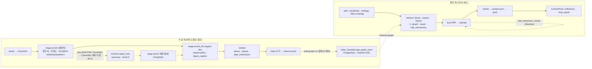
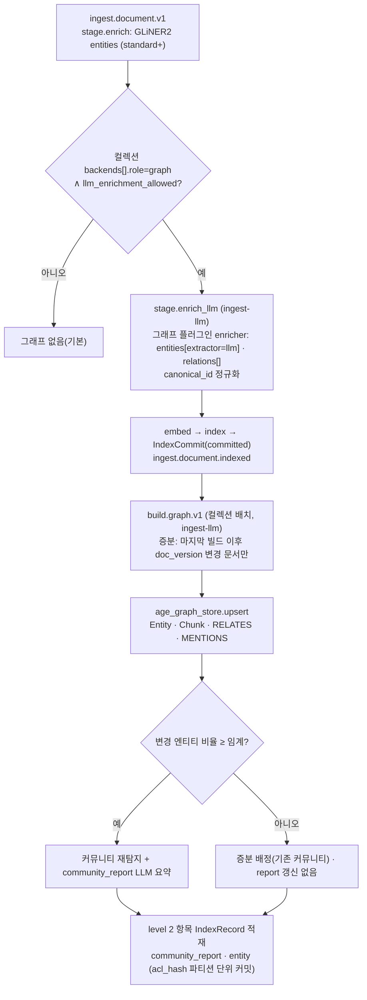
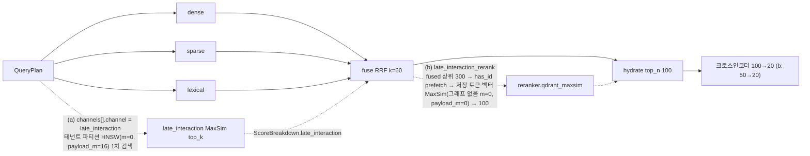
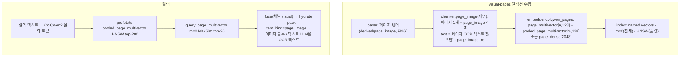
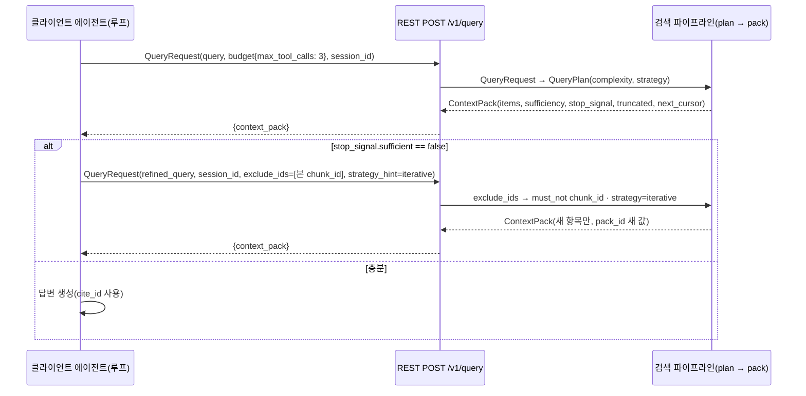

# 고급 검색 모듈: GraphRAG·RAPTOR·late interaction·에이전틱

## 목적

브리프 R4의 해석("모든 기술"은 모두 기본 켬이 아니라 **모두 플러그인으로 수용 가능한 확장 지점**)과 바이블 §3.2 O-03·O-04 결정을 검색 파이프라인 설계로 옮긴다. 이 문서는 기본 3-way 하이브리드 파이프라인(D-07, [15 하이브리드 검색·융합](./15-hybrid-search-and-fusion.md), [16 리랭킹](./16-reranking.md), [17 후처리·패킹](./17-post-processing-and-context-packing.md)) 위에 **선택적으로** 얹는 여섯 모듈이 (1) 어느 확장 지점(D-10)에 어떤 배치(코어 옵션 / 외부 플러그인)로 들어가고, (2) 어떤 계약 슬롯(바이블 §5)을 채우며, (3) 언제 켜고 어떻게 비용을 통제하며, (4) 무엇으로 평가해 승격하는지를 정한다.

| 모듈 | 다루는 질문 |
|------|-------------|
| 그래프 검색(GraphRAG·LightRAG·HippoRAG 2) | 엔티티·관계를 추출해 그래프에 저장하고 검색 시 이웃·커뮤니티 요약을 후보로 융합에 참여시키는 경로 |
| RAPTOR(재귀 요약 트리) | 요약 노드를 `item_kind=summary`·`level=2` 청크로 색인하고 `tree_collapsed` 전략으로 회수하는 경로와 재계산 정책 |
| late interaction(지연 상호작용, ColBERT 계열 MaxSim) | 리랭크 단계 재점수 vs Qdrant multivector 인덱스 채널의 두 위치와 비용 |
| 멀티모달(페이지 이미지·VLM 캡션) | `visual-pages` 컬렉션(ColPali 계열 또는 단일 벡터)과 그림 캡셔닝 보강의 파이프라인 위치 |
| 에이전틱 검색 경계 | 플랫폼이 제공하는 도구·상태·종료 신호와 클라이언트가 수행하는 루프의 경계 |
| 적응형 검색(Adaptive-RAG) | 질의 난이도 분류로 경량·정밀 경로를 고르는 라우팅 |

## 범위

| 포함 | 제외(소유 문서) |
|------|-----------------|
| 각 모듈의 확장 지점 매핑, 배치(코어 옵션 / 외부 플러그인), 계약 슬롯 사용 규칙, 파이프라인 내 위치와 실행 흐름 | 계약 필드·스키마 정의 자체([03-contracts](../03-contracts/00-contract-overview.md) 각 문서; 이 문서는 바이블 §5 표의 필드를 그대로 쓴다) |
| 그래프 저장소·인덱싱 잡·비용 통제·켤 때/끌 때 지침 | 기본 3-way 하이브리드·RRF·크로스인코더·후처리 고정 순서([15](./15-hybrid-search-and-fusion.md)·[16](./16-reranking.md)·[17](./17-post-processing-and-context-packing.md)) |
| RAPTOR 트리 생성·식별자·재계산 정책, 요약 노드의 검색·패킹 규칙 | 결정적 접두어·LLM 문맥 접두어·키워드·기본 엔티티 추출([11 보강](./11-enrichment.md)), 청킹 자체([10 청킹](./10-chunking-strategies.md)) |
| late interaction 두 위치의 실행 경로·저장·백엔드 능력·비용 표 | 임베딩 모델 선정·서빙([12 임베딩](./12-embedding.md), [05 임베딩 모델과 서빙](../07-tech-landscape/05-embedding-models-and-serving.md)), Qdrant 컬렉션 스키마([13 인덱싱](./13-indexing.md)) |
| `visual-pages` 컬렉션 구성, 페이지 이미지 2단계 검색, 그림 캡셔닝 위치 | OCR 엔진 선정 O-08([05 PDF 파서](./05-parser-pdf.md)), 렌더러 구현([05-api/03](../05-api/03-retrieval-api.md)) |
| 에이전틱 도구 집합의 사용 규약, 세션·`exclude_ids`·예산·`stop_signal` | MCP 서버 구현·인증·커서 저장소([05-api/05](../05-api/05-mcp-server.md), [ADR-0025](../06-adr/0025-mcp-cursor-pagination-and-tool-set.md)) |
| 질의 난이도 라우팅 규칙과 경로별 플랜 변화 | 질의 정규화·self-query·재작성 파이프 세부([14 질의 이해](./14-query-understanding.md)) |
| 모듈별 평가 계획·비용/지연/복잡도 표·로드맵 단계 | 하네스·골든셋 구축 절차([08-evaluation](../08-evaluation/02-retrieval-metrics-and-harness.md)), 마일스톤 일정([11-roadmap/01](../11-roadmap/01-milestones.md)) |

정본 규칙: 이 문서의 타입·필드·열거값은 바이블 §5(계약 표)·§5.7(열거)·§6(명명)·§7(프로파일)·§14(API 표면)를 그대로 쓴다. 바이블에 없는 것은 "제안"으로 표기하고 `## 미해결 이슈`에 모은다. 수치는 실측 전 값이며 모두 **초안 목표**다.

## 1. 공통 원칙: 계약 슬롯 위의 플러그인·프로파일

**결정:** 여섯 모듈은 모두 **기본 끔**이며 컬렉션 프로파일(`Profile`, `CollectionSpec.policies`) 단위로 켠다. 코어가 소유하는 것은 계약 슬롯과 옵션 `enricher` 하나(RAPTOR)이며, 그래프 엔진·시각 문서 모델·한국어 late interaction 모델은 별도 배포 패키지 `rag-plugin-{name}`이 같은 `Stage[In, Out]` 프로토콜과 entry point 그룹으로 제공한다(바이블 §3.2 O-03·O-04, §6.7, §12 `plugins/`; [ADR-0015](../06-adr/0015-graph-rag-external-plugin-raptor-core-option.md), [ADR-0010](../06-adr/0010-bge-m3-rationale-and-late-interaction-slot.md), [ADR-0032](../06-adr/0032-plugin-sdk-stage-protocol-and-conformance-kit.md)).

| 모듈 | 배치 | 확장 지점(D-10) | 패키지·`plugin_id`(바이블 §12·[05 플러그인 §13](../02-architecture/05-plugin-architecture.md)) | 켬 단위 | 기본 |
|------|------|-----------------|------------------------------------------------------------------|---------|------|
| 그래프 검색 | 외부 플러그인 | `enricher`(엔티티·관계) + `retriever`(채널 `graph`) + `index_backend`(역할 `graph`) | `rag-plugin-lightrag`(`enricher.lightrag_graph_builder`, `retriever.lightrag_graph`), `rag-plugin-hipporag`(별도 워커 컨테이너); 코어 어댑터 `index_backend.age_graph_store` | 컬렉션(`CollectionSpec.backends[].role=graph` + `policies.llm_enrichment_allowed`) | 끔 |
| RAPTOR | 코어 옵션 | `enricher`(바이블 §3.2 O-03 문구; ChunkSet → ChunkSet 스테이지 배치는 §3.2 미정 — `chunker` role 등록 또는 ADR-0015 개정, 미해결 이슈 1) | `enricher.raptor_tree`(`adapters/enrich/raptor_tree.py`, 바이블 §12) | 컬렉션(`tree_collapsed` 전략 허용 + LLM 예산) | 끔 |
| late interaction | 코어 범용 어댑터 + 모델 전용 플러그인 | `embedder` + `index_backend`(`supports_multivector`) + `retriever`(채널 `late_interaction`) 또는 `reranker`(`late_interaction_rerank`) | `embedder.pylate_late_interaction`, `retriever.qdrant_late_interaction`(코어 범용, **제안** — 바이블 §12 `adapters/retrieve/`에 없음), `reranker.qdrant_maxsim`; `rag-plugin-kure-late-interaction`(`embedder.kure_late_interaction`, `retriever.kure_late_interaction`(ADR-0010 예시), `reranker.kure_maxsim`) | 컬렉션(`ingest.embed.late_interaction.enabled` → `embedding_profile_hash` 변경) | 끔 |
| 페이지 이미지 검색 | 외부 플러그인 | `parser`(페이지 렌더) + `chunker`(제안) + `embedder` + `retriever`(채널 `visual`) | `rag-plugin-colqwen-visual`(`parser.page_renderer`, `embedder.colqwen_pages`, `retriever.qdrant_visual`) | **별도 컬렉션** `visual-pages` | 끔 |
| 그림 VLM 캡셔닝 | 코어 옵션 | `enricher` | `enricher.figure_caption`(초안 명칭, [11 §9](./11-enrichment.md)) | 컬렉션(LLM 예산·VLM 서빙) | 끔 |
| 에이전틱·적응형 | 플랫폼 기능 | `query_transformer`(라우터·복잡도) + API·MCP | `query_transformer.rule_router`, `query_transformer.complexity_classifier`(제안) | 요청(`session_id`·`budget`·`strategy_hint`; v1은 REST `POST /v1/query`만, §6.3) / 프로파일(`retrieval_variant`) | 규칙 라우터 항상, 분류기 끔 |

코어가 예약한 계약 슬롯(바이블 §5.3~§5.7)과 이 문서에서의 용도:

| 계약 슬롯(정본 철자) | 위치 | 이 문서의 사용 |
|----------------------|------|----------------|
| `ItemKind ∋ summary, community_report, entity, page_image`; `ChunkLevel 2` | `Chunk.item_kind/level`, `IndexRecord.item_kind/level` | RAPTOR 요약(§3), 그래프 파생 항목(§2), 페이지 이미지(§5) |
| `Chunk.tree_level`(N), `child_chunk_ids`(조건), `ChunkSet.stats.summary_count` | `ChunkSet` | RAPTOR 트리 구조(§3.3) |
| `Enrichment.entities`(Y), `Enrichment.relations`(N), `Entity`, `Relation`, `EntityExtractor.llm`, `IndexRecord.entity_ids`(N), `BoostKind.entity` | `EnrichedChunkSet`, `IndexRecord`, `ScoreBreakdown.boosts` | 그래프 구축 입력(§2.2), 엔티티 부스트 |
| `Channel ∋ graph, tree, visual, late_interaction`; `ScoreBreakdown.{graph, tree, visual, late_interaction}`; `DegradedComponent.channel.*`; `CandidateSet.candidates[].graph_path`(N) | `QueryPlan.channels[]`, `CandidateSet`, `RankedSet` | 그래프 채널(§2.3), 시각 채널(§5.1), late interaction 채널(§4.2). `tree` 채널은 예약만(collapsed tree는 기존 채널로 회수) |
| `Strategy ∋ graph_local, graph_global, tree_collapsed, visual_pages, iterative`; `Complexity`; `QueryPlan.filters.strategy`(전략별 고정값) | `QueryPlan` | 라우팅(§7)과 level 2 회수 규칙(§2.3·§3.4) |
| `QueryPlan.late_interaction_rerank`(N), `RankedSet.late_interaction_rerank`(N), `RerankBackend.qdrant_maxsim`, `ExplainCode.late_interaction_pass` | 질의 측 | 리랭크 단계 late interaction(§4.3) |
| `VectorName ∋ late_interaction, page_multivector, pooled_page_multivector, page_dense`; `VectorBundle.*`; `IndexBackendCapabilities.supports_multivector/max_multivector_elements` | 임베딩·인덱스 | 멀티벡터 저장(§4·§5) |
| `QueryRequest.session_id/exclude_ids/cursor/budget/strategy_hint`; `QueryPlan.budget`; `ContextPack.sufficiency/stop_signal/truncated/next_cursor` | 요청·팩 | 에이전틱 반복 검색(§6) |
| `JobKind.build_graph`, 워크플로우 `build.graph.v1`, 큐 `ingest-llm`, `CollectionSpec.policies.enrichment_budget_tokens/corpus_multiplier_max` | 오케스트레이션·정책 | 그래프 인덱싱 잡·비용(§2.2) |



공통 불변식(모든 모듈에 적용, 바이블 §10.2·§10.3):

1. level 2 파생 항목(`summary`·`community_report`·`entity`)과 `page_image`도 `IndexRecord`다. `tenant_id`·`collection_id`·`acl_*`·`acl_hash`·`is_current`·`index_generation`이 없으면 배치 전체가 `index.security_fields_missing`이다(E5).
2. 플러그인 리트리버의 백엔드 요청에는 보안 필터가 반드시 들어가고(`retrieve.security_context_missing`, E7), 전략 필터 `level_in`·`item_kinds`는 플래너만 설정한다(E6). 사후 필터는 금지다.
3. 어떤 모듈도 `Stage` 경계 타입을 추가하지 않는다. 새 값은 열거 추가(minor)나 선택 필드(N)로만 들어가며, 그것도 이 문서에서는 제안으로만 남긴다(바이블 §1.2).
4. 질의 시점의 후보 재인코딩은 금지한다(p95 800ms, 바이블 §8.3). 모든 late interaction 점수는 저장된 토큰 벡터에 대한 MaxSim이다.
5. 서버는 답변을 생성하지 않는다(브리프 §6 비목표). 서버 측 LLM 호출은 `retrieval_variant=quality`이고 `QueryPlan.budget.llm_calls_allowed=true`일 때의 플래너 변형(self-query·multi-query·HyDE·그래프 키워드 추출)으로 한정되고, 실패는 `plan.llm_failed` 폴백이다.

## 2. 그래프 검색: GraphRAG·LightRAG·HippoRAG 2

### 2.1 배치

**결정:** 바이블 §3.2 O-03 그대로 — 그래프 RAG 계열은 외부 플러그인 패키지(`rag-plugin-lightrag`, `rag-plugin-hipporag`)이고 코어는 계약 슬롯만 예약한다. 저장소는 PostgreSQL + Apache AGE(코어 어댑터 `index_backend.age_graph_store`, `CollectionSpec.backends[].role=graph`), 그래프 인덱싱은 별도 워크플로우 `build.graph.v1`(`JobKind.build_graph`, 큐 `ingest-llm`, O-05 예산 정책)이며 1차 엔진은 자체 코퍼스 측정까지 보류한다([ADR-0015](../06-adr/0015-graph-rag-external-plugin-raptor-core-option.md)). 근거는 두 독립 평가가 일치하는 사실 — 단일 홉 질의에서 기본 RAG가 같거나 우세하고, 다중 홉·비교·시간 추론과 코퍼스 수준 요약에서만 그래프가 이기며, 질의당 프롬프트 토큰이 기본 RAG의 수십~수백 배(GraphRAG-Bench Fig. 9: HippoRAG 2 약 1.1배, MS GraphRAG local 약 42배, LightRAG `mix` 약 105배, MS GraphRAG global 약 350배)라는 점이다([14 §GraphRAG 계열 공통](../07-tech-landscape/14-advanced-rag-graph-raptor-agentic-multimodal.md)).

플러그인 내부 저장소 선택: 정본은 PostgreSQL + AGE 하나다. 14 문서가 개발·`lite`용으로 권고한 NetworkX(GraphML 산출물)는 `LocalRunner` 테스트 픽스처로만 허용하며 프로파일 값이 아니다(바이블 §13에 없음, 미해결 이슈 2).

### 2.2 인덱싱 시: 엔티티·관계 추출 → 그래프 저장 → level 2 항목 색인



| 단계 | 규칙 | 근거 |
|------|------|------|
| 엔티티(기본) | `standard` 이상 프로파일에서 `enricher.gliner2_entities`가 `Enrichment.entities[]`(`extractor=gliner2`)를 채우고 `index`가 non-null `canonical_id`를 `IndexRecord.entity_ids`로 내보낸다. 그래프가 꺼져 있어도 필터·`BoostKind.entity` 부스트에 쓰인다. `lite`의 보강 행에는 GLiNER2가 없으므로(바이블 §7.1; 11 §3 "`lite`는 프로파일에서 제외 가능") `lite`에서는 `entity_ids`·`BoostKind.entity` 부스트도 비활성이다 | 바이블 §3.2 O-05, §7.1 보강 행, [02-architecture/05 §13.1](../02-architecture/05-plugin-architecture.md), [06 §6](../03-contracts/06-enriched-chunk-set.md), [11 §3·§6.1](./11-enrichment.md) |
| 엔티티·관계(그래프 컬렉션) | 그래프 플러그인 `enricher`가 **문서 단위** `stage.enrich_llm`에서 LLM 구조화 추출(Pydantic 스키마)로 `entities[extractor=llm]`·`relations[]{subject_id, predicate, object_id, weight, evidence_chunk_ids}`를 채운다. 추출이 여기 있는 이유는 `Enrichment.relations`가 `EnrichedChunkSet` 슬롯(바이블 §5.4 "그래프 플러그인만")이기 때문이며, ADR-0015 A7이 기각한 것은 **컬렉션 단위 배치**(AGE 적재·커뮤니티 탐지·보고서 요약)를 `enrich`에 인라인하는 안이다 — 문서 단위 추출은 그 배치의 입력이다. `subject_id`·`object_id`는 `Entity.canonical_id` 형식 `{namespace}:{key}`, `evidence_chunk_ids ⊆ enrichments` 키 집합. GLiREL은 CC BY-NC-SA로 제외(D-02) | 바이블 §5.3 `Entity`·`Relation`, §5.4 `Enrichment.relations`, §5.7 `EntityExtractor`; [06 §6](../03-contracts/06-enriched-chunk-set.md); 14 §엔티티/관계 추출 전략; ADR-0015 A7 |
| 한국어 정규화 | 조사·띄어쓰기·약칭 변형("삼성전자", "삼성전자(주)", "삼성")을 형태소 표제어(`ctx.analyzer`) + 임베딩 유사도 병합으로 하나의 `canonical_id`에 모은다. 병합 임계와 골든 엔티티 사전은 플러그인 설정. `name`은 표면형 그대로, 정규화 값은 `canonical_id`에만(06 §6) | 14 §엔티티/관계 추출 전략(정규화 문단) |
| 그래프 저장 | AGE 그래프 이름 `g_{tenant_id}_{collection_id}`(초안). 노드 `Entity{canonical_id, name, type, description, acl_hash_set}`, `Chunk{chunk_id, document_id, doc_version}`, `Community{community_id, level, report_chunk_id}`; 엣지 `MENTIONS(Chunk→Entity)`, `RELATES(Entity→Entity {predicate, weight, evidence_chunk_ids})`, `MEMBER_OF(Entity→Community)`. 그래프에는 본문 텍스트를 넣지 않는다(정본은 `ChunkSet` 산출물·`IndexRecord.text`). `SET LOCAL app.tenant_id` + 그래프 이름으로 테넌트 격리(RLS 대상 표가 아니므로 이름 격리 + 최종 후보 확정 시 벡터 백엔드 사전 필터로 이중 방어, §2.3) | 바이블 §13.1, §10.2; [02-architecture/04](../02-architecture/04-storage-architecture.md) |
| `build.graph.v1` | 트리거: 컬렉션 정책(그래프 플러그인 활성) + 스케줄(초안 야간 1회) 또는 `collection.reindex.completed`. 입력: 마지막 빌드 이후 `doc_version`이 바뀐 문서의 `EnrichedChunkSet`(원장 계보에서 조회; `relations`·`entities[extractor=llm]`는 이미 채워져 있다). 이 잡의 LLM 호출은 **커뮤니티 보고서 요약(+ `entity` 설명 생성)만**이며 문서 단위 추출을 반복하지 않는다. 액티비티 큐 `ingest-llm`, `StagePolicy`는 enrich(LLM) 행(30m / 60s / 5)을 쓴다. 예산 초과(`enrich.budget_exceeded`) 시 적재·요약 완료분은 커밋, 미완 커뮤니티의 보고서는 `stale=true`, 잡 `partial`. 코어 매니페스트에 그래프 컴포넌트 없음 | 바이블 §4.4, §11.2, §5.7 `JobKind`; ADR-0015 A7·DR7; [02-architecture/06](../02-architecture/06-orchestration-and-workflows.md) |
| 커뮤니티·요약 | 커뮤니티 탐지(Leiden; 플러그인 구현)는 **`acl_hash` 파티션 안에서만** 수행한다(§2.5). 변경 엔티티 비율이 임계(초안 20%) 미만이면 기존 커뮤니티에 증분 배정하고 보고서를 재요약하지 않는다(보고서 `stale=true` 표시, 다음 전체 빌드에서 갱신) | 14 §Microsoft GraphRAG 함정 (2) |
| level 2 항목 색인 | `community_report`(커뮤니티 요약 텍스트)·`entity`(엔티티 이름·타입·설명·별칭)를 `Chunk{item_kind, level=2}`로 만들어 일반 경로(`enrich` 결정적 → `embed` → `index`)로 색인한다. 리프와 같은 `IndexRecord`이므로 D-09 사전 필터·세대 사가가 그대로 적용된다 | 바이블 §5.4 `ChunkSet` 계층, §10.2; ADR-0015 DR9 |

비용 통제 손잡이(모두 기존 정책 필드):

| 손잡이 | 값(초안 목표) | 효과 |
|--------|---------------|------|
| `CollectionSpec.policies.enrichment_budget_tokens` | 그래프 컬렉션 권장 ≥ 20,000/문서(`premium` 기본 20,000; `lite`·`standard`·`korean-gov` 0 = 그래프 불가) | 문서당 추출·요약 LLM 상한. 초과 시 `enrich.budget_exceeded` → `partial` |
| `policies.corpus_multiplier_max` | 1.5 | 컬렉션 누적 생성 토큰 ≤ 1.5 × 코퍼스 토큰. 초기 그래프 구축은 코퍼스의 약 1배(문서 단위 추출, `stage.enrich_llm`) + 커뮤니티 보고서(`build.graph.v1`; MS GraphRAG 계산치 약 2.8배 — 상한을 넘으므로 보고서 레벨 수를 줄이거나 예산을 올려야 한다) |
| `ingest-llm` 큐 | 프로세스당 4 + Valkey 테넌트 토큰 버킷 | 테넌트 간 공정성·외부 LLM 한도 |
| 증분 빌드 | 변경 문서만 재적재(추출은 문서 재수집 시 `stage.enrich_llm`이 수행), 커뮤니티 재탐지 임계 20% | 최악 케이스(전체 재구축) 회피 |
| 리포트 레벨 | 커뮤니티 계층 중 상위 2레벨만 요약(초안) | 글로벌 질의 후보 수와 요약 비용 동시 제한 |
| 캐시 | 청크 단위 `H("llm-enrich", model_id, prompt_hash, embed_text)`(봉투 없음) | 재청킹·타 컬렉션 재사용, `stats.llm_cache_hits` |

### 2.3 검색 시: `graph` 채널 리트리버

**결정:** 그래프 리트리버는 `Retriever` 프로토콜의 구현(`channel=graph`)으로 다른 채널과 **병렬** 실행되고, 결과는 `CandidateSet.channel_runs[]`의 한 런(채널 × 컬렉션 × 변형)으로 RRF 융합에 참여한다(`fusion.weights.graph`, `ScoreBreakdown.graph`, `candidates[].graph_path`). 서버는 질의 시점에 LLM을 호출하지 않는다(`quality` 변형의 키워드 추출만 예외, §1 불변식 5). 그래프 탐색 결과는 **후보 제안**이며, 최종 후보는 벡터 백엔드의 사전 필터 조회를 통과한 `record_id`만이다([ADR-0013](../06-adr/0013-fusion-rrf-k60-then-convex-combination-and-postprocess-order.md), [ADR-0030](../06-adr/0030-single-coordinate-system-and-score-ledger.md), 바이블 §8.1 7~8단계).

| 단계 | `graph_local` | `graph_global` |
|------|---------------|----------------|
| 1 시드 | `QueryPlan.lexical_terms`의 NNP/SL + 사용자 사전 → `canonical_id` 정확 일치(NFKC); 부족하면 `item_kind=entity` 레코드 dense 검색 top 10(전략 필터 안) | 시드 엔티티가 있으면 그 커뮤니티; 없으면 `community_report` 레코드 dense·sparse 검색 top 20 |
| 2 확장 | Cypher `RELATES*1..hops`(기본 `hops=2`), 가중 감쇠 `w/hop`; 방문 상한 노드 500(초안) | `MEMBER_OF` 역방향으로 커뮤니티 → 상위 레벨 커뮤니티 1단계 |
| 3 점수 | 플러그인 정의(HippoRAG 2: Personalized PageRank; LightRAG: 엔티티·관계 벡터 유사도 + 1-hop 병합). 0..1 정규화 후 `candidates[].score` | 커뮤니티 관련도(시드 포함 수 × 레벨 가중) |
| 4 후보 종류 | 근거 청크(`evidence_chunk_ids`, level 0) + 시드·이웃 `entity`(level 2) | `community_report`(level 2) + 대표 근거 청크 |
| 5 확정 | `chunk_id` 목록(≤ `top_k × 2`)을 벡터 백엔드에 **필터 전용 조회**(보안 ∧ 전략 ∧ `chunk_id IN`)로 보내 현재 세대 `record_id`·`payload_slim`을 얻는다. 없는 항목(삭제·플립 경합)은 제외 | 동일 |
| 6 출력 | `ChannelRun{channel=graph, status, candidates[]{record_id, chunk_id, …, score, rank, payload_slim, graph_path}}`; `graph_path` = `["entity:{name}", "predicate:{p}", "entity:{name}", "community:{id}"]` 형식의 설명 문자열 | 동일 |

5단계의 "필터 전용 조회"는 `IndexBackend.search`에 질의 벡터 없는 요청을 보내는 것이며 어댑터 포트에 명시된 진입점이 없다(제안, 미해결 이슈 3). 조회에 보안 필터가 들어가므로 AGE 그래프 이름 격리에 더해 E7·E10이 이중으로 적용된다.

`QueryPlan.channels[]`의 그래프 채널 원소 예(값은 예시; `retriever_id`·`backend_id`는 플러그인이 §6.1 규약으로 선언). 1단계 시드의 `entity`·`community_report` dense 검색이 **컬렉션 dense 공간을 재사용**하므로 `embedding_space_id`에 dense 공간 ID를 채우고 `query_vector_ref`는 생략한다(`retrieve`가 [09 §8.2](../03-contracts/09-query-request-and-query-plan.md) 식으로 유도). 플러그인이 자체 벡터 공간(LightRAG 엔티티·관계 벡터 등)을 쓰면 09 §6.5 규칙대로 `query_vector_ref`를 채운다:

```json
{
  "channel": "graph",
  "collection_id": "01J9ZQ5A1B2C3D4E5F6G7H8J9K",
  "retriever_id": "retriever.lightrag_graph",
  "backend_id": "index_backend.age_graph_store",
  "collection_alias": "col_01J9ZQ5A1B2C3D4E5F6G7H8J9K_vec",
  "embedding_profile_hash": "5d7e8f9a0b1c2d3e4f506172839405a6b7c8d9e0f1a2b3c4d5e6f708192a3b4c",
  "index_generation_min": 1,
  "top_k": 50,
  "timeout_ms": 300,
  "weight": 1.0,
  "embedding_space_id": "5e6f708192a3b4c5d6e7f8091a2b3c4d5e6f708192a3b4c5d6e7f8091a2b3c4e",
  "enabled": true
}
```

전략 필터·융합·실패 규칙:

| 항목 | 규칙 | 근거 |
|------|------|------|
| 전략 필터 | `strategy ∈ {graph_local, graph_global}` → `filters.strategy = {level_in: [0, 2], item_kinds: 기본 6종 + community_report, entity}`. 이 필터는 **모든 채널**에 적용되므로 dense·sparse·lexical 채널도 `community_report`·`entity` 레코드를 직접 후보로 낼 수 있다 | 바이블 §5.5, §10.2; [09 §5.2](../03-contracts/09-query-request-and-query-plan.md) |
| 융합 | RRF 한 런. `fusion.weights.graph` 기본 1.0(초안; `premium` 게이트 값). `ScoreBreakdown.graph = ChannelScore{score, rank, contribution, variant_ids}`, 불변식 `Σ contribution = fused_score` 유지 | ADR-0013, ADR-0030 |
| 채널 예산 | `timeout_ms` 300(초안). 기본 `retrieve` 예산 120ms를 넘으므로 그래프 전략은 `latency_budget_ms.total ≥ 1,500`인 프로파일·요청에서만 허용(`premium quality` 2,500). 예산 부족 시 플래너가 `strategy=hybrid`로 강등 + `degraded{channel.graph, latency_budget}` | 바이블 §8.3, §7.2 |
| 실패 | 플러그인 미등록·능력 불일치 → 로딩 시 채널 비활성 + `degraded{channel.graph, capability_unsupported}`; 타임아웃·오류 → 채널 제외 + `degraded{channel.graph, timeout|unavailable}`; 다른 채널 1개 이상 성공이면 정상 응답 | 바이블 §4.3 `retrieve` 행, §7.4 (2) |
| 컨텍스트 폭증 방지 | 플러그인의 엔티티·관계 설명 텍스트는 후보 본문이 아니라 `entity`·`community_report` 레코드 `text`(≤ 8,192 UTF-8 바이트)로만 팩에 들어간다. LightRAG `mix` 기본값의 질의당 약 10만 토큰은 `pack.max_context_tokens`(24,000)·`k_max`로 구조적으로 차단된다 | 바이블 §9.1, §5.4 `IndexRecord.text` |
| 설명 가능성 | `graph_path`는 `explain=true` 응답과 `RankedSet`에 보존되고 렌더러는 LLM 컨텍스트에 넣지 않는다 | 원칙 8, [10 §3.4 `Candidate.graph_path` 행·§9 `explain` 규칙](../03-contracts/10-candidate-set-and-ranked-set.md) |

### 2.4 언제 켜는가

| 컬렉션 특성 | 권고 | 근거 |
|-------------|------|------|
| FAQ·규정 조회·단일 사실 질의가 대부분 | **끔**(기본 프로파일). 그래프는 잡음·비용만 더한다 | GraphRAG-Bench Level 1, arXiv 2502.11371 |
| 다중 홉·비교·시간 추론 질의 비율이 높음(예: 조직·인물·사건 관계, 규정 간 참조) | `graph_local` 후보. HippoRAG 2 계열(질의당 약 1.1배 토큰) 우선 검토 | GraphRAG-Bench Level 2, 14 §GraphRAG 계열 공통 질의 유형 표 |
| 코퍼스 전체 주제·추세·요약 질의가 있음 | `graph_global`(커뮤니티 보고서) 후보. 보고서 요약 비용을 예산으로 제한 | arXiv 2404.16130 |
| 엔티티 파셋·필터·부스트만 필요 | 그래프 없이 `entity_ids` + `BoostKind.entity`로 충분(`standard` 이상 기본 켬; `lite`는 GLiNER2 없음) | O-05, 바이블 §7.1 |
| 문서 ACL이 세밀하고 이질적 | 커뮤니티가 `acl_hash` 파티션으로 잘려 글로벌 요약 효과가 줄어든다(§2.5). `graph_local`만 고려 | §2.5 |

공개 게이트: `graph` 프로파일은 MultiHop-RAG·KoStrategyQA 다중 홉 회귀에서 `default` 대비 유의 개선(Holm 보정, [ADR-0023](../06-adr/0023-evaluation-qrels-answer-spans-and-linear-ndcg.md))과 우리 코퍼스 질의당 프롬프트 토큰 상한을 동시에 만족해야 공개한다(§8).

### 2.5 코퍼스 수준 항목의 ACL(제안)

바이블 §10.1은 문서 단위 ACL만 정의하므로 여러 문서에서 파생되는 `community_report`·`entity`(level 2)의 ACL 규칙이 필요하다(ADR-0015 재검토 조건 4). 이 문서의 제안(확정은 [02-architecture/07](../02-architecture/07-multi-tenancy-and-security-architecture.md)):

| 규칙 | 내용 |
|------|------|
| ACL 동질 파티션 | 커뮤니티 탐지와 `entity` 설명 노드 생성은 같은 `acl_hash`를 갖는 문서 집합 안에서만 수행한다. 따라서 모든 level 2 항목은 정확히 하나의 문서 ACL을 상속하고 small-to-big·그래프 확장으로 권한이 상승하지 않는다 |
| 운반 문서 | 파티션마다 플러그인이 내부 문서 `external_id = "graph:{collection_id}:{acl_hash}"`를 발급해 level 2 항목을 그 문서의 `ChunkSet`으로 색인한다(`document_id`·`doc_version`·`IndexCommit`·세대 사가는 일반 문서와 동일; `doc_version`은 파티션 입력 `EnrichedChunkSet` blake3 정렬 목록의 해시) |
| 교차 파티션 관계 | `RELATES` 엣지는 파티션을 넘을 수 있으나(그래프 탐색용), 후보로 확정되는 근거 청크는 각자 문서 ACL로 사전 필터된다. 교차 파티션 엣지 자체의 존재는 사용자에게 노출되지 않는다(`graph_path`는 확정 후보의 경로만) |
| ACL 변경 | `acl.update.v1`로 문서 `acl_hash`가 바뀌면 그 문서는 다음 `build.graph.v1`에서 파티션이 이동하고 이전 파티션 항목은 재계산된다. 전파 창 동안은 `acl_recheck`(E9)가 회수 힌트로 막는다 |

## 3. RAPTOR: 재귀 요약 트리

### 3.1 배치

**결정:** RAPTOR collapsed tree는 코어 옵션 `enricher.raptor_tree`(기본 끔)이며 새 리트리버·저장소가 없다. 요약 노드는 `item_kind=summary`, `level=2`, `tree_level ≥ 1`(리프 0) 청크로 일반 경로에서 임베딩·색인되고, `strategy=tree_collapsed`의 전략 필터 `{level_in: [0, 2], item_kinds: 기본 + summary}`에서만 직접 후보가 된다. tree traversal 리트리버와 `Channel.tree`는 v1에서 쓰지 않는다(바이블 §3.2 O-03, §5.4 `ChunkSet` 계층, §5.7 `ItemKind`·`ChunkLevel`; [ADR-0015](../06-adr/0015-graph-rag-external-plugin-raptor-core-option.md) 중립 항). 참조 구현은 유지보수가 중단되었고 LlamaIndex 팩은 deprecated이므로 알고리즘(UMAP 차원 축소 + GMM 소프트 클러스터링 + 클러스터 요약의 재귀)을 자체 구현한다(14 §RAPTOR와 요약 계층).

### 3.2 스테이지 배치(미정): `tree` 서브스테이지(ChunkSet → ChunkSet) 제안

요약 노드는 `ChunkSet`에 없는 새 항목이라 `EnrichedChunkSet.enrichments`의 키 집합 규칙(06 E-4)과 충돌한다([11 §9](./11-enrichment.md) 미해결 이슈 9가 이 문서로 위임). 또 클러스터링에는 리프 임베딩이 필요하지만 `enrich`는 `embed` 앞이다.

**미정(O-03 후속, ADR-0015 개정):** 이 문서의 **제안**은 `enricher.raptor_tree`를 `enrich` 스테이지 안의 **ChunkSet → ChunkSet 서브스테이지 `tree`**로 실행하는 것이다(`recount`처럼 경계 타입을 추가하지 않는 정밀화, D-05). 셸은 `stage.enrich`(결정적) → `stage.tree`(`ingest-llm`) → `stage.enrich`(새 `ChunkSet`에 결정적 보강 **재실행** — 스테이지 키가 `chunk_set.blake3`를 포함하므로 캐시 미스이며 CPU 5m 정책 안에서 리프 전체를 다시 처리한다; 청크 단위 결정적 캐시는 미해결 이슈 1 제안) → `stage.enrich_llm` 순으로 액티비티를 실행하고, `tree`는 원 `ChunkSet`의 리프·부모를 **그대로 보존**한 채 요약 청크만 더한 새 `ChunkSet`을 발급한다. 단, 이 배치는 현 정본과 두 곳에서 충돌한다: 바이블 §4.2·§5.1은 `ChunkSet` 생산자를 `chunk`·`recount`로만 정하고, [02-architecture/05 §3.6](../02-architecture/05-plugin-architecture.md)은 `Enricher(Stage[ChunkSet, EnrichedChunkSet])`로 시그니처를 고정하므로 `enricher` 그룹 플러그인이 `ChunkSet`을 내는 것은 프로토콜 위반이다. 확장 지점 시그니처·스테이지 표 변경은 바이블 §1.2의 ADR 절차 대상이므로 (a) `tree`를 `chunker` role(예: `chunker.raptor_tree`; `recount`와 같은 지위)로 등록하거나 (b) 바이블 §3.2 O-03 "코어 옵션 `enricher`" 문구와 02-architecture/05 §3.6 시그니처를 ADR-0015 개정으로 조정해야 한다(미해결 이슈 1). 아래 규칙은 어느 안에서도 동일하며, ADR 확정 전에는 코어가 요약 노드를 생산하지 않는다(05 미해결 이슈 2와 동일).

| 항목 | 규칙 |
|------|------|
| 입력 | 원 `ChunkSet` + 결정적 `EnrichedChunkSet`(리프 `embed_text`) |
| 리프 임베딩 | 컬렉션 dense 임베더(`embedder.embed_query`가 아닌 문서 모드)로 리프 `embed_text`를 임베딩한다. 청크 단위 캐시 `H("embed", embedding_space_id, "document", embed_text)`에 기록되므로 **`generated_prefix`가 꺼진 컬렉션에서는** 뒤의 `embed` 스테이지가 캐시 적중이라 이중 비용이 없다. `generated_prefix`가 켜진 컬렉션에서는 `stage.enrich_llm` 뒤 `embed_text`(`deterministic + generated + text`, 바이블 §5.4)가 바뀌어 키가 달라지므로 리프 dense 재임베딩 1회가 추가된다(§9 표 RAPTOR 인덱싱 비용에 반영) |
| 클러스터링 | UMAP(`n_neighbors`·`random_state` 고정) → GMM(BIC로 클러스터 수, 소프트 배정 임계 0.1; 초안). 단독 원소 클러스터는 요약하지 않고 상위 레벨로 통과시킨다 |
| 요약 | 클러스터 자식 `embed_text` 연결 → LLM 요약(≤ `summary_max_tokens` 256, 초안) → `tree_level = 자식 최대 tree_level + 1`. 재귀는 클러스터가 1개가 되거나 `max_tree_levels`(3, 초안)에 도달하면 종료 |
| 범위 | **문서 단위 트리**. 트리는 한 문서의 리프만 묶으므로 `document_id`·`doc_version`·ACL이 자연히 상속된다. 코퍼스 수준 트리는 v1 범위 밖(§2.5와 같은 ACL 문제) |
| 출력 `ChunkSet` | `chunk_set_id` 새 ULID, `chunker_id`·`chunker_config_hash`·`primary_tokenizer_id` **불변**(리프 `chunk_id` 보존; `chunker_id`를 유지해야 리프 불변식 C-8·C-6과 `token_budgets` 검증이 그대로 성립한다 — 05 미해결 이슈 2 대안 (a)의 `chunker_id=enricher.*`와 다른 이유), `producer.plugin_id = enricher.raptor_tree`, `stats.summary_count` 갱신, `lineage_refs.chunk_set`에 원 세트 참조. 요약 노드의 `child_chunk_ids`는 **단방향**(리프의 `parent_chunk_id`는 섹션 부모 유지)이므로 [05 C-3](../03-contracts/05-chunk-set.md)의 `level=2` 면제가 선행 조건이다(미해결 이슈 15). 하류 `enrich`·`embed`·`index`·`ChunkTextStore` 번들(`chunk_set_blake3`)은 이 세트를 쓴다 |
| 켬 조건 | 프로파일에 `enricher.raptor_tree`가 있고 `CollectionSpec.policies.llm_enrichment_allowed ∧ enrichment_budget_tokens > 0`(테넌트 정책 AND). `lite`·`standard`·`korean-gov` 정본 YAML에는 없다 |
| 실패 | LLM 예산 초과 → 상위 레벨 생략(`warnings += enrich.budget_exceeded`, 만들어진 레벨은 커밋, 잡 `partial`); LLM 불가 → `enrich.llm_unavailable` 재시도; 요약 청크 0개면 원 세트를 그대로 전달 |

### 3.3 요약 청크의 식별자·좌표

| 필드 | 규칙 | 근거 |
|------|------|------|
| `chunk_id` | `H("chunk", doc_version, chunker_config_hash, "2", span)` — 리프와 같은 식 | 바이블 §6.2 |
| `span` | 덮는 리프 좌표 합집합의 첫 블록·마지막 블록으로 일반 규칙 적용(`"{first_block_id}:{char_start}-{last_block_id}:{char_end}"`) | [05 §4.1 `span` 규칙 level 2 파생 항목 행·미해결 이슈 2](../03-contracts/05-chunk-set.md) |
| 충돌 회피 | 다른 `tree_level`의 두 요약이 같은 `span`을 갖게 되면(소프트 배정으로 가능) 상위 레벨 노드를 만들지 않고 하위 노드를 통과시킨다. 따라서 문서 안에서 `(level=2, span)`은 유일하다 | 이 문서 |
| `block_refs` | 덮는 리프의 `block_refs`를 문서 순으로 합친 것. `text`가 생성물이므로 재구성 불변식 (1)은 면제(00 U-11)이며 `char_start/char_end`는 0-길이, `original_char_*`는 원문 구간(인용은 요약 노드가 아니라 자식 리프로 유도, §3.4) | 바이블 §5.4 불변식 (1) 면제, 05 문서 |
| `child_chunk_ids` | 직접 자식(리프 또는 하위 요약)의 `chunk_id`. `parent_chunk_id = null`, `ordinal`은 같은 `tree_level` 안의 문서 순. **단방향 참조**: 자식 리프의 `parent_chunk_id`는 섹션 부모(level 1)를 그대로 가리키므로 05 C-3(양방향 참조, `p.level == c.level + 1`)·불변식 (4)와 충돌한다. 05 미해결 이슈 2의 대안 (c)(단방향 `child_chunk_ids` + C-3 `level=2` 면제)를 채택하며, 면제 조항이 05 문서에 반영되기 전에는 이 규칙을 적용할 수 없다(미해결 이슈 15) | 바이블 §5.4 `Chunk`; [05 C-3·미해결 이슈 2](../03-contracts/05-chunk-set.md) |
| `text` / `lexical_text` | 요약 본문(NFC) / 형태소 렉시컬 뷰(NFKC) | K2 |
| `context_prefix.deterministic` | 덮는 리프의 공통 heading 경로 접두어(`"{title} › {공통 heading_path}"`) | ADR-0029 |
| `sentence_spans`, `token_counts`, `content_hash` | 리프와 동일 규칙 | 바이블 §5.4 |

요약 청크 예(HWPX 지침 문서의 `tree_level=1` 노드; 해시·경로는 예시. `child_chunk_ids`의 세 리프는 각자 섹션 부모를 `parent_chunk_id`로 유지한다 — 미해결 이슈 15의 C-3 면제 전제):

```json
{
  "chunk_id": "7b1e4c9d2a6f8e0b3c5d7f9a1b2c4d6e8f0a2b4c6d8e0f1a3b5c7d9e1f2a3b4c",
  "span": "9f3a6c1e2b7d4a8f0c5e9b3d7a1f6e2c:0-4d8e0f1a3b5c7d9e1f2a3b4c5d6e7f80:412",
  "item_kind": "summary",
  "level": 2,
  "parent_chunk_id": null,
  "child_chunk_ids": [
    "1f2e3d4c5b6a79880c1d2e3f4a5b6c7d8e9f0a1b2c3d4e5f60718293a4b5c6d7",
    "2a3b4c5d6e7f8091a2b3c4d5e6f708192a3b4c5d6e7f8091a2b3c4d5e6f70819",
    "3c4d5e6f708192a3b4c5d6e7f8091a2b3c4d5e6f708192a3b4c5d6e7f8091a2b"
  ],
  "ordinal": 0,
  "text": "이 절은 정보공개 청구의 접수, 처리 기한(10일, 1회 10일 연장 가능), 비공개 결정 시 통지 의무를 규정한다. 기한 연장 사유는 자료 수집 곤란과 제3자 의견 청취 필요로 한정된다.",
  "lexical_text": "정보공개 청구 접수 처리 기한 10일 1회 10일 연장 비공개 결정 통지 의무 기한 연장 사유 자료 수집 곤란 제3자 의견 청취",
  "heading_path": ["정보공개 처리 지침", "제2장 청구의 처리"],
  "numbering_path": ["제2장"],
  "block_refs": [
    {"block_id": "9f3a6c1e2b7d4a8f0c5e9b3d7a1f6e2c", "element_path": "/hp:sec[0]/hp:p[12]", "char_start": 0, "char_end": 0, "original_char_start": 0, "original_char_end": 183, "page": null, "bbox": null},
    {"block_id": "4d8e0f1a3b5c7d9e1f2a3b4c5d6e7f80", "element_path": "/hp:sec[0]/hp:p[19]", "char_start": 0, "char_end": 0, "original_char_start": 0, "original_char_end": 412, "page": null, "bbox": null}
  ],
  "sentence_spans": [[0, 65], [66, 105]],
  "token_counts": {"hf:BAAI/bge-m3": 71, "tiktoken:o200k_base": 84},
  "lang": "ko",
  "context_prefix": {
    "deterministic": "정보공개 처리 지침 › 제2장 청구의 처리",
    "generated": null,
    "generated_by": null
  },
  "tree_level": 1,
  "text_source": "text_layer",
  "ocr_confidence_min": null,
  "content_hash": "c0ffee00d15ea5e0b1a2c3d4e5f60718293a4b5c6d7e8f90a1b2c3d4e5f60718"
}
```

### 3.4 검색·패킹에서의 요약 노드

| 항목 | 규칙 | 근거 |
|------|------|------|
| 회수 | `strategy=tree_collapsed`일 때만 전략 필터가 `level_in=[0, 2]` + `summary`를 허용한다. 요약 노드는 dense·sparse·lexical **기존 채널**에서 리프와 경쟁하며 융합·리랭크는 동일 규칙 | 바이블 §5.5 `filters.strategy`, §10.2 |
| 라우팅(우선순위) | 규칙 라우터는 순서대로 판정한다: (1) 요약·개요·비교·범위 표지("요약", "전체적으로", "주요 내용", "차이", "각 장")가 있으면 `complexity`와 무관하게 `tree_collapsed`(이때 `single_step`이면 아래 감점 적용) → (2) 표지 없음 ∧ `complexity=multi_step`이면 `tree_collapsed` → (3) 표지 없음 ∧ `single_step`이면 `hybrid`(요약 노드 제외) | §7 |
| 정밀 질의 회귀 방지 | 규칙 (1)로 `tree_collapsed`가 되었으나 `complexity=single_step`인 경우 `ScoreBreakdown.boosts += {kind: item_kind_penalty, delta}`(초안 −0.05)로 요약 노드를 감점한다(재융합 없음, 순위 조정) | 바이블 §5.7 `BoostKind`; 14 §실패 모드 요약 |
| 후처리 | `parent_expand`는 요약 노드에 적용하지 않는다(`parent_chunk_id=null`); `dedup`는 `content_hash`·코사인 규칙 그대로; 요약과 그 자식 리프가 함께 뽑히면 리프를 우선 유지하고 요약을 `omitted.reason=duplicate`로 낼지는 골든셋 ablation 후 결정(미해결 이슈 6) | 바이블 §8.2 |
| 패킹·인용 | `ContextItem.item_kind=summary`·`level=2`로 표시된다. `segments`는 요약 문장 단위, `provenance`는 자식 리프 구간(`original_char_*`)이므로 인용은 원문 위치를 가리킨다. 렌더러 헤더에 `[summary]` 표기(제안, 미해결 이슈 7) | 바이블 §9.1·§9.3 |

`tree_collapsed` 플랜 발췌(라우팅 규칙 (1)의 예: 질의 "제2장의 주요 내용을 요약해 줘" — 요약 표지 있음 + `single_step`이므로 `tree_collapsed`이면서 `item_kind_penalty` 적용 대상):

```json
{
  "strategy": "tree_collapsed",
  "route": "single",
  "complexity": "single_step",
  "filters": {
    "strategy": {
      "level_in": [0, 2],
      "item_kinds": ["text", "list_group", "code", "table", "table_part", "figure", "summary"]
    }
  },
  "fusion": {
    "method": "rrf",
    "k": 60,
    "weights": {"dense": 1.0, "sparse": 1.0, "lexical": 1.0},
    "variant_query_weight": 0.5
  }
}
```

### 3.5 재계산 정책

| 사건 | 동작 | 근거 |
|------|------|------|
| 문서 재수집(`doc_version` 변경) | 문서 트리 전체 재생성(`ingest.document.v1` 정상 경로). 클러스터 텍스트가 같으면 요약 LLM 캐시 적중 | 바이블 §4.1 캐시 규칙 |
| 청커·토크나이저 설정 변경 | 리프 `chunk_id`가 바뀌므로 트리도 재생성(`reindex.collection.v1`) | ADR-0004 |
| 요약 모델·프롬프트 변경 | `enricher_fingerprint` 변경 → `reprocess.document.v1 {from_stage: enrich}`로 문서별 재실행(재청킹 아님) | 바이블 §11.2 |
| RAPTOR 켬/끔 전환 | 프로파일 `version` 증가 → `profile_hash` 변경 → 컬렉션 blue/green 재색인 | 바이블 §7.4 |
| 메타데이터만 변경 | 재계산 없음(`acl.update.v1`은 payload만) | ADR-0005 |

## 4. late interaction: 리랭크 재점수 vs 인덱스 채널

### 4.1 배치

**결정:** 바이블 §3.2 O-04 그대로 — 기본 끔, 모델 중립 named vector `late_interaction`(128d, `MultiVectorConfig(MAX_SIM)`) 별도 슬롯. BGE-M3 colbert(1024d)는 인덱스 저장이 불가(100만 청크 약 614GB)하므로 리랭크 비교 기준으로만 쓰고, KURE-v2(128d, Apache-2.0)를 M2 골든셋에서 (a) 인덱스 단계 채널 `late_interaction` vs (b) 리랭크 단계 `late_interaction_rerank`로 비교한 뒤 ADR을 개정한다. `supports_multivector=false` 백엔드는 로딩 시 자동 비활성 + `degraded`, `visual-pages`는 별도 컬렉션·인덱스 단계 필수, 저장 바이트는 `rag_index_bytes_total{vector="late_interaction"}`로 계량한다([ADR-0010](../06-adr/0010-bge-m3-rationale-and-late-interaction-slot.md)). 계약은 두 위치를 모두 표현하므로 M2 비교는 코드 변경 없이 프로파일 값으로 수행된다.



### 4.2 위치 (a): 인덱스 단계 채널 `late_interaction`

| 항목 | 규칙 |
|------|------|
| 임베딩 | `embedder.pylate_late_interaction`(범용) 또는 `embedder.kure_late_interaction`이 리프 `embed_text`를 토큰 벡터 `[count, 128]`(토큰별 L2 정규화, float16)로 내고 `VectorBundle.late_interaction{name, dim: 128, count, offset}`에 기록한다. `embedding_space_ids.late_interaction`이 추가되어 `embedding_profile_hash`가 바뀐다(= blue/green) |
| 인덱스 | Qdrant named vector `late_interaction` = `{size: 128, distance: Cosine, multivector_config: {comparator: max_sim}}`. 1차 검색 채널로 쓰려면 **`dense`와 같은 테넌트 파티션 HNSW** `hnsw_config: {m: 0, payload_m: 16}`(전역 그래프 없음, `is_tenant` 서브그래프만; 바이블 §13.4·§10.4 `payload_filter`, [13 §4.1](./13-indexing.md) 컬렉션 스키마 표)을 쓴다 — 공유 컬렉션에서 `m > 0` 전역 그래프는 격리·성능 설계(바이블 §15 #3)를 깨뜨리므로 쓰지 않는다. (b) 재점수 전용은 `{m: 0, payload_m: 0}`(그래프 없음, §4.3). 포인트당 원소 상한 `sub_vectors × dim < 1,048,576` → 128d에서 토큰 8,192개(리프 512 토큰이므로 여유) |
| 질의 | 리트리버(`retriever.qdrant_late_interaction` 코어 범용 — **제안**, 바이블 §12 `adapters/retrieve/`에 없음; 또는 플러그인 `retriever.kure_late_interaction`, ADR-0010 예시)가 `embed_query`로 질의 토큰 벡터를 얻어 `query_points(using="late_interaction", filter=보안 ∧ 전략 ∧ 사용자)` → MaxSim 점수 → `ChannelRun{channel=late_interaction}`; `ScoreBreakdown.late_interaction`에 기록, RRF 4번째 런 |
| 압축 | `turbo4`(4비트) + 1-bit TurboQuant(Qdrant 1.18+ 튜토리얼 확인; scalar/binary 양자화의 멀티벡터 적용 여부는 확인 필요 as of 2026-09) 또는 PyLate PLAID/토큰 풀링 |
| 조건 | `IndexBackendCapabilities.supports_multivector=true` ∧ `max_multivector_elements ≥ count × 128`. 아니면 채널 비활성 + `degraded{channel.late_interaction, capability_unsupported}` |

### 4.3 위치 (b): 리랭크 단계 재점수 `late_interaction_rerank`

| 항목 | 규칙 |
|------|------|
| 저장 | (a)와 같은 벡터를 `hnsw_config: {m: 0, payload_m: 0}`으로 저장(전역·파티션 그래프 모두 없음, 재점수 전용 — Qdrant 공식 튜토리얼 구성; [13 §4.1](./13-indexing.md)의 `vectors.late_interaction` 행 `{m: 0}` 표기와 같은 의도이며, 전역 `payload_m: 16`을 벡터별 설정이 덮어쓰는지는 확인 필요 as of 2026-09) |
| 실행 위치 | `fuse` 직후, `hydrate` 앞. `late_interaction_rerank.enabled`이면 `fuse` 절단을 `late_interaction_rerank.top_n_in`(300)으로 두고, `reranker.qdrant_maxsim`(또는 `reranker.kure_maxsim`)이 fused 상위 300의 `record_id`를 `point_id = uuid5(NAMESPACE_RAG_CHUNK, record_id)`(D-06)로 바꿔 `prefetch{filter: has_id(point_id[300]), limit: 300}` → `query(using="late_interaction", limit: 100)` 1회로 MaxSim을 계산한다([16 §7](./16-reranking.md)과 동일). 후보 집합은 이미 채널 단계의 보안·전략 사전 필터를 통과했으므로 보안 필터를 다시 붙이지 않고 `has_id`로 충분하다(`record_id`는 바이블 §13.4 payload 인덱스에 없음). 상위 `top_n_out`(100)만 남긴다(**순서 필터**, 재융합 없음) → `hydrate.top_n` 100 → 크로스인코더 50→20 |
| 기록 | `RankedSet.late_interaction_rerank{applied, model_id, top_n_in, top_n_out, took_ms}`, `results[].score_breakdown.late_interaction`, `explain += late_interaction_pass`; 토큰 벡터가 없는 레코드(슬롯 켬 이전 세대)는 점수 없이 통과 |
| 실패 | 타임아웃·오류 → 단계 생략(fused 순서 유지) + `degraded{late_interaction_rerank, timeout|unavailable}`; 오류 아님 |
| 기대 효과 | 크로스인코더 입력을 100→50으로 줄여 리랭커 GPU 병목(바이블 §15 #6) 완화. 검증 전에는 `premium` 실험 슬롯 |

### 4.4 BGE-M3 colbert의 위치

BGE-M3의 colbert 출력(1024d)은 저장이 비현실적이고, 질의 시 후보 재인코딩은 금지(§1 불변식 4)이므로 **평가 하네스의 리랭크 비교 기준**으로만 쓴다(`BGEM3FlagModel.encode(return_colbert_vecs=True)` → `colbert_score`; 07 문서의 "리랭커 1차 경량 단계" 결론은 이 모델에 한정). 프로덕션 경로·프로파일 값에는 나타나지 않으며 벡터 이름·채널·플러그인 ID에 `colbert`를 쓰지 않는다(ADR-0010 코드 리뷰 (c)).

### 4.5 비용 표

저장량(계산값, fp16, 평균 300토큰 청크 100만 개; 인덱스 오버헤드 제외 — [12 §13](./12-embedding.md)·14 문서 계산과 동일):

| 구성 | 청크당 | 100만 청크 | dense 대비 |
|------|--------|-----------|-----------|
| `dense` 1024d fp16 | 약 2KB | 약 2GB | 1× |
| `late_interaction` KURE-v2 128d fp16 | 약 77KB | 약 77GB | 약 38× |
| 같은 벡터 `turbo4`(4비트) | 약 19KB | 약 19GB | 약 9× |
| PyLate 1-bit + 토큰 풀링(계수 2~3) | 수 KB | 수 GB | 수 배 |
| BGE-M3 colbert 1024d fp16 | 약 614KB | 약 614GB | 약 300×(저장 불가) |

지연·비용(초안 목표, 실측 전; M2에서 확정):

| 항목 | (a) 인덱스 채널 | (b) 리랭크 재점수 | 비고 |
|------|-----------------|-------------------|------|
| 질의 토큰 인코딩 | ≤ 20ms(GPU, 154M 모델) | ≤ 20ms | 동일 모델 1회 |
| 백엔드 연산 | 테넌트 파티션 HNSW(멀티벡터) 1차 검색 ≤ 60ms | 300 후보 MaxSim ≤ 40ms | (a)는 파티션 HNSW 메모리 추가 |
| 크로스인코더 | 100→20 250ms(변화 없음) | 50→20 약 130ms | (b)의 절감분 |
| 추가 인덱싱 GPU | 임베딩 패스 1회 추가 | 동일 | 임베딩 서버 처리량 감소 |
| 프로파일 | `premium`만 | `premium`만 | `lite`·`standard`·`korean-gov` 끔 |

### 4.6 백엔드 이식성

| 백엔드 | MaxSim 멀티벡터 | 이 문서의 취급 |
|--------|-----------------|----------------|
| Qdrant 1.10+ | 지원(`MultiVectorConfig(MAX_SIM)`; (a) `{m: 0, payload_m: 16}` / (b) `{m: 0, payload_m: 0}`, turbo4) | 정본 경로 |
| Milvus 2.6.4+ / Weaviate 1.30+ / Vespa | 지원(설정 상세는 확인 필요 as of 2026-09) | 어댑터가 `supports_multivector=true` 선언 시 동일 규칙 |
| pgvector 0.8.6 | 미지원 | `late_interaction`·`visual` 채널 자동 비활성 + `degraded{…, capability_unsupported}`; 3-way는 그대로 동작 |
| OpenSearch | 범위 외(렉시컬 역할) | — |

## 5. 멀티모달: 페이지 이미지 검색과 그림 캡셔닝

### 5.1 페이지 이미지 검색 `visual-pages`

**결정:** 페이지 이미지 검색은 텍스트가 없어 리랭크만으로 후보를 만들 수 없으므로 **인덱스 단계 필수**이며 **별도 컬렉션** `visual-pages`(`strategy=visual_pages`, `item_kind=page_image`, `level=0`, 채널 `visual`)로 운영한다. 모델은 ColQwen2 v1.0(백본 Apache-2.0 + 어댑터 MIT, 128d) 멀티벡터를 잠정 1차로, Qwen3-VL-Embedding-2B(Apache-2.0, 단일 벡터 `page_dense`) + Qwen3-VL-Reranker-2B를 저비용 대안으로 두고 SDS KoPub VDR·KoViDoRe·자체 HWPX 렌더 셋에서 비교 후 확정한다. 스캔 문서의 기본은 OCR 텍스트 파이프라인(O-08)이고 `visual-pages`는 **보완 채널**이다(바이블 §3.2 O-04, §5.7 `VectorName`·`Strategy`; 매트릭스 `visual_page_retriever` 행; 14 §Late interaction: 페이지 이미지·§스캔 문서: 이미지 검색 vs OCR 텍스트 파이프라인).



| 항목 | 규칙 |
|------|------|
| 파이프라인 위치 | `parse`가 페이지 이미지를 파생물 `derived/page_image/`로 저장([05 PDF 파서](./05-parser-pdf.md) `pdf.page_images`; HWPX는 `parser.page_renderer` 플러그인 렌더). `chunker.page_image`(제안)가 페이지당 리프 1개(`item_kind=page_image`, `page_image_ref`, `text` = 해당 페이지 OCR 텍스트 또는 빈 문자열 대신 `"[page {n}]"` 자리표시, 초안)를 만든다. 청킹·부모·표 조각 규칙은 적용하지 않는다 |
| 벡터 | `page_multivector`(전체, `m=0`) + `pooled_page_multivector`(행 평균 풀링 약 38벡터, HNSW) 또는 `page_dense`(단일 벡터, 기존 dense 경로 재사용). 이름은 `VectorName` 정본 그대로 |
| 검색 | 채널 `visual` 리트리버 `retriever.qdrant_visual`: 2단계(풀링 HNSW top-200 → 전체 벡터 MaxSim top-20; Qdrant 블로그 nDCG@20 0.952 유지·13배 가속) 또는 단일 벡터 top-50 → `Qwen3-VL-Reranker-2B` top-10. 전략 필터 `{level_in: [0], item_kinds: [page_image]}`. 렉시컬·sparse 채널은 없음(텍스트 없음) → 융합에 `visual` 런만 들어가며 `fusion.weights.visual` |
| 텍스트 컬렉션과의 결합 | 같은 질의를 텍스트 컬렉션과 `visual-pages` 컬렉션에 함께 보내면(`collection_ids` 2개) 런은 컬렉션별로 분리되고 `embedding_profile_hash`가 다르므로 융합은 `rrf`로 강등 + `degraded{fusion, profile_mismatch}`(바이블 O-01 다중 컬렉션 규칙). 페이지 항목과 텍스트 항목은 `dedup`에서 병합되지 않는다(`content_hash` 다름) |
| 라우팅 | `ocr_confidence_min < τ`(초안 0.6)인 페이지가 많은 문서, 차트·도면·서식 비율이 높은 컬렉션에서 켠다. 질의 라우터는 `strategy_hint=visual_pages` 또는 시각 표지("그림", "차트", "표에서", "도면")로 `visual_pages`를 택한다 |
| 팩·렌더 | `ContextItem.item_kind=page_image` 항목은 `figures[].image_ref`(ArtifactRef)로 페이지 이미지를 참조한다. 멀티모달 LLM 렌더러는 이미지 블록으로, 텍스트 전용 LLM에는 `text`(OCR)로 대체한다. 이미지 블록 직렬화 규칙은 렌더러 정본(바이블 §9.3)에 없어 05-api 제안(미해결 이슈 8) |
| 인용 | 페이지 단위(`provenance.page`, `bbox=null`). 패치 → bbox 사상은 근사이므로 v1 미제공 |
| 저장(계산값, fp16, 100만 페이지) | 128d × 800벡터 약 205KB/페이지 → 약 205GB; 320d(tomoro-colqwen3) 약 512GB; 풀링 38벡터 약 9.7GB; 단일 벡터 2048d 약 4KB → 약 4GB |
| 라이선스 | 채택 가능: ColQwen2 v1.0, tomoro-colqwen3-embed-4b/8b(Apache-2.0, 320d), colnomic-embed-multimodal-7b, ColSmol, ColModernVBERT(MIT), Qwen3-VL-Embedding/Reranker. 제외: ColPali v1.x(Gemma), ColQwen2.5·jina-embeddings-v4·colnomic-3b(Qwen Research) — D 등급은 BYO + `model_license_ack`만 |

### 5.2 그림·차트 VLM 캡셔닝 보강

**결정:** 그림 캡셔닝은 파서 단계가 아니라 `stage.enrich_llm`의 **보강 단계**다 — VLM 캡션 `enricher`(초안 명칭 `enricher.figure_caption`; 바이블 §7.3·§12·[02-architecture/05 §13.1](../02-architecture/05-plugin-architecture.md) 카탈로그에 없어 06 미해결 이슈 13·11 §9와 함께 미해결 이슈 12에서 제안)가 Qwen3-VL-8B @ vLLM(Apache-2.0, 한국어 OCR 지원; 2차 Qwen3-VL-4B)으로 `figure` 리프의 그림 파생물(`derived/figure_crop`)을 입력으로 `Enrichment.figure_caption`·`figure_table_markdown`(차트→표)을 채운다. 파서 단계(Docling `do_picture_description`)에 두지 않는 이유는 (1) VLM 모델 ID가 `parser_fingerprint_hash`에 들어가 파싱 캐시를 오염시키고, (2) LLM 비용 정책(O-05: `ingest-llm` 큐·예산·옵트인)이 `enrich`에만 있으며, (3) 원 캡션(`Block`·`Chunk.text`)과 생성 캡션의 분리 보존(3-텍스트 규칙)이 `Enrichment` 슬롯에서 자연스럽기 때문이다([11 §9](./11-enrichment.md), [06 §7](../03-contracts/06-enriched-chunk-set.md), [ADR-0016](../06-adr/0016-llm-enrichment-default-off-and-budget-policy.md)).

| 항목 | 규칙 |
|------|------|
| 입력 | `figure` 청크(`item_kind=figure`) + 그림 파생물. 파생물이 없으면(흐름 포맷의 인라인 이미지 미추출) 건너뛴다 |
| 출력 | `figure_caption`(≤ 512 코드포인트, 초안), `figure_table_markdown`(차트 수치 표, 옵션). 원 캡션과 분리 저장, `text`·`embed_text`에 넣지 않는다 |
| 검색 반영 | 생성 캡션을 렉시컬 뷰에만 부착(`index_text` 끝, 가상 질문과 같은 규칙)하는 것을 1차 정책으로 제안하고 dense 반영(별도 named vector 또는 `generated` 슬롯)은 골든셋 ablation 후 결정한다. 정책 소유는 [12 임베딩](./12-embedding.md)(미해결 이슈 9) |
| 환각 방지 | 캡션-원본 OCR 텍스트 겹침 점수를 `warnings`로 기록(초안), 렌더러는 원 캡션 우선·생성 캡션은 `figures[].caption`으로 병기 |
| 비용 | 문서당 그림 수 × 캡션 토큰; O-05 예산에 포함. VLM VRAM은 fp16 8B 기준 약 16~20GB 추정(확인 필요 as of 2026-09) |
| 멀티모달 임베딩 | 기본 미채택(캡션 텍스트 → BGE-M3). Qwen3-VL-Embedding 병렬 named vector, SigLIP 2 이미지-이미지 검색은 `embedder` 플러그인 옵션 |

## 6. 에이전틱 검색 경계

### 6.1 원칙

**결정:** 플랫폼은 **검색 도구 + 예산·상태·종료 신호**를 제공하고, 추론 루프·답변 생성은 클라이언트(LLM 에이전트)가 수행한다(브리프 §6 비목표; 14 §에이전틱 RAG 패턴; [ADR-0025](../06-adr/0025-mcp-cursor-pagination-and-tool-set.md)). 서버 측에 허용하는 "에이전틱" 요소는 생성 없이 결정론적으로 끝나는 것으로 한정한다: 질의 복잡도 분류(§7), 하위 질의 분해 1단계(`route=multi`, `sub_queries[]`), 그래프 1~2 hop 확장(§2.3), 규칙 기반 충분성 판정(`sufficiency`). 다단계 LLM 루프를 서버에 넣으면 p95 800ms와 관측성(원칙 8)이 무너진다.

| 패턴 | 클라이언트가 하는 일 | 플랫폼이 제공하는 것 |
|------|----------------------|----------------------|
| ReAct 검색 루프 | 생각 → `search` 호출 → 관찰 반복 | `search` + 팩 `stop_signal`·`sufficiency`(MCP·REST 공통); `exclude_ids`·`session_id`·`budget`은 v1에서 REST `POST /v1/query`만(§6.3) |
| IRCoT(추론 문장마다 검색) | 문장 단위 재질의 | 중복 제거(REST `exclude_ids` / MCP `cursor` 누적 `seen_chunk_ids`) |
| CRAG(검색 평가 후 행동) | correct/ambiguous/incorrect 행동 선택, 웹 폴백 | `sufficiency{status, coverage, missing_aspects}` 규칙 판정 |
| Adaptive-RAG | 없음(서버 라우팅) | `QueryPlan.complexity`·`strategy`(§7) |
| 계획-실행 | 하위 질문 계획, 병렬 호출, 종합 | v1: `search` 반복 / v1.1 후보 `search_batch` |
| Self-RAG·Search-R1 | 특수 학습 모델 역량 | 범위 외; 힌트 필드만 |

### 6.2 도구 집합

| 도구(정본) | 버전 | 시그니처(바이블 §14) | REST 동등 |
|------------|------|----------------------|-----------|
| `search` | v1 | `search(query, collection_ids?, top_k?, filters?, response_format?, cursor?)` → `structuredContent`(슬림 ContextPack, 20k 토큰 상한) + `next_cursor` | `POST /v1/query`(`QueryRequest` 전 필드: `session_id`·`exclude_ids`·`budget`·`strategy_hint`·`explain`) |
| `get_document` | v1 | `get_document(document_id, view?, cursor?)` | `GET /v1/documents/{document_id}/content?view=parsed\|normalized\|chunks&cursor=` |
| `list_collections` | v1 | `list_collections()`(허용 컬렉션만) | `GET /v1/collections` |
| `search_batch` | v1.1 후보 | 다중 질의 1회 호출(계획-실행 루프 왕복 절감) | `POST /v1/query` 반복 |
| `expand` | v1.1 후보 | 항목 확장(부모·형제·그래프 이웃) — 지시문의 "expand_context"는 정본 명칭 `expand`로 읽는다 | 없음(제안) |

`expand`의 제안 시그니처(05-api/05가 확정; ADR-0025 재검토 조건의 승격 게이트 대상): `expand(chunk_ids[], mode: enum[parent, siblings, graph_neighbors], hops?, max_tokens?)` → 슬림 ContextPack 델타. `parent`는 `ChunkTextStore` 번들, `siblings`는 같은 `parent_chunk_id`의 리프, `graph_neighbors`는 §2.3 2~5단계(그래프 컬렉션만). 모든 모드는 보안 필터 (a)로 재조회한다(E10).

### 6.3 반복 검색 지원 기능

**결정:** v1에서 `session_id`·`exclude_ids`·`budget`·`strategy_hint`는 REST `POST /v1/query`(`QueryRequest`, 바이블 §5.5)에서만 받는다. MCP v1 `search`는 바이블 §14 시그니처 `search(query, collection_ids?, top_k?, filters?, response_format?, cursor?)` 그대로이며, MCP 에이전트는 `cursor`/`next_cursor`(서버가 누적한 `seen_chunk_ids`가 `exclude_ids` 역할)와 팩의 `sufficiency`·`stop_signal`만 쓴다. MCP `search`에 선택 인자를 노출할지는 v1.1 `search_batch`·`expand`와 함께 [05-api/05](../05-api/05-mcp-server.md)·[ADR-0025](../06-adr/0025-mcp-cursor-pagination-and-tool-set.md) 개정에서 다룬다(ADR-0025 결과 절 "`session_id`·`exclude_ids`는 REST 경로 필드"; 미해결 이슈 17).

| 에이전트 요구 | 플랫폼 기능 | 계약 필드(정본) | 규칙 |
|---------------|-------------|-----------------|------|
| 같은 세션의 턴 묶기 | 세션 컨텍스트 | `QueryRequest.session_id`(REST, v1) | 서버 상태를 만들지 않는다. 이전 턴 팩은 재정렬 없이 **추가만**(프롬프트 캐시, 바이블 §9.4). 새 팩의 `cite_id`는 자기 팩 안에서 `d1..dK`, 턴 간 구분은 `pack_id`(정본)로 충분하다. `ContextPack`에는 `session_id` 필드가 없으며(바이블 §5.5, [11 §2](../03-contracts/11-context-pack.md)) 팩 측 전파 `ContextPack.session_id`(N)는 09 미해결 이슈 5의 `QueryPlan.session_id`와 함께 제안이다(미해결 이슈 16) |
| 이미 본 청크 제외 | 중복 제거 | `QueryRequest.exclude_ids[]`(`chunk_id`, ≤ 1,000; REST, v1) / MCP는 `cursor` 누적 | `retrieve`가 백엔드 `must_not chunk_id IN`으로 전송, `pack`이 최종 재검사. `chunk_id`는 콘텐츠 주소라 컬렉션·세대를 넘어 같은 청크를 제외한다 |
| "더 보기" | 커서 | `cursor` / `ContextPack.truncated`·`next_cursor`(MCP·REST 공통) | 서버가 이전 요청 + 누적 `seen_chunk_ids`를 Valkey `cursor:{tenant}:{ulid}`(10m)에 저장(ADR-0025). 커서 요청은 새 `query_id`·`plan_id` |
| 예산 힌트 | 요청 예산 | `QueryRequest.budget{max_tool_calls, max_latency_ms, max_context_tokens}`(REST, v1) → `QueryPlan.budget{max_tool_calls, llm_calls_allowed}`, `latency_budget_ms.total`, `pack.max_context_tokens` | `max_latency_ms`는 사전 저하 순서(multi-query 끔 → 리랭크 축소 → 리랭크 끔 → 채널 축소)로 반영. `max_tool_calls`는 서버가 호출 수를 세지 않는 **힌트**다: `≤ 1`이면 한 번에 넓게(`k_max` 상한 유지, `iterative` 금지), `> 1`이면 `strategy=iterative` 후보(§6.4) |
| 종료 신호 | 충분성 | `ContextPack.sufficiency{status, coverage, confidence, missing_aspects, method}`, `stop_signal{sufficient, coverage_estimate, reason}` | 규칙 판정(`relevance_gate` 통과 여부, 적중 변형·키워드 비율). `missing_aspects`는 질의 측 어휘만(문서 콘텐츠 아님). LLM 판정(`method=llm_judge`)은 `premium` 옵션 |
| 원문 확인 | 문서 조회 | `get_document` | 보안 필터 (a) 재조회, ACL 필터된 뷰 |
| 오류 자기수정 | 도구 오류 | MCP `isError: true` + RFC 9457 본문 | 만료 커서·금지 필터는 `contract.violation`·`plan.filter_field_forbidden`로 안내 |

REST 경로의 두 턴(MCP v1 에이전트는 같은 루프를 `search(query, cursor?)`와 `next_cursor`만으로 돌리며 `exclude_ids`는 커서 저장소의 `seen_chunk_ids`가 대신한다):



첫 턴 `QueryRequest.query`는 "정보공개 청구 처리 기한의 연장 사유와 제3자 의견 청취, 통지 기한은?"이고 플래너의 `lexical_terms`(사용자 사전 복합명사 4개)는 `["정보공개 청구", "연장 사유", "제3자 의견 청취", "통지 기한"]`이다. 두 번째 턴의 `QueryRequest` 예(`query_id`는 서버 발급이므로 본문에 없다):

```json
{
  "schema_version": "1.0.0",
  "query": "연장 사유 중 제3자 의견 청취의 절차와 통지 기한은?",
  "collection_ids": ["01J9ZQ5A1B2C3D4E5F6G7H8J9K"],
  "session_id": "01JA0SESS0001ABCDEFGHJKMNP",
  "exclude_ids": [
    "1f2e3d4c5b6a79880c1d2e3f4a5b6c7d8e9f0a1b2c3d4e5f60718293a4b5c6d7",
    "7b1e4c9d2a6f8e0b3c5d7f9a1b2c4d6e8f0a2b4c6d8e0f1a3b5c7d9e1f2a3b4c"
  ],
  "budget": {"max_tool_calls": 3, "max_latency_ms": 800, "max_context_tokens": 8000},
  "strategy_hint": "iterative",
  "response_format": "concise",
  "requested_at": "2026-09-22T09:00:07.000Z"
}
```

첫 턴 팩의 종료 신호 발췌(불충분 → 재검색 유도). `relevance_gate`를 통과한 항목이 `lexical_terms` 4개 중 "정보공개 청구"·"연장 사유"만 적중했으므로 미적중 2개가 그대로 `missing_aspects`가 된다(질의 측 어휘만, 문서 콘텐츠 아님):

```json
{
  "sufficiency": {
    "status": "insufficient",
    "coverage": 0.4,
    "confidence": "medium",
    "missing_aspects": ["제3자 의견 청취", "통지 기한"],
    "method": "rule"
  },
  "stop_signal": {
    "sufficient": false,
    "coverage_estimate": 0.4,
    "reason": "relevance_gate failed on 2 of 4 lexical_terms; max final_score in medium tier"
  },
  "truncated": false,
  "next_cursor": null
}
```

### 6.4 `strategy=iterative`의 의미(초안)

바이블은 `Strategy.iterative`의 전략 필터(`hybrid`와 동일)만 정하고 의미는 비워 두었다. 이 문서의 초안: `session_id`가 있고 (`complexity=multi_step` 또는 `budget.max_tool_calls > 1`)이면 플래너가 `iterative`를 택하며, 효과는 (1) `exclude_ids` 적용과 `stop_signal` 포함을 보장, (2) `pack.k_max`를 턴당 상한(초안 10)으로 낮춰 여러 턴에 나눠 담기, (3) `sufficiency.missing_aspects`를 미적중 하위 질의 라벨로 채우기, (4) 나머지(채널·융합·리랭크)는 `hybrid`와 동일이다. 서버 측 반복은 없다. 확정은 [14 질의 이해](./14-query-understanding.md)·[09 문서](../03-contracts/09-query-request-and-query-plan.md)와 공동(미해결 이슈 10).

### 6.5 서버 측 금지 목록

| 금지 | 이유 | 대신 |
|------|------|------|
| 서버 내 다단계 LLM 검색 루프 | p95·관측성·비용 예측 불가 | 클라이언트 루프 + `stop_signal` |
| 답변 생성(레퍼런스 `POST /v1/answer` 제외) | 브리프 §6 비목표 | 렌더러 + 인용 |
| 세션 상태 기반 페이지네이션 | MCP 2026-07-28 세션 제거 | `cursor`/`next_cursor` |
| 호출 횟수 서버 카운트·차단 | 상태 없음, 다중 인스턴스 | `max_tool_calls` 힌트 + 레이트리밋(E3) |
| 사후 필터·결과 캐시 | ACL 시점성 | 사전 필터, `aclrev` 회수 힌트 |

## 7. 적응형 검색: 질의 난이도 라우팅

**결정:** 라우팅은 `plan` 스테이지의 규칙 라우터(`query_transformer.rule_router`, 항상 실행)가 `route`·`complexity`·`strategy`를 정하고, `retrieval_variant=quality`에서는 LLM 구조화 출력이 이를 보정한다(실패 시 `single` + `degraded{planner_llm, llm_failed}`). 소형 분류기(Adaptive-RAG식, 한국어 골든셋으로 학습) `query_transformer.complexity_classifier`는 **제안**이며 규칙 라우터 대비 nDCG 중립·지연 절감이 입증될 때만 `standard`에 넣는다(바이블 §8.1 3단계, §5.7 `Route`·`Complexity`·`Strategy`; 14 §에이전틱 RAG 패턴 Adaptive-RAG 행·§개방 결정에 대한 의견).

규칙 특징(초안; 확정은 [14 질의 이해](./14-query-understanding.md)):

| 특징 | 예 | `complexity` |
|------|----|--------------|
| 인사·명령·메타 질문("안녕", "요약해 줘"만 있고 대상 없음) | — | `no_retrieval` |
| 단일 명사구·키워드 1~3개, 숫자·코드·고유명사 위주 | "정보공개 처리 기한" | `single_step` |
| 단일 의문사(무엇·누가·언제·어디) + 단일 대상 | "정보공개 청구 처리 기한은?" | `single_step` |
| 비교·차이·영향·원인·절차 의문(왜·어떻게), 두 대상 이상, 접속("와 … 차이", "각각", "모두") | "2024년과 2025년 지침의 연장 사유 차이는?" | `multi_step` |
| 코퍼스 범위 표지("전체", "전반적으로", "주요 주제", "추세") | "이 컬렉션 문서들의 주요 쟁점은?" | `multi_step`(→ `graph_global` 후보) |
| 시간 범위·조건절이 둘 이상 | "2023년 이후 개정된 조항 중 벌칙 관련은?" | `multi_step` |

경로 표(플랜 변화는 모두 기존 필드):

| 경로 | 조건 | `QueryPlan` 변화 | 지연 예산(초안) |
|------|------|------------------|-----------------|
| 무검색 | `complexity=no_retrieval` | `route=no_retrieval`, `items=[]`, `sufficiency.status=not_needed` | ≤ 50ms |
| 경량 | `single_step` ∧ 짧은 키워드 질의 ∧ 프로파일 `query.adaptive.fast_path.enabled`(제안) | `retrieval_variant=fast` 효과: `rerank.enabled=false`, `hydrate.top_n = pack.k_max × 2`, multi-query 없음. `degraded{rerank, skipped_by_policy}` 기록 | ≤ 300ms |
| 기본 | `single_step` | `strategy=hybrid`, 리랭크 켬, 프로파일 기본 | 800ms |
| 정밀 | `multi_step` ∧ `retrieval_variant=quality` | `route=multi` + `sub_queries[]`(1단계 분해), multi-query 3(가중 0.5), HyDE, LLM self-query; 컬렉션에 그래프가 있으면 `graph_local`, 요약 표지면 `tree_collapsed`/`graph_global` | 2,500ms(`premium quality`) |
| 반복 | `multi_step` ∧ `session_id` ∧ `budget.max_tool_calls > 1`(REST 요청, v1) | `strategy=iterative`(§6.4) | 800ms/턴 |

`strategy_hint`는 컬렉션 능력이 허용할 때만 채택되고 무시되면 기록 수단이 없다([09 문서](../03-contracts/09-query-request-and-query-plan.md) 미해결 이슈 12와 동일). 경량 경로의 자동 선택은 품질 기본값을 바꾸므로 게이트(nDCG@10 회귀 ≤ 0.01) 없이 켜지 않는다(바이블 §7.4).

## 8. 모듈별 평가 계획

모든 게이트는 하네스(D-12: TREC qrels/run + `answer_spans`, nDCG 선형 이득, Holm 보정)로 측정하고 `EvalReport.gate_result.passed` 없이 프로파일 값을 바꾸지 않는다(바이블 §7.4; [08-evaluation/05](../08-evaluation/05-benchmark-plan-and-baselines.md), [08-evaluation/03](../08-evaluation/03-golden-dataset-construction.md)).

| 모듈 | 데이터셋 | 지표 | 승격·공개 게이트(초안) | ablation |
|------|----------|------|------------------------|----------|
| 그래프(`graph_local`) | MultiHop-RAG, KoStrategyQA(한국어 다중 홉), 자체 공공문서 다중 홉 셋 | nDCG@10, Recall@20, 증거 재현율(evidence recall), 질의당 프롬프트 토큰, p95 | `default` 대비 유의 개선(p < 0.05, Holm) ∧ 질의당 토큰 ≤ 기본 RAG의 3배 ∧ 단일 홉 셋 nDCG@10 회귀 ≤ 0.01 | LightRAG vs HippoRAG 2 어댑터(1차 엔진 확정), hops 1 vs 2, `fusion.weights.graph` |
| 그래프(`graph_global`) | 코퍼스 요약 질의 셋(사람 라벨, 포괄성·다양성 쌍대 비교) | 쌍대 승률(RAGElo), 커뮤니티 보고서 적중률, 인덱싱 토큰/코퍼스 배수 | 승률 유의 우세 ∧ 인덱싱 배수 ≤ `corpus_multiplier_max` | 보고서 레벨 수 1 vs 2 |
| RAPTOR(`tree_collapsed`) | 장문·요약형 질의 셋(QuALITY식 자체 한국어 셋), 기본 골든셋(회귀) | nDCG@10, 요약 항목 채택률, 단일 홉 회귀, 문서당 요약 토큰 | 요약형 셋 유의 개선 ∧ 기본 셋 회귀 ≤ 0.01 ∧ 문서당 비용 ≤ `max_cost_per_doc_usd` | `item_kind_penalty` 유무, `max_tree_levels` 2 vs 3 |
| late interaction (a) vs (b) | 한국어 골든셋(ko-public-v1, Allganize KO) | nDCG@10, Recall@20, p95, 인덱스 바이트(`rag_index_bytes_total{vector="late_interaction"}`) | (a) dense+sparse 융합 대비 +2p; (b) 크로스인코더 100→20과 동등 품질 ∧ 리랭크 지연 −30% | KURE-v2 vs mLateOn, turbo4 vs fp16, BGE-M3 colbert 기준선 |
| `visual-pages` | SDS KoPub VDR, KoViDoRe, 자체 HWPX 렌더·스캔 공고문 셋 | 페이지 nDCG@10, Recall@5, 저장 바이트, 질의 지연 | 3자 비교(ColQwen2 / tomoro-colqwen3 / Qwen3-VL-Embedding) 후 1차 확정; OCR 파이프라인 대비 저신뢰 페이지 Recall 개선 | 2단계 풀링 vs 전체 MaxSim, 단일 벡터 + 멀티모달 리랭커 |
| 그림 캡셔닝 | 그림·차트 질의 서브셋 | 그림 청크 Recall@k 변화, 캡션 환각률(사람 검수 샘플) | Recall 개선 ∧ 환각률 상한 | 렉시컬 부착만 vs dense 반영 |
| 에이전틱 지원 | 다중 턴 에이전트 시나리오 셋(질의 열 + 목표 `answer_spans`) | 턴당 커버리지 증가, 총 도구 호출 수, `stop_signal` 정밀도·재현율(사람 라벨 "충분" 대비) | `stop_signal` 정밀도 ≥ 0.8(초안) ∧ `exclude_ids` 적용 시 중복 0 | `iterative` k_max 10 vs 20 |
| 적응형 라우팅 | 기본 골든셋 + 복잡도 라벨 | 복잡도 분류 정확도, 경로별 p95, nDCG@10 중립성 | 경량 경로 회귀 ≤ 0.01 ∧ p50 지연 −30% | 규칙 vs 분류기 |

LLM-judge를 쓰는 항목(글로벌 요약·캡션)은 위치 편향을 피하기 위해 순서 교차 평가를 필수로 한다(14 §리스크 및 완화).

## 9. 비용·지연·복잡도 표

| 모듈 | 인덱싱 비용 | 질의 비용·지연 | 저장 | 운영 복잡도 | 기본 상태 |
|------|-------------|----------------|------|-------------|-----------|
| 3-way 하이브리드(기준) | 임베딩 1패스 | 기본 RAG 1× 토큰; p95 800ms(GPU) | dense 2GB + sparse + 렉시컬 / 100만 청크 | 기준 | 켬 |
| 그래프(LightRAG 계열) | LLM 추출 코퍼스 약 1배(문서 단위 `stage.enrich_llm`) + 보고서(`build.graph.v1`, 최대 2.8배 계산치) | 서버 LLM 0(quality 키워드 1회); 클라이언트 프롬프트는 팩 예산으로 상한; 채널 300ms | AGE 그래프(노드·엣지만) + level 2 레코드 | 높음(플러그인 4종 저장소 주입, 별도 잡, 한국어 정규화) | 끔 |
| 그래프(HippoRAG 2) | OpenIE 1패스 약 1배 | 약 1.1× 토큰 | igraph 인메모리 + AGE 적재 | 높음(알파·고정 의존, 별도 컨테이너) | 끔 |
| RAPTOR | 요약 LLM 문서당 리프 토큰의 약 1~1.5배 입력 + 요약 출력; 새 `ChunkSet`에 결정적 보강 재실행(CPU); `generated_prefix` 켬 시 리프 dense·sparse 재임베딩 1회 추가(§3.2) | 약 4× 토큰(요약 항목이 팩에 들어갈 때); 채널 추가 없음 | 요약 청크 수 ≈ 리프의 1/3~1/2(초안) | 중간(코어 옵션, 클러스터링 결정성, 스테이지 배치 ADR 선행) | 끔 |
| late interaction (a) | 임베딩 패스 +1, 테넌트 파티션 HNSW 멀티벡터(`m=0, payload_m=16`) | 채널 +1, ≤ 60ms | +77GB(fp16) / +19GB(turbo4) per 100만 | 중간 | 끔(M2) |
| late interaction (b) | 임베딩 패스 +1, 그래프 없음(`m=0, payload_m=0`) | MaxSim ≤ 40ms, 크로스인코더 −50% | 같음 | 중간 | 끔(M2) |
| `visual-pages` | VLM 페이지 인코딩 GPU | VLM 질의 인코딩 + 2단계 ≤ 250ms(초안) | 205GB(128d) ~ 512GB(320d) / 100만 페이지; 단일 벡터 4GB | 높음(별도 컬렉션·GPU) | 끔 |
| 그림 캡셔닝 | 그림당 VLM 1회 | 0 | 캡션 텍스트 | 낮음~중간(VLM 서빙) | 끔 |
| 에이전틱 지원 | 0 | 턴 수 × 기본 질의; 서버 상태 없음 | Valkey 커서 10m | 낮음 | 켬(필드 제공) |
| 적응형 라우팅 | 0 | 규칙 ≤ 5ms, 분류기 ≤ 10ms(CPU, 초안) | — | 낮음 | 규칙 켬 / 분류기 끔 |

관측(정본 메트릭만): `rag_retrieve_latency_seconds{channel}`(graph·visual·late_interaction 라벨), `rag_rerank_latency_seconds`, `rag_index_bytes_total{vector}`, `rag_enrich_llm_tokens_total`, `rag_enrich_llm_cost_usd_total`, `rag_ingest_stage_duration_seconds{stage}`. 플러그인 컨텍스트 토큰 계량 `rag_retriever_context_tokens_total`(14 문서 §실패 모드 요약 제안)과 그래프 빌드 소요 `rag_graph_build_duration_seconds`(이 문서 제안; 명명 규약 `rag_<stage>_<name>_<unit>`, 바이블 §6.5)는 바이블 §6.5 정본 목록에 없어 제안이다(미해결 이슈 11; [09-operations/03](../09-operations/03-observability.md)).

## 10. 로드맵 단계

일정은 [11-roadmap/01](../11-roadmap/01-milestones.md)이 소유하며 여기서는 순서와 진입 조건만 적는다.

| 단계 | 산출물 | 진입·완료 조건 |
|------|--------|----------------|
| M1 계약·슬롯 | `ItemKind`·`Channel`·`Strategy`·`VectorName` 등 열거 CI 대조, `Relation`·`graph_path`·`tree_level`·`late_interaction_rerank` 왕복 테스트, GLiNER2 엔티티 + `entity_ids` 부스트(`standard` 이상 기본 켬), REST `session_id`·`exclude_ids`·`budget`·`stop_signal` 동작, 규칙 라우터 `complexity` | 적합성 키트 `contract_roundtrip`·`security_invariants`·`fuser_equivalence` 통과 |
| M2 실험 슬롯 | `enricher.raptor_tree` 구현(진입 조건: `tree` 스테이지 배치 ADR-0015 개정 + 05 C-3 `level=2` 면제 반영, 미해결 이슈 1·15), `embedder.pylate_late_interaction` + `retriever.qdrant_late_interaction`(제안) + `reranker.qdrant_maxsim`으로 (a)/(b) 비교, `rag-plugin-lightrag`·`rag-plugin-hipporag` 어댑터 양쪽 작성 + 자체 코퍼스 토큰 측정, `visual-pages` 3자 비교, VLM 캡션 `enricher`(초안 `enricher.figure_caption`) | 한국어 골든셋(ko-public-v1·Allganize KO·KoStrategyQA·KoPub VDR) 준비, `premium` ablation 프로파일 |
| M3 승격 판정 | O-04 위치 확정(ADR-0010 개정), O-03 1차 엔진 확정(ADR-0015 개정), `graph` 프로파일 공개 여부, `visual-pages` 1차 모델, level 2 ACL 규칙 확정(02-architecture/07) | §8 게이트 통과 리포트 |
| M4 에이전틱·적응형 | `search_batch`·`expand` v1.1 + MCP `search` 선택 인자(`session_id`·`exclude_ids`·`budget`·`strategy_hint`) 노출 여부(ADR-0025 개정, 05-api/05), `complexity_classifier`, `iterative` 확정, 에이전트 시나리오 골든셋 | 왕복 절감·`stop_signal` 정밀도 게이트 |

## 결정 사항 요약

- **결정:** 여섯 모듈은 모두 기본 끔이며 컬렉션 프로파일 단위로 켠다. 코어는 계약 슬롯과 옵션 `enricher` 하나(RAPTOR)만 소유하고 그래프 엔진·시각 문서 모델·한국어 late interaction 모델은 `rag-plugin-{name}` 별도 배포다. 어떤 모듈도 스테이지 경계 타입을 추가하지 않고 사전 필터·세대 사가·점수 원장을 예외 없이 따른다([ADR-0015](../06-adr/0015-graph-rag-external-plugin-raptor-core-option.md), [ADR-0010](../06-adr/0010-bge-m3-rationale-and-late-interaction-slot.md), [ADR-0032](../06-adr/0032-plugin-sdk-stage-protocol-and-conformance-kit.md), [ADR-0030](../06-adr/0030-single-coordinate-system-and-score-ledger.md)).
- **결정:** 그래프 검색은 외부 플러그인(`retriever` 채널 `graph` + `enricher` + `index_backend` 역할 `graph`), 저장소 PostgreSQL + Apache AGE, 별도 잡 `build.graph.v1`(`ingest-llm`, O-05 예산), 1차 엔진 보류. 그래프 리트리버는 병렬 채널로 RRF에 참여하고 후보 확정은 벡터 백엔드의 보안 사전 필터 조회를 거친다. 서버는 질의 시점에 LLM을 호출하지 않는다(`quality` 키워드 추출 제외). 그래프 전략은 `latency_budget_ms.total ≥ 1,500` 프로파일에서만 허용([ADR-0015](../06-adr/0015-graph-rag-external-plugin-raptor-core-option.md), [ADR-0013](../06-adr/0013-fusion-rrf-k60-then-convex-combination-and-postprocess-order.md), [ADR-0016](../06-adr/0016-llm-enrichment-default-off-and-budget-policy.md)).
- **결정:** RAPTOR collapsed tree는 코어 옵션 `enricher.raptor_tree`(기본 끔)이며 새 리트리버·저장소가 없다. 문서 단위 트리의 요약 노드는 `item_kind=summary`·`level=2`·`tree_level ≥ 1` 청크로 리프 `chunk_id`를 보존한 새 `ChunkSet`에 더해져 일반 경로에서 임베딩·색인되고, `tree_collapsed` 전략 필터에서만 기존 채널로 회수되며 `Channel.tree`는 쓰지 않는다. 요약·범위 표지가 있으나 `single_step`인 질의에서는 `item_kind_penalty` 부스트로 감점한다([ADR-0015](../06-adr/0015-graph-rag-external-plugin-raptor-core-option.md), [ADR-0004](../06-adr/0004-deterministic-chunk-id-scoped-record-id-and-ulid-exception.md)).
- **미정(O-03 후속, ADR-0015 개정):** 요약 노드를 만드는 ChunkSet → ChunkSet 서브스테이지 `tree`의 배치(`chunker` role 등록 vs `Enricher` 시그니처 조정)와 단방향 `child_chunk_ids`의 05 C-3 `level=2` 면제는 ADR 확정 후에만 M2에 착수한다(§3.2·§3.3, 미해결 이슈 1·15).
- **결정:** late interaction은 모델 중립 `late_interaction` 슬롯(128d)이며 (a) 인덱스 채널(`dense`와 같은 테넌트 파티션 HNSW `m=0, payload_m=16`)과 (b) 리랭크 재점수(그래프 없음 `m=0, payload_m=0`; fused 300 → `has_id` prefetch → MaxSim 100 → 크로스인코더 50→20, 순서 필터)를 계약이 모두 표현한다. BGE-M3 colbert는 하네스 기준선만, 질의 시 후보 재인코딩 금지, `supports_multivector=false`면 자동 비활성([ADR-0010](../06-adr/0010-bge-m3-rationale-and-late-interaction-slot.md)).
- **결정:** 페이지 이미지 검색은 별도 컬렉션 `visual-pages`에서 인덱스 단계 필수(ColQwen2 v1.0 잠정, Qwen3-VL-Embedding-2B 단일 벡터 대안, 2단계 풀링 검색), OCR 파이프라인의 보완 채널이다. 그림 캡셔닝은 `stage.enrich_llm`의 VLM 캡션 `enricher`(초안 명칭 `enricher.figure_caption`, Qwen3-VL-8B)이며 파서 단계에 두지 않는다([ADR-0010](../06-adr/0010-bge-m3-rationale-and-late-interaction-slot.md), [ADR-0016](../06-adr/0016-llm-enrichment-default-off-and-budget-policy.md)).
- **결정:** 에이전틱 경계 — 플랫폼은 `search`·`get_document`·`list_collections`(v1)와 `cursor`·`sufficiency`·`stop_signal`(MCP·REST 공통), `session_id`·`exclude_ids`·`budget`·`strategy_hint`(v1은 REST `POST /v1/query`만)를 제공하고, 루프·답변 생성은 클라이언트가 한다. 서버 측 에이전틱 요소는 결정론적 1단계(복잡도 분류, 하위 질의 분해, 그래프 1~2 hop, 규칙 충분성)로 한정한다. `search_batch`·`expand`와 MCP `search` 선택 인자 노출은 v1.1 후보([ADR-0025](../06-adr/0025-mcp-cursor-pagination-and-tool-set.md)).
- **결정:** 적응형 검색은 규칙 라우터가 `route`·`complexity`·`strategy`를 정하고 `quality`에서 LLM이 보정한다. 경량 경로 자동 선택과 소형 분류기는 게이트 통과 전 제안이다(바이블 §8.1, §7.4).
- **결정:** 모든 승격은 §8 게이트(한국어 골든셋, Holm 보정, 토큰·비용 상한)로만 이루어지며 수치는 실측 전 초안 목표다([ADR-0023](../06-adr/0023-evaluation-qrels-answer-spans-and-linear-ndcg.md), [ADR-0031](../06-adr/0031-profile-schema-extends-and-quality-gates.md)).

## 미해결 이슈

| # | 이슈 | 제안 |
|---|------|------|
| 1 | **RAPTOR 스테이지 배치(ADR-0015 개정 대상, 미정 — M2 진입 조건):** §3.2가 제안한 `tree`(ChunkSet → ChunkSet, 액티비티 `stage.tree`, 큐 `ingest-llm`, `StagePolicy` = enrich(LLM) 행)는 바이블 §4.2 표·§4.4·§11.2에 없고, 바이블 §4.2·§5.1은 `ChunkSet` 생산자를 `chunk`·`recount`로만 정하며 [02-architecture/05 §3.6](../02-architecture/05-plugin-architecture.md)은 `Enricher(Stage[ChunkSet, EnrichedChunkSet])`로 시그니처를 고정한다(같은 문서 미해결 이슈 12도 경계 불변을 전제). 따라서 `enricher` 그룹 플러그인이 `ChunkSet`을 내는 것은 현 정본에서 프로토콜 위반이고, 확장 지점 시그니처·스테이지 표 변경은 바이블 §1.2 ADR 절차 대상이다(`recount`는 `chunker` role `token_counter` 아래 있어 지위가 다르다). 또 [11 §3](./11-enrichment.md) 표 10행·mermaid는 `enricher.raptor_tree`를 `stage.enrich_llm` 안에 두어 이 문서와 배치가 다르다. `tree`가 리프 임베딩을 위해 임베딩 서버를 호출하는 경로(`StageContext` 포트 vs 외부 HTTP 어댑터 직접 호출)와 새 `ChunkSet`에 대한 두 번째 `stage.enrich`의 리프 결정적 보강 재실행(스테이지 키가 `chunk_set.blake3`를 포함해 캐시 미스)도 미정 | ADR-0015 개정(minor)에서 택1: (a) `tree`를 `chunker` role(예: `chunker.raptor_tree`, ChunkSet → ChunkSet, `recount`와 같은 지위)로 등록 — 바이블 §3.2 O-03 "코어 옵션 `enricher`" 문구·§12 `adapters/enrich/raptor_tree.py` 경로 개정 동반; (b) O-03 문구를 유지하고 02-architecture/05 §3.6에 `ChunkSet`을 내는 `Enricher` 변형을 추가. 어느 쪽이든 바이블 §4.2에 `tree` 행·`ingest.document.v1` 액티비티 순서에 `stage.tree` 삽입(§4.4·§11.2 patch), 11-enrichment §3 표 10행·mermaid에서 `raptor_tree`를 `stage.tree`로 이동(patch), 임베딩 호출 포트는 [04-pipelines/01](./01-pipeline-framework.md)·[02-architecture/05](../02-architecture/05-plugin-architecture.md)와 합의, 리프 결정적 보강의 청크 단위 캐시(`H("enrich-det", enricher_fingerprint, content_hash)` 형태)는 제안. 확정 전 코어는 요약 노드를 생산하지 않는다 |
| 2 | 그래프 플러그인 내부 저장소로 NetworkX(GraphML 산출물)를 개발·CI 픽스처에 허용했으나 바이블 §13은 PostgreSQL + AGE만 정한다 | §13.3 파생물 `kind`에 `graph_snapshot`(제안) 추가 여부를 [02-architecture/04](../02-architecture/04-storage-architecture.md)에서 결정; 프로파일 값으로는 두지 않는다 |
| 3 | 그래프 리트리버의 후보 확정에 필요한 "질의 벡터 없는 필터 전용 조회"(보안 ∧ 전략 ∧ `chunk_id IN` → `record_id`·`payload_slim`)가 `IndexBackend` 포트(`search`·`retrieve`)에 명시되지 않았다 | `IndexBackend.search`에 `query=None` 허용 또는 `lookup_by_chunk_ids(chunk_ids, security)`(제안) 추가를 [02-architecture/05](../02-architecture/05-plugin-architecture.md)·[13 인덱싱](./13-indexing.md)과 합의 |
| 4 | 코퍼스 수준 level 2 항목(`community_report`·`entity`)의 ACL 규칙 — §2.5의 "ACL 동질 파티션 + 운반 문서 `external_id = graph:{collection_id}:{acl_hash}`"는 제안이다(ADR-0015 재검토 조건 4) | [02-architecture/07](../02-architecture/07-multi-tenancy-and-security-architecture.md)에서 확정 후 ADR-0015 준수 확인 표 갱신; 운반 문서의 `doc_version` 정의(파티션 입력 blake3 정렬 해시)도 함께 |
| 5 | 요약 청크의 `span` 충돌 회피 규칙(같은 `span`이면 상위 노드 미생성)과 `block_refs` 0-길이 좌표 + `original_char_*` 원문 구간 표기는 [05 문서](../03-contracts/05-chunk-set.md) level 2 규칙(미해결 이슈 2)의 정밀화다 | 05 문서 §span 규칙에 반영(patch); `BlockRef`의 0-길이 허용을 00 문서 U-11과 대조 |
| 6 | 요약 노드와 자식 리프가 함께 뽑혔을 때 `dedup` 처리(리프 우선·요약 `omitted(duplicate)` vs 둘 다 유지)와 `item_kind_penalty` 값(−0.05)은 초안 | RAPTOR ablation(§8) 후 [17 후처리](./17-post-processing-and-context-packing.md)에서 확정 |
| 7 | `ContextItem.item_kind ∈ {summary, community_report, entity, page_image}` 항목의 렌더러 헤더 표기(`[summary]`·`[community]` 등)가 바이블 §9.3에 없다 | 렌더러 규칙 patch 제안([05-api/03](../05-api/03-retrieval-api.md)·[11 문서](../03-contracts/11-context-pack.md)) |
| 8 | `page_image` 항목의 이미지 블록 직렬화(Anthropic·OpenAI·Gemini 이미지 입력 형식, `figures[].image_ref` → 서명 URL/base64 정책)가 렌더러 정본에 없다. 인라인 이진 금지(00 §8.3)와의 조화 필요 | [05-api/03](../05-api/03-retrieval-api.md)·[05-api/05](../05-api/05-mcp-server.md)에서 `resource_link` 기반 제안 |
| 9 | `figure_caption`의 검색 반영 정책(렉시컬 뷰 부착만 vs dense `generated` 슬롯 vs 병렬 named vector)과 `chunker.page_image`의 `text` 자리표시 규칙은 초안 | [12 임베딩](./12-embedding.md)·[10 청킹](./10-chunking-strategies.md)에서 ablation 후 확정 |
| 10 | `Strategy.iterative`의 의미(§6.4: `session_id` ∧ 다중 턴 조건, 턴당 `k_max` 상한 10)는 바이블에 없다 | [14 질의 이해](./14-query-understanding.md)·[09 문서](../03-contracts/09-query-request-and-query-plan.md)와 공동 확정 후 바이블 §5.7 `Strategy` 행에 의미 주석(patch) |
| 11 | 플러그인 컨텍스트 계량 `rag_retriever_context_tokens_total`(14 문서 §실패 모드 요약 제안)과 그래프 빌드 소요 `rag_graph_build_duration_seconds`(이 문서 제안)가 바이블 §6.5 정본 목록에 없다 | [09-operations/03](../09-operations/03-observability.md)에서 Weaver 등재 후 §6.5 patch(`rag_<stage>_<name>_<unit>` 규약 대조) |
| 12 | 제안 명칭 목록: `chunker.page_image`(`visual-pages` 청커), `enricher.figure_caption`(VLM 캡션; 06 미해결 이슈 13·11 §9와 공동 — 바이블 §7.3·§12 `adapters/enrich/`·02-architecture/05 §13.1에 없음), `retriever.qdrant_late_interaction`(코어 범용; 바이블 §12 `adapters/retrieve/`에 없음)·`retriever.kure_late_interaction`(플러그인; ADR-0010 예시), `chunker.raptor_tree`(이슈 1 (a) 채택 시), `query.adaptive.fast_path`, `query_transformer.complexity_classifier`, `expand` 도구 시그니처 | 바이블 §12 모듈 맵·§7.3 프로파일 스키마·§14 API 표면 minor 제안(각 소유 문서 경유) |
| 13 | 그래프 채널 `timeout_ms` 300, `hops` 2, 방문 노드 500, 커뮤니티 재탐지 임계 20%, 보고서 상위 2레벨, RAPTOR `summary_max_tokens` 256·`max_tree_levels` 3·GMM 임계 0.1, `item_kind_penalty` −0.05, `ocr_confidence_min` 임계 0.6, 지연 표의 모든 ms 값은 초안 목표다 | M2 실측 후 §1.2 minor 절차로 프로파일 값 확정 |
| 14 | HippoRAG 2 어댑터의 BGE-M3 임베더 주입 가능 여부·고정 의존 컨테이너 구성, LightRAG 최신 저장소 클래스명·`only_need_context` 스키마, KURE-v2의 vLLM `token_embed` 서빙, Qdrant 멀티벡터 scalar/binary 양자화, 벡터별 `hnsw_config`가 전역 `payload_m`을 덮어쓰는지(§4.3), `MultiVectorEncoder`의 ColQwen 로딩 호환성은 확인 필요(as of 2026-09) | 14 문서 미해결 이슈 2·3·6·7과 동일; M2 착수 전 재확인 |
| 15 | **05 C-3·불변식 (4) 충돌(M2 진입 조건):** §3.3의 요약 노드는 `child_chunk_ids`로 리프(level 0)·하위 요약(level 2)을 직접 가리키고 `parent_chunk_id=null`이며 리프는 섹션 부모(level 1)를 그대로 가리킨다. 이는 [05 C-3](../03-contracts/05-chunk-set.md)(양방향 참조, `p.level == c.level + 1`, 단일 `parent_chunk_id`)을 위반하고, 05 미해결 이슈 2는 "현 계약은 RAPTOR를 표현할 수 없다 … 확정 전까지 코어는 level 2 항목을 생산하지 않는다"고 명시한다. 이 문서는 05 대안 (c)(단방향 `child_chunk_ids` + C-3 면제)를 택하되 항목 위치는 (a)의 `chunker_id=enricher.*` 별도 세트가 아니라 **같은 `chunker_id`·`chunker_config_hash`의 새 `ChunkSet`**이다 — `chunker_id`를 유지해야 리프 불변식(C-8 오버랩 0, C-6·`token_budgets` 예산 검증)이 그대로 성립하고 `ChunkTextStore` 번들이 보존되며, 생산자는 `producer.plugin_id`·`lineage_refs.chunk_set`으로 구분된다. `block_refs` 0-길이·재구성 면제는 00 U-11과 연계 | 05 문서 C-3·불변식 (4)에 "`level=2` 항목의 `child_chunk_ids`는 단방향(자식은 `parent_chunk_id`를 바꾸지 않음), `p.level == c.level + 1` 면제, 형제 = 같은 `tree_level`" 조항 추가(patch/minor ADR; 05 미해결 이슈 2 (c) 채택, `ordinal` 형제 정의 §3.5 갱신)와 00 U-11 반영 후에만 `enricher.raptor_tree` M2 착수 |
| 16 | `ContextPack`에는 `session_id` 필드가 없다(바이블 §5.5, [11 §2](../03-contracts/11-context-pack.md)). [09 §7.4](../03-contracts/09-query-request-and-query-plan.md)는 "팩에 그대로 전파"라 쓰고 09 미해결 이슈 5는 `QueryPlan.session_id`(N)만 제안했다. §6.3은 요청 측 `QueryRequest.session_id`만 정본으로 쓰고 턴 간 구분은 `pack_id`로 한다 | `ContextPack.session_id`(N, `= QueryRequest.session_id`) 추가를 09 미해결 이슈 5와 함께 바이블 §5.5 patch/minor로 제안(11 문서 경유) |
| 17 | MCP v1 `search` 시그니처(바이블 §14)에는 `session_id`·`exclude_ids`·`budget`·`strategy_hint`가 없고 ADR-0025 결과 절이 이를 REST 전용으로 명시한다. §6은 v1에서 REST `POST /v1/query`만 이 필드를 받고 MCP 에이전트는 `cursor`·`stop_signal`·`sufficiency`만 쓰는 것으로 정리했다 | MCP `search` 선택 인자 노출은 [05-api/05](../05-api/05-mcp-server.md)·ADR-0025 개정(v1.1 `search_batch`·`expand`와 함께, §10 M4) |
| 18 | 범위 표·§6.3·§8·§9·§10·참조의 [05-api/05](../05-api/05-mcp-server.md)·[08-evaluation/05](../08-evaluation/05-benchmark-plan-and-baselines.md)·[09-operations/03](../09-operations/03-observability.md) 링크는 브리프 §8 문서 맵 경로이지만 이 개정 시점(2026-09-22)에 파일이 없다(동시 작성 중; 공통 규약 "링크는 문서 맵 경로로"). 05-api/03·08-evaluation/02·03·11-roadmap/01은 같은 날 생성되어 링크는 유효하나 인용 절 번호는 미검증이다 | 해당 문서 작성 완료 시 링크·절 번호 재검증(patch). "문서 맵 경로면 선행 링크 허용" 규약의 브리프 §9.6 예외 문구 반영은 README 소유 |

## 참조

- [설계 브리프](../00-vision/00-design-brief.md) §2 R3·R4·R6, §3 원칙 2·5·7·8·9·10, §4 D-07·D-09·D-10·D-13·D-14·D-15·D-16·D-17·D-19·D-20, §5 O-03·O-04·O-05, §6 비목표, §7 품질 목표, §9 문서 규약
- [설계 바이블](../02-architecture/00-design-bible.md) §1.1·§1.2, §2.1 K1·K3·K5, §3.1 D-13·D-16, §3.2 O-01·O-03·O-04·O-05, §3.3 0010·0013·0015·0016·0025·0030·0032, §4.1~§4.4(`ChunkSet` 생산자 `chunk`·`recount`, `enrich` 캐시 키), §5.1, §5.3 `Entity`·`Relation`·`ScoreBreakdown`·`DegradedEntry`·`IndexBackendCapabilities`, §5.4 `ChunkSet`·`Chunk`·`EnrichedChunkSet`·`Enrichment`·`EmbeddedChunkSet`·`VectorBundle`·`IndexRecord`, §5.5 `QueryRequest`·`QueryPlan`·`CandidateSet`·`RankedSet`·`ContextPack`, §5.6 `CollectionSpec`, §5.7 `ItemKind`·`ChunkLevel`·`VectorName`·`Channel`·`BoostKind`·`RerankBackend`·`Route`·`Complexity`·`Strategy`·`ExplainCode`·`DegradedComponent`·`DegradedReason`·`JobKind`·오류 카탈로그, §6.1·§6.2·§6.5·§6.7, §7.1(보강 행: `lite` 결정적만 / `standard` + GLiNER2)~§7.4, §8.1~§8.3, §9.1~§9.4, §10.1~§10.4(`payload_filter` `payload_m=16, m=0`), §11.2, §12, §13.4(named vectors `dense` `m=0`·`payload_m=16`, payload 인덱스 목록), §14(`/mcp` `search` 시그니처), §15 #3·#6·#10
- [02-architecture/05 플러그인 아키텍처](../02-architecture/05-plugin-architecture.md) §3.6 `enricher`(`Enricher(Stage[ChunkSet, EnrichedChunkSet])`), §3.8 `index_backend`, §3.10 `retriever`, §3.12 `reranker`, §12.3 `premium`, §13.1 코어 카탈로그(`enricher` 행 "GLiNER2는 standard+"), §미해결 이슈 12·17
- [03-contracts/00 계약 개요](../03-contracts/00-contract-overview.md) §2 인벤토리, §4.16 `Entity`, §4.17 `Relation`, §6 명명 요약, 미해결 이슈 U-11
- [03-contracts/05 ChunkSet](../03-contracts/05-chunk-set.md) §3.5 `Chunk`·`ordinal`, §4.1 `span` 규칙(level 2 파생 항목 행), 불변식 (4)·C-3·C-5·C-6·C-7·C-8, 미해결 이슈 2, [03-contracts/06 EnrichedChunkSet](../03-contracts/06-enriched-chunk-set.md) §6 엔티티·관계, §7 옵션 보강, §9 상태·예산, 미해결 이슈 13, [03-contracts/09 QueryRequest·QueryPlan](../03-contracts/09-query-request-and-query-plan.md) §2 `budget`·`session_id`·`exclude_ids`, §5.2 전략 필터, §6.5 `channels[]`(`embedding_space_id`·`query_vector_ref`), §6.7 `late_interaction_rerank`, §7.3 사전 저하, §7.4 커서·`session_id`, §8.2 질의 임베딩 캐시, 미해결 이슈 5, [03-contracts/10](../03-contracts/10-candidate-set-and-ranked-set.md) §3.4 `Candidate.graph_path`, §4.3 `LateInteractionRerankReport`, §9 `explain`, [03-contracts/11 ContextPack](../03-contracts/11-context-pack.md) §2 필드 표(`session_id` 없음), §2.5 `sufficiency`·`stop_signal`, [03-contracts/15](../03-contracts/15-collection-profile-and-policy-contracts.md) `backends[].role`·`policies`
- [07-tech-landscape/00 선정 매트릭스](../07-tech-landscape/00-summary-and-selection-matrix.md) 판정 J-2·J-8, `late_interaction_model`·`graph_module`·`visual_page_retriever`·`mcp_sdk` 행, 개방 결정 권고 O-03·O-04·O-05, M2 평가 게이트 목록
- [07-tech-landscape/14 고급 RAG](../07-tech-landscape/14-advanced-rag-graph-raptor-agentic-multimodal.md) §후보 A~F, §GraphRAG 계열 공통(질의 유형·비용 표), §Microsoft GraphRAG·§LightRAG·§HippoRAG 2·§RAPTOR와 요약 계층, §지식그래프 저장소 선택, §엔티티/관계 추출 전략, §에이전틱 RAG 패턴, §Late interaction: 텍스트·페이지 이미지, §스캔 문서: 이미지 검색 vs OCR, §그림·차트 캡셔닝, §권고안, §확장 지점 매핑, §실패 모드 요약, §개방 결정에 대한 의견, §리스크 및 완화
- [07-tech-landscape/05 임베딩](../07-tech-landscape/05-embedding-models-and-serving.md), [07 리트리벌 기법](../07-tech-landscape/07-retrieval-techniques-fusion-reranking.md) §3 리랭킹(late interaction 문단)·§개방 결정에 대한 의견 O-04, [06 인덱스 백엔드](../07-tech-landscape/06-vector-and-lexical-index-backends.md) 멀티벡터
- ADR: [0004](../06-adr/0004-deterministic-chunk-id-scoped-record-id-and-ulid-exception.md), [0010](../06-adr/0010-bge-m3-rationale-and-late-interaction-slot.md), [0013](../06-adr/0013-fusion-rrf-k60-then-convex-combination-and-postprocess-order.md), [0015](../06-adr/0015-graph-rag-external-plugin-raptor-core-option.md), [0016](../06-adr/0016-llm-enrichment-default-off-and-budget-policy.md), [0023](../06-adr/0023-evaluation-qrels-answer-spans-and-linear-ndcg.md), [0025](../06-adr/0025-mcp-cursor-pagination-and-tool-set.md), [0027](../06-adr/0027-security-context-injection-and-acl-enforcement-points.md), [0030](../06-adr/0030-single-coordinate-system-and-score-ledger.md), [0031](../06-adr/0031-profile-schema-extends-and-quality-gates.md), [0032](../06-adr/0032-plugin-sdk-stage-protocol-and-conformance-kit.md)
- 파이프라인 문서: [05 PDF 파서](./05-parser-pdf.md), [10 청킹](./10-chunking-strategies.md), [11 보강](./11-enrichment.md) §3 실행 순서 표·§6.1 `enricher.gliner2_entities`·§9·미해결 이슈 9, [12 임베딩](./12-embedding.md), [13 인덱싱](./13-indexing.md) §4.1 컬렉션 스키마 표(`hnsw_config`), [14 질의 이해](./14-query-understanding.md), [15 하이브리드 검색·융합](./15-hybrid-search-and-fusion.md), [16 리랭킹](./16-reranking.md) §7 late interaction 리랭킹(`has_id` prefetch), [17 후처리·패킹](./17-post-processing-and-context-packing.md), [19 갱신·삭제·재색인](./19-update-delete-and-reindexing.md)
- 기타: [02-architecture/04 저장소](../02-architecture/04-storage-architecture.md), [02-architecture/06 오케스트레이션](../02-architecture/06-orchestration-and-workflows.md), [02-architecture/07 멀티테넌시·보안](../02-architecture/07-multi-tenancy-and-security-architecture.md), [05-api/03 리트리벌 API](../05-api/03-retrieval-api.md), [05-api/05 MCP 서버](../05-api/05-mcp-server.md), [08-evaluation/02](../08-evaluation/02-retrieval-metrics-and-harness.md), [08-evaluation/03](../08-evaluation/03-golden-dataset-construction.md), [08-evaluation/05](../08-evaluation/05-benchmark-plan-and-baselines.md), [09-operations/03 관측성](../09-operations/03-observability.md), [11-roadmap/01 마일스톤](../11-roadmap/01-milestones.md)
