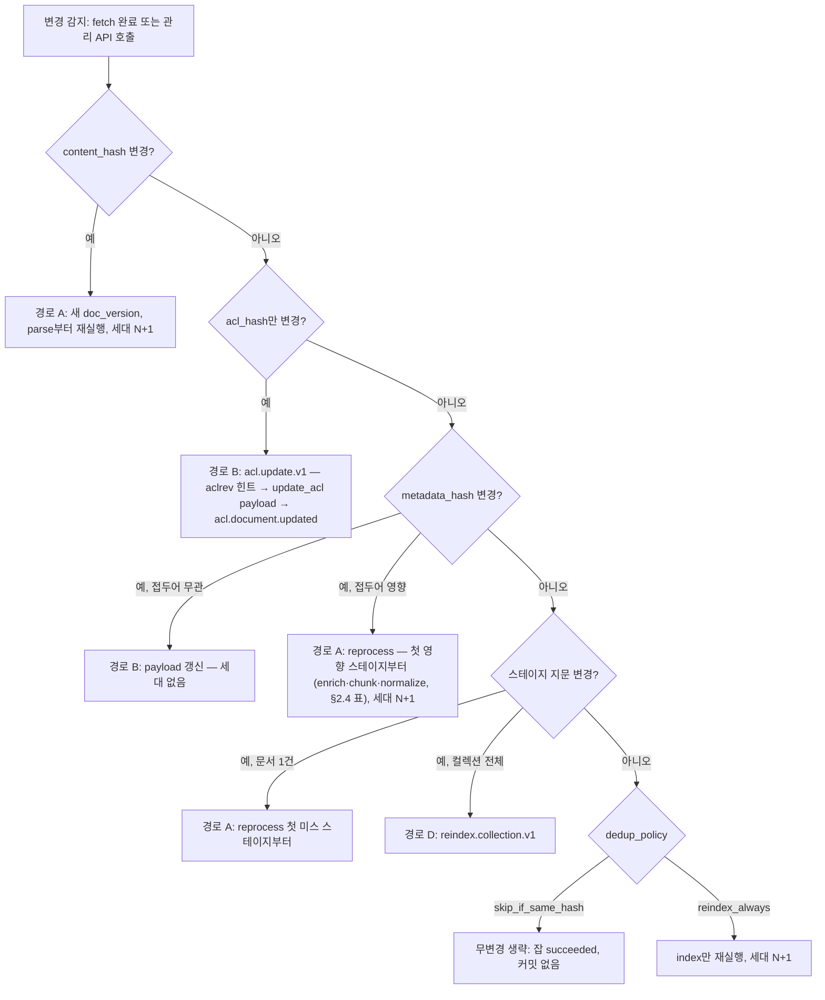
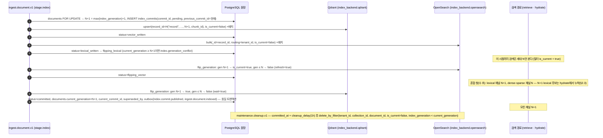
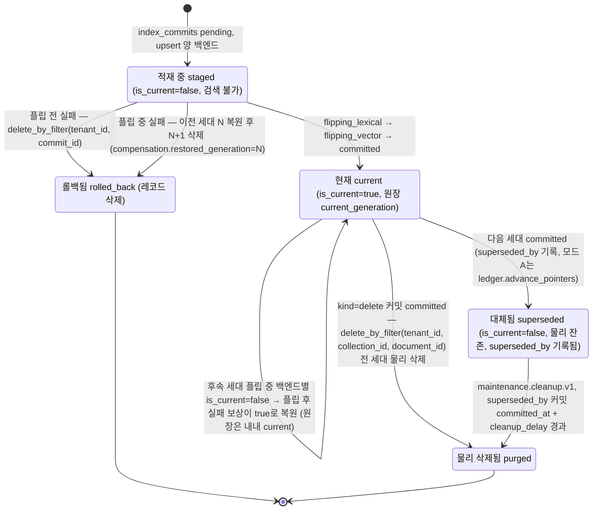
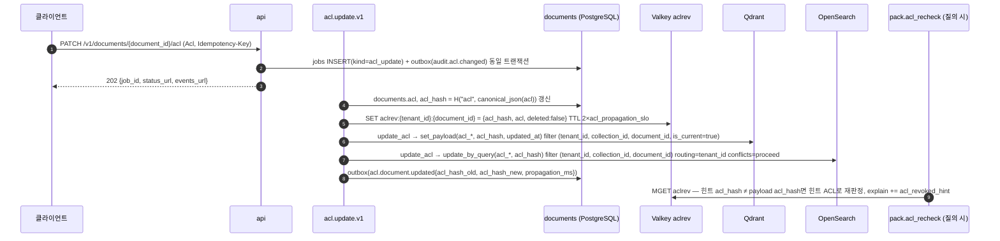
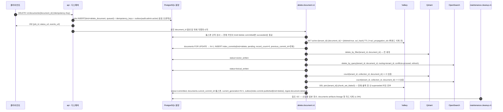
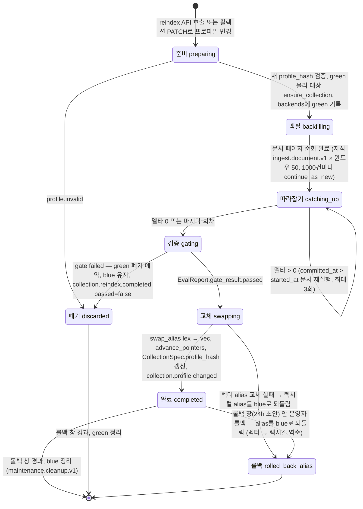

# 갱신·삭제·재색인

## 목적

이미 색인된 문서가 **바뀌거나(갱신), 사라지거나(삭제), 문서는 그대로인데 파이프라인이 바뀌는(재색인)** 세 상황에서 플랫폼이 무엇을 다시 계산하고, 두 인덱스 백엔드(Qdrant·OpenSearch)와 PostgreSQL 원장을 어떤 순서로 바꾸며, 그 사이에 검색 결과가 어떻게 보이는지를 한 문서에서 확정한다. 설계 바이블(Design Bible, [`00-design-bible.md`](../02-architecture/00-design-bible.md))의 세대 사가(§11.4), 워크플로우 카탈로그(§11.2), `IndexCommit`(§5.4), 관리 API(§14), ADR-0005(`doc_version`은 콘텐츠 해시만)와 ADR-0026(세대 사가·원장)이 정본이며, 이 문서는 그 결정을 **파이프라인 운영 절차**로 전개한다. [데이터 흐름과 문서 생애주기](../02-architecture/03-data-flow-and-document-lifecycle.md)가 "무엇이 바뀌면 어디부터 다시 계산하는가"를 산출물 관점에서 다루었으므로, 이 문서는 그 결과를 전제하고 **백엔드 교체의 원자성, 검색 중 이중 노출 방지, 삭제 SLA, 컬렉션 규모 재색인의 백필·검증·alias 교체·롤백, 대량 삭제, 스케줄 유지보수**에 집중한다.

독자는 (1) `index`·`publish` 스테이지와 `reprocess.document.v1`·`delete.document.v1`·`acl.update.v1`·`reindex.collection.v1`·`maintenance.*` 워크플로우를 구현하는 개발자, (2) 임베딩 모델·청커·사용자 사전을 바꾸려는 운영자, (3) "삭제가 정말 끝났는가"를 증명해야 하는 감사 담당자다.

## 범위

- 포함: 변경 종류별 경로 선택 규칙, 같은 `document_id`의 새 콘텐츠 갱신과 원자적 교체(세대 사가), 검색 중 이중 노출·공백 방지 메커니즘 비교, 무변경 생략, 메타데이터·ACL만 바뀌는 payload 갱신 경로, 부분 재처리(계보 비교로 스테이지 재사용), 삭제(툼스톤 커밋 → 백엔드 삭제 → 산출물 정책 → 감사; SLA; 실패 시 재시도·정합성 잡), 컬렉션 재색인(프로파일 변경 판정 — 임베딩 모델 교체 시 벡터만 재생성 가능한지 —, blue/green 백필 → 검증 → alias 교체 → 롤백), 재색인 중 수집 처리, 진행률·비용 추정, 대량 삭제(컬렉션 삭제·테넌트 오프보딩), 스케줄 유지보수(이전 세대·고아 레코드·고아 산출물·고아 물리 대상 정리), 이벤트 발행 시점, 바이블 미해결 이슈 8·17의 측정 계획.
- 제외: `IndexBackend` 어댑터 호출 형태와 백엔드 파라미터([인덱싱](./13-indexing.md)), `IndexCommit` 스키마 전문과 상태 기계 표([IndexCommit 계약](../03-contracts/08-index-commit.md)), 워크플로우 액티비티 코드 구조·디스패처 승인 규칙([오케스트레이션과 워크플로우](../02-architecture/06-orchestration-and-workflows.md)), 산출물 보존 등급과 참조 GC 알고리즘([데이터 흐름과 문서 생애주기](../02-architecture/03-data-flow-and-document-lifecycle.md) §5), 관리 API 응답 형식([관리 API](../05-api/04-management-api.md)), 백업 매체 내 삭제([백업과 재해 복구](../09-operations/07-backup-and-disaster-recovery.md)).
- 정본 관계: 필드·열거·이벤트·오류 코드·워크플로우 타입은 바이블 §5.4·§5.7·§6·§11·§14의 철자를 그대로 쓴다. 바이블에 없는 워크플로우·필드·엔드포인트는 "(제안)"으로 표기하고 "## 미해결 이슈"에 등재한다. 수치는 바이블 §7.2 값 외에는 모두 **초안 목표**다.

## 1. 변경 종류와 경로 선택

### 1.1 세 갈래

모든 변경은 "무엇이 바뀌었는가"에 따라 정확히 한 경로로 간다. 판정 기준은 [ADR-0005](../06-adr/0005-doc-version-content-hash-only-and-acl-payload-update.md)와 바이블 §6.2 해시 결합 규칙에서 나온다: `doc_version = content_hash`(원본 바이트 BLAKE3)이며 ACL·메타데이터는 `acl_hash`·`metadata_hash`로 따로 추적된다.

| 경로 | 조건 | 세대(`index_generation`) | 물리 대상 | 워크플로우 | 이 문서의 절 |
|------|------|---------------------------|-----------|------------|--------------|
| A. **문서 버전 갱신** | 같은 `document_id`에 다른 `content_hash`, 또는 재현 조건(스테이지 지문) 변경, 또는 `dedup_policy=reindex_always` | N+1, 문서 단위 세대 플립 | 변화 없음(같은 컬렉션·같은 물리 대상) | `ingest.document.v1`, `reprocess.document.v1` | §2, §3 |
| B. **payload 갱신** | `content_hash` 동일, `acl_hash` 또는 `metadata_hash`만 변경(접두어 무관 필드) | 불변 | 변화 없음 | `acl.update.v1`; 메타는 같은 골격(제안 `metadata.update.v1`, §2.4) | §2.4, §2.5 |
| C. **삭제** | `DELETE /v1/documents/{document_id}` | N+1 `kind=delete` 툼스톤 커밋(`record_count=0`) | 변화 없음 | `delete.document.v1` | §4 |
| D. **컬렉션 재색인** | 컬렉션 프로파일 `version` 증가(`profile_hash` 변경), 사용자 사전 변경(`dictionary_hash`), 분석기 변경(`analyzer_id`), 백엔드 추가, 격리 등급 승격 | 문서마다 N+1(자식 잡) | `embedding_profile_hash`·`lexical_profile_hash` 변경 시 **blue/green 물리 대상 + alias 교체** | `reindex.collection.v1`, `tier.promotion.v1` | §5 |
| E. **대량 삭제** | `DELETE /v1/collections/{collection_id}`, 테넌트 오프보딩 | 문서마다 툼스톤 또는 물리 대상 단위 삭제 | 컬렉션 alias 제거, 전용 물리 대상 삭제 | `collection.delete.v1`(바이블 §5.7 `JobKind.delete_collection`·§11.2 1.3.0 결정, AM-37 — 해소, 미해결 17) + 자식 `delete.document.v1` + `maintenance.cleanup.v1`; 테넌트 단위는 제안(미해결 이슈 11) | §6 |



### 1.2 경로 선택이 지켜야 할 불변식

| # | 불변식 | 근거 |
|---|--------|------|
| U-1 | ACL·메타데이터 변경은 `doc_version`·`block_id`·`chunk_id`·`stage_key`를 바꾸지 않는다. 바꾸는 구현은 `contract.violation`이다 | ADR-0005, 바이블 §6.2 |
| U-2 | 검색 가시성은 `is_current` 하나로 바뀐다(문서 단위) 또는 alias 하나로 바뀐다(컬렉션 단위). 두 스위치를 한 변경에서 동시에 쓰지 않는다 | 바이블 §11.4 (1)(5), ADR-0026 |
| U-3 | 같은 `document_id`의 잡은 접수 순서로 직렬화된다(디스패처 `jobs.waiting_for`). 갱신·삭제·재처리·재색인 자식 모두 예외가 없다 | 바이블 §11.2, [데이터 흐름](../02-architecture/03-data-flow-and-document-lifecycle.md) §8 |
| U-4 | 삭제·ACL 회수는 백엔드를 바꾸기 **전에** Valkey `aclrev:{tenant_id}:{document_id}` 힌트를 쓴다 | 바이블 §10.3 E9·E11 |
| U-5 | 세대 번호는 문서 단위 단조 증가이며 롤백·폐기된 세대 번호를 재사용하지 않는다(그 문서의 `max(index_commits.index_generation) + 1`) | 바이블 §11.4 (6) 1.3.0 결정(AM-18, CR-31: "원장 `documents` 행 잠금 아래 `max(index_commits.index_generation) + 1`로 할당하며 폐기·롤백된 세대 번호는 재사용하지 않는다"), [IndexCommit 계약](../03-contracts/08-index-commit.md) §3·§4, [오케스트레이션](../02-architecture/06-orchestration-and-workflows.md) §2.5 |
| U-6 | 원장(`documents`·`index_commits`·`jobs`)이 진실이고 인덱스는 투영이다. 복구는 항상 산출물 재적재(replay)이며 스냅샷은 시간 단축용이다 | 바이블 §2.1 K6, §11.4 (4) |
| U-7 | 백엔드 쓰기·삭제·payload 갱신·카운트 필터는 `tenant_id`를 선두 인자로 포함한다(문서 스코프는 `(tenant_id, collection_id, document_id)`, 커밋 스코프는 `(tenant_id, commit_id)`). 이 문서의 축약 표기(`update_by_query(document_id …)` 등)도 그 스코프를 전제하며, `tenant_id` 없는 필터는 어댑터가 거부한다 | 바이블 §10.3 E5·E7·E17, [인덱싱](./13-indexing.md) §2.1 화이트리스트 |

## 2. 갱신 플로우: 같은 `document_id`, 새 콘텐츠

### 2.1 새 버전의 처리

같은 원천(`(tenant_id, collection_id, external_id or source_uri)`)이 `POST /v1/ingest`로 다시 들어오면 API가 `document_id`를 재사용해 `jobs.document_id`에 기록하고, `fetch`가 `content_hash`를 확정한 뒤 [데이터 흐름](../02-architecture/03-data-flow-and-document-lifecycle.md) §3.2 재제출 판정 표로 분기한다. `content_hash`가 다르면 `parse`부터 전부 재실행되고(콘텐츠 전용 캐시 — 파생물·청크 임베딩·LLM 보강 — 만 적중), `EmbeddedChunkSet`이 나오면 `index` 스테이지가 세대 N+1의 사가를 시작한다. 처리 중에는 이전 세대 N이 그대로 검색되며(`is_current=true`), 새 세대는 `is_current=false`로 적재되어 어떤 채널에도 보이지 않는다.

### 2.2 원자적 교체: 세대 사가

**결정:** 문서 갱신의 교체 단위는 `IndexCommit` 세대 사가다 — 새 세대 레코드를 `is_current=false`로 양 백엔드에 upsert → 렉시컬 플립 → 벡터 플립(순서는 프로파일 키 `ingest.index.commit.flip_order = [lexical, vector]`, 네 프로파일 동일, 바이블 §7.2·§11.4 (2)) → `committed` 전이·원장 `documents.current_generation=N+1`·`current_commit_id` 전진·outbox 기록(**동일 트랜잭션**; 벡터 플립은 Qdrant 호출이므로 PostgreSQL 트랜잭션에 들어가지 않고, 그 완료 뒤 원장 트랜잭션이 세 항목을 함께 기록한다) → `cleanup_delay`(1h, 바이블 §7.2) 뒤 이전 세대 물리 삭제. 새 세대를 적재한 직후 이전 커밋 레코드를 즉시 지우는 방식(insert-then-delete, [ADR-0026](../06-adr/0026-index-commit-generation-saga-and-ledger.md) 대안 2)과 `doc_version` 질의 필터 방식(대안 6)은 채택하지 않는다 — 이전 레코드를 먼저 지우는 delete-then-insert는 검색 공백이 생겨 비교 대상도 아니다. 바이블 §7.3의 프로파일 키 값 `ingest.index.commit.strategy = insert_then_delete`는 채택된 사가(새 세대 선적재 → 플립 → 지연 삭제)의 이름이며 대안 2를 뜻하지 않는다(바이블 §11.4; ADR-0026, [ADR-0004](../06-adr/0004-deterministic-chunk-id-scoped-record-id-and-ulid-exception.md)).



다이어그램의 `flip_generation`과 이 문서가 쓰는 `ensure_collection`·`count`·`scroll`·`stats`·`swap_alias`·`upsert`는 `IndexBackend` 포트 메서드 이름으로 [인덱싱](./13-indexing.md) §2.1의 **제안**(그 문서 미해결 이슈 1; `swap_alias`·`ensure_collection`·`upsert`는 07-tech-landscape/06 제안 이름)이다. 바이블이 쓰는 이름은 `search`·`retrieve`·`delete_by_filter`·`update_acl`·`capabilities`(§4.2·§12)와 백엔드 호출명 `set_payload`·`update_by_query`(§11.4)뿐이며, 이 문서는 이하 "(제안)"을 반복하지 않는다.

세대 하나의 생애를 상태로 보면 다음과 같다. 상태 이름은 설명용 라벨이며 계약 필드가 아니다(계약 상태는 `IndexCommit.status`의 `CommitStatus` 9단, 바이블 §5.7).



### 2.3 검색 중 이중 노출·공백 방지

두 백엔드에 걸친 교체는 트랜잭션이 아니므로 "두 세대가 함께 보임(중복)"과 "어느 세대도 안 보임(공백)"을 설계로 막아야 한다. 세 가지 메커니즘을 비교한 결과다.

| 메커니즘 | 동작 | 중복 | 공백 | 롤백 | 판정 |
|----------|------|------|------|------|------|
| 삭제 순서(insert-then-delete) | 새 세대 적재 → `commit_id != new` 삭제 | 적재 완료~삭제 완료 사이 **발생** | 없음 | 한 백엔드만 삭제된 채 실패하면 이전 세대 복구 불가 | 기각([ADR-0026](../06-adr/0026-index-commit-generation-saga-and-ledger.md) 대안 2) |
| 버전 필터(질의에 `doc_version` 또는 `index_generation_min` 명시) | 플래너가 문서별 현재 세대를 알아 필터로 고정 | 없음 | 캐시가 늦으면 새 세대 전체가 걸러짐 | — | 기각(검색 핫패스 PostgreSQL 미의존 위배, ADR-0034; 혼합 창 관측 후 재검토 — 바이블 미해결 8, §9.1) |
| **`is_current` 플립 + 세대 합성 `record_id`**(채택) | 새 세대는 `is_current=false`로 선적재, 보안 불변식 (a) `is_current = true`가 사전 필터(바이블 §10.2) | 없음 — 렉시컬 플립~벡터 플립 사이 **수 초의 채널 간 세대 혼합**만 있고, 그 창의 N+1 lexical 후보는 `hydrate`에서 걸러진다(아래) | 백엔드 단독 관점 없음(플립 전엔 N, 후엔 N+1이 항상 `true`); `hydrate` 관점에서는 혼합 창 동안 그 문서의 lexical 채널 후보가 빈다(아래) | 플립 전: 새 세대 삭제 / 플립 후: 이전 세대 복원 | **결정**(바이블 §11.4) |

혼합 창의 실제 효과는 채택 메커니즘의 일부로 정의한다. 검색 파이프라인 순서는 `retrieve → fuse → hydrate → rerank → postprocess(relevance_gate → dedup → …) → pack`이므로(바이블 §4.3, D-07) 후처리 `dedup`보다 `hydrate`가 먼저다.

1. `hydrate`는 융합된 상위 `record_id`를 벡터 백엔드 alias(`col_{collection_id}_vec`)에 **1회 배치** `retrieve`하며 보안 필터 (a)(`is_current = true` 포함)를 재적용한다(바이블 §4.3·§10.2, E10; [인덱싱](./13-indexing.md) §2.1 `retrieve` 행·§4.4). 렉시컬 플립 뒤~벡터 플립 전에 lexical 채널이 낸 N+1 `record_id`는 벡터 백엔드에서 아직 `is_current=false`이므로 hydrate에서 누락된다 → 후보 제외 + `omitted.reason=hydrate_missing` + `explain += hydrate_missing` + `degraded{hydrate, partial_result}` + `rag_hydrate_missing_total`(바이블 §5.7 `OmitReason`·`ExplainCode`, §6.5). 즉 혼합 창 동안 **그 문서의 lexical 단독 적중은 비고**, dense·sparse 채널의 N 적중만 남는다. 같은 청크가 dense·sparse에도 잡혔으면 N 레코드로 살아남되 lexical 기여분은 N+1 후보 쪽에 갈라져 있어 융합 점수가 낮아진다. N·N+1 레코드가 후처리 `dedup`에서 병합되는 상황은 생기지 않는다 — `dedup`에 닿기 전에 N+1이 걸러진다. 이는 [IndexCommit 계약](../03-contracts/08-index-commit.md) §3.1 "혼합 상태"와 [인덱싱](./13-indexing.md) §7 표의 서술과 같다.
2. 채널별로 관측된 세대는 [인덱싱](./13-indexing.md) §2.1·§4.4가 `channel_runs[].index_generation_seen[]`(그 문서 제안)으로 집계하고, 팩은 `ContextPack.diagnostics.index_generations_seen`(바이블 §11.4 (2))에 기록한다.
3. 창의 길이는 렉시컬 플립 완료(`refresh=true`)~벡터 플립 완료(`wait=true`)이며 p99 측정 계획은 §9.1이다. 창을 없애는 대안(`index_generation_min` 세대 고정 조회)은 ADR-0026 대안 6으로 기각 상태이고 §9.1 결과로 재검토한다.
4. 완화안 — hydrate가 채널이 이미 사전 필터 (a)로 통과시킨 `record_id`에는 `is_current` 조건을 재적용하지 않고(테넌트·컬렉션·ACL·embargo·expires·classification 조건은 유지) 누락 시 `(tenant_id, collection_id, document_id, chunk_id, is_current=true)`로 1회 폴백 조회하는 규칙 — 은 바이블 §10.2("`hydrate`는 같은 (a) 조건으로 재조회")의 변경이므로 [ADR-0034](../06-adr/0034-retrieval-hot-path-postgres-independence-and-hydrate.md)·[인덱싱](./13-indexing.md) §2.1 `retrieve` 개정 **제안**으로만 둔다(미해결 이슈 18).

### 2.4 변경 없음 생략과 메타데이터만 변경

**무변경 생략.** `content_hash`·`acl_hash`·`metadata_hash`·재현 조건이 모두 같고 `dedup_policy=skip_if_same_hash`(기본)이면 잡은 `succeeded`로 끝나고 커밋을 만들지 않는다(`JobStatus.index_commit_id` = 현재 커밋). `SourceDocument` 봉투와 `ingest.document.fetched`는 발행된다 — 원천이 살아 있음을 증적으로 남긴다([데이터 흐름](../02-architecture/03-data-flow-and-document-lifecycle.md) §3.2 행 1). 생략 사유를 클라이언트에 알리는 필드는 바이블 `JobStatus`에 없다(미해결 이슈 5).

**메타데이터만 변경(payload 부분 갱신, 재임베딩 없음).** 트리거는 `PATCH /v1/documents/{document_id}/metadata`(바이블 §14) 또는 재제출에서 `metadata_hash`만 다른 경우([데이터 흐름](../02-architecture/03-data-flow-and-document-lifecycle.md) §3.2 행 3)다. `IndexRecord` 필드 표(바이블 §5.4)의 "원천" 열이 `SRC(metadata)`인 필드만 payload 갱신이 가능하다. `external_id`·`source_uri`는 `IngestRequest.metadata.*`가 아니라 요청 최상위 필드이자 `document_id` 확정 키(`(tenant_id, collection_id, external_id or source_uri)`; 바이블 §5.4 `IngestRequest`·`SourceDocument.document_id`, §11.2, §13.1 `documents`)이므로 이 경로의 갱신 대상이 **아니다** — 원천 위치나 원천 ID가 바뀐 문서는 새 `document_id`로 수집하고 옛 문서는 삭제한다(식별 키 변경 API는 이 문서 범위 밖, 미해결 이슈 3).

| 메타 필드 | `IndexRecord` 필드 | 원천 | 갱신 경로 |
|-----------|--------------------|------|-----------|
| `doc_date`, `doc_type`, `department`, `tags`, `custom.*`(컬렉션 `filterable_fields` 선언 키) | 같은 이름 | SRC(`metadata`) | payload 갱신(세대 없음) |
| `title` | `title`, 그리고 `context_prefix`·`embed_text`·`index_text`의 구성 요소 | SRC + CS | **재처리**: 응답이 `reprocess from_stage=enrich`를 제안(바이블 §14). `embed_text_hash`가 바뀌므로 `commit_hash`도 바뀐다([IndexCommit 계약](../03-contracts/08-index-commit.md) §5). 접두어가 `ChunkSet`에 조립되어 있으면 시작점이 `chunk`여야 하므로 정합 확인이 필요하다(미해결 이슈 4) |
| `genre` | `genre`, `ChunkSet.genre_route`(청커 장르 라우팅) | SRC + CS | **재처리** `from_stage=chunk`(청킹 전략이 바뀜; ADR-0005 재검토 조건) |
| `language_hint` | `lang` | SRC(힌트) / CS(판정값) | payload 갱신은 힌트만 바꾸고 판정값은 바꾸지 않으므로 효과 없음 → 재처리 `from_stage=normalize`(확인 필요) |
| `authors` | 없음(레코드 미포함) | — | `documents.metadata`만 갱신 |

경로의 워크플로우 골격은 [오케스트레이션과 워크플로우](../02-architecture/06-orchestration-and-workflows.md) §2.4의 결정을 따른다: `ledger.update_metadata`(내부; `documents.metadata`·`metadata_hash` 갱신, 회수 힌트 없음) → `stage.index`(모드 `update_payload`; `SRC(metadata)` 필드만) → `stage.publish`. 바이블 §11.2에 워크플로우 타입이, §5.7 `JobKind`에 값이 없으므로 `metadata.update.v1`·`JobKind.metadata_update`·`IndexBackend.update_payload(scope{tenant_id, collection_id, document_id}, fields)`는 **제안**이며, 등재 전까지는 `acl.update.v1`의 내부 인자 `payload_fields`로 실행한다(미해결 이슈 3). 메타 갱신은 커밋을 만들지 않으므로 이력은 `documents.metadata_hash`와 `audit.admin.action`에만 남는다.

### 2.5 ACL만 변경: 즉시 전파 경로

**결정:** ACL 변경은 세대를 만들지 않는다. `PATCH /v1/documents/{document_id}/acl` → `documents.acl`·`acl_hash` 갱신 → Valkey `aclrev:{tenant_id}:{document_id}` 회수 힌트 기록(TTL 2 × `runtime.acl_propagation_slo`) → 양 백엔드 `update_acl(scope{tenant_id, collection_id, document_id}, acl_payload)`로 현재 세대 **모든 레벨** 레코드의 `acl_allow`·`acl_deny`·`acl_visibility`·`acl_classification`·`acl_embargo_until`·`acl_expires_at`·`acl_hash`만 갱신 → `acl.document.updated`·`audit.acl.changed`(바이블 §10.3 E11, §11.2 `acl.update.v1`; [ADR-0005](../06-adr/0005-doc-version-content-hash-only-and-acl-payload-update.md), [ADR-0027](../06-adr/0027-security-context-injection-and-acl-enforcement-points.md)).



즉시성은 두 층으로 보장된다. **관측 차단**은 힌트 기록 직후부터다: `pack.acl_recheck`(바이블 §8.2 `PackStep` 첫 단계)가 payload `acl_hash`와 힌트를 대조해 회수된 항목을 `omitted.reason=acl_denied`로 제외하고 `items[].acl{checked: true, source: revocation_hint}`를 기록한다(E9). **백엔드 전파**는 `rag_acl_propagation_seconds`로 계측되며 프로파일 SLO를 넘으면 알림이다. Valkey 불가 시 힌트 기록은 재시도하며 백엔드 갱신을 먼저 진행하지 않는다(힌트가 먼저여야 E9가 유효). 질의 측은 `degraded{acl_recheck, unavailable}`로 payload ACL만으로 판정한다.

| 프로파일 | `runtime.acl_propagation_slo`(바이블 §7.2) | 힌트 TTL(2×) | 관측 차단 목표(초안) |
|----------|--------------------------------------------|--------------|----------------------|
| `lite` | 15m | 30m | ≤ 5s(큐 대기 포함) |
| `standard` | 5m | 10m | ≤ 5s |
| `premium` | 5m | 10m | ≤ 5s |
| `korean-gov` | 1m(푸시) | 2m | ≤ 2s |

부가 규칙: (1) `update_acl`은 두 백엔드에 각각 실행되어 원자적이지 않다 — 실패 시 재시도, 부분 실패 구간은 힌트가 덮는다. (2) 재제출 경로(같은 `content_hash`, 다른 `acl_hash`)도 같은 갱신 경로를 쓴다([데이터 흐름](../02-architecture/03-data-flow-and-document-lifecycle.md) §3.2 행 2). (3) 산출물 재적재(replay)는 `SourceDocument.acl`이 아니라 `documents.acl`·`acl_hash`를 우선한다 — 그렇지 않으면 갱신 전 ACL이 되살아난다(ADR-0005 부정 결과). (4) `maintenance.consistency.v1`은 `acl_hash` 대조(I5)로 누락된 전파를 잡아 `acl.update.v1`을 재실행한다([인덱싱](./13-indexing.md) §10). (5) 커넥터 측 주기 조정은 `Acl.source_acl_hash`와 `acl_hash`를 대조해 변경분만 PATCH한다.

## 3. 부분 재처리: 계보 비교로 스테이지 재사용

### 3.1 원리

`stage_key = H("stage", stage_name, scope_key, input_ref.blake3, fingerprint)`는 실행 없이 계산할 수 있으므로, 재처리 계획은 `SourceDocument.content_hash`에서 출발해 스테이지 순서대로 키를 만들고 `artifacts(tenant_id, stage_key)`를 조회해 **첫 미스 스테이지**를 찾는다. 알고리즘과 의사코드는 [데이터 흐름](../02-architecture/03-data-flow-and-document-lifecycle.md) §4.2가 정본이다. `POST /v1/documents/{document_id}/reprocess {from_stage}`의 `from_stage ∈ {parse, normalize, chunk, recount, enrich, embed, index}`(바이블 §14)는 **시작 하한**이다 — 그 이상은 캐시를 조회하지 않고 강제 재실행, 그 미만은 캐시 적중을 기대하며 미스면 그 스테이지로 물러난다.

```json
{
  "from_stage": "embed"
}
```

### 3.2 변경 종류 → 최소 시작 스테이지

현재 커밋(`index_commits`)의 재현성 지문 다섯 개와 공간·분석기 식별자를 대상 프로파일과 비교하면 원장만 읽고 시작점을 정할 수 있다([IndexCommit 계약](../03-contracts/08-index-commit.md) §6).

| 차이 | 최소 `from_stage` | 재사용되는 산출물 | `chunk_id` 집합 | 물리 대상 |
|------|-------------------|-------------------|-----------------|-----------|
| `parser_fingerprint_hash` | `parse` | 원본·파생물(`H("derived")`) | 변경 가능 | 불변 |
| `normalizer_fingerprint`(`analyzer_id`·`dictionary_hash`·`pii_policy`·PII 탐지기 버전) | `normalize` | `ParsedDocument` | 변경 가능(문장 경계) | `lexical_profile_hash` 변경 시 OpenSearch blue/green |
| `chunker_config_hash`·1차 토크나이저 | `chunk` | `NormalizedDocument` | **전부 변경**(부모 번들 키 `chunk_set_blake3`도 변경) | 불변 |
| 임베더 `tokenizer_id`가 `token_counts`에 없음 | `recount` | `ChunkSet`(키만 추가) | 불변 | 불변 |
| `enricher_fingerprint`, 접두어 영향 메타 | `enrich` | `ChunkSet`; LLM 청크 캐시는 `model_id`·`prompt_hash` 같은 청크만 | 불변 | 불변 |
| `embedding_space_ids`·`embedding_profile_hash` | `embed`(+ 필요 시 `recount`) | `EnrichedChunkSet`; 청크 임베딩 캐시는 새 공간이라 전부 미스 | 불변 | **Qdrant blue/green**(`rag_vec_{embedding_profile_hash[:12]}`) |
| `embedder_fingerprint`만(같은 공간, 서빙 교체) | `embed`(세트 키) | 청크 임베딩 캐시 **전부 적중** → 실질 비용 0 | 불변 | 불변(교체 전 코사인 ≥ 0.9999 게이트, D-16) |
| 정합성 불일치·롤백·`reindex_always` | `index` | `EmbeddedChunkSet` + `requires_lineage`(`EnrichedChunkSet`·`ChunkSet`·`SourceDocument`) | 불변 | 불변 |

`from_stage ∈ {enrich, embed, index}`처럼 `chunk_id` 집합이 같은 재처리도 `record_id`가 세대를 포함하므로 새 세대로 공존하고 플립 전까지 이전 세대가 검색된다(바이블 §11.4 (1), E17). 보존 정책이 `ParsedDocument`·`NormalizedDocument`를 회수한 문서(`minimal` 등급)는 `normalize`·`chunk` 시작 요청이 `parse`로 후퇴한다 — 그 비용은 보존 등급을 낮춘 운영자의 몫이다([데이터 흐름](../02-architecture/03-data-flow-and-document-lifecycle.md) §5.2).

### 3.3 재처리 잡의 규칙

1. `reprocess.document.v1`은 문서 단위 직렬화(U-3)를 그대로 받는다. 같은 문서의 진행 중 ingest 뒤에 `queued`로 대기한다.
2. `index`는 캐시가 없어 항상 새 세대를 만든다. 따라서 "바뀐 것이 없는데 `reprocess`를 호출"하면 같은 `commit_hash`의 세대가 하나 더 생긴다 — 정합성 검사의 재적재 검증 기준(같은 `commit_hash`)이 되며, 불필요한 호출은 관리 API가 경고로 알린다(응답 형식은 [관리 API](../05-api/04-management-api.md)).
3. 롤백은 "이전 세대를 되살리는 것"이 아니라 superseded 커밋의 `artifact_refs.embedded`를 새 세대 N+2로 재적재하는 것이다. `cleanup_delay`(1h) 안이면 백엔드에 이전 세대가 남아 있으나 사가 보상 외의 경로로 `is_current`를 되돌리지 않는다(U-2). superseded 커밋의 산출물은 **산출물 롤백 창 7일**(초안, [데이터 흐름](../02-architecture/03-data-flow-and-document-lifecycle.md) §5.1·§5.4; `index_replay` 등급은 `source`·`chunk_set`·`enriched`·`embedded`만 뿌리에 남긴다) 동안 GC 뿌리에 포함되므로 재적재 롤백은 그 안에서만 가능하고, 그 뒤에는 관리 API가 "재적재 불가(재실행 필요)"를 표시한다. 커밋 지정 인자(`commit_id`)는 바이블 §14에 없어 제안이다(미해결 이슈 6).
4. `partial` 잡의 LLM 보강 재시도는 `POST /v1/jobs/{job_id}/retry?stages=enrich`(바이블 §11.5)이며 `reprocess`가 아니다 — 같은 잡의 산출물을 재사용해 `enrich`부터 다시 돌고 새 세대를 커밋한다.

## 4. 삭제

### 4.1 삭제 플로우

**결정:** 삭제는 되돌리는 사가가 아니라 **전진 복구(forward recovery)** 사가다 — Valkey 삭제 힌트 → `kind=delete` 툼스톤 커밋 `pending` → Qdrant `delete_by_filter(tenant_id, document_id)`(전 세대) → `vector_written` → OpenSearch `delete_by_query` → `lexical_written` → 양 백엔드 `count(tenant_id, collection_id, document_id) == 0` 검증 → `ptxt:` 부모 본문 캐시 `DEL` → `committed`(`record_count=0`, `documents.current_commit_id`=툼스톤, `current_generation=N+1`) → `ingest.document.deleted` → 산출물·원본·원장 행은 `maintenance.cleanup.v1` 참조 GC가 회수(바이블 §11.2 `delete.document.v1`; [ADR-0026](../06-adr/0026-index-commit-generation-saga-and-ledger.md), [ADR-0027](../06-adr/0027-security-context-injection-and-acl-enforcement-points.md); 액티비티 표는 [오케스트레이션과 워크플로우](../02-architecture/06-orchestration-and-workflows.md) §2.3).



소프트 삭제(soft delete)는 별도 컬럼이 아니라 "`documents.current_commit_id`가 `kind=delete`·`status=committed` 커밋을 가리키는 상태"이고, 접수~커밋 사이의 "삭제 중"은 활성 `delete_document` 잡의 존재로 파생된다([데이터 흐름](../02-architecture/03-data-flow-and-document-lifecycle.md) §1.1·§7.1). 조회 API는 두 상태 모두 삭제로 응답하고 목록·통계에서 제외한다.

### 4.2 산출물 정책과 감사

| 대상 | 삭제 잡이 직접 하는 일 | 이후 처리 | 증적 |
|------|-------------------------|-----------|------|
| 백엔드 레코드(전 세대) | `delete_by_filter` + 0건 검증 | 물리 소거는 백엔드 컴팩션·세그먼트 머지 | `IndexCommit.backend_results[].deleted` |
| Valkey `ptxt:` 부모 본문 | 명시 `DEL`(문서 파생 본문, FR-SEC-10) | 잔여 키는 TTL 24h 만료 | 삭제 키 수를 `job_events.payload`에 기록 |
| Valkey `aclrev:` 힌트 | 기록(삭제 전) | TTL 만료; `maintenance.cleanup.v1`이 만료 힌트 정리 | — |
| 산출물·원본 오브젝트, `artifacts`·`lineage` 행 | 하지 않음(참조 해제만: 툼스톤 커밋의 `artifact_refs`는 `{}`) | `maintenance.cleanup.v1` 참조 GC — 뿌리에서 도달 불가 + 유예 1h(초안) → 삭제; 콘텐츠 주소화 객체는 다른 문서가 공유할 수 있어 **참조 카운트 기준** | GC 회전의 삭제 객체 수 |
| 청크 임베딩·LLM 보강 캐시 | 하지 않음 | 참조 문서 0인 항목 회수(저장 위치 확정 후, [데이터 흐름](../02-architecture/03-data-flow-and-document-lifecycle.md) 미해결 7) | — |
| `documents` 행 | 툼스톤 포인터 갱신 | 산출물이 모두 회수된 GC 회전에서 하드 삭제(≤ 24h) | — |
| `index_commits`·`audit_log` | 툼스톤 커밋 행 추가; 접수·완료·GC 감사 이벤트 | **보존**(본문 없음; `index_commits`는 영구, `audit_log` ≥ 1년, `korean-gov` 2년) | 삭제 완료 보고의 근거 |
| `job_events` | 삭제 잡·GC 회전의 단계별 카운트를 `payload`에 기록 | 종료 후 **90d**(초안, [데이터 흐름](../02-architecture/03-data-flow-and-document-lifecycle.md) §5.1; §7.1 (5)) — 장기 증적이 아니다 | 보존 기간 안의 운영 진단용 상세 |
| `purge_mode=immediate`(컬렉션 정책 제안) | 3단계 앞에 `maintenance.gc_document`를 끼워 유예 없이 회수 | 백업 매체 표시 | 컴플라이언스 즉시 소거 |

"삭제 완료"는 세 증적이 모두 있을 때만 보고한다: 접수 `audit.admin.action{action: delete_document}`, 완료 `ingest.document.deleted{commit_id, backend_results[].deleted}`, GC 회전의 삭제 객체 수. 세 번째 증적을 `job_events.payload`(90d)에만 두면 감사 담당자가 90일 뒤 삭제 완료를 증명할 수 없으므로, 이 문서는 GC 회전마다 회수 객체 수와 하드 삭제한 툼스톤 `document_id` 목록을 `audit.admin.action{action: gc_sweep}`(값 제안)으로 `audit_log`에도 기록하도록 한다(초안 규칙; [데이터 흐름](../02-architecture/03-data-flow-and-document-lifecycle.md) §7.3 (5)는 `job_events`만 적었다 — 미해결 이슈 19). 법적 보존(legal hold) 문서는 논리 삭제(툼스톤·백엔드 삭제)는 그대로 진행하고 산출물 GC만 유예한다(플래그 위치는 [데이터 흐름](../02-architecture/03-data-flow-and-document-lifecycle.md) 미해결 2).

### 4.3 삭제 SLA

NFR의 데드라인과 메커니즘의 대응이다. "초안 목표"는 실측 전 값이다.

| 대상 | 요구(최대) | 메커니즘 | 초안 목표 | 측정 |
|------|------------|----------|-----------|------|
| 조회 API 삭제 상태 | 즉시 | 접수 트랜잭션의 활성 잡 → 읽기 모델 "삭제 중" | 요청 트랜잭션 내 | API 응답 |
| 질의 결과 미노출(관측) | ≤ 60s | `aclrev{deleted: true}` → `pack.acl_recheck` 제외 | 힌트 기록 ≤ 5s | 골든 시나리오 "삭제 → 전파 전 질의 → 미반환", `rag_acl_recheck_denied_total` |
| Qdrant·OpenSearch 논리 삭제 | ≤ 60s | `delete_by_filter`·`delete_by_query` + 0건 검증 | 큐 대기 포함 ≤ 60s | `count(tenant_id, collection_id, document_id) == 0`; 전파 시간은 `rag_acl_propagation_seconds`로 계량(전용 메트릭은 미해결 이슈 8) |
| 부모 본문 캐시 물리 소거 | ≤ 5min | 삭제 잡 안 `DEL ptxt:` | ≤ 60s | Valkey 키 부재 검사 |
| 삭제 완료 이벤트 | ≤ 5s(논리 삭제 후; NFR 요구) | 아웃박스 → 릴레이 | 프로파일 `runtime.outbox_lag_slo`(standard·premium 5s, korean-gov 2s; **`lite` 30s는 요구를 넘는 예외**로 비고 — `lite` 배포는 이벤트가 아니라 조회 API·`aclrev` 힌트로 삭제 상태를 확인한다) | `rag_outbox_lag_seconds` |
| 산출물·원본·원장 행 | ≤ 24h | `maintenance.cleanup.v1` 1h 주기 + 유예 1h | ≤ 3h | 버킷 리스팅 ↔ `artifacts` 대조(고아 0) |
| 백엔드 물리 소거 | ≤ 7일 | 컴팩션·세그먼트 머지 | 백엔드 기본 주기 | 운영 런북 |
| 백업 | ≤ 35일 | 복구 후 복구 시점 이후의 `kind=delete` 커밋을 원장에서 재생 | — | 복구 리허설 |

### 4.4 실패·재시도·정합성 잡

| 상황 | 동작 |
|------|------|
| 백엔드 일시 장애 | `index.backend_unavailable` 재시도 5회(`ingest-io` 정책, 바이블 §4.4). `delete_by_filter`는 멱등이라 전진 복구된다. **매 시도마다 `aclrev` 힌트를 다시 써** TTL(2 × SLO)이 삭제 완료 전에 만료되지 않게 한다 |
| 0건 검증 실패(레코드 잔존) | 같은 코드로 재시도. 소진 시 `status=failed` + `index.consistency.mismatch` + `rag_consistency_mismatch_total`. 보상(복원)은 없다 — 삭제는 되돌릴 수 없다 |
| 재시도 소진 후 | `maintenance.consistency.v1`이 미완료 삭제 커밋(`kind=delete AND status NOT IN (committed, failed)`)과 툼스톤 문서의 잔존 레코드(`count > 0`)·`artifacts` 행 잔존을 발견하면 힌트를 재기록한 뒤 삭제를 재구동한다 |
| 재삭제 | 툼스톤 단락: 첫 액티비티가 현재 커밋이 `kind=delete`·`committed`임을 보면 아무것도 쓰지 않고 `succeeded`. 같은 `Idempotency-Key` 재전송은 `idempotency_keys(tenant_id, key)` 판정으로 같은 `job_id`를 200으로 |
| 삭제·수집 경합 | 접수 순서 직렬화(U-3). 삭제 뒤 수집은 툼스톤에서 세대 N+2로 재활성화되며 `documents` 행이 살아 있는 동안(≤ 24h) `document_id`가 재사용된다; 하드 삭제 뒤의 재수집은 **새 `document_id`** 를 받는다 |
| 현재 커밋이 없는 문서의 삭제 | 삭제 잡은 항상 `kind=delete` 툼스톤 커밋(`record_count=0`)을 만든다(바이블 §11.2 `delete.document.v1`·§5.4 `IndexCommit.kind`, CR-30) — 커밋을 만들지 않고 `JobStatus.index_commit_id = null`로 끝내는 경로는 두지 않는다. 이 경우 `previous_commit_id = null`로 툼스톤만 기록한다 |
| 플립 중인 커밋과 겹침 | 겹치지 않는다 — 문서 직렬화가 앞 잡의 사가를 먼저 끝낸다. `flipping_*` 구간(`flipping_lexical` 이후)에 도착한 취소 시그널은 바이블 §11.5 보류 잠정 규칙(AM-46, CR-29)에 따라 `cancelling`으로 전이시키지 않고 잡은 `running → succeeded`로 끝나며 취소 API는 202와 현재 `JobStatus`를 반환한다([IndexCommit 계약](../03-contracts/08-index-commit.md) §3 규칙 (6)과 정합); 어느 쪽이든 삭제 잡은 그 사가가 종결된 뒤 시작한다 |

## 5. 컬렉션 재색인

### 5.1 프로파일 변경 판정: 무엇을 다시 계산하는가

재색인의 비용은 "어느 스테이지부터"로 결정되고, 전환 방식은 "물리 이름이 바뀌는가"로 결정된다. 새 프로파일 버전은 `POST /v1/profiles`(불변 게시 — 같은 `(profile_id, version)` 재게시는 `contract.violation`, 바이블 §14 1.3.0)로 먼저 등록하고, 두 판정은 `POST /v1/profiles/validate`가 그 버전을 해소한 뒤 현재 `CollectionSpec`과 지문·해시를 비교해 내린다.

| 변경 | 시작 스테이지 | 벡터만 재생성 가능? | `embedding_profile_hash` | `lexical_profile_hash` | 전환 방식 |
|------|---------------|---------------------|---------------------------|-------------------------|-----------|
| 임베딩 모델·revision·차원·프롬프트·양자화·`vocab_id` 교체(청커 동일) | `embed`(+ `recount`: 새 임베더 `tokenizer_id`가 `token_counts`에 없을 때, O-09) | **예** — `chunker_config_hash`가 같아 `chunk_id` 집합·`ChunkSet`·`EnrichedChunkSet`이 캐시 적중; `embed_text`는 불변이므로 재계산은 임베딩만 | 변경 | 불변 | 벡터 blue/green(새 `rag_vec_{hash12'}`) + alias `col_{collection_id}_vec` 교체. 렉시컬은 물리 이름 불변 → **미정(§5.5)** — 서빙 중인 같은 물리 인덱스 안의 문서 단위 플립은 채택하지 않으며(§5.2 단계 3), 확정 전에는 §5.5 잠정 규칙으로만 실행 |
| sparse 모델 교체(`embedding_space_ids.sparse_learned`) | `embed` | 예(dense 청크 캐시는 공간별 키라 적중, sparse만 미스) | 변경 | 불변 | 동일(O-02, ADR-0014) |
| 같은 공간의 서빙 스택 교체(`image_digest`만) | `embed` 세트 키 | 청크 캐시 전부 적중 → **재색인 불필요**. 코사인 ≥ 0.9999 동등성 게이트 통과가 조건(ADR-0009) | 불변 | 불변 | 없음(다음 세대부터 `embedder_fingerprint`만 바뀜) |
| 청커 설정(`leaf_max_tokens` 등)·1차 토크나이저 | `chunk` | **아니오** — `chunk_id` 전부 바뀌므로 보강·임베딩 전체 재실행(임베딩 캐시는 `embed_text`가 같은 청크만 적중) | 불변 | 불변 | 물리 이름 불변 → §5.5 미정(모드 B 후보) |
| 사용자 사전(`dictionary_hash`)·분석기(`analyzer_id`, 예: mecab-ko → Kiwi 승격 ADR-0021) | `normalize` | 벡터는 임베딩 캐시 적중으로 재계산 없이 새 세대에 복사; 렉시컬 뷰(`index_text`·`lexical_terms`)만 실질 재계산 | 불변(`lite`는 `sparse_bm25` 공간이 바뀌어 **변경**) | 변경 | 렉시컬 blue/green(새 `rag_lex_{hash12'}`) + alias `col_{collection_id}_lex` 교체. 벡터는 `lite`에서만 이름이 바뀌고(`sparse_bm25` 공간) 그 외 프로파일은 물리 이름 불변 → **미정(§5.5)**(§5.2 단계 3) |
| 파서·정규화기·보강기 플러그인 업그레이드(지문 변경) | 첫 미스(`parse`/`normalize`/`enrich`) | 보강기만이면 예(`chunk_id` 불변) | 불변 | 불변 | 물리 이름 불변 → §5.5 미정 |
| 백엔드 추가(`lite` → `standard`: OpenSearch 신설) | `index`(재적재) | 예(산출물 보존 시) | 불변 | 신규 | 새 물리 인덱스 채움 → alias 생성 → `CollectionSpec.backends` 갱신 |
| 격리 등급 승격(E15: `payload_filter` → `shard_key`/`index_per_tenant`) | `index` | 예 | 불변 | 불변 | 테넌트 전용 물리 대상 blue/green(`tier.promotion.v1`, ADR-0028) |
| `query.*`만 변경(융합·리랭크·팩) | 없음 | — | 불변 | 불변 | 바인딩 교체만(`profile_hash` 변경, 재색인 없음) |

**결정:** 임베딩 모델 교체는 청커가 같으면 `from_stage=embed`(+`recount`)로 **벡터만** 재생성하며 청킹·보강 산출물은 `stage_key` 캐시로 재사용한다. 청커 변경은 전체 재청킹이다(바이블 §4.2 `recount` 행, §3.2 O-09; [ADR-0019](../06-adr/0019-chunk-size-tokenizer-defaults-and-recount-stage.md), [ADR-0037](../06-adr/0037-artifact-cache-scope-and-stage-key-composition.md)).

### 5.2 blue/green 백필 → 검증 → alias 교체 → 롤백

**결정:** 컬렉션 단위 프로파일 변경은 문서 세대 플립이 아니라 **blue/green 물리 컬렉션·인덱스 + alias 교체(렉시컬 → 벡터)** 다. `CollectionSpec`은 정확히 하나의 `profile_hash`에 바인딩되며 교체가 끝나기 전에는 바뀌지 않는다(바이블 §11.4 (5), §11.2 `reindex.collection.v1`, §5.6; [ADR-0026](../06-adr/0026-index-commit-generation-saga-and-ledger.md)). 부모·자식 팬아웃·디스패처 승인·`continue_as_new`·원장 포인터 규칙의 정본은 [오케스트레이션과 워크플로우](../02-architecture/06-orchestration-and-workflows.md) §2.5(모드 A)이고, 어댑터 호출은 [인덱싱](./13-indexing.md) §9다. 모드 A는 **모든 백엔드에 green 물리 대상이 있을 때만** 실행하고, alias가 가리키는(서빙 중인) 물리 대상에서는 문서 단위 `is_current` 플립을 하지 않는다(U-2; 단계 3). 이 절은 운영 절차와 검증·롤백 규칙을 정한다.



상태 이름은 부모 잡의 내부 국면(`ReindexCarriedState.phase`)을 설명하는 라벨이며 계약 필드가 아니다. 클라이언트에는 `JobStatus{kind=reindex_collection, state, progress{done, total, unit: document}}`와 `collection.reindex.completed` 이벤트로만 노출된다.

| 단계 | 규칙 |
|------|------|
| 1 준비 | `POST /v1/profiles`(1.3.0, 불변 게시)로 등록된 새 버전을 `POST /v1/profiles/validate`로 검증하고 `profile_hash'`·`embedding_profile_hash'`·`lexical_profile_hash'`를 계산한다. 두 해시 중 하나라도 바뀌면 green 물리 이름(`rag_vec_{hash12'}`·`rag_lex_{hash12'}`, 바이블 §13.4)이 달라져 blue/green이 가능하다. 같은 이름의 공유 물리 컬렉션을 다른 컬렉션이 이미 만들었으면 재사용한다(`ensure_collection`은 파라미터 대조만). `collections.backends`에 green 항목을 기록하되 alias는 아직 blue다 |
| 2 백필 | 자식 `ingest.document.v1`이 §3의 부분 재처리를 수행하고 **세대 사가를 정상 완주**한다(`committed`, green 안에서 `is_current=true`). alias가 blue를 가리키므로 프로덕션에는 보이지 않는다. 자식 커밋은 `IndexCommit.profile_hash = profile_hash'`, `backend_results[].physical_name = green`을 기록하고 **`documents.current_*`를 전진시키지 않는다**(**미정(O-12):** blue/green 채움 중 `documents` 원장 포인터·정합성 검사 기준, 바이블 §3.2 AM-21 — [오케스트레이션과 워크플로우](../02-architecture/06-orchestration-and-workflows.md) §2.5 A-7 `ledger.advance_pointers`가 교체 직후 한 번 전진; ADR-0026 개정 항목). 델타 패스 자식의 `previous_commit_id`·`supersedes_commit_ids` 규칙은 §5.4 (3). 인플라이트 ≤ `min(50, floor(tenant_concurrent_jobs_max × reindex_max_share))`, 1,000건마다 `continue_as_new` |
| 3 물리 이름이 바뀌지 않는 백엔드 | **미정(O-11, 미해결 이슈 1·2):** 예: 임베딩 모델만 바꾼 재색인의 OpenSearch(`lexical_profile_hash` 불변), 사전·분석기만 바꾼 재색인의 Qdrant(`standard`·`premium`·`korean-gov`; `lite`는 `sparse_bm25` 공간이 바뀌어 해당 없음). 이 백엔드에 **같은 물리 인덱스 안에서 문서 단위로 새 세대를 적재하고 플립하는 방식은 채택하지 않는다.** 이유: (a) `hydrate`가 alias(blue) 벡터 백엔드에 보안 필터 (a)를 재적용해 1회 배치 조회하므로(§2.3), 이름 불변 백엔드가 N+1로 플립되면 그 채널이 낸 N+1 `record_id`가 blue에 없거나(임베더 교체 시 OpenSearch → blue Qdrant에 N+1 부재) `is_current=false`여서(사전 변경 시 Qdrant 플립 → blue OpenSearch의 N이 Qdrant에서 `false`) **백필 기간(수 시간~수 일) 내내** 이미 채워진 문서의 그 채널 단독 적중이 `hydrate_missing`으로 사라진다; (b) 한 변경에서 `is_current`와 alias 두 스위치를 함께 쓰는 것이라 U-2에 어긋난다; (c) 정합성 검사가 서빙 대상에서 `documents.current_generation`과 다른 세대를 `is_current=true`로 보게 되어 재색인 기간 내내 `stale_current` 거짓 불일치 → `flip_generation` 재실행 → 재적재를 유발한다(§7.2). 따라서 모드 A는 **모든 백엔드에 green 물리 대상이 있을 때만** 자동 실행하며, green을 만들 수 없는 백엔드가 하나라도 있으면 `ledger.begin_reindex`(0단계)가 부모 잡을 `failed`로 종료한다(`last_error.code`는 [오케스트레이션과 워크플로우](../02-architecture/06-orchestration-and-workflows.md) 미해결 6과 공동). 해소안과 잠정 운영 규칙은 §5.5 |
| 4 따라잡기 | 재색인 `started_at` 이후 최신 커밋의 `committed_at`이 갱신되었고 그 커밋의 `profile_hash ≠ profile_hash'`인 문서(신규 수집·갱신·삭제)를 다시 자식으로 실행한다. 삭제는 green에도 `kind=delete`로 반영된다. 델타 0건 또는 최대 3회(초안)까지 반복; 종료 조건·마지막 회차 컬렉션 잠금은 미해결 이슈 7 |
| 5 검증 | §5.3 |
| 6 교체 | `swap_alias("col_{collection_id}_lex", green_lex)` → `swap_alias("col_{collection_id}_vec", green_vec)`(렉시컬 → 벡터 순서 고정 — 바이블 §11.2·§11.4 (5); 문서 세대 플립의 `ingest.index.commit.flip_order = [lexical, vector]`(바이블 §7.2)와 같은 순서). 각 호출은 백엔드 내부 원자(Qdrant `update_collection_aliases` 1요청 / OpenSearch `POST _aliases` 1요청)이며 둘 사이 수 초의 혼합 프로파일 상태를 허용한다. 이어서 `ledger.advance_pointers`(문서별 최신 green `committed` 커밋으로 `documents.current_*` 전진) → `CollectionSpec.profile_hash`·`backends[].physical_name`·`alias` 갱신 → `collection.profile.changed`(api `collspec:{collection_id}` 캐시 무효화) + `collection.reindex.completed{gate_result.passed=true}` |
| 7 롤백 | (a) **교체 도중** 벡터 alias 교체가 실패하면 렉시컬 alias를 blue로 되돌리고 `collection.reindex.completed{passed=false}`를 발행한다(되돌림도 실패하면 운영 알림 + 런북; [인덱싱](./13-indexing.md) 미해결 10과 공동). (b) **교체 후** 재색인 롤백 창(초안 24h; 프로파일 키 `ingest.index.reindex_rollback_window` 제안) 안에는 blue 물리 대상이 보존되므로 운영자가 alias를 blue로 되돌릴 수 있다 — 순서는 **벡터 → 렉시컬**(교체의 역순 = `flip_order`의 역순)로 하여 되돌리는 동안에도 두 채널 중 먼저 되돌린 쪽이 더 오래된 프로파일을 보게 한다. 되돌림 뒤 `CollectionSpec.profile_hash`를 이전 값으로 복원하고 포인터는 blue의 최신 `committed` 커밋으로 재전진한다(제안, 미해결 이슈 6). 롤백 창 뒤에는 blue가 정리되어 롤백은 재색인이다 |
| 8 정리 | 롤백 창 경과 후 `maintenance.cleanup.v1`이 blue(실패 시 green)를 정리한다. 물리 삭제는 그 이름을 가리키는 `backends[].physical_name`·alias가 0개일 때만; 다른 컬렉션이 공유 중이면 `delete_by_filter(tenant_id, collection_id)`로 이 컬렉션 레코드만 지운다 |

### 5.3 검증: 하네스 게이트와 샘플 질의 비교

**결정:** alias 교체는 평가 하네스 게이트 통과가 조건이다. `reindex.collection.v1`이 자식 `eval.run.v1`을 green 물리 이름 대상으로 실행하고(`EvalRun.index_commit_ids` = green 커밋), `EvalReport.gate_result.passed`가 참일 때만 교체한다(바이블 §7.4, §11.2; D-12, [ADR-0023](../06-adr/0023-evaluation-qrels-answer-spans-and-linear-ndcg.md)).

| 검증 층 | 입력 | 판정 | 비고 |
|---------|------|------|------|
| 정합성 사전 검사 | green 커밋 수 = 컬렉션 활성 문서 수(툼스톤 제외); 문서별 `is_current=true` 카운트 = `record_count` | 불일치 문서는 자식 재실행 후 재검사 | `maintenance.consistency.v1`과 같은 대조를 green 물리 대상 기준으로 1회 |
| 골든셋 게이트(정본) | 프로파일 `eval.datasets[]` 중 `corpus_collection_id`가 이 컬렉션인 데이터셋(qrels + `answer_spans`) | `gate_result{passed, failed_gates[]}`: nDCG@10·Recall@20 최소값(§7.2 `eval.gates`), 베이스라인(blue 최근 `EvalRun`) 대비 `comparison{deltas, p_values, correction: "holm"}` | `answer_spans`는 재청킹에 불변이므로 청커 변경 재색인도 비교 가능 |
| 샘플 질의 비교(보조, 제안) | 골든셋이 없거나 `min_qrels` 미달인 컬렉션: 최근 `audit.query.executed`·`feedback_events`에서 표본 질의 N건을 뽑아 blue·green에 같은 `QueryRequest`를 실행 | 상위 K 문서 집합 중첩률, `cite_id` 상위 3 일치율, `confidence_tier` 분포 변화를 보고. **자동 차단 기준으로 쓰지 않고** 운영자 승인(`approve` 시그널) 입력으로만 | 질의 표본에 콘텐츠가 있으므로 PII 정책 적용 후 저장; 08-evaluation과 합의(미해결 이슈 9) |
| 지연 검사 | green 대상 리트리벌 p95(`rag_retrieve_latency_seconds{channel}`) | 프로파일 `query.latency_budget_ms.total` 초과면 경고(차단 아님) | 새 HNSW 세그먼트 최적화 완료 전이면 재측정 |

게이트 실패 시 green 물리 대상은 폐기 예약되고 green 커밋은 `committed` 종단 상태를 그대로 둔다 — `rolled_back`은 사가 보상 전용이며 `index.commit.rolled_back`을 발행하지 않는다. 포인터가 전진하지 않았으므로 되돌릴 원장이 없다.

### 5.4 재색인 중 수집 처리

**결정:** 재색인 중 들어오는 수집·갱신·삭제는 **blue에만 정상 처리**하고, green은 **따라잡기(델타 패스)** 로 흡수한다. 한 잡이 blue·green 두 물리 대상에 동시에 쓰는 듀얼 라이트(dual write)는 기본으로 채택하지 않는다(바이블 §11.2 `reindex.collection.v1`; [ADR-0026](../06-adr/0026-index-commit-generation-saga-and-ledger.md), [ADR-0017](../06-adr/0017-event-delivery-outbox-cloudevents-no-broker.md)).

| 대안 | 동작 | 장점 | 단점 | 판정 |
|------|------|------|------|------|
| 듀얼 라이트(잡 내부) | 하나의 `ingest.document.v1`이 blue 프로파일과 green 프로파일로 두 번 임베딩·두 번 적재 | 델타 패스 불필요 | 잡 하나가 커밋 둘을 만들어 `IndexCommit`·`CommitStatus`(백엔드 2개 기준 9단)·`jobs.index_commit_id`(단수)와 맞지 않음; green 프로파일의 스테이지 지문이 다르면 두 파이프라인을 한 잡에서 실행해야 하고 실패·보상 경로가 두 배 | 기각 |
| 쌍 잡(paired job) 디스패치 | api 접수 시 blue 잡 뒤에 green 대상 자식 잡을 하나 더 `queued`로 붙임(`parent_job_id`=재색인 부모) | 델타 패스 크기 최소화, 계약 변경 없음 | 디스패처 규칙 추가, 접수 트랜잭션 비용 | **선택 최적화**(제안, 미해결 이슈 7) |
| **따라잡기(델타 패스)**(채택) | 재색인 시작 후 커밋이 갱신된 문서를 원장에서 조회해 재실행 | 결정적(원장 `committed_at`), 계약 변경 없음, 문서 직렬화로 고아 세대 없음 | 갱신률이 높으면 델타가 수렴하지 않을 수 있음 | **결정** |

규칙: (1) 자식 잡과 API 발원 잡은 같은 디스패처 승인을 거치며 자식은 항상 API 발원 잡에 양보한다. (2) 문서 직렬화(U-3) 덕분에 같은 문서의 blue 갱신과 green 자식이 겹치지 않는다. (3) 세대 번호는 `max(index_commits.index_generation) + 1`이므로 blue에서 N+2가 커밋된 문서를 델타 패스가 green에 N+3으로 적재한다. 이때 green 자식 커밋(N+3)의 `previous_commit_id`는 할당 시점의 current 커밋(blue N+2)이고, `supersedes_commit_ids`에는 그 커밋과 **같은 문서의 이전 green `committed` 커밋(N+1; `profile_hash = profile_hash'`, `backend_results[].physical_name` = green)** 을 모두 넣는다 — `ledger.advance_pointers`가 그 행들의 `superseded_by`를 기록해야 green 안에 `is_current=false`로 남은 N+1 레코드가 §7.1 (1)의 정리 대상이 된다(그렇지 않으면 alias 교체 뒤 서빙 인덱스에 재색인마다 누적 잔존; [IndexCommit 계약](../03-contracts/08-index-commit.md) §8 "`supersedes_commit_ids`의 모든 커밋은 같은 문서·더 낮은 세대" 규칙과 정합, ADR-0026 개정 항목, 미해결 이슈 15). (4) 재색인 중 삭제된 문서는 green에서도 툼스톤이 된다(따라잡기 대상). (5) ACL·메타 payload 갱신은 물리 대상을 가리지 않고 `(tenant_id, collection_id, document_id)` 스코프로 실행되므로 blue·green 모두에 적용된다 — `update_acl`이 컬렉션의 모든 `backends[]`(green 항목 포함)를 순회한다(초안 규칙). (6) 델타가 3회 뒤에도 0이 아니면 마지막 회차에 컬렉션 신규 잡을 `queued`로 보류(컬렉션 잠금)하고 1회 더 실행한다(종료 조건은 미해결 이슈 7).

### 5.5 물리 이름이 바뀌지 않는 물리 대상의 전환

**미정(O-11, 미해결 이슈 1):** 물리 이름이 `rag_vec_{embedding_profile_hash[:12]}`·`rag_lex_{lexical_profile_hash[:12]}`에서만 파생되므로(바이블 §13.4), 어떤 백엔드의 해시가 바뀌지 않는 변경에서는 그 백엔드의 green 이름이 blue와 같아 §5.2의 blue/green 대상을 만들 수 없다. 두 경우가 있다: (i) **컬렉션 전체** — 두 해시가 모두 같은 변경(청커·보강기·파서 지문, 백필 B), (ii) **백엔드 하나** — 한 해시만 바뀌는 변경(임베더 교체 시 OpenSearch, 사전·분석기 변경 시 `standard`의 Qdrant; §5.2 단계 3). 해소안은 (a) 물리 이름에 `profile_hash[:12]`를 합성해 모든 모드 A 재색인에서 두 백엔드가 모두 green을 갖게 하는 것(바이블 §13.4 개정; 임베딩 공간이 같은 컬렉션 간 물리 컬렉션 공유가 약해지고 컬렉션 규모의 저장량 2배 기간이 생김), (b) 한 물리 대상 안의 카나리 표본 세대 플립 → 게이트 → 롤링 세대 플립([오케스트레이션과 워크플로우](../02-architecture/06-orchestration-and-workflows.md) §2.5 모드 B; 바이블 §11.4 (5)·§5.6 단일 `profile_hash` 바인딩의 예외이며 롤링 중 혼합 프로파일 상태를 허용) 중 하나다. (ii)에 (b)를 적용하는 것 — 서빙 중인 물리 대상에서 문서 단위 플립 — 은 §5.2 단계 3의 이유(hydrate 누락·U-2 위반·`stale_current` 거짓 불일치)로 이 문서가 **채택하지 않는다**. [데이터 흐름](../02-architecture/03-data-flow-and-document-lifecycle.md) §9.1은 (b)를 채택하지 않았고 06 문서는 (b)를 잠정 채택했으며 [인덱싱](./13-indexing.md) §9는 어느 쪽도 확정하지 않았다(그 문서 미해결 13). 이 문서는 ADR로 확정하기 전까지 다음 **잠정 운영 규칙**만 둔다.

1. 해소 전에는 (i)·(ii) 모두 자동 재색인을 실행하지 않는다(`ledger.begin_reindex`가 green을 만들 수 없는 백엔드를 발견하면 부모 잡 `failed`, §5.2 단계 3). 운영자는 (가) 변경을 두 해시가 **모두** 바뀌는 변경에 묶어 배포하거나(예: 임베더 교체와 사용자 사전 항목 추가를 함께 → `dictionary_hash` 변경으로 두 백엔드 모두 green), (나) 새 컬렉션을 만들어 같은 원천을 재수집하고 클라이언트의 `collection_id`를 전환한다(`record_id`·alias가 `collection_id`를 포함하므로 물리 대상 공유가 있어도 안전, E17). (나)는 바이블 규약만으로 가능한 유일한 경로다.
2. (i)에 (b)를 시험 운영하는 컬렉션은 카나리 표본을 프로파일 `eval.datasets[]` 문서 전부 + 무작위 1%(최소 50건, 초안)로 잡고, 게이트 실패 시 카나리 문서를 `reprocess from_stage=index`로 superseded 커밋의 `artifact_refs.embedded`에서 세대 N+2로 재적재한다. (ii)에는 (b)를 쓰지 않는다.
3. (a)를 택하면 §5.2 절차가 (i)·(ii) 모두에 그대로 적용되고 단계 3과 이 절은 삭제된다. 이 문서는 (a)를 **권고**한다 — 근거: 바이블 §11.4 (5)("컬렉션 단위 프로파일 변경은 blue/green")와 §5.6 단일 바인딩이 §13.4 물리 이름 규약보다 상위 결정이고, 혼합 프로파일 상태는 `commit_hash` 비교·평가 재현성·`plan` 캐시 키(`profile_hash` 포함)를 흔들며, (ii)는 (a) 없이는 §5.2 단계 3의 hydrate 누락을 피할 수 없다. 권고는 결정이 아니며 ADR(ADR-0026 개정 또는 신규)에서 확정한다.

### 5.6 진행률과 비용 추정

**진행률.** 부모 `JobStatus.progress{done, total, unit: document}`(`total` = 컬렉션 활성 문서 수, 델타 패스에서 증가), `cost{llm_tokens_in, llm_tokens_out, cost_usd, gpu_seconds}`는 자식 잡 합산이다. `GET /v1/collections/{collection_id}/stats`가 "재색인 중"과 green 채움 비율을 표시하고, `GET /v1/jobs/{job_id}/events`(SSE)가 자식 1,000건 회전마다 `job.state.changed{progress}`를 낸다.

```json
{
  "schema_version": "1.0.0",
  "job_id": "01J9ZR7Y5W4V3T2T1S0R9Q8P7N",
  "tenant_id": "01J9ZP0T3N4N5T6T7T8T9T0T1T",
  "collection_id": "01J9ZQ5C0Q3N4P5R6S7T8V9WXY",
  "kind": "reindex_collection",
  "state": "running",
  "stage": null,
  "progress": {"done": 4210, "total": 20000, "unit": "document"},
  "attempts": 1,
  "workflow_run_id": "6f1d2c3b-4a5e-4f60-9b71-8c2d3e4f5a6b",
  "workflow_id": "01J9ZR7Y5W4V3T2T1S0R9Q8P7N",
  "idempotency_key": "reindex-2026-09-22-embedder-v2",
  "degraded": [],
  "cost": {"llm_tokens_in": 0, "llm_tokens_out": 0, "cost_usd": 0.0, "gpu_seconds": 1834.5},
  "priority": 3,
  "status_url": "https://rag.example.internal/v1/jobs/01J9ZR7Y5W4V3T2T1S0R9Q8P7N",
  "events_url": "https://rag.example.internal/v1/jobs/01J9ZR7Y5W4V3T2T1S0R9Q8P7N/events",
  "created_at": "2026-09-22T01:00:00.000Z",
  "started_at": "2026-09-22T01:00:04.000Z",
  "updated_at": "2026-09-22T02:31:17.000Z"
}
```

**비용 추정.** 재색인 비용은 "실제로 바뀐 스테이지부터 + 적재"로 수렴하므로(바이블 §4.1·§4.2), 시작 전에 원장만으로 추정할 수 있다. 추정치는 관리 API의 사전 확인 응답(제안: `POST /v1/collections/{collection_id}/reindex`의 `dry_run: true`, 미해결 이슈 10)으로 노출한다.

| 항목 | 산식 | 입력 원천 |
|------|------|-----------|
| 재실행 스테이지 집합 `S` | §5.1 표의 시작 스테이지 이후 전부 | 새 프로파일 지문 ↔ `index_commits` 현재 커밋 지문 |
| 스테이지 시간 | `Σ_doc Σ_{s∈S} t_s(doc)`; `t_s`는 최근 커밋 `stats.wall_seconds`·`rag_ingest_stage_duration_seconds{stage}` p50 × 문서 크기 계수 | Prometheus, `IndexCommit.stats` |
| GPU 초 | `embed ∈ S`이면 `Σ leaf_count × tokens_per_leaf / embed_throughput`; 임베딩 캐시 적중률(같은 `embed_text`·같은 공간)을 차감 | `CollectionSpec.stats.leaf_count`, `ingest.embed.batch_max_tokens`, 서빙 벤치마크 |
| LLM 토큰 | `enrich ∈ S`이고 LLM 보강이 켜진 컬렉션만: `Σ leaf_count × prompt_tokens`; `H("llm-enrich")` 캐시 적중 차감; `enrichment_budget_tokens`·코퍼스 1.5배 상한 초과분은 `partial`로 종료됨을 명시(O-05) | `CollectionSpec.policies` |
| 저장량 | blue/green 기간 동안 벡터·렉시컬 **2배**(`rag_index_bytes_total{vector}` 현재값), 롤백 창 24h 포함; 문서 세대 공존은 `cleanup_delay` 1h 동안 갱신 문서만 | `stats()` |
| 실제 경과 시간 | `⌈documents / window⌉ × p50(자식 지속 시간)`; `window = min(50, floor(tenant_concurrent_jobs_max × reindex_max_share))`; `continue_as_new` 드레인 손실 약 1,000건당 1 윈도우 | §7.2 `tenant_concurrent_jobs_max`(lite 4 / standard 32 / premium 64) |
| 검색 영향 | 인덱싱 중 리트리벌 p95 악화 ≤ 10%(초안 목표) — 초과 시 `reindex_max_share` 축소 | `rag_retrieve_latency_seconds{channel}` |

모든 계수는 초안이며 M1 골든셋 코퍼스 색인 후 [확장성과 성능](../09-operations/04-scaling-and-performance.md)에서 실측으로 교체한다.

## 6. 대량 삭제: 컬렉션 삭제와 테넌트 오프보딩

### 6.1 컬렉션 삭제

**결정:** `DELETE /v1/collections/{collection_id}`(경로는 바이블 §14; 잡 종류 `JobKind.delete_collection`·워크플로우 `collection.delete.v1`은 바이블 §5.7·§11.2의 1.3.0 결정, AM-37 — 해소, 미해결 17)는 문서 수에 비례하지 않는 **즉시 논리 삭제**와 비동기 물리 정리로 나눈다([데이터 흐름](../02-architecture/03-data-flow-and-document-lifecycle.md) §7.1 규칙 6): (1) 접수 트랜잭션에서 컬렉션 레지스트리 행을 논리 삭제 — [데이터 흐름] §7.1 규칙 6은 "행 제거"로 적었으나 (3)의 툼스톤 팬아웃과 §7.1 (3)의 물리 대상 정리가 `collections.backends`를 읽어야 하므로 이 문서는 `collections.deleted_at`(바이블 §13.1 1.3.0 결정, AM-37) 표시 뒤 롤백 창 경과 후 하드 삭제를 제안한다(확정 전까지 플래너·`GET /v1/collections`·MCP `list_collections`는 `deleted_at IS NOT NULL` 행을 없는 것으로 취급) — + `collspec:{collection_id}` 캐시 무효화 + `collection.profile.changed` → 플래너가 컬렉션을 해소하지 못해 `plan.collection_forbidden`(질의 차단), (2) alias `col_{collection_id}_vec`·`col_{collection_id}_lex` 제거, (3) 문서별 `kind=delete` 툼스톤 커밋을 `reindex.collection.v1`과 같은 페이지 순회로 자식 `delete.document.v1`에 팬아웃(감사 증적 유지) — 또는 컬렉션 전용 물리 대상이면 `delete_by_filter(tenant_id, collection_id)` 1회 뒤 문서별 툼스톤을 원장에만 기록, (4) 참조 GC가 산출물을 회수, (5) `collections` 행 하드 삭제는 롤백 창(24h, 초안) 뒤([ADR-0026](../06-adr/0026-index-commit-generation-saga-and-ledger.md)).

| 단계 | 대상 | 방법 | 데드라인(초안) |
|------|------|------|----------------|
| 논리 삭제 | 플래너·MCP `list_collections` | 레지스트리 논리 삭제(`collections.deleted_at`, 바이블 §13.1 1.3.0), 캐시 무효화, alias 제거 | 요청 트랜잭션 + `collspec:` 무효화 전파 ≤ 5s |
| 회수 힌트 | 진행 중 질의 | 컬렉션 문서 전체에 `aclrev` 힌트를 쓰는 대신 alias 제거로 채널 결과 0건 — `hydrate`·`acl_recheck`는 컬렉션 해소 실패로 항목 제외 | 즉시 |
| 백엔드 레코드 | 공유 물리 대상 | `delete_by_filter(tenant_id, collection_id)`(화이트리스트 필터, [인덱싱](./13-indexing.md) §2.1) | ≤ 1h |
| 백엔드 레코드 | 전용 물리 대상(`index_per_tenant` 또는 이 컬렉션만 참조) | 컬렉션·인덱스 삭제(`backends[].physical_name`·alias 참조 0 확인) | 롤백 창 뒤 |
| 원장 | `documents`·`artifacts`·`lineage` | 툼스톤 커밋 + 참조 GC | ≤ 24h |
| 산출물 | `tenants/{tenant_id}/artifacts/…`, `derived/…`, `sources/…` | 참조 GC(콘텐츠 주소화 객체는 다른 컬렉션이 공유할 수 있어 참조 0만 삭제) | ≤ 24h |
| 사용자 사전 | `user_dictionary_entries(collection_id)` | 삭제; 테넌트 전역 항목(`collection_id = null`)은 유지 | 롤백 창 뒤 |
| 증적 | `index_commits`·`audit.admin.action{action: delete_collection}`(값 제안, 미해결 이슈 19)·문서별 `ingest.document.deleted`(`collection.reindex.completed`는 발행하지 않음) | 보존 | — |

### 6.2 테넌트 오프보딩

바이블 §14에는 테넌트 삭제 엔드포인트가, §5.7 `JobKind`에는 대응 종류가 없다. 이 절의 절차는 기존 원시 연산의 **조합**이며, 잡 종류(`tenant_purge`)·워크플로우(`tenant.purge.v1`)·엔드포인트는 제안이다(미해결 이슈 11). 순서는 "새 데이터 유입 차단 → 접근 차단 → 데이터 소거 → 증적 보존"이다.

| 순서 | 대상 | 동작 | 근거·비고 |
|------|------|------|-----------|
| 1 | 유입 차단 | `api_keys` 만료(`expires_at = now`), OIDC 테넌트 매핑 비활성, `subscriptions` 삭제(웹훅 중단), 진행 중 잡 `cancel`(플립 구간 취소는 §4.4 마지막 행의 규칙) | E1, 바이블 §11.5 |
| 2 | 접근 차단 | 테넌트 정책 `PATCH /v1/tenants/{tenant_id}/policies`로 `classification_max` 최저·질의 거부 플래그(제안), Valkey `rl:{tenant}:*`·`groups:{tenant}:*`·`cursor:{tenant}:*` 삭제 | E2·E3·E14 |
| 3 | 컬렉션 | 테넌트의 모든 컬렉션에 §6.1 적용 | — |
| 4 | 백엔드 | 공유 물리 대상: 컬렉션별 `delete_by_filter(tenant_id, collection_id)`; `index_per_tenant`: `rag_{kind}_{hash12}_t_{tenant_id}` 물리 대상 삭제 + OpenBao Transit 테넌트 DEK 파기(크립토 셰레딩, 바이블 §10.4); `shard_key`: 샤드 키 삭제 | `tenant_id` 사전 필터 하나로 잔존 레코드 0 검증(`count(tenant_id)`) |
| 5 | 오브젝트 | 접두 `tenants/{tenant_id}/` 전체 삭제(참조 GC 없이 접두 삭제 가능 — 교차 테넌트 참조가 없음, E17) | 바이블 §13.3 |
| 6 | 원장 | RLS `SET LOCAL app.tenant_id` 아래 `documents`·`artifacts`·`lineage`·`jobs`·`job_events`·`idempotency_keys`·`outbox`(미발행 포함)·`user_dictionary_entries`·`calibrations`·`eval_*`·`feedback_events`·`collections` 삭제; `index_commits`는 "테넌트 삭제 시만" 삭제 대상([데이터 흐름](../02-architecture/03-data-flow-and-document-lifecycle.md) §5.1) | 바이블 §13.1 |
| 7 | 캐시 | `aclrev:{tenant}:*`·`ptxt:{tenant}:*`·`idem:{tenant}:*`·`plan:{tenant}:*` 삭제; 콘텐츠 해시 키(`qemb`·`tok`·`rr`)는 테넌트 스코프가 아니고 본문·문서 파생물이 없어 대상 아님 | 바이블 §13.4 |
| 8 | 증적 | `audit_log`(주체 해시·행위·시각만, 본문 없음)와 `usage_ledger`(과금)는 보존 기간(≥ 1년, `korean-gov` 2년)까지 유지; `tenants` 행은 `deleted` 표시 후 보존 기간 뒤 삭제 | NFR 감사 요구 |
| 9 | 백업 | 백업 매체의 테넌트 데이터는 [백업과 재해 복구](../09-operations/07-backup-and-disaster-recovery.md) 정책(복구 후 툼스톤·오프보딩 재적용) | — |

오프보딩 잡은 단계별 카운트(삭제 레코드·객체·행 수)를 `job_events.payload`에 기록하고 마지막에 `count(tenant_id) == 0`(양 백엔드)·버킷 접두 리스팅 0건·RLS 스코프 행 수 0을 검증한 뒤 `audit.admin.action{action: tenant_purge}`를 발행한다(값은 제안). 데드라인은 §4.3과 같은 표를 따르되 테넌트 규모에 비례하므로 "접수 후 ≤ 72h(초안)"를 별도 목표로 둔다.

## 7. 스케줄 유지보수

### 7.1 `maintenance.cleanup.v1`(1h 주기)

| 단계 | 대상 | 조건 | 동작 | 안전 규칙 |
|------|------|------|------|-----------|
| (1) 세대 정리 | 이전 세대 백엔드 레코드 | `IndexCommit.superseded_by IS NOT NULL`이고 `superseded_by` 커밋의 `committed_at + cleanup_delay`(1h) 경과. 모드 A에서는 `ledger.advance_pointers`가 alias 교체 직후 `superseded_by`를 기록하므로(§5.4 (3)) green 내부의 이전 세대는 교체 뒤 첫 회전부터 대상이 된다 | superseded 커밋의 `backend_results[].physical_name`별로 `delete_by_filter(tenant_id, collection_id, document_id, is_current=false, index_generation < 기준 세대)` — 기준 세대는 `superseded_by` 커밋의 `index_generation`(alias 대상에서는 `documents.current_generation`과 같다; 화이트리스트는 [인덱싱](./13-indexing.md) §2.1) | `is_current=false` 조건 필수 — 재색인 채움 중 다른 물리 대상의 서빙 세대를 지우지 않는다(`record_id`가 세대별이라 현재 세대는 영향 없음) |
| (2) 참조 GC | 산출물·원본 오브젝트, `artifacts`·`lineage` 행 | 뿌리(현재 커밋 `artifact_refs` 중 보존 등급 지정 키, **산출물 롤백 창 7일**(초안, [데이터 흐름](../02-architecture/03-data-flow-and-document-lifecycle.md) §5.1·§5.4) 안 superseded 커밋, 활성 잡 `lineage_refs`, 최신 `SourceDocument`, 법적 보존, 재색인 중 green 최신 커밋)에서 도달 불가 + 유예 1h | 테넌트 단위 mark-and-sweep; 오브젝트 삭제와 행 삭제는 같은 트랜잭션; 회전별 회수 객체 수·하드 삭제 툼스톤 `document_id`를 `job_events.payload`와 `audit.admin.action{action: gc_sweep}`(값 제안)에 기록(§4.2) | 정본은 [오케스트레이션과 워크플로우](../02-architecture/06-orchestration-and-workflows.md) §2.7 |
| (3) 재색인 물리 대상 정리 | blue(실패·취소 시 green) 물리 컬렉션·인덱스 | alias 교체(또는 폐기 예약) 시각 + 재색인 롤백 창(24h 초안) 경과 | 참조(`backends[].physical_name`·alias) 0개면 삭제, 공유 중이면 `delete_by_filter(tenant_id, collection_id)` | 공유 물리 컬렉션(`rag_vec_{hash12}`)을 다른 컬렉션이 쓰는지 반드시 확인 |
| (4) 고아 레코드 | 원장에 없는 `commit_id`의 백엔드 레코드(보상 누락·크래시) | `cleanup_delay` 경과분만 | `delete_by_filter(tenant_id, commit_id)` | 세대 단위 삭제는 같은 세대의 정상 레코드를 지울 수 있어 금지; `commit_id` payload 인덱스 필요([인덱싱](./13-indexing.md) 미해결 9) |
| (5) 원장·캐시 정리 | `idempotency_keys.expires_at` 경과, `outbox.published_at + 7d`, 종료 후 90d `jobs`·`job_events`(모두 초안), 만료 `aclrev`·`cursor`·`idem` 키 | 기간 경과 | 삭제 / Valkey TTL 자연 만료 | `index_commits`·`audit_log`는 대상 아님 |
| (6) 툼스톤 행 | `documents`(현재 커밋 `kind=delete`) | 산출물이 모두 회수된 회전 | 하드 삭제 | 이후 재수집은 새 `document_id` |

### 7.2 `maintenance.consistency.v1`

스케줄은 바이블 §7.2 `runtime.consistency_check`(lite 일 1회 / standard·premium 시간 1회 샘플 + 일 1회 전체 / korean-gov 시간 1회 전체)이며, 운영자는 `POST /v1/collections/{collection_id}/consistency-check`(`JobKind.consistency_check`, 바이블 §14 1.3.0 경로, AM-39)로 즉시 1회 실행을 요청할 수 있다 — 두 경로 모두 같은 `maintenance.consistency.v1` 워크플로우를 큐잉한다. 대조 항목과 복구는 [인덱싱](./13-indexing.md) §10이 정본이며, 이 문서의 갱신·삭제·재색인과 맞물리는 규칙만 적는다.

| 불일치 종류 | 탐지 | 복구 | 이 문서와의 접점 |
|-------------|------|------|------------------|
| `missing_records`·`hash_mismatch` | `is_current=true` 카운트 ≠ `record_count`; `chunk_id`·`content_hash` 집합 ≠ `artifact_refs.chunk_set`·`embedded` 재계산 | `reprocess.document.v1 {from_stage: index}`(산출물 캐시 적중, 새 세대) — 지문이 달라졌으면 첫 미스 스테이지부터 | §3 |
| `stale_current` | 물리 대상별(커밋 `backend_results[].physical_name` 기준)로 `is_current=true` 세대가 단일 값이 아니거나 **기준 커밋**의 `index_generation`과 다름 — 기준 커밋은 alias 대상(blue)이면 `documents.current_commit_id` 커밋, 재색인 중 green이면 문서별 최신 green `committed` 커밋([IndexCommit 계약](../03-contracts/08-index-commit.md) §10, [오케스트레이션과 워크플로우](../02-architecture/06-orchestration-and-workflows.md) §2.7; `documents.current_generation`과의 직접 비교는 모드 A green에서 거짓 불일치를 낸다). 원인은 OpenSearch `update_by_query` 비원자성 | 해당 백엔드에만 `flip_generation` 재실행(3회) → 실패 시 재적재 | §2.2 혼합 창의 잔여, §5.2 모드 A |
| `orphan` | 원장에 없는 `commit_id` | §7.1 (4) | 사가 보상 누락 |
| `acl_hash_mismatch` | payload `acl_hash` ≠ `documents.acl_hash` | `acl.update.v1` 재실행 | §2.5 부분 실패 |
| 미완료 삭제 | `kind=delete AND status NOT IN (committed, failed)` 또는 툼스톤 문서 `count > 0`·`artifacts` 행 잔존 | `aclrev` 재기록 → 삭제 재구동 | §4.4 |
| `pending_swap` | 커밋의 `backend_results[].physical_name`이 alias 대상과 다름 | 불일치 아님(재색인 중) — 물리 대상별로 대조하며, green 안에서는 문서별 최신 green `committed` 커밋의 세대만 `is_current=true`여야 한다(이전 green 세대는 §7.1 (1) 대상) | §5.2, §5.4 (3) |
| `artifact_missing` | `artifact_refs` 객체 부재·BLAKE3 불일치 | 원본 있으면 `reprocess from_stage=parse`, 없으면 운영 알림 | 보존 등급 |
| 고아 객체 | 버킷 리스팅 표본에 `artifacts`(또는 `documents`·`artifact_refs.source`) 참조 없는 객체 | 다음 GC 회전 대상 표시 | §4.2 |

모든 불일치는 `index.consistency.mismatch` + `rag_consistency_mismatch_total{backend_id, outcome}`로 발행되고 `data`에는 ID·해시·카운트만 담는다(E12).

## 8. 이벤트 발행

이 문서의 플로우가 발행하는 이벤트와 시점이다. 이름은 바이블 §5.7 카탈로그 그대로이고, `data` 필드의 정본은 [잡·이벤트·상태](../03-contracts/12-jobs-events-and-status.md)다. 모든 이벤트는 원장 갱신과 **같은 트랜잭션의 `outbox`** 에 기록된다(O-06, [ADR-0017](../06-adr/0017-event-delivery-outbox-cloudevents-no-broker.md)).

| 플로우 | 이벤트 | 시점 | 발행 주체 |
|--------|--------|------|-----------|
| 갱신(§2) | `ingest.document.fetched` … `ingest.document.embedded` | 각 스테이지 산출물·계보 기록 후(캐시 적중도 `cache_hit=true`로 발행) | 셸 |
| | `ingest.document.indexed`, `index.commit.published` | `committed` 전이(벡터 플립 완료 직후, 포인터 전진과 같은 트랜잭션) | `publish` |
| | `index.commit.rolled_back` | 보상 완료 → `rolled_back` | `publish` |
| | `job.state.changed` | 잡 상태·스테이지 전이마다 | api / 셸 |
| 무변경 생략 | `ingest.document.fetched`, `job.state.changed(succeeded)` | 커밋 없이 종료 | 셸 / api |
| 메타 갱신(§2.4) | `job.state.changed`, `audit.admin.action` | payload 갱신 완료 | 워크플로우 / api(전용 이벤트 없음 — 제안은 미해결 이슈 3) |
| ACL 갱신(§2.5) | `audit.acl.changed` | 접수 트랜잭션(PATCH) 또는 재제출 판정 시점 | api / 워크플로우 |
| | `acl.document.updated` | 양 백엔드 `update_acl` 완료 후 | `acl.update.v1` |
| 삭제(§4) | `audit.admin.action{action: delete_document}` | 접수 | api |
| | `index.commit.published`, `ingest.document.deleted` | 툼스톤 커밋 `committed`(양 백엔드 0건 확인 후) | `publish` |
| | `index.consistency.mismatch` | 삭제 재시도 소진, 정합성 검사 탐지 | `publish` / maintenance |
| 재색인(§5) | `audit.admin.action{action: reindex_collection}` | 접수 | api |
| | 자식마다 갱신 이벤트 전부 + `index.commit.published`(green 커밋) | 자식 커밋 | `publish` |
| | `eval.run.completed` | 게이트 판정 후 | harness |
| | `collection.profile.changed` | alias 교체 완료·`CollectionSpec.profile_hash` 갱신(api 캐시 무효화 트리거); 컬렉션 PATCH 확정 시 | `reindex.collection.v1` / 관리 API |
| | `collection.reindex.completed{gate_result}` | 종료(통과·실패·취소 모두) | `reindex.collection.v1` |
| 컬렉션 삭제(§6.1) | `audit.admin.action{action: delete_collection}`(값 제안), `collection.profile.changed`, 문서별 `index.commit.published`·`ingest.document.deleted` | 접수 / 논리 삭제 즉시 / 문서별 툼스톤 | api / 관리 API / `publish`(자식 `delete.document.v1`; 부모 `collection.delete.v1`은 제안) |
| 유지보수(§7) | `index.consistency.mismatch`; `audit.admin.action{action: gc_sweep}`(값 제안, §4.2) | 불일치마다 / GC 회전마다 | maintenance |

발행 원칙: 원장에 없는 이벤트도, 이벤트 없는 원장 전이도 없다; 릴레이는 순서를 보장하지 않으므로 소비자는 `event_id` 멱등과 `index_generation`·`job_events` 순서로 재정렬한다; 이벤트 `data`에는 본문·PII가 없다.

## 9. 측정 계획(바이블 미해결 이슈 8·17)

바이블은 두 측정을 이 문서에 위임했다. 아래는 M1 골든셋 코퍼스(100만 리프 청크 규모, 문서 약 2만 건)에서 수행할 계획이며 수치 목표는 모두 초안이다. 결과는 [확장성과 성능](../09-operations/04-scaling-and-performance.md)에 기록하고 필요 시 ADR-0026을 개정한다.

### 9.1 `is_current` 플립 혼합 창(미해결 8)

| 항목 | 내용 |
|------|------|
| 측정 대상 | 렉시컬 플립 완료(`flipping_vector` 전이 시각) → 벡터 플립 완료(`committed` 시각) 사이 시간. 원장 `index_commits`의 전이 시각 차이로 계산; `IndexCommit.stats.flip_window_ms`(N, 제안 — [IndexCommit 계약](../03-contracts/08-index-commit.md) 미해결 13) 추가 시 직접 기록 |
| 부하 조건 | (a) 리프 250개 문서 단건 갱신, (b) 리프 50,000개 상한 문서, (c) 시간당 갱신 1%·10% 배경 부하, (d) 재색인 윈도우 50 병행 |
| 질의 측 관측 | `ContextPack.diagnostics.index_generations_seen`에 두 세대가 함께 나타난 질의 비율, `rag_hydrate_missing_total`, `degraded{hydrate, partial_result}` 비율 |
| 판정 | 혼합 창 p99 ≤ 5s(초안), 혼합 관측 질의 비율 ≤ 0.1%(초안), `rag_hydrate_missing_total` / hydrate 대상 후보 수 ≤ 0.1%(초안; §2.3 lexical 후보 누락의 직접 지표)면 현 설계 유지. 초과하면 (1) 플립 호출의 `refresh`·`wait` 파라미터 조정, (2) `QueryPlan.channels[].index_generation_min`(플래너가 api 캐시의 `current_generation`으로 세대 고정 조회; ADR-0026 대안 6) 도입, (3) hydrate의 `is_current` 재검증 완화와 `(tenant_id, collection_id, document_id, chunk_id, is_current=true)` 폴백 조회(§2.3 (4), 미해결 이슈 18)를 ADR로 판단. `korean-gov`처럼 혼합을 허용하지 않는 요구가 있으면 (2)를 프로파일 옵션으로 |

### 9.2 세대 공존 저장량(미해결 17)

| 항목 | 내용 |
|------|------|
| 측정 대상 | `cleanup_delay`(1h) 동안 `is_current=false` 세대가 차지하는 Qdrant 포인트·payload 인덱스 바이트, OpenSearch 세그먼트 바이트; `rag_index_bytes_total{vector}`·`stats()`·`_stats` 차이 |
| 시나리오 | (a) 시간당 갱신 1%(기대 +1%), (b) 10%, (c) 컬렉션 재색인 모드 A(blue+green 2배, 롤백 창 24h), (d) `reindex_always` 반복 |
| 부수 측정 | payload 인덱스(`is_current`·`index_generation`) 크기 증가, 플립 `update_by_query`·`set_payload`의 세그먼트 부담, 정리 잡의 `delete_by_filter` 시간 |
| 판정 | 재색인 외 정상 운영에서 세대 공존 증분 ≤ 5%(초안)면 `cleanup_delay` 1h 유지. 초과하면 `cleanup_delay` 단축(바이블 §1.2 minor) 또는 갱신률이 높은 컬렉션에 프로파일별 값 허용을 제안 |

## 결정 사항 요약

- **결정:** 변경은 세 갈래다 — 콘텐츠(`content_hash`) 변경·지문 변경·`reindex_always`는 문서 세대 갱신(경로 A), ACL·접두어 무관 메타 변경은 세대 없는 payload 갱신(경로 B), 컬렉션 프로파일 변경은 blue/green + alias 교체(경로 D). `doc_version = content_hash`이며 ACL·메타는 `block_id`·`chunk_id`·`stage_key`를 바꾸지 않는다 ([ADR-0005](../06-adr/0005-doc-version-content-hash-only-and-acl-payload-update.md)).
- **결정:** 문서 갱신의 원자적 교체는 세대 사가다: `is_current=false` 선적재 → 렉시컬 플립 → 벡터 플립(`ingest.index.commit.flip_order = [lexical, vector]`, 바이블 §7.2) → `committed` 전이·원장 포인터 전진·outbox 기록(동일 트랜잭션) → `cleanup_delay` 1h 뒤 이전 세대 물리 삭제. 이중 노출은 보안 불변식 `is_current = true` 사전 필터와 세대 합성 `record_id`로 막고, 수 초의 채널 간 혼합 창만 허용·관측한다(창 동안 그 문서의 lexical 후보는 `hydrate`에서 누락된다). 즉시 삭제형 insert-then-delete(ADR-0026 대안 2)와 `doc_version` 질의 필터(대안 6)는 기각 ([ADR-0026](../06-adr/0026-index-commit-generation-saga-and-ledger.md), [ADR-0004](../06-adr/0004-deterministic-chunk-id-scoped-record-id-and-ulid-exception.md), [ADR-0034](../06-adr/0034-retrieval-hot-path-postgres-independence-and-hydrate.md)).
- **결정:** ACL 변경은 `aclrev` 회수 힌트(백엔드 갱신 전, TTL 2 × SLO) → `update_acl` payload만 갱신 → `acl.document.updated`이며 재임베딩·세대가 없다. 관측 차단은 `pack.acl_recheck`(E9)가, 전파 SLO는 `rag_acl_propagation_seconds`가 담당한다 ([ADR-0005](../06-adr/0005-doc-version-content-hash-only-and-acl-payload-update.md), [ADR-0027](../06-adr/0027-security-context-injection-and-acl-enforcement-points.md)).
- **결정:** 부분 재처리는 `stage_key` 체인의 첫 미스 스테이지에서 시작하고 `from_stage`는 시작 하한이다. 임베딩 모델 교체는 청커가 같으면 `from_stage=embed`(+`recount`)로 벡터만 재생성하고, 청커 변경은 `chunk`부터 전체 재실행이다 ([ADR-0037](../06-adr/0037-artifact-cache-scope-and-stage-key-composition.md), [ADR-0019](../06-adr/0019-chunk-size-tokenizer-defaults-and-recount-stage.md)).
- **결정:** 삭제는 전진 복구 사가다 — 삭제 힌트 → `kind=delete` 툼스톤 커밋 → 양 백엔드 `delete_by_filter` 전 세대 → 0건 검증 → `ptxt:` 캐시 삭제 → `ingest.document.deleted` → 참조 GC. 실패는 멱등 재시도와 정합성 검사로 수렴하고 복원 보상은 없다. SLA는 힌트 ≤ 5s(관측 차단), 백엔드 ≤ 60s, 산출물·원장 ≤ 24h ([ADR-0026](../06-adr/0026-index-commit-generation-saga-and-ledger.md), [ADR-0027](../06-adr/0027-security-context-injection-and-acl-enforcement-points.md)).
- **결정:** 컬렉션 재색인은 green 물리 대상 백필(자식 커밋은 정상 완주하되 `documents.current_*` 미전진) → 따라잡기 → 하네스 게이트(`EvalRun` on green, 샘플 질의 비교는 보조) → alias 교체 렉시컬 → 벡터 → 포인터 전진 → 롤백 창 24h(초안) 뒤 blue 정리다. 재색인 중 수집은 blue에만 쓰고 델타 패스로 흡수하며 듀얼 라이트는 기각한다 ([ADR-0026](../06-adr/0026-index-commit-generation-saga-and-ledger.md), [ADR-0017](../06-adr/0017-event-delivery-outbox-cloudevents-no-broker.md), [ADR-0023](../06-adr/0023-evaluation-qrels-answer-spans-and-linear-ndcg.md)). 모드 A는 모든 백엔드에 green이 있을 때만 실행하며 서빙 중인 물리 대상에서 문서 단위 `is_current` 플립을 하지 않는다(U-2, §5.2 단계 3). **미정(O-11, 미해결 1):** `embedding_profile_hash`·`lexical_profile_hash` 중 하나라도 바뀌지 않는 물리 대상(컬렉션 전체 또는 백엔드 하나)의 전환 방식(물리 이름에 `profile_hash[:12]` 합성 vs 카나리 + 롤링 세대 플립) — 이 문서는 전자를 권고하되 ADR로 확정하고, 확정 전 그런 재색인은 자동 실행하지 않는다(§5.5 잠정 규칙).
- **결정:** 컬렉션 삭제는 즉시 논리 삭제(레지스트리·캐시·alias) + 비동기 툼스톤 팬아웃·참조 GC다(`collection.delete.v1`·`JobKind.delete_collection`·`collections.deleted_at`은 바이블 §5.7·§11.2·§13.1·§14 1.3.0 결정, AM-37 — 해소, 미해결 17). 테넌트 오프보딩은 유입 차단 → 접근 차단 → 컬렉션 삭제 → 백엔드·오브젝트 접두·원장·캐시 소거 → 증적 보존 순서의 조합 절차이며 전용 잡 종류는 제안이다 ([ADR-0028](../06-adr/0028-tenant-isolation-tiering-policy.md)).
- **결정:** 스케줄 유지보수는 `maintenance.cleanup.v1`(세대 정리·참조 GC·재색인 물리 대상 정리·고아 레코드·원장/캐시 정리)과 `maintenance.consistency.v1`(카운트·세대·해시·ACL·미완료 삭제 대조 → 종류별 복구)이며, 고아 레코드 삭제는 `commit_id` 단위로만 한다 ([ADR-0026](../06-adr/0026-index-commit-generation-saga-and-ledger.md)).

## 미해결 이슈

1. **미정(O-11): 물리 이름이 바뀌지 않는 물리 대상의 전환 방식(§5.5, §5.2 단계 3).** 컬렉션 전체(두 해시 불변)뿐 아니라 **백엔드 하나**(임베더 교체 시 OpenSearch, 사전·분석기 변경 시 `standard`의 Qdrant)도 대상이다. (a) 물리 이름에 `profile_hash[:12]` 합성(바이블 §13.4 개정) vs (b) 카나리 + 롤링 세대 플립(바이블 §11.4 (5)·§5.6 예외; 백엔드 하나에는 hydrate 누락 때문에 적용 불가). [데이터 흐름](../02-architecture/03-data-flow-and-document-lifecycle.md) 미해결 11, [오케스트레이션과 워크플로우](../02-architecture/06-orchestration-and-workflows.md) 미해결 15, [인덱싱](./13-indexing.md) 미해결 13과 같은 항목. 이 문서는 (a)를 권고하며, 바이블 §3.2가 이미 이 논점을 개방 결정 O-11로 등재했으므로(AM-21) ADR-0026 개정 또는 신규 ADR로 확정하는 일만 남았다. 확정 전 잠정 규칙은 §5.5.
2. 모드 A에서 green을 만들 수 없는 백엔드가 있으면 `ledger.begin_reindex`가 부모 잡을 `failed`로 종료한다는 §5.2 단계 3·§5.5 규칙 1의 사전 검사는 이 문서 초안이다. 검사 위치(재색인 0단계 vs `POST /v1/profiles/validate`·컬렉션 PATCH 시점의 경고), `last_error.code` 배정([오케스트레이션과 워크플로우](../02-architecture/06-orchestration-and-workflows.md) 미해결 6), 바이블 §7.4 로딩 규칙에 "재색인 동반 변경 검사" 추가(minor) 여부를 이슈 1과 함께 확정한다. 이전 초안의 "이름 불변 백엔드에 같은 물리 인덱스 안 문서 단위 플립" 규칙은 hydrate 누락·U-2 위반·`stale_current` 거짓 불일치 때문에 폐기했다(§5.2 단계 3).
3. **메타데이터 payload 갱신 경로의 등재**: `metadata.update.v1`(바이블 §11.2), `JobKind.metadata_update`(§5.7), `IndexBackend.update_payload(scope{tenant_id, collection_id, document_id}, fields)`(§4.2 `index` 행 주석), 전용 이벤트(예: `metadata.document.updated`, §5.7 카탈로그) 추가 제안. 등재 전에는 `acl.update.v1`의 내부 인자 `payload_fields`로 실행한다([오케스트레이션과 워크플로우](../02-architecture/06-orchestration-and-workflows.md) §2.4 결정, 그 문서 미해결 14; [인덱싱](./13-indexing.md) 미해결 6). `external_id`·`source_uri`는 `document_id` 확정 키라 이 경로의 대상이 아니며(§2.4), 식별 키 변경(원천 이동)을 "새 문서 수집 + 구 문서 삭제"가 아닌 단일 API로 지원할지는 [관리 API](../05-api/04-management-api.md) 소유 항목으로 넘긴다.
4. `metadata.title` 변경과 결정적 `context_prefix`의 정합: 접두어가 `ChunkSet`(원천 CS)에 조립되면 `reprocess from_stage=enrich`(바이블 §14)로는 `chunk` 캐시가 적중해 접두어가 갱신되지 않는다. 시작점을 `chunk`로 올리거나 접두어 조립을 `enrich`로 이관해야 한다([데이터 흐름](../02-architecture/03-data-flow-and-document-lifecycle.md) 미해결 3; ADR-0029와 정합 확인). `genre`(`from_stage=chunk`)·`language_hint`(`normalize`, 확인 필요)의 시작점도 §2.4 표대로 [청킹 전략](./10-chunking-strategies.md)·[정규화](./09-normalization-and-cleaning.md)와 대조한다.
5. 무변경 생략 사유·접두어 영향 메타 변경의 경고를 잡 조회로 노출하는 `JobStatus.skipped_reason`(N)·`JobStatus.warnings: array<Warning>`(N) 제안([데이터 흐름](../02-architecture/03-data-flow-and-document-lifecycle.md) 미해결 4와 동일) → [잡·이벤트·상태](../03-contracts/12-jobs-events-and-status.md).
6. 롤백 API: `POST /v1/documents/{document_id}/reprocess`에 `commit_id`(superseded 커밋의 `artifact_refs.embedded` 재적재) 인자 추가 또는 `POST /v1/documents/{document_id}/rollback` 신설, 그리고 컬렉션 alias 되돌림(§5.2 단계 7 (b))을 위한 `POST /v1/collections/{collection_id}/reindex` 롤백 액션(제안) → [관리 API](../05-api/04-management-api.md). 되돌림 뒤 `CollectionSpec.profile_hash` 복원·포인터 재전진 규칙은 ADR-0026 개정 항목.
7. 재색인 따라잡기의 종료 조건(델타 임계·최대 회차 3), 마지막 회차의 컬렉션 잠금(디스패처가 해당 `collection_id` 신규 잡을 `queued`로 보류), 쌍 잡(paired job) 디스패치 최적화(§5.4)는 바이블 미해결 16과 함께 [오케스트레이션과 워크플로우](../02-architecture/06-orchestration-and-workflows.md)에서 확정한다.
8. 삭제 전파 전용 메트릭 `rag_delete_propagation_seconds`(바이블 §6.5 목록 추가) 제안 — 현재는 `rag_acl_propagation_seconds`로 계량한다. `aclrev` 힌트 재기록 규칙(§4.4)은 ADR-0027 개정으로 확정.
9. 샘플 질의 비교(§5.3 보조 층)의 표본 추출·중첩 지표·PII 처리·운영자 승인 시그널은 [평가 전략](../08-evaluation/01-evaluation-strategy.md)·[온라인 피드백 루프](../08-evaluation/06-online-feedback-loop.md)와 합의한다. 골든셋 없는 컬렉션의 게이트 기본값(차단 vs 경고)도 함께.
10. `POST /v1/collections/{collection_id}/reindex` 요청 본문(바이블 §14는 경로만 정함): `{profile_id?, profile_version?, from_stage?, dry_run?, reindex_max_share?}`(모두 N) 제안과 `dry_run` 비용 추정 응답(§5.6) → [관리 API](../05-api/04-management-api.md). 프로파일 키 `ingest.index.reindex_rollback_window`(24h)·`reindex_max_share`는 [운영 설정 레퍼런스](../09-operations/02-configuration-reference.md)에서 확정.
11. 테넌트 오프보딩의 잡 종류 `JobKind.tenant_purge`, 워크플로우 `tenant.purge.v1`, 엔드포인트(예: `DELETE /v1/tenants/{tenant_id}`), `audit.admin.action{action: tenant_purge}` 값, 데드라인 72h는 모두 제안이다([오케스트레이션과 워크플로우](../02-architecture/06-orchestration-and-workflows.md) 미해결 8). `JobStatus.collection_id`(Y)가 테넌트 범위 잡에 맞지 않는 문제([잡·이벤트·상태](../03-contracts/12-jobs-events-and-status.md) 미해결 3)와 함께 바이블 §5.6·§5.7·§11.2·§14 patch로 묶는다.
12. 고아 레코드 정리(§7.1 (4))와 사가 보상 `delete_by_filter(tenant_id, commit_id)`는 Qdrant payload 인덱스 `commit_id`를 전제한다. 바이블 §13.4 목록에 없으므로 [인덱싱](./13-indexing.md) 미해결 9와 함께 patch를 제안한다.
13. `IndexBackendCapabilities`에 `supports_delete_by_filter`·`supports_partial_payload_update`가 없어 플립·ACL 갱신·삭제 경로가 가능한 백엔드인지 로딩 시 판정할 수 없다([인덱싱](./13-indexing.md) 미해결 2). 바이블 §5.3 선택 필드(N) 추가(minor) 제안.
14. `update_acl`·payload 갱신이 재색인 중 green 물리 대상에도 적용되어야 한다는 규칙(§5.4 (5))은 이 문서의 초안이다. `acl.update.v1`이 `collections.backends[]` 전 항목을 순회하는지 [오케스트레이션과 워크플로우](../02-architecture/06-orchestration-and-workflows.md) §2.4에 반영 요청.
15. §9의 측정 결과에 따라 `cleanup_delay`(1h)·`reindex_rollback_window`(24h)·혼합 창 목표(p99 ≤ 5s)·`index_generation_min` 도입 여부를 ADR-0026 개정으로 확정한다. `IndexCommit.stats.flip_window_ms`(N) 추가는 [IndexCommit 계약](../03-contracts/08-index-commit.md) 미해결 13과 공동. 모드 A 델타 패스 자식의 `supersedes_commit_ids`에 같은 문서의 이전 green `committed` 커밋을 포함하고 `ledger.advance_pointers`가 그 행의 `superseded_by`를 기록하는 규칙(§5.4 (3), §7.1 (1))은 [IndexCommit 계약](../03-contracts/08-index-commit.md) §8·[오케스트레이션과 워크플로우](../02-architecture/06-orchestration-and-workflows.md) §2.5 A-7에 반영을 요청하며 같은 ADR-0026 개정 항목이다.
16. 이 문서가 문서 맵 경로로 링크한 대상 중 2026-09-22 확인 시점에 미작성인 문서는 `05-api/02-ingestion-api.md`, `05-api/04-management-api.md`, `09-operations/02-configuration-reference.md`, `09-operations/04-scaling-and-performance.md`, `09-operations/06-runbooks.md`, `09-operations/07-backup-and-disaster-recovery.md`다(모두 브리프 §8 문서 맵 경로; 링크 검사 CI는 경고 처리). `05-api/07-webhooks-and-events.md`·`08-evaluation/01-evaluation-strategy.md`·`08-evaluation/06-online-feedback-loop.md`는 존재하며 이 문서는 그 문서들을 절 번호 없이 인용한다. 미작성 문서가 게시되면 인용 절 번호를 재검사한다.
17. **해소(v1.3, AM-37):** `JobKind.delete_collection`(§5.7), 워크플로우 `collection.delete.v1`(§11.2; 부모가 문서 페이지를 순회해 자식 `delete.document.v1`을 팬아웃), `collections.deleted_at`(§13.1)은 바이블 1.3.0이 채택했다. 잔존 정합 확인만 남는다: [데이터 흐름](../02-architecture/03-data-flow-and-document-lifecycle.md) §7.1 규칙 6의 "레지스트리 행 제거" 문구는 팬아웃·물리 대상 정리가 `collections.backends`를 읽는 동안 행이 있어야 하므로 "논리 삭제 표시 뒤 롤백 창 경과 후 하드 삭제"로 그 문서의 patch를 요청한다(이 문서 §6.1과 합의). 테넌트 오프보딩(미해결 11)은 여전히 제안이다.
18. **hydrate 재검증 완화안(§2.3 (4))**: 바이블 §10.2는 `hydrate`가 보안 필터 (a) 전부(`is_current = true` 포함)를 재조회한다고 정하므로, 혼합 창의 lexical 후보 누락은 설계상 필연이다. 채널이 이미 사전 필터로 통과시킨 `record_id`에는 `is_current`를 재적용하지 않고(테넌트·컬렉션·ACL·embargo·expires·classification은 유지) 누락 시 `(tenant_id, collection_id, document_id, chunk_id, is_current=true)`로 1회 폴백 조회하는 규칙은 [ADR-0034](../06-adr/0034-retrieval-hot-path-postgres-independence-and-hydrate.md)·[인덱싱](./13-indexing.md) §2.1 `retrieve`·바이블 §10.2 개정 제안이며 §9.1의 `rag_hydrate_missing_total` 비율 측정 뒤 판단한다.
19. **삭제 증적의 보존 기간과 `audit.admin.action.action` 어휘**: GC 회전의 삭제 객체 수를 `job_events.payload`(종료 후 90d, 초안)에만 남기면 감사 담당자가 90일 뒤 §4.2의 세 증적을 갖출 수 없어 이 문서는 `audit.admin.action{action: gc_sweep}`로 `audit_log`에도 기록하는 초안 규칙을 두었다([데이터 흐름](../02-architecture/03-data-flow-and-document-lifecycle.md) §5.1·§7.3 (5)와 합의; 대안은 삭제 관련 잡의 `job_events` 보존 예외 ≥ 1년). 이 문서가 쓰는 `action` 값(`delete_document`, `reindex_collection`, `delete_collection`, `tenant_purge`, `gc_sweep`)은 [잡·이벤트·상태](../03-contracts/12-jobs-events-and-status.md) §6.2 `AuditAdminActionData.action`이 패턴(Cedar 액션명)만 정하므로 모두 제안이며 그 문서와 어휘를 맞춘다.

## 참조

- [설계 브리프](../00-vision/00-design-brief.md) — §3 원칙 3·4·8·9, §4 D-05·D-06(개정 v1.2)·D-08·D-09·D-12·D-15·D-16·D-17, §7 가용성·재현성·보안, §8 문서 맵, §9 문서 규약
- [설계 바이블](../02-architecture/00-design-bible.md) — §1.2 변경 절차, §2.1 K5·K6, §3.1 D-06·D-08·D-09, §3.2 O-01·O-02·O-05·O-06·O-09, §3.3 ADR-0005·0026, §4.1 공통 규약(`stage_key`·`requires_lineage`), §4.2 `recount`·`index`·`publish` 행, §4.3 `hydrate`, §4.4 `index` 정책, §5.3 `Acl`·`IndexBackendCapabilities`, §5.4 `SourceDocument`·`IndexRecord`·`IndexCommit`, §5.6 `JobStatus`·`CollectionSpec`, §5.7 `CommitStatus`·`CommitKind`·`JobKind`·`JobState`·`DedupPolicy`·`FilterableField`·이벤트 카탈로그·오류 카탈로그, §6.1·§6.2·§6.5, §7.2 `cleanup_delay`·`acl_propagation_slo`·`consistency_check`·`tenant_concurrent_jobs_max`, §7.4 게이트, §8.2 `PackStep`, §10.1~10.4(E5·E9·E11·E15·E17), §11.2 워크플로우·큐, §11.3, §11.4 세대 사가, §11.5 잡 상태 기계, §13.1·§13.3·§13.4, §14 API 표면, §15 #3·#5·#8, 미해결 이슈 8·16·17
- [기술 지형 종합: 선정 매트릭스](../07-tech-landscape/00-summary-and-selection-matrix.md) — `vector_index`·`lexical_index`·`orchestrator`·`event_bus` 행, §계약 제안 묶음 `IndexCommit / CollectionSpec`(alias 교체 순서), §어댑터·플러그인 공통 요구 2·6·7
- [데이터 흐름과 문서 생애주기](../02-architecture/03-data-flow-and-document-lifecycle.md) — §1 생애주기 상태, §3 변경 감지·재제출 판정, §4 부분 재처리 알고리즘, §5 보존 정책·참조 GC, §7 삭제 전파 SLA, §8 동시 갱신 경합, §9 백필·재색인, §10 이벤트 발행 시점
- [오케스트레이션과 워크플로우](../02-architecture/06-orchestration-and-workflows.md) — §2.2~2.5·§2.7 워크플로우 카탈로그(모드 A/B, `ledger.advance_pointers`, 참조 GC), §8 디스패처
- [저장소 아키텍처](../02-architecture/04-storage-architecture.md), [멀티테넌시·보안 아키텍처](../02-architecture/07-multi-tenancy-and-security-architecture.md), [장애 모드와 회복탄력성](../02-architecture/09-failure-modes-and-resilience.md)
- [계약 개요](../03-contracts/00-contract-overview.md), [수집 요청](../03-contracts/01-ingest-request.md), [원본 문서](../03-contracts/02-source-document.md), [EmbeddedChunkSet·IndexRecord](../03-contracts/07-embedded-chunk-set-and-index-record.md), [IndexCommit](../03-contracts/08-index-commit.md), [잡·이벤트·상태](../03-contracts/12-jobs-events-and-status.md), [컬렉션 프로파일·정책 계약](../03-contracts/15-collection-profile-and-policy-contracts.md)
- [파이프라인 프레임워크](./01-pipeline-framework.md), [정규화](./09-normalization-and-cleaning.md), [청킹 전략](./10-chunking-strategies.md), [임베딩](./12-embedding.md), [인덱싱](./13-indexing.md), [하이브리드 검색과 융합](./15-hybrid-search-and-fusion.md), [후처리와 컨텍스트 패킹](./17-post-processing-and-context-packing.md)
- [수집 API](../05-api/02-ingestion-api.md), [관리 API](../05-api/04-management-api.md), [웹훅과 이벤트](../05-api/07-webhooks-and-events.md)
- [평가 전략](../08-evaluation/01-evaluation-strategy.md), [온라인 피드백 루프](../08-evaluation/06-online-feedback-loop.md)
- [운영 설정 레퍼런스](../09-operations/02-configuration-reference.md), [확장성과 성능](../09-operations/04-scaling-and-performance.md), [런북](../09-operations/06-runbooks.md), [백업과 재해 복구](../09-operations/07-backup-and-disaster-recovery.md)
- ADR: [0004](../06-adr/0004-deterministic-chunk-id-scoped-record-id-and-ulid-exception.md), [0005](../06-adr/0005-doc-version-content-hash-only-and-acl-payload-update.md), [0009](../06-adr/0009-embedding-serving-vllm-pooling-tei-inprocess.md), [0017](../06-adr/0017-event-delivery-outbox-cloudevents-no-broker.md), [0019](../06-adr/0019-chunk-size-tokenizer-defaults-and-recount-stage.md), [0021](../06-adr/0021-korean-analyzer-kiwi-promotion-and-interim-mecab-kss.md), [0023](../06-adr/0023-evaluation-qrels-answer-spans-and-linear-ndcg.md), [0026](../06-adr/0026-index-commit-generation-saga-and-ledger.md), [0027](../06-adr/0027-security-context-injection-and-acl-enforcement-points.md), [0028](../06-adr/0028-tenant-isolation-tiering-policy.md), [0029](../06-adr/0029-three-text-rule-and-deterministic-context-prefix.md), [0034](../06-adr/0034-retrieval-hot-path-postgres-independence-and-hydrate.md), [0037](../06-adr/0037-artifact-cache-scope-and-stage-key-composition.md)
