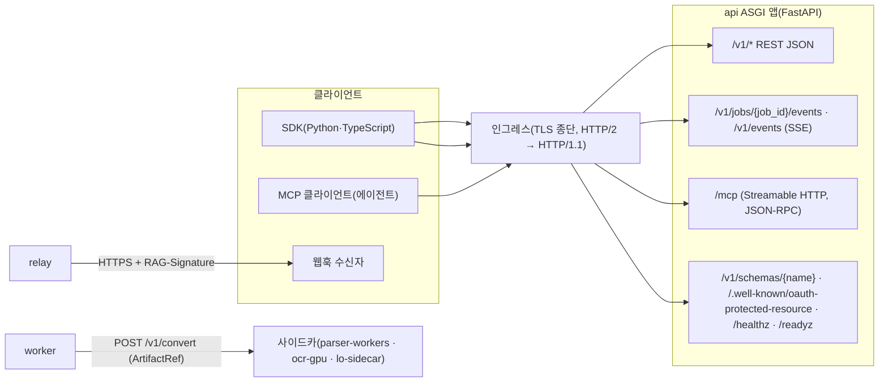
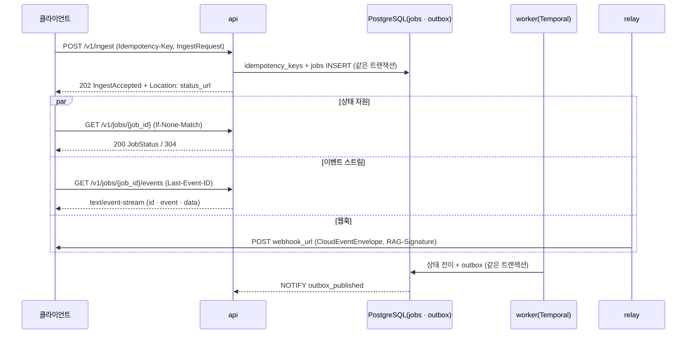

# API 설계 가이드라인

## 목적

이 문서는 플랫폼의 모든 HTTP 표면 — REST(`/v1`), SSE(Server-Sent Events), MCP(Model Context Protocol) 마운트, 사이드카 `POST /v1/convert` — 이 공유하는 **설계 규약**을 한 곳에 확정한다. 개별 API 문서([수집 API](02-ingestion-api.md), [리트리벌 API](03-retrieval-api.md), [관리 API](04-management-api.md), [MCP 서버](05-mcp-server.md), [클라이언트 SDK](06-client-sdks.md), [웹훅과 이벤트](07-webhooks-and-events.md))는 이 규약을 그대로 따르고 엔드포인트별 세부(요청·응답 타입, 인가 액션, 예시)만 더한다. 정본 우선순위는 설계 브리프 > 설계 바이블(Design Bible) > ADR > 이 문서다(브리프 §11, 바이블 §1.1). API 표면의 목록은 바이블 §14, 경로·헤더 명명은 바이블 §6.7, 오류 모델은 바이블 §4.1·§5.3·§5.7과 [에러 모델](../03-contracts/13-error-model.md)이 정본이며, 이 문서는 그 위에서 다른 문서가 "05-api/01에서 확정"으로 남긴 항목(§1.2 표)을 결정한다.

## 범위

- 포함: REST 원칙과 리소스 명명, 테넌트·컬렉션 스코프의 도출 위치, HTTP 메서드 의미(PATCH 병합 규칙 포함), 버전 관리(`/v1` 경로 + 봉투 `schema_version`, `/v2` 개방 규칙), 인증 헤더(OIDC JWT·API 키 모두 `Authorization: Bearer`), 멱등성(`Idempotency-Key` 적용 범위와 판정), 페이지네이션(불투명 커서)·필터·정렬 파라미터 규약, 요청·응답 봉투(계약 인스턴스 그대로, 목록 `{items, next_cursor}`), 오류(RFC 9457) 사용 규칙과 엔드포인트별 상태 코드 표, 비동기 작업 패턴(202 + `Location` + 상태 자원 + SSE + 웹훅), 레이트 리밋 헤더, 콘텐츠 협상, 시간·ID 형식, 상관관계(`traceparent`), CORS, 폐기 정책(`Deprecation`·`Sunset`), OpenAPI 3.1 생성 규칙(FastAPI에서 계약 모델 재사용, `operationId`·태그·확장 필드), SDK 생성 고려, 보안 헤더, 요청 크기·시간 한계, 관측성(엔드포인트별 메트릭·스팬), gRPC 결정(O-10)과 내부 프로토콜, FastAPI 구현 지침.
- 제외: 엔드포인트별 요청·응답 타입의 필드 정의(03-contracts 각 문서와 05-api/02~07), 오류 코드 카탈로그의 의미 해설([에러 모델](../03-contracts/13-error-model.md) §3), 인가 정책(Cedar 액션·역할 매트릭스, [멀티테넌시·보안 아키텍처](../02-architecture/07-multi-tenancy-and-security-architecture.md) §4), 이벤트 카탈로그·웹훅 서명([잡·이벤트·상태 계약](../03-contracts/12-jobs-events-and-status.md), [웹훅과 이벤트](07-webhooks-and-events.md)), 인그레스·TLS 구성([배포 아키텍처](../02-architecture/08-deployment-architecture.md) §5.3), MCP 도구 스키마([MCP 서버](05-mcp-server.md)).
- 이 문서가 소유하는 파일: `docs/05-api/01-api-design-guidelines.md`. `docs/05-api/openapi.yaml`은 §17의 규칙으로 **생성되는 산출물**이며 소유는 [관리 API](04-management-api.md)를 포함한 05-api 문서군 전체다(§17.6).

## 1. 원칙과 정본 관계

### 1.1 설계 원칙의 API 투영

| 브리프 원칙 | API 규약으로의 투영 |
|-------------|---------------------|
| 1 Contracts First(D-05) | 요청·응답 본문은 03-contracts 계약 인스턴스 **그대로**다. OpenAPI는 Pydantic v2 계약 모델에서 생성되고 별도 DTO를 두지 않는다(§8, §17) |
| 2 Adapters over Forks | 오류·멱등·한도·폐기·추적은 자체 봉투가 아니라 IETF·W3C 표준(RFC 9457, `Idempotency-Key`, `RateLimit`, RFC 9745·RFC 8594, W3C Trace Context)을 쓴다([ADR-0018](../06-adr/0018-api-rest-sse-mcp-no-grpc-rfc9457.md)) |
| 3 Pure Stages, Durable Orchestration(D-17) | 수집은 항상 비동기 잡(202), 검색은 항상 동기 인프로세스(200). API는 잡 읽기 모델만 조회하고 스테이지를 실행하지 않는다(바이블 §2.3 `api`) |
| 4 Idempotent(D-08) | `POST /v1/ingest*`는 `Idempotency-Key` 필수, 판정 정본은 PostgreSQL(§6) |
| 8 Observable | 모든 응답이 `trace_id`를 실어 나를 수 있고(오류 본문), 엔드포인트별 지연·오류는 OTel HTTP 계측으로 계량한다(§14, §21) |
| 9 Multi-Tenant & Secure by Design(D-09) | `tenant_id`는 토큰에서만 도출된다. 경로·본문의 테넌트 지정은 거부되거나(본문: `auth.tenant_mismatch` 채택 전 400 `contract.violation`, 채택 후 422 — 바이블 §10.3 E1) 토큰과 일치해야 한다(경로 403)(§3.2) |
| 10 LLM-Native Output(D-13, D-20) | 에이전트 경로는 MCP(JSON-RPC)이고 REST 응답의 `ContextPack`·`RenderedContext`는 렌더러 출력을 그대로 담는다. 두 경로의 인증·필터·오류는 하나다(§2) |

### 1.2 이 문서가 확정하는 항목(다른 문서의 위임)

| 위임 출처 | 항목 | 결정 위치 |
|-----------|------|-----------|
| [멀티테넌시·보안 아키텍처](../02-architecture/07-multi-tenancy-and-security-architecture.md) 미해결 이슈 18 | API 키 전달 헤더(`Authorization: Bearer` 재사용 vs 전용 헤더) | §5.1 |
| [ADR-0018](../06-adr/0018-api-rest-sse-mcp-no-grpc-rfc9457.md) 결과·중립 | `Idempotency-Key`의 다른 쓰기 엔드포인트 확대 여부, 최소 폐기 유예 기간과 `Link rel="deprecation"`, FastAPI 직렬화 지침, 경로 린트 승격 | §6, §16, §23, §17.7 |
| [스키마 버전과 호환성](../03-contracts/14-schema-versioning-and-compatibility.md) 미해결 이슈 9·10 | `/v2` 개방 규칙, `GET /v1/schemas/{name}`의 인증 여부·`Cache-Control` | §4.2, §12.3 |
| [에러 모델](../03-contracts/13-error-model.md) 범위·미해결 이슈 7 | API 경로별 상태 코드 전수, `ProblemDetails.title` 기본 언어 | §9.3, §12.4 |
| [기능 요구사항](../01-requirements/01-functional-requirements.md) 미해결 이슈 5·16 | 버전 식별·페이지네이션 메커니즘, SSE 스트리밍 필요성 판단 | §4, §7, §10 |
| [비기능 요구사항](../01-requirements/02-non-functional-requirements.md), [데이터 흐름과 문서 수명주기](../02-architecture/03-data-flow-and-document-lifecycle.md) | 삭제(툼스톤) 문서 조회 응답 코드 | §9.4 |
| [잡·이벤트·상태 계약](../03-contracts/12-jobs-events-and-status.md) §3.3 | 목록 응답 봉투와 커서 형식 | §7, §8 |

## 2. 표면 개요



한 ASGI 앱이 REST·SSE·MCP를 모두 제공하고(바이블 §2.3 `api`, [ADR-0018](../06-adr/0018-api-rest-sse-mcp-no-grpc-rfc9457.md)), 인증(`PrincipalResolver` → `SecurityContext`)·인가(Cedar)·레이트 리밋·`Idempotency-Key`·RFC 9457 변환은 앱 안의 단일 미들웨어 체인이 수행한다. 인그레스는 TLS 종단·본문 상한·타임아웃만 맡는다([배포 아키텍처](../02-architecture/08-deployment-architecture.md) §5.3). MCP는 JSON-RPC 프로토콜이므로 §3·§7·§8의 REST 자원 규약은 적용되지 않고, §5(인증)·§11(레이트 리밋 클래스 `query`)·§14(추적)·§9의 `ProblemDetails` 투영만 공유한다([MCP 서버](05-mcp-server.md)).

## 3. 리소스 명명과 스코프

### 3.1 경로 규약

**결정:** 경로는 `/v1/{plural-kebab}` 컬렉션 자원, `/v1/{plural-kebab}/{snake_id}` 단일 자원, 액션은 단일 자원 아래 **POST 하위 경로**(`/v1/jobs/{job_id}/cancel`), 하위 자원은 한 단계만(`/v1/collections/{collection_id}/dictionary`)이다. 경로 변수는 `{snake_id}`(`{job_id}`, `{document_id}`, `{collection_id}`, `{profile_id}`, `{tenant_id}`, `{subscription_id}`, `{run_id}`), 쿼리 파라미터는 snake_case다(바이블 §6.7, [ADR-0036](../06-adr/0036-naming-and-identifier-conventions.md)). 린트 정규식은 ADR-0036 준수 표 7의 `^/v1/[a-z-]+(/\{[a-z_]+_id\}(/[a-z-]+)?)*$`이며, 이 문서 게시로 CI 경고를 **실패로 승격**한다([ADR-0018](../06-adr/0018-api-rest-sse-mcp-no-grpc-rfc9457.md) 준수 표 7). 예외 경로는 바이블 §14가 등재한 `/healthz`, `/readyz`, `/metrics`, `/.well-known/oauth-protected-resource`, `/mcp`, 그리고 `/v1/profiles/validate`(액션이지만 컬렉션 자원 아래 — 프로파일 인스턴스 없이 YAML을 검증하므로 컬렉션 수준 액션으로 허용)와 `/v1/ingest`·`/v1/ingest/batch`(단수형 동사 명사 — 바이블 §14 정본 그대로)다. 이 둘 외의 새 예외는 만들지 않는다.

| 규칙 | 예 | 금지 예 |
|------|----|---------|
| 복수 kebab-case 명사 | `/v1/collections`, `/v1/eval/runs` | `/v1/collection`, `/v1/evalRuns` |
| ID는 발급형 ULID(바이블 §6.1) 또는 kebab `profile_id` | `/v1/jobs/01J9…`, `/v1/profiles/korean-gov` | 콘텐츠 해시(`chunk_id`)를 경로 자원으로 노출 |
| 액션은 POST 하위 경로 | `/v1/documents/{document_id}/reprocess` | `POST /v1/reprocess-document`, `GET …/cancel` |
| 뷰·변형은 쿼리 파라미터 | `/v1/documents/{document_id}/content?view=chunks` | `/v1/documents/{document_id}/chunks` |
| 테넌트·컬렉션은 경로에 중첩하지 않는다 | `/v1/documents/{document_id}` | `/v1/tenants/{tenant_id}/collections/{collection_id}/documents/{document_id}` |

경로에 테넌트·컬렉션을 중첩하지 않는 이유는 §3.2·§3.3에 있다. `document_id`·`job_id`는 테넌트 안에서만 해석되며, 다른 테넌트의 ID를 제시하면 존재 여부를 노출하지 않는 403(§3.3)이다.

### 3.2 테넌트 스코프: 토큰에서 도출

**결정:** 테넌트 스코프는 **인증 자격 증명에서만** 도출한다 — OIDC JWT 클레임 `tenant_id`, API 키 `api_keys.tenant_id`, mTLS 인증서(바이블 §10.3 E1, [ADR-0027](../06-adr/0027-security-context-injection-and-acl-enforcement-points.md)). 경로·쿼리·본문의 테넌트 지정은 스코프 결정에 관여하지 않는다.

| 위치 | 규칙 | 위반 시 |
|------|------|---------|
| 요청 본문 | `tenant_id`·`SecurityContext` 하위 키(`principals`, `as_of` 등)가 오면 거부(E1·E6; [계약 개요](../03-contracts/00-contract-overview.md) §8.2 `readOnly`) | 채택 전 **400** `contract.violation`(`errors[].location.pointer` = `/tenant_id` 등 해당 키) → [에러 모델](../03-contracts/13-error-model.md) §3.3 `auth.tenant_mismatch` 채택 후 **422** `auth.tenant_mismatch`(바이블 §10.3 E1의 목표 상태) |
| 경로 `/v1/tenants/{tenant_id}/…` | 테넌트 **자체**를 자원으로 다루는 유일한 경로(바이블 §14 `usage`·`policies`). `{tenant_id}`는 토큰의 `tenant_id`와 같아야 한다 | 403 `auth.forbidden`(fail-closed, 존재 비노출; E2) |
| 쿼리 파라미터 | `tenant_id` 파라미터는 어떤 엔드포인트에도 없다 | 400 `contract.violation`(미지 파라미터, §7.4) |
| 교차 테넌트 관리(테넌트 생성·플랫폼 운영자) | v1 API 표면에 없다(바이블 §14에 `POST /v1/tenants` 없음). `rag` CLI·원장 마이그레이션 경로로만 수행한다 | — |

본문 테넌트 지정의 목표 상태는 바이블 §10.3 E1·[계약 개요](../03-contracts/00-contract-overview.md) §4.5가 정한 **422**다. 그러나 바이블 §5.7 카탈로그에 422로 매핑되는 기존 코드가 없고(`contract.violation`은 400/500만), [에러 모델](../03-contracts/13-error-model.md) 불변식 I7(코드별 상태 일치)에 따라 `contract.violation`을 422로 낼 수 없으므로, `auth.tenant_mismatch`(422) 채택 전까지는 에러 모델 §3.3의 "채택 전 대안"인 400 `contract.violation`으로 응답하고 `detail`의 첫 토큰에 목표 의미를 적는다(`"tenant mismatch: /tenant_id"`; §9.2 규칙). 채택과 동시에 422로 전환하며, 이 간극이 §미해결 이슈 2의 조기 채택 요청 사유다.

근거: (1) 바이블 §14의 표면은 `/v1/documents/{document_id}`·`/v1/jobs/{job_id}`처럼 이미 평탄하고, 테넌트 경로는 테넌트 자원 둘뿐이다. (2) 경로에 테넌트가 있으면 인가는 "경로 테넌트 = 토큰 테넌트" 검사를 모든 라우트에 반복해야 하고 한 곳의 누락이 곧 교차 테넌트 노출이다. 토큰 단일 원천은 강제 지점을 `PrincipalResolver` 하나로 모은다(바이블 §10.3 E1~E2). (3) 원장은 RLS `FORCE` + `SET LOCAL app.tenant_id`(바이블 §13.1)로 토큰 테넌트를 세션에 고정하므로 경로 값을 쓸 곳이 없다. 기각 대안: `/v1/tenants/{tenant_id}/collections/{collection_id}/…` 중첩 — URL이 자기 서술적이지만 위 (2)의 위험과 URL 길이·SDK 시그니처 복잡성을 더하고, MCP·웹훅·SSE 경로와 규약이 갈라진다.

### 3.3 컬렉션 스코프와 존재 비노출

- 수집 측은 본문 `IngestRequest.collection_id`(Y), 질의 측은 본문 `QueryRequest.collection_ids`(1..20)로 컬렉션을 지정한다(바이블 §5.4·§5.5). 목록 엔드포인트는 쿼리 파라미터 `collection_id=`로 필터한다(바이블 §14 `GET /v1/jobs`).
- 요청 컬렉션은 Cedar `allowed_collections`와 교집합을 취하고, 결과가 비면 403 `plan.collection_forbidden`(질의) 또는 403 `auth.forbidden`(그 외)이다. 컬렉션·문서·잡의 **존재 여부는 403으로 감춘다** — 다른 테넌트의 ID, 권한 없는 컬렉션의 ID, 존재하지 않는 ID를 구분해 주지 않는다([에러 모델](../03-contracts/13-error-model.md) §7.1 403 행). 같은 테넌트 안에서 권한이 있는 컬렉션의 하위 자원이 없을 때만 404 계열이다(§9.4).
- `GET /v1/collections`는 `allowed_collections`만 돌려준다(E14와 같은 규칙, MCP `list_collections`와 일치).

### 3.4 HTTP 메서드 의미

| 메서드 | 의미 | 멱등 | 본문 | 성공 상태 |
|--------|------|------|------|-----------|
| GET | 조회·목록·스트림(SSE). 부작용 없음(감사 이벤트 `audit.document.accessed`·`audit.query.executed` 기록은 부작용으로 보지 않는다) | 예 | 없음 | 200(SSE는 200 `text/event-stream`) |
| POST(컬렉션) | 자원 생성 또는 잡 접수 | `Idempotency-Key`가 있을 때만(§6) | 계약 인스턴스 | 201 + `Location`(동기 생성) / 202 + `Location`(잡 접수) |
| POST(액션) | 상태 전이·계산(`cancel`, `retry`, `reprocess`, `reindex`, `validate`, `query`, `render`, `answer`) | 계산형(`query`·`render`·`validate`)은 자연 멱등; 잡 접수형은 §6 | 액션 인자 객체 | 200(계산) / 202 + `Location`(잡) |
| PUT | 전체 교체(`dictionary`) | 예 | 전체 표현 | 200 |
| PATCH | 부분 갱신 | 예(같은 패치 반복 적용은 같은 결과) | JSON Merge Patch(RFC 7396) | 200(동기) / 202(잡 유발) |
| DELETE | 삭제 요청 | 예(동기 삭제); 잡 접수형은 §6의 선택 `Idempotency-Key` 규칙(재전송 = 200 재생) | 없음 | 204(동기 삭제: `subscriptions`) / 202 + `Location`(삭제 잡: `documents`·`collections`) |

**결정:** PATCH 본문은 대상 계약의 **부분 객체**이며 JSON Merge Patch(RFC 7396) 의미론을 따른다 — 생략한 키는 유지, `null`은 **선택(N) 필드 제거**, 객체는 재귀 병합, 배열은 교체. `Content-Type`은 `application/merge-patch+json` 또는 `application/json`을 모두 받고 같은 의미로 처리한다. 필수(Y) 필드를 `null`로 지우려는 패치, 서버 소유(`readOnly`)·보안 필드를 건드리는 패치는 400 `contract.violation`(`errors[].location.pointer`)이다. JSON Patch(RFC 6902)는 v1에 없다. PATCH 본문은 계약 인스턴스가 아니므로 [계약 개요](../03-contracts/00-contract-overview.md) §8.1의 "N 필드 명시적 `null` 금지" 규칙이 적용되지 않는다(패치 문서에서 `null`은 제거 연산자다). 패치 적용 결과는 대상 계약으로 검증되고, 위반이면 400이다.

낙관적 동시성: 단일 자원 GET은 `ETag`(자원 `updated_at` 또는 본문 BLAKE3의 앞 16 hex, 강한 검증자)를 내고, PATCH·PUT·DELETE는 `If-Match`를 **받을 수 있다**. 불일치 시 412 응답의 오류 코드가 카탈로그에 없으므로(`api.precondition_failed` 제안, §미해결 이슈 2) 채택 전까지 `If-Match`는 검사하되 불일치를 400 `contract.violation`(`detail="If-Match does not match current ETag"`)로 응답한다. `If-None-Match` → 304는 `GET /v1/jobs/{job_id}`·`GET /v1/schemas/{name}`에서 지원한다([잡·이벤트·상태 계약](../03-contracts/12-jobs-events-and-status.md) §10, [스키마 버전과 호환성](../03-contracts/14-schema-versioning-and-compatibility.md) §5.2).

## 4. 버전 관리

### 4.1 두 층: 경로 major와 봉투 `schema_version`

**결정:** API 버전은 두 층으로만 표현한다. (1) 경로 major `/v1`(바이블 §6.7·§14), (2) 요청·응답 본문의 봉투 `schema_version`(semver; 바이블 §5.2, [스키마 버전과 호환성](../03-contracts/14-schema-versioning-and-compatibility.md) §4.4). **버전 헤더·미디어 타입 파라미터·쿼리 파라미터 버전은 두지 않는다.** 클라이언트는 minor를 응답 본문에서 읽고, 요청에는 자기가 링크한 계약 패키지의 `schema_version`을 그대로 쓴다.

| 층 | 값 | 바뀌는 조건 | 클라이언트 영향 |
|----|----|-------------|-----------------|
| 경로 major | `/v1` | `/v1`이 노출하는 요청·응답 계약 중 하나라도 major 2가 될 때(§4.2) | 새 경로로 이전, 180일 유예(§16) |
| `schema_version` minor | `1.x.0` | 선택 필드·열거값 추가(바이블 §1.2 minor) | 무시 가능. 새 필드를 쓰려면 SDK 갱신 |
| `schema_version` patch | `1.0.x` | 설명·예시 | 없음 |

요청의 `schema_version`이 서버의 같은 major·더 낮은 minor면 그대로 받는다(가산만). 더 높은 minor면 서버가 모르는 키가 있을 수 있으므로 [스키마 버전과 호환성](../03-contracts/14-schema-versioning-and-compatibility.md) §4.2 행 7과 같은 이유로 400 `contract.violation`(`detail="schema_version minor ahead of server"`)이다 — SDK는 §18의 기능 게이트로 이를 피한다. 다른 major는 400 `contract.violation`(`contract.version_unsupported` 채택 후 그 코드).

기각 대안: `RAG-Schema-Version` 같은 응답 헤더 — 봉투에 이미 있는 값을 중복하고 바이블 §6.7 헤더 목록을 늘린다. `Accept: application/vnd.rag.context-pack+json; version=2` 미디어 타입 협상 — major 두 개를 한 경로에서 동시에 서비스하는 비용(계약 이중 로딩·OpenAPI 분기)에 비해 이득이 없고 SDK 코드젠이 복잡해진다.

### 4.2 `/v2` 개방 규칙

**결정:** [스키마 버전과 호환성](../03-contracts/14-schema-versioning-and-compatibility.md) §4.4의 제안(미해결 이슈 9)을 채택한다. `/v1`이 노출하는 요청·응답 계약(`IngestRequest`, `QueryRequest`, `ContextPack`, `RenderedContext`, `JobStatus`, `ProblemDetails`, `FeedbackEvent`, `CollectionSpec`, `EvalDataset`·`EvalRun`·`EvalReport`, `UserDictEntry`, `Profile`, `IndexCommit`, `CloudEventEnvelope`)의 major는 경로 major에 **잠긴다**. 이 중 하나라도 major 2가 되면 `/v2`를 열고 `/v1`은 §16의 폐기 일정(최소 180일)에 들어가며, `/v1`은 어떤 major 2 계약도 노출하지 않는다. `/v2`는 모든 요청·응답 계약을 major 2로 다시 게시한다(바뀌지 않은 계약은 내용 동일한 `2.0.0`). 내부 계약(`ParsedDocument`~`EmbeddedChunkSet`, `QueryPlan` 등)의 major는 경로와 무관하다. 이 결정은 [ADR-0018](../06-adr/0018-api-rest-sse-mcp-no-grpc-rfc9457.md) 개정으로 기록한다(§미해결 이슈 1).

### 4.3 클라이언트 관용 규칙

응답을 읽는 클라이언트(SDK·웹훅 수신자·MCP 호스트)는 [스키마 버전과 호환성](../03-contracts/14-schema-versioning-and-compatibility.md) §2.2 부류 C다: 모르는 선택 필드는 무시하고, 모르는 열거값은 fail-closed 규칙(`Classification` unknown → `secret` 초과 등급, `Visibility` unknown → `restricted`, `JobState` unknown → 종결 아님, `ConfidenceTier` unknown → `low`, `EventType` unknown → ack 후 무시)으로 처리한다. 서버는 반대로 엄격하다(§7.4, [계약 개요](../03-contracts/00-contract-overview.md) §8.2 `additionalProperties: false`).

## 5. 인증·인가

### 5.1 자격 증명 전달

**결정:** 모든 인증 자격 증명은 `Authorization: Bearer <credential>`(RFC 6750) 한 헤더로 전달한다 — OIDC 액세스 토큰(JWT)과 API 키 모두. 전용 헤더(`X-API-Key` 등)·쿼리 파라미터 토큰·쿠키는 제공하지 않는다. 이로써 [멀티테넌시·보안 아키텍처](../02-architecture/07-multi-tenancy-and-security-architecture.md) 미해결 이슈 18을 종결하며, 바이블 §6.7 헤더 목록에는 추가할 헤더가 없다(`Authorization`은 HTTP 표준 헤더).

| 자격 증명 | 형식 판별 | 검증 | 주체 |
|-----------|-----------|------|------|
| OIDC JWT | 점 2개로 구분된 compact JWS(`eyJ…`) | JWKS 서명 + `iss`·`aud`·`exp`·`nbf`(Authlib; 07 문서 §3.1) | `user:{sub}` 또는 `service:{client_id}` |
| API 키 | 접두 `rag_ak_` + 비밀(형식·길이는 [관리 API](04-management-api.md)가 발급 스키마와 함께 확정; 접두는 이 문서의 **제안**) | `lookup_api_key(hash)`(07 문서 §3.1) | `service:{client_id}` |
| mTLS | 헤더 없음(인증서) | 체인 검증(메시 또는 SPIFFE) | `service:{client_id}`(`client_id`는 인증서 SAN의 SPIFFE ID 또는 CN에서 유도; 주체 문자열 형식은 바이블 §6.1·§10.1의 네 가지만) |

근거: (1) 바이블 §10.3 E14가 MCP에 `Authorization: Bearer`를 명시했고 인그레스 헤더 전달 표([배포 아키텍처](../02-architecture/08-deployment-architecture.md) §5.3)도 `Authorization` 하나만 통과시킨다 — 헤더 하나면 REST·SSE·MCP·SDK가 같은 코드 경로다. (2) 두 자격 증명은 형식(`rag_ak_` 접두 vs JWS 점 구조)으로 결정적으로 구분되어 사전 조회 없이 분기한다. (3) 브라우저 `EventSource`는 헤더를 설정할 수 없지만 토큰을 쿼리에 넣는 것은 로그·Referer 유출 위험이라 채택하지 않는다 — 브라우저 SSE 소비자는 헤더를 설정할 수 있는 fetch 기반 SSE 클라이언트를 쓴다(§10.4). 기각 대안 `X-API-Key`: 헤더 둘을 모두 허용·전달·문서화해야 하고, 둘이 함께 오면 우선순위 규칙이 필요해진다.

401 응답은 `WWW-Authenticate: Bearer realm="rag", error="invalid_token"`(RFC 6750 §3; 토큰 부재는 `error` 생략)을 붙인다([에러 모델](../03-contracts/13-error-model.md) §7.1). `Authorization` 헤더가 둘 이상이거나 스킴이 `Bearer`가 아니면 401 `auth.unauthenticated`다.

### 5.2 `SecurityContext` 주입과 인가

인증 → `Principal` → 그룹 확장 → Cedar `allowed_collections` ∩ 요청 → `SecurityContext{as_of = now()}` 주입은 바이블 §8.1 1단계·§10.3 E1~E2 그대로이며 지연 예산 10ms(바이블 §8.3)다. API 계층의 규칙만 적는다.

- 인가 판정은 라우트 진입 전 의존성(dependency)에서 한 번 수행하고, 라우트 코드는 `SecurityContext`를 읽기 전용으로 받는다. 라우트가 `tenant_id`를 요청에서 읽는 코드는 린트로 금지한다(`security/principal_resolver` 외 `request.headers["authorization"]` 접근 금지).
- 인가 실패는 항상 403 `auth.forbidden`(fail-closed)이며 `detail`에 정책 결정 사유(액션 이름)만 담고 자원 존재 여부는 담지 않는다.
- 미인증 접근이 허용되는 경로는 §12.3의 공개 표면(`/v1/schemas/{name}`, `/.well-known/oauth-protected-resource`, `/healthz`, `/readyz`)뿐이다. `/metrics`는 인그레스에 노출하지 않는다(§21.4).

## 6. 멱등성(`Idempotency-Key`)

**결정:** `Idempotency-Key`는 `POST /v1/ingest`·`POST /v1/ingest/batch`에 **필수**(D-08, 바이블 §14)이고, 잡을 접수하거나 자원을 생성하는 다른 POST에는 **선택이되 제시되면 같은 의미론으로 처리**한다. GET·PUT·PATCH와 동기 DELETE(`DELETE /v1/subscriptions/{subscription_id}`, 204)에 온 헤더는 무시하고(HTTP 의미론상 이미 멱등), **잡을 접수하는 DELETE**(`DELETE /v1/documents/{document_id}`·`DELETE /v1/collections/{collection_id}`, 202 + `JobStatus`)는 다른 잡 접수형 POST와 같은 **선택** 규칙을 따른다 — 재전송이 같은 잡의 200 재생이 되어 삭제 잡이 중복 접수되지 않고, 키가 없으면 서버가 합성한다. 판정 정본은 PostgreSQL `idempotency_keys(tenant_id, key)`이며 `jobs`(또는 대상 자원) INSERT와 **동일 트랜잭션**에 기록하고, Valkey `idem:{tenant}:{key}`는 조회 캐시다(바이블 §3.1 D-08, §13.1, §13.4; [ADR-0017](../06-adr/0017-event-delivery-outbox-cloudevents-no-broker.md), [ADR-0018](../06-adr/0018-api-rest-sse-mcp-no-grpc-rfc9457.md)).

| 엔드포인트 | 적용 | 근거 |
|------------|------|------|
| `POST /v1/ingest`, `POST /v1/ingest/batch` | **필수**. 부재 → 400 `contract.violation`(`api.idempotency_key_required` 채택 후 그 코드) | D-08 |
| `POST /v1/documents/{document_id}/reprocess`, `POST /v1/collections/{collection_id}/reindex`, `DELETE /v1/documents/{document_id}`, `DELETE /v1/collections/{collection_id}`, `POST /v1/jobs/{job_id}/retry`, `POST /v1/eval/runs` | 선택(권장). 부재 시 서버가 `internal:{workflow_type}:{ulid}` 형식의 키를 합성해 `JobStatus.idempotency_key`(Y)를 채운다([잡·이벤트·상태 계약](../03-contracts/12-jobs-events-and-status.md) §2.1 초안 형식과 동일) | 재색인·재처리는 비용이 크지만 디스패처의 문서 단위 직렬화(바이블 §11.2)가 중복 실행을 흡수하므로 필수로 강제하지 않는다 |
| `POST /v1/collections`, `POST /v1/subscriptions`, `POST /v1/eval/datasets`, `POST /v1/feedback` | 선택. 부재 시 키 없이 생성(중복 생성은 클라이언트 책임) | 자원 생성은 잡이 아니며 중복이 데이터 정합성을 깨지 않는다 |
| `POST /v1/query`, `/v1/render`, `/v1/answer`, `/v1/profiles/validate`, `POST /v1/jobs/{job_id}/cancel`, GET·PATCH·PUT, `DELETE /v1/subscriptions/{subscription_id}` | 무시 | 계산형 또는 자연 멱등(동기 삭제의 재전송은 §9.2 404 행의 부재 응답) |

| 항목 | 규칙 |
|------|------|
| 키 형식 | 가시 ASCII 1..255(`^[\x21-\x7E]{1,255}$`; [잡·이벤트·상태 계약](../03-contracts/12-jobs-events-and-status.md) §2.1). UUID v4 권장. 스코프는 `(tenant_id, key)` — 다른 테넌트의 같은 키는 무관 |
| 본문 지문 | `request_hash = H("idem", endpoint_path, canonical_json(wire_body))`([수집 요청 계약](../03-contracts/01-ingest-request.md) §4; `H()`는 [계약 개요](../03-contracts/00-contract-overview.md) §7). 서버 주입 전 클라이언트 본문 기준이므로 재전송은 본문을 바이트 동일하게 보내야 한다(`requested_at` 포함). 본문 없는 잡 접수형 DELETE는 `wire_body`를 빈 객체 `{}`로 두어 지문이 `endpoint_path`만으로 결정된다(이 문서 규칙) |
| 판정 분기 | 새 키 → 202/201; 같은 키·같은 지문·커밋 완료 → **200** + 원 응답 본문 동일; 같은 키·원 요청 처리 중(미커밋) → 409 `api.idempotency_conflict`(`instance`에 기존 자원 경로); 같은 키·다른 지문 → 422 `api.idempotency_payload_mismatch`; 같은 키·다른 `endpoint_path` → 422 `api.idempotency_payload_mismatch`(지문에 경로가 포함되므로 자동) |
| 재생 응답 | 상태 200, 본문은 원 202/201 응답과 내용 동일, `Location` 헤더 동일. 자원의 현재 상태는 재생 본문이 아니라 `status_url`에서 읽는다 |
| 보존 | `idempotency_keys.expires_at = 접수 + 24h`(초안 목표; Valkey `idem:` TTL 24h와 일치, 바이블 §13.4). 만료 후 같은 키는 새 요청이다 |
| 실패한 원 요청 | 4xx로 거부된 요청은 키를 소비하지 않는다(트랜잭션 롤백). 5xx는 커밋 여부에 따라 — 커밋 전 실패면 키 미소비, 커밋 후 응답 전송 실패면 재전송이 200 재생이다 |
| 배치 | 키 하나가 `POST /v1/ingest/batch` 전체를 덮는다([수집 요청 계약](../03-contracts/01-ingest-request.md) §3·§4) |

기각 대안: 모든 쓰기에 필수 — SDK 없는 curl 사용성을 해치고, 자원 생성 중복은 정합성 문제가 아니다. 응답 전체를 Valkey에만 저장 — Valkey 장애가 정확성에 관여한다(바이블 §2.3 Valkey 행 위반).

## 7. 페이지네이션·필터·정렬

**결정:** 모든 목록 엔드포인트(`GET /v1/jobs`, `/v1/collections`, `/v1/profiles`, `/v1/subscriptions`, `/v1/documents/{document_id}/commits`, `/v1/documents/{document_id}/content`, `/v1/collections/{collection_id}/dictionary`, `/v1/eval/datasets`, `/v1/eval/runs`)은 **불투명 커서(cursor) 기반**이며 오프셋·페이지 번호·총 개수를 제공하지 않는다([기능 요구사항](../01-requirements/01-functional-requirements.md) 미해결 이슈 16(b) 채택). ULID가 시간 정렬이므로 키셋은 `id` 단독으로 충분하다(D-06; 08 문서 §API 프레임워크와 HTTP 규약).

### 7.1 파라미터

| 파라미터 | 타입 | 기본 | 규칙 |
|----------|------|------|------|
| `cursor` | string | 없음(첫 페이지) | 이전 응답의 `next_cursor` 그대로. 변조·만료·필터 불일치·테넌트 불일치 → 400 `contract.violation`(`detail="cursor invalid"`; `api.cursor_invalid` 채택 후 그 코드) |
| `limit` | integer | 50 | 1..200(초안 목표). 초과 값은 400(`errors[].location.pointer` 없음, `detail="limit out of range"`). 엔드포인트별 상한 조정은 개별 문서 |
| `sort` | string | `-created_at` | `{field}`(오름차순) 또는 `-{field}`(내림차순). 허용 필드는 엔드포인트별 화이트리스트(기본 `created_at`, `updated_at`). 다중 정렬 없음 |
| `{field}` | 필드 타입 | — | 동등 필터(`eq`). 예 `state=running` |
| `{field}` (쉼표 구분) | array | — | 포함 필터(`in`). 열거·ID 필드만. 예 `state=queued,running`, `types=job.state.changed,ingest.document.indexed`([잡·이벤트·상태 계약](../03-contracts/12-jobs-events-and-status.md) §9와 같은 형식) |
| `{field}_gte`, `{field}_lt` | 필드 타입 | — | 범위 필터(이상·미만). `*_at`(RFC 3339)·`*_date`(`YYYY-MM-DD`)·정수 필드만. 접미어는 바이블 §5.7 `FilterOp` 철자(`gte`, `lt`)를 재사용한다 |

목록 필터 파라미터는 `QueryRequest.filters`(`FilterNode` DSL, 검색 필터)와 **다른 것**이다. 목록 필터는 원장 컬럼에 대한 단순 조건이고 허용 필드는 엔드포인트 문서가 열거한다. `tenant_id`는 어떤 목록에서도 파라미터가 아니다(§3.2).

### 7.2 커서 토큰

| 항목 | 규칙 |
|------|------|
| 내용 | `base64url(canonical_json({"k": last_id, "f": filter_fingerprint16, "v": 1})) + "." + base64url(HMAC-SHA256(server_key, tenant_id + "." + payload)[:16])`. `k`는 마지막 항목의 정렬 키(ULID), `f`는 `H("cursor", canonical_json(sort + filters))[:16]`(필터·정렬 변경 감지), `v`는 토큰 형식 버전 |
| 불투명성 | 클라이언트는 토큰을 해석·조립하지 않는다. 형식은 서버가 바꿀 수 있다(`v` 증가) |
| 테넌트 바인딩 | HMAC 입력에 `tenant_id`가 들어가므로 다른 테넌트가 제시한 토큰은 검증 실패 |
| 만료 | 키셋 커서는 만료가 없다. 필터·정렬이 바뀐 요청에 옛 커서를 붙이면 `f` 불일치로 400 |
| 서버 키 | `RAG_SECRETS__PROVIDER` 경유 비밀 참조(바이블 §6.6). 키 이름은 [구성 참조](../09-operations/02-configuration-reference.md) |
| MCP `cursor` | 별개다 — Valkey 핸들 `cursor:{tenant}:{ulid}`(10분, 이전 요청 + `seen_chunk_ids` 저장; D-13, [ADR-0025](../06-adr/0025-mcp-cursor-pagination-and-tool-set.md)). 검색 "더 보기"는 페이지가 아니라 재검색이므로 키셋 커서를 쓸 수 없다 |

### 7.3 응답 봉투

```json
{
  "items": [
    {
      "schema_version": "1.0.0",
      "schema_type": "JobStatus",
      "job_id": "01JA0RA3B5C7D9E1F2G4H6J8K0",
      "tenant_id": "01J9ZQ4K7X2M8N3P5R6S7T8V9W",
      "collection_id": "01J9ZQ5A1B2C3D4E5F6G7H8J9K",
      "kind": "ingest_document",
      "state": "running",
      "stage": "parse",
      "progress": {"done": 2, "total": 8, "unit": "stage"},
      "attempts": 1,
      "workflow_run_id": "6f1d2c3b-4a5e-4f60-9b7c-8d9e0f1a2b3c",
      "workflow_id": "01JA0RA3B5C7D9E1F2G4H6J8K0",
      "idempotency_key": "a3f1c9d2-7b4e-4c8a-9e1f-2d3c4b5a6f70",
      "request_id": "01JA0RA3B5C7D9E1F2G4H6J8K1",
      "document_id": "01JA0RA3B5C7D9E1F2G4H6J8K2",
      "degraded": [],
      "cost": {"llm_tokens_in": 0, "llm_tokens_out": 0, "cost_usd": 0, "gpu_seconds": 0},
      "priority": 5,
      "status_url": "https://rag.example.go.kr/v1/jobs/01JA0RA3B5C7D9E1F2G4H6J8K0",
      "events_url": "https://rag.example.go.kr/v1/jobs/01JA0RA3B5C7D9E1F2G4H6J8K0/events",
      "created_at": "2026-09-22T09:00:00.000Z",
      "started_at": "2026-09-22T09:00:01.250Z",
      "updated_at": "2026-09-22T09:00:07.900Z"
    }
  ],
  "next_cursor": "eyJrIjoiMDFKQTBSQTNCNUM3RDlFMUYyRzRINko4SzAiLCJmIjoiOWYzYTBiMWMyZDNlNGY1YSIsInYiOjF9.q1w2e3r4t5y6u7i8o9p0a1s2"
}
```

`items`는 해당 계약 인스턴스 배열(요약 뷰가 필요하면 개별 문서가 `view=` 파라미터로 정의), `next_cursor`는 `string | null`(마지막 페이지는 `null`; `ContextPack.next_cursor`와 같은 타입). 총 개수·페이지 번호 필드는 없다. 개수는 `GET /v1/collections/{collection_id}/stats`처럼 전용 자원으로 제공한다.

### 7.4 미지 파라미터

**결정:** 서버는 알려지지 않은 쿼리 파라미터를 **거부**한다(400 `contract.violation`, `detail="unknown query parameter: {name}"`). 이는 [계약 개요](../03-contracts/00-contract-overview.md) §8.2의 `additionalProperties: false`를 URL에 확장한 것이며 오타(`colection_id`)가 필터 없는 전체 목록으로 조용히 성공하는 것을 막는다. 위치 표시는 `ErrorLocation.pointer`가 본문 전용이므로 `detail`에만 적는다(`ErrorLocation.parameter` 제안, §미해결 이슈 2).

## 8. 요청·응답 봉투

**결정:** 응답 본문은 계약 인스턴스 **그대로**다(`schema_version`·`schema_type` 봉투 필드 포함; 예 `GET /v1/jobs/{job_id}` → `JobStatus`, `POST /v1/render` → `RenderedContext`). `{data, meta, errors}` 같은 범용 래퍼는 없다. 래퍼가 존재하는 곳은 정확히 셋이다.

| 래퍼 | 형태 | 정본 |
|------|------|------|
| 목록 | `{items: array<T>, next_cursor: string \| null}` | §7.3 |
| 잡 접수(수집) | `IngestAccepted{job_id, status_url, events_url, request_id?, document_id?}` / `IngestBatchAccepted{jobs[]}` | D-08, 바이블 §14, [수집 요청 계약](../03-contracts/01-ingest-request.md) §3 |
| 검색 응답 | `{context_pack: ContextPack, rendered?: RenderedContext, explain?: {query_plan, ranked}}` | 바이블 §14, [질의 요청과 질의 계획 계약](../03-contracts/09-query-request-and-query-plan.md) §9; 타입명은 [리트리벌 API](03-retrieval-api.md) |

- 잡 접수형 액션(`reprocess`, `reindex`, `DELETE documents`, `DELETE collections`(초안), `cancel`, `retry`, `PATCH …/acl`, `POST /v1/eval/runs`)은 202 + `JobStatus` 인스턴스를 돌려준다([잡·이벤트·상태 계약](../03-contracts/12-jobs-events-and-status.md) §3.3의 `cancel`·`retry` 규칙을 일반화). `JobStatus`는 `job_id`·`status_url`·`events_url`을 포함하므로 D-08의 세 필드 요건을 만족하고, `IngestAccepted`와 함께 "202 본문에는 항상 `job_id`·`status_url`·`events_url`이 있다"는 클라이언트 불변식이 성립한다.
- 202·201 응답은 `Location` 헤더에 상태 자원(`status_url`) 또는 생성 자원의 절대 URL을 싣는다. `status_url`·`events_url`은 **절대 URL**이며 인그레스 외부 호스트 기준이다(`RAG_API__PUBLIC_BASE_URL`, 이름은 [구성 참조](../09-operations/02-configuration-reference.md)).
- 요청 본문도 계약 인스턴스다: `IngestRequest`·`QueryRequest`는 `schema_version`(Y)을 포함해 보내고, 서버 발급 필드(`request_id`, `query_id`)를 포함하면 400이다(`readOnly`; [수집 요청 계약](../03-contracts/01-ingest-request.md) V6).
- 성공 응답에 `warnings[]`·`degraded[]`가 비어 있지 않아도 상태는 200이다(품질 삼중항은 오류가 아니다, 바이블 §4.1).

```json
{
  "job_id": "01JA0RA3B5C7D9E1F2G4H6J8K0",
  "status_url": "https://rag.example.go.kr/v1/jobs/01JA0RA3B5C7D9E1F2G4H6J8K0",
  "events_url": "https://rag.example.go.kr/v1/jobs/01JA0RA3B5C7D9E1F2G4H6J8K0/events",
  "request_id": "01JA0RA3B5C7D9E1F2G4H6J8K1",
  "document_id": "01JA0RA3B5C7D9E1F2G4H6J8K2"
}
```

## 9. 오류(RFC 9457)

### 9.1 규칙

모든 4xx·5xx 응답 본문은 `ProblemDetails`(`application/problem+json`)이며 `type = urn:rag:error:{code}`, `code`·`retryable`·`trace_id`는 필수 확장 멤버다(바이블 §5.3, [에러 모델](../03-contracts/13-error-model.md) §2.3·§6.3). 클라이언트 분기는 `status`가 아니라 `code`로 한다. 이 문서가 더하는 API 계층 규칙은 다음이다.

| 규칙 | 내용 |
|------|------|
| 단일 변환 지점 | 모든 예외는 `api/problems` 모듈(바이블 §12)의 핸들러 하나가 `ProblemDetails`로 변환한다. 라우트에서 `HTTPException(detail=str)`·평문·HTML 오류 반환 금지([ADR-0018](../06-adr/0018-api-rest-sse-mcp-no-grpc-rfc9457.md) 준수 표 1) |
| `instance` | 요청 경로(`/v1/query`) 또는 관련 자원 경로(409는 기존 잡 `/v1/jobs/{job_id}`) — 상대 참조 |
| `errors[]` | 요청 검증은 필드별 `StageError{code: contract.violation, stage: api, location.pointer}` 1..16개, 초과분은 `detail`에 개수만 |
| `request_id` | API가 요청마다 발급하는 ULID를 `ProblemDetails.request_id`(N)에 싣는다(수집은 `IngestRequest.request_id`와 같은 값) |
| 헤더 | 401 `WWW-Authenticate`, 429 `RateLimit`·`RateLimit-Policy`·`Retry-After`, 503 `Retry-After`(정수 초), 지역화 응답 `Content-Language` + `Vary: Accept-Language` |
| 콘텐츠 금지 | `detail`에 문서 본문·질의 텍스트·`source_uri`·주체 문자열·비밀을 넣지 않는다([에러 모델](../03-contracts/13-error-model.md) §9·§11) |
| 인그레스 오류 | 인그레스가 내는 413·502·504도 `application/problem+json` 본문으로 맞춘다(커스텀 오류 페이지; [배포 가이드](../09-operations/01-deployment-guide.md), 확인 필요) |

### 9.2 상태 코드 사용 원칙

| 상태 | 사용 | 코드(카탈로그) | 비고 |
|------|------|----------------|------|
| 200 | 조회·계산·PATCH·PUT 성공, 멱등 재생 | — | 저하(`degraded[]`)·잡 실패(`JobStatus.state=failed`)도 200 |
| 201 | 동기 자원 생성 | — | `Location` |
| 202 | 잡 접수 | — | `Location: status_url`, 본문 `IngestAccepted` 또는 `JobStatus` |
| 204 | 동기 삭제 | — | 본문 없음 |
| 304 | `If-None-Match` 일치 | — | `GET /v1/jobs/{job_id}`, `GET /v1/schemas/{name}` |
| 400 | 요청 계약 위반(본문 `tenant_id`·`readOnly` 보안 필드 포함 — `auth.tenant_mismatch` 채택 전, §3.2), 렌더 사전 검증, 잘못된 커서·파라미터, 키 누락 | `contract.violation`, `plan.security_context_missing`, `render.mixed_blocks`, `render.citations_with_structured_output`, `render.empty_pack` | [에러 모델](../03-contracts/13-error-model.md) §7.1 |
| 401 | 미인증 | `auth.unauthenticated` | `WWW-Authenticate` |
| 403 | 인가 거부·존재 비노출 | `auth.forbidden`, `plan.collection_forbidden` | 재시도 금지 |
| 404 | 권한 있는 스코프 안의 하위 자원 부재 | **채택 코드 없음** → `api.not_found` 채택 전 400 `contract.violation` + `detail`([에러 모델](../03-contracts/13-error-model.md) §7.1) | §미해결 이슈 2 |
| 409 | 멱등 키 처리 중, 잡 상태 충돌 | `api.idempotency_conflict`; `api.job_state_conflict` 채택 전 400 | |
| 410 | `Sunset` 지난 경로 major, 삭제·정리된 문서 본문 | **채택 코드 없음**(`api.gone` 제안) → 채택 전 400 `contract.violation` | §9.4, §16 |
| 412 | `If-Match` 불일치 | **채택 코드 없음**(`api.precondition_failed` 제안) → 채택 전 400 | §3.4 |
| 413 / 415 | 인라인 한계 초과 / `Content-Type` 불일치 | `api.payload_too_large` / `api.unsupported_media_type` 채택 전 400 `contract.violation` | §20 |
| 422 | 의미 검증 실패 | `auth.too_many_principals`, `api.idempotency_payload_mismatch`, `plan.filter_field_forbidden`, `profile.invalid`, `plugin.license_denied`, `plugin.capability_unsupported`, `pack.tokenizer_mismatch`(요청 유도) | 본문 `tenant_id`는 `auth.tenant_mismatch`(422) 채택 후 이 행으로 이동한다(§3.2); 채택 전에는 400 행 |
| 429 | 한도 초과 | `api.rate_limited` | §11 |
| 500 | 결함·내부 계약 위반 | `contract.violation`(산출물), `fuse.k_missing` 등 | |
| 503 | 일시 불가 | `retrieve.unavailable`; 오케스트레이터·의존 불가는 `api.orchestrator_unavailable`·`api.dependency_unavailable` 채택 전 코드 없음 | `Retry-After` |

404·409(잡 상태)·410·412·413·415·503(오케스트레이터)·본문 `tenant_id`(422 목표, 바이블 §10.3 E1)의 전용 코드가 바이블 §5.7에 없어 채택 전까지 400 `contract.violation`으로 응답하는 것은 [에러 모델](../03-contracts/13-error-model.md) §3.3·§7.1의 규칙을 그대로 따른 것이다. 이 문서는 그 목록에 `api.gone`(410)·`api.precondition_failed`(412)를 더해 **공동 제안**하고 조기 채택을 요청한다(§미해결 이슈 2). 상태 코드가 임시로 400인 동안에도 `detail`의 첫 토큰은 목표 의미를 적는다(`"not found: /v1/jobs/{job_id}"`, `"gone: document deleted"`).

### 9.3 엔드포인트별 성공 상태·본문·규약(바이블 §14 표면 전체)

| 메서드 | 경로 | 성공 | 응답 본문 | `Idempotency-Key` | 한도 클래스(§11) | `operationId`(§17.3) |
|--------|------|------|-----------|-------------------|------------------|----------------------|
| POST | `/v1/ingest` | 202 | `IngestAccepted` | 필수 | `ingest` | `ingest_document` |
| POST | `/v1/ingest/batch` | 202 | `IngestBatchAccepted` | 필수 | `ingest`(건수) | `ingest_documents_batch` |
| GET | `/v1/jobs` | 200 | `{items: JobStatus[], next_cursor}` | — | `ingest` | `list_jobs` |
| GET | `/v1/jobs/{job_id}` | 200 / 304 | `JobStatus` | — | `ingest` | `get_job` |
| GET | `/v1/jobs/{job_id}/events` | 200 | `text/event-stream` | — | `ingest`(연결 수) | `stream_job_events` |
| POST | `/v1/jobs/{job_id}/cancel` | 202 | `JobStatus` | 무시 | `ingest` | `cancel_job` |
| POST | `/v1/jobs/{job_id}/retry` | 202 | `JobStatus` | 선택 | `ingest` | `retry_job` |
| PATCH | `/v1/jobs/{job_id}` | 200 | `JobStatus` | 무시 | `ingest` | `update_job` |
| GET | `/v1/documents/{document_id}` | 200 | 문서 메타 객체([관리 API](04-management-api.md)) | — | `query` | `get_document` |
| GET | `/v1/documents/{document_id}/content` | 200 | `{items, next_cursor}`(`view` 별 항목) | — | `query` | `get_document_content` |
| GET | `/v1/documents/{document_id}/commits` | 200 | `{items: IndexCommit[], next_cursor}` | — | `admin` | `list_document_commits` |
| PATCH | `/v1/documents/{document_id}/acl` | 202 | `JobStatus`(`kind=acl_update`) | 무시 | `admin` | `update_document_acl` |
| PATCH | `/v1/documents/{document_id}/metadata` | 200(초안) | 문서 메타 객체(+ 재처리 제안 필드) | 무시 | `admin` | `update_document_metadata` |
| POST | `/v1/documents/{document_id}/reprocess` | 202 | `JobStatus`(`kind=reprocess_document`) | 선택 | `admin` | `reprocess_document` |
| DELETE | `/v1/documents/{document_id}` | 202 | `JobStatus`(`kind=delete_document`) | 선택 | `admin` | `delete_document` |
| POST | `/v1/query` | 200 | `{context_pack, rendered?, explain?}` | 무시 | `query` | `query` |
| POST | `/v1/render` | 200 | `RenderedContext` | 무시 | `query` | `render_context_pack` |
| POST | `/v1/answer` | 200 | 레퍼런스 응답([리트리벌 API](03-retrieval-api.md)) | 무시 | `query` | `answer` |
| POST | `/v1/feedback` | 201 | `FeedbackEvent` | 선택 | `query` | `submit_feedback` |
| GET / POST | `/v1/collections` | 200 / 201 | `{items: CollectionSpec[], next_cursor}` / `CollectionSpec` | — / 선택 | `admin` | `list_collections` / `create_collection` |
| GET / PATCH / DELETE | `/v1/collections/{collection_id}` | 200 / 200 / 202(초안) | `CollectionSpec` / `CollectionSpec`(재색인 잡 유발 시 `Link: </v1/jobs/{job_id}>; rel="related"`) / `JobStatus` | — / 무시 / 선택 | `admin` | `get_collection` / `update_collection` / `delete_collection` |
| POST | `/v1/collections/{collection_id}/reindex` | 202 | `JobStatus`(`kind=reindex_collection`) | 선택(권장) | `admin` | `reindex_collection` |
| GET | `/v1/collections/{collection_id}/stats` | 200 | 통계 객체(`CollectionSpec.stats` + 세대) | — | `admin` | `get_collection_stats` |
| GET / PUT | `/v1/collections/{collection_id}/dictionary` | 200 / 200 | `{items: UserDictEntry[], next_cursor}` / 교체 결과(`dictionary_hash`, 재색인 제안) | — / 무시 | `admin` | `list_dictionary_entries` / `replace_dictionary` |
| GET | `/v1/profiles`, `/v1/profiles/{profile_id}` | 200 | `{items, next_cursor}` / `Profile`(해소 결과) | — | `admin` | `list_profiles` / `get_profile` |
| POST | `/v1/profiles/validate` | 200 / 422 | 검증 결과(`profile_hash`, 해소 결과) / `ProblemDetails(profile.invalid)` | 무시 | `admin` | `validate_profile` |
| GET | `/v1/tenants/{tenant_id}/usage` | 200 | `usage_ledger` 집계 | — | `admin` | `get_tenant_usage` |
| PATCH | `/v1/tenants/{tenant_id}/policies` | 200 | 테넌트 정책 객체 | 무시 | `admin` | `update_tenant_policies` |
| GET / POST | `/v1/subscriptions` | 200 / 201 | `{items, next_cursor}` / 구독 객체 | — / 선택 | `admin` | `list_subscriptions` / `create_subscription` |
| DELETE | `/v1/subscriptions/{subscription_id}` | 204 | 없음 | 무시 | `admin` | `delete_subscription` |
| GET | `/v1/events` | 200 | `text/event-stream` | — | `admin`(연결 수) | `stream_tenant_events` |
| POST / GET | `/v1/eval/datasets` | 201 / 200 | `EvalDataset` / `{items, next_cursor}` | 선택 / — | `admin` | `create_eval_dataset` / `list_eval_datasets` |
| POST / GET | `/v1/eval/runs` | 202 / 200 | `JobStatus`(`kind=evaluate`) / `{items: EvalRun[], next_cursor}` | 선택 / — | `admin` | `create_eval_run` / `list_eval_runs` |
| GET | `/v1/eval/runs/{run_id}`, `/v1/eval/runs/{run_id}/report` | 200 | `EvalRun` / `EvalReport` | — | `admin` | `get_eval_run` / `get_eval_report` |
| GET | `/v1/schemas/{name}` | 200 / 304 | `application/schema+json` | — | `public` | `get_schema` |
| GET | `/healthz`, `/readyz` | 200 / 503 | 상태 객체(§21.4) | — | `public` | `healthz` / `readyz` |
| GET | `/metrics` | 200 | Prometheus 텍스트 | — | 내부망만 | (OpenAPI 제외) |
| GET | `/.well-known/oauth-protected-resource` | 200 | RFC 9728 PRM JSON | — | `public` | (OpenAPI 제외) |
| — | `/mcp` | JSON-RPC | MCP | — | `query` | (OpenAPI 제외) |
| POST | `/v1/convert`(사이드카) | 200 / 503 | `ConvertResponse`(변환 실패는 `output=null` + `error`, 상태 200) / `ProblemDetails(parse.sidecar_unavailable)` | 무시 | 없음(mTLS·NetworkPolicy) | 별도 OpenAPI 문서 |

`(초안)` 표기는 바이블 §14가 상태 코드를 정하지 않아 이 문서가 패턴(§3.4)으로 유도한 값이며, 개별 API 문서가 확정하면서 이 표를 갱신한다. `POST /v1/eval/runs`의 202 `JobStatus`는 `JobKind.evaluate`가 있어 잡 접수형으로 분류한 것이고, `EvalRun` 자원 자체는 `GET /v1/eval/runs/{run_id}`로 읽는다. 실패 코드는 §9.2의 공통 집합 + 개별 문서의 엔드포인트 전용 코드다.

### 9.4 삭제된 문서의 조회 응답

**결정:** `DELETE /v1/documents/{document_id}`가 접수되면 문서는 "삭제 중"(활성 `delete_document` 잡) → 툼스톤(tombstone; `documents.current_commit_id`가 `kind=delete`·`status=committed` 커밋을 가리키는 상태) → 정리(purge)로 진행한다([데이터 흐름과 문서 수명주기](../02-architecture/03-data-flow-and-document-lifecycle.md) §7). 조회 응답은 다음과 같다.

| 상태 | `GET /v1/documents/{document_id}` | `GET …/content`, `…/commits` | 목록·통계 |
|------|-----------------------------------|------------------------------|-----------|
| 삭제 중 | 200, 메타에 삭제 진행 상태(필드는 [관리 API](04-management-api.md); [저장소 아키텍처](../02-architecture/04-storage-architecture.md) `status`·`deleted_at` 제안과 정합) | 200(아직 검색 가능한 이전 세대 그대로) | 제외 |
| 툼스톤 | 200, 삭제 상태·`deleted_at` 노출(감사·재수집 판단용) | 410(`api.gone` 채택 전 400 `contract.violation`, `detail="gone: document deleted"`) | 제외 |
| 정리 후(`documents` 행 삭제) | 404(`api.not_found` 채택 전 400) | 동일 | 제외 |

근거: 툼스톤을 404로 감추면 클라이언트가 "삭제됨"과 "존재하지 않음"을 구분할 수 없어 재수집·감사 판단이 어렵고, 비기능 요구사항의 "조회 API가 삭제 상태를 반환"([비기능 요구사항](../01-requirements/02-non-functional-requirements.md) 삭제 SLA 행)과 어긋난다. 반대로 본문(`content`)은 정리 전이라도 반환하지 않는다(삭제 의도 존중).

## 10. 비동기 작업 패턴

### 10.1 패턴

**결정:** 시간이 걸리는 모든 작업은 "202 + `Location` + 상태 자원 + 이벤트 스트림 + 웹훅"의 한 패턴만 쓴다(D-08, 바이블 §11.5, [ADR-0017](../06-adr/0017-event-delivery-outbox-cloudevents-no-broker.md)). 동기 대기 옵션(`Prefer: wait=`), 롱 폴링, WebSocket은 제공하지 않는다([ADR-0018](../06-adr/0018-api-rest-sse-mcp-no-grpc-rfc9457.md) 대안 D 기각).



| 구성 요소 | 규약 | 정본 |
|-----------|------|------|
| 접수 응답 | 202, `Location: {status_url}`, 본문 `IngestAccepted` 또는 `JobStatus`(§8) | D-08 |
| 상태 자원 | `GET /v1/jobs/{job_id}` → `JobStatus`(원장 읽기 모델; `failed`·`partial`도 200 + `last_error`). `ETag`/`If-None-Match` 304. 폴링 간격 ≥ 2s(초안) | 바이블 §11.5, [잡·이벤트·상태 계약](../03-contracts/12-jobs-events-and-status.md) §10 |
| 이벤트 스트림 | `GET /v1/jobs/{job_id}/events`(잡 스코프), `GET /v1/events`(테넌트 스코프, `types=`·`collection_id=` 필터). 프레임 `id: {event_id}` · `event: {type}` · `data: {CloudEventEnvelope}`; `retry: 3000`; 주석 keepalive 15s; `Last-Event-ID` 재생(발행 커서, 7일 창) | [잡·이벤트·상태 계약](../03-contracts/12-jobs-events-and-status.md) §9 |
| 웹훅 | `POST /v1/subscriptions`로 구독, `RAG-Signature: t={ts},v1={hmac}`(5분 재생 창), HTTPS만(`EgressPolicy`) | 바이블 §6.2·§10.3 E16, [ADR-0038](../06-adr/0038-outbound-egress-policy-and-webhook-signing.md), [웹훅과 이벤트](07-webhooks-and-events.md) |
| 제어 | `POST …/cancel`(202, `cancelling`), `POST …/retry[?stages=enrich]`(202, `queued`, 새 `workflow_run_id`), `PATCH /v1/jobs/{job_id} {priority}`(200) | 바이블 §11.5 |
| 오케스트레이터 불가 | 503 + `Retry-After: 30`(초안), 잡은 `queued` 유지, 조정 스케줄이 재시작 | 바이블 §11.5 |
| 종결 판정 | `state ∈ {succeeded, partial, failed, cancelled}`; unknown 값은 "종결 아님" | [스키마 버전과 호환성](../03-contracts/14-schema-versioning-and-compatibility.md) §2.2 |

### 10.2 스트리밍의 범위

SSE는 **서버 → 클라이언트 알림**에만 쓴다. 검색 응답(`POST /v1/query`)은 스트리밍하지 않는다 — `ContextPack`은 패킹이 끝나야 `cite_id`·순서가 확정되고(D-07 `pack` 내부 순서, D-20), 부분 전송은 인용 정합성을 깬다. `POST /v1/answer`(레퍼런스 구현)의 LLM 토큰 스트리밍은 [리트리벌 API](03-retrieval-api.md)가 SSE(`text/event-stream`)로 정의할 수 있으며 그 경우도 이 절의 프레임 규약을 따른다. 이로써 [기능 요구사항](../01-requirements/01-functional-requirements.md) 미해결 이슈 5(SSE 스트리밍 필요성)를 "잡 이벤트·테넌트 이벤트·`answer` 토큰에 한정"으로 판단한다.

### 10.3 배치

배치 엔드포인트는 `POST /v1/ingest/batch`(≤ 100건) 하나다. 건별 검증 실패는 배치 전체를 400으로 거부하고 `errors[].location.pointer`가 `/{index}/{field}`를 가리킨다([수집 요청 계약](../03-contracts/01-ingest-request.md) §3). 부분 접수는 없다(멱등 키 하나가 배치를 덮으므로 부분 접수는 재생 의미론을 깬다). 다른 자원의 배치 생성·삭제는 v1에 없다.

### 10.4 SSE 소비자 규약

| 항목 | 규칙 |
|------|------|
| 인증 | `Authorization: Bearer` 헤더(§5.1). 쿼리 토큰 없음. 브라우저는 fetch 기반 SSE 클라이언트 사용 |
| 재접속 | `Last-Event-ID` 헤더에 마지막 `id`. 서버 재배포 드레이닝 ≤ 30s 후 종료 → 클라이언트 재접속 |
| 멱등 | `id`(= `event_id`)로 중복 제거(at-least-once) |
| 프록시 | 응답에 `Cache-Control: no-store`, `X-Accel-Buffering: no`(NGINX 계열 버퍼링 해제; 구현 헤더, 계약 아님); 인그레스 읽기 타임아웃 3,600s([배포 아키텍처](../02-architecture/08-deployment-architecture.md) §5.3) |
| 연결 수 | 테넌트당 동시 SSE 연결 상한 100(초안 목표; 한도 클래스와 별개), 초과 시 429 `api.rate_limited` |

## 11. 레이트 리밋 헤더

**결정:** 한도는 테넌트 1차 키 + 엔드포인트 클래스 2차 키 + `api_key_id` 하위 키로 판정하고([멀티테넌시·보안 아키텍처](../02-architecture/07-multi-tenancy-and-security-architecture.md) §10, E3), 응답 헤더는 draft-ietf-httpapi-ratelimit-headers-11의 구조화 필드 `RateLimit`(현재 상태)·`RateLimit-Policy`(정책)이며 초과 시 429 `api.rate_limited` + `Retry-After`(정수 초)다(바이블 §6.7·§14; [ADR-0018](../06-adr/0018-api-rest-sse-mcp-no-grpc-rfc9457.md)). `X-RateLimit-*` 자체 헤더는 쓰지 않는다.

| 클래스 | 경로 | 판정 키 | 초안 목표(`standard`, 테넌트당) |
|--------|------|---------|--------------------------------|
| `query` | `/v1/query`, `/v1/render`, `/v1/answer`, `/v1/feedback`, `GET /v1/documents/{document_id}`, `…/content`, MCP `/mcp` | `rl:{tenant}:{window}` | 50 req/s(1s 슬라이딩) |
| `ingest` | `/v1/ingest*`, `/v1/jobs*` | 동일 | 20 req/s(`batch`는 건수) |
| `admin` | 그 외 `/v1/*` 관리 API, `/v1/events` | 동일 | 10 req/s |
| `public` | `/v1/schemas/*`, `/.well-known/*`, `/healthz`, `/readyz` | 클라이언트 IP(인증 없음) | 20 req/s(초안 목표; 이 문서 제안) |
| `api_key_id` 하위 | 위 클래스 각각 | `api_key_id` | 테넌트 한도의 50% |

07 문서 §10의 클래스 배정 중 `/v1/jobs*`(폴링 부하)를 `ingest`로, 문서 조회(`GET /v1/documents/{document_id}`·`…/content`; MCP `get_document`와 같은 읽기 경로)를 `query`로, 무인증 표면을 `public`으로 둔 것은 이 문서의 정밀화다(07 문서 표는 초안 목표). 값은 모두 부하 테스트 후 프로파일 `security.rate_limit`으로 확정한다.

```http
HTTP/1.1 200 OK
RateLimit-Policy: "query";q=50;w=1
RateLimit: "query";r=37;t=1
```

```http
HTTP/1.1 429 Too Many Requests
Content-Type: application/problem+json
Content-Language: en
RateLimit-Policy: "query";q=50;w=1
RateLimit: "query";r=0;t=1
Retry-After: 1
```

```json
{
  "type": "urn:rag:error:api.rate_limited",
  "title": "Rate limited",
  "status": 429,
  "detail": "tenant quota for class query exhausted; window resets in 1 second",
  "instance": "/v1/query",
  "code": "api.rate_limited",
  "retryable": false,
  "trace_id": "4bf92f3577b34da6a3ce929d0e0e4736",
  "retry_after": 1,
  "request_id": "01JA0R9X2K7M4N6P8Q1S3T5V7W"
}
```

- 정책 이름(`"query"`)은 클래스 이름과 같다. `q`(quota)·`w`(윈도 초)·`r`(잔여)·`t`(리셋까지 초)는 draft-11 파라미터 키이며, 초안이 바뀌면 `security/rate_limit` 모듈만 고친다(직렬화 단일 모듈, [ADR-0018](../06-adr/0018-api-rest-sse-mcp-no-grpc-rfc9457.md) 준수 표 6). 모든 인증 응답이 두 헤더를 싣는다(429뿐 아니라 2xx도).
- `api.rate_limited`는 `retryable=false`이지만 클라이언트는 `Retry-After` 뒤 **같은 요청**을 재전송할 수 있다(한도 정책이 재시도 정책에 우선; [에러 모델](../03-contracts/13-error-model.md) §10). `ProblemDetails.retry_after`는 헤더의 본문 사본이며 MCP처럼 헤더가 없는 경로용이다.
- 운영 프로파일은 fail-closed: Valkey 불가 시 429 + `Retry-After: 1`(초안), `RateLimit-Policy`는 그대로 낸다([멀티테넌시·보안 아키텍처](../02-architecture/07-multi-tenancy-and-security-architecture.md) §10 결정). 판정 위치는 E1 인증 직후·그룹 확장 앞이다.

## 12. 콘텐츠 협상과 인코딩

### 12.1 미디어 타입

| 대상 | 요청 `Content-Type` | 응답 `Content-Type` |
|------|---------------------|---------------------|
| 계약 본문(REST) | `application/json`(UTF-8, BOM 없음; RFC 8259) — 그 외는 415(`api.unsupported_media_type` 채택 전 400) | `application/json` |
| PATCH | `application/merge-patch+json` 또는 `application/json` | `application/json` |
| 오류 | — | `application/problem+json` |
| SSE | — | `text/event-stream` |
| JSON Schema 게시 | — | `application/schema+json` |
| 웹훅 전달 | — | `application/cloudevents+json`(구조화 모드; [계약 개요](../03-contracts/00-contract-overview.md) §9.3) |
| OpenAPI 문서 | — | `application/vnd.oai.openapi+json;version=3.1.0` / YAML 파일 |
| 사이드카 `POST /v1/convert` | `application/json` | `application/json` / `application/problem+json` |

**결정:** 자체 미디어 타입 `application/vnd.rag.{kebab-name}+json`(바이블 §6.4)은 **산출물 `ArtifactRef.media_type`** 표기이며 HTTP 응답의 `Content-Type`으로는 쓰지 않는다 — REST 응답의 타입은 `schema_type` 봉투 필드가 이미 말해 주고, 목록 봉투·검색 응답처럼 계약 하나가 아닌 본문이 있다. `Accept` 헤더는 SSE 엔드포인트(`text/event-stream` 필수)와 `/mcp`(MCP 스펙: `application/json, text/event-stream`)에서만 검사하고, JSON 엔드포인트에서 수용 불가한 `Accept`는 **무시하고 JSON을 반환**한다(RFC 9110 §12.5.1이 허용하는 서버 재량; 406 전용 코드를 만들지 않는다). 문자 집합 파라미터(`; charset=utf-8`)는 요청에서 허용하되 응답에는 붙이지 않는다(JSON은 UTF-8 고정).

### 12.2 압축과 대용량 표현

- 응답 압축(`Accept-Encoding: gzip, br`)은 **인그레스**가 1KB 이상 응답에 적용하고 앱은 압축하지 않는다(CPU를 검색 핫패스에 남긴다). SSE·`/metrics`는 압축 대상에서 제외한다.
- 요청 본문 압축(`Content-Encoding`)은 v1에서 받지 않는다(415 계열; 인라인 한계가 작아 필요가 없다).
- **미정:** 대용량 응답(`ContextPack` 512KB, `RenderedContext`)의 이진 직렬화(msgpack 등) 옵션은 바이블에 없다. [ADR-0018](../06-adr/0018-api-rest-sse-mcp-no-grpc-rfc9457.md) 재검토 조건(리트리벌 p95에서 JSON 직렬화 비율 입증)과 같은 근거가 있을 때 `Accept: application/vnd.rag.context-pack+msgpack`(제안 표기) 협상으로 도입한다(§미해결 이슈 5). 그 전까지 이진 데이터는 항상 `ArtifactRef`다([계약 개요](../03-contracts/00-contract-overview.md) §8.3).

### 12.3 공개 표면과 캐시

**결정:** `GET /v1/schemas/{name}`은 **인증 없이** 공개 게시한다(테넌트 데이터가 없고 SDK 기능 게이트·외부 검증기가 읽는다; [스키마 버전과 호환성](../03-contracts/14-schema-versioning-and-compatibility.md) §5.2 제안 채택). 응답 헤더는 `Content-Type: application/schema+json`, `ETag`(본문 BLAKE3 앞 16 hex), `Last-Modified`, `Cache-Control: public, max-age=3600`(초안 목표; SDK 기능 게이트 캐시 수명과 동일), 폐기 major면 `Deprecation`·`Sunset`·`Link`(§16). 그 외 **모든 인증 응답은 `Cache-Control: no-store`** 다(테넌트 데이터가 중간 캐시에 남지 않게). `/.well-known/oauth-protected-resource`는 `Cache-Control: public, max-age=300`(초안 목표), `/healthz`·`/readyz`는 `no-store`. `GET /v1/schemas`(목록)·`?major=`는 [관리 API](04-management-api.md)가 §7 규약으로 정의한다.

### 12.4 언어

**결정:** `ProblemDetails.title`의 기본 언어는 `en`이고 `Accept-Language: ko`(또는 `ko-KR`)일 때 `ko`다([에러 모델](../03-contracts/13-error-model.md) §9·미해결 이슈 7 종결). 기본을 `en`으로 두는 이유는 헤더 없는 호출자가 대부분 기계 클라이언트(SDK·커넥터·에이전트)이고 `code`가 분기 키라서 언어가 동작에 영향을 주지 않기 때문이다. 한국어 1차 시장 요구는 SDK가 채운다 — Python·TypeScript SDK의 기본 `Accept-Language`는 프로세스 로케일에서 유도하고 로케일을 알 수 없으면 `ko, en;q=0.5`를 보낸다([클라이언트 SDK](06-client-sdks.md)에서 확정). 지역화 응답은 `Content-Language`와 `Vary: Accept-Language`를 붙인다. `title` 외 필드(`detail`, `message`, `Warning.message`)는 영문 고정이다.

## 13. 시간·ID·수치 형식

바이블 §6.1·§6.3과 [계약 개요](../03-contracts/00-contract-overview.md) §6이 정본이며, HTTP 표면에서의 적용만 적는다.

| 항목 | 본문 | 쿼리 파라미터·경로 | 헤더 |
|------|------|--------------------|------|
| 시각 | RFC 3339 UTC, `Z` 접미, 밀리초(`2026-09-22T09:00:00.000Z`), 필드명 `*_at` | 동일 형식(URL 인코딩 `%3A` 허용), 오프셋 표기(`+09:00`)는 400 | HTTP-date(`Sunset`, `Last-Modified`, `Retry-After`는 정수 초만), 구조화 필드 Date `@{unix}`(`Deprecation`) |
| 날짜 | `YYYY-MM-DD`, 필드명 `*_date` | 동일 | — |
| 기간 | ISO 8601(`PT5M`)([계약 개요](../03-contracts/00-contract-overview.md) U-1) | 정수 초(`timeout_ms`류는 필드명이 단위를 말한다) | 정수 초 |
| 발급형 ID | ULID 26자 Crockford base32 **대문자**; 서버 발급 | 경로 변수 `{snake_id}`; 소문자 입력은 400(정규화하지 않는다 — 감사 로그 일관성) | — |
| 콘텐츠 파생 키 | BLAKE3 소문자 hex 64(`block_id` 32) | 경로 자원으로 쓰지 않는다(§3.1) | `ETag`는 hex 앞 16자 |
| 언어 | BCP 47(`ko`, `ko-KR`) | `lang=` | `Accept-Language`, `Content-Language` |
| 수 | JSON 정수 / 최단 실수, `NaN`·`Infinity` 금지, 64비트 초과 없음 | 십진 문자열 | — |
| 불리언 | JSON `true`/`false` | `true`/`false`만(`1`/`yes` 금지) | — |
| 열거 | snake_case 문자열(바이블 §5.7 철자) | 동일; 쉼표 구분 다중 | — |

## 14. 상관관계와 추적

**결정:** 분산 추적 컨텍스트는 W3C Trace Context(`traceparent`, `tracestate`)로만 전달한다. 자체 상관 헤더(`X-Request-Id` 등)는 요청 헤더로 받지 않는다.

| 방향 | 규칙 |
|------|------|
| 인바운드 `traceparent` | 유효하면 `trace-id`를 이어받아 서버 스팬의 부모로 삼는다. `sampled` 플래그는 신뢰하지 않고 서버 샘플링 정책을 적용한다(외부 클라이언트가 전량 샘플링을 강제하지 못하게). 형식 오류는 무시하고 새 트레이스를 시작한다(400 아님) |
| `tracestate` | 그대로 전파(수정하지 않음). 길이 제한(512바이트 초과)은 잘라낸다(W3C 권고) |
| 아웃바운드 | 사이드카 `POST /v1/convert`(본문 `ConvertRequest.trace_id`와 헤더 `traceparent` 둘 다), 임베딩·리랭커 서빙, Qdrant·OpenSearch 클라이언트, 웹훅 전달에 `traceparent` 전파. 웹훅 수신자에게는 `traceparent` 헤더로만(봉투 확장 속성은 [계약 개요](../03-contracts/00-contract-overview.md) U-6 제안 채택 후) |
| 응답 | 오류 응답은 `ProblemDetails.trace_id`(필수)·`request_id`(N). 성공 응답에는 v1에서 추적 헤더를 내지 않는다 — 클라이언트는 자기가 보낸 `traceparent`의 `trace-id`로 상관한다. 성공 응답용 `RAG-Request-Id`(제안)는 바이블 §6.7 헤더 목록 개정과 함께 §미해결 이슈 3 |
| `request_id` | API가 요청마다 ULID를 발급해 로그 필드·`jobs.request_id`(수집)·`IngestAccepted.request_id`·`ProblemDetails.request_id`에 쓴다. 트레이스가 샘플링으로 유실되어도 로그에서 요청을 찾는 키다 |
| 로그 | structlog JSON 필드 `event, level, tenant_id_hash, job_id, trace_id, stage, code`(바이블 §6.5) + API 계층 `request_id, route, method, status, duration_ms`(제안, §21) |
| MCP | JSON-RPC 요청 `_meta.traceparent`(스펙 관례; [LLM 컨텍스트 최적화와 MCP](../07-tech-landscape/10-llm-context-optimization-and-mcp.md))를 HTTP `traceparent`와 같은 규칙으로 처리한다([MCP 서버](05-mcp-server.md)) |

## 15. CORS

**결정:** CORS(Cross-Origin Resource Sharing)는 **기본 꺼짐**이며 배포 설정의 정확한 오리진 허용 목록으로만 켠다. API의 1차 소비자는 서버 측 SDK·커넥터·에이전트 런타임이고, 브라우저 직접 호출은 관리 UI 같은 배포별 선택이다.

| 항목 | 값 |
|------|----|
| 설정 | `RAG_API__CORS_ALLOWED_ORIGINS`(쉼표 구분 정확한 오리진; 이름은 바이블 §6.6 규약을 따른 **제안**, [구성 참조](../09-operations/02-configuration-reference.md)에서 확정). 빈 값 = 비활성. `*`는 자격 증명과 함께 허용되지 않으므로(Fetch 표준) 지원하지 않는다 |
| 허용 메서드 | `GET, POST, PUT, PATCH, DELETE, OPTIONS` |
| 허용 요청 헤더 | `Authorization, Content-Type, Accept, Accept-Language, Idempotency-Key, If-Match, If-None-Match, Last-Event-ID, traceparent, tracestate` |
| 노출 응답 헤더 | `Location, ETag, Content-Language, RateLimit, RateLimit-Policy, Retry-After, Deprecation, Sunset, Link` |
| 자격 증명 | `Access-Control-Allow-Credentials: true`(오리진이 정확히 일치할 때만); 쿠키는 쓰지 않으므로 실질 대상은 `Authorization` 헤더 |
| 프리플라이트 캐시 | `Access-Control-Max-Age: 600`(초안 목표) |
| 구현 | Starlette `CORSMiddleware`(FastAPI 동봉)를 인증 미들웨어 **앞**에 두어 OPTIONS 프리플라이트가 401을 받지 않게 한다. 프리플라이트는 레이트 리밋·감사 대상이 아니다 |
| MCP | `/mcp`는 MCP 스펙에 따라 `Origin` 헤더를 검증하고 불일치 시 403이다([LLM 컨텍스트 최적화와 MCP](../07-tech-landscape/10-llm-context-optimization-and-mcp.md) Streamable HTTP 행). 허용 오리진 목록은 REST와 같은 설정을 쓴다 |
| 인그레스 | CORS 헤더는 앱이 낸다. 인그레스에서 중복 부착하면 헤더가 두 번 나가 브라우저가 거부하므로 인그레스 CORS 어노테이션은 끈다 |

## 16. 폐기 정책

**결정:** 폐기는 RFC 9745 `Deprecation`(구조화 필드 Date `@{unix}`) + RFC 8594 `Sunset`(HTTP-date) + RFC 8288 `Link`(`rel="deprecation"` 안내 문서, `rel="successor-version"` 후속 경로) 세 헤더로 광고하고(바이블 §6.7, [ADR-0018](../06-adr/0018-api-rest-sse-mcp-no-grpc-rfc9457.md)), 기간은 [스키마 버전과 호환성](../03-contracts/14-schema-versioning-and-compatibility.md) §7.1의 초안을 채택한다.

| 대상 | 폐기 표기 시점 | 최소 유예 | 종료 시 |
|------|----------------|-----------|---------|
| 경로 major `/v{n}` | `/v{n+1}` 게시 릴리스 | **180일**(초안 목표) | 410(`api.gone` 채택 전 400) + `ProblemDetails`; `Deprecation`·`Sunset` 헤더는 종료 후에도 유지 |
| 엔드포인트(경로 major 안에서) | 대체 엔드포인트 게시 릴리스 | 180일 | 410 |
| 필드(`deprecated: true`) | 마킹 릴리스(minor) | 다음 major까지; 마킹 후 최소 1 minor 릴리스 동안 생산 유지 | major에서 제거 |
| 열거값 | `description`에 `deprecated:` 접두 | 다음 major까지 | major에서 제거 |
| 계약 major N−1(`GET /v1/schemas/{name}?major=`) | major N 게시 | 180일 또는 2 minor 릴리스 중 긴 것 | 404 |

```http
HTTP/1.1 200 OK
Deprecation: @1790812800
Sunset: Tue, 30 Mar 2027 00:00:00 GMT
Link: <https://rag.example.go.kr/docs/deprecation/v1>; rel="deprecation", </v2/query>; rel="successor-version"
```

- 두 헤더는 손으로 붙이지 않는다. OpenAPI 연산의 `deprecated: true` + 확장 `x-rag-sunset`(HTTP-date)·`x-rag-deprecated-at`(RFC 3339)에서 라우트 데코레이터가 자동 부착한다(§17.5; [ADR-0018](../06-adr/0018-api-rest-sse-mcp-no-grpc-rfc9457.md) 부정 결과 4 해소). `Deprecation` 없이 `Sunset`을 보내지 않으며, 동시에 폐기 중인 경로 major는 하나만 둔다.
- SDK는 두 헤더를 읽어 프로세스당 1회 경고 로그를 낸다(§18). `Sunset` 30일 전부터는 `audit.admin.action`이 아니라 운영 메트릭 `rag_api_deprecated_requests_total{route}`(제안, §21)로 잔존 호출자를 관측한다.
- 폐기 기간 값은 첫 major 변경 ADR에서 소비자 수·재생산 비용으로 재확정한다([스키마 버전과 호환성](../03-contracts/14-schema-versioning-and-compatibility.md) 미해결 이슈 16과 공동).

## 17. OpenAPI 3.1 생성 규칙

### 17.1 원칙

**결정:** OpenAPI 3.1 문서는 FastAPI가 `rag_platform.contracts`의 Pydantic v2 모델에서 **생성**하며 손으로 쓰지 않는다(FastAPI 0.99.0부터 OpenAPI 3.1, 0.100.0부터 Pydantic v2 — [오케스트레이션·메시징·API 프레임워크](../07-tech-landscape/08-orchestration-messaging-and-api-frameworks.md) §D; 확인된 최신 0.141.1 as of 2026-09). 정본은 계약(JSON Schema 2020-12 + Pydantic)이고 OpenAPI는 파생물이다(D-05, [ADR-0018](../06-adr/0018-api-rest-sse-mcp-no-grpc-rfc9457.md) 동인 1). API 전용 DTO 클래스는 목록 봉투·접수 응답·검색 응답·문서 메타 등 §8의 래퍼에만 허용하고, 그 외 요청·응답 타입은 계약 모델을 **그대로** 라우트 시그니처에 쓴다.

### 17.2 컴포넌트 명명과 계약 동치

| 규칙 | 내용 |
|------|------|
| `components.schemas` 키 | 계약 타입명 PascalCase 그대로(`IngestRequest`, `JobStatus`, `ProblemDetails`). 열거는 바이블 §5.7 타입명(`JobState`) |
| 입출력 분리 금지 | `FastAPI(separate_input_output_schemas=False)`로 `Model-Input`/`Model-Output` 분기를 막는다. 서버 발급 필드는 스키마 `readOnly: true`로 표현한다([계약 개요](../03-contracts/00-contract-overview.md) §8.2) |
| 동치 검사 | CI가 생성된 `components.schemas.{Type}`을 `schemas/{kebab}.schema.json`과 대조한다(필수 집합·열거·nullable·`additionalProperties`; 제목·설명·`$ref` 형태 제외). 불일치 = 빌드 실패([계약 개요](../03-contracts/00-contract-overview.md) §10.3 "Pydantic 동치"의 OpenAPI 확장) |
| `$ref` | OpenAPI 안에서는 `#/components/schemas/{Type}`; `urn:rag:schema:` URN은 `externalDocs`·`x-rag-schema-id`로 표기한다 |
| 오류 응답 | 모든 연산의 4xx·5xx는 `#/components/responses/Problem`(`application/problem+json`, `ProblemDetails`) 하나를 참조하고 상태별로 `description`만 다르다 |
| 공통 헤더 | `components.headers`에 `RateLimit`, `RateLimit-Policy`, `Retry-After`, `Location`, `ETag`, `Deprecation`, `Sunset`, `Link`, `Content-Language`; `components.parameters`에 `cursor`, `limit`, `sort`, `IdempotencyKey`, `IfMatch`, `IfNoneMatch`, `LastEventId`, `Traceparent` |
| 보안 스킴 | `bearerAuth`(`type: http, scheme: bearer`; JWT와 API 키 공용, §5.1), `mutualTLS`(OpenAPI 3.1). 공개 표면은 `security: []` |

### 17.3 `operationId`와 태그

**결정:** `operationId`는 `{verb}_{resource}[_{qualifier}]` snake_case이며 문서 전체에서 유일하다(§9.3 표). 동사는 `list`(목록), `get`(단일 조회), `create`, `update`(PATCH·PUT), `delete`, `stream`(SSE), 도메인 동사(`ingest`, `query`, `render`, `answer`, `cancel`, `retry`, `reprocess`, `reindex`, `validate`, `submit`, `replace`). SDK 생성기는 언어 관례로 변환한다(Python `list_jobs`, TypeScript `listJobs`). snake_case를 정본으로 두는 이유는 계약 필드·열거와 같은 표기라 문서·코드 검색이 한 규칙으로 되고, 변환은 기계적이기 때문이다.

| 태그 | 경로 |
|------|------|
| `ingest` | `/v1/ingest`, `/v1/ingest/batch` |
| `jobs` | `/v1/jobs*` |
| `documents` | `/v1/documents*` |
| `retrieval` | `/v1/query`, `/v1/render`, `/v1/answer` |
| `feedback` | `/v1/feedback` |
| `collections` | `/v1/collections*` |
| `profiles` | `/v1/profiles*` |
| `tenants` | `/v1/tenants*` |
| `subscriptions` | `/v1/subscriptions*` |
| `events` | `/v1/events` |
| `eval` | `/v1/eval/*` |
| `schemas` | `/v1/schemas/*` |
| `system` | `/healthz`, `/readyz` |

`/metrics`, `/.well-known/oauth-protected-resource`, `/mcp`는 OpenAPI에서 제외한다(각각 Prometheus 텍스트, RFC 9728 JSON, JSON-RPC). 사이드카 `POST /v1/convert`·`GET /healthz`는 `sidecars/` 공통의 **별도 OpenAPI 문서**(`sidecars/openapi.yaml`, [ADR-0033](../06-adr/0033-sidecar-convert-contract-and-isolation-ladder.md))다.

### 17.4 확장 필드(`x-rag-*`)

OpenAPI 문서는 계약 인스턴스가 아니므로 [계약 개요](../03-contracts/00-contract-overview.md) §8.2의 `x-*` 금지가 적용되지 않는다. 다음 확장은 린트·코드젠·헤더 자동 부착의 입력이다.

| 확장 | 위치 | 값 | 용도 |
|------|------|----|------|
| `x-rag-rate-limit-class` | 연산 | `enum[query, ingest, admin, public]` | 레이트 리밋 클래스(§11); 누락 = 린트 실패 |
| `x-rag-idempotency` | 연산 | `enum[required, optional, ignored]` | `Idempotency-Key` 처리(§6); `required`면 `IdempotencyKey` 파라미터 필수로 생성 |
| `x-rag-async` | 연산 | boolean | 202 잡 접수형; SDK가 `wait_for_job()` 헬퍼를 생성 |
| `x-rag-authz-action` | 연산 | string | Cedar 액션 이름([멀티테넌시·보안 아키텍처](../02-architecture/07-multi-tenancy-and-security-architecture.md) §4.1); 누락 = 린트 실패(공개 표면 제외) |
| `x-rag-deprecated-at`, `x-rag-sunset` | 연산 | RFC 3339 / HTTP-date | `deprecated: true`와 함께 `Deprecation`·`Sunset` 자동 부착(§16) |
| `x-rag-schema-id` | 스키마 | `urn:rag:schema:{kebab}:{major}` | 계약 동치 검사의 대조 키(§17.2) |

### 17.5 생성·게시

| 항목 | 규칙 |
|------|------|
| 생성 명령 | `rag openapi export --out docs/05-api/openapi.yaml`(CLI 하위 명령은 바이블 §12 `cli/` 목록에 없어 **제안**, §미해결 이슈 4) |
| 커밋 | `docs/05-api/openapi.yaml`은 생성 산출물이되 저장소에 커밋한다(브리프 §8 문서 맵). CI가 재생성해 diff가 있으면 실패 |
| 런타임 게시 | `GET /v1/openapi.json`(제안; 바이블 §14 미등재, §미해결 이슈 4). FastAPI 기본 `/openapi.json`·`/docs`·`/redoc`은 운영 프로파일에서 **끈다**(`openapi_url=None, docs_url=None, redoc_url=None`); `lite` 개발 모드만 켠다 |
| `info.version` | 플랫폼 릴리스 semver. 계약 버전과 별개 |
| `servers` | 비움(상대 경로). 배포별 URL은 문서 소비자가 채운다 |
| 린트 | 경로 정규식(§3.1), `operationId` 유일성·형식, 모든 연산의 `x-rag-rate-limit-class`·`x-rag-authz-action`, 모든 4xx·5xx가 `Problem` 참조, `deprecated: true`면 `x-rag-sunset` 존재. 이 문서 게시로 **실패**로 승격 |

### 17.6 소유

`openapi.yaml`의 연산은 05-api/02~04·07 문서가 각자 정의하는 엔드포인트의 합이며, 이 문서는 공통 컴포넌트(오류 응답·헤더·파라미터·보안 스킴)와 린트 규칙만 소유한다.

## 18. 클라이언트 SDK 생성 고려

SDK(Python·TypeScript; 바이블 §12 `sdk/`)는 OpenAPI 3.1과 `schemas/`에서 생성하며 세부는 [클라이언트 SDK](06-client-sdks.md)가 정한다. 이 문서는 API 규약이 SDK에 요구하는 것만 적는다.

| 요구 | 내용 |
|------|------|
| 모델 재사용 | Python SDK는 `rag_platform.contracts` 모델을 그대로 의존한다(코드젠 없음). TypeScript SDK는 `schemas/*.schema.json`에서 타입을 생성한다 |
| 오류 | `ProblemDetails` → `RagError{code, status, retryable, retry_after, trace_id, request_id, problem}` 예외([에러 모델](../03-contracts/13-error-model.md) §10). `retry_after`는 헤더 우선, 없으면 본문 사본 |
| 자동 재시도 | (a) `retryable=true` 또는 429이고 (b) 멱등한 요청(GET, `POST /v1/query`·`/v1/render`, 같은 `Idempotency-Key`의 POST)일 때만. 지수 백오프 1s × 2^n, 상한 60s, 지터 ±20%, 최대 5회(초안). `Retry-After`가 있으면 그 값 우선 |
| 멱등 키 | `x-rag-idempotency: required` 연산은 키 인자를 필수로, `optional`은 기본 자동 생성(UUID v4)로 노출한다. 재전송은 본문 바이트 동일(§6) |
| 페이지네이션 | `next_cursor`를 따라가는 이터레이터(`iter_jobs()`)를 생성한다. 커서는 불투명 문자열로만 다룬다 |
| 비동기 잡 | `x-rag-async` 연산에 `wait(job_id, timeout)` 헬퍼: SSE 우선, 불가 시 2s 폴링(§10.1). 종결 판정은 §10.1 규칙 |
| 관용 | 응답의 모르는 필드·열거값은 §4.3 부류 C 규칙. 요청에는 서버가 모르는 필드를 넣지 않도록 `GET /v1/schemas/{name}`으로 기능 게이트(캐시 3,600s; [스키마 버전과 호환성](../03-contracts/14-schema-versioning-and-compatibility.md) §9) |
| 폐기 | `Deprecation`·`Sunset` 헤더를 읽어 프로세스당 1회 경고 |
| 헤더 | `Authorization: Bearer` 한 방식(§5.1), `Accept-Language`(§12.4), `traceparent` 전파(OTel 컨텍스트가 있으면 자동), `Idempotency-Key`, `Last-Event-ID` |
| 크기 사전 검증 | §20의 인라인 한계(`query` 4,000자 등)를 전송 전에 검증해 왕복을 줄인다(서버 검증을 대체하지 않는다) |

## 19. 보안 헤더

**결정:** 모든 응답에 다음 헤더를 붙인다. API는 HTML을 내지 않지만 브라우저가 JSON 응답을 직접 열거나 오류 페이지로 렌더할 수 있으므로 무해한 기본 방어를 둔다.

| 헤더 | 값 | 위치 |
|------|----|------|
| `Strict-Transport-Security` | `max-age=31536000; includeSubDomains` | 인그레스(TLS 종단 지점, RFC 6797) |
| `X-Content-Type-Options` | `nosniff` | 앱 |
| `Content-Security-Policy` | `default-src 'none'; frame-ancestors 'none'` | 앱(JSON·problem+json·event-stream 응답) |
| `Referrer-Policy` | `no-referrer` | 앱 |
| `Cache-Control` | 인증 응답 `no-store`; 공개 표면은 §12.3 | 앱 |
| `Server`, `X-Powered-By` | 제거(버전 비노출) | 인그레스·앱 |
| `WWW-Authenticate` | 401에 `Bearer realm="rag", error="invalid_token"` | 앱 |
| `Vary` | `Accept-Language`(지역화 응답), `Accept-Encoding`(인그레스 압축) | 앱·인그레스 |

`X-Frame-Options`는 CSP `frame-ancestors`가 대체하므로 붙이지 않는다. 쿠키를 쓰지 않으므로 `Set-Cookie` 관련 속성은 대상이 아니다. 요청 헤더 `X-Forwarded-For`·`X-Forwarded-Proto`는 인그레스가 설정한 값만 신뢰하고(`RAG_API__TRUSTED_PROXIES`, 이름은 [구성 참조](../09-operations/02-configuration-reference.md)), 클라이언트 IP는 `public` 클래스 레이트 리밋(§11)과 감사 로그에만 쓴다.

## 20. 요청 크기와 시간 한계

인라인 한계의 정본은 바이블 §5.1 마지막 열([계약 개요](../03-contracts/00-contract-overview.md) §8.4)이다. 이 문서는 HTTP 경계에서의 적용 지점과 그 밖의 한계를 정한다.

| 한계 | 값 | 출처 | 초과 시 |
|------|----|------|---------|
| `IngestRequest` 본문 | 64KB(`metadata` 16KB) | 바이블 §5.1 | 400 `contract.violation`(`api.payload_too_large` 채택 후 413) |
| `POST /v1/ingest/batch` | 100건 × 64KB | 바이블 §14, §5.1 | 동일 |
| `QueryRequest` | 16KB; `query` 4,000자; `collection_ids` 20; `filters` 8KB; `cursor` 512바이트; `exclude_ids` 1,000 | 바이블 §5.1, [질의 요청과 질의 계획 계약](../03-contracts/09-query-request-and-query-plan.md) | 동일 |
| `POST /v1/render` 인라인 `context_pack` | 512KB | 바이블 §5.1 | 동일 |
| `FeedbackEvent` / `CollectionSpec` / `Profile`(validate) / `EvalDataset`·`EvalRun` | 8KB / 32KB / 256KB / 64KB | 바이블 §5.1 | 동일 |
| `PUT …/dictionary` | 행 2KB, 본문 8MB(인그레스 상한과 동일; 초안 목표) | 바이블 §5.1, [배포 아키텍처](../02-architecture/08-deployment-architecture.md) §5.3 | 동일 |
| 인그레스 본문 상한 | 8MB | [배포 아키텍처](../02-architecture/08-deployment-architecture.md) §5.3 | 인그레스 413(problem+json, §9.1) |
| 요청 헤더 총량 / URL 길이 | 16KB / 8KB(초안 목표; uvicorn h11 기본 불완전 이벤트 크기 16KB — 확인 필요 as of 2026-09) | 이 문서 | 431 / 414(인그레스·서버 기본; 전용 코드 없음) |
| 검사 지점 | 앱 미들웨어가 `Content-Length`를 라우트 전에 검사하고 청크 전송은 수신 바이트 누적으로 한계 초과 즉시 중단([수집 요청 계약](../03-contracts/01-ingest-request.md) V1(a)) | 이 문서 | 400(→ 413) |

| 시간 한계(서버) | 값(초안 목표) | 초과 시 |
|-----------------|---------------|---------|
| `POST /v1/query`, `/v1/render` | 10s(프로파일 `latency_budget_ms.total`의 축소 경로가 먼저 작동하고 저하로 응답; 하드 타임아웃은 방어선) | 503 `retrieve.unavailable` + `Retry-After: 5` |
| `POST /v1/answer` | 120s(LLM 호출 포함) | 503(코드는 [리트리벌 API](03-retrieval-api.md)) |
| 그 외 `/v1/*` | 30s | 503(`api.dependency_unavailable` 채택 전 코드 없음) |
| SSE, `/mcp` | 무제한(인그레스 3,600s, keepalive 15s) | 연결 종료 → 클라이언트 재접속 |
| 사이드카 `POST /v1/convert` | 본문 `deadline_ms`가 정본; HTTP 클라이언트 타임아웃은 `deadline_ms` + 5s | `ConvertResponse.error` 또는 503 |
| 인그레스 읽기 타임아웃 | 60s(SSE·MCP 제외) | 504(problem+json) |

## 21. 관측성

### 21.1 엔드포인트별 메트릭

**결정:** HTTP 계층 메트릭은 손으로 만들지 않고 OpenTelemetry HTTP 시맨틱 컨벤션(안정)의 서버 계측을 쓴다 — 히스토그램 `http.server.request.duration`(속성 `http.request.method`, `http.route`, `http.response.status_code`, `error.type`)과 요청·응답 본문 크기 히스토그램. `http.route`는 항상 OpenAPI 경로 템플릿(`/v1/jobs/{job_id}`)이며 실제 경로(ULID 포함)를 라벨로 쓰지 않는다(카디널리티). D-11의 GenAI semconv 커밋 고정·Weaver 상수 규칙은 `gen_ai.*`·`rag.*` 속성에 적용되고, HTTP semconv는 안정 버전을 따른다(FastAPI/ASGI 계측 패키지 이름·버전은 확인 필요 as of 2026-09).

플랫폼 정의 메트릭(`rag_<stage>_<name>_<unit>`, 바이블 §6.5)은 정본 목록에 API 계층 항목이 없다. 다음은 **제안**이며 라벨 `route`·`method`·`status`·`code`·`class`는 바이블 §6.5 허용 라벨 집합(`stage, channel, backend_id, profile_id, outcome, renderer, queue`)에 없어 §6.5 minor 개정을 요청한다([에러 모델](../03-contracts/13-error-model.md) 미해결 이슈 6과 공동, §미해결 이슈 6).

| 메트릭(제안) | 라벨 | 의미 |
|--------------|------|------|
| `rag_api_problems_total` | `code, status` | RFC 9457 응답 수([에러 모델](../03-contracts/13-error-model.md) §8 제안 동일) |
| `rag_api_idempotency_total` | `outcome ∈ {new, replayed, conflict, mismatch}` | 멱등 판정 분포 |
| `rag_api_rate_limited_total` | `class` | 429 수(클래스별) |
| `rag_api_sse_connections_count` | `route` | 현재 SSE 연결 수 |
| `rag_api_deprecated_requests_total` | `route` | 폐기 표기 연산 호출 수(§16) |
| `rag_api_request_size_bytes` / `rag_api_response_size_bytes` | `route` | 본문 크기 히스토그램(OTel 크기 히스토그램이 노출되지 않는 배포용) |

`tenant_id`(해시 포함) 라벨은 어떤 메트릭에도 금지다(바이블 §6.5). 테넌트별 소진은 `usage_ledger`·감사 이벤트·`RateLimit` 헤더로 관측한다.

### 21.2 스팬

서버 스팬 이름은 HTTP semconv의 `{method} {http.route}`(`POST /v1/query`)이고 그 아래에 바이블 §6.5의 `rag.plan`, `rag.retrieve.dense` 등 내부 스팬이 자식으로 붙는다. 서버 스팬 속성: `rag.tenant_id_hash`, `rag.request_id`(제안), `rag.profile_hash`(질의), `rag.degraded_count`, 오류 시 `rag.error.code`(제안, [에러 모델](../03-contracts/13-error-model.md) §8). 콘텐츠 캡처는 기본 끔이며(E13) 요청·응답 본문·질의 텍스트·`source_uri`를 스팬에 넣지 않는다. `korean-gov`는 `NO_CONTENT` 잠금이다.

### 21.3 로그

structlog JSON(바이블 §6.5) 요청 로그 1행/요청: `event="http.request"`, `level`, `tenant_id_hash`, `request_id`, `trace_id`, `route`, `method`, `status`, `duration_ms`, `code`(오류 시), `outcome`. 경로 실제 값·쿼리 문자열·헤더 값(특히 `Authorization`·`Idempotency-Key`)은 기록하지 않는다.

### 21.4 상태·계량 엔드포인트

| 경로 | 의미 | 본문 | 비고 |
|------|------|------|------|
| `GET /healthz` | 프로세스 생존 | `{"status": "ok"}` | 의존 검사 없음. 무인증, `no-store` |
| `GET /readyz` | 트래픽 수신 준비 | `{status: enum[ok, degraded, unavailable], checks: {pg, valkey, object_store, vector_backend, lexical_backend, temporal}: {status, latency_ms}}`(제안) | 필수 의존(PG·오브젝트 스토리지·벡터 백엔드) 불가 → 503; Temporal 불가는 `degraded`(수집 접수는 503이지만 검색은 정상, 바이블 §11.5) |
| `GET /metrics` | Prometheus 텍스트 | 노출 형식 | 인그레스에 라우팅하지 않고 `rag-observability` 네임스페이스 스크레이프만 허용([배포 아키텍처](../02-architecture/08-deployment-architecture.md) §5.2) |

`/healthz`·`/readyz`의 503 본문은 프로브 소비자용이므로 `ProblemDetails` 규칙의 **명시적 예외**다(자원 API가 아니다). 사이드카 `GET /healthz`는 모델·JVM·LibreOffice 준비 상태를 같은 형식으로 낸다(바이블 §14).

## 22. gRPC와 내부 프로토콜(O-10)

**결정:** REST + SSE + MCP를 v1 표면으로 확정하고 gRPC는 제공하지 않는다(바이블 §3.2 O-10 resolved, [ADR-0018](../06-adr/0018-api-rest-sse-mcp-no-grpc-rfc9457.md)). 세부는 다음과 같다.

| 항목 | 규칙 |
|------|------|
| 도입 조건 | 리트리벌 핫패스 p95(바이블 §8.3 `render + 직렬화` 15ms, 여유 225ms)에서 JSON 직렬화 비율이 골든셋 부하 테스트로 입증될 때만 별도 ADR. 외부 소비자의 명시 요구가 `POST /v1/ingest/batch`로 충족되지 않을 때 병행 검토 |
| 도입 방식 | `connectrpc`(Apache-2.0; 0.12.1 as of 2026-09)를 같은 ASGI 앱에 `Mount("/rpc", …)`로 마운트 — Connect/gRPC/gRPC-Web 단일 포트·HTTP/1.1 호환. 인증은 같은 `PrincipalResolver`, 오류는 같은 카탈로그(`code`를 Connect 오류 세부에 그대로) |
| 계약 | protobuf는 JSON Schema 정본에서 **코드젠**한다. 손편집 `.proto` 금지, 산출물은 CI 재생성·diff |
| 코어 의존 | `grpcio`·`grpclib`·`connectrpc`에 코어가 직접 의존하지 않는다(`uv lock --check`); `api`·`retrieval`·`pipelines`에서 `grpc` 임포트 금지(import-linter). Qdrant `prefer_grpc=True`·Temporal 클라이언트·OTLP gRPC는 라이브러리 내부 설정이라 대상이 아니다 |
| 사이드카 | REST `POST /v1/convert` + `ArtifactRef` + RFC 9457, `GET /healthz`(바이블 §5.6·§6.7, [ADR-0033](../06-adr/0033-sidecar-convert-contract-and-isolation-ladder.md)). 페이지 단위 진행이 필요한 OCR은 부분 산출물 저장 + 폴링 |
| 서빙 | 임베딩(vLLM pooling·TEI)·리랭커(TEI)는 각 서버의 HTTP API를 어댑터가 호출한다(D-16). 프로토콜 선택은 어댑터 내부 |

## 23. FastAPI 구현 지침

[ADR-0018](../06-adr/0018-api-rest-sse-mcp-no-grpc-rfc9457.md) 부정 결과 1이 이 문서에 요구한 직렬화 지침과, 규약을 코드 구조로 고정하는 규칙이다(바이블 §12 `api/` 모듈: `ingest query render answer jobs documents collections profiles tenants eval feedback subscriptions events(SSE) problems(RFC 9457) idempotency`).

| 항목 | 지침 |
|------|------|
| 요청 검증 | 본문은 `Model.model_validate_json(raw_bytes)`로 1회 검증(`json.loads` 후 `model_validate` 금지; Pydantic 공식 성능 지침, [오케스트레이션·메시징·API 프레임워크](../07-tech-landscape/08-orchestration-messaging-and-api-frameworks.md) §API 프레임워크와 HTTP 규약). `readOnly`·보안 필드 존재 거부는 `ContractModel` `before` 검증기([계약 개요](../03-contracts/00-contract-overview.md) §8.1) |
| 응답 직렬화 | 대용량 응답(`ContextPack`, `RenderedContext`, `JobStatus` 목록)은 `Response(content=model.dump_json(), media_type="application/json")`로 FastAPI의 재검증을 피한다. `dump_json()`은 계약 레퍼런스 직렬화([계약 개요](../03-contracts/00-contract-overview.md) §8.1: `Y(nullable)` 유지, `N`의 `None`만 제거)이며 원시 `model_dump_json(exclude_none=True)`는 금지 |
| `TypeAdapter` | 목록 봉투 등 제네릭 타입은 모듈 수준에서 1회 생성 |
| 예외 → 문제 | `api/problems` 단일 핸들러가 `StageError`·`RequestValidationError`·미분류 예외를 `ProblemDetails`로 변환. 미분류 예외는 500 `contract.violation`(`api.internal_error` 채택 전) + 스택은 로그에만 |
| 의존성 순서 | CORS → 요청 ID 발급·`traceparent` → 크기 검사 → 인증(`PrincipalResolver`) → 레이트 리밋 → 인가·`SecurityContext` 주입 → `Idempotency-Key`(해당 연산) → 라우트 |
| 헤더 자동 부착 | `RateLimit`·`RateLimit-Policy`(모든 인증 응답), `Deprecation`·`Sunset`·`Link`(연산 메타에서), 보안 헤더(§19)는 미들웨어가 붙인다. 라우트 코드에서 헤더 문자열을 직접 쓰지 않는다 |
| 라우트 시그니처 | 요청 모델은 계약 타입, 응답은 `response_model=계약 타입` 또는 §8 래퍼. `dict` 반환 금지 |
| SSE | `sse-starlette`(BSD-3; 3.4.11 as of 2026-09) `EventSourceResponse`, `id`·`event`·`data`·`retry` 필드, keepalive 15s, `Last-Event-ID` 재생은 `api/events` 모듈 |
| 서버 | uvicorn(HTTP/1.1; TLS·HTTP/2는 인그레스) 기본, `server: uvicorn\|granian` 설정으로 교체 가능, 앱은 ASGI 3만 가정 |
| 테스트 | 헤더 스냅샷(`RateLimit`·`Deprecation`·보안 헤더), 멱등 3경로(200/409/422), 경로·`operationId` 린트, OpenAPI ↔ `schemas/` 동치, "본문 문자열이 로그·스팬에 없음", 카나리 테넌트 침투(E8) |

## 결정 사항 요약

- **결정:** 경로는 `/v1/{plural-kebab}` 평탄 자원 + `{snake_id}` + POST 하위 액션이며 테넌트·컬렉션을 경로에 중첩하지 않는다. 테넌트 스코프는 **토큰에서만** 도출하고 본문 `tenant_id`는 `auth.tenant_mismatch` 채택 전 400 `contract.violation`·채택 후 422(바이블 §10.3 E1의 목표 상태), 경로 `/v1/tenants/{tenant_id}`의 불일치는 403이다(바이블 §6.7·§10.3 E1, [ADR-0027](../06-adr/0027-security-context-injection-and-acl-enforcement-points.md), [ADR-0036](../06-adr/0036-naming-and-identifier-conventions.md)).
- **결정:** 버전은 경로 major `/v1` + 봉투 `schema_version` 두 층만이며 버전 헤더는 없다. 요청·응답 계약 중 하나라도 major 2가 되면 `/v2`를 열고 `/v1`은 180일 폐기 일정에 들어간다([ADR-0018](../06-adr/0018-api-rest-sse-mcp-no-grpc-rfc9457.md) 개정 대상).
- **결정:** OIDC JWT와 API 키 모두 `Authorization: Bearer`로 전달한다. 전용 API 키 헤더·쿼리 토큰은 없다.
- **결정:** `Idempotency-Key`는 `/v1/ingest*` 필수, 잡 접수 POST·잡 접수형 DELETE(`documents`·`collections`)·자원 생성 POST는 선택(제시 시 동일 의미론), GET·PUT·PATCH·동기 DELETE(`subscriptions`)·계산형 POST는 무시. 판정은 PostgreSQL 트랜잭션, 보존 24h(초안 목표)([ADR-0017](../06-adr/0017-event-delivery-outbox-cloudevents-no-broker.md), [ADR-0018](../06-adr/0018-api-rest-sse-mcp-no-grpc-rfc9457.md)).
- **결정:** 목록은 불투명 HMAC 키셋 커서(`cursor`, `limit` 기본 50·최대 200, `sort`, `{field}`·쉼표 `in`·`{field}_gte`/`_lt`)와 `{items, next_cursor}` 봉투이며 총 개수·오프셋은 없다. 미지 쿼리 파라미터는 400이다.
- **결정:** 응답 본문은 계약 인스턴스 그대로이고 래퍼는 목록·`IngestAccepted`·검색 응답 셋뿐이다. 잡 접수형 액션은 202 + `JobStatus` + `Location`을 돌려준다. PATCH는 JSON Merge Patch(RFC 7396)다.
- **결정:** 모든 오류는 RFC 9457 `ProblemDetails` 하나이며 §9.3 표가 엔드포인트별 성공 상태·본문·한도 클래스·`operationId`를 확정한다. 카탈로그에 없는 404·409(잡)·410·412·413·415·503(의존)·본문 `tenant_id`(422)는 코드 채택 전 400 `contract.violation`이다([에러 모델](../03-contracts/13-error-model.md) §3.3·§7.1). 툼스톤 문서는 메타 200·본문 410이다.
- **결정:** 비동기는 "202 + `Location` + `GET /v1/jobs/{job_id}` + SSE + 웹훅" 한 패턴이며 검색 응답은 스트리밍하지 않는다. 레이트 리밋은 `RateLimit`·`RateLimit-Policy` + 429 `Retry-After`, 클래스 `query`·`ingest`·`admin`·`public`, 운영 fail-closed.
- **결정:** JSON이 유일한 요청·응답 표현이고 `Accept` 불일치는 무시한다. `GET /v1/schemas/{name}`은 무인증 공개(`Cache-Control: public, max-age=3600`), 인증 응답은 `no-store`. `ProblemDetails.title` 기본 언어는 `en`, `Accept-Language: ko`로 한국어. 추적은 W3C `traceparent`만, 성공 응답에 추적 헤더 없음. CORS는 기본 꺼짐·정확 오리진 허용 목록. 폐기는 `Deprecation`·`Sunset`·`Link`, 최소 180일.
- **결정:** OpenAPI 3.1은 계약 Pydantic 모델에서 생성(`separate_input_output_schemas=False`), `components.schemas` 키 = 계약 타입명, `operationId` = `{verb}_{resource}` snake_case, 태그 13종, 확장 `x-rag-rate-limit-class`·`x-rag-idempotency`·`x-rag-async`·`x-rag-authz-action`·`x-rag-deprecated-at`·`x-rag-sunset`·`x-rag-schema-id`, 경로·연산 린트를 CI 실패로 승격. 운영에서 `/docs`·`/redoc` 끔.
- **결정:** gRPC v1 미제공, 필요 시 `connectrpc` 마운트 + JSON Schema → protobuf 코드젠, 사이드카는 REST(바이블 §3.2 O-10, [ADR-0018](../06-adr/0018-api-rest-sse-mcp-no-grpc-rfc9457.md), [ADR-0033](../06-adr/0033-sidecar-convert-contract-and-isolation-ladder.md)). HTTP 메트릭은 OTel HTTP semconv 서버 계측으로, `http.route`는 경로 템플릿만.

## 미해결 이슈

1. **ADR-0018 개정(바이블 §3.3 슬롯 재사용)**: §4.2 `/v2` 개방 규칙, §6 `Idempotency-Key` 선택 확대 범위, §16 최소 유예 180일·`Link` 규약, §5.1 API 키 `Bearer` 재사용을 ADR-0018 "결정" 절에 반영한다([스키마 버전과 호환성](../03-contracts/14-schema-versioning-and-compatibility.md) 미해결 이슈 9와 공동). 바이블 §6.7 헤더 목록에는 새 헤더가 없어 개정이 필요 없다.
2. **오류 코드 조기 채택 요청(바이블 §5.7·`$defs/ErrorCodeCatalog` minor; [에러 모델](../03-contracts/13-error-model.md) 미해결 이슈 3·[계약 개요](../03-contracts/00-contract-overview.md) U-3과 공동)**: 이 문서의 상태 코드 표와 규칙(§3.2·§4.1·§9.2·§9.3·§9.4)은 `api.not_found`(404), `api.job_state_conflict`(409), `api.payload_too_large`(413), `api.unsupported_media_type`(415), `api.idempotency_key_required`(400), `api.cursor_invalid`(400), `api.orchestrator_unavailable`·`api.dependency_unavailable`(503), `api.internal_error`(500), `auth.tenant_mismatch`(422; 바이블 §10.3 E1이 정한 422를 실현하는 유일한 경로 — 채택 전 400 임시 응답은 E1의 상태와 어긋난다), `contract.version_unsupported`(400; §4.1 다른 경로 major의 `schema_version`)에 의존하며, 여기에 `api.gone`(410; 툼스톤 본문·`Sunset` 지난 경로)과 `api.precondition_failed`(412; `If-Match`)를 **추가 제안**한다. 채택 전 임시 400 응답은 클라이언트가 의미를 `detail` 첫 토큰으로 읽어야 하는 결함이다. 또한 `ErrorLocation.parameter`(N; 쿼리·경로 파라미터 이름)를 [계약 개요](../03-contracts/00-contract-overview.md) `$defs`에 제안한다(§7.4).
3. **성공 응답의 상관 헤더**: `RAG-Request-Id`(응답, ULID) 도입 여부. 바이블 §6.7 헤더 목록 minor 개정이 필요하다. 채택 전에는 오류 본문 `request_id`와 클라이언트 `traceparent`로 상관한다(§14). W3C `traceresponse` 초안이 안정되면 그것을 우선 검토한다.
4. **바이블 §12·§14 미등재 항목(제안)**: CLI `rag openapi export`, 런타임 `GET /v1/openapi.json`(§17.5), `/readyz` 본문 형식(§21.4), 설정 키 `RAG_API__CORS_ALLOWED_ORIGINS`·`RAG_API__PUBLIC_BASE_URL`·`RAG_API__TRUSTED_PROXIES`(§15·§8·§19). [구성 참조](../09-operations/02-configuration-reference.md)·[관리 API](04-management-api.md) 확정 후 바이블 patch/minor.
5. **이진 표현(msgpack) 협상**: 바이블에 없다. [ADR-0018](../06-adr/0018-api-rest-sse-mcp-no-grpc-rfc9457.md) 재검토 조건(리트리벌 p95 직렬화 비율)과 같은 측정으로 정당화될 때 `application/vnd.rag.{kebab}+msgpack` 미디어 타입과 함께 ADR로 제안한다(§12.2). 그 전까지 자체 미디어 타입은 `ArtifactRef.media_type` 전용이다.
6. **관측성 라벨·메트릭(바이블 §6.5 minor; [에러 모델](../03-contracts/13-error-model.md) 미해결 이슈 6과 공동)**: §21.1 표의 `rag_api_*` 메트릭과 라벨 `route`·`method`·`status`·`code`·`class`, 스팬 속성 `rag.request_id`·`rag.error.code`, 로그 필드 `request_id, route, method, status, duration_ms`. OTel HTTP semconv 계측 패키지·버전과 Prometheus 노출 이름은 확인 필요(as of 2026-09).
7. **한도 클래스 배정과 값**: §11의 `/v1/jobs*` → `ingest`, 문서 조회 → `query`, `public` 클래스 신설(IP 키)과 SSE 연결 상한 100은 [멀티테넌시·보안 아키텍처](../02-architecture/07-multi-tenancy-and-security-architecture.md) §10 표의 정밀화이며 그 문서 갱신을 요청한다. 값은 부하 테스트 후 프로파일 `security.rate_limit`으로 확정. Valkey 불가 시 429(07 문서)와 `api.dependency_unavailable` 503(13 문서 제안)의 정리는 07 미해결 이슈 25를 따른다.
8. **엔드포인트별 `(초안)` 상태**: `PATCH …/metadata` 200(동기 원장 갱신 + 비동기 payload 전파의 잡 종류가 `JobKind`에 없음), `DELETE /v1/collections/{collection_id}` 202(잡 종류 미정), `PATCH /v1/collections/{collection_id}`의 재색인 잡 연결 방식(`Link rel="related"` 제안)은 [관리 API](04-management-api.md)·[갱신·삭제·재색인](../04-pipelines/19-update-delete-and-reindexing.md)에서 확정하고 §9.3 표를 갱신한다.
9. **API 키 형식**: 접두 `rag_ak_`(§5.1)는 제안이며 길이·엔트로피·해시 알고리즘·`prefix` 조회 컬럼은 [관리 API](04-management-api.md)와 07 문서 미해결 이슈 17에서 확정한다. 형식 판별(JWS vs 접두)이 깨지지 않는 한 이 문서의 결정은 유지된다.
10. **인그레스 오류 본문 통일**: 인그레스가 내는 413·414·431·502·504를 `application/problem+json`으로 맞추는 방법([배포 가이드](../09-operations/01-deployment-guide.md); 13 문서 미해결 이슈 11)과, 그때 `code`에 채울 카탈로그 값(이슈 2의 채택에 종속).
11. **`If-Match` 낙관적 동시성의 범위**: §3.4는 헤더 수용과 412 코드 제안만 한다. 어떤 PATCH·PUT에 `If-Match`를 **필수**로 할지(예 `PATCH …/acl`의 갱신 유실 방지)는 [관리 API](04-management-api.md)가 자원별로 정한다.
12. **depends_on 대조 상태**: [수집 API](02-ingestion-api.md)·[리트리벌 API](03-retrieval-api.md)·[관리 API](04-management-api.md)·[MCP 서버](05-mcp-server.md)·[클라이언트 SDK](06-client-sdks.md)·[웹훅과 이벤트](07-webhooks-and-events.md)·[구성 참조](../09-operations/02-configuration-reference.md)·[배포 가이드](../09-operations/01-deployment-guide.md)는 작성 시점 미게시다(문서 맵 경로로만 링크; 바이블 미해결 이슈 11에 따라 링크 검사 CI는 경고). 게시 후 §9.3 표의 `operationId`·상태 코드와 각 문서의 정의를 대조한다.

## 참조

- [설계 브리프](../00-vision/00-design-brief.md) — §3 원칙 1·2·3·4·8·9·10, §4 D-01·D-05·D-06·D-08·D-09·D-11·D-13·D-17·D-20, §5 O-10, §6, §7, §8 문서 맵, §9 문서 규약
- [설계 바이블](../02-architecture/00-design-bible.md) — §1.1~1.2, §2.3 `api`·Valkey, §3.1 D-08·D-09·D-13, §3.2 O-10, §3.3, §4.1 오류 모델, §5.1 인벤토리·인라인 한계, §5.2 봉투, §5.3 `ProblemDetails`·`StageError`·`SecurityContext`·`CloudEventEnvelope`, §5.5 `QueryRequest`, §5.6 `JobStatus`·`ConvertRequest`/`ConvertResponse`, §5.7 열거·이벤트·오류 코드 카탈로그, §6.1~6.7 명명, §7.2 `security.rate_limit`, §8.1·§8.3, §10.1~10.4, §11.5, §12 `api/`·`sdk/`, §13.1·§13.4, §14 API 표면
- [기술 지형 종합: 선정 매트릭스와 결정 권고](../07-tech-landscape/00-summary-and-selection-matrix.md) — 개방 결정 권고 O-10, 매트릭스 `api_framework` 행
- [오케스트레이션·메시징·API 프레임워크](../07-tech-landscape/08-orchestration-messaging-and-api-frameworks.md) — §D API 프레임워크·HTTP 규약 표, §API 프레임워크와 HTTP 규약(FastAPI·Pydantic 성능 지침, ConnectRPC, SSE, RFC 9457, 멱등성 키, 페이지네이션, 레이트 리밋, 폐기), §개방 결정에 대한 의견 O-10
- [LLM 컨텍스트 최적화와 MCP](../07-tech-landscape/10-llm-context-optimization-and-mcp.md) — Streamable HTTP 헤더·`Origin` 검증, `_meta.traceparent`
- [계약 개요와 공통 규약](../03-contracts/00-contract-overview.md) — §2 소유 규칙, §3 봉투, §4.5 `SecurityContext`, §4.10~4.12, §6 명명, §7 `H()`, §8 null·확장·직렬화·크기, §9.3 미디어 타입, §10 검증 지점·CI 게이트, 미해결 이슈 U-3·U-6·U-12
- [에러 모델](../03-contracts/13-error-model.md) — §2 필드, §3.2 카탈로그, §3.3 제안 코드, §4.4 질의 경로, §6.3 변환, §7 HTTP 매핑·`Retry-After`, §8 관측 라벨, §9 지역화, §10 클라이언트 처리 지침, 미해결 이슈 3·6·7·11
- [잡·이벤트·상태 계약](../03-contracts/12-jobs-events-and-status.md) — §2.1 `idempotency_key`·`workflow_id`, §3.3 API 매핑, §9 SSE, §10 상태 조회 응답
- [스키마 버전과 호환성](../03-contracts/14-schema-versioning-and-compatibility.md) — §2.2 소비자 부류, §4.2 로드 판정, §4.4 API 경로 버전, §5.2 `GET /v1/schemas/{name}`, §7 폐기 정책, §9 SDK, 미해결 이슈 9·10·16
- [수집 요청 계약](../03-contracts/01-ingest-request.md) — §3 202 응답과 배치, §4 멱등성, V1·V6 검증
- [질의 요청과 질의 계획 계약](../03-contracts/09-query-request-and-query-plan.md) — §7.4 `cursor`, §9 `explain` 응답, 크기 한계
- [멀티테넌시·보안 아키텍처](../02-architecture/07-multi-tenancy-and-security-architecture.md) — §3.1 인증 수단, §3.2 `PrincipalResolver`, §3.4 위임, §5 강제 지점, §6.2 전송 암호화, §10 레이트 리밋·쿼터, 미해결 이슈 17·18·25
- [배포 아키텍처](../02-architecture/08-deployment-architecture.md) — §5.2 NetworkPolicy(`/metrics` 스크레이프), §5.3 인그레스(본문 상한·타임아웃·헤더 전달·HTTP 버전)
- [데이터 흐름과 문서 수명주기](../02-architecture/03-data-flow-and-document-lifecycle.md) — §7 삭제·툼스톤, 미해결 이슈 1·2
- [기능 요구사항](../01-requirements/01-functional-requirements.md) 미해결 이슈 5·16, [비기능 요구사항](../01-requirements/02-non-functional-requirements.md) 삭제 SLA
- ADR(바이블 §3.3 번호·slug): [ADR-0017 이벤트 전달](../06-adr/0017-event-delivery-outbox-cloudevents-no-broker.md), [ADR-0018 API 규약](../06-adr/0018-api-rest-sse-mcp-no-grpc-rfc9457.md), [ADR-0025 MCP 커서 페이지네이션](../06-adr/0025-mcp-cursor-pagination-and-tool-set.md), [ADR-0027 SecurityContext 주입](../06-adr/0027-security-context-injection-and-acl-enforcement-points.md), [ADR-0033 사이드카 convert 계약](../06-adr/0033-sidecar-convert-contract-and-isolation-ladder.md), [ADR-0036 명명 규약](../06-adr/0036-naming-and-identifier-conventions.md), [ADR-0038 아웃바운드 egress·웹훅 서명](../06-adr/0038-outbound-egress-policy-and-webhook-signing.md)
- 이 문서를 전제로 하는 문서(문서 맵): [수집 API](02-ingestion-api.md), [리트리벌 API](03-retrieval-api.md), [관리 API](04-management-api.md), [MCP 서버](05-mcp-server.md), [클라이언트 SDK](06-client-sdks.md), [웹훅과 이벤트](07-webhooks-and-events.md), [구성 참조](../09-operations/02-configuration-reference.md), [배포 가이드](../09-operations/01-deployment-guide.md), [관측성](../09-operations/03-observability.md)
- 표준: RFC 9457(Problem Details), RFC 9110(HTTP Semantics), RFC 6750(Bearer), RFC 7396(JSON Merge Patch), RFC 8288(Link), RFC 9745(Deprecation), RFC 8594(Sunset), RFC 9651(Structured Field Values), RFC 6797(HSTS), RFC 3339, RFC 8259(JSON), RFC 9728(Protected Resource Metadata), draft-ietf-httpapi-idempotency-key-header-07, draft-ietf-httpapi-ratelimit-headers-11, W3C Trace Context, WHATWG Fetch(CORS), HTML Living Standard(Server-Sent Events)
