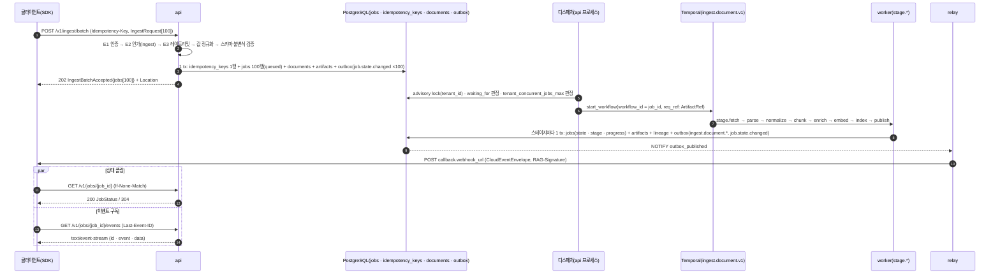

# 수집 API

> 정본 관계: 경로·메서드는 바이블 §14, 요청·응답 본문은 03-contracts 계약 인스턴스 그대로, 공통 규약(인증·멱등·페이지네이션·오류·한도)은 [API 설계 가이드라인](01-api-design-guidelines.md)이다. 이 문서는 그 위에 **수집 표면의 엔드포인트별 의미론**만 더한다. 충돌하면 브리프 > 바이블 > ADR > 이 문서다(바이블 §1.1).

## 목적

수집(ingestion) 표면 — 문서 접수(`/v1/ingest*`), 잡(job) 조회·제어(`/v1/jobs*`), 문서 자원(`/v1/documents/{document_id}*`) — 의 엔드포인트마다 요청·응답·상태 코드·오류·권한·한도를 확정하고, 멱등성(idempotency)·대량 배치 분할·우선순위·콜백 웹훅(webhook)·이벤트 구독의 동작을 클라이언트와 서버 구현자가 같은 문장으로 읽을 수 있게 한다. 브리프 R1(Pull 모델 수집)·D-08(비동기 잡·`Idempotency-Key`)·D-09(멀티테넌시)의 API 투영이다.

## 범위

- **포함**: 바이블 §14의 `ingest`·`jobs`·`documents` 행 15개 엔드포인트, 202 접수 패턴(D-08), 멱등성 의미론(draft-07), 배치 한계와 클라이언트 분할 전략, `priority`·`deadline_at`·`dedup_policy`·`split_hint`·`callback`의 API 관점 동작, 역할 기반 접근 제어(RBAC, Role-Based Access Control) 매트릭스의 수집 행, 레이트 리밋 클래스, curl·Python SDK 사용 예시, 시퀀스 다이어그램.
- **제외**: 계약 필드 정의(→ [수집 요청 계약](../03-contracts/01-ingest-request.md), [잡·이벤트·상태 계약](../03-contracts/12-jobs-events-and-status.md)), 오류 카탈로그(→ [에러 모델](../03-contracts/13-error-model.md)), 웹훅 구독 리소스·서명·재시도(→ [웹훅과 이벤트](07-webhooks-and-events.md)), 컬렉션·프로파일·구독·테넌트 관리(→ [관리 API](04-management-api.md)), 검색(→ [리트리벌 API](03-retrieval-api.md)), 스테이지 내부 동작(→ 04-pipelines), 요청 단위 `dry_run`(바이블 §14 미등재 — 미해결 이슈 1).

## 1. 표면 개요

**결정:** 수집 표면은 바이블 §14의 다음 15행이며 경로·메서드를 추가하거나 바꾸지 않는다([ADR-0018](../06-adr/0018-api-rest-sse-mcp-no-grpc-rfc9457.md)). `/v1/documents/{document_id}/versions`·`/artifacts/{stage}` 같은 별도 이력·산출물 경로는 도입하지 않는다 — 바이블 §14의 `/commits`·`/content?view=`가 같은 목적을 담는다.

| 메서드 | 경로 | 성공 | 응답 본문 | `Idempotency-Key` | 한도 클래스 | Cedar 액션 | 절 |
|--------|------|------|-----------|-------------------|-------------|------------|----|
| POST | `/v1/ingest` | 202 | `IngestAccepted` | 필수 | `ingest` | `ingest` | §4 |
| POST | `/v1/ingest/batch` | 202 | `IngestBatchAccepted` | 필수 | `ingest`(건수) | `ingest` | §5 |
| GET | `/v1/jobs` | 200 | `{items: JobStatus[], next_cursor}` | — | `ingest` | `manage_jobs` | §6.1 |
| GET | `/v1/jobs/{job_id}` | 200 / 304 | `JobStatus` | — | `ingest` | `manage_jobs` | §6.2 |
| GET | `/v1/jobs/{job_id}/events` | 200 | `text/event-stream` | — | `ingest`(연결 수) | `manage_jobs` | §6.3 |
| POST | `/v1/jobs/{job_id}/cancel` | 202 | `JobStatus` | 무시 | `ingest` | `manage_jobs` | §6.4 |
| POST | `/v1/jobs/{job_id}/retry` | 202 | `JobStatus` | 선택 | `ingest` | `manage_jobs` | §6.5 |
| PATCH | `/v1/jobs/{job_id}` | 200 | `JobStatus` | 무시 | `ingest` | `manage_jobs` | §6.6 |
| GET | `/v1/documents/{document_id}` | 200 | `DocumentMeta`(§7.1) | — | `query` | `read_document` | §7.1 |
| GET | `/v1/documents/{document_id}/content` | 200 | `{items, next_cursor}`(`view`별) | — | `query` | `read_document` | §7.2 |
| GET | `/v1/documents/{document_id}/commits` | 200 | `{items: IndexCommit[], next_cursor}` | — | `admin` | `read_document` | §7.3 |
| POST | `/v1/documents/{document_id}/reprocess` | 202 | `JobStatus`(`kind=reprocess_document`) | 선택(권장) | `admin` | `reprocess_document` | §7.4 |
| PATCH | `/v1/documents/{document_id}/acl` | 202 | `JobStatus`(`kind=acl_update`) | 무시 | `admin` | `update_acl` | §7.5 |
| PATCH | `/v1/documents/{document_id}/metadata` | 200 | `DocumentMeta` + `reprocess_suggestion`(§7.6) | 무시 | `admin` | `reprocess_document` | §7.6 |
| DELETE | `/v1/documents/{document_id}` | 202 | `JobStatus`(`kind=delete_document`) | 선택 | `admin` | `delete_document` | §7.7 |

한도 클래스·`operationId`는 [API 설계 가이드라인](01-api-design-guidelines.md) §9.3·§11과 같고, Cedar 액션은 [멀티테넌시·보안 아키텍처](../02-architecture/07-multi-tenancy-and-security-architecture.md) §4.1 매트릭스의 액션명이다. 모든 202 응답 본문에는 `job_id`·`status_url`·`events_url`이 있다(D-08; `IngestAccepted`와 `JobStatus` 모두).

## 2. 공통 규약

### 2.1 헤더

| 헤더 | 방향 | 규칙 | 정본 |
|------|------|------|------|
| `Authorization: Bearer <credential>` | 요청 | OIDC JWT 또는 API 키(`rag_ak_` 접두, 제안). 전용 헤더·쿼리 토큰·쿠키 없음. `tenant_id`는 여기서만 도출된다 | 01 §5.1, 바이블 §10.3 E1 |
| `Idempotency-Key` | 요청 | `POST /v1/ingest`·`/v1/ingest/batch` 필수, 잡 접수형 POST·DELETE 선택, 그 외 무시 | 01 §6, D-08 |
| `Content-Type: application/json` | 요청 | UTF-8, BOM 없음. PATCH는 `application/merge-patch+json`도 허용(같은 의미) | 01 §3.4·§12 |
| `If-None-Match` / `ETag` | 요청 / 응답 | `GET /v1/jobs/{job_id}`·`GET /v1/documents/{document_id}`의 304. `ETag`는 `updated_at` 기반 강한 검증자 | 01 §3.4 |
| `If-Match` | 요청 | PATCH·DELETE 낙관적 동시성. 불일치는 412 전용 코드 채택 전 400 `contract.violation` | 01 §3.4 |
| `Location` | 응답 | 202·201에 `status_url`(절대 URL) | 01 §8 |
| `RateLimit`, `RateLimit-Policy`, `Retry-After` | 응답 | 모든 인증 응답에 앞 둘, 429·503에 `Retry-After`(정수 초) | 01 §11, 13 §7.2 |
| `Last-Event-ID` | 요청 | SSE 재접속 커서(`event_id`) | 12 §9, 07 §9.3 |
| `Content-Language`, `Accept-Language` | 응답 / 요청 | `ProblemDetails.title`만 `ko`/`en` 협상 | 13 §9 |

### 2.2 권한(RBAC)

인증 → `Principal` → 그룹 확장 → Cedar 인가 → `SecurityContext` 서버 주입은 바이블 §10.3 E1~E2·[ADR-0027](../06-adr/0027-security-context-injection-and-acl-enforcement-points.md) 그대로다. 수집 표면에 관련된 역할 × 액션 행만 옮긴다(O = 허용, C = 자기 컬렉션(`allowed_collections`) 스코프 내 허용, - = 거부; 출처 07 §4.1).

| 액션 → 엔드포인트 | `platform_admin` | `tenant_admin` | `collection_admin` | `ingestor` | `reader` | `pii_officer` |
|-------------------|:---:|:---:|:---:|:---:|:---:|:---:|
| `ingest` → `POST /v1/ingest`, `/v1/ingest/batch` | O | O | C | C | - | - |
| `manage_jobs` → `GET /v1/jobs*`, `POST …/cancel`, `…/retry`, `PATCH /v1/jobs/{job_id}`, `GET …/events` | O | O | C | C(자기 잡) | - | - |
| `read_document` → `GET /v1/documents/{document_id}`, `…/content`, `…/commits` | O | O | C | C | C | C |
| `reprocess_document` → `POST …/reprocess`, `PATCH …/metadata` | O | O | C | C | - | - |
| `update_acl` → `PATCH …/acl` | O | O | C | - | - | - |
| `delete_document` → `DELETE /v1/documents/{document_id}` | O | O | C | - | - | - |

- "자기 잡"은 `jobs.request_id`를 접수한 주체(`Principal.subject`)와 같은 주체의 잡이다(초안; 07 §4.1 표기 "C(자기 잡)"의 정밀화, 미해결 이슈 8).
- `service:` 주체(API 키)는 `tenant_admin`·`platform_admin`·`pii_officer`를 가질 수 없다(07 결정). 따라서 커넥터 서비스 계정은 `ingestor` 또는 `collection_admin`으로 수집한다.
- 인가 실패는 항상 403 `auth.forbidden`(fail-closed, 존재 비노출; 01 §3.3). 다른 테넌트의 `job_id`·`document_id`도 403이다.
- `GET …/content`는 인가 뒤에 문서 ACL(E10; 바이블 §10.2 (a) 조건, `as_of = now()`)을 추가로 적용한다 — `read_document` 권한이 있어도 `allow_principals`·`embargo_until`·`classification`을 통과하지 못하면 403이다(§7.2).

### 2.3 레이트 리밋과 동시성 한계

값은 모두 **초안 목표**(`standard`, 테넌트당)이며 부하 테스트 후 프로파일 `security.rate_limit`으로 확정한다(01 §11). 초과는 429 `api.rate_limited` + `RateLimit`·`Retry-After`(E3, fail-closed).

| 한계 | 값(초안) | 적용 | 정본 |
|------|----------|------|------|
| `ingest` 클래스 | 20 req/s(1s 슬라이딩); `POST /v1/ingest/batch`는 **건수**로 계량 | `/v1/ingest*`, `/v1/jobs*` | 01 §11 |
| `query` 클래스 | 50 req/s | `GET /v1/documents/{document_id}`, `…/content` | 01 §11 |
| `admin` 클래스 | 10 req/s | `…/commits`, `…/reprocess`, `…/acl`, `…/metadata`, `DELETE` | 01 §11 |
| `api_key_id` 하위 한도 | 테넌트 한도의 50% | 위 클래스 각각 | 01 §11 |
| 동시 SSE 연결 | 테넌트당 100(`/v1/jobs/{job_id}/events` + `/v1/events` 합산) | 초과 429 | 01 §10.4, 07 §9.1 |
| 문서 단위 대기 체인 | 같은 `document_id`의 `queued(waiting_for)` 체인 ≤ 8; 초과 접수 429 | 접수 시 판정 | 12 §3.2 규칙 (5) |
| 테넌트 동시 실행 잡 | `runtime.tenant_concurrent_jobs_max` = 32(`jobs.state=running` 수); 초과분은 `queued` | 디스패처 | 바이블 §11.2, 01 §10 |
| 본문 크기 | `IngestRequest` 64KB(`metadata` 16KB), 배치 100 × 64KB, 인그레스 8MB | 400 `contract.violation`(`api.payload_too_large` 채택 후 413) | 바이블 §5.1, 01 §20 |
| 서버 시간 한계 | 수집 표면 30s(SSE 제외) | 503 | 01 §20 |

`ingest` 클래스가 배치를 건수로 계량하므로 100건 배치 한 번이 20 req/s 윈도 정원을 넘는다 — 한도 정책의 버스트 허용 또는 배치 전용 정책이 필요하다(미해결 이슈 2). 그 전까지 클라이언트는 §5.3의 분할 규칙(배치당 ≤ 100건, 배치 간 `Retry-After` 준수)을 따른다.

## 3. 접수 흐름

수집은 항상 "202 + `Location` + 상태 자원 + 이벤트 스트림 + 웹훅"의 단일 비동기 패턴이다(01 §10.1). 동기 대기·롱 폴링·WebSocket은 없다. 아래는 100건 배치가 접수되어 색인되고 클라이언트가 폴링·SSE·웹훅으로 종결을 아는 전 과정이다.



접수 트랜잭션(3)은 `IngestRequest` 산출물 저장(read-after-write 검증) 뒤에 커밋되며, 오케스트레이터(6)가 불가하면 잡은 `queued`로 남고 조정 스케줄이 시작한다(바이블 §11.5; 01 계약 §1·§3.3). 상태 정본은 PostgreSQL `jobs`이고 Temporal은 실행 엔진이다(D-08).

## 4. `POST /v1/ingest`

### 4.1 요청

본문은 `IngestRequest`(`urn:rag:schema:ingest-request:1`) 한 건이다. 필드 정의·정규화·검증 규칙은 [수집 요청 계약](../03-contracts/01-ingest-request.md) §2·§6~§9가 정본이고 여기서는 API 관점 요점만 적는다.

| 항목 | 규칙 |
|------|------|
| `tenant_id` | 본문에 **없다**. 오면 422 `contract.violation`(pointer `/tenant_id`; `auth.tenant_mismatch` 채택 전) |
| `request_id` | 서버 발급(`readOnly`). 본문에 오면 400 `contract.violation`(pointer `/request_id`) |
| `collection_id` | Cedar `allowed_collections` 밖이면 403 `auth.forbidden`(존재 비노출) |
| `source_uri` | 절대 URI, userinfo 금지. 스킴·호스트 허용 판정은 접수 시가 아니라 `fetch`의 `EgressPolicy`(E16)에서 — 위반은 잡 `failed`(`fetch.egress_denied`·`fetch.scheme_unsupported`). 접수 시 fail-fast 거부는 미정(01 미해결 이슈 6) |
| `acl` | Y. `allow_principals`·`visibility` 필수, 주체 ≤ 1,024(초과 422 `auth.too_many_principals`) |
| `credentials_ref` | 비밀 값 평문 금지 — 형식 위반은 400 |
| `callback.webhook_url` | 테넌트의 활성 구독(`subscriptions.webhook_url`)과 일치해야 한다(불일치 400, pointer `/callback/webhook_url`). 새 구독을 만들지 않는다(§4.6) |
| `profile_overrides` | 컬렉션 프로파일 허용 키만; 그 외 422 `profile.invalid` |
| `requested_at` | Y. 멱등 지문에 포함되므로 재전송은 같은 값 |

클라이언트 전송 본문(정규화 전, `request_id` 없음):

```json
{
  "schema_version": "1.0.0",
  "collection_id": "01J9ZQ5A1B2C3D4E5F6G7H8J9K",
  "source_uri": "s3://mois-records/regulations/2026/records-management-rule-2026-09.hwpx",
  "media_type_hint": "application/hwp+zip",
  "external_id": "MOIS-REG-2026-0917",
  "metadata": {
    "title": "공공기록물 관리에 관한 법률 시행규칙 일부개정안",
    "doc_date": "2026-09-17",
    "doc_type": "regulation",
    "department": "행정안전부",
    "language_hint": "ko",
    "tags": ["기록물", "시행규칙", "개정안"],
    "genre": "law_article"
  },
  "acl": {
    "allow_principals": ["group:mois_records"],
    "visibility": "restricted",
    "classification": "internal",
    "embargo_until": "2026-10-01T00:00:00.000Z"
  },
  "pii_policy": "mask",
  "dedup_policy": "skip_if_same_hash",
  "priority": 5,
  "callback": {
    "webhook_url": "https://hooks.example.go.kr/rag/ingest",
    "events": ["job.state.changed", "ingest.document.indexed", "ingest.document.failed"]
  },
  "requested_at": "2026-09-23T01:00:00.000Z"
}
```

### 4.2 응답

202 `IngestAccepted` + `Location: {status_url}`. `request_id`·`document_id`는 선택(N)이지만 서버는 항상 채운다(01 계약 §3.1; 필수화는 미해결 이슈 9).

```json
{
  "job_id": "01JAC0A1B2C3D4E5F6G7H8J9K0",
  "request_id": "01JAC0A0Z9Y8X7W6V5T4S3R2Q1",
  "document_id": "01JAC09Z8Y7X6W5V4T3S2R1Q0P",
  "status_url": "https://rag.example.go.kr/v1/jobs/01JAC0A1B2C3D4E5F6G7H8J9K0",
  "events_url": "https://rag.example.go.kr/v1/jobs/01JAC0A1B2C3D4E5F6G7H8J9K0/events"
}
```

`document_id`는 접수 시 `(tenant_id, collection_id, external_id or source_uri)`로 확정된다(바이블 §11.2; 01 계약 §10). 같은 문서의 활성 잡이 있으면 새 잡은 `queued(waiting_for)`로 접수되며 응답은 그대로 202다 — 대기 여부는 `GET /v1/jobs/{job_id}`의 `waiting_for`로 안다.

### 4.3 상태 코드

| 상태 | 조건 | 코드 | 헤더·본문 |
|------|------|------|-----------|
| 202 | 접수 | — | `Location`, `IngestAccepted` |
| 200 | 같은 키·같은 지문 재전송(접수 커밋 후) | — | 원 202와 내용 동일 본문, 같은 `Location` |
| 400 | 스키마·불변식 위반, `Idempotency-Key` 부재, `request_id` 존재, 비밀 평문, 인라인 한계 초과, 미등록 콜백 URL, `Content-Type` 불일치. **예외:** 잠금 ACL(01 계약 §7 IR-5 A4 `deny_principals ∋ tenant:*` 또는 A6 `restricted` + 빈 `allow_principals`)은 더는 400이 아니다 — 202로 접수하고 `warnings += {code: "contract.acl_deny_all"}`를 담는다(바이블 §5.7 1.3.0, AM-17·AM-36) | `contract.violation`(`errors[].location.pointer` ≤ 16) | `ProblemDetails` |
| 401 / 403 | 미인증 / 컬렉션 `ingest` 권한 없음 | `auth.unauthenticated` / `auth.forbidden` | `WWW-Authenticate` / — |
| 409 | 같은 키의 접수 트랜잭션 진행 중 | `api.idempotency_conflict` | `instance` = 잠정 `/v1/jobs/{job_id}`, `Retry-After: 1` |
| 422 | 같은 키·다른 지문 / `profile_overrides` 허용 밖 / 주체 초과 / 본문 `tenant_id` | `api.idempotency_payload_mismatch` / `profile.invalid` / `auth.too_many_principals` / `contract.violation` | — |
| 429 | 한도(`ingest` 클래스, 대기 체인 초과) | `api.rate_limited` | `RateLimit`, `Retry-After` |
| 503 | (a) 오케스트레이터 불가 — 접수 커밋됨, 잡 `queued`, 재전송은 200 / (b) 산출물 저장 불가 — 접수 없음, 재전송은 새 접수 | `api.orchestrator_unavailable` / `api.dependency_unavailable`(제안 코드, 조기 채택 전제; 13 §3.3) | `Retry-After: 30` |

409 응답 예(`instance`의 잡을 폴링하고 **새 키로 재전송하지 않는다**; 13 §10):

```json
{
  "type": "urn:rag:error:api.idempotency_conflict",
  "title": "Idempotency conflict",
  "status": 409,
  "detail": "a request with the same Idempotency-Key is still being accepted; poll the instance job instead of resending",
  "instance": "/v1/jobs/01JAC0A1B2C3D4E5F6G7H8J9K0",
  "code": "api.idempotency_conflict",
  "retryable": false,
  "trace_id": "7d3a1f0c9b8e4a2d6c5f1e0b9a8d7c6f",
  "request_id": "01JAC0A2M3N4P5Q6R7S8T9V0W1"
}
```

### 4.4 멱등성 의미론

**결정:** `Idempotency-Key`는 draft-ietf-httpapi-idempotency-key-header-07 의미론(재전송 200 / 409 / 422)을 따르고, 판정 정본은 PostgreSQL `idempotency_keys(tenant_id, key)`이며 `jobs` INSERT와 동일 트랜잭션에 기록한다. Valkey `idem:{tenant}:{key}`는 조회 캐시다(D-08, 바이블 §13.1·§13.4; [ADR-0017](../06-adr/0017-event-delivery-outbox-cloudevents-no-broker.md), [ADR-0018](../06-adr/0018-api-rest-sse-mcp-no-grpc-rfc9457.md)). 규칙은 01 §6·01 계약 §4과 같으며 클라이언트 관점 요약은 다음이다.

| 상황 | 서버 | 클라이언트 |
|------|------|-----------|
| 새 키 | 접수 202 | 키·본문을 보관(재시도용) |
| 같은 키·같은 본문(바이트 동일, `requested_at` 포함) | 200 재생(같은 `job_id`) | 응답 `replayed`로 인지(SDK); 상태는 `status_url` |
| 같은 키·다른 본문 | 422 `api.idempotency_payload_mismatch` | 새 키로 재전송 |
| 같은 키·처리 중 | 409 + `instance` | `Retry-After` 뒤 같은 요청 재전송 또는 `instance` 폴링 |
| 4xx로 거부된 원 요청 | 키 미소비 | 본문 고쳐 같은 키 재사용 가능 |
| 503 (a) 오케스트레이터 불가 | 키 소비(잡 존재) | 같은 키 재전송 → 200 |
| 503 (b) 저장 불가 | 키 미소비 | 같은 키 재전송 → 새 접수 |
| 키 만료(24h, 초안) | 새 요청으로 취급 | 24h 넘긴 재시도는 `external_id` 기준 `dedup_policy`가 중복 색인을 막는다 |

- 키 형식: 가시 ASCII 1..255(`^[\x21-\x7E]{1,255}$`), UUID v4 권장. 스코프 `(tenant_id, key)` — 단건과 배치에 같은 키를 쓰면 지문(`endpoint_path` 포함)이 달라 422다.
- 지문: `request_hash = H("idem", endpoint_path, canonical_json(wire_body))` — 서버 주입·정규화 **전** 전송 본문 기준.
- 멱등 키는 **접수**의 중복을 막고, `dedup_policy`는 **콘텐츠**의 중복 색인을 막는다(§4.5). 둘은 층이 다르다.

### 4.5 접수 옵션의 API 동작

| 필드 | API 관점 동작 | 정본 |
|------|---------------|------|
| `dedup_policy` | 기본 `skip_if_same_hash`: `fetch` 후 `content_hash`가 현재 세대와 같고 `acl_hash`·`metadata_hash`도 같으면 `parse`~`index` 생략, 잡 `succeeded`(`progress.total=1`, 새 커밋 없음). ACL·메타만 다르면 payload 갱신 경로(재임베딩 없음, `doc_version` 불변). `reindex_always`: 캐시 적중이라도 `index`는 **새 세대** 적재·플립 | 01 계약 §5.1, [ADR-0005](../06-adr/0005-doc-version-content-hash-only-and-acl-payload-update.md), [ADR-0026](../06-adr/0026-index-commit-generation-saga-and-ledger.md) |
| `split_hint` | `json_array`·`zip_members` 멤버는 각자 `document_id`를 갖는 별개 문서(자식 잡). 202 응답은 부모 잡 하나만 담는다 — 멤버 잡은 `GET /v1/jobs?document_id=`(§6.1) 또는 웹훅 `data.document_id`로 추적한다(멤버 URI·ID 합성은 01 미해결 이슈 5, 채택 전) | 01 계약 §5.2 |
| `priority` | 0..9, 기본 5. 디스패처 순서 `(priority DESC, job_id ASC)`. 접수 후 변경은 `PATCH /v1/jobs/{job_id}`(§6.6). 실행 중 잡의 액티비티 순서는 바꾸지 않는다(큐 순서만) | 12 §2.1, 바이블 §11.5 |
| `deadline_at` | 이 시각까지 `running`이 되지 못한 `queued` 잡은 `cancelled`. 시작된 잡은 영향 없음 | 바이블 §11.5, 12 §2.1 |
| `callback` | §4.6 | 01 계약 §2.4, 07 §3.5 |
| `profile_overrides` | `Producer.config_hash`에 반영 → `stage_key` 변경 → 캐시 미적중(재실행) | 01 계약 §2.5, 바이블 §4.1 |
| `llm_enrichment_allowed`, `allow_distribution_documents` | 테넌트·컬렉션 정책과 AND. 요청만 `true`여도 정책이 `false`면 효과 없음(오류 아님) | 바이블 §5.4, O-05·O-07 |

### 4.6 콜백 웹훅 등록

**결정:** 잡 단위 콜백은 **구독을 만들지 않는다**. 웹훅 구독(`Subscription`)은 관리 표면 `POST /v1/subscriptions`(`tenant_admin`·`platform_admin`; [웹훅과 이벤트](07-webhooks-and-events.md) §3)로 미리 등록하고, `IngestRequest.callback.webhook_url`은 그 구독의 URL과 **일치**해야 한다(불일치 400). 서명 키(`subscriptions.secret_ref`)를 구독에서 해소하기 때문이다(바이블 §6.2, E16, [ADR-0038](../06-adr/0038-outbound-egress-policy-and-webhook-signing.md)).

| 항목 | 규칙 |
|------|------|
| 전달 범위 | 그 잡의 이벤트는 (a) 일치한 구독으로만, (b) `callback.events`(생략 시 `["job.state.changed"]`)로만 좁혀 전달. 다른 구독은 그 잡의 이벤트를 받지 않는다 |
| 허용 이벤트 | `job.state.changed`, `ingest.document.{fetched, parsed, normalized, chunked, enriched, embedded, indexed, retried, failed}`, `index.commit.{published, rolled_back}`(12종, 바이블 §5.7) |
| 전달 형식 | `POST {webhook_url}`, 본문 `CloudEventEnvelope` 1건, `RAG-Signature: t={ts},v1={hmac}`(5분 재생 창), HTTPS만(`EgressPolicy`) |
| 재시도·소진 | 07 §6(지수 백오프, 최대 12회 초안). 소진 시 SSE·`GET /v1/jobs/{job_id}`로 상태를 확인한다 — 웹훅은 알림이고 상태 정본이 아니다 |
| 콜백 없음 | `callback`을 생략한 잡의 이벤트는 테넌트 구독의 `events[]` 필터대로 모든 구독에 전달된다(일반 규칙) |

## 5. `POST /v1/ingest/batch` — 대량 배치 한계와 분할

### 5.1 규칙

| 항목 | 규칙 | 정본 |
|------|------|------|
| 본문 | `IngestRequest` **배열** 1..100건(`$defs/IngestBatchRequest`), 100 × 64KB | 바이블 §14·§5.1 |
| 검증 | 전체 원자적. 한 건이라도 위반이면 400 + `errors[].location.pointer = /{index}/{field}`, 잡 0개 | 01 §10.3, 01 계약 §3.2 |
| 접수 | 단일 트랜잭션: `jobs` N행 + `idempotency_keys` 1행 + `documents` + `artifacts` N행. `request_id`·`document_id`는 건별 | 01 계약 §3.2 |
| 응답 | 202 `IngestBatchAccepted{jobs[]}`; `jobs[i]`는 요청 배열 `i`번째. `Location`은 `jobs[0].status_url` | 01 계약 §3.2 |
| 멱등성 | 키 하나가 배치 전체를 덮는다(200/409/422 동일). 부분 접수 없음. 재생(200)은 `idempotency_keys.job_ids`(배치 자식 잡 ID 배열, 바이블 §13.1 1.3.0)로 원 `IngestBatchAccepted.jobs[]`를 재현하며, 배치 자식 잡의 `jobs.idempotency_key`는 NULL이다(배치 키는 `idempotency_keys`에만 있다; AM-44) | 01 §6·§10.3 |
| 같은 문서 | 배열 안 두 건이 같은 `document_id`로 확정되면 뒤 건이 `queued(waiting_for = 앞 job_id)` — 배열 순서 = 처리 순서 | 01 계약 §3.2·§10 |
| 한도 | `ingest` 클래스에서 건수로 계량(§2.3) | 01 §11 |

```json
{
  "jobs": [
    {"job_id": "01JAC0B0C1D2E3F4G5H6J7K8M9", "request_id": "01JAC0AZ9Y8X7W6V5T4S3R2Q1P", "document_id": "01JAC0AY8X7W6V5T4S3R2Q1P0N", "status_url": "https://rag.example.go.kr/v1/jobs/01JAC0B0C1D2E3F4G5H6J7K8M9", "events_url": "https://rag.example.go.kr/v1/jobs/01JAC0B0C1D2E3F4G5H6J7K8M9/events"},
    {"job_id": "01JAC0B0C1D2E3F4G5H6J7K8MA", "request_id": "01JAC0AZ9Y8X7W6V5T4S3R2Q1Q", "document_id": "01JAC0AY8X7W6V5T4S3R2Q1P0P", "status_url": "https://rag.example.go.kr/v1/jobs/01JAC0B0C1D2E3F4G5H6J7K8MA", "events_url": "https://rag.example.go.kr/v1/jobs/01JAC0B0C1D2E3F4G5H6J7K8MA/events"}
  ]
}
```

### 5.2 배치 대 단건

| 상황 | 권장 |
|------|------|
| 커넥터가 주기적으로 수십~수천 건을 밀어 넣는다 | 배치. 접수 트랜잭션·레이트 리밋·`Idempotency-Key` 관리가 1/100로 줄고, 배치 안 순서가 문서 직렬화 순서다 |
| 사용자 업로드 1건, 즉시 상태 표시 | 단건. `IngestAccepted` 하나로 `status_url`·`events_url`을 바로 쓴다 |
| 건별로 다른 `deadline_at`·`priority`가 필요 | 둘 다 가능(필드는 건별). 배치는 검증만 원자적이고 실행은 건별 잡 |
| 한 건이 자주 검증에 실패한다 | 단건 또는 사전 검증 후 배치. 배치는 한 건 실패로 전체가 400이다(부분 접수 없음). 서버 측 사전 검증(`dry_run`)은 미해결 이슈 1 |

### 5.3 클라이언트 분할 전략

**결정(클라이언트 지침):** 대량 수집은 다음 규칙으로 배치를 만든다. SDK `client.ingest.batch`는 이 규칙을 구현한다([클라이언트 SDK](06-client-sdks.md) §8.1).

| # | 규칙 | 이유 |
|---|------|------|
| S1 | 배치당 ≤ 100건, 본문 ≤ 100 × 64KB. 초과는 클라이언트가 나눈다(서버는 101건째부터 400) | 바이블 §14 |
| S2 | 배치마다 **결정적** `Idempotency-Key`(예: 원천 목록·배치 번호로 UUIDv5) + 본문 바이트 고정(`requested_at` 포함) | 크래시 후 재실행이 200 재생으로 끝난다 |
| S3 | 배치 안 같은 `external_id`(또는 `source_uri`)는 한 번만. 같은 문서의 갱신은 다음 배치로 | 배치 안 중복은 대기 체인만 만든다(체인 ≤ 8, 초과 429) |
| S4 | 배치 사이에 `RateLimit`(`r`, `t`)·`Retry-After`를 읽어 대기. 429는 같은 요청 재전송 | E3 fail-closed |
| S5 | 접수 응답의 `job_id` 목록을 영속화하고 종결은 `wait_all`(테넌트 SSE 1개 + GET 재확인) 또는 웹훅으로 수집 | 잡 100개에 SSE 100개를 열지 않는다(연결 상한 100) |
| S6 | `failed`는 `last_error.retryable`로 나눠 `retry`(재시도 가능) 또는 수정 후 **새 배치**(비재시도: `parse.document_encrypted` → `credentials_ref`, `fetch.egress_denied` → URL 교정 등) | 13 §10 |
| S7 | 컬렉션이 다르면 배치도 나눈다(권장) | 403 `auth.forbidden` 한 건이 배치 전체를 거부한다 |

## 6. 잡 조회·제어

### 6.1 `GET /v1/jobs`

불투명 커서 기반 목록(01 §7). 응답 `{items: JobStatus[], next_cursor}`, 총 개수 없음.

| 파라미터 | 타입 | 기본 | 규칙 |
|----------|------|------|------|
| `collection_id` | string(ulid) | — | 동등. `allowed_collections` 밖이면 403 | 
| `state` | enum(JobState), 쉼표 구분 | — | 포함(`in`). 예 `state=queued,running,cancelling`(활성 잡) |
| `kind` | enum(JobKind), 쉼표 구분 | — | 포함 |
| `document_id` | string(ulid) | — | 동등. **이 문서 추가**(바이블 §14는 `collection_id`·`state`·`kind`·커서만 등재; 목록 필터는 개별 문서가 열거, 01 §7.1) — `split_hint` 멤버 잡·문서 이력 추적용(미해결 이슈 6) |
| `created_at_gte`, `created_at_lt` | string(date-time) | — | 범위(이 문서 추가) |
| `sort` | string | `-created_at` | 허용 `created_at`, `updated_at` |
| `cursor`, `limit` | string / integer | — / 50 | `limit` 1..200; 잘못된 커서 400 `contract.violation` |

`ingestor`는 자기 잡만 본다(§2.2). 미지 파라미터는 400(01 §7.4). 목록 필터는 `QueryRequest.filters`와 다른 것이다.

### 6.2 `GET /v1/jobs/{job_id}`

200 `JobStatus` 인스턴스 그대로(`schema_type`·`schema_version` 포함). `failed`·`partial`도 200 + `last_error`. `ETag`(`updated_at` 기반) · `If-None-Match` → 304. 폴링 간격 ≥ 2s(초안); 세분 진행률(`page`·`chunk` 단위, 하트비트 30s)은 이 엔드포인트에서만 보인다(SSE는 스테이지 경계만, §6.3). `running`인데 `updated_at`이 오래되면 서버가 `handle.query(get_status)`로 보정한다(바이블 §11.5).

```json
{
  "schema_version": "1.0.0",
  "schema_type": "JobStatus",
  "job_id": "01JAC0A1B2C3D4E5F6G7H8J9K0",
  "tenant_id": "01J9ZQ4K7X2M8N3P5R6S7T8V9W",
  "collection_id": "01J9ZQ5A1B2C3D4E5F6G7H8J9K",
  "kind": "ingest_document",
  "state": "succeeded",
  "stage": "publish",
  "progress": {"done": 8, "total": 8, "unit": "stage"},
  "attempts": 1,
  "workflow_run_id": "9a1b2c3d-4e5f-4a6b-8c7d-0e1f2a3b4c5d",
  "workflow_id": "01JAC0A1B2C3D4E5F6G7H8J9K0",
  "idempotency_key": "d2c5f1a8-6b3e-4e9a-a1c7-5f0b2d9e8c41",
  "request_id": "01JAC0A0Z9Y8X7W6V5T4S3R2Q1",
  "document_id": "01JAC09Z8Y7X6W5V4T3S2R1Q0P",
  "index_commit_id": "01JAC0F5G6H7J8K9M0N1P2Q3R4",
  "last_error": null,
  "degraded": [],
  "cost": {"llm_tokens_in": 0, "llm_tokens_out": 0, "cost_usd": 0, "gpu_seconds": 3.2},
  "priority": 5,
  "status_url": "https://rag.example.go.kr/v1/jobs/01JAC0A1B2C3D4E5F6G7H8J9K0",
  "events_url": "https://rag.example.go.kr/v1/jobs/01JAC0A1B2C3D4E5F6G7H8J9K0/events",
  "created_at": "2026-09-23T01:00:00.412Z",
  "started_at": "2026-09-23T01:00:01.088Z",
  "updated_at": "2026-09-23T01:00:19.731Z",
  "finished_at": "2026-09-23T01:00:19.731Z",
  "deadline_at": null
}
```

종결 판정은 `state ∈ {succeeded, partial, failed, cancelled}`이고 미지 값은 "종결 아님"이다(01 §10.1). `partial`은 실패가 아니다 — 인덱스는 커밋되어 검색 가능하고 `last_error`가 원인(예 `enrich.budget_exceeded`)을 가리키며 `retry?stages=enrich`로 보강만 재실행한다(12 §3.2).

### 6.3 `GET /v1/jobs/{job_id}/events` (SSE)

프레임·재접속·종료 규약은 [웹훅과 이벤트](07-webhooks-and-events.md) §9·12 §9가 정본이다. 수집 클라이언트가 지켜야 할 요점:

| 항목 | 규칙 |
|------|------|
| 요청 | `Accept: text/event-stream`, `Authorization: Bearer`(쿼리 토큰 없음), 선택 `Last-Event-ID` |
| 첫 접속 | 서버가 그 잡의 **발행된 과거 이벤트를 발행 순으로 먼저 재생**한 뒤 실시간으로 이어간다. 이미 종결된 잡은 종결 `job.state.changed`까지 재생 후 즉시 닫는다 — 202 직후 접속해도 이벤트를 놓치지 않는다 |
| 프레임 | `id: {event_id}` · `event: {type}` · `data: {CloudEventEnvelope JSON 1행}`. 첫 프레임 앞 `retry: 3000`, 15s마다 `: keepalive` |
| 범위 | `data.job_id = job_id`인 이벤트: `job.state.changed`, `ingest.document.*`, `index.commit.published`·`rolled_back`(바이블 §14 1.3.0, AM-20) |
| 진행률 | `job.state.changed.data.progress`는 **스테이지 경계**만. 페이지·청크 세분 진행률은 §6.2 폴링. 세분 진행률 이벤트 `job.progress.updated`는 채택하지 않는다(AM-54 보류 — 근거 대기, §미해결 이슈 14) |
| 종료 | 종결 `job.state.changed` 전달 후 서버가 닫는다. 결과 이벤트(`ingest.document.indexed`·`failed`)는 종결 이벤트보다 먼저 도달한다(12 I-19). `retry` 후에는 새 접속 |
| 멱등 | at-least-once. `id`(= `event_id`)로 중복 제거 |
| 오류 | 접속 실패만 `ProblemDetails`(401·403·400). 잡 실패는 스트림 안 이벤트 `data`에 투영 |
| 제어 프레임 | `event: gap`(제안; `id` 없음)은 재생 창(7일 초안) 밖 재접속 알림 — `EventType`이 아닌 `event` 값은 제어 프레임으로 다룬다 |

```text
retry: 3000

id: 01JAC0A3D4E5F6G7H8J9K0M1N2
event: job.state.changed
data: {"specversion":"1.0","id":"01JAC0A3D4E5F6G7H8J9K0M1N2","source":"urn:rag:worker","type":"job.state.changed","time":"2026-09-23T01:00:01.088Z","subject":"tenant/01J9ZQ4K7X2M8N3P5R6S7T8V9W/job/01JAC0A1B2C3D4E5F6G7H8J9K0","datacontenttype":"application/json","tenantid":"01J9ZQ4K7X2M8N3P5R6S7T8V9W","data":{"job_id":"01JAC0A1B2C3D4E5F6G7H8J9K0","kind":"ingest_document","collection_id":"01J9ZQ5A1B2C3D4E5F6G7H8J9K","from_state":"queued","to_state":"running","stage":"fetch","attempts":1,"progress":{"done":0,"total":8,"unit":"stage"},"document_id":"01JAC09Z8Y7X6W5V4T3S2R1Q0P"}}

: keepalive

id: 01JAC0F4E5F6G7H8J9K0M1N2P3
event: ingest.document.indexed
data: {"specversion":"1.0","id":"01JAC0F4E5F6G7H8J9K0M1N2P3","source":"urn:rag:worker","type":"ingest.document.indexed","time":"2026-09-23T01:00:19.731Z","subject":"tenant/01J9ZQ4K7X2M8N3P5R6S7T8V9W/document/01JAC09Z8Y7X6W5V4T3S2R1Q0P","datacontenttype":"application/json","tenantid":"01J9ZQ4K7X2M8N3P5R6S7T8V9W","data":{"job_id":"01JAC0A1B2C3D4E5F6G7H8J9K0","document_id":"01JAC09Z8Y7X6W5V4T3S2R1Q0P","collection_id":"01J9ZQ5A1B2C3D4E5F6G7H8J9K","commit_id":"01JAC0F5G6H7J8K9M0N1P2Q3R4","index_generation":1,"quality":"full"}}

```

`ingest.document.indexed`의 `data` 필드 집합은 12 §6.1이 정본이며 위는 그중 일부를 보인 예다(콘텍스트 본문은 `data`에 금지, 바이블 §5.3).

### 6.4 `POST /v1/jobs/{job_id}/cancel`

| 항목 | 규칙 |
|------|------|
| 본문 | 없음(빈 본문 또는 `{}`) |
| 응답 | 202 `JobStatus`(`state=cancelling` — `running`이었을 때; `cancelled` — `queued`였을 때) |
| 동작 | `queued`(대기 체인 포함) → 즉시 `cancelled`. `running`(플립 전, `index_commits.status ∈ {pending, vector_written, lexical_written}`) → 원장 `cancelling` 커밋 후 `handle.signal(cancel)` → 진행 액티비티 취소 + 보상(새 세대 삭제) → `cancelled`. `running`(플립 시작 후, `status ∈ {flipping_lexical, flipping_vector}`) → 사가는 보상 없이 완료하고 잡은 `succeeded`로 종결(AM-46 잠정 규칙; 응답은 여전히 202 + 그 시점의 `JobStatus`). 시그널 전송 실패는 503 + `Retry-After`, 조정 틱이 재전송 |
| 종결 잡 | `succeeded`·`partial`·`failed`·`cancelled`의 취소는 400 `contract.violation`(`api.job_state_conflict` 채택 전; `detail="conflict: job already terminal"`) |
| 멱등성 | 자연 멱등 — `cancelling`·`cancelled` 잡의 재호출은 현재 상태를 202로 돌려준다. `Idempotency-Key`는 무시 |
| 이벤트 | `job.state.changed` + `audit.admin.action`(취소는 관리 행위) |

플립 뒤(`flipping_*` 이후) 도착한 취소는 바이블 §11.5에 정식 전이가 아직 없어(`cancelling → succeeded`), 트리아지 AM-46이 잠정 규칙(구현은 이 규칙을 따르되 바이블 patch는 보류, CR-29)으로 "보상 없이 사가 완료 → `succeeded`"를 확정했다 — §미해결 이슈 7은 이 잠정 규칙이 바이블 §11.5 patch로 정식 채택되기까지 열어 둔다.

### 6.5 `POST /v1/jobs/{job_id}/retry`

| 항목 | 규칙 |
|------|------|
| 대상 | `failed` → `queued`(실패한 스테이지부터, 캐시 산출물 재사용, 새 `workflow_run_id`); `partial` → `retry?stages=enrich`로 `queued(from_stage=enrich)` |
| `stages` | 쿼리 파라미터. **v1 허용 값은 `enrich` 하나**(바이블 §11.5 예시 그대로). 다른 값·`failed` 잡에 `stages` 지정은 400 `contract.violation`(일반화는 미해결 이슈 10) |
| 응답 | 202 `JobStatus`(`state=queued`, `attempts=0`, `last_error=null`, `stage=from_stage`) |
| `Idempotency-Key` | 선택. 부재 시 서버가 `internal:{workflow_type}:{ulid}`를 합성해 `JobStatus.idempotency_key`를 채운다 |
| 비대상 | `succeeded`·`cancelled`·`queued`·`running`의 `retry`는 400(`api.job_state_conflict` 채택 전). `succeeded` 문서의 재처리는 §7.4 `reprocess` |
| 비재시도 오류 | `last_error.retryable=false`인 `failed` 잡도 `retry`는 허용되지만 같은 오류로 다시 실패한다 — 클라이언트는 원인을 고친 **새 `IngestRequest`**를 보낸다(13 §10) |

### 6.6 `PATCH /v1/jobs/{job_id}`

본문 `{"priority": integer(0..9)}`(JSON Merge Patch, 다른 키는 400). 응답 200 `JobStatus`. Temporal `handle.execute_update(set_priority)` + 원장 `jobs.priority`(바이블 §11.5). 종결 잡의 PATCH는 400. `queued` 잡은 다음 디스패처 틱부터 새 순서를 적용하고, `running` 잡은 실행 중 액티비티에 영향이 없다(이후 큐 재진입 시 적용).

## 7. 문서 자원

### 7.1 `GET /v1/documents/{document_id}` — `DocumentMeta`

**결정(초안):** 문서 자원 응답은 바이블 §13.1 `documents` 행의 투영 객체 `DocumentMeta`다. 바이블 §5.1 인벤토리에 없는 **API 응답 객체**이므로 봉투 계약이 아니며(`schema_type`은 편의 필드), 이 문서가 정의를 소유하고 [관리 API](04-management-api.md)는 이를 참조한다(01 §9.3이 04에 위임한 항목의 확정; 미해결 이슈 3). 필드는 `documents` 컬럼과 1:1이고 새 의미를 더하지 않는다.

| 필드 | 타입 | 필수 | 설명 | 예시 |
|------|------|------|------|------|
| `schema_version`, `schema_type` | string(semver) / string(const) | Y / N | `"1.0.0"` / `"DocumentMeta"` | |
| `document_id`, `tenant_id`, `collection_id` | string(ulid) | Y | 보안 삼중항 + 문서 ID | |
| `external_id`, `external_version` | string | N | 원천 ID·버전 라벨(마지막 접수 값) | `"MOIS-REG-2026-0917"` |
| `source_uri` | string(uri) | Y | 마지막 접수 `source_uri` | |
| `current_doc_version` | string(hex64) \| null | Y(nullable) | `documents.current_doc_version`; 첫 `fetch` 전 `null` | |
| `current_generation` | integer | Y | `documents.current_generation`(0 = 커밋 없음) | `1` |
| `current_commit_id` | string(ulid) \| null | Y(nullable) | 현재 `IndexCommit`; 툼스톤이면 `kind=delete` 커밋 | |
| `acl`, `acl_hash` | `Acl` / string(hex64) | Y | 현재 ACL(문서 단위) | |
| `metadata`, `metadata_hash` | `IngestMetadata` / string(hex64) | Y | 현재 메타(`PATCH …/metadata` 반영) | |
| `status` | enum[active, deleting, deleted] | N | 삭제 수명주기(01 §9.4). 저장소 아키텍처 미해결 이슈 1의 제안 컬럼 — 채택 전 서버는 `current_commit_id`의 `kind`와 활성 `delete_document` 잡으로 도출 | `"active"` |
| `deleted_at` | string(date-time) | N | 툼스톤 커밋 시각(`status=deleted`) | |
| `created_at`, `updated_at` | string(date-time) | Y | | |

```json
{
  "schema_version": "1.0.0",
  "schema_type": "DocumentMeta",
  "document_id": "01JAC09Z8Y7X6W5V4T3S2R1Q0P",
  "tenant_id": "01J9ZQ4K7X2M8N3P5R6S7T8V9W",
  "collection_id": "01J9ZQ5A1B2C3D4E5F6G7H8J9K",
  "external_id": "MOIS-REG-2026-0917",
  "source_uri": "s3://mois-records/regulations/2026/records-management-rule-2026-09.hwpx",
  "current_doc_version": "6e1f0c2a9b7d4e8f1a3c5b7d9e0f2a4c6b8d0e1f3a5c7b9d1e3f5a7c9b0d2e4f",
  "current_generation": 1,
  "current_commit_id": "01JAC0F5G6H7J8K9M0N1P2Q3R4",
  "acl": {
    "allow_principals": ["group:mois_records"],
    "deny_principals": [],
    "visibility": "restricted",
    "classification": "internal",
    "embargo_until": "2026-10-01T00:00:00.000Z",
    "expires_at": null
  },
  "acl_hash": "3c9a0d1e2f4b5a6c7d8e9f0a1b2c3d4e5f6a7b8c9d0e1f2a3b4c5d6e7f8a9b0c",
  "metadata": {
    "title": "공공기록물 관리에 관한 법률 시행규칙 일부개정안",
    "doc_date": "2026-09-17",
    "doc_type": "regulation",
    "department": "행정안전부",
    "language_hint": "ko",
    "tags": ["기록물", "시행규칙", "개정안"],
    "genre": "law_article"
  },
  "metadata_hash": "a0b1c2d3e4f5061728394a5b6c7d8e9f0a1b2c3d4e5f60718293a4b5c6d7e8f9",
  "status": "active",
  "created_at": "2026-09-23T01:00:00.412Z",
  "updated_at": "2026-09-23T01:00:19.731Z"
}
```

삭제 수명주기별 응답(01 §9.4): 삭제 중·툼스톤은 200(`status`·`deleted_at` 노출), 정리(purge) 후는 404 `api.not_found`(바이블 §5.7 1.3.0, AM-36; `detail="not found: …"`). 조회는 `audit.document.accessed`를 기록한다.

### 7.2 `GET /v1/documents/{document_id}/content`

산출물(artifact) 열람 — 디버깅·검수·MCP `get_document`와 같은 읽기 경로다. 바이블 §14 `?view=parsed|normalized|chunks&cursor=`(ACL 필터).

| 파라미터 | 타입 | 기본 | 규칙 |
|----------|------|------|------|
| `view` | enum[parsed, normalized, chunks] | 필수 | `parsed` → `items: Block[]`(`ParsedDocument.blocks` 문서 순서), `normalized` → `NormalizedBlock[]`, `chunks` → `Chunk[]`(`level 0·1`, `ordinal` 순) |
| `doc_version` | string(hex64) | 현재 세대 | 이전 버전 열람(이 문서 추가, N). 현재 커밋의 `artifact_refs`가 없는 버전은 400 |
| `cursor`, `limit` | string / integer | — / 50 | 1..200. 커서는 항목 인덱스 기반 키셋(01 §7.2 형식) |

| 규칙 | 내용 |
|------|------|
| 원천 | 현재 커밋 `IndexCommit.artifact_refs.{parsed, normalized, chunk_set}`의 산출물을 오브젝트 스토리지에서 읽어 페이지로 자른다. 인덱스 백엔드는 읽지 않는다 |
| ACL | 인가(`read_document`) 뒤 문서 ACL을 바이블 §10.2 (a) 조건으로 재평가(E10). 불통과·툼스톤·정리 후는 각각 403 / 410(`api.gone` 채택 전 400) / 404(채택 전 400) |
| **결정:** `view=parsed`와 PII | `parsed`는 PII 정책 적용 **전** 원문이다(`normalize`가 두 텍스트 뷰에서 PII를 제거·토큰화한다, E4). 따라서 컬렉션 `pii_policy_applied ≠ keep`이면 `view=parsed`는 Cedar `unmask_pii`(`pii_officer` 전용, 07 §4.1)를 추가로 요구하고 그 외 주체는 403 `auth.forbidden`이다. `normalized`·`chunks`는 `read_document`만으로 충분하다(미해결 이슈 5). 같은 액션이 강제하는 `POST /v1/documents/{document_id}/unmask`(`pii_tokenize_mode ∈ {tokenize, encrypt}` 토큰의 원문 복원)는 바이블 §14 1.3.0에 등재된 별개 엔드포인트다(AM-39) — 이 문서는 `view=parsed` 열람만 정의하고 그 엔드포인트는 [관리 API](04-management-api.md) §12.2가 소유한다 |
| 감사 | `audit.document.accessed{view}` 1건/요청(12 §6.4) |
| 캐시 | `ETag = artifact.blake3[:16]`, `Cache-Control: private, max-age=0` |
| 한도 클래스 | `query`(MCP `get_document`와 같은 읽기 경로) |

`view=chunks` 응답 예(항목 1개, 필드는 바이블 §5.4 `Chunk`의 필수 필드 전부):

```json
{
  "items": [
    {
      "chunk_id": "b7e2c4d6f8a0b1c3d5e7f9a1b3c5d7e9f1a3b5c7d9e1f3a5b7c9d1e3f5a7b9c1",
      "span": "9f3a0b1c2d3e4f5a6b7c8d9e0f1a2b3c:0-9f3a0b1c2d3e4f5a6b7c8d9e0f1a2b3c:80",
      "item_kind": "text",
      "level": 0,
      "parent_chunk_id": "c8f3d5e7a9b1c2d4e6f8a0b2c4d6e8f0a2b4c6d8e0f2a4b6c8d0e2f4a6b8c0d2",
      "ordinal": 0,
      "text": "제1조(목적) 이 규칙은 「공공기록물 관리에 관한 법률」 및 같은 법 시행령에서 위임된 사항과 그 시행에 필요한 사항을 규정함을 목적으로 한다.",
      "lexical_text": "제1조 목적 이 규칙은 공공기록물 관리에 관한 법률 및 같은 법 시행령에서 위임된 사항과 그 시행에 필요한 사항을 규정함을 목적으로 한다",
      "heading_path": ["제1장 총칙", "제1조(목적)"],
      "numbering_path": ["제1장", "제1조"],
      "block_refs": [
        {
          "block_id": "9f3a0b1c2d3e4f5a6b7c8d9e0f1a2b3c",
          "element_path": "/hp:sec[0]/hp:p[3]",
          "char_start": 0,
          "char_end": 80,
          "original_char_start": 0,
          "original_char_end": 80,
          "page": null,
          "bbox": null,
          "section_index": 0
        }
      ],
      "sentence_spans": [[0, 80]],
      "token_counts": {"hf:BAAI/bge-m3": 61, "tiktoken:o200k_base": 74},
      "lang": "ko",
      "context_prefix": {
        "deterministic": "공공기록물 관리에 관한 법률 시행규칙 일부개정안 › 제1장 총칙 › 제1조(목적)",
        "generated": null,
        "generated_by": null
      },
      "text_source": "text_layer",
      "ocr_confidence_min": null,
      "content_hash": "d4a6b8c0e2f4a6b8c0d2e4f6a8b0c2d4e6f8a0b2c4d6e8f0a2b4c6d8e0f2a4b6"
    }
  ],
  "next_cursor": "eyJrIjoiMCIsImYiOiI0ZTVmNmE3YjhjOWQwZTFmIiwidiI6MX0.a1b2c3d4e5f6a7b8c9d0e1f2"
}
```

HWPX는 흐름 포맷이므로 `page`·`bbox`가 `null`이다(D-04). `chunks` 뷰는 `embed_text`·`index_text`를 포함하지 않는다(`Chunk`에 없음; 3-텍스트 뷰는 `EnrichedChunkSet`의 것이고 v1 `view` 값에 없다).

### 7.3 `GET /v1/documents/{document_id}/commits`

`IndexCommit` 이력. `{items: IndexCommit[], next_cursor}`, 기본 정렬 `-created_at`(= 세대 내림차순). 필터 `status`(enum(CommitStatus), 쉼표), `kind`(enum(CommitKind)). 현재 세대는 `DocumentMeta.current_commit_id`로 식별한다. 각 항목은 `artifact_refs`·`commit_hash`·`backend_results`·`compensation`을 담아 재현성·보상 감사의 근거가 된다(바이블 §5.4 `IndexCommit`, [인덱스 커밋 계약](../03-contracts/08-index-commit.md)). 툼스톤 문서도 이력은 반환한다(정리 후 404).

### 7.4 `POST /v1/documents/{document_id}/reprocess`

**결정:** 재처리는 `reprocess.document.v1`(`JobKind=reprocess_document`) 잡이다. 본문 `{from_stage}`는 바이블 §14의 열거 `parse, normalize, chunk, recount, enrich, embed, index` 중 하나이며 `from_stage` 이전 산출물은 원장 계보에서 재사용(`stage_key` 캐시 적중; 잡 스코프 포함이라 같은 문서만 적중), 이후만 재실행한다. `chunk_id` 집합이 같은 재색인(`enrich`·`embed`·`index`)도 **새 `index_generation`**으로 적재해 이전 세대는 플립 전까지 그대로 검색된다(바이블 §11.2·§11.4, [ADR-0026](../06-adr/0026-index-commit-generation-saga-and-ledger.md), [ADR-0037](../06-adr/0037-artifact-cache-scope-and-stage-key-composition.md)).

```json
{"from_stage": "enrich"}
```

| 항목 | 규칙 |
|------|------|
| 응답 | 202 `JobStatus`(`kind=reprocess_document`, `from_stage`, `state=queued`) + `Location` |
| 선행 조건 | 현재 커밋(`committed`)이 있어야 한다. 없으면(첫 수집 미완·툼스톤) 400 `contract.violation`(`detail="conflict: no committed generation"`) |
| `fetch` 재실행 | `from_stage`에 `fetch`가 없다 — 원본을 다시 가져와야 하면 새 `IngestRequest`(`dedup_policy=reindex_always`) |
| `recount` | 임베더 교체로 `token_counts`에 새 `tokenizer_id`가 없을 때만 의미가 있다(재청킹 아님). 이미 키가 있으면 no-op 후 `enrich`부터 진행 |
| 직렬화 | 같은 `document_id`의 활성 잡이 있으면 `queued(waiting_for)` |
| 프로파일 | 컬렉션의 **현재** 프로파일로 실행한다. 프로파일이 바뀌어 `profile_hash`가 다르면 상류 `stage_key`가 달라 캐시가 빠지고 그만큼 재실행된다(오류 아님) |
| `Idempotency-Key` | 선택(권장). 부재 시 서버 합성 키 |
| 이벤트 | 수집 잡과 동일(`ingest.document.*`, `index.commit.published`, `job.state.changed`) |

### 7.5 `PATCH /v1/documents/{document_id}/acl`

**결정:** ACL 갱신은 재임베딩·`doc_version` 변경 없이 인덱스 payload만 바꾸는 `acl.update.v1`(`JobKind=acl_update`) 잡이다([ADR-0005](../06-adr/0005-doc-version-content-hash-only-and-acl-payload-update.md), 바이블 §10.3 E11). 본문은 `Acl`의 **부분 객체**(JSON Merge Patch): 생략 키 유지, `null`은 선택 필드 제거, 배열은 교체.

```json
{
  "allow_principals": ["group:mois_records", "group:mois_legal"],
  "embargo_until": null
}
```

| 항목 | 규칙 |
|------|------|
| 응답 | 202 `JobStatus`(`kind=acl_update`, `document_id`) + `Location`. 갱신 결과 ACL은 `GET /v1/documents/{document_id}`에서 즉시(원장 선반영) 보인다 |
| 동작 | 원장 `documents.acl`·`acl_hash` 갱신 + `aclrev:{tenant_id}:{document_id}` 회수 힌트 기록(E9) → 양 백엔드 `update_acl` payload(`acl_*`·`acl_hash`) → `acl.document.updated`. 힌트 덕에 백엔드 전파 전 질의도 `pack`의 `acl_recheck`에서 회수된 문서를 제외한다 |
| 검증 | 패치 적용 결과가 `Acl` 스키마·입력 규칙(01 계약 §7)을 만족해야 한다. `visibility`·`allow_principals`를 `null`로 지우는 패치는 400 |
| SLO | 전파 지연 `rag_acl_propagation_seconds`(프로파일 `acl_propagation_slo`) |
| 멱등성 | 같은 패치 반복은 같은 결과(`acl_hash` 동일 → 잡은 `succeeded`, payload 변경 없음). `Idempotency-Key` 무시 |
| 이벤트 | `acl.document.updated`, `audit.acl.changed`, `job.state.changed` |

### 7.6 `PATCH /v1/documents/{document_id}/metadata`

바이블 §14: "메타 갱신(접두어 영향 시 `reprocess from_stage=enrich` 제안 응답)". 본문은 `IngestMetadata`의 부분 객체(JSON Merge Patch; `custom` 객체는 재귀 병합).

**결정(초안):** 응답은 **200**(01 §9.3 초안 그대로)이며 본문은 갱신된 `DocumentMeta`에 선택 필드 `reprocess_suggestion`을 더한 것이다. 서버는 원장 `documents.metadata`·`metadata_hash`를 동기 갱신하고, 인덱스 반영은 변경 필드의 영향에 따라 나눈다.

| 변경 필드 | 인덱스 영향 | 서버 동작 | `reprocess_suggestion.from_stage` |
|-----------|-------------|-----------|-----------------------------------|
| `doc_date`, `doc_type`, `department`, `tags`, `custom.{선언 키}` | payload 필터 필드만(`IndexRecord` 투영) | 원장 갱신 + payload 갱신 경로(01 계약 §5.1 3행과 같은 장치; `doc_version` 불변) → 응답 헤더 `Link: </v1/jobs/{job_id}>; rel="related"` | `null`(재처리 불필요) |
| `title` | 결정적 `context_prefix` = `embed_text`·`index_text`의 일부(K2) — 재임베딩 필요 | 원장 갱신만 | `"enrich"`(`affected_fields: ["title"]`) |
| `genre` | 청커 장르 라우팅(바이블 §5.4 `IngestRequest.metadata.genre`) — 재청킹 필요 | 원장 갱신만 | `"chunk"`(`affected_fields: ["genre"]`) |
| `language_hint` | 블록 `lang` 판정은 `normalize`가 채운다(바이블 §4.2·§5.4 `Block.lang`) — 정규화부터 재실행 필요 | 원장 갱신만 | `"normalize"`(`affected_fields: ["language_hint"]`) |
| `authors`, `custom.{미선언 키}` | 인덱스 미투영 | 원장 갱신만 | `null` |

```json
{
  "doc_date": "2026-09-19",
  "tags": ["기록물", "시행규칙", "개정안", "입법예고"],
  "title": "공공기록물 관리에 관한 법률 시행규칙 일부개정령안"
}
```

응답(200)은 §7.1의 `DocumentMeta`(갱신된 `metadata`·`metadata_hash`·`updated_at`)에 다음 선택 필드가 붙은 것이다. `from_stage`는 `reprocess` 열거(§7.4)의 값이며 `null`이면 재처리가 불필요하다.

```json
{
  "reprocess_suggestion": {
    "from_stage": "enrich",
    "affected_fields": ["title"],
    "reason": "title feeds the deterministic context_prefix (embed_text, index_text); re-run enrich to refresh embeddings"
  }
}
```

제안을 따르는 호출은 클라이언트가 §7.4로 명시한다 — 서버가 자동으로 재임베딩을 시작하지 않는 이유는 비용(GPU·LLM)이 크고 `Idempotency-Key`·`priority`·`deadline_at`을 호출자가 정해야 하기 때문이다. payload 갱신 경로의 `JobKind`·워크플로우가 바이블에 없어(`acl.update.v1`만 존재) 채택 전에는 `acl.update.v1`을 "payload 갱신" 장치로 재사용한다(미해결 이슈 4).

### 7.7 `DELETE /v1/documents/{document_id}`

**결정:** 삭제는 `delete.document.v1`(`JobKind=delete_document`) 잡이며 항상 `kind=delete` 툼스톤 커밋(`record_count=0`)을 만든다(바이블 §11.2·§5.4; 12 §3.1; 계약 감사 정본 결정 CR-30으로 확인). 본문 없음, 응답 202 `JobStatus` + `Location`.

| 항목 | 규칙 |
|------|------|
| 동작 | `aclrev:` 삭제 힌트(E9; 전파 전 질의에서도 제외) → `kind=delete` 커밋: 양 백엔드 `delete_by_filter(document_id)` → `is_current` 없음 → `ingest.document.deleted` + `index.commit.published` |
| 조회 응답 | 삭제 중 200(`status=deleting`) → 툼스톤 200(`status=deleted`, `deleted_at`) → 정리 후 404 `api.not_found`(바이블 §5.7 1.3.0, AM-36). `content`는 툼스톤부터 410(`api.gone` 채택 전 400) |
| 직렬화 | 같은 문서의 활성 잡이 있으면 `queued(waiting_for)` — 진행 중 수집이 끝난 뒤 삭제된다(접수 순서 보존) |
| 재수집 | 툼스톤 문서에 같은 `external_id`로 `POST /v1/ingest`하면 같은 `document_id`가 재사용되고 새 세대가 적재된다(`documents` 행은 유지) |
| 멱등성 | 이미 툼스톤인 문서의 DELETE는 새 잡 없이 202 + 마지막 삭제 잡 `JobStatus`(자연 멱등). `Idempotency-Key` 선택. 본문 없는 잡 접수형 DELETE이므로 지문은 `wire_body = {}`로 고정한다(빈 객체) — [관리 API](04-management-api.md) `DELETE /v1/collections/{collection_id}`와 같은 규칙으로 대조 완료(#52) |
| 산출물 | 오브젝트 스토리지 산출물(`sources/`·`artifacts/`)은 즉시 지우지 않는다 — 콘텐츠 주소화 저장이라 다른 문서와 공유될 수 있고, 정리는 보존 정책(09-operations)에 따른다(미해결 이슈 11) |
| 이벤트 | `ingest.document.deleted`, `index.commit.published`, `job.state.changed`, `audit.admin.action` |

## 8. 사용 예시 — 공공기관 HWPX 100건

시나리오: 행정안전부 기록물 담당 부서가 커넥터로 S3에 적재한 고시 HWPX 100건을 컬렉션 `01J9ZQ5A1B2C3D4E5F6G7H8J9K`(`standard` 프로파일, `korean-gov` 아님)에 수집하고, 상태 폴링과 이벤트 구독으로 종결을 확인한다. 값은 [수집 요청 계약](../03-contracts/01-ingest-request.md) 예시 1과 이 문서 §4~§7의 플레이스홀더를 재사용한다.

### 8.1 curl

```bash
export RAG_BASE="https://rag.example.go.kr"
export RAG_TOKEN="rag_ak_..."            # API 키(ingestor 역할 서비스 계정) 또는 OIDC 액세스 토큰

# (1) 단건 접수 — Idempotency-Key 필수, 본문은 §4.1 예시 파일
curl -sS -X POST "$RAG_BASE/v1/ingest" \
  -H "Authorization: Bearer $RAG_TOKEN" \
  -H "Idempotency-Key: d2c5f1a8-6b3e-4e9a-a1c7-5f0b2d9e8c41" \
  -H "Content-Type: application/json" \
  --data-binary @ingest-request.json
# → 202 {job_id, request_id, document_id, status_url, events_url}, Location: {status_url}

# (2) 배치 접수 — batch-000.json은 IngestRequest 배열(≤ 100건). 키는 배치마다 결정적(UUIDv5)
curl -sS -X POST "$RAG_BASE/v1/ingest/batch" \
  -H "Authorization: Bearer $RAG_TOKEN" \
  -H "Idempotency-Key: 3b6f0c8e-2a41-5d9e-8f70-1c2d3e4f5a60" \
  -H "Content-Type: application/json" \
  --data-binary @batch-000.json
# → 202 {jobs: [...100]}; 같은 키·같은 바이트 재전송은 200(동일 본문), 처리 중이면 409 + Retry-After: 1

# (3) 상태 폴링 — 종결 전에는 2s 이상 간격, ETag로 304 절약
JOB_ID="01JAC0A1B2C3D4E5F6G7H8J9K0"
curl -sS -i "$RAG_BASE/v1/jobs/$JOB_ID" \
  -H "Authorization: Bearer $RAG_TOKEN" \
  -H 'If-None-Match: "2026-09-23T01:00:19.731Z"'

# (4) 이벤트 구독(SSE) — 서버가 과거 이벤트를 먼저 재생; 끊기면 마지막 id를 Last-Event-ID로
curl -sS -N "$RAG_BASE/v1/jobs/$JOB_ID/events" \
  -H "Authorization: Bearer $RAG_TOKEN" \
  -H "Accept: text/event-stream" \
  -H "Last-Event-ID: 01JAC0A3D4E5F6G7H8J9K0M1N2"

# (5) 제어 — 취소 / 부분 성공 보강 재시도 / 우선순위
curl -sS -X POST "$RAG_BASE/v1/jobs/$JOB_ID/cancel" -H "Authorization: Bearer $RAG_TOKEN"
curl -sS -X POST "$RAG_BASE/v1/jobs/$JOB_ID/retry?stages=enrich" -H "Authorization: Bearer $RAG_TOKEN"
curl -sS -X PATCH "$RAG_BASE/v1/jobs/$JOB_ID" -H "Authorization: Bearer $RAG_TOKEN" \
  -H "Content-Type: application/json" -d '{"priority": 8}'

# (6) 문서 — 재처리(enrich부터), ACL 갱신, 산출물 열람, 삭제
DOC_ID="01JAC09Z8Y7X6W5V4T3S2R1Q0P"
curl -sS -X POST "$RAG_BASE/v1/documents/$DOC_ID/reprocess" -H "Authorization: Bearer $RAG_TOKEN" \
  -H "Idempotency-Key: 5f1e2d3c-4b5a-4f6e-9d8c-7b6a5f4e3d2c" -H "Content-Type: application/json" \
  -d '{"from_stage": "enrich"}'
curl -sS -X PATCH "$RAG_BASE/v1/documents/$DOC_ID/acl" -H "Authorization: Bearer $RAG_TOKEN" \
  -H "Content-Type: application/merge-patch+json" \
  -d '{"allow_principals": ["group:mois_records", "group:mois_legal"], "embargo_until": null}'
curl -sS "$RAG_BASE/v1/documents/$DOC_ID/content?view=chunks&limit=20" -H "Authorization: Bearer $RAG_TOKEN"
curl -sS -X DELETE "$RAG_BASE/v1/documents/$DOC_ID" -H "Authorization: Bearer $RAG_TOKEN"
```

### 8.2 Python SDK

메서드 이름은 [클라이언트 SDK](06-client-sdks.md) §5.1 표면 매핑 표의 이름을 그대로 쓴다 — `client.ingest.document`·`client.ingest.batch`, `client.jobs.get`·`list`·`wait`·`wait_all`·`retry`, `client.documents.get`·`content(document_id, view, cursor)`·`update_acl`·`update_metadata`·`reprocess(document_id, from_stage)`·`delete`. SDK는 `schema_version`·`requested_at`을 채우고 본문 바이트를 고정해 재시도 시 동일 바이트를 재전송한다.

```python
import time
import uuid

from rag_platform_client import (
    ContractViolationError,
    IdempotencyConflictError,
    RagClient,
)

client = RagClient.from_env()  # RAG_PLATFORM_BASE_URL · RAG_PLATFORM_API_KEY | RAG_PLATFORM_TOKEN(06 §3.1) → Authorization: Bearer(01 §5.1)
COLLECTION_ID = "01J9ZQ5A1B2C3D4E5F6G7H8J9K"
RUN_TAG = "mois-notices-2026-09-23"  # 재실행 시 같은 태그 → 같은 Idempotency-Key → 200 재생

# (1) 원천 목록 — 커넥터가 이미 S3에 올린 HWPX 100건(플랫폼은 Pull 모델, 브리프 R1)
sources = [
    {
        "key": f"notices/2026/mois-notice-2026-{i:03d}.hwpx",
        "external_id": f"MOIS-NOTICE-2026-{i:03d}",
        "title": f"행정안전부 고시 제2026-{i}호",
        "doc_date": "2026-09-19",
    }
    for i in range(1, 101)
]


def to_request(src: dict) -> dict:
    return {
        "collection_id": COLLECTION_ID,
        "source_uri": f"s3://mois-records/{src['key']}",
        "media_type_hint": "application/hwp+zip",
        "external_id": src["external_id"],
        "metadata": {
            "title": src["title"],
            "doc_date": src["doc_date"],
            "doc_type": "notice",
            "department": "행정안전부",
            "language_hint": "ko",
            "genre": "law_article",
        },
        "acl": {
            "allow_principals": ["group:mois_records"],
            "visibility": "tenant",
            "classification": "internal",
        },
        "pii_policy": "mask",
        "dedup_policy": "skip_if_same_hash",
        "priority": 5,
        "callback": {
            "webhook_url": "https://hooks.example.go.kr/rag/ingest",  # 등록된 구독 URL과 일치해야 함(§4.6)
            "events": ["job.state.changed", "ingest.document.indexed", "ingest.document.failed"],
        },
    }


def batches(items: list, size: int = 100):
    for i in range(0, len(items), size):
        yield i // size, items[i : i + size]


# (2) 배치 분할·접수 — S1~S4(§5.3): ≤ 100건, 결정적 키, 409는 같은 요청 재전송, 429는 Retry-After 대기
accepted_jobs = []
for batch_no, chunk in batches(sources):
    key = str(uuid.uuid5(uuid.NAMESPACE_URL, f"urn:mois:ingest:{RUN_TAG}:batch:{batch_no}"))
    body = [to_request(s) for s in chunk]
    while True:
        try:
            accepted = client.ingest.batch(body, idempotency_key=key)
            break
        except IdempotencyConflictError as err:  # 409: 같은 키의 접수 트랜잭션 진행 중
            time.sleep(err.retry_after or 1)
        except ContractViolationError as err:  # 400: 건별 위반 → 배치 전체 거부, err.pointers = ["/17/acl/visibility", ...]
            raise SystemExit(f"batch {batch_no} rejected: {err.pointers}") from err
    print(f"batch {batch_no}: {len(accepted.jobs)} jobs, replayed={accepted.replayed}")
    accepted_jobs.extend(accepted.jobs)

job_ids = [j.job_id for j in accepted_jobs]

# (3) 상태 폴링(단건 확인용) — 종결 전 ≥ 2s 간격, SDK가 ETag/If-None-Match 처리
status = client.jobs.get(job_ids[0])
print(status.state, status.stage, status.progress, status.waiting_for)


# (4) 이벤트 구독 + 종결 대기 — wait_all은 각 잡 GET 1회 후 테넌트 스트림
#     GET /v1/events?types=job.state.changed 1개로 분배(06 §3.5; SSE 100개를 열지 않는다, S5)
def on_event(event) -> None:  # CloudEventEnvelope(관용 뷰)
    if event.type == "job.state.changed":
        d = event.data
        print(d["job_id"], d["from_state"], "->", d["to_state"], d.get("stage"), d.get("progress"))


results = client.jobs.wait_all(job_ids, timeout=3600, on_event=on_event)

# (5) 결과 처리 — S6: retryable이면 retry, 아니면 원인 수정 후 새 배치
to_resubmit = []
for job in results:
    if job.state == "succeeded":
        continue
    if job.state == "partial":  # 비LLM 결과는 이미 검색 가능
        client.jobs.retry(job.job_id, stages=["enrich"])
    elif job.state == "failed":
        err = job.last_error
        if err.retryable:
            client.jobs.retry(job.job_id)  # 새 workflow_run_id, 캐시 산출물 재사용
        else:
            print("fix and resubmit:", job.document_id, err.code)  # 예: parse.document_encrypted → credentials_ref
            to_resubmit.append(job.document_id)

# (6) 문서 후속 작업 — 산출물 검수·ACL 확대·재처리
doc_id = results[0].document_id
page = client.documents.content(doc_id, view="chunks")  # GET .../content?view=chunks (Page; 다음 페이지는 cursor=page.next_cursor 또는 iter_content)
print(len(page.items), page.next_cursor)
client.documents.update_acl(doc_id, {"allow_principals": ["group:mois_records", "group:mois_legal"]})  # 202 acl_update
client.documents.reprocess(doc_id, from_stage="enrich", idempotency_key=str(uuid.uuid4()))  # 202 reprocess_document
```

## 9. 관측성

수집 표면의 HTTP 메트릭은 OTel HTTP semconv 서버 계측(`http.server.request.duration`, `http.route` = 경로 템플릿)이며(01 §21.1), 도메인 지표는 바이블 §6.5 정본 이름만 쓴다: `rag_ingest_stage_duration_seconds{stage, outcome}`, `rag_outbox_lag_seconds`(SSE·웹훅 지연 = 아웃박스 지연), `rag_acl_propagation_seconds`(§7.5), `rag_egress_denied_total{component}`(`fetch`·릴레이), `rag_authz_errors_total`. 스팬은 `rag.ingest.{stage}`, 로그 필드 `job_id`·`trace_id`·`stage`·`code`(`tenant_id`는 해시). `ProblemDetails.trace_id`·`request_id`는 지원 요청에 인용한다. 콘텐츠(문서 본문·`source_uri`·주체)는 로그·스팬·오류 `detail`에 넣지 않는다(E13, 13 §9).

## 결정 사항 요약

- **결정:** 수집 표면은 바이블 §14의 15개 엔드포인트 그대로이며 `/versions`·`/artifacts/{stage}`·`dry_run`은 도입하지 않는다([ADR-0018](../06-adr/0018-api-rest-sse-mcp-no-grpc-rfc9457.md)).
- **결정:** `POST /v1/ingest`·`/batch`의 `Idempotency-Key`는 필수, draft-07 의미론(200/409/422), 판정 정본 PostgreSQL `idempotency_keys(tenant_id, key)`(`jobs` INSERT와 동일 트랜잭션), Valkey는 캐시([ADR-0017](../06-adr/0017-event-delivery-outbox-cloudevents-no-broker.md)). 멱등 키는 접수 중복을, `dedup_policy`는 콘텐츠 중복을 막는다.
- **결정:** 배치는 ≤ 100건 원자 검증·부분 접수 없음·키 하나. 클라이언트 분할 규칙 S1~S7(§5.3)을 SDK가 구현한다.
- **결정:** 잡 단위 콜백은 구독을 만들지 않으며 등록 구독 URL과 일치해야 한다([ADR-0038](../06-adr/0038-outbound-egress-policy-and-webhook-signing.md)).
- **결정:** 재처리는 `{from_stage}` 하나로 지정하고 `chunk_id` 집합이 같아도 새 `index_generation`으로 적재한다([ADR-0026](../06-adr/0026-index-commit-generation-saga-and-ledger.md), [ADR-0037](../06-adr/0037-artifact-cache-scope-and-stage-key-composition.md)).
- **결정:** ACL 갱신은 payload만 바꾸는 `acl_update` 잡(`doc_version` 불변, [ADR-0005](../06-adr/0005-doc-version-content-hash-only-and-acl-payload-update.md)); 삭제는 항상 툼스톤 커밋을 만드는 `delete_document` 잡.
- **결정(초안):** `GET /v1/documents/{document_id}`는 `documents` 행의 투영 `DocumentMeta`; `PATCH …/metadata`는 200 + 갱신된 `DocumentMeta` + `reprocess_suggestion`(재임베딩은 자동 시작하지 않는다).
- **결정:** `view=parsed`는 PII 정책 적용 전 원문이므로 `pii_policy_applied ≠ keep` 컬렉션에서 `unmask_pii`를 요구한다([ADR-0027](../06-adr/0027-security-context-injection-and-acl-enforcement-points.md) 강제 지점의 API 투영). PII 원문 **복원**(`POST /v1/documents/{document_id}/unmask`, 바이블 §14 1.3.0 AM-39)은 이 문서가 아니라 [관리 API](04-management-api.md) §12.2가 정의한다.
- **결정:** `retry?stages=`의 v1 허용 값은 `enrich` 하나; 종결 잡의 `cancel`·`retry`는 전용 코드 채택 전 400 `contract.violation`.
- 명명·경로·헤더는 [ADR-0036](../06-adr/0036-naming-and-identifier-conventions.md), 인가는 [ADR-0027](../06-adr/0027-security-context-injection-and-acl-enforcement-points.md)을 따른다.

## 미해결 이슈

| # | 이슈 | 제안 |
|---|------|------|
| 1 | 요청 단위 `dry_run`(검증·`document_id` 확정만, 잡 미생성)은 바이블 §14에 없다. 100건 배치가 한 건 위반으로 전체 400이 되는 운영 마찰(§5.2)을 보면 **필요하다고 판단**한다(01 계약 미해결 이슈 9의 판단 요청에 대한 답). 트리아지는 이 제안(202→200 의미 변경)을 AM-53으로 **보류**했다(설계 미확정) — 제안 지위를 유지한다 | ADR 발의(minor): `IngestRequest.dry_run`(N, boolean) 또는 쿼리 `?dry_run=true`, 200 `IngestDryRunResult{request_id, document_id, normalized: IngestRequest}`(배치는 배열), `Idempotency-Key` 미소비, 한도는 `ingest` 클래스. AM-53 보류 해제(재발의) 후 이 문서 §4·§5에 추가 |
| 2 | `ingest` 클래스 20 req/s(1s 윈도)가 배치를 건수로 계량하면 100건 배치 한 번이 정원을 넘어 항상 429다 | 01 §11 정밀화: 토큰 버킷 버스트 ≥ 100 또는 배치 전용 정책 `"ingest-items";q=1000;w=60`(초안) 병기. 부하 테스트 후 프로파일 `security.rate_limit` 확정 |
| 3 | `DocumentMeta`는 바이블 §5.1 인벤토리·스키마 파일이 없는 API 응답 객체다. 01 §9.3은 "문서 메타 객체"를 04-management-api에 위임했으나 엔드포인트가 이 문서에 배정되어 여기서 정의했다 | 바이블 §5.1에 `DocumentMeta`(`document-meta.schema.json`, 생산 API, 소비 클라이언트·MCP `get_document`) 등재(minor) 또는 API 응답 객체 목록을 05-api/openapi.yaml `components`로만 관리하기로 01 문서에 명시. 04-management-api는 이 절을 링크 |
| 4 | `PATCH …/metadata`의 payload 갱신 경로에 해당하는 `JobKind`·워크플로우가 바이블 §5.7·§11.2에 없다(`acl.update.v1`만 존재). 01 계약 §5.1도 "메타 payload 갱신"을 같은 장치로 전제한다. 또 `reprocess from_stage=index`는 `requires_lineage`의 `SourceDocument.metadata`(접수 시 스냅샷)를 읽으므로 원장의 갱신 메타를 반영하지 못한다 | (a) `acl.update.v1` → `payload.update.v1`로 일반화 + `JobKind.payload_update`(minor, `acl_update`는 별칭 유지) 또는 `JobKind.metadata_update` 추가; (b) `index` 셸이 원장 `documents.acl`·`metadata` 현재값을 `SourceDocument` 봉투에 덮어쓰는 규칙을 바이블 §4.1에 등재(patch) |
| 5 | `view=parsed`에 `unmask_pii`를 요구한 결정은 07 §4.1 매트릭스(`read_document`만)보다 엄격하다(바이블 1.3.0이 같은 액션으로 `POST …/unmask` 엔드포인트를 등재해도 이 이슈는 남는다 — 대상이 다르다: 열람 vs 복원) | 07 문서 §4.1 `read_document` 행에 "`content?view=parsed`는 `pii_policy_applied ≠ keep`이면 `unmask_pii` 병행"을 등재(patch); Cedar 정책 단위 테스트 추가 |
| 6 | `GET /v1/jobs`에 `document_id`·`created_at_gte/lt`·`sort`를 더했다(바이블 §14는 `collection_id`·`state`·`kind`·커서). `split_hint` 멤버 잡을 부모 응답에서 추적할 다른 수단이 없다 | 바이블 §14 `GET /v1/jobs` 행에 `document_id` 추가(patch). 대안: `IngestAccepted.child_job_ids`(N) — 멤버 확정이 `fetch` 이후라 접수 시 알 수 없으므로 기각 |
| 7 | 플립 이후 늦은 취소(`cancelling → succeeded`)의 전이가 바이블 §11.5에 아직 정식 등재되지 않았다(12 미해결 이슈 5). 트리아지 AM-46이 잠정 규칙(CR-29)으로 "플립 시작 후 취소는 보상 없이 사가 완료 → `succeeded`"를 확정해 §6.4가 이를 따른다 | 바이블 §11.5 patch로 AM-46을 정식 등재할 때 §6.4를 그 문구로 맞춘다(구현은 `cancelling` 진입 뒤 플립 여부를 `index_commits.status`로 판정, 지금도 동일) |
| 8 | `ingestor`의 "자기 잡" 판정 키(`jobs.request_id`를 접수한 `Principal.subject`)는 이 문서 초안이며 `jobs`에 주체 컬럼이 없다(바이블 §13.1) | `jobs.created_by_principal_hash`(= `H("principal", tenant_id, subject)`, 07 §8.1 제안 결합식) 컬럼 추가(minor) 또는 Cedar 정책에서 `Job.request_id → api 감사 행` 조회로 대체 |
| 9 | 202 응답 `request_id`·`document_id`가 바이블 §14에 없어 N이다(01 계약 미해결 이슈 1). 서버는 항상 채운다 | 바이블 §14 행 개정(minor) 후 Y 승격 — 이 문서 §4.2 예시는 승격 후에도 유효 |
| 10 | `retry?stages=`는 바이블 §11.5에 `enrich` 예시만 있다. `embed`·`index`부터의 재시도(예 임베딩 서버 장애로 `partial`)는 `reprocess`로 우회해야 한다 | `stages` 값을 `from_stage` 열거 부분집합(`enrich, embed, index`)으로 확장하는 바이블 §11.5·§14 patch; 채택 전 v1은 `enrich`만 |
| 11 | 삭제 후 오브젝트 스토리지 산출물(`sources/`·`artifacts/`·`derived/`) 보존·정리 규칙이 바이블 §11.2 `maintenance.cleanup.v1`에 없다(인덱스 레코드만 정리) | 09-operations/07 보존 정책 + `maintenance.cleanup.v1` 행에 "툼스톤 후 `retention` 경과·참조 없는 산출물 정리" 추가(patch). 콘텐츠 주소화 공유 산출물은 참조 카운트(`lineage`)로 판정 |
| 12 | 접수 시 `source_uri` 스킴을 유효 `EgressPolicy`와 대조해 fail-fast(400)할지 미정(01 계약 미해결 이슈 6). UX 관점에서는 커넥터 오설정을 잡 실패가 아니라 접수 거부로 알리는 편이 낫다 | `api.egress_denied`(400, 비재시도) 제안 코드 ADR과 함께 도입; 호스트·CIDR 판정(DNS 해석 필요)은 `fetch`에 남기고 접수 시는 **스킴 허용목록만** 검사 |
| 13 | `api.not_found`는 바이블 1.3.0에서 채택되어(AM-36) 이 목록에서 제외한다. 이 문서가 여전히 의존하는 제안 코드(`api.job_state_conflict`, `api.orchestrator_unavailable`, `api.dependency_unavailable`, `api.idempotency_key_required`, `api.cursor_invalid`, `api.payload_too_large`, `api.gone`, `api.precondition_failed`, `auth.tenant_mismatch`)가 바이블 §5.7에 없어 채택 전 400 `contract.violation` 대용이 많다 | 13 §3.3·01 미해결 이슈 2와 공동 ADR(minor) — 특히 503 두 코드는 §4.3 구현 전제 |
| 14 | 세분 진행률(`page`·`chunk`)이 SSE에 없어 대형 스캔 PDF는 폴링을 병행해야 한다(12 미해결 이슈 15). 바이블 1.3.0은 §14 문구를 "스테이지 경계 진행률"로 확정했고(AM-20) `job.progress.updated`는 보류(AM-54, 근거 대기)로 남겼다 | 보류 유지 — 09-operations/04 실측으로 세분 진행률 수요가 확인되면 AM-54 재발의 |

## 참조

- [설계 브리프](../00-vision/00-design-brief.md) — R1, 원칙 3·4·9, D-06·D-08·D-09, §7 가용성·보안, §9 문서 규약
- [설계 바이블](../02-architecture/00-design-bible.md) — §1 우선순위, §3.1 D-08, §3.3 ADR 표, §4.1 공통 규약(`stage_key`·`requires_lineage`), §4.2 수집 파이프라인, §5.1 인벤토리·인라인 한계, §5.3 `Acl`·`ProblemDetails`·`CloudEventEnvelope`, §5.4 `IngestRequest`·`ParsedDocument`·`Chunk`·`IndexCommit`, §5.6 `JobStatus`, §5.7 `JobState`·`JobKind`·`CommitStatus`·이벤트·오류 카탈로그, §6.1~6.7 명명, §10.1~10.3 ACL·강제 지점(E1~E4, E9~E11, E16), §11.2 워크플로우·디스패처, §11.4 세대 사가, §11.5 잡 상태 기계·API 매핑, §13.1 `jobs`·`idempotency_keys`·`documents`, §13.4 Valkey 키, §14 API 표면
- [기술 지형 종합: 선정 매트릭스](../07-tech-landscape/00-summary-and-selection-matrix.md) — J-6 사이드카 REST, O-06 이벤트 버스, O-10 gRPC 미제공, P2 API 규약
- [API 설계 가이드라인](01-api-design-guidelines.md) — §3 경로·스코프·메서드, §5 인증, §6 멱등성, §7 페이지네이션, §8 봉투, §9 오류·엔드포인트별 상태 코드, §10 비동기 패턴·SSE 소비자 규약, §11 레이트 리밋, §20 크기·시간 한계, §21 관측성
- [계약 개요와 공통 규약](../03-contracts/00-contract-overview.md) — §2 소유 규칙, §4 공용 타입, §7 `H()`, §8 null·확장·크기, §10 검증 지점
- [수집 요청 계약](../03-contracts/01-ingest-request.md) — §1 접수 흐름, §2 필드, §3 202·배치, §4 멱등성, §5 `dedup_policy`·`split_hint`, §9 검증, §10 문서 직렬화, 예시 1·4·5·6, 미해결 이슈 1·5·6·8·9·12·13
- [잡·이벤트·상태 계약](../03-contracts/12-jobs-events-and-status.md) — §2 `JobStatus`, §3 상태 기계·API 매핑, §8 웹훅, §9 SSE, §10 상태 조회, 예시 1, 미해결 이슈 5·15
- [에러 모델](../03-contracts/13-error-model.md) — §3.2 카탈로그, §3.3 제안 코드, §7 HTTP 매핑·`Retry-After`, §9 지역화, §10 클라이언트 처리 지침
- [인덱스 커밋 계약](../03-contracts/08-index-commit.md), [소스 문서 계약](../03-contracts/02-source-document.md), [파스드 문서 계약](../03-contracts/03-parsed-document.md), [청크 세트 계약](../03-contracts/05-chunk-set.md) — `content` 뷰 항목 타입
- [멀티테넌시·보안 아키텍처](../02-architecture/07-multi-tenancy-and-security-architecture.md) — §4.1 Cedar 액션·역할 매트릭스, §8.1 감사 이벤트
- [오케스트레이션과 워크플로우](../02-architecture/06-orchestration-and-workflows.md), [데이터 흐름과 문서 수명주기](../02-architecture/03-data-flow-and-document-lifecycle.md), [저장소 아키텍처](../02-architecture/04-storage-architecture.md) — 디스패처·툼스톤·`documents` 컬럼 제안
- [웹훅과 이벤트](07-webhooks-and-events.md) — §3 구독, §3.5 잡 단위 콜백, §5 서명, §6 전달 보장, §9 SSE
- [클라이언트 SDK](06-client-sdks.md) — §3.1 환경 변수, §3.5 `wait`·`wait_all`, §5.1 리소스 네임스페이스·표면 매핑(`client.documents.*`), §8.1~8.2 수집·상태 예시; [리트리벌 API](03-retrieval-api.md), [관리 API](04-management-api.md), [MCP 서버](05-mcp-server.md)
- ADR: [0005](../06-adr/0005-doc-version-content-hash-only-and-acl-payload-update.md), [0017](../06-adr/0017-event-delivery-outbox-cloudevents-no-broker.md), [0018](../06-adr/0018-api-rest-sse-mcp-no-grpc-rfc9457.md), [0026](../06-adr/0026-index-commit-generation-saga-and-ledger.md), [0027](../06-adr/0027-security-context-injection-and-acl-enforcement-points.md), [0036](../06-adr/0036-naming-and-identifier-conventions.md), [0037](../06-adr/0037-artifact-cache-scope-and-stage-key-composition.md), [0038](../06-adr/0038-outbound-egress-policy-and-webhook-signing.md)
- 스키마 파일: [schemas/ingest-request.schema.json](../../schemas/ingest-request.schema.json), [schemas/job-status.schema.json](../../schemas/job-status.schema.json), [schemas/cloud-event-envelope.schema.json](../../schemas/cloud-event-envelope.schema.json), [schemas/problem-details.schema.json](../../schemas/problem-details.schema.json)
- 외부 규격: RFC 9457(Problem Details), draft-ietf-httpapi-idempotency-key-header-07, draft-ietf-httpapi-ratelimit-headers-11, RFC 7396(JSON Merge Patch), RFC 6750(Bearer), WHATWG Server-Sent Events, CloudEvents 1.0.2
